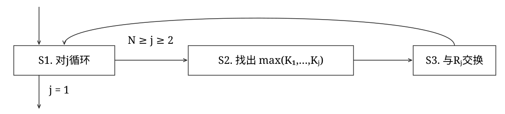
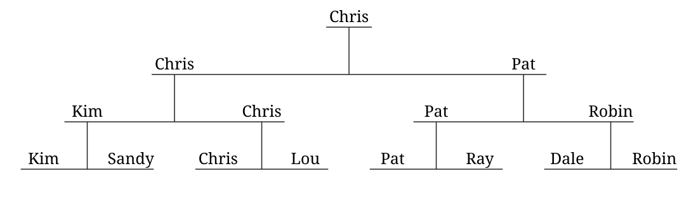
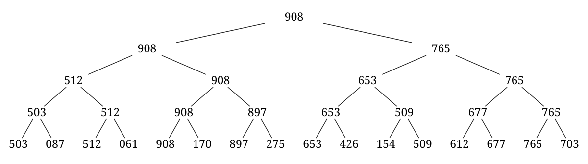
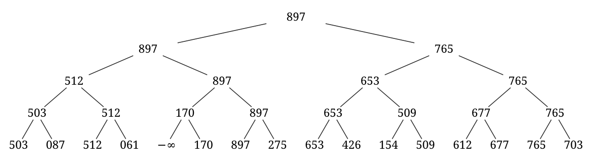
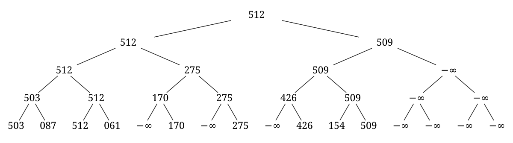
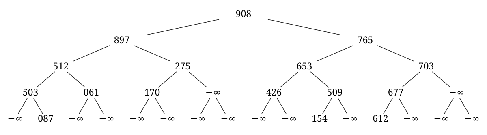
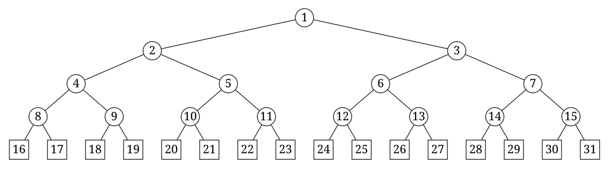
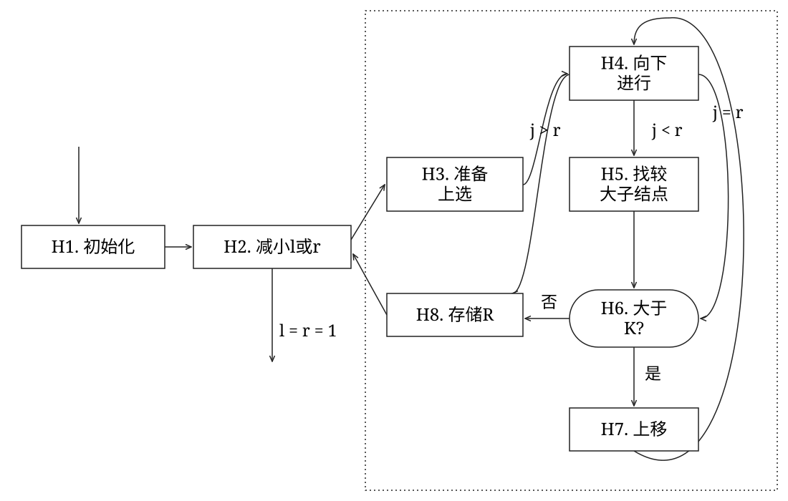
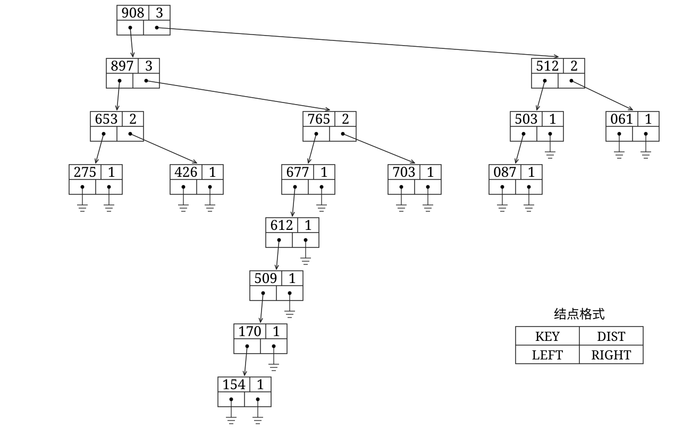
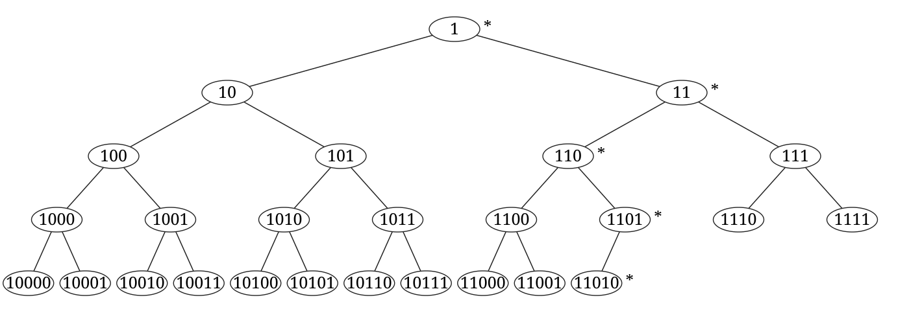

<a id="sec-5-2-3"></a>

# 5.2.3　选择排序

另一类重要的排序技术以重复选择思想为基础. 最简单的选择方法可能就是以下方法:

(i) 找出最小键, 把相应记录放到输出区域, 然后用 $\infty$ (假定它大于任何实际键) 代替这个键.

(ii) 重复步骤 (i). 这次将选出第二小的键, 因为最小键已经被 $\infty$ 代替.

(iii) 继续重复步骤 (i), 直到全部 $N$ 条记录都被选出.

选择排序需要所有输入项目都准备就绪后才能开始排序, 而且是依次逐个生成最终输出. 这与插入排序本质上相反, 后者顺序接收输入, 但在完成排序之前不知道任何最终输出.

步骤 (i) 每选择一条新记录涉及 $N-1$ 次比较, 还需要在存储器中有一个独立的输出区域. 但我们显然能做得更好: 可以把选定记录与当前占据其最终正确位置的记录交换, 它就移到了正确位置. 在将来的选择中不再需要考虑这个位置, 而且不必处理无穷键. 这个思想产生了我们的第一个选择排序算法.

<a id="pdf-114"></a>
<a id="p-108"></a>

<a id="alg-5-2-3-S"></a>

**算法 S (直接选择排序).** 重新排列记录 $R_1,\ldots,R_N$ 到适当位置, 排序完成后它们的键将处于有序状态: $K_1\le\cdots\le K_N$. 排序过程以上述方法为基础, 只是事实证明, 更方便的做法是先选择最大元素, 然后选择第二大元素, 以此类推.

**S1.** [对 $j$ 循环.] 对 $j=N,N-1,\ldots,2$ 执行 S2 和 S3.

**S2.** [找出 $\max(K_1,\ldots,K_j)$.] 扫描键 $K_j,K_{j-1},\ldots,K_1$, 找出一个最大的. 设它是 $K_i$, 其中 $i$ 尽可能地大.

**S3.** [与 $R_j$ 交换.] 交换记录 $R_i\leftrightarrow R_j$. (现在记录 $R_j,\ldots,R_N$ 处于其最终位置了.)　▮

<a id="fig-5-21"></a>



图 21　直接选择排序

表 1 给出算法应用于我们的 16 个示例键的操作过程. 在步骤 S2 中从右向左扫描期间, 作为最大键候选项的元素以粗体标出.

<a id="table-5-2-3-1"></a>

表 1　直接选择排序

<table data-selection-table="1" style="border-collapse:collapse;table-layout:fixed;width:1024px;font-family:serif"><thead><tr><th style="width:64px;min-width:64px;border:0;padding:0"></th><th style="width:64px;min-width:64px;border:0;padding:0"></th><th style="width:64px;min-width:64px;border:0;padding:0"></th><th style="width:64px;min-width:64px;border:0;padding:0"></th><th style="width:64px;min-width:64px;border:0;padding:0"></th><th style="width:64px;min-width:64px;border:0;padding:0"></th><th style="width:64px;min-width:64px;border:0;padding:0"></th><th style="width:64px;min-width:64px;border:0;padding:0"></th><th style="width:64px;min-width:64px;border:0;padding:0"></th><th style="width:64px;min-width:64px;border:0;padding:0"></th><th style="width:64px;min-width:64px;border:0;padding:0"></th><th style="width:64px;min-width:64px;border:0;padding:0"></th><th style="width:64px;min-width:64px;border:0;padding:0"></th><th style="width:64px;min-width:64px;border:0;padding:0"></th><th style="width:64px;min-width:64px;border:0;padding:0"></th><th style="width:64px;min-width:64px;border:0;padding:0"></th></tr></thead><tbody>
<tr data-selection-state="0" style="background:transparent"><td style="width:64px;min-width:64px;padding:4px 0;border:0;text-align:center">503</td><td style="width:64px;min-width:64px;padding:4px 0;border:0;text-align:center">087</td><td style="width:64px;min-width:64px;padding:4px 0;border:0;text-align:center">512</td><td style="width:64px;min-width:64px;padding:4px 0;border:0;text-align:center">061</td><td style="width:64px;min-width:64px;padding:4px 0;border:0;text-align:center"><strong>908</strong></td><td style="width:64px;min-width:64px;padding:4px 0;border:0;text-align:center">170</td><td style="width:64px;min-width:64px;padding:4px 0;border:0;text-align:center"><strong>897</strong></td><td style="width:64px;min-width:64px;padding:4px 0;border:0;text-align:center">275</td><td style="width:64px;min-width:64px;padding:4px 0;border:0;text-align:center">653</td><td style="width:64px;min-width:64px;padding:4px 0;border:0;text-align:center">426</td><td style="width:64px;min-width:64px;padding:4px 0;border:0;text-align:center">154</td><td style="width:64px;min-width:64px;padding:4px 0;border:0;text-align:center">509</td><td style="width:64px;min-width:64px;padding:4px 0;border:0;text-align:center">612</td><td style="width:64px;min-width:64px;padding:4px 0;border:0;text-align:center">677</td><td style="width:64px;min-width:64px;padding:4px 0;border:0;text-align:center"><strong>765</strong></td><td style="width:64px;min-width:64px;padding:4px 0;border:0;text-align:center;border-right:1.5px solid #222"><strong>703</strong></td></tr>
<tr data-selection-state="1" style="background:transparent"><td style="width:64px;min-width:64px;padding:4px 0;border:0;text-align:center">503</td><td style="width:64px;min-width:64px;padding:4px 0;border:0;text-align:center">087</td><td style="width:64px;min-width:64px;padding:4px 0;border:0;text-align:center">512</td><td style="width:64px;min-width:64px;padding:4px 0;border:0;text-align:center">061</td><td style="width:64px;min-width:64px;padding:4px 0;border:0;text-align:center">703</td><td style="width:64px;min-width:64px;padding:4px 0;border:0;text-align:center">170</td><td style="width:64px;min-width:64px;padding:4px 0;border:0;text-align:center"><strong>897</strong></td><td style="width:64px;min-width:64px;padding:4px 0;border:0;text-align:center">275</td><td style="width:64px;min-width:64px;padding:4px 0;border:0;text-align:center">653</td><td style="width:64px;min-width:64px;padding:4px 0;border:0;text-align:center">426</td><td style="width:64px;min-width:64px;padding:4px 0;border:0;text-align:center">154</td><td style="width:64px;min-width:64px;padding:4px 0;border:0;text-align:center">509</td><td style="width:64px;min-width:64px;padding:4px 0;border:0;text-align:center">612</td><td style="width:64px;min-width:64px;padding:4px 0;border:0;text-align:center">677</td><td style="width:64px;min-width:64px;padding:4px 0;border:0;text-align:center;border-right:1.5px solid #222"><strong>765</strong></td><td style="width:64px;min-width:64px;padding:4px 0;border:0;text-align:center">908</td></tr>
<tr data-selection-state="2" style="background:transparent"><td style="width:64px;min-width:64px;padding:4px 0;border:0;text-align:center">503</td><td style="width:64px;min-width:64px;padding:4px 0;border:0;text-align:center">087</td><td style="width:64px;min-width:64px;padding:4px 0;border:0;text-align:center">512</td><td style="width:64px;min-width:64px;padding:4px 0;border:0;text-align:center">061</td><td style="width:64px;min-width:64px;padding:4px 0;border:0;text-align:center">703</td><td style="width:64px;min-width:64px;padding:4px 0;border:0;text-align:center">170</td><td style="width:64px;min-width:64px;padding:4px 0;border:0;text-align:center"><strong>765</strong></td><td style="width:64px;min-width:64px;padding:4px 0;border:0;text-align:center">275</td><td style="width:64px;min-width:64px;padding:4px 0;border:0;text-align:center">653</td><td style="width:64px;min-width:64px;padding:4px 0;border:0;text-align:center">426</td><td style="width:64px;min-width:64px;padding:4px 0;border:0;text-align:center">154</td><td style="width:64px;min-width:64px;padding:4px 0;border:0;text-align:center">509</td><td style="width:64px;min-width:64px;padding:4px 0;border:0;text-align:center">612</td><td style="width:64px;min-width:64px;padding:4px 0;border:0;text-align:center;border-right:1.5px solid #222"><strong>677</strong></td><td style="width:64px;min-width:64px;padding:4px 0;border:0;text-align:center">897</td><td style="width:64px;min-width:64px;padding:4px 0;border:0;text-align:center">908</td></tr>
<tr data-selection-state="3" style="background:transparent"><td style="width:64px;min-width:64px;padding:4px 0;border:0;text-align:center">503</td><td style="width:64px;min-width:64px;padding:4px 0;border:0;text-align:center">087</td><td style="width:64px;min-width:64px;padding:4px 0;border:0;text-align:center">512</td><td style="width:64px;min-width:64px;padding:4px 0;border:0;text-align:center">061</td><td style="width:64px;min-width:64px;padding:4px 0;border:0;text-align:center"><strong>703</strong></td><td style="width:64px;min-width:64px;padding:4px 0;border:0;text-align:center">170</td><td style="width:64px;min-width:64px;padding:4px 0;border:0;text-align:center"><strong>677</strong></td><td style="width:64px;min-width:64px;padding:4px 0;border:0;text-align:center">275</td><td style="width:64px;min-width:64px;padding:4px 0;border:0;text-align:center"><strong>653</strong></td><td style="width:64px;min-width:64px;padding:4px 0;border:0;text-align:center">426</td><td style="width:64px;min-width:64px;padding:4px 0;border:0;text-align:center">154</td><td style="width:64px;min-width:64px;padding:4px 0;border:0;text-align:center">509</td><td style="width:64px;min-width:64px;padding:4px 0;border:0;text-align:center;border-right:1.5px solid #222"><strong>612</strong></td><td style="width:64px;min-width:64px;padding:4px 0;border:0;text-align:center">765</td><td style="width:64px;min-width:64px;padding:4px 0;border:0;text-align:center">897</td><td style="width:64px;min-width:64px;padding:4px 0;border:0;text-align:center">908</td></tr>
<tr data-selection-state="4" style="background:transparent"><td style="width:64px;min-width:64px;padding:4px 0;border:0;text-align:center">503</td><td style="width:64px;min-width:64px;padding:4px 0;border:0;text-align:center">087</td><td style="width:64px;min-width:64px;padding:4px 0;border:0;text-align:center">512</td><td style="width:64px;min-width:64px;padding:4px 0;border:0;text-align:center">061</td><td style="width:64px;min-width:64px;padding:4px 0;border:0;text-align:center">612</td><td style="width:64px;min-width:64px;padding:4px 0;border:0;text-align:center">170</td><td style="width:64px;min-width:64px;padding:4px 0;border:0;text-align:center"><strong>677</strong></td><td style="width:64px;min-width:64px;padding:4px 0;border:0;text-align:center">275</td><td style="width:64px;min-width:64px;padding:4px 0;border:0;text-align:center"><strong>653</strong></td><td style="width:64px;min-width:64px;padding:4px 0;border:0;text-align:center">426</td><td style="width:64px;min-width:64px;padding:4px 0;border:0;text-align:center">154</td><td style="width:64px;min-width:64px;padding:4px 0;border:0;text-align:center;border-right:1.5px solid #222"><strong>509</strong></td><td style="width:64px;min-width:64px;padding:4px 0;border:0;text-align:center">703</td><td style="width:64px;min-width:64px;padding:4px 0;border:0;text-align:center">765</td><td style="width:64px;min-width:64px;padding:4px 0;border:0;text-align:center">897</td><td style="width:64px;min-width:64px;padding:4px 0;border:0;text-align:center">908</td></tr>
<tr data-selection-state="5" style="background:transparent"><td style="width:64px;min-width:64px;padding:4px 0;border:0;text-align:center">503</td><td style="width:64px;min-width:64px;padding:4px 0;border:0;text-align:center">087</td><td style="width:64px;min-width:64px;padding:4px 0;border:0;text-align:center">512</td><td style="width:64px;min-width:64px;padding:4px 0;border:0;text-align:center">061</td><td style="width:64px;min-width:64px;padding:4px 0;border:0;text-align:center">612</td><td style="width:64px;min-width:64px;padding:4px 0;border:0;text-align:center">170</td><td style="width:64px;min-width:64px;padding:4px 0;border:0;text-align:center">509</td><td style="width:64px;min-width:64px;padding:4px 0;border:0;text-align:center">275</td><td style="width:64px;min-width:64px;padding:4px 0;border:0;text-align:center"><strong>653</strong></td><td style="width:64px;min-width:64px;padding:4px 0;border:0;text-align:center"><strong>426</strong></td><td style="width:64px;min-width:64px;padding:4px 0;border:0;text-align:center;border-right:1.5px solid #222"><strong>154</strong></td><td style="width:64px;min-width:64px;padding:4px 0;border:0;text-align:center">677</td><td style="width:64px;min-width:64px;padding:4px 0;border:0;text-align:center">703</td><td style="width:64px;min-width:64px;padding:4px 0;border:0;text-align:center">765</td><td style="width:64px;min-width:64px;padding:4px 0;border:0;text-align:center">897</td><td style="width:64px;min-width:64px;padding:4px 0;border:0;text-align:center">908</td></tr>
<tr style="background:transparent"><td colspan="16" style="border:0;padding:7px 0">…</td></tr>
<tr data-selection-state="6" style="background:transparent"><td style="width:64px;min-width:64px;padding:4px 0;border:0;text-align:center;border-right:1.5px solid #222">061</td><td style="width:64px;min-width:64px;padding:4px 0;border:0;text-align:center">087</td><td style="width:64px;min-width:64px;padding:4px 0;border:0;text-align:center">154</td><td style="width:64px;min-width:64px;padding:4px 0;border:0;text-align:center">170</td><td style="width:64px;min-width:64px;padding:4px 0;border:0;text-align:center">275</td><td style="width:64px;min-width:64px;padding:4px 0;border:0;text-align:center">426</td><td style="width:64px;min-width:64px;padding:4px 0;border:0;text-align:center">503</td><td style="width:64px;min-width:64px;padding:4px 0;border:0;text-align:center">509</td><td style="width:64px;min-width:64px;padding:4px 0;border:0;text-align:center">512</td><td style="width:64px;min-width:64px;padding:4px 0;border:0;text-align:center">612</td><td style="width:64px;min-width:64px;padding:4px 0;border:0;text-align:center">653</td><td style="width:64px;min-width:64px;padding:4px 0;border:0;text-align:center">677</td><td style="width:64px;min-width:64px;padding:4px 0;border:0;text-align:center">703</td><td style="width:64px;min-width:64px;padding:4px 0;border:0;text-align:center">765</td><td style="width:64px;min-width:64px;padding:4px 0;border:0;text-align:center">897</td><td style="width:64px;min-width:64px;padding:4px 0;border:0;text-align:center">908</td></tr>
</tbody></table>

相应的 MIX 程序非常简单.

<a id="prog-5-2-3-S"></a>

**程序 S (直接选择排序).** 和本章前面的程序一样, 按全字长键对单元 $\mathtt{INPUT}+1$ 至 $\mathtt{INPUT}+N$ 的记录排序. $\mathrm{rA}\equiv\text{当前最大值},\mathrm{rI1}\equiv j-1,\mathrm{rI2}\equiv k$ (当前扫描位置), $\mathrm{rI3}\equiv i$. 假定 $N\ge2$.

<a id="pdf-115"></a>
<a id="p-109"></a>

```mixal
01 START ENT1 N-1               1       S1. 对j循环。 j ← N.
02 2H    ENT2 0,1               N-1     S2. 找出max(K1,...,Kj)。 k ← j-1.
03       ENT3 1,1               N-1     i ← j.
04       LDA  INPUT,3           N-1     rA ← Ki.
05 8H    CMPA INPUT,2           A
06       JGE  *+3               A       如果 Ki ≥ Kk，则跳转。
07       ENT3 0,2               B       否则，令 i ← k,
08       LDA  INPUT,3           B       rA ← Ki.
09       DEC2 1                 A       k ← k-1.
10       J2P  8B                A       如果 k > 0，则重复。
11       LDX  INPUT+1,1         N-1     S3. 与Rj交换。
12       STX  INPUT,3           N-1     Ri ← Rj.
13       STA  INPUT+1,1         N-1     Rj ← rA.
14       DEC1 1                 N-1
15       J1P  2B                N-1     N ≥ j ≥ 2. ▮
```


程序运行时间取决于项数 $N$、比较次数 $A$、“从右向左的最大值” 的改变次数 $B$. 容易看出, 无论输入键取值如何, 有

$$
A=\binom N2=\tfrac12N(N-1),\tag{1}
$$

因此只有 $B$ 是变量. 尽管直接选择法很简单, 但精确分析量 $B$ 也不容易. 习题 3 至习题 6 表明

$$
B=\bigl(\text{最小 }0,\;\text{平均 }(N+1)H_N-2N,\;\text{最大 }\lfloor N^2/4\rfloor\bigr),\tag{2}
$$

这种情况下最大值尤其有意义. $B$ 的标准差是 $N^{3/4}$ 量级, 见习题 7.

于是程序 S 的平均运行时间是 $2.5N^2+3(N+1)H_N+3.5N-11$ 单位, 仅稍慢于直接插入 (程序 5.2.1S). 比较算法 S 和冒泡排序 (算法 5.2.2B) 是有意义的, 因为冒泡排序可以看作是有时会一次选出多个元素的选择算法. 也是因为这个原因, 冒泡排序所做的比较通常少于直接选择, 而且看起来可能更好些. 但事实上程序 5.2.2B 比程序 S 慢两倍多! 冒泡排序的缺陷在于它进行如此之多的交换, 而直接选择仅涉及非常少的数据移动.

**直接选择的改进.** 算法 S 所用的选择方法是否有任何改进的可能? 例如, 是否有实质上更快的方法用于步骤 S2 中查找最大值? 后一问题的答案是否定的!

**引理 M.** 任何基于比较元素对在 $n$ 个元素中寻找最大值的算法至少要做 $n-1$ 次比较.

**证明.** 如果比较少于 $n-1$ 次, 则至少存在两个元素, 还从未发现它们小于任何其他元素. 因此我们不知道这两个元素哪个更大, 也就无法确定最大元素.　▮

因此任何找出最大元素的选择过程必须执行至少 $n-1$ 次比较. 我们可能怀疑: 所有基于 $n$ 次重复选择的排序方法注定需要 $\Omega(n^2)$ 次操作. 幸运的是引理 M 只适用于第一个选择步骤, 后续选择可以利用前面已获得的信息. 例如习题 8 和习题 9 表明: 算法 S 稍加修改就能把平均比较次数减半.

考虑表 1 中的 16 个数. 一种节省重复选择时间的方法是把它们看作四个四元组. 先确定每组最大元素, 也就是以下各键

$$
512,\;908,\;653,\;765,
$$

这四个元素的最大值 908 就是整个文件的最大值. 为了获得第二大元素, 只需查看 512、653、765, 还有 908 所在组的其他三个元素. $\{170,897,275\}$ 的最大值是 897, 而

$$
512,\;897,\;653,\;765
$$

的最大值是 897. 与此类似, 为了获得第三大元素, 先确定 $\{170,275\}$ 的最大值, 然后找

$$
512,\;275,\;653,\;765
$$

的最大值. 第一次选择之后的每次选择至多需要 5 次附加比较. 一般来说, 如果 $N$ 是完全平方数, 则可以把文件分为 $\sqrt N$ 个 $\sqrt N$ 元组. 第一次选择之后, 每次选择至多在先前选出过元素的组中做 $\sqrt N-2$ 次比较, 加上 “各组最大值” 之间的 $\sqrt N-1$ 次比较. 这个思想称为二次选择, 总执行时间是 $O(N\sqrt N)$, 比 $N^2$ 量级好得多.

<a id="pdf-116"></a>
<a id="p-110"></a>

弗兰德最早提出二次选择, 他指出同一思想可以推广到三次、四次以及更高次选择 [*JACM* **3** (1956), 152–154]. 例如, 三次选择把文件分为 $\sqrt[3]N$ 个大组, 每个大组包含 $\sqrt[3]N$ 个小组, 每个小组包含 $\sqrt[3]N$ 条记录, 执行时间与 $N\sqrt[3]N$ 成正比. 如果把这个思想引向它的最终结论, 则得到弗兰德所说的基于二叉树结构的 “$n$ 次选择”. 这个方法的执行时间与 $N\log N$ 成正比, 它称为树选择.


**树选择.** 通过和典型的 “淘汰赛” 相类比, 可以很轻松地理解树选择排序的原理. 例如, 考虑图 22 所示的乒乓球比赛的结果. 在底层, Kim 击败 Sandy, Chris 击败 Lou, 在下一轮, Chris 击败 Kim, 以此类推.

<a id="fig-5-22"></a>

<div class="source-tableau-group" style="overflow-x:auto;max-width:100%"><div style="width:1100px">



</div></div>

图 22　一场乒乓球锦标赛

图 22 显示 Chris 是八位参赛者中的冠军, 为确定这一事实需要 $8-1=7$ 次比赛／比较. Pat 不一定是亚军. 任何一位被 Chris 击败的选手, 包括第一轮就被击败的 Lou, 都可能是亚军. 可以让 Lou 与 Kim 比赛, 再让这场比赛的胜者与 Pat 比赛, 即可确定亚军. 我们已经记录了先前比赛中获得的结构, 所以只需两场附加比赛就能找出亚军.

一般来说, 我们可以在树的根部 “输出” 选手, 然后重新进行比赛, 就好像这位选手生病而不能很好地发挥竞技水平一样. 于是原来的亚军选手将升到根部, 并在树的上方各级重新计算胜者, 这时只需要改变一条路径. 由此得出, 为选出亚军只需少于 $\lceil\lg N\rceil$ 次附加比较. 同样的过程可以找出第三名、第四名等. 因此, 如前所述, 这种选择排序的总时间大致与 $N\log N$ 成正比.

图 23 给出对我们的 16 个示例数执行树选择排序的过程. 注意, 为了知道在哪里插入下一个 $-\infty$, 我们需要知道根部的键来自哪里. 因此, 树的每个分支结点实际上应包含一个指针或索引, 指出相应键的位置, 而不是键本身. 由此得出, 我们需要存储空间能够容纳 $N$ 条输入记录、$N-1$ 个指针和 $N$ 条输出记录或指向这些记录的指针. (当然, 如果输出结果存储到磁带或磁盘上, 那就不需要在高速存储器中保留输出记录.)

读者看到这里, 应当停下来去做一做习题 10. 因为深入理解树选择的基本原理, 有助于领会我们后面将要讨论的重要改进.

实质上由艾弗森提出的一种修改树选择的方法 [*A Programming Language* (Wiley, 1962), 223–227], 通过 “前瞻” 消除了对指针的需求: 当树的底层中比赛获胜者向上移动时, 在底层它原先位置的值立即以 $-\infty$ 代替. 每当一位获胜者从一个分支上移到另一个分支时, 它空出位置的值可代以最终应上移至该位置的键值 (也就是下面两个键的较大者). 不断重复这个操作就能把图 23(a) 转换为图 24.

以这种方式建立树结构之后, 就可以用 “自上而下” 方法代替图 23 中的 “自下而上” 方法继续排序: 输出根结点, 然后上移它的最大后代, 然后上移后者的最大后代, 以此类推. 这个过程开始变得不太像乒乓球锦标赛, 而更像团体选拔方式.

读者应当能够看出, 这种自上而下方法有一个优势: 可以避免 $-\infty$ 和 $-\infty$ 之间不必要的比较. (自下而上方法会发现后期排序阶段中 $-\infty$ 无处不在, 而在自上而下方法的任一阶段, 只要存储了 $-\infty$ 就会停止修改树结构.)

<a id="pdf-117"></a>
<a id="p-111"></a>

<a id="fig-5-23"></a>

<div class="source-tableau-group" style="overflow-x:auto;max-width:100%"><div style="width:1200px">



</div></div>

(a) 初始结构

<div class="source-tableau-group" style="overflow-x:auto;max-width:100%"><div style="width:1200px">



</div></div>

(b) 908 被 $-\infty$ 代替, 第二大的元素移至根部

<div class="source-tableau-group" style="overflow-x:auto;max-width:100%"><div style="width:1200px">



</div></div>

(c) 输出 908、897、765、703、677、653、612 之后的结构

图 23　树选择排序示例

<a id="fig-5-24"></a>

<div class="source-tableau-group" style="overflow-x:auto;max-width:100%"><div style="width:1200px">



</div></div>

图 24　应用于排序的彼得原理. 在这个层次结构中每个键都会上升到它最终落败的层级上

<a id="pdf-118"></a>
<a id="p-112"></a>

图 23 和图 24 是具有 16 个终端结点的完全二叉树 (见 2.3.4.5 节), 可以很方便地像图 25 那样以连续单元表示这种树. 注意, 结点 $k$ 的父结点是 $\lfloor k/2\rfloor$, 子结点是 $2k$ 和 $2k+1$. 这给出自上而下方法的另一个优点, 因为从结点 $k$ 自上而下到达结点 $2k$ 和 $2k+1$, 比起从结点 $k$ 自下而上到达结点 $k\oplus1$ 和 $\lfloor k/2\rfloor$ 往往要容易得多. (这里 $k\oplus1$ 表示 $k+1$ 或 $k-1$, 取决于 $k$ 是偶数还是奇数.)

<a id="fig-5-25"></a>

<div class="source-tableau-group" style="overflow-x:auto;max-width:100%"><div style="width:1200px">



</div></div>

图 25　完全二叉树的顺序存储分配

到目前为止, 我们给出的树选择示例都或多或少地假定 $N$ 是 2 的幂. 但实际上我们可以应对任意 $N$ 值, 因为很容易对任何 $N$ 值构造具有 $N$ 个终端结点的完全二叉树.

现在提出一个关键问题: 在使用自上而下方法时, 能否根本就不用 $-\infty$? 如果图 24 的重要信息都存储在这个完全二叉树的单元 1 至单元 16 中, 而没有包含 $-\infty$ 的无用 “空穴”, 那不是会好一些呢? 稍加思索就会明白, 确实有可能实现这个目标, 不仅可以消除 $-\infty$, 还可以避免对辅助输出区域的需求. 这个思路把我们引向一种重要的排序算法, 也就是其发现者约翰·威廉斯命名的 “堆排序”[*CACM* **7** (1964), 347–348].

**堆排序.** 一个由键 $K_1,K_2,\ldots,K_N$ 组成的文件称为一个堆, 如果

$$
\text{对 }1\le\lfloor j/2\rfloor<j\le N\text{ 有 }K_{\lfloor j/2\rfloor}\ge K_j.\tag{3}
$$

于是 $K_1\ge K_2,K_1\ge K_3,K_2\ge K_4$, 等等. 这恰是在图 24 具有的属性, 而且意味着最大键出现在 “堆的顶端”,

$$
K_1=\max(K_1,K_2,\ldots,K_N).\tag{4}
$$

如果能够设法把任意的输入文件转换为堆, 就可以使用前述自上而下选择过程对元素排序.

弗洛伊德提出了建立堆的高效方法 [*CACM* **7** (1964), 701]. 假定我们已经能够重排文件使得

$$
\text{对 }l<\lfloor j/2\rfloor<j\le N\text{ 有 }K_{\lfloor j/2\rfloor}\ge K_j,\tag{5}
$$

其中 $l$ 是某个 $\ge1$ 的数. (在原始文件中这个条件对于 $l=\lfloor N/2\rfloor$ 显然成立, 因为不存在满足条件 $\lfloor N/2\rfloor<\lfloor j/2\rfloor<j\le N$ 的下标 $j$.) 不难看出应该怎样变换这个文件, 使得式 (5) 中的不等式能够扩展到 $l=\lfloor j/2\rfloor$ 的情形, 从而根结点是 $l$ 的整个子树都符合要求. 随后 $l$ 逐次减 1, 直到最终达到条件 (3). 威廉斯和弗洛伊德的这些思想引出了下面值得仔细研究的优秀算法:


<a id="alg-5-2-3-H"></a>
<a id="pdf-119"></a>
<a id="p-113"></a>

**算法 H (堆排序).** 重新排列记录 $R_1,\ldots,R_N$ 到适当位置, 排序完成后它们的键将处于有序状态: $K_1\le\cdots\le K_N$. 首先重新排列输入文件构成一个堆, 然后重复移动堆的顶结点, 把它传送到正确的最终位置. 假定 $N\ge2$.

**H1.[初始化.]** 置 $l\leftarrow\lfloor N/2\rfloor+1,\ r\leftarrow N$.

**H2.[减小 $l$ 或 $r$.]** 如果 $l>1$, 则置 $l\leftarrow l-1,\ R\leftarrow R_l,\ K\leftarrow K_l$. (如果 $l>1$, 则处于把输入文件变换为堆的过程. 另一方面, 如果 $l=1$, 则键 $K_1K_2\ldots K_r$ 已经构成一个堆.) 否则置 $R\leftarrow R_r,\ K\leftarrow K_r,\ R_r\leftarrow R_1,\ r\leftarrow r-1$, 如果这使得 $r=1$, 则置 $R_1\leftarrow R$, 并终止算法.

**H3.[准备上选.]** 置 $j\leftarrow l$. (这时

$$
\text{对 }l<\lfloor k/2\rfloor<k\le r\text{ 有 }K_{\lfloor k/2\rfloor}\ge K_k,\tag{6}
$$

满足 $r<k\le N$ 的记录 $R_k$ 位于其最终位置. H3–H8 称为上选算法, 它们的效果等价于: 置 $R_l\leftarrow R$, 然后重新排列 $R_l,\ldots,R_r$ 使得条件 (6) 对于 $l=\lfloor k/2\rfloor$ 也成立.)

**H4.[向下进行.]** 置 $i\leftarrow j,\ j\leftarrow2j$. (在以下步骤中, 有 $i=\lfloor j/2\rfloor$.) 如果 $j<r$, 转到 H5. 如果 $j=r$, 转到 H6. 如果 $j>r$, 转到 H8.

**H5.[找较大子结点.]** 如果 $K_j<K_{j+1}$, 则置 $j\leftarrow j+1$.

**H6.[大于 $K$?]** 如果 $K\ge K_j$, 转到 H8.

**H7.[上移.]** 置 $R_i\leftarrow R_j$, 返回 H4.

**H8.[存储 $R$.]** 置 $R_i\leftarrow R$. (这是始于 H3 的上选算法的最后一步.) 返回 H2. ■


<a id="fig-5-26"></a>

<div class="source-tableau-group" style="overflow-x:auto;max-width:100%"><div style="width:1100px">



</div></div>

图 26　堆排序 (虚线内是上选算法)

由于 $l$ 和 $r$ 的移动特点, 堆排序有时称为算法. 上三角代表建堆阶段, 此时 $r=N$, $l$ 减小至 1. 下三角代表选择阶段, 此时 $l=1$, $r$ 减小至 1. 表 2 给出对我们的 16 个示例数的堆排序过程. (表中各行是步骤 H2 开始时的状态, 方括号标出 $l$ 和 $r$ 的位置.)

<a id="prog-5-2-3-H"></a>

**程序 H (堆排序).** 用算法 H 对单元 INPUT+1 至 INPUT+N 的记录排序, 寄存器赋值如下: $\mathrm{rI1}\equiv l-1,\ \mathrm{rI2}\equiv r-1,\ \mathrm{rI3}\equiv i,\ \mathrm{rI4}\equiv j,\ \mathrm{rI5}\equiv r-j,\ \mathrm{rA}\equiv K\equiv R,\ \mathrm{rX}\equiv R_j$.

<a id="pdf-120"></a>
<a id="p-114"></a>
<a id="pdf-121"></a>
<a id="p-115"></a>

```mixal
01 START ENT1 N/2            1          H1. 初始化. l ← ⌊N/2⌋+1.
02       ENT2 N-1            1          r ← N.
03 1H    DEC1 1              ⌊N/2⌋     l ← l-1.
04       LDA  INPUT+1,1      ⌊N/2⌋     R ← Rl, K ← Kl.
05 3H    ENT4 1,1            P          H3. 准备上选. j ← l.
06       ENT5 0,2            P
07       DEC5 0,1            P          rI5 ← r-j.
08       JMP  4F             P          转到H4.
09 5H    LDX  INPUT,4        B+A-D      H5. 找较大子结点.
10       CMPX INPUT+1,4      B+A-D
11       JGE  6F             B+A-D      如果Kj ≥ Kj+1，则跳转.
12       INC4 1              C          否则，令j ← j+1.
13       DEC5 1              C
14 9H    LDX  INPUT,4        C+D        rX ← Rj.
15 6H    CMPA INPUT,4        B+A        H6. 大于K?
16       JGE  8F             B+A        如果K ≥ Kj，则转到H8.
17 7H    STX  INPUT,3        B          H7. 上移. Ri ← Rj.
18 4H    ENT3 0,4            B+P        H4. 向下进行. i ← j.
19       DEC5 0,4            B+P        rI5 ← rI5-j.
20       INC4 0,4            B+P        j ← j+j.
21       J5P  5B             B+P        如果j < r，则转到H5.
22       J5Z  9B             P-A+D      如果j = r，则转到H6.
23 8H    STA  INPUT,3        P          H8. 存储R. Ri ← R.
24 2H    J1P  1B             P          H2. 减小l或r.
25       LDA  INPUT+1,2      N-1        如果l=1，则令R ← Rr, K ← Kr.
26       LDX  INPUT+1        N-1
27       STX  INPUT+1,2      N-1        Rr ← R1.
28       DEC2 1              N-1        r ← r-1.
29       J2P  3B             N-1        如果r > 1，则转到H3.
30       STA  INPUT+1        1          R1 ← R.
```


<a id="tab-5-2-3-2"></a>

表 2　堆排序示例

<table data-heap-table="2" style="border-collapse:collapse;table-layout:fixed;width:1176px;font-family:serif"><thead><tr><th style="width:68px;min-width:68px;border:0;border-bottom:1px solid #222;padding:4px 0">$K_{1}$</th><th style="width:68px;min-width:68px;border:0;border-bottom:1px solid #222;padding:4px 0">$K_{2}$</th><th style="width:68px;min-width:68px;border:0;border-bottom:1px solid #222;padding:4px 0">$K_{3}$</th><th style="width:68px;min-width:68px;border:0;border-bottom:1px solid #222;padding:4px 0">$K_{4}$</th><th style="width:68px;min-width:68px;border:0;border-bottom:1px solid #222;padding:4px 0">$K_{5}$</th><th style="width:68px;min-width:68px;border:0;border-bottom:1px solid #222;padding:4px 0">$K_{6}$</th><th style="width:68px;min-width:68px;border:0;border-bottom:1px solid #222;padding:4px 0">$K_{7}$</th><th style="width:68px;min-width:68px;border:0;border-bottom:1px solid #222;padding:4px 0">$K_{8}$</th><th style="width:68px;min-width:68px;border:0;border-bottom:1px solid #222;padding:4px 0">$K_{9}$</th><th style="width:68px;min-width:68px;border:0;border-bottom:1px solid #222;padding:4px 0">$K_{10}$</th><th style="width:68px;min-width:68px;border:0;border-bottom:1px solid #222;padding:4px 0">$K_{11}$</th><th style="width:68px;min-width:68px;border:0;border-bottom:1px solid #222;padding:4px 0">$K_{12}$</th><th style="width:68px;min-width:68px;border:0;border-bottom:1px solid #222;padding:4px 0">$K_{13}$</th><th style="width:68px;min-width:68px;border:0;border-bottom:1px solid #222;padding:4px 0">$K_{14}$</th><th style="width:68px;min-width:68px;border:0;border-bottom:1px solid #222;padding:4px 0">$K_{15}$</th><th style="width:68px;min-width:68px;border:0;border-bottom:1px solid #222;padding:4px 0">$K_{16}$</th><th style="width:44px;min-width:44px;border:0;border-bottom:1px solid #222;padding:4px 0">$l$</th><th style="width:44px;min-width:44px;border:0;border-bottom:1px solid #222;padding:4px 0">$r$</th></tr></thead><tbody>
<tr data-heap-state="0" style="background:transparent"><td data-heap-key="1" style="width:68px;min-width:68px;border:0;padding:4px 0;text-align:center">503</td><td data-heap-key="2" style="width:68px;min-width:68px;border:0;padding:4px 0;text-align:center">087</td><td data-heap-key="3" style="width:68px;min-width:68px;border:0;padding:4px 0;text-align:center">512</td><td data-heap-key="4" style="width:68px;min-width:68px;border:0;padding:4px 0;text-align:center">061</td><td data-heap-key="5" style="width:68px;min-width:68px;border:0;padding:4px 0;text-align:center">908</td><td data-heap-key="6" style="width:68px;min-width:68px;border:0;padding:4px 0;text-align:center">170</td><td data-heap-key="7" style="width:68px;min-width:68px;border:0;padding:4px 0;text-align:center">897</td><td data-heap-key="8" style="width:68px;min-width:68px;border:0;padding:4px 0;text-align:center">275</td><td data-heap-key="9" style="width:68px;min-width:68px;border:0;padding:4px 0;text-align:center">[653</td><td data-heap-key="10" style="width:68px;min-width:68px;border:0;padding:4px 0;text-align:center">426</td><td data-heap-key="11" style="width:68px;min-width:68px;border:0;padding:4px 0;text-align:center">154</td><td data-heap-key="12" style="width:68px;min-width:68px;border:0;padding:4px 0;text-align:center">509</td><td data-heap-key="13" style="width:68px;min-width:68px;border:0;padding:4px 0;text-align:center">612</td><td data-heap-key="14" style="width:68px;min-width:68px;border:0;padding:4px 0;text-align:center">677</td><td data-heap-key="15" style="width:68px;min-width:68px;border:0;padding:4px 0;text-align:center">765</td><td data-heap-key="16" style="width:68px;min-width:68px;border:0;padding:4px 0;text-align:center">703]</td><td style="width:44px;min-width:44px;border:0;padding:4px 0;text-align:center">9</td><td style="width:44px;min-width:44px;border:0;padding:4px 0;text-align:center">16</td></tr>
<tr data-heap-state="1" style="background:transparent"><td data-heap-key="1" style="width:68px;min-width:68px;border:0;padding:4px 0;text-align:center">503</td><td data-heap-key="2" style="width:68px;min-width:68px;border:0;padding:4px 0;text-align:center">087</td><td data-heap-key="3" style="width:68px;min-width:68px;border:0;padding:4px 0;text-align:center">512</td><td data-heap-key="4" style="width:68px;min-width:68px;border:0;padding:4px 0;text-align:center">061</td><td data-heap-key="5" style="width:68px;min-width:68px;border:0;padding:4px 0;text-align:center">908</td><td data-heap-key="6" style="width:68px;min-width:68px;border:0;padding:4px 0;text-align:center">170</td><td data-heap-key="7" style="width:68px;min-width:68px;border:0;padding:4px 0;text-align:center">897</td><td data-heap-key="8" style="width:68px;min-width:68px;border:0;padding:4px 0;text-align:center">[703</td><td data-heap-key="9" style="width:68px;min-width:68px;border:0;padding:4px 0;text-align:center">653</td><td data-heap-key="10" style="width:68px;min-width:68px;border:0;padding:4px 0;text-align:center">426</td><td data-heap-key="11" style="width:68px;min-width:68px;border:0;padding:4px 0;text-align:center">154</td><td data-heap-key="12" style="width:68px;min-width:68px;border:0;padding:4px 0;text-align:center">509</td><td data-heap-key="13" style="width:68px;min-width:68px;border:0;padding:4px 0;text-align:center">612</td><td data-heap-key="14" style="width:68px;min-width:68px;border:0;padding:4px 0;text-align:center">677</td><td data-heap-key="15" style="width:68px;min-width:68px;border:0;padding:4px 0;text-align:center">765</td><td data-heap-key="16" style="width:68px;min-width:68px;border:0;padding:4px 0;text-align:center">275]</td><td style="width:44px;min-width:44px;border:0;padding:4px 0;text-align:center">8</td><td style="width:44px;min-width:44px;border:0;padding:4px 0;text-align:center">16</td></tr>
<tr data-heap-state="2" style="background:transparent"><td data-heap-key="1" style="width:68px;min-width:68px;border:0;padding:4px 0;text-align:center">503</td><td data-heap-key="2" style="width:68px;min-width:68px;border:0;padding:4px 0;text-align:center">087</td><td data-heap-key="3" style="width:68px;min-width:68px;border:0;padding:4px 0;text-align:center">512</td><td data-heap-key="4" style="width:68px;min-width:68px;border:0;padding:4px 0;text-align:center">061</td><td data-heap-key="5" style="width:68px;min-width:68px;border:0;padding:4px 0;text-align:center">908</td><td data-heap-key="6" style="width:68px;min-width:68px;border:0;padding:4px 0;text-align:center">170</td><td data-heap-key="7" style="width:68px;min-width:68px;border:0;padding:4px 0;text-align:center">[897</td><td data-heap-key="8" style="width:68px;min-width:68px;border:0;padding:4px 0;text-align:center">703</td><td data-heap-key="9" style="width:68px;min-width:68px;border:0;padding:4px 0;text-align:center">653</td><td data-heap-key="10" style="width:68px;min-width:68px;border:0;padding:4px 0;text-align:center">426</td><td data-heap-key="11" style="width:68px;min-width:68px;border:0;padding:4px 0;text-align:center">154</td><td data-heap-key="12" style="width:68px;min-width:68px;border:0;padding:4px 0;text-align:center">509</td><td data-heap-key="13" style="width:68px;min-width:68px;border:0;padding:4px 0;text-align:center">612</td><td data-heap-key="14" style="width:68px;min-width:68px;border:0;padding:4px 0;text-align:center">677</td><td data-heap-key="15" style="width:68px;min-width:68px;border:0;padding:4px 0;text-align:center">765</td><td data-heap-key="16" style="width:68px;min-width:68px;border:0;padding:4px 0;text-align:center">275]</td><td style="width:44px;min-width:44px;border:0;padding:4px 0;text-align:center">7</td><td style="width:44px;min-width:44px;border:0;padding:4px 0;text-align:center">16</td></tr>
<tr data-heap-state="3" style="background:transparent"><td data-heap-key="1" style="width:68px;min-width:68px;border:0;padding:4px 0;text-align:center">503</td><td data-heap-key="2" style="width:68px;min-width:68px;border:0;padding:4px 0;text-align:center">087</td><td data-heap-key="3" style="width:68px;min-width:68px;border:0;padding:4px 0;text-align:center">512</td><td data-heap-key="4" style="width:68px;min-width:68px;border:0;padding:4px 0;text-align:center">061</td><td data-heap-key="5" style="width:68px;min-width:68px;border:0;padding:4px 0;text-align:center">908</td><td data-heap-key="6" style="width:68px;min-width:68px;border:0;padding:4px 0;text-align:center">[612</td><td data-heap-key="7" style="width:68px;min-width:68px;border:0;padding:4px 0;text-align:center">897</td><td data-heap-key="8" style="width:68px;min-width:68px;border:0;padding:4px 0;text-align:center">703</td><td data-heap-key="9" style="width:68px;min-width:68px;border:0;padding:4px 0;text-align:center">653</td><td data-heap-key="10" style="width:68px;min-width:68px;border:0;padding:4px 0;text-align:center">426</td><td data-heap-key="11" style="width:68px;min-width:68px;border:0;padding:4px 0;text-align:center">154</td><td data-heap-key="12" style="width:68px;min-width:68px;border:0;padding:4px 0;text-align:center">509</td><td data-heap-key="13" style="width:68px;min-width:68px;border:0;padding:4px 0;text-align:center">170</td><td data-heap-key="14" style="width:68px;min-width:68px;border:0;padding:4px 0;text-align:center">677</td><td data-heap-key="15" style="width:68px;min-width:68px;border:0;padding:4px 0;text-align:center">765</td><td data-heap-key="16" style="width:68px;min-width:68px;border:0;padding:4px 0;text-align:center">275]</td><td style="width:44px;min-width:44px;border:0;padding:4px 0;text-align:center">6</td><td style="width:44px;min-width:44px;border:0;padding:4px 0;text-align:center">16</td></tr>
<tr data-heap-state="4" style="background:transparent"><td data-heap-key="1" style="width:68px;min-width:68px;border:0;padding:4px 0;text-align:center">503</td><td data-heap-key="2" style="width:68px;min-width:68px;border:0;padding:4px 0;text-align:center">087</td><td data-heap-key="3" style="width:68px;min-width:68px;border:0;padding:4px 0;text-align:center">512</td><td data-heap-key="4" style="width:68px;min-width:68px;border:0;padding:4px 0;text-align:center">061</td><td data-heap-key="5" style="width:68px;min-width:68px;border:0;padding:4px 0;text-align:center">[908</td><td data-heap-key="6" style="width:68px;min-width:68px;border:0;padding:4px 0;text-align:center">612</td><td data-heap-key="7" style="width:68px;min-width:68px;border:0;padding:4px 0;text-align:center">897</td><td data-heap-key="8" style="width:68px;min-width:68px;border:0;padding:4px 0;text-align:center">703</td><td data-heap-key="9" style="width:68px;min-width:68px;border:0;padding:4px 0;text-align:center">653</td><td data-heap-key="10" style="width:68px;min-width:68px;border:0;padding:4px 0;text-align:center">426</td><td data-heap-key="11" style="width:68px;min-width:68px;border:0;padding:4px 0;text-align:center">154</td><td data-heap-key="12" style="width:68px;min-width:68px;border:0;padding:4px 0;text-align:center">509</td><td data-heap-key="13" style="width:68px;min-width:68px;border:0;padding:4px 0;text-align:center">170</td><td data-heap-key="14" style="width:68px;min-width:68px;border:0;padding:4px 0;text-align:center">677</td><td data-heap-key="15" style="width:68px;min-width:68px;border:0;padding:4px 0;text-align:center">765</td><td data-heap-key="16" style="width:68px;min-width:68px;border:0;padding:4px 0;text-align:center">275]</td><td style="width:44px;min-width:44px;border:0;padding:4px 0;text-align:center">5</td><td style="width:44px;min-width:44px;border:0;padding:4px 0;text-align:center">16</td></tr>
<tr data-heap-state="5" style="background:transparent"><td data-heap-key="1" style="width:68px;min-width:68px;border:0;padding:4px 0;text-align:center">503</td><td data-heap-key="2" style="width:68px;min-width:68px;border:0;padding:4px 0;text-align:center">087</td><td data-heap-key="3" style="width:68px;min-width:68px;border:0;padding:4px 0;text-align:center">512</td><td data-heap-key="4" style="width:68px;min-width:68px;border:0;padding:4px 0;text-align:center">[703</td><td data-heap-key="5" style="width:68px;min-width:68px;border:0;padding:4px 0;text-align:center">908</td><td data-heap-key="6" style="width:68px;min-width:68px;border:0;padding:4px 0;text-align:center">612</td><td data-heap-key="7" style="width:68px;min-width:68px;border:0;padding:4px 0;text-align:center">897</td><td data-heap-key="8" style="width:68px;min-width:68px;border:0;padding:4px 0;text-align:center">275</td><td data-heap-key="9" style="width:68px;min-width:68px;border:0;padding:4px 0;text-align:center">653</td><td data-heap-key="10" style="width:68px;min-width:68px;border:0;padding:4px 0;text-align:center">426</td><td data-heap-key="11" style="width:68px;min-width:68px;border:0;padding:4px 0;text-align:center">154</td><td data-heap-key="12" style="width:68px;min-width:68px;border:0;padding:4px 0;text-align:center">509</td><td data-heap-key="13" style="width:68px;min-width:68px;border:0;padding:4px 0;text-align:center">170</td><td data-heap-key="14" style="width:68px;min-width:68px;border:0;padding:4px 0;text-align:center">677</td><td data-heap-key="15" style="width:68px;min-width:68px;border:0;padding:4px 0;text-align:center">765</td><td data-heap-key="16" style="width:68px;min-width:68px;border:0;padding:4px 0;text-align:center">061]</td><td style="width:44px;min-width:44px;border:0;padding:4px 0;text-align:center">4</td><td style="width:44px;min-width:44px;border:0;padding:4px 0;text-align:center">16</td></tr>
<tr data-heap-state="6" style="background:transparent"><td data-heap-key="1" style="width:68px;min-width:68px;border:0;padding:4px 0;text-align:center">503</td><td data-heap-key="2" style="width:68px;min-width:68px;border:0;padding:4px 0;text-align:center">087</td><td data-heap-key="3" style="width:68px;min-width:68px;border:0;padding:4px 0;text-align:center">[897</td><td data-heap-key="4" style="width:68px;min-width:68px;border:0;padding:4px 0;text-align:center">703</td><td data-heap-key="5" style="width:68px;min-width:68px;border:0;padding:4px 0;text-align:center">908</td><td data-heap-key="6" style="width:68px;min-width:68px;border:0;padding:4px 0;text-align:center">612</td><td data-heap-key="7" style="width:68px;min-width:68px;border:0;padding:4px 0;text-align:center">765</td><td data-heap-key="8" style="width:68px;min-width:68px;border:0;padding:4px 0;text-align:center">275</td><td data-heap-key="9" style="width:68px;min-width:68px;border:0;padding:4px 0;text-align:center">653</td><td data-heap-key="10" style="width:68px;min-width:68px;border:0;padding:4px 0;text-align:center">426</td><td data-heap-key="11" style="width:68px;min-width:68px;border:0;padding:4px 0;text-align:center">154</td><td data-heap-key="12" style="width:68px;min-width:68px;border:0;padding:4px 0;text-align:center">509</td><td data-heap-key="13" style="width:68px;min-width:68px;border:0;padding:4px 0;text-align:center">170</td><td data-heap-key="14" style="width:68px;min-width:68px;border:0;padding:4px 0;text-align:center">677</td><td data-heap-key="15" style="width:68px;min-width:68px;border:0;padding:4px 0;text-align:center">512</td><td data-heap-key="16" style="width:68px;min-width:68px;border:0;padding:4px 0;text-align:center">061]</td><td style="width:44px;min-width:44px;border:0;padding:4px 0;text-align:center">3</td><td style="width:44px;min-width:44px;border:0;padding:4px 0;text-align:center">16</td></tr>
<tr data-heap-state="7" style="background:transparent"><td data-heap-key="1" style="width:68px;min-width:68px;border:0;padding:4px 0;text-align:center">503</td><td data-heap-key="2" style="width:68px;min-width:68px;border:0;padding:4px 0;text-align:center">[908</td><td data-heap-key="3" style="width:68px;min-width:68px;border:0;padding:4px 0;text-align:center">897</td><td data-heap-key="4" style="width:68px;min-width:68px;border:0;padding:4px 0;text-align:center">703</td><td data-heap-key="5" style="width:68px;min-width:68px;border:0;padding:4px 0;text-align:center">426</td><td data-heap-key="6" style="width:68px;min-width:68px;border:0;padding:4px 0;text-align:center">612</td><td data-heap-key="7" style="width:68px;min-width:68px;border:0;padding:4px 0;text-align:center">765</td><td data-heap-key="8" style="width:68px;min-width:68px;border:0;padding:4px 0;text-align:center">275</td><td data-heap-key="9" style="width:68px;min-width:68px;border:0;padding:4px 0;text-align:center">653</td><td data-heap-key="10" style="width:68px;min-width:68px;border:0;padding:4px 0;text-align:center">087</td><td data-heap-key="11" style="width:68px;min-width:68px;border:0;padding:4px 0;text-align:center">154</td><td data-heap-key="12" style="width:68px;min-width:68px;border:0;padding:4px 0;text-align:center">509</td><td data-heap-key="13" style="width:68px;min-width:68px;border:0;padding:4px 0;text-align:center">170</td><td data-heap-key="14" style="width:68px;min-width:68px;border:0;padding:4px 0;text-align:center">677</td><td data-heap-key="15" style="width:68px;min-width:68px;border:0;padding:4px 0;text-align:center">512</td><td data-heap-key="16" style="width:68px;min-width:68px;border:0;padding:4px 0;text-align:center">061]</td><td style="width:44px;min-width:44px;border:0;padding:4px 0;text-align:center">2</td><td style="width:44px;min-width:44px;border:0;padding:4px 0;text-align:center">16</td></tr>
<tr data-heap-state="8" style="background:transparent"><td data-heap-key="1" style="width:68px;min-width:68px;border:0;padding:4px 0;text-align:center">[908</td><td data-heap-key="2" style="width:68px;min-width:68px;border:0;padding:4px 0;text-align:center">703</td><td data-heap-key="3" style="width:68px;min-width:68px;border:0;padding:4px 0;text-align:center">897</td><td data-heap-key="4" style="width:68px;min-width:68px;border:0;padding:4px 0;text-align:center">653</td><td data-heap-key="5" style="width:68px;min-width:68px;border:0;padding:4px 0;text-align:center">426</td><td data-heap-key="6" style="width:68px;min-width:68px;border:0;padding:4px 0;text-align:center">612</td><td data-heap-key="7" style="width:68px;min-width:68px;border:0;padding:4px 0;text-align:center">765</td><td data-heap-key="8" style="width:68px;min-width:68px;border:0;padding:4px 0;text-align:center">275</td><td data-heap-key="9" style="width:68px;min-width:68px;border:0;padding:4px 0;text-align:center">503</td><td data-heap-key="10" style="width:68px;min-width:68px;border:0;padding:4px 0;text-align:center">087</td><td data-heap-key="11" style="width:68px;min-width:68px;border:0;padding:4px 0;text-align:center">154</td><td data-heap-key="12" style="width:68px;min-width:68px;border:0;padding:4px 0;text-align:center">509</td><td data-heap-key="13" style="width:68px;min-width:68px;border:0;padding:4px 0;text-align:center">170</td><td data-heap-key="14" style="width:68px;min-width:68px;border:0;padding:4px 0;text-align:center">677</td><td data-heap-key="15" style="width:68px;min-width:68px;border:0;padding:4px 0;text-align:center">512</td><td data-heap-key="16" style="width:68px;min-width:68px;border:0;padding:4px 0;text-align:center">061]</td><td style="width:44px;min-width:44px;border:0;padding:4px 0;text-align:center">1</td><td style="width:44px;min-width:44px;border:0;padding:4px 0;text-align:center">16</td></tr>
<tr data-heap-state="9" style="background:transparent"><td data-heap-key="1" style="width:68px;min-width:68px;border:0;padding:4px 0;text-align:center">[897</td><td data-heap-key="2" style="width:68px;min-width:68px;border:0;padding:4px 0;text-align:center">703</td><td data-heap-key="3" style="width:68px;min-width:68px;border:0;padding:4px 0;text-align:center">765</td><td data-heap-key="4" style="width:68px;min-width:68px;border:0;padding:4px 0;text-align:center">653</td><td data-heap-key="5" style="width:68px;min-width:68px;border:0;padding:4px 0;text-align:center">426</td><td data-heap-key="6" style="width:68px;min-width:68px;border:0;padding:4px 0;text-align:center">612</td><td data-heap-key="7" style="width:68px;min-width:68px;border:0;padding:4px 0;text-align:center">677</td><td data-heap-key="8" style="width:68px;min-width:68px;border:0;padding:4px 0;text-align:center">275</td><td data-heap-key="9" style="width:68px;min-width:68px;border:0;padding:4px 0;text-align:center">503</td><td data-heap-key="10" style="width:68px;min-width:68px;border:0;padding:4px 0;text-align:center">087</td><td data-heap-key="11" style="width:68px;min-width:68px;border:0;padding:4px 0;text-align:center">154</td><td data-heap-key="12" style="width:68px;min-width:68px;border:0;padding:4px 0;text-align:center">509</td><td data-heap-key="13" style="width:68px;min-width:68px;border:0;padding:4px 0;text-align:center">170</td><td data-heap-key="14" style="width:68px;min-width:68px;border:0;padding:4px 0;text-align:center">061</td><td data-heap-key="15" style="width:68px;min-width:68px;border:0;padding:4px 0;text-align:center">512]</td><td data-heap-key="16" style="width:68px;min-width:68px;border:0;padding:4px 0;text-align:center">908</td><td style="width:44px;min-width:44px;border:0;padding:4px 0;text-align:center">1</td><td style="width:44px;min-width:44px;border:0;padding:4px 0;text-align:center">15</td></tr>
<tr data-heap-state="10" style="background:transparent"><td data-heap-key="1" style="width:68px;min-width:68px;border:0;padding:4px 0;text-align:center">[765</td><td data-heap-key="2" style="width:68px;min-width:68px;border:0;padding:4px 0;text-align:center">703</td><td data-heap-key="3" style="width:68px;min-width:68px;border:0;padding:4px 0;text-align:center">677</td><td data-heap-key="4" style="width:68px;min-width:68px;border:0;padding:4px 0;text-align:center">653</td><td data-heap-key="5" style="width:68px;min-width:68px;border:0;padding:4px 0;text-align:center">426</td><td data-heap-key="6" style="width:68px;min-width:68px;border:0;padding:4px 0;text-align:center">612</td><td data-heap-key="7" style="width:68px;min-width:68px;border:0;padding:4px 0;text-align:center">512</td><td data-heap-key="8" style="width:68px;min-width:68px;border:0;padding:4px 0;text-align:center">275</td><td data-heap-key="9" style="width:68px;min-width:68px;border:0;padding:4px 0;text-align:center">503</td><td data-heap-key="10" style="width:68px;min-width:68px;border:0;padding:4px 0;text-align:center">087</td><td data-heap-key="11" style="width:68px;min-width:68px;border:0;padding:4px 0;text-align:center">154</td><td data-heap-key="12" style="width:68px;min-width:68px;border:0;padding:4px 0;text-align:center">509</td><td data-heap-key="13" style="width:68px;min-width:68px;border:0;padding:4px 0;text-align:center">170</td><td data-heap-key="14" style="width:68px;min-width:68px;border:0;padding:4px 0;text-align:center">061]</td><td data-heap-key="15" style="width:68px;min-width:68px;border:0;padding:4px 0;text-align:center">897</td><td data-heap-key="16" style="width:68px;min-width:68px;border:0;padding:4px 0;text-align:center">908</td><td style="width:44px;min-width:44px;border:0;padding:4px 0;text-align:center">1</td><td style="width:44px;min-width:44px;border:0;padding:4px 0;text-align:center">14</td></tr>
<tr data-heap-state="11" style="background:transparent"><td data-heap-key="1" style="width:68px;min-width:68px;border:0;padding:4px 0;text-align:center">[703</td><td data-heap-key="2" style="width:68px;min-width:68px;border:0;padding:4px 0;text-align:center">653</td><td data-heap-key="3" style="width:68px;min-width:68px;border:0;padding:4px 0;text-align:center">677</td><td data-heap-key="4" style="width:68px;min-width:68px;border:0;padding:4px 0;text-align:center">503</td><td data-heap-key="5" style="width:68px;min-width:68px;border:0;padding:4px 0;text-align:center">426</td><td data-heap-key="6" style="width:68px;min-width:68px;border:0;padding:4px 0;text-align:center">612</td><td data-heap-key="7" style="width:68px;min-width:68px;border:0;padding:4px 0;text-align:center">512</td><td data-heap-key="8" style="width:68px;min-width:68px;border:0;padding:4px 0;text-align:center">275</td><td data-heap-key="9" style="width:68px;min-width:68px;border:0;padding:4px 0;text-align:center">061</td><td data-heap-key="10" style="width:68px;min-width:68px;border:0;padding:4px 0;text-align:center">087</td><td data-heap-key="11" style="width:68px;min-width:68px;border:0;padding:4px 0;text-align:center">154</td><td data-heap-key="12" style="width:68px;min-width:68px;border:0;padding:4px 0;text-align:center">509</td><td data-heap-key="13" style="width:68px;min-width:68px;border:0;padding:4px 0;text-align:center">170]</td><td data-heap-key="14" style="width:68px;min-width:68px;border:0;padding:4px 0;text-align:center">765</td><td data-heap-key="15" style="width:68px;min-width:68px;border:0;padding:4px 0;text-align:center">897</td><td data-heap-key="16" style="width:68px;min-width:68px;border:0;padding:4px 0;text-align:center">908</td><td style="width:44px;min-width:44px;border:0;padding:4px 0;text-align:center">1</td><td style="width:44px;min-width:44px;border:0;padding:4px 0;text-align:center">13</td></tr>
<tr data-heap-state="12" style="background:transparent"><td data-heap-key="1" style="width:68px;min-width:68px;border:0;padding:4px 0;text-align:center">[677</td><td data-heap-key="2" style="width:68px;min-width:68px;border:0;padding:4px 0;text-align:center">653</td><td data-heap-key="3" style="width:68px;min-width:68px;border:0;padding:4px 0;text-align:center">612</td><td data-heap-key="4" style="width:68px;min-width:68px;border:0;padding:4px 0;text-align:center">503</td><td data-heap-key="5" style="width:68px;min-width:68px;border:0;padding:4px 0;text-align:center">426</td><td data-heap-key="6" style="width:68px;min-width:68px;border:0;padding:4px 0;text-align:center">509</td><td data-heap-key="7" style="width:68px;min-width:68px;border:0;padding:4px 0;text-align:center">512</td><td data-heap-key="8" style="width:68px;min-width:68px;border:0;padding:4px 0;text-align:center">275</td><td data-heap-key="9" style="width:68px;min-width:68px;border:0;padding:4px 0;text-align:center">061</td><td data-heap-key="10" style="width:68px;min-width:68px;border:0;padding:4px 0;text-align:center">087</td><td data-heap-key="11" style="width:68px;min-width:68px;border:0;padding:4px 0;text-align:center">154</td><td data-heap-key="12" style="width:68px;min-width:68px;border:0;padding:4px 0;text-align:center">170]</td><td data-heap-key="13" style="width:68px;min-width:68px;border:0;padding:4px 0;text-align:center">703</td><td data-heap-key="14" style="width:68px;min-width:68px;border:0;padding:4px 0;text-align:center">765</td><td data-heap-key="15" style="width:68px;min-width:68px;border:0;padding:4px 0;text-align:center">897</td><td data-heap-key="16" style="width:68px;min-width:68px;border:0;padding:4px 0;text-align:center">908</td><td style="width:44px;min-width:44px;border:0;padding:4px 0;text-align:center">1</td><td style="width:44px;min-width:44px;border:0;padding:4px 0;text-align:center">12</td></tr>
<tr data-heap-state="13" style="background:transparent"><td data-heap-key="1" style="width:68px;min-width:68px;border:0;padding:4px 0;text-align:center">[653</td><td data-heap-key="2" style="width:68px;min-width:68px;border:0;padding:4px 0;text-align:center">503</td><td data-heap-key="3" style="width:68px;min-width:68px;border:0;padding:4px 0;text-align:center">612</td><td data-heap-key="4" style="width:68px;min-width:68px;border:0;padding:4px 0;text-align:center">275</td><td data-heap-key="5" style="width:68px;min-width:68px;border:0;padding:4px 0;text-align:center">426</td><td data-heap-key="6" style="width:68px;min-width:68px;border:0;padding:4px 0;text-align:center">509</td><td data-heap-key="7" style="width:68px;min-width:68px;border:0;padding:4px 0;text-align:center">512</td><td data-heap-key="8" style="width:68px;min-width:68px;border:0;padding:4px 0;text-align:center">170</td><td data-heap-key="9" style="width:68px;min-width:68px;border:0;padding:4px 0;text-align:center">061</td><td data-heap-key="10" style="width:68px;min-width:68px;border:0;padding:4px 0;text-align:center">087</td><td data-heap-key="11" style="width:68px;min-width:68px;border:0;padding:4px 0;text-align:center">154]</td><td data-heap-key="12" style="width:68px;min-width:68px;border:0;padding:4px 0;text-align:center">677</td><td data-heap-key="13" style="width:68px;min-width:68px;border:0;padding:4px 0;text-align:center">703</td><td data-heap-key="14" style="width:68px;min-width:68px;border:0;padding:4px 0;text-align:center">765</td><td data-heap-key="15" style="width:68px;min-width:68px;border:0;padding:4px 0;text-align:center">897</td><td data-heap-key="16" style="width:68px;min-width:68px;border:0;padding:4px 0;text-align:center">908</td><td style="width:44px;min-width:44px;border:0;padding:4px 0;text-align:center">1</td><td style="width:44px;min-width:44px;border:0;padding:4px 0;text-align:center">11</td></tr>
<tr data-heap-state="14" style="background:transparent"><td data-heap-key="1" style="width:68px;min-width:68px;border:0;padding:4px 0;text-align:center">[612</td><td data-heap-key="2" style="width:68px;min-width:68px;border:0;padding:4px 0;text-align:center">503</td><td data-heap-key="3" style="width:68px;min-width:68px;border:0;padding:4px 0;text-align:center">512</td><td data-heap-key="4" style="width:68px;min-width:68px;border:0;padding:4px 0;text-align:center">275</td><td data-heap-key="5" style="width:68px;min-width:68px;border:0;padding:4px 0;text-align:center">426</td><td data-heap-key="6" style="width:68px;min-width:68px;border:0;padding:4px 0;text-align:center">509</td><td data-heap-key="7" style="width:68px;min-width:68px;border:0;padding:4px 0;text-align:center">154</td><td data-heap-key="8" style="width:68px;min-width:68px;border:0;padding:4px 0;text-align:center">170</td><td data-heap-key="9" style="width:68px;min-width:68px;border:0;padding:4px 0;text-align:center">061</td><td data-heap-key="10" style="width:68px;min-width:68px;border:0;padding:4px 0;text-align:center">087]</td><td data-heap-key="11" style="width:68px;min-width:68px;border:0;padding:4px 0;text-align:center">653</td><td data-heap-key="12" style="width:68px;min-width:68px;border:0;padding:4px 0;text-align:center">677</td><td data-heap-key="13" style="width:68px;min-width:68px;border:0;padding:4px 0;text-align:center">703</td><td data-heap-key="14" style="width:68px;min-width:68px;border:0;padding:4px 0;text-align:center">765</td><td data-heap-key="15" style="width:68px;min-width:68px;border:0;padding:4px 0;text-align:center">897</td><td data-heap-key="16" style="width:68px;min-width:68px;border:0;padding:4px 0;text-align:center">908</td><td style="width:44px;min-width:44px;border:0;padding:4px 0;text-align:center">1</td><td style="width:44px;min-width:44px;border:0;padding:4px 0;text-align:center">10</td></tr>
<tr data-heap-state="15" style="background:transparent"><td data-heap-key="1" style="width:68px;min-width:68px;border:0;padding:4px 0;text-align:center">[512</td><td data-heap-key="2" style="width:68px;min-width:68px;border:0;padding:4px 0;text-align:center">503</td><td data-heap-key="3" style="width:68px;min-width:68px;border:0;padding:4px 0;text-align:center">509</td><td data-heap-key="4" style="width:68px;min-width:68px;border:0;padding:4px 0;text-align:center">275</td><td data-heap-key="5" style="width:68px;min-width:68px;border:0;padding:4px 0;text-align:center">426</td><td data-heap-key="6" style="width:68px;min-width:68px;border:0;padding:4px 0;text-align:center">087</td><td data-heap-key="7" style="width:68px;min-width:68px;border:0;padding:4px 0;text-align:center">154</td><td data-heap-key="8" style="width:68px;min-width:68px;border:0;padding:4px 0;text-align:center">170</td><td data-heap-key="9" style="width:68px;min-width:68px;border:0;padding:4px 0;text-align:center">061]</td><td data-heap-key="10" style="width:68px;min-width:68px;border:0;padding:4px 0;text-align:center">612</td><td data-heap-key="11" style="width:68px;min-width:68px;border:0;padding:4px 0;text-align:center">653</td><td data-heap-key="12" style="width:68px;min-width:68px;border:0;padding:4px 0;text-align:center">677</td><td data-heap-key="13" style="width:68px;min-width:68px;border:0;padding:4px 0;text-align:center">703</td><td data-heap-key="14" style="width:68px;min-width:68px;border:0;padding:4px 0;text-align:center">765</td><td data-heap-key="15" style="width:68px;min-width:68px;border:0;padding:4px 0;text-align:center">897</td><td data-heap-key="16" style="width:68px;min-width:68px;border:0;padding:4px 0;text-align:center">908</td><td style="width:44px;min-width:44px;border:0;padding:4px 0;text-align:center">1</td><td style="width:44px;min-width:44px;border:0;padding:4px 0;text-align:center">9</td></tr>
<tr data-heap-state="16" style="background:transparent"><td data-heap-key="1" style="width:68px;min-width:68px;border:0;padding:4px 0;text-align:center">[509</td><td data-heap-key="2" style="width:68px;min-width:68px;border:0;padding:4px 0;text-align:center">503</td><td data-heap-key="3" style="width:68px;min-width:68px;border:0;padding:4px 0;text-align:center">154</td><td data-heap-key="4" style="width:68px;min-width:68px;border:0;padding:4px 0;text-align:center">275</td><td data-heap-key="5" style="width:68px;min-width:68px;border:0;padding:4px 0;text-align:center">426</td><td data-heap-key="6" style="width:68px;min-width:68px;border:0;padding:4px 0;text-align:center">087</td><td data-heap-key="7" style="width:68px;min-width:68px;border:0;padding:4px 0;text-align:center">061</td><td data-heap-key="8" style="width:68px;min-width:68px;border:0;padding:4px 0;text-align:center">170]</td><td data-heap-key="9" style="width:68px;min-width:68px;border:0;padding:4px 0;text-align:center">512</td><td data-heap-key="10" style="width:68px;min-width:68px;border:0;padding:4px 0;text-align:center">612</td><td data-heap-key="11" style="width:68px;min-width:68px;border:0;padding:4px 0;text-align:center">653</td><td data-heap-key="12" style="width:68px;min-width:68px;border:0;padding:4px 0;text-align:center">677</td><td data-heap-key="13" style="width:68px;min-width:68px;border:0;padding:4px 0;text-align:center">703</td><td data-heap-key="14" style="width:68px;min-width:68px;border:0;padding:4px 0;text-align:center">765</td><td data-heap-key="15" style="width:68px;min-width:68px;border:0;padding:4px 0;text-align:center">897</td><td data-heap-key="16" style="width:68px;min-width:68px;border:0;padding:4px 0;text-align:center">908</td><td style="width:44px;min-width:44px;border:0;padding:4px 0;text-align:center">1</td><td style="width:44px;min-width:44px;border:0;padding:4px 0;text-align:center">8</td></tr>
<tr data-heap-state="17" style="background:transparent"><td data-heap-key="1" style="width:68px;min-width:68px;border:0;padding:4px 0;text-align:center">[503</td><td data-heap-key="2" style="width:68px;min-width:68px;border:0;padding:4px 0;text-align:center">426</td><td data-heap-key="3" style="width:68px;min-width:68px;border:0;padding:4px 0;text-align:center">154</td><td data-heap-key="4" style="width:68px;min-width:68px;border:0;padding:4px 0;text-align:center">275</td><td data-heap-key="5" style="width:68px;min-width:68px;border:0;padding:4px 0;text-align:center">170</td><td data-heap-key="6" style="width:68px;min-width:68px;border:0;padding:4px 0;text-align:center">087</td><td data-heap-key="7" style="width:68px;min-width:68px;border:0;padding:4px 0;text-align:center">061]</td><td data-heap-key="8" style="width:68px;min-width:68px;border:0;padding:4px 0;text-align:center">509</td><td data-heap-key="9" style="width:68px;min-width:68px;border:0;padding:4px 0;text-align:center">512</td><td data-heap-key="10" style="width:68px;min-width:68px;border:0;padding:4px 0;text-align:center">612</td><td data-heap-key="11" style="width:68px;min-width:68px;border:0;padding:4px 0;text-align:center">653</td><td data-heap-key="12" style="width:68px;min-width:68px;border:0;padding:4px 0;text-align:center">677</td><td data-heap-key="13" style="width:68px;min-width:68px;border:0;padding:4px 0;text-align:center">703</td><td data-heap-key="14" style="width:68px;min-width:68px;border:0;padding:4px 0;text-align:center">765</td><td data-heap-key="15" style="width:68px;min-width:68px;border:0;padding:4px 0;text-align:center">897</td><td data-heap-key="16" style="width:68px;min-width:68px;border:0;padding:4px 0;text-align:center">908</td><td style="width:44px;min-width:44px;border:0;padding:4px 0;text-align:center">1</td><td style="width:44px;min-width:44px;border:0;padding:4px 0;text-align:center">7</td></tr>
<tr data-heap-state="18" style="background:transparent"><td data-heap-key="1" style="width:68px;min-width:68px;border:0;padding:4px 0;text-align:center">[426</td><td data-heap-key="2" style="width:68px;min-width:68px;border:0;padding:4px 0;text-align:center">275</td><td data-heap-key="3" style="width:68px;min-width:68px;border:0;padding:4px 0;text-align:center">154</td><td data-heap-key="4" style="width:68px;min-width:68px;border:0;padding:4px 0;text-align:center">061</td><td data-heap-key="5" style="width:68px;min-width:68px;border:0;padding:4px 0;text-align:center">170</td><td data-heap-key="6" style="width:68px;min-width:68px;border:0;padding:4px 0;text-align:center">087]</td><td data-heap-key="7" style="width:68px;min-width:68px;border:0;padding:4px 0;text-align:center">503</td><td data-heap-key="8" style="width:68px;min-width:68px;border:0;padding:4px 0;text-align:center">509</td><td data-heap-key="9" style="width:68px;min-width:68px;border:0;padding:4px 0;text-align:center">512</td><td data-heap-key="10" style="width:68px;min-width:68px;border:0;padding:4px 0;text-align:center">612</td><td data-heap-key="11" style="width:68px;min-width:68px;border:0;padding:4px 0;text-align:center">653</td><td data-heap-key="12" style="width:68px;min-width:68px;border:0;padding:4px 0;text-align:center">677</td><td data-heap-key="13" style="width:68px;min-width:68px;border:0;padding:4px 0;text-align:center">703</td><td data-heap-key="14" style="width:68px;min-width:68px;border:0;padding:4px 0;text-align:center">765</td><td data-heap-key="15" style="width:68px;min-width:68px;border:0;padding:4px 0;text-align:center">897</td><td data-heap-key="16" style="width:68px;min-width:68px;border:0;padding:4px 0;text-align:center">908</td><td style="width:44px;min-width:44px;border:0;padding:4px 0;text-align:center">1</td><td style="width:44px;min-width:44px;border:0;padding:4px 0;text-align:center">6</td></tr>
<tr data-heap-state="19" style="background:transparent"><td data-heap-key="1" style="width:68px;min-width:68px;border:0;padding:4px 0;text-align:center">[275</td><td data-heap-key="2" style="width:68px;min-width:68px;border:0;padding:4px 0;text-align:center">170</td><td data-heap-key="3" style="width:68px;min-width:68px;border:0;padding:4px 0;text-align:center">154</td><td data-heap-key="4" style="width:68px;min-width:68px;border:0;padding:4px 0;text-align:center">061</td><td data-heap-key="5" style="width:68px;min-width:68px;border:0;padding:4px 0;text-align:center">087]</td><td data-heap-key="6" style="width:68px;min-width:68px;border:0;padding:4px 0;text-align:center">426</td><td data-heap-key="7" style="width:68px;min-width:68px;border:0;padding:4px 0;text-align:center">503</td><td data-heap-key="8" style="width:68px;min-width:68px;border:0;padding:4px 0;text-align:center">509</td><td data-heap-key="9" style="width:68px;min-width:68px;border:0;padding:4px 0;text-align:center">512</td><td data-heap-key="10" style="width:68px;min-width:68px;border:0;padding:4px 0;text-align:center">612</td><td data-heap-key="11" style="width:68px;min-width:68px;border:0;padding:4px 0;text-align:center">653</td><td data-heap-key="12" style="width:68px;min-width:68px;border:0;padding:4px 0;text-align:center">677</td><td data-heap-key="13" style="width:68px;min-width:68px;border:0;padding:4px 0;text-align:center">703</td><td data-heap-key="14" style="width:68px;min-width:68px;border:0;padding:4px 0;text-align:center">765</td><td data-heap-key="15" style="width:68px;min-width:68px;border:0;padding:4px 0;text-align:center">897</td><td data-heap-key="16" style="width:68px;min-width:68px;border:0;padding:4px 0;text-align:center">908</td><td style="width:44px;min-width:44px;border:0;padding:4px 0;text-align:center">1</td><td style="width:44px;min-width:44px;border:0;padding:4px 0;text-align:center">5</td></tr>
<tr data-heap-state="20" style="background:transparent"><td data-heap-key="1" style="width:68px;min-width:68px;border:0;padding:4px 0;text-align:center">[170</td><td data-heap-key="2" style="width:68px;min-width:68px;border:0;padding:4px 0;text-align:center">087</td><td data-heap-key="3" style="width:68px;min-width:68px;border:0;padding:4px 0;text-align:center">154</td><td data-heap-key="4" style="width:68px;min-width:68px;border:0;padding:4px 0;text-align:center">061]</td><td data-heap-key="5" style="width:68px;min-width:68px;border:0;padding:4px 0;text-align:center">275</td><td data-heap-key="6" style="width:68px;min-width:68px;border:0;padding:4px 0;text-align:center">426</td><td data-heap-key="7" style="width:68px;min-width:68px;border:0;padding:4px 0;text-align:center">503</td><td data-heap-key="8" style="width:68px;min-width:68px;border:0;padding:4px 0;text-align:center">509</td><td data-heap-key="9" style="width:68px;min-width:68px;border:0;padding:4px 0;text-align:center">512</td><td data-heap-key="10" style="width:68px;min-width:68px;border:0;padding:4px 0;text-align:center">612</td><td data-heap-key="11" style="width:68px;min-width:68px;border:0;padding:4px 0;text-align:center">653</td><td data-heap-key="12" style="width:68px;min-width:68px;border:0;padding:4px 0;text-align:center">677</td><td data-heap-key="13" style="width:68px;min-width:68px;border:0;padding:4px 0;text-align:center">703</td><td data-heap-key="14" style="width:68px;min-width:68px;border:0;padding:4px 0;text-align:center">765</td><td data-heap-key="15" style="width:68px;min-width:68px;border:0;padding:4px 0;text-align:center">897</td><td data-heap-key="16" style="width:68px;min-width:68px;border:0;padding:4px 0;text-align:center">908</td><td style="width:44px;min-width:44px;border:0;padding:4px 0;text-align:center">1</td><td style="width:44px;min-width:44px;border:0;padding:4px 0;text-align:center">4</td></tr>
<tr data-heap-state="21" style="background:transparent"><td data-heap-key="1" style="width:68px;min-width:68px;border:0;padding:4px 0;text-align:center">[154</td><td data-heap-key="2" style="width:68px;min-width:68px;border:0;padding:4px 0;text-align:center">087</td><td data-heap-key="3" style="width:68px;min-width:68px;border:0;padding:4px 0;text-align:center">061]</td><td data-heap-key="4" style="width:68px;min-width:68px;border:0;padding:4px 0;text-align:center">170</td><td data-heap-key="5" style="width:68px;min-width:68px;border:0;padding:4px 0;text-align:center">275</td><td data-heap-key="6" style="width:68px;min-width:68px;border:0;padding:4px 0;text-align:center">426</td><td data-heap-key="7" style="width:68px;min-width:68px;border:0;padding:4px 0;text-align:center">503</td><td data-heap-key="8" style="width:68px;min-width:68px;border:0;padding:4px 0;text-align:center">509</td><td data-heap-key="9" style="width:68px;min-width:68px;border:0;padding:4px 0;text-align:center">512</td><td data-heap-key="10" style="width:68px;min-width:68px;border:0;padding:4px 0;text-align:center">612</td><td data-heap-key="11" style="width:68px;min-width:68px;border:0;padding:4px 0;text-align:center">653</td><td data-heap-key="12" style="width:68px;min-width:68px;border:0;padding:4px 0;text-align:center">677</td><td data-heap-key="13" style="width:68px;min-width:68px;border:0;padding:4px 0;text-align:center">703</td><td data-heap-key="14" style="width:68px;min-width:68px;border:0;padding:4px 0;text-align:center">765</td><td data-heap-key="15" style="width:68px;min-width:68px;border:0;padding:4px 0;text-align:center">897</td><td data-heap-key="16" style="width:68px;min-width:68px;border:0;padding:4px 0;text-align:center">908</td><td style="width:44px;min-width:44px;border:0;padding:4px 0;text-align:center">1</td><td style="width:44px;min-width:44px;border:0;padding:4px 0;text-align:center">3</td></tr>
<tr data-heap-state="22" style="background:transparent"><td data-heap-key="1" style="width:68px;min-width:68px;border:0;padding:4px 0;text-align:center">[087</td><td data-heap-key="2" style="width:68px;min-width:68px;border:0;padding:4px 0;text-align:center">061]</td><td data-heap-key="3" style="width:68px;min-width:68px;border:0;padding:4px 0;text-align:center">154</td><td data-heap-key="4" style="width:68px;min-width:68px;border:0;padding:4px 0;text-align:center">170</td><td data-heap-key="5" style="width:68px;min-width:68px;border:0;padding:4px 0;text-align:center">275</td><td data-heap-key="6" style="width:68px;min-width:68px;border:0;padding:4px 0;text-align:center">426</td><td data-heap-key="7" style="width:68px;min-width:68px;border:0;padding:4px 0;text-align:center">503</td><td data-heap-key="8" style="width:68px;min-width:68px;border:0;padding:4px 0;text-align:center">509</td><td data-heap-key="9" style="width:68px;min-width:68px;border:0;padding:4px 0;text-align:center">512</td><td data-heap-key="10" style="width:68px;min-width:68px;border:0;padding:4px 0;text-align:center">612</td><td data-heap-key="11" style="width:68px;min-width:68px;border:0;padding:4px 0;text-align:center">653</td><td data-heap-key="12" style="width:68px;min-width:68px;border:0;padding:4px 0;text-align:center">677</td><td data-heap-key="13" style="width:68px;min-width:68px;border:0;padding:4px 0;text-align:center">703</td><td data-heap-key="14" style="width:68px;min-width:68px;border:0;padding:4px 0;text-align:center">765</td><td data-heap-key="15" style="width:68px;min-width:68px;border:0;padding:4px 0;text-align:center">897</td><td data-heap-key="16" style="width:68px;min-width:68px;border:0;padding:4px 0;text-align:center">908</td><td style="width:44px;min-width:44px;border:0;padding:4px 0;text-align:center">1</td><td style="width:44px;min-width:44px;border:0;padding:4px 0;text-align:center">2</td></tr>
</tbody></table>


虽然这个程序长度仅约为程序 S 的两倍, 但当 $N$ 很大时它效率高得多. 其运行时间取决于

$P=N+\lfloor N/2\rfloor-2$, 上选扫描次数;

$A$, 使键 $K$ 最终落到堆中一个内部结点的上选扫描次数;

$B$, 上选期间提升的总键数;

$C$, 步骤 H5 中 $j\leftarrow j+1$ 的次数;

$D$, 步骤 H4 中 $j=r$ 的次数.

下面分析这些量. 实际上, 它们围绕平均值

$$
A\approx0.349N,\quad B\approx N\lg N-1.87N,\quad C\approx\tfrac12N\lg N-0.94N,\quad D\approx\lg N\tag{7}
$$

的波动相当小. 例如, 当 $N=1000$ 时, 对随机输入的四次实验分别得出 $A=371,351,341,340$; $B=8055,8072,8094,8108$; $C=4056,4087,4017,4083$; $D=12,14,8,13$. 总运行时间

$$
7A+14B+4C+20N-2D+15\lfloor N/2\rfloor-28
$$

的平均值近似于 $16N\lg N+0.01N$ 单位.

粗略浏览一下表 2, 我们很难相信堆排序非常高效. 较大的键最终存放到右侧之前先左移! 当 $N$ 很小时, 这确实是一种很奇怪的排序方式. 表 2 中 16 个键的排序时间是 $1068u$, 而简单的直接插入方法 (程序 5.2.1S) 仅用 $514u$. 直接选择 (程序 S) 需要 $853u$.

对于较大的 $N$ 值, 程序 H 效率会更高一些. 它可以与谢尔排序 (程序 5.2.1D) 和快速排序 (程序 5.2.2Q) 相比较, 因为这三个程序都是通过比较键进行排序, 而且较少使用或不使用辅助存储. 当 $N=1000$ 时, 在 MIX 上近似的平均运行时间是

堆排序: $160000u$,

谢尔排序: $130000u$,

快速排序: $80000u$.

(MIX 是一台典型的计算机, 但特定的机器当然可能会给出稍有不同的相对数值.) 随着 $N$ 继续增大, 堆排序将超越谢尔排序, 但它的渐近运行时间 $16N\lg N\approx23.08N\ln N$ 永远不可能击败快速排序的 $11.67N\ln N$. 习题 18 改进了堆排序, 大幅减少比较次数以加快处理速度, 但这个改进版仍未赶上快速排序.

另一方面, 快速排序仅在平均情况下是高效的, 它的最差情况是 $N^2$ 量级. 堆排序有一个令人关注的性质: 最差情况比平均情况差不了多少. 我们总是有

$$
A\le1.5N,\quad B\le N\lfloor\lg N\rfloor,\quad C\le N\lfloor\lg N\rfloor,\tag{8}
$$

所以无论输入数据的分布规律如何, 程序 H 花费的时间不会超过 $18N\lfloor\lg N\rfloor+38N$ 单位. 堆排序是我们看到的第一个能够保证 $N\log N$ 量级的排序方法. 后面 5.2.4 节讨论的合并排序也有这个特性, 但它需要更多的存储空间.

<a id="pdf-122"></a>
<a id="p-116"></a>

**最大者先出.** 我们在第 2 章已经看到, 根据所实施的插入和删除操作的特性, 线性列表可以合理地划分为不同类型, 这些插入和删除操作会使线性列表增大或是缩小. 栈具有后进先出特性, 也就是每次删除操作都是取出列表中的最年轻项目——所有当前存在的项目中最近插入的项目. 简单队列具有先进先出特性, 每次删除操作都会取出剩余项目中的最老项目. 对于更复杂的情况, 比如 2.2.5 节的电梯模拟, 我们希望有一个 “最小者先出” 列表, 每次删除操作都会取出拥有最小键的项目. 这样一个列表称为优先队列, 因为每一项的键反映了它快速离开列表的相对能力. 选择排序是优先队列的一个特例, 我们在执行 $N$ 次插入操作之后执行 $N$ 次删除操作.

优先队列有着广泛的应用. 例如, 某些数值迭代方案以重复选择符合某一测试准则而具有最大 (或最小) 值的项目为基础, 选中项目的参数被改变, 然后按基于参数新值的测试值重新插入列表. 操作系统通常利用优先队列进行作业调度, 习题 15、29 和 36 提到优先队列的其他典型应用, 后面各章还会出现许多其他示例.

要怎么实现优先队列呢? 比较明显的方法之一是维护一个有序列表, 包含按各键排好序的项目. 插入新项本质上就是 5.2.1 节研究插入排序时探讨过的问题. 还有另一个甚至更为明显的方法可以用来处理优先队列, 那就是按任意顺序保存元素列表, 每次需要删除时, 通过查找最大 (或最小) 键来选取合适元素. 这两种明显的方法共同的麻烦在于: 当列表中有 $N$ 项时, 插入或删除操作需要 $\Omega(N)$ 步, 所以当 $N$ 很大时它们非常耗时.

威廉斯在关于堆排序的原创论文中指出, 堆非常适合大型优先队列, 因为可以在 $O(\log N)$ 步内插入或删除堆的元素, 而且堆的所有元素紧凑地存放于连续存储单元. 算法 H 的选择阶段是一系列遵循 “最大者先出” 的删除步骤: 为删除最大元素 $K_1$, 我们移除它, 并把 $K_N$ 上选到 $N-1$ 个元素的新堆中. (如果希望像电梯模拟中那样使用 “最小者先出” 算法, 显然可以改变堆的定义, 把式 (3) 中的 $\ge$ 改成 $\le$. 为方便起见, 这里仅考虑 “最大者先出” 的情形.) 一般来说, 如果要删除最大项, 然后插入新元素 $x$, 可以用参数 $l=1,\ r=N,\ K=x$ 执行上选过程. 如果希望在不预先删除元素的情况下插入新元素, 则使用习题 16 的自下而上过程.

**优先队列的链接表示.** 一种表示优先队列的高效方式是 1971 年克拉克·克兰发现的链接二叉树 [Technical Report STAN-CS-72-259 (斯坦福大学计算机科学系, 1972 年)]. 他的方法要求在每条记录中有两个链接字段和一个小的计数字段, 与堆相比它具有以下优势:

(i) 优先队列看作栈时, 插入和删除操作花费的时间是固定的, 与队列大小无关.

(ii) 记录绝不移动, 只有指针变化.

(iii) 只需 $O(\log N)$ 步就能把共有 $N$ 个元素的两个没有交集的优先队列轻松合并为单个优先队列.

克兰的原始方法如图 27 所示, 稍有修改, 它是一种特殊类型的二叉树结构. 每个结点包含一个 KEY 字段、一个 DIST 字段和两个链接字段 LEFT 和 RIGHT. DIST 字段总是置为从该结点到达空链接 $\Lambda$ 的最短路径长度, 换句话说, 它是从该结点到最近空子树的距离. 如果定义 $\operatorname{DIST}(\Lambda)=0$ 和 $\operatorname{KEY}(\Lambda)=-\infty$, 则树中 KEY 和 DIST 字段满足以下性质:

$$
\operatorname{KEY}(\mathrm P)\ge\operatorname{KEY}(\operatorname{LEFT}(\mathrm P)),\quad
\operatorname{KEY}(\mathrm P)\ge\operatorname{KEY}(\operatorname{RIGHT}(\mathrm P));\tag{9}
$$

$$
\operatorname{DIST}(\mathrm P)=1+\min\bigl(\operatorname{DIST}(\operatorname{LEFT}(\mathrm P)),\operatorname{DIST}(\operatorname{RIGHT}(\mathrm P))\bigr);\tag{10}
$$

$$
\operatorname{DIST}(\operatorname{LEFT}(\mathrm P))\ge\operatorname{DIST}(\operatorname{RIGHT}(\mathrm P)).\tag{11}
$$

关系 (9) 类似于堆条件 (3), 它保证树的根结点拥有最大键. 关系 (10) 就是前文所述的 DIST 字段定义. 关系 (11) 是极有意义的创新: 它意味着到达 $\Lambda$ 的最短路径总可以通过向右移动来获得. 具有这种性质的二叉树称为左倾树, 因为它有严重向左倾斜的趋势.

<a id="pdf-123"></a>
<a id="p-117"></a>

<a id="fig-5-27"></a>

<div class="source-tableau-group" style="overflow-x:auto;max-width:100%"><div style="width:1300px">



</div></div>

图 27　表示为左倾树的优先队列

从这些定义可以清楚地看出: $\operatorname{DIST}(\mathrm P)=n$ 意味着 P 下面至少有 $2^n$ 个空子树, 否则就会存在从 P 到 $\Lambda$ 的更短路径. 因此, 如果左倾树有 $N$ 个结点, 则从根结点向下往右走的路径最多有 $\lfloor\lg(N+1)\rfloor$ 个结点. 遍历这个路径就能向优先队列插入新结点 (见习题 33), 最差情况下这仅需 $O(\log N)$ 步. 树为线性 (所有 RIGHT 链接都是 $\Lambda$) 时出现最佳情况, 树完全平衡时出现最差情况.

只需简单地合并两个子树就能移除根结点. 合并分别由 P 和 Q 指向的两个不相交左倾树在概念上很简单: 如果 $\operatorname{KEY}(\mathrm P)\ge\operatorname{KEY}(\mathrm Q)$, 则以 P 为根结点, 把 Q 合并到 P 的右子树, 然后更新 DIST(P), 必要时交换 LEFT(P) 和 RIGHT(P). 不难给出这个过程的详尽描述 (见习题 33).

**优先队列技术的比较.** 当结点数 $N$ 很小时, 最好使用一种直截了当的线性列表方法来维护优先队列, 但当 $N$ 很大时, 使用堆或左倾树的 $\log N$ 方法明显得快得多. 6.2.3 节将讨论把线性列表表示为平衡树, 这给出适合于实现优先队列的第三种 $\log N$ 方法. 比较一下这三种技术是适当的.

我们已经看到, 左倾树操作要比堆操作稍快些, 不过堆占用的存储空间较少, 因为它没有链接字段. 平衡树占用的空间大体与左倾树相同, 也许稍少一点. 其操作慢于堆, 程序设计更复杂, 但平衡树结构在某些方面灵活得多. 在使用堆或左倾树时, 我们无法轻松预测对于两个具有相等键的项会发生什么, 不能保证会以 “后进先出” 或 “先进先出” 方式来处理具有相等键的项, 除非把键扩展为包含额外 “插入序号” 字段, 从而不会真正存在相等键. 另一方面, 平衡树可以轻松地对相等键做出一致约定, 还能执行诸如 “把 $x$ 插入 $y$ 的前面 (或后面), 与其直接相邻” 之类的操作. 平衡树是对称的, 可以在任何时候删除最大或最小元素, 而堆和左倾树必然偏向某一边. (不过, 习题 31 说明如何构造对称堆.) 平衡树既可用于查找, 也可用于排序. 我们可以相当快速地从平衡树中移除连续元素块. 但合并两个平衡树通常需要 $\Omega(N)$ 步, 而合并左倾树只需 $O(\log N)$ 步.

<a id="pdf-124"></a>
<a id="p-118"></a>

总结一下: 堆使用的存储空间最少; 左倾树在合并不相交优先队列方面表现出色; 必要时可以付出适当代价以获得平衡树的灵活性.


自从上文讨论的威廉斯和克兰的开创性工作以来, 已经发现许多表示优先队列的新方法. 除了简单列表、堆、左倾树或平衡树之外, 程序员现在有大量选项可供考虑:

- 分层树, 当所有键都位于给定范围 $0\le K<M$ 时, 提供仅需 $O(\log\log M)$ 步的对称优先队列操作 [彼得·范昂德博厄斯、罗伯特·卡斯和埃里克·泽尔斯特拉,*Math. Systems Theory* **10** (1977), 99–127];
- 二项式队列 [让·维耶曼,*CACM* **21** (1978), 309–315; 马克·布朗,*SICOMP* **7** (1978), 298–319];
- 宝塔式 [让·弗朗孔、热拉尔·维耶诺和让·维耶曼,*FOCS* **19** (1978), 1–7];
- 配对堆 [迈克尔·弗雷德曼、塞奇威克、丹尼尔·斯利托和塔扬,*Algorithmica* **1** (1986), 111–129; 约翰·斯塔斯科和魏杰甫,*CACM* **30** (1987), 234–249; 弗雷德曼,*JACM* **46** (1999), 473–501];
- 斜堆 [斯利托和塔扬,*SICOMP* **15** (1986), 52–59];
- 斐波那契堆 [弗雷德曼和塔扬,*JACM* **34** (1987), 596–615] 和更一般的 AF 堆 [迈克尔·弗雷德曼和丹·威拉德,*J. Computer and System Sci.* **48** (1994), 533–551];
- 日历队列 [兰迪·布朗,*CACM* **31** (1988), 1220–1227; 杰勒德·戴维森,*CACM* **32** (1989), 1241–1243];
- 放松堆 [詹姆斯·德里斯科尔、哈罗德·加保、鲁思·施拉伊尔曼和塔扬,*CACM* **31** (1988), 1343–1354];
- 鱼叉 [迈克尔·费希尔和迈克尔·佩特森,*JACM* **41** (1994), 3–30];
- 热队列 [鲍里斯·切尔卡斯基、安德鲁·戈尔德贝格和克雷格·西尔弗斯坦,*SICOMP* **28** (1999), 1326–1346];

等等, 并不是所有这些方法都能经得住时间考验. 实际上左倾树已过时, 除非应用程序有严重倾向 “后进先出” 的特性. 二项式队列和斐波那契堆的具体实现与说明可见高德纳,*The Stanford GraphBase* (New York: ACM Press, 1994), 475–489.

**\*堆排序的分析.** 算法 H 相当复杂, 可能永远都不会有完整的数学分析, 但它有几条性质并没有太大的推导难度. 因此, 我们将较为详细地研究一个堆的构造来结束本节.

图 28 给出一个有 26 个元素的堆的形状, 每个结点标有与它在堆中的下标对应的二进制数. 图中的星号表示特殊结点, 它们位于从 1 到 $N$ 的路径上.

<a id="fig-5-28"></a>

<div class="source-tableau-group" style="overflow-x:auto;max-width:100%"><div style="width:1400px">



</div></div>

图 28　一个有 $26=(11010)_2$ 个元素的堆看起来是这样的

<a id="pdf-125"></a>
<a id="p-119"></a>

堆最重要的属性之一是它的子树大小的集合. 例如, 图 28 中以 $1,2,\ldots,26$ 为根的子树的大小分别是

$$
26^*,15,10^*,7,7,6^*,3,3,3,3,3,3,2^*,1,1,1,1,1,1,1,1,1,1,1,1,1^*.\tag{12}
$$

星号表示以特殊结点为根的特殊子树. 习题 20 显示, 如果 $N$ 的二进制表示是

$$
N=(b_nb_{n-1}\ldots b_1b_0)_2,\quad n=\lfloor\lg N\rfloor,\tag{13}
$$

则特殊子树的大小总是

$$
(1b_{n-1}\ldots b_1b_0)_2,\ (1b_{n-2}\ldots b_1b_0)_2,\ldots,(1b_1b_0)_2,\ (1b_0)_2,\ (1)_2.\tag{14}
$$

非特殊子树总是完全平衡的, 所以它们的大小总是 $2^k-1$ 形式. 习题 21 说明非特殊子树的大小的结构是

$$
\left\lfloor\frac{N-1}{2}\right\rfloor\text{ 个 }1,\quad
\left\lfloor\frac{N-2}{4}\right\rfloor\text{ 个 }3,\quad
\left\lfloor\frac{N-4}{8}\right\rfloor\text{ 个 }7,\quad\ldots,\quad
\left\lfloor\frac{N-2^{n-1}}{2^n}\right\rfloor\text{ 个 }(2^n-1).\tag{15}
$$

例如, 图 28 包含十二个大小为 1、六个大小为 3、两个大小为 7, 一个大小为 15 的非特殊子树.

设 $s_l$ 表示根为 $l$ 的子树大小, $M_N$ 是所有这些大小的多重集 $\{s_1,s_2,\ldots,s_N\}$. 利用式 (14) 和 (15), 可以很轻松地为任意给定 $N$ 计算 $M_N$. 习题 5.1.4–20 告诉我们, 把整数 $\{1,2,\ldots,N\}$ 排列成一个堆的方式总数是

$$
N!/s_1s_2\ldots s_N=N!\Big/\prod\{s\mid s\in M_N\}.\tag{16}
$$

例如, 按照图 28 的形状排列 26 个字母 $\{A,B,C,\ldots,Z\}$, 使纵列保持字母顺序, 方式总数是

$$
26!/(26\cdot10\cdot6\cdot2\cdot1\cdot1^{12}\cdot3^6\cdot7^2\cdot15^1).
$$

现在分析算法 H 的建堆阶段, 也就是步骤 H2 中第一次出现条件 $l=1$ 之前的阶段. 幸运的是, 由于以下定理, 我们可以把建堆研究简化为对独立上选操作的研究.

<a id="thm-5-2-3-H"></a>

**定理 H.** 如果把算法 H 应用于 $\{1,2,\ldots,N\}$ 的一个随机排列, 建堆阶段可能出现 $N!/\prod\{s\mid s\in M_N\}$ 个堆, 每个堆出现的概率相同. 此外, 在这个阶段执行的 $\lfloor N/2\rfloor$ 个上选操作也是均匀分布的, 也就是说, 在到达步骤 H8 时, $i$ 的 $s_l$ 个可能值中的每一个都具有相同概率.

证明. 可以用数值分析师称为 “后向分析” 的方法来证明定理. 给定以 $l$ 为根的上选操作的一个可能结果 $K_1\ldots K_N$, 可以看出, 文件中恰有 $s_l$ 个预先配置 $K'_1\ldots K'_N$ 将会上选出该结果. 这些预先配置中的 $K'_l$ 值各不相同. 因此, 反向推导, 恰有 $\{1,2,\ldots,N\}$ 的 $s_ls_{l+1}\cdots s_N$ 个输入排列在完成位置 $l$ 处的上选之后, 会得出配置 $K_1\ldots K_N$.

$l=1$ 是典型情况: 设 $K_1\ldots K_N$ 是一个堆, $K'_1\ldots K'_N$ 是一个文件, 当 $l=1,K=K'_1$ 时该文件被上选操作转换为 $K_1\ldots K_N$. 如果 $K=K_i$, 则必定有 $K'_i=K_{\lfloor i/2\rfloor},\ K'_{\lfloor i/2\rfloor}=K_{\lfloor i/4\rfloor}$, 等等, 而对于所有不在 1 至 $i$ 路径上的 $j$ 值有 $K'_j=K_j$. 反过来, 对于每个 $i$, 这个构造产生一个文件 $K'_1\ldots K'_N$, 使得: (a) 上选操作把 $K'_1\ldots K'_N$ 转换为 $K_1\ldots K_N$, (b) 对于 $2\le\lfloor j/2\rfloor<j\le N$, 有 $K_{\lfloor j/2\rfloor}\ge K_j$. 因此, 恰能有 $N$ 个这样的文件 $K'_1\ldots K'_N$, 而且上选操作是均匀的. (习题 22 给出定理证明的一个示例.) ■

<a id="pdf-126"></a>
<a id="p-120"></a>

参照分析程序 H 时给出的量 $A,B,C,D$, 可以看出, 对大小为 $s$ 的子树执行均匀上选操作, 向 $A$ 的平均值贡献了 $\lfloor s/2\rfloor/s$, 向 $B$ 的平均值贡献了

$$
\frac1s(0+1+1+2+\cdots+\lfloor\lg s\rfloor)
=\frac1s\sum_{k=1}^s\lfloor\lg k\rfloor
=\frac1s\bigl((s+1)\lfloor\lg s\rfloor-2^{\lfloor\lg s\rfloor+1}+2\bigr)
$$

(见习题 1.2.4–42). 根据 $s$ 是偶数还是奇数, 它向 $D$ 的平均值贡献了 $2/s$ 或 0. 对 $C$ 的相应贡献有点儿难以确定, 留给读者完成 (见习题 26). 对所有上选操作求和, 可以得出建堆期间 $A$ 的平均值是

$$
A'_N=\sum\{\lfloor s/2\rfloor/s\mid s\in M_N\},\tag{17}
$$

类似公式对 $B,C,D$ 也成立. 因此, 不用费太大力气就能准确计算这些平均值, 下表给出典型结果:

| $N$ | $A'_N$ | $B'_N$ | $C'_N$ | $D'_N$ |
|---:|---:|---:|---:|---:|
| 99 | 19.18 | 68.35 | 42.95 | 0.00 |
| 100 | 19.93 | 69.39 | 42.71 | 1.84 |
| 999 | 196.16 | 734.66 | 464.53 | 0.00 |
| 1000 | 196.94 | 735.80 | 464.16 | 1.92 |
| 9999 | 1966.02 | 7428.18 | 4695.54 | 0.00 |
| 10000 | 1966.82 | 7429.39 | 4695.06 | 1.97 |
| 10001 | 1966.45 | 7430.07 | 4695.84 | 0.00 |
| 10002 | 1967.15 | 7430.97 | 4695.95 | 1.73 |

从渐近意义上说, 可以忽略 $M_N$ 中特殊子树的大小, 例如我们有

$$
A'_N=\frac N2\cdot\frac01+\frac N4\cdot\frac13+\frac N8\cdot\frac37+\cdots+O(\log N)
=\left(1-\frac12\alpha\right)N+O(\log N),\tag{18}
$$

式中

$$
\alpha=\sum_{k\ge1}\frac1{2^k-1}=1.60669\,51524\,15291\,76378\,33015\,23190\,92458\,04806-.\tag{19}
$$

(小伦奇使用习题 27 中的级数变换最早计算出这个高精度值. 爱尔特希证明了 $\alpha$ 是无理数 [*J. Indian Math. Soc.* **12** (1948), 63–66], 彼得·博温证明了许多类似常数的无理性 [*Proc. Camb. Phil. Soc.* **112** (1992), 141–146].) 对于很大的 $N$, 可以使用近似公式

$$
\begin{aligned}
A'_N&\approx0.1967N+(-1)^N0.3;\\
B'_N&\approx0.74403N-1.3\ln N;\\
C'_N&\approx0.47034N-0.8\ln N;\\
D'_N&\approx(1.8\pm0.2)[N\text{ 是偶数}].
\end{aligned}\tag{20}
$$

最小值和最大值也容易确定. 建堆只需 $O(N)$ 步 (见习题 23).

<a id="pdf-127"></a>
<a id="p-121"></a>

这个定理很好地解释了算法 H 的建堆阶段. 但选择阶段就是另一回事了, 它尚有待研究! 对 $N$ 个元素进行堆排序时, 我们用 $A''_N,B''_N,C''_N,D''_N$ 表示 $A,B,C,D$ 在选择阶段的平均值. 对于随机输入, 算法 H 的特性围绕实验得出的平均值

$$
\begin{aligned}
A''_N&\approx0.152N;\\
B''_N&\approx N\lg N-2.61N;\\
C''_N&\approx\tfrac12N\lg N-1.41N;\\
D''_N&\approx\lg N\pm2
\end{aligned}\tag{21}
$$

有较小波动. 尚未找到适当的理论依据来解释 $D''_N$ 的特性以及推测得到的常数 0.152、2.61 和 1.41. 然而, 拉塞尔·谢弗和塞奇威克用巧妙的方式确定了 $B''_N$ 和 $C''_N$ 的前导项, 见习题 30. 谢弗还证明了 $C''_N$ 的最小和最大可能值分别渐近于 $\tfrac14N\lg N$ 和 $\tfrac34N\lg N$.


### 习题

<a id="ex-5-2-3-1"></a>

1. [10] 直接选择方法 (算法 S) 是稳定排序方法吗?　[答案](./answers/5-2-3.md#ans-5-2-3-1)

<a id="ex-5-2-3-2"></a>

2. [15] 在算法 S 中, 可以先选择最大键, 然后选择第二大键, 以此类推; 也可以先查找最小键, 然后是第二小键, 以此类推. 为什么前者更方便?　[答案](./answers/5-2-3.md#ans-5-2-3-2)

<a id="ex-5-2-3-3"></a>

3. [M21] (a) 证明: 如果算法 S 的输入是 $\{1,2,\ldots,N\}$ 的随机排列, 则步骤 S2 和 S3 的第一次迭代将生成 $\{1,2,\ldots,N-1\}$ 的一个随机排列, 后面跟着 $N$. (换句话说, 在 $K_1\ldots K_{N-1}$ 中 $\{1,2,\ldots,N-1\}$ 的每个排列以相同的概率出现.)(b) 因此, 如果 $B_N$ 表示程序 S 中量 $B$ 的平均值, 给定随机排列作为输入, 那么我们有 $B_N=H_N-1+B_{N-1}$. [提示: 见式 1.2.10–(16).]　[答案](./answers/5-2-3.md#ans-5-2-3-3)

<a id="ex-5-2-3-4"></a>

▶ 4. [M25] 当 $i=j$ 时, 算法 S 的步骤 S3 什么也没做. 在执行步骤 S3 前测试一下是否 $i=j$ 是不是一个好主意呢? 对于随机输入, 步骤 S3 中出现 $i=j$ 的平均次数是多少?　[答案](./answers/5-2-3.md#ans-5-2-3-4)

<a id="ex-5-2-3-5"></a>

5. [20] 当输入是 $N\ldots321$ 时, 在程序 S 的分析中, 量 $B$ 的值是多少?　[答案](./answers/5-2-3.md#ans-5-2-3-5)

<a id="ex-5-2-3-6"></a>

6. [M29] (a) 设 $a_1a_2\ldots a_N$ 是 $\{1,2,\ldots,N\}$ 的排列, 它有 $C$ 个轮换, $I$ 个反序, 在由程序 S 进行排序时从右向左的最大值会发生 $B$ 次变化. 证明: $2B\le I+N-C$. [提示: 见习题 5.2.2–1.] (b) 证明: $I+N-C\le\lfloor N^2/2\rfloor$. 因此, $B$ 绝不会超过 $\lfloor N^2/4\rfloor$.　[答案](./answers/5-2-3.md#ans-5-2-3-6)

<a id="ex-5-2-3-7"></a>

7. [M41] 假定输入随机, 试求程序 S 中量 $B$ 的方差, 把它表示为 $N$ 的函数.　[答案](./answers/5-2-3.md#ans-5-2-3-7)

<a id="ex-5-2-3-8"></a>

▶ 8. [24] 证明: 如果算法 S 的步骤 S2 查找 $\max(K_1,\ldots,K_j)$ 时, 按照从左向右的顺序 $K_1,K_2,\ldots,K_j$ 检查这些键, 而不是像程序 S 那样从右向左进行, 通常有可能减少步骤 S2 的下一次迭代需要的比较次数. 根据这个观察编写一个 MIX 程序.　[答案](./answers/5-2-3.md#ans-5-2-3-8)

<a id="ex-5-2-3-9"></a>

9. [M25] 对于随机输入, 习题 8 的算法平均执行多少次比较?　[答案](./answers/5-2-3.md#ans-5-2-3-9)

<a id="ex-5-2-3-10"></a>

10. [12] 在输出了最初 16 项中的 14 项之后, 图 23 中树的结构是什么样的?　[答案](./answers/5-2-3.md#ans-5-2-3-10)

<a id="ex-5-2-3-11"></a>

11. [10] 在输出了元素 908 之后, 图 24 中树的结构是什么样的?　[答案](./answers/5-2-3.md#ans-5-2-3-11)

<a id="ex-5-2-3-12"></a>

12. [M20] 使用图 23 的自下而上方法把一个包含 $2^n$ 个元素的文件排好序, 需要进行多少次 $-\infty$ 与 $-\infty$ 的比较?　[答案](./answers/5-2-3.md#ans-5-2-3-12)

<a id="ex-5-2-3-13"></a>

13. [20] (威廉斯) 算法 H 的步骤 H4 区分 $j<r,\ j=r,\ j>r$ 三种情况. 证明: 如果 $K\ge K_{r+1}$, 则有可能简化步骤 H4, 从而只需要做一个两路分支. 如何修改步骤 H2, 才能确保在整个堆排序过程中都有 $K\ge K_{r+1}$?　[答案](./answers/5-2-3.md#ans-5-2-3-13)

<a id="ex-5-2-3-14"></a>

14. [10] 证明: 简单队列是优先队列的特例. (试说明: 如何为元素指定键值, 使得 “最大者先出” 的过程等价于 “先进先出”.) 栈也是优先队列的特例吗?　[答案](./answers/5-2-3.md#ans-5-2-3-14)

<a id="ex-5-2-3-15"></a>

▶ 15. [M22] (布鲁斯·查特斯) 我们希望构造 $\le N$ 的素数表, 试设计一个高速算法, 它利用优先队列避免除法操作. [提示: 以上一个被看作素数候选者的奇数为基准, 选择大于该基准的最小非素奇数, 作为优先队列的最小键. 尽量使队列中的元素数目保持最少.]　[答案](./answers/5-2-3.md#ans-5-2-3-15)

<a id="ex-5-2-3-16"></a>

16. [20] 设计一个高效算法, 向给定的 $n$ 元素堆插入一个新键, 生成 $n+1$ 元素的堆.　[答案](./answers/5-2-3.md#ans-5-2-3-16)

<a id="ex-5-2-3-17"></a>

17. [20] 习题 16 的算法可以代替算法 H 中使用的 “把 $l$ 减至 1” 的方法来创建堆. 以相同输入文件开始, 这两种方法是否会生成相同的堆?　[答案](./answers/5-2-3.md#ans-5-2-3-17)

<a id="ex-5-2-3-18"></a>

▶ 18. [21] (弗洛伊德) 在堆排序的选择阶段, 键 $K$ 往往非常小, 所以算法 H 的步骤 H6 中几乎所有的比较都会得出 $K<K_j$. 说明如何修改算法, 在计算的主循环中不比较 $K$ 与 $K_j$, 从而把平均比较次数减少将近一半.　[答案](./answers/5-2-3.md#ans-5-2-3-18)

<a id="ex-5-2-3-19"></a>

19. [21] 设计一个算法, 从长度为 $N$ 的堆中删除一个给定元素, 生成长度为 $N-1$ 的堆.　[答案](./answers/5-2-3.md#ans-5-2-3-19)

<a id="pdf-128"></a>
<a id="p-122"></a>

<a id="ex-5-2-3-20"></a>

20. [M20] 证明: 式 (14) 给出堆的特殊子树大小.　[答案](./answers/5-2-3.md#ans-5-2-3-20)

<a id="ex-5-2-3-21"></a>

21. [M24] 证明: 式 (15) 给出堆的非特殊子树大小.　[答案](./answers/5-2-3.md#ans-5-2-3-21)

<a id="ex-5-2-3-22"></a>

▶ 22. [20]$\{1,2,3,4,5\}$ 的哪些排列会在算法 H 的建堆阶段被转换为 $5\,3\,4\,1\,2$?　[答案](./answers/5-2-3.md#ans-5-2-3-22)

<a id="ex-5-2-3-23"></a>

23. [M28] (a) 证明上选算法的扫描长度 $B$ 绝不会超过 $\lfloor\lg(r/l)\rfloor$. (b) 根据式 (8), 在算法 H 的任何具体应用中, $B$ 都不会超过 $N\lfloor\lg N\rfloor$. 考虑所有可能的输入文件, 求出 $B$ 的最大值, 把它表示为 $N$ 的函数. (你必须证明, 存在一个输入文件, 使得 $B$ 取到这个最大值.)　[答案](./answers/5-2-3.md#ans-5-2-3-23)

<a id="ex-5-2-3-24"></a>

24. [M24] 推导 $B'_N$ (算法 H 建堆阶段的总扫描长度) 的标准差的准确公式.　[答案](./answers/5-2-3.md#ans-5-2-3-24)

<a id="ex-5-2-3-25"></a>

25. [M20] 如果 $N=2^{n+1}-1$, 当 $l=1$ 和 $r=N$ 时, 上选扫描过程对 $C$ 的平均贡献值是多少?　[答案](./answers/5-2-3.md#ans-5-2-3-25)

<a id="ex-5-2-3-26"></a>

26. [M30] 对下列情形求解习题 25: (a) 对 $N=26$, (b) 对一般的 $N$.　[答案](./answers/5-2-3.md#ans-5-2-3-26)

<a id="ex-5-2-3-27"></a>

27. [M25] (托马斯·克劳森, 1828) 证明:　[答案](./answers/5-2-3.md#ans-5-2-3-27)

$$
\sum_{n\ge1}\frac{x^n}{1-x^n}=\sum_{n\ge1}\frac{1+x^n}{1-x^n}x^{n^2}.
$$

(令 $x=\tfrac12$ 即得计算式 (19) 的非常快速收敛的级数.)

<a id="ex-5-2-3-28"></a>

28. [35] 探讨三叉堆的思想, 它的基础是完全三叉树而非二叉树. 三叉堆排序是否快于二叉堆?　[答案](./answers/5-2-3.md#ans-5-2-3-28)

<a id="ex-5-2-3-29"></a>

29. [26] (威廉·布朗) 设计一个算法, 实现多项式或幂级数相乘 $(a_1x^{i_1}+a_2x^{i_2}+\cdots)(b_1x^{j_1}+b_2x^{j_2}+\cdots)$, 其中, 乘积 $c_1x^{i_1+j_1}+\cdots$ 的系数按照输入系数相乘的顺序依次生成. [提示: 使用适当的优先队列.]

<a id="ex-5-2-3-30"></a>

▶ 30. [HM35] (谢弗和塞奇威克) 对于元素 $\{1,2,\ldots,n\}$ 的一些堆, 堆排序的选择阶段恰好执行 $m$ 次提升操作, 我们用 $h_{nm}$ 表示这类堆的个数. 证明: $h_{nm}\le2^m\prod_{k=2}^n\lg k$. 然后利用这个关系式证明: 算法 H 执行的提升操作的平均次数是 $N\lg N+O(N\log\log N)$.　[答案](./answers/5-2-3.md#ans-5-2-3-30)

<a id="ex-5-2-3-31"></a>

31. [37] (威廉斯) 证明: 如果以适当方式 “背靠背” 组合两个堆, 那就有可能维护一种结构, 在任意时刻都可以在 $O(\log n)$ 步内删除最小元素或最大元素. (这种结构可称为优先双队列.)　[答案](./answers/5-2-3.md#ans-5-2-3-31)

<a id="ex-5-2-3-32"></a>

32. [M28] 证明: 如果被排序的键互不相同, 则堆排序的提升次数 $B$ 总是不小于 $\tfrac12N\lg N+O(N)$. 提示: 考虑最大的 $\lceil N/2\rceil$ 个键的移动.　[答案](./answers/5-2-3.md#ans-5-2-3-32)

<a id="ex-5-2-3-33"></a>

33. [21] 设计一个算法, 把两个用左倾树表示的不相交优先队列合并为一个. (特别地, 如果两个给定队列之一只包含单个元素, 你的算法将把它插入另一个队列中.)　[答案](./answers/5-2-3.md#ans-5-2-3-33)

<a id="ex-5-2-3-34"></a>

34. [M41] 如果忽略 KEY 值, 有多少种可能的 $N$ 结点左倾树? 答案是: $1,1,2,4,8,17,38,87,203,482,1160,\ldots$. 利用类似于习题 2.3.4.4–4 的技巧, 证明: 对于适当的常数 $a$ 和 $b$, 这个数渐近于 $ab^NN^{-3/2}$.　[答案](./answers/5-2-3.md#ans-5-2-3-34)

<a id="ex-5-2-3-35"></a>

35. [26] 如果向左倾树添加 UP 链接 (见 6.2.3 节关于三重链接树的讨论), 就有可能采用如下方式删除优先队列中的任意结点 P: 合并 LEFT(P) 和 RIGHT(P), 用它代替 P; 然后调整 P 的先辈们的 DIST 字段, 可能需要交换左右子树, 如此操作, 直到到达根结点, 或者到达 DIST 字段不发生变化的结点.　[答案](./answers/5-2-3.md#ans-5-2-3-35)

证明: 即使这棵树可能包含非常长的向上路径, 假定这棵树有 $N$ 个结点, 以上过程改变的 DIST 字段绝不会超过 $O(\log N)$ 个.

<a id="ex-5-2-3-36"></a>

36. [18] (替换最近最少使用的页) 许多操作系统都使用以下类型的算法: 对一组结点的集合可以实施两种操作: (i)“使用” 结点, (ii) 用新结点替换 “最近最少使用” 的结点. 什么样的数据结构有利于确定 “最近最少使用” 的结点?　[答案](./answers/5-2-3.md#ans-5-2-3-36)

<a id="ex-5-2-3-37"></a>

37. [HM32] 设 $e_N(k)$ 是 $N$ 元素随机堆中根结点到第 $k$ 大元素的期望树式距离, 设 $e(k)=\lim_{N\to\infty}e_N(k)$. 于是, $e(1)=0,e(2)=1,e(3)=1.5,e(4)=1.875$. 试求 $e(k)$ 的渐近值, 精确到 $O(k^{-1})$.　[答案](./answers/5-2-3.md#ans-5-2-3-37)

<a id="ex-5-2-3-38"></a>

38. [M21] 在具有 $N$ 个内部结点的堆或完全二叉树中, 求所有子树大小的多重集 $M_N$ 的简单递推关系.　[答案](./answers/5-2-3.md#ans-5-2-3-38)
