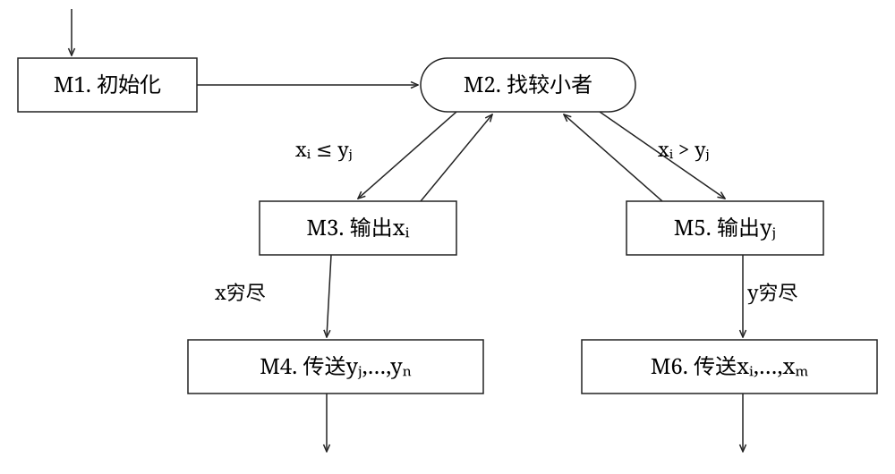
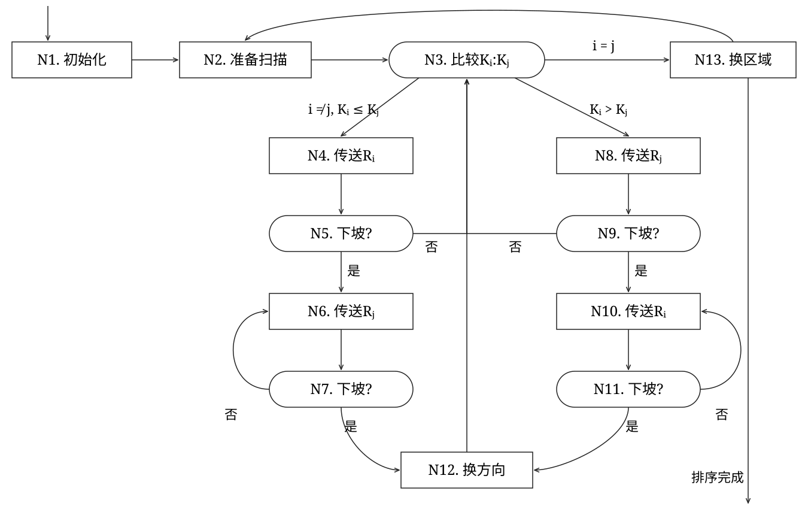
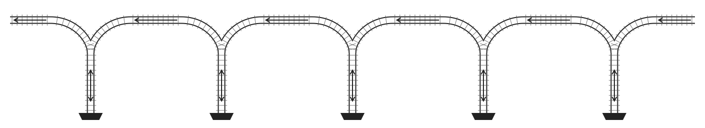

<a id="pdf-129"></a>
<a id="p-123"></a>

<a id="sec-5-2-4"></a>

# 5.2.4　合并排序

组合两个或多个有序文件成为单个有序文件的过程称为合并 (或整理). 例如, 我们可以合并 503 703 765 和 087 512 677 两个文件, 得到 087 503 512 677 703 765. 完成这个过程的一种简单方式是比较两个最小项, 输出较小者, 然后重复同一过程. 从

$$
\left\{\begin{array}{lll}503&703&765\\087&512&677\end{array}\right.
$$

开始, 我们得到

$$
087\quad\left\{\begin{array}{lll}503&703&765\\512&677&\end{array}\right.
$$

然后是

$$
087\quad503\quad\left\{\begin{array}{ll}703&765\\512&677\end{array}\right.
$$

和

$$
087\quad503\quad512\quad\left\{\begin{array}{ll}703&765\\677&\end{array}\right.
$$

等等. 当两个文件之一的项目用尽时, 需要小心一些. 以下算法对这个过程进行详尽描述:

<a id="alg-5-2-4-M"></a>

**算法 M (两路合并).** 算法把非空有序文件 $x_1\le x_2\le\cdots\le x_m$ 和 $y_1\le y_2\le\cdots\le y_n$ 合并为单个文件 $z_1\le z_2\le\cdots\le z_{m+n}$.

**M1.[初始化.]** 置 $i\leftarrow1,\ j\leftarrow1,\ k\leftarrow1$.

**M2.[找较小者.]** 如果 $x_i\le y_j$, 转到 M3, 否则转到 M5.

**M3.[输出 $x_i$.]** 置 $z_k\leftarrow x_i,\ k\leftarrow k+1,\ i\leftarrow i+1$. 如果 $i\le m$, 返回 M2.

**M4.[传送 $y_j,\ldots,y_n$.]** 置 $(z_k,\ldots,z_{m+n})\leftarrow(y_j,\ldots,y_n)$, 终止算法.

**M5.[输出 $y_j$.]** 置 $z_k\leftarrow y_j,\ k\leftarrow k+1,\ j\leftarrow j+1$. 如果 $j\le n$, 返回 M2.

**M6.[传送 $x_i,\ldots,x_m$.]** 置 $(z_k,\ldots,z_{m+n})\leftarrow(x_i,\ldots,x_m)$, 终止算法. ■

<a id="fig-5-29"></a>

<div class="source-tableau-group" style="overflow-x:auto;max-width:100%"><div style="width:1000px">



</div></div>

图 29　合并 $x_1\le\cdots\le x_m$ 和 $y_1\le\cdots\le y_n$

在 5.3.2 节将会看到, 当 $m\approx n$ 时, 这个简单过程基本上就是在普通计算机上进行合并的最佳方式. (而当 $m$ 远小于 $n$ 时, 有可能设计出更为高效的合并算法, 尽管它们通常相当复杂.) 我们可以在不损失多少效率的前提下使算法 M 稍简单些: 在输入文件的末尾放置标识元素 $x_{m+1}=y_{n+1}=\infty$, 在输出 $\infty$ 之前终止算法. 算法 M 的分析见习题 2.

<a id="pdf-130"></a>
<a id="p-124"></a>

算法 M 的总工作量基本上与 $m+n$ 成正比, 因此合并显然要比排序简单些. 而且, 排序问题可以简化为合并问题, 因为我们能重复合并越来越长的子文件, 直到一切都处于有序状态. 这可以看作是插入排序思想的扩展: 向有序文件中插入一个新元素, 就是当 $n=1$ 时的合并特例. 如果希望加快插入过程, 不妨考虑一次插入多个元素, 进行 “批处理”, 这自然导致合并排序的一般思想. 从历史的角度来看, 合并排序是最初的计算机排序法之一. 约翰·冯·诺伊曼早在 1945 年就提出了合并排序 (见 5.5 节).

5.4 节讨论外部排序算法时将详细研究合并排序. 本节主要关注高速随机存储器中相对简单的合并排序问题.

表 1 给出一种合并排序, 它类似于在快速排序和基数交换排序用到的扫描过程, 采用 “蜡炬两头烧” 的方式: 从左右两端考察输入数据, 一起向中间靠拢. 现在暂时忽略表的顶行, 先考虑从第 2 行到第 3 行的转换. 左边有递增游程 503 703 765, 从右向左读有游程 087 512 677. 合并这两个序列得到 087 503 512 677 703 765, 把它放在第 3 行左端. 然后把第 2 行的 061 612 908 与 170 509 897 合并, 结果 (061 170 509 612 897 908) 记录在第 3 行右端. 最后, 154 275 426 653 与 653 合并——我们及时发现了重叠, 没有导致任何伤害——结果放在左侧, 紧跟前一个游程. 表中第 2 行是通过同样方式从第 1 行的原始输入数据生成的.

<a id="tab-5-2-4-1"></a>

表 1　自然的两路合并排序

<div class="source-tableau-group" style="overflow-x:auto;max-width:100%"><div style="width:1152px">

<table data-natural-table="1" style="width:1152px;table-layout:fixed;border-collapse:collapse;font-family:serif"><thead><tr><th style="width:72px;min-width:72px;border:0;padding:0"></th><th style="width:72px;min-width:72px;border:0;padding:0"></th><th style="width:72px;min-width:72px;border:0;padding:0"></th><th style="width:72px;min-width:72px;border:0;padding:0"></th><th style="width:72px;min-width:72px;border:0;padding:0"></th><th style="width:72px;min-width:72px;border:0;padding:0"></th><th style="width:72px;min-width:72px;border:0;padding:0"></th><th style="width:72px;min-width:72px;border:0;padding:0"></th><th style="width:72px;min-width:72px;border:0;padding:0"></th><th style="width:72px;min-width:72px;border:0;padding:0"></th><th style="width:72px;min-width:72px;border:0;padding:0"></th><th style="width:72px;min-width:72px;border:0;padding:0"></th><th style="width:72px;min-width:72px;border:0;padding:0"></th><th style="width:72px;min-width:72px;border:0;padding:0"></th><th style="width:72px;min-width:72px;border:0;padding:0"></th><th style="width:72px;min-width:72px;border:0;padding:0"></th></tr></thead><tbody>
<tr style="background:transparent"><td colspan="16" style="padding:0;border:0;line-height:0"><svg xmlns="http://www.w3.org/2000/svg" width="1152" height="28" viewBox="0 0 1152 28"><defs><marker id="a0True" markerWidth="9" markerHeight="9" refX="8" refY="4.5" orient="auto"><path d="M1 1L8 4.5L1 8" fill="none" stroke="#222"/></marker></defs><path data-run="9-11" d="M789 15H579" fill="none" stroke="#222" stroke-width="1.4" marker-end="url(#a0True)"/><path data-run="12-12" d="M861 15H795" fill="none" stroke="#222" stroke-width="1.4" marker-end="url(#a0True)"/><path data-run="13-13" d="M933 15H867" fill="none" stroke="#222" stroke-width="1.4" marker-end="url(#a0True)"/><path data-run="14-14" d="M1005 15H939" fill="none" stroke="#222" stroke-width="1.4" marker-end="url(#a0True)"/><path data-run="15-16" d="M1149 15H1011" fill="none" stroke="#222" stroke-width="1.4" marker-end="url(#a0True)"/></svg></td></tr>
<tr data-natural-state="0" style="background:transparent"><td data-natural-key="1" style="width:72px;min-width:72px;border:0;border-right:1.4px solid #222;padding:4px 0;text-align:center;font-size:22px">503</td><td data-natural-key="2" style="width:72px;min-width:72px;border:0;padding:4px 0;text-align:center;font-size:22px">087</td><td data-natural-key="3" style="width:72px;min-width:72px;border:0;border-right:1.4px solid #222;padding:4px 0;text-align:center;font-size:22px">512</td><td data-natural-key="4" style="width:72px;min-width:72px;border:0;padding:4px 0;text-align:center;font-size:22px">061</td><td data-natural-key="5" style="width:72px;min-width:72px;border:0;border-right:1.4px solid #222;padding:4px 0;text-align:center;font-size:22px">908</td><td data-natural-key="6" style="width:72px;min-width:72px;border:0;padding:4px 0;text-align:center;font-size:22px">170</td><td data-natural-key="7" style="width:72px;min-width:72px;border:0;border-right:1.4px solid #222;padding:4px 0;text-align:center;font-size:22px">897</td><td data-natural-key="8" style="width:72px;min-width:72px;border:0;padding:4px 0;text-align:center;font-size:22px">275</td><td data-natural-key="9" style="width:72px;min-width:72px;border:0;border-left:1.4px solid #222;border-right:1.4px solid #222;padding:4px 0;text-align:center;font-size:22px">653</td><td data-natural-key="10" style="width:72px;min-width:72px;border:0;padding:4px 0;text-align:center;font-size:22px">426</td><td data-natural-key="11" style="width:72px;min-width:72px;border:0;padding:4px 0;text-align:center;font-size:22px">154</td><td data-natural-key="12" style="width:72px;min-width:72px;border:0;border-left:1.4px solid #222;padding:4px 0;text-align:center;font-size:22px">509</td><td data-natural-key="13" style="width:72px;min-width:72px;border:0;border-left:1.4px solid #222;padding:4px 0;text-align:center;font-size:22px">612</td><td data-natural-key="14" style="width:72px;min-width:72px;border:0;border-left:1.4px solid #222;padding:4px 0;text-align:center;font-size:22px">677</td><td data-natural-key="15" style="width:72px;min-width:72px;border:0;border-left:1.4px solid #222;padding:4px 0;text-align:center;font-size:22px">765</td><td data-natural-key="16" style="width:72px;min-width:72px;border:0;padding:4px 0;text-align:center;font-size:22px">703</td></tr>
<tr style="background:transparent"><td colspan="16" style="padding:0;border:0;line-height:0"><svg xmlns="http://www.w3.org/2000/svg" width="1152" height="28" viewBox="0 0 1152 28"><defs><marker id="a0False" markerWidth="9" markerHeight="9" refX="8" refY="4.5" orient="auto"><path d="M1 1L8 4.5L1 8" fill="none" stroke="#222"/></marker></defs><path data-run="1-1" d="M3 15H69" fill="none" stroke="#222" stroke-width="1.4" marker-end="url(#a0False)"/><path data-run="2-3" d="M75 15H213" fill="none" stroke="#222" stroke-width="1.4" marker-end="url(#a0False)"/><path data-run="4-5" d="M219 15H357" fill="none" stroke="#222" stroke-width="1.4" marker-end="url(#a0False)"/><path data-run="6-7" d="M363 15H501" fill="none" stroke="#222" stroke-width="1.4" marker-end="url(#a0False)"/><path data-run="8-9" d="M507 15H645" fill="none" stroke="#222" stroke-width="1.4" marker-end="url(#a0False)"/></svg></td></tr>
<tr style="background:transparent"><td colspan="16" style="padding:0;border:0;line-height:0"><svg xmlns="http://www.w3.org/2000/svg" width="1152" height="28" viewBox="0 0 1152 28"><defs><marker id="a1True" markerWidth="9" markerHeight="9" refX="8" refY="4.5" orient="auto"><path d="M1 1L8 4.5L1 8" fill="none" stroke="#222"/></marker></defs><path data-run="10-10" d="M717 15H651" fill="none" stroke="#222" stroke-width="1.4" marker-end="url(#a1True)"/><path data-run="11-13" d="M933 15H723" fill="none" stroke="#222" stroke-width="1.4" marker-end="url(#a1True)"/><path data-run="14-16" d="M1149 15H939" fill="none" stroke="#222" stroke-width="1.4" marker-end="url(#a1True)"/></svg></td></tr>
<tr data-natural-state="1" style="background:transparent"><td data-natural-key="1" style="width:72px;min-width:72px;border:0;padding:4px 0;text-align:center;font-size:22px">503</td><td data-natural-key="2" style="width:72px;min-width:72px;border:0;padding:4px 0;text-align:center;font-size:22px">703</td><td data-natural-key="3" style="width:72px;min-width:72px;border:0;border-right:1.4px solid #222;padding:4px 0;text-align:center;font-size:22px">765</td><td data-natural-key="4" style="width:72px;min-width:72px;border:0;padding:4px 0;text-align:center;font-size:22px">061</td><td data-natural-key="5" style="width:72px;min-width:72px;border:0;padding:4px 0;text-align:center;font-size:22px">612</td><td data-natural-key="6" style="width:72px;min-width:72px;border:0;border-right:1.4px solid #222;padding:4px 0;text-align:center;font-size:22px">908</td><td data-natural-key="7" style="width:72px;min-width:72px;border:0;padding:4px 0;text-align:center;font-size:22px">154</td><td data-natural-key="8" style="width:72px;min-width:72px;border:0;padding:4px 0;text-align:center;font-size:22px">275</td><td data-natural-key="9" style="width:72px;min-width:72px;border:0;padding:4px 0;text-align:center;font-size:22px">426</td><td data-natural-key="10" style="width:72px;min-width:72px;border:0;border-left:1.4px solid #222;border-right:1.4px solid #222;padding:4px 0;text-align:center;font-size:22px">653</td><td data-natural-key="11" style="width:72px;min-width:72px;border:0;border-left:1.4px solid #222;padding:4px 0;text-align:center;font-size:22px">897</td><td data-natural-key="12" style="width:72px;min-width:72px;border:0;padding:4px 0;text-align:center;font-size:22px">509</td><td data-natural-key="13" style="width:72px;min-width:72px;border:0;padding:4px 0;text-align:center;font-size:22px">170</td><td data-natural-key="14" style="width:72px;min-width:72px;border:0;border-left:1.4px solid #222;padding:4px 0;text-align:center;font-size:22px">677</td><td data-natural-key="15" style="width:72px;min-width:72px;border:0;padding:4px 0;text-align:center;font-size:22px">512</td><td data-natural-key="16" style="width:72px;min-width:72px;border:0;padding:4px 0;text-align:center;font-size:22px">087</td></tr>
<tr style="background:transparent"><td colspan="16" style="padding:0;border:0;line-height:0"><svg xmlns="http://www.w3.org/2000/svg" width="1152" height="28" viewBox="0 0 1152 28"><defs><marker id="a1False" markerWidth="9" markerHeight="9" refX="8" refY="4.5" orient="auto"><path d="M1 1L8 4.5L1 8" fill="none" stroke="#222"/></marker></defs><path data-run="1-3" d="M3 15H213" fill="none" stroke="#222" stroke-width="1.4" marker-end="url(#a1False)"/><path data-run="4-6" d="M219 15H429" fill="none" stroke="#222" stroke-width="1.4" marker-end="url(#a1False)"/><path data-run="7-10" d="M435 15H717" fill="none" stroke="#222" stroke-width="1.4" marker-end="url(#a1False)"/></svg></td></tr>
<tr style="background:transparent"><td colspan="16" style="padding:0;border:0;line-height:0"><svg xmlns="http://www.w3.org/2000/svg" width="1152" height="28" viewBox="0 0 1152 28"><defs><marker id="a2True" markerWidth="9" markerHeight="9" refX="8" refY="4.5" orient="auto"><path d="M1 1L8 4.5L1 8" fill="none" stroke="#222"/></marker></defs><path data-run="10-10" d="M717 15H651" fill="none" stroke="#222" stroke-width="1.4" marker-end="url(#a2True)"/><path data-run="11-16" d="M1149 15H723" fill="none" stroke="#222" stroke-width="1.4" marker-end="url(#a2True)"/></svg></td></tr>
<tr data-natural-state="2" style="background:transparent"><td data-natural-key="1" style="width:72px;min-width:72px;border:0;padding:4px 0;text-align:center;font-size:22px">087</td><td data-natural-key="2" style="width:72px;min-width:72px;border:0;padding:4px 0;text-align:center;font-size:22px">503</td><td data-natural-key="3" style="width:72px;min-width:72px;border:0;padding:4px 0;text-align:center;font-size:22px">512</td><td data-natural-key="4" style="width:72px;min-width:72px;border:0;padding:4px 0;text-align:center;font-size:22px">677</td><td data-natural-key="5" style="width:72px;min-width:72px;border:0;padding:4px 0;text-align:center;font-size:22px">703</td><td data-natural-key="6" style="width:72px;min-width:72px;border:0;border-right:1.4px solid #222;padding:4px 0;text-align:center;font-size:22px">765</td><td data-natural-key="7" style="width:72px;min-width:72px;border:0;padding:4px 0;text-align:center;font-size:22px">154</td><td data-natural-key="8" style="width:72px;min-width:72px;border:0;padding:4px 0;text-align:center;font-size:22px">275</td><td data-natural-key="9" style="width:72px;min-width:72px;border:0;padding:4px 0;text-align:center;font-size:22px">426</td><td data-natural-key="10" style="width:72px;min-width:72px;border:0;border-left:1.4px solid #222;border-right:1.4px solid #222;padding:4px 0;text-align:center;font-size:22px">653</td><td data-natural-key="11" style="width:72px;min-width:72px;border:0;border-left:1.4px solid #222;padding:4px 0;text-align:center;font-size:22px">908</td><td data-natural-key="12" style="width:72px;min-width:72px;border:0;padding:4px 0;text-align:center;font-size:22px">897</td><td data-natural-key="13" style="width:72px;min-width:72px;border:0;padding:4px 0;text-align:center;font-size:22px">612</td><td data-natural-key="14" style="width:72px;min-width:72px;border:0;padding:4px 0;text-align:center;font-size:22px">509</td><td data-natural-key="15" style="width:72px;min-width:72px;border:0;padding:4px 0;text-align:center;font-size:22px">170</td><td data-natural-key="16" style="width:72px;min-width:72px;border:0;padding:4px 0;text-align:center;font-size:22px">061</td></tr>
<tr style="background:transparent"><td colspan="16" style="padding:0;border:0;line-height:0"><svg xmlns="http://www.w3.org/2000/svg" width="1152" height="28" viewBox="0 0 1152 28"><defs><marker id="a2False" markerWidth="9" markerHeight="9" refX="8" refY="4.5" orient="auto"><path d="M1 1L8 4.5L1 8" fill="none" stroke="#222"/></marker></defs><path data-run="1-6" d="M3 15H429" fill="none" stroke="#222" stroke-width="1.4" marker-end="url(#a2False)"/><path data-run="7-10" d="M435 15H717" fill="none" stroke="#222" stroke-width="1.4" marker-end="url(#a2False)"/></svg></td></tr>
<tr style="background:transparent"><td colspan="16" style="padding:0;border:0;line-height:0"><svg xmlns="http://www.w3.org/2000/svg" width="1152" height="28" viewBox="0 0 1152 28"><defs><marker id="a3True" markerWidth="9" markerHeight="9" refX="8" refY="4.5" orient="auto"><path d="M1 1L8 4.5L1 8" fill="none" stroke="#222"/></marker></defs><path data-run="12-16" d="M1149 15H795" fill="none" stroke="#222" stroke-width="1.4" marker-end="url(#a3True)"/></svg></td></tr>
<tr data-natural-state="3" style="background:transparent"><td data-natural-key="1" style="width:72px;min-width:72px;border:0;padding:4px 0;text-align:center;font-size:22px">061</td><td data-natural-key="2" style="width:72px;min-width:72px;border:0;padding:4px 0;text-align:center;font-size:22px">087</td><td data-natural-key="3" style="width:72px;min-width:72px;border:0;padding:4px 0;text-align:center;font-size:22px">170</td><td data-natural-key="4" style="width:72px;min-width:72px;border:0;padding:4px 0;text-align:center;font-size:22px">503</td><td data-natural-key="5" style="width:72px;min-width:72px;border:0;padding:4px 0;text-align:center;font-size:22px">509</td><td data-natural-key="6" style="width:72px;min-width:72px;border:0;padding:4px 0;text-align:center;font-size:22px">512</td><td data-natural-key="7" style="width:72px;min-width:72px;border:0;padding:4px 0;text-align:center;font-size:22px">612</td><td data-natural-key="8" style="width:72px;min-width:72px;border:0;padding:4px 0;text-align:center;font-size:22px">677</td><td data-natural-key="9" style="width:72px;min-width:72px;border:0;padding:4px 0;text-align:center;font-size:22px">703</td><td data-natural-key="10" style="width:72px;min-width:72px;border:0;padding:4px 0;text-align:center;font-size:22px">765</td><td data-natural-key="11" style="width:72px;min-width:72px;border:0;padding:4px 0;text-align:center;font-size:22px">897</td><td data-natural-key="12" style="width:72px;min-width:72px;border:0;border-left:1.4px solid #222;border-right:1.4px solid #222;padding:4px 0;text-align:center;font-size:22px">908</td><td data-natural-key="13" style="width:72px;min-width:72px;border:0;padding:4px 0;text-align:center;font-size:22px">653</td><td data-natural-key="14" style="width:72px;min-width:72px;border:0;padding:4px 0;text-align:center;font-size:22px">426</td><td data-natural-key="15" style="width:72px;min-width:72px;border:0;padding:4px 0;text-align:center;font-size:22px">275</td><td data-natural-key="16" style="width:72px;min-width:72px;border:0;padding:4px 0;text-align:center;font-size:22px">154</td></tr>
<tr style="background:transparent"><td colspan="16" style="padding:0;border:0;line-height:0"><svg xmlns="http://www.w3.org/2000/svg" width="1152" height="28" viewBox="0 0 1152 28"><defs><marker id="a3False" markerWidth="9" markerHeight="9" refX="8" refY="4.5" orient="auto"><path d="M1 1L8 4.5L1 8" fill="none" stroke="#222"/></marker></defs><path data-run="1-12" d="M3 15H861" fill="none" stroke="#222" stroke-width="1.4" marker-end="url(#a3False)"/></svg></td></tr>
<tr style="background:transparent"><td colspan="16" style="padding:0;border:0;line-height:0"><svg xmlns="http://www.w3.org/2000/svg" width="1152" height="28" viewBox="0 0 1152 28"><defs><marker id="a4True" markerWidth="9" markerHeight="9" refX="8" refY="4.5" orient="auto"><path d="M1 1L8 4.5L1 8" fill="none" stroke="#222"/></marker></defs><path data-run="16-16" d="M1149 15H1083" fill="none" stroke="#222" stroke-width="1.4" marker-end="url(#a4True)"/></svg></td></tr>
<tr data-natural-state="4" style="background:transparent"><td data-natural-key="1" style="width:72px;min-width:72px;border:0;padding:4px 0;text-align:center;font-size:22px">061</td><td data-natural-key="2" style="width:72px;min-width:72px;border:0;padding:4px 0;text-align:center;font-size:22px">087</td><td data-natural-key="3" style="width:72px;min-width:72px;border:0;padding:4px 0;text-align:center;font-size:22px">154</td><td data-natural-key="4" style="width:72px;min-width:72px;border:0;padding:4px 0;text-align:center;font-size:22px">170</td><td data-natural-key="5" style="width:72px;min-width:72px;border:0;padding:4px 0;text-align:center;font-size:22px">275</td><td data-natural-key="6" style="width:72px;min-width:72px;border:0;padding:4px 0;text-align:center;font-size:22px">426</td><td data-natural-key="7" style="width:72px;min-width:72px;border:0;padding:4px 0;text-align:center;font-size:22px">503</td><td data-natural-key="8" style="width:72px;min-width:72px;border:0;padding:4px 0;text-align:center;font-size:22px">509</td><td data-natural-key="9" style="width:72px;min-width:72px;border:0;padding:4px 0;text-align:center;font-size:22px">512</td><td data-natural-key="10" style="width:72px;min-width:72px;border:0;padding:4px 0;text-align:center;font-size:22px">612</td><td data-natural-key="11" style="width:72px;min-width:72px;border:0;padding:4px 0;text-align:center;font-size:22px">653</td><td data-natural-key="12" style="width:72px;min-width:72px;border:0;padding:4px 0;text-align:center;font-size:22px">677</td><td data-natural-key="13" style="width:72px;min-width:72px;border:0;padding:4px 0;text-align:center;font-size:22px">703</td><td data-natural-key="14" style="width:72px;min-width:72px;border:0;padding:4px 0;text-align:center;font-size:22px">765</td><td data-natural-key="15" style="width:72px;min-width:72px;border:0;padding:4px 0;text-align:center;font-size:22px">897</td><td data-natural-key="16" style="width:72px;min-width:72px;border:0;border-left:1.4px solid #222;border-right:1.4px solid #222;padding:4px 0;text-align:center;font-size:22px">908</td></tr>
<tr style="background:transparent"><td colspan="16" style="padding:0;border:0;line-height:0"><svg xmlns="http://www.w3.org/2000/svg" width="1152" height="28" viewBox="0 0 1152 28"><defs><marker id="a4False" markerWidth="9" markerHeight="9" refX="8" refY="4.5" orient="auto"><path d="M1 1L8 4.5L1 8" fill="none" stroke="#222"/></marker></defs><path data-run="1-16" d="M3 15H1149" fill="none" stroke="#222" stroke-width="1.4" marker-end="url(#a4False)"/></svg></td></tr>
</tbody></table>

</div></div>

表 1 中的竖线表示游程之间的边界, 它们是所谓的下坡线, 也就是说, 在阅读方向上, 小元素跟在大元素后面. 在文件的中部从两个方向读到同一个键时会引起歧义, 如果能够像下面算法那样稍微小心一点, 就不会导致什么问题. 这个方法利用了输入数据中自然出现的游程, 所以通常称为 “自然” 合并.


<a id="alg-5-2-4-N"></a>
<a id="pdf-131"></a>
<a id="p-125"></a>

**算法 N (自然两路合并排序).** 使用两个存储区域对记录 $R_1,\ldots,R_N$ 排序, 每个区域都能容纳 $N$ 条记录. 为方便起见, 第二个区域的记录称为 $R_{N+1},\ldots,R_{2N}$, 尽管 $R_{N+1}$ 不必真正与 $R_N$ 相邻. $R_{N+1},\ldots,R_{2N}$ 的初始内容无关紧要. 排序完成后这些键将处于有序状态: $K_1\le\cdots\le K_N$.

**N1.[初始化.]** 置 $s\leftarrow0$. (当 $s=0$ 时, 我们把 $(R_1,\ldots,R_N)$ 区域的记录变换到 $(R_{N+1},\ldots,R_{2N})$ 区域; 当 $s=1$ 时, 进行反向操作.)

**N2.[准备扫描.]** 如果 $s=0$, 置 $i\leftarrow1,j\leftarrow N,k\leftarrow N+1,l\leftarrow2N$; 如果 $s=1$, 置 $i\leftarrow N+1,j\leftarrow2N,k\leftarrow1,l\leftarrow N$. (变量 $i,j,k,l$ 指向所读 “源文件” 及所写 “目标文件” 的当前位置.) 置 $d\leftarrow1,f\leftarrow1$. (变量 $d$ 指明输出的当前方向. 如有必要进行后续扫描, 则把 $f$ 置为 0.)

**N3.[比较 $K_i:K_j$.]** 如果 $K_i>K_j$, 转到 N8. 如果 $i=j$, 置 $R_k\leftarrow R_i$, 转到 N13.

**N4.[传送 $R_i$.]**(N4–N7 类似于算法 M 的 M3–M4.) 置 $R_k\leftarrow R_i,\ k\leftarrow k+d$.

**N5.[下坡?]** $i$ 增 1. 如果 $K_{i-1}\le K_i$, 返回 N3.

**N6.[传送 $R_j$.]** 置 $R_k\leftarrow R_j,\ k\leftarrow k+d$.

**N7.[下坡?]** $j$ 减 1. 如果 $K_{j+1}\le K_j$, 返回 N6; 否则转到 N12.

**N8.[传送 $R_j$.]**(N8–N11 对应于 N4–N7.) 置 $R_k\leftarrow R_j,\ k\leftarrow k+d$.

**N9.[下坡?]** $j$ 减 1. 如果 $K_{j+1}\le K_j$, 返回 N3.

**N10.[传送 $R_i$.]** 置 $R_k\leftarrow R_i,\ k\leftarrow k+d$.

**N11.[下坡?]** $i$ 增 1. 如果 $K_{i-1}\le K_i$, 返回 N10.

**N12.[换方向.]** 置 $f\leftarrow0,d\leftarrow-d$, 交换 $k\leftrightarrow l$, 返回 N3.

**N13.[换区域.]** 如果 $f=0$, 置 $s\leftarrow1-s$, 返回 N2. 否则排序完成: 如果 $s=0$, 置 $(R_1,\ldots,R_N)\leftarrow(R_{N+1},\ldots,R_{2N})$. (如果能接受约有一半时间输出位于 $(R_{N+1},\ldots,R_{2N})$, 就不需要最后的复制操作.) ■


<a id="fig-5-30"></a>

<div class="source-tableau-group" style="overflow-x:auto;max-width:100%"><div style="width:1350px">



</div></div>

图 30　合并排序

算法包含一个很有技巧的特性, 习题 5 给出了解释.

<a id="pdf-132"></a>
<a id="p-126"></a>

为算法 N 编写 MIX 程序并不困难, 不过, 我们不需要构建整个程序就可以推测其特性的基本事实. 在随机条件下, $K_i>K_{i+1}$ 的概率是 $\tfrac12$, 所以输入数据中的递增游程数大约是 $\tfrac12N$. 根据稍有不同的假设, 5.1.3 节已经推导了有关游程数的详细信息. 每遍扫描减少一半游程数 (像习题 6 那样的罕见情况除外), 所以扫描遍数通常大约是 $\lg\tfrac12N=\lg N-1$. 每遍扫描都需要传送全部 $N$ 条记录, 根据习题 2 可知, 大多数时间花费在步骤 N3、N4、N5、N8、N9. 如果假定出现相等键的概率很低, 可以估算内层循环的时间如下:

<table><thead><tr><th></th><th>步骤</th><th>操作</th><th>时间</th></tr></thead><tbody><tr><td></td><td>N3</td><td><code>CMPA, JG, JE</code></td><td>$3.5u$</td></tr><tr><td rowspan="2">或者</td><td>N4</td><td><code>STA, INC</code></td><td>$3u$</td></tr><tr><td>N5</td><td><code>INC, LDA, CMPA, JGE</code></td><td>$6u$</td></tr><tr><td rowspan="2">或者</td><td>N8</td><td><code>STX, INC</code></td><td>$3u$</td></tr><tr><td>N9</td><td><code>DEC, LDX, CMPX, JGE</code></td><td>$6u$</td></tr></tbody></table>

于是每遍扫描中每条记录大约花费 $12.5u$, 对于平均情形和最差情形, 总运行时间都是渐近于 $12.5N\lg N$. 这稍慢于快速排序的平均时间, 相对于堆排序的优势也不足以构成占用两倍存储空间的正当理由, 因为程序 5.2.3H 的渐近运行时间绝不会超过 $18N\lg N$.


算法 N 中游程之间的边界线完全由 “下坡” 确定. 这可能成为一种优势: 以递增或递减顺序为主的输入文件可以非常快速地得到处理, 但它会拖慢主循环的速度. 我们也可以不去测试 “下坡” 的存在, 而是人为规定游程的长度. 比如说规定: 初始输入数据中所有游程的长度都是 1, 第一遍扫描之后所有游程的长度都是 2 (最后一个游程可能例外), ……, 第 $k$ 遍扫描之后所有游程的长度都是 $2^k$ (最后一个游程可能例外). 这种方法称为直接两路合并, 以与算法 N 中的 “自然” 合并相区分.

直接两路合并非常类似于算法 N, 它们的流程图基本相同, 具体操作内容却有很大不同, 最好还是再次写出整个算法:

<a id="alg-5-2-4-S"></a>

**算法 S (直接两路合并排序).** 和算法 N 一样, 使用两个存储区域对记录 $R_1,\ldots,R_N$ 排序.

**S1.[初始化.]** 置 $s\leftarrow0,p\leftarrow1$. (变量 $s,i,j,k,l,d$ 的意义见算法 N. 这里 $p$ 表示当前扫描中有待合并的递增游程的大小, 变量 $q$ 和 $r$ 跟踪一个游程中未合并的项目数.)

**S2.[准备扫描.]** 如果 $s=0$, 置 $i\leftarrow1,j\leftarrow N,k\leftarrow N,l\leftarrow2N+1$; 如果 $s=1$, 置 $i\leftarrow N+1,j\leftarrow2N,k\leftarrow0,l\leftarrow N+1$. 然后置 $d\leftarrow1,q\leftarrow p,r\leftarrow p$.

**S3.[比较 $K_i:K_j$.]** 如果 $K_i>K_j$, 转到 S8.

**S4.[传送 $R_i$.]** 置 $k\leftarrow k+d,R_k\leftarrow R_i$.

**S5.[游程结束?]** 置 $i\leftarrow i+1,q\leftarrow q-1$. 如果 $q>0$, 返回 S3.

**S6.[传送 $R_j$.]** 置 $k\leftarrow k+d$. 如果 $k=l$, 转到 S13; 否则置 $R_k\leftarrow R_j$.

**S7.[游程结束?]** 置 $j\leftarrow j-1,r\leftarrow r-1$. 如果 $r>0$, 返回 S6; 否则转到 S12.

**S8.[传送 $R_j$.]** 置 $k\leftarrow k+d,R_k\leftarrow R_j$.

**S9.[游程结束?]** 置 $j\leftarrow j-1,r\leftarrow r-1$. 如果 $r>0$, 返回 S3.

**S10.[传送 $R_i$.]** 置 $k\leftarrow k+d$. 如果 $k=l$, 转到 S13; 否则置 $R_k\leftarrow R_i$.

**S11.[游程结束?]** 置 $i\leftarrow i+1,q\leftarrow q-1$. 如果 $q>0$, 返回 S10.

**S12.[换方向.]** 置 $q\leftarrow p,r\leftarrow p,d\leftarrow-d$, 交换 $k\leftrightarrow l$. 如果 $j-i<p$, 返回 S10; 否则返回 S3.

**S13.[换区域.]** 置 $p\leftarrow p+p$. 如果 $p<N$, 置 $s\leftarrow1-s$, 返回 S2. 否则排序完成: 如果 $s=0$, 置 $(R_1,\ldots,R_N)\leftarrow(R_{N+1},\ldots,R_{2N})$. (当且仅当 $\lceil\lg N\rceil$ 是奇数或 $N=1$ 的平凡情形, 才执行最后的复制操作. 这与输入数据的分布无关, 因此有可能提前预测排序输出的位置, 从而避免复制.) ■

<a id="pdf-133"></a>
<a id="p-127"></a>

表 2 给出算法的示例. 令人惊奇的是: $N$ 不是 2 的幂时这个方法也能很好地工作, 被合并游程的长度并不都是 $2^k$, 对这些例外情形还没有明文规定! (见习题 8.) 以前关于 “下坡” 的测试已经被递减 $q$ 或 $r$ 并判断结果是否为 0 所代替, 这就把 MIX 的渐近运行时间缩短为 $11N\lg N$ 单位, 稍快于算法 N 能够达到的速度.

<a id="tab-5-2-4-2"></a>

表 2　直接两路合并排序

<table data-straight-table="2" style="border-collapse:collapse;table-layout:fixed;width:1024px;font-family:serif"><thead><tr><th style="width:64px;min-width:64px;border:0;padding:0"></th><th style="width:64px;min-width:64px;border:0;padding:0"></th><th style="width:64px;min-width:64px;border:0;padding:0"></th><th style="width:64px;min-width:64px;border:0;padding:0"></th><th style="width:64px;min-width:64px;border:0;padding:0"></th><th style="width:64px;min-width:64px;border:0;padding:0"></th><th style="width:64px;min-width:64px;border:0;padding:0"></th><th style="width:64px;min-width:64px;border:0;padding:0"></th><th style="width:64px;min-width:64px;border:0;padding:0"></th><th style="width:64px;min-width:64px;border:0;padding:0"></th><th style="width:64px;min-width:64px;border:0;padding:0"></th><th style="width:64px;min-width:64px;border:0;padding:0"></th><th style="width:64px;min-width:64px;border:0;padding:0"></th><th style="width:64px;min-width:64px;border:0;padding:0"></th><th style="width:64px;min-width:64px;border:0;padding:0"></th><th style="width:64px;min-width:64px;border:0;padding:0"></th></tr></thead><tbody>
<tr data-straight-state="0" style="background:transparent"><td style="width:64px;min-width:64px;border:0;border-right:1px solid #222;padding:8px 0;text-align:center;font-size:21px">503</td><td style="width:64px;min-width:64px;border:0;border-right:1px solid #222;padding:8px 0;text-align:center;font-size:21px">087</td><td style="width:64px;min-width:64px;border:0;border-right:1px solid #222;padding:8px 0;text-align:center;font-size:21px">512</td><td style="width:64px;min-width:64px;border:0;border-right:1px solid #222;padding:8px 0;text-align:center;font-size:21px">061</td><td style="width:64px;min-width:64px;border:0;border-right:1px solid #222;padding:8px 0;text-align:center;font-size:21px">908</td><td style="width:64px;min-width:64px;border:0;border-right:1px solid #222;padding:8px 0;text-align:center;font-size:21px">170</td><td style="width:64px;min-width:64px;border:0;border-right:1px solid #222;padding:8px 0;text-align:center;font-size:21px">897</td><td style="width:64px;min-width:64px;border:0;border-right:5px solid #222;padding:8px 0;text-align:center;font-size:21px">275</td><td style="width:64px;min-width:64px;border:0;border-right:1px solid #222;padding:8px 0;text-align:center;font-size:21px">653</td><td style="width:64px;min-width:64px;border:0;border-right:1px solid #222;padding:8px 0;text-align:center;font-size:21px">426</td><td style="width:64px;min-width:64px;border:0;border-right:1px solid #222;padding:8px 0;text-align:center;font-size:21px">154</td><td style="width:64px;min-width:64px;border:0;border-right:1px solid #222;padding:8px 0;text-align:center;font-size:21px">509</td><td style="width:64px;min-width:64px;border:0;border-right:1px solid #222;padding:8px 0;text-align:center;font-size:21px">612</td><td style="width:64px;min-width:64px;border:0;border-right:1px solid #222;padding:8px 0;text-align:center;font-size:21px">677</td><td style="width:64px;min-width:64px;border:0;border-right:1px solid #222;padding:8px 0;text-align:center;font-size:21px">765</td><td style="width:64px;min-width:64px;border:0;padding:8px 0;text-align:center;font-size:21px">703</td></tr>
<tr data-straight-state="1" style="background:transparent"><td style="width:64px;min-width:64px;border:0;padding:8px 0;text-align:center;font-size:21px">503</td><td style="width:64px;min-width:64px;border:0;border-right:1px solid #222;padding:8px 0;text-align:center;font-size:21px">703</td><td style="width:64px;min-width:64px;border:0;padding:8px 0;text-align:center;font-size:21px">512</td><td style="width:64px;min-width:64px;border:0;border-right:1px solid #222;padding:8px 0;text-align:center;font-size:21px">677</td><td style="width:64px;min-width:64px;border:0;padding:8px 0;text-align:center;font-size:21px">509</td><td style="width:64px;min-width:64px;border:0;border-right:1px solid #222;padding:8px 0;text-align:center;font-size:21px">908</td><td style="width:64px;min-width:64px;border:0;padding:8px 0;text-align:center;font-size:21px">426</td><td style="width:64px;min-width:64px;border:0;border-right:5px solid #222;padding:8px 0;text-align:center;font-size:21px">897</td><td style="width:64px;min-width:64px;border:0;padding:8px 0;text-align:center;font-size:21px">653</td><td style="width:64px;min-width:64px;border:0;border-right:1px solid #222;padding:8px 0;text-align:center;font-size:21px">275</td><td style="width:64px;min-width:64px;border:0;padding:8px 0;text-align:center;font-size:21px">170</td><td style="width:64px;min-width:64px;border:0;border-right:1px solid #222;padding:8px 0;text-align:center;font-size:21px">154</td><td style="width:64px;min-width:64px;border:0;padding:8px 0;text-align:center;font-size:21px">612</td><td style="width:64px;min-width:64px;border:0;border-right:1px solid #222;padding:8px 0;text-align:center;font-size:21px">061</td><td style="width:64px;min-width:64px;border:0;padding:8px 0;text-align:center;font-size:21px">765</td><td style="width:64px;min-width:64px;border:0;padding:8px 0;text-align:center;font-size:21px">087</td></tr>
<tr data-straight-state="2" style="background:transparent"><td style="width:64px;min-width:64px;border:0;padding:8px 0;text-align:center;font-size:21px">087</td><td style="width:64px;min-width:64px;border:0;padding:8px 0;text-align:center;font-size:21px">503</td><td style="width:64px;min-width:64px;border:0;padding:8px 0;text-align:center;font-size:21px">703</td><td style="width:64px;min-width:64px;border:0;border-right:1px solid #222;padding:8px 0;text-align:center;font-size:21px">765</td><td style="width:64px;min-width:64px;border:0;padding:8px 0;text-align:center;font-size:21px">154</td><td style="width:64px;min-width:64px;border:0;padding:8px 0;text-align:center;font-size:21px">170</td><td style="width:64px;min-width:64px;border:0;padding:8px 0;text-align:center;font-size:21px">509</td><td style="width:64px;min-width:64px;border:0;border-right:5px solid #222;padding:8px 0;text-align:center;font-size:21px">908</td><td style="width:64px;min-width:64px;border:0;padding:8px 0;text-align:center;font-size:21px">897</td><td style="width:64px;min-width:64px;border:0;padding:8px 0;text-align:center;font-size:21px">653</td><td style="width:64px;min-width:64px;border:0;padding:8px 0;text-align:center;font-size:21px">426</td><td style="width:64px;min-width:64px;border:0;border-right:1px solid #222;padding:8px 0;text-align:center;font-size:21px">275</td><td style="width:64px;min-width:64px;border:0;padding:8px 0;text-align:center;font-size:21px">677</td><td style="width:64px;min-width:64px;border:0;padding:8px 0;text-align:center;font-size:21px">612</td><td style="width:64px;min-width:64px;border:0;padding:8px 0;text-align:center;font-size:21px">512</td><td style="width:64px;min-width:64px;border:0;padding:8px 0;text-align:center;font-size:21px">061</td></tr>
<tr data-straight-state="3" style="background:transparent"><td style="width:64px;min-width:64px;border:0;padding:8px 0;text-align:center;font-size:21px">061</td><td style="width:64px;min-width:64px;border:0;padding:8px 0;text-align:center;font-size:21px">087</td><td style="width:64px;min-width:64px;border:0;padding:8px 0;text-align:center;font-size:21px">503</td><td style="width:64px;min-width:64px;border:0;padding:8px 0;text-align:center;font-size:21px">512</td><td style="width:64px;min-width:64px;border:0;padding:8px 0;text-align:center;font-size:21px">612</td><td style="width:64px;min-width:64px;border:0;padding:8px 0;text-align:center;font-size:21px">677</td><td style="width:64px;min-width:64px;border:0;padding:8px 0;text-align:center;font-size:21px">703</td><td style="width:64px;min-width:64px;border:0;border-right:5px solid #222;padding:8px 0;text-align:center;font-size:21px">765</td><td style="width:64px;min-width:64px;border:0;padding:8px 0;text-align:center;font-size:21px">908</td><td style="width:64px;min-width:64px;border:0;padding:8px 0;text-align:center;font-size:21px">897</td><td style="width:64px;min-width:64px;border:0;padding:8px 0;text-align:center;font-size:21px">653</td><td style="width:64px;min-width:64px;border:0;padding:8px 0;text-align:center;font-size:21px">509</td><td style="width:64px;min-width:64px;border:0;padding:8px 0;text-align:center;font-size:21px">426</td><td style="width:64px;min-width:64px;border:0;padding:8px 0;text-align:center;font-size:21px">275</td><td style="width:64px;min-width:64px;border:0;padding:8px 0;text-align:center;font-size:21px">170</td><td style="width:64px;min-width:64px;border:0;padding:8px 0;text-align:center;font-size:21px">154</td></tr>
<tr data-straight-state="4" style="background:transparent"><td style="width:64px;min-width:64px;border:0;padding:8px 0;text-align:center;font-size:21px">061</td><td style="width:64px;min-width:64px;border:0;padding:8px 0;text-align:center;font-size:21px">087</td><td style="width:64px;min-width:64px;border:0;padding:8px 0;text-align:center;font-size:21px">154</td><td style="width:64px;min-width:64px;border:0;padding:8px 0;text-align:center;font-size:21px">170</td><td style="width:64px;min-width:64px;border:0;padding:8px 0;text-align:center;font-size:21px">275</td><td style="width:64px;min-width:64px;border:0;padding:8px 0;text-align:center;font-size:21px">426</td><td style="width:64px;min-width:64px;border:0;padding:8px 0;text-align:center;font-size:21px">503</td><td style="width:64px;min-width:64px;border:0;padding:8px 0;text-align:center;font-size:21px">509</td><td style="width:64px;min-width:64px;border:0;padding:8px 0;text-align:center;font-size:21px">512</td><td style="width:64px;min-width:64px;border:0;padding:8px 0;text-align:center;font-size:21px">612</td><td style="width:64px;min-width:64px;border:0;padding:8px 0;text-align:center;font-size:21px">653</td><td style="width:64px;min-width:64px;border:0;padding:8px 0;text-align:center;font-size:21px">677</td><td style="width:64px;min-width:64px;border:0;padding:8px 0;text-align:center;font-size:21px">703</td><td style="width:64px;min-width:64px;border:0;padding:8px 0;text-align:center;font-size:21px">765</td><td style="width:64px;min-width:64px;border:0;padding:8px 0;text-align:center;font-size:21px">897</td><td style="width:64px;min-width:64px;border:0;padding:8px 0;text-align:center;font-size:21px">908</td></tr>
</tbody></table>

在实践中值得把算法 S 与直接插入结合起来. 我们可以用直接插入来排序 16 个项目的各组, 代替算法 S 的前四次扫描, 从而避免短合并造成相对浪费的簿记操作. 如同快速排序中看到的, 这种方法组合不会影响渐近运行时间, 却能提供一定的改进.

现在从数据结构的角度来研究算法 N 和算法 S. 为什么需要 $2N$ 个记录单元而不是 $N$ 个呢? 理由相当简单: 我们要处理四个可变大小的列表 (每遍扫描会有两个源列表和两个目标列表), 对于每一对顺序分配的列表, 使用 2.2.2 节讨论的标准的 “一起生长” 思想. 但有一半的存储空间总是没有用到, 稍加思索就会想到, 实际上应该对这四个列表使用链接分配. 如果向这 $N$ 条记录的每一条都添加一个链接字段, 就可以使用简单的链接操作来完成合并算法所需要的一切, 根本就不需要移动记录! 除非计算机存储器特别擅长顺序读写, 添加 $N$ 个链接字段通常要优于另外添加 $N$ 条记录所需要的空间, 减少记录移动也会节省时间. 因此, 我们也应当考虑下面这样的合并算法:


<a id="alg-5-2-4-L"></a>
<a id="pdf-134"></a>
<a id="p-128"></a>

**算法 L (列表合并排序).** 假定记录 $R_1,\ldots,R_N$ 包含键 $K_1,\ldots,K_N$ 和能够存储数值 $-(N+1)$ 到 $(N+1)$ 的链接字段 $L_1,\ldots,L_N$. 在文件开头与结尾的虚拟记录 $R_0$ 和 $R_{N+1}$ 中, 有两个辅助链接字段 $L_0$ 和 $L_{N+1}$. 本算法是一种 “列表排序”, 它设定链接字段, 把记录按递增顺序链接在一起. 排序完成后, $L_0$ 是拥有最小键的记录的下标, 而 $L_k\ (1\le k\le N)$ 是跟在 $R_k$ 后面的记录的下标, 如果 $R_k$ 是拥有最大键的记录, 则 $L_k=0$. (见式 5.2.1–(13).)

算法中 $R_0$ 和 $R_{N+1}$ 用作两个线性列表的列表头, 它们的子列表将被合并. 负链接表示有序子列表的末端, 零链接表示整个列表的末端. 假定 $N\ge2$.

记号 $|L_s|\leftarrow p$ 表示 “把 $L_s$ 置为 $p$ 或 $-p$, 保留 $L_s$ 原来的符号”. 这个运算非常适合于 MIX, 可惜并不适合大多数计算机. 可以采用直接方式修改算法, 得到一种对于大多数其他机器都同样高效的方法.

**L1.[准备两个列表.]** 置 $L_0\leftarrow1,\ L_{N+1}\leftarrow2,\ L_i\leftarrow-(i+2)\ (1\le i\le N-2),\ L_{N-1}\leftarrow L_N\leftarrow0$. (我们建立了包含 $R_1,R_3,R_5,\ldots$ 和 $R_2,R_4,R_6,\ldots$ 的两个列表, 负链接表示每个有序子列表仅包含一个元素. 利用初始数据中可能存在的顺序, 可以用另外一种方式完成这个步骤, 见习题 12.)

**L2.[开始新扫描.]** 置 $s\leftarrow0,t\leftarrow N+1,p\leftarrow L_s,q\leftarrow L_t$. 如果 $q=0$, 算法终止. (每遍扫描期间 $p$ 和 $q$ 遍历被合并的列表, $s$ 通常指向当前子列表中最近处理的记录, $t$ 指向上一个输出子列表的末端.)

**L3.[比较 $K_p:K_q$.]** 如果 $K_p>K_q$, 转到 L6.

**L4.[推进 $p$.]** 置 $|L_s|\leftarrow p,s\leftarrow p,p\leftarrow L_p$. 如果 $p>0$, 返回 L3.

**L5.[完成子列表.]** 置 $L_s\leftarrow q,s\leftarrow t$. 然后置 $t\leftarrow q,q\leftarrow L_q$, 重复执行一次或多次, 直到 $q\le0$. 最后转到 L8.

**L6.[推进 $q$.]**(L6–L7 对应于 L4–L5.) 置 $|L_s|\leftarrow q,s\leftarrow q,q\leftarrow L_q$. 如果 $q>0$, 返回 L3.

**L7.[完成子列表.]** 置 $L_s\leftarrow p,s\leftarrow t$. 然后置 $t\leftarrow p,p\leftarrow L_p$, 重复执行一次或多次, 直到 $p\le0$.

**L8.[结束扫描?]**(这时两个指针都已经移到各自子列表的末端, 所以有 $p\le0$ 和 $q\le0$.) 置 $p\leftarrow-p,q\leftarrow-q$. 如果 $q=0$, 置 $|L_s|\leftarrow p,|L_t|\leftarrow0$, 并返回 L2. 否则返回 L3. ■


表 3 给出执行算法的一个实例, 表中列出了每次遇到步骤 L2 时的链接设置. 可以用习题 5.2–12 的方法在算法的末尾重排记录 $R_1,\ldots,R_N$, 使它们的键有序. 列表合并与稀疏多项式加法 (见算法 2.2.4A) 之间有着重要的相似性.

<a id="tab-5-2-4-3"></a>

表 3　列表合并排序

<table data-link-table="3" style="border-collapse:collapse;table-layout:fixed;width:1224px;font-family:serif"><thead><tr><th style="width:72px;min-width:72px;border:0;padding:5px 0">$j$</th><th style="width:64px;min-width:64px;border:0;padding:5px 0">0</th><th style="width:64px;min-width:64px;border:0;padding:5px 0">1</th><th style="width:64px;min-width:64px;border:0;padding:5px 0">2</th><th style="width:64px;min-width:64px;border:0;padding:5px 0">3</th><th style="width:64px;min-width:64px;border:0;padding:5px 0">4</th><th style="width:64px;min-width:64px;border:0;padding:5px 0">5</th><th style="width:64px;min-width:64px;border:0;padding:5px 0">6</th><th style="width:64px;min-width:64px;border:0;padding:5px 0">7</th><th style="width:64px;min-width:64px;border:0;padding:5px 0">8</th><th style="width:64px;min-width:64px;border:0;padding:5px 0">9</th><th style="width:64px;min-width:64px;border:0;padding:5px 0">10</th><th style="width:64px;min-width:64px;border:0;padding:5px 0">11</th><th style="width:64px;min-width:64px;border:0;padding:5px 0">12</th><th style="width:64px;min-width:64px;border:0;padding:5px 0">13</th><th style="width:64px;min-width:64px;border:0;padding:5px 0">14</th><th style="width:64px;min-width:64px;border:0;padding:5px 0">15</th><th style="width:64px;min-width:64px;border:0;padding:5px 0">16</th><th style="width:64px;min-width:64px;border:0;padding:5px 0">17</th></tr></thead><tbody>
<tr style="background:transparent"><td style="border:0;border-top:1px solid #222;text-align:center;padding:5px 0">$K_j$</td><td style="border:0;border-top:1px solid #222;text-align:center;padding:5px 0">−</td><td style="border:0;border-top:1px solid #222;text-align:center;padding:5px 0">503</td><td style="border:0;border-top:1px solid #222;text-align:center;padding:5px 0">087</td><td style="border:0;border-top:1px solid #222;text-align:center;padding:5px 0">512</td><td style="border:0;border-top:1px solid #222;text-align:center;padding:5px 0">061</td><td style="border:0;border-top:1px solid #222;text-align:center;padding:5px 0">908</td><td style="border:0;border-top:1px solid #222;text-align:center;padding:5px 0">170</td><td style="border:0;border-top:1px solid #222;text-align:center;padding:5px 0">897</td><td style="border:0;border-top:1px solid #222;text-align:center;padding:5px 0">275</td><td style="border:0;border-top:1px solid #222;text-align:center;padding:5px 0">653</td><td style="border:0;border-top:1px solid #222;text-align:center;padding:5px 0">426</td><td style="border:0;border-top:1px solid #222;text-align:center;padding:5px 0">154</td><td style="border:0;border-top:1px solid #222;text-align:center;padding:5px 0">509</td><td style="border:0;border-top:1px solid #222;text-align:center;padding:5px 0">612</td><td style="border:0;border-top:1px solid #222;text-align:center;padding:5px 0">677</td><td style="border:0;border-top:1px solid #222;text-align:center;padding:5px 0">765</td><td style="border:0;border-top:1px solid #222;text-align:center;padding:5px 0">703</td><td style="border:0;border-top:1px solid #222;text-align:center;padding:5px 0">−</td></tr>
<tr data-link-state="0" style="background:transparent"><td style="border:0;text-align:center;padding:5px 0">$L_j$</td><td data-link-value="1" style="width:64px;min-width:64px;border:0;text-align:center;padding:5px 0;font-size:21px">1</td><td data-link-value="1" style="width:64px;min-width:64px;border:0;text-align:center;padding:5px 0;font-size:21px">−3</td><td data-link-value="1" style="width:64px;min-width:64px;border:0;text-align:center;padding:5px 0;font-size:21px">−4</td><td data-link-value="1" style="width:64px;min-width:64px;border:0;text-align:center;padding:5px 0;font-size:21px">−5</td><td data-link-value="1" style="width:64px;min-width:64px;border:0;text-align:center;padding:5px 0;font-size:21px">−6</td><td data-link-value="1" style="width:64px;min-width:64px;border:0;text-align:center;padding:5px 0;font-size:21px">−7</td><td data-link-value="1" style="width:64px;min-width:64px;border:0;text-align:center;padding:5px 0;font-size:21px">−8</td><td data-link-value="1" style="width:64px;min-width:64px;border:0;text-align:center;padding:5px 0;font-size:21px">−9</td><td data-link-value="1" style="width:64px;min-width:64px;border:0;text-align:center;padding:5px 0;font-size:21px">−10</td><td data-link-value="1" style="width:64px;min-width:64px;border:0;text-align:center;padding:5px 0;font-size:21px">−11</td><td data-link-value="1" style="width:64px;min-width:64px;border:0;text-align:center;padding:5px 0;font-size:21px">−12</td><td data-link-value="1" style="width:64px;min-width:64px;border:0;text-align:center;padding:5px 0;font-size:21px">−13</td><td data-link-value="1" style="width:64px;min-width:64px;border:0;text-align:center;padding:5px 0;font-size:21px">−14</td><td data-link-value="1" style="width:64px;min-width:64px;border:0;text-align:center;padding:5px 0;font-size:21px">−15</td><td data-link-value="1" style="width:64px;min-width:64px;border:0;text-align:center;padding:5px 0;font-size:21px">−16</td><td data-link-value="1" style="width:64px;min-width:64px;border:0;text-align:center;padding:5px 0;font-size:21px">0</td><td data-link-value="1" style="width:64px;min-width:64px;border:0;text-align:center;padding:5px 0;font-size:21px">0</td><td data-link-value="1" style="width:64px;min-width:64px;border:0;text-align:center;padding:5px 0;font-size:21px">2</td></tr>
<tr data-link-state="1" style="background:transparent"><td style="border:0;text-align:center;padding:5px 0">$L_j$</td><td data-link-value="1" style="width:64px;min-width:64px;border:0;text-align:center;padding:5px 0;font-size:21px">2</td><td data-link-value="1" style="width:64px;min-width:64px;border:0;text-align:center;padding:5px 0;font-size:21px">−6</td><td data-link-value="1" style="width:64px;min-width:64px;border:0;text-align:center;padding:5px 0;font-size:21px">1</td><td data-link-value="1" style="width:64px;min-width:64px;border:0;text-align:center;padding:5px 0;font-size:21px">−8</td><td data-link-value="1" style="width:64px;min-width:64px;border:0;text-align:center;padding:5px 0;font-size:21px">3</td><td data-link-value="1" style="width:64px;min-width:64px;border:0;text-align:center;padding:5px 0;font-size:21px">−10</td><td data-link-value="1" style="width:64px;min-width:64px;border:0;text-align:center;padding:5px 0;font-size:21px">5</td><td data-link-value="1" style="width:64px;min-width:64px;border:0;text-align:center;padding:5px 0;font-size:21px">−11</td><td data-link-value="1" style="width:64px;min-width:64px;border:0;text-align:center;padding:5px 0;font-size:21px">7</td><td data-link-value="1" style="width:64px;min-width:64px;border:0;text-align:center;padding:5px 0;font-size:21px">−13</td><td data-link-value="1" style="width:64px;min-width:64px;border:0;text-align:center;padding:5px 0;font-size:21px">9</td><td data-link-value="1" style="width:64px;min-width:64px;border:0;text-align:center;padding:5px 0;font-size:21px">12</td><td data-link-value="1" style="width:64px;min-width:64px;border:0;text-align:center;padding:5px 0;font-size:21px">−16</td><td data-link-value="1" style="width:64px;min-width:64px;border:0;text-align:center;padding:5px 0;font-size:21px">14</td><td data-link-value="1" style="width:64px;min-width:64px;border:0;text-align:center;padding:5px 0;font-size:21px">0</td><td data-link-value="1" style="width:64px;min-width:64px;border:0;text-align:center;padding:5px 0;font-size:21px">0</td><td data-link-value="1" style="width:64px;min-width:64px;border:0;text-align:center;padding:5px 0;font-size:21px">15</td><td data-link-value="1" style="width:64px;min-width:64px;border:0;text-align:center;padding:5px 0;font-size:21px">4</td></tr>
<tr data-link-state="2" style="background:transparent"><td style="border:0;text-align:center;padding:5px 0">$L_j$</td><td data-link-value="1" style="width:64px;min-width:64px;border:0;text-align:center;padding:5px 0;font-size:21px">4</td><td data-link-value="1" style="width:64px;min-width:64px;border:0;text-align:center;padding:5px 0;font-size:21px">3</td><td data-link-value="1" style="width:64px;min-width:64px;border:0;text-align:center;padding:5px 0;font-size:21px">1</td><td data-link-value="1" style="width:64px;min-width:64px;border:0;text-align:center;padding:5px 0;font-size:21px">−11</td><td data-link-value="1" style="width:64px;min-width:64px;border:0;text-align:center;padding:5px 0;font-size:21px">2</td><td data-link-value="1" style="width:64px;min-width:64px;border:0;text-align:center;padding:5px 0;font-size:21px">−13</td><td data-link-value="1" style="width:64px;min-width:64px;border:0;text-align:center;padding:5px 0;font-size:21px">8</td><td data-link-value="1" style="width:64px;min-width:64px;border:0;text-align:center;padding:5px 0;font-size:21px">5</td><td data-link-value="1" style="width:64px;min-width:64px;border:0;text-align:center;padding:5px 0;font-size:21px">7</td><td data-link-value="1" style="width:64px;min-width:64px;border:0;text-align:center;padding:5px 0;font-size:21px">0</td><td data-link-value="1" style="width:64px;min-width:64px;border:0;text-align:center;padding:5px 0;font-size:21px">12</td><td data-link-value="1" style="width:64px;min-width:64px;border:0;text-align:center;padding:5px 0;font-size:21px">10</td><td data-link-value="1" style="width:64px;min-width:64px;border:0;text-align:center;padding:5px 0;font-size:21px">9</td><td data-link-value="1" style="width:64px;min-width:64px;border:0;text-align:center;padding:5px 0;font-size:21px">14</td><td data-link-value="1" style="width:64px;min-width:64px;border:0;text-align:center;padding:5px 0;font-size:21px">16</td><td data-link-value="1" style="width:64px;min-width:64px;border:0;text-align:center;padding:5px 0;font-size:21px">0</td><td data-link-value="1" style="width:64px;min-width:64px;border:0;text-align:center;padding:5px 0;font-size:21px">15</td><td data-link-value="1" style="width:64px;min-width:64px;border:0;text-align:center;padding:5px 0;font-size:21px">6</td></tr>
<tr data-link-state="3" style="background:transparent"><td style="border:0;text-align:center;padding:5px 0">$L_j$</td><td data-link-value="1" style="width:64px;min-width:64px;border:0;text-align:center;padding:5px 0;font-size:21px">4</td><td data-link-value="1" style="width:64px;min-width:64px;border:0;text-align:center;padding:5px 0;font-size:21px">3</td><td data-link-value="1" style="width:64px;min-width:64px;border:0;text-align:center;padding:5px 0;font-size:21px">6</td><td data-link-value="1" style="width:64px;min-width:64px;border:0;text-align:center;padding:5px 0;font-size:21px">7</td><td data-link-value="1" style="width:64px;min-width:64px;border:0;text-align:center;padding:5px 0;font-size:21px">2</td><td data-link-value="1" style="width:64px;min-width:64px;border:0;text-align:center;padding:5px 0;font-size:21px">0</td><td data-link-value="1" style="width:64px;min-width:64px;border:0;text-align:center;padding:5px 0;font-size:21px">8</td><td data-link-value="1" style="width:64px;min-width:64px;border:0;text-align:center;padding:5px 0;font-size:21px">5</td><td data-link-value="1" style="width:64px;min-width:64px;border:0;text-align:center;padding:5px 0;font-size:21px">1</td><td data-link-value="1" style="width:64px;min-width:64px;border:0;text-align:center;padding:5px 0;font-size:21px">14</td><td data-link-value="1" style="width:64px;min-width:64px;border:0;text-align:center;padding:5px 0;font-size:21px">12</td><td data-link-value="1" style="width:64px;min-width:64px;border:0;text-align:center;padding:5px 0;font-size:21px">10</td><td data-link-value="1" style="width:64px;min-width:64px;border:0;text-align:center;padding:5px 0;font-size:21px">13</td><td data-link-value="1" style="width:64px;min-width:64px;border:0;text-align:center;padding:5px 0;font-size:21px">9</td><td data-link-value="1" style="width:64px;min-width:64px;border:0;text-align:center;padding:5px 0;font-size:21px">16</td><td data-link-value="1" style="width:64px;min-width:64px;border:0;text-align:center;padding:5px 0;font-size:21px">0</td><td data-link-value="1" style="width:64px;min-width:64px;border:0;text-align:center;padding:5px 0;font-size:21px">15</td><td data-link-value="1" style="width:64px;min-width:64px;border:0;text-align:center;padding:5px 0;font-size:21px">11</td></tr>
<tr data-link-state="4" style="background:transparent"><td style="border:0;text-align:center;padding:5px 0">$L_j$</td><td data-link-value="1" style="width:64px;min-width:64px;border:0;text-align:center;padding:5px 0;font-size:21px">4</td><td data-link-value="1" style="width:64px;min-width:64px;border:0;text-align:center;padding:5px 0;font-size:21px">12</td><td data-link-value="1" style="width:64px;min-width:64px;border:0;text-align:center;padding:5px 0;font-size:21px">11</td><td data-link-value="1" style="width:64px;min-width:64px;border:0;text-align:center;padding:5px 0;font-size:21px">13</td><td data-link-value="1" style="width:64px;min-width:64px;border:0;text-align:center;padding:5px 0;font-size:21px">2</td><td data-link-value="1" style="width:64px;min-width:64px;border:0;text-align:center;padding:5px 0;font-size:21px">0</td><td data-link-value="1" style="width:64px;min-width:64px;border:0;text-align:center;padding:5px 0;font-size:21px">8</td><td data-link-value="1" style="width:64px;min-width:64px;border:0;text-align:center;padding:5px 0;font-size:21px">5</td><td data-link-value="1" style="width:64px;min-width:64px;border:0;text-align:center;padding:5px 0;font-size:21px">10</td><td data-link-value="1" style="width:64px;min-width:64px;border:0;text-align:center;padding:5px 0;font-size:21px">14</td><td data-link-value="1" style="width:64px;min-width:64px;border:0;text-align:center;padding:5px 0;font-size:21px">1</td><td data-link-value="1" style="width:64px;min-width:64px;border:0;text-align:center;padding:5px 0;font-size:21px">6</td><td data-link-value="1" style="width:64px;min-width:64px;border:0;text-align:center;padding:5px 0;font-size:21px">3</td><td data-link-value="1" style="width:64px;min-width:64px;border:0;text-align:center;padding:5px 0;font-size:21px">9</td><td data-link-value="1" style="width:64px;min-width:64px;border:0;text-align:center;padding:5px 0;font-size:21px">16</td><td data-link-value="1" style="width:64px;min-width:64px;border:0;text-align:center;padding:5px 0;font-size:21px">7</td><td data-link-value="1" style="width:64px;min-width:64px;border:0;text-align:center;padding:5px 0;font-size:21px">15</td><td data-link-value="1" style="width:64px;min-width:64px;border:0;text-align:center;padding:5px 0;font-size:21px">0</td></tr>
</tbody></table>

现在为算法 L 编写 MIX 程序, 从速度与空间的观点来看看, 列表操作是否具备优势:

<a id="prog-5-2-4-L"></a>

**程序 L (列表合并排序).** 为方便起见, 假定记录的长度为一个字, $L_j$ 位于单元 $\mathtt{INPUT}+j$ 的 (0:2) 字段, $K_j$ 位于 (3:5) 字段; $\mathrm{rI1}\equiv p,\ \mathrm{rI2}\equiv q,\ \mathrm{rI3}\equiv s,\ \mathrm{rI4}\equiv t,\ \mathrm{rA}\equiv K_q;\ N\ge2$.

<a id="pdf-135"></a>
<a id="p-129"></a>

```mixal
01 L     EQU  0:2                         字段定义
02 ABSL  EQU  1:2
03 KEY   EQU  3:5
04 START ENT1 N-2               1         L1. 准备两个列表.
05       ENNA 2,1               N-2
06       STA  INPUT,1(L)        N-2       Li ← -(i+2).
07       DEC1 1                 N-2
08       J1P  *-3               N-2       N-2 ≥ i > 0.
09       ENTA 1                 1
10       STA  INPUT(L)          1         L0 ← 1.
11       ENTA 2                 1
12       STA  INPUT+N+1(L)      1         LN+1 ← 2.
13       STZ  INPUT+N-1(L)      1         LN-1 ← 0.
14       STZ  INPUT+N(L)        1         LN ← 0.
15       JMP  L2                1         转到L2.
16 L3Q   LDA  INPUT,2           C″+B′     L3. 比较Kp:Kq.
17 L3P   CMPA INPUT,1(KEY)      C
18       JL   L6                C         如果Kq < Kp，则转到L6.
19 L4    ST1  INPUT,3(ABSL)     C′        L4. 推进p. |Ls| ← p.
20       ENT3 0,1               C′        s ← p.
21       LD1  INPUT,1(L)        C′        p ← Lp.
22       J1P  L3P               C′        如果p > 0，则转到L3.
23 L5    ST2  INPUT,3(L)        B′        L5. 完成子列表. Ls ← q.
24       ENT3 0,4               B′        s ← t.
25       ENT4 0,2               D′        t ← q.
26       LD2  INPUT,2(L)        D′        q ← Lq.
27       J2P  *-2               D′        如果q > 0，则重复.
28       JMP  L8                B′        转到L8.
29 L6    ST2  INPUT,3(ABSL)     C″        L6. 推进q. |Ls| ← q.
30       ENT3 0,2               C″        s ← q.
31       LD2  INPUT,2(L)        C″        q ← Lq.
32       J2P  L3Q               C″        如果q > 0，则转到L3.
33 L7    ST1  INPUT,3(L)        B″        L7. 完成子列表. Ls ← p.
34       ENT3 0,4               B″        s ← t.
35       ENT4 0,1               D″        t ← p.
36       LD1  INPUT,1(L)        D″        p ← Lp.
37       J1P  *-2               D″        如果p > 0，则重复.
38 L8    ENN1 0,1               B         L8. 结束扫描? p ← -p.
39       ENN2 0,2               B         q ← -q.
40       J2NZ L3Q               B         如果q ≠ 0，则转到L3.
41       ST1  INPUT,3(ABSL)     A         |Ls| ← p.
42       STZ  INPUT,4(ABSL)     A         |Lt| ← 0.
43 L2    ENT3 0                 A+1       L2. 开始新扫描. s ← 0.
44       ENT4 N+1               A+1       t ← N+1.
45       LD1  INPUT(L)          A+1       p ← Ls.
46       LD2  INPUT+N+1(L)      A+1       q ← Lt.
47       J2NZ L3Q               A+1       如果q ≠ 0，则转到L3.
```


可以利用前面已经多次看到的技术来推导程序运行时间 (见习题 13 和 14), 平均运行时间近似于 $(10N\lg N+4.92N)u$, 标准差很小, 为 $\sqrt N$ 量级. 习题 15 表明, 运行时间可以缩减至大约 $(8N\lg N)u$, 代价是需要相当长的程序.

在执行内部合并时, 链接存储技术显然要优于顺序分配: 需要的存储空间较少, 程序运行大约快 10%至 20%. 卢瑟·伍德拉姆 [*IBM Systems J.* **8** (1969), 189–203] 和阿瑟·伍德尔 [*Comp. J.* **13** (1970), 110–111] 发表过类似算法.

### 习题

<a id="ex-5-2-4-1"></a>

1. [21] 推广算法 M, 对输入文件 $x_{i1}\le\cdots\le x_{im_i}\ (i=1,2,\ldots,k)$ 执行 $k$ 路合并.　[答案](./answers/5-2-4.md#ans-5-2-4-1)

<a id="ex-5-2-4-2"></a>

2. [M24] 把 $m$ 个 $x$ 插入 $n$ 个 $y$ 中, 有 $\binom{m+n}{m}$ 种可能方式, 假定每种方式都是等可能的, 试求算法 M 中步骤 M2 执行次数的均值和标准偏差. 这个量的最大值和最小值是多少?　[答案](./answers/5-2-4.md#ans-5-2-4-2)

<a id="ex-5-2-4-3"></a>

▶ 3. [20] (更新) 给定记录 $R_1,\ldots,R_M$ 和 $R'_1,\ldots,R'_N$, 它们的键都是严格递增的, 也就是说 $K_1<\cdots<K_M$ 和 $K'_1<\cdots<K'_N$. 说明如何修改算法 M 以得到一个合并文件, 合并过程中, 如果第一个文件中记录 $R_i$ 的键也出现在第二个文件中, 则放弃这条记录.　[答案](./answers/5-2-4.md#ans-5-2-4-3)

<a id="pdf-136"></a>
<a id="p-130"></a>

<a id="ex-5-2-4-4"></a>

4. [21] 正文中提到, 可以把合并排序看作插入排序的推广. 试说明: 合并排序也与图 23 描述的树选择排序有很强的相关性.　[答案](./answers/5-2-4.md#ans-5-2-4-4)

<a id="ex-5-2-4-5"></a>

▶ 5. [21] 证明: 在算法 N 的步骤 N6 和步骤 N10 中, $i$ 绝不会等于 $j$. (因此, 在这些步骤中不需要判断是否应转到步骤 N13.)　[答案](./answers/5-2-4.md#ans-5-2-4-5)

<a id="ex-5-2-4-6"></a>

6. [22] 找出 $\{1,2,\ldots,16\}$ 的一个排列 $K_1K_2\ldots K_{16}$, 使得　[答案](./answers/5-2-4.md#ans-5-2-4-6)

$$
K_2>K_3,\quad K_4>K_5,\quad K_6>K_7,\quad K_8>K_9,\quad K_{10}<K_{11},\quad K_{12}<K_{13},\quad K_{14}<K_{15},
$$

而算法 N 仅用两遍扫描就可以完成对这个文件的排序. (因为有八个或更多个游程, 所以我们预期在第一遍扫描之后至少有四个游程, 在第二遍扫描之后有两个游程, 如此一来, 通常至少要等到三遍扫描之后才能完成排序. 通过仅仅两遍扫描就完成排序, 这是怎样做到的?)

<a id="ex-5-2-4-7"></a>

7. [16] 给出算法 S 需要的扫描遍数的确切公式, 把它表示为 $N$ 的函数.　[答案](./answers/5-2-4.md#ans-5-2-4-7)

<a id="ex-5-2-4-8"></a>

8. [22] 在算法 S 中, 变量 $q$ 和 $r$ 用于表示当前正在处理的游程中未合并元素的长度, $q$ 和 $r$ 在开始时都等于 $p$, 而游程并非总是这一长度. 这是如何正常工作的呢?　[答案](./answers/5-2-4.md#ans-5-2-4-8)

<a id="ex-5-2-4-9"></a>

9. [24] 为算法 S 编写 MIX 程序. 用类似于程序 L 中 $A,B',B'',C',\ldots$ 这样的量来指明指令频率.

<a id="ex-5-2-4-10"></a>

10. [25] (戴维·贝尔) 证明: 顺序分配的直接两路合并至多需要 $\tfrac32N$ 个存储单元即可完成, 而不是像算法 S 那样需要 $2N$ 个存储单元.　[答案](./answers/5-2-4.md#ans-5-2-4-10)

<a id="ex-5-2-4-11"></a>

11. [21] 算法 L 是稳定排序方法吗?　[答案](./answers/5-2-4.md#ans-5-2-4-11)

<a id="ex-5-2-4-12"></a>

▶ 12. [22] 修订算法 L 的步骤 L1, 利用最初存在的递增游程, 使两路合并是 “自然” 的. (特别地, 如果输入已经有序, 则在执行你的步骤 L1 之后, 步骤 L2 应立即终止算法.)　[答案](./answers/5-2-4.md#ans-5-2-4-12)

<a id="ex-5-2-4-13"></a>

▶ 13. [M34] 仿照本章其他分析的风格, 试分析程序 L 的平均运行时间: 解释量 $A,B,B',\ldots$ 的含义, 说明如何计算它们的确切平均值. 程序 L 需要多长时间来排序表 3 的 16 个数?　[答案](./answers/5-2-4.md#ans-5-2-4-13)

<a id="ex-5-2-4-14"></a>

14. [M24] 设 $N$ 的二进制表示是 $2^{e_1}+2^{e_2}+\cdots+2^{e_t}$, 其中 $e_1>e_2>\cdots>e_t\ge0,t\ge1$. 证明: 算法 L 执行的键比较次数至多是 $1-2^{e_t}+\sum_{k=1}^t(e_k+k-1)2^{e_k}$.　[答案](./answers/5-2-4.md#ans-5-2-4-14)

<a id="ex-5-2-4-15"></a>

15. [20] 算法 L 的手算模拟表明, 它偶尔会做一些冗余运算. 每次从步骤 L4 (或步骤 L6) 返回步骤 L3 时, 我们都有 $L_s=p$ (或 $L_s=q$), 所以步骤 L4 和步骤 L6 中的赋值 $|L_s|\leftarrow p$ 和 $|L_s|\leftarrow q$ 大约有一半时候是不必要的. 如何改进程序 L 以消除这种冗余?　[答案](./answers/5-2-4.md#ans-5-2-4-15)

<a id="ex-5-2-4-16"></a>

16. [28] 以三路合并为基础设计一个类似于算法 L 的列表合并算法.　[答案](./answers/5-2-4.md#ans-5-2-4-16)

<a id="ex-5-2-4-17"></a>

17. [20] (约翰·麦卡锡) 设 $N$ 的二进制表示如习题 14 所示, 假定我们有 $N$ 条记录, 分布在 $t$ 个有序子文件中, 这些子文件分别有 $2^{e_1},2^{e_2},\ldots,2^{e_t}$ 条记录. 现在添加新的第 $(N+1)$ 条记录, 执行 $N\leftarrow N+1$, 试说明如何保持这种状态. (所得到的算法可以称为联机合并排序.)　[答案](./answers/5-2-4.md#ans-5-2-4-17)

<a id="ex-5-2-4-18"></a>

18. [40] (米哈伊尔·克龙罗德) 给定一个包含 $N$ 条记录的文件, 其中仅有两个游程　[答案](./answers/5-2-4.md#ans-5-2-4-18)

$$
K_1\le\cdots\le K_M\quad\text{和}\quad K_{M+1}\le\cdots\le K_N,
$$

不管 $M$ 和 $N$ 的大小如何, 仅使用固定数量的少量附加存储空间, 是否有可能在随机存储器中用 $O(N)$ 个操作排序这个文件? (本节介绍的所有合并算法都使用了与 $N$ 成正比的额外存储空间.)

<a id="ex-5-2-4-19"></a>

19. [26] 考虑具有 $n$ 个 “栈” 的铁路切换网络, $n=5$ 的情形如图 31 所示. 习题 2.2.1–2 至 2.2.1–5 曾考虑过单栈网络. 我们观察到在单栈情形中, 如果有 $N$ 节火车车厢从右侧进入, 这些车厢的 $N!$ 种排列中, 仅有很少一些排列方式可以出现在左侧.　[答案](./answers/5-2-4.md#ans-5-2-4-19)

在 $n$ 栈网络中, 假定有 $2^n$ 节车厢从右侧进入. 证明: 通过一系列适当操作, 这些车厢的 $2^n!$ 种可能排列中的每一种都可以在左侧得到. (每个栈实际上远大于图中所示大小, 必要时可以大到能够容纳所有车厢.)

<a id="pdf-137"></a>
<a id="p-131"></a>

<a id="fig-5-31"></a>

<div class="source-tableau-group" style="overflow-x:auto;max-width:100%"><div style="width:1400px">



</div></div>

图 31　具有五个 “栈” 的铁路网络
<a id="ex-5-2-4-20"></a>

20. [47] 采用习题 2.2.1–4 的记号, 通过 $n$ 栈铁路网络最多可以生成 $N$ 个元素的 $a_N^n$ 个排列. 因此, 为获得全部 $N!$ 个排列, 需要的栈数至少是 $\log N!/\log a_N\approx\log_4N$. 习题 19 证明了至多需要 $\lceil\lg N\rceil$ 个栈. 当 $N\to\infty$ 时, 所需栈数的真正增长率是多少?　[答案](./answers/5-2-4.md#ans-5-2-4-20)


<a id="ex-5-2-4-21"></a>

21. [23] (艾伦·史密斯) 如何扩展算法 L, 使得除排序之外, 它还能计算输入排列的反序个数.

<a id="ex-5-2-4-22"></a>

22. [28] (约翰·巴尼特) 设计一种方案来加快对多字键的合并排序. (习题 5.2.2–30 考虑了快速排序的类似问题.)　[答案](./answers/5-2-4.md#ans-5-2-4-22)

<a id="ex-5-2-4-23"></a>

23. [M30] 习题 13 和 14 分析了合并排序的 “自下而上” 或迭代版本, 排序 $N$ 项的成本 $c(N)$ 满足递推式　[答案](./answers/5-2-4.md#ans-5-2-4-23)

$$
c(N)=c(2^k)+c(N-2^k)+f(2^k,N-2^k)\quad(2^k<N\le2^{k+1}),
$$

式中 $f(m,n)$ 是合并 $m$ 项和 $n$ 项的成本. 试研究 “自上而下” 或分而治之递推式

$$
c(N)=c(\lceil N/2\rceil)+c(\lfloor N/2\rfloor)+f(\lceil N/2\rceil,\lfloor N/2\rfloor)\quad(N>1),
$$

以递归方式编写合并排序程序时, 会出现这个公式.
