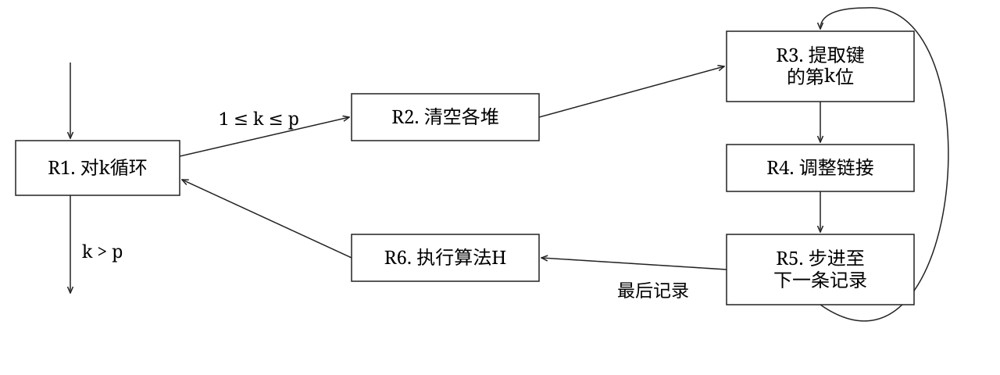
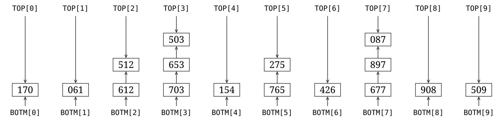
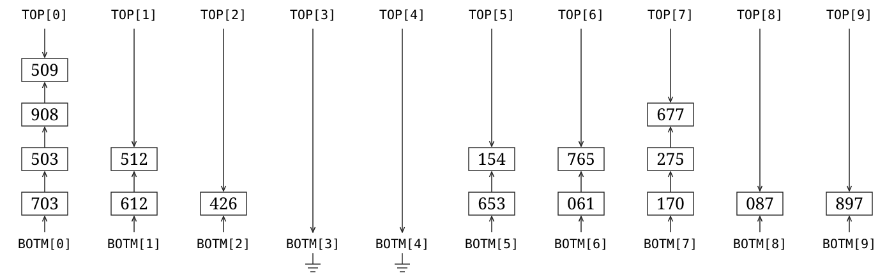
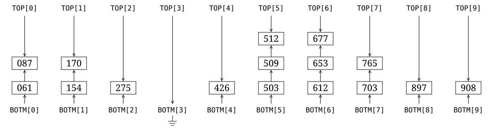
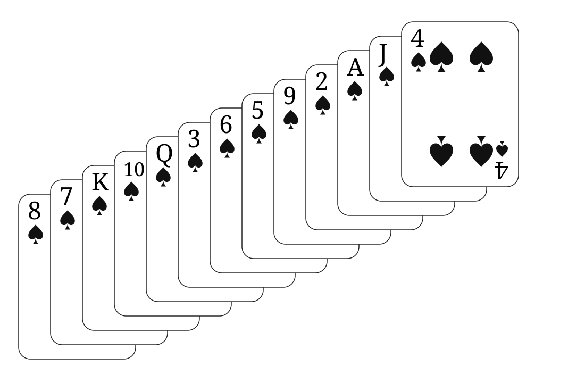

<a id="sec-5-2-5"></a>

### 5.2.5　分布排序

我们现在开始讨论一类很重要的排序方法, 从 5.4.7 节将要讨论的观点来看, 这些方法本质上恰好与合并方法相反. 远在电子计算机出现之前的很多年里, 人们就已经使用这些方法对穿孔卡片排序. 计算机程序设计中也能使用这些方法, 它们以键的数位为基础, 所以称为 “桶排序”“基数排序” 或 “数字排序”.

假定要对一副 52 张纸牌排序. 我们可以定义面值顺序

$$
\mathrm A<2<3<4<5<6<7<8<9<10<\mathrm J<\mathrm Q<\mathrm K,
$$

并定义花色顺序

$$
\clubsuit<\diamondsuit<\heartsuit<\spadesuit.
$$

如果 (i) 一张牌的花色低于另一张牌的花色, 或者 (ii) 花色相同, 但面值较小, 则说这张牌排在另一张之前. (这是有序对之间的字典序的特例, 见习题 5–2.) 于是

$$
\mathrm A\clubsuit<2\clubsuit<\cdots<\mathrm K\clubsuit<\mathrm A\diamondsuit<\cdots<\mathrm Q\spadesuit<\mathrm K\spadesuit.
$$

可以用前面已经讨论过的任何方法对纸牌排序. 玩牌的人通常使用一种多少类似于基数交换思想的技巧: 先按花色将纸牌分为四堆, 然后调整每一堆, 直到所有这些牌都有序.

但还有一种更快的方式可以达到目的! 首先把这些牌面朝上分为 13 堆, 每种面值一堆. 然后把这 13 堆牌收集在一起: 四个 A 放在下面, 然后在上面放 2, 接下来是 3, 以此类推, 最后把四个 K 面朝上放在顶部. 把这些牌翻过来面朝下, 再次发牌, 这次按花色分为四堆. (在发牌时, 再次把这些牌翻为面朝上.) 收集这四堆牌, 梅花在下面, 然后是方块、红心和黑桃, 这副牌就完全有序了.

<a id="pdf-138"></a>
<a id="p-132"></a>

同样的思想也适用于数字和字母数据的排序. 为什么它会有效呢? 因为 (在上面的纸牌示例中) 如果两张牌最终出现在不同的堆中, 那它们的花色就不一样, 所以较低花色的纸牌会放在下面. 但是, 如果两张牌花色相同 (最后会进入同一堆中), 由于先前的排序它们已处于正确的顺序. 换句话说, 在第二轮发牌时, 四堆牌的每一堆面值都会是递增顺序. 对这个证明过程加以抽象化, 能够证明任何字典序都可以通过这种方式实现, 详细信息见本章开头习题 5–2 的解答.


前面刚刚介绍的排序方法并非一目了然, 也不清楚是谁首先发现它这么好用. 1923 年, IBM 的制表机器公司 (Tabulating Machines Company) 分部发表了题为 “The Inventory Simplified” 的 19 页小册子, 提出一种有趣的 “数字计划” 方法, 用于他们的电动排序机上求乘积的总和: 例如, 假定我们希望用第 1–10 列穿孔的数乘以第 23–25 列穿孔的数, 然后把大量卡片上的所有这些乘积加起来. 可以先对第 25 列排序, 利用制表机器计算 $a_1,a_2,\ldots,a_9$ 等量, 其中 $a_k$ 是针对所有在第 25 列拥有 $k$ 值的卡片, 对第 1–10 列求得的总和. 然后对第 24 列排序, 计算类似的总和 $b_1,b_2,\ldots,b_9$, 同样对第 23 列计算 $c_1,c_2,\ldots,c_9$. 容易看出所求的乘积总和是

$$
a_1+2a_2+\cdots+9a_9+10b_1+20b_2+\cdots+90b_9+100c_1+200c_2+\cdots+900c_9.
$$

这种穿孔卡片制表方法很自然地引出了 “最低有效位优先” 的基数排序, 所以它可能已为机器操作员所熟悉. 这个排序原理最早发表的参考文献出现在莱斯利·科姆里 [*Transactions of the Office Machinery Users’ Assoc., Ltd.* (1929), 25–37, 特别是第 28 页] 关于穿孔卡片设备的早期讨论中.

为了处理计算机内部的基数排序, 必须决定如何处理这些 “堆”. 假定共有 $M$ 堆. 我们可以留出 $M$ 个存储区域, 把每条记录从输入区域移到适当的 “堆” 区域. 但这个做法不能令人满意, 因为每个区域都必须大到能够容纳 $N$ 个项目, 这需要 $(M+1)N$ 个记录空间. 因此大多数人拒绝考虑计算机内部的基数排序, 但后来情况有所改变, 哈罗德·苏厄德指出 [Master’s thesis, M.I.T. Digital Computer Laboratory Report R-232 (1954), 25–28], 仅需 $2N$ 个记录区域和 $M$ 个计数字段就可以实现同样效果. 简单地提前扫描这些数据, 计算出 $M$ 堆中每一堆的元素数目, 这样就可以准确地告诉我们如何为各堆分配存储. 在 “分布计数排序” 算法 5.2D 中已经应用了这个思想.

于是可采用以下方式执行基数排序: 首先根据键的最低有效位 (在基 $M$ 表示法中) 执行分布排序, 把记录从输入区域移到辅助区域. 然后根据下一个最低有效位执行另一次分布排序, 把记录移回原始输入区域, 以此类推, 直到 (对最高有效位的) 最后一次扫描把所有记录排成期望顺序.

如果有一台十进制计算机, 键拥有 12 个数位, 并且 $N$ 相当大, 则可以选择 $M=1000$ (三个十进制数位看作一个基 1000 数位). 那么, 无论 $N$ 大小如何, 排序将在四遍扫描中完成. 与此类似, 如果有一台二进制计算机, 键拥有 40 个二进制位, 令 $M=1024=2^{10}$, 可以用四遍扫描完成排序. 实际上, 每遍扫描包括三个部分 (计数、分配、移动). 弗兰德建议 [*JACM* **3** (1956), 151], 以另外增加 $M$ 个存储单元为代价, 合并这三部分中的两个: 在第 $k$ 遍扫描移动记录时, 为第 $k+1$ 遍扫描累加计数.

表 1 说明如何对我们的 16 个示例数应用基数排序, 其中 $M=10$. 基数排序对如此小的 $N$ 值通常没有什么用处, 像这样的小示例只是为了说明这种方法足以完成任务, 而不是为了演示效率.

<a id="pdf-139"></a>
<a id="p-133"></a>

然而, 警觉的 “现代” 读者会注意到: 为分配存储而计算数位个数的整体思想, 受到顺序数据表示这样的老式思想的束缚. 我们知道, 链接分配是专门为处理一组可变大小的表格而设计的, 所以很自然地就会为基数排序选择链接数据结构. 由于我们串行遍历每一堆, 所以只需要每一项到它的后继者的单向链接. 此外, 从来都不需要移动记录. 我们只需要调整这些链接, 轻松愉快地处理列表的后续记录. 所需的存储数量是 $(1+\epsilon)N+2\epsilon M$ 条记录, 其中 $\epsilon$ 是一个链接字段占用的空间数量. 这个过程的正式细节十分有意义, 它给出了典型数据结构操作的一个出色示例, 把顺序分配和链接分配结合在一起:


<a id="tab-5-2-5-1"></a>

表 1　基数排序

<table data-distribution-table="1" style="width:1450px;table-layout:fixed;border-collapse:collapse;font-family:serif;border-top:1px solid #222;border-bottom:1px solid #222"><thead><tr><th style="width:330px;min-width:330px;border:0;padding:0"></th><th style="width:70px;min-width:70px;border:0;padding:0"></th><th style="width:70px;min-width:70px;border:0;padding:0"></th><th style="width:70px;min-width:70px;border:0;padding:0"></th><th style="width:70px;min-width:70px;border:0;padding:0"></th><th style="width:70px;min-width:70px;border:0;padding:0"></th><th style="width:70px;min-width:70px;border:0;padding:0"></th><th style="width:70px;min-width:70px;border:0;padding:0"></th><th style="width:70px;min-width:70px;border:0;padding:0"></th><th style="width:70px;min-width:70px;border:0;padding:0"></th><th style="width:70px;min-width:70px;border:0;padding:0"></th><th style="width:70px;min-width:70px;border:0;padding:0"></th><th style="width:70px;min-width:70px;border:0;padding:0"></th><th style="width:70px;min-width:70px;border:0;padding:0"></th><th style="width:70px;min-width:70px;border:0;padding:0"></th><th style="width:70px;min-width:70px;border:0;padding:0"></th><th style="width:70px;min-width:70px;border:0;padding:0"></th></tr></thead><tbody>
<tr data-distribution-row="0" style="background:transparent"><td style="width:330px;min-width:330px;border:0;padding:8px 4px">输入区域内容: </td><td style="width:70px;min-width:70px;border:0;padding:8px 0;text-align:center;font-size:21px" data-value="1">503</td><td style="width:70px;min-width:70px;border:0;padding:8px 0;text-align:center;font-size:21px" data-value="1">087</td><td style="width:70px;min-width:70px;border:0;padding:8px 0;text-align:center;font-size:21px" data-value="1">512</td><td style="width:70px;min-width:70px;border:0;padding:8px 0;text-align:center;font-size:21px" data-value="1">061</td><td style="width:70px;min-width:70px;border:0;padding:8px 0;text-align:center;font-size:21px" data-value="1">908</td><td style="width:70px;min-width:70px;border:0;padding:8px 0;text-align:center;font-size:21px" data-value="1">170</td><td style="width:70px;min-width:70px;border:0;padding:8px 0;text-align:center;font-size:21px" data-value="1">897</td><td style="width:70px;min-width:70px;border:0;padding:8px 0;text-align:center;font-size:21px" data-value="1">275</td><td style="width:70px;min-width:70px;border:0;padding:8px 0;text-align:center;font-size:21px" data-value="1">653</td><td style="width:70px;min-width:70px;border:0;padding:8px 0;text-align:center;font-size:21px" data-value="1">426</td><td style="width:70px;min-width:70px;border:0;padding:8px 0;text-align:center;font-size:21px" data-value="1">154</td><td style="width:70px;min-width:70px;border:0;padding:8px 0;text-align:center;font-size:21px" data-value="1">509</td><td style="width:70px;min-width:70px;border:0;padding:8px 0;text-align:center;font-size:21px" data-value="1">612</td><td style="width:70px;min-width:70px;border:0;padding:8px 0;text-align:center;font-size:21px" data-value="1">677</td><td style="width:70px;min-width:70px;border:0;padding:8px 0;text-align:center;font-size:21px" data-value="1">765</td><td style="width:70px;min-width:70px;border:0;padding:8px 0;text-align:center;font-size:21px" data-value="1">703</td></tr>
<tr data-distribution-row="1" style="background:transparent"><td style="width:330px;min-width:330px;border:0;padding:8px 4px">个位数字分布的计数: </td><td style="width:70px;min-width:70px;border:0;padding:8px 0;text-align:center;font-size:21px" data-empty="1"></td><td style="width:70px;min-width:70px;border:0;padding:8px 0;text-align:center;font-size:21px" data-empty="1"></td><td style="width:70px;min-width:70px;border:0;padding:8px 0;text-align:center;font-size:21px" data-empty="1"></td><td style="width:70px;min-width:70px;border:0;padding:8px 0;text-align:center;font-size:21px" data-empty="1"></td><td style="width:70px;min-width:70px;border:0;padding:8px 0;text-align:center;font-size:21px" data-empty="1"></td><td style="width:70px;min-width:70px;border:0;padding:8px 0;text-align:center;font-size:21px" data-value="1">1</td><td style="width:70px;min-width:70px;border:0;padding:8px 0;text-align:center;font-size:21px" data-value="1">1</td><td style="width:70px;min-width:70px;border:0;padding:8px 0;text-align:center;font-size:21px" data-value="1">2</td><td style="width:70px;min-width:70px;border:0;padding:8px 0;text-align:center;font-size:21px" data-value="1">3</td><td style="width:70px;min-width:70px;border:0;padding:8px 0;text-align:center;font-size:21px" data-value="1">1</td><td style="width:70px;min-width:70px;border:0;padding:8px 0;text-align:center;font-size:21px" data-value="1">2</td><td style="width:70px;min-width:70px;border:0;padding:8px 0;text-align:center;font-size:21px" data-value="1">1</td><td style="width:70px;min-width:70px;border:0;padding:8px 0;text-align:center;font-size:21px" data-value="1">3</td><td style="width:70px;min-width:70px;border:0;padding:8px 0;text-align:center;font-size:21px" data-value="1">1</td><td style="width:70px;min-width:70px;border:0;padding:8px 0;text-align:center;font-size:21px" data-value="1">1</td><td style="width:70px;min-width:70px;border:0;padding:8px 0;text-align:center;font-size:21px" data-empty="1"></td></tr>
<tr data-distribution-row="2" style="background:transparent"><td style="width:330px;min-width:330px;border:0;padding:8px 4px">基于这些计数的存储分配: </td><td style="width:70px;min-width:70px;border:0;padding:8px 0;text-align:center;font-size:21px" data-empty="1"></td><td style="width:70px;min-width:70px;border:0;padding:8px 0;text-align:center;font-size:21px" data-empty="1"></td><td style="width:70px;min-width:70px;border:0;padding:8px 0;text-align:center;font-size:21px" data-empty="1"></td><td style="width:70px;min-width:70px;border:0;padding:8px 0;text-align:center;font-size:21px" data-empty="1"></td><td style="width:70px;min-width:70px;border:0;padding:8px 0;text-align:center;font-size:21px" data-empty="1"></td><td style="width:70px;min-width:70px;border:0;padding:8px 0;text-align:center;font-size:21px" data-value="1">1</td><td style="width:70px;min-width:70px;border:0;padding:8px 0;text-align:center;font-size:21px" data-value="1">2</td><td style="width:70px;min-width:70px;border:0;padding:8px 0;text-align:center;font-size:21px" data-value="1">4</td><td style="width:70px;min-width:70px;border:0;padding:8px 0;text-align:center;font-size:21px" data-value="1">7</td><td style="width:70px;min-width:70px;border:0;padding:8px 0;text-align:center;font-size:21px" data-value="1">8</td><td style="width:70px;min-width:70px;border:0;padding:8px 0;text-align:center;font-size:21px" data-value="1">10</td><td style="width:70px;min-width:70px;border:0;padding:8px 0;text-align:center;font-size:21px" data-value="1">11</td><td style="width:70px;min-width:70px;border:0;padding:8px 0;text-align:center;font-size:21px" data-value="1">14</td><td style="width:70px;min-width:70px;border:0;padding:8px 0;text-align:center;font-size:21px" data-value="1">15</td><td style="width:70px;min-width:70px;border:0;padding:8px 0;text-align:center;font-size:21px" data-value="1">16</td><td style="width:70px;min-width:70px;border:0;padding:8px 0;text-align:center;font-size:21px" data-empty="1"></td></tr>
<tr data-distribution-row="3" style="background:transparent"><td style="width:330px;min-width:330px;border:0;padding:8px 4px">辅助区域内容: </td><td style="width:70px;min-width:70px;border:0;padding:8px 0;text-align:center;font-size:21px" data-value="1">170</td><td style="width:70px;min-width:70px;border:0;padding:8px 0;text-align:center;font-size:21px" data-value="1">061</td><td style="width:70px;min-width:70px;border:0;padding:8px 0;text-align:center;font-size:21px" data-value="1">512</td><td style="width:70px;min-width:70px;border:0;padding:8px 0;text-align:center;font-size:21px" data-value="1">612</td><td style="width:70px;min-width:70px;border:0;padding:8px 0;text-align:center;font-size:21px" data-value="1">503</td><td style="width:70px;min-width:70px;border:0;padding:8px 0;text-align:center;font-size:21px" data-value="1">653</td><td style="width:70px;min-width:70px;border:0;padding:8px 0;text-align:center;font-size:21px" data-value="1">703</td><td style="width:70px;min-width:70px;border:0;padding:8px 0;text-align:center;font-size:21px" data-value="1">154</td><td style="width:70px;min-width:70px;border:0;padding:8px 0;text-align:center;font-size:21px" data-value="1">275</td><td style="width:70px;min-width:70px;border:0;padding:8px 0;text-align:center;font-size:21px" data-value="1">765</td><td style="width:70px;min-width:70px;border:0;padding:8px 0;text-align:center;font-size:21px" data-value="1">426</td><td style="width:70px;min-width:70px;border:0;padding:8px 0;text-align:center;font-size:21px" data-value="1">087</td><td style="width:70px;min-width:70px;border:0;padding:8px 0;text-align:center;font-size:21px" data-value="1">897</td><td style="width:70px;min-width:70px;border:0;padding:8px 0;text-align:center;font-size:21px" data-value="1">677</td><td style="width:70px;min-width:70px;border:0;padding:8px 0;text-align:center;font-size:21px" data-value="1">908</td><td style="width:70px;min-width:70px;border:0;padding:8px 0;text-align:center;font-size:21px" data-value="1">509</td></tr>
<tr data-distribution-row="4" style="background:transparent"><td style="width:330px;min-width:330px;border:0;padding:8px 4px">十位数字分布的计数: </td><td style="width:70px;min-width:70px;border:0;padding:8px 0;text-align:center;font-size:21px" data-empty="1"></td><td style="width:70px;min-width:70px;border:0;padding:8px 0;text-align:center;font-size:21px" data-empty="1"></td><td style="width:70px;min-width:70px;border:0;padding:8px 0;text-align:center;font-size:21px" data-empty="1"></td><td style="width:70px;min-width:70px;border:0;padding:8px 0;text-align:center;font-size:21px" data-empty="1"></td><td style="width:70px;min-width:70px;border:0;padding:8px 0;text-align:center;font-size:21px" data-empty="1"></td><td style="width:70px;min-width:70px;border:0;padding:8px 0;text-align:center;font-size:21px" data-value="1">4</td><td style="width:70px;min-width:70px;border:0;padding:8px 0;text-align:center;font-size:21px" data-value="1">2</td><td style="width:70px;min-width:70px;border:0;padding:8px 0;text-align:center;font-size:21px" data-value="1">1</td><td style="width:70px;min-width:70px;border:0;padding:8px 0;text-align:center;font-size:21px" data-value="1">0</td><td style="width:70px;min-width:70px;border:0;padding:8px 0;text-align:center;font-size:21px" data-value="1">0</td><td style="width:70px;min-width:70px;border:0;padding:8px 0;text-align:center;font-size:21px" data-value="1">2</td><td style="width:70px;min-width:70px;border:0;padding:8px 0;text-align:center;font-size:21px" data-value="1">2</td><td style="width:70px;min-width:70px;border:0;padding:8px 0;text-align:center;font-size:21px" data-value="1">3</td><td style="width:70px;min-width:70px;border:0;padding:8px 0;text-align:center;font-size:21px" data-value="1">1</td><td style="width:70px;min-width:70px;border:0;padding:8px 0;text-align:center;font-size:21px" data-value="1">1</td><td style="width:70px;min-width:70px;border:0;padding:8px 0;text-align:center;font-size:21px" data-empty="1"></td></tr>
<tr data-distribution-row="5" style="background:transparent"><td style="width:330px;min-width:330px;border:0;padding:8px 4px">基于这些计数的存储分配: </td><td style="width:70px;min-width:70px;border:0;padding:8px 0;text-align:center;font-size:21px" data-empty="1"></td><td style="width:70px;min-width:70px;border:0;padding:8px 0;text-align:center;font-size:21px" data-empty="1"></td><td style="width:70px;min-width:70px;border:0;padding:8px 0;text-align:center;font-size:21px" data-empty="1"></td><td style="width:70px;min-width:70px;border:0;padding:8px 0;text-align:center;font-size:21px" data-empty="1"></td><td style="width:70px;min-width:70px;border:0;padding:8px 0;text-align:center;font-size:21px" data-empty="1"></td><td style="width:70px;min-width:70px;border:0;padding:8px 0;text-align:center;font-size:21px" data-value="1">4</td><td style="width:70px;min-width:70px;border:0;padding:8px 0;text-align:center;font-size:21px" data-value="1">6</td><td style="width:70px;min-width:70px;border:0;padding:8px 0;text-align:center;font-size:21px" data-value="1">7</td><td style="width:70px;min-width:70px;border:0;padding:8px 0;text-align:center;font-size:21px" data-value="1">7</td><td style="width:70px;min-width:70px;border:0;padding:8px 0;text-align:center;font-size:21px" data-value="1">7</td><td style="width:70px;min-width:70px;border:0;padding:8px 0;text-align:center;font-size:21px" data-value="1">9</td><td style="width:70px;min-width:70px;border:0;padding:8px 0;text-align:center;font-size:21px" data-value="1">11</td><td style="width:70px;min-width:70px;border:0;padding:8px 0;text-align:center;font-size:21px" data-value="1">14</td><td style="width:70px;min-width:70px;border:0;padding:8px 0;text-align:center;font-size:21px" data-value="1">15</td><td style="width:70px;min-width:70px;border:0;padding:8px 0;text-align:center;font-size:21px" data-value="1">16</td><td style="width:70px;min-width:70px;border:0;padding:8px 0;text-align:center;font-size:21px" data-empty="1"></td></tr>
<tr data-distribution-row="6" style="background:transparent"><td style="width:330px;min-width:330px;border:0;padding:8px 4px">输入区域内容: </td><td style="width:70px;min-width:70px;border:0;padding:8px 0;text-align:center;font-size:21px" data-value="1">503</td><td style="width:70px;min-width:70px;border:0;padding:8px 0;text-align:center;font-size:21px" data-value="1">703</td><td style="width:70px;min-width:70px;border:0;padding:8px 0;text-align:center;font-size:21px" data-value="1">908</td><td style="width:70px;min-width:70px;border:0;padding:8px 0;text-align:center;font-size:21px" data-value="1">509</td><td style="width:70px;min-width:70px;border:0;padding:8px 0;text-align:center;font-size:21px" data-value="1">512</td><td style="width:70px;min-width:70px;border:0;padding:8px 0;text-align:center;font-size:21px" data-value="1">612</td><td style="width:70px;min-width:70px;border:0;padding:8px 0;text-align:center;font-size:21px" data-value="1">426</td><td style="width:70px;min-width:70px;border:0;padding:8px 0;text-align:center;font-size:21px" data-value="1">653</td><td style="width:70px;min-width:70px;border:0;padding:8px 0;text-align:center;font-size:21px" data-value="1">154</td><td style="width:70px;min-width:70px;border:0;padding:8px 0;text-align:center;font-size:21px" data-value="1">061</td><td style="width:70px;min-width:70px;border:0;padding:8px 0;text-align:center;font-size:21px" data-value="1">765</td><td style="width:70px;min-width:70px;border:0;padding:8px 0;text-align:center;font-size:21px" data-value="1">170</td><td style="width:70px;min-width:70px;border:0;padding:8px 0;text-align:center;font-size:21px" data-value="1">275</td><td style="width:70px;min-width:70px;border:0;padding:8px 0;text-align:center;font-size:21px" data-value="1">677</td><td style="width:70px;min-width:70px;border:0;padding:8px 0;text-align:center;font-size:21px" data-value="1">087</td><td style="width:70px;min-width:70px;border:0;padding:8px 0;text-align:center;font-size:21px" data-value="1">897</td></tr>
<tr data-distribution-row="7" style="background:transparent"><td style="width:330px;min-width:330px;border:0;padding:8px 4px">百位数字分布的计数: </td><td style="width:70px;min-width:70px;border:0;padding:8px 0;text-align:center;font-size:21px" data-empty="1"></td><td style="width:70px;min-width:70px;border:0;padding:8px 0;text-align:center;font-size:21px" data-empty="1"></td><td style="width:70px;min-width:70px;border:0;padding:8px 0;text-align:center;font-size:21px" data-empty="1"></td><td style="width:70px;min-width:70px;border:0;padding:8px 0;text-align:center;font-size:21px" data-empty="1"></td><td style="width:70px;min-width:70px;border:0;padding:8px 0;text-align:center;font-size:21px" data-empty="1"></td><td style="width:70px;min-width:70px;border:0;padding:8px 0;text-align:center;font-size:21px" data-value="1">2</td><td style="width:70px;min-width:70px;border:0;padding:8px 0;text-align:center;font-size:21px" data-value="1">2</td><td style="width:70px;min-width:70px;border:0;padding:8px 0;text-align:center;font-size:21px" data-value="1">1</td><td style="width:70px;min-width:70px;border:0;padding:8px 0;text-align:center;font-size:21px" data-value="1">0</td><td style="width:70px;min-width:70px;border:0;padding:8px 0;text-align:center;font-size:21px" data-value="1">1</td><td style="width:70px;min-width:70px;border:0;padding:8px 0;text-align:center;font-size:21px" data-value="1">3</td><td style="width:70px;min-width:70px;border:0;padding:8px 0;text-align:center;font-size:21px" data-value="1">3</td><td style="width:70px;min-width:70px;border:0;padding:8px 0;text-align:center;font-size:21px" data-value="1">2</td><td style="width:70px;min-width:70px;border:0;padding:8px 0;text-align:center;font-size:21px" data-value="1">1</td><td style="width:70px;min-width:70px;border:0;padding:8px 0;text-align:center;font-size:21px" data-value="1">1</td><td style="width:70px;min-width:70px;border:0;padding:8px 0;text-align:center;font-size:21px" data-empty="1"></td></tr>
<tr data-distribution-row="8" style="background:transparent"><td style="width:330px;min-width:330px;border:0;padding:8px 4px">基于这些计数的存储分配: </td><td style="width:70px;min-width:70px;border:0;padding:8px 0;text-align:center;font-size:21px" data-empty="1"></td><td style="width:70px;min-width:70px;border:0;padding:8px 0;text-align:center;font-size:21px" data-empty="1"></td><td style="width:70px;min-width:70px;border:0;padding:8px 0;text-align:center;font-size:21px" data-empty="1"></td><td style="width:70px;min-width:70px;border:0;padding:8px 0;text-align:center;font-size:21px" data-empty="1"></td><td style="width:70px;min-width:70px;border:0;padding:8px 0;text-align:center;font-size:21px" data-empty="1"></td><td style="width:70px;min-width:70px;border:0;padding:8px 0;text-align:center;font-size:21px" data-value="1">2</td><td style="width:70px;min-width:70px;border:0;padding:8px 0;text-align:center;font-size:21px" data-value="1">4</td><td style="width:70px;min-width:70px;border:0;padding:8px 0;text-align:center;font-size:21px" data-value="1">5</td><td style="width:70px;min-width:70px;border:0;padding:8px 0;text-align:center;font-size:21px" data-value="1">5</td><td style="width:70px;min-width:70px;border:0;padding:8px 0;text-align:center;font-size:21px" data-value="1">6</td><td style="width:70px;min-width:70px;border:0;padding:8px 0;text-align:center;font-size:21px" data-value="1">9</td><td style="width:70px;min-width:70px;border:0;padding:8px 0;text-align:center;font-size:21px" data-value="1">12</td><td style="width:70px;min-width:70px;border:0;padding:8px 0;text-align:center;font-size:21px" data-value="1">14</td><td style="width:70px;min-width:70px;border:0;padding:8px 0;text-align:center;font-size:21px" data-value="1">15</td><td style="width:70px;min-width:70px;border:0;padding:8px 0;text-align:center;font-size:21px" data-value="1">16</td><td style="width:70px;min-width:70px;border:0;padding:8px 0;text-align:center;font-size:21px" data-empty="1"></td></tr>
<tr data-distribution-row="9" style="background:transparent"><td style="width:330px;min-width:330px;border:0;padding:8px 4px">辅助区域内容: </td><td style="width:70px;min-width:70px;border:0;padding:8px 0;text-align:center;font-size:21px" data-value="1">061</td><td style="width:70px;min-width:70px;border:0;padding:8px 0;text-align:center;font-size:21px" data-value="1">087</td><td style="width:70px;min-width:70px;border:0;padding:8px 0;text-align:center;font-size:21px" data-value="1">154</td><td style="width:70px;min-width:70px;border:0;padding:8px 0;text-align:center;font-size:21px" data-value="1">170</td><td style="width:70px;min-width:70px;border:0;padding:8px 0;text-align:center;font-size:21px" data-value="1">275</td><td style="width:70px;min-width:70px;border:0;padding:8px 0;text-align:center;font-size:21px" data-value="1">426</td><td style="width:70px;min-width:70px;border:0;padding:8px 0;text-align:center;font-size:21px" data-value="1">503</td><td style="width:70px;min-width:70px;border:0;padding:8px 0;text-align:center;font-size:21px" data-value="1">509</td><td style="width:70px;min-width:70px;border:0;padding:8px 0;text-align:center;font-size:21px" data-value="1">512</td><td style="width:70px;min-width:70px;border:0;padding:8px 0;text-align:center;font-size:21px" data-value="1">612</td><td style="width:70px;min-width:70px;border:0;padding:8px 0;text-align:center;font-size:21px" data-value="1">653</td><td style="width:70px;min-width:70px;border:0;padding:8px 0;text-align:center;font-size:21px" data-value="1">677</td><td style="width:70px;min-width:70px;border:0;padding:8px 0;text-align:center;font-size:21px" data-value="1">703</td><td style="width:70px;min-width:70px;border:0;padding:8px 0;text-align:center;font-size:21px" data-value="1">765</td><td style="width:70px;min-width:70px;border:0;padding:8px 0;text-align:center;font-size:21px" data-value="1">897</td><td style="width:70px;min-width:70px;border:0;padding:8px 0;text-align:center;font-size:21px" data-value="1">908</td></tr>
</tbody></table>


<a id="alg-5-2-5-R"></a>
<a id="pdf-140"></a>
<a id="p-134"></a>

**算法 R (基数列表排序).** 假定记录 $R_1,\ldots,R_N$ 各包含一个 LINK 字段. 假定键是 $p$ 元组:

$$
(a_1,a_2,\ldots,a_p),\qquad0\le a_i<M,\tag{1}
$$

按照字典序定义次序, 也就是

$$
(a_1,a_2,\ldots,a_p)<(b_1,b_2,\ldots,b_p)\tag{2}
$$

当且仅当对某个 $j\ (1\le j\le p)$ 有

$$
\text{对所有 }i<j,\ a_i=b_i,\quad\text{但 }a_j<b_j.\tag{3}
$$

特别地, 键可以看作基 $M$ 的数

$$
a_1M^{p-1}+a_2M^{p-2}\cdots+a_{p-1}M+a_p,\tag{4}
$$

这种情况下, 字典序对应于非负整数的正常序. 键也可以是字母串, 等等.

完全类似于卡片排序机的操作方式, 维持 $M$“堆” 记录以完成排序任务. 这些 “堆” 实际上就是第 2 章所说的队列, 因为我们把它们链接在一起, 用 “先进先出” 方式遍历. 每一堆有两个指针变量 TOP[$i$] 和 BOTM[$i$] ($0\le i<M$), 如同第 2 章那样假定

$$
\operatorname{LINK}(\operatorname{LOC}(\operatorname{BOTM}[i]))\equiv\operatorname{BOTM}[i].\tag{5}
$$

**R1.[对 $k$ 循环.]** 开始时, 置 $\mathrm P\leftarrow\operatorname{LOC}(R_N)$, 这是指向最后一条记录的指针. 然后对 $k=1,2,\ldots,p$ 执行 R2 至 R6. (R2 至 R6 组成一遍 “扫描”.) 然后算法终止, P 指向具有最小键的记录, LINK(P) 指向具有次小键的记录, 接着是 LINK(LINK(P)), 以此类推, 最后一条记录中的 LINK 将是 $\Lambda$.

**R2.[清空各堆.]** 对 $0\le i<M$, 置 $\operatorname{TOP}[i]\leftarrow\operatorname{LOC}(\operatorname{BOTM}[i])$ 和 $\operatorname{BOTM}[i]\leftarrow\Lambda$.

**R3.[提取键的第 $k$ 位.]** 设 P 所引用记录的键 KEY(P) 是 $(a_1,a_2,\ldots,a_p)$. 置 $i\leftarrow a_{p+1-k}$, 也就是这个键的第 $k$ 个最低有效位.

**R4.[调整链接.]** 置 $\operatorname{LINK}(\operatorname{TOP}[i])\leftarrow\mathrm P$, 然后置 $\operatorname{TOP}[i]\leftarrow\mathrm P$.

**R5.[步进至下一条记录.]** 如果 $k=1$ (第一遍扫描) 且 $\mathrm P=\operatorname{LOC}(R_j)$ (对某个 $j\ne1$), 则置 $\mathrm P\leftarrow\operatorname{LOC}(R_{j-1})$ 并返回 R3. 如果 $k>1$ (后续扫描), 则置 $\mathrm P\leftarrow\operatorname{LINK}(\mathrm P)$, 如果 $\mathrm P\ne\Lambda$ 则返回 R3.

**R6.[执行算法 H.]**(现在所有元素已分发到各堆.) 执行以下算法 H, 它把各堆 “钩在一起” 形成一个列表, 为下一遍扫描做准备, 然后置 $\mathrm P\leftarrow\operatorname{BOTM}[0]$, 这是指向已钩连列表的第一个元素的指针. (见习题 3.) ■


<a id="fig-5-32"></a>

<div class="source-tableau-group" style="overflow-x:auto;max-width:100%"><div style="width:1280px">



</div></div>

图 32　基数列表排序

<a id="alg-5-2-5-H"></a>

**算法 H (队列的挂钩).** 给定 $M$ 个按照算法 R 的约定链接在一起的队列, 本算法最多调整 $M$ 个链接来生成单一队列, 使得 BOTM[0] 指向第一个元素, 第 0 堆后面是第 1 堆, ……, 第 $M-1$ 堆.

**H1.[初始化.]** 置 $i\leftarrow0$.

**H2.[指向堆顶.]** 置 $\mathrm P\leftarrow\operatorname{TOP}[i]$.

**H3.[下一堆.]** $i$ 增 1. 如果 $i=M$, 置 $\operatorname{LINK}(\mathrm P)\leftarrow\Lambda$, 终止算法.

**H4.[堆为空?]** 如果 $\operatorname{BOTM}[i]=\Lambda$, 返回 H3.

**H5.[链接各堆.]** 置 $\operatorname{LINK}(\mathrm P)\leftarrow\operatorname{BOTM}[i]$. 返回 H2. ■

图 33 显示以 $M=10$ 对我们的 16 个示例数排序时, 每遍扫描之后各堆的内容. 如果能找到处理步骤 R3 和 R5 的各遍扫描变化形式的合适方法, 就能轻松编写算法 R 的 MIX 程序. 以下程序把两条指令重叠在一起, 在没有牺牲任何内层循环速度的情况下完成上述任务. 注意 TOP[$i$] 和 BOTM[$i$] 被打包到同一个字中.

<a id="prog-5-2-5-R"></a>

**程序 R (基数列表排序).** 假定单元 INPUT+1 至 INPUT+N 中给定的记录的键拥有 $p=3$ 个分量 $(a_1,a_2,a_3)$, 分别存储在 (1:1)、(2:2)、(3:3) 字段中. (这要求 $M$ 小于等于 MIX 的字节大小.) 每条记录的 (4:5) 字段是 LINK 字段. 对于 $0\le i<M$, 令 $\operatorname{TOP}[i]\equiv\mathtt{PILES}+i\,(1{:}2)$, $\operatorname{BOTM}[i]\equiv\mathtt{PILES}+i\,(4{:}5)$. 比较方便的做法是, 以单元 INPUT 为链接基点, 使得 $\operatorname{LOC}(\operatorname{BOTM}[i])=\mathtt{PILES}+i-\mathtt{INPUT}$. 为避免出现负链接, 我们希望 PILES 表所在单元高于 INPUT 表. 变址寄存器赋值如下: $\mathrm{rI1}\equiv\mathrm P,\ \mathrm{rI2}\equiv i,\ \mathrm{rI3}\equiv3-k,\ \mathrm{rI4}\equiv\operatorname{TOP}[i]$; 在算法 H 期间, $\mathrm{rI2}\equiv i-M$.

<a id="pdf-141"></a>
<a id="p-135"></a>
<a id="pdf-142"></a>
<a id="p-136"></a>

```mixal
01 LINK  EQU  4:5
02 TOP   EQU  1:2
03 START ENT1 N                  1         R1. 对k循环. P = LOC(RN).
04       ENT3 2                  1         k ← 1.
05 2H    ENT2 M-1                3         R2. 清空各堆.
06       ENTA PILES-INPUT,2       3M        LOC(BOTM[i])
07       STA  PILES,2(TOP)        3M        → TOP[i].
08       STZ  PILES,2(LINK)       3M        BOTM[i] ← Λ.
09       DEC2 1                  3M
10       J2NN *-4                3M        M > i ≥ 0.
11       LDA  R3SW,3             3
12       STA  3F                 3         修改第k遍扫描的指令.
13       LDA  R5SW,3             3
14       STA  5F                 3
15 3H    [LD2 INPUT,1(3:3)]                 R3. 提取键的第k位.
16 4H    LD4  PILES,2(TOP)        3N        R4. 调整链接.
17       ST1  INPUT,4(LINK)       3N        LINK(TOP[i]) ← P.
18       ST1  PILES,2(TOP)        3N        TOP[i] ← P.
19 5H    [DEC1 1]                          R5. 步进至下一条记录.
20       J1NZ 3B                 3N        如果扫描未结束，则转到R3.
21 6H    ENN2 M                  3         R6. 执行算法H.
22       JMP  7F                 3         以i ← 0转到H2.
23 R3SW  LD2  INPUT,1(1:1)        N         当k = 3时R3的指令.
24       LD2  INPUT,1(2:2)        N         当k = 2时R3的指令.
25       LD2  INPUT,1(3:3)        N         当k = 1时R3的指令.
26 R5SW  LD1  INPUT,1(LINK)       N         当k = 3时R5的指令.
27       LD1  INPUT,1(LINK)       N         当k = 2时R5的指令.
28       DEC1 1                  N         当k = 1时R5的指令.
29 9H    LDA  PILES+M,2(LINK)     3M-3      H4. 堆为空?
30       JAZ  8F                 3M-3      如果BOTM[i] = Λ，则转至H3.
31       STA  INPUT,1(LINK)       3M-3-E    H5. 链接各堆.
32 7H    LD1  PILES+M,2(TOP)      3M-E      H2. 指向堆顶.
33 8H    INC2 1                  3M        H3. 下一堆. i ← i+1.
34       J2NZ 9B                 3M        如果i ≠ M，则转至H4.
35       STZ  INPUT,1(LINK)       3         LINK(P) ← Λ.
36       LD1  PILES(LINK)        3         P ← BOTM[0].
37       DEC3 1                  3
38       J3NN 2B                 3         对1 ≤ k ≤ 3循环.
```


<a id="fig-5-33"></a>

<div class="source-tableau-group" style="overflow-x:auto;max-width:100%"><div style="width:1400px">



</div></div>

<div class="source-tableau-group" style="overflow-x:auto;max-width:100%"><div style="width:1400px">



</div></div>

<div class="source-tableau-group" style="overflow-x:auto;max-width:100%"><div style="width:1400px">



</div></div>

图 33　使用链接分配的基数排序: 每遍扫描之后各堆的内容


程序 R 的运行时间是 $32N+48M+38-4E$, 其中 $N$ 是输入记录的个数, $M$ 是基数 (堆的个数), $E$ 是出现空堆的次数. 可以很轻松地与根据类似假定编写的其他程序 (程序 5.2.1M、5.2.4L) 对比. 这个程序的 $p$ 遍扫描版本将耗费 $(11p-1)N+O(pM)$ 时间单位, 运行时间的关键因素是内层循环, 它包含五次存储访问和一次转移. 在典型计算机上有 $M=b^r$ 和 $p=\lceil t/r\rceil$, 其中 $t$ 是以 $b$ 为基的键的位数. 增大 $r$ 将降低 $p$, 因此可以利用这些公式来确定 $r$ 的最佳值.

运行时间的唯一变量是 $E$, 也就是步骤 H4 中发现空堆的次数. 如果认为由基为 $M$ 的数组成的 $M^N$ 个序列中的每一个出现概率相同, 则从 3.3.2D 节 “纸牌检验” 研究可知, 每遍扫描中出现 $M-r$ 个空堆的概率是

$$
\frac{M(M-1)\cdots(M-r+1)}{M^N}\left\{\begin{matrix}N\\r\end{matrix}\right\},\tag{6}
$$

式中 $\left\{\begin{matrix}N\\r\end{matrix}\right\}$ 是第二类斯特林数. 根据习题 6, 有

$$
E=\left(\text{最小 }\max(M-N,0)p,\quad\text{平均 }M\left(1-\frac1M\right)^Np,\quad\text{最大 }(M-1)p\right).\tag{7}
$$

近年来出现了越来越多的 “流水线” 或 “数值密集运算” 计算机. 这些计算机有多个运算器和 “先行电路”, 使得存储器访问与计算过程能够高度重叠. 但在存在条件转移指令时它们的效率会受到明显影响, 除非这些转移指令总是转向同一路径. 基数排序的内层循环可以很好地适用于这些计算机, 因为它是一种典型的 “数值密集运算” 形式的直接迭代计算. 因此, 如果 $N$ 不是太小, 键也不是太长, 那么在这些计算机上, 基数排序的效率通常要高于任何已知的其他内部排序方法.

当然, 当键非常长时, 基数排序的效率并不是特别高. 例如, 设想要排序是 60 位的十进制数, 使用 $M=10^3$ 的基数排序执行 20 遍扫描, 极少有一对数它们的前 9 位数字会趋于相同, 所以前 17 遍扫描几乎没做什么事. 我们在分析基数交换排序时发现, 从左侧而非右侧查看键, 不需要查看键的许多数位. 因此我们重新考虑一种基数排序思想, 它是从最高有效位 (MSD) 而不是最低有效位 (LSD) 开始查看.

<a id="pdf-143"></a>
<a id="p-137"></a>

我们已经注意到, 最高有效位优先的基数方法是自然出现的. 事实上, 不难看出为什么邮局会使用这种方法来分拣邮件. 一大堆信件被分拣到按不同地理区域划分的邮包中, 每个邮包都包含较少数量的信件, 这些信件再被分拣到越来越精细的地理区域, 而不同邮包之间的分拣是相互独立的. (实际上, 可以先把邮包运送到更接近它们目的地的地方, 然后再进一步分拣, 或者一边运送一边分拣.) 这种 “分而治之” 的原理富有吸引力, 它之所以不太适合穿孔卡片排序, 唯一原因就是它最终会花费太多时间纠缠于非常小的堆. 尽管算法 R 首先考虑最低有效位, 但它的效率相对要高一些, 这是因为堆数绝不会超过 $M$, 而且这些堆只需要钩在一起 $p$ 次. 另一方面, 使用链接存储, 并像算法 5.2.4L 那样以负链接表示各堆之间的界限, 不难设计一种最高有效位优先的基数方法. (见习题 10.) 最高有效位优先方法的主要困难在于空堆数量有迅速增大的趋势, 从而耗费大量时间.


麦克拉伦的方案可能是最佳折中方案 [*JACM* **13** (1966), 404–411], 他建议像算法 R 那样采用最低有效位优先排序, 但仅应用于最高的那些位. 这不能把文件完全排好序, 但通常会使文件非常接近有序状态, 只留下很少几个反序, 因此可以用直接插入来完成最后的排序. 对程序 5.2.1M 的分析也适用于这一情形, 因此, 如果键是均匀分布的, 则在对前 $p$ 个数字排序之后, 文件中平均剩下 $\tfrac14N(N-1)M^{-p}$ 个反序. (见式 5.2.1–(17) 和习题 5.2.1–38.) 麦克拉伦已经算出每排好一项需要访问存储器的平均次数, 以及 $M$ 和 $p$ 的最优选择 (假定 $M$ 为 2 的幂, 键均匀分布, 且 $N/M^p\le0.1$, 使得偏离均匀性的程度在容忍范围内), 见下表:

| $N=$ | $100$ | $1000$ | $10000$ | $100000$ | $1000000$ | $10^7$ | $10^8$ | $10^9$ |
|---|---:|---:|---:|---:|---:|---:|---:|---:|
| 最佳 $M=$ | $32$ | $128$ | $512$ | $1024$ | $8192$ | $2^{15}$ | $2^{17}$ | $2^{19}$ |
| 最佳 $p=$ | $2$ | $2$ | $2$ | $2$ | $2$ | $2$ | $2$ | $2$ |
| $\beta(N)=$ | $19.3$ | $18.5$ | $18.2$ | $18.1$ | $18.0$ | $18.0$ | $18.0$ | $18.0$ |

这里 $\beta(N)$ 表示每排好一项需要访问存储器的平均次数,

$$
\beta(N)=5p+8+\frac{2pM}{N}+\frac{N-1}{2M^p}-\frac{H_N}{N},\tag{8}
$$

当 $N\to\infty$ 时它是有界的, 如果取 $p=2$ 且 $M>\sqrt N$. 因此平均排序时间实际上是 $O(N)$, 而不是 $N\log N$ 量级. 这种方法是多列表插入方法 (程序 5.2.1M) 的改进, 后者本质上是 $p=1$ 的情形. 习题 12 给出麦克拉伦的有趣方法, 用于对部分列表有序文件进行最后重排.

利用算法 5.2D 和习题 5.2–13 的方法, 还有可能避免链接字段. 这样, 除了记录本身所需要的空间之外, 仅需 $O(\sqrt N)$ 个额外存储单元. 如果输入记录均匀分布, 则平均排序时间与 $N$ 成正比.

沃齐米日·多波谢维奇使用最高有效位优先分布排序, 直到出现很短的子文件 [*Inf. Proc. Letters* **7** (1978), 1–6;**8** (1979), 170–172], 同时限制分布过程以保证前 $M/2$ 个堆能接收到 25%到 75%的记录, 从而得到好的结果, 确保对均匀键排序的平均时间是 $O(N)$, 最差时间是 $O(N\log N)$. 他的论文启发其他几位研究人员设计新的地址计算算法, 其中最具指导意义的可能是马尔库·塔米宁提出的以下二级方案 [*J. Algorithms* **6** (1985), 138–144]. 假定所有键都是 $[0..1)$ 区间内的分数. 首先, 键 $K$ 映射到容器 $\lfloor KN/8\rfloor$ 中, 从而 $N$ 条记录分布到 $\lfloor N/8\rfloor$ 个容器中. 然后, 假定容器 $k$ 已经接收到 $N_k$ 条记录, 如果 $N_k\le16$, 则使用直接插入对它排序, 否则采用一种类似麦克拉伦的 “分布加插入” 排序方法把它分到 $M^2$ 个容器中, 其中 $M^2\approx10N_k$. 塔米宁证明了以下值得注意的结果:


<a id="thm-5-2-5-T"></a>
<a id="pdf-144"></a>
<a id="p-138"></a>

**定理 T.** 只要各键是独立随机数, 密度函数 $f(x)$ 有界且对 $0\le x\le1$ 黎曼可积, 则存在一个常数 $T$, 使得前文刚刚介绍的排序方法平均来说最多执行 $TN$ 次运算. (常数 $T$ 不依赖于 $f$.)

证明. 见习题 18. 从直觉上看, 第一次分布到 $N/8$ 个堆时, 会找到 $f$ 近似为常数的区间, 然后第二次分布将使预期的容器大小近似为常数. ■


彼得·麦基尔罗伊、基思·博斯蒂克和马尔科姆·麦基尔罗伊的一篇富有指导意义的文章介绍了基数排序的几种版本, 专门针对大型字符串数组排序进行了很好地调整 [*Computing Systems* **6** (1993), 5–27].

### 习题

<a id="ex-5-2-5-1"></a>

▶ 1. [20] 习题 5.2–13 的算法说明如何仅用 $N$ 个记录区域 (以及 $M$ 个计数字段) 而不是 $2N$ 个记录区域来进行分布排序. 这能否对表 1 的基数排序算法有所改进?　[答案](./answers/5-2-5.md#ans-5-2-5-1)

<a id="ex-5-2-5-2"></a>

2. [13] 算法 R 是稳定排序方法吗?　[答案](./answers/5-2-5.md#ans-5-2-5-2)

<a id="ex-5-2-5-3"></a>

3. [15] 即使第 0 堆可能为空, 算法 H 也要使 BOTM[0] 指向 “已钩连” 队列的第一条记录, 请解释为什么要这样做.　[答案](./answers/5-2-5.md#ans-5-2-5-3)

<a id="ex-5-2-5-4"></a>

▶ 4. [23] 算法 R 把 $M$ 个堆链接在一起形成一个 (先进先出) 队列. 探讨把这些堆链接为栈的思想. (图 33 中的箭头将向下而不是向上, 从而不再需要 BOTM 表.) 证明: 如果以适当顺序 “钩连” 这些堆, 有可能得到一种有效的排序方法. 能否由此得到一种更简单或更快速的算法?　[答案](./answers/5-2-5.md#ans-5-2-5-4)

<a id="ex-5-2-5-5"></a>

5. [20] 为了能够对八字节键而不是三字节键排序, 应如何修改程序 R? 假定 $K_i$ 的五个最高有效字节存储在单元 $\mathtt{KEY}+i\,(1{:}5)$ 中, 而三个最低有效字节就像目前这样存储在单元 $\mathtt{INPUT}+i\,(1{:}3)$ 中. 做了这些改动之后, 程序的运行时间是多少?　[答案](./answers/5-2-5.md#ans-5-2-5-5)

<a id="ex-5-2-5-6"></a>

6. [M24] 设 $g_{MN}(z)=\sum p_{MNk}z^k$, 其中 $p_{MNk}$ 是基数排序的一次随机扫描把 $N$ 个元素放入 $M$ 个堆之后恰有 $k$ 个空堆的概率.　[答案](./answers/5-2-5.md#ans-5-2-5-6)

(a) 证明: $g_{M(N+1)}(z)=g_{MN}(z)+\bigl((1-z)/M\bigr)g'_{MN}(z)$.

(b) 利用上述关系给出这个概率分布的均值和方差的简单表达式, 表示为 $M$ 和 $N$ 的函数.

<a id="ex-5-2-5-7"></a>

7. [20] 试讨论算法 R 与基数交换排序 (算法 5.2.2R) 之间的相似与区别.　[答案](./answers/5-2-5.md#ans-5-2-5-7)

<a id="ex-5-2-5-8"></a>

▶ 8. [20] 正文中讨论的基数排序算法假定待排序的所有键都是非负数. 如果这些键是用补码或反码表示的数, 应如何修改算法?　[答案](./answers/5-2-5.md#ans-5-2-5-8)

<a id="ex-5-2-5-9"></a>

9. [20] 继续习题 8, 如果这些键是用有符号的量表示的数, 应如何修改算法?　[答案](./answers/5-2-5.md#ans-5-2-5-9)

<a id="ex-5-2-5-10"></a>

10. [30] 设计一种高效的使用链接存储的 “最高有效位优先” 的基数排序算法. (随着子文件大小的减小, 明智的做法是降低 $M$, 并对非常短的子文件使用非基数方法.)

<a id="ex-5-2-5-11"></a>

11. [16] 表 1 所示的 16 个输入数初始时有 41 个反序. 当然, 排序完成之后就不会有反序了. 如果省略第一遍扫描, 仅对十位和百位执行基数排序, 文件中会有多少个反序? 如果省略第一遍和第二遍扫描, 文件中会有多少个反序?　[答案](./answers/5-2-5.md#ans-5-2-5-11)

<a id="ex-5-2-5-12"></a>

12. [24] (麦克拉伦) 假定仅对实际键的前 $p$ 个数位应用了算法 R. 因此, 我们以链接顺序读取这个文件时, 它已经接近有序状态了, 但前 $p$ 个数位相同的键仍然是无序的. 试设计一个算法, 在原位重排这些记录, 使它们的键成为有序状态: $K_1\le K_2\le\cdots\le K_N$. [提示: 习题 5.2–12 的解答中给出文件被完全排序的特例. 因为文件中几乎没有什么反序, 所以有可能在不损失效率的情况下将这种方法与直接插入组合起来.]　[答案](./answers/5-2-5.md#ans-5-2-5-12)

<a id="ex-5-2-5-13"></a>

13. [40] 请实现本节正文接近结尾处提到的内部排序方法, 编写一个子例程, 用 $O(N)$ 个时间单位对随机数据排序, 仅需 $O(\sqrt N)$ 个额外存储单元.

<a id="pdf-145"></a>
<a id="p-139"></a>

<a id="ex-5-2-5-14"></a>

14. [22] 我们可以用两遍扫描把纸牌序列　[答案](./answers/5-2-5.md#ans-5-2-5-14)

<div class="source-tableau-group" style="overflow-x:auto;max-width:100%"><div style="width:1100px">



</div></div>

自上而下排列为递增顺序 $\mathrm A\ 2\ldots\mathrm J\ \mathrm Q\ \mathrm K$, 仅需两个堆作为中间存储. 首先把这些牌分发为牌面朝下的两堆, 自下而上分别包含 $\mathrm A\ 2\ 9\ 3\ 10$ 和 $4\ \mathrm J\ 5\ 6\ \mathrm Q\ \mathrm K\ 7\ 8$. 然后把第二堆放在第一堆上面, 翻过来牌面朝上, 再次分发为牌面朝下的两堆: $\mathrm A\ 2\ 3\ 4\ 5\ 6\ 7\ 8$ 和 $9\ 10\ \mathrm J\ \mathrm Q\ \mathrm K$. 合并这两堆, 翻过来牌面朝上, 这就完成了.

证明: 不可能仅用两遍扫描把上述纸牌序列自上而下排列为递减顺序 $\mathrm K\ \mathrm Q\ \mathrm J\ldots2\ \mathrm A$, 即使允许使用多达三个堆作为中间存储也不行. (必须总是从一堆牌的顶部开始发牌, 边发牌边把它们翻为牌面朝下. 自上而下就是图中从右到左.)

<a id="ex-5-2-5-15"></a>

15. [M25] 假定所有纸牌都必须牌面朝上分发而不能牌面朝下分发. 这样, 可以用一遍扫描把递增顺序转换为递减顺序. 考虑习题 14 的问题, 现在需要多少遍扫描?　[答案](./answers/5-2-5.md#ans-5-2-5-15)

<a id="ex-5-2-5-16"></a>

▶ 16. [25] 设计一个算法, 把字符串 $\alpha_1,\ldots,\alpha_n$ 排为字典序, 字符串的元素都属于一个包含 $m$ 个元素的字母表. 算法的总运行时间应当为 $O(m+n+N)$, 其中 $N=|\alpha_1|+\cdots+|\alpha_n|$ 是所有字符串的总长度.　[答案](./answers/5-2-5.md#ans-5-2-5-16)

<a id="ex-5-2-5-17"></a>

17. [15] 考察塔米宁提出的两级分布排序 (见定理 T), 一种类似麦克拉伦的方法被用于分布的第二级, 但没有应用于第一级, 这是为什么呢?　[答案](./answers/5-2-5.md#ans-5-2-5-17)

<a id="ex-5-2-5-18"></a>

18. [HM26] 证明定理 T. 提示: 首先证明, 把麦克拉伦的 “分布加插入” 算法应用于概率密度函数满足 $f(x)\le B\ (0\le x\le1)$ 的独立随机键时, 平均执行 $O(BN)$ 次运算.　[答案](./answers/5-2-5.md#ans-5-2-5-18)

> 为了对词根和单词进行排序,
> 我们使用了 1100 个菱形盒子;
> 对形态排序时还用到了盘子.
>
> ——乔治·威格拉姆 (1843)
