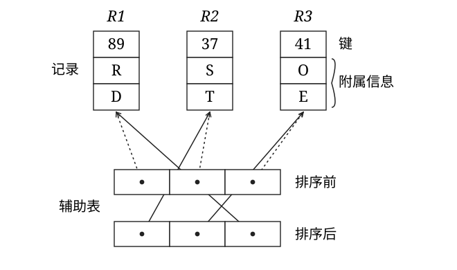
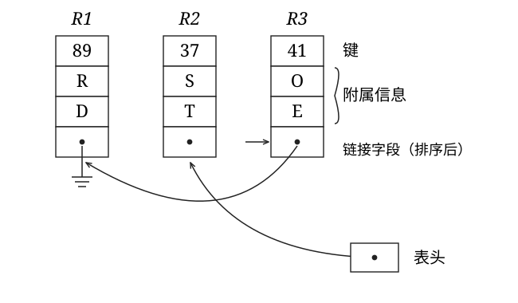
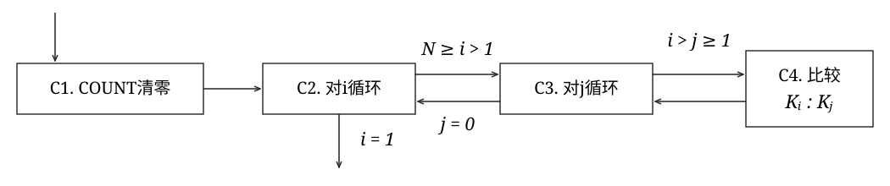
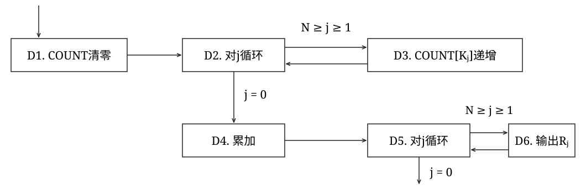

<a id="pdf-062"></a>
<a id="p-56"></a>

<a id="sec-5-2"></a>

## 5.2　内部排序

现在让我们做一项试验, 开始讨论好的 “排序技能”. 你会如何解决下面的程序设计问题?

> “存储单元 R+1, R+2, R+3, R+4, R+5 中包含五个数. 请编写一段计算机程序, 根据需要将这些数字调整为递增顺序.”

(如果你已经熟悉某些排序方法, 请尽量暂时忘掉它们. 设想你是第一次解决这个问题, 没有任何预先知识告诉你如何处理.)

在继续阅读下面的内容之前, 要求读者为这个问题提供一种解决方案.

⋯⋯⋯⋯⋯⋯⋯⋯⋯⋯⋯⋯⋯⋯⋯⋯⋯⋯⋯⋯

在解决这个具有挑战性的问题时所花费的时间将会在后面继续阅读本章时得到回报. 你的解决方案可能属于以下某种类型之一.

A. **插入排序.** 每次只考虑一项, 把每个新项插入先前已排序项的适当位置. (许多桥牌玩家就是这样对手中的纸牌进行排序的, 他们每次只拿起一张纸牌.)

B. **交换排序.** 如果发现有两项的顺序颠倒, 则交换它们. 重复这个过程直到不再需要交换为止.

C. **选择排序.** 首先找出最小 (或最大) 项, 然后把它与其余项分开, 接下来选择下一个最小 (或最大) 项, 以此类推.

D. **枚举排序.** 把每项与其他项逐一对比, 一项的最终位置取决于它超过了多少个键.

E. **专用排序.** 它能很好地对问题中所述的五个元素进行排序, 但无法推广到对更多项目进行排序.

F. **懒散态度.** 忽略上面的建议, 决定根本不去解决这一问题. 对不起, 你现在阅读的内容已经太多了, 而且已经错过时机了.

G. **一种新的超级排序技术.** 相对于已知方法有明显改进. 如果有这种技术, 请立即通知我.

如果提出的问题涉及 (比如说)1000 项, 而不是只有 5 项, 你可能已经发现了一些将在后面谈到的更精巧技术. 无论如何, 在解决一个新问题时, 明智的做法通常是先找出一个比较明显的解决方案, 然后尝试进行改进. 前面提到的 A、B、C 引出了几类重要的排序技术, 它们就是这些简单思想的深化.

人们已经发明了许多不同的排序算法, 本书将讨论其中的大约 25 种. 这些算法数目听起来有些吓人, 但实际上只是目前已有算法的一小部分. 我们的讨论将会忽略许多现在已经过时的技术, 或者只是简单提及. 为什么会有这么多排序方法呢? 对于计算机程序设计来说, 这是下面这个问题的特例: “为什么会有这么多 $x$ 方法?” 其中 $x$ 可以是任何要面对的问题. 对这个问题的回答是: 每种方法都有自己的优缺点, 它在某种数据与硬件配置下的性能会优于其他方法. 遗憾的是, 并不存在已知的 “最佳” 排序方式. 目前许多最佳方法, 取决于出于什么目的在什么计算机上对什么内容进行排序. 用拉迪亚德·基普林的话说: “有 69 种部落安置方式, 每一种都是正确的.”

一个好主意是了解每种排序方法的特性, 以便为特定应用做出明智的选择. 幸运的是, 学习这些算法并不是什么不可实现的任务, 因为它们彼此之间有一些有趣的关联.

<a id="pdf-063"></a>
<a id="p-57"></a>

在本章开头, 我们定义了一些用于研究排序的术语和记号: 要对记录

$$
R_1,R_2,\ldots,R_N\tag{1}
$$

进行排序, 使它们的键 $K_1,K_2,\ldots,K_N$ 变为非递减顺序, 基本方法就是要找出一种排列 $p(1)\,p(2)\ldots p(N)$ 使得

$$
K_{p(1)}\le K_{p(2)}\le\cdots\le K_{p(N)}.\tag{2}
$$

本节讨论内部排序, 此时待排序的记录数目很小, 足以在一台计算机中的高速存储器中完成整个排序过程.

在某些情况下, 我们希望重新调整记录在存储器中的物理位置, 使它们的键变为有序状态, 而在其他一些情况下, 只需要提供一份辅助排序表, 用于指定排列方式就足够了. 如果每条记录和／或键占据了计算机存储器的很多空间, 较好的做法通常是制作一份新的指向这些记录的链接地址表, 然后处理这些链接地址, 而不是移动庞大的记录. 这种方法称为地址表排序 (见图 6). 如果键很短, 但记录的附属信息很长, 可以把这些键与链接地址放在一起, 以提高速度, 这种方法称为键排序. 另一种排序机制利用了每条记录中所包含的辅助链接字段, 可以采用某种方式来处理这些链接, 使得在最终结果中这些记录链接在一起, 构成一个整齐的线性列表, 每个链接都指向下一条记录. 这种方法称为列表排序 (见图 7).



图 6　地址表排序



图 7　列表排序

在使用地址表或列表方法进行排序后, 可以根据需要将记录重新排列为递增顺序. 习题 10 和 12 讨论了一些完成这个任务的有趣方法, 只要求有足够保存一条记录的额外存储空间即可. 或者, 我们也可以直接把这些记录都移到一个能够容纳所有记录的新区域. 后一方法的速度通常是前者的两倍, 但需要的存储空间也接近前者的两倍. 由于链接字段通常足以应对所有后续处理, 所以在许多应用中完全不需要移动记录.

我们将深入研究的所有排序方法都采用如下四种方式进行介绍:

(a) 算法的生活语言描述,

(b) 流程图,

(c) MIX 程序,

(d) 排序方法示例, 应用于某个由 16 个数组成的集合.

为方便起见, MIX 程序通常假定键为数值类型, 而且可以放入一个字中, 有时甚至会将键限制为一个字的一部分. 次序关系 $<$ 就是普通的算术次序. 记录仅包含键本身, 不含附属信息. 这些假定使程序更简短更易于理解. 读者会发现, 利用地址表排序或列表排序很容易把这些程序中的任何一个推广到一般情形. 对每种排序算法运行时间的分析将用 MIX 程序给出.

**计数排序.** 作为研究内部排序方法的一个简单例子, 考虑本节开头提出的 “计数” 思想. 这种简单方法的思想基础是: 最终有序序列的第 $j$ 个键正好大于 $j-1$ 个其他键. 换种说法, 如果我们知道一个特定键恰好大于其他 27 个键, 而且任何两个键都不相等, 则排序后相应记录应当放在第 28 号位置. 这个思想是比较每一对键, 计算有多少个键小于每个特定的键.

<a id="pdf-064"></a>
<a id="p-58"></a>

有一种显而易见的方法可以完成此类比较:

$$
\text{对 }1\le i\le N\ \bigl(\text{对 }1\le j\le N\ \bigl(\text{比较 }K_j\text{ 和 }K_i\bigr)\bigr),
$$

但容易看出这些比较中有超过一半是多余的, 因为把一个键与自己进行比较是不必要的, 也不需要在比较 $K_a$ 与 $K_b$ 后再比较 $K_b$ 与 $K_a$. 我们只需要

$$
\text{对 }1<i\le N\ \bigl(\text{对 }1\le j<i\ \bigl(\text{比较 }K_j\text{ 和 }K_i\bigr)\bigr).
$$

因此有以下算法.

<a id="alg-5-2-C"></a>

**算法 C (比较计数).** 算法根据键 $K_1,\ldots,K_N$ 对 $R_1,\ldots,R_N$ 进行排序: 维护一个辅助表 `COUNT[1]`, …, `COUNT[N]`, 计算有多少键小于一个给定键. 算法结束时, $\mathrm{COUNT}[j]+1$ 指明记录 $R_j$ 的最终位置.

**C1.** [COUNT 清零.] 把 `COUNT[1]` 至 `COUNT[N]` 置为 0.

**C2.** [对 $i$ 循环.] 对 $i=N,N-1,\ldots,2$ 执行 C3, 然后结束算法.

**C3.** [对 $j$ 循环.] 对 $j=i-1,i-2,\ldots,1$ 执行 C4.

**C4.** [比较 $K_i:K_j$.] 如果 $K_i<K_j$, `COUNT[j]` 加 1, 否则 `COUNT[i]` 加 1.　▮



图 8　算法 C: 比较计数

注意算法 C 不涉及记录移动. 由于 COUNT 表指明记录的最终位置, 它类似于地址表排序. 但又多少有些不同, 因为 `COUNT[j]` 告诉我们往哪里移动 $R_j$, 而不是指出应当将哪条记录移动到 $R_j$ 的位置. (因此 COUNT 表指明排列 $p(1)\ldots p(N)$ 的逆, 见 5.1.1 节.)

表 1 描述了比较计数算法的典型特性, 这是算法应用于我在 1963 年 3 月 19 日随机选择的 16 个数的情形. 这 16 个数还将用于说明后面要讨论的几乎所有其他算法.

表 1　计数排序 (算法 C)

<table data-counting-source-table="true"><tbody>
<tr><th>键</th><th>503</th><th>087</th><th>512</th><th>061</th><th>908</th><th>170</th><th>897</th><th>275</th><th>653</th><th>426</th><th>154</th><th>509</th><th>612</th><th>677</th><th>765</th><th>703</th></tr>
<tr><td>COUNT (初始)</td><td>0</td><td>0</td><td>0</td><td>0</td><td>0</td><td>0</td><td>0</td><td>0</td><td>0</td><td>0</td><td>0</td><td>0</td><td>0</td><td>0</td><td>0</td><td>0</td></tr>
<tr><td>COUNT($i=N$)</td><td>0</td><td>0</td><td>0</td><td>0</td><td>1</td><td>0</td><td>1</td><td>0</td><td>0</td><td>0</td><td>0</td><td>0</td><td>0</td><td>0</td><td>1</td><td>12</td></tr>
<tr><td>COUNT($i=N-1$)</td><td>0</td><td>0</td><td>0</td><td>0</td><td>2</td><td>0</td><td>2</td><td>0</td><td>0</td><td>0</td><td>0</td><td>0</td><td>0</td><td>0</td><td>13</td><td>12</td></tr>
<tr><td>COUNT($i=N-2$)</td><td>0</td><td>0</td><td>0</td><td>0</td><td>3</td><td>0</td><td>3</td><td>0</td><td>0</td><td>0</td><td>0</td><td>0</td><td>0</td><td>11</td><td>13</td><td>12</td></tr>
<tr><td>COUNT($i=N-3$)</td><td>0</td><td>0</td><td>0</td><td>0</td><td>4</td><td>0</td><td>4</td><td>0</td><td>1</td><td>0</td><td>0</td><td>0</td><td>9</td><td>11</td><td>13</td><td>12</td></tr>
<tr><td>COUNT($i=N-4$)</td><td>0</td><td>0</td><td>1</td><td>0</td><td>5</td><td>0</td><td>5</td><td>0</td><td>2</td><td>0</td><td>0</td><td>7</td><td>9</td><td>11</td><td>13</td><td>12</td></tr>
<tr><td>COUNT($i=N-5$)</td><td>1</td><td>0</td><td>2</td><td>0</td><td>6</td><td>1</td><td>6</td><td>1</td><td>3</td><td>1</td><td>2</td><td>7</td><td>9</td><td>11</td><td>13</td><td>12</td></tr>
<tr><td colspan="17" style="text-align:center">⋯⋯⋯⋯⋯⋯⋯⋯⋯⋯⋯⋯⋯⋯⋯⋯</td></tr>
<tr><td>COUNT($i=2$)</td><td>6</td><td>1</td><td>8</td><td>0</td><td>15</td><td>3</td><td>14</td><td>4</td><td>10</td><td>5</td><td>2</td><td>7</td><td>9</td><td>11</td><td>13</td><td>12</td></tr>
</tbody></table>

<a id="pdf-065"></a>
<a id="p-59"></a>

在这个算法之前的讨论中, 我们轻率地假定没有任何两个键相等. 这有潜在的危险, 因为如果相等的键对应于相等的 COUNT, 最后重新排列记录时将会非常复杂. 幸运的是, 无论存在多少个相等的键算法 C 都会给出正确结果 (见习题 2).

<a id="prog-5-2-C"></a>

**程序 C (比较计数).** 算法 C 的 MIX 实现. 假定对于 $1\le j\le N$, $R_j$ 存储在单元 `INPUT+j`, `COUNT[j]` 存储在单元 `COUNT+j`. $\mathrm{rI1}\equiv i$; $\mathrm{rI2}\equiv j$; $\mathrm{rA}\equiv K_i\equiv R_i$; $\mathrm{rX}\equiv\mathrm{COUNT}[i]$.

```mixal
01 START ENT1 N          1     C1. COUNT清零。
02       STZ  COUNT,1    N     COUNT[i] ← 0.
03       DEC1 1          N
04       J1P  *-2        N     N ≥ i > 0.
05       ENT1 N          1     C2. 对i循环。
06       JMP  1F         1
07 2H    LDA  INPUT,1    N-1
08       LDX  COUNT,1    N-1
09 3H    CMPA INPUT,2    A     C4. 比较 Ki : Kj.
10       JGE  4F         A     如果 Ki ≥ Kj 则转移。
11       LD3  COUNT,2    B     COUNT[j]
12       INC3 1          B     +1
13       ST3  COUNT,2    B     → COUNT[j].
14       JMP  5F         B
15 4H    INCX 1          A-B   COUNT[i] ← COUNT[i] + 1.
16 5H    DEC2 1          A     C3. 对j循环。
17       J2P  3B         A
18       STX  COUNT,1    N-1
19       DEC1 1          N-1
20 1H    ENT2 -1,1       N     N ≥ i > j > 0.
21       J2P  2B         N     ▮
```

这个程序的运行时间是 $13N+6A+5B-4$ 单位, 其中 $N$ 是记录个数, $A$ 是从 $N$ 个对象的集合中选出两个对象的选择方式数 $\binom N2=(N^2-N)/2$, $B$ 是满足 $j<i$ 和 $K_j>K_i$ 的下标对数. 因此 $B$ 是排列 $K_1\ldots K_N$ 的反序数, 5.1.1 节对这个量有详尽分析, 对随机顺序的不相等键, 根据式 5.1.1–(12) 和 5.1.1–(13), 我们有

$$
B=\bigl(\text{最小 }0,\ \text{平均 }(N^2-N)/4,\ \text{最大 }(N^2-N)/2,\ \text{标准差 }\sqrt{N(N-1)(N+2.5)}/6\bigr).
$$

因此程序 C 需要的时间单位介于 $3N^2+10N-4$ 与 $5.5N^2+7.5N-4$ 之间, 平均运行时间取两个端点的中间值. 例如表 1 的数据 ($N=16,A=120,B=41$) 程序 C 将用 $1129u$ 对其排序. 习题 5 给出程序 C 的一个改进版, 其时间特性稍有不同.

运行时间的主要决定因子 $N^2$ 表明: $N$ 很大时算法 C 不是高效排序方法. 记录数加倍会使运行时间上升为原来的四倍. 由于这个方法需要比较所有不同键对 $(K_i,K_j)$, 所以没有什么明显的方法可以消除对 $N^2$ 的依赖, 尽管在本章后面将看到, 利用其他技术可以将最糟情况下的排序运行时间缩短到 $N\log N$ 量级. 我们对算法 C 的主要兴趣在于它的简单性而不在于它的速度. 算法 C 是一个风格示例, 我们将采用这种风格来描述更复杂 (以及更高效) 的算法.

还有一种从效率角度看非常重要的计数排序方法. 它主要适用于以下情形: 存在很多相等的键, 所有的键都落入范围 $u\le K_j\le v$, 其中 $(v-u)$ 很小. 这些假设看起来限制性很强, 但事实上我们将看到这种思想的大量应用. 例如, 如果把这个方法应用于键的头几位数字而不是整个键, 可以先对文件进行部分排序, 接着完成全部排序就是相对简单的任务.

<a id="pdf-066"></a>
<a id="p-60"></a>

为了理解涉及的基本原理, 假定所有键都在 1 至 100 范围内. 对文件第一次扫描时, 可以数一下有多少个 1, 2, …, 100. 第二次扫描就可以把这些记录移到输出区域的适当位置. 以下算法详尽描述了这个过程.

<a id="alg-5-2-D"></a>

**算法 D (分布计数).** 假定所有的键都是 $u\le K_j\le v$ 范围内的整数 ($1\le j\le N$), 算法利用辅助表 `COUNT[u]`, …, `COUNT[v]` 对记录 $R_1,\ldots,R_N$ 排序. 算法结束时这些记录以期望顺序移到输出区域 $S_1,\ldots,S_N$.

**D1.** [COUNT 清零.] 把 `COUNT[u]` 至 `COUNT[v]` 置为 0.

**D2.** [对 $j$ 循环.] 对 $1\le j\le N$ 执行 D3, 然后转到 D4.

**D3.** [$\mathrm{COUNT}[K_j]$ 递增.]$\mathrm{COUNT}[K_j]$ 的值增 1.

**D4.** [累加.] (此时 $\mathrm{COUNT}[i]$ 是等于 $i$ 的键的个数.) 对 $i=u+1,u+2,\ldots,v$, 置 $\mathrm{COUNT}[i]\leftarrow\mathrm{COUNT}[i]+\mathrm{COUNT}[i-1]$.

**D5.** [对 $j$ 循环.] (此时 $\mathrm{COUNT}[i]$ 是小于或等于 $i$ 的键的个数, 特别是 $\mathrm{COUNT}[v]=N$.) 对 $j=N,N-1,\ldots,1$ 执行 D6, 然后结束算法.

**D6.** [输出 $R_j$.] 置 $i\leftarrow\mathrm{COUNT}[K_j]$, $S_i\leftarrow R_j$, $\mathrm{COUNT}[K_j]\leftarrow i-1$.　▮



图 9　算法 D: 分布计数

习题 6 给出算法的一个示例, 习题 9 中有一个 MIX 程序. $v-u$ 很小时这个排序程序非常快.

算法 C 中的比较计数排序最早由爱德华·弗兰德提出 [*JACM* **3** (1956), 152], 尽管没有宣称这是他自己的发明. 算法 D 中的分布排序由哈罗德·苏厄德在 1954 年最早开发, 和将在后面讨论的基数排序技术 (见 5.2.5 节) 一起使用. 华莱士·弗伊尔齐格也曾以 Mathsort 为名发表过这个算法 [*CACM* **3** (1960), 601].

### 习题

<a id="ex-5-2-1"></a>

**1.** [15] 在算法 C 中, 如果步骤 C2 中 $i$ 的变化范围是由 2 增大到 $N$, 而不是由 $N$ 降低到 2, 算法是否仍能正常工作? 如果步骤 C3 中 $j$ 的变化范围是由 1 增大到 $i-1$, 又会如何呢?　[答案](./answers/5-2.md#ans-5-2-1)

<a id="ex-5-2-2"></a>

**2.** [21] 证明: 存在相等键时算法 C 仍能正常工作. 如果 $K_j=K_i$ 且 $j<i$, 完成排序后 $R_j$ 是在 $R_i$ 的前面还是后面?　[答案](./answers/5-2.md#ans-5-2-2)

<a id="ex-5-2-3"></a>

**3.** ▶ [21] 在算法 C 中, 如果步骤 C4 中的测试由 $K_i<K_j$ 变为 $K_i\le K_j$, 算法是否仍能正常工作?　[答案](./answers/5-2.md#ans-5-2-3)

<a id="ex-5-2-4"></a>

**4.** [16] 编写一段 MIX 程序, “完成” 由程序 C 启动的排序. 你的程序应当以增序把键传送到单元 `OUTPUT+1` 至 `OUTPUT+N`. 你的程序需要多少时间?　[答案](./answers/5-2.md#ans-5-2-4)

<a id="pdf-067"></a>
<a id="p-61"></a>

<a id="ex-5-2-5"></a>

**5.** [22] 以下修改是否改进程序 C?　[答案](./answers/5-2.md#ans-5-2-5)

```text
新增行 08a: INCX 0,2
修改行 10:  JGE  5F
修改行 14:  DECX 1
删除行 15.
```

<a id="ex-5-2-6"></a>

**6.** [18] 手算模拟算法 D, 给出对 16 条记录 `5T, 0C, 5U, 0O, 9·, 1N, 8S, 2R, 6A, 4A, 1G, 5L, 6T, 6I, 7O, 7N` 排序的中间结果. 这里的数字是键, 字母是这些记录携带的信息.　[答案](./answers/5-2.md#ans-5-2-6)

<a id="ex-5-2-7"></a>

**7.** [13] 算法 D 是稳定排序算法吗?　[答案](./answers/5-2.md#ans-5-2-7)

<a id="ex-5-2-8"></a>

**8.** [15] 在算法 D 中, 如果步骤 D5 中 $j$ 的变化范围是由 1 增大到 $N$, 而不是由 $N$ 降低到 1, 算法是否仍能正常工作?　[答案](./answers/5-2.md#ans-5-2-8)

<a id="ex-5-2-9"></a>

**9.** [23] 类似于程序 C 与习题 4, 为算法 D 编写一段 MIX 程序. 你的程序的执行时间是多少? 将其表示为 $N$ 和 $(v-u)$ 的函数.　[答案](./answers/5-2.md#ans-5-2-9)

<a id="ex-5-2-10"></a>

**10.** [25] 给定 $R_1,\ldots,R_N$ 的取值以及 $\{1,\ldots,N\}$ 的排列 $p(1)\ldots p(N)$, 设计一种高效算法, 用 $N$ 个量 $(R_{p(1)},\ldots,R_{p(N)})$ 分别替代 $(R_1,\ldots,R_N)$. 尝试避免使用过多的存储空间. (如果在地址表排序之后希望在存储器中重排记录, 而又没有足够的空间来存储 $2N$ 条记录, 就会出现这个问题.)　[答案](./answers/5-2.md#ans-5-2-10)

<a id="ex-5-2-11"></a>

**11.** [M27] 为习题 10 的算法编写 MIX 程序, 并分析它的效率.　[答案](./answers/5-2.md#ans-5-2-11)

<a id="ex-5-2-12"></a>

**12.** ▶ [25] 设计一种高效算法, 用于在完成列表排序 (图 7) 之后, 把记录 $R_1,\ldots,R_N$ 按照排好的顺序重新排列. 尝试避免使用过多的存储空间.　[答案](./answers/5-2.md#ans-5-2-12)

<a id="ex-5-2-13"></a>

**13.** ▶ [27] 算法 D 需要空间来存储 $2N$ 条记录 $R_1,\ldots,R_N$ 和 $S_1,\ldots,S_N$. 证明: 如果使用一种新的紧凑过程代替步骤 D5 和 D6, 有可能仅需要存储 $N$ 条记录 $R_1,\ldots,R_N$ 的空间. (因此, 问题就变为设计一种算法, 根据步骤 D4 之后的 `COUNT[u]`, …, `COUNT[v]` 取值重新排列 $R_1,\ldots,R_N$, 而不需要额外的存储空间. 实质上这是习题 10 中所考虑问题的推广.)　[答案](./answers/5-2.md#ans-5-2-13)
