

### 5.3.1　比较次数最少的排序

排序 $n$ 个元素需要的最少键比较次数显然是零, 因为我们已经看到基数方法根本就不做任何比较. 事实上, 有可能编写出根本不包含条件转移指令但也能完成排序的 MIX 程序. (见本章开头的习题 5-8.) 我们也已经看到几种本质上基于键比较的排序方法, 然而它们的运行时间实际上取决于诸如数据移动、簿记操作等其他因素.

显然, 比较次数并不是衡量排序方法有效性的唯一方式. 但是, 详细研究比较次数仍然非常重要, 因为对这个主题的理论研究可以让我们从多个方面深入理解排序过程的本质, 还可以帮助我们提高解决在其他情况下遇到的更一般问题的能力.

为了排除根本就不做任何比较的基数排序方法, 和本章开头的讨论一样, 我们把讨论内容限制在一些特定的排序技术, 这些技术仅依赖于键之间的抽象线性次序关系 $<$. 为简单起见, 我们还把讨论限制在各键互不相同的情形, 所以在进行任何 $K_{i}$ 与 $K_{j}$ 的比较时, 只有两种可能结果: $K _ { i } < K _ { j }$ 或者 $K _ { i } > K _ { j }$. 至于把本理论扩展到允许存在相等键的一般情形, 见习题 3～12. 整数排序 (不限于基于比较的方法) 在最差情况下所需运行时间的上限, 见弗雷德曼和威拉德, J. Computer and Syst.Sci.47(1993), 424-436; 本-阿姆拉姆和贾利勒, J. Comp.Syst. Sci. 54 (1997), 345–370; 托拉普, SODA 9 (1998), 550–555).

通过比较进行排序的问题也可以用其他等价方式来表示. 给定一组 $n$ 个互不相同的砝码和一台天平, 如果天平的每个秤盘仅能容纳一个砝码, 问最少需要多少次称量, 才能按质量大小完全排列出这些砝码的顺序. 或者, 一组 $n$ 个选手参加某项锦标赛, 假定所有选手的实力可以线性排序 (没有平局), 问最少需要多少场比赛才能确定所有参赛者的名次.

所有满足上述约束条件的 $n$ 元素排序方法都可以用图 34 所示的扩展二叉树结构来表示. 每个内部结点 (画作圆圈) 包含两个下标 $i:j$, 表示 $K_i$ 与 $K_j$ 的比较. 这个结点的左子树表示当 $K_i<K_j$ 时要做的后续比较, 右子树表示当 $K_i>K_j$ 时要采取的行动. 这棵树的每个外部结点 (画作方框) 包含 $\{1,2,\ldots,n\}$ 的一个排列 $a_1a_2\ldots a_n$, 表示已经确定顺序

$$
K_{a_1}<K_{a_2}<\cdots<K_{a_n}.
$$

(如果查看从根结点到这个外部结点的路径, $n-1$ 个关系 $K_{a_i}<K_{a_{i+1}}$($1\le i<n$) 中的每一个都是这条路径上某个比较 $a_i:a_{i+1}$ 或 $a_{i+1}:a_i$ 的结果.)

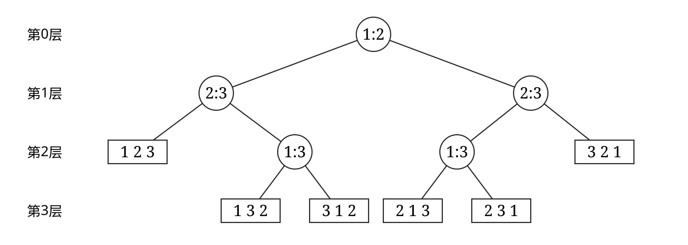

图 34　排序三个元素的比较树

图 34 代表一种排序方法, 它首先比较 $K_1$ 与 $K_2$; 如果 $K_1>K_2$, 则 (通过右子树) 比较 $K_2$ 与 $K_3$; 之后, 如果 $K_2<K_3$, 则比较 $K_1$ 与 $K_3$; 最后, 如果 $K_1>K_3$, 就知道 $K_2<K_3<K_1$. 实际排序算法通常还会在文件中移动键, 但这里我们仅关注比较, 所以忽略所有数据移动. 这棵树中 $K_i$ 与 $K_j$ 间的比较总是指原来的键 $K_i$ 和 $K_j$, 而不是重排记录之后当前占据文件第 $i$ 个和第 $j$ 个位置的键.

有可能做了多余的比较. 例如, 在图 35 中, 因为 $K_1<K_2$ 和 $K_2<K_3$ 已经隐含 $K_1<K_3$, 所以没有理由再比较 $3:1$. 没有哪个排列会对应于图 35 中 $3:1$ 结点的左子树, 所以算法的这一部分绝不会执行! 由于我们关注的是如何把比较次数降至最低, 所以可以假定不会进行冗余比较. 于是, 我们有一种扩展二叉树结构, 它的每个外部结点都对应于一个排列. 输入键的所有排列都是有可能的, 每个排列都定义了从根结点到某个外部结点的唯一路径. 由此可以推出, 在一棵排序 $n$ 个元素且没有冗余比较的比较树中, 恰有 $n!$ 个外部结点.

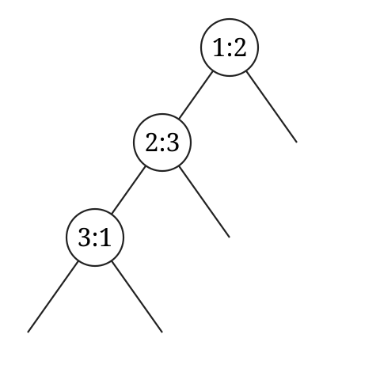

图 35　冗余比较举例

**最好的最差情形.** 第一个自然出现的问题就是寻找能够把最大比较次数降至最低的比较树. (稍后我们将考虑平均比较次数.)

设 $S(n)$ 表示足以排序 $n$ 个元素的最少比较次数. 如果一棵比较树中所有内部结点的层级都 $<k$, 则显然这棵树最多有 $2^k$ 个外部结点. 因此, 设 $k=S(n)$, 我们有

$$
n!\le2^{S(n)}.
$$

因为 $S(n)$ 是整数, 可以重写这个公式以获得下限

$$
S(n)\ge\lceil\lg n!\rceil.\tag{1}
$$

斯特林近似公式告诉我们

$$
\lceil\lg n!\rceil=n\lg n-n/\ln2+\tfrac12\lg n+O(1),\tag{2}
$$

因此, 大约需要 $n\lg n$ 次比较.

关系式 (1) 通常称为信息论下限, 因为信息论专家会说在排序期间将获得 $\lg n!$ “比特信息”. 每次比较最多产生 1 比特信息. 像图 34 那样的树也称为 “调查表”, 克劳德·皮卡尔最早对它们的数学性质进行了系统探讨 [*Théorie des Questionnaires* (Paris: Gauthier-Villars, 1965)].

在我们看到过的所有排序方法中, 需要最少比较的三种方法是: 二叉插入 (见 5.2.1 节)、树选择 (见 5.2.3 节) 和直接两路合并 (见算法 5.2.4L). 由习题 1.2.4–42 容易看出, 二叉插入的最大比较次数是

$$
B(n)=\sum_{k=1}^n\lceil\lg k\rceil=n\lceil\lg n\rceil-2^{\lceil\lg n\rceil}+1.\tag{3}
$$

习题 5.2.4–14 给出两路合并的最大比较次数. 在 5.3.3 节我们将看到, 树选择的比较次数上限, 或者与二叉插入相同, 或者与两路合并相同, 取决于这棵树的创建方式. 在所有这三种情况下, 都有渐近值 $n\lg n$. 结合 $S(n)$ 的下限和上限, 可以证明

$$
\lim_{n\to\infty}\frac{S(n)}{n\lg n}=1.\tag{4}
$$

这就得到了 $S(n)$ 的近似公式, 但我们还希望能够获得更为准确的信息. 下表给出当 $n$ 很小时上文讨论的下限和上限的确切值:

| $n=$ | 1 | 2 | 3 | 4 | 5 | 6 | 7 | 8 | 9 | 10 | 11 | 12 | 13 | 14 | 15 | 16 | 17 |
|---|---:|---:|---:|---:|---:|---:|---:|---:|---:|---:|---:|---:|---:|---:|---:|---:|---:|
| $\lceil\lg n!\rceil=$ | 0 | 1 | 3 | 5 | 7 | 10 | 13 | 16 | 19 | 22 | 26 | 29 | 33 | 37 | 41 | 45 | 49 |
| $B(n)=$ | 0 | 1 | 3 | 5 | 8 | 11 | 14 | 17 | 21 | 25 | 29 | 33 | 37 | 41 | 45 | 49 | 54 |
| $L(n)=$ | 0 | 1 | 3 | 5 | 9 | 11 | 14 | 17 | 25 | 27 | 30 | 33 | 38 | 41 | 45 | 49 | 65 |

这里的 $B(n)$ 和 $L(n)$ 分别对应于二叉插入和两路列表合并. 可以证明, 对于所有的 $n$ 有 $B(n)\le L(n)$ (见习题 2).

从上表可以看出 $S(4)=5$, 但 $S(5)$ 可以是 7 或者 8. 这把我们带回到 5.2 节开头阐述的问题: 排序五个元素的最佳方式是什么样的? 能否仅用七次比较完成对五个元素的排序?

回答是肯定的, 但要找到一种七步过程并不是特别容易. 在开始时, 首先比较 $K_1:K_2$, 然后是 $K_3:K_4$, 再比较这两对的较大元素. 这生成可以表示为

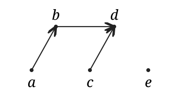(5)

的结构, 表明 $a<b<d$ 且 $c<d$. (绘制这样的有向图可以很方便地表示元素之间的已知顺序关系, $x$ 小于 $y$ 当且仅当图中存在从 $x$ 到 $y$ 的路径.) 这时, 为了把第 5 个元素 $K_5=e$ 插入到 $\{a,b,d\}$ 中的适当位置, 它首先与 $b$ 比较, 然后再与 $a$ 或 $d$ 比较, 所以只需要两次比较. 这样会得到如下四种可能结果之一:

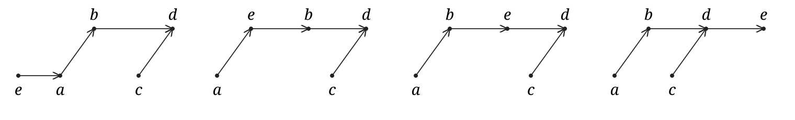

(6)

在每种情况下, 可以再用一两次比较, 把 $c$ 插入到小于 $d$ 的剩下元素当中. 德穆思最早提出这种排序五个元素的方法 [博士论文 (斯坦福大学, 1956 年), 41–43].

**合并插入.** 小莱斯特·福特和塞尔默·约翰逊发现了上述方法的一种令人满意的推广. 由于它既有合并的某些特性, 又有插入的某些特性, 所以称为合并插入. 例如, 考虑排序 21 个元素的问题. 首先比较十对键 $K_1:K_2,K_3:K_4,\ldots,K_{19}:K_{20}$, 然后利用合并插入比较这十对键中的较大元素. 结果得到类似 (5) 的结构

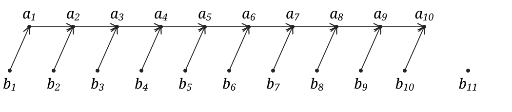

(7)

下一步是在 $\{b_1,a_1,a_2\}$ 中插入 $b_3$, 然后在其他小于 $a_2$ 的元素中插入 $b_2$, 从而得到结构

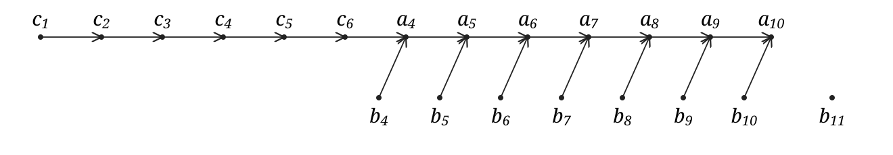

(8)

上一行元素称为主链. 可以用三次比较把 $b_5$ 插入到主链中的适当位置 (首先把它与 $c_4$ 比较, 然后是 $c_2$ 或 $c_6$, 等等), 然后再用三个步骤把 $b_4$ 移到主链中, 得到结构

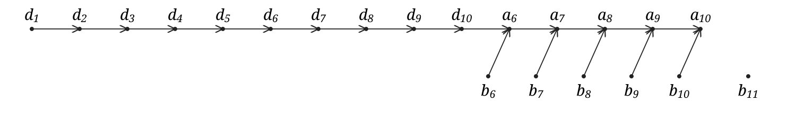

(9)

下一步非常关键, 知道接下来要做什么吗? 仅用四次比较就把 $b_{11}$ (而不是 $b_7$) 插入到主链中. 然后再把 $b_{10},b_9,b_8,b_7,b_6$ (按照这个顺序) 插入到主链中的适当位置, 每次插入最多使用四次比较.

仔细计算这里所涉及的比较次数将会看到: 排序 21 个元素最多需要 $10+S(10)+2+2+3+3+4+4+4+4+4+4=66$ 步. 由于 $2^{65}<21!<2^{66}$, 所以我们还知道在任何情况下也不可能少于 66 次比较. 因此

$$
S(21)=66.\tag{10}
$$

(二叉插入需要 74 次比较.)

一般来说, $n$ 个元素的合并插入过程如下:

(i) 逐对比较 $\lfloor n/2\rfloor$ 个不相交的元素对. (如果 $n$ 是奇数, 则剩下一个元素.)

(ii) 用合并插入来排序步骤 (i) 中找到的 $\lfloor n/2\rfloor$ 个较大数.

(iii) 像 (7) 那样命名元素 $a_1,a_2,\ldots,a_{\lfloor n/2\rfloor},b_1,b_2,\ldots,b_{\lceil n/2\rceil}$, 其中 $a_1\le a_2\le\cdots\le a_{\lfloor n/2\rfloor}$ 且对于 $1\le i\le\lfloor n/2\rfloor$ 有 $b_i\le a_i$, 称 $b_1$ 和各 $a$ 值为 “主链”. 利用二叉插入, 把剩下的各 $b$ 值按以下顺序 (去掉序列中满足 $j>\lceil n/2\rceil$ 的所有 $b_j$) 插入到主链中:

$$
b_3,b_2;\quad b_5,b_4;\quad b_{11},b_{10},\ldots,b_6;\quad\ldots;\quad b_{t_k},b_{t_k-1},\ldots,b_{t_{k-1}+1};\quad\ldots.\tag{11}
$$

我们希望定义序列 $(t_1,t_2,t_3,t_4,\ldots)=(1,3,5,11,\ldots)$, 它在 (11) 中的出现方式满足以下条件: $b_{t_k},b_{t_k-1},\ldots,b_{t_{k-1}+1}$ 中的每一个都可以通过最多 $k$ 次比较插入到主链中. 推广 (7) (8) (9), 我们得到

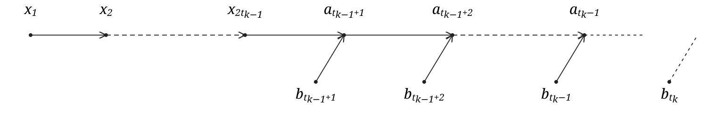

其中, 达到并包括 $a_{t_k-1}$ 的主链包含 $2t_{k-1}+(t_k-t_{k-1}-1)$ 个元素. 这个数必然小于 $2^k$, 我们的最好方法是把它置为等于 $2^k-1$, 使得

$$
t_{k-1}+t_k=2^k.\tag{12}
$$

由于 $t_1=1$, 为方便起见, 设 $t_0=1$, 利用几何级数求和公式可得

$$
\begin{aligned}
t_k&=2^k-t_{k-1}=2^k-2^{k-1}+t_{k-2}=\cdots=2^k-2^{k-1}+\cdots+(-1)^k2^0\\
&=\bigl(2^{k+1}+(-1)^k\bigr)/3.
\end{aligned}\tag{13}
$$

(奇怪的是, 计算两个整数的最大公因数的算法分析中也遇到这个序列, 见习题 4.5.2–36.)

设 $F(n)$ 是用合并插入方法排序 $n$ 个元素需要的比较次数. 显然

$$
F(n)=\lfloor n/2\rfloor+F(\lfloor n/2\rfloor)+G(\lceil n/2\rceil),\tag{14}
$$

其中 $G$ 表示步骤 (iii) 涉及的工作量. 如果 $t_{k-1}\le m\le t_k$, 对各部分求和可得

$$
G(m)=\sum_{j=1}^{k-1}j(t_j-t_{j-1})+k(m-t_{k-1})=km-(t_0+t_1+\cdots+t_{k-1}).\tag{15}
$$

设

$$
w_k=t_0+t_1+\cdots+t_{k-1}=\lfloor2^{k+1}/3\rfloor,\tag{16}
$$

使得 $(w_0,w_1,w_2,w_3,w_4,\ldots)=(0,1,2,5,10,21,\ldots)$. 习题 13 表明

$$
F(n)-F(n-1)=k\quad\text{当且仅当}\quad w_k<n\le w_{k+1},\tag{17}
$$

后一条件等价于

$$
\frac{2^{k+1}}3<n\le\frac{2^{k+2}}3,
$$

或者 $k+1<\lg3n\le k+2$, 因此

$$
F(n)-F(n-1)=\lceil\lg\tfrac34 n\rceil.\tag{18}
$$

(这个公式来自阿卜杜拉·哈迪安 [博士论文 (明尼苏达大学, 1969 年), 38–42].) 由此可得, $F(n)$ 有相当简单的表达式

$$
F(n)=\sum_{k=1}^n\lceil\lg\tfrac34 k\rceil,\tag{19}
$$

它十分类似于二叉插入的对应公式 (3). 习题 14 给出了这个和式的闭合式.

利用式 (19) 容易构造 $F(n)$ 表, 我们有

| $n=$ | 1 | 2 | 3 | 4 | 5 | 6 | 7 | 8 | 9 | 10 | 11 | 12 | 13 | 14 | 15 | 16 | 17 | 18 | 19 | 20 | 21 | 22 | 23 | 24 | 25 | 26 | 27 | 28 | 29 | 30 | 31 | 32 | 33 |
|---|---:|---:|---:|---:|---:|---:|---:|---:|---:|---:|---:|---:|---:|---:|---:|---:|---:|---:|---:|---:|---:|---:|---:|---:|---:|---:|---:|---:|---:|---:|---:|---:|---:|
| $\lceil\lg n!\rceil=$ | 0 | 1 | 3 | 5 | 7 | 10 | 13 | 16 | 19 | 22 | 26 | 29 | 33 | 37 | 41 | 45 | 49 | 53 | 57 | 62 | 66 | 70 | 75 | 80 | 84 | 89 | 94 | 98 | 103 | 108 | 113 | 118 | 123 |
| $F(n)=$ | 0 | 1 | 3 | 5 | 7 | 10 | 13 | 16 | 19 | 22 | 26 | 30 | 34 | 38 | 42 | 46 | 50 | 54 | 58 | 62 | 66 | 71 | 76 | 81 | 86 | 91 | 96 | 101 | 106 | 111 | 116 | 121 | 126 |

注意到对于 $1\le n\le11$ 和 $20\le n\le21$ 有 $F(n)=\lceil\lg n!\rceil$, 所以我们知道对于这些 $n$ 值合并插入是最优的:

$$
S(n)=\lceil\lg n!\rceil=F(n)\quad(n=1,\ldots,11,20,21).\tag{20}
$$

雨果·斯坦豪斯在他的经典著作第二版中提出了求解 $S(n)$ 的问题 [*Mathematical Snapshots*(牛津大学出版社, 1950 年), 38–39]. 他描述了二叉插入方法, 如果先把前 $n-1$ 个元素排好序, 再考虑第 $n$ 个元素, 则二叉插入方法是排序 $n$ 个元素的最佳可能方法. 他还推测, 二叉插入在一般情况下也是最优的. 几年后他报告说 [*Calcutta Math. Soc. Golden Jubilee Commemoration* **2** (1959), 323–327]: 他的两位同事斯坦尼斯瓦夫·特雷布拉和成平 “最近” 否定了他的推测, 他们还确定了 $n\le11$ 时的 $S(n)$. 特雷布拉和成平可能独立地发现了合并插入方法, 而发表这个方法的却是不久后的小福特和约翰逊 [*AMM* **66** (1959), 387–389].

在发现合并插入之后, $S(n)$ 的第一个未知值是 $S(12)$. 表 1 显示 $12!$ 非常接近 $2^{29}$, 所以不太可能存在 12 个元素的 29 步排序过程. 之后, 马克·韦尔斯执行了一次穷尽搜索 (在一台 Maniac II 计算机上运行了大约 60 个小时), 他发现 $S(12)=30$[*Proc. IFIP Congress 65* **2** (1965), 497–498;*Elements of Combinatorial Computing* (Pergamon, 1971), 213–215]. 因此, 合并插入过程对于 $n=12$ 也是最优的.

表 1　用二进制数表示的阶乘值

<table data-binary-factorials><tbody>
<tr><td>$(1)_2$</td><td>$=1!$</td></tr>
<tr><td>$(10)_2$</td><td>$=2!$</td></tr>
<tr><td>$(110)_2$</td><td>$=3!$</td></tr>
<tr><td>$(11000)_2$</td><td>$=4!$</td></tr>
<tr><td>$(1111000)_2$</td><td>$=5!$</td></tr>
<tr><td>$(1011010000)_2$</td><td>$=6!$</td></tr>
<tr><td>$(1001110110000)_2$</td><td>$=7!$</td></tr>
<tr><td>$(1001110110000000)_2$</td><td>$=8!$</td></tr>
<tr><td>$(1011000100110000000)_2$</td><td>$=9!$</td></tr>
<tr><td>$(1101110101111100000000)_2$</td><td>$=10!$</td></tr>
<tr><td>$(10011000010001010100000000)_2$</td><td>$=11!$</td></tr>
<tr><td>$(11100100011001111110000000000)_2$</td><td>$=12!$</td></tr>
<tr><td>$(101110011001010001100110000000000)_2$</td><td>$=13!$</td></tr>
<tr><td>$(1010001001100001110110010100000000000)_2$</td><td>$=14!$</td></tr>
<tr><td>$(10011000001110111011101110101100000000000)_2$</td><td>$=15!$</td></tr>
<tr><td>$(100110000011101110111011101011000000000000000)_2$</td><td>$=16!$</td></tr>
<tr><td>$(1010000110111111011101110110011011000000000000000)_2$</td><td>$=17!$</td></tr>
<tr><td>$(10110101111101110110011001010011100110000000000000000)_2$</td><td>$=18!$</td></tr>
<tr><td>$(110110000001010111001001100000110100010010000000000000000)_2$</td><td>$=19!$</td></tr>
<tr><td>$(10000111000011011001110111110010000010101101000000000000000000)_2$</td><td>$=20!$</td></tr>
</tbody></table>

**\*稍微深入的分析.** 为了更仔细地研究 $S(n)$, 让我们更深入地考察像 (5) 那样的偏序图. 我们可以用有向图来表示进行若干次比较之后获得的信息. 考虑到 $<$ 关系的传递性, 这个有向图中不包含回路, 所以图中所有有向弧都可以绘制成从左向右, 因此去掉图中的箭头很方便. 这样, (5) 就变成了

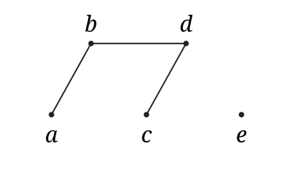(21)

如果 $G$ 是这样一个有向图, 设 $T(G)$ 是与 $G$ 一致的排列的数目, 也就是可以有多少种方式把整数 $\{1,2,\ldots,n\}$ 指定给 $G$ 的顶点, 使得在 $G$ 中每当有 $x\to y$, 顶点 $x$ 上的数总是小于顶点 $y$ 上的数. 例如, 与 (21) 一致的排列之一是 $a=1,b=4,c=2,d=5,e=3$. 我们在 5.1.4 节研究了各种 $G$ 的 $T(G)$, 当时观察到, $T(G)$ 是可以对 $G$ 进行拓扑排序的方式数.

如果 $G$ 是在进行 $k$ 次比较之后获得的 $n$ 元素图, 我们定义 $G$ 的效率为

$$
E(G)=\frac{n!}{2^kT(G)}.\tag{22}
$$

(这个思想来源于黄光明和林牲.) 严格来说, 效率并不只是图 $G$ 的函数, 它还依赖于排序过程中获得 $G$ 的方式. 不过, 我们在叙述时稍微 “粗心” 一点会比较方便. 每增加一次比较 (元素 $i$ 和 $j$ 之间的比较), 可以得到两个图 $G_1$ 和 $G_2$, 一个对应于情形 $K_i<K_j$, 一个对应于情形 $K_i>K_j$. 显然 $T(G)=T(G_1)+T(G_2)$. 如果 $T(G_1)\ge T(G_2)$, 我们有

$$
T(G)\le2T(G_1),
$$

$$
E(G_1)=\frac{n!}{2^{k+1}T(G_1)}=\frac{E(G)T(G)}{2T(G_1)}\le E(G).\tag{23}
$$

因此, 每次比较都会得到至少一个效率相同或更小的图. 不可能通过进行更多的比较来提高效率.

当 $G$ 全然没有弧时, 我们有 $k=0$ 和 $T(G)=n!$, 所以初始效率为 1. 在另一极端, 当 $G$ 表示的是最终排序结果时, 它看起来像一条直线, 而且 $T(G)=1$. 例如, 如果希望找到一个排序过程, 最多用七步完成对五个元素的排序, 就必须获得效率是 $5!/(2^7\times1)=120/128=15/16$ 的线性图 . 由此可以推出, 排序过程中出现的所有图都必然有 $\ge\tfrac{15}{16}$ 的效率. 因为如果出现任何效率更低的图, 它的至少一个子孙也是低效率的, 最终会得到一个效率 $<\tfrac{15}{16}$ 的线性图. 一般来说, 这一论证过程证明是: 对应于 $n$ 元素排序过程的树结点的所有图都必然有 $\ge n!/2^l$ 的效率, 其中 $l$ 是树的层数 (不计外部结点). 这是证明 $S(n)\ge\lceil\lg n!\rceil$ 的另一种方式, 尽管这个论证过程和我们前面所说的过程实际上没有多少不同.

图 (21) 的效率是 1, 这是因为 $T(G)=15$, 并且 $G$ 是通过三次比较获得的. 为了知道下一步要比较哪些顶点, 可以构造比较矩阵

$$
C(G)=\begin{array}{cc}
&\begin{array}{rrrrr}a&\phantom0b&\phantom0c&\phantom0d&\phantom0e\end{array}\\
\begin{array}{r}a\\b\\c\\d\\e\end{array}&\left(\begin{array}{rrrrr}
0&15&10&15&11\\
0&0&5&15&7\\
5&10&0&15&9\\
0&0&0&0&3\\
4&8&6&12&0
\end{array}\right)
\end{array},\tag{24}
$$

其中 $C_{ij}$ 是向 $G$ 中添加弧 $i\to j$ 所得图 $G_1$ 的 $T(G_1)$. 例如, 如果比较 $K_c$ 与 $K_e$, 与 $G$ 一致的 15 个排列将分裂为 $K_e<K_c$ 的 $C_{ec}=6$ 个和 $K_c<K_e$ 的 $C_{ce}=9$ 个. 后一个图的效率是 $15/(2\times9)=\tfrac56<\tfrac{15}{16}$, 所以它不可能给出一个七步排序过程. 为了保持效率 $\ge\tfrac{15}{16}$, 下一次比较必然是 $K_b:K_e$.

在考虑图的连通分量时, 效率的概念尤其有用. 例如, 考虑下图

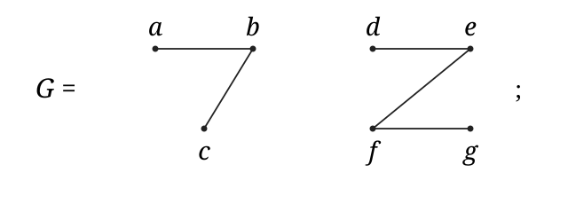

它有两个分量

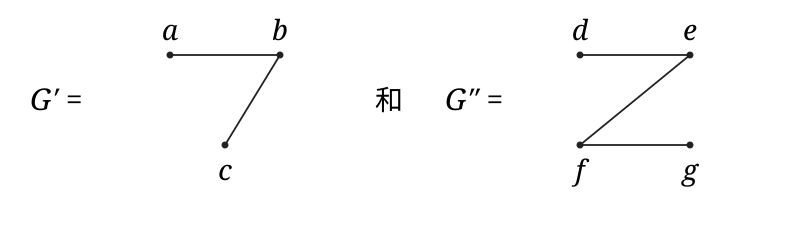

由于没有连接 $G'$ 和 $G''$ 的弧, 所以它是通过完全在 $G'$ 中进行的一些比较和完全在 $G''$ 中进行的另一些比较形成的. 一般来说, 假定 $G=G'\oplus G''$, 在 $G'$ 和 $G''$ 之间不存在弧, $G'$ 和 $G''$ 分别有 $n'$ 和 $n''$ 个顶点, 容易看出

$$
T(G)=\binom{n'+n''}{n'}T(G')T(G''),\tag{25}
$$

这是因为 $G$ 的每个一致排列都是通过以下方式得到的: 选择 $n'$ 个元素指定给 $G'$, 然后独立找出 $G'$ 和 $G''$ 的一致排列. 如果已经在 $G'$ 中进行了 $k'$ 次比较, 在 $G''$ 中进行了 $k''$ 次比较, 则有基本结果

$$
E(G)=\frac{(n'+n'')!}{2^{k'+k''}T(G)}=\frac{n'!}{2^{k'}T(G')}\frac{n''!}{2^{k''}T(G'')}=E(G')E(G''),\tag{26}
$$

表明图的效率与其分量的效率之间存在一种简单的关联方式. 因此, 我们可以只考虑仅有一个分量的图.

现在假定 $G'$ 和 $G''$ 都是仅包含一个分量的图, 假定我们通过比较 $G'$ 中的顶点 $x$ 和 $G''$ 中的顶点 $y$ 而把这两个图勾连在一起. 我们希望知道它的效率如何. 为此, 需要一个表示为

$$
\left(\begin{matrix}p\\m\end{matrix}\!<\!\begin{matrix}q\\n\end{matrix}\right),\tag{27}
$$

的函数, 定义为与

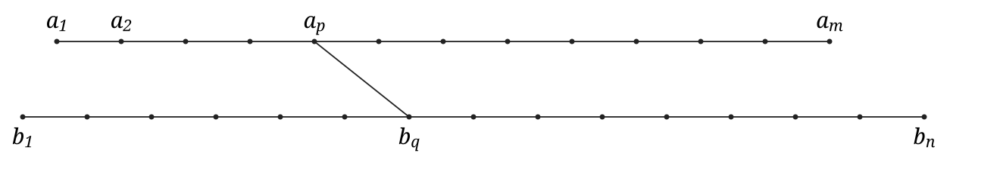

(28)

一致的排列数. 于是 $\left(\begin{matrix}p\\m\end{matrix}\!<\!\begin{matrix}q\\n\end{matrix}\right)$ 等于 $\binom{m+n}{m}$ 乘以一个概率值, 即一组 $m$ 个数中第 $p$ 个最小值小于另一组 $n$ 个数中第 $q$ 个最小值的概率 (这两个最小值的选择是相互独立的). 习题 17 表明, 可以用二项式系数以两种方式表达 $\left(\begin{matrix}p\\m\end{matrix}\!<\!\begin{matrix}q\\n\end{matrix}\right)$:

$$
\begin{aligned}
\left(\begin{matrix}p\\m\end{matrix}\!<\!\begin{matrix}q\\n\end{matrix}\right)&=\sum_{0\le k<q}\binom{m-p+n-k}{m-p}\binom{p-1+k}{p-1}\\
&=\sum_{p\le j\le m}\binom{n-q+m-j}{n-q}\binom{q-1+j}{q-1}.
\end{aligned}\tag{29}
$$

(顺便提一下, 从代数领域来看, 绝对不容易看出这些二项式系数乘积的两个和居然会相等.) 我们还有以下公式:

$$
\left(\begin{matrix}p\\m\end{matrix}\!<\!\begin{matrix}q\\n\end{matrix}\right)+\left(\begin{matrix}q\\n\end{matrix}\!<\!\begin{matrix}p\\m\end{matrix}\right)=\binom{m+n}{m};\tag{30}
$$

$$
\left(\begin{matrix}q\\n\end{matrix}\!<\!\begin{matrix}p\\m\end{matrix}\right)=\left(\begin{matrix}m+1-p\\m\end{matrix}\!<\!\begin{matrix}n+1-q\\n\end{matrix}\right);\tag{31}
$$

$$
\left(\begin{matrix}p\\m\end{matrix}\!<\!\begin{matrix}q\\n\end{matrix}\right)=\left(\begin{matrix}p\\m-1\end{matrix}\!<\!\begin{matrix}q\\n\end{matrix}\right)+\left(\begin{matrix}p\\m\end{matrix}\!<\!\begin{matrix}q\\n-1\end{matrix}\right)+[p\le m][q=n]\binom{m+n-1}{m}.\tag{32}
$$

为确定起见, 现在考虑两个图

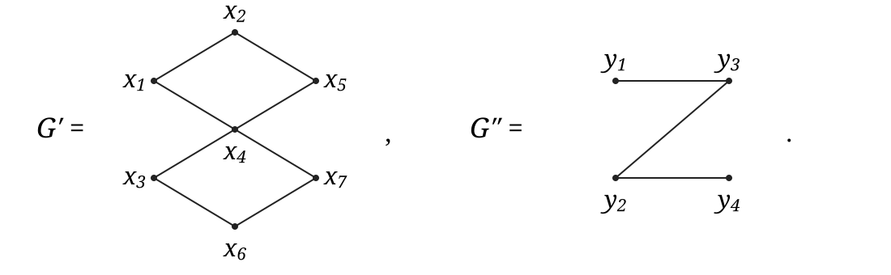

(33)

通过直接枚举不难证明 $T(G')=42$ 和 $T(G'')=5$. 所以如果 $G$ 是以 $G'$ 和 $G''$ 为分量的 11 个顶点的图, 根据式 (25) 我们有 $T(G)=\binom{11}{4}\cdot42\cdot5=69300$. 如果我们希望知道有多少排列满足 $x_i<y_j$ (对于每个 $i$ 和 $j$), 这个数目列举起来有些让人恐惧. 但这个计算过程可以在一个小时内手工完成, 如下所示. 构造矩阵 $A(G')$ 和 $A(G'')$, 其中 $A_{ik}$ 是 $G'$ (或 $G''$) 中满足 $x_i$ (或 $y_i$) 等于 $k$ 的一致排列数目. 因此, $G$ 中满足 $x_i<y_j$ 的排列数目等于 $A(G')$ 的 $(i,p)$ 元素乘以 $\left(\begin{matrix}p\\7\end{matrix}\!<\!\begin{matrix}q\\4\end{matrix}\right)$ 再乘以 $A(G'')$ 的 $(j,q)$ 元素, 对 $1\le p\le7$ 和 $1\le q\le4$ 求和. 换句话说, 我们希望构造矩阵乘积 $A(G')\cdot L\cdot A(G'')^T$, 其中 $L_{pq}=\left(\begin{matrix}p\\7\end{matrix}\!<\!\begin{matrix}q\\4\end{matrix}\right)$. 这就是

$$
\begin{pmatrix}21&16&5&0&0&0&0\\0&5&10&12&10&5&0\\21&16&5&0&0&0&0\\0&0&12&18&12&0&0\\0&0&0&0&5&16&21\\0&5&10&12&10&5&0\\0&0&0&0&5&16&21\end{pmatrix}\begin{pmatrix}210&294&322&329\\126&238&301&325\\70&175&265&315\\35&115&215&295\\15&65&155&260\\5&29&92&204\\1&8&36&120\end{pmatrix}\begin{pmatrix}2&3&0&0\\2&2&0&1\\1&0&2&2\\0&0&3&2\end{pmatrix}=\begin{pmatrix}48169&42042&66858&64031\\22825&16005&53295&46475\\48169&42042&66858&64031\\22110&14850&54450&47190\\5269&2442&27258&21131\\22825&16005&53295&46475\\5269&2442&27258&21131\end{pmatrix}.
$$

因此, 把 $G'$ 和 $G''$ 勾连在一起的 “最佳” 方式是比较 $x_1$ 和 $y_2$, $x_1<y_2$ 的情形有 42042 种, $x_1>y_2$ 的情形有 $69300-42042=27258$ 种. (根据对称性, 也可以比较 $x_3$ 和 $y_2$、$x_5$ 和 $y_3$ 或 $x_7$ 和 $y_3$, 得出本质上相同的结果.) 对于 $x_1<y_2$, 所得图的效率是

$$
\frac{69300}{84084}E(G')E(G''),
$$

这个结果一点也不好. 因此, 在任何排序方法中, 把 $G'$ 和 $G''$ 勾连在一起可能都是一个坏主意. 这个示例的要点在于, 我们不需要过多的计算就能做出这样一个判断.

这些思想可以用来为韦尔斯对 $S(12)=30$ 的证明提供独立确认. 从包含一个顶点的图出发, 我们可以重复尝试向图 $G$ 之一或向 $G'\oplus G''$ (一对图分量 $G'$ 和 $G''$) 添加比较, 使所得到的两个图的顶点数不超过 12、效率 $\ge12!/2^{29}\approx0.89221$. 只要有可能, 我们就把得到的效率最低的图添加到我们的集合中, 除非这两个图之一与集合中已有的某个图同构. 如果得到的两个图具有相同效率, 则任选其一. 可以认为一个图与其对偶 (通过颠倒顺序得到) 是一样的, 只要我们既考虑向 $G'\oplus G''$ 添加比较, 也考虑向 $G'\oplus\operatorname{对偶}(G'')$ 添加比较. 图 36 显示了通过这种方式获得的一些最小图和它们的效率.

在这个过程结束之前, 计算机恰好生成 1649 个图. 由于未得到图 , 我们可以得出结论 $S(12)>29$. 通过类似实验在不太长的时间内推导出 $S(22)>70$ 完全说得通, 因为 $22!/2^{70}\approx0.952$ 表明需要极高的效率才能在 70 步内完成排序. (在顶点数不超过 12 的 1649 个图中, 只有 91 个具有如此高的效率.)

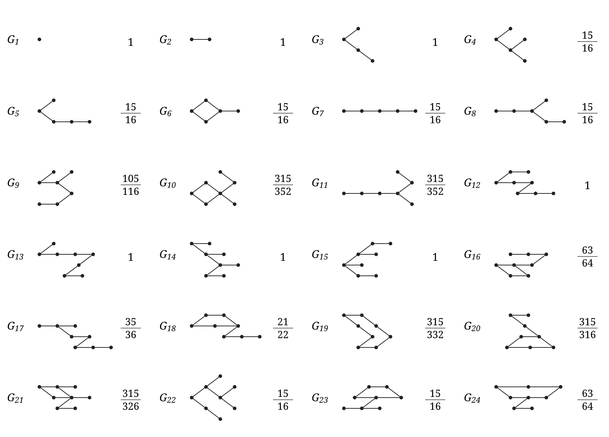

图 36　在对 $S(12)>29$ 的冗长证明的开头几步中获得的一些图和它们的效率

马尔钦·派曹尔斯基扩展了韦尔斯的方法 [见 *Algorithmica* **40** (2004), 133–145;*Information Proc. Letters* **101** (2007), 126–128], 并证明 $S(13)=34,S(14)=38,S(15)=42,S(22)=71$. 因此, 在这些情况下, 合并插入是最优的. 直觉上, 似乎有那么一天可以证明 $S(16)<F(16)$, 这是因为, 如果先用 $S(10)$ 次比较排序十个元素, 然后用二叉插入逐次插入其他六个元素, 与之相比 $F(16)$ 需要的步骤绝不会更少. 必定有一种方式可以改进它! 但目前, 确知 $F(n)$ 不是最佳的最小情形是 $n=47$: 先用 $F(5)+F(42)=178$ 次比较排序 5 个和 42 个元素, 再用尤尔根·蒙廷提出的一种方法 [*Theoretical Comp. Sci.* **14** (1981), 19–37], 以另外 22 次比较合并这些结果, 这个策略击败了 $F(47)=201$. (在这之前, 格伦·马纳彻尔已经证明: 从 $n=189$ 开始, 有无穷多个 $n$ 满足 $S(n)<F(n)$[*JACM* **26** (1979), 441–456].)

**平均比较次数.** 到目前为止, 我们一直在考虑一些所谓的最佳过程, 也就是说它们的最差情况不是太坏. 换句话说, 我们已经寻找过使最大比较次数降到最低的 “最大值最小化” 过程. 现在我们要寻找使平均比较次数降到最低的 “平均值最小化” 过程, 假定输入随机, 也就是每个排列出现的可能性相同.

再次考虑排序过程的树表示, 如图 34 所示. 对所有排列求平均, 这棵树中的平均比较次数是

$$
\frac{2+3+3+3+3+2}{6}=2\tfrac23.
$$

一般来说, 一种排序方法的平均比较次数等于树的外部路径长度除以 $n!$. (回想一下, 外部路径长度是根结点到每个外部结点的距离之和, 见 2.3.4.5 节.) 从 2.3.4.5 节的一些考虑容易看出, 在具有 $N$ 个外部结点的二叉树中, 假定根结点位于第 0 层, 令 $q=\lceil\lg N\rceil$, 如果第 $q-1$ 层有 $2^q-N$ 个外部结点, 第 $q$ 层有 $2N-2^q$ 个外部结点, 则这棵树具有最短外部路径长度. 因此, 最短外部路径长度是

$$
(q-1)(2^q-N)+q(2N-2^q)=(q+1)N-2^q.\tag{34}
$$

我们也可以用另一种有趣的方式描述最短路径长度的特性: 对于具有给定数目外部结点的扩展二叉树, 当且仅当存在一个数 $l$, 使得所有外部结点都出现在第 $l$ 层和第 $l+1$ 层, 则这棵树具有最短外部路径长度. (见习题 20.)

如果令 $q=\lg N+\theta$, 其中 $0\le\theta<1$, 最短外部路径长度的公式变成

$$
N(\lg N+1+\theta-2^\theta).\tag{35}
$$

函数 $1+\theta-2^\theta$ 如图 37 所示, 对于 $0<\theta<1$, 它是正值, 但非常小, 绝不会超过

$$
1-(1+\ln\ln2)/\ln2=0.08607\;13320\;55934+.\tag{36}
$$

因此, 式 (35) 除以 $N$ 得到的最少平均比较次数绝不会小于 $\lg N$, 也绝不会大于 $\lg N+0.0861$. (安德鲁·格利森在 1956 年的一份 IBM 内部备忘录中首先给出这个结果.)

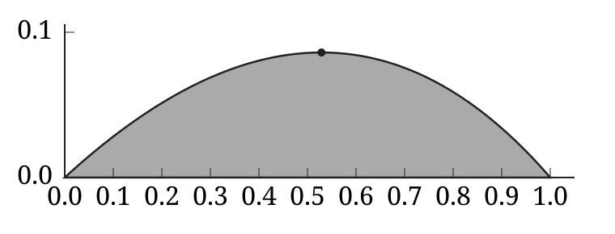

图 37　函数 $1+\theta-2^\theta$

现在, 令 $N=n!$, 将得到任意排序方案平均比较次数的下限. 从渐近角度看, 这个下限是

$$
\lg n!+O(1)=n\lg n-n/\ln2+O(\log n).\tag{37}
$$

设 $\overline F(n)$ 是合并插入算法执行的平均比较次数. 我们有

| $n=$ | 1 | 2 | 3 | 4 | 5 | 6 | 7 | 8 |
|---|---:|---:|---:|---:|---:|---:|---:|---:|
| 式 (34) 给出的下限 $=$ | 0 | 2 | 16 | 112 | 832 | 6896 | 62368 | 619904 |
| $n!\,\overline F(n)=$ | 0 | 2 | 16 | 112 | 832 | 6912 | 62784 | 623232 |

于是, 对于 $n\le5$, 合并插入在两种意义下都是最优的, 但对于 $n=6$ 而言, 它的平均比较次数是 $6912/720=9.6$, 而上文给出的下限表明平均比较次数 $6896/720=9.577777\ldots$ 是可能的. 稍加思索就能想明白它为什么会成立: 合并插入可以仅用八次比较就把某些六元素 “幸运” 排列排好顺序, 所以比较树在三个层次而非两个层次上出现外部结点. 这样会使整体路径长度变得更大. 习题 24 表明, 有可能构造在每种情况下都需要九次或十次比较的六元素排序过程. 由此可知, 这个方法的平均性能优于合并插入, 最差性能也不会比合并插入更糟糕.

当 $n=7$ 时, 伊夫·塞萨里证明了没有排序方法能够达到外部路径长度的下限 62368[毕业论文 (巴黎大学, 1968 年), 第 37 页]. (利用习题 22 的结果, 不需要计算机也能证明这个事实.) 另一方面, 他还构造了一些过程, 可以在 $n=9$ 或 10 时实现下限 (34). 一般来说, 使平均比较次数最小化的问题比确定 $S(n)$ 的问题实质上更困难. 对于某些 $n$ 值, 甚至可能存在这样的情况: 所有使平均比较次数最小化的方法在最差情况下都需要超过 $S(n)$ 次比较.

#### 习题

**1. [20]** 绘制使用以下两种方法排序四个元素的比较树: (a) 二叉插入; (b) 直接两路合并. 这些树的外部路径长度是多少?　[答案](./answers/5-3-1.md#ans-5-3-1-1)

**2. [M24]** 证明 $B(n)\le L(n)$, 并找出使等号成立的所有 $n$ 值.　[答案](./answers/5-3-1.md#ans-5-3-1-2)

**3. [M22]** (弱序) 如果允许存在相等键, 排序三个元素时有 13 种可能结果:　[答案](./answers/5-3-1.md#ans-5-3-1-3)

$$
\begin{gathered}
K_1=K_2=K_3,\quad K_1=K_2<K_3,\quad K_1=K_3<K_2,\quad K_2=K_3<K_1,\quad K_1<K_2=K_3,\\
K_2<K_1=K_3,\quad K_3<K_1=K_2,\quad K_1<K_2<K_3,\quad K_1<K_3<K_2,\quad K_2<K_1<K_3,\\
K_2<K_3<K_1,\quad K_3<K_1<K_2,\quad K_3<K_2<K_1.
\end{gathered}
$$

设 $P_n$ 表示在允许存在相等键时排序 $n$ 个元素的可能结果数目, 于是 $(P_0,P_1,P_2,P_3,P_4,P_5,\ldots)=(1,1,3,13,75,541,\ldots)$. 证明: 生成函数 $P(z)=\sum_{n\ge0}P_nz^n/n!$ 等于 $1/(2-e^z)$. 提示: 证明

$$
P_n=\sum_{k>0}\binom nkP_{n-k}\quad(n>0).
$$

**4. [HM27]** (奥利弗·格罗斯) 试确定习题 3 的数 $P_n$ 在 $n\to\infty$ 时的渐近值. [可能的提示: 考虑 $\cot z$ 的部分分式展开.]　[答案](./answers/5-3-1.md#ans-5-3-1-4)

**5. [16]** 当键值可以相等时, 每次比较可能有三种 (而不是两种) 结果: $K_i<K_j,K_i=K_j,K_i>K_j$. 这种一般情形的排序算法可以表示为扩展三叉树, 在这种树中, 每个内部结点 $i:j$ 有三棵子树, 左、中、右子树分别对应于比较的三种可能结果.　[答案](./answers/5-3-1.md#ans-5-3-1-5)

试绘制一棵扩展三叉树, 用来定义允许相等键且 $n=3$ 的排序算法. 这棵树应当有 13 个外部结点, 对应于习题 3 所列的 13 种可能结果.

**▶ 6. [M22]** 假定每次比较会像习题 5 中那样有三种结果, 设 $S'(n)$ 表示最少需要多少次比较才能排序 $n$ 个元素并确定各键之间的所有相等关系. 可以很轻松地对正文中的 “信息论” 论证过程加以推广, 用于证明 $S'(n)\ge\lceil\log_3P_n\rceil$, 其中 $P_n$ 是习题 3 和习题 4 中研究的函数. 请证明: 事实上, $S'(n)=S(n)$.　[答案](./answers/5-3-1.md#ans-5-3-1-6)

**7. [20]** 试绘制习题 5 意义下的扩展三叉树, 用于排序四个元素, 已知所有键都是 0 或 1. (于是, 如果 $K_1<K_2$ 且 $K_3<K_4$, 则可以知道 $K_1=K_3$ 且 $K_2=K_4$!) 请使用最少平均比较次数, 假定 $2^4$ 个可能输入的出现概率相同. 请找出所有存在的相等关系. 例如, 在仅知道 $K_1\le K_2\le K_3\le K_4$ 时, 不要停止排序.　[答案](./answers/5-3-1.md#ans-5-3-1-7)

**8. [26]** 像习题 7 中那样绘制扩展三叉树, 用于排序四个元素, 已知所有键都是 $-1,0,+1$ 之一. 请使用最少平均比较次数, 假定 $3^4$ 个可能输入的出现概率相同.　[答案](./answers/5-3-1.md#ans-5-3-1-8)

**9. [M20]** 像习题 7 中那样排序 $n$ 个元素, 已知所有键都是 0 或 1, 最差情况下最少比较次数是多少?　[答案](./answers/5-3-1.md#ans-5-3-1-9)

**▶ 10. [M25]** 像习题 7 中那样排序 $n$ 个元素, 已知所有键都是 0 或 1, 最少平均比较次数是多少? (表示为 $n$ 的函数.)　[答案](./answers/5-3-1.md#ans-5-3-1-10)

**11. [HM27]** 像习题 5 中那样排序 $n$ 个元素, 已知所有键都是集合 $\{1,2,\ldots,m\}$ 中的数, 设 $S_m(n)$ 是最差情况下需要的最少比较次数. [于是, 根据习题 6, $S_n(n)=S(n)$.] 试证明: 对于固定的 $m$, 当 $n\to\infty$ 时, $S_m(n)$ 趋近于 $n\lg m+O(1)$.　[答案](./answers/5-3-1.md#ans-5-3-1-11)

**▶ 12. [M25]** (威拉德·布里西尤斯, 约 1954 年) 假定可以出现相等键, 但只需排序元素 $\{K_1,K_2,\ldots,K_n\}$, 找出满足 $K_{a_1}\le K_{a_2}\le\cdots\le K_{a_n}$ 的排列 $a_1a_2\ldots a_n$, 我们不需要知道 $K_{a_i}$ 和 $K_{a_{i+1}}$ 是否相等.　[答案](./answers/5-3-1.md#ans-5-3-1-12)

有一棵比较树 (这棵树是二叉树, 而不是三叉树), 对于满足 $K_i=K_j$ 的结点 $i:j$, 如果无论选取它下面的哪个分支, 都能在上述意义下完成对键序列的排序, 则称为强排序.

(a) 证明: 没有冗余比较的比较树能够强排序任何键序列, 当且仅当它能够排序任何键值各不相同的键序列.

(b) 证明: 一棵比较树能够强排序任何键序列, 当且仅当它能够强排序任何由 0 和 1 组成的序列.

**13. [M28]** 证明式 (17).　[答案](./answers/5-3-1.md#ans-5-3-1-13)

**14. [M24]** 试求和式 (19) 的闭合式.　[答案](./answers/5-3-1.md#ans-5-3-1-14)

**15. [M21]** 确定 $B(n)$ 和 $F(n)$ 的渐近特性, 精确到 $O(\log n)$. [提示: 证明对于这两个函数, $n$ 的系数都包含图 37 所示的函数.]　[答案](./answers/5-3-1.md#ans-5-3-1-15)

**16. [HM26]** (黄光明和林牲) 证明: 当 $n\ge22$ 时 $F(n)>\lceil\lg n!\rceil$.

**17. [M20]** 证明式 (29).　[答案](./answers/5-3-1.md#ans-5-3-1-17)

**18. [20]** 某过程的前几步如图 36 所示, 如果它生成效率为 $12!/2^{29}$ 的线性图 , 这是否已经证明 $S(12)=29$?　[答案](./answers/5-3-1.md#ans-5-3-1-18)

**19. [40]** 在设计比较树时, 为确定接下来应当比较哪一对元素, 用以下启发式规则试验: 在排序 $\{K_1,\ldots,K_n\}$ 的每个阶段, 对于 $1\le i\le n$, 设 $u_i$ 表示通过前面所做比较而知道的 $\le K_i$ 的键数, $v_i$ 表示已知 $\ge K_i$ 的键数. 重新编号这些键, 使 $u_i/v_i$ 递增, 即 $u_1/v_1\le u_2/v_2\le\cdots\le u_n/v_n$. 现在对于某个使 $|u_iv_{i+1}-u_{i+1}v_i|$ 最小的 $i$ 值, 比较 $K_i:K_{i+1}$. (尽管这个方法所依据的信息要远远少于式 (24) 中的完全比较矩阵, 但它在许多情况下似乎也能给出最优结果.)

**▶ 20. [M26]** 证明: 对于一棵扩展二叉树, 当且仅当存在一个数 $l$, 使其所有外部结点都出现在第 $l$ 层和第 $l+1$ 层 (可能所有外部结点都出现在第 $l$ 层), 该扩展二叉树具有最短外部路径长度.　[答案](./answers/5-3-1.md#ans-5-3-1-20)

**21. [M21]** 扩展二叉树的高度是它的外部结点的最大层数. 如果 $x$ 是扩展二叉树的内部结点, 设 $t(x)$ 表示 $x$ 之下的外部结点数, 并设 $l(x)$ 表示 $x$ 左子树的根结点. 如果 $x$ 是外部结点, 设 $t(x)=1$. 证明: 在结点数相同的所有二叉树中, 如果对于所有内部结点 $x$ 都有　[答案](./answers/5-3-1.md#ans-5-3-1-21)

$$
|t(x)-2t(l(x))|\le2^{\lceil\lg t(x)\rceil}-t(x),
$$

则该扩展二叉树的高度最小.

**22. [M24]** 继续习题 21, 证明: 在结点数相同的所有二叉树中, 当且仅当对于所有内部结点 $x$ 都有　[答案](./answers/5-3-1.md#ans-5-3-1-22)

$$
|t(x)-2t(l(x))|\le2^{\lceil\lg t(x)\rceil}-t(x)\quad\text{和}\quad |t(x)-2t(l(x))|\le t(x)-2^{\lfloor\lg t(x)\rfloor},
$$

该二叉树的外部路径长度最短. [例如, 如果 $t(x)=67$, 必然有 $t(l(x))=32,33,34$ 或 35. 如果我们只是希望将树的高度降至最低, 根据上一道习题, 可以有 $3\le t(l(x))\le64$.]

**23. [10]** 正文中证明了: 任意 $n$ 元素排序方法执行的平均比较次数至少为 $\lceil\lg n!\rceil\approx n\lg n$. 但多列表插入方法 (程序 5.2.1M) 平均只需要 $O(n)$ 个单位时间. 这是如何做到的?　[答案](./answers/5-3-1.md#ans-5-3-1-23)

**24. [27]** (皮卡尔) 试给出一棵所有外部结点都出现在第 10 层和第 11 层的六元素排序树.　[答案](./answers/5-3-1.md#ans-5-3-1-24)

**25. [11]** 如果存在一种七元素排序过程, 达到式 (34) 所预测的最小平均比较次数, 那么在第 13 层会有多少个外部结点?　[答案](./answers/5-3-1.md#ans-5-3-1-25)

**26. [M42]** 试求平均比较次数最低的七元素排序过程.　[答案](./answers/5-3-1.md#ans-5-3-1-26)

**▶ 27. [20]** 假定以下各种情形 $K_1<K_2<K_3,K_1<K_3<K_2,K_2<K_1<K_3,K_2<K_3<K_1,K_3<K_1<K_2,K_3<K_2<K_1$ 发生的概率分别是 0.01、0.25、0.01、0.24、0.25、0.24. 试找出排序这三个元素的平均比较次数最小的比较树.　[答案](./answers/5-3-1.md#ans-5-3-1-27)

**28. [40]** 编写 MIX 程序, 在最短时间内排序五个单字长键, 然后停机. (关于基本规则, 见 5.2 节开头.)　[答案](./answers/5-3-1.md#ans-5-3-1-28)

**29. [M25]** (斯蒂芬·蔡斯) 设 $a_1a_2\ldots a_n$ 是 $\{1,2,\ldots,n\}$ 的排列, 证明: 任何仅依靠比较各个 $a$ 值来判断这个排列的奇偶性 (即它的反序数目的奇偶性) 的算法至少要进行 $n\lg n$ 次比较, 尽管这个算法仅有两种可能的结果.　[答案](./answers/5-3-1.md#ans-5-3-1-29)

**30. [M23]** (最优交换排序)5.2.2 节中定义的每种交换排序算法都可以表示为比较交换树, 也就是一种二叉树结构, 内部结点拥有 $i:j$($i<j$) 的形式, 该结点可以解读为以下操作: “如果 $K_i\le K_j$, 则取树的左分支, 继续下一步; 如果 $K_i>K_j$, 则交换记录 $i$ 和记录 $j$, 取树的右分支, 继续下一步.” 当遇到一个外部结点时, $K_1\le K_2\le\cdots\le K_n$ 必然为真. 因此, 比较交换树与比较树的区别在于, 它在规定比较操作的同时还指定了数据移动.　[答案](./answers/5-3-1.md#ans-5-3-1-30)

设 $S_e(n)$ 表示以比较交换树方式排序 $n$ 个元素在最差情况下需要的最少比较交换次数. 证明: $S_e(n)\le S(n)+n-1$.

**31. [M38]** 继续习题 30, 证明 $S_e(5)=8$.　[答案](./answers/5-3-1.md#ans-5-3-1-31)

**32. [M42]** 继续习题 31, 对大于 5 的较小 $n$ 值研究 $S_e(n)$.

**33. [M30]** (托马斯·希巴德) 阶为 $x$、分辨率为 $\delta$ 的实数值查找树是一棵扩展二叉树, 其中所有结点都包含一个非负实数值, 使得: (i) 每个外部结点的值都 $\le\delta$, (ii) 每个内部结点的值至多为它的两个子结点的取值之和, (iii) 根结点的值是 $x$. 这样一棵树的加权路径长度定义为: 对所有外部结点, 把结点包含的值乘以结点所在层级, 然后求和.　[答案](./answers/5-3-1.md#ans-5-3-1-33)

证明: 一棵阶为 $x$、分辨率为 1 的实数值查找树, 在同阶同分辨率的所有这样的树中具有最短加权路径长度的充分必要条件是 (ii) 中的等号成立, 并且对包含于兄弟结点中的所有值对 $x_0$ 和 $x_1$, 都满足以下附加条件: (iv) 不存在整数 $k\ge0$ 使得 $x_0<2^k<x_1$ 或 $x_1<2^k<x_0$, (v) $\lceil x_0\rceil-x_0+\lceil x_1\rceil-x_1<1$. (特别地, 如果 $x$ 是整数, 则条件 (v) 隐含着树中的所有值都是整数, 条件 (iv) 等价于习题 22 的结果.)

另请证明: 相应的最小加权路径长度是 $x\lceil\lg x\rceil+\lceil x\rceil-2^{\lceil\lg x\rceil}$.

**34. [M50]** 对无穷多个 $n$ 确定 $S(n)$ 的精确值.

**35. [49]** 确定 $S(16)$ 的精确值.

**36. [M50]** (谢尔盖·基斯利岑, 1968) 证明或证伪: 任何满足 $T(G)>1$ 的有向无回路图 $G$, 都存在两个顶点 $u$ 和 $v$ 满足以下条件: 向 $G$ 中增加弧 $u\leftarrow v$ 和 $u\to v$, 得到有向图 $G_1$ 和 $G_2$, 这两个图都是无回路的, 并且满足 $1\le T(G_1)/T(G_2)\le2$. (因此, 对于某一 $u$ 和 $v$, $T(G_1)/T(G)$ 总是介于 $\tfrac13$ 和 $\tfrac23$ 之间.)　[答案](./answers/5-3-1.md#ans-5-3-1-36)
