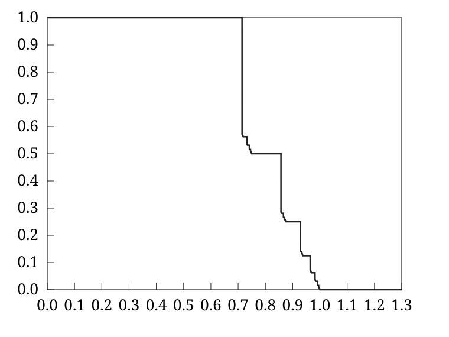

### \*5.3.2　比较次数最少的合并

现在考虑一个相关问题: 合并一个包含 $m$ 个元素的有序集与一个包含 $n$ 个元素的有序集, 最好的方式是什么? 待合并的元素是

$$
A_1<A_2<\cdots<A_m\quad\text{和}\quad B_1<B_2<\cdots<B_n,\tag{1}
$$

和 5.3.1 节一样, 假定这 $m+n$ 个元素互不相同. 各个 $A$ 在各个 $B$ 中的出现方式有 $\binom{m+n}{m}$ 种, 利用前面讨论排序问题时使用的论证方式, 马上可以知道, 所需比较次数至少是

$$
\left\lceil\lg\binom{m+n}{m}\right\rceil.\tag{2}
$$

如果令 $m=\alpha n$ 并设 $n\to\infty$, 当 $\alpha$ 固定时, 斯特林近似公式告诉我们

$$
\lg\binom{\alpha n+n}{\alpha n}=n\bigl((1+\alpha)\lg(1+\alpha)-\alpha\lg\alpha\bigr)-\tfrac12\lg n+O(1).\tag{3}
$$

常规合并过程——算法 5.2.4M——在最差情况下需要 $m+n-1$ 次比较.

设 $M(m,n)$ 表示类似于 $S(n)$ 的函数, 即总是足以合并 $m$ 个元素与 $n$ 个元素的最少比较次数. 根据我们刚才的观察, 有

$$
\left\lceil\lg\binom{m+n}{m}\right\rceil\le M(m,n)\le m+n-1\quad(\text{对于所有 }m,n\ge1).\tag{4}
$$

式 (3) 表明上下限之间的距离可以有多大. 当 $\alpha=1$ (即 $m=n$) 时, 下限是 $2n-\tfrac12\lg n+O(1)$, 所以上下限两者都有合适的数量级, 但它们的差可以任意大. 当 $\alpha=0.5$ (即 $m=\tfrac12n$) 时, 下限是 $\tfrac32n(\lg3-\tfrac23)+O(\log n)$, 它大约是上限的 $\lg3-\tfrac23\approx0.918$ 倍. 由于标准合并算法主要是为 $m\approx n$ 的文件设计的, 所以当 $\alpha$ 下降时, 上下限之间的距离越来越大.

当 $m=n$ 时, 合并问题有一种相当简单的解决方法. 结果证明, 有问题的是式 (4) 的下限, 而不是上限. 大约在 1968 年, 葛立恒和卡普各自独立发现下面的定理:

**定理 M.** 对于所有 $m\ge1$ 有 $M(m,m)=2m-1$.

证明. 考虑任意一个合并 $A_1<\cdots<A_m$ 与 $B_1<\cdots<B_m$ 的算法. 当它比较 $A_i:B_j$ 时, 如果 $i<j$ 取分支 $A_i<B_j$, 如果 $i\ge j$ 取分支 $A_i>B_j$. 合并结束时必然有结构

$$
B_1<A_1<B_2<A_2<\cdots<B_m<A_m,\tag{5}
$$

这样才会与所取全部分支一致. 以下 $2m-1$ 个比较

$$
B_1:A_1,\quad A_1:B_2,\quad B_2:A_2,\quad\ldots,\quad B_m:A_m
$$

中的每一个都必须明确进行, 否则至少会有两种结构与已知事实一致. 例如, 如果没有比较 $A_1$ 与 $B_2$, 将无法区分式 (5) 与结构

$$
B_1<B_2<A_1<A_2<\cdots<B_m<A_m.\qquad\blacksquare
$$

简单修改这个证明过程, 可以得到伴随公式

$$
M(m,m+1)=2m\quad(m\ge0).\tag{6}
$$

**构造下限.** 定理 M 表明: 信息论下限 (2) 与真实值的差距可以要多大就有多大. 因此, 证明定理 M 时使用的技巧为我们提供了另外一种找出下限的方式. 这种证明技巧经常被看作是制造一个对手, 也就是试图使算法运行缓慢的坏人. 当一个合并算法决定比较 $A_i:B_j$ 时, 这个对手在确定比较结果时, 强制算法沿着更为困难的路径走下去. 如同在定理 M 的证明中那样, 如果我们能构造一个适当的对手, 就可以确保每种有效合并算法都必须进行相当多的比较.

我们将使用受限对手, 在决定某些特定比较的结果时, 它的权力受到限制. 受到受限对手影响的合并算法并不知道这些约束条件, 合并算法仍然需要执行一些必要的比较, 尽管比较结果已被提前确定. 例如, 在证明定理 M 时, 条件 (5) 限制了所有结果, 然而合并算法不能利用这个事实来避免执行任何一次比较.

在下面讨论中使用的约束条件适用于文件的左右两端. 左约束条件用以下符号表示:

$\mathord{.}$ (表示没有左约束),

$\backslash$ (表示所有结果都必须与 $A_1<B_1$ 一致),

$/$ (表示所有结果都必须与 $A_1>B_1$ 一致);

类似地, 右约束条件用以下符号表示:

$\mathord{.}$ (表示没有右约束),

$\backslash$ (表示所有结果都必须与 $A_m<B_n$ 一致),

$/$ (表示所有结果都必须与 $A_m>B_n$ 一致).

共有九种对手, 用 $\lambda M\rho$ 表示, 其中 $\lambda$ 是左约束条件, $\rho$ 是右约束条件. 例如, $\backslash M\backslash$ 对手必然指出 $A_1<B_j$ 且 $A_i<B_n$, $\mathord{.}M\mathord{.}$ 对手不受限制. 对于较小的 $m$ 和 $n$ 值, 有些特定类型的受限对手无法实现. 当 $m=1$ 时, 显然不会有 $\backslash M/$ 这样的对手.

现在我们构造一个用于合并的稍微复杂且非常难以应付的对手. 它并不一定总是给出最优结果, 但给出了涵盖许多有趣情形的下限. 给定 $m,n$、左约束 $\lambda$ 和右约束 $\rho$, 假定我们要求对手指出 $A_i$ 和 $B_j$ 哪个更大一些. 有六种策略可以用来把这个问题简化为 $m+n$ 值较小的情形.

**策略 A$(k,l)$,** 适用于 $i\le k\le m$ 且 $1\le l\le j$. 假定 $A_i<B_j$, 要求后续操作合并 $\{A_1,\ldots,A_k\}$ 与 $\{B_1,\ldots,B_{l-1}\}$, 合并 $\{A_{k+1},\ldots,A_m\}$ 与 $\{B_l,\ldots,B_n\}$. 在后面的比较 $A_p:B_q$ 中, 如果 $p\le k$ 且 $q\ge l$, 则得到 $A_p<B_q$; 如果 $p>k$ 且 $q<l$, 则得到 $A_p>B_q$; 如果 $p\le k$ 且 $q<l$, 则由 $(k,l-1,\lambda,\mathord{.})$ 对手处理; 如果 $p>k$ 且 $q\ge l$, 则由 $(m-k,n+1-l,\mathord{.},\rho)$ 对手处理.

**策略 B$(k,l)$,** 适用于 $i\le k\le m$ 且 $1\le l<j$. 假定 $A_i<B_j$, 要求后续操作合并 $\{A_1,\ldots,A_k\}$ 与 $\{B_1,\ldots,B_l\}$, 合并 $\{A_{k+1},\ldots,A_m\}$ 与 $\{B_l,\ldots,B_n\}$, 约定 $A_k<B_l<A_{k+1}$. (注意, $B_l$ 出现在待合并的两个列表中. 条件 $A_k<B_l<A_{k+1}$ 确保在合并一组元素时, 不会给出有助于合并另一组元素的信息.) 因此, 在后面的比较 $A_p:B_q$ 中, 如果 $p\le k$ 且 $q\ge l$, 则得到 $A_p<B_q$; 如果 $p>k$ 且 $q\le l$, 则得到 $A_p>B_q$; 如果 $p\le k$ 且 $q\le l$, 则由 $(k,l,\lambda,\backslash)$ 对手处理; 如果 $p>k$ 且 $q\ge l$, 则由 $(m-k,n+1-l,/,\rho)$ 对手处理.

**策略 C$(k,l)$,** 适用于 $i<k\le m$ 且 $1\le l\le j$. 假定 $A_i<B_j$, 要求后续操作合并 $\{A_1,\ldots,A_k\}$ 与 $\{B_1,\ldots,B_{l-1}\}$, 合并 $\{A_k,\ldots,A_m\}$ 与 $\{B_l,\ldots,B_n\}$, 约定 $B_{l-1}<A_k<B_l$. (类似于策略 B, 交换 $A$ 和 $B$ 的角色.)

**策略 A'$(k,l)$,** 适用于 $1\le k\le i$ 且 $j\le l\le n$. 假定 $A_i>B_j$, 要求后续操作合并 $\{A_1,\ldots,A_{k-1}\}$ 与 $\{B_1,\ldots,B_l\}$, 合并 $\{A_k,\ldots,A_m\}$ 与 $\{B_{l+1},\ldots,B_n\}$. (类似于策略 A.)

**策略 B'$(k,l)$,** 适用于 $1\le k\le i$ 且 $j<l\le n$. 假定 $A_i>B_j$, 要求后续操作合并 $\{A_1,\ldots,A_{k-1}\}$ 与 $\{B_1,\ldots,B_l\}$, 合并 $\{A_k,\ldots,A_m\}$ 与 $\{B_l,\ldots,B_n\}$, 约定 $A_{k-1}<B_l<A_k$. (类似于策略 B.)

**策略 C'$(k,l)$,** 适用于 $1\le k<i$ 且 $j\le l\le n$. 假定 $A_i>B_j$, 要求后续操作合并 $\{A_1,\ldots,A_k\}$ 与 $\{B_1,\ldots,B_l\}$, 合并 $\{A_k,\ldots,A_m\}$ 与 $\{B_{l+1},\ldots,B_n\}$, 约定 $B_l<A_k<B_{l+1}$. (类似于策略 C.)

由于一些限制, 某些特定情形不能使用上述策略, 这些情形总结如下:

| 策略 | 必须省略该策略的情形 |
|---|---|
| $\mathrm A(k,1),\mathrm B(k,1),\mathrm C(k,1)$ | $\lambda=/$ |
| $\mathrm A'(1,l),\mathrm B'(1,l),\mathrm C'(1,l)$ | $\lambda=\backslash$ |
| $\mathrm A(m,l),\mathrm B(m,l),\mathrm C(m,l)$ | $\rho=/$ |
| $\mathrm A'(k,n),\mathrm B'(k,n),\mathrm C'(k,n)$ | $\rho=\backslash$ |

令 $\lambda M\rho(m,n)$ 表示可以由上述某个对手得到的最大合并下限. 当第一次比较是 $A_i:B_j$ 时, 每种策略在适用情形下给出与这九个函数相关的不等式, 即:

$$
\begin{aligned}
\mathrm A(k,l):\quad&\lambda M\rho(m,n)\ge1+\lambda M\mathord{.}(k,l-1)+\mathord{.}M\rho(m-k,n+1-l);\\
\mathrm B(k,l):\quad&\lambda M\rho(m,n)\ge1+\lambda M\backslash(k,l)+/M\rho(m-k,n+1-l);\\
\mathrm C(k,l):\quad&\lambda M\rho(m,n)\ge1+\lambda M/(k,l-1)+\backslash M\rho(m+1-k,n+1-l);\\
\mathrm A'(k,l):\quad&\lambda M\rho(m,n)\ge1+\lambda M\mathord{.}(k-1,l)+\mathord{.}M\rho(m+1-k,n-l);\\
\mathrm B'(k,l):\quad&\lambda M\rho(m,n)\ge1+\lambda M\backslash(k-1,l)+/M\rho(m+1-k,n+1-l);\\
\mathrm C'(k,l):\quad&\lambda M\rho(m,n)\ge1+\lambda M/(k,l)+\backslash M\rho(m+1-k,n-l).
\end{aligned}
$$

对于固定的 $i$ 和 $j$, 当 $k$ 和 $l$ 处于 $i$ 和 $j$ 所允许的范围内时, 对手将采用一种策略, 使得所有可能的右端给出的下限取最大值. 因此, 我们定义 $\lambda M\rho(m,n)$ 表示在 $1\le i\le m$ 及 $1\le j\le n$ 范围内这些下限取得的最小值. 当 $m$ 或 $n$ 为零时, $\lambda M\rho(m,n)$ 为零.

例如, 考虑 $m=2$ 和 $n=3$ 的情形, 并假定我们的对手不受限. 如果第一次比较是 $A_1:B_1$, 对手可以采用策略 $\mathrm A'(1,1)$, 需要 $\mathord{.}M\mathord{.}(0,1)+\mathord{.}M\mathord{.}(2,2)=3$ 次进一步比较. 如果第一次比较是 $A_1:B_3$, 对手可以采用策略 $\mathrm B(1,2)$, 需要 $\mathord{.}M\backslash(1,2)+/M\mathord{.}(1,2)=4$ 次进一步比较. 不管第一次比较哪一对 $A_i:B_j$, 对手都可以保证至少需要三次进一步比较. 因此, $\mathord{.}M\mathord{.}(2,3)=4$.

以人工来完成这些计算不是那么轻松, 但计算机可以相当快速地给出 $\lambda M\rho$ 函数表. 这些函数值存在一些明显的对称性, 例如

$$
/M\mathord{.}(m,n)=\mathord{.}M\backslash(m,n)=\backslash M\mathord{.}(n,m)=\mathord{.}M/(n,m).\tag{7}
$$

利用这些对称性, 可以把九个函数减少到四个:

$$
\mathord{.}M\mathord{.}(m,n),\quad /M\mathord{.}(m,n),\quad /M\backslash(m,n),\quad /M/(m,n).
$$

表 1 给出对于所有 $m,n\le10$ 的结果值. 合并对手被定义为满足条件

$$
\mathord{.}M\mathord{.}(m,n)\le M(m,n)\quad(\text{对于所有 }m,n\ge0).\tag{8}
$$

表 1　由 “对手” 得到的合并下限

**$\mathord{.}M\mathord{.}(m,n)$**

<table data-adversary-table="0"><thead><tr><th>$m\backslash n$</th><th>1</th><th>2</th><th>3</th><th>4</th><th>5</th><th>6</th><th>7</th><th>8</th><th>9</th><th>10</th></tr></thead><tbody>
<tr><th>1</th><td>1</td><td>2</td><td>2</td><td>3</td><td>3</td><td>3</td><td>3</td><td>4</td><td>4</td><td>4</td></tr>
<tr><th>2</th><td>2</td><td>3</td><td>4</td><td>5</td><td>5</td><td>6</td><td>6</td><td>6</td><td>7</td><td>7</td></tr>
<tr><th>3</th><td>2</td><td>4</td><td>5</td><td>6</td><td>7</td><td>7</td><td>8</td><td>8</td><td>9</td><td>9</td></tr>
<tr><th>4</th><td>3</td><td>5</td><td>6</td><td>7</td><td>8</td><td>9</td><td>10</td><td>10</td><td>11</td><td>11</td></tr>
<tr><th>5</th><td>3</td><td>5</td><td>7</td><td>8</td><td>9</td><td>10</td><td>11</td><td>12</td><td>12</td><td>13</td></tr>
<tr><th>6</th><td>3</td><td>6</td><td>7</td><td>9</td><td>10</td><td>11</td><td>12</td><td>13</td><td>14</td><td>15</td></tr>
<tr><th>7</th><td>3</td><td>6</td><td>8</td><td>10</td><td>11</td><td>12</td><td>13</td><td>14</td><td>15</td><td>16</td></tr>
<tr><th>8</th><td>4</td><td>6</td><td>8</td><td>10</td><td>12</td><td>13</td><td>14</td><td>15</td><td>16</td><td>17</td></tr>
<tr><th>9</th><td>4</td><td>7</td><td>9</td><td>11</td><td>12</td><td>14</td><td>15</td><td>16</td><td>17</td><td>18</td></tr>
<tr><th>10</th><td>4</td><td>7</td><td>9</td><td>11</td><td>13</td><td>15</td><td>16</td><td>17</td><td>18</td><td>19</td></tr>
</tbody></table>

**$/M\mathord{.}(m,n)$**

<table data-adversary-table="1"><thead><tr><th>$m\backslash n$</th><th>1</th><th>2</th><th>3</th><th>4</th><th>5</th><th>6</th><th>7</th><th>8</th><th>9</th><th>10</th></tr></thead><tbody>
<tr><th>1</th><td>1</td><td>2</td><td>2</td><td>3</td><td>3</td><td>3</td><td>3</td><td>4</td><td>4</td><td>4</td></tr>
<tr><th>2</th><td>1</td><td>3</td><td>4</td><td>4</td><td>5</td><td>5</td><td>6</td><td>6</td><td>7</td><td>7</td></tr>
<tr><th>3</th><td>1</td><td>3</td><td>5</td><td>6</td><td>7</td><td>7</td><td>8</td><td>8</td><td>9</td><td>9</td></tr>
<tr><th>4</th><td>1</td><td>4</td><td>5</td><td>7</td><td>8</td><td>9</td><td>9</td><td>10</td><td>10</td><td>11</td></tr>
<tr><th>5</th><td>1</td><td>4</td><td>6</td><td>8</td><td>9</td><td>10</td><td>11</td><td>12</td><td>12</td><td>13</td></tr>
<tr><th>6</th><td>1</td><td>4</td><td>6</td><td>8</td><td>10</td><td>11</td><td>12</td><td>13</td><td>14</td><td>14</td></tr>
<tr><th>7</th><td>1</td><td>4</td><td>7</td><td>9</td><td>10</td><td>12</td><td>13</td><td>14</td><td>15</td><td>16</td></tr>
<tr><th>8</th><td>1</td><td>5</td><td>7</td><td>9</td><td>11</td><td>13</td><td>14</td><td>15</td><td>16</td><td>17</td></tr>
<tr><th>9</th><td>1</td><td>5</td><td>8</td><td>10</td><td>11</td><td>13</td><td>15</td><td>16</td><td>17</td><td>18</td></tr>
<tr><th>10</th><td>1</td><td>5</td><td>8</td><td>10</td><td>12</td><td>14</td><td>15</td><td>17</td><td>18</td><td>19</td></tr>
</tbody></table>

**$/M\backslash(m,n)$**

<table data-adversary-table="2"><thead><tr><th>$m\backslash n$</th><th>1</th><th>2</th><th>3</th><th>4</th><th>5</th><th>6</th><th>7</th><th>8</th><th>9</th><th>10</th></tr></thead><tbody>
<tr><th>1</th><td>$-\infty$</td><td>2</td><td>2</td><td>3</td><td>3</td><td>3</td><td>3</td><td>4</td><td>4</td><td>4</td></tr>
<tr><th>2</th><td>$-\infty$</td><td>2</td><td>4</td><td>4</td><td>5</td><td>5</td><td>6</td><td>6</td><td>7</td><td>7</td></tr>
<tr><th>3</th><td>$-\infty$</td><td>2</td><td>4</td><td>6</td><td>6</td><td>7</td><td>8</td><td>8</td><td>8</td><td>9</td></tr>
<tr><th>4</th><td>$-\infty$</td><td>2</td><td>5</td><td>6</td><td>8</td><td>8</td><td>9</td><td>10</td><td>10</td><td>11</td></tr>
<tr><th>5</th><td>$-\infty$</td><td>2</td><td>5</td><td>7</td><td>8</td><td>10</td><td>10</td><td>11</td><td>12</td><td>13</td></tr>
<tr><th>6</th><td>$-\infty$</td><td>2</td><td>5</td><td>7</td><td>9</td><td>10</td><td>12</td><td>13</td><td>14</td><td>14</td></tr>
<tr><th>7</th><td>$-\infty$</td><td>2</td><td>5</td><td>8</td><td>10</td><td>11</td><td>12</td><td>14</td><td>15</td><td>16</td></tr>
<tr><th>8</th><td>$-\infty$</td><td>2</td><td>6</td><td>8</td><td>10</td><td>12</td><td>13</td><td>15</td><td>16</td><td>17</td></tr>
<tr><th>9</th><td>$-\infty$</td><td>2</td><td>6</td><td>9</td><td>10</td><td>12</td><td>14</td><td>16</td><td>17</td><td>18</td></tr>
<tr><th>10</th><td>$-\infty$</td><td>2</td><td>6</td><td>9</td><td>11</td><td>13</td><td>15</td><td>16</td><td>18</td><td>19</td></tr>
</tbody></table>

**$/M/(m,n)$**

<table data-adversary-table="3"><thead><tr><th>$m\backslash n$</th><th>1</th><th>2</th><th>3</th><th>4</th><th>5</th><th>6</th><th>7</th><th>8</th><th>9</th><th>10</th></tr></thead><tbody>
<tr><th>1</th><td>1</td><td>1</td><td>1</td><td>1</td><td>1</td><td>1</td><td>1</td><td>1</td><td>1</td><td>1</td></tr>
<tr><th>2</th><td>1</td><td>3</td><td>3</td><td>4</td><td>4</td><td>4</td><td>4</td><td>5</td><td>5</td><td>5</td></tr>
<tr><th>3</th><td>1</td><td>3</td><td>5</td><td>5</td><td>6</td><td>6</td><td>7</td><td>7</td><td>8</td><td>8</td></tr>
<tr><th>4</th><td>1</td><td>4</td><td>5</td><td>7</td><td>7</td><td>8</td><td>9</td><td>9</td><td>9</td><td>10</td></tr>
<tr><th>5</th><td>1</td><td>4</td><td>6</td><td>7</td><td>9</td><td>9</td><td>10</td><td>11</td><td>11</td><td>12</td></tr>
<tr><th>6</th><td>1</td><td>4</td><td>6</td><td>8</td><td>9</td><td>11</td><td>11</td><td>12</td><td>13</td><td>14</td></tr>
<tr><th>7</th><td>1</td><td>4</td><td>7</td><td>9</td><td>10</td><td>11</td><td>13</td><td>14</td><td>15</td><td>15</td></tr>
<tr><th>8</th><td>1</td><td>5</td><td>7</td><td>9</td><td>11</td><td>12</td><td>14</td><td>15</td><td>16</td><td>17</td></tr>
<tr><th>9</th><td>1</td><td>5</td><td>8</td><td>9</td><td>11</td><td>13</td><td>15</td><td>16</td><td>17</td><td>18</td></tr>
<tr><th>10</th><td>1</td><td>5</td><td>8</td><td>10</td><td>12</td><td>14</td><td>15</td><td>17</td><td>18</td><td>19</td></tr>
</tbody></table>

定理 M 是这个关系式的特例, 这是因为当 $|m-n|\le1$ 时, 我们的对手将使用这个定理的简单策略.

现在考虑 $M$ 函数满足的一些简单关系式:

$$
M(m,n)=M(n,m);\tag{9}
$$

$$
M(m,n)\le M(m,n+1);\tag{10}
$$

$$
M(k+m,n)\le M(k,n)+M(m,n);\tag{11}
$$

$$
M(m,n)\le\max\bigl(M(m,n-1)+1,M(m-1,n)+1\bigr),\quad m\ge1,n\ge1;\tag{12}
$$

$$
M(m,n)\le\max\bigl(M(m,n-2)+1,M(m-1,n)+2\bigr),\quad m\ge1,n\ge2.\tag{13}
$$

如果首先比较 $A_1:B_1$, 由通常的合并过程就能得到关系式 (12). 首先比较 $A_1:B_2$ 可类似推导关系式 (13): 如果 $A_1>B_2$, 将需要 $M(m,n-2)$ 次进一步比较, 但如果 $A_1<B_2$, 则把 $A_1$ 插入到正确位置, 然后合并 $\{A_2,\ldots,A_m\}$ 与 $\{B_1,\ldots,B_n\}$. 推而广之, 通过首先比较 $A_1:B_k$, 并在 $A_1<B_k$ 时使用二叉查找, 我们可以得出, 对于 $m\ge1$ 和 $n\ge k$, 有

$$
M(m,n)\le\max\bigl(M(m,n-k)+1,M(m-1,n)+1+\lceil\lg k\rceil\bigr).\tag{14}
$$

结果是, 对于所有 $m,n\le10$ 有 $M(m,n)=\mathord{.}M\mathord{.}(m,n)$, 所以表 1 实际上给出最优合并值. 利用关系式 (9)～(14), 再加上习题 8、9、10 中针对 $(m,n)=(2,8),(3,6),(5,9)$ 给出的特殊构造, 可以证明上述结论.

另一方面, 对手不会总是给出可能实现的最佳下限. 最简单的示例是 $m=3$ 和 $n=11$, 这时 $\mathord{.}M\mathord{.}(3,11)=9$, 但 $M(3,11)=10$. 为了看出在这种情形下对手的 “错误” 出在哪里, 我们必须研究它做出决策的理由. 深入研究后可以发现, 如果 $(i,j)\ne(2,6)$, 则对手可以找到一种需要 10 次比较的策略; 但当 $(i,j)=(2,6)$ 时, 没有哪种策略能够打败策略 $\mathrm A(2,4)$, 它的下限是 $1+\mathord{.}M\mathord{.}(2,3)+\mathord{.}M\mathord{.}(1,8)=9$. 最终合并 $\{A_1,A_2\}$ 与 $\{B_1,B_2,B_3\}$, 合并 $\{A_3\}$ 与 $\{B_4,\ldots,B_{11}\}$, 是必要而非充分的, 所以在这种情形下没有给出最佳下限.

类似可以证明 $\mathord{.}M\mathord{.}(2,38)=10$ 但 $M(2,38)=11$, 所以对手不足以应对 $m=2$ 的情形. 但它可以出色地应对某些种类的无穷多个值:

**定理 K.**

$$
\begin{aligned}
M(m,m+2)&=2m+1\quad(m\ge2);\\
M(m,m+3)&=2m+2\quad(m\ge4);\\
M(m,m+4)&=2m+3\quad(m\ge6).
\end{aligned}
$$

证明. 事实上, 我们可以用 $\mathord{.}M\mathord{.}$ 代替 $M$ 来证明这个结论. 当 $m$ 较小时的结果已经由计算机获得, 所以假定 $m$ 是足够大. 我们还假定第一次比较是 $A_i:B_j$, 其中 $i\le\lceil m/2\rceil$. 如果 $j\le i$, 则使用策略 $\mathrm A'(i,i)$, 当 $d\le4$ 时, 对 $d$ 用归纳法, 得到

$$
\mathord{.}M\mathord{.}(m,m+d)\ge1+\mathord{.}M\mathord{.}(i-1,i)+\mathord{.}M\mathord{.}(m+1-i,m+d-i)=2m+d-1.
$$

如果 $j>i$, 则使用策略 $\mathrm A(i,i+1)$, 对 $m$ 用归纳法, 得到

$$
\mathord{.}M\mathord{.}(m,m+d)\ge1+\mathord{.}M\mathord{.}(i,i)+\mathord{.}M\mathord{.}(m-i,m+d-i)=2m+d-1.\qquad\blacksquare
$$

1969 年, 黄光明和林牲给出了定理 K 的前两个公式. 多年后, 保罗·斯托克迈耶和姚储枫证明: 这三个公式显示的模式是普遍成立的; 也就是说, 由上述对手策略推导的下限足以确定值 $M(m,m+d)=2m+d-1$, 其中 $m\ge2d-2$. [*SICOMP* **9** (1980), 85–90.]

**上限.** 现在考虑 $M(m,n)$ 的上限. 好的上限对应于高效合并算法.

当 $m=1$ 时, 合并问题等价于插入问题, $A_1$ 可以放入 $B_1,\ldots,B_n$ 中的 $n+1$ 个位置. 对于这种情形, 容易看出任何一棵拥有 $n+1$ 个外部结点的扩展二叉树都是某个合并方法的树! (见习题 2.) 因此, 我们可以选择一棵最优二叉树, 实现信息论下限

$$
1+\lfloor\lg n\rfloor=M(1,n)=\lceil\lg(n+1)\rceil.\tag{15}
$$

当然, 二叉查找 (6.2.1 节) 是获得这个值的一种简单方式.

$m=2$ 的情形极为重要, 但也困难得多. 葛立恒、黄光明和林牲证明了一般公式

$$
M(2,n)=\left\lceil\lg\frac7{12}(n+1)\right\rceil+\left\lceil\lg\frac{14}{17}(n+1)\right\rceil,\tag{16}
$$

从而完全解决了 $m=2$ 的情形 (见习题 11、12、13).

我们已经看到, 当 $m=n$ 时普通合并过程是最优的, 而当 $m=1$ 时颇为不同的二叉查找过程是最优的. 我们需要的是一种居中方法, 组合普通合并算法与二叉查找, 保留两者的最佳特性. 根据式 (14), 黄光明和林牲 [*SICOMP* **1** (1972), 31–39] 给出了以下算法:

**算法 H (二叉合并).**

H1. [如果未完成, 选定 $t$.] 如果 $m$ 或 $n$ 为零, 则停止. 否则, 如果 $m>n$, 置 $t\leftarrow\lfloor\lg(m/n)\rfloor$, 转到 H4. 否则, 置 $t\leftarrow\lfloor\lg(n/m)\rfloor$.

H2. [比较.] 比较 $A_m:B_{n+1-2^t}$. 如果 $A_m$ 较小, 置 $n\leftarrow n-2^t$, 返回 H1.

H3. [插入.] 利用二叉查找把 $A_m$ 插入 $\{B_{n+1-2^t},\ldots,B_n\}$ 的正确位置 (这另外需要正好 $t$ 次比较). 选取满足 $B_k<A_m$ 的最大 $k$ 值, 置 $m\leftarrow m-1,n\leftarrow k$. 返回 H1.

H4. [比较.] (H4 和 H5 类似于 H2 和 H3, 只是交换了 $m$ 与 $n$、$A$ 与 $B$ 的角色.) 如果 $B_n<A_{m+1-2^t}$, 置 $m\leftarrow m-2^t$, 返回 H1.

H5. [插入.] 把 $B_n$ 插入它在各个 $A$ 中的正确位置. 选取满足 $A_k<B_n$ 的最大 $k$ 值, 置 $m\leftarrow k,n\leftarrow n-1$. 返回 H1. ■

作为算法示例, 表 2 给出合并三个键 $\{087,503,512\}$ 与十三个键 $\{061,154,\ldots,908\}$ 的过程, 这个示例需要八次比较. 每个步骤中被比较的元素以粗体标出.

表 2　二叉合并示例

<table data-binary-merge-table style="display:table;width:1330px;min-width:1330px;table-layout:fixed;border-collapse:collapse;margin:0"><colgroup><col style="width:70px"/><col style="width:70px"/><col style="width:70px"/><col style="width:70px"/><col style="width:70px"/><col style="width:70px"/><col style="width:70px"/><col style="width:70px"/><col style="width:70px"/><col style="width:70px"/><col style="width:70px"/><col style="width:70px"/><col style="width:70px"/><col style="width:70px"/><col style="width:70px"/><col style="width:70px"/><col style="width:70px"/><col style="width:70px"/><col style="width:70px"/></colgroup><thead><tr style="height:42px"><th colspan="3" style="height:42px;line-height:42px;padding:0;border:0;text-align:center;font-size:22px;font-weight:normal;white-space:nowrap">$A$</th><th colspan="13" style="height:42px;line-height:42px;padding:0;border:0;text-align:center;font-size:22px;font-weight:normal;white-space:nowrap">$B$</th><th colspan="3" style="height:42px;line-height:42px;padding:0;border:0;text-align:center;font-size:22px;font-weight:normal;white-space:nowrap">输出</th></tr></thead><tbody><tr data-binary-merge-state="0" style="height:42px"><td style="height:42px;line-height:42px;padding:0;border:0;text-align:center;font-size:22px;font-weight:normal;white-space:nowrap" data-region="A">087</td><td style="height:42px;line-height:42px;padding:0;border:0;text-align:center;font-size:22px;font-weight:normal;white-space:nowrap" data-region="A">503</td><td style="height:42px;line-height:42px;padding:0;border:0;text-align:center;font-size:22px;font-weight:normal;white-space:nowrap" data-region="A"><strong>512</strong></td><td style="height:42px;line-height:42px;padding:0;border:0;text-align:center;font-size:22px;font-weight:normal;white-space:nowrap" data-region="B">061</td><td style="height:42px;line-height:42px;padding:0;border:0;text-align:center;font-size:22px;font-weight:normal;white-space:nowrap" data-region="B">154</td><td style="height:42px;line-height:42px;padding:0;border:0;text-align:center;font-size:22px;font-weight:normal;white-space:nowrap" data-region="B">170</td><td style="height:42px;line-height:42px;padding:0;border:0;text-align:center;font-size:22px;font-weight:normal;white-space:nowrap" data-region="B">275</td><td style="height:42px;line-height:42px;padding:0;border:0;text-align:center;font-size:22px;font-weight:normal;white-space:nowrap" data-region="B">426</td><td style="height:42px;line-height:42px;padding:0;border:0;text-align:center;font-size:22px;font-weight:normal;white-space:nowrap" data-region="B">509</td><td style="height:42px;line-height:42px;padding:0;border:0;text-align:center;font-size:22px;font-weight:normal;white-space:nowrap" data-region="B">612</td><td style="height:42px;line-height:42px;padding:0;border:0;text-align:center;font-size:22px;font-weight:normal;white-space:nowrap" data-region="B">653</td><td style="height:42px;line-height:42px;padding:0;border:0;text-align:center;font-size:22px;font-weight:normal;white-space:nowrap" data-region="B">677</td><td style="height:42px;line-height:42px;padding:0;border:0;text-align:center;font-size:22px;font-weight:normal;white-space:nowrap" data-region="B"><strong>703</strong></td><td style="height:42px;line-height:42px;padding:0;border:0;text-align:center;font-size:22px;font-weight:normal;white-space:nowrap" data-region="B">765</td><td style="height:42px;line-height:42px;padding:0;border:0;text-align:center;font-size:22px;font-weight:normal;white-space:nowrap" data-region="B">897</td><td style="height:42px;line-height:42px;padding:0;border:0;text-align:center;font-size:22px;font-weight:normal;white-space:nowrap" data-region="B">908</td><td style="height:42px;line-height:42px;padding:0;border:0;text-align:center;font-size:22px;font-weight:normal;white-space:nowrap" data-region="B"></td><td style="height:42px;line-height:42px;padding:0;border:0;text-align:center;font-size:22px;font-weight:normal;white-space:nowrap" data-region="B"></td><td style="height:42px;line-height:42px;padding:0;border:0;text-align:center;font-size:22px;font-weight:normal;white-space:nowrap" data-region="B"></td></tr><tr data-binary-merge-state="1" style="height:42px"><td style="height:42px;line-height:42px;padding:0;border:0;text-align:center;font-size:22px;font-weight:normal;white-space:nowrap" data-region="A">087</td><td style="height:42px;line-height:42px;padding:0;border:0;text-align:center;font-size:22px;font-weight:normal;white-space:nowrap" data-region="A">503</td><td style="height:42px;line-height:42px;padding:0;border:0;text-align:center;font-size:22px;font-weight:normal;white-space:nowrap" data-region="A"><strong>512</strong></td><td style="height:42px;line-height:42px;padding:0;border:0;text-align:center;font-size:22px;font-weight:normal;white-space:nowrap" data-region="B">061</td><td style="height:42px;line-height:42px;padding:0;border:0;text-align:center;font-size:22px;font-weight:normal;white-space:nowrap" data-region="B">154</td><td style="height:42px;line-height:42px;padding:0;border:0;text-align:center;font-size:22px;font-weight:normal;white-space:nowrap" data-region="B">170</td><td style="height:42px;line-height:42px;padding:0;border:0;text-align:center;font-size:22px;font-weight:normal;white-space:nowrap" data-region="B">275</td><td style="height:42px;line-height:42px;padding:0;border:0;text-align:center;font-size:22px;font-weight:normal;white-space:nowrap" data-region="B">426</td><td style="height:42px;line-height:42px;padding:0;border:0;text-align:center;font-size:22px;font-weight:normal;white-space:nowrap" data-region="B">509</td><td style="height:42px;line-height:42px;padding:0;border:0;text-align:center;font-size:22px;font-weight:normal;white-space:nowrap" data-region="B">612</td><td style="height:42px;line-height:42px;padding:0;border:0;text-align:center;font-size:22px;font-weight:normal;white-space:nowrap" data-region="B"><strong>653</strong></td><td style="height:42px;line-height:42px;padding:0;border:0;text-align:center;font-size:22px;font-weight:normal;white-space:nowrap" data-region="B">677</td><td style="height:42px;line-height:42px;padding:0;border:0;text-align:center;font-size:22px;font-weight:normal;white-space:nowrap" data-region="B"></td><td style="height:42px;line-height:42px;padding:0;border:0;text-align:center;font-size:22px;font-weight:normal;white-space:nowrap" data-region="B"></td><td style="height:42px;line-height:42px;padding:0;border:0;text-align:center;font-size:22px;font-weight:normal;white-space:nowrap" data-region="B"></td><td style="height:42px;line-height:42px;padding:0;border:0;text-align:center;font-size:22px;font-weight:normal;white-space:nowrap" data-region="output">703</td><td style="height:42px;line-height:42px;padding:0;border:0;text-align:center;font-size:22px;font-weight:normal;white-space:nowrap" data-region="output">765</td><td style="height:42px;line-height:42px;padding:0;border:0;text-align:center;font-size:22px;font-weight:normal;white-space:nowrap" data-region="output">897</td><td style="height:42px;line-height:42px;padding:0;border:0;text-align:center;font-size:22px;font-weight:normal;white-space:nowrap" data-region="output">908</td></tr><tr data-binary-merge-state="2" style="height:42px"><td style="height:42px;line-height:42px;padding:0;border:0;text-align:center;font-size:22px;font-weight:normal;white-space:nowrap" data-region="A">087</td><td style="height:42px;line-height:42px;padding:0;border:0;text-align:center;font-size:22px;font-weight:normal;white-space:nowrap" data-region="A">503</td><td style="height:42px;line-height:42px;padding:0;border:0;text-align:center;font-size:22px;font-weight:normal;white-space:nowrap" data-region="A"><strong>512</strong></td><td style="height:42px;line-height:42px;padding:0;border:0;text-align:center;font-size:22px;font-weight:normal;white-space:nowrap" data-region="B">061</td><td style="height:42px;line-height:42px;padding:0;border:0;text-align:center;font-size:22px;font-weight:normal;white-space:nowrap" data-region="B">154</td><td style="height:42px;line-height:42px;padding:0;border:0;text-align:center;font-size:22px;font-weight:normal;white-space:nowrap" data-region="B">170</td><td style="height:42px;line-height:42px;padding:0;border:0;text-align:center;font-size:22px;font-weight:normal;white-space:nowrap" data-region="B">275</td><td style="height:42px;line-height:42px;padding:0;border:0;text-align:center;font-size:22px;font-weight:normal;white-space:nowrap" data-region="B">426</td><td style="height:42px;line-height:42px;padding:0;border:0;text-align:center;font-size:22px;font-weight:normal;white-space:nowrap" data-region="B"><strong>509</strong></td><td style="height:42px;line-height:42px;padding:0;border:0;text-align:center;font-size:22px;font-weight:normal;white-space:nowrap" data-region="B">612</td><td style="height:42px;line-height:42px;padding:0;border:0;text-align:center;font-size:22px;font-weight:normal;white-space:nowrap" data-region="B"></td><td style="height:42px;line-height:42px;padding:0;border:0;text-align:center;font-size:22px;font-weight:normal;white-space:nowrap" data-region="B"></td><td style="height:42px;line-height:42px;padding:0;border:0;text-align:center;font-size:22px;font-weight:normal;white-space:nowrap" data-region="B"></td><td style="height:42px;line-height:42px;padding:0;border:0;text-align:center;font-size:22px;font-weight:normal;white-space:nowrap" data-region="output">653</td><td style="height:42px;line-height:42px;padding:0;border:0;text-align:center;font-size:22px;font-weight:normal;white-space:nowrap" data-region="output">677</td><td style="height:42px;line-height:42px;padding:0;border:0;text-align:center;font-size:22px;font-weight:normal;white-space:nowrap" data-region="output">703</td><td style="height:42px;line-height:42px;padding:0;border:0;text-align:center;font-size:22px;font-weight:normal;white-space:nowrap" data-region="output">765</td><td style="height:42px;line-height:42px;padding:0;border:0;text-align:center;font-size:22px;font-weight:normal;white-space:nowrap" data-region="output">897</td><td style="height:42px;line-height:42px;padding:0;border:0;text-align:center;font-size:22px;font-weight:normal;white-space:nowrap" data-region="output">908</td></tr><tr data-binary-merge-state="3" style="height:42px"><td style="height:42px;line-height:42px;padding:0;border:0;text-align:center;font-size:22px;font-weight:normal;white-space:nowrap" data-region="A">087</td><td style="height:42px;line-height:42px;padding:0;border:0;text-align:center;font-size:22px;font-weight:normal;white-space:nowrap" data-region="A">503</td><td style="height:42px;line-height:42px;padding:0;border:0;text-align:center;font-size:22px;font-weight:normal;white-space:nowrap" data-region="A"><strong>512</strong></td><td style="height:42px;line-height:42px;padding:0;border:0;text-align:center;font-size:22px;font-weight:normal;white-space:nowrap" data-region="B">061</td><td style="height:42px;line-height:42px;padding:0;border:0;text-align:center;font-size:22px;font-weight:normal;white-space:nowrap" data-region="B">154</td><td style="height:42px;line-height:42px;padding:0;border:0;text-align:center;font-size:22px;font-weight:normal;white-space:nowrap" data-region="B">170</td><td style="height:42px;line-height:42px;padding:0;border:0;text-align:center;font-size:22px;font-weight:normal;white-space:nowrap" data-region="B">275</td><td style="height:42px;line-height:42px;padding:0;border:0;text-align:center;font-size:22px;font-weight:normal;white-space:nowrap" data-region="B">426</td><td style="height:42px;line-height:42px;padding:0;border:0;text-align:center;font-size:22px;font-weight:normal;white-space:nowrap" data-region="B">509</td><td style="height:42px;line-height:42px;padding:0;border:0;text-align:center;font-size:22px;font-weight:normal;white-space:nowrap" data-region="B"><strong>612</strong></td><td style="height:42px;line-height:42px;padding:0;border:0;text-align:center;font-size:22px;font-weight:normal;white-space:nowrap" data-region="B"></td><td style="height:42px;line-height:42px;padding:0;border:0;text-align:center;font-size:22px;font-weight:normal;white-space:nowrap" data-region="B"></td><td style="height:42px;line-height:42px;padding:0;border:0;text-align:center;font-size:22px;font-weight:normal;white-space:nowrap" data-region="B"></td><td style="height:42px;line-height:42px;padding:0;border:0;text-align:center;font-size:22px;font-weight:normal;white-space:nowrap" data-region="output">653</td><td style="height:42px;line-height:42px;padding:0;border:0;text-align:center;font-size:22px;font-weight:normal;white-space:nowrap" data-region="output">677</td><td style="height:42px;line-height:42px;padding:0;border:0;text-align:center;font-size:22px;font-weight:normal;white-space:nowrap" data-region="output">703</td><td style="height:42px;line-height:42px;padding:0;border:0;text-align:center;font-size:22px;font-weight:normal;white-space:nowrap" data-region="output">765</td><td style="height:42px;line-height:42px;padding:0;border:0;text-align:center;font-size:22px;font-weight:normal;white-space:nowrap" data-region="output">897</td><td style="height:42px;line-height:42px;padding:0;border:0;text-align:center;font-size:22px;font-weight:normal;white-space:nowrap" data-region="output">908</td></tr><tr data-binary-merge-state="4" style="height:42px"><td style="height:42px;line-height:42px;padding:0;border:0;text-align:center;font-size:22px;font-weight:normal;white-space:nowrap" data-region="A">087</td><td style="height:42px;line-height:42px;padding:0;border:0;text-align:center;font-size:22px;font-weight:normal;white-space:nowrap" data-region="A"><strong>503</strong></td><td style="height:42px;line-height:42px;padding:0;border:0;text-align:center;font-size:22px;font-weight:normal;white-space:nowrap" data-region="A"></td><td style="height:42px;line-height:42px;padding:0;border:0;text-align:center;font-size:22px;font-weight:normal;white-space:nowrap" data-region="B">061</td><td style="height:42px;line-height:42px;padding:0;border:0;text-align:center;font-size:22px;font-weight:normal;white-space:nowrap" data-region="B">154</td><td style="height:42px;line-height:42px;padding:0;border:0;text-align:center;font-size:22px;font-weight:normal;white-space:nowrap" data-region="B">170</td><td style="height:42px;line-height:42px;padding:0;border:0;text-align:center;font-size:22px;font-weight:normal;white-space:nowrap" data-region="B">275</td><td style="height:42px;line-height:42px;padding:0;border:0;text-align:center;font-size:22px;font-weight:normal;white-space:nowrap" data-region="B"><strong>426</strong></td><td style="height:42px;line-height:42px;padding:0;border:0;text-align:center;font-size:22px;font-weight:normal;white-space:nowrap" data-region="B">509</td><td style="height:42px;line-height:42px;padding:0;border:0;text-align:center;font-size:22px;font-weight:normal;white-space:nowrap" data-region="B"></td><td style="height:42px;line-height:42px;padding:0;border:0;text-align:center;font-size:22px;font-weight:normal;white-space:nowrap" data-region="B"></td><td style="height:42px;line-height:42px;padding:0;border:0;text-align:center;font-size:22px;font-weight:normal;white-space:nowrap" data-region="output">512</td><td style="height:42px;line-height:42px;padding:0;border:0;text-align:center;font-size:22px;font-weight:normal;white-space:nowrap" data-region="output">612</td><td style="height:42px;line-height:42px;padding:0;border:0;text-align:center;font-size:22px;font-weight:normal;white-space:nowrap" data-region="output">653</td><td style="height:42px;line-height:42px;padding:0;border:0;text-align:center;font-size:22px;font-weight:normal;white-space:nowrap" data-region="output">677</td><td style="height:42px;line-height:42px;padding:0;border:0;text-align:center;font-size:22px;font-weight:normal;white-space:nowrap" data-region="output">703</td><td style="height:42px;line-height:42px;padding:0;border:0;text-align:center;font-size:22px;font-weight:normal;white-space:nowrap" data-region="output">765</td><td style="height:42px;line-height:42px;padding:0;border:0;text-align:center;font-size:22px;font-weight:normal;white-space:nowrap" data-region="output">897</td><td style="height:42px;line-height:42px;padding:0;border:0;text-align:center;font-size:22px;font-weight:normal;white-space:nowrap" data-region="output">908</td></tr><tr data-binary-merge-state="5" style="height:42px"><td style="height:42px;line-height:42px;padding:0;border:0;text-align:center;font-size:22px;font-weight:normal;white-space:nowrap" data-region="A">087</td><td style="height:42px;line-height:42px;padding:0;border:0;text-align:center;font-size:22px;font-weight:normal;white-space:nowrap" data-region="A"><strong>503</strong></td><td style="height:42px;line-height:42px;padding:0;border:0;text-align:center;font-size:22px;font-weight:normal;white-space:nowrap" data-region="A"></td><td style="height:42px;line-height:42px;padding:0;border:0;text-align:center;font-size:22px;font-weight:normal;white-space:nowrap" data-region="B">061</td><td style="height:42px;line-height:42px;padding:0;border:0;text-align:center;font-size:22px;font-weight:normal;white-space:nowrap" data-region="B">154</td><td style="height:42px;line-height:42px;padding:0;border:0;text-align:center;font-size:22px;font-weight:normal;white-space:nowrap" data-region="B">170</td><td style="height:42px;line-height:42px;padding:0;border:0;text-align:center;font-size:22px;font-weight:normal;white-space:nowrap" data-region="B">275</td><td style="height:42px;line-height:42px;padding:0;border:0;text-align:center;font-size:22px;font-weight:normal;white-space:nowrap" data-region="B">426</td><td style="height:42px;line-height:42px;padding:0;border:0;text-align:center;font-size:22px;font-weight:normal;white-space:nowrap" data-region="B"><strong>509</strong></td><td style="height:42px;line-height:42px;padding:0;border:0;text-align:center;font-size:22px;font-weight:normal;white-space:nowrap" data-region="B"></td><td style="height:42px;line-height:42px;padding:0;border:0;text-align:center;font-size:22px;font-weight:normal;white-space:nowrap" data-region="B"></td><td style="height:42px;line-height:42px;padding:0;border:0;text-align:center;font-size:22px;font-weight:normal;white-space:nowrap" data-region="output">512</td><td style="height:42px;line-height:42px;padding:0;border:0;text-align:center;font-size:22px;font-weight:normal;white-space:nowrap" data-region="output">612</td><td style="height:42px;line-height:42px;padding:0;border:0;text-align:center;font-size:22px;font-weight:normal;white-space:nowrap" data-region="output">653</td><td style="height:42px;line-height:42px;padding:0;border:0;text-align:center;font-size:22px;font-weight:normal;white-space:nowrap" data-region="output">677</td><td style="height:42px;line-height:42px;padding:0;border:0;text-align:center;font-size:22px;font-weight:normal;white-space:nowrap" data-region="output">703</td><td style="height:42px;line-height:42px;padding:0;border:0;text-align:center;font-size:22px;font-weight:normal;white-space:nowrap" data-region="output">765</td><td style="height:42px;line-height:42px;padding:0;border:0;text-align:center;font-size:22px;font-weight:normal;white-space:nowrap" data-region="output">897</td><td style="height:42px;line-height:42px;padding:0;border:0;text-align:center;font-size:22px;font-weight:normal;white-space:nowrap" data-region="output">908</td></tr><tr data-binary-merge-state="6" style="height:42px"><td style="height:42px;line-height:42px;padding:0;border:0;text-align:center;font-size:22px;font-weight:normal;white-space:nowrap" data-region="A"><strong>087</strong></td><td style="height:42px;line-height:42px;padding:0;border:0;text-align:center;font-size:22px;font-weight:normal;white-space:nowrap" data-region="A"></td><td style="height:42px;line-height:42px;padding:0;border:0;text-align:center;font-size:22px;font-weight:normal;white-space:nowrap" data-region="A"></td><td style="height:42px;line-height:42px;padding:0;border:0;text-align:center;font-size:22px;font-weight:normal;white-space:nowrap" data-region="B">061</td><td style="height:42px;line-height:42px;padding:0;border:0;text-align:center;font-size:22px;font-weight:normal;white-space:nowrap" data-region="B"><strong>154</strong></td><td style="height:42px;line-height:42px;padding:0;border:0;text-align:center;font-size:22px;font-weight:normal;white-space:nowrap" data-region="B">170</td><td style="height:42px;line-height:42px;padding:0;border:0;text-align:center;font-size:22px;font-weight:normal;white-space:nowrap" data-region="B">275</td><td style="height:42px;line-height:42px;padding:0;border:0;text-align:center;font-size:22px;font-weight:normal;white-space:nowrap" data-region="B">426</td><td style="height:42px;line-height:42px;padding:0;border:0;text-align:center;font-size:22px;font-weight:normal;white-space:nowrap" data-region="B"></td><td style="height:42px;line-height:42px;padding:0;border:0;text-align:center;font-size:22px;font-weight:normal;white-space:nowrap" data-region="output">503</td><td style="height:42px;line-height:42px;padding:0;border:0;text-align:center;font-size:22px;font-weight:normal;white-space:nowrap" data-region="output">509</td><td style="height:42px;line-height:42px;padding:0;border:0;text-align:center;font-size:22px;font-weight:normal;white-space:nowrap" data-region="output">512</td><td style="height:42px;line-height:42px;padding:0;border:0;text-align:center;font-size:22px;font-weight:normal;white-space:nowrap" data-region="output">612</td><td style="height:42px;line-height:42px;padding:0;border:0;text-align:center;font-size:22px;font-weight:normal;white-space:nowrap" data-region="output">653</td><td style="height:42px;line-height:42px;padding:0;border:0;text-align:center;font-size:22px;font-weight:normal;white-space:nowrap" data-region="output">677</td><td style="height:42px;line-height:42px;padding:0;border:0;text-align:center;font-size:22px;font-weight:normal;white-space:nowrap" data-region="output">703</td><td style="height:42px;line-height:42px;padding:0;border:0;text-align:center;font-size:22px;font-weight:normal;white-space:nowrap" data-region="output">765</td><td style="height:42px;line-height:42px;padding:0;border:0;text-align:center;font-size:22px;font-weight:normal;white-space:nowrap" data-region="output">897</td><td style="height:42px;line-height:42px;padding:0;border:0;text-align:center;font-size:22px;font-weight:normal;white-space:nowrap" data-region="output">908</td></tr><tr data-binary-merge-state="7" style="height:42px"><td style="height:42px;line-height:42px;padding:0;border:0;text-align:center;font-size:22px;font-weight:normal;white-space:nowrap" data-region="A"><strong>087</strong></td><td style="height:42px;line-height:42px;padding:0;border:0;text-align:center;font-size:22px;font-weight:normal;white-space:nowrap" data-region="A"></td><td style="height:42px;line-height:42px;padding:0;border:0;text-align:center;font-size:22px;font-weight:normal;white-space:nowrap" data-region="A"></td><td style="height:42px;line-height:42px;padding:0;border:0;text-align:center;font-size:22px;font-weight:normal;white-space:nowrap" data-region="B"><strong>061</strong></td><td style="height:42px;line-height:42px;padding:0;border:0;text-align:center;font-size:22px;font-weight:normal;white-space:nowrap" data-region="B"></td><td style="height:42px;line-height:42px;padding:0;border:0;text-align:center;font-size:22px;font-weight:normal;white-space:nowrap" data-region="output">154</td><td style="height:42px;line-height:42px;padding:0;border:0;text-align:center;font-size:22px;font-weight:normal;white-space:nowrap" data-region="output">170</td><td style="height:42px;line-height:42px;padding:0;border:0;text-align:center;font-size:22px;font-weight:normal;white-space:nowrap" data-region="output">275</td><td style="height:42px;line-height:42px;padding:0;border:0;text-align:center;font-size:22px;font-weight:normal;white-space:nowrap" data-region="output">426</td><td style="height:42px;line-height:42px;padding:0;border:0;text-align:center;font-size:22px;font-weight:normal;white-space:nowrap" data-region="output">503</td><td style="height:42px;line-height:42px;padding:0;border:0;text-align:center;font-size:22px;font-weight:normal;white-space:nowrap" data-region="output">509</td><td style="height:42px;line-height:42px;padding:0;border:0;text-align:center;font-size:22px;font-weight:normal;white-space:nowrap" data-region="output">512</td><td style="height:42px;line-height:42px;padding:0;border:0;text-align:center;font-size:22px;font-weight:normal;white-space:nowrap" data-region="output">612</td><td style="height:42px;line-height:42px;padding:0;border:0;text-align:center;font-size:22px;font-weight:normal;white-space:nowrap" data-region="output">653</td><td style="height:42px;line-height:42px;padding:0;border:0;text-align:center;font-size:22px;font-weight:normal;white-space:nowrap" data-region="output">677</td><td style="height:42px;line-height:42px;padding:0;border:0;text-align:center;font-size:22px;font-weight:normal;white-space:nowrap" data-region="output">703</td><td style="height:42px;line-height:42px;padding:0;border:0;text-align:center;font-size:22px;font-weight:normal;white-space:nowrap" data-region="output">765</td><td style="height:42px;line-height:42px;padding:0;border:0;text-align:center;font-size:22px;font-weight:normal;white-space:nowrap" data-region="output">897</td><td style="height:42px;line-height:42px;padding:0;border:0;text-align:center;font-size:22px;font-weight:normal;white-space:nowrap" data-region="output">908</td></tr><tr data-binary-merge-state="8" style="height:42px"><td style="height:42px;line-height:42px;padding:0;border:0;text-align:center;font-size:22px;font-weight:normal;white-space:nowrap" data-region="A"></td><td style="height:42px;line-height:42px;padding:0;border:0;text-align:center;font-size:22px;font-weight:normal;white-space:nowrap" data-region="A"></td><td style="height:42px;line-height:42px;padding:0;border:0;text-align:center;font-size:22px;font-weight:normal;white-space:nowrap" data-region="A"></td><td style="height:42px;line-height:42px;padding:0;border:0;text-align:center;font-size:22px;font-weight:normal;white-space:nowrap" data-region="B">061</td><td style="height:42px;line-height:42px;padding:0;border:0;text-align:center;font-size:22px;font-weight:normal;white-space:nowrap" data-region="output">087</td><td style="height:42px;line-height:42px;padding:0;border:0;text-align:center;font-size:22px;font-weight:normal;white-space:nowrap" data-region="output">154</td><td style="height:42px;line-height:42px;padding:0;border:0;text-align:center;font-size:22px;font-weight:normal;white-space:nowrap" data-region="output">170</td><td style="height:42px;line-height:42px;padding:0;border:0;text-align:center;font-size:22px;font-weight:normal;white-space:nowrap" data-region="output">275</td><td style="height:42px;line-height:42px;padding:0;border:0;text-align:center;font-size:22px;font-weight:normal;white-space:nowrap" data-region="output">426</td><td style="height:42px;line-height:42px;padding:0;border:0;text-align:center;font-size:22px;font-weight:normal;white-space:nowrap" data-region="output">503</td><td style="height:42px;line-height:42px;padding:0;border:0;text-align:center;font-size:22px;font-weight:normal;white-space:nowrap" data-region="output">509</td><td style="height:42px;line-height:42px;padding:0;border:0;text-align:center;font-size:22px;font-weight:normal;white-space:nowrap" data-region="output">512</td><td style="height:42px;line-height:42px;padding:0;border:0;text-align:center;font-size:22px;font-weight:normal;white-space:nowrap" data-region="output">612</td><td style="height:42px;line-height:42px;padding:0;border:0;text-align:center;font-size:22px;font-weight:normal;white-space:nowrap" data-region="output">653</td><td style="height:42px;line-height:42px;padding:0;border:0;text-align:center;font-size:22px;font-weight:normal;white-space:nowrap" data-region="output">677</td><td style="height:42px;line-height:42px;padding:0;border:0;text-align:center;font-size:22px;font-weight:normal;white-space:nowrap" data-region="output">703</td><td style="height:42px;line-height:42px;padding:0;border:0;text-align:center;font-size:22px;font-weight:normal;white-space:nowrap" data-region="output">765</td><td style="height:42px;line-height:42px;padding:0;border:0;text-align:center;font-size:22px;font-weight:normal;white-space:nowrap" data-region="output">897</td><td style="height:42px;line-height:42px;padding:0;border:0;text-align:center;font-size:22px;font-weight:normal;white-space:nowrap" data-region="output">908</td></tr></tbody></table><svg xmlns="http://www.w3.org/2000/svg" width="1330" height="420" viewBox="0 0 1330 420" aria-hidden="true" style="position:absolute;left:0;top:0;max-width:none;pointer-events:none"><path d="M0 42H1330M0 420H1330M210 0V420M1120 0V84H945.0V126H805.0V168H805.0V210H700.0V252H700.0V294H595.0V336H315.0V378H280.0V420" fill="none" stroke="#444" stroke-width="1.4"/></svg>

设 $H(m,n)$ 表示黄光明和林牲的算法中需要的最大比较次数. 在计算 $H(m,n)$ 时, 我们可以假定在步骤 H3 中 $k=n$, 在步骤 H5 中 $k=m$, 因为对 $m$ 用归纳法, 我们将证明对于所有 $n\ge m-1$ 有 $H(m-1,n)\le H(m-1,n+1)$. 于是, 当 $m\le n$ 时, 对于 $2^tm\le n<2^{t+1}m$ 有

$$
H(m,n)=\max\bigl(H(m,n-2^t)+1,H(m-1,n)+t+1\bigr).\tag{17}
$$

用 $2n+\epsilon$ 代替 $n$, 其中 $\epsilon=0$ 或 1, 可以得出: 对于 $2^tm\le n<2^{t+1}m$ 有

$$
H(m,2n+\epsilon)=\max\bigl(H(m,2n+\epsilon-2^{t+1})+1,H(m-1,2n+\epsilon)+t+2\bigr),
$$

对 $n$ 用归纳法, 得到

$$
H(m,2n+\epsilon)=H(m,n)+m,\quad m\le n,\quad\epsilon=0\text{ 或 }1.\tag{18}
$$

也容易看出, 对于 $m\le n<2m$ 有 $H(m,n)=m+n-1$. 因此, 重复应用式 (18) 即可得出一般公式

$$
H(m,n)=m+\lfloor n/2^t\rfloor-1+tm,\quad m\le n,\quad t=\lfloor\lg(n/m)\rfloor.\tag{19}
$$

这意味着, 对于所有 $n\ge m$ 有 $H(m,n)\le H(m,n+1)$, 证实了我们关于步骤 H3 的归纳假设.

令 $m=\alpha n,\theta=\lg(n/m)-t$, 当 $n\to\infty$ 时, 有

$$
H(\alpha n,n)=\alpha n(1+2^\theta-\theta-\lg\alpha)+O(1).\tag{20}
$$

根据式 5.3.1–(36), 我们知道 $1.9139<1+2^\theta-\theta\le2$. 因此, 式 (20) 可与信息论下限 (3) 相比较. 黄光明和林牲已经证明 (见习题 17)

$$
H(m,n)<\left\lceil\lg\binom{m+n}{m}\right\rceil+\min(m,n).\tag{21}
$$

黄光明和林牲的二叉合并算法并不总能给出最优结果, 但它有一个很大的好处: 编程相当容易. 当 $m=1$ 时, 它简化为 “非居中二叉查找”, 当 $m\approx n$ 时, 简化为通常合并过程, 所以它出色地在这两种方法之间实现了折中. 而且, 它在许多情况下都是最优的 (见习题 16). 黄光明和戴维·多伊奇 [*JACM* **20** (1973), 148–159]、格伦·马纳彻尔 [*JACM* **26** (1979), 434–440] 和克劳德·克里斯滕 [*FOCS* **19** (1978), 259–266] 都找到了改进算法, 其中克里斯滕的发现尤其值得注意. 克里斯滕的合并过程称为前向测试后向插入, 当 $n/m\to\infty$ 时比算法 H 节省大约 $m/3$ 次比较. 此外, 克里斯滕的过程在 $5m-3\le n\le7m+2[m\text{ 是偶数}]$ 时实现下限 $\mathord{.}M\mathord{.}(m,n)=\lfloor(11m+n-3)/4\rfloor$, 因此, 在这种情形下它是最优的 (值得注意的是, 对手下限也是如此).

式 (18) 提示, $M$ 函数本身可能满足

$$
M(m,n)\le M(m,\lfloor n/2\rfloor)+m,\tag{22}
$$

实际上确实如此 (见习题 19). $M(m,n)$ 的表格提示其他几种可能成立的关系, 例如:

$$
M(m+1,n)\ge1+M(m,n)\ge M(m,n+1)\quad(m\le n);\tag{23}
$$

$$
M(m+1,n+1)\ge2+M(m,n);\tag{24}
$$

但这些不等式还没有得到证明.

#### 习题

**1. [15]** 试求 $M(m,n)$ 与 5.3.1 节定义的函数 $S$ 之间的重要关系. [提示: 考虑 $S(m+n)$.]　[答案](./answers/5-3-2.md#ans-5-3-2-1)

**▶ 2. [22]** 当 $m=1$ 时, 每个没有冗余比较的合并算法都定义了一棵拥有 $\binom{m+n}{m}=n+1$ 个外部结点的扩展二叉树. 证明: 反之, 每棵拥有 $n+1$ 个外部结点的扩展二叉树都对应于某个 $m=1$ 的合并算法.　[答案](./answers/5-3-2.md#ans-5-3-2-2)

**3. [M24]** 证明: 对于所有 $n$ 有 $\mathord{.}M\mathord{.}(1,n)=M(1,n)$.　[答案](./answers/5-3-2.md#ans-5-3-2-3)

**4. [M42]** 对于所有 $m$ 和 $n$, 是否总是有 $\mathord{.}M\mathord{.}(m,n)\ge\left\lceil\lg\binom{m+n}{m}\right\rceil$?　[答案](./answers/5-3-2.md#ans-5-3-2-4)

**5. [M30]** 证明 $\mathord{.}M\mathord{.}(m,n)\le\mathord{.}M\backslash(m,n+1)$.

**6. [M26]** 定理 K 所述的证明需要用计算机验证许多情形. 怎样能大幅减少此类情形的数量?　[答案](./answers/5-3-2.md#ans-5-3-2-6)

**7. [21]** 证明关系式 (11).　[答案](./answers/5-3-2.md#ans-5-3-2-7)

**▶ 8. [24]** 找出一种算法, 最多使用六次比较合并两个元素与另外八个元素, 以此证明 $M(2,8)\le6$.　[答案](./answers/5-3-2.md#ans-5-3-2-8)

**9. [27]** 证明: 最多七步就可以合并三个元素与六个元素.　[答案](./answers/5-3-2.md#ans-5-3-2-9)

**10. [33]** 证明: 最多十二步就可以合并五个元素与九个元素. [提示: 对手经验建议, 先比较 $A_1:B_2$, 如果 $A_1<B_2$ 则比较 $A_5:B_8$.]　[答案](./answers/5-3-2.md#ans-5-3-2-10)

**11. [M40]** (黄光明和林牲) 对于 $k\ge0$, 令 $g_{2k}=\lfloor\tfrac{17}{14}2^k\rfloor,g_{2k+1}=\lfloor\tfrac{12}{7}2^k\rfloor$, 于是 $(g_0,g_1,g_2,\ldots)=(1,1,2,3,4,6,9,13,19,27,38,54,77,\ldots)$. 证明: 在最差情况下, 合并两个元素与 $g_t$ 个元素需要超过 $t$ 次比较; 但合并两个元素与 $g_t-1$ 个元素最多只需要 $t$ 步. [提示: 证明, 如果 $n=g_t$ 或 $n=g_t-1$, 想在 $t$ 次比较中合并 $\{A_1,A_2\}$ 与 $\{B_1,B_2,\ldots,B_n\}$, 最佳方式就是首先比较 $A_2:B_{g_{t-1}}$.]　[答案](./answers/5-3-2.md#ans-5-3-2-11)

**12. [M21]** 互不相同的对象 $\{\alpha,\beta,X_1,\ldots,X_n\}$ 满足关系　[答案](./answers/5-3-2.md#ans-5-3-2-12)

$$
\alpha<\beta,\quad X_1<X_2<\cdots<X_n,\quad\alpha<X_{i+1},\quad\beta>X_{n-j},
$$

设 $R_n(i,j)$ 表示排序这些对象需要的最少比较次数. [当 $i\ge n$ 或 $j\ge n$ 时, 条件 $\alpha<X_{i+1}$ 或 $\beta>X_{n-j}$ 无意义. 因此 $R_n(n,n)=M(2,n)$.]

显然 $R_n(0,0)=0$. 证明: 对于 $0\le i\le n,0\le j\le n,i+j>0$ 有

$$
\begin{aligned}
R_n(i,j)=1+\min\Bigl(&\min_{1\le k\le i}\max\bigl(R_n(k-1,j),R_{n-k}(i-k,j)\bigr),\\
&\min_{1\le k\le j}\max\bigl(R_n(i,k-1),R_{n-k}(i,j-k)\bigr)\Bigr).
\end{aligned}
$$

**13. [M42]** (葛立恒) 证明: 习题 12 中递推关系的解可以表示如下. 对于 $0<x<\infty$, 按照规则　[答案](./answers/5-3-2.md#ans-5-3-2-13)

$$
G(x)=\begin{cases}
1,&\text{如果 }0<x\le\tfrac57;\\
\tfrac12+\tfrac18G(8x-5),&\text{如果 }\tfrac57<x\le\tfrac34;\\
\tfrac12G(2x-1),&\text{如果 }\tfrac34<x\le1;\\
0,&\text{如果 }1<x<\infty
\end{cases}
$$

定义函数 $G(x)$. (见图 38.) 由于 $R_n(i,j)=R_n(j,i)$ 且 $R_n(0,j)=M(1,j)$, 可以假定 $1\le i\le j\le n$. 设 $p=\lfloor\lg i\rfloor,q=\lfloor\lg j\rfloor,r=\lfloor\lg n\rfloor$, 并设 $t=n-2^r+1$. 则

$$
R_n(i,j)=p+q+S_n(i,j)+T_n(i,j),
$$

式中 $S_n$ 和 $T_n$ 是取值为 0 或 1 的函数:

$$
\begin{aligned}
S_n(i,j)=1\quad&\text{当且仅当}\quad q<r\text{ 或 }(i-2^p\ge u\text{ 且 }j-2^r\ge u),\\
T_n(i,j)=1\quad&\text{当且仅当}\quad p<r\text{ 或 }(t>\tfrac67\,2^{r-2}\text{ 且 }i-2^r\ge v),
\end{aligned}
$$

式中 $u=2^pG(t/2^p),v=2^{r-2}G(t/2^{r-2})$.

(这可能是最难化解的递推关系式了!)

图 38　葛立恒的函数 (见习题 13)

**14. [41]** (黄光明) 对于 $k\ge3$ 设 $h_{3k}=\lfloor\tfrac{43}{28}2^k\rfloor-1,h_{3k+1}=h_{3k}+3\cdot2^{k-3},h_{3k+2}=\lfloor\tfrac{17}{7}2^k-\tfrac67\rfloor$, 且初始值被定义为使得　[答案](./answers/5-3-2.md#ans-5-3-2-14)

$$
(h_0,h_1,h_2,\ldots)=(1,1,2,2,3,4,5,7,9,11,14,18,23,29,38,48,60,76,\ldots).
$$

证明: 对于所有的 $t$ 有 $M(3,h_t)>t$ 和 $M(3,h_t-1)\le t$, 从而为所有的 $n$ 确定了 $M(3,n)$ 的精确值.

**15. [12]** 二叉合并算法的步骤 H1 可能需要对 $n\ge m$ 计算表达式 $\lfloor\lg(n/m)\rfloor$. 试说明如何在不执行除法和对数运算的情况下轻松计算这个表达式.　[答案](./answers/5-3-2.md#ans-5-3-2-15)

**16. [18]** 当 $1\le m\le n\le10$ 时, 黄光明和林牲的二叉合并算法对什么样的 $m$ 和 $n$ 是最优的?　[答案](./answers/5-3-2.md#ans-5-3-2-16)

**17. [M25]** 证明不等式 (21). [提示: 这个不等式是比较宽松的.]　[答案](./answers/5-3-2.md#ans-5-3-2-17)

**18. [M40]** 分析二叉合并需要的平均比较次数.

**▶ 19. [23]** 证明 $M$ 函数满足不等式 (22).　[答案](./answers/5-3-2.md#ans-5-3-2-19)

**20. [20]** 证明: 如果对于所有 $m\le n$ 都有 $M(m,n+1)\le M(m+1,n)$, 则对于所有 $m\le n$ 都有 $M(m,n+1)\le1+M(m,n)$.　[答案](./answers/5-3-2.md#ans-5-3-2-20)

**21. [M47]** 证明或否定不等式 (23) 和 (24).

**22. [M43]** 试分析合并 $m$ 个元素与 $n$ 个元素需要的最少平均比较次数.　[答案](./answers/5-3-2.md#ans-5-3-2-22)

**23. [M31]** (爱德华·莱因戈尔德) 设 $\{A_1,\ldots,A_n\}$ 和 $\{B_1,\ldots,B_n\}$ 是各包含 $n$ 个元素的集合. 考虑一种算法, 试图仅通过比较元素之间是否相等来判断这两个集合是否相同. 于是, 算法会对特定的 $i$ 和 $j$ 值提出 “$A_i=B_j$ 吗?” 这种形式的问题, 然后根据回答进行转移.　[答案](./answers/5-3-2.md#ans-5-3-2-23)

定义一个适当的对手, 证明任何一个此类算法在最差情况下至少需要进行 $\tfrac12n(n+1)$ 次比较.

**24. [22]** (尤金·劳勒) 假定 $n\ge m$, 合并 $m$ 个元素与 $n$ 个元素的以下算法最多需要多少次比较? “令 $t\leftarrow\lfloor\lg(n/m)\rfloor$, 并使用算法 5.2.4M 合并 $A_1,A_2,\ldots,A_m$ 与 $B_{2^t},B_{2\cdot2^t},\ldots,B_{q\cdot2^t}$, 其中 $q=\lfloor n/2^t\rfloor$. 然后把各个 $A_j$ 插入到它在 $B_k$ 中的正确位置.”　[答案](./answers/5-3-2.md#ans-5-3-2-24)

**▶ 25. [25]** 假定 $(x_{ij})$ 是一个 $m\times n$ 的矩阵, 行、列均为非递减顺序: 对于 $1\le i<m$ 有 $x_{ij}\le x_{(i+1)j}$, 对于 $1\le j<n$ 有 $x_{ij}\le x_{i(j+1)}$. 证明: 如果所有比较都是在 $x$ 与某个矩阵元素之间进行, 为了判定给定值 $x$ 是否存在于该矩阵中, 最少需要 $M(m,n)$ 次比较.　[答案](./answers/5-3-2.md#ans-5-3-2-25)
