

# \*5.3.3　比较次数最少的选择

在研究从 $n$ 个元素中选出第 $t$ 个最大值的最佳过程时, 会遇到一类与前述问题类似的重要问题.

这个问题的历史可以追溯到查尔斯·道奇森牧师关于草地网球锦标赛的有趣短文 (尽管这是一篇严肃文章), 它发表在 *St. James’s Gazette*(1883 年 8 月 1 日, 第 5–6 页). 道奇森——当然, 他的笔名刘易斯·卡罗尔更为大众所熟知——关注的是网球锦标赛中不公平的奖励方式. 例如, 考虑图 39, 其中给出了 32 位选手之间的一场典型 “淘汰赛”, 这 32 位选手的编号分别是 01、02、……、32. 决赛中 01 号选手战胜 05 号选手, 显然 01 号选手是冠军, 应当得到一等奖. 接下来出现了不公平现象: 通常是 05 号选手获得二等奖, 尽管第二优秀的选手可能另有其人. 即使一位选手的能力低于参与竞赛的一半选手, 他也可能赢得二等奖! 事实上, 正如道奇森观察到的, 当且仅当冠军和第二优秀的选手在锦标赛一开始时就处于不同半区, 第二优秀的选手才能赢得二等奖. 如果有 $2^n$ 位选手, 上述情形的发生概率是 $2^{n-1}/(2^n-1)$, 也就是说二等奖被非第二优秀选手赢取的机会几乎达到一半. 如果规定半决赛的失败者 (图 39 中的 25 号选手和 17 号选手) 竞争三等奖, 第三优秀的选手赢得三等奖的可能性也是极低的.

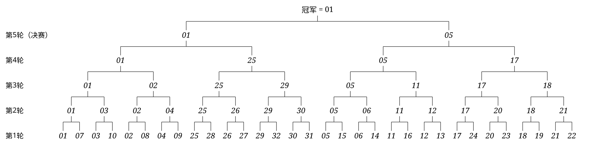

图 39　32 位选手的淘汰赛

于是, 道奇森着手设计了一种能够真正选出第二优秀选手和第三优秀选手的比赛规则, 假定排名具有传递性. (换句话说, 如果选手 $A$ 战胜选手 $B$, 选手 $B$ 战胜选手 $C$, 则假定选手 $A$ 将战胜选手 $C$.) 在他设计的赛程中, 允许失败者继续比赛, 直到确认他们的确弱于其他三位选手. 图 40 给出道奇森方案的一个示例, 它是结合图 39 举行的辅助比赛. 该方案尽量把在之前各轮比赛中具有相等记录的选手配对, 并尽量避免被同一选手击败的两位选手配对. 在这个具体示例中, 第一轮 16 号败给 11 号, 13 号败给 12 号. 当 13 号在第二轮战胜 16 号之后, 我们可以清除 16 号, 现在已经知道他弱于 11、12、13 号. 在第三轮, 不允许 19 号与 21 号比赛, 因为他俩都败给 18 号, 我们无法自动清除 19 号与 21 号比赛的失败者.

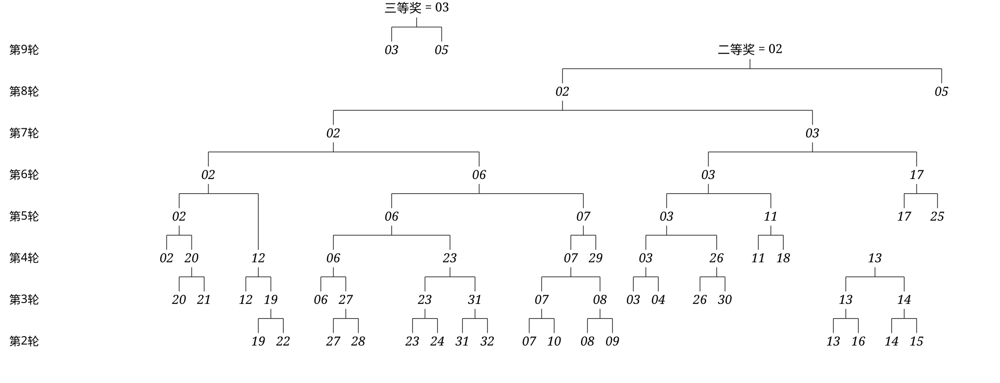

图 40　刘易斯·卡罗尔的草地网球锦标赛 (结合图 39 举行)

如果我们能够说刘易斯·卡罗尔的锦标赛方案是最优的, 那当然是好事, 但遗憾的是, 事实并非如此. 卡罗尔在 1883 年 7 月 23 日的日记中写到, 他花费了大约六个小时来排定方案, 他感到: “现在, 我们的 [网球] 赛季已经延误了这么久, 更好的做法是马上开始比赛, 而不是制订出完美计划.” 他设计的过程所执行的比较次数超出了必需数目, 而且没有足够精确的描述, 不足以成为一种算法. 另一方面, 从并行计算的角度来看, 它有一些相当有趣的特性. 卡罗尔方案看起来是一个出色的网球锦标赛计划, 因为他加入了一些戏剧性的效果. 比如, 他规定, 两位决赛选手应当不参加第五轮比赛, 而是参加第六轮和第七轮的附加比赛. 但是锦标赛组织者大概认为这种建议太过理性了, 因此卡罗尔方案显然从未被尝试过. 而是采用一种 “种子选手” 方法, 把可能是最优秀的选手分配到比赛树的不同部分.

在 1929～1930 年的数学研讨会上, 雨果·斯坦豪斯提出一个问题: 假定 $n\ge2$, 在共有 $n$ 位选手的锦标赛中, 至少需要多少场比赛才能决出位列第一和第二的最优秀选手. 约瑟夫·施赖埃尔给出了一种最多需要 $n-2+\lceil\lg n\rceil$ 场比赛的过程 [*Mathesis Polska* **7** (1932), 154–160], 使用的方法基本上与我们所说的树选择排序 (见 5.2.3 节, 图 23) 中的前两个阶段相同, 但避免涉及 $-\infty$ 的冗余比较. 施赖埃尔还声称, $n-2+\lceil\lg n\rceil$ 是最佳结果, 但他的证明是错误的, 耶日·斯卢佩茨基尝试给出的另一证明也是错误的 [*Colloquium Mathematicum* **2** (1951), 286–290]. 32 年之后, 基斯利岑最终给出了一个正确但相当复杂的证明 [*Sibirskiǐ Mat. Zhurnal* **5** (1964), 557–564].

对于 $1\le t\le n$, 设 $V_t(n)$ 表示确定 $n$ 个元素中的第 $t$ 大元素需要的最少比较次数. 设 $W_t(n)$ 表示确定最大、第二大、……、第 $t$ 大等总共 $t$ 个元素需要的最少比较次数. 根据对称性, 有

$$
V_t(n)=V_{n+1-t}(n),\tag{1}
$$

而且显然有

$$
V_1(n)=W_1(n),\tag{2}
$$

$$
V_t(n)\le W_t(n),\tag{3}
$$

$$
W_n(n)=W_{n-1}(n)=S(n).\tag{4}
$$

在引理 5.2.3M 中我们已经看到

$$
V_1(n)=n-1.\tag{5}
$$

实际上, 这个事实有一个简单得让人惊讶的证明, 因为在一次锦标赛中, 除冠军之外的每位选手都至少输一场比赛! 延伸这一思想, 并像 5.3.2 节中那样使用一个 “对手”, 没有多大难度就可以证明施赖埃尔－基斯利岑定理:

**定理 S.** 对于 $n\ge2$ 有 $V_2(n)=W_2(n)=n-2+\lceil\lg n\rceil$.

证明. 假定有 $n$ 位选手参加一场锦标赛, 通过某种给定过程来确定第二优秀的选手, 并设 $a_j$ 表示输掉 $j$ 场或更多场比赛的选手数. 因此, 总共需要举行 $a_1+a_2+a_3+\cdots$ 场比赛. 我们无法在不确定冠军的前提下确定第二优秀的选手 (见习题 2), 前面的论证过程说明 $a_1=n-1$. 为了完成证明, 我们将证明总是存在某个比赛结果序列, 使得 $a_2\ge\lceil\lg n\rceil-1$.

假定在锦标赛结束时, 冠军已经迎战 (并战胜)$p$ 位选手. 这 $p$ 位选手之一是第二优秀的, 那么其他选手必定至少还另外输掉一场比赛, 所以 $a_2\ge p-1$. 因此, 为了完成证明, 我们可以构造一个 “对手”, 在决定比赛结果时, 使冠军必须至少与另外 $\lceil\lg n\rceil$ 位选手比赛.

如果 $A$ 之前未被打败过, 而 $B$ 至少失败了一次, 或者如果两人都未被打败过, 但 $B$ 赢得的比赛场数少于 $A$, “对手” 就认为 $A$ 优于 $B$. 在其他情形下, “对手” 可以做出同某个偏序一致的任何判断.

考虑一届完整锦标赛的比赛结果, 其中的各场比赛结果由上述 “对手” 决定. 当且仅当 $A=B$ 或者 $A$ 强于首先战胜 $B$ 的选手时, 我们说 “$A$ 强于 $B$”. (这一关系仅考虑选手的首次失败, 失败者的后续比赛将被忽略. 根据 “对手” 的规则, 任何一位首先战胜另一位选手的选手, 他之前不能被击败过.) 由此得出, 如果一位选手赢得前 $p$ 场比赛, 根据这 $p$ 场比赛结果, 他最多强于 $2^p$ 位选手. (这在 $p=0$ 时显然成立, 当 $p>0$ 时, 在第 $p$ 场比赛对抗的选手或者先前被击败过, 或者最多强于 $2^{p-1}$ 位选手.) 冠军强于所有其他人, 他必定至少参加 $\lceil\lg n\rceil$ 场比赛. ■

定理 S 在 “最小最大” 意义上完全解决了寻找第二优秀选手的问题. 事实上, 习题 6 表明, 如果事先已经知道元素的任意偏序, 可以给出一个非常简单的公式, 求得寻找第二大元素所需要的最少比较次数.

**如果 $t>2$ 呢?** 在前面引述的论文中, 基斯利岑继续考虑 $t$ 的更大值并证明

$$
W_t(n)\le n-t+\sum_{n+1-t<j\le n}\lceil\lg j\rceil,\quad1\le t\le n.\tag{6}
$$

对于 $t=1$ 和 $t=2$, 我们已经看到这个公式中的等号实际上是成立的. 对于 $t=3$, 可以对它进行少许改进 (见习题 21).

我们将说明在忽略所有涉及 $-\infty$ 的比较时, 树选择的前 $t$ 个阶段最多需要 $n-t+\sum_{n+1-t<j\le n}\lceil\lg j\rceil$ 次比较, 以此证明基斯利岑定理. 有趣的是, 根据式 5.3.1–(3), 当 $t=n$ 时式 (6) 的右侧等于 $B(n)$, 当 $t=n-1$ 时也是如此. 因此, 尽管树选择和二叉插入是两种有着很大差异的方法, 但它们却给出排序问题的相同上限.

设 $\alpha$ 是具有 $n$ 个外部结点的扩展二叉树, 设 $\pi$ 是 $\{1,2,\ldots,n\}$ 的排列. 按对称序自左向右把 $\pi$ 的元素放到外部结点中, 并像在树选择中那样根据淘汰赛的规则填充内部结点. 如果对得到的树执行重复选择操作, 就会确定一个序列 $c_{n-1}c_{n-2}\ldots c_1$, 其中 $c_j$ 是指当元素 $j+1$ 已经被 $-\infty$ 代替时, 把元素 $j$ 移到树的根结点需要的比较次数. 例如, 如果 $\alpha$ 是树

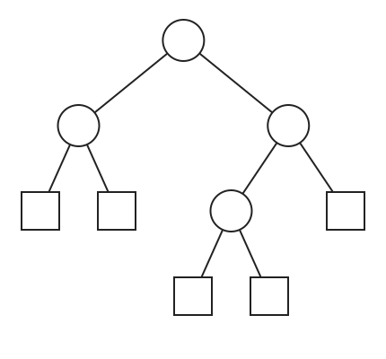(7)

而且 $\pi=53142$, 将依次得到以下各树. 如果 $\pi$ 换成 31542, 则序列 $c_4c_3c_2c_1$ 将是 2110.

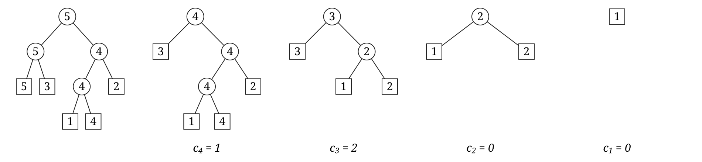

不难看出 $c_1$ 总是零.

设 $\mu(\alpha,\pi)$ 是由 $\alpha$ 和 $\pi$ 决定的多重集 $\{c_{n-1},c_{n-2},\ldots,c_1\}$. 如果

<table style="display:table;width:240px;margin:16px auto;border:0"><tbody><tr><td style="border:0;padding:0;white-space:nowrap">$\alpha=$</td><td style="border:0;padding:0">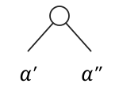</td></tr></tbody></table>

而且元素 1 和 2 没有同时出现在 $\alpha'$ 中, 也没有同时出现在 $\alpha''$ 中, 容易看出, 对于适当的排列 $\pi'$ 和 $\pi''$ 有

$$
\mu(\alpha,\pi)=\bigl(\mu(\alpha',\pi')+1\bigr)\uplus\bigl(\mu(\alpha'',\pi'')+1\bigr)\uplus\{0\},\tag{8}
$$

式中 $\mu+1$ 表示对 $\mu$ 的每个元素加 1 得到的多重集. (见习题 7.) 另一方面, 如果元素 1 和 2 同时出现在 $\alpha'$ 中, 我们有

$$
\mu(\alpha,\pi)=\bigl(\mu(\alpha',\pi')+\epsilon\bigr)\uplus\bigl(\mu(\alpha'',\pi'')+1\bigr)\uplus\{0\},
$$

式中 $\mu+\epsilon$ 表示对 $\mu$ 的某些元素加 1、对其他元素加 0 得到的多重集. 当 1 和 2 同时出现于 $\alpha''$ 时, 存在类似公式. 如果多重集 $\mu_1$ 和 $\mu_2$ 包含相同数量的元素, 且对于所有 $k$ 值 $\mu_1$ 的第 $k$ 大元素大于等于 $\mu_2$ 的第 $k$ 大元素, 则说 $\mu_1$ 高于 $\mu_2$. 我们定义 $\mu(\alpha)$ 是 $\mu(\alpha,\pi)$ 对于所有排列 $\pi$ 的最高者, 如果对于所有 $\pi$ 都有 $\mu(\alpha)$ 高于 $\mu(\alpha,\pi)$, 且对于某个 $\pi$ 有 $\mu(\alpha)=\mu(\alpha,\pi)$. 上述公式表明

<table data-selection-equation="9" style="display:table;width:max-content;min-width:0;max-width:none;margin:0;border:0"><tbody><tr><td style="border:0;padding:4px;white-space:nowrap">$\mu(\square)=\emptyset,\quad\mu$</td><td style="border:0;padding:0">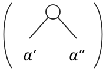</td><td style="border:0;padding:4px;white-space:nowrap">$=\bigl(\mu(\alpha')+1\bigr)\uplus\bigl(\mu(\alpha'')+1\bigr)\uplus\{0\}.$</td><td style="border:0;padding:4px;white-space:nowrap">(9)</td></tr></tbody></table>

因此, $\mu(\alpha)$ 是从 $\alpha$ 的根结点到内部结点的所有距离组成的多重集.

遵循这一思路的读者现在就会看到, 我们已经为证明基斯利岑定理 (6) 做好了准备. 实际上, $W_t(n)$ 小于等于 $n-1$ 加上 $\mu(\alpha)$ 的 $t-1$ 个最大元素, 其中 $\alpha$ 是树选择排序中使用的任意树. 当

$$
\mu(\alpha)=\{\lfloor\lg1\rfloor,\lfloor\lg2\rfloor,\ldots,\lfloor\lg(n-1)\rfloor\}=\{\lceil\lg2\rceil-1,\lceil\lg3\rceil-1,\ldots,\lceil\lg n\rceil-1\}\tag{10}
$$

时, 可以取 $\alpha$ 为具有 $n$ 个外部结点的完全二叉树 (见 2.3.4.5 节). 考虑这个多重集的 $t-1$ 个最大元素, 就得到式 (6).

基斯利岑定理给出 $W_t(n)$ 的一个好上限. 他注意到 $V_3(5)=6<W_3(5)=7$, 但未能为 $V_t(n)$ 找到优于 $W_t(n)$ 的更佳上限. 哈迪安和米尔顿·索贝尔发现了一种解决方法: 使用替代选择而不是树选择. 他们的公式 [明尼苏达大学, Dept. of Statistics Report **121** (1969)]

$$
V_t(n)\le n-t+(t-1)\lceil\lg(n+2-t)\rceil,\quad n\ge t\tag{11}
$$

类似于基斯利岑在式 (6) 中给出的 $W_t(n)$ 的上限, 只是和式中的每一项都已经被最小项所代替.

利用以下构造可以证明哈迪安和索贝尔定理 (11): 首先, 建立一棵 $n-t+2$ 个项目的淘汰赛二叉树 (这需要 $n-t+1$ 次比较). 最大项大于 $n-t+1$ 个其他项, 所以它不会是第 $t$ 个最大的. 它出现在树的一个外部结点处, 用保留的 $t-2$ 个元素[^p165-1] 之一代替它, 然后在由此得到的 $n-t+2$ 个元素中找出最大元素. 由于只需要重新计算树中的一条路径, 所以最多花费 $\lceil\lg(n+2-t)\rceil$ 次比较. 对保留的每个元素重复这个操作, 共 $t-2$ 次. 最后, 用 $-\infty$ 代替当前最大元素, 在剩下的 $n+1-t$ 个元素中找出最大元素, 这最多需要 $\lceil\lg(n+2-t)\rceil-1$ 次比较, 而且它把原集合中的第 $t$ 大元素移到树的根结点处. 对这些比较次数求和可以得到式 (11).

在关系式 (11) 中, 只要 $n+1-t$ 能够给出更好的值 (例如当 $n=6,t=3$ 时), 我们当然会用 $n+1-t$ 代替右侧的 $t$. 让人好奇的是, 这个公式为 $V_7(13)$ 给出的上限要小于为 $V_6(13)$ 给出的上限. 对 $n\le6$, 式 (11) 中的上限是精确的, 但随着 $n$ 与 $t$ 的变大, 有可能为 $V_t(n)$ 获得好得多的估计值.

例如, 可以利用下面的精彩方法 (由戴维·多伦给出) 来证明 $V_4(8)\le12$. 设元素是 $X_1,\ldots,X_8$. 首先比较 $X_1:X_2$ 和 $X_3:X_4$ 以及两个获胜者, 然后比较 $X_5:X_6$ 和 $X_7:X_8$ 以及两个获胜者. 重新标记元素, 使得 $X_1<X_2<X_4>X_3,X_5<X_6<X_8>X_7$, 然后比较 $X_2<X_6$, 根据对称性假定 $X_2<X_6$, 得到结构

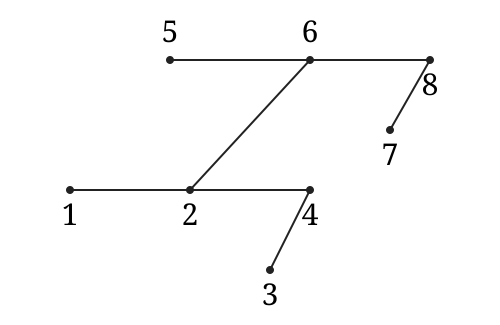

(现在, $X_1$ 和 $X_8$ 已经退出比赛, 我们必须找出 $\{X_2,\ldots,X_7\}$ 的第三大元素.) 比较 $X_2:X_7$ 并放弃较小值. 在最差情况下, 我们有 $X_2<X_7$, 而且必须找出

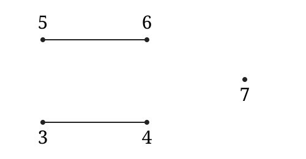

的第三大元素. 由于式 (11) 中获得 $V_3(5)=6$ 的过程以比较两组不相交的元素对开始, 所以可以用另外 $V_3(5)-2=4$ 次比较找出上述第三大元素.

可以利用这种类型的其他技巧来生成如表 1 所示的结果, 尚未发现通用方法. 1996 年, 威廉·加萨尔兹、韦恩·凯利和威廉·皮克使用计算机查找方法证明, 对于 $V_4(9)=V_6(9)$ 和 $V_5(10)=V_6(10)$ 所列的值是最优的 [*SIGACT News* **27**, 2 (June 1996), 88–96].

表 1　$n$ 较小时的 $V_t(n)$ 值

| $n$ | $V_{1}(n)$ | $V_{2}(n)$ | $V_{3}(n)$ | $V_{4}(n)$ | $V_{5}(n)$ | $V_{6}(n)$ | $V_{7}(n)$ | $V_{8}(n)$ | $V_{9}(n)$ | $V_{10}(n)$ |
|---:|---:|---:|---:|---:|---:|---:|---:|---:|---:|---:|
| 1 | 0 |  |  |  |  |  |  |  |  |  |
| 2 | 1 | 1 |  |  |  |  |  |  |  |  |
| 3 | 2 | 3 | 2 |  |  |  |  |  |  |  |
| 4 | 3 | 4 | 4 | 3 |  |  |  |  |  |  |
| 5 | 4 | 6 | 6 | 6 | 4 |  |  |  |  |  |
| 6 | 5 | 7 | 8 | 8 | 7 | 5 |  |  |  |  |
| 7 | 6 | 8 | 10 | $10^{*}$ | 10 | 8 | 6 |  |  |  |
| 8 | 7 | 9 | 11 | 12 | 12 | 11 | 9 | 7 |  |  |
| 9 | 8 | 11 | 12 | 14 | $14^{*}$ | 14 | 12 | 11 | 8 |  |
| 10 | 9 | 12 | $14^{*}$ | 15 | $16^{**}$ | $16^{**}$ | 15 | $14^{*}$ | 12 | 9 |

\* 习题 10～12 给出了在这些情况下改进式 (11) 的构造.

\*\* 见野下浩平,*Trans. of the IECE of Japan* **E59**, 12 (December 1976), 17–18.

戴维·柯克帕特里克找到了选择问题在 $t$ 很小时相当好的下限 [*JACM* **28** (1981), 150–165]: 对于 $2\le t\le(n+1)/2$ 有

$$
V_t(n)\ge n+t-3+\sum_{j=0}^{t-2}\left\lceil\lg\frac{n-t+2}{t+j}\right\rceil.\tag{12}
$$

在他的博士论文 [多伦多大学, 1974 年] 中, 柯克帕特里克还证明了

$$
V_3(n)\le n+1+\left\lceil\lg\frac{n-1}{4}\right\rceil+\left\lceil\lg\frac{n-1}{5}\right\rceil,\tag{13}
$$

对于所有整数 $n$ 的 $\lg\tfrac53\approx74\%$, 这个上限等于下限 (12), 其他情况下它最多比 (12) 超出 1. 柯克帕特里克的分析使我们很自然地猜测到: 对于所有 $n>4$, 式 (13) 中的等号成立. 但尤塔·奥伊斯特布罗克发现了令人惊讶的反例 $V_3(22)=28$[*Discrete Applied Math.* **41** (1993), 131–137]. 后来柯克帕特里克发现 $V_3(42)=50$, 这可能是仅有的其他反例 [见 *Lecture Notes in Comp. Sci.* **8066** (2013), 61–76]. 对于较大的 $t$ 值, 塞缪尔·本特和约翰·约翰找到改进后的下限 (见习题 27):

$$
V_t(n)\ge n+m-2\lceil\sqrt m\rceil,\quad m=2+\left\lceil\lg\left(\binom nt/(n+1-t)\right)\right\rceil.\tag{14}
$$

这个公式特别证明了

$$
V_{\alpha n}(n)\ge\left(1+\alpha\lg\frac1\alpha+(1-\alpha)\lg\frac1{1-\alpha}\right)n+O(\sqrt n).\tag{15}
$$

**一种线性方法.** 当 $n$ 为奇数且 $t=\lceil n/2\rceil$ 时, 第 $t$ 大元素 (也是第 $t$ 小元素) 称为 “中值”. 根据式 (11), 找出 $n$ 个元素的中值需要大约 $\tfrac12n\lg n$ 次比较. 但是这个速度大约只比排序速度快一倍, 尽管我们要求获取的信息少得多. 若干年来, 许多人一直致力于寻求当 $t$ 和 $n$ 很大时对式 (11) 的改进. 最后在 1971 年, 曼纽尔·布卢姆发现一种仅需要 $O(n\log\log n)$ 步的方法. 布卢姆解决这个问题的方法提出一类新技术, 引出了由罗纳德·里夫斯特和塔扬给出的以下构造 [*J. Comp. and Sys. Sci.* **7** (1973), 448–461]:

**定理 L.** 对于 $n>32,1\le t\le n$, 有 $V_t(n)\le15n-163$.
**证明.** 当 $n$ 很小时, 定理显然成立, 因为对于 $32<n\le2^{10}$ 有 $V_t(n)\le S(n)\le10n\le15n-163$. 通过添加至多 13 个虚构的 $-\infty$ 元素, 我们可以假定 $n=7(2q+1)$, 其中 $q$ 为某个 $\ge73$ 的整数. 现在使用以下方法来选择第 $t$ 大元素:

**步骤 1.** 把这些元素分为 $2q+1$ 组, 每组七个元素, 然后排序每一组. 这最多需要 $13(2q+1)$ 次比较.

**步骤 2.** 求出在步骤 1 中获得的 $2q+1$ 个中值元素的中值, 称为 $x$. 对 $q$ 应用归纳法, 可以证明这最多需要 $V_{q+1}(2q+1)\le30q-148$ 次比较.

**步骤 3.** 除 $x$ 之外的 $n-1$ 个元素现在已经被划分为三个集合 (见图 41):

已知有 $4q+3$ 个元素大于 $x$ (区域 B);

已知有 $4q+3$ 个元素小于 $x$ (区域 C);

$6q$ 个元素与 $x$ 的关系未知 (区域 A 与 D).

另外再进行 $4q$ 次比较, 就可以准确地知道区域 A 与 D 中的哪些元素小于 $x$. (首先比较 $x$ 与每个三元组的中间元素.)

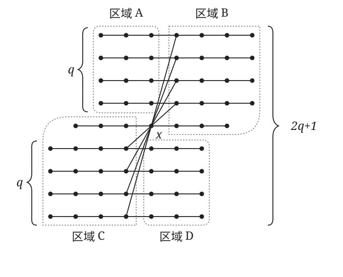

图 41　里夫斯特和塔扬的选择算法 ($q=4$)

**步骤 4.** 现在我们已经发现, 对于某个 $r$ 值, 有 $r$ 个元素大于 $x$, $n-1-r$ 个元素小于 $x$. 如果 $t=r+1$, 则 $x$ 就是答案; 如果 $t<r+1$, 则需要找出 $r$ 个大元素中的第 $t$ 大元素; 如果 $t>r+1$, 则需要找出 $n-1-r$ 个小元素中的第 $t-1-r$ 大元素. 关键在于 $r$ 和 $n-1-r$ 都小于等于 $10q+3$ (区域 A 与 D 再加上 B 或 C 的大小). 对 $q$ 应用归纳法, 可以证明这个步骤最多需要 $15(10q+3)-163$ 次比较.

总比较次数至多为

$$
13(2q+1)+30q-148+4q+15(10q+3)-163=15(14q-6)-163.
$$

而开始时至少有 $14q-6$ 个元素, 所以定理得证.　▮

定理 L 表明, 选择过程总是可以在线性时间内完成, 即 $V_t(n)=O(n)$. 当然, 证明过程中使用的方法是相当粗糙的, 它舍弃了步骤 4 中的重要信息. 对这个问题的深入研究已经得到更精确的上限, 例如, 阿诺尔德·舍恩哈格、佩特森和尼古拉斯·皮彭格尔证明了找出中值需要的最大比较次数至多为 $3n+O(n\log n)^{3/4}$[*J. Comp. Sys. Sci.* **13** (1976), 184–199]. 关于下限及最近结果的参考文献, 见习题 23.

**平均数.** 我们也可以不要求在最大限度上降低最大比较次数, 而是寻求一种算法, 能够在随机顺序的情况下将平均比较次数降至最低. 和通常一样, 均值最小化问题要远难于最大值最小化问题. 事实上, 即使是 $t=2$ 的情形, 均值最小化问题也没有得到解决. 皮卡尔在他的著作 *Théorie des Questionnaires* (1965) 中提到这个问题, 索贝尔进行了广泛探索 [明尼苏达大学, Dept. of Statistics Reports 113 and 114 (November 1968); *Revue Française d’Automatique, Informatique et Recherche Opérationnelle* **6**, R-3 (December 1972), 23–68].

索贝尔构造了图 42 所示的过程, 平均只需要 $6\tfrac12$ 次比较就能找出六个元素中的第二大元素. 在最差情况下, 它需要 8 次比较, 这个结果劣于 $V_2(6)=7$. 事实上, 丹尼尔·霍伊执行的计算机穷尽查找已经表明, 如果限定至多做 7 次比较, 这个问题的最佳过程平均使用 $6\tfrac{26}{45}$ 次比较. 因此, 任何一种寻找六个元素中第二大元素的算法都不可能同时在最大值最小化与均值最小化的意义上达到最优.

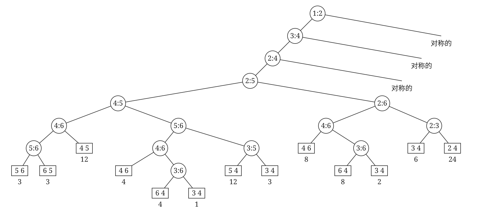

图 42　平均使用 $6\tfrac12$ 次比较找出 $\{X_1,X_2,X_3,X_4,X_5,X_6\}$ 中第二大元素的过程. 每个 “对称的” 分支与同级分支相同, 只是名字按某种适当的方式重新排列. 当已知 $X_j$ 为第二大元素而 $X_k$ 为最大元素时, 外部结点标为 “$j\ k$”. 写在每个外部结点下方的数表示通向这个结点的排列数目

设 $\overline V_t(n)$ 表示为了找出 $n$ 个元素中的第 $t$ 大元素需要的最少平均比较次数. 表 2 给出 $n$ 较小时的确切值, 它们是由丹尼尔·霍伊计算得出的.

1970 年, 罗伯特·弗洛伊德发现平均只需要 $\tfrac32n+O(n^{2/3}\log n)$ 次比较就可以找出 $n$ 个元素的中值. 几年后, 他和里夫斯特改进了这个方法, 构造出一种出色的算法证明

$$
\overline V_t(n)\le n+\min(t,n-t)+O(\sqrt{n\log n}).\tag{16}
$$

(见习题 13 与 24.)

基于 $t=2$ 的一种索贝尔构造的推广, 戴维·马图拉用另一方法证明了 [Washington Univ. Tech. Report AMCS-73-9 (1973)]

$$
\overline V_t(n)\le n+t\lceil\lg t\rceil(11+\ln\ln n).\tag{17}
$$

表 2　选择过程需要的最少平均比较次数

| $n$ | $\overline V_{1}(n)$ | $\overline V_{2}(n)$ | $\overline V_{3}(n)$ | $\overline V_{4}(n)$ | $\overline V_{5}(n)$ | $\overline V_{6}(n)$ | $\overline V_{7}(n)$ |
|---:|---:|---:|---:|---:|---:|---:|---:|
| 1 | $0$ | | | | | | |
| 2 | $1$ | $1$ | | | | | |
| 3 | $2$ | $2\tfrac23$ | $2$ | | | | |
| 4 | $3$ | $4$ | $4$ | $3$ | | | |
| 5 | $4$ | $5\tfrac4{15}$ | $5\tfrac{13}{15}$ | $5\tfrac4{15}$ | $4$ | | |
| 6 | $5$ | $6\tfrac12$ | $7\tfrac7{18}$ | $7\tfrac7{18}$ | $6\tfrac12$ | $5$ | |
| 7 | $6$ | $7\tfrac{149}{210}$ | $8\tfrac{509}{630}$ | $9\tfrac{32}{105}$ | $8\tfrac{509}{630}$ | $7\tfrac{149}{210}$ | $6$ |

因此, 对于固定的 $t$ 值, 平均工作量可以减少到 $n+O(\log\log n)$ 次比较. 习题 25 给出 $\overline V_t(n)$ 的一个出色下限.

排序和选择问题其实是更一般问题的两种特例, 这个问题是: 找出同给定偏序一致的 $n$ 个给定元素的排列. 姚期智已经证明: 如果偏序由拥有 $n$ 个顶点和 $k$ 个连通分量的无回路有向图 $G$ 定义, 那么在平均情形下及最差情形下, 求解这些问题需要的最少比较次数总是 $\Theta(\lg(n!/T(G))+n-k)$, 其中 $T(G)$ 是同偏序一致的排列总数 (也就是对 $G$ 进行拓扑排序的方式数)[*SICOMP* **18** (1989), 679–689].

#### 习题

**1. [15]** 在刘易斯·卡罗尔的锦标赛 (图 39 和 40) 中, 尽管 13 号选手在第三轮获胜, 为什么他还是被淘汰了?　[答案](./answers/5-3-3.md#ans-5-3-3-1)

**▶ 2. [M25]** 证明: 在通过一系列比较找到 $n$ 个元素中的第 $t$ 大元素之后, 我们还知道哪 $t-1$ 个元素大于它, 哪 $n-t$ 个元素小于它.　[答案](./answers/5-3-3.md#ans-5-3-3-2)

**3. [20]** 证明: 对于 $1\le t<n$ 有 $V_t(n)>V_t(n-1)$, $W_t(n)>W_t(n-1)$.　[答案](./answers/5-3-3.md#ans-5-3-3-3)

**▶ 4. [M25]** (弗兰克·富塞内格尔和加保) 证明: $W_t(n)\ge n-t+\lceil\lg n^{\underline{t-1}}\rceil$.　[答案](./answers/5-3-3.md#ans-5-3-3-4)

**5. [10]** 证明: $W_3(n)\le V_3(n)+1$.　[答案](./answers/5-3-3.md#ans-5-3-3-5)

**▶ 6. [M26]** (弗洛伊德) 给定 $n$ 个互不相同的元素 $\{X_1,\ldots,X_n\}$, 以及某些 $(i,j)$ 对的关系 $X_i<X_j$ 的一个集合, 我们希望找出第二大元素. 如果知道对 $j\ne k$ 有 $X_i<X_j$ 且 $X_i<X_k$, 那么 $X_i$ 就不可能是第二大元素, 所以可以把它删除. 现在, 得到的关系具有形式　[答案](./answers/5-3-3.md#ans-5-3-3-6)

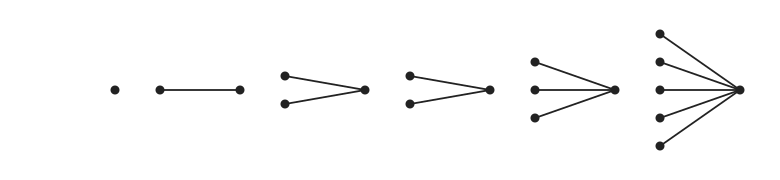

即: 可以用多重集 $\{l_1,l_2,\ldots,l_m\}$ 表示的 $m$ 组元素, 第 $j$ 组包含 $l_j+1$ 个元素, 已知其中一个元素大于所有其他元素. 例如, 上述结构可以用多重集 $\{0,1,2,2,3,5\}$ 描述. 当不知道任何关系时, 我们得到一个由 $n$ 个零组成的多重集.

设 $f(l_1,l_2,\ldots,l_m)$ 是找出这样一个偏序集中第二大元素需要的最少比较次数. 证明:

$$
f(l_1,l_2,\ldots,l_m)=m-2+\left\lceil\lg(2^{l_1}+2^{l_2}+\cdots+2^{l_m})\right\rceil.
$$

[提示: 证明, 最佳策略总是比较两个最小组的最大元素, 直到 $m$ 缩减为 1. 对 $l_1+l_2+\cdots+l_m+2m$ 应用归纳法.]

**7. [M20]** 证明式 (8).　[答案](./answers/5-3-3.md#ans-5-3-3-7)

**8. [M21]** 基斯利岑的式 (6) 以树选择排序为基础, 使用了具有 $n$ 个外部结点的完全二叉树. 对于任何 $t$ 和 $n$ 值, 以其他某种树为基础的树选择方法能否给出更好的上限?　[答案](./answers/5-3-3.md#ans-5-3-3-8)

**▶ 9. [20]** 绘制一棵比较树, 使用哈迪安和索贝尔的替代选择方法 [见式 (11)], 在最多 6 步内找出五个元素的中值.　[答案](./answers/5-3-3.md#ans-5-3-3-9)

**10. [35]** 证明: 最多需要 10 步就可以找出七个元素的中值.　[答案](./answers/5-3-3.md#ans-5-3-3-10)

**11. [38]** (野下浩平) 证明: 最多需要 14 步就可以找出九个元素的中值, 其中前 7 步与多伦的方法相同.　[答案](./answers/5-3-3.md#ans-5-3-3-11)

**12. [21]** (哈迪安和索贝尔) 证明 $V_3(n)\le V_3(n-1)+2$. [提示: 首先丢弃 $\{X_1,X_2,X_3,X_4\}$ 的最小者.]　[答案](./answers/5-3-3.md#ans-5-3-3-12)

**▶ 13. [HM28]** (弗洛伊德) 证明: 从使用递归定义的方法找出 $\{X_1,\ldots,X_{n^{2/3}}\}$ 的中值元素开始, 平均使用 $\tfrac32n+O(n^{2/3}\log n)$ 次比较就可以找出 $\{X_1,\ldots,X_n\}$ 的中值.　[答案](./answers/5-3-3.md#ans-5-3-3-13)

**▶ 14. [20]** (索贝尔) 设 $U_t(n)$ 表示找出 $n$ 个元素中的 $t$ 个最大元素 (不必知道这 $t$ 个元素的相对顺序) 需要的最少比较次数. 证明 $U_2(5)\le5$.　[答案](./answers/5-3-3.md#ans-5-3-3-14)

**15. [22]** (艾拉·波尔) 假定我们希望尽可能减少空间, 而不是缩短时间. 如果每个元素占用一个数据字的空间, 输入时这些元素是一次一个地依次读入到单个寄存器中, 为了计算 $n$ 个元素中的第 $t$ 大元素, 至少需要多少个数据字的存储单元?　[答案](./answers/5-3-3.md#ans-5-3-3-15)

**▶ 16. [25]** (波尔) 证明: 最多使用 $\lceil\tfrac32n\rceil-2$ 次比较就可以找出 $n$ 个元素中的最大元素与最小元素, 比较次数不可能再少了. [提示: 算法中的任何阶段都可以表示为四元组 $(a,b,c,d)$, 其中 $a$ 是从未进行过比较的元素个数, $b$ 是获胜过但从未失败过的元素个数, $c$ 是失败过但从未获胜过的元素个数, $d$ 是既曾获胜又曾失败的元素个数. 构造一个对手.]　[答案](./answers/5-3-3.md#ans-5-3-3-16)

**17. [20]** (弗洛伊德) 证明: 最多使用 $\lceil\tfrac32n\rceil-k-l+\sum_{n+1-k<j\le n}\lceil\lg j\rceil+\sum_{n+1-l<j\le n}\lceil\lg j\rceil$ 次比较, 就能依次选出 $n$ 个元素中的 $k$ 个最大元素和 $l$ 个最小元素.　[答案](./answers/5-3-3.md#ans-5-3-3-17)

**18. [M20]** 如果在证明定理 L 时使用的组大小为 5, 而不是 7, 会获得什么样的定理?　[答案](./answers/5-3-3.md#ans-5-3-3-18)

**19. [M42]** 把表 2 扩充到 $n=8$.

**20. [M47]** 当 $n\to\infty$ 时, $\overline V_2(n)-n$ 的渐近值是多少?

**21. [32]** (普拉卡什·拉马南和洛朗·亚菲) 证明: 当 $k\ge t\ge2$ 时, $W_t(2^k+2^{k+1-t})\le2^k+2^{k+1-t}+(t-1)(k-1)$. 并证明: 根据习题 4, 有无数多的 $k$ 和 $t$ 可以使等号成立. [提示: 维护两棵淘汰树, 并恰当地合并它们的结果.]　[答案](./answers/5-3-3.md#ans-5-3-3-21)

**22. [24]** (柯克帕特里克) 证明: 当 $4\cdot2^k<n-1\le5\cdot2^k$ 时, 可以把 $V_3(n)$ 的上限 (11) 减小 1, 如下所示: (i) 构造四棵大小为 $2^k$ 的淘汰树. (ii) 找出四个最大值中的最小值, 放弃这棵树中的所有 $2^k$ 个元素. (iii) 利用已知信息, 构造一棵大小为 $n-1-2^k$ 的淘汰树. (iv) 像证明式 (11) 那样继续进行.　[答案](./answers/5-3-3.md#ans-5-3-3-22)

**23. [M49]** 当 $n\to\infty$ 时, $V_{\lceil n/2\rceil}(n)$ 的渐近值是多少?　[答案](./answers/5-3-3.md#ans-5-3-3-23)

**24. [HM40]** 证明: 当 $t\le\lceil n/2\rceil$ 时, $\overline V_t(n)\le n+t+O(\sqrt{n\log n})$. [提示: 证明, 通过这么多次比较, 事实上可以找出第 $\lfloor t-\sqrt{t\ln n}\rfloor$ 大元素和第 $\lceil t+\sqrt{t\ln n}\rceil$ 大元素, 这之后就能轻松确定第 $t$ 大元素.]　[答案](./answers/5-3-3.md#ans-5-3-3-24)

**▶ 25. [M35]** (瓦尔特·普奇和芒罗) 证明: 当 $t\le\lceil n/2\rceil$ 时, $\overline V_t(n)\ge n+t-2$.　[答案](./answers/5-3-3.md#ans-5-3-3-25)

**26. [M32]** (阿诺尔德·舍恩哈格, 1974)(a) 使用习题 14 的记号, 证明: 当 $n\ge3$ 时, $U_t(n)\ge\min(2+U_t(n-1),2+U_{t-1}(n-1))$. [提示: 只要当前偏序不是完全由  类型的分量组成, 就把 $n$ 减少到 $n-1$, 由此构造一个对手.] (b) 类似地, 构造一个对手, 处理 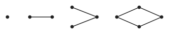 形式的分量, 由此证明: 当 $n\ge5$ 时, $U_t(n)\ge\min(2+U_t(n-1),3+U_{t-1}(n-1),3+U_t(n-2))$. (c) 因此, 当 $1\le t\le n/2$ 时, $U_t(n)\ge n+t+\min(\lfloor(n-t)/2\rfloor,t)-3$. [用 $V$ 或 $W$ 替代 $U$, (a) 和 (b) 中的不等式也成立, 从而确定了表 1 中若干项的最优值.]　[答案](./answers/5-3-3.md#ans-5-3-3-26)

**▶ 27. [M34]** 随机化对手是指允许通过掷硬币来做出决策的对手算法.　[答案](./answers/5-3-3.md#ans-5-3-3-27)

(a) 设 $A$ 是一个随机化对手, $\Pr(l)$ 是 $A$ 到达一棵给定比较树的叶结点 $l$ 的概率. 证明: 如果对于所有的 $l$ 都有 $\Pr(l)\le p$, 则这棵比较树的高度 $\ge\lg(1/p)$.
(b) 给定在稍后确定的整数参数 $q$ 和 $r$, 对于从 $n$ 个元素中选择第 $t$ 大元素的问题, 考虑以下对手:

**A1.** 选择包含 $t$ 个元素的随机集合 $T$, 所有 $\binom nt$ 种可能性的概率相同. (我们将确定 $t-1$ 个最大元素属于 $T$.) 设 $S=\{1,\ldots,n\}\setminus T$ 是其他元素, 令 $S_0\leftarrow S$, $T_0\leftarrow T$, $S_0$ 和 $T_0$ 表示那些可能成为第 $t$ 大元素的元素.

**A2.** 当 $|T_0|>r$ 时, 所有比较 $x:y$ 的结果判定如下: 如果 $x\in S$ 且 $y\in T$, 就说 $x<y$. 如果 $x\in S$ 且 $y\in S$, 则通过掷硬币来决定, 并从 $S_0$ 中删除较小元素, 如果它在 $S_0$ 中. 如果 $x\in T$ 且 $y\in T$, 则通过掷硬币来决定, 并从 $T_0$ 中删除较大元素, 如果它在 $T_0$ 中.

**A3.** 一旦 $|T_0|=r$, 就把这些元素按以下方法划分为三类 $P,Q,R$: 如果 $|S_0|<q$, 令 $P=S$, $Q=T_0$, $R=T\setminus T_0$. 否则, 对于每个 $y\in T_0$, 令 $C(y)$ 是 $S$ 中已经与 $y$ 比较过的元素, 并选择 $y_0$ 使得 $|C(y_0)|$ 最小. 令 $P=(S\setminus S_0)\cup C(y_0)$, $Q=(S_0\setminus C(y_0))\cup\{y_0\}$, $R=T\setminus\{y_0\}$. 所有未来比较 $x:y$ 的结果判定如下: 规定 $P$ 的元素小于 $Q$ 的元素, $Q$ 的元素小于 $R$ 的元素, 当 $x$ 和 $y$ 属于同一类时, 通过掷硬币来决定比较结果.　▮

证明: 如果 $1\le r\le t$, 且在步骤 A3 开始时 $|C(y_0)|\le q-r$, 则到达每个叶结点的概率 $\le(n+1-t)/(2^{n-q}\binom nt)$. [提示: 证明至少需要掷 $n-q$ 次硬币.]

(c) 继续 (b), 证明: 对于所有整数 $q$ 和 $r$ 有

$$
V_t(n)\ge\min\left(n-1+(r-1)(q+1-r),\ n-q+\lg\left(\binom nt/(n+1-t)\right)\right).
$$

(d) 通过选择 $q$ 和 $r$ 建立式 (14).

[^p165-1]: 保留的 $t-2$ 个元素是指初始时不在这棵树中的 $n-(n-t+2)=t-2$ 个元素. ——编者注
