

### *5.3.4　排序网络

本节将研究一种受约束的排序类型, 因为它的应用及基础理论充分而极为重要. 新的约束条件是坚持齐性比较序列; 也就是说, 每次比较 $K_i$ 与 $K_j$ 时, 后续比较对于 $K_i<K_j$ 的情形和 $K_i>K_j$ 的情形是完全相同的, 只是交换了 $i$ 和 $j$.

图 43(a) 给出一棵满足这个齐性条件的比较树. 注意, 每一级的比较次数相同, 所以在 $m$ 次比较之后, 共有 $2^m$ 种结果. 但 $n!$ 不是 2 的幂, 因此, 一些比较必然是多余的, 它们的子树之一在实践中绝不会出现. 换句话说, 树的某些分支必须执行一些超出实际需要的比较, 以确保该树的所有相应分支都能够正确排序.

这样一棵树的每一条自上而下的路径都唯一确定了整棵树, 所以这种排序方案最容易表示为网络, 见图 43(b). 这种网络中的方框表示 “比较器模块”, 它有两个输入 (表示为从上方进入模块的线) 和两个输出 (表示为向下延伸的线), 左侧输出是两个输入的较小者, 右侧输出是较大者. 在网络的底部, $K'_1$ 是 $\{K_1,K_2,K_3,K_4\}$ 的最小者, $K'_2$ 是第二小的, 以此类推. 不难证明, 任何排序网络都对应于上述意义的齐性比较树, 而任何齐性树都对应于一个比较器模块网络.

顺便说一下, 我们可能注意到, 从工程角度看制造比较器模块相当容易. 例如, 假定线中包含二进制数, 每个单位时间有一个二进制位进入每个模块, 最高有效位优先. 每个比较器模块有三种状态, 其行为特性如下:

<table data-comparator-state-table><thead><tr><th colspan="2">时刻 $t$</th><th colspan="2">时刻 $(t+1)$</th></tr><tr><th>状态</th><th>输入</th><th>状态</th><th>输出</th></tr></thead><tbody>
<tr><td>0</td><td>0 0</td><td>0</td><td>0 0</td></tr>
<tr><td>0</td><td>0 1</td><td>1</td><td>0 1</td></tr>
<tr><td>0</td><td>1 0</td><td>2</td><td>0 1</td></tr>
<tr><td>0</td><td>1 1</td><td>0</td><td>1 1</td></tr>
<tr><td>1</td><td>$x\ y$</td><td>1</td><td>$x\ y$</td></tr>
<tr><td>2</td><td>$x\ y$</td><td>2</td><td>$y\ x$</td></tr>
</tbody></table>

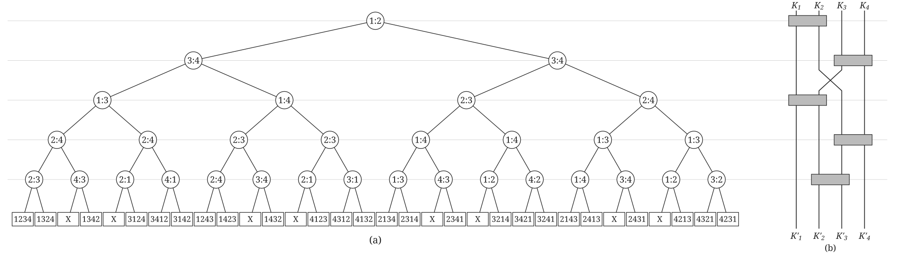

图 43　(a) 齐性比较树　(b) 对应的网络

开始时, 所有模块都处于状态 0, 输出 0 0. 一个模块只要它的输入不同就会进入状态 1 或状态 2. 如果在 $K'_1$ 和 $K'_4$ 线上添加一个适当的延迟元件, 在时刻 $t$ 开始传送到图 43(b) 顶端的数将在时刻 $t+3$ 开始按有序状态从底部输出.

为建立排序网络理论, 比较方便的做法是采用如图 44 所示的稍有不同的方式表示它们. 这里, 数从左侧边进入, 两条线之间的竖直连线表示比较器模块. 每个比较器在必要时交换它的输入, 使得在通过比较器之后较大的数下降到较低的线. 在图的右侧, 所有的数自上而下保持有序.

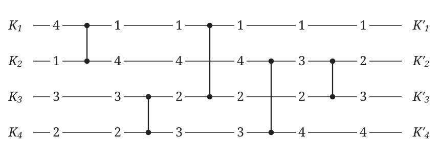

图 44　表示图 43 中网络的另一种方式, 对四元素序列 $\langle4,1,3,2\rangle$ 排序

我们以前对最优排序的研究主要集中在如何最大限度减少比较次数, 没有或很少考虑任何底层数据移动或者可能需要的判定结构的复杂度. 这方面排序网络有明显优势, 因为数据可以保存在 $n$ 个位置, 决策结构是 “直线” 式的——不需要记住先前比较的结果, 因为计划是事先定好的. 排序网络的另一个重要好处是我们通常可以重叠几个操作, (在一台适当的机器上) 同时执行它们. 例如, 当允许同时进行非重叠比较时, 图 43 和 44 中的五个步骤可以合并为三个, 因为前两个比较和接下来的两个比较可以合并. 本节稍后我们将充分运用排序网络的这个属性. 因此, 排序网络可能非常有用, 尽管在 $n$ 很大时并不是那么容易构造高效的 $n$ 元素排序网络. 我们可能会发现, 为保持齐性判定结构需要增加许多比较.

在给定一个 $n$ 元素网络时, 有两种简单方式可以构造 $n+1$ 元素的排序网络: 或者使用插入原理, 或者使用选择原理. 图 45(a) 说明在完成前 $n$ 个元素的排序之后, 如何把第 $n+1$ 个元素插入到正确位置. 图 45(b) 说明如何首先选出最大元素, 然后排序其余元素. 重复应用图 45(a) 给出类似于直接插入排序 (算法 5.2.1S) 的网络, 重复应用图 45(b) 将得到类似于冒泡排序 (算法 5.2.2B) 的网络. 图 46 给出相应的六元素网络.

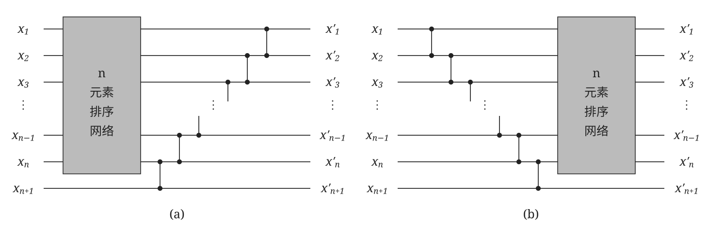

图 45　从 $n$ 元素排序器构造 $(n+1)$ 元素排序器: (a) 插入　(b) 选择

注意, 如果我们重叠每个网络以允许同时操作, 这两种方法实际上都会简化为同一个 “三角形” 的有 $2n-3$ 个阶段过程 (图 47).

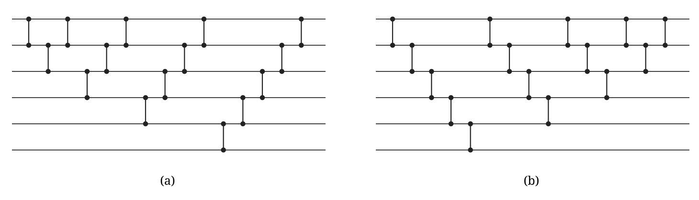

图 46　重复应用图 45 的构造得到的类似于初等内部排序方案的网络: (a) 直接插入排序　(b) 冒泡排序

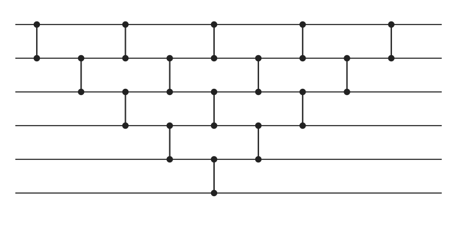

图 47　采用并行方式时, 直接插入＝冒泡排序!

容易证明图 43 和 44 中的网络将把任意四元素集合排好序, 因为前四个比较器把最小元素和最大元素移到正确位置, 最后一个比较器把剩下的两个元素排好序. 但是, 一个给定网络能否把所有可能的输入序列都排好序, 并不总是那么容易判断. 例如,

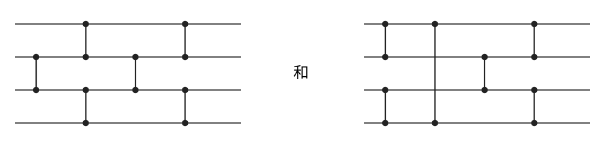

都是有效的四元素排序网络, 但它们的有效性证明就不是那么轻松了. 对 $n$ 个不同元素的所有 $n!$ 个排列测试每个 $n$ 元素网络当然就足够了, 但事实上, 我们能够通过少得多的测试次数加以证明:

**定理 Z(0–1 原理).** 如果一个具有 $n$ 条输入线的网络可以把 0 和 1 组成的所有 $2^n$ 个序列排为非递减顺序, 那么它就能把任意 $n$ 元素序列排为非递减顺序.

**证明.** (这是习题 5.3.1–12 中布里西尤斯定理的特例.) 假定 $f(x)$ 是任意单调函数, 只要 $x\le y$, 即有 $f(x)\le f(y)$. 如果一个给定网络把 $\langle x_1,\ldots,x_n\rangle$ 变换为 $\langle y_1,\ldots,y_n\rangle$, 则容易看出这个网络将把 $\langle f(x_1),\ldots,f(x_n)\rangle$ 变换为 $\langle f(y_1),\ldots,f(y_n)\rangle$. 如果对于某个 $i$ 值有 $y_i>y_{i+1}$, 考虑一个单调函数 $f$, 它把所有 $<y_i$ 的元素转换为 0, 把所有 $\ge y_i$ 的元素转换为 1, 这给出一个该网络未能排序的 0 和 1 组成的序列 $\langle f(x_1),\ldots,f(x_n)\rangle$. 因此, 如果这个网络能把 0 和 1 组成的所有序列都排好序, 则对于 $1\le i<n$ 有 $y_i\le y_{i+1}$.　▮

0–1 原理对构造排序网络很有帮助. 作为一个非平凡示例, 我们来推导巴彻尔的 “合并交换” 排序 (算法 5.2.2M) 的推广版本. 其思想是, 如果要排序 $m+n$ 个元素, 可以先分别排序前 $m$ 个元素和后 $n$ 个元素, 再对结果应用 $(m,n)$ 合并网络. 采用如下归纳方法构造 $(m,n)$ 合并网络:

(a) 如果 $m=0$ 或 $n=0$, 则网络为空. 如果 $m=n=1$, 则网络为单比较器模块.

(b) 如果 $mn>1$, 设待合并序列是 $\langle x_1,\ldots,x_m\rangle$ 和 $\langle y_1,\ldots,y_n\rangle$. 我们首先合并 “奇数序列” $\langle x_1,x_3,\ldots,x_{2\lceil m/2\rceil-1}\rangle$ 和 $\langle y_1,y_3,\ldots,y_{2\lceil n/2\rceil-1}\rangle$, 得到排好序的结果 $\langle v_1,v_2,\ldots,v_{\lceil m/2\rceil+\lceil n/2\rceil}\rangle$. 然后合并 “偶数序列” $\langle x_2,x_4,\ldots,x_{2\lfloor m/2\rfloor}\rangle$ 和 $\langle y_2,y_4,\ldots,y_{2\lfloor n/2\rfloor}\rangle$, 得到排好序的结果 $\langle w_1,w_2,\ldots,w_{\lfloor m/2\rfloor+\lfloor n/2\rfloor}\rangle$. 最后, 把比较交换操作

$$
w_1:v_2,\quad w_2:v_3,\quad w_3:v_4,\quad\ldots,\quad w_{\lfloor m/2\rfloor+\lfloor n/2\rfloor}:v^*\tag{1}
$$

应用于序列

$$
\langle v_1,w_1,v_2,w_2,v_3,w_3,\ldots,v_{\lfloor m/2\rfloor+\lfloor n/2\rfloor},w_{\lfloor m/2\rfloor+\lfloor n/2\rfloor},v^*,v^{**}\rangle,\tag{2}
$$
结果将是有序的! 如果 $m$ 和 $n$ 都是偶数, 则 $v^*=v_{\lfloor m/2\rfloor+\lfloor n/2\rfloor+1}$ 不存在. 另外, 除非 $m$ 和 $n$ 都是奇数, 否则 $v^{**}=v_{\lfloor m/2\rfloor+\lfloor n/2\rfloor+2}$ 不存在. 式 (1) 中的比较器模块总数是 $\lfloor(m+n-1)/2\rfloor$.

巴彻尔的 $(m,n)$ 合并网络称为奇偶合并. 图 48 给出根据这些原理构造的 $(4,7)$ 合并.

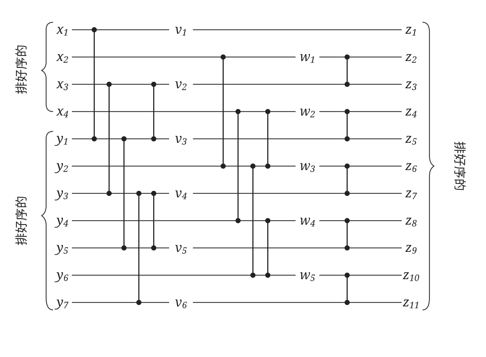

图 48　$m=4,n=7$ 时的奇偶合并

为了证明这个相当奇怪的合并过程实际可行, 当 $mn>1$ 时, 我们使用 0–1 原理, 在 0 和 1 组成的所有序列上测试. 在完成最初的 $m$ 排序和 $n$ 排序之后, 对于某个 $k$ 和 $l$, 序列 $\langle x_1,\ldots,x_m\rangle$ 将包含 $k$ 个 0 和跟在后面的 $m-k$ 个 1, 序列 $\langle y_1,\ldots,y_n\rangle$ 将是 $l$ 个 0 和跟在后面的 $n-l$ 个 1. 因此, 序列 $\langle v_1,v_2,\ldots\rangle$ 将恰好包含 $\lceil k/2\rceil+\lceil l/2\rceil$ 个 0 和跟在后面的一些 1, $\langle w_1,w_2,\ldots\rangle$ 包含 $\lfloor k/2\rfloor+\lfloor l/2\rfloor$ 个 0 和跟在后面的一些 1. 现在, 关键在于

$$
(\lceil k/2\rceil+\lceil l/2\rceil)-(\lfloor k/2\rfloor+\lfloor l/2\rfloor)=0,1\text{ 或 }2.\tag{3}
$$

如果这个差值是 0 或 1, 则序列 (2) 已经是有序状态. 如果差值是 2, 则式 (1) 中的某一个比较交换会把一切安排妥当. 这就完成了整个证明过程. (注意, 0–1 原理把合并问题从考虑 $\binom{m+n}m$ 种情形简化为仅考虑 $(m+1)(n+1)$ 种, 用两个参数 $k$ 和 $l$ 表示.)

设 $C(m,n)$ 表示在对 $m$ 和 $n$ 进行奇偶合并时使用的比较器模块个数, 不计最初的 $m$ 排序和 $n$ 排序. 我们有

$$
C(m,n)=\begin{cases}
mn,&mn\le1;\\
C(\lceil m/2\rceil,\lceil n/2\rceil)+C(\lfloor m/2\rfloor,\lfloor n/2\rfloor)+\lfloor(m+n-1)/2\rfloor,&mn>1.
\end{cases}\tag{4}
$$

一般来说, 这不是 $m$ 和 $n$ 的特别简单的函数, 但注意到 $C(1,n)=n$, 而且当 $mn\ge1$ 时有

$$
C(m+1,n+1)-C(m,n)=1+C(\lfloor m/2\rfloor+1,\lfloor n/2\rfloor+1)-C(\lfloor m/2\rfloor,\lfloor n/2\rfloor),
$$

可以推导出关系式

$$
C(m+1,n+1)-C(m,n)=\lfloor\lg m\rfloor+2+\lfloor n/2^{\lfloor\lg m\rfloor+1}\rfloor,\quad n\ge m\ge1.\tag{5}
$$

因此

$$
C(m,m+r)=B(m)+m+R_m(r),\quad m\ge0,r\ge0,\tag{6}
$$

式中, $B(m)$ 是式 5.3.1–(3) 的 “二叉插入” 函数 $\sum_{k=1}^m\lceil\lg k\rceil$, $R_m(r)$ 是级数

$$
\left\lfloor\frac{r+0}1\right\rfloor+\left\lfloor\frac{r+1}2\right\rfloor+\left\lfloor\frac{r+2}4\right\rfloor+\left\lfloor\frac{r+3}4\right\rfloor+\left\lfloor\frac{r+4}8\right\rfloor+\cdots+\left\lfloor\frac{r+j}{2^{\lfloor\lg j\rfloor+1}}\right\rfloor+\cdots\tag{7}
$$

的前 $m$ 项之和. 特别地, 当 $r=0$ 时有重要特例

$$
C(m,m)=B(m)+m.\tag{8}
$$

此外, 如果 $t=\lceil\lg m\rceil$, 我们有

$$
\begin{aligned}
R_m(r+2^t)&=R_m(r)+1\cdot2^{t-1}+2\cdot2^{t-2}+\cdots+2^{t-1}\cdot2^0+m\\
&=R_m(r)+m+t\cdot2^{t-1}.
\end{aligned}
$$

因此, $C(m,n+2^t)-C(m,n)$ 具有简单形式, 并且

$$
C(m,n)=\left(\frac t2+\frac m{2^t}\right)n+O(1),\quad m\text{ 固定},n\to\infty,t=\lceil\lg m\rceil,\tag{9}
$$

$O(1)$ 项总归是 $n$ 的周期函数, 周期是 $2^t$. 当 $n\to\infty$ 时, 根据式 (8) 和习题 5.3.1–15, 我们有 $C(n,n)=n\lg n+O(n)$.

**比较次数最少的网络.** 设 $\hat S(n)$ 表示 $n$ 元素排序网络需要的最少比较器数目. 显然 $\hat S(n)\ge S(n)$, 其中 $S(n)$ 是不一定为齐性的排序过程中所需要的最少比较次数 (见 5.3.1 节). 我们有 $\hat S(4)=5=S(4)$, 所以当 $n=4$ 时新的约束条件不会导致效率损失. 但当 $n=5$ 时有 $\hat S(5)=9$, 而 $S(5)=7$. 确定 $\hat S(n)$ 的问题似乎要比确定 $S(n)$ 的问题更难, 甚至 $\hat S(n)$ 的渐近特性也不明显.

回顾这个问题的历史是很有意义的, 因为它的每一步发展都是在困难中锻炼出来的. 大约在 1954 年, 菲利普·阿姆斯特朗、雷蒙德·纳尔逊和丹尼尔·奥康纳最早探讨了排序网络 [见美国专利第 3029413 号]. 用他们的专利代理人的话来说: “根据这个技巧, 有可能使用较少量的两线排序开关设计出经济的 $n$ 线排序开关.” 观察到 $\hat S(n+1)\le\hat S(n)+n$ 之后, 他们给出对于 $4\le n\le8$ 的特殊构造, 分别使用了 5、9、12、18 和 19 个比较器. 随后, 纳尔逊和拉杰·博斯合作, 证明对于所有 $n$ 都有 $\hat S(2^n)\le3^n-2^n$, 因此 $\hat S(n)=O(n^{\lg3})=O(n^{1.585})$. 博斯和纳尔逊发表了他们的重要方法, 并推测这是最佳方法 [*JACM* **9** (1962), 282–296]. 托马斯·希巴德发现一个类似但要稍为简单的构造, 它使用的比较次数相同, 从而支持了博斯和纳尔逊的推测 [*JACM* **10** (1963), 142–150].

1964 年, 弗洛伊德和高德纳找到解决这个问题的新方法, 从而得到形如 $\hat S(n)=O(n^{1+c/\sqrt{\log n}})$ 的渐近界限值. 巴彻尔独立发现了上面概述的一般性合并策略. 利用递推关系

$$
c(1)=0,\quad c(n)=c(\lceil n/2\rceil)+c(\lfloor n/2\rfloor)+C(\lceil n/2\rceil,\lfloor n/2\rfloor)\quad(n\ge2)\tag{10}
$$

确定的比较次数, 巴彻尔证明了 (见习题 5.2.2–14)

$$
c(2^t)=(t^2-t+4)2^{t-2}-1,
$$

从而有 $\hat S(n)=O(n(\log n)^2)$. 无论是弗洛伊德和高德纳, 还是巴彻尔, 都是过了一段时间才发表自己的构造 [*Notices of the Amer. Math. Soc.* **14** (1967), 283; *Proc. AFIPS Spring Joint Computer Conf.* **32** (1968), 307–314].

有一些人已经找到减少巴彻尔的合并交换构造使用的比较器数目的方法. 下表给出目前已知的 $\hat S(n)$ 最佳上限:

| $n$ | 1 | 2 | 3 | 4 | 5 | 6 | 7 | 8 | 9 | 10 | 11 | 12 | 13 | 14 | 15 | 16 |
|---:|---:|---:|---:|---:|---:|---:|---:|---:|---:|---:|---:|---:|---:|---:|---:|---:|
| $c(n)=$ | 0 | 1 | 3 | 5 | 9 | 12 | 16 | 19 | 26 | 31 | 37 | 41 | 48 | 53 | 59 | 63 |
| $\hat S(n)\le$ | 0 | 1 | 3 | 5 | 9 | 12 | 16 | 19 | 25 | 29 | 35 | 39 | 45 | 51 | 56 | 60 |

(11)

由于当 $8<n\le16$ 时有 $\hat S(n)<c(n)$, 所以对于所有 $n>8$ 合并交换都不是最优的. 当 $n\le8$ 时, 合并交换使用比较器的数目与博斯和纳尔逊的构造相同. 弗洛伊德和高德纳在 1964～1966 年证明了: 上表所列的 $\hat S(n)$ 值在 $n\le8$ 时是精确的 [见 *A Survey of Combinatorial Theory* (North-Holland, 1973), 163–172]. $n>8$ 时 $\hat S(n)$ 的值仍然是未知的.

图 49 给出能够得到表 (11) 中取值的构造. 1964 年, 弗洛伊德找到 $n=9$ 的网络, 它以重要的三路合并方法为基础, 它的有效性可使用习题 27 中描述的一般原理确定. 1969 年, 亚伯拉罕·瓦克斯曼发现 $n=10$ 的网络, 它把输入看作 $\{1,2,\ldots,10\}$ 的排列, 并尝试尽可能减少在给定阶段每条线上出现的取值个数, 同时保持某种对称性.

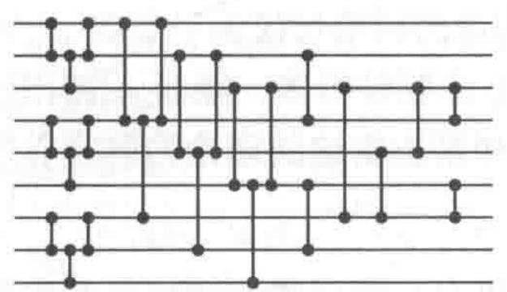

$n=9$, 25 模块, 延迟 9

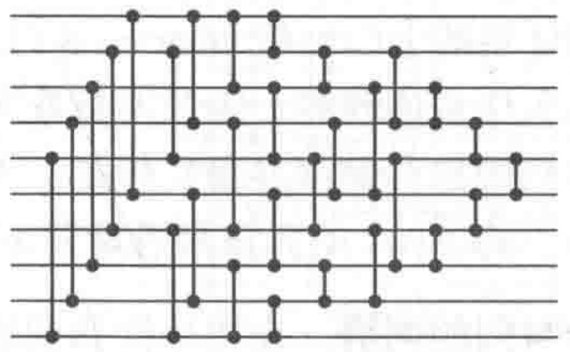

$n=10$, 29 模块, 延迟 9

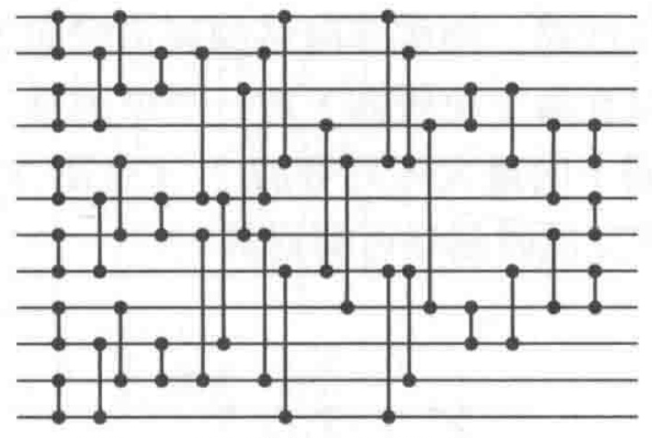

$n=12$, 39 模块, 延迟 9

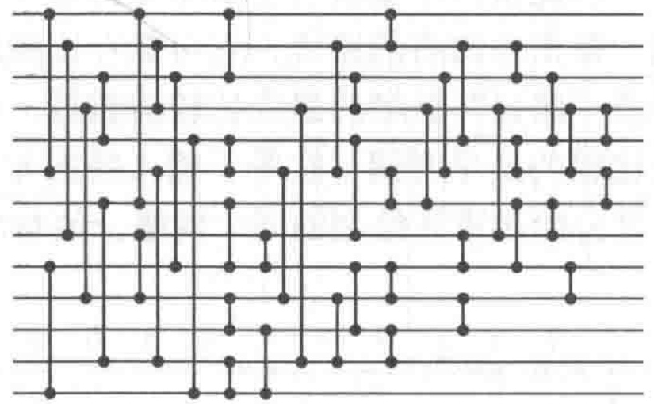

$n=13$, 45 模块, 延迟 10

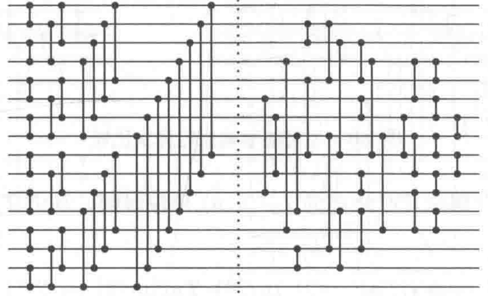

$n=16$, 60 模块, 延迟 10

图 49　高效的排序网络

$n=13$ 的网络有着显著不同的发展过程: 于格·朱耶使用计算机程序通过模拟遗传育种的进化过程来构造它 [*Lecture Notes in Comp. Sci.* **929** (1995), 246–260]. 这个网络看不出有什么出奇之处, 但很有效——而且迄今为止它比任何其他根据人类推理设计的构造都更短一些.

1969 年, 杰拉尔德·夏皮罗发现用于 16 个元素的 62 个比较器排序网络, 这相当让人惊讶, 因为当 $n$ 是 2 的幂时, 巴彻尔的方法 (63 次比较) 看起来已经是最好的了. 在听说夏皮罗的构造不久, 米尔顿·格林又让人们的惊讶程度增至三倍: 他找到了图 49 所示的 60 次比较排序器. 格林构造的第一部分相当容易理解, 在执行虚线左边 32 次比较／交换之后, 可以用 $\{a,b,c,d\}$ 的 16 个子集来标记这些线, 使它们满足以下条件: 如果 $s$ 是 $t$ 的子集, 则已知标有 $s$ 的线包含的数小于等于标有 $t$ 的线包含的数. 习题 32 将深入讨论这里的排序状态. 但是, 格林网络后续各级的比较就变得越来越神秘了, 还没有人知道如何推广这个构造, 以便为更大的 $n$ 值获得相应的高效网络.

夏皮罗和格林还发现图中所示 $n=12$ 的网络. 当 $n=11,14$ 或 15 时, 通过删除 $n+1$ 元网络的底线以及接触该线的所有比较器, 可以找到好的网络.

戴维·范沃里斯发现的 256 元素排序网络是目前已知的最佳网络, 它给出 $\hat S(256)\le3651$, 而巴彻尔的方法是 3839. [见罗伯特·德赖斯代尔和弗兰克·扬,*SICOMP* **4** (1975), 264–270.] 当 $n\to\infty$ 时, 实际上有 $\hat S(n)=O(n\log n)$. 这个令人惊讶的上限是由奥伊陶伊、科姆洛什和塞迈雷迪证明的 [*Combinatorica* **3** (1983), 1–19]. 他们构造的网络仅仅为了节省 $\log n$ 的一个因子而引入许多比较器, 因此不具备实用意义. 巴彻尔的方法要好得多, 除非 $n$ 超出了地球上所有计算机的总存储器容量! 但是, 奥伊陶伊、科姆洛什和塞迈雷迪的理论的确建立了达到一个常数因子的 $\hat S(n)$ 的真正渐近增长率.

**最短时间的网络.** 在排序网络的物理实现和并行计算机上, 有可能同时执行非重叠的比较交换操作, 因此很自然地就会尝试尽量缩短延迟时间. 稍加思考就会明白, 如果把 “路径” 定义为任何一条由左向右的路线, 它可能在比较器处切换线路, 则排序网络的延迟时间等于与该网络中任意 “路径” 接触的最大比较器数目. 我们可以在每个比较器上放一个序列号, 表示可以执行该比较的最早时间, 它等于输入线前方各比较器上的最大序列号加 1. (见图 50(a), 该图的 (b) 部分给出重新绘制的同一网络, 使每次比较的完成时刻尽可能提前.)

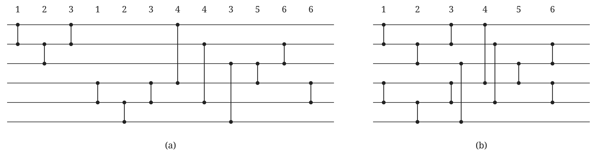

图 50　尽可能早地执行每次比较

前文所述的巴彻尔奇偶合并网络花费 $T_B(m,n)$ 单位时间, 其中 $T_B(m,0)=T_B(0,n)=0$, $T_B(1,1)=1$, 且

$$
T_B(m,n)=1+\max\big(T_B(\lfloor m/2\rfloor,\lfloor n/2\rfloor),T_B(\lceil m/2\rceil,\lceil n/2\rceil)\big),\quad mn\ge2.
$$

我们可以利用这些关系通过归纳法证明 $T_B(m,n+1)\ge T_B(m,n)$. 因此, 当 $mn\ge2$ 时有 $T_B(m,n)=1+T_B(\lceil m/2\rceil,\lceil n/2\rceil)$, 由此推出

$$
T_B(m,n)=1+\lceil\lg\max(m,n)\rceil,\quad mn\ge1.\tag{12}
$$

习题 5 表明巴彻尔排序方法的延迟时间为

$$
\binom{1+\lceil\lg n\rceil}{2}.\tag{13}
$$

设 $\hat T(n)$ 表示任意 $n$ 元素排序网络中所能实现的最短延迟时间. 有可能对上述一些网络进行改进, 使它们的延迟时间更短但不使用更多的比较器, 如图 51 所示的 $n=6,n=9,n=11$ 的网络和习题 7 中 $n=10$ 的网络那样. 如果另外增加一两个比较器模块, 如图 51 中值得注意的 $n=10,12,16$ 的网络所示, 则还有可能进一步缩短延迟时间. 这些构造给出 $n$ 较小时的 $\hat T(n)$ 上限:

| $n$ | 1 | 2 | 3 | 4 | 5 | 6 | 7 | 8 | 9 | 10 | 11 | 12 | 13 | 14 | 15 | 16 |
|---:|---:|---:|---:|---:|---:|---:|---:|---:|---:|---:|---:|---:|---:|---:|---:|---:|
| $\hat T(n)\le$ | 0 | 1 | 3 | 3 | 5 | 5 | 6 | 6 | 7 | 7 | 8 | 8 | 9 | 9 | 9 | 9 |

(14)

事实上, 我们已经知道这里给出的值都是精确的 (见习题 4 的答案). 图 51 中的网络值得仔细研究, 因为绝不是一眼就能看出它们能够完成排序任务的. 1969 年至 1971 年间, 杰拉尔德·夏皮罗找到 $n=6,12$ 的网络, 戴维·范沃里斯找到 $n=10,16$ 的网络. 2001 年, 洛伦·施维贝特使用基因方法找到 $n=9,11$ 的网络.

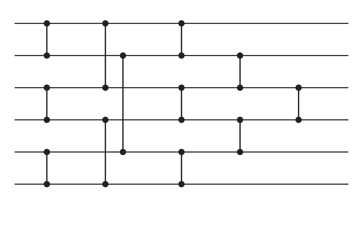

$n=6$, 12 模块, 延迟 5

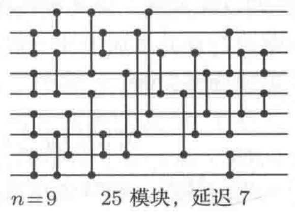

$n=9$, 25 模块, 延迟 7

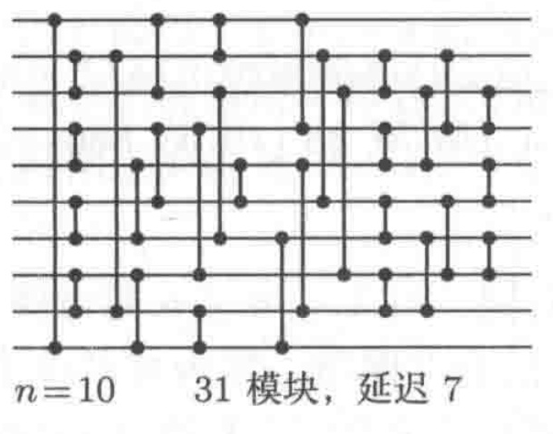

$n=10$, 31 模块, 延迟 7

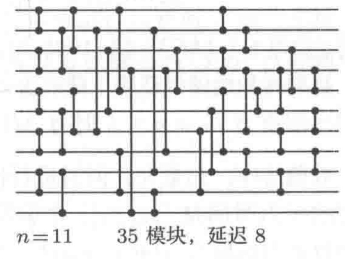

$n=11$, 35 模块, 延迟 8

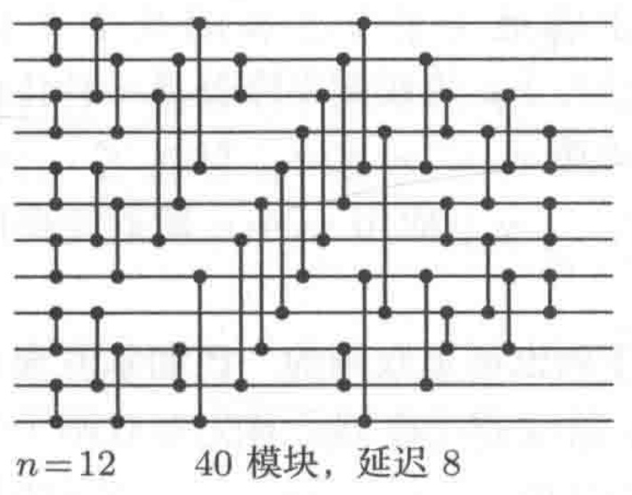

$n=12$, 40 模块, 延迟 8

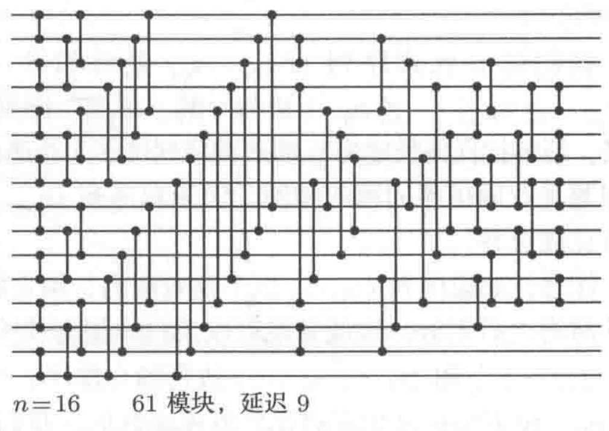

$n=16$, 61 模块, 延迟 9

图 51　在并行执行比较时, 已知最快的排序网络

**合并网络.** 一个网络要合并 $m$ 个元素 $x_1\le\cdots\le x_m$ 与 $n$ 个元素 $y_1\le\cdots\le y_n$, 形成有序序列 $z_1\le\cdots\le z_{m+n}$, 用 $\hat M(m,n)$ 表示这个网络需要的最少比较器模块数目. 目前还没有发现优于上述奇偶合并方法的合并网络, 因此式 (6) 中的函数 $C(m,n)$ 代表着 $\hat M(m,n)$ 的最佳上限.

弗洛伊德发现了为这个合并问题寻找下限的重要方法.

**定理 F.** 对于所有 $n\ge1$ 有 $\hat M(2n,2n)\ge2\hat M(n,n)+n$.

**证明.** 考虑具有 $\hat M(2n,2n)$ 个比较器模块的网络, 它能够对满足 $z_1\le z_3\le\cdots\le z_{4n-1}$ 及 $z_2\le z_4\le\cdots\le z_{4n}$ 的所有输入序列 $\langle z_1,\ldots,z_{4n}\rangle$ 排序. 我们可以假定, 对于某个 $i<j$ 每个模块用 $(\min(z_i,z_j),\max(z_i,z_j))$ 代替 $(z_i,z_j)$ (见习题 16). 因此这些比较器可以分为三类:

(a) $i\le2n$ 且 $j\le2n$,

(b) $i>2n$ 且 $j>2n$,

(c) $i\le2n$ 且 $j>2n$.
(a) 类中至少有 $\hat M(n,n)$ 个比较器, 因为在开始合并时, $z_{2n+1},z_{2n+2},\ldots,z_{4n}$ 可能已经处于其最终位置. 与此类似, (b) 类中至少有 $\hat M(n,n)$ 个比较器. 此外, 输入序列 $\langle0,1,0,1,\ldots,0,1\rangle$ 表明 (c) 类至少有 $n$ 个比较器, 因为必须把 $n$ 个 0 从 $\{z_{2n+1},\ldots,z_{4n}\}$ 转移到 $\{z_1,\ldots,z_{2n}\}$.　▮

重复利用定理 F 可以证明 $\hat M(2^m,2^m)\ge\tfrac12(m+2)2^m$, 因此 $\hat M(n,n)\ge\tfrac12n\lg n+O(n)$. 由定理 5.3.2M 知道, 没有网络限制的合并只需要 $M(n,n)=2n-1$ 次比较. 因此我们已经证明: 用网络进行合并本质上比一般合并更难一些.

奇偶合并表明

$$
\hat M(m,n)\le C(m,n)=\tfrac12(m+n)\lg\min(m,n)+O(m+n).
$$

彼得·米尔滕森、佩特森和垂井淳通过确立下限

$$
\hat M(m,n)\ge\tfrac12\big((m+n)\lg(m+1)-m/\ln2\big),\quad1\le m\le n
$$

改进了定理 F[*JACM* **43** (1996), 147–165]. 因此 $\hat M(m,n)=\tfrac12(m+n)\lg\min(m,n)+O(m+n)$.

姚期智和姚储枫证明了精确公式 $\hat M(2,n)=C(2,n)=\lceil\tfrac32n\rceil$[*JACM* **23** (1976), 566–571]. 我们还知道当 $m=n\le5$ 时有 $\hat M(m,n)=C(m,n)$, 见习题 9.

**双调排序.** 如果允许同时进行比较, 我们已经在式 (12) 中看到, 当 $1\le m\le n$ 时奇偶合并使用的延迟时间是 $\lceil\lg(2n)\rceil$ 个单位. 巴彻尔发明了另一种类型的合并网络, 称为双调排序器, 它把延迟时间降至 $\lceil\lg(m+n)\rceil$, 不过它也需要更多的比较器模块. [见美国专利第 3428946 号 (1969).]

我们说 $p$ 元素序列 $\langle z_1,\ldots,z_p\rangle$ 是双调的, 如果对于满足 $1\le k\le p$ 的某个 $k$ 值有 $z_1\ge\cdots\ge z_k\le\cdots\le z_p$. (请与一般 “单调” 序列的定义比较.)$p$ 阶双调排序器是一种比较器网络, 能够把任何长度为 $p$ 的双调序列排序为非递减顺序. 合并 $x_1\le\cdots\le x_m$ 与 $y_1\le\cdots\le y_n$ 的问题是双调排序问题的特例, 因为对序列 $\langle x_m,\ldots,x_1,y_1,\ldots,y_n\rangle$ 应用 $m+n$ 阶双调排序器即可完成合并.

注意, 如果序列 $\langle z_1,\ldots,z_p\rangle$ 是双调的, 则它的所有子序列也都是双调的. 巴彻尔发现奇偶合并网络之后不久, 他就发现可以采用类似方式构造一个 $p$ 阶双调排序器: 首先对双调子序列 $\langle z_1,z_3,z_5,\ldots\rangle$ 和 $\langle z_2,z_4,z_6,\ldots\rangle$ 进行独立排序, 然后比较并交换 $z_1:z_2,z_3:z_4,\ldots$. (证明见习题 10.) 设 $C'(p)$ 是相应的比较器模块数目, 我们有

$$
C'(p)=C'(\lceil p/2\rceil)+C'(\lfloor p/2\rfloor)+\lfloor p/2\rfloor,\quad p\ge2,\tag{15}
$$

延迟时间显然是 $\lceil\lg p\rceil$. 图 52 给出以这种方式构造的七阶双调排序器: 它可以用作 (3,4) 合并网络, 也可以用作 (2,5) 合并网络, 延迟时间为三个单位. $m=2,n=5$ 的奇偶合并节省了一个比较器, 但多了一级延迟.

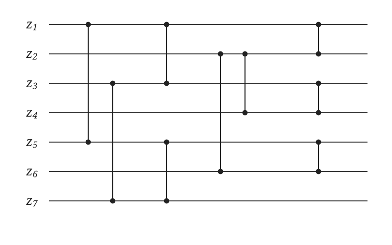

图 52　七阶巴彻尔双调排序器

$2^t$ 阶巴彻尔双调排序器特别有意义: 它包括 $t$ 级, 每级有 $2^{t-1}$ 个比较器. 如果把输入线编号为 $z_0,z_1,\ldots,z_{2^t-1}$, 对于第 $l$ 级上的元素 $z_i$ 和 $z_j$, 当且仅当 $i$ 和 $j$ 的二进制表示法仅在第 $l$ 个最高有效位不同时, 才比较这两个元素. 这种简单结构给出并行排序网络, 它与合并交换 (算法 5.2.2M) 一样快, 但实现要容易得多. (见习题 11 和 13.)

任何一种基于同时无交叉比较的并行合并方法, 无论是否为齐性的, 都不可能在少于 $\lceil\lg(m+n)\rceil$ 个阶段中完成排序, 从这个意义上说双调合并是最优的. (见习题 46.) 还有另外一种方法可以实现这个最优时间, 使用的比较数更少, 但控制逻辑稍为复杂一些, 在习题 57 中讨论.

当 $1\le m\le n$ 时, 一个 $(m,n)$ 合并网络的第 $n$ 个最小输出依赖于 $2m+[m<n]$ 个输入 (见习题 29). 如果能够利用拥有 $l$ 级延迟的比较器计算, 则它最多涉及 $2^l$ 个输入, 因此 $2^l\ge2m+[m<n]$, 从而 $l\ge\lceil\lg(2m+[m<n])\rceil$. 巴彻尔已经证明 [Report GER-14122 (Akron, Ohio: Goodyear Aerospace Corporation, 1968)]: 如果允许网络中有 “多重扇出”, 也就是使输出线分叉以同时向多个模块馈送同一个数, 则可以实现这个最短延迟时间. 例如, 图 53 中巴彻尔给出一个 $n=6$ 的网络, 能够仅在两级延迟之后合并一个项目与其他 $n$ 项. 当然, 具有多重扇出的网络不符合我们的约定. 非常容易看出, 任何没有多重扇出的 $(1,n)$ 合并网络的延迟时间至少为 $\lg(n+1)$. (见习题 45.)

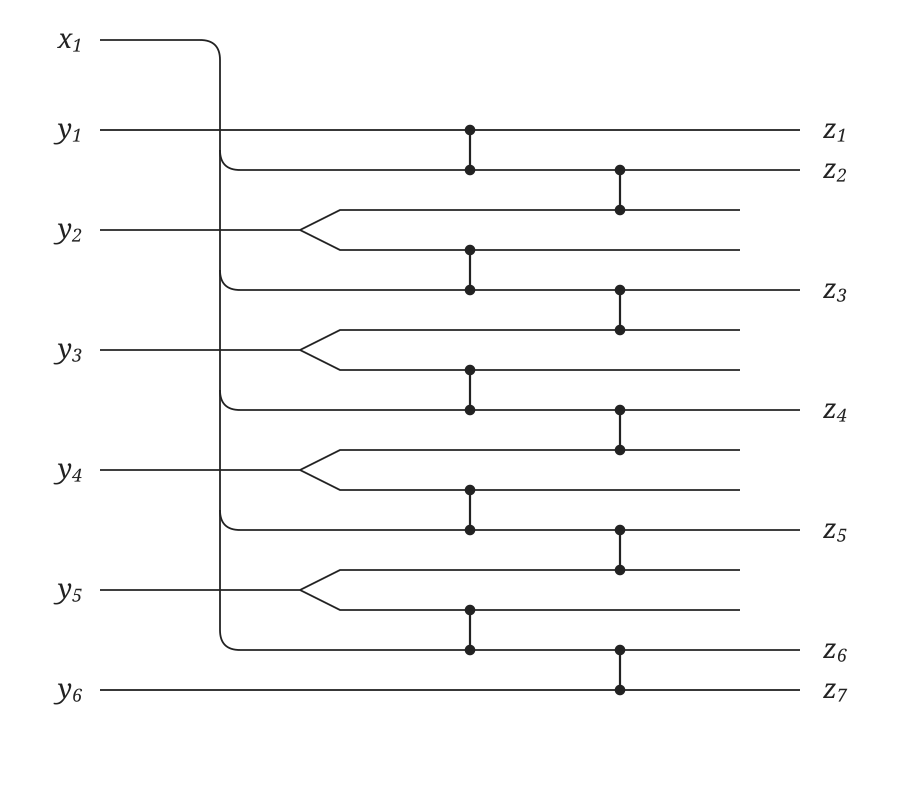

图 53　合并一个项目与其他 6 项, 利用多重扇出以实现最短延迟时间

**选择网络.** 我们还可以使用网络来解决 5.3.3 节的问题. 设 $\hat U_t(n)$ 表示一个网络需要的最少比较器数目, 这个网络要把 $n$ 个不同输入中的 $t$ 个最大元素移到 $t$ 个指定的输出线上, 允许这些元素以任意顺序出现在输出线上. 设 $\hat V_t(n)$ 表示把 $n$ 个不同输入中的第 $t$ 大元素移到指定输出线时需要的最少比较器数目. 设 $\hat W_t(n)$ 表示把 $n$ 个不同输入中的 $t$ 个最大元素按非递减顺序移到 $t$ 个指定输出线所需要的最少比较器数目. 不难推出 (见习题 17)

$$
\hat U_t(n)\le\hat V_t(n)\le\hat W_t(n).\tag{16}
$$

假定有 $2t$ 个元素 $\langle x_1,\ldots,x_{2t}\rangle$, 我们希望选出最大的 $t$ 个. 弗拉基米尔·阿列克谢耶夫注意到 [*Kibernetika* **5**, 5 (1969), 99–103], 可以通过以下方式来完成这个任务: 首先排序 $\langle x_1,\ldots,x_t\rangle$ 和 $\langle x_{t+1},\ldots,x_{2t}\rangle$, 然后比较并交换

$$
x_1:x_{2t},\quad x_2:x_{2t-1},\quad\ldots,\quad x_t:x_{t+1}.\tag{17}
$$

由于这些数对中的每一对都不可能同时包含最大的 $t$ 个元素中的两个 (为什么?), 所以阿列克谢耶夫的过程必定能够选出最大的 $t$ 个元素.

如果我们希望选择 $nt$ 个元素中的 $t$ 个最大元素, 可以应用阿列克谢耶夫的过程 $n-1$ 次, 每次消除 $t$ 个元素. 因此

$$
\hat U_t(nt)\le(n-1)(2\hat S(t)+t).\tag{18}
$$

阿列克谢耶夫还为这个选择问题推导出一个重要的下限:

**定理 A.** $\hat U_t(n)\ge(n-t)\lceil\lg(t+1)\rceil$.

**证明.** 最方便的做法是考虑选择 $t$ 个最小元素这样一个等价问题. 我们把数对 $(l,u)$ 附加到比较器网络的每条线上, 如图 54 所示, 其中的 $l$ 和 $u$ 分别表示当输入为 $\{1,2,\ldots,n\}$ 的排列时可以在该位置出现的最小值和最大值. 设 $l_i$ 和 $l_j$ 表示在比较 $x_i:x_j$ 之前线 $i$ 和线 $j$ 上的下限, 设 $l'_i$ 和 $l'_j$ 表示在进行该比较之后的相应下限. 显然 $l'_i=\min(l_i,l_j)$. 习题 24 证明了一个不太明显的关系

$$
l'_j\le l_i+l_j.\tag{19}
$$

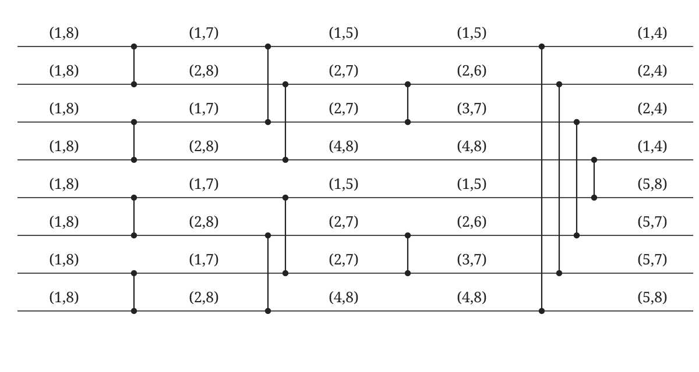

图 54　分开最大的四个元素与最小的四个元素 (定理 A 的证明中用到这些线上的数)

现在我们以另外一种方式重新解读该网络操作 (见图 55): 假定所有的输入线都是零, 每个 “比较器” 都把输入的较小者放到上线, 把较大者加一放到下线. 通过该网络得到的数列 $\langle m_1,m_2,\ldots,m_n\rangle$ 具有性质

$$
2^{m_i}\ge l_i,\tag{20}
$$

因为这在开始时成立, 而且根据式 (19), 通过每个比较器后它还继续成立. 此外,

$$
m_1+m_2+\cdots+m_n
$$

的最终值是网络中比较器的总数, 因为每个比较器都对这个和加一.

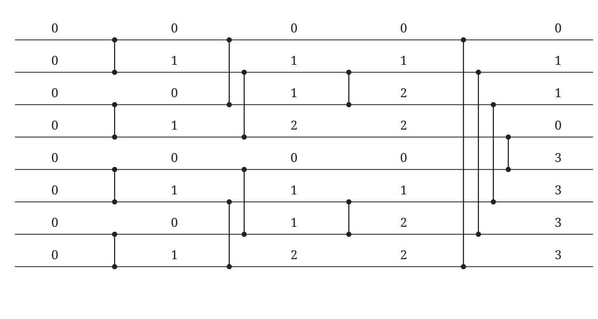

图 55　对图 54 中网络的另一种解读
如果该网络选择最小的 $t$ 个元素, 则 $l_i$ 中有 $n-t$ 个 $\ge t+1$, 因此 $m_i$ 中有 $n-t$ 个必定 $\ge\lceil\lg(t+1)\rceil$.　▮

当 $t=1$ 和 $t=2$ 时定理 A 的下限是精确的 (见习题 19). 表 1 给出当 $t$ 和 $n$ 较小时的 $\hat U_t(n),\hat V_t(n),\hat W_t(n)$ 值. 通过证明当 $n\to\infty$ 时 $\hat U_3(n)=2n+\lg n+O(1)$ 和 $\hat U_t(n)=n\lceil\lg(t+1)\rceil+O(\log n)^{\lfloor\lg t\rfloor}$, 姚期智给出当 $t$ 固定时 $\hat U_t(n)$ 的渐近特性, 最短延迟时间是 $\lg n+\lfloor\lg t\rfloor\lg\lg n+O(\log\log\log n)$[Ph.D. thesis, U. of Illinois (1975)]. 尼古拉斯·皮彭格尔通过非构造方法证明了: 对任意 $\epsilon>0$, 只要 $n$ 足够大 (取决于 $\epsilon$ 值), 就存在满足 $\hat U_{\lceil n/2\rceil}(n)\le(2+\epsilon)n\lg n$ 的选择网络 [*SICOMP* **20** (1991), 878–887].

表 1　选择网络中需要的比较器数目 $(\hat U_t(n),\hat V_t(n),\hat W_t(n))$

| $n$ | $t=1$ | $t=2$ | $t=3$ | $t=4$ | $t=5$ | $t=6$ |
|---:|---:|---:|---:|---:|---:|---:|
| 1 | (0,0,0) | | | | | |
| 2 | (1,1,1) | (0,1,1) | | | | |
| 3 | (2,2,2) | (2,3,3) | (0,2,3) | | | |
| 4 | (3,3,3) | (4,5,5) | (3,5,5) | (0,3,5) | | |
| 5 | (4,4,4) | (6,7,7) | (6,7,8) | (4,7,9) | (0,4,9) | |
| 6 | (5,5,5) | (8,9,9) | (8,10,10) | (8,10,12) | (5,9,12) | (0,5,12) |

#### 习题（第一组）

以下习题中的若干题深入探讨了排序网络理论. 为方便起见我们引入一些记号. 设 $[i:j]$ 表示比较／交换模块, 把拥有 $n$ 个输入和 $r$ 个比较器模块的网络记为 $[i_1:j_1][i_2:j_2]\cdots[i_r:j_r]$, 其中每个 $i$ 和 $j$ 都 $\le n$, 简称为 $n$ 元网络. 如果当 $1\le q\le r$ 时有 $i_q<j_q$, 就说这个网络是标准网络. 例如, 第 173 页图 44 描述了一个标准四元网络, 用比较器序列 $[1:2][3:4][1:3][2:4][2:3]$ 表示.

正文中关于绘制网络图的约定仅用于表示标准网络, 所有比较器 $[i:j]$ 都由从 $i$ 到 $j$ 的线表示, 其中 $i<j$. 在必须绘制非标准网络时, 可以使用从 $i$ 到 $j$ 的箭头, 表示较大数将去向箭头的端点. 例如, 图 56 给出十六元素的非标准网络, 它的比较器是 $[1:2][4:3][5:6][8:7]\cdots$. 习题 11 证明图 56 是排序网络.

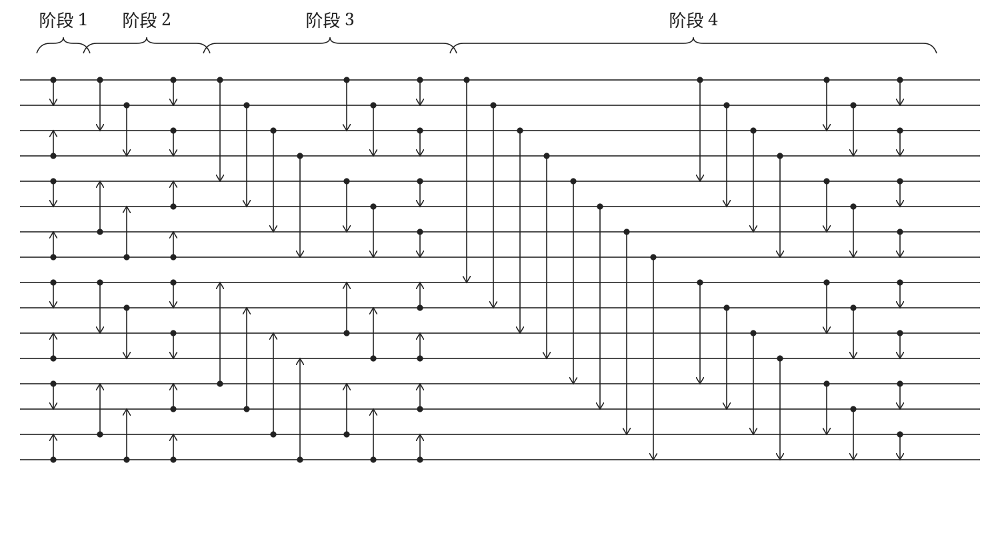

图 56　基于双调排序的非标准排序网络
如果 $x=\langle x_1,\ldots,x_n\rangle$ 是 $n$ 元向量, $\alpha$ 是 $n$ 元网络, 该网络生成的数值向量 $\langle(x\alpha)_1,\ldots,(x\alpha)_n\rangle$ 记作 $x\alpha$. 为简便起见, 记 $a\vee b=\max(a,b)$, $a\wedge b=\min(a,b)$, $\bar a=1-a$. 于是, 当 $i\ne k\ne j$ 时, $(x[i:j])_i=x_i\wedge x_j$, $(x[i:j])_j=x_i\vee x_j$, $(x[i:j])_k=x_k$. 如果当 $1\le i<n$ 时对于所有 $x$ 都有 $(x\alpha)_i\le(x\alpha)_{i+1}$, 则说 $\alpha$ 是排序网络.

符号 $e^{(i)}$ 表示在位置 $i$ 处为 1 而其他位置为 0 的向量, 于是 $(e^{(i)})_j=\delta_{ij}$. 符号 $D_n$ 表示由 0 和 1 组成的所有 $2^n$ 个 $n$ 元向量的集合, $P_n$ 表示由 $\{1,2,\ldots,n\}$ 的排列组成的所有 $n!$ 个向量的集合. 把向量 $\langle x_1\wedge y_1,\ldots,x_n\wedge y_n\rangle$ 和 $\langle x_1\vee y_1,\ldots,x_n\vee y_n\rangle$ 记作 $x\wedge y$ 和 $x\vee y$. 如果对于所有 $i$ 都有 $x_i\le y_i$, 我们就说 $x\subseteq y$. 因此, $x\subseteq y$、$x\vee y=y$、$x\wedge y=x$ 三者互为充分必要条件. 假定 $x$ 和 $y$ 都属于 $D_n$, 如果对于某个 $i$ 有 $x=(y\vee e^{(i)})\ne y$, 则说 $x$ 覆盖 $y$. 最后, 对于 $D_n$ 中的所有 $x$, 设 $\nu(x)$ 表示 $x$ 中 1 的个数, $\zeta(x)$ 表示 $x$ 中 0 的个数, 于是 $\nu(x)+\zeta(x)=n$.

**1. [20]** 绘制 $m=3,n=5$ 的奇偶合并网络图.　[答案](./answers/5-3-4.md#ans-5-3-4-1)

**2. [22]** 证明: 普拉特的排序算法 (习题 5.2.1–30) 得出一个 $n$ 元素排序网络, 它的延迟级别大约为 $(\log_2n)(\log_3n)$. 对于 $n=12$ 绘制相应网络.　[答案](./answers/5-3-4.md#ans-5-3-4-2)

**3. [M20]** (巴彻尔) 试求 $C(m,m-1)$ 和 $C(m,m)$ 之间的一种简单关系.　[答案](./answers/5-3-4.md#ans-5-3-4-3)

**▶ 4. [M23]** 证明 $\hat T(6)=5$.　[答案](./answers/5-3-4.md#ans-5-3-4-4)

**5. [M16]** 证明: 式 (13) 是与递推关系 (10) 确定的排序网络相关联的延迟时间.　[答案](./answers/5-3-4.md#ans-5-3-4-5)

**6. [28]** 设 $T(n)$ 表示通过进行同时不相交比较 (不一定遵守网络约束条件) 排序 $n$ 个不同元素需要的最少阶段数目. 这些比较可以表示为一个结点, 该结点包含元素对集合 $\{i_1:j_1,i_2:j_2,\ldots,i_r:j_r\}$, 其中 $i_1,j_1,i_2,j_2,\ldots,i_r,j_r$ 互不相同, 这个结点下有 $2^r$ 个分支, 分别表示以下情形:　[答案](./answers/5-3-4.md#ans-5-3-4-6)

$$
\langle K_{i_1}<K_{j_1},K_{i_2}<K_{j_2},\ldots,K_{i_r}<K_{j_r}\rangle,
$$

$$
\langle K_{i_1}>K_{j_1},K_{i_2}<K_{j_2},\ldots,K_{i_r}<K_{j_r}\rangle,\quad\text{等等.}
$$

试证明 $T(5)=T(6)=5$.

**7. [25]** 证明: 如果用 “较弱” 序列 $[5:6][4:5][6:7]$ 代替图 49 中 $n=10$ 的网络的最后三个比较器, 这个网络仍然能够完成排序.　[答案](./answers/5-3-4.md#ans-5-3-4-7)

**8. [M20]** 证明:　[答案](./answers/5-3-4.md#ans-5-3-4-8)

$$
\hat M(m_1+m_2,n_1+n_2)\ge\hat M(m_1,n_1)+\hat M(m_2,n_2)+\min(m_1,n_2),\quad m_1,m_2,n_1,n_2\ge0.
$$

**9. [M25]** (弗洛伊德) 证明: $\hat M(3,3)=6$, $\hat M(4,4)=9$, $\hat M(5,5)=13$.　[答案](./answers/5-3-4.md#ans-5-3-4-9)

**10. [M22]** 证明: 式 (15) 前的正文中定义的巴彻尔的双调排序器是有效的. [提示: 只需要证明所有由 $k$ 个 1 后面跟着 $l$ 个 0 后面再跟着 $n-k-l$ 个 1 组成的序列都能被排序.]　[答案](./answers/5-3-4.md#ans-5-3-4-10)

**11. [M23]** 证明: 巴彻尔的 $2^t$ 阶双调排序器不仅能排序满足 $z_0\ge\cdots\ge z_k\le\cdots\le z_{2^t-1}$ 的序列 $\langle z_0,z_1,\ldots,z_{2^t-1}\rangle$, 也能排序满足 $z_0\le\cdots\le z_k\ge\cdots\ge z_{2^t-1}$ 的任意序列. [因此, 图 56 中的网络能够排序十六个元素, 这是因为每个阶段都包含双调排序器或逆序双调排序器, 后者应用于已经以相反方向排好序的序列.]　[答案](./answers/5-3-4.md#ans-5-3-4-11)

**12. [M20]** 证明或证伪: 如果 $x$ 和 $y$ 是相同长度的双调序列, 则 $x\vee y$ 和 $x\wedge y$ 也是.　[答案](./answers/5-3-4.md#ans-5-3-4-12)

**▶ 13. [24]** (哈罗德·斯通) 证明: 可以根据图 57 中 $t=4$ 所述的模式来构造一个用于 $2^t$ 个元素的排序网络. 这个方案的 $t^2$ 个步骤中的每一步都需要把前 $2^{t-1}$ 个元素和后 $2^{t-1}$ 个元素进行 “完全洗牌”, 然后再对 $2^{t-1}$ 对相邻元素执行同时操作. 后面所述的每个操作或者是 0 (没有操作), 或者是＋(标准比较器模块), 或者是－(逆向比较器模块). 排序分 $t$ 个阶段进行, 每一阶段又有 $t$ 个步骤. 最后一个阶段的所有操作都是＋. 现在假定 $s<t$, 在阶段 $s$ 中, 我们先执行 $t-s$ 个步骤, 这些步骤中的所有操作都是 0, 接下来执行 $s$ 个步骤, 对于 $q=1,2,\ldots,s$, 第 $q$ 步的操作由 $2^{q-1}$ 个＋跟着 $2^{q-1}$ 个－交替组成.　[答案](./answers/5-3-4.md#ans-5-3-4-13)

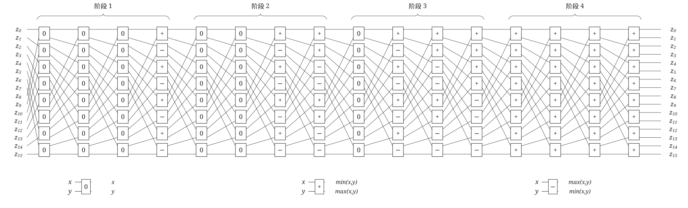

图 57　用 “完全洗牌” 排序十六个元素

[注意: 这个排序方案可以由一种相当简单的设备来执行, 这种设备的电路执行一个 “洗牌并操作” 步骤, 然后将输出线反馈回输入. 图 57 的前三个步骤当然可以去除, 保留它们只是为了使这个模式显得清晰. 斯通指出, 在其他几种算法中也存在这种相同的 “洗牌／操作” 模式, 比如快速傅里叶变换 (见式 4.6.4–(40)).]

**▶ 14. [M27]** (阿列克谢耶夫) 设 $\alpha=[i_1:j_1]\cdots[i_r:j_r]$ 是 $n$ 元网络. 对于 $1\le s\le r$, 我们定义 $\alpha^s=[i'_1:j'_1]\cdots[i'_{s-1}:j'_{s-1}][i_s:j_s]\cdots[i_r:j_r]$, 其中 $i'_k$ 和 $j'_k$ 从 $i_k$ 和 $j_k$ 得来, 不过把所有的 $i_s$ 变为 $j_s$, 所有的 $j_s$ 变为 $i_s$, 无论它们在哪里出现. 例如, 如果 $\alpha=[1:2][3:4][1:3][2:4][2:3]$, 则 $\alpha^4=[1:4][3:2][1:3][2:4][2:3]$.　[答案](./answers/5-3-4.md#ans-5-3-4-14)

(a) 证明 $D_n\alpha=D_n(\alpha^s)$.

(b) 证明 $(\alpha^s)^t=(\alpha^t)^s$.

(c) $\alpha$ 的共轭是任何 $(\cdots((\alpha^{s_1})^{s_2})\cdots)^{s_k}$ 形式的网络. 证明: $\alpha$ 最多有 $2^{r-1}$ 个共轭.

(d) 设 $g_\alpha(x)=[x\in D_n\alpha]$, $f_\alpha(x)=(\bar x_{i_1}\vee x_{j_1})\wedge\cdots\wedge(\bar x_{i_r}\vee x_{j_r})$. 证明:

$$
g_\alpha(x)=\bigvee\{f_{\alpha'}(x)\mid\alpha'\text{ 是 }\alpha\text{ 的共轭}\}.
$$

(e) 设 $G_\alpha$ 是具有顶点 $\{1,\ldots,n\}$ 和有向弧 $i_s\longrightarrow j_s$($1\le s\le r$) 的有向图. 证明: $\alpha$ 是排序网络, 当且仅当对于 $\alpha$ 的所有共轭 $\alpha'$, $G_{\alpha'}$ 中都有从 $i$ 到 $i+1$ 的有向路径 (对于所有 $1\le i<n$). [这个条件值得注意, 因为 $G_\alpha$ 并不依赖于 $\alpha$ 中比较器的顺序.]

**15. [20]** 找出仅有五个比较器模块的四元素非标准排序网络.　[答案](./answers/5-3-4.md#ans-5-3-4-15)

**16. [M22]** 证明: 以下算法把任意排序网络 $[i_1:j_1]\cdots[i_r:j_r]$ 转换为相同长度的标准排序网络:　[答案](./answers/5-3-4.md#ans-5-3-4-16)

**T1.** 令 $q$ 是使得 $i_q>j_q$ 的最小下标. 如果不存在这样的下标, 则停止.

**T2.** 对于 $q\le s\le r$, 把所有出现在比较器 $[i_s:j_s]$ 中的 $i_q$ 改为 $j_q$, $j_q$ 改为 $i_q$. 返回 T1.　▮

例如, 排序网络 $[4:1][3:2][1:3][2:4][1:2][3:4]$ 首先转换为 $[1:4][3:2][4:3][2:1][4:2][3:1]$, 然后转换为 $[1:4][2:3][4:2][3:1][4:3][2:1]$, 然后是 $[1:4][2:3][2:4][3:1][2:3][4:1]$, 以此类推, 直到获得标准网络 $[1:4][2:3][2:4][1:3][1:2][3:4]$.

**17. [M25]** 序列 $\langle x_1,\ldots,x_n\rangle$ 由 0 和 1 组成, 设 $D_{tn}$ 表示所有 $\binom nt$ 个恰有 $t$ 个 1 的此类序列组成的集合. 证明: $\hat U_t(n)$ 是对 $D_{tn}$ 的所有元素排序的网络需要的最少比较器数目; $\hat V_t(n)$ 是对 $D_{tn}\cup D_{(t-1)n}$ 排序需要的最少比较器数目; $\hat W_t(n)$ 是对 $\bigcup_{0\le k\le t}D_{kn}$ 排序需要的最少比较器数目.　[答案](./answers/5-3-4.md#ans-5-3-4-17)

**▶ 18. [M20]** 证明: 从 $2t-1$ 个元素找出中值的网络至少需要 $(t-1)\lceil\lg(t+1)\rceil+\lceil\lg t\rceil$ 个比较器模块. [提示: 见定理 A 的证明.]　[答案](./answers/5-3-4.md#ans-5-3-4-18)

**19. [M22]** 证明: 当 $n\ge2$ 时有 $\hat U_2(n)=2n-4$, $\hat V_2(n)=2n-3$.　[答案](./answers/5-3-4.md#ans-5-3-4-19)

**20. [28]** 证明: (a) $\hat V_3(5)=7$; (b) 当 $n\ge6$ 时有 $\hat U_4(n)\le3n-10$.　[答案](./answers/5-3-4.md#ans-5-3-4-20)

**21. [21]** 判断正误: 向任意标准排序网络中插入一个新的标准比较器, 将会得到另一个标准排序网络.　[答案](./answers/5-3-4.md#ans-5-3-4-21)

**22. [M17]** 设 $\alpha$ 是任意 $n$ 元网络, $x$ 和 $y$ 是 $n$ 元向量. (a) 证明: $x\subseteq y$ 可以推出 $x\alpha\subseteq y\alpha$. (b) 证明: $x\cdot y\le(x\alpha)\cdot(y\alpha)$, 其中 $x\cdot y$ 表示点积 $x_1y_1+\cdots+x_ny_n$.　[答案](./answers/5-3-4.md#ans-5-3-4-22)

**23. [M18]** 设 $\alpha$ 是 $n$ 元网络. 证明: 存在排列 $p\in P_n$ 使得 $(p\alpha)_i=j$, 当且仅当 $D_n$ 中存在向量 $x$ 和 $y$ 使得 $x$ 覆盖 $y$, $(x\alpha)_i=1$, $(y\alpha)_i=0$, $\zeta(y)=j$.　[答案](./answers/5-3-4.md#ans-5-3-4-23)

**▶ 24. [M21]** (阿列克谢耶夫) 设 $\alpha$ 是 $n$ 元网络, 对于 $1\le k\le n$, 定义　[答案](./answers/5-3-4.md#ans-5-3-4-24)

$$
l_k=\min\{(p\alpha)_k\mid p\in P_n\},\quad u_k=\max\{(p\alpha)_k\mid p\in P_n\}
$$

表示可出现在输出线 $k$ 上的数值的下限和上限. 对于网络 $\alpha'=\alpha[i:j]$ 类似地定义 $l'_k$ 和 $u'_k$. 证明:

$$
l'_i=l_i\wedge l_j,\quad l'_j\le l_i+l_j,\quad u'_i\ge u_i+u_j-(n+1),\quad u'_j=u_i\vee u_j.
$$

[提示: 给定 $D_n$ 中满足 $(x\alpha)_i=(y\alpha)_j=0$, $\zeta(x)=l_i$, $\zeta(y)=l_j$ 的向量 $x$ 和 $y$, 找出 $D_n$ 中满足 $(z\alpha')_j=0$, $\zeta(z)\le l_i+l_j$ 的向量 $z$.]

**25. [M30]** 设 $l_k$ 和 $u_k$ 的定义和习题 24 相同. 证明: $l_k$ 和 $u_k$ 之间的所有整数 (含 $l_k$ 和 $u_k$) 都属于集合 $\{(p\alpha)_k\mid p\in P_n\}$.　[答案](./answers/5-3-4.md#ans-5-3-4-25)

**26. [M24]** (弗洛伊德) 设 $\alpha$ 是 $n$ 元网络. 证明: 可以根据集合 $P_n\alpha=\{p\alpha\mid p\in P_n\}$ 确定集合 $D_n\alpha=\{x\alpha\mid x\in D_n\}$; 反之, 也可以根据 $D_n\alpha$ 确定 $P_n\alpha$.　[答案](./answers/5-3-4.md#ans-5-3-4-26)

**▶ 27. [M20]** 设 $x$ 和 $y$ 是向量, 假定 $x\alpha$ 和 $y\alpha$ 是有序的. 证明: $(x\alpha)_i\le(y\alpha)_j$ 当且仅当: 如果从 $y$ 中任意选出 $j$ 个元素, 都可以从 $x$ 中选出 $i$ 个元素, 使得每个选定的 $x$ 的元素不大于某个选定的 $y$ 的元素. 利用这个原理证明: 对任意矩阵先按行排序, 再按列排序, 这些行仍将保持有序.　[答案](./answers/5-3-4.md#ans-5-3-4-27)

**▶ 28. [M20]** 下图说明一个事实, 我们可以系统地写出一些公式, 用输入元素表示排序网络中所有线上的内容:　[答案](./answers/5-3-4.md#ans-5-3-4-28)

<table data-network-formulas="28" style="display:table;width:max-content;max-width:none;white-space:nowrap;margin:0;border:0;background:white;color:#222"><tbody>
<tr style="height:70px;background:white;border:0">
<td style="height:70px;box-sizing:border-box;padding:0 4px;border:0;vertical-align:middle">$a$</td>
<td rowspan="4" style="height:280px;box-sizing:border-box;padding:0;border:0;vertical-align:middle">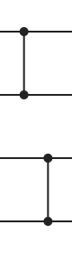</td>
<td style="height:70px;box-sizing:border-box;padding:0 4px;border:0;vertical-align:middle">$a\wedge b$</td>
<td rowspan="4" style="height:280px;box-sizing:border-box;padding:0;border:0;vertical-align:middle">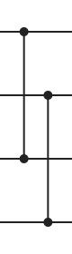</td>
<td style="height:70px;box-sizing:border-box;padding:0 4px;border:0;vertical-align:middle">$(a\wedge b)\wedge(c\wedge d)$</td>
<td rowspan="4" style="height:280px;box-sizing:border-box;padding:0;border:0;vertical-align:middle">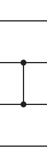</td>
<td style="height:70px;box-sizing:border-box;padding:0 4px;border:0;vertical-align:middle">$(a\wedge b)\wedge(c\wedge d)$</td>
</tr>
<tr style="height:70px;background:white;border:0">
<td style="height:70px;box-sizing:border-box;padding:0 4px;border:0;vertical-align:middle">$b$</td>
<td style="height:70px;box-sizing:border-box;padding:0 4px;border:0;vertical-align:middle">$a\vee b$</td>
<td style="height:70px;box-sizing:border-box;padding:0 4px;border:0;vertical-align:middle">$(a\vee b)\wedge(c\vee d)$</td>
<td style="height:70px;box-sizing:border-box;padding:0 4px;border:0;vertical-align:middle">$((a\vee b)\wedge(c\vee d))\wedge((a\wedge b)\vee(c\wedge d))$</td>
</tr>
<tr style="height:70px;background:white;border:0">
<td style="height:70px;box-sizing:border-box;padding:0 4px;border:0;vertical-align:middle">$c$</td>
<td style="height:70px;box-sizing:border-box;padding:0 4px;border:0;vertical-align:middle">$c\wedge d$</td>
<td style="height:70px;box-sizing:border-box;padding:0 4px;border:0;vertical-align:middle">$(a\wedge b)\vee(c\wedge d)$</td>
<td style="height:70px;box-sizing:border-box;padding:0 4px;border:0;vertical-align:middle">$((a\vee b)\wedge(c\vee d))\vee((a\wedge b)\vee(c\wedge d))$</td>
</tr>
<tr style="height:70px;background:white;border:0">
<td style="height:70px;box-sizing:border-box;padding:0 4px;border:0;vertical-align:middle">$d$</td>
<td style="height:70px;box-sizing:border-box;padding:0 4px;border:0;vertical-align:middle">$c\vee d$</td>
<td style="height:70px;box-sizing:border-box;padding:0 4px;border:0;vertical-align:middle">$(a\vee b)\vee(c\vee d)$</td>
<td style="height:70px;box-sizing:border-box;padding:0 4px;border:0;vertical-align:middle">$(a\vee b)\vee(c\vee d)$</td>
</tr>
</tbody></table>

利用交换律 $x\wedge y=y\wedge x$ 和 $x\vee y=y\vee x$, 结合律 $x\wedge(y\wedge z)=(x\wedge y)\wedge z$ 和 $x\vee(y\vee z)=(x\vee y)\vee z$, 分配律 $x\wedge(y\vee z)=(x\wedge y)\vee(x\wedge z)$ 和 $x\vee(y\wedge z)=(x\vee y)\wedge(x\vee z)$, 吸收律 $x\wedge(x\vee y)=x\vee(x\wedge y)=x$, 幂等律 $x\wedge x=x\vee x=x$, 可以把这个网络右端的公式分别化简为 $a\wedge b\wedge c\wedge d$, $(a\wedge b\wedge c)\vee(a\wedge b\wedge d)\vee(a\wedge c\wedge d)\vee(b\wedge c\wedge d)$, $(a\wedge b)\vee(a\wedge c)\vee(a\wedge d)\vee(b\wedge c)\vee(b\wedge d)\vee(c\wedge d)$, $a\vee b\vee c\vee d$.

证明: 一般地, $\{x_1,\ldots,x_n\}$ 的第 $t$ 个最大元素由以下 “初等对称函数” 给出:

$$
\sigma_t(x_1,\ldots,x_n)=\bigvee\{x_{i_1}\wedge x_{i_2}\wedge\cdots\wedge x_{i_t}\mid1\le i_1<i_2<\cdots<i_t\le n\}.
$$

[共有 $\binom nt$ 项通过 $\vee$ 操作结合在一起. 因此, 求最低成本排序网络的问题, 等价于用最少量的 “与／或” 电路计算初等对称函数的问题, 在每一级, 都需要用 $\phi\wedge\psi$ 和 $\phi\vee\psi$ 替换两个量 $\phi$ 和 $\psi$.]

**29. [M20]** 给定 $x_1\le x_2\le x_3$ 和 $y_1\le y_2\le y_3\le y_4\le y_5$, 合并 $x$ 和 $y$ 得到 $z_1\le z_2\le\cdots\le z_8$. 试求应用运算符 $\wedge$ 和 $\vee$ 以 $x$ 和 $y$ 表示每个 $z$ 值的公式.　[答案](./answers/5-3-4.md#ans-5-3-4-29)

**30. [HM24]** 证明: 任何包含 $\wedge$ 和 $\vee$ 及独立变量 $\{x_1,\ldots,x_n\}$ 的公式, 都可以使用习题 28 中的恒等式化简为 “正则” 形式 $\tau_1\vee\tau_2\vee\cdots\vee\tau_k$, 其中 $k\ge1$, 每个 $\tau_i$ 形如 $\bigwedge\{x_j\mid j\in S_i\}$, $S_i$ 是 $\{1,2,\ldots,n\}$ 的子集, 当 $i\ne j$ 时集合 $S_i$ 不包含于 $S_j$. 另请证明: 两个这样的正则形式对于所有 $x_1,\ldots,x_n$ 都相等当且仅当它们恒等 (不计顺序).　[答案](./answers/5-3-4.md#ans-5-3-4-30)

**31. [M24]** (理查德·戴德金, 1897) 设 $\delta_n$ 是关于 $x_1,\ldots,x_n$ 的不同正则形式的数目, 其含义如习题 30 所述. 于是 $\delta_1=1$, $\delta_2=4$, $\delta_3=18$. 试求 $\delta_4$.　[答案](./answers/5-3-4.md#ans-5-3-4-31)

**32. [M28]** (格林) 设 $G_1=\{00,01,11\}$, $G_{t+1}$ 是所有满足以下条件的串 $\theta\phi\psi\omega$ 的集合: $\theta,\phi,\psi,\omega$ 的长度为 $2^{t-1}$ 且 $\theta\phi,\psi\omega,\theta\psi,\phi\omega$ 都属于 $G_t$. 设 $\alpha$ 是由图 49 中 $n=16$ 的排序器的前四级组成的网络. 证明 $D_{16}\alpha=G_4$, 并证明它恰好有 $\delta_4+2$ 个元素. (见习题 31.)　[答案](./answers/5-3-4.md#ans-5-3-4-32)

**▶ 33. [M22]** $\langle x_1,\ldots,x_n\rangle$ 的所有 $\delta_n$ (见习题 31) 个函数并不是都能出现在比较器网络中. 证明: 事实上, 关于 $\langle x_1,\ldots,x_n\rangle$ 的任何比较器网络都不可能输出函数 $(x_1\wedge x_2)\vee(x_2\wedge x_3)\vee(x_3\wedge x_4)$.　[答案](./answers/5-3-4.md#ans-5-3-4-33)

**34. [23]** 下图是排序网络吗?　[答案](./answers/5-3-4.md#ans-5-3-4-34)

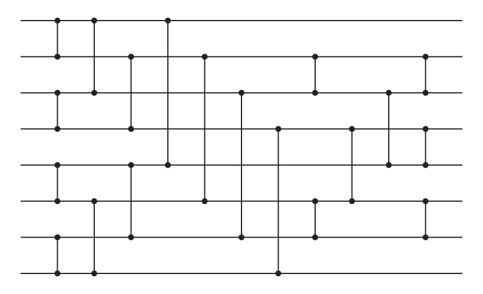

**35. [20]** 证明: 任何标准排序网络必定包括所有相邻比较器 $[i:i+1]$($1\le i<n$), 每个比较器至少出现一次.　[答案](./answers/5-3-4.md#ans-5-3-4-35)

**▶ 36. [22]** 图 47 中的网络仅包含相邻比较器 $[i:i+1]$, 这种网络称为 “本原网络”. (a) 证明: $n$ 元素本原排序网络至少有 $\binom n2$ 个比较器. [提示: 考虑排列的反序.] (b)(弗洛伊德, 1964) 设 $\alpha$ 是 $n$ 元素本原网络, $x$ 是向量, 对于某个 $i<j$ 有 $(x\alpha)_i>(x\alpha)_j$. 证明 $(y\alpha)_i>(y\alpha)_j$, 其中 $y$ 是向量 $\langle n,n-1,\ldots,1\rangle$. (c) 作为 (b) 的推论, 一个本原网络是排序网络当且仅当它能够排序单一向量 $\langle n,n-1,\ldots,1\rangle$.　[答案](./answers/5-3-4.md#ans-5-3-4-36)

**37. [M22]** 对 $n$ 个数 ($n\ge3$) 进行的奇偶转置排序是一个深度为 $n$ 级、有 $\tfrac12n(n-1)$ 个比较器的网络, 这些比较器排列为图 58 所示的砖状模式. (当 $n$ 是偶数时有两种可能性.) 这种排序只需要交替执行两种操作, 所以特别容易用硬件实现. 证明: 这种网络事实上是有效排序网络. [提示: 见习题 36.]　[答案](./answers/5-3-4.md#ans-5-3-4-37)

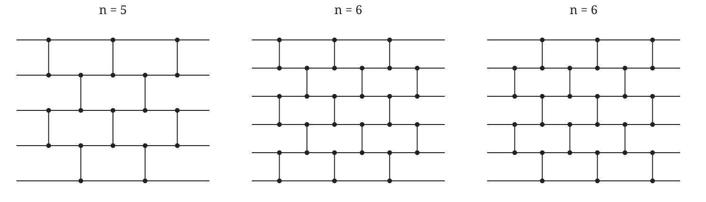

图 58　奇偶转置排序

**▶ 38. [43]** 设 $N=\binom n2$. 试求形状为 $(n-1,n-2,\ldots,1)$ 的扬氏图表与本原排序网络 $[i_1:i_1+1]\cdots[i_N:i_N+1]$ 之间的一一对应关系. [根据定理 5.1.4H, 恰有　[答案](./answers/5-3-4.md#ans-5-3-4-38)

$$
\frac{N!}{1^{n-1}3^{n-2}5^{n-3}\cdots(2n-3)^1}
$$

个这样的排序网络.] 提示: 习题 36(c) 表明, 没有冗余比较器的本原网络对应于类似 5.1.1 节图 1 的多面体中从 $12\ldots n$ 到 $n\ldots21$ 的路径.

**39. [25]** 已知某个 $n$ 线本原比较器网络能正确排序单一输入序列 $1010\ldots10$. (见习题 36, 假定 $n$ 是偶数.) 证明: 由这个网络中第 $\lceil n/3\rceil$ 线到第 $\lceil2n/3\rceil$ 线 (包括这两条线在内) 之间的所有比较器组成的 “中间三分之一” 能正确排序所有输入序列.　[答案](./answers/5-3-4.md#ans-5-3-4-39)

**40. [HM44]** 随机选择比较器 $[i_1:i_1+1][i_2:i_2+1]\cdots[i_r:i_r+1]$, 等概率地选取 $i_k\in\{1,2,\ldots,n-1\}$. 当网络中包含类似图 47 中的冒泡排序构造作为子网络时, 这个过程停止. 试证明: $r\le4n^2+O(n^{3/2}\log n)$, 发生例外的概率为 $O(n^{-1000})$.　[答案](./answers/5-3-4.md#ans-5-3-4-40)

**41. [M47]** 随机选择比较器 $[i_1:j_1][i_2:j_2]\cdots[i_r:j_r]$, 每个非冗余的选择 $1\le i_k<j_k\le n$ 的概率相等, 在获得排序网络时该过程停止. 试估计 $r$ 的期望值, 对于所有 $\epsilon>0$ 它都是 $O(n^{1+\epsilon})$ 的吗?

**▶ 42. [25]** (戴维·范沃里斯) 证明 $\hat S(n)\ge\hat S(n-1)+\lceil\lg n\rceil$.　[答案](./answers/5-3-4.md#ans-5-3-4-42)

**43. [48]** 找出比较器个数少于 $C(m,n)$ 的 $(m,n)$ 合并网络, 或证明不存在这种网络.

**44. [50]** 对于某个大于 8 的 $n$ 值, 求 $\hat S(n)$ 的精确值.

**45. [M20]** 证明: 任何没有 “多重扇出” 的 $(1,n)$ 合并网络, 至少有 $\lceil\lg(n+1)\rceil$ 级延迟.　[答案](./answers/5-3-4.md#ans-5-3-4-45)

**▶ 46. [30]** (马丁·艾格纳) 证明: 利用类似习题 6 中进行同时不相交比较的算法合并 $m$ 个元素与 $n$ 个元素至少需要 $\lceil\lg(m+n)\rceil$ 个阶段. 因此双调合并网络具有最优延迟.　[答案](./answers/5-3-4.md#ans-5-3-4-46)

**47. [47]** 是否有某些 $n$ 值使得习题 6 中的函数 $T(n)$ 严格小于 $\hat T(n)$?

**▶ 48. [26]** 我们可以用另一种方式来解读排序网络, 让每条线承载一个包含 $m$ 个数的多重集, 而不是只承载一个数. 在这种解读下, 操作 $[i:j]$ 分别用 $x_i\mathbin{\mathrlap{\raisebox{0.25ex}{\(\wedge\)}}\raisebox{-0.25ex}{\(\wedge\)}}x_j$ 和 $x_i\mathbin{\mathrlap{\raisebox{0.25ex}{\(\vee\)}}\raisebox{-0.25ex}{\(\vee\)}}x_j$ 代替 $x_i$ 和 $x_j$, 也就是 $2m$ 个数 $x_i\uplus x_j$ 中最小的 $m$ 个和最大的 $m$ 个. (例如: 图　[答案](./answers/5-3-4.md#ans-5-3-4-48)

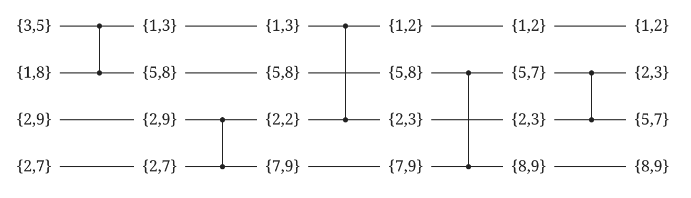

展示了当 $m=2$ 时的这种解读. 每个比较器合并它的输入, 然后输出低的一半与高的一半.)

假定 $a$ 和 $b$ 都是 $m$ 个元素的多重集, 当且仅当 $a\mathbin{\mathrlap{\raisebox{0.25ex}{\(\wedge\)}}\raisebox{-0.25ex}{\(\wedge\)}}b=a$ (与 $a\mathbin{\mathrlap{\raisebox{0.25ex}{\(\vee\)}}\raisebox{-0.25ex}{\(\vee\)}}b=b$ 等价, 也就是 $a$ 的最大元素小于等于 $b$ 的最小元素) 时, 我们说 $a\ll b$. 于是 $a\mathbin{\mathrlap{\raisebox{0.25ex}{\(\wedge\)}}\raisebox{-0.25ex}{\(\wedge\)}}b\ll a\mathbin{\mathrlap{\raisebox{0.25ex}{\(\vee\)}}\raisebox{-0.25ex}{\(\vee\)}}b$.

设 $\alpha$ 是 $n$ 元网络, $x=\langle x_1,\ldots,x_n\rangle$ 是向量, 其中每个 $x_i$ 都是 $m$ 个元素的多重集. 证明: 根据以上解读, 如果 $(x\alpha)_i$ 不 $\ll(x\alpha)_j$, 则 $D_n$ 中存在一个向量 $y$ 使得 $(y\alpha)_i=1$ 及 $(y\alpha)_j=0$. [因此, 在 $n$ 元素排序网络中, 如果把每个比较器用 $\hat M(m,m)$ 模块的合并网络代替, 这个网络就变成 $mn$ 元素排序网络. 图 59 给出根据上述观察结果由四元素排序器构造的八元素排序器.]

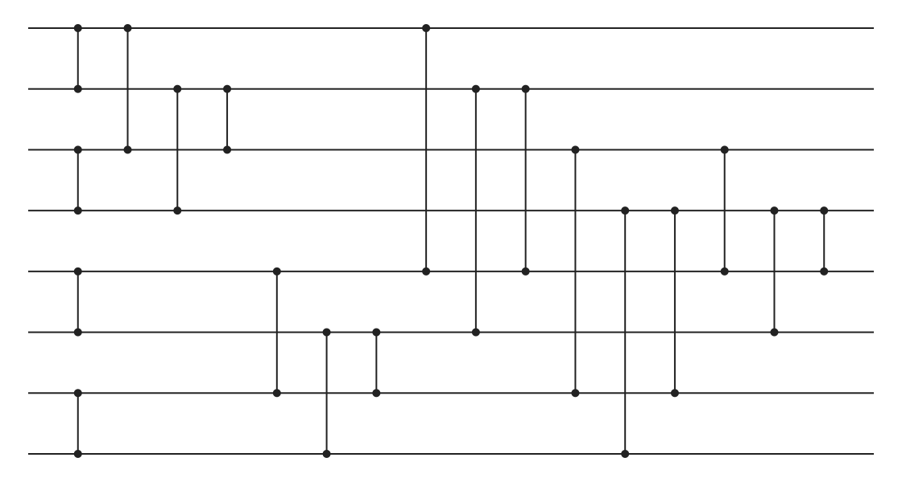

图 59　根据合并解读, 由四元素排序器构造的八元素排序器

**49. [M23]** 采用习题 48 的记号, 证明: $(x\mathbin{\mathrlap{\raisebox{0.25ex}{\(\wedge\)}}\raisebox{-0.25ex}{\(\wedge\)}}y)\mathbin{\mathrlap{\raisebox{0.25ex}{\(\wedge\)}}\raisebox{-0.25ex}{\(\wedge\)}}z=x\mathbin{\mathrlap{\raisebox{0.25ex}{\(\wedge\)}}\raisebox{-0.25ex}{\(\wedge\)}}(y\mathbin{\mathrlap{\raisebox{0.25ex}{\(\wedge\)}}\raisebox{-0.25ex}{\(\wedge\)}}z)$ 且 $(x\mathbin{\mathrlap{\raisebox{0.25ex}{\(\vee\)}}\raisebox{-0.25ex}{\(\vee\)}}y)\mathbin{\mathrlap{\raisebox{0.25ex}{\(\vee\)}}\raisebox{-0.25ex}{\(\vee\)}}z=x\mathbin{\mathrlap{\raisebox{0.25ex}{\(\vee\)}}\raisebox{-0.25ex}{\(\vee\)}}(y\mathbin{\mathrlap{\raisebox{0.25ex}{\(\vee\)}}\raisebox{-0.25ex}{\(\vee\)}}z)$. 但是, $(x\mathbin{\mathrlap{\raisebox{0.25ex}{\(\vee\)}}\raisebox{-0.25ex}{\(\vee\)}}y)\mathbin{\mathrlap{\raisebox{0.25ex}{\(\wedge\)}}\raisebox{-0.25ex}{\(\wedge\)}}z$ 并非总是等于 $(x\mathbin{\mathrlap{\raisebox{0.25ex}{\(\wedge\)}}\raisebox{-0.25ex}{\(\wedge\)}}z)\mathbin{\mathrlap{\raisebox{0.25ex}{\(\vee\)}}\raisebox{-0.25ex}{\(\vee\)}}(y\mathbin{\mathrlap{\raisebox{0.25ex}{\(\wedge\)}}\raisebox{-0.25ex}{\(\wedge\)}}z)$, $(x\mathbin{\mathrlap{\raisebox{0.25ex}{\(\wedge\)}}\raisebox{-0.25ex}{\(\wedge\)}}y)\mathbin{\mathrlap{\raisebox{0.25ex}{\(\vee\)}}\raisebox{-0.25ex}{\(\vee\)}}(x\mathbin{\mathrlap{\raisebox{0.25ex}{\(\wedge\)}}\raisebox{-0.25ex}{\(\wedge\)}}z)\mathbin{\mathrlap{\raisebox{0.25ex}{\(\vee\)}}\raisebox{-0.25ex}{\(\vee\)}}(y\mathbin{\mathrlap{\raisebox{0.25ex}{\(\wedge\)}}\raisebox{-0.25ex}{\(\wedge\)}}z)$ 也并非总是等价于 $x\uplus y\uplus z$ 的中间 $m$ 个元素. 找出用 $x,y,z$ 以及 $\mathbin{\mathrlap{\raisebox{0.25ex}{\(\wedge\)}}\raisebox{-0.25ex}{\(\wedge\)}}$ 和 $\mathbin{\mathrlap{\raisebox{0.25ex}{\(\vee\)}}\raisebox{-0.25ex}{\(\vee\)}}$ 运算来表示这些中间元素的正确公式.　[答案](./answers/5-3-4.md#ans-5-3-4-49)

**50. [HM46]** 探讨习题 48 中定义的 $\mathbin{\mathrlap{\raisebox{0.25ex}{\(\wedge\)}}\raisebox{-0.25ex}{\(\wedge\)}}$ 和 $\mathbin{\mathrlap{\raisebox{0.25ex}{\(\vee\)}}\raisebox{-0.25ex}{\(\vee\)}}$ 运算的性质. 是否有可能采用一种优美的方式来刻画这个代数中的所有恒等式? 或者从有限个恒等式中推导出所有这些关系式? 在这一点上, 诸如 $x\mathbin{\mathrlap{\raisebox{0.25ex}{\(\wedge\)}}\raisebox{-0.25ex}{\(\wedge\)}}x\mathbin{\mathrlap{\raisebox{0.25ex}{\(\wedge\)}}\raisebox{-0.25ex}{\(\wedge\)}}x=x\mathbin{\mathrlap{\raisebox{0.25ex}{\(\wedge\)}}\raisebox{-0.25ex}{\(\wedge\)}}x$ 或者 $x\mathbin{\mathrlap{\raisebox{0.25ex}{\(\wedge\)}}\raisebox{-0.25ex}{\(\wedge\)}}(x\mathbin{\mathrlap{\raisebox{0.25ex}{\(\vee\)}}\raisebox{-0.25ex}{\(\vee\)}}(x\mathbin{\mathrlap{\raisebox{0.25ex}{\(\wedge\)}}\raisebox{-0.25ex}{\(\wedge\)}}(x\mathbin{\mathrlap{\raisebox{0.25ex}{\(\vee\)}}\raisebox{-0.25ex}{\(\vee\)}}y)))=x\mathbin{\mathrlap{\raisebox{0.25ex}{\(\wedge\)}}\raisebox{-0.25ex}{\(\wedge\)}}(x\mathbin{\mathrlap{\raisebox{0.25ex}{\(\vee\)}}\raisebox{-0.25ex}{\(\vee\)}}y)$ 这些仅对于 $m\le2$ 成立的恒等式没有太大意义, 我们仅考虑对于所有 $m$ 值都成立的恒等式.　[答案](./answers/5-3-4.md#ans-5-3-4-50)

**▶ 51. [M25]** (葛立恒) 我们说比较器 $[i:j]$ 在网络 $\alpha_1[i:j]\alpha_2$ 中是冗余的, 如果对于所有向量 $x$ 有 $(x\alpha_1)_i\le(x\alpha_1)_j$, 或者对于所有向量 $x$ 有 $(x\alpha_1)_i\ge(x\alpha_1)_j$. 证明: 如果 $\alpha$ 是具有 $r$ 个非冗余比较器的网络, 则至少存在 $r$ 个不同有序对 $(i,j)$, 其中 $i\ne j$, 使得对于所有向量 $x$ 有 $(x\alpha)_i\le(x\alpha)_j$. (因此, 没有冗余比较器的网络最多包含 $\binom n2$ 个模块.)　[答案](./answers/5-3-4.md#ans-5-3-4-51)

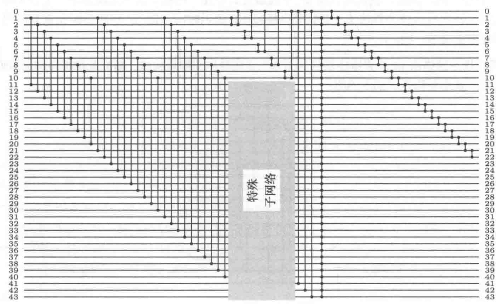

图 60　一族难以验证其排序能力的网络, 图中所示为 $m=3$ 和 $n=5$. (见习题 52.)

**▶ 52. [32]** (迈克尔·拉宾, 1980) 证明: 通过考虑图 60 所绘形式的网络, 要一般性地判断一系列比较器是否定义一个排序网络, 是有其固有难度的. 把输入编号为 $x_0$ 至 $x_N$ 是比较方便的, 其中 $N=2mn+m+2n$, 正整数 $m$ 和 $n$ 是参数. 第一组比较器是 $[j:j+2nk]$($1\le j\le2n$, $1\le k\le m$). 接着是 $[2j-1:2j][0:2j]$($1\le j\le n$), 与其并行的是一个仅使用 $>2n$ 下标的特殊子网络. 然后我们比较 $[0:2mn+2n+j]$($1\le j\le m$). 最后是一个关于 $\langle x_1,\ldots,x_N\rangle$ 的完整排序网络, 后面跟着 $[0:1][1:2]\ldots[N-t-1:N-t]$, 其中 $t=mn+n+1$.　[答案](./answers/5-3-4.md#ans-5-3-4-52)

(a) 利用特殊子网络的特性, 描述这样一个网络不能完成排序的所有输入 $\langle x_0,x_1,\ldots,x_N\rangle$.

(b) 给定一组诸如 $(y_1\vee y_2\vee\bar y_3)\wedge(\bar y_2\vee y_3\vee\bar y_4)\wedge\cdots$ 之类的条款, 解释如何构造一个特殊子网络, 使得当且仅当无法满足这些条款时, 图 60 可以完成所有输入的排序. [因此, 判断一个比较器序列是否构成一个排序网络的任务是 “协 NP 完全” 的, 其意义如 7.9 节所述.]

**53. [30]** (周期排序网络) 下面两个 16 元网络展示了当 $n=2^t$ 时 $t$ 级网络的一般递归构造, 其中 $t=4$:　[答案](./answers/5-3-4.md#ans-5-3-4-53)

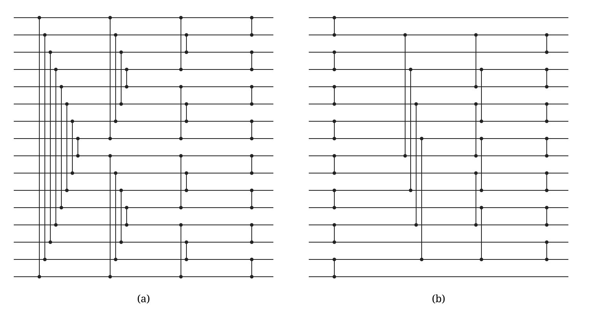

如果我们把输入线编号为 0 至 $2^t-1$, 则情形 (a) 中的第 $l$ 级拥有比较器 $[i:j]$, 其中 $i\bmod2^{t+1-l}<2^{t-l}$ 且 $j=i\oplus(2^{t+1-l}-1)$; 和双调合并中一样, 总共有 $t2^{t-1}$ 个比较器. 在情形 (b) 中, 第一级的比较器为 $[2j:2j+1]$ (其中 $0\le j<2^{t-1}$), 当 $2\le l\le t$ 时第 $l$ 级的比较器为 $[2j+1:2j+2^{t+1-l}]$ (其中 $0\le j<2^{t-1}-2^{t-l}$); 和奇偶合并中一样, 总共有 $(t-1)2^{t-1}+1$ 个比较器.

如果对于某个 $k\ge1$, 输入是 “$2^k$ 有序” (其含义见定理 5.2.1H) 的, 证明: 这两个网络生成的输出都是 “$2^{k-1}$ 有序” 的. 因此, 我们可以让 $2^t$ 个数通过其中任一网络 $t$ 次来完成排序. [当 $t$ 很大时, 这些排序网络的比较次数大体为算法 5.2.2M 中的两倍. 总延迟时间与图 57 相同, 因为重复使用了同一网络, 所以实现也更简单一些.]

**54. [42]** 假定排序网络由 $m$ 元素排序器模块而非二元素排序器模块构成, 研究此类排序网络的特性. (例如, 杰拉尔德·夏皮罗构造了如下网络:　[答案](./answers/5-3-4.md#ans-5-3-4-54)

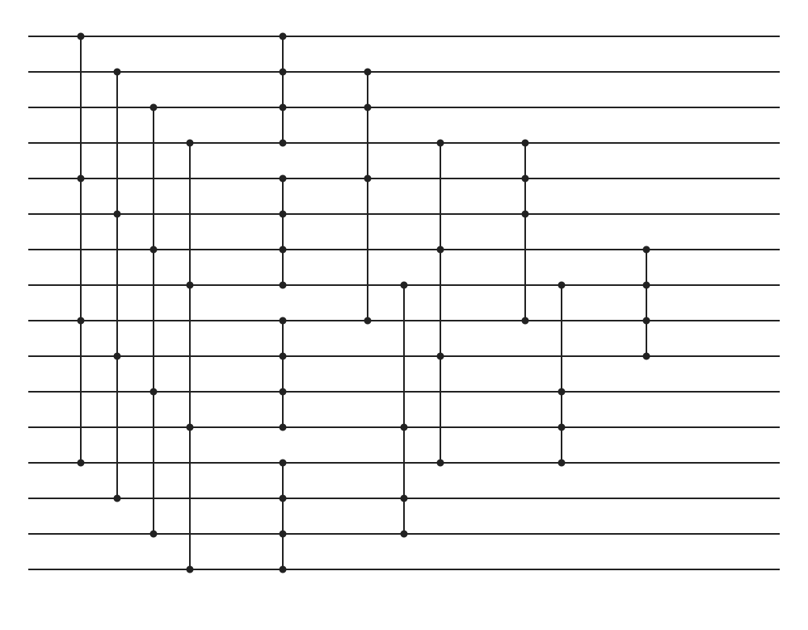

它使用 14 个四元素排序器排序 16 个元素. 这是所能实现的最佳情形吗? 证明: 当 $m$ 足够大时, 排序 $m^2$ 个元素最多需要 16 级 $m$ 元素排序器.)

**55. [23]** 排列网络是模块序列 $[i_1:j_1]\ldots[i_r:j_r]$, 其中每个模块 $[i:j]$ 由外部控制设定, 决定是把输入原样输出还是交换 $x_i$ 和 $x_j$ (不考虑 $x_i$ 和 $x_j$ 的取值如何). 通过这些模块的设定, 可以在输出线上实现输入内容的每种排列. 显然每个排序网络都是排列网络, 但反之则不成立: 试找出仅有八个模块的五元素排列网络.　[答案](./answers/5-3-4.md#ans-5-3-4-55)

**▶ 56. [25]** 假定二进制位向量 $x\in D_n$ 是无序的. 证明: 存在一个标准 $n$ 元素网络 $\alpha_x$, 尽管它能排序 $D_n$ 中的所有其他元素, 却无法排序 $x$.　[答案](./answers/5-3-4.md#ans-5-3-4-56)

**57. [M35]** 偶奇合并类似于巴彻尔的奇偶合并, 只是当 $mn>2$ 时, 在进行一组类似于 (1) 的 $\lceil m/2\rceil+\lceil n/2\rceil-1$ 次比较交换操作之前, 它以递归方式合并序列 $\langle x_{m\bmod2+1},\ldots,x_{m-3},x_{m-1}\rangle$ 与 $\langle y_1,y_3,\ldots,y_{2\lceil n/2\rceil-1}\rangle$, 合并 $\langle x_{(m+1)\bmod2+1},\ldots,x_{m-2},x_m\rangle$ 与 $\langle y_2,y_4,\ldots,y_{2\lfloor n/2\rfloor}\rangle$. 试证明: 偶奇合并实现了双调合并的最优延迟时间 $\lceil\lg(m+n)\rceil$, 需要的比较次数不多于双调方法. 事实上, 请证明: 偶奇合并需要的比较次数 $A(m,n)$ 满足 $C(m,n)\le A(m,n)<\tfrac12(m+n)\lg\min(m,n)+m+\tfrac32n$.　[答案](./answers/5-3-4.md#ans-5-3-4-57)

#### 习题（第二组）

以下习题讨论与排序有关的几种不同类型的最优性问题. 前几题基于冒泡排序的一种重要的 “多头” 推广, 早在 1954 年菲利普·阿姆斯特朗和雷蒙德·纳尔逊就研究过这个问题. [见美国专利第 3029413 号和第 3034102 号.] 设 $1=h_1<h_2<\cdots<h_m=n$ 是递增整数序列, 称为长度 $m$、跨度 $n$ 的 “头序列”, 用它来定义一种特殊类型的排序方法. 记录 $R_1\ldots R_N$ 的排序涉及几遍扫描, 每遍扫描包含 $N+n-1$ 步. 当 $j=1-n,2-n,\ldots,N-1$ 时, 在第 $j$ 步查看记录 $R_{j+h[1]},R_{j+h[2]},\ldots,R_{j+h[m]}$, 必要时对其重新排列, 使它们的键保持有序. (这时我们说 $R_{j+h[1]},\ldots,R_{j+h[m]}$ “处于读写头之下”. 当 $j+h[k]<1$ 或 $>N$ 时无需考虑记录 $R_{j+h[k]}$. 从效果上看, 键 $K_0,K_{-1},K_{-2},\ldots$ 被看作 $-\infty$, 键 $K_{N+1},K_{N+2},\ldots$ 被看作 $+\infty$. 因此, 当 $j\le-h[m-1]$ 或 $j>N-h[2]$ 时, 第 $j$ 步实际上是平凡的.)

例如, 下表给出当 $m=3$, $N=9$, $h_1=1$, $h_2=2$, $h_3=4$ 时多头排序的一遍扫描:

<table data-multihead-table="197" style="white-space:nowrap"><thead><tr><th style="min-width:90px"></th>
<th style="min-width:52px;text-align:center">$K_{-2}$</th>
<th style="min-width:52px;text-align:center">$K_{-1}$</th>
<th style="min-width:52px;text-align:center">$K_{0}$</th>
<th style="min-width:52px;text-align:center">$K_{1}$</th>
<th style="min-width:52px;text-align:center">$K_{2}$</th>
<th style="min-width:52px;text-align:center">$K_{3}$</th>
<th style="min-width:52px;text-align:center">$K_{4}$</th>
<th style="min-width:52px;text-align:center">$K_{5}$</th>
<th style="min-width:52px;text-align:center">$K_{6}$</th>
<th style="min-width:52px;text-align:center">$K_{7}$</th>
<th style="min-width:52px;text-align:center">$K_{8}$</th>
<th style="min-width:52px;text-align:center">$K_{9}$</th>
<th style="min-width:52px;text-align:center">$K_{10}$</th>
<th style="min-width:52px;text-align:center">$K_{11}$</th>
<th style="min-width:52px;text-align:center">$K_{12}$</th>
</tr></thead><tbody>
<tr data-multihead-state="-3" style="height:42px"><td>$j=-3$</td>
<td data-key="-2" style="height:42px;text-align:center"><u>&#160;&#160;</u></td>
<td data-key="-1" style="height:42px;text-align:center"><u>&#160;&#160;</u></td>
<td data-key="0" style="height:42px;text-align:center"></td>
<td data-key="1" style="height:42px;text-align:center"><u>3</u></td>
<td data-key="2" style="height:42px;text-align:center">1</td>
<td data-key="3" style="height:42px;text-align:center">4</td>
<td data-key="4" style="height:42px;text-align:center">5</td>
<td data-key="5" style="height:42px;text-align:center">9</td>
<td data-key="6" style="height:42px;text-align:center">2</td>
<td data-key="7" style="height:42px;text-align:center">6</td>
<td data-key="8" style="height:42px;text-align:center">8</td>
<td data-key="9" style="height:42px;text-align:center">7</td>
<td data-key="10" style="height:42px;text-align:center"></td>
<td data-key="11" style="height:42px;text-align:center"></td>
<td data-key="12" style="height:42px;text-align:center"></td>
</tr>
<tr data-multihead-state="-2" style="height:42px"><td>$j=-2$</td>
<td data-key="-2" style="height:42px;text-align:center"></td>
<td data-key="-1" style="height:42px;text-align:center"><u>&#160;&#160;</u></td>
<td data-key="0" style="height:42px;text-align:center"><u>&#160;&#160;</u></td>
<td data-key="1" style="height:42px;text-align:center">3</td>
<td data-key="2" style="height:42px;text-align:center"><u>1</u></td>
<td data-key="3" style="height:42px;text-align:center">4</td>
<td data-key="4" style="height:42px;text-align:center">5</td>
<td data-key="5" style="height:42px;text-align:center">9</td>
<td data-key="6" style="height:42px;text-align:center">2</td>
<td data-key="7" style="height:42px;text-align:center">6</td>
<td data-key="8" style="height:42px;text-align:center">8</td>
<td data-key="9" style="height:42px;text-align:center">7</td>
<td data-key="10" style="height:42px;text-align:center"></td>
<td data-key="11" style="height:42px;text-align:center"></td>
<td data-key="12" style="height:42px;text-align:center"></td>
</tr>
<tr data-multihead-state="-1" style="height:42px"><td>$j=-1$</td>
<td data-key="-2" style="height:42px;text-align:center"></td>
<td data-key="-1" style="height:42px;text-align:center"></td>
<td data-key="0" style="height:42px;text-align:center"><u>&#160;&#160;</u></td>
<td data-key="1" style="height:42px;text-align:center"><u>3</u></td>
<td data-key="2" style="height:42px;text-align:center">1</td>
<td data-key="3" style="height:42px;text-align:center"><u>4</u></td>
<td data-key="4" style="height:42px;text-align:center">5</td>
<td data-key="5" style="height:42px;text-align:center">9</td>
<td data-key="6" style="height:42px;text-align:center">2</td>
<td data-key="7" style="height:42px;text-align:center">6</td>
<td data-key="8" style="height:42px;text-align:center">8</td>
<td data-key="9" style="height:42px;text-align:center">7</td>
<td data-key="10" style="height:42px;text-align:center"></td>
<td data-key="11" style="height:42px;text-align:center"></td>
<td data-key="12" style="height:42px;text-align:center"></td>
</tr>
<tr data-multihead-state="0" style="height:42px"><td>$j=0$</td>
<td data-key="-2" style="height:42px;text-align:center"></td>
<td data-key="-1" style="height:42px;text-align:center"></td>
<td data-key="0" style="height:42px;text-align:center"></td>
<td data-key="1" style="height:42px;text-align:center"><u>1</u></td>
<td data-key="2" style="height:42px;text-align:center"><u>3</u></td>
<td data-key="3" style="height:42px;text-align:center">4</td>
<td data-key="4" style="height:42px;text-align:center"><u>5</u></td>
<td data-key="5" style="height:42px;text-align:center">9</td>
<td data-key="6" style="height:42px;text-align:center">2</td>
<td data-key="7" style="height:42px;text-align:center">6</td>
<td data-key="8" style="height:42px;text-align:center">8</td>
<td data-key="9" style="height:42px;text-align:center">7</td>
<td data-key="10" style="height:42px;text-align:center"></td>
<td data-key="11" style="height:42px;text-align:center"></td>
<td data-key="12" style="height:42px;text-align:center"></td>
</tr>
<tr data-multihead-state="1" style="height:42px"><td>$j=1$</td>
<td data-key="-2" style="height:42px;text-align:center"></td>
<td data-key="-1" style="height:42px;text-align:center"></td>
<td data-key="0" style="height:42px;text-align:center"></td>
<td data-key="1" style="height:42px;text-align:center">1</td>
<td data-key="2" style="height:42px;text-align:center"><u>3</u></td>
<td data-key="3" style="height:42px;text-align:center"><u>4</u></td>
<td data-key="4" style="height:42px;text-align:center">5</td>
<td data-key="5" style="height:42px;text-align:center"><u>9</u></td>
<td data-key="6" style="height:42px;text-align:center">2</td>
<td data-key="7" style="height:42px;text-align:center">6</td>
<td data-key="8" style="height:42px;text-align:center">8</td>
<td data-key="9" style="height:42px;text-align:center">7</td>
<td data-key="10" style="height:42px;text-align:center"></td>
<td data-key="11" style="height:42px;text-align:center"></td>
<td data-key="12" style="height:42px;text-align:center"></td>
</tr>
<tr data-multihead-state="2" style="height:42px"><td>$j=2$</td>
<td data-key="-2" style="height:42px;text-align:center"></td>
<td data-key="-1" style="height:42px;text-align:center"></td>
<td data-key="0" style="height:42px;text-align:center"></td>
<td data-key="1" style="height:42px;text-align:center">1</td>
<td data-key="2" style="height:42px;text-align:center">3</td>
<td data-key="3" style="height:42px;text-align:center"><u>2</u></td>
<td data-key="4" style="height:42px;text-align:center"><u>4</u></td>
<td data-key="5" style="height:42px;text-align:center">9</td>
<td data-key="6" style="height:42px;text-align:center"><u>5</u></td>
<td data-key="7" style="height:42px;text-align:center">6</td>
<td data-key="8" style="height:42px;text-align:center">8</td>
<td data-key="9" style="height:42px;text-align:center">7</td>
<td data-key="10" style="height:42px;text-align:center"></td>
<td data-key="11" style="height:42px;text-align:center"></td>
<td data-key="12" style="height:42px;text-align:center"></td>
</tr>
<tr data-multihead-state="3" style="height:42px"><td>$j=3$</td>
<td data-key="-2" style="height:42px;text-align:center"></td>
<td data-key="-1" style="height:42px;text-align:center"></td>
<td data-key="0" style="height:42px;text-align:center"></td>
<td data-key="1" style="height:42px;text-align:center">1</td>
<td data-key="2" style="height:42px;text-align:center">3</td>
<td data-key="3" style="height:42px;text-align:center">2</td>
<td data-key="4" style="height:42px;text-align:center"><u>4</u></td>
<td data-key="5" style="height:42px;text-align:center"><u>6</u></td>
<td data-key="6" style="height:42px;text-align:center">5</td>
<td data-key="7" style="height:42px;text-align:center"><u>9</u></td>
<td data-key="8" style="height:42px;text-align:center">8</td>
<td data-key="9" style="height:42px;text-align:center">7</td>
<td data-key="10" style="height:42px;text-align:center"></td>
<td data-key="11" style="height:42px;text-align:center"></td>
<td data-key="12" style="height:42px;text-align:center"></td>
</tr>
<tr data-multihead-state="4" style="height:42px"><td>$j=4$</td>
<td data-key="-2" style="height:42px;text-align:center"></td>
<td data-key="-1" style="height:42px;text-align:center"></td>
<td data-key="0" style="height:42px;text-align:center"></td>
<td data-key="1" style="height:42px;text-align:center">1</td>
<td data-key="2" style="height:42px;text-align:center">3</td>
<td data-key="3" style="height:42px;text-align:center">2</td>
<td data-key="4" style="height:42px;text-align:center">4</td>
<td data-key="5" style="height:42px;text-align:center"><u>5</u></td>
<td data-key="6" style="height:42px;text-align:center"><u>6</u></td>
<td data-key="7" style="height:42px;text-align:center">9</td>
<td data-key="8" style="height:42px;text-align:center"><u>8</u></td>
<td data-key="9" style="height:42px;text-align:center">7</td>
<td data-key="10" style="height:42px;text-align:center"></td>
<td data-key="11" style="height:42px;text-align:center"></td>
<td data-key="12" style="height:42px;text-align:center"></td>
</tr>
<tr data-multihead-state="5" style="height:42px"><td>$j=5$</td>
<td data-key="-2" style="height:42px;text-align:center"></td>
<td data-key="-1" style="height:42px;text-align:center"></td>
<td data-key="0" style="height:42px;text-align:center"></td>
<td data-key="1" style="height:42px;text-align:center">1</td>
<td data-key="2" style="height:42px;text-align:center">3</td>
<td data-key="3" style="height:42px;text-align:center">2</td>
<td data-key="4" style="height:42px;text-align:center">4</td>
<td data-key="5" style="height:42px;text-align:center">5</td>
<td data-key="6" style="height:42px;text-align:center"><u>6</u></td>
<td data-key="7" style="height:42px;text-align:center"><u>7</u></td>
<td data-key="8" style="height:42px;text-align:center">8</td>
<td data-key="9" style="height:42px;text-align:center"><u>9</u></td>
<td data-key="10" style="height:42px;text-align:center"></td>
<td data-key="11" style="height:42px;text-align:center"></td>
<td data-key="12" style="height:42px;text-align:center"></td>
</tr>
<tr data-multihead-state="6" style="height:42px"><td>$j=6$</td>
<td data-key="-2" style="height:42px;text-align:center"></td>
<td data-key="-1" style="height:42px;text-align:center"></td>
<td data-key="0" style="height:42px;text-align:center"></td>
<td data-key="1" style="height:42px;text-align:center">1</td>
<td data-key="2" style="height:42px;text-align:center">3</td>
<td data-key="3" style="height:42px;text-align:center">2</td>
<td data-key="4" style="height:42px;text-align:center">4</td>
<td data-key="5" style="height:42px;text-align:center">5</td>
<td data-key="6" style="height:42px;text-align:center">6</td>
<td data-key="7" style="height:42px;text-align:center"><u>7</u></td>
<td data-key="8" style="height:42px;text-align:center"><u>8</u></td>
<td data-key="9" style="height:42px;text-align:center">9</td>
<td data-key="10" style="height:42px;text-align:center"><u>&#160;&#160;</u></td>
<td data-key="11" style="height:42px;text-align:center"></td>
<td data-key="12" style="height:42px;text-align:center"></td>
</tr>
<tr data-multihead-state="7" style="height:42px"><td>$j=7$</td>
<td data-key="-2" style="height:42px;text-align:center"></td>
<td data-key="-1" style="height:42px;text-align:center"></td>
<td data-key="0" style="height:42px;text-align:center"></td>
<td data-key="1" style="height:42px;text-align:center">1</td>
<td data-key="2" style="height:42px;text-align:center">3</td>
<td data-key="3" style="height:42px;text-align:center">2</td>
<td data-key="4" style="height:42px;text-align:center">4</td>
<td data-key="5" style="height:42px;text-align:center">5</td>
<td data-key="6" style="height:42px;text-align:center">6</td>
<td data-key="7" style="height:42px;text-align:center">7</td>
<td data-key="8" style="height:42px;text-align:center"><u>8</u></td>
<td data-key="9" style="height:42px;text-align:center"><u>9</u></td>
<td data-key="10" style="height:42px;text-align:center"></td>
<td data-key="11" style="height:42px;text-align:center"><u>&#160;&#160;</u></td>
<td data-key="12" style="height:42px;text-align:center"></td>
</tr>
<tr data-multihead-state="8" style="height:42px"><td>$j=8$</td>
<td data-key="-2" style="height:42px;text-align:center"></td>
<td data-key="-1" style="height:42px;text-align:center"></td>
<td data-key="0" style="height:42px;text-align:center"></td>
<td data-key="1" style="height:42px;text-align:center">1</td>
<td data-key="2" style="height:42px;text-align:center">3</td>
<td data-key="3" style="height:42px;text-align:center">2</td>
<td data-key="4" style="height:42px;text-align:center">4</td>
<td data-key="5" style="height:42px;text-align:center">5</td>
<td data-key="6" style="height:42px;text-align:center">6</td>
<td data-key="7" style="height:42px;text-align:center">7</td>
<td data-key="8" style="height:42px;text-align:center">8</td>
<td data-key="9" style="height:42px;text-align:center"><u>9</u></td>
<td data-key="10" style="height:42px;text-align:center"><u>&#160;&#160;</u></td>
<td data-key="11" style="height:42px;text-align:center"></td>
<td data-key="12" style="height:42px;text-align:center"><u>&#160;&#160;</u></td>
</tr>
</tbody></table>

当 $m=2$, $h_1=1$, $h_2=2$ 时, 这个多头方法简化为冒泡排序 (算法 5.2.2B).

**58. [21]** (雅姆·迪冈德吉) 证明: 如果对于某个 $1\le k<m$ 的 $k$ 有 $h[k+1]=h[k]+1$, 则上面定义的多头排序器最终能在有限次扫描中排序任意输入文件. 但如果当 $1\le k<m$ 时总有 $h[k+1]\ge h[k]+2$, 则某些输入可能永远都无法完成排序.　[答案](./answers/5-3-4.md#ans-5-3-4-58)

**▶ 59. [30]** (阿姆斯特朗和纳尔逊) 给定 $h[k+1]\le h[k]+k$($1\le k<m$), 设 $N\ge n-1$, 试证明: 最大的 $n-1$ 个元素总是在第一遍扫描中被移到它们的最终位置. [提示: 使用 0-1 原理. 在排序 0 和 1 组成的序列时, 如果 1 的个数少于 $n$, 证明不可能所有头都读出 1, 除非所有 0 都位于这些头的左侧.]　[答案](./answers/5-3-4.md#ans-5-3-4-59)

证明: 当这些头满足给定条件时, 最多需要 $\lceil(N-1)/(n-1)\rceil$ 遍扫描就能完成排序. 是否有一个输入文件需要这么多遍扫描?

**60. [26]** 如果 $n=N$, 证明: 当且仅当对于 $1\le k<m$ 有 $h[k+1]\le2h[k]$, 可以保证第一遍扫描把最小键放到位置 $R_1$.　[答案](./answers/5-3-4.md#ans-5-3-4-60)

**61. [34]** (约翰·霍普克罗夫特)$N$ 元素 “完美排序器” 是一个 $N=n$ 的多头排序器, 它总是在一遍扫描中完成排序. 习题 59 证明了序列 $\langle h_1,h_2,h_3,h_4,\ldots,h_m\rangle=\langle1,2,4,7,\ldots,1+\binom m2\rangle$ 给出 $N=\binom m2+1$ 元素完美排序器, 它使用 $m=(\sqrt{8N-7}+1)/2$ 个头. 例如, 头序列 $\langle1,2,4,7,11,16,22\rangle$ 给出 22 元素完美排序器.　[答案](./answers/5-3-4.md#ans-5-3-4-61)

试证明: 头序列 $\langle1,2,4,7,11,16,23\rangle$ 实际上是 23 元素完美排序器.

**62. [49]** 给定 $m$ 值, 试研究使 $m$ 头完美排序器存在的最大 $N$ 值. 是否有 $N=O(m^2)$?

**63. [23]** (普拉特) 对于 $1\le k\le m$, 假定每个头 $h_k$ 位于 $2^{k-1}$, 排序由 0 和 1 组成的序列 $z_1z_2\ldots z_{2^{m-1}}$($z_j=0$ 当且仅当 $j$ 是 2 的幂) 需要多少遍扫描?　[答案](./answers/5-3-4.md#ans-5-3-4-63)

**64. [24]** (一致排序)5.3.1 节图 34 中的树在第 1 级的两个分支上比较 $2:3$, 在第 2 级的每个分支上比较 $1:3$ (除非不需要这次比较). 一般来说, 考虑所有这类排序算法, 它的比较以上述形式保持一致. 假定 $M=\binom N2$ 对 $\{(a,b)\mid1\le a<b\le N\}$ 已经排列为序列　[答案](./answers/5-3-4.md#ans-5-3-4-64)

$$
(a_1,b_1),(a_2,b_2),\ldots,(a_M,b_M),
$$

我们可以依次执行 $K_{a_1}:K_{b_1},K_{a_2}:K_{b_2},\ldots$ 中结果尚未确定的比较. $(a,b)$ 的 $M!$ 个排列中的每一个都定义了一种一致排序算法. 海勒姆·博伊斯提出一致排序的概念 [*JACM* **17** (1970), 482–495], 他的工作引出下面几道习题.

借助图论来正式定义一致排序比较方便. 设 $G$ 是顶点 $\{1,2,\ldots,N\}$ 上的有向图, 不存在有向弧. 对于 $i=1,2,\ldots,M$, 我们向 $G$ 中添加有向弧如下:

情形 1. $G$ 中包含从 $a_i$ 到 $b_i$ 的路径. 向 $G$ 中添加有向弧 $a_i\to b_i$.

情形 2. $G$ 中包含从 $b_i$ 到 $a_i$ 的路径. 向 $G$ 中添加有向弧 $b_i\to a_i$.

情形 3. $G$ 中没有从 $a_i$ 到 $b_i$ 或者从 $b_i$ 到 $a_i$ 的路径. 比较 $K_{a_i}:K_{b_i}$, 如果 $K_{a_i}\le K_{b_i}$ 则向 $G$ 中添加有向弧 $a_i\to b_i$, 如果 $K_{a_i}>K_{b_i}$ 则向 $G$ 中添加有向弧 $b_i\to a_i$.

我们主要关心的是一致排序算法执行的键比较次数, 而不是实际避免冗余比较的方法. 因此不需要显式构造图 $G$, 这里用它只不过是为了帮助定义一致排序的概念.

我们也考虑受限一致排序, 在这种排序中, 仅计算上述情形 1、2、3 中长度为 2 的路径. (受限一致排序算法可能会执行一些冗余比较, 但习题 65 表明, 受限情形的分析要更简单一些.)

考虑排成字典序的序列

$$
(1,2)(1,3)(1,4)\ldots(1,N)(2,3)(2,4)\ldots(2,N)\ldots(N-1,N),
$$

试证明这个序列定义的受限一致算法与一致算法相同. 还请证明, 事实上, 如果这些键互不相同, 并根据习题 5.2.2-24 清除了快速排序中的冗余比较, 上述两种算法都等价于快速排序 (算法 5.2.2Q). (忽略快速排序中实际进行的比较的顺序, 仅考虑比较了哪些键对.)

**65. [M38]** 如习题 64 中那样, 给定键对序列 $(a_1,b_1)\ldots(a_M,b_M)$, 设 $c_i$ 表示有多少个键对 $(j,k)$ 使得 $j<k<i$ 且 $(a_i,b_i),(a_j,b_j),(a_k,b_k)$ 构成三角形.　[答案](./answers/5-3-4.md#ans-5-3-4-65)

(a) 证明: 受限一致排序算法执行的平均比较次数是 $\sum_{i=1}^M2/(c_i+2)$.

(b) 利用 (a) 和习题 64 的结果, 确定快速排序算法执行的平均非冗余比较次数.

(c) 键对序列

$$
(1,2)(3,4)(5,6)\ldots(1,3)(1,4)(2,3)(2,4)(5,7)\ldots(1,5)(1,6)(1,7)(1,8)(2,5)\ldots
$$

受合并排序的启发, 但不等价于合并排序. 平均来说, 以这个序列为基础的一致方法执行的比较次数是多于还是少于快速排序?

**66. [M29]** 快速排序在最差情况下执行 $\binom N2$ 次比较. 是否所有受限一致排序算法 (在习题 64 中定义) 在最差情况下都执行 $\binom N2$ 次比较?　[答案](./answers/5-3-4.md#ans-5-3-4-66)

**67. [M48]** (海勒姆·博伊斯) 与所有 (受限) 一致排序算法相比, 快速排序执行的平均比较次数是否最少?　[答案](./answers/5-3-4.md#ans-5-3-4-67)

**68. [25]** 德穆思的博士论文 “电子数据排序”(*Electronic Data Sorting*, 斯坦福大学, 1956 年 10 月) 也许是最早详尽讨论计算复杂性问题的出版资料. 德穆思考虑排序设备的几种抽象模型, 并确定每种模型所能实现的平均执行时间和最长执行时间的上限和下限. 他最简单的模型 “循环不可逆存储器” (图 61) 就是本习题的主题.　[答案](./answers/5-3-4.md#ans-5-3-4-68)

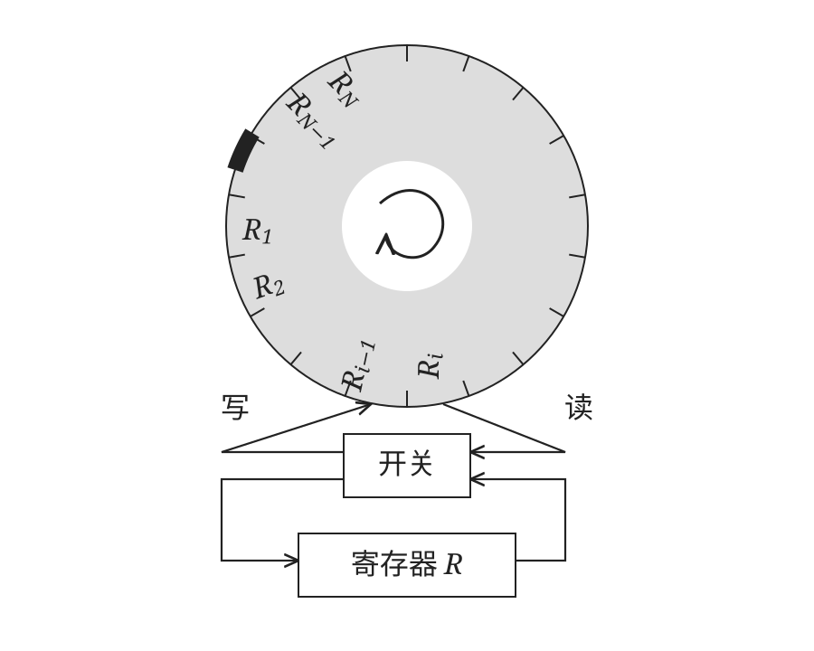

图 61　一种排序设备, 冒泡排序策略对它是最优的

考虑一台机器, 在多遍扫描中排序 $R_1R_2\ldots R_N$, 每遍扫描都包含以下 $N+1$ 步:

第 1 步. 令 $R\leftarrow R_1$. ($R$ 是机器内部寄存器.)

第 $i$ 步 ($1<i\le N$). 或者 (i) 令 $R_{i-1}\leftarrow R$, $R\leftarrow R_i$, 或者 (ii) 令 $R_{i-1}\leftarrow R_i$, 保持 $R$ 不变.

第 $N+1$ 步. 令 $R_N\leftarrow R$.

问题是找到一种方式, 每次在方案 (i) 和方案 (ii) 中选择, 使排序需要的扫描遍数最少.

试证明: “冒泡排序” 技术对于这个模型是最优的. 换句话说, 也就是要证明, 如果所采用的策略是: 每当 $R\le R_i$ 时选择方案 (i), 每当 $R>R_i$ 时选择方案 (ii), 就可以实现最少的扫描遍数.

> 织白布的都必羞愧.
>
> ——《以赛亚书》19:9
