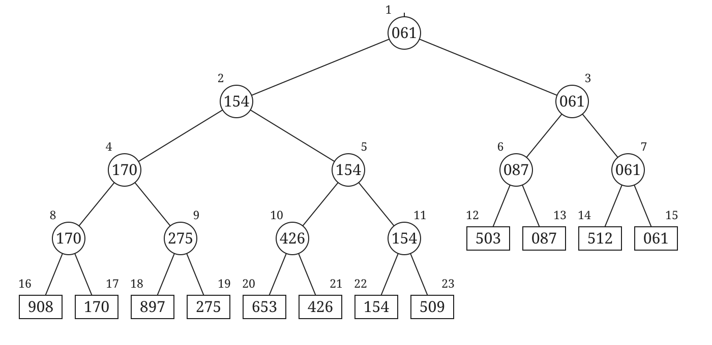
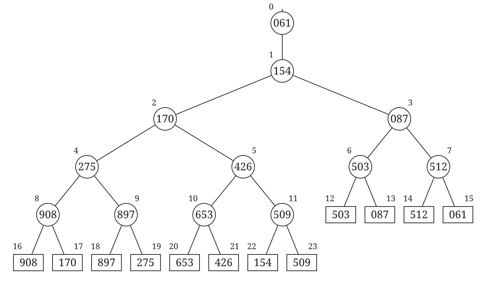
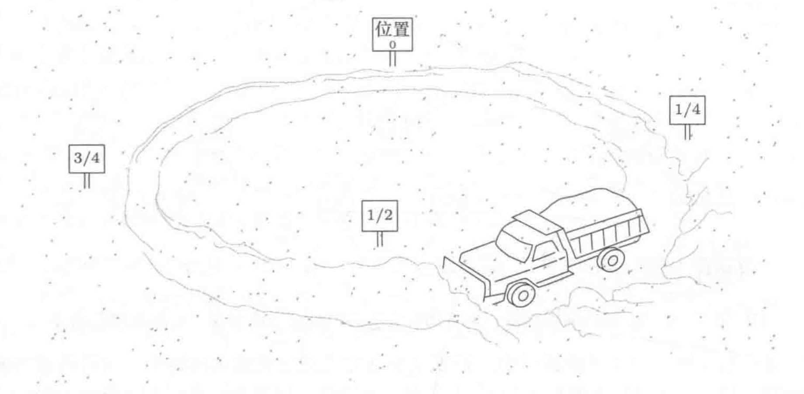
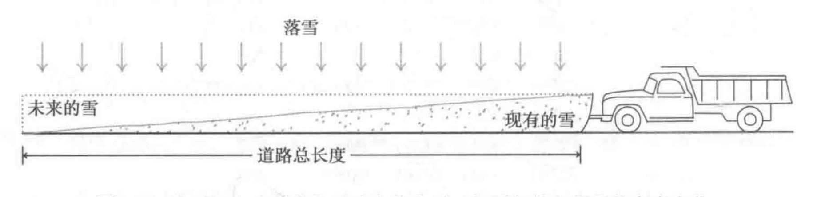
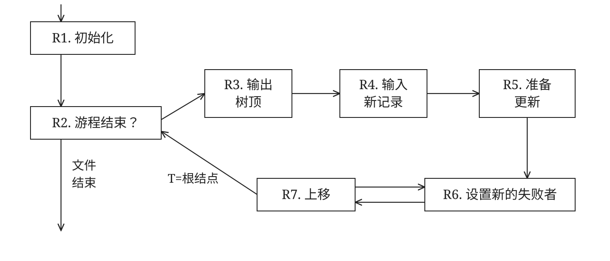
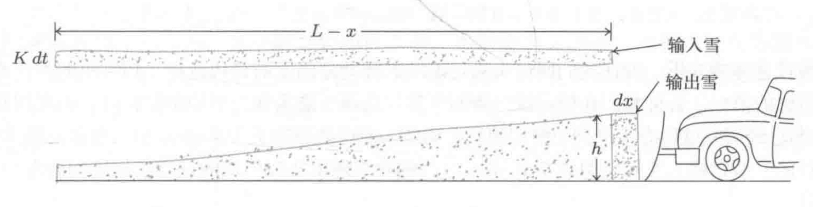
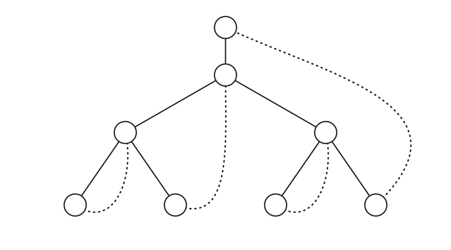

<a id="sec-5-4-1"></a>

### 5.4.1　多路合并和替代选择

5.2.4 节研究了基于两路合并的内部排序方法, 也就是把两个有序序列合并为一个有序序列的过程. 这个方法不难扩展为把 $P$ 个输入游程合并为一个输出游程的 $P$ 路合并概念.

给定 $P$ 个递增游程, 也就是键值保持非递减顺序的记录序列. 合并这些记录的明显方法是查看每个游程的第一条记录, 选择键值最小的记录, 输出这条记录, 然后从输入中删除它, 接下来重复这个过程. 在任意给定时刻, 我们只需要查看 $P$ 个键 (每个输入游程各一个), 并选取最小键. 如果有两个或多个最小键, 则任选其中一个.

当 $P$ 不是太大时, 可以很方便地进行这一选择: 只需要进行 $P-1$ 次比较, 找出当前键的最小值即可. 但当 $P$ 为 8 或更大时, 我们可以使用 5.2.3 节所述的选择树来减少工作量. 一旦建立了这种选择树, 每次只需要大约 $\lg P$ 次比较.

例如, 考虑采用两级选择树进行四路合并的情形:

第 1 步.

$$
087\left\{\begin{aligned}
087&\left\{\begin{aligned}&087\ 503\ \infty\\&170\ 908\ \infty\end{aligned}\right.\\
154&\left\{\begin{aligned}&154\ 426\ 653\ \infty\\&612\ \infty\end{aligned}\right.
\end{aligned}\right.
$$

第 2 步.

$$
087\ 154\left\{\begin{aligned}
170&\left\{\begin{aligned}&503\ \infty\\&170\ 908\ \infty\end{aligned}\right.\\
154&\left\{\begin{aligned}&154\ 426\ 653\ \infty\\&612\ \infty\end{aligned}\right.
\end{aligned}\right.
$$

第 3 步.

$$
087\ 154\ 170\left\{\begin{aligned}
170&\left\{\begin{aligned}&503\ \infty\\&170\ 908\ \infty\end{aligned}\right.\\
426&\left\{\begin{aligned}&426\ 653\ \infty\\&612\ \infty\end{aligned}\right.
\end{aligned}\right.
$$

$\vdots$

第 9 步.

$$
087\ 154\ 170\ 426\ 503\ 612\ 653\ 908\ \infty\left\{\begin{aligned}
\infty&\left\{\begin{aligned}&\infty\\&\infty\end{aligned}\right.\\
\infty&\left\{\begin{aligned}&\infty\\&\infty\end{aligned}\right.
\end{aligned}\right.
$$

在这个示例中, 每个游程的末尾都放置一个附加键 $\infty$, 使得合并过程能够优雅地结束. 由于外部排序通常会处理非常长的游程, 所以增加带有 $\infty$ 键的记录不会大幅增加数据的长度或合并过程所涉及的工作量, 这种 “标识” 记录经常用作在文件中界定游程的有用方法.

<a id="pdf-204"></a>
<a id="p-198"></a>

在这个过程中, 第 1 步之后的每一步都用游程中的后续元素代替最小元素, 并改变选择树中的相应路径. 于是, 第 1 步中包含 087 的三个位置在第 2 步中被改变, 第 2 步中包含 154 的三个位置在第 3 步中被改变, 以此类推. 用选择树中的一个键代替另一个键的过程称为替代选择.

我们通过几种方式来研究这种四路合并. 从一个角度来看, 它相当于像协同例程那样并发执行的三个两路合并, 选择树中的每个结点表示并发合并过程中涉及的序列之一. 选择树的运行方式在本质上就是一个采用 “最小者先出” 规则的优先队列.

我们可以像 5.2.3 节中那样使用堆而不是选择树来实现优先队列. (当然, 应反转式 5.2.3-(3) 中的顺序, 让最小元素而非最大元素出现在堆的顶端.) 由于堆的大小不是固定的, 从而可以避免使用 $\infty$ 键: 当堆变空时合并完成. 另一方面, 外部排序应用程序通常要处理较长的记录和键, 所以填入堆中的是指向键的指针而不是键本身. 下面将会看到, 可以采用一种非常方便的形式以指针来表示选择树, 在这种情形下它们可能优于堆.

<a id="pdf-205"></a>
<a id="p-199"></a>

**失败者之树.** 图 62 给出有 12 个外部 (矩形) 结点和 11 个内部 (圆形) 结点的完全二叉树. 把这棵树看作选择最小键的锦标赛, 外部结点填充键, 内部结点填充 “胜利者”. 每个结点上方的以小字号印刷的数, 表示以传统方式为完全二叉树分配的连续存储位置.

<a id="fig-5-4-1-62"></a>

<div class="source-tableau-group" style="max-width:100%;overflow-x:auto"></div>

图 62　使用完全二叉树选择最小键的锦标赛, 结点编号为 1 至 23, 有 $P=12$ 个外部结点

为了确定图 62 中选择树的新状态, 要用这棵树中的另一个键代替最小键 061, 我们必须查看键 512、087 和 154, 不必考虑其他键. 把这棵树看作一场锦标赛, 这三个键是在比赛中被 061 战胜的失败者. 这提示我们, 这棵树的内部结点中真正应该存储的是每次比赛的失败者而不是获胜者. 那样的话, 更新这棵树所需要的信息就已经准备就绪.

图 63 中的树与图 62 相同, 但其中给出了失败者而不是获胜者. 树的顶端追加了一个额外的 0 号结点, 指明锦标赛的冠军. 除冠军之外的每个键都恰好做过一次失败者 (见 5.3.3 节), 所以每个键都恰好在外部结点和内部结点中各出现一次.

<a id="fig-5-4-1-63"></a>

<div class="source-tableau-group" style="max-width:100%;overflow-x:auto"></div>

图 63　与图 62 相同的锦标赛, 但本图给出了失败者而非胜利者. 冠军出现在最顶端

在实践中, 图 63 底部的外部结点表示存储在计算机存储器中相当长的记录, 而内部结点表示指向这些记录的指针. 注意, $P$ 路合并恰好调用 $P$ 个外部结点和 $P$ 个内部结点, 它们位于连续存储单元, 于是很自然地就会想到几种高效的存储分配方法. 不难看出如何使用 “面向失败者” 的树来进行替代选择, 细节稍后讨论.

**替代选择的初始游程.** 如果我们对输入数据自身执行 $P$ 路合并, 则替代选择技术也可以用于外部排序的第一阶段. 在这种情况下, 可以把 $P$ 取得非常大, 使内部存储器基本上被填满. 输出一条记录之后, 它就被输入序列中的下一条记录代替. 如果新记录的键小于刚刚输出记录的键, 那么它不能包含在当前游程中. 否则以通常方式把它放到选择树中, 它将构成当前所生成游程的一部分. 于是每个游程能包含 $P$ 条以上的记录, 尽管在任意时刻选择树中的记录数都不会超过 $P$ 个. 表 1 给出 $P=4$ 时的这个过程, 括号中的数正等待被放入随后的游程中.


<a id="tab-5-4-1-1"></a>

表 1　四路替代选择示例

<table data-replacement-table="205"><thead><tr><th colspan="4">存储器内容</th><th>输出</th></tr></thead><tbody>
<tr data-replacement-state="0" style="height:42px">
<td data-memory="0" style="text-align:center;min-width:85px">503</td>
<td data-memory="1" style="text-align:center;min-width:85px">087</td>
<td data-memory="2" style="text-align:center;min-width:85px">512</td>
<td data-memory="3" style="text-align:center;min-width:85px">061</td>
<td data-output="true" style="text-align:center;min-width:120px">061</td></tr>
<tr data-replacement-state="1" style="height:42px">
<td data-memory="0" style="text-align:center;min-width:85px">503</td>
<td data-memory="1" style="text-align:center;min-width:85px">087</td>
<td data-memory="2" style="text-align:center;min-width:85px">512</td>
<td data-memory="3" style="text-align:center;min-width:85px">908</td>
<td data-output="true" style="text-align:center;min-width:120px">087</td></tr>
<tr data-replacement-state="2" style="height:42px">
<td data-memory="0" style="text-align:center;min-width:85px">503</td>
<td data-memory="1" style="text-align:center;min-width:85px">170</td>
<td data-memory="2" style="text-align:center;min-width:85px">512</td>
<td data-memory="3" style="text-align:center;min-width:85px">908</td>
<td data-output="true" style="text-align:center;min-width:120px">170</td></tr>
<tr data-replacement-state="3" style="height:42px">
<td data-memory="0" style="text-align:center;min-width:85px">503</td>
<td data-memory="1" style="text-align:center;min-width:85px">897</td>
<td data-memory="2" style="text-align:center;min-width:85px">512</td>
<td data-memory="3" style="text-align:center;min-width:85px">908</td>
<td data-output="true" style="text-align:center;min-width:120px">503</td></tr>
<tr data-replacement-state="4" style="height:42px">
<td data-memory="0" style="text-align:center;min-width:85px">(275)</td>
<td data-memory="1" style="text-align:center;min-width:85px">897</td>
<td data-memory="2" style="text-align:center;min-width:85px">512</td>
<td data-memory="3" style="text-align:center;min-width:85px">908</td>
<td data-output="true" style="text-align:center;min-width:120px">512</td></tr>
<tr data-replacement-state="5" style="height:42px">
<td data-memory="0" style="text-align:center;min-width:85px">(275)</td>
<td data-memory="1" style="text-align:center;min-width:85px">897</td>
<td data-memory="2" style="text-align:center;min-width:85px">653</td>
<td data-memory="3" style="text-align:center;min-width:85px">908</td>
<td data-output="true" style="text-align:center;min-width:120px">653</td></tr>
<tr data-replacement-state="6" style="height:42px">
<td data-memory="0" style="text-align:center;min-width:85px">(275)</td>
<td data-memory="1" style="text-align:center;min-width:85px">897</td>
<td data-memory="2" style="text-align:center;min-width:85px">(426)</td>
<td data-memory="3" style="text-align:center;min-width:85px">908</td>
<td data-output="true" style="text-align:center;min-width:120px">897</td></tr>
<tr data-replacement-state="7" style="height:42px">
<td data-memory="0" style="text-align:center;min-width:85px">(275)</td>
<td data-memory="1" style="text-align:center;min-width:85px">(154)</td>
<td data-memory="2" style="text-align:center;min-width:85px">(426)</td>
<td data-memory="3" style="text-align:center;min-width:85px">908</td>
<td data-output="true" style="text-align:center;min-width:120px">908</td></tr>
<tr data-replacement-state="8" style="height:42px">
<td data-memory="0" style="text-align:center;min-width:85px">(275)</td>
<td data-memory="1" style="text-align:center;min-width:85px">(154)</td>
<td data-memory="2" style="text-align:center;min-width:85px">(426)</td>
<td data-memory="3" style="text-align:center;min-width:85px">(509)</td>
<td data-output="true" style="text-align:center;min-width:120px">(游程结束)</td></tr>
<tr data-replacement-state="9" style="height:42px">
<td data-memory="0" style="text-align:center;min-width:85px">275</td>
<td data-memory="1" style="text-align:center;min-width:85px">154</td>
<td data-memory="2" style="text-align:center;min-width:85px">426</td>
<td data-memory="3" style="text-align:center;min-width:85px">509</td>
<td data-output="true" style="text-align:center;min-width:120px">154</td></tr>
<tr data-replacement-state="10" style="height:42px">
<td data-memory="0" style="text-align:center;min-width:85px">275</td>
<td data-memory="1" style="text-align:center;min-width:85px">612</td>
<td data-memory="2" style="text-align:center;min-width:85px">426</td>
<td data-memory="3" style="text-align:center;min-width:85px">509</td>
<td data-output="true" style="text-align:center;min-width:120px">275</td></tr>
<tr><td colspan="5" style="text-align:center">等等</td></tr></tbody></table>

哈罗德·苏厄德最早描述了构造初始游程的这个重要方法 [Master’s Thesis, Digital Computer Laboratory Report R-232 (Mass. Inst. of Technology, 1954), 29–30], 他给出的理由让人相信: 当应用于随机数据时, 这些游程中包含超过 $1.5P$ 条记录. 1950 年左右, 阿诺德·达米结合工程研究协会设计的一种特殊排序设备也提出这个思想, 但他没有发表. 弗兰德创造了 “替代选择” 这个名字 [*JACM* **3** (1956), 154], 他评论道: “我们无法用公式来表示所生成序列的预期长度, 但实验表明 $2P$ 是一个合理的预期.”

<a id="pdf-206"></a>
<a id="p-200"></a>

爱德华·穆尔发现一种巧妙方法, 表明 $2P$ 实际上就是预期的游程长度, 他把这种情形比作圆形道路上的扫雪机 [美国专利第 2983904 号 (1961), 第 3–4 栏]. 考虑图 64 所示情形: 雪片均匀地落在圆形道路上, 一台孤独的扫雪机持续不断地扫雪. 一旦落雪被扫离道路, 它就会从系统中消失. 道路上的各个点用实数 $x$ 编号 ($0\le x<1$), 落在位置 $x$ 处的雪表示键为 $x$ 的输入记录, 扫雪机表示替代选择的输出. 扫雪机的清扫速度与它所遇到的雪的高度成反比, 这个情形是完全平衡的, 即道路上的积雪总量在任意时刻都恰好为 $P$. 每当扫雪机通过位置 0 时, 就会在输出中生成新的游程.


<a id="fig-5-4-1-64"></a>

<div class="source-tableau-group" style="max-width:100%;overflow-x:auto"></div>

图 64　在无尽圆形道路上不停工作的扫雪机

系统运行一段时间之后, 靠直觉就可以清楚地感受到, 它将趋近一种稳定状态: 扫雪机以恒定速度运行 (因为轨道的圆形对称特性). 这意味着扫雪机遇到的雪总是恒定高度, 扫雪机前方的雪的高度线性下降, 如图 65 所示. 由此推出, 在一轮中清除的雪量 (也就是游程长度) 是任一时刻道路上雪量 (即 $P$) 的两倍.

<a id="fig-5-4-1-65"></a>

<div class="source-tableau-group" style="max-width:100%;overflow-x:auto"></div>

图 65　截面图, 当系统处于稳定状态时, 扫雪机前方积雪的高度变化

许多商业应用中的输入数据不是完全随机的, 它们已经存在某种程度的既定顺序. 因此, 替代选择方法生成的游程中所包含的记录数甚至有超过 $2P$ 条的趋势. 我们将会看到, 外部合并排序需要的时间在很大程度上取决于初始分布阶段生成的游程数, 因而替代选择就变得尤其令人期待. 由于存储器大小的限制, 其他类型的内部排序将会生成大约两倍之多的初始游程.

现在我们仔细考虑替代选择生成初始游程的过程. 1958 年, 约翰·沃尔特斯、詹姆斯·佩因特和马丁·扎克给出以下算法, 用于 Philco 2000 的合并排序程序. 它包含一种非常漂亮的方式, 用相当简单和一致的逻辑来初始化选择树、区分属于不同游程的记录、清空最后一个游程. (要正确处理替代选择生成的最后一个游程需要一点技巧, 它已经成为程序员的绊脚石.) 基本思想是把每个键看作一个对 $(S,K)$, 其中 $K$ 是原来的键, $S$ 是这条记录所属游程的编号. 按照字典序 ($S$ 为主键, $K$ 为次键) 排列这些扩展键, 就得到由替代选择生成的输出序列.

<a id="pdf-207"></a>
<a id="p-201"></a>

下面的算法使用包含 $P$ 个结点的数据结构表示选择树. 对于 $0\le j<P$, 假定第 $j$ 个结点 $X[j]$ 包含从 $\operatorname{LOC}(X[j])=L_0+cj$ 开始的 $c$ 个字, 它同时表示图 63 中的第 $j$ 号内部结点和第 $P+j$ 号外部结点. 每个结点中有以下几个字段:
$\mathtt{KEY}=$ 存储在这个外部结点中的键;

$\mathtt{RECORD}=$ 存储在这个外部结点中的记录 (包含 $\mathtt{KEY}$ 作为子字段);

$\mathtt{LOSER}=$ 指向存储在这个内部结点中的 “失败者” 的指针;

$\mathtt{RN}=$ 存储在这个外部结点中的记录的游程号;

$\mathtt{PE}=$ 指向树中这个外部结点上方的内部结点的指针;

$\mathtt{PI}=$ 指向树中这个内部结点上方的内部结点的指针.

例如, 当 $P=12$ 时, 图 63 中的第 5 号内部结点和第 17 号外部结点都用 $X[5]$ 表示, 字段 $\mathtt{KEY}=170$, $\mathtt{LOSER}=L_0+9c$ (第 21 号外部结点的地址), $\mathtt{PE}=L_0+8c$, $\mathtt{PI}=L_0+2c$.

字段 PE 和 PI 包含不变的值, 所以它们不必显式出现在存储器中. 然而, 外部排序的初始阶段有时跟不上输入／输出设备的速度, 也许值得把这些冗余值作为数据存储而不是每次重新计算它们.


<a id="pdf-208"></a>
<a id="p-202"></a>

<a id="alg-5-4-1-R"></a>

**算法 R (替代选择).** 算法逐次从输入文件中读取记录, 并把它们逐次写到输出文件中, 生成 RMAX 个游程, 每个游程的长度都不小于 $P$ (最后一个游程除外). 共有 $P\ge2$ 个结点 $X[0],\ldots,X[P-1]$, 拥有如上所述的字段.

**R1.[初始化.]** 置 $\mathtt{RMAX}\leftarrow0$, $\mathtt{RC}\leftarrow0$, $\mathtt{LASTKEY}\leftarrow\infty$, $\mathtt{Q}\leftarrow\operatorname{LOC}(X[0])$. (RC 是当前游程的编号, LASTKEY 是上次输出记录的键, LASTKEY 的初值应当大于任何可能存在的键. 见习题 8.) 对于 $0\le j<P$, 设定 $X[j]$ 的初始内容如下:

$$
\begin{aligned}
&\mathtt{J}\leftarrow\operatorname{LOC}(X[j]);\quad\mathtt{LOSER}(\mathtt{J})\leftarrow\mathtt{J};\quad\mathtt{RN}(\mathtt{J})\leftarrow0;\\
&\mathtt{PE}(\mathtt{J})\leftarrow\operatorname{LOC}(X[\lfloor(P+j)/2\rfloor]);\quad\mathtt{PI}(\mathtt{J})\leftarrow\operatorname{LOC}(X[\lfloor j/2\rfloor]).
\end{aligned}
$$

(考虑一个永远不会输出的虚拟 0 号游程, 人为设置 LOSER(J) 和 RN(J), 使树得以初始化. 这是一种技巧, 见习题 10.)

**R2.[游程结束?]** 如果 $\mathtt{RN}(\mathtt{Q})=\mathtt{RC}$, 则转到 R3. (否则, $\mathtt{RN}(\mathtt{Q})=\mathtt{RC}+1$, 这时我们刚刚完成第 RC 号游程. 排序过程后续扫描的合并模式所需要的任何特殊操作都将在这里完成.) 如果 RC=RMAX 则停止, 否则置 $\mathtt{RC}\leftarrow\mathtt{RC}+1$.

**R3.[输出树顶.]** (现在 Q 指向 “冠军”, 而且 RN(Q)=RC.) 如果 $\mathtt{RC}\ne0$, 则输出 RECORD(Q), 置 $\mathtt{LASTKEY}\leftarrow\mathtt{KEY}(\mathtt{Q})$.

**R4.[输入新记录.]** 如果输入文件穷尽, 则置 $\mathtt{RN}(\mathtt{Q})\leftarrow\mathtt{RMAX}+1$, 转到 R5. 否则, 置 RECORD(Q) 为输入文件中的下一条记录. 如果 $\mathtt{KEY}(\mathtt{Q})<\mathtt{LASTKEY}$ (于是这条新记录不属于当前游程), 则置 $\mathtt{RMAX}\leftarrow\mathtt{RN}(\mathtt{Q})\leftarrow\mathtt{RC}+1$.

**R5.[准备更新.]** (现在 Q 指向一条新记录.) 置 $\mathtt{T}\leftarrow\mathtt{PE}(\mathtt{Q})$. (T 是一个指针变量, 将向树的顶端移动.)

**R6.[设置新的失败者.]** 置 $\mathtt{L}\leftarrow\mathtt{LOSER}(\mathtt{T})$. 如果 $\mathtt{RN}(\mathtt{L})<\mathtt{RN}(\mathtt{Q})$, 或者 RN(L)=RN(Q) 且 $\mathtt{KEY}(\mathtt{L})<\mathtt{KEY}(\mathtt{Q})$, 则置 $\mathtt{LOSER}(\mathtt{T})\leftarrow\mathtt{Q}$, $\mathtt{Q}\leftarrow\mathtt{L}$. (变量 Q 跟踪当前获胜者.)

**R7.[上移.]** 如果 $\mathtt{T}=\operatorname{LOC}(X[1])$ 则返回 R2, 否则, 置 $\mathtt{T}\leftarrow\mathtt{PI}(\mathtt{T})$, 返回 R6. $\blacksquare$

<a id="fig-5-4-1-66"></a>

<div class="source-tableau-group" style="max-width:100%;overflow-x:auto"></div>

图 66　用替代选择生成初始游程

算法 R 中的输入和输出一次仅涉及一条记录, 在实践中最好读取和写入较大的记录块. 因此, 实际的存储器中存在一些输入与输出缓冲区, 在幕后有效地降低了 $P$ 的大小. 我们将在 5.4.6 节对此进行介绍.

**\*游程的延迟重构.** 罗伯特·丁斯莫尔使用自由度的概念提出一种非常重要的替代选择改进方法 [*CACM* **8** (1965), 48]. 我们已经看到, 磁带上一个游程内的每个记录块都是非递减顺序的, 亦即第一个元素最小, 最后一个元素最大. 在通常的替代选择过程中, 一个游程中每个块的最小元素永远都不会小于这个游程中前一块的最大元素, 这是 “一个自由度”. 丁斯莫尔建议把这一条件放宽到 “$m$ 个自由度”, 其中每个块的最小元素可以小于前一块的最大元素, 只要它不小于同一游程中 $m$ 个不同先前块中的最大元素即可. 和以前一样, 各个块内的记录是有序的, 但相邻块之间不一定是有序的.

假定每个块恰有两条记录, 块序列

$$
\mid08\ 50\mid06\ 90\mid17\ 27\mid42\ 67\mid51\ 89\mid\tag{1}
$$

是具有三个自由度的游程. 如果要作为这个游程的后续块, 它的开头元素不能小于 $\{50,90,27,67,89\}$ 中的第三大元素, 也就是 67. 如果只有两个自由度, 序列 (1) 将不是一个游程, 因为 17 小于 50 和 90.

在下一排序阶段读取具有 $m$ 个自由度的游程时, 可以对它进行 “重建”, 使得对于所有实用目的它都是通常意义上的游程. 我们首先把前 $m$ 块读入 $m$ 个缓冲区, 然后对它们进行 $m$ 路合并, 当一个缓冲区穷尽时, 用第 $m+1$ 块代替它, 以此类推. 以这种方式, 我们可以把这个游程恢复成单一序列, 使得每个新读取块的第一个字都必须大于等于刚穷尽块的最后一个字 (以免它小于前面 $m$ 个不同块的最大元素). 这种重建游程的方法本质上就像是使用一台磁带机对所有输入块进行 $m$ 路合并! 这个重建过程相当于一个协同例程, 调用它可以每次提交游程的一条记录. 我们可以重建来自不同磁带机的具有不同自由度的不同游程, 然后合并得到的游程, 所有这些都是同时进行的, 就好像本节开头介绍的四路合并可以看作是几个同时执行的两路合并.

这一具有独创精神的思想很难进行准确分析, 但泰耶·埃斯佩里得说明了如何通过扩展扫雪机类比获得上述特性的近似公式 [*BIT* **16** (1976), 133–142]. 他的近似公式与实验测试非常吻合. 根据这个公式, 当 $b$ 是块的大小且 $m\ge2$ 时, 游程长度大约是

$$
2P+(m-1.5)\left(\frac{2P+(m-2)b}{2P+(2m-3)b}\right)b.
$$

游程长度的这个增长幅度尚不足以证明所增加的复杂度是合理的. 另一方面, 在第二个排序阶段, 如果有足够的空间可以容纳相当大量的缓冲区, 可能会是有利的.

<a id="pdf-209"></a>
<a id="p-203"></a>

**\*自然选择.** 弗雷泽和黄泽权研究了增大替代选择方法生成的游程长度的另外一种方法 [*CACM* **15** (1972), 910–913]. 他们的思想是像算法 R 那样做, 但当一条新记录的键小于 LASTKEY 时, 不是把它放入树中, 而是输出到一个外部存储库, 并读入另一条新记录. 这个过程持续进行, 直到存储库被一定数量的 ($P'$ 条) 记录充满. 现在从树中输出当前游程的其余元素, 而存储库中的项目作为下一游程的输入元素.


与替代选择法相比, 使用存储库时生成的游程通常会更长一些, 因为它调整了属于下一游程的 “死亡” 记录的行进路径, 没有把它们胡乱堆在树中. 但存储库的输入与输出都需要增加时间. 当 $P'>P$ 时某些记录有可能会被两次放入存储库中, 但当 $P'\le P$ 时肯定不会发生这种情况.

弗雷泽和黄泽权对他们的方法进行了大量实验测试, 注意到当 $P$ 相当大 (比如 $P\ge32$) 且 $P'=P$ 时, 随机数据的平均游程长度近似由 $eP$ 给出, 其中 $e\approx2.718$ 是自然对数的底. 由于这个现象, 以及该方法对简单替代选择进行了渐进改良这一事实, 他们很自然地把这个方法称为自然选择.

<a id="fig-5-4-1-67"></a>

<div class="source-tableau-group" style="max-width:100%;overflow-x:auto"></div>

图 67　输入输出的雪量相等, 扫雪机在时间 $dt$ 内移动 $dx$

再次考虑图 64 中的扫雪机, 并应用初等微积分, 可以证明游程长度的 “自然” 定律. 设 $L$ 是道路的长度, $x(t)$ 是扫雪机在时刻 $t$($0\le t\le T$) 的位置. 假定存储库在时刻 $T$ 是满的, 这时雪暂时停止, 扫雪机返回起点 (清除了道路上剩下的 $P$ 单位的雪). 这个情形与前面相同, 只是 “平衡条件” 发生了变化. 道路上的积雪并非在所有时刻都是 $P$ 单位, 而是在扫雪机前方有 $P$ 单位的雪, 存储库 (扫雪机后方) 达到 $P'=P$ 单位. 扫雪机在 $dt$ 时间内前进 $dx$, 输出 $h(x,t)\,dx$ 条记录, 其中 $h(x,t)$ 是时刻 $t$、位置 $x=x(t)$ 处的积雪高度, 采用适当单位测得. 因此, 对于所有 $x$ 都有 $h(x,t)=h(x,0)+Kt$, 其中 $K$ 是下雪的速度. 由于存储器中的记录数保持恒定, $h(x,t)\,dx$ 也是在扫雪机前方输入的记录数, 即 $K\,dt\,(L-x)$ (见图 67). 于是

$$
\frac{dx}{dt}=\frac{K(L-x)}{h(x,t)}.\tag{2}
$$

幸运的是, 只要 $x=x(t)$ 且 $0\le t\le T$, $h(x,t)$ 就为恒定值, 等于 $KT$, 这是因为雪匀速下降的时间为扫雪机通过位置 $x(t)$ 后的 $T-t$ 个时间单位, 再加上它返回之前的 $t$ 个时间单位. 换句话说, 假定已经达到稳定状态, 扫雪机的每次行程都是相同的, 则扫雪机在行程中遇到的积雪都是同一高度. 因此, 所清扫积雪的总量 (游程长度) 是 $LKT$, 存储器中的积雪数量等于时刻 $T$ 之后清除的数量, 即 $KT(L-x(T))$. 式 (2) 的解中, 满足 $x(0)=0$ 的是

$$
x(t)=L(1-e^{-t/T});\tag{3}
$$

因此, $P=LKTe^{-1}=\text{(游程长度)}/e$, 这就是我们要证明的.

习题 21 至 23 表明, 这个分析可以扩展到 $P'$ 取一般值的情形. 例如, 当 $P'=2P$ 时, 平均游程长度是 $e^\theta(e-\theta)P$, 式中 $\theta=(e-\sqrt{e^2-4})/2$, 这个结果可不是能够随便猜到的! 表 2 展示了游程长度对存储库大小的依赖关系, 参考这个表格, 可以估计自然选择在给定计算机环境中的有用性. 表格中对于存储库大小 $<P$ 的各项使用了习题 27 中讨论的改进技术.

延迟游程重建及自然选择的思想可以结合在一起, 丁子锦和王亚威对此进行了讨论 [*Comp. J.* **20** (1977), 298–301].

<a id="pdf-210"></a>
<a id="p-204"></a>

<a id="tab-5-4-1-2"></a>

表 2　自然选择的游程长度

<table data-natural-run-table="210"><thead><tr>
<th style="text-align:center;min-width:115px">存储库大小</th>
<th style="text-align:center;min-width:115px">游程长度</th>
<th style="text-align:center;min-width:115px">$k+\theta$</th>
<th style="text-align:center;min-width:115px">存储库大小</th>
<th style="text-align:center;min-width:115px">游程长度</th>
<th style="text-align:center;min-width:115px">$k+\theta$</th>
</tr></thead><tbody>
<tr data-natural-row="0" style="height:45px">
<td style="text-align:center">$0.10000P$</td>
<td style="text-align:center">$2.15780P$</td>
<td style="text-align:center">0.32071</td>
<td style="text-align:center">$0.00000P$</td>
<td style="text-align:center">$2.00000P$</td>
<td style="text-align:center">0.00000</td>
</tr>
<tr data-natural-row="1" style="height:45px">
<td style="text-align:center">$0.50000P$</td>
<td style="text-align:center">$2.54658P$</td>
<td style="text-align:center">0.69952</td>
<td style="text-align:center">$0.43428P$</td>
<td style="text-align:center">$2.50000P$</td>
<td style="text-align:center">0.65348</td>
</tr>
<tr data-natural-row="2" style="height:45px">
<td style="text-align:center">$1.00000P$</td>
<td style="text-align:center">$2.71828P$</td>
<td style="text-align:center">1.00000</td>
<td style="text-align:center">$1.30432P$</td>
<td style="text-align:center">$3.00000P$</td>
<td style="text-align:center">1.15881</td>
</tr>
<tr data-natural-row="3" style="height:45px">
<td style="text-align:center">$2.00000P$</td>
<td style="text-align:center">$3.53487P$</td>
<td style="text-align:center">1.43867</td>
<td style="text-align:center">$1.95014P$</td>
<td style="text-align:center">$3.50000P$</td>
<td style="text-align:center">1.42106</td>
</tr>
<tr data-natural-row="4" style="height:45px">
<td style="text-align:center">$3.00000P$</td>
<td style="text-align:center">$4.16220P$</td>
<td style="text-align:center">1.74773</td>
<td style="text-align:center">$2.72294P$</td>
<td style="text-align:center">$4.00000P$</td>
<td style="text-align:center">1.66862</td>
</tr>
<tr data-natural-row="5" style="height:45px">
<td style="text-align:center">$4.00000P$</td>
<td style="text-align:center">$4.69446P$</td>
<td style="text-align:center">2.01212</td>
<td style="text-align:center">$4.63853P$</td>
<td style="text-align:center">$5.00000P$</td>
<td style="text-align:center">2.16714</td>
</tr>
<tr data-natural-row="6" style="height:45px">
<td style="text-align:center">$5.00000P$</td>
<td style="text-align:center">$5.16369P$</td>
<td style="text-align:center">2.24938</td>
<td style="text-align:center">$21.72222P$</td>
<td style="text-align:center">$10.00000P$</td>
<td style="text-align:center">4.66667</td>
</tr>
<tr data-natural-row="7" style="height:45px">
<td style="text-align:center">$10.00000P$</td>
<td style="text-align:center">$7.00877P$</td>
<td style="text-align:center">3.17122</td>
<td style="text-align:center">$5.29143P$</td>
<td style="text-align:center">$5.29143P$</td>
<td style="text-align:center">2.31329</td>
</tr>
</tbody></table>

量 $k+\theta$ 在习题 22 中定义, 或 (当 $k=0$ 时) 在习题 27 中定义.

**\*替代选择的分析.** 现在我们回过头来讨论没有辅助存储库的替代选择. 扫雪机的类比给出一个相当好的指标, 告诉我们在稳定状态限制下替代选择所能实现的平均游程长度, 但利用我们在 5.1.3 节已经研究过的有关排列中游程的相关事实, 有可能获得关于算法 R 的一些更准确的信息. 为此目的, 假定输入文件是由介于 0 和 1 之间的独立随机实数组成的任意长的序列会方便一些. 设

$$
g_P(z_1,z_2,\ldots,z_k)=\sum_{l_1,l_2,\ldots,l_k\ge0}a_P(l_1,l_2,\ldots,l_k)z_1^{l_1}z_2^{l_2}\ldots z_k^{l_k}
$$

是对这样一个文件应用 $P$ 路替代选择所得游程长度的生成函数, 其中, $a_P(l_1,l_2,\ldots,l_k)$ 是第一个游程长度为 $l_1$, 第二个长度为 $l_2$, $\ldots$, 第 $k$ 个长度为 $l_k$ 的概率. 以下 “独立性定理” 是一个基本定理, 因为它可以把这个分析化简为 $P=1$ 的情形:

<a id="thm-5-4-1-K"></a>

**定理 K.** $g_P(z_1,z_2,\ldots,z_k)=g_1(z_1,z_2,\ldots,z_k)^P$.

**证明.** 设输入键为 $K_1,K_2,K_3,\ldots$. 根据它们在树中占据的外部结点位置, 算法 R 把它们划分为 $P$ 个子序列. 包含 $K_n$ 的子序列由 $K_1,\ldots,K_{n-1}$ 的取值确定. 因此这些子序列都是由介于 0 和 1 之间独立随机数组成的独立序列. 进而, 替代选择的输出就是通过对这些子序列进行 $P$ 路合并获得的结果. 一个元素属于一个子序列的第 $j$ 个游程, 当且仅当它属于替代选择生成的第 $j$ 个游程 (因为 LASTKEY 和 KEY(Q) 在步骤 R4 中属于同一个子序列).

换句话说, 我们不妨假定正在向 $P$ 个独立随机输入文件应用算法 R, 而且步骤 R4 从与外部结点 Q 对应的文件中读取下一条记录. 就这一意义来说, 该算法等价于一种 $P$ 路合并, 以 “下降点” 标志游程的末尾.

于是, 输出中拥有长度为 $(l_1,\ldots,l_k)$ 的游程, 当且仅当这些子序列中拥有长度分别为 $(l_{11},\ldots,l_{1k}),\ldots,(l_{P1},\ldots,l_{Pk})$ 的游程, 其中 $l_{ij}$ 是满足 $\sum_{1\le i\le P}l_{ij}=l_j$($1\le j\le k$) 的某些非负整数. 由此得到

$$
a_P(l_1,\ldots,l_k)=\sum_{\substack{l_{11}+\cdots+l_{P1}=l_1\\\vdots\\l_{1k}+\cdots+l_{Pk}=l_k}}a_1(l_{11},\ldots,l_{1k})\ldots a_1(l_{P1},\ldots,l_{Pk}),
$$

这等价于所求的结果. $\blacksquare$

<a id="pdf-211"></a>
<a id="p-205"></a>

我们已经在 5.1.3 节讨论了当 $P=1$ 时第 $k$ 个游程的平均长度 $L_k$, 表 5.1.3-2 列出了这些值. 由定理 K 可知, 对于一般的 $P$ 值而言, 第 $k$ 个游程的平均长度是 $P=1$ 时平均长度的 $P$ 倍 (即 $L_kP$), 方差也是 $P=1$ 时的 $P$ 倍, 所以游程长度的标准差与 $\sqrt P$ 成正比. 大约在 1958 年, 加斯纳最早得出这些结果.


因此, 对于随机数据, 算法 R 生成的第一个游程的长度大约为 $(e-1)P\approx1.718P$ 条记录; 第二个游程的长度大约为 $(e^2-2e)P\approx1.952P$ 条记录; 第三个大约为 $1.996P$; 后续游程的长度将非常接近于 $2P$ 条记录, 直到最后两个游程 (见习题 14). 这些游程长度的大多数标准差近似为 $\sqrt{(4e-10)P}\approx0.934\sqrt P$[*CACM* **6** (1963), 685–688]. 此外, 习题 5.1.3-10 表明, 前 $k$ 个游程的总长度相当接近于 $(2k-\tfrac13)P$, 标准差为 $((\tfrac23k+\tfrac29)P)^{1/2}$. 在习题 5.1.3-9 和 11 中推导了它们的生成函数 $g_1(z,z,\ldots,z)$ 和 $g_1(1,\ldots,1,z)$.

上述分析已经假定输入文件是无限长的, 但定理 K 的证明表明: 在任何一个至少包含 $l_1+\cdots+l_k+P$ 个元素的随机输入序列中, 都可以获得相同的概率 $a_p(l_1,\ldots,l_k)$. 就标准差较小而言, 上述结果也适用于大小为 $N>(2k+1)P$ 的文件.

我们将会看到一些应用, 其中的合并模式希望一些游程为递增的, 而另外一些为递减的. 在递增游程的末尾, 存储器累积的剩余内容中所包含的数, 平均来说会小于随机数据, 因此, 顺序方向的改变会缩短游程的平均长度. 例如, 考虑一台扫雪机, 它在每次到达一条直路的终点时都必须进行一个 U 型转弯, 它会非常快速地通过刚刚扫过的区域. 当反转方向时, 随机数据的游程长度将在 $1.5P$ 和 $2P$ 之间变动 (见习题 24).

#### 习题

<a id="ex-5-4-1-1"></a>

**1. [10]** 在本节开头四路合并的示例中, 第 4 步是什么?　[答案](./answers/5-4-1.md#ans-5-4-1-1)

<a id="ex-5-4-1-2"></a>

**2. [12]** 在图 63 的树中, 如果键 061 被 612 代替, 这棵树将有哪些改变?　[答案](./answers/5-4-1.md#ans-5-4-1-2)

<a id="ex-5-4-1-3"></a>

**3. [16]** (穆尔) 四路替代选择应用于以下输入序列时, 会生成什么样的输出:　[答案](./answers/5-4-1.md#ans-5-4-1-3)

```text
fourscore and seven years ago our fathers brought forth
on this continent a new nation conceived in liberty and
dedicated to the proposition that all men are created equal.
```

(使用通常的字母顺序, 每个单词看作一个键.)

<a id="ex-5-4-1-4"></a>

**4. [16]** 使用容量为 4 的存储库, 把四路自然选择应用于习题 3 中的输入序列.　[答案](./answers/5-4-1.md#ans-5-4-1-4)

<a id="ex-5-4-1-5"></a>

**5. [00]** 判断正误: 仅当 $P$ 是 2 的幂或者是两个 2 的幂之和时, 使用树的替代选择才有效.　[答案](./answers/5-4-1.md#ans-5-4-1-5)

<a id="ex-5-4-1-6"></a>

**6. [15]** 算法 R 规定 $P$ 必须 $\ge2$, 对算法进行哪些较小改动可以使它对所有 $P\ge1$ 有效?　[答案](./answers/5-4-1.md#ans-5-4-1-6)

<a id="ex-5-4-1-7"></a>

**7. [17]** 当根本没有输入时算法 R 做些什么?　[答案](./answers/5-4-1.md#ans-5-4-1-7)

<a id="ex-5-4-1-8"></a>

**8. [20]** 算法 R 利用了一个必须大于任何可能键的虚拟键 $\infty$. 证明: 如果真有一个键等于 $\infty$, 算法可能会失败, 并解释在不方便实现真正的 $\infty$ 时, 如何修改该算法.　[答案](./answers/5-4-1.md#ans-5-4-1-8)

<a id="ex-5-4-1-9"></a>

**▶ 9. [23]** 如何修改算法 R, 使某些指定游程 (取决于 RC) 以增序输出, 其他游程以降序输出?　[答案](./answers/5-4-1.md#ans-5-4-1-9)

<a id="ex-5-4-1-10"></a>

**10. [26]** 在算法 R 的步骤 R1 中, LOSER 指针的初始设置通常不会对应于任何实际锦标赛, 因为外部结点 $P+j$ 可能不位于内部结点 $j$ 下方的子树中. 解释算法 R 为什么仍然有效. [提示: 如果在步骤 R1 中, 把 $\{\mathtt{LOSER}(\operatorname{LOC}(X[0])),\ldots,\mathtt{LOSER}(\operatorname{LOC}(X[P-1]))\}$ 设置为 $\{\operatorname{LOC}(X[0]),\ldots,\operatorname{LOC}(X[P-1])\}$ 的任意一个排列, 算法是否有效?]　[答案](./answers/5-4-1.md#ans-5-4-1-10)

<a id="ex-5-4-1-11"></a>

**11. [M20]** 判断正误: 假定输入数据随机, 算法 R 的步骤 R4 中 $\mathtt{KEY}(\mathtt{Q})<\mathtt{LASTKEY}$ 的概率近似为 50%.　[答案](./answers/5-4-1.md#ans-5-4-1-11)

<a id="ex-5-4-1-12"></a>

**12. [M46]** 详细分析算法 R 每一部分的执行次数. 例如, 在步骤 R6 中执行 $\mathtt{LOSER}\leftarrow\mathtt{Q}$ 的频率是多少?

<a id="ex-5-4-1-13"></a>

**13. [13]** 替代选择生成的第二个游程通常长于第一个游程, 这是为什么?　[答案](./answers/5-4-1.md#ans-5-4-1-13)

<a id="ex-5-4-1-14"></a>

**▶ 14. [HM25]** 利用扫雪机的类比, 估计对一个很长的输入数据序列应用替代选择时生成的最后两个游程的平均长度.　[答案](./answers/5-4-1.md#ans-5-4-1-14)

<a id="pdf-212"></a>
<a id="p-206"></a>

<a id="ex-5-4-1-15"></a>

**15. [20]** 判断正误: 替代选择生成的最后一个游程中的记录数永远不会超过 $P$ 条. 对你的回答进行讨论.　[答案](./answers/5-4-1.md#ans-5-4-1-15)

<a id="ex-5-4-1-16"></a>

**16. [M26]** 给出一个 “简单” 的充分必要条件, 使 $P$ 路替代选择可以在一遍扫描中对文件 $R_1R_2\ldots R_N$ 完全排序. 当输入是 $\{1,2,\ldots,N\}$ 的随机排列时, 发生这种情况的概率是多少? (表示为 $P$ 和 $N$ 的函数.)　[答案](./answers/5-4-1.md#ans-5-4-1-16)

<a id="ex-5-4-1-17"></a>

**17. [20]** 当输入键具有递减顺序 $K_1>K_2>\cdots>K_N$ 时, 算法 R 输出什么样的内容?　[答案](./answers/5-4-1.md#ans-5-4-1-17)

<a id="ex-5-4-1-18"></a>

**▶ 18. [22]** 如果向算法 R 生成的输出文件再次应用算法 R, 会发生什么?　[答案](./answers/5-4-1.md#ans-5-4-1-18)

<a id="ex-5-4-1-19"></a>

**19. [HM22]** 利用扫雪机类比, 证明替代选择生成的第一个游程长度近似为 $(e-1)P$ 条记录.　[答案](./answers/5-4-1.md#ans-5-4-1-19)

<a id="ex-5-4-1-20"></a>

**20. [HM24]** 当 $P=P'$ 时自然选择生成的第一个游程长度近似为多少?　[答案](./answers/5-4-1.md#ans-5-4-1-20)

<a id="ex-5-4-1-21"></a>

**▶ 21. [HM23]** 试确定当 $P'<P$ 时自然选择生成的游程的近似长度.　[答案](./answers/5-4-1.md#ans-5-4-1-21)

<a id="ex-5-4-1-22"></a>

**22. [HM40]** 这一习题的目的是确定当 $P'>P$ 时, 自然选择所获得的平均游程长度. 设 $\kappa=k+\theta$ 是 $\ge1$ 的实数, 其中 $k=\lfloor\kappa\rfloor$ 且 $\theta\equiv\kappa\bmod1$, 考虑函数 $F(\kappa)=F_k(\theta)$, 其中 $F_k(\theta)$ 是由生成函数　[答案](./answers/5-4-1.md#ans-5-4-1-22)

$$
\sum_{k\ge0}F_k(\theta)z^k=e^{-\theta z}/(1-ze^{1-z})
$$

定义的多项式. 于是, $F_0(\theta)=1$, $F_1(\theta)=e-\theta$, $F_2(\theta)=e^2-e-e\theta+\tfrac12\theta^2$, 等等.

假定一台扫雪机在时刻 0 启动, 开始模拟自然选择的过程, 并假定在 $T$ 个时间单位之后, 恰好 $P$ 单位的雪片落在它的后面. 这时, 第二台扫雪机开始同一行程, 在时刻 $t+T$ 占据第一台扫雪机在时刻 $t$ 的位置. 最后, 在时刻 $\kappa T$, 恰有 $P'$ 单位的雪片落在第一台扫雪机的后面, 它立即清扫剩余道路, 然后消失.

利用这个模型表示自然选择的过程, 证明: 当

$$
P'/P=k+1+e^\theta\left(\kappa F(\kappa)-\sum_{j=0}^kF(\kappa-j)\right)
$$

时所获得的游程长度等于 $e^\theta F(\kappa)P$.

<a id="ex-5-4-1-23"></a>

**23. [HM35]** 上题在分析自然选择时假定存储库中的记录总是按照它们写入时的顺序读取 (即 “先进先出” 方式). 如果来自前一游程的存储库内容是以完全随机的顺序读取的, 就好像存储库中的记录已经在游程之间进行了彻底洗牌, 试求这种情况下获得的近似游程长度.　[答案](./answers/5-4-1.md#ans-5-4-1-23)


<a id="pdf-213"></a>
<a id="p-207"></a>

<a id="ex-5-4-1-24"></a>

**24. [HM39]** 本题的目的是分析在替代选择中偶尔改变游程方向所导致的后果.　[答案](./answers/5-4-1.md#ans-5-4-1-24)

(a) 设 $g_P(z_1,z_2,\ldots,z_k)$ 是如同定理 K 中定义的生成函数, 但 $k$ 个游程中的每个游程都被指明是增序还是降序. 例如, 我们可以说所有奇数编号的游程都是增序的, 所有偶数编号的游程都是降序的. 证明: 对于这种类型的 $2^k$ 个生成函数中的每一个, 定理 K 都是有效的.

(b) 作为 (a) 的推论, 我们可以假定 $P=1$. 还假定输入是介于 0 和 1 之间的独立随机数的均匀分布序列. 设

$$
a(x,y)=\begin{cases}e^{1-x}-e^{y-x},&x\le y;\\e^{1-x},&x>y.\end{cases}
$$

给定 $f(x)\,dx$ 是某个特定递增游程以 $x$ 开头的概率, 证明: $(\int_0^1a(x,y)f(x)\,dx)\,dy$ 是随后游程以 $y$ 开头的概率. [提示: 对于每个 $n\ge0$, 考虑在给定 $x$ 和 $y$ 时 $x\le X_1\le\cdots\le X_n>y$ 的概率.]

(c) 考虑游程以概率 $p$ 改变方向. 换句话说, 第一个游程之后每个游程的方向为随机选择, 有 $q=(1-p)$ 的机会与前一游程相同, 具有相反方向的机会为 $p$. (于是, 当 $p=0$ 时所有游程的方向相同, 当 $p=1$ 时游程的方向每次都改变, 而当 $p=\tfrac12$ 时这些游程的方向是独立随机的.) 设

$$
f_1(x)=1,\quad f_{n+1}(y)=p\int_0^1a(x,y)f_n(1-x)\,dx+q\int_0^1a(x,y)f_n(x)\,dx.
$$

证明: 第 $n$ 个游程以 $x$ 开头的概率在第 $n-1$ 个游程为增序时的概率为 $f_n(x)\,dx$, 在第 $n-1$ 个游程为降序时的概率为 $f_n(1-x)\,dx$.
(d) 求以下稳态方程的解 $f$:

$$
f(y)=p\int_0^1a(x,y)f(1-x)\,dx+q\int_0^1a(x,y)f(x)\,dx,\quad\int_0^1f(x)\,dx=1.
$$

[提示: 证明 $f''(x)$ 独立于 $x$.]

(e) 证明: (c) 中的序列 $f_n(x)$ 相当快速地收敛于 (d) 中的函数 $f(x)$.

(f) 证明: 以 $x$ 开头的递增游程的平均长度是 $e^{1-x}$.

(g) 最后, 把所有这些结果结合起来, 证明以下定理: 如果替代选择中连续游程的方向以概率 $p$ 独立逆转, 则平均游程长度趋近于 $(6/(3+p))P$.

(高德纳最先推导这个定理的 $p=1$ 的情形 [*CACM* **6** (1963), 685–688]. 1970 年, 艾伦·康海姆最先证明 $p=\tfrac12$ 的情形.)


<a id="ex-5-4-1-25"></a>

**25. [HM40]** 考虑以下过程:

**N1.** 读一条记录到一个单字 “存储库”, 然后读入另一条记录 R, 令它的键为 K.

**N2.** 输出存储库, 令它的键为 LASTKEY, 然后清空存储库.

**N3.** 如果 $\mathtt{K}<\mathtt{LASTKEY}$, 则输出 R 并置 $\mathtt{LASTKEY}\leftarrow\mathtt{K}$, 然后转到 N5.

**N4.** 如果存储库非空, 则返回 N2; 否则把 R 读入存储库.

**N5.** 读入一条新记录 R, 令它的键为 K, 转到 N3. $\blacksquare$

这实际上等价于 $P=1$ 且 $P'=1$ 或 2 (取决于是在存储库充满时清空它, 还是在将要溢出时清空它) 的自然选择, 只是它生成的是递减游程, 而且绝不停止. 对于本题的目的来说, 后者的异常情况是方便且无害的假定.

像习题 24 那样处理, 设 $f_n(x,y)\,dy\,dx$ 是恰在第 $n$ 次执行步骤 N2 之后 LASTKEY 和 K 的值分别为 $x$ 和 $y$ 的概率. 证明: 存在单变量函数 $g_n(x)$, 使得当 $x<y$ 时 $f_n(x,y)=g_n(x)$, 当 $x>y$ 时 $f_n(x,y)=g_n(x)-e^{-y}(g_n(x)-g_n(y))$. 函数 $g_n(x)$ 由以下关系式定义: $g_1(x)=1$,

$$
\begin{aligned}
g_{n+1}(x)={}&\int_0^xe^ug_n(u)\,du+\int_0^xdv\,(v+1)\int_v^1du\,((e^v-1)g_n(u)+g_n(v))\\
&+x\int_x^1dv\int_v^1du\,((e^v-1)g_n(u)+g_n(v)).
\end{aligned}
$$

进而证明: 第 $n$ 个游程的期望长度是

$$
\int_0^1dx\int_0^xdy\,(g_n(x)(e^y-1)+g_n(y))(2-\tfrac12y^2)+\int_0^1dx\,(1-x)g_n(x)e^x.
$$

[注记: 这些方程的稳态解看上去非常复杂. 詹姆斯·麦克纳得出它的数值解, 他证明了游程长度趋近于极限值 $\approx2.61307209$. 定理 K 不适用于自然选择, 所以 $P=1$ 的情形不能延用到其他 $P$ 值.]


<a id="pdf-214"></a>
<a id="p-208"></a>

<a id="ex-5-4-1-26"></a>

**26. [M33]** 把习题 25 中的算法看作 $P'=1$ 时自然选择的定义, 对于任意 $r\ge0$, 求当 $P'=r$ 时第一个游程的期望长度, 如下所示:　[答案](./answers/5-4-1.md#ans-5-4-1-26)

(a) 证明: 第一个游程的长度为 $n$ 的概率是

$$
(n+r)\genfrac{[}{]}{0pt}{}{n+r}{n}\big/(n+r+1)!.
$$

(b) 根据规则

$$
\left[\genfrac{[}{]}{0pt}{}{0}{m}\right]=\delta_{m0},\quad
\left[\genfrac{[}{]}{0pt}{}{n}{m}\right]=(n+m-1)\left(\left[\genfrac{[}{]}{0pt}{}{n-1}{m}\right]+\left[\genfrac{[}{]}{0pt}{}{n-1}{m-1}\right]\right)\quad(n>0)
$$

定义 “关联斯特林数”$\left[\genfrac{[}{]}{0pt}{}{n}{m}\right]$, 证明:

$$
\genfrac{[}{]}{0pt}{}{n+r}{n}=\sum_{k=0}^r\binom{n+r}{k+r}\left[\genfrac{[}{]}{0pt}{}{r}{k}\right].
$$
(c) 证明: 第一个游程的平均长度是 $c_re-r-1$, 其中

$$
c_r=\sum_{k=0}^r\left[\genfrac{[}{]}{0pt}{}{r}{k}\right]\frac{r+k+1}{(r+k)!}.
$$


<a id="ex-5-4-1-27"></a>

**▶ 27. [HM30]** (沃齐米日·多波谢维奇) 以 $P'<P$ 使用自然选择时, 当存储库变满时不必停止构建游程, 我们可以像替代选择中那样, 把不属于当前游程的记录存储在主优先队列中, 直到仅剩下当前游程的 $P'$ 条记录. 然后把它们发送到输出, 并以存储库的内容代替它们.　[答案](./answers/5-4-1.md#ans-5-4-1-27)

这比习题 21 中分析过的简单方法好多少?

<a id="ex-5-4-1-28"></a>

**28. [25]** 正文仅考虑了所有待排序记录均为固定大小的情形. 怎样才能较好地对变长记录执行替代选择方法?　[答案](./answers/5-4-1.md#ans-5-4-1-28)

<a id="ex-5-4-1-29"></a>

**29. [22]** 考虑一棵 $2^k$ 个结点的完全二叉树, 已经对它进行了右穿线操作, 下图给出 $k=3$ 的情形:　[答案](./answers/5-4-1.md#ans-5-4-1-29)

<div class="source-tableau-group" style="max-width:100%;overflow-x:auto"></div>

(试与 2.3.1-(10) 比较. 顶端结点是列表头, 虚线是引线链接. 本题中我们不关心排序, 而是关心以下情形的完全二叉树结构, 该情形是像图 63 的 “失败者之树” 那样向结点 1 上方添加类似于列表头的结点 0.)

试说明: 如何把一棵大型 “失败者之树” 的 $2^{n+k}$ 个内部结点指定给这 $2^k$ 个宿主结点, 使得 (i) 每个宿主结点恰好拥有这棵大型树的 $2^n$ 个结点; (ii) 这棵大型树的相邻结点或者被指定给相同的宿主结点, 或者被指定给 (已链接的) 相邻宿主结点; (iii) 宿主树中的相同链接不会分开大型树中的任何两对相邻结点. [因此可以把一棵大型二叉树网络中的多个虚拟处理器映射到实际处理器, 而不会造成通信链路过度阻塞.]

<a id="ex-5-4-1-30"></a>

**30. [M29]** 证明: 如果 $n\ge k\ge1$, 则上题中的构造是最优的, 即: 任何满足 (i)、(ii)、(iii) 的 $2^k$ 结点宿主图在结点之间必然拥有至少 $2^k+2^{k-1}-1$ 条边 (链接).　[答案](./answers/5-4-1.md#ans-5-4-1-30)
