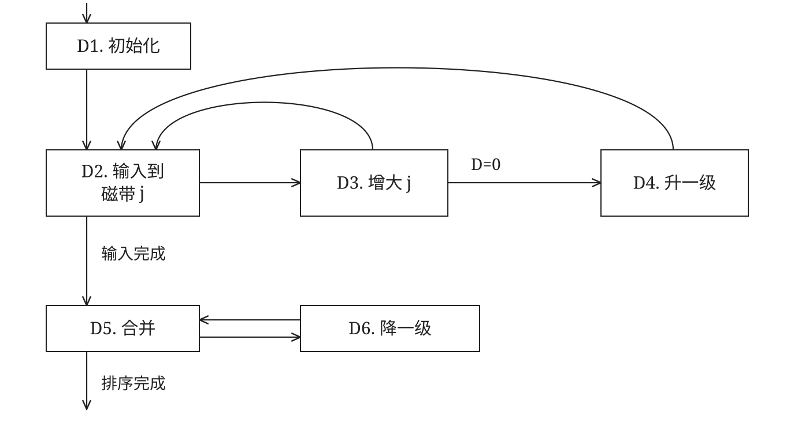
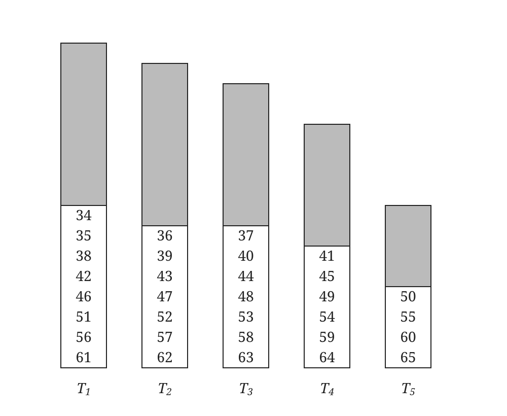
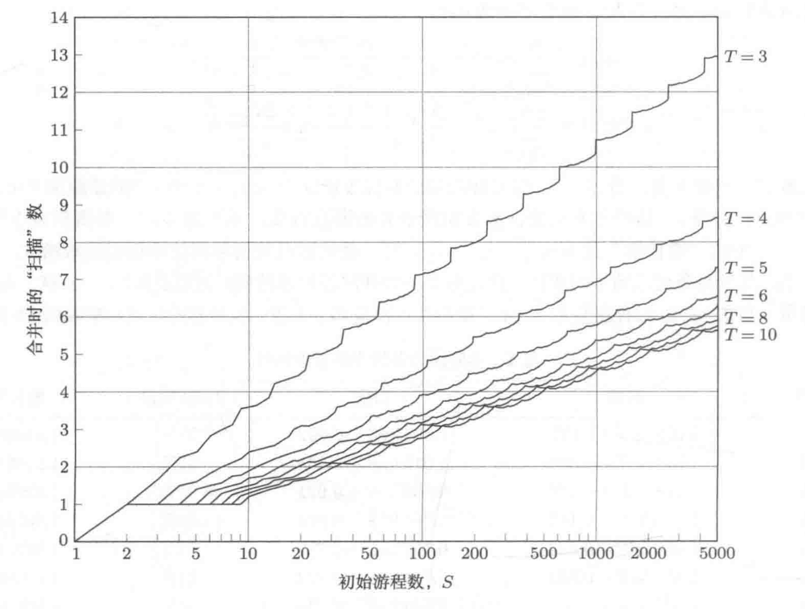
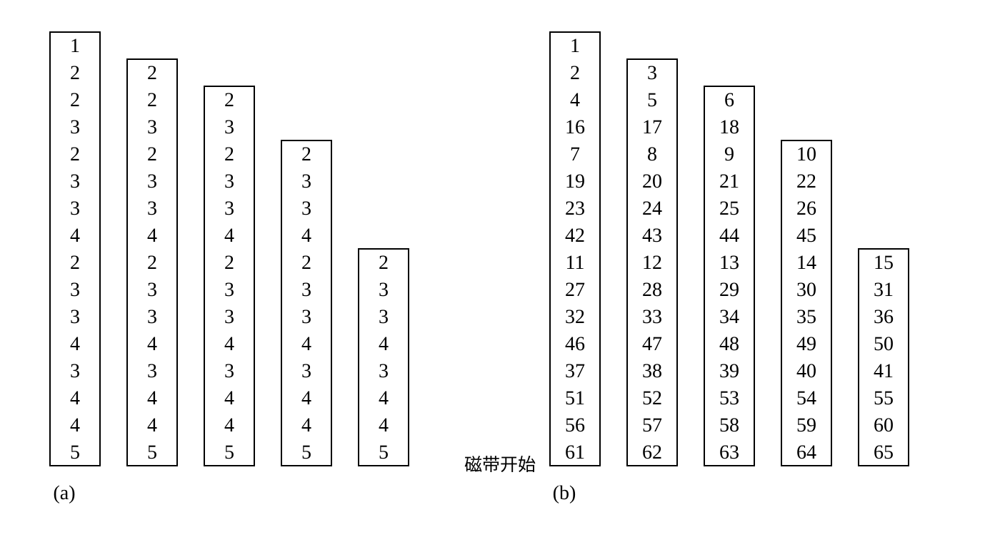
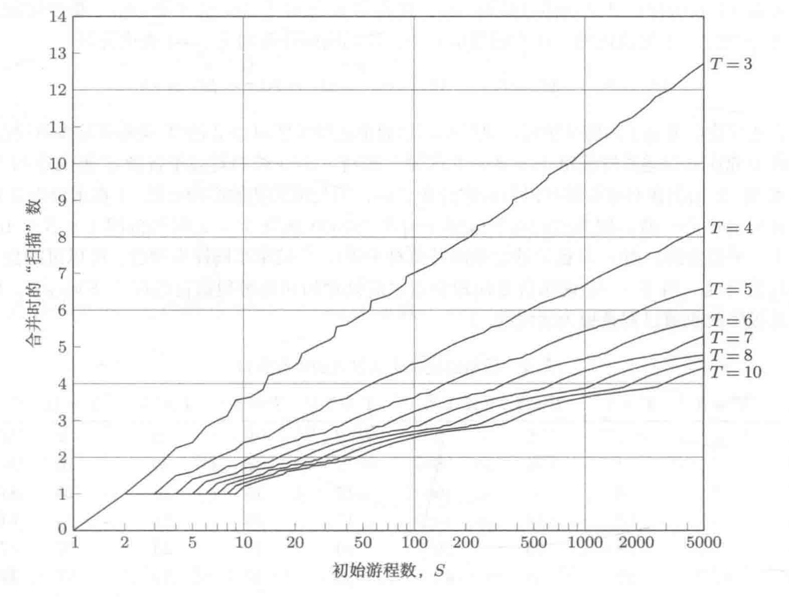
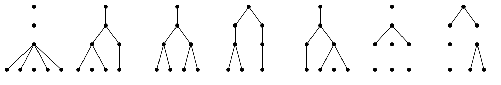

# *5.4.2　多阶段合并

我们已经看到如何构建初始游程, 现在将考虑各种模式, 这些模式可用于把初始游程分配到磁带上, 并把它们合并在一起直到仅剩下一个游程.

首先假定共有三个可用磁带单元 T1、T2、T3. 可以使用 5.4 节开始时介绍的 “平衡合并” 技术, 设 $P=2$ 且 $T=3$, 它采用以下形式:

**B1.** 把初始游程交替分配到磁带 T1 和 T2 上.

**B2.** 把 T1 和 T2 上的游程合并到 T3. 随后, 如果 T3 仅包含一个游程则停止.

**B3.** 把 T3 上的游程交替复制到 T1 和 T2. 返回 B2. $\blacksquare$

如果初始分配扫描生成 $S$ 个游程, 则第一遍合并扫描将在 T3 上生成 $\lceil S/2\rceil$ 个游程, 第二遍合并扫描将生成 $\lceil S/4\rceil$ 个游程, 以此类推. 于是, 如果 $17\le S\le32$, 将需要 1 遍分配扫描、5 遍合并扫描和 4 遍复制扫描. 一般来说, 如果 $S>1$, 对所有数据的扫描数是 $2\lceil\lg S\rceil$.

这个过程中的复制扫描是我们不希望存在的, 因为它们不会减少游程数目. 如果使用一种两阶段过程, 可以避免一半此类复制:

**A1.** 把初始游程交替分配到磁带 T1 和 T2 上.

**A2.** 把 T1 和 T2 上的游程合并到 T3. 随后, 如果 T3 仅包含一个游程则停止.

**A3.** 把 T3 上的一半游程复制到 T1.

**A4.** 把 T1 和 T3 上的游程合并到 T2. 随后, 如果 T2 仅包含一个游程则停止.

**A5.** 把 T2 上的一半游程复制到 T1. 返回 A2. $\blacksquare$

对数据的扫描数已经减少到 $\tfrac32\lceil\lg S\rceil+\tfrac12$, 这是因为步骤 A3 和 A5 仅进行 “一半扫描”, 从而节省大约 25%的时间.

实际上这些复制可以完全消除, 只要开始时在 T1 上分配 $F_n$ 个游程, 在 T2 上分配 $F_{n-1}$ 个游程, 这里 $F_n$ 和 $F_{n-1}$ 是相邻的斐波那契数. 例如, 考虑 $n=7$ 的情形, 此时 $S=F_n+F_{n-1}=13+8=21$:

<table data-polyphase21="215" style="white-space:nowrap"><thead><tr>
<th style="text-align:center">阶段</th>
<th style="text-align:center">T1 的内容</th>
<th style="text-align:center">T2 的内容</th>
<th style="text-align:center">T3 的内容</th>
<th style="text-align:center">注释</th>
</tr></thead><tbody>
<tr data-polyphase21-row="0" style="height:45px"><td>1</td>
<td data-run-list="true" style="text-align:center">1,1,1,1,1,1,1,1,1,1,1,1,1</td>
<td data-run-list="true" style="text-align:center">1,1,1,1,1,1,1,1</td>
<td data-run-list="true" style="text-align:center">—</td>
<td>初始分配</td></tr>
<tr data-polyphase21-row="1" style="height:45px"><td>2</td>
<td data-run-list="true" style="text-align:center">1,1,1,1,1</td>
<td data-run-list="true" style="text-align:center">—</td>
<td data-run-list="true" style="text-align:center">2,2,2,2,2,2,2,2</td>
<td>把 8 个游程合并到 T3</td></tr>
<tr data-polyphase21-row="2" style="height:45px"><td>3</td>
<td data-run-list="true" style="text-align:center">—</td>
<td data-run-list="true" style="text-align:center">3,3,3,3,3</td>
<td data-run-list="true" style="text-align:center">2,2,2</td>
<td>把 5 个游程合并到 T2</td></tr>
<tr data-polyphase21-row="3" style="height:45px"><td>4</td>
<td data-run-list="true" style="text-align:center">5,5,5</td>
<td data-run-list="true" style="text-align:center">3,3</td>
<td data-run-list="true" style="text-align:center">—</td>
<td>把 3 个游程合并到 T1</td></tr>
<tr data-polyphase21-row="4" style="height:45px"><td>5</td>
<td data-run-list="true" style="text-align:center">5</td>
<td data-run-list="true" style="text-align:center">—</td>
<td data-run-list="true" style="text-align:center">8,8</td>
<td>把 2 个游程合并到 T3</td></tr>
<tr data-polyphase21-row="5" style="height:45px"><td>6</td>
<td data-run-list="true" style="text-align:center">—</td>
<td data-run-list="true" style="text-align:center">13</td>
<td data-run-list="true" style="text-align:center">8</td>
<td>把 1 个游程合并到 T2</td></tr>
<tr data-polyphase21-row="6" style="height:45px"><td>7</td>
<td data-run-list="true" style="text-align:center">21</td>
<td data-run-list="true" style="text-align:center">—</td>
<td data-run-list="true" style="text-align:center">—</td>
<td>把 1 个游程合并到 T1</td></tr>
</tbody></table>

例如, 2,2,2,2,2,2,2,2 表示八个相对长度为 2 的游程 (把每个初始游程看作相对长度为 1). 上表中斐波那契数无处不在!

只有阶段 1 和阶段 7 对数据进行了完全扫描. 阶段 2 只处理初始游程的 $16/21$, 阶段 3 只处理 $15/21$, 等等. 因此, 如果我们假定初始游程的长度近似相等, 则 “扫描” 总数为 $(21+16+15+15+16+13+21)/21=5\tfrac47$. 相较而言, 上述两阶段过程需要 8 遍扫描来排序这 21 个初始游程. 我们将会看到, 一般来说这个 “斐波那契” 模式需要大约 $1.04\lg S+0.99$ 遍扫描, 尽管它仅需要三条磁带, 却可以和四磁带平衡合并方法相媲美.

对于任何 $T\ge3$, 利用 $T-1$ 路合并, 这一思想可以推广到 $T$ 条磁带的情形. 例如, 我们将会看到, 四磁带情形仅需要对数据进行大约 $0.703\lg S+0.96$ 遍扫描. 推广模式使用了广义斐波那契数. 考虑下面的六磁带示例:

<table data-polyphase129="215" style="white-space:nowrap"><thead><tr>
<th style="text-align:center;min-width:80px">阶段</th>
<th style="text-align:center;min-width:80px">T1</th>
<th style="text-align:center;min-width:80px">T2</th>
<th style="text-align:center;min-width:80px">T3</th>
<th style="text-align:center;min-width:80px">T4</th>
<th style="text-align:center;min-width:80px">T5</th>
<th style="text-align:center;min-width:80px">T6</th>
<th style="text-align:center;min-width:80px">所处理的初始游程</th>
</tr></thead><tbody>
<tr data-polyphase129-row="0" style="height:45px"><td>1</td>
<td data-run-power="true" style="text-align:center">$1^{31}$</td>
<td data-run-power="true" style="text-align:center">$1^{30}$</td>
<td data-run-power="true" style="text-align:center">$1^{28}$</td>
<td data-run-power="true" style="text-align:center">$1^{24}$</td>
<td data-run-power="true" style="text-align:center">$1^{16}$</td>
<td data-run-power="true" style="text-align:center">—</td>
<td>$31+30+28+24+16=129$</td></tr>
<tr data-polyphase129-row="1" style="height:45px"><td>2</td>
<td data-run-power="true" style="text-align:center">$1^{15}$</td>
<td data-run-power="true" style="text-align:center">$1^{14}$</td>
<td data-run-power="true" style="text-align:center">$1^{12}$</td>
<td data-run-power="true" style="text-align:center">$1^{8}$</td>
<td data-run-power="true" style="text-align:center">—</td>
<td data-run-power="true" style="text-align:center">$5^{16}$</td>
<td>$16\times5=80$</td></tr>
<tr data-polyphase129-row="2" style="height:45px"><td>3</td>
<td data-run-power="true" style="text-align:center">$1^{7}$</td>
<td data-run-power="true" style="text-align:center">$1^{6}$</td>
<td data-run-power="true" style="text-align:center">$1^{4}$</td>
<td data-run-power="true" style="text-align:center">—</td>
<td data-run-power="true" style="text-align:center">$9^{8}$</td>
<td data-run-power="true" style="text-align:center">$5^{8}$</td>
<td>$8\times9=72$</td></tr>
<tr data-polyphase129-row="3" style="height:45px"><td>4</td>
<td data-run-power="true" style="text-align:center">$1^{3}$</td>
<td data-run-power="true" style="text-align:center">$1^{2}$</td>
<td data-run-power="true" style="text-align:center">—</td>
<td data-run-power="true" style="text-align:center">$17^{4}$</td>
<td data-run-power="true" style="text-align:center">$9^{4}$</td>
<td data-run-power="true" style="text-align:center">$5^{4}$</td>
<td>$4\times17=68$</td></tr>
<tr data-polyphase129-row="4" style="height:45px"><td>5</td>
<td data-run-power="true" style="text-align:center">$1^{1}$</td>
<td data-run-power="true" style="text-align:center">—</td>
<td data-run-power="true" style="text-align:center">$33^{2}$</td>
<td data-run-power="true" style="text-align:center">$17^{2}$</td>
<td data-run-power="true" style="text-align:center">$9^{2}$</td>
<td data-run-power="true" style="text-align:center">$5^{2}$</td>
<td>$2\times33=66$</td></tr>
<tr data-polyphase129-row="5" style="height:45px"><td>6</td>
<td data-run-power="true" style="text-align:center">—</td>
<td data-run-power="true" style="text-align:center">$65^{1}$</td>
<td data-run-power="true" style="text-align:center">$33^{1}$</td>
<td data-run-power="true" style="text-align:center">$17^{1}$</td>
<td data-run-power="true" style="text-align:center">$9^{1}$</td>
<td data-run-power="true" style="text-align:center">$5^{1}$</td>
<td>$1\times65=65$</td></tr>
<tr data-polyphase129-row="6" style="height:45px"><td>7</td>
<td data-run-power="true" style="text-align:center">$129^{1}$</td>
<td data-run-power="true" style="text-align:center">—</td>
<td data-run-power="true" style="text-align:center">—</td>
<td data-run-power="true" style="text-align:center">—</td>
<td data-run-power="true" style="text-align:center">—</td>
<td data-run-power="true" style="text-align:center">—</td>
<td>$1\times129=129$</td></tr>
</tbody></table>

这里 $1^{31}$ 表示相对长度为 1 的 31 个游程, 以此类推. 整个过程都使用五路合并. 这种一般模式是由罗素·吉尔斯塔德设计的, 他把这种模式称为多阶段合并 [*Proc. Eastern Joint Computer Conf.* **18** (1960), 143–148]. 在此之前, 伯纳德·贝茨已经发现三磁带的情形 [未发表的备忘录, Minneapolis-Honeywell Regulator Co. (1956)].

为使多阶段合并可以像上面的例子那样正常进行, 在每个阶段之后, 需要在磁带上实现游程的 “完美斐波那契分布”. 自下而上阅读上表, 可以看到当 $T=6$ 时的前七个完美斐波那契分布为 $\{1,0,0,0,0\}$, $\{1,1,1,1,1\}$, $\{2,2,2,2,1\}$, $\{4,4,4,3,2\}$, $\{8,8,7,6,4\}$, $\{16,15,14,12,8\}$, $\{31,30,28,24,16\}$. 我们现在面临的较大问题是:

1. 这些完美斐波那契分布的基础规则是什么?

2. 如果 $S$ 不对应于一个完美斐波那契分布, 应该怎么办?

3. 应当如何设计初始分配扫描, 使它在磁带上生成期望的结构?

4. $T$ 磁带多阶段合并方法需要对数据进行多少遍 “扫描”? 把它表示为初始游程数目 $S$ 的函数.

我们将依次讨论这四个问题, 首先给出 “简易回答”, 然后再进行更为深入的分析.

通过反向运行该模式, 周期性交替磁带内容, 即可获得完美斐波那契分布. 例如, 当 $T=6$ 时有以下游程分布:

<table data-polyphase-levels="216" style="white-space:nowrap"><thead><tr>
<th style="text-align:center;min-width:80px">级</th>
<th style="text-align:center;min-width:80px">T1</th>
<th style="text-align:center;min-width:80px">T2</th>
<th style="text-align:center;min-width:80px">T3</th>
<th style="text-align:center;min-width:80px">T4</th>
<th style="text-align:center;min-width:80px">T5</th>
<th style="text-align:center;min-width:80px">总数</th>
<th style="text-align:center;min-width:80px">最后输出 所在磁带</th>
<th style="text-align:center;min-width:80px"></th>
</tr></thead><tbody>
<tr data-polyphase-level="0" style="height:45px">
<td style="text-align:center">0</td>
<td style="text-align:center">1</td>
<td style="text-align:center">0</td>
<td style="text-align:center">0</td>
<td style="text-align:center">0</td>
<td style="text-align:center">0</td>
<td style="text-align:center">1</td>
<td style="text-align:center">T1</td>
<td style="text-align:center"></td>
</tr>
<tr data-polyphase-level="1" style="height:45px">
<td style="text-align:center">1</td>
<td style="text-align:center">1</td>
<td style="text-align:center">1</td>
<td style="text-align:center">1</td>
<td style="text-align:center">1</td>
<td style="text-align:center">1</td>
<td style="text-align:center">5</td>
<td style="text-align:center">T6</td>
<td style="text-align:center"></td>
</tr>
<tr data-polyphase-level="2" style="height:45px">
<td style="text-align:center">2</td>
<td style="text-align:center">2</td>
<td style="text-align:center">2</td>
<td style="text-align:center">2</td>
<td style="text-align:center">2</td>
<td style="text-align:center">1</td>
<td style="text-align:center">9</td>
<td style="text-align:center">T5</td>
<td style="text-align:center"></td>
</tr>
<tr data-polyphase-level="3" style="height:45px">
<td style="text-align:center">3</td>
<td style="text-align:center">4</td>
<td style="text-align:center">4</td>
<td style="text-align:center">4</td>
<td style="text-align:center">3</td>
<td style="text-align:center">2</td>
<td style="text-align:center">17</td>
<td style="text-align:center">T4</td>
<td style="text-align:center"></td>
</tr>
<tr data-polyphase-level="4" style="height:45px">
<td style="text-align:center">4</td>
<td style="text-align:center">8</td>
<td style="text-align:center">8</td>
<td style="text-align:center">7</td>
<td style="text-align:center">6</td>
<td style="text-align:center">4</td>
<td style="text-align:center">33</td>
<td style="text-align:center">T3</td>
<td style="text-align:center"></td>
</tr>
<tr data-polyphase-level="5" style="height:45px">
<td style="text-align:center">5</td>
<td style="text-align:center">16</td>
<td style="text-align:center">15</td>
<td style="text-align:center">14</td>
<td style="text-align:center">12</td>
<td style="text-align:center">8</td>
<td style="text-align:center">65</td>
<td style="text-align:center">T2</td>
<td style="text-align:center"></td>
</tr>
<tr data-polyphase-level="6" style="height:45px">
<td style="text-align:center">6</td>
<td style="text-align:center">31</td>
<td style="text-align:center">30</td>
<td style="text-align:center">28</td>
<td style="text-align:center">24</td>
<td style="text-align:center">16</td>
<td style="text-align:center">129</td>
<td style="text-align:center">T1</td>
<td style="text-align:center"></td>
</tr>
<tr data-polyphase-level="7" style="height:45px">
<td style="text-align:center">7</td>
<td style="text-align:center">61</td>
<td style="text-align:center">59</td>
<td style="text-align:center">55</td>
<td style="text-align:center">47</td>
<td style="text-align:center">31</td>
<td style="text-align:center">253</td>
<td style="text-align:center">T6</td>
<td style="text-align:center"></td>
</tr>
<tr data-polyphase-level="8" style="height:45px">
<td style="text-align:center">8</td>
<td style="text-align:center">120</td>
<td style="text-align:center">116</td>
<td style="text-align:center">108</td>
<td style="text-align:center">92</td>
<td style="text-align:center">61</td>
<td style="text-align:center">497</td>
<td style="text-align:center">T5</td>
<td style="text-align:center"></td>
</tr>
<tr><td colspan="9" style="text-align:center">⋯</td></tr>
<tr data-polyphase-symbolic="0">
<td style="text-align:center">$n$</td>
<td style="text-align:center">$a_n$</td>
<td style="text-align:center">$b_n$</td>
<td style="text-align:center">$c_n$</td>
<td style="text-align:center">$d_n$</td>
<td style="text-align:center">$e_n$</td>
<td style="text-align:center">$t_n$</td>
<td style="text-align:center">$\mathrm{T}(k)$</td>
<td></td></tr>
<tr data-polyphase-symbolic="1">
<td style="text-align:center">$n+1$</td>
<td style="text-align:center">$a_n+b_n$</td>
<td style="text-align:center">$a_n+c_n$</td>
<td style="text-align:center">$a_n+d_n$</td>
<td style="text-align:center">$a_n+e_n$</td>
<td style="text-align:center">$a_n$</td>
<td style="text-align:center">$t_n+4a_n$</td>
<td style="text-align:center">$\mathrm{T}(k-1)$</td>
<td>(1)</td></tr>
<tr><td colspan="9" style="text-align:center">⋯</td></tr></tbody></table>

(在初始分布之后磁带 T6 总是空的.)

从第 $n$ 级达到第 $n+1$ 级的规则表明, 以下条件在每一级都成立:

$$
a_n\ge b_n\ge c_n\ge d_n\ge e_n.\tag{2}
$$

事实上, 从 (1) 容易看出

$$
\begin{aligned}
e_n&=a_{n-1},\\
d_n&=a_{n-1}+e_{n-1}=a_{n-1}+a_{n-2},\\
c_n&=a_{n-1}+d_{n-1}=a_{n-1}+a_{n-2}+a_{n-3},\\
b_n&=a_{n-1}+c_{n-1}=a_{n-1}+a_{n-2}+a_{n-3}+a_{n-4},\\
a_n&=a_{n-1}+b_{n-1}=a_{n-1}+a_{n-2}+a_{n-3}+a_{n-4}+a_{n-5},
\end{aligned}\tag{3}
$$

式中 $a_0=1$, 对于 $n=-1,-2,-3,-4$ 令 $a_n=0$.

$p$ 阶斐波那契数 $F_n^{(p)}$ 定义为

$$
\begin{aligned}
F_n^{(p)}&=F_{n-1}^{(p)}+F_{n-2}^{(p)}+\cdots+F_{n-p}^{(p)}\quad(n\ge p);\\
F_n^{(p)}&=0\quad(0\le n\le p-2);\qquad F_{p-1}^{(p)}=1.
\end{aligned}\tag{4}
$$

换句话说, 开头是 $p-1$ 个 0, 然后是 1, 之后的每个数都是前面 $p$ 个值之和. 当 $p=2$ 时, 这是一个普通的斐波那契数列, 当 $p=3$ 时, 它被称为泰波那契数列. 纳拉亚纳·潘季塔于 1356 年最早研究了 $p>2$ 的此类序列 [见帕玛兰德·辛格,*Historia Mathematica* **12** (1985), 229–244], 许多年以后, 维克托·施莱格尔也加以研究 [*El Progreso Matemático* **4** (1894), 173–174]. 施莱格尔推导了生成函数:

$$
\sum_{n\ge0}F_n^{(p)}z^n=\frac{z^{p-1}}{1-z-z^2-\cdots-z^p}=\frac{z^{p-1}-z^p}{1-2z+z^{p+1}}.\tag{5}
$$

式 (3) 的最后一行表明, 在六磁带多阶段合并期间, T1 上的游程数是五阶斐波那契数 $a_n=F_{n+4}^{(5)}$.

一般来说, 如果令 $P=T-1$, 则 $T$ 磁带多阶段合并分布将以同样方式对应于 $P$ 阶斐波那契数. 对于 $1\le k\le P$, 第 $k$ 条磁带在第 $n$ 级完美分布中获得

$$
F_{n+P-2}^{(P)}+F_{n+P-3}^{(P)}+\cdots+F_{n+k-2}^{(P)}
$$

个初始游程, 因此所有磁带上的初始游程总数为

$$
t_n=PF_{n+P-2}^{(P)}+(P-1)F_{n+P-3}^{(P)}+\cdots+F_{n-1}^{(P)}.\tag{6}
$$

这样就解决了 “完美斐波那契分布” 的问题. 但如果对于任何 $n$ 值 $S$ 都不是恰好等于 $t_n$, 应当怎么办呢? 我们如何首先在磁带上获得这些游程呢?

当 $S$ 不完美时 (只有很少的数值是完美的), 我们可以像在平衡 $P$ 路合并中那样做, 添加人为的 “虚拟游程”, 从而假想 $S$ 是完美的. 有几种方式可以用来添加虚拟游程, 但我们还没有为分析 “最佳” 添加方式做好准备. 我们将首先讨论一种分配方法和指定虚拟游程的方法, 严格来说这种方法并不是最优的, 不过它的长处是简单, 而且与所有其他同样简单的方法相比它似乎是最好的.

**算法 D (具有 “水平” 分布的多阶段合并排序).** 算法取得初始游程, 并把它们分散到磁带上, 每次处理一个游程, 直到所有初始游程处理完毕. 然后说明如何使用 $P$ 路合并来合并这些磁带 (假设有 $T=P+1\ge3$ 台可用的磁带机). 由于磁带 $T$ 没有接收任何初始游程, 所以可用于保存输入内容. 维护以下数组:

$\mathtt{A}[j]$, $1\le j\le T$: 我们争取实现的完美斐波那契分布.

$\mathtt{D}[j]$, $1\le j\le T$: 假定在第 $j$ 号逻辑磁带开始处的虚拟游程数.

$\mathtt{TAPE}[j]$, $1\le j\le T$: 对应于第 $j$ 号逻辑磁带的物理磁带机编号.

(处理 “逻辑磁带编号” 比较方便, 它与物理磁带机的对应关系随着算法的进行而变化.)

**D1.[初始化.]** 对于 $1\le j<T$, 置 $\mathtt{A}[j]\leftarrow\mathtt{D}[j]\leftarrow1$, $\mathtt{TAPE}[j]\leftarrow j$. 置 $\mathtt{A}[T]\leftarrow\mathtt{D}[T]\leftarrow0$, $\mathtt{TAPE}[T]\leftarrow T$. 置 $l\leftarrow1$, $j\leftarrow1$.

**D2.[输入到磁带 $j$.]** 在第 $j$ 号磁带上写入一个游程, 然后 D[j] 减 1. 如果已穷尽所有输入, 则回卷所有磁带并转到 D5.

**D3.[增大 $j$.]** 如果 $\mathtt{D}[j]<\mathtt{D}[j+1]$, 则 $j$ 增 1 并返回 D2. 否则, 如果 D[j]=0 则转到 D4. 否则, 置 $j\leftarrow1$ 并返回 D2.

**D4.[升一级.]** 置 $l\leftarrow l+1$, $a\leftarrow\mathtt{A}[1]$, 然后对于 $j=1,2,\ldots,P$ (按照这一顺序) 置 $\mathtt{D}[j]\leftarrow a+\mathtt{A}[j+1]-\mathtt{A}[j]$, $\mathtt{A}[j]\leftarrow a+\mathtt{A}[j+1]$. (见 (1) 并注意 A[P+1] 总是零. 这时我们有 $\mathtt{D}[1]\ge\mathtt{D}[2]\ge\cdots\ge\mathtt{D}[T]$.) 现在置 $j\leftarrow1$ 并返回 D2.

**D5.[合并.]** 如果 $l=0$, 则排序完成, 输出位于 TAPE[1]. 否则, 把来自 TAPE[1]、$\ldots$、TAPE[P] 的游程合并到 TAPE[T], 直到 TAPE[P] 空且 D[P]=0. 对于每个要合并的游程, 合并过程的操作如下: 如果对于所有 $1\le j\le P$ 都有 D[j]>0, 则对于 $1\le j\le P$ 置 D[j] 减 1 并置 D[T] 增 1; 否则, 从每个使得 D[j]=0 的 TAPE[j] 合并一个游程, 并对于所有其他 $j$ 值置 D[j] 减 1. (于是假想虚拟游程在磁带的开头而不是末尾.)

**D6.[降一级.]** 置 $l\leftarrow l-1$. 回卷 TAPE[P] 和 TAPE[T]. (实际上, 在 D5 中输入最后一个块后就可以开始回卷 TAPE[P].) 然后, 置

$$
\begin{aligned}
(\mathtt{TAPE}[1],\mathtt{TAPE}[2],\ldots,\mathtt{TAPE}[T])&\leftarrow(\mathtt{TAPE}[T],\mathtt{TAPE}[1],\ldots,\mathtt{TAPE}[T-1]),\\
(\mathtt{D}[1],\mathtt{D}[2],\ldots,\mathtt{D}[T])&\leftarrow(\mathtt{D}[T],\mathtt{D}[1],\ldots,\mathtt{D}[T-1]),
\end{aligned}
$$

返回 D5. $\blacksquare$

图 68　多阶段合并排序

算法步骤 D3 简要描述分布规则, 目的是使每条磁带上的虚拟游程数尽可能相等. 图 69 给出在六磁带排序中从第 4 级 (33 个游程) 到第 5 级 (65 个游程) 的分布顺序; 如果仅有 (比如说)53 个初始游程, 则所有编号不小于 54 的游程都将被看作虚拟游程. (这些游程实际上被写在磁带末尾, 但最好把它们想象为写在开头, 因为我们假定虚拟游程都是在开头的.)

图 69　在从第 4 级前进到第 5 级时, 游程 34 至 65 在各磁带上的分布顺序. [见完美分布表 (1).] 阴影区域表示在到达第 4 级时已分配好的前 33 个游程. 底部的行对应于每条磁带的开始.

现在已经讨论了前面所提问题中的前三个, 剩下就是考虑数据 “扫描” 数. 比较六磁带示例与 (1), 可以看出, 当 $S=t_6$ 时处理的初始游程总数量是 $a_5t_1+a_4t_2+a_3t_3+a_2t_4+a_1t_5+a_0t_6$, 初始分布扫描除外. 习题 4 推导了生成函数

$$
\begin{aligned}
a(z)&=\sum_{n\ge0}a_nz^n=\frac1{1-z-z^2-z^3-z^4-z^5},\\
t(z)&=\sum_{n\ge1}t_nz^n=\frac{5z+4z^2+3z^3+2z^4+z^5}{1-z-z^2-z^3-z^4-z^5}.
\end{aligned}\tag{7}
$$

由此推出: 一般来说, 当 $S=t_n$ 时处理的初始游程数恰好为 $a(z)t(z)$ 中 $z^n$ 的系数加上 $t_n$ (表示初始分布扫描). 这样就有可能计算多阶段合并的渐近特性, 见习题 5–7, 并得到以下结果:

表 1 中的 “增长率” 是 $\lim_{n\to\infty}t_{n+1}/t_n$, 每一级的游程数目将以这个近似因数增大. “扫描” 表示处理每条记录的平均次数, 即在分布与合并阶段处理的初始游程总数的 $1/S$ 倍. 对于完美分布, 当 $S\to\infty$ 时存在某个 $\epsilon>0$, 使得在每种情形下上述扫描数和阶段数都精确到 $O(S^{-\epsilon})$.

表 1　多阶段合并排序的近似特性

<table data-polyphase-asymptotic="219" style="white-space:nowrap"><thead><tr>
<th>磁带</th>
<th>阶段</th>
<th>扫描</th>
<th>扫描／阶段</th>
<th>增长率</th>
</tr></thead><tbody>
<tr data-polyphase-asymptotic-row="0" style="height:45px"><td>3</td><td>$2.078\ln S+0.672$</td><td>$1.504\ln S+0.992$</td><td>72%</td><td>1.6180340</td></tr>
<tr data-polyphase-asymptotic-row="1" style="height:45px"><td>4</td><td>$1.641\ln S+0.364$</td><td>$1.015\ln S+0.965$</td><td>62%</td><td>1.8392868</td></tr>
<tr data-polyphase-asymptotic-row="2" style="height:45px"><td>5</td><td>$1.524\ln S+0.078$</td><td>$0.863\ln S+0.921$</td><td>57%</td><td>1.9275620</td></tr>
<tr data-polyphase-asymptotic-row="3" style="height:45px"><td>6</td><td>$1.479\ln S-0.185$</td><td>$0.795\ln S+0.864$</td><td>54%</td><td>1.9659482</td></tr>
<tr data-polyphase-asymptotic-row="4" style="height:45px"><td>7</td><td>$1.460\ln S-0.424$</td><td>$0.762\ln S+0.797$</td><td>52%</td><td>1.9835828</td></tr>
<tr data-polyphase-asymptotic-row="5" style="height:45px"><td>8</td><td>$1.451\ln S-0.642$</td><td>$0.744\ln S+0.723$</td><td>51%</td><td>1.9919642</td></tr>
<tr data-polyphase-asymptotic-row="6" style="height:45px"><td>9</td><td>$1.447\ln S-0.838$</td><td>$0.734\ln S+0.646$</td><td>51%</td><td>1.9960312</td></tr>
<tr data-polyphase-asymptotic-row="7" style="height:45px"><td>10</td><td>$1.445\ln S-1.017$</td><td>$0.728\ln S+0.568$</td><td>50%</td><td>1.9980295</td></tr>
<tr data-polyphase-asymptotic-row="8" style="height:45px"><td>20</td><td>$1.443\ln S-2.170$</td><td>$0.721\ln S-0.030$</td><td>50%</td><td>1.9999981</td></tr>
</tbody></table>

图 70 展示在使用算法 D 处理非完美数的情形时每条记录被合并的平均次数, 它是 $S$ 的函数. 注意, 当使用三条磁带时在完美分布之后出现了一些相对低效的 “峰值”, 但当存在四条或更多条磁带时这种现象大体上会消失. 与六条或七条磁带相比, 使用八条或更多条磁带并没有多大改善.

图 70　使用算法 D 的多阶段合并效率

**更深入的研究.** 在需要 $k$ 遍扫描的平衡合并中, 排序期间每条记录恰好被处理 $k$ 次. 但在多阶段过程中就不是这样无偏颇了, 某些记录的处理次数可能比其他记录多很多次, 如果向经常处理的位置引入虚拟游程, 可以加快处理速度.

因此让我们更深入地研究多阶段分布. 不是像在 (1) 中那样仅仅查看每条磁带上的游程数, 而是把每个游程与它的合并数关联起来, 这个合并数也就是在整个多阶段排序期间对每个游程的处理次数. 这就得到以下表格, 用以代替 (1):

<table data-polyphase-merge-strings="219" style="white-space:nowrap"><thead><tr>
<th>级</th>
<th>T1</th>
<th>T2</th>
<th>T3</th>
<th>T4</th>
<th>T5</th>
<th></th>
</tr></thead><tbody>
<tr data-merge-string-level="0" style="height:45px"><td>0</td>
<td data-merge-string="true" style="font-family:monospace;text-align:center">0</td>
<td data-merge-string="true" style="font-family:monospace;text-align:center">—</td>
<td data-merge-string="true" style="font-family:monospace;text-align:center">—</td>
<td data-merge-string="true" style="font-family:monospace;text-align:center">—</td>
<td data-merge-string="true" style="font-family:monospace;text-align:center">—</td>
<td></td></tr>
<tr data-merge-string-level="1" style="height:45px"><td>1</td>
<td data-merge-string="true" style="font-family:monospace;text-align:center">1</td>
<td data-merge-string="true" style="font-family:monospace;text-align:center">1</td>
<td data-merge-string="true" style="font-family:monospace;text-align:center">1</td>
<td data-merge-string="true" style="font-family:monospace;text-align:center">1</td>
<td data-merge-string="true" style="font-family:monospace;text-align:center">1</td>
<td></td></tr>
<tr data-merge-string-level="2" style="height:45px"><td>2</td>
<td data-merge-string="true" style="font-family:monospace;text-align:center">21</td>
<td data-merge-string="true" style="font-family:monospace;text-align:center">21</td>
<td data-merge-string="true" style="font-family:monospace;text-align:center">21</td>
<td data-merge-string="true" style="font-family:monospace;text-align:center">21</td>
<td data-merge-string="true" style="font-family:monospace;text-align:center">2</td>
<td></td></tr>
<tr data-merge-string-level="3" style="height:45px"><td>3</td>
<td data-merge-string="true" style="font-family:monospace;text-align:center">3221</td>
<td data-merge-string="true" style="font-family:monospace;text-align:center">3221</td>
<td data-merge-string="true" style="font-family:monospace;text-align:center">3221</td>
<td data-merge-string="true" style="font-family:monospace;text-align:center">322</td>
<td data-merge-string="true" style="font-family:monospace;text-align:center">32</td>
<td></td></tr>
<tr data-merge-string-level="4" style="height:45px"><td>4</td>
<td data-merge-string="true" style="font-family:monospace;text-align:center">43323221</td>
<td data-merge-string="true" style="font-family:monospace;text-align:center">43323221</td>
<td data-merge-string="true" style="font-family:monospace;text-align:center">4332322</td>
<td data-merge-string="true" style="font-family:monospace;text-align:center">433232</td>
<td data-merge-string="true" style="font-family:monospace;text-align:center">4332</td>
<td></td></tr>
<tr data-merge-string-level="5" style="height:45px"><td>5</td>
<td data-merge-string="true" style="font-family:monospace;text-align:center">5443433243323221</td>
<td data-merge-string="true" style="font-family:monospace;text-align:center">544343324332322</td>
<td data-merge-string="true" style="font-family:monospace;text-align:center">54434332433232</td>
<td data-merge-string="true" style="font-family:monospace;text-align:center">544343324332</td>
<td data-merge-string="true" style="font-family:monospace;text-align:center">54434332</td>
<td></td></tr>
<tr><td colspan="7" style="text-align:center">⋯</td></tr>
<tr data-merge-string-symbolic="0">
<td>$n$</td>
<td>$A_n$</td>
<td>$B_n$</td>
<td>$C_n$</td>
<td>$D_n$</td>
<td>$E_n$</td>
<td></td></tr>
<tr data-merge-string-symbolic="1">
<td>$n+1$</td>
<td>$(A_n+1)B_n$</td>
<td>$(A_n+1)C_n$</td>
<td>$(A_n+1)D_n$</td>
<td>$(A_n+1)E_n$</td>
<td>$A_n+1$</td>
<td>(8)</td></tr>
<tr><td colspan="7" style="text-align:center">⋯</td></tr></tbody></table>

上表中, $A_n$ 表示 T1 上每个游程的合并次数 (从第 $n$ 级分布开始计算) 的 $a_n$ 个值的串, $B_n$ 表示 T2 的对应串, 以此类推. 记号 $(A_n+1)B_n$ 表示 “$A_n$ 的每个值加 1, 然后跟着 $B_n$”.

图 71(a) 给出最终的 $A_5,B_5,C_5,D_5,E_5$, 表明每个游程的合并数如何出现在磁带上. 注意每条磁带开头的游程将被处理五次, 而 T1 末尾的游程仅处理一次. 由于多阶段合并的这种区别对待, 使得把虚拟游程放在磁带的开头要比放在末尾好得多. 图 71(b) 给出在五级多阶段合并过程中分布游程的最优顺序, 把每个新游程放在合并数最小的位置处. 算法 D 并不是特别好 (见图 69), 因为它在所有 3 的位置用尽之前填充了某些 4 的位置.

图 71　六磁带五级多阶段分布分析: (a) 合并数, (b) 最优分布顺序

递归关系式 (8) 表明: $B_n,C_n,D_n,E_n$ 中的每一个都是 $A_n$ 的初始子串. 事实上, 可以用 (8) 来推导公式

$$
\begin{aligned}
E_n&=(A_{n-1})+1,\\
D_n&=(A_{n-1}A_{n-2})+1,\\
C_n&=(A_{n-1}A_{n-2}A_{n-3})+1,\\
B_n&=(A_{n-1}A_{n-2}A_{n-3}A_{n-4})+1,\\
A_n&=(A_{n-1}A_{n-2}A_{n-3}A_{n-4}A_{n-5})+1.
\end{aligned}\tag{9}
$$

这些公式推广了仅处理串长度的式 (3). 此外, 定义 $A$ 的规则表明每一级的开头基本上都是相同的结构. 我们有:

$$
A_n=n-Q_n,\tag{10}
$$

式中, $Q_n$ 是 $a_n$ 个值的串, 它由以下规则定义:

$$
\begin{aligned}
Q_n&=Q_{n-1}(Q_{n-2}+1)(Q_{n-3}+2)(Q_{n-4}+3)(Q_{n-5}+4)\quad(n\ge1);\\
Q_0&=0;\qquad Q_n=\epsilon\text{(空串)}\quad(n<0).
\end{aligned}\tag{11}
$$

由于 $Q_n$ 以 $Q_{n-1}$ 开始, 我们可以考虑无穷串 $Q_\infty$, 它的前 $a_n$ 个元素等于 $Q_n$. 这个串 $Q_\infty$ 大体描述了多阶段分布中所有合并数的特征. 在六磁带情形中

$$
Q_\infty=011212231223233412232334233434412232334233434452334344534454512232\cdots.\tag{12}
$$

习题 11 包含了对这个串的一种有趣解读.

假定 $A_n$ 是串 $m_1m_2\ldots m_{a_n}$, 令

$$
A_n(x)=x^{m_1}+x^{m_2}+\cdots+x^{m_{a_n}}
$$

是相应的生成函数, 用来计算每个合并数出现的次数. 以类似方式定义 $B_n(x),C_n(x),D_n(x),E_n(x)$. 例如 $A_4(x)=x^4+x^3+x^3+x^2+x^3+x^2+x^2+x=x^4+3x^3+3x^2+x$. 关系式 (9) 告诉我们, 对于 $n\ge1$ 有

$$
\begin{aligned}
E_n(x)&=x\bigl(A_{n-1}(x)\bigr),\\
D_n(x)&=x\bigl(A_{n-1}(x)+A_{n-2}(x)\bigr),\\
C_n(x)&=x\bigl(A_{n-1}(x)+A_{n-2}(x)+A_{n-3}(x)\bigr),\\
B_n(x)&=x\bigl(A_{n-1}(x)+A_{n-2}(x)+A_{n-3}(x)+A_{n-4}(x)\bigr),\\
A_n(x)&=x\bigl(A_{n-1}(x)+A_{n-2}(x)+A_{n-3}(x)+A_{n-4}(x)+A_{n-5}(x)\bigr),
\end{aligned}\tag{13}
$$

其中 $A_0(x)=1$, $A_n(x)=0\ (n=-1,-2,-3,-4)$. 因此

$$
\sum_{n\ge0}A_n(x)z^n=\frac1{1-x(z+z^2+z^3+z^4+z^5)}=\sum_{k\ge0}x^k(z+z^2+z^3+z^4+z^5)^k.\tag{14}
$$

考虑所有磁带上的游程, 设

$$
T_n(x)=A_n(x)+B_n(x)+C_n(x)+D_n(x)+E_n(x)\quad(n\ge1),\tag{15}
$$

根据 (13), 立即有

$$
T_n(x)=x\bigl(5A_{n-1}(x)+4A_{n-2}(x)+3A_{n-3}(x)+2A_{n-4}(x)+A_{n-5}(x)\bigr),
$$

因此

$$
\sum_{n\ge1}T_n(x)z^n=\frac{x(5z+4z^2+3z^3+2z^4+z^5)}{1-x(z+z^2+z^3+z^4+z^5)}.\tag{16}
$$

式 (16) 的形式表明容易计算出 $T_n(x)$ 的系数:

<table data-polyphase-coefficients="true" style="white-space:nowrap"><thead><tr><th></th>
<th>$z$</th>
<th>$z^{2}$</th>
<th>$z^{3}$</th>
<th>$z^{4}$</th>
<th>$z^{5}$</th>
<th>$z^{6}$</th>
<th>$z^{7}$</th>
<th>$z^{8}$</th>
<th>$z^{9}$</th>
<th>$z^{10}$</th>
<th>$z^{11}$</th>
<th>$z^{12}$</th>
<th>$z^{13}$</th>
<th>$z^{14}$</th>
<th></th></tr></thead><tbody>
<tr data-polyphase-coefficients-row="0" style="height:44px"><td>$x$</td>
<td data-source-number="true">5</td>
<td data-source-number="true">4</td>
<td data-source-number="true">3</td>
<td data-source-number="true">2</td>
<td data-source-number="true">1</td>
<td data-source-number="true">0</td>
<td data-source-number="true">0</td>
<td data-source-number="true">0</td>
<td data-source-number="true">0</td>
<td data-source-number="true">0</td>
<td data-source-number="true">0</td>
<td data-source-number="true">0</td>
<td data-source-number="true">0</td>
<td data-source-number="true">0</td>
<td></td></tr>
<tr data-polyphase-coefficients-row="1" style="height:44px"><td>$x^{2}$</td>
<td data-source-number="true">0</td>
<td data-source-number="true">5</td>
<td data-source-number="true">9</td>
<td data-source-number="true">12</td>
<td data-source-number="true">14</td>
<td data-source-number="true">15</td>
<td data-source-number="true">10</td>
<td data-source-number="true">6</td>
<td data-source-number="true">3</td>
<td data-source-number="true">1</td>
<td data-source-number="true">0</td>
<td data-source-number="true">0</td>
<td data-source-number="true">0</td>
<td data-source-number="true">0</td>
<td></td></tr>
<tr data-polyphase-coefficients-row="2" style="height:44px"><td>$x^{3}$</td>
<td data-source-number="true">0</td>
<td data-source-number="true">0</td>
<td data-source-number="true">5</td>
<td data-source-number="true">14</td>
<td data-source-number="true">26</td>
<td data-source-number="true">40</td>
<td data-source-number="true">55</td>
<td data-source-number="true">60</td>
<td data-source-number="true">57</td>
<td data-source-number="true">48</td>
<td data-source-number="true">35</td>
<td data-source-number="true">20</td>
<td data-source-number="true">10</td>
<td data-source-number="true">4</td>
<td>(17)</td></tr>
<tr data-polyphase-coefficients-row="3" style="height:44px"><td>$x^{4}$</td>
<td data-source-number="true">0</td>
<td data-source-number="true">0</td>
<td data-source-number="true">0</td>
<td data-source-number="true">5</td>
<td data-source-number="true">19</td>
<td data-source-number="true">45</td>
<td data-source-number="true">85</td>
<td data-source-number="true">140</td>
<td data-source-number="true">195</td>
<td data-source-number="true">238</td>
<td data-source-number="true">260</td>
<td data-source-number="true">255</td>
<td data-source-number="true">220</td>
<td data-source-number="true">170</td>
<td></td></tr>
<tr data-polyphase-coefficients-row="4" style="height:44px"><td>$x^{5}$</td>
<td data-source-number="true">0</td>
<td data-source-number="true">0</td>
<td data-source-number="true">0</td>
<td data-source-number="true">0</td>
<td data-source-number="true">5</td>
<td data-source-number="true">24</td>
<td data-source-number="true">69</td>
<td data-source-number="true">154</td>
<td data-source-number="true">294</td>
<td data-source-number="true">484</td>
<td data-source-number="true">703</td>
<td data-source-number="true">918</td>
<td data-source-number="true">1088</td>
<td data-source-number="true">1168</td>
<td></td></tr>
</tbody></table>

上表的各列给出 $T_n(x)$, 例如 $T_4(x)=2x+12x^2+14x^3+5x^4$. 第一行之后, 表中每一项都是上一行左边五项之和.

第 $n$ 级 “完美” 分布中的游程数目是 $T_n(1)$, 在合并这些游程时进行处理的总数是导数 $T_n'(1)$. 现在

$$
\sum_{n\ge1}T_n'(x)z^n=\frac{5z+4z^2+3z^3+2z^4+z^5}{\bigl(1-x(z+z^2+z^3+z^4+z^5)\bigr)^2}.\tag{18}
$$

在式 (16) 和 (18) 中令 $x=1$, 得到的结果与我们前面给出的结论一致: 第 $n$ 级完美分布中的合并处理就是 $a(z)t(z)$ 中 $z^n$ 的系数, 见式 (7).

我们可以利用函数 $T_n(x)$ 来确定在以优化方式添加虚拟游程时所涉及的工作量. 设 $\Sigma_n(m)$ 表示第 $n$ 级分布中 $m$ 个最小合并数之和. 通过查看 (17) 的各列可以很容易地计算出这些值, 我们发现 $\Sigma_n(m)$ 由下表给出:

<table data-polyphase-sigma="true" style="white-space:nowrap"><thead><tr><th></th>
<th>$m=1$</th>
<th>2</th>
<th>3</th>
<th>4</th>
<th>5</th>
<th>6</th>
<th>7</th>
<th>8</th>
<th>9</th>
<th>10</th>
<th>11</th>
<th>12</th>
<th>13</th>
<th>14</th>
<th>15</th>
<th>16</th>
<th>17</th>
<th>18</th>
<th>19</th>
<th>20</th>
<th>21</th>
<th></th></tr></thead><tbody>
<tr data-polyphase-sigma-row="0" style="height:44px"><td>$n=1$</td>
<td data-source-number="true">1</td>
<td data-source-number="true">2</td>
<td data-source-number="true">3</td>
<td data-source-number="true">4</td>
<td data-source-number="true">5</td>
<td data-source-number="true">$\infty$</td>
<td data-source-number="true">$\infty$</td>
<td data-source-number="true">$\infty$</td>
<td data-source-number="true">$\infty$</td>
<td data-source-number="true">$\infty$</td>
<td data-source-number="true">$\infty$</td>
<td data-source-number="true">$\infty$</td>
<td data-source-number="true">$\infty$</td>
<td data-source-number="true">$\infty$</td>
<td data-source-number="true">$\infty$</td>
<td data-source-number="true">$\infty$</td>
<td data-source-number="true">$\infty$</td>
<td data-source-number="true">$\infty$</td>
<td data-source-number="true">$\infty$</td>
<td data-source-number="true">$\infty$</td>
<td data-source-number="true">$\infty$</td>
<td></td></tr>
<tr data-polyphase-sigma-row="1" style="height:44px"><td>$n=2$</td>
<td data-source-number="true">1</td>
<td data-source-number="true">2</td>
<td data-source-number="true">3</td>
<td data-source-number="true">4</td>
<td data-source-number="true">6</td>
<td data-source-number="true">8</td>
<td data-source-number="true">10</td>
<td data-source-number="true">12</td>
<td data-source-number="true">14</td>
<td data-source-number="true">$\infty$</td>
<td data-source-number="true">$\infty$</td>
<td data-source-number="true">$\infty$</td>
<td data-source-number="true">$\infty$</td>
<td data-source-number="true">$\infty$</td>
<td data-source-number="true">$\infty$</td>
<td data-source-number="true">$\infty$</td>
<td data-source-number="true">$\infty$</td>
<td data-source-number="true">$\infty$</td>
<td data-source-number="true">$\infty$</td>
<td data-source-number="true">$\infty$</td>
<td data-source-number="true">$\infty$</td>
<td></td></tr>
<tr data-polyphase-sigma-row="2" style="height:44px"><td>$n=3$</td>
<td data-source-number="true">1</td>
<td data-source-number="true">2</td>
<td data-source-number="true">3</td>
<td data-source-number="true">5</td>
<td data-source-number="true">7</td>
<td data-source-number="true">9</td>
<td data-source-number="true">11</td>
<td data-source-number="true">13</td>
<td data-source-number="true">15</td>
<td data-source-number="true">17</td>
<td data-source-number="true">19</td>
<td data-source-number="true">21</td>
<td data-source-number="true">24</td>
<td data-source-number="true">27</td>
<td data-source-number="true">30</td>
<td data-source-number="true">33</td>
<td data-source-number="true">36</td>
<td data-source-number="true">$\infty$</td>
<td data-source-number="true">$\infty$</td>
<td data-source-number="true">$\infty$</td>
<td data-source-number="true">$\infty$</td>
<td></td></tr>
<tr data-polyphase-sigma-row="3" style="height:44px"><td>$n=4$</td>
<td data-source-number="true">1</td>
<td data-source-number="true">2</td>
<td data-source-number="true">4</td>
<td data-source-number="true">6</td>
<td data-source-number="true">8</td>
<td data-source-number="true">10</td>
<td data-source-number="true">12</td>
<td data-source-number="true">14</td>
<td data-source-number="true">16</td>
<td data-source-number="true">18</td>
<td data-source-number="true">20</td>
<td data-source-number="true">22</td>
<td data-source-number="true">24</td>
<td data-source-number="true">26</td>
<td data-source-number="true">29</td>
<td data-source-number="true">32</td>
<td data-source-number="true">35</td>
<td data-source-number="true">38</td>
<td data-source-number="true">41</td>
<td data-source-number="true">44</td>
<td data-source-number="true">47</td>
<td>(19)</td></tr>
<tr data-polyphase-sigma-row="4" style="height:44px"><td>$n=5$</td>
<td data-source-number="true">1</td>
<td data-source-number="true">3</td>
<td data-source-number="true">5</td>
<td data-source-number="true">7</td>
<td data-source-number="true">9</td>
<td data-source-number="true">11</td>
<td data-source-number="true">13</td>
<td data-source-number="true">15</td>
<td data-source-number="true">17</td>
<td data-source-number="true">19</td>
<td data-source-number="true">21</td>
<td data-source-number="true">23</td>
<td data-source-number="true">25</td>
<td data-source-number="true">27</td>
<td data-source-number="true">29</td>
<td data-source-number="true">32</td>
<td data-source-number="true">35</td>
<td data-source-number="true">38</td>
<td data-source-number="true">41</td>
<td data-source-number="true">44</td>
<td data-source-number="true">47</td>
<td></td></tr>
<tr data-polyphase-sigma-row="5" style="height:44px"><td>$n=6$</td>
<td data-source-number="true">2</td>
<td data-source-number="true">4</td>
<td data-source-number="true">6</td>
<td data-source-number="true">8</td>
<td data-source-number="true">10</td>
<td data-source-number="true">12</td>
<td data-source-number="true">14</td>
<td data-source-number="true">16</td>
<td data-source-number="true">18</td>
<td data-source-number="true">20</td>
<td data-source-number="true">22</td>
<td data-source-number="true">24</td>
<td data-source-number="true">26</td>
<td data-source-number="true">28</td>
<td data-source-number="true">30</td>
<td data-source-number="true">33</td>
<td data-source-number="true">36</td>
<td data-source-number="true">39</td>
<td data-source-number="true">42</td>
<td data-source-number="true">45</td>
<td data-source-number="true">48</td>
<td></td></tr>
<tr data-polyphase-sigma-row="6" style="height:44px"><td>$n=7$</td>
<td data-source-number="true">2</td>
<td data-source-number="true">4</td>
<td data-source-number="true">6</td>
<td data-source-number="true">8</td>
<td data-source-number="true">10</td>
<td data-source-number="true">12</td>
<td data-source-number="true">14</td>
<td data-source-number="true">16</td>
<td data-source-number="true">18</td>
<td data-source-number="true">20</td>
<td data-source-number="true">23</td>
<td data-source-number="true">26</td>
<td data-source-number="true">29</td>
<td data-source-number="true">32</td>
<td data-source-number="true">35</td>
<td data-source-number="true">38</td>
<td data-source-number="true">41</td>
<td data-source-number="true">44</td>
<td data-source-number="true">47</td>
<td data-source-number="true">50</td>
<td data-source-number="true">53</td>
<td></td></tr>
</tbody></table>

例如, 如果希望用第 3 级分布来排序 17 个游程, 总处理数目为 $\Sigma_3(17)=36$. 但如果使用第 4 级或第 5 级分布, 并采用最优方式来放置虚拟游程, 则合并阶段的总处理数目仅为 $\Sigma_4(17)=\Sigma_5(17)=35$. 即使 17 对应于第 3 级 “完美” 分布, 也最好使用第 4 级! 事实上, 当 $S$ 变大时, 会发现最优级数要比算法 D 中使用的级数大得多.

习题 14 表明存在一个非递减数列 $M_n$, 使得第 $n$ 级对于 $M_n\le S<M_{n+1}$ 是最优的, 但对于 $S\ge M_{n+1}$ 不是最优的. 在六磁带情形中, 我们刚刚计算的 $\Sigma_n(m)$ 表格说明

$$
M_0=0,\quad M_1=2,\quad M_2=6,\quad M_3=10,\quad M_4=14.
$$

上述讨论仅考虑了六磁带情形, 显然相同思想也适用于任何 $T\ge3$ 条磁带的多阶段合并, 只需简单地在所有适当位置用 $P=T-1$ 代替 5 即可. 表 2 给出对应于各种 $T$ 值的序列 $M_n$. 表 3 和图 72 指出在对虚拟游程进行最优分布之后, 所处理的初始游程总数. (在采用表 3 底部的公式时要小心一些, 因为它们对于范围 $1\le S\le5000$ 或当 $T=3$ 时的范围 $1\le S\le10000$ 是最小二乘拟合的, 由于 $S$ 值的给定范围并非对于所有 $T$ 值都是同样有利的, 所以可能会导致一些反常特性. 当 $S\to\infty$ 时最优多阶段分布之后处理的初始游程数目趋近于 $S\log_P S$, 但这个渐近极限的收敛过程是极为缓慢的.)

图 72　采用最优初始分布时的多阶段合并效率, 使用的假定与图 70 相同

表 3　最优多阶段合并期间处理的初始游程

<table data-table3="true" style="white-space:nowrap"><thead><tr><th>$S$</th>
<th>$T=3$</th>
<th>$T=4$</th>
<th>$T=5$</th>
<th>$T=6$</th>
<th>$T=7$</th>
<th>$T=8$</th>
<th>$T=9$</th>
<th>$T=10$</th>
<th></th></tr></thead><tbody>
<tr data-table3-row="0" style="height:45px"><td>10</td><td data-source-number="true">36</td><td data-source-number="true">24</td><td data-source-number="true">19</td><td data-source-number="true">17</td><td data-source-number="true">15</td><td data-source-number="true">14</td><td data-source-number="true">13</td><td data-source-number="true">12</td><td></td></tr>
<tr data-table3-row="1" style="height:45px"><td>20</td><td data-source-number="true">90</td><td data-source-number="true">60</td><td data-source-number="true">49</td><td data-source-number="true">44</td><td data-source-number="true">38</td><td data-source-number="true">36</td><td data-source-number="true">34</td><td data-source-number="true">33</td><td></td></tr>
<tr data-table3-row="2" style="height:45px"><td>50</td><td data-source-number="true">294</td><td data-source-number="true">194</td><td data-source-number="true">158</td><td data-source-number="true">135</td><td data-source-number="true">128</td><td data-source-number="true">121</td><td data-source-number="true">113</td><td data-source-number="true">104</td><td></td></tr>
<tr data-table3-row="3" style="height:45px"><td>100</td><td data-source-number="true">702</td><td data-source-number="true">454</td><td data-source-number="true">362</td><td data-source-number="true">325</td><td data-source-number="true">285</td><td data-source-number="true">271</td><td data-source-number="true">263</td><td data-source-number="true">254</td><td></td></tr>
<tr data-table3-row="4" style="height:45px"><td>500</td><td data-source-number="true">4641</td><td data-source-number="true">3041</td><td data-source-number="true">2430</td><td data-source-number="true">2163</td><td data-source-number="true">1904</td><td data-source-number="true">1816</td><td data-source-number="true">1734</td><td data-source-number="true">1632</td><td></td></tr>
<tr data-table3-row="5" style="height:45px"><td>1000</td><td data-source-number="true">10371</td><td data-source-number="true">6680</td><td data-source-number="true">5430</td><td data-source-number="true">4672</td><td data-source-number="true">4347</td><td data-source-number="true">3872</td><td data-source-number="true">3739</td><td data-source-number="true">3632</td><td></td></tr>
<tr data-table3-row="6" style="height:45px"><td>5000</td><td data-source-number="true">63578</td><td data-source-number="true">41286</td><td data-source-number="true">32905</td><td data-source-number="true">28620</td><td data-source-number="true">26426</td><td data-source-number="true">23880</td><td data-source-number="true">23114</td><td data-source-number="true">22073</td><td></td></tr>
</tbody>
<tfoot><tr data-fit-row="0"><td rowspan="2">$S\left\{\vphantom{\begin{matrix}0\\0\end{matrix}}\right.$</td>
<td data-fit-coefficient="true">$(1.51$</td>
<td data-fit-coefficient="true">$0.951$</td>
<td data-fit-coefficient="true">$0.761$</td>
<td data-fit-coefficient="true">$0.656$</td>
<td data-fit-coefficient="true">$0.589$</td>
<td data-fit-coefficient="true">$0.548$</td>
<td data-fit-coefficient="true">$0.539$</td>
<td data-fit-coefficient="true">$0.488)$</td>
<td>$\times S\ln S+$</td></tr><tr data-fit-row="1">
<td data-fit-coefficient="true">$(-.11$</td>
<td data-fit-coefficient="true">$+.14$</td>
<td data-fit-coefficient="true">$+.16$</td>
<td data-fit-coefficient="true">$+.19$</td>
<td data-fit-coefficient="true">$+.21$</td>
<td data-fit-coefficient="true">$+.20$</td>
<td data-fit-coefficient="true">$+.02$</td>
<td data-fit-coefficient="true">$+.18)$</td>
<td>$\times S$</td></tr></tfoot>
</table>

表 4　标准多阶段合并期间处理的初始游程

<table data-table4="true" style="white-space:nowrap"><thead><tr><th>$S$</th>
<th>$T=3$</th>
<th>$T=4$</th>
<th>$T=5$</th>
<th>$T=6$</th>
<th>$T=7$</th>
<th>$T=8$</th>
<th>$T=9$</th>
<th>$T=10$</th>
<th></th></tr></thead><tbody>
<tr data-table4-row="0" style="height:45px"><td>10</td><td data-source-number="true">36</td><td data-source-number="true">24</td><td data-source-number="true">19</td><td data-source-number="true">17</td><td data-source-number="true">15</td><td data-source-number="true">14</td><td data-source-number="true">13</td><td data-source-number="true">12</td><td></td></tr>
<tr data-table4-row="1" style="height:45px"><td>20</td><td data-source-number="true">90</td><td data-source-number="true">62</td><td data-source-number="true">49</td><td data-source-number="true">44</td><td data-source-number="true">41</td><td data-source-number="true">37</td><td data-source-number="true">34</td><td data-source-number="true">33</td><td></td></tr>
<tr data-table4-row="2" style="height:45px"><td>50</td><td data-source-number="true">294</td><td data-source-number="true">194</td><td data-source-number="true">167</td><td data-source-number="true">143</td><td data-source-number="true">134</td><td data-source-number="true">131</td><td data-source-number="true">120</td><td data-source-number="true">114</td><td></td></tr>
<tr data-table4-row="3" style="height:45px"><td>100</td><td data-source-number="true">714</td><td data-source-number="true">459</td><td data-source-number="true">393</td><td data-source-number="true">339</td><td data-source-number="true">319</td><td data-source-number="true">312</td><td data-source-number="true">292</td><td data-source-number="true">277</td><td></td></tr>
<tr data-table4-row="4" style="height:45px"><td>500</td><td data-source-number="true">4708</td><td data-source-number="true">3114</td><td data-source-number="true">2599</td><td data-source-number="true">2416</td><td data-source-number="true">2191</td><td data-source-number="true">2100</td><td data-source-number="true">2047</td><td data-source-number="true">2025</td><td></td></tr>
<tr data-table4-row="5" style="height:45px"><td>1000</td><td data-source-number="true">10730</td><td data-source-number="true">6920</td><td data-source-number="true">5774</td><td data-source-number="true">5370</td><td data-source-number="true">4913</td><td data-source-number="true">4716</td><td data-source-number="true">4597</td><td data-source-number="true">4552</td><td></td></tr>
<tr data-table4-row="6" style="height:45px"><td>5000</td><td data-source-number="true">64740</td><td data-source-number="true">43210</td><td data-source-number="true">36497</td><td data-source-number="true">32781</td><td data-source-number="true">31442</td><td data-source-number="true">29533</td><td data-source-number="true">28817</td><td data-source-number="true">28080</td><td></td></tr>
</tbody>
</table>

表 2　使给定级别达到最优的游程数目

<table data-polyphase-threshold="true" style="white-space:nowrap"><thead><tr><th>级</th>
<th>$T=3$</th>
<th>$T=4$</th>
<th>$T=5$</th>
<th>$T=6$</th>
<th>$T=7$</th>
<th>$T=8$</th>
<th>$T=9$</th>
<th>$T=10$</th>
<th></th></tr></thead><tbody>
<tr data-polyphase-threshold-row="0" style="height:44px"><td>$1$</td>
<td data-source-number="true">2</td>
<td data-source-number="true">2</td>
<td data-source-number="true">2</td>
<td data-source-number="true">2</td>
<td data-source-number="true">2</td>
<td data-source-number="true">2</td>
<td data-source-number="true">2</td>
<td data-source-number="true">2</td>
<td>$M_{1}$</td></tr>
<tr data-polyphase-threshold-row="1" style="height:44px"><td>$2$</td>
<td data-source-number="true">3</td>
<td data-source-number="true">4</td>
<td data-source-number="true">5</td>
<td data-source-number="true">6</td>
<td data-source-number="true">7</td>
<td data-source-number="true">8</td>
<td data-source-number="true">9</td>
<td data-source-number="true">10</td>
<td>$M_{2}$</td></tr>
<tr data-polyphase-threshold-row="2" style="height:44px"><td>$3$</td>
<td data-source-number="true">4</td>
<td data-source-number="true">6</td>
<td data-source-number="true">8</td>
<td data-source-number="true">10</td>
<td data-source-number="true">12</td>
<td data-source-number="true">14</td>
<td data-source-number="true">16</td>
<td data-source-number="true">18</td>
<td>$M_{3}$</td></tr>
<tr data-polyphase-threshold-row="3" style="height:44px"><td>$4$</td>
<td data-source-number="true">6</td>
<td data-source-number="true">10</td>
<td data-source-number="true">14</td>
<td data-source-number="true">14</td>
<td data-source-number="true">17</td>
<td data-source-number="true">20</td>
<td data-source-number="true">23</td>
<td data-source-number="true">26</td>
<td>$M_{4}$</td></tr>
<tr data-polyphase-threshold-row="4" style="height:44px"><td>$5$</td>
<td data-source-number="true">9</td>
<td data-source-number="true">18</td>
<td data-source-number="true">23</td>
<td data-source-number="true">29</td>
<td data-source-number="true">20</td>
<td data-source-number="true">24</td>
<td data-source-number="true">28</td>
<td data-source-number="true">32</td>
<td>$M_{5}$</td></tr>
<tr data-polyphase-threshold-row="5" style="height:44px"><td>$6$</td>
<td data-source-number="true">14</td>
<td data-source-number="true">32</td>
<td data-source-number="true">35</td>
<td data-source-number="true">43</td>
<td data-source-number="true">53</td>
<td data-source-number="true">27</td>
<td data-source-number="true">32</td>
<td data-source-number="true">37</td>
<td>$M_{6}$</td></tr>
<tr data-polyphase-threshold-row="6" style="height:44px"><td>$7$</td>
<td data-source-number="true">22</td>
<td data-source-number="true">55</td>
<td data-source-number="true">76</td>
<td data-source-number="true">61</td>
<td data-source-number="true">73</td>
<td data-source-number="true">88</td>
<td data-source-number="true">35</td>
<td data-source-number="true">41</td>
<td>$M_{7}$</td></tr>
<tr data-polyphase-threshold-row="7" style="height:44px"><td>$8$</td>
<td data-source-number="true">35</td>
<td data-source-number="true">96</td>
<td data-source-number="true">109</td>
<td data-source-number="true">154</td>
<td data-source-number="true">98</td>
<td data-source-number="true">115</td>
<td data-source-number="true">136</td>
<td data-source-number="true">44</td>
<td>$M_{8}$</td></tr>
<tr data-polyphase-threshold-row="8" style="height:44px"><td>$9$</td>
<td data-source-number="true">56</td>
<td data-source-number="true">173</td>
<td data-source-number="true">244</td>
<td data-source-number="true">216</td>
<td data-source-number="true">283</td>
<td data-source-number="true">148</td>
<td data-source-number="true">171</td>
<td data-source-number="true">199</td>
<td>$M_{9}$</td></tr>
<tr data-polyphase-threshold-row="9" style="height:44px"><td>$10$</td>
<td data-source-number="true">90</td>
<td data-source-number="true">280</td>
<td data-source-number="true">359</td>
<td data-source-number="true">269</td>
<td data-source-number="true">386</td>
<td data-source-number="true">168</td>
<td data-source-number="true">213</td>
<td data-source-number="true">243</td>
<td>$M_{10}$</td></tr>
<tr data-polyphase-threshold-row="10" style="height:44px"><td>$11$</td>
<td data-source-number="true">145</td>
<td data-source-number="true">535</td>
<td data-source-number="true">456</td>
<td data-source-number="true">779</td>
<td data-source-number="true">481</td>
<td data-source-number="true">640</td>
<td data-source-number="true">240</td>
<td data-source-number="true">295</td>
<td>$M_{11}$</td></tr>
<tr data-polyphase-threshold-row="11" style="height:44px"><td>$12$</td>
<td data-source-number="true">234</td>
<td data-source-number="true">820</td>
<td data-source-number="true">1197</td>
<td data-source-number="true">1034</td>
<td data-source-number="true">555</td>
<td data-source-number="true">792</td>
<td data-source-number="true">1002</td>
<td data-source-number="true">330</td>
<td>$M_{12}$</td></tr>
<tr data-polyphase-threshold-row="12" style="height:44px"><td>$13$</td>
<td data-source-number="true">378</td>
<td data-source-number="true">1635</td>
<td data-source-number="true">1563</td>
<td data-source-number="true">1249</td>
<td data-source-number="true">1996</td>
<td data-source-number="true">922</td>
<td data-source-number="true">1228</td>
<td data-source-number="true">1499</td>
<td>$M_{13}$</td></tr>
<tr data-polyphase-threshold-row="13" style="height:44px"><td>$14$</td>
<td data-source-number="true">611</td>
<td data-source-number="true">2401</td>
<td data-source-number="true">4034</td>
<td data-source-number="true">3910</td>
<td data-source-number="true">2486</td>
<td data-source-number="true">1017</td>
<td data-source-number="true">1432</td>
<td data-source-number="true">1818</td>
<td>$M_{14}$</td></tr>
<tr data-polyphase-threshold-row="14" style="height:44px"><td>$15$</td>
<td data-source-number="true">988</td>
<td data-source-number="true">4959</td>
<td data-source-number="true">5379</td>
<td data-source-number="true">4970</td>
<td data-source-number="true">2901</td>
<td data-source-number="true">4397</td>
<td data-source-number="true">1598</td>
<td data-source-number="true">2116</td>
<td>$M_{15}$</td></tr>
<tr data-polyphase-threshold-row="15" style="height:44px"><td>$16$</td>
<td data-source-number="true">1598</td>
<td data-source-number="true">7029</td>
<td data-source-number="true">6456</td>
<td data-source-number="true">5841</td>
<td data-source-number="true">10578</td>
<td data-source-number="true">5251</td>
<td data-source-number="true">1713</td>
<td data-source-number="true">2374</td>
<td>$M_{16}$</td></tr>
<tr data-polyphase-threshold-row="16" style="height:44px"><td>$17$</td>
<td data-source-number="true">2574</td>
<td data-source-number="true">14953</td>
<td data-source-number="true">18561</td>
<td data-source-number="true">19409</td>
<td data-source-number="true">13097</td>
<td data-source-number="true">5979</td>
<td data-source-number="true">8683</td>
<td data-source-number="true">2576</td>
<td>$M_{17}$</td></tr>
<tr data-polyphase-threshold-row="17" style="height:44px"><td>$18$</td>
<td data-source-number="true">3955</td>
<td data-source-number="true">20583</td>
<td data-source-number="true">22876</td>
<td data-source-number="true">23918</td>
<td data-source-number="true">15336</td>
<td data-source-number="true">6499</td>
<td data-source-number="true">10069</td>
<td data-source-number="true">2709</td>
<td>$M_{18}$</td></tr>
<tr data-polyphase-threshold-row="18" style="height:44px"><td>$19$</td>
<td data-source-number="true">6528</td>
<td data-source-number="true">44899</td>
<td data-source-number="true">64189</td>
<td data-source-number="true">27557</td>
<td data-source-number="true">17029</td>
<td data-source-number="true">30164</td>
<td data-source-number="true">11259</td>
<td data-source-number="true">15787</td>
<td>$M_{19}$</td></tr>
</tbody></table>

表 4 显示算法 D 中分布方法与表 3 中的最优分布结果相比如何. 显然, 当 $S$ 和 $T$ 变大时算法 D 并不是非常接近于最优方法. 但在这些情况下, 我们并不清楚怎样才能在不显著增加复杂性的情况下大幅超越算法 D 的性能, 特别是在事先不知道 $S$ 时. 幸运的是我们很少必须为大的 $S$ 值操心 (见 5.4.6 节), 所以算法 D 在实践中不是太差, 事实上它相当不错.

威廉·卡特最早从数学上分析了多阶段排序 [*Proc. IFIP Congress* (1962), 62–66]. 伯特伦·扎克曼和西奥多·辛格最早给出上述有关最优虚拟游程安排的许多结果 [“A vector model for merge sort analysis”, ACM 排序研讨会 (1962 年 11 月) 的一份未发表论文, 共 21 页]. 扎克曼后来提出了在算法 D 中使用的水平分布方法. 唐纳德·谢尔独立提出这一理论, 给出关系式 (10), 详细研究了几种不同的分布算法 [*CACM* **14** (1971), 713–719; **15** (1972), 28]. 德里克·泽夫做出了有指导意义的发展与改进工作 [*SICOMP* **6** (1977), 1–39], 习题 15–17 讨论泽夫给出的一些结果. 威廉·伯奇最先研究了生成函数 (16)[*Proc. IFIP Congress* (1971), **1**, 454–459].

**那回卷时间呢?** 到目前为止, 我们都是把 “所处理的初始游程” 看作比较磁带合并策略效率的唯一度量. 在本节开头给出的例子中, 在阶段 2–6 的每个阶段之后, 计算机都必须等待两条磁带的回卷. 在处理下一个阶段之前, 都必须把上一条输出磁带和新的当前输出磁带重新定位到开头. 这样会导致明显的延迟, 因为上一条输出磁带通常包含很大比例的待排序记录 (见表 1 的 “扫描／阶段” 列). 在所有这些回卷操作期间, 让计算机闲在那里无所事事是很不应该的事情, 如果我们使用不同的合并模式, 这期间可以用其他磁带来完成一些有用的工作.

简单修改多阶段过程就能解决这个问题, 尽管它需要至少五条磁带 [见伊夫·塞萨里, Thesis, U. of Paris (1968), 25–27, 其中把这个思想归功于雅克·卡龙]. 在卡龙的方案中每个阶段都把来自 $T-3$ 条磁带上的游程合并到另一条磁带上, 同时回卷剩下的两条磁带.

例如, 考虑六条磁带和 49 个初始游程的情况. 在下面的表格中, R 表示在这个阶段进行回卷, 假定 T5 包含原始输入:

<table data-caron49="true" style="white-space:nowrap"><thead><tr>
<th>阶段</th>
<th>T1</th>
<th>T2</th>
<th>T3</th>
<th>T4</th>
<th>T5</th>
<th>T6</th>
<th>写入时间</th>
<th>回卷时间</th>
</tr></thead><tbody>
<tr data-caron49-row="0" style="height:45px"><td>1</td>
<td data-caron-tape="true">$1^{11}$</td>
<td data-caron-tape="true">$1^{17}$</td>
<td data-caron-tape="true">$1^{13}$</td>
<td data-caron-tape="true">$1^{8}$</td>
<td data-caron-tape="true">—</td>
<td data-caron-tape="true">(R)</td>
<td data-caron-write="true">$49$</td><td data-caron-rewind="true">$17$</td></tr>
<tr data-caron49-row="1" style="height:45px"><td>2</td>
<td data-caron-tape="true">(R)</td>
<td data-caron-tape="true">$1^{9}$</td>
<td data-caron-tape="true">$1^{5}$</td>
<td data-caron-tape="true">—</td>
<td data-caron-tape="true">R</td>
<td data-caron-tape="true">$3^{8}$</td>
<td data-caron-write="true">$8\times3=24$</td><td data-caron-rewind="true">$49-17=32$</td></tr>
<tr data-caron49-row="2" style="height:45px"><td>3</td>
<td data-caron-tape="true">$1^{6}$</td>
<td data-caron-tape="true">$1^{4}$</td>
<td data-caron-tape="true">—</td>
<td data-caron-tape="true">R</td>
<td data-caron-tape="true">$3^{5}$</td>
<td data-caron-tape="true">R</td>
<td data-caron-write="true">$5\times3=15$</td><td data-caron-rewind="true">$\max(8,24)$</td></tr>
<tr data-caron49-row="3" style="height:45px"><td>4</td>
<td data-caron-tape="true">$1^{2}$</td>
<td data-caron-tape="true">—</td>
<td data-caron-tape="true">R</td>
<td data-caron-tape="true">$5^{4}$</td>
<td data-caron-tape="true">R</td>
<td data-caron-tape="true">$3^{4}$</td>
<td data-caron-write="true">$4\times5=20$</td><td data-caron-rewind="true">$\max(13,15)$</td></tr>
<tr data-caron49-row="4" style="height:45px"><td>5</td>
<td data-caron-tape="true">—</td>
<td data-caron-tape="true">R</td>
<td data-caron-tape="true">$7^{2}$</td>
<td data-caron-tape="true">R</td>
<td data-caron-tape="true">$3^{3}$</td>
<td data-caron-tape="true">$3^{2}$</td>
<td data-caron-write="true">$2\times7=14$</td><td data-caron-rewind="true">$\max(17,20)$</td></tr>
<tr data-caron49-row="5" style="height:45px"><td>6</td>
<td data-caron-tape="true">R</td>
<td data-caron-tape="true">$11^{2}$</td>
<td data-caron-tape="true">R</td>
<td data-caron-tape="true">$5^{2}$</td>
<td data-caron-tape="true">$3^{1}$</td>
<td data-caron-tape="true">—</td>
<td data-caron-write="true">$2\times11=22$</td><td data-caron-rewind="true">$\max(11,14)$</td></tr>
<tr data-caron49-row="6" style="height:45px"><td>7</td>
<td data-caron-tape="true">$15^{1}$</td>
<td data-caron-tape="true">R</td>
<td data-caron-tape="true">$7^{1}$</td>
<td data-caron-tape="true">$5^{1}$</td>
<td data-caron-tape="true">—</td>
<td data-caron-tape="true">R</td>
<td data-caron-write="true">$1\times15=15$</td><td data-caron-rewind="true">$\max(22,24)$</td></tr>
<tr data-caron49-row="7" style="height:45px"><td>8</td>
<td data-caron-tape="true">R</td>
<td data-caron-tape="true">$11^{1}$</td>
<td data-caron-tape="true">$7^{0}$</td>
<td data-caron-tape="true">—</td>
<td data-caron-tape="true">R</td>
<td data-caron-tape="true">$23^{1}$</td>
<td data-caron-write="true">$1\times23=23$</td><td data-caron-rewind="true">$\max(15,15)$</td></tr>
<tr data-caron49-row="8" style="height:45px"><td>9</td>
<td data-caron-tape="true">$15^{1}$</td>
<td data-caron-tape="true">$11^{1}$</td>
<td data-caron-tape="true">—</td>
<td data-caron-tape="true">R</td>
<td data-caron-tape="true">$33^{0}$</td>
<td data-caron-tape="true">R</td>
<td data-caron-write="true">$0\times33=0$</td><td data-caron-rewind="true">$\max(20,23)$</td></tr>
<tr data-caron49-row="9" style="height:45px"><td>10</td>
<td data-caron-tape="true">$(15^{0})$</td>
<td data-caron-tape="true">—</td>
<td data-caron-tape="true">R</td>
<td data-caron-tape="true">$49^{1}$</td>
<td data-caron-tape="true">(R)</td>
<td data-caron-tape="true">$(23^{0})$</td>
<td data-caron-write="true">$1\times49=49$</td><td data-caron-rewind="true">$14$</td></tr>
</tbody></table>

这里的所有回卷时间基本上都是重叠的, 只有阶段 9 (它是为最后合并准备的 “虚拟阶段”) 和初始分布阶段之后 (此时所有磁带都在回卷) 例外. 如果 $t$ 是合并一个初始游程中所有记录的时间, $r$ 是回卷一个初始游程的时间, 则这个过程花费的时间大约为 $182t+40r$ 再加上初始分布和最后回卷的时间. 使用算法 D 的标准多阶段方法的对应数字为 $140t+104r$, 当 $r=\frac34t$ 时它稍差一些, 当 $r=\frac12t$ 时稍好一些.

我们关于标准多阶段合并所说的一切都可适用于卡龙的多阶段方法. 例如, 序列 $a_n$ 现在满足递推关系

$$
a_n=a_{n-2}+a_{n-3}+a_{n-4}\tag{20}
$$

而不是式 (3). 读者将会发现, 利用我们分析标准多阶段的方法来分析这个方法是具有指导意义的, 因为它会促进对这两种方法的理解. (例如, 见习题 19 和 20.)

表 5 给出有关卡龙的多阶段方法的统计数字, 类似于表 1 中普通多阶段方法的事实. 注意, 卡龙的方法实际上在八条或更多条磁带时优于多阶段方法, 无论所处理的游程数目还是回卷时间都是如此, 尽管它们执行的是 $T-3$ 路合并, 而不是 $T-1$ 路合并!

表 5　卡龙的多阶段合并排序的近似特性

<table data-caron5="true" style="white-space:nowrap"><thead><tr>
<th>磁带</th>
<th>阶段</th>
<th>扫描</th>
<th>扫描／阶段</th>
<th>增长率</th>
</tr></thead><tbody>
<tr data-caron5-row="0" style="height:45px"><td>5</td><td>$3.556\ln S+0.158$</td><td>$1.463\ln S+1.016$</td><td>41%</td><td>1.3247180</td></tr>
<tr data-caron5-row="1" style="height:45px"><td>6</td><td>$2.616\ln S-0.166$</td><td>$0.951\ln S+1.014$</td><td>36%</td><td>1.4655712</td></tr>
<tr data-caron5-row="2" style="height:45px"><td>7</td><td>$2.337\ln S-0.472$</td><td>$0.781\ln S+1.001$</td><td>33%</td><td>1.5341577</td></tr>
<tr data-caron5-row="3" style="height:45px"><td>8</td><td>$2.216\ln S-0.762$</td><td>$0.699\ln S+0.980$</td><td>32%</td><td>1.5701473</td></tr>
<tr data-caron5-row="4" style="height:45px"><td>9</td><td>$2.156\ln S-1.034$</td><td>$0.654\ln S+0.954$</td><td>30%</td><td>1.5900054</td></tr>
<tr data-caron5-row="5" style="height:45px"><td>10</td><td>$2.124\ln S-1.290$</td><td>$0.626\ln S+0.922$</td><td>29%</td><td>1.6013473</td></tr>
<tr data-caron5-row="6" style="height:45px"><td>20</td><td>$2.078\ln S-3.093$</td><td>$0.575\ln S+0.524$</td><td>28%</td><td>1.6179086</td></tr>
</tbody></table>

这个结果看起来可能觉得荒谬, 但当我们认识到高阶合并并不一定意味着有效排序, 就不会再这样认为了. 作为一个极端例子, 考虑在 T1 上放置一个游程, 在 T2、T3、T4、T5 上放置 $n$ 个游程, 如果我们交替向 T6 和 T1 进行五路合并, 直到 T2、T3、T4、T5 变空为止, 则处理时间为 $(2n^2+3n)$ 个初始游程长度, 基本上与 $S^2$ 而非 $S\log S$ 成正比, 尽管我们始终进行的都是五路合并.

**磁带划分.** 在许多应用中都会遇到高效重叠回卷时间这个问题, 并不仅限于排序中, 而且也存在可以经常使用的一般性方法. 考虑采用以下方式使用两条磁带的迭代过程:

<table data-split-tapes="2" style="white-space:nowrap"><thead><tr><th></th>
<th>T1</th>
<th>T2</th>
</tr></thead><tbody>
<tr data-split-row="0" style="height:43px"><td rowspan="2">阶段 1</td><td data-split-field="true">输出 1</td><td data-split-field="true">—</td></tr>
<tr data-split-row="1" style="height:43px"><td data-split-field="true">回卷</td><td data-split-field="true">—</td></tr>
<tr data-split-row="2" style="height:43px"><td rowspan="2">阶段 2</td><td data-split-field="true">输入 1</td><td data-split-field="true">输出 2</td></tr>
<tr data-split-row="3" style="height:43px"><td data-split-field="true">回卷</td><td data-split-field="true">回卷</td></tr>
<tr data-split-row="4" style="height:43px"><td rowspan="2">阶段 3</td><td data-split-field="true">输出 3</td><td data-split-field="true">输入 2</td></tr>
<tr data-split-row="5" style="height:43px"><td data-split-field="true">回卷</td><td data-split-field="true">回卷</td></tr>
<tr data-split-row="6" style="height:43px"><td rowspan="2">阶段 4</td><td data-split-field="true">输入 3</td><td data-split-field="true">输出 4</td></tr>
<tr data-split-row="7" style="height:43px"><td data-split-field="true">回卷</td><td data-split-field="true">回卷</td></tr>
</tbody></table>

以此类推, 其中 “输出 $k$” 表示写第 $k$ 个输出文件, “输入 $k$” 表示读取它. 根据康拉德·魏泽特提议的方法 [*CACM* **5** (1962), 102], 使用三条磁带可以避免回卷时间:

<table data-split-tapes="3" style="white-space:nowrap"><thead><tr><th></th>
<th>T1</th>
<th>T2</th>
<th>T3</th>
</tr></thead><tbody>
<tr data-split-row="0" style="height:43px"><td rowspan="3">阶段 1</td><td data-split-field="true">输出 1.1</td><td data-split-field="true">—</td><td data-split-field="true">—</td></tr>
<tr data-split-row="1" style="height:43px"><td data-split-field="true">输出 1.2</td><td data-split-field="true">—</td><td data-split-field="true">—</td></tr>
<tr data-split-row="2" style="height:43px"><td data-split-field="true">回卷</td><td data-split-field="true">输出 1.3</td><td data-split-field="true">—</td></tr>
<tr data-split-row="3" style="height:43px"><td rowspan="3">阶段 2</td><td data-split-field="true">输入 1.1</td><td data-split-field="true">输出 2.1</td><td data-split-field="true">—</td></tr>
<tr data-split-row="4" style="height:43px"><td data-split-field="true">输入 1.2</td><td data-split-field="true">回卷</td><td data-split-field="true">输出 2.2</td></tr>
<tr data-split-row="5" style="height:43px"><td data-split-field="true">回卷</td><td data-split-field="true">输入 1.3</td><td data-split-field="true">输出 2.3</td></tr>
<tr data-split-row="6" style="height:43px"><td rowspan="3">阶段 3</td><td data-split-field="true">输出 3.1</td><td data-split-field="true">输入 2.1</td><td data-split-field="true">回卷</td></tr>
<tr data-split-row="7" style="height:43px"><td data-split-field="true">输出 3.2</td><td data-split-field="true">回卷</td><td data-split-field="true">输入 2.2</td></tr>
<tr data-split-row="8" style="height:43px"><td data-split-field="true">回卷</td><td data-split-field="true">输出 3.3</td><td data-split-field="true">输入 2.3</td></tr>
<tr data-split-row="9" style="height:43px"><td rowspan="3">阶段 4</td><td data-split-field="true">输入 3.1</td><td data-split-field="true">输出 4.1</td><td data-split-field="true">回卷</td></tr>
<tr data-split-row="10" style="height:43px"><td data-split-field="true">输入 3.2</td><td data-split-field="true">回卷</td><td data-split-field="true">输出 4.2</td></tr>
<tr data-split-row="11" style="height:43px"><td data-split-field="true">回卷</td><td data-split-field="true">输入 3.3</td><td data-split-field="true">输出 4.3</td></tr>
</tbody></table>

以此类推, 其中 “输出 $k.j$” 表示写第 $k$ 个输出文件的第 $j$ 个三分之一, “输入 $k.j$” 表示读取它. 如果回卷速度至少是读／写速度的两倍, 则几乎所有回卷时间都可以消除. 在这样一个过程中, 每个阶段的输出被划分到各条磁带上, 这个过程称为 “磁带划分”.

罗伯特·麦卡莱斯特已经证明磁带划分给出重叠多阶段合并过程中回卷时间的高效方法 [*CACM* **7** (1964), 158–159]. 他的方法可以在有四条或更多条磁带时使用, 它执行 $T-2$ 路合并.

再次假定有六条磁带, 我们尝试设计一种合并模式, 其操作方式如下, 划分每一级的输出, 其中 I、O、R 分别表示输入、输出和回卷:

<table data-ior21="true" style="white-space:nowrap"><thead><tr>
<th>级</th>
<th>T1</th>
<th>T2</th>
<th>T3</th>
<th>T4</th>
<th>T5</th>
<th>T6</th>
<th>输出的游程数</th>
<th></th>
</tr></thead><tbody>
<tr data-ior21-row="0" style="height:43px"><td rowspan="2">7</td><td data-ior-field="true">I</td><td data-ior-field="true">I</td><td data-ior-field="true">I</td><td data-ior-field="true">I</td><td data-ior-field="true">R</td><td data-ior-field="true">O</td><td data-ior-output="true">$u_{7}$</td><td></td></tr>
<tr data-ior21-row="1" style="height:43px"><td data-ior-field="true">I</td><td data-ior-field="true">I</td><td data-ior-field="true">I</td><td data-ior-field="true">I</td><td data-ior-field="true">O</td><td data-ior-field="true">R</td><td data-ior-output="true">$v_{7}$</td><td></td></tr>
<tr data-ior21-row="2" style="height:43px"><td rowspan="2">6</td><td data-ior-field="true">I</td><td data-ior-field="true">I</td><td data-ior-field="true">I</td><td data-ior-field="true">R</td><td data-ior-field="true">O</td><td data-ior-field="true">I</td><td data-ior-output="true">$u_{6}$</td><td></td></tr>
<tr data-ior21-row="3" style="height:43px"><td data-ior-field="true">I</td><td data-ior-field="true">I</td><td data-ior-field="true">I</td><td data-ior-field="true">O</td><td data-ior-field="true">R</td><td data-ior-field="true">I</td><td data-ior-output="true">$v_{6}$</td><td></td></tr>
<tr data-ior21-row="4" style="height:43px"><td rowspan="2">5</td><td data-ior-field="true">I</td><td data-ior-field="true">I</td><td data-ior-field="true">R</td><td data-ior-field="true">O</td><td data-ior-field="true">I</td><td data-ior-field="true">I</td><td data-ior-output="true">$u_{5}$</td><td></td></tr>
<tr data-ior21-row="5" style="height:43px"><td data-ior-field="true">I</td><td data-ior-field="true">I</td><td data-ior-field="true">O</td><td data-ior-field="true">R</td><td data-ior-field="true">I</td><td data-ior-field="true">I</td><td data-ior-output="true">$v_{5}$</td><td></td></tr>
<tr data-ior21-row="6" style="height:43px"><td rowspan="2">4</td><td data-ior-field="true">I</td><td data-ior-field="true">R</td><td data-ior-field="true">O</td><td data-ior-field="true">I</td><td data-ior-field="true">I</td><td data-ior-field="true">I</td><td data-ior-output="true">$u_{4}$</td><td></td></tr>
<tr data-ior21-row="7" style="height:43px"><td data-ior-field="true">I</td><td data-ior-field="true">O</td><td data-ior-field="true">R</td><td data-ior-field="true">I</td><td data-ior-field="true">I</td><td data-ior-field="true">I</td><td data-ior-output="true">$v_{4}$</td><td></td></tr>
<tr data-ior21-row="8" style="height:43px"><td rowspan="2">3</td><td data-ior-field="true">R</td><td data-ior-field="true">O</td><td data-ior-field="true">I</td><td data-ior-field="true">I</td><td data-ior-field="true">I</td><td data-ior-field="true">I</td><td data-ior-output="true">$u_{3}$</td><td></td></tr>
<tr data-ior21-row="9" style="height:43px"><td data-ior-field="true">O</td><td data-ior-field="true">R</td><td data-ior-field="true">I</td><td data-ior-field="true">I</td><td data-ior-field="true">I</td><td data-ior-field="true">I</td><td data-ior-output="true">$v_{3}$</td><td></td></tr>
<tr data-ior21-row="10" style="height:43px"><td rowspan="2">2</td><td data-ior-field="true">O</td><td data-ior-field="true">I</td><td data-ior-field="true">I</td><td data-ior-field="true">I</td><td data-ior-field="true">I</td><td data-ior-field="true">R</td><td data-ior-output="true">$u_{2}$</td><td></td></tr>
<tr data-ior21-row="11" style="height:43px"><td data-ior-field="true">R</td><td data-ior-field="true">I</td><td data-ior-field="true">I</td><td data-ior-field="true">I</td><td data-ior-field="true">I</td><td data-ior-field="true">O</td><td data-ior-output="true">$v_{2}$</td><td></td></tr>
<tr data-ior21-row="12" style="height:43px"><td rowspan="2">1</td><td data-ior-field="true">I</td><td data-ior-field="true">I</td><td data-ior-field="true">I</td><td data-ior-field="true">I</td><td data-ior-field="true">R</td><td data-ior-field="true">O</td><td data-ior-output="true">$u_{1}$</td><td></td></tr>
<tr data-ior21-row="13" style="height:43px"><td data-ior-field="true">I</td><td data-ior-field="true">I</td><td data-ior-field="true">I</td><td data-ior-field="true">I</td><td data-ior-field="true">O</td><td data-ior-field="true">R</td><td data-ior-output="true">$v_{1}$</td><td></td></tr>
<tr data-ior21-row="14" style="height:43px"><td rowspan="2">0</td><td data-ior-field="true">I</td><td data-ior-field="true">I</td><td data-ior-field="true">I</td><td data-ior-field="true">R</td><td data-ior-field="true">O</td><td data-ior-field="true">I</td><td data-ior-output="true">$u_{0}$</td><td></td></tr>
<tr data-ior21-row="15" style="height:43px"><td data-ior-field="true">I</td><td data-ior-field="true">I</td><td data-ior-field="true">I</td><td data-ior-field="true">O</td><td data-ior-field="true">R</td><td data-ior-field="true">I</td><td data-ior-output="true">$v_{0}$</td><td>(21)</td></tr>
</tbody></table>

为了使最终结束时 T4 上有一个游程而其他所有磁带都是空的, 我们需要有

$$
\begin{aligned}
v_0&=1,\\
u_0+v_1&=0,\\
u_1+v_2&=u_0+v_0,\\
u_2+v_3&=u_1+v_1+u_0+v_0,\\
u_3+v_4&=u_2+v_2+u_1+v_1+u_0+v_0,\\
u_4+v_5&=u_3+v_3+u_2+v_2+u_1+v_1+u_0+v_0,\\
u_5+v_6&=u_4+v_4+u_3+v_3+u_2+v_2+u_1+v_1,
\end{aligned}
$$

等等. 一般来说, 要求对于所有 $n\ge0$ 有

$$
u_n+v_{n+1}=u_{n-1}+v_{n-1}+u_{n-2}+v_{n-2}+u_{n-3}+v_{n-3}+u_{n-4}+v_{n-4},\tag{22}
$$

我们认为对于所有 $j<0$ 有 $u_j=v_j=0$.

这些方程的解并不唯一. 事实上, 如果令所有的 $u$ 为零, 我们就得到浪费一条磁带的普通多阶段合并! 但如果选择 $u_n\approx v_{n+1}$, 则回卷时间将被重叠, 效果令人满意.

麦卡莱斯特建议选择

$$
\begin{aligned}
u_n&=v_{n-1}+v_{n-2}+v_{n-3}+v_{n-4},\\
v_{n+1}&=u_{n-1}+u_{n-2}+u_{n-3}+u_{n-4},
\end{aligned}
$$

使序列

$$
\langle x_0,x_1,x_2,x_3,x_4,x_5,\ldots\rangle=\langle v_0,u_0,v_1,u_1,v_2,u_2,\ldots\rangle
$$

满足一致递推式 $x_n=x_{n-3}+x_{n-5}+x_{n-7}+x_{n-9}$. 然而结果表明, 选择

$$
\begin{aligned}
v_{n+1}&=u_{n-1}+v_{n-1}+u_{n-2}+v_{n-2},\\
u_n&=u_{n-3}+v_{n-3}+u_{n-4}+v_{n-4}
\end{aligned}\tag{23}
$$

会更好一些. 这个序列不仅使合并时间方面的性能稍好一些, 还有一个很大的优点: 可以对合并时间进行数学分析. 由于在一个阶段中可能会出现不同长度的游程, 所以麦卡莱斯特的选择极难进行分析. 我们将会看到, 采用 (23) 则不会发生这种情况.

反向使用模式 (21) 可以推导出每一级别每条磁带上的游程数目, 并获得以下排序方案:

<table data-split82="true" style="white-space:nowrap"><thead><tr>
<th>级</th>
<th>T1</th>
<th>T2</th>
<th>T3</th>
<th>T4</th>
<th>T5</th>
<th>T6</th>
<th>写入时间</th>
<th>回卷时间</th>
</tr></thead><tbody>
<tr data-split82-row="0" style="height:43px"><td></td>
<td data-split82-tape="true">$1^{23}$</td>
<td data-split82-tape="true">$1^{21}$</td>
<td data-split82-tape="true">$1^{17}$</td>
<td data-split82-tape="true">$1^{10}$</td>
<td data-split82-tape="true">—</td>
<td data-split82-tape="true">$1^{11}$</td>
<td data-split82-write="true">$82$</td>
<td data-split82-rewind="true">$23$</td>
</tr>
<tr data-split82-row="1" style="height:43px"><td rowspan="2">7</td>
<td data-split82-tape="true">$1^{19}$</td>
<td data-split82-tape="true">$1^{17}$</td>
<td data-split82-tape="true">$1^{13}$</td>
<td data-split82-tape="true">$1^{6}$</td>
<td data-split82-tape="true">R</td>
<td data-split82-tape="true">$1^{11}4^{4}$</td>
<td data-split82-write="true">$4\times4=16$</td>
<td data-split82-rewind="true">$82-23$</td>
</tr>
<tr data-split82-row="2" style="height:43px">
<td data-split82-tape="true">$1^{13}$</td>
<td data-split82-tape="true">$1^{11}$</td>
<td data-split82-tape="true">$1^{7}$</td>
<td data-split82-tape="true">—</td>
<td data-split82-tape="true">$4^{6}$</td>
<td data-split82-tape="true">R</td>
<td data-split82-write="true">$6\times4=24$</td>
<td data-split82-rewind="true">$27$</td>
</tr>
<tr data-split82-row="3" style="height:43px"><td rowspan="2">6</td>
<td data-split82-tape="true">$1^{10}$</td>
<td data-split82-tape="true">$1^{8}$</td>
<td data-split82-tape="true">$1^{4}$</td>
<td data-split82-tape="true">R</td>
<td data-split82-tape="true">$4^{9}$</td>
<td data-split82-tape="true">$1^{8}4^{4}$</td>
<td data-split82-write="true">$3\times4=12$</td>
<td data-split82-rewind="true">$10$</td>
</tr>
<tr data-split82-row="4" style="height:43px">
<td data-split82-tape="true">$1^{6}$</td>
<td data-split82-tape="true">$1^{4}$</td>
<td data-split82-tape="true">—</td>
<td data-split82-tape="true">$4^{4}$</td>
<td data-split82-tape="true">R</td>
<td data-split82-tape="true">$1^{4}4^{4}$</td>
<td data-split82-write="true">$4\times4=16$</td>
<td data-split82-rewind="true">$36$</td>
</tr>
<tr data-split82-row="5" style="height:43px"><td rowspan="2">5</td>
<td data-split82-tape="true">$1^{5}$</td>
<td data-split82-tape="true">$1^{3}$</td>
<td data-split82-tape="true">R</td>
<td data-split82-tape="true">$4^{4}7^{1}$</td>
<td data-split82-tape="true">$4^{8}$</td>
<td data-split82-tape="true">$1^{3}4^{4}$</td>
<td data-split82-write="true">$1\times7=7$</td>
<td data-split82-rewind="true">$17$</td>
</tr>
<tr data-split82-row="6" style="height:43px">
<td data-split82-tape="true">$1^{2}$</td>
<td data-split82-tape="true">—</td>
<td data-split82-tape="true">$7^{3}$</td>
<td data-split82-tape="true">R</td>
<td data-split82-tape="true">$4^{5}$</td>
<td data-split82-tape="true">$4^{4}$</td>
<td data-split82-write="true">$3\times7=21$</td>
<td data-split82-rewind="true">$23$</td>
</tr>
<tr data-split82-row="7" style="height:43px"><td rowspan="2">4</td>
<td data-split82-tape="true">$1^{1}$</td>
<td data-split82-tape="true">R</td>
<td data-split82-tape="true">$7^{3}13^{1}$</td>
<td data-split82-tape="true">$4^{3}7^{1}$</td>
<td data-split82-tape="true">$4^{4}$</td>
<td data-split82-tape="true">$4^{3}$</td>
<td data-split82-write="true">$1\times13=13$</td>
<td data-split82-rewind="true">$21$</td>
</tr>
<tr data-split82-row="8" style="height:43px">
<td data-split82-tape="true">—</td>
<td data-split82-tape="true">$13^{1}$</td>
<td data-split82-tape="true">R</td>
<td data-split82-tape="true">$4^{2}7^{1}$</td>
<td data-split82-tape="true">$4^{3}$</td>
<td data-split82-tape="true">$4^{2}$</td>
<td data-split82-write="true">$1\times13=13$</td>
<td data-split82-rewind="true">$34$</td>
</tr>
<tr data-split82-row="9" style="height:43px"><td rowspan="2">3</td>
<td data-split82-tape="true">R</td>
<td data-split82-tape="true">$13^{1}19^{1}$</td>
<td data-split82-tape="true">$7^{2}13^{1}$</td>
<td data-split82-tape="true">$4^{1}7^{1}$</td>
<td data-split82-tape="true">$4^{2}$</td>
<td data-split82-tape="true">$4^{1}$</td>
<td data-split82-write="true">$1\times19=19$</td>
<td data-split82-rewind="true">$23$</td>
</tr>
<tr data-split82-row="10" style="height:43px">
<td data-split82-tape="true">$19^{1}$</td>
<td data-split82-tape="true">R</td>
<td data-split82-tape="true">$7^{1}13^{1}$</td>
<td data-split82-tape="true">$7^{1}$</td>
<td data-split82-tape="true">$4^{1}$</td>
<td data-split82-tape="true">—</td>
<td data-split82-write="true">$1\times19=19$</td>
<td data-split82-rewind="true">$32$</td>
</tr>
<tr data-split82-row="11" style="height:43px"><td rowspan="2">2</td>
<td data-split82-tape="true">$19^{1}31^{0}$</td>
<td data-split82-tape="true">$13^{1}19^{1}$</td>
<td data-split82-tape="true">$7^{1}13^{1}$</td>
<td data-split82-tape="true">$7^{1}$</td>
<td data-split82-tape="true">$4^{1}$</td>
<td data-split82-tape="true">R</td>
<td data-split82-write="true">$0\times31=0$</td>
<td data-split82-rewind="true">$27$</td>
</tr>
<tr data-split82-row="12" style="height:43px">
<td data-split82-tape="true">R</td>
<td data-split82-tape="true">$13^{0}19^{1}$</td>
<td data-split82-tape="true">$13^{1}$</td>
<td data-split82-tape="true">$7^{0}$</td>
<td data-split82-tape="true">—</td>
<td data-split82-tape="true">$31^{1}$</td>
<td data-split82-write="true">$1\times31=31$</td>
<td data-split82-rewind="true">$19$</td>
</tr>
<tr data-split82-row="13" style="height:43px"><td rowspan="2">1</td>
<td data-split82-tape="true">$19^{1}31^{0}$</td>
<td data-split82-tape="true">$13^{0}19^{1}$</td>
<td data-split82-tape="true">$13^{1}$</td>
<td data-split82-tape="true">$7^{0}$</td>
<td data-split82-tape="true">R</td>
<td data-split82-tape="true">$31^{1}52^{0}$</td>
<td data-split82-write="true">$0\times52=0$</td>
<td data-split82-rewind="true" rowspan="3">$\max(36,31,23)$</td>
</tr>
<tr data-split82-row="14" style="height:43px">
<td data-split82-tape="true">$19^{1}31^{0}$</td>
<td data-split82-tape="true">$19^{1}$</td>
<td data-split82-tape="true">$13^{1}$</td>
<td data-split82-tape="true">—</td>
<td data-split82-tape="true">$52^{0}$</td>
<td data-split82-tape="true">R</td>
<td data-split82-write="true">$0\times52=0$</td>
</tr>
<tr data-split82-row="15" style="height:43px"><td rowspan="2">0</td>
<td data-split82-tape="true">$19^{1}31^{0}$</td>
<td data-split82-tape="true">$19^{1}$</td>
<td data-split82-tape="true">$13^{1}$</td>
<td data-split82-tape="true">R</td>
<td data-split82-tape="true">$52^{0}82^{0}$</td>
<td data-split82-tape="true">$31^{1}52^{0}$</td>
<td data-split82-write="true">$0\times82=0$</td>
</tr>
<tr data-split82-row="16" style="height:43px">
<td data-split82-tape="true">$(31^{0})$</td>
<td data-split82-tape="true">$(19^{0})$</td>
<td data-split82-tape="true">—</td>
<td data-split82-tape="true">$82^{1}$</td>
<td data-split82-tape="true">(R)</td>
<td data-split82-tape="true">$(31^{0}52^{0})$</td>
<td data-split82-write="true">$1\times82=82$</td>
<td data-split82-rewind="true">$0$</td>
</tr>
</tbody></table>

非重叠回卷发生在三个地方: 输入磁带 T5 正在被回卷时 (82 个单位)、第 2 级的前半阶段 (27 个单位)、第 1 级和第 0 级的最后 “虚拟合并” 阶段 (36 个单位). 所以我们可以估计排序时间是 $273t+145r$, 算法 D 的相应数量 $268t+208r$ 几乎总是较差的.

习题 23 证明在每个阶段输出的游程长度依次为

$$
4,4,7,13,19,31,52,82,133,\ldots,\tag{24}
$$

这个序列 $\langle t_1,t_2,t_3,\ldots\rangle$ 满足规则

$$
t_n=t_{n-2}+2t_{n-3}+t_{n-4},\tag{25}
$$

其中假定对于 $n\le0$ 有 $t_n=1$. 还可以像 (8) 中对标准多阶段方法所做的那样, 通过查看合并数的串来分析虚拟游程的最优位置:

<table data-split26="true" style="white-space:nowrap"><thead><tr>
<th>级</th>
<th>T1</th>
<th>T2</th>
<th>T3</th>
<th>T4</th>
<th>T6</th>
<th>最终输出于</th>
<th></th>
</tr></thead><tbody>
<tr data-split26-row="0" style="height:43px"><td>1</td><td data-split26-string="true" style="font-family:monospace;text-align:center">1</td><td data-split26-string="true" style="font-family:monospace;text-align:center">1</td><td data-split26-string="true" style="font-family:monospace;text-align:center">1</td><td data-split26-string="true" style="font-family:monospace;text-align:center">1</td><td data-split26-string="true" style="font-family:monospace;text-align:center">—</td><td>T5</td><td></td></tr>
<tr data-split26-row="1" style="height:43px"><td>2</td><td data-split26-string="true" style="font-family:monospace;text-align:center">1</td><td data-split26-string="true" style="font-family:monospace;text-align:center">1</td><td data-split26-string="true" style="font-family:monospace;text-align:center">1</td><td data-split26-string="true" style="font-family:monospace;text-align:center">—</td><td data-split26-string="true" style="font-family:monospace;text-align:center">1</td><td>T4</td><td></td></tr>
<tr data-split26-row="2" style="height:43px"><td>3</td><td data-split26-string="true" style="font-family:monospace;text-align:center">21</td><td data-split26-string="true" style="font-family:monospace;text-align:center">21</td><td data-split26-string="true" style="font-family:monospace;text-align:center">2</td><td data-split26-string="true" style="font-family:monospace;text-align:center">2</td><td data-split26-string="true" style="font-family:monospace;text-align:center">1</td><td>T3</td><td></td></tr>
<tr data-split26-row="3" style="height:43px"><td>4</td><td data-split26-string="true" style="font-family:monospace;text-align:center">2221</td><td data-split26-string="true" style="font-family:monospace;text-align:center">222</td><td data-split26-string="true" style="font-family:monospace;text-align:center">222</td><td data-split26-string="true" style="font-family:monospace;text-align:center">22</td><td data-split26-string="true" style="font-family:monospace;text-align:center">2</td><td>T2</td><td></td></tr>
<tr data-split26-row="4" style="height:43px"><td>5</td><td data-split26-string="true" style="font-family:monospace;text-align:center">23222</td><td data-split26-string="true" style="font-family:monospace;text-align:center">23222</td><td data-split26-string="true" style="font-family:monospace;text-align:center">2322</td><td data-split26-string="true" style="font-family:monospace;text-align:center">23</td><td data-split26-string="true" style="font-family:monospace;text-align:center">222</td><td>T1</td><td></td></tr>
<tr data-split26-row="5" style="height:43px"><td>6</td><td data-split26-string="true" style="font-family:monospace;text-align:center">333323222</td><td data-split26-string="true" style="font-family:monospace;text-align:center">33332322</td><td data-split26-string="true" style="font-family:monospace;text-align:center">333323</td><td data-split26-string="true" style="font-family:monospace;text-align:center">3333</td><td data-split26-string="true" style="font-family:monospace;text-align:center">2322</td><td>T6</td><td></td></tr>
<tr><td colspan="8" style="text-align:center">⋯</td></tr>
<tr data-split26-symbolic="0"><td>$n$</td><td>$A_n$</td><td>$B_n$</td><td>$C_n$</td><td>$D_n$</td><td>$E_n$</td><td>$\mathtt{T}(k)$</td><td></td></tr>
<tr data-split26-symbolic="1"><td>$n+1$</td><td>$(A_n''E_n+1)B_n$</td><td>$(A_n''E_n+1)C_n$</td><td>$(A_n''E_n+1)D_n$</td><td>$A_n''E_n+1$</td><td>$A_n'$</td><td>$\mathtt{T}(k-1)$</td><td>(26)</td></tr>
<tr><td colspan="8" style="text-align:center">⋯</td></tr></tbody></table>

其中 $A_n=A_n'A_n''$, 而且 $A_n''$ 由 $A_n$ 的最后 $u_n$ 个数字组成. 上述从第 $n$ 级到第 $n+1$ 级的规则对于任何满足 (22) 的方案都有效. 当根据 (23) 定义 $u$ 和 $v$ 时, 可以用下面类似于 (9) 的相当简单的方式来表示串 $A_n,\ldots,E_n$:

$$
\begin{aligned}
A_n&=(W_{n-1}W_{n-2}W_{n-3}W_{n-4})+1,\\
B_n&=(W_{n-1}W_{n-2}W_{n-3})+1,\\
C_n&=(W_{n-1}W_{n-2})+1,\\
D_n&=(W_{n-1})+1,\\
E_n&=(W_{n-2}W_{n-3})+1,
\end{aligned}\tag{27}
$$

其中

$$
\begin{aligned}
W_n&=(W_{n-3}W_{n-4}W_{n-2}W_{n-3})+1\quad(n>0),\\
W_0&=0,\\
W_n&=\epsilon\quad(n<0).
\end{aligned}\tag{28}
$$

根据这些关系式可以很轻松地对六磁带情形进行详细分析.

一般来说, 当存在 $T\ge5$ 条磁带时, 令 $P=T-2$, 并根据规则

$$
\begin{aligned}
v_{n+1}&=u_{n-1}+v_{n-1}+\cdots+u_{n-r}+v_{n-r},\\
u_n&=u_{n-r-1}+v_{n-r-1}+\cdots+u_{n-P}+v_{n-P}\quad(n\ge0)
\end{aligned}\tag{29}
$$

定义序列 $\langle u_n\rangle,\langle v_n\rangle$, 其中 $r=\lfloor P/2\rfloor$, $v_0=1$, $u_n=v_n=0\ (n<0)$. 因此, 如果 $w_n=u_n+v_n$ 则我们有

$$
w_n=w_{n-2}+\cdots+w_{n-r}+2w_{n-r-1}+w_{n-r-2}+\cdots+w_{n-P}\quad(n>0),\tag{30}
$$

$w_0=1$, $w_n=0\ (n<0)$. 第 $n+1$ 级的磁带初始分布是: 对于 $1\le k\le P$, 在磁带 $k$ 上放置 $w_n+w_{n-1}+\cdots+w_{n-P+k}$ 个游程, 在磁带 $T$ 上放置 $w_{n-1}+\cdots+w_{n-r}$ 个游程, 磁带 $T-1$ 用于输入. 然后, 在回卷磁带 $T-1$ 时把 $u_n$ 个游程合并到磁带 $T$ 上, 在回卷磁带 $T$ 时把 $v_n$ 个游程合并到磁带 $T-1$ 上, 在回卷磁带 $T-2$ 时把 $u_{n-1}$ 个游程合并到磁带 $T-1$ 上, 以此类推.

表 6 给出当 $S$ 不太小时这个过程的渐近特性. “扫描／阶段” 列表示在一个阶段的每一半期间内整个文件大约回卷多少, 以及在每个完整阶段内写入该文件的大约多少内容. 对于六条或更多的磁带来说, 磁带划分方法优于标准多阶段方法, 对于五条磁带上也可能如此, 至少当 $S$ 值很大时是这样.

表 6　采用磁带划分的多阶段合并方法的渐近特性

<table data-split6="true" style="white-space:nowrap"><thead><tr>
<th>磁带</th>
<th>阶段</th>
<th>扫描</th>
<th>扫描／阶段</th>
<th>增长率</th>
</tr></thead><tbody>
<tr data-split6-row="0" style="height:45px"><td>4</td><td>$2.885\ln S+0.000$</td><td>$1.443\ln S+1.000$</td><td>50%</td><td>1.4142136</td></tr>
<tr data-split6-row="1" style="height:45px"><td>5</td><td>$2.078\ln S+0.232$</td><td>$0.929\ln S+1.022$</td><td>45%</td><td>1.6180340</td></tr>
<tr data-split6-row="2" style="height:45px"><td>6</td><td>$2.078\ln S-0.170$</td><td>$0.752\ln S+1.024$</td><td>36%</td><td>1.6180340</td></tr>
<tr data-split6-row="3" style="height:45px"><td>7</td><td>$1.958\ln S-0.408$</td><td>$0.670\ln S+1.007$</td><td>34%</td><td>1.6663019</td></tr>
<tr data-split6-row="4" style="height:45px"><td>8</td><td>$2.008\ln S-0.762$</td><td>$0.624\ln S+0.994$</td><td>31%</td><td>1.6454116</td></tr>
<tr data-split6-row="5" style="height:45px"><td>9</td><td>$1.972\ln S-0.987$</td><td>$0.595\ln S+0.967$</td><td>30%</td><td>1.6604077</td></tr>
<tr data-split6-row="6" style="height:45px"><td>10</td><td>$2.013\ln S-1.300$</td><td>$0.580\ln S+0.941$</td><td>29%</td><td>1.6433803</td></tr>
<tr data-split6-row="7" style="height:45px"><td>20</td><td>$2.069\ln S-3.164$</td><td>$0.566\ln S+0.536$</td><td>27%</td><td>1.6214947</td></tr>
</tbody></table>

当 $T=4$ 时, 以上过程变得基本等价于平衡两路合并, 由于对于所有 $n$ 值 $w_{2n+1}$ 都等于零, 所以没有重叠回卷时间. 因此, 表 6 中关于 $T=4$ 的各项是在稍微进行修改后获得的: 令 $v_2=0,u_1=1,v_1=0,u_0=0,v_0=1$, 且对于 $n\ge2$ 令 $v_{n+1}=u_{n-1}+v_{n-1}$, $u_n=u_{n-2}+v_{n-2}$. 这样将会得到一种非常有意义的排序方案 (见习题 25 和习题 26).

#### 习题

**1. [16]** 图 69 给出了使用算法 D 向五条磁带分布游程 34 至 65 的顺序. 请问游程 1 至 33 是按什么顺序分布的?　[答案](./answers/5-4-2.md#ans-5-4-2-1)

**▶ 2. [21]** 判断正误: 在算法 D 的两个合并阶段之后 (即在第二次到达步骤 D6 时), 所有虚拟游程都已消失.　[答案](./answers/5-4-2.md#ans-5-4-2-2)

**▶ 3. [22]** 证明: 在算法 D 的步骤 D4 结束时, 总是满足条件 $\mathtt{D}[1]\ge\mathtt{D}[2]\ge\cdots\ge\mathtt{D}[T]$. 解释这个条件为什么重要, 也就是说, 在不满足这个条件时步骤 D2 和步骤 D3 将无法正常工作.　[答案](./answers/5-4-2.md#ans-5-4-2-3)

**4. [M20]** 推导生成函数 (7).　[答案](./answers/5-4-2.md#ans-5-4-2-4)

**5. [HM26]** (欧内斯特·迈尔斯 (小), 1960) 对于所有 $p\ge2$, 证明多项式 $f_p(z)=z^p-z^{p-1}-\cdots-z-1$ 有 $p$ 个不同的根, 其中恰有一个根的幅值大于单位 1. [提示: 考虑多项式 $z^{p+1}-2z^p+1$.]　[答案](./answers/5-4-2.md#ans-5-4-2-5)

**6. [HM24]** 本题的目的是考虑如何编制表 1、表 5、表 6. 假定有一种合并模式, 其性质由多项式 $p(z)$ 和 $q(z)$ 按如下方式描述: (i) 在需要 $n$ 个合并阶段的 “完美分布” 中出现的初始游程数目是 $[z^n]p(z)/q(z)$. (ii) 在这 $n$ 个合并阶段期间处理的初始游程数目是 $[z^n]p(z)/q(z)^2$. (iii) 存在 $q(z^{-1})$ 的一个 “主根” $\alpha$, 使得 $q(\alpha^{-1})=0$, $q'(\alpha^{-1})\ne0$, $p(\alpha^{-1})\ne0$, 且 $q(\beta^{-1})=0$ 蕴涵着 $\beta=\alpha$ 或 $|\beta|<|\alpha|$.　[答案](./answers/5-4-2.md#ans-5-4-2-6)

证明: 存在一个数 $\epsilon>0$, 使得如果 $S$ 是一个需要 $n$ 个合并阶段的完美分布中的游程数目, 并且在这些阶段处理了 $\rho S$ 个初始游程, 则有 $n=a\ln S+b+O(S^{-\epsilon})$ 且 $\rho=c\ln S+d+O(S^{-\epsilon})$, 其中

$$
\begin{aligned}
a&=(\ln\alpha)^{-1},\qquad b=-a\ln\left(\frac{p(\alpha^{-1})}{-q'(\alpha^{-1})}\right)-1,\qquad c=a\frac\alpha{-q'(\alpha^{-1})},\\
d&=\frac{(b+1)\alpha-p'(\alpha^{-1})/p(\alpha^{-1})+q''(\alpha^{-1})/q'(\alpha^{-1})}{-q'(\alpha^{-1})}.
\end{aligned}
$$

**7. [HM22]** 设 $\alpha_p$ 是习题 5 中多项式 $f_p(z)$ 的主根. 当 $p\to\infty$ 时 $\alpha_p$ 的渐近特性如何?　[答案](./answers/5-4-2.md#ans-5-4-2-7)

**8. [M20]** (欧根·内托, 1901) 设 $N_m^{(p)}$ 表示可以采用多少种方法把 $m$ 表示为整数 $\{1,2,\ldots,p\}$ 的有序和. 例如, 当 $p=3$ 且 $m=5$ 时, 共有 13 种方式, 即:　[答案](./answers/5-4-2.md#ans-5-4-2-8)

$$
\begin{aligned}
1+1+1+1+1&=1+1+1+2=1+1+2+1=1+1+3\\
&=1+2+1+1=1+2+2=1+3+1=2+1+1+1\\
&=2+1+2=2+2+1=2+3=3+1+1=3+2.
\end{aligned}
$$

证明 $N_m^{(p)}$ 是广义斐波那契数.

**9. [M20]** 在由 $m$ 个 0 和 1 组成的序列中, 有一些不存在 $p$ 个相邻的 1, 设 $K_m^{(p)}$ 表示符合这一条件的序列的数目. 例如, 当 $p=3$ 且 $m=5$ 时, 共有 24 个这种序列: 00000, 00001, 00010, 00011, 00100, 00101, 00110, 01000, 01001, …, 11011. 证明 $K_m^{(p)}$ 是广义斐波那契数.　[答案](./answers/5-4-2.md#ans-5-4-2-9)

**10. [M27]** (广义斐波那契数系) 证明: 每个非负整数 $n$ 都可以唯一地表示为不同的 $p$ 阶斐波那契数 $F_j^{(p)}$ 之和, 其中 $j\ge p$, 且要求不使用 $p$ 个连续的斐波那契数.　[答案](./answers/5-4-2.md#ans-5-4-2-10)

**11. [M24]** 证明: 式 (12) 中串 $Q_\infty$ 的第 $n$ 个元素等于 $n-1$ 的第五阶斐波那契表示中不同斐波那契数的个数. [见习题 10.]

**▶ 12. [M18]** 找出矩阵　[答案](./answers/5-4-2.md#ans-5-4-2-12)

$$
\begin{pmatrix}
0&1&0&0&0\\0&0&1&0&0\\0&0&0&1&0\\0&0&0&0&1\\1&1&1&1&1
\end{pmatrix}
$$

的幂与 (1) 中完美斐波那契分布之间的联系.

**▶ 13. [22]** 证明完美斐波那契分布下面这个相当奇特的性质: 当最终输出位于第 $T$ 号磁带时, 其他每条磁带上的游程数目都是奇数; 当最终输出位于第 $T$ 号磁带之外的某一条磁带上时, 这条磁带上的游程数目为奇数, 而其他磁带上则为偶数. [见 (1).]　[答案](./answers/5-4-2.md#ans-5-4-2-13)

**14. [M35]** 设 $T_n(x)=\sum_{k\ge0}T_{nk}x^k$, 其中 $T_n(x)$ 是 (16) 中定义的多项式.　[答案](./answers/5-4-2.md#ans-5-4-2-14)

(a) 证明: 对于每个 $k$ 都存在一个数 $n(k)$ 使得 $T_{1k}\le T_{2k}\le\cdots\le T_{n(k)k}>T_{(n(k)+1)k}\ge\cdots$.

(b) 给定 $T_{n'k'}<T_{nk'}$ 及 $n'<n$, 证明: 对于所有 $k\ge k'$ 有 $T_{n'k}\le T_{nk}$.

(c) 证明: 存在一个非递减序列 $\langle M_n\rangle$, 使得当 $M_n\le S<M_{n+1}$ 时有 $\Sigma_n(S)=\min_{j\ge1}\Sigma_j(S)$, 但当 $S\ge M_{n+1}$ 时有 $\Sigma_n(S)>\min_{j\ge1}\Sigma_j(S)$. [见 (19).]

**15. [M43]** 证明或证伪: $\Sigma_{n-1}(m)<\Sigma_n(m)$ 蕴涵着 $\Sigma_n(m)\le\Sigma_{n+1}(m)\le\Sigma_{n+2}(m)\le\cdots$. [这样一个结果将极大地简化表 2 的计算.]　[答案](./answers/5-4-2.md#ans-5-4-2-15)

**16. [HM43]** 确定在使用虚拟游程的最优分布进行多阶段合并时的渐近特性.　[答案](./answers/5-4-2.md#ans-5-4-2-16)

**17. [32]** 证明或证伪: 可以找到一种游程分配方式, 通过向 $S$ 个初始游程的最优多阶段分布中添加一个游程 (放在一条适当的磁带上), 即可获得 $S+1$ 个初始游程的最优多阶段分布.　[答案](./answers/5-4-2.md#ans-5-4-2-17)

**18. [30]** 最优多阶段分布是否会生成最佳合并模式? 这里所说的最佳是指, 如果坚持把初始游程放在至多 $T-1$ 条磁带上, 可以使得所处理的初始游程总数降至最低. (忽略回卷时间.)　[答案](./answers/5-4-2.md#ans-5-4-2-18)

**19. [21]** 针对六磁带卡龙多阶段排序, 制作一个类似于 (1) 的表.　[答案](./answers/5-4-2.md#ans-5-4-2-19)

**20. [M24]** 对于六磁带卡龙多阶段排序, 对应于 (7) 和 (16) 的生成函数是什么? 类似于 (9) 和 (27), 哪些关系式定义了合并数的串?　[答案](./answers/5-4-2.md#ans-5-4-2-20)

**21. [11]** 表 (26) 的第 7 级将出现什么?　[答案](./answers/5-4-2.md#ans-5-4-2-21)

**22. [M21]** 序列 (24) 的每一项近似等于前两项之和. 这种现象对于这个序列剩余项是否成立? 叙述并证明关于 $t_n-t_{n-1}-t_{n-2}$ 的一个定理.　[答案](./answers/5-4-2.md#ans-5-4-2-22)

**▶ 23. [29]** 如果把 (23) 改为 $v_{n+1}=u_{n-1}+v_{n-1}+u_{n-2}$, $u_n=v_{n-2}+u_{n-3}+v_{n-3}+u_{n-4}+v_{n-4}$, 则应如何修改 (25) (27) (28)?　[答案](./answers/5-4-2.md#ans-5-4-2-23)

**24. [HM41]** 如果把 $v_{n+1}$ 定义为 $u_{n-1}+v_{n-1}+\cdots+u_{n-P}+v_{n-P}$ 的前 $q$ 项之和, 试对各种 $P=T-2$ 及 $0\le q\le2P$ 计算多阶段合并磁带划分过程的渐近特性. (正文中仅考虑了 $q=2\lfloor P/2\rfloor$ 的情形. 见习题 23.)

**25. [19]** 说明本节末尾提到的在四条磁带上进行的磁带划分多阶段合并方法是如何对 32 个初始游程进行排序的. (像正文中的 82 游程六磁带示例中一样给出逐阶段分析.)　[答案](./answers/5-4-2.md#ans-5-4-2-25)

**26. [M21]** 试分析: 当 $S=2^n$ 时和当 $S=2^n+2^{n-1}$ 时, 在四条磁带上进行磁带划分多阶段合并的特性. (见习题 25.)　[答案](./answers/5-4-2.md#ans-5-4-2-26)

**27. [23]** 在完美分布把初始游程分布到磁带上之后, 多阶段策略就是 “合并直到空”: 我们合并所有非空输入磁带上的游程, 直到完全读取这些磁带之一; 接下来, 以这条空磁带作为下一输出磁带, 并将先前的输出磁带作为输入.　[答案](./answers/5-4-2.md#ans-5-4-2-27)

以下说法是否成立: 无论初始游程如何分布, 只要把它们分布到至少两条磁带上, 这种 “合并直到空” 策略总能完成排序. (当然, 会有一条磁带保持为空, 以便把它作为第一条输出磁带.)

**28. [M26]** 上一习题定义了一组相当多的合并模式. 证明多阶段合并是其中最佳的, 比如说: 如果有六条磁带, 而且我们考虑所有初始分布 $(a,b,c,d,e)$ 的类别, 使得 “合并直到空” 策略最多需要 $n$ 个阶段进行排序, 则 $a+b+c+d+e\le t_n$, 其中 $t_n$ 是多阶段排序 (1) 的对应值.　[答案](./answers/5-4-2.md#ans-5-4-2-28)

**29. [M47]** 习题 28 证明了: 从 “所需阶段数目最少” 这个角度来说, 多阶段分布在所有 “合并直到空” 模式中是最优的. 但从 “扫描数目最少” 这个角度来说, 它是否最优?

假定 $a$ 和 $b$ 互素, 且 $a+b$ 是斐波那契数 $F_n$. 证明或反驳卡普提出的以下猜想: 在以分布 $(a,b)$ 开始的 “合并直到空” 模式期间所处理的初始游程数目不小于 $((n-5)F_{n+1}+(2n+2)F_n)/5$. (当 $a=F_{n-1}$ 且 $b=F_{n-2}$ 时达到此数.)

**30. [42]** 针对磁带划分多阶段合并, 制作一个类似于表 2 的表.　[答案](./answers/5-4-2.md#ans-5-4-2-30)

**31. [M22]** (雷纳·肯普) 设 $K_d(n)$ 表示符合以下条件的 $n$ 结点有序树的个数: 这些树中每个叶结点与根结点的距离都是 $d$. 例如, 观察以下各树可知 $K_3(8)=7$.　[答案](./answers/5-4-2.md#ans-5-4-2-31)

证明 $K_d(n)$ 是广义斐波那契数, 并求这类树与习题 8 中考虑的有序划分方式之间的对应关系.
