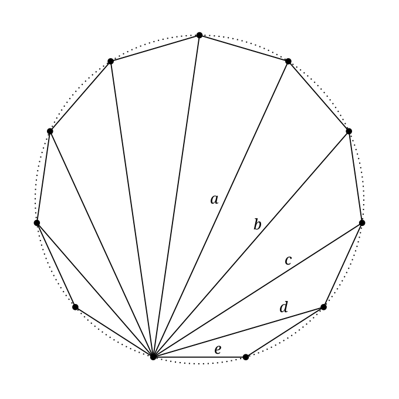
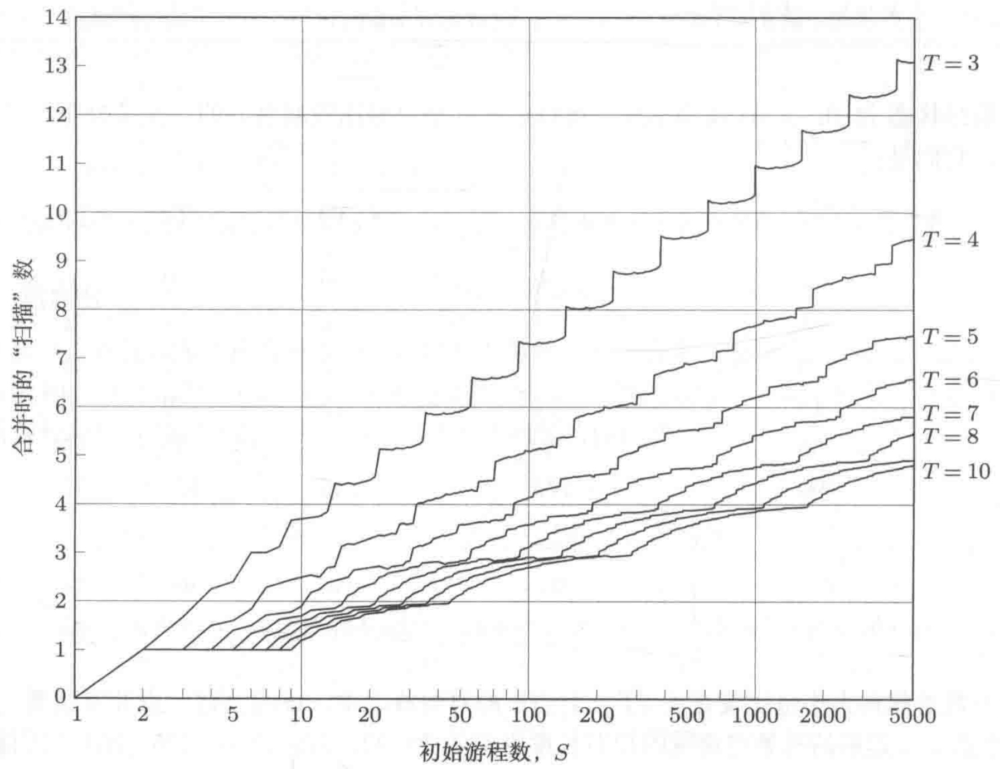
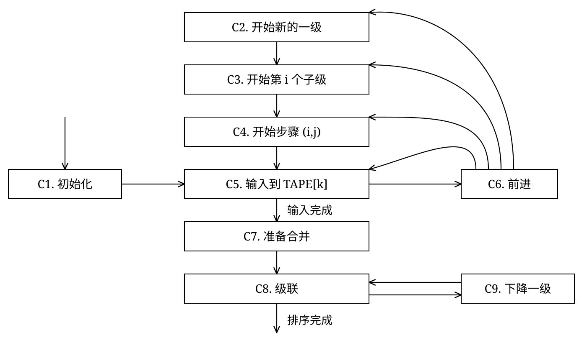

# *5.4.3　级联合并

实际上, 在发现多阶段合并之前就已经发现另外一种被称为 “级联合并” 的基本模式 [伯纳德·贝茨和卡特,*ACM National Meeting* **14** (1959), Paper 14]. 下表给出对六条磁带和 190 个初始游程应用这种方法的过程, 沿用 5.4.2 节确定的标记法:

<table data-cascade190="true" style="white-space:nowrap"><thead><tr><th></th>
<th>T1</th>
<th>T2</th>
<th>T3</th>
<th>T4</th>
<th>T5</th>
<th>T6</th>
<th>所处理的初始游程</th></tr></thead><tbody>
<tr data-cascade190-row="0" style="height:45px"><td>扫描 1</td>
<td data-cascade190-tape="true">$1^{55}$</td>
<td data-cascade190-tape="true">$1^{50}$</td>
<td data-cascade190-tape="true">$1^{41}$</td>
<td data-cascade190-tape="true">$1^{29}$</td>
<td data-cascade190-tape="true">$1^{15}$</td>
<td data-cascade190-tape="true">—</td>
<td>190</td></tr>
<tr data-cascade190-row="1" style="height:45px"><td>扫描 2</td>
<td data-cascade190-tape="true">—</td>
<td data-cascade190-tape="true">$\ast 1^{5}$</td>
<td data-cascade190-tape="true">$2^{9}$</td>
<td data-cascade190-tape="true">$3^{12}$</td>
<td data-cascade190-tape="true">$4^{14}$</td>
<td data-cascade190-tape="true">$5^{15}$</td>
<td>190</td></tr>
<tr data-cascade190-row="2" style="height:45px"><td>扫描 3</td>
<td data-cascade190-tape="true">$15^{5}$</td>
<td data-cascade190-tape="true">$14^{4}$</td>
<td data-cascade190-tape="true">$12^{3}$</td>
<td data-cascade190-tape="true">$9^{2}$</td>
<td data-cascade190-tape="true">$\ast 5^{1}$</td>
<td data-cascade190-tape="true">—</td>
<td>190</td></tr>
<tr data-cascade190-row="3" style="height:45px"><td>扫描 4</td>
<td data-cascade190-tape="true">—</td>
<td data-cascade190-tape="true">$\ast 15^{1}$</td>
<td data-cascade190-tape="true">$29^{1}$</td>
<td data-cascade190-tape="true">$41^{1}$</td>
<td data-cascade190-tape="true">$50^{1}$</td>
<td data-cascade190-tape="true">$55^{1}$</td>
<td>190</td></tr>
<tr data-cascade190-row="4" style="height:45px"><td>扫描 5</td>
<td data-cascade190-tape="true">$190^{1}$</td>
<td data-cascade190-tape="true">—</td>
<td data-cascade190-tape="true">—</td>
<td data-cascade190-tape="true">—</td>
<td data-cascade190-tape="true">—</td>
<td data-cascade190-tape="true">—</td>
<td>190</td></tr>
</tbody></table>

级联合并与多阶段合并类似, 也是首先从游程在磁带上的 “完美分布” 入手, 尽管完美分布的规则与 5.4.2 节多少有些不同. 表中的每一行都表示对所有数据的一遍完整扫描. 例如, 第二遍扫描的过程如下: 把来自{T1,T2,T3,T4,T5}的游程五路合并到 T6, 直到 T5 为空 (这样会把相对长度为 5 的 15 个游程放到 T6 上), 然后把来自{T1,T2,T3,T4}的游程四路合并到 T5, 接下来是三路合并到 T4, 两路合并到 T3, 最后是从 T1 到 T2 的一路合并 (复制操作). 第三遍扫描以相同方式进行: 首先进行五路合并, 直到一条磁带变为空, 接着是四路合并, 以此类推. (这一节的编号也许应当是 5.4.3.2.1, 而不是 5.4.3!)

显然, 复制操作不是必需的, 可以省略. 但实际上, 在六磁带情形中, 这种复制操作只占总时间的很少一部分. 上表中标有星号的项就是那些简单地被复制的项, 在所处理的 950 个游程中仅有 25 个属于这种类型. 大多数时间都花费在五路和四路合并上.

乍看起来, 与多阶段合并相比, 级联模式似乎是一个相当糟糕的选择, 因为标准多阶段合并始终使用 $T-1$ 路合并, 而级联合并使用了 $T-1$ 路、$T-2$ 路、$T-3$ 路合并, 等等. 但事实上, 在六条或更多磁带上, 级联合并会逐渐优于多阶段合并! 我们在 5.4.2 节已经看到, 高阶合并不一定能够保证高效. 表 1 给出级联合并的性能特征, 与 5.4.2 节中的相似表进行了类比.

表 1　级联合并排序的近似特性

<table data-cascade1="true" style="white-space:nowrap"><thead><tr>
<th>磁带</th>
<th>扫描 (有复制)</th>
<th>扫描 (无复制)</th>
<th>增长率</th>
</tr></thead><tbody>
<tr data-cascade1-row="0" style="height:45px"><td>3</td><td>$2.078\ln S+0.672$</td><td>$1.504\ln S+0.992$</td><td>1.6180340</td></tr>
<tr data-cascade1-row="1" style="height:45px"><td>4</td><td>$1.235\ln S+0.754$</td><td>$1.102\ln S+0.820$</td><td>2.2469796</td></tr>
<tr data-cascade1-row="2" style="height:45px"><td>5</td><td>$0.946\ln S+0.796$</td><td>$0.897\ln S+0.800$</td><td>2.8793852</td></tr>
<tr data-cascade1-row="3" style="height:45px"><td>6</td><td>$0.796\ln S+0.821$</td><td>$0.773\ln S+0.808$</td><td>3.5133371</td></tr>
<tr data-cascade1-row="4" style="height:45px"><td>7</td><td>$0.703\ln S+0.839$</td><td>$0.691\ln S+0.822$</td><td>4.1481149</td></tr>
<tr data-cascade1-row="5" style="height:45px"><td>8</td><td>$0.639\ln S+0.852$</td><td>$0.632\ln S+0.834$</td><td>4.7833861</td></tr>
<tr data-cascade1-row="6" style="height:45px"><td>9</td><td>$0.592\ln S+0.861$</td><td>$0.587\ln S+0.845$</td><td>5.4189757</td></tr>
<tr data-cascade1-row="7" style="height:45px"><td>10</td><td>$0.555\ln S+0.869$</td><td>$0.552\ln S+0.854$</td><td>6.0547828</td></tr>
<tr data-cascade1-row="8" style="height:45px"><td>20</td><td>$0.397\ln S+0.905$</td><td>$0.397\ln S+0.901$</td><td>12.4174426</td></tr>
</tbody></table>

由最终状态 $(1,0,\ldots,0)$ 反向推演, 可以很轻松地推导出级联合并的 “完美分布”. 对于六条磁带, 它们是:

<table data-cascade-dist="true" style="white-space:nowrap"><thead><tr>
<th>级</th>
<th>T1</th>
<th>T2</th>
<th>T3</th>
<th>T4</th>
<th>T5</th>
<th></th>
</tr></thead><tbody>
<tr data-cascade-dist-row="0" style="height:43px"><td>0</td><td data-source-number="true">1</td><td data-source-number="true">0</td><td data-source-number="true">0</td><td data-source-number="true">0</td><td data-source-number="true">0</td><td></td></tr>
<tr data-cascade-dist-row="1" style="height:43px"><td>1</td><td data-source-number="true">1</td><td data-source-number="true">1</td><td data-source-number="true">1</td><td data-source-number="true">1</td><td data-source-number="true">1</td><td></td></tr>
<tr data-cascade-dist-row="2" style="height:43px"><td>2</td><td data-source-number="true">5</td><td data-source-number="true">4</td><td data-source-number="true">3</td><td data-source-number="true">2</td><td data-source-number="true">1</td><td></td></tr>
<tr data-cascade-dist-row="3" style="height:43px"><td>3</td><td data-source-number="true">15</td><td data-source-number="true">14</td><td data-source-number="true">12</td><td data-source-number="true">9</td><td data-source-number="true">5</td><td></td></tr>
<tr data-cascade-dist-row="4" style="height:43px"><td>4</td><td data-source-number="true">55</td><td data-source-number="true">50</td><td data-source-number="true">41</td><td data-source-number="true">29</td><td data-source-number="true">15</td><td></td></tr>
<tr data-cascade-dist-row="5" style="height:43px"><td>5</td><td data-source-number="true">190</td><td data-source-number="true">175</td><td data-source-number="true">146</td><td data-source-number="true">105</td><td data-source-number="true">55</td><td></td></tr>
<tr><td colspan="7" style="text-align:center">⋯</td></tr>
<tr data-cascade-dist-symbolic="0"><td>$n$</td><td>$a_n$</td><td>$b_n$</td><td>$c_n$</td><td>$d_n$</td><td>$e_n$</td><td></td></tr>
<tr data-cascade-dist-symbolic="1"><td>$n+1$</td><td>$a_n+b_n+c_n+d_n+e_n$</td><td>$a_n+b_n+c_n+d_n$</td><td>$a_n+b_n+c_n$</td><td>$a_n+b_n$</td><td>$a_n$</td><td>(1)</td></tr>
<tr><td colspan="7" style="text-align:center">⋯</td></tr></tbody></table>

这些数的相对大小也出现在正 $2T-1$ 边形的对角线之中, 注意到这一点非常重要. 例如, 图 73 中正十一边形的五条对角线的相对长度近似等于 190、175、146、105、55! 我们将在本节后面证明这一值得注意的事实, 还会看到在 $T-1$ 路合并、$T-2$ 路合并、…、一路合并中, 花费的相对时间与这些对角线长度的平方近似成正比.

图 73　级联数的几何解释

**游程的初始分布.** 当初始游程的实际数目不完美时, 可以像过去一样插入虚拟游程. 对这种情况进行一点粗略分析就会看出, 分配虚拟游程的方法是无关紧要的, 因为级联合并是由完整扫描进行操作的. 如果有 190 个初始游程, 则每条记录会和上面的示例中一样被处理五次, 但如果有 191 个初始游程, 显然必须上升一级, 每条记录被处理六次. 幸运的是, 这种剧烈变化并不是必需的. 弗格森找到一种分配初始游程的方法, 使第一遍合并扫描过程中执行的许多操作都简化为复制一条磁带上的内容. 在绕过这些复制关系时 (只需像算法 5.4.2D 中那样, 相对于 “物理” 编号改变 “逻辑” 磁带单元编号就可以实现), 我们可以获得从一级到另一级的平滑过渡, 如图 74 所示.

图 74　采用算法 D 的分布时级联合并的效率

假定 $(a,b,c,d,e)$ 是一种完美分布, 其中 $a\ge b\ge c\ge d\ge e$. 通过重新定义逻辑磁带单元与物理磁带单元之间的对应关系, 我们可以想象, 该分布实际上是 $(e,d,c,b,a)$, 其中有 $a$ 个游程在 T5 上, 有 $b$ 个游程在 T4 上, 以此类推. 下一个完美分布是 $(a+b+c+d+e,a+b+c+d,a+b+c,a+b,a)$. 如果在到达下一级之前输入穷尽, 则假定这些磁带分别包含 $(D_1,D_2,D_3,D_4,D_5)$ 个虚拟游程, 其中:

$$
\begin{aligned}
&D_1\le a+b+c+d,\quad D_2\le a+b+c,\quad D_3\le a+b,\quad D_4\le a,\quad D_5=0;\\
&D_1\ge D_2\ge D_3\ge D_4\ge D_5.
\end{aligned}\tag{2}
$$

我们可以自由地想象虚拟游程出现在磁带上的任何方便的位置. 假定第一遍合并扫描通过五路合并生成 $a$ 个游程, 然后通过四路合并生成 $b$ 个游程, 以此类推, 我们的目的是通过虚拟游程的摆放, 用复制替代合并. 按以下方式进行第一遍合并扫描是很方便的.
**1.** 如果 $D_4=a$, 则 $D_1,D_2,D_3,D_4$ 中的每一个都减去 $a$, 并假装 T5 是合并的结果. 如果 $D_4<a$, 则合并来自磁带 T1 至 T5 上的 $a$ 个游程, 并尽可能少使用磁带 T1 至 T5 上的虚拟游程, 使得 $D_1,D_2,D_3,D_4$ 的新值满足

$$
D_1\le b+c+d,\quad D_2\le b+c,\quad D_3\le b,\quad D_4=0;\qquad D_1\ge D_2\ge D_3\ge D_4.\tag{3}
$$

于是, 如果 $D_2$ 最初 $\le b+c$, 我们在这一步不会使用来自它的虚拟游程, 而如果 $b+c<D_2\le a+b+c$, 我们恰好使用其中的 $D_2-b-c$ 个.

**2.** (这一步类似于第 1 步, 但进行了 “移位”.) 如果 $D_3=b$, 则 $D_1,D_2,D_3$ 中的每一个都减去 $b$, 并假装 T4 是合并的结果. 如果 $D_3<b$, 则合并来自磁带 T1 至 T4 上的 $b$ 个游程, 在必要时减少虚拟游程数目, 以满足

$$
D_1\le c+d,\quad D_2\le c,\quad D_3=0;\qquad D_1\ge D_2\ge D_3.
$$

**3.** 以此类推.

通过考虑 (1) 中从第 3 级至第 4 级的过程, 可以说明弗格森向磁带上分发游程的方法. 假定 “逻辑” 磁带 (T1,…,T5) 分别包含 $(5,9,12,14,15)$ 个游程, 而且我们希望最终把它增大至 $(55,50,41,29,15)$. 这个过程可以归纳如表 2. 首先在 T1 上放置 9 个游程, 然后在 T1 和 T2 上放置 (3,12) 个游程, 等等. 如果输入内容在比如说步骤 (3,2) 期间穷尽, 则 “节省的数量” 为 $15+9+5$, 也就是说, 通过放置虚拟游程避免了 15 个游程的五路合并、9 个游程的两路合并、5 个游程的一路合并. 换句话说, 在第一遍合并阶段第 3 级中有 $15+9+5$ 个游程未处理.

表 2　级联分布步骤示例

<table data-cascade-steps="true" style="white-space:nowrap"><thead><tr><th></th>
<th>添加到 T1</th>
<th>添加到 T2</th>
<th>添加到 T3</th>
<th>添加到 T4</th>
<th>添加到 T5</th>
<th>“节省的数量”</th></tr></thead><tbody>
<tr data-cascade-steps-row="0" style="height:43px"><td>步骤 (1,1)</td><td data-source-number="true">9</td><td data-source-number="true">0</td><td data-source-number="true">0</td><td data-source-number="true">0</td><td data-source-number="true">0</td><td data-saved-expression="true">$15+14+12+5$</td></tr>
<tr data-cascade-steps-row="1" style="height:43px"><td>步骤 (2,2)</td><td data-source-number="true">3</td><td data-source-number="true">12</td><td data-source-number="true">0</td><td data-source-number="true">0</td><td data-source-number="true">0</td><td data-saved-expression="true">$15+14+9+5$</td></tr>
<tr data-cascade-steps-row="2" style="height:43px"><td>步骤 (2,1)</td><td data-source-number="true">9</td><td data-source-number="true">0</td><td data-source-number="true">0</td><td data-source-number="true">0</td><td data-source-number="true">0</td><td data-saved-expression="true">$15+14+5$</td></tr>
<tr data-cascade-steps-row="3" style="height:43px"><td>步骤 (3,3)</td><td data-source-number="true">2</td><td data-source-number="true">2</td><td data-source-number="true">14</td><td data-source-number="true">0</td><td data-source-number="true">0</td><td data-saved-expression="true">$15+12+5$</td></tr>
<tr data-cascade-steps-row="4" style="height:43px"><td>步骤 (3,2)</td><td data-source-number="true">3</td><td data-source-number="true">12</td><td data-source-number="true">0</td><td data-source-number="true">0</td><td data-source-number="true">0</td><td data-saved-expression="true">$15+9+5$</td></tr>
<tr data-cascade-steps-row="5" style="height:43px"><td>步骤 (3,1)</td><td data-source-number="true">9</td><td data-source-number="true">0</td><td data-source-number="true">0</td><td data-source-number="true">0</td><td data-source-number="true">0</td><td data-saved-expression="true">$15+5$</td></tr>
<tr data-cascade-steps-row="6" style="height:43px"><td>步骤 (4,4)</td><td data-source-number="true">1</td><td data-source-number="true">1</td><td data-source-number="true">1</td><td data-source-number="true">15</td><td data-source-number="true">0</td><td data-saved-expression="true">$14+5$</td></tr>
<tr data-cascade-steps-row="7" style="height:43px"><td>步骤 (4,3)</td><td data-source-number="true">2</td><td data-source-number="true">2</td><td data-source-number="true">14</td><td data-source-number="true">0</td><td data-source-number="true">0</td><td data-saved-expression="true">$12+5$</td></tr>
<tr data-cascade-steps-row="8" style="height:43px"><td>步骤 (4,2)</td><td data-source-number="true">3</td><td data-source-number="true">12</td><td data-source-number="true">0</td><td data-source-number="true">0</td><td data-source-number="true">0</td><td data-saved-expression="true">$9+5$</td></tr>
<tr data-cascade-steps-row="9" style="height:43px"><td>步骤 (4,1)</td><td data-source-number="true">9</td><td data-source-number="true">0</td><td data-source-number="true">0</td><td data-source-number="true">0</td><td data-source-number="true">0</td><td data-saved-expression="true">$5$</td></tr>
</tbody></table>

下面详细描述该过程.

**算法 C (采用特殊分布的级联合并排序).** 算法取得初始游程并把它们分发到磁带上, 每次处理一个游程, 直到所提供的初始游程穷尽为止. 随后, 假定有 $T\ge3$ 个可用磁带单元, 指明如何利用最多 $T-1$ 路合并来合并这些磁带, 并避免不必要的一路合并. 磁带 $T$ 可用于保存输入, 因为它没有包含任何初始游程. 维护下面的各个数组:

A[j], $1\le j\le T$: 我们最近达到的完美级联分布.

AA[j], $1\le j\le T$: 我们尝试实现的完美级联分布.

D[j], $1\le j\le T$: 假定在第 $j$ 号逻辑磁带单元上存在的虚拟游程数目.

M[j], $1\le j<T$: 期望在第 $j$ 号逻辑磁带单元上存在的最大虚拟游程数目.

TAPE[j], $1\le j\le T$: 对应于第 $j$ 号逻辑磁带单元的物理磁带单元编号.

**C1.[初始化.]** 对于 $2\le k\le T$ 置 $\mathtt{A}[k]\leftarrow\mathtt{AA}[k]\leftarrow\mathtt{D}[k]\leftarrow0$, 并置 A[1]←0, AA[1]←1, D[1]←1. 对于 $1\le k\le T$ 置 $\mathtt{TAPE}[k]\leftarrow k$. 最后置 $i\leftarrow T-2,j\leftarrow1,k\leftarrow1,l\leftarrow0,m\leftarrow1$, 并转到 C5. (这些操作是启动整个过程的一种方法: 通过恰当地设定控制变量, 正好跳入内层循环.)

**C2.[开始新的一级.]** (我们刚才已经实现了一种完美分布, 因为还有更多输入, 所以必须为下一级做好准备.)$l$ 增 1. 对于 $1\le k\le T$, 置 A[k]←AA[k]. 然后, 按照 $k=1,2,\ldots,T-1$ 的顺序置 $\mathtt{AA}[T-k]\leftarrow\mathtt{AA}[T-k+1]+\mathtt{A}[k]$. 置

$$
(\mathtt{TAPE}[1],\ldots,\mathtt{TAPE}[T-1])\leftarrow(\mathtt{TAPE}[T-1],\ldots,\mathtt{TAPE}[1]),
$$

对于 $1\le k<T$, 置 D[k]←AA[k+1]. 最后置 $i\leftarrow1$.

**C3.[开始第 $i$ 个子级.]** 置 $j\leftarrow i$. (变量 $i$ 和 $j$ 表示表 2 所给示例中的 “步骤 $(i,j)$”.)

**C4.[开始步骤 $(i,j)$.]** 置 $k\leftarrow j,m\leftarrow\mathtt{A}[T-j-1]$. 如果 $m=0$ 且 $i=j$, 则置 $i\leftarrow T-2$, 并返回 C3; 如果 $m=0$ 且 $i\ne j$ 则返回 C2. (变量 $m$ 表示有待写到 TAPE[k] 上的游程数, 仅当 $l=1$ 时 $m=0$.)

**C5.[输入到 TAPE[k].]** 把一个游程写到第 TAPE[k] 号磁带, D[k] 减 1. 然后, 如果输入穷尽, 则回卷所有磁带并转到 C7.

**C6.[前进.]** $m$ 减 1. 如果 $m>0$ 则返回 C5. 否则, $k$ 减 1; 如果 $k>0$ 则置 $m\leftarrow\mathtt{A}[T-j-1]-\mathtt{A}[T-j]$, 并且如果 $m>0$ 则返回 C5. 否则, $j$ 减 1; 如果 $j>0$ 则转到 C4. 否则, $i$ 增 1; 如果 $i<T-1$ 则返回 C3. 否则转到 C2.

**C7.[准备合并.]** (这时初始分布已经完成, AA、D、TAPE 诸表描述了这些磁带的当前状态.) 对于 $1\le k<T$ 置 M[k]←AA[k+1], 并置 FIRST←1. (变量 FIRST 仅在第一遍合并扫描期间不等于零.)

**C8.[级联.]** 如果 $l=0$ 则停止: 排序完成, 输出位于 TAPE[1]. 否则, 按照 $p=T-1,T-2,\ldots,1$ 的顺序从 TAPE[1],…,TAPE[p] 向 TAPE[p+1] 执行 $p$ 路合并, 如下所示:

如果 $p=1$, 则模拟一路合并: 回卷 TAPE[2], 然后交换 TAPE[1]↔TAPE[2].

否则, 如果 FIRST=1 且 D[p−1]=M[p−1], 则模拟 $p$ 路合并: 交换 TAPE[p]↔TAPE[p+1], 回卷 TAPE[p], 并从每一个 D[1],…,D[p−1], M[1],…,M[p−1] 中减去 M[p−1].

否则, 从每一个 M[1],…,M[p−1] 中减去 M[p−1]. 然后对于每一个满足 $1\le j\le p$ 且 D[j]≤M[j] 的 TAPE[j] 合并一个游程, 从每一个满足 $1\le j\le p$ 且 D[j]>M[j] 的 D[j] 中减去 1; 并把输出放到 TAPE[p+1]. 继续执行这些操作直到 TAPE[p] 为空. 然后回卷 TAPE[p] 和 TAPE[p+1].

**C9.[下降一级.]** $l$ 减 1, 置 FIRST←0,

$$
(\mathtt{TAPE}[1],\ldots,\mathtt{TAPE}[T])\leftarrow(\mathtt{TAPE}[T],\ldots,\mathtt{TAPE}[1]).
$$

(这时所有 D 和 M 均为零, 并将保持下去.) 返回 C8. $\blacksquare$

图 75　采用特殊分布的级联合并

这个算法的步骤 C1–C6 进行分布, 步骤 C7–C9 进行合并. 这两部分彼此独立, 有可能在相同的存储单元中存储 M[k] 和 AA[k+1].

**级联合并的分析.** 分析级联合并要比分析多阶段合并困难一些, 但由于存在如此之多的值得注意的公式, 所以这个分析特别有趣. 在继续阅读之前, 建议喜欢离散数学的读者自行研究级联分布, 这些数拥有一些不同寻常的性质, 探索它们是一件乐事. 我们将讨论众多分析方法中的一种, 并强调可能发现这些结果的研究方法.

为方便起见, 我们考虑六磁带情形, 并寻找可以推广到所有 $T$ 值的公式. 关系 (1) 导出第一个基本模式:

$$
\begin{aligned}
a_n&=a_n&&=\binom00a_n,\\
b_n&=a_n-e_{n-1}\\
&=a_n-a_{n-2}&&=\binom10a_n-\binom22a_{n-2},\\
c_n&=b_n-d_{n-1}\\
&=b_n-a_{n-2}-b_{n-2}&&=\binom20a_n-\binom32a_{n-2}+\binom44a_{n-4},\\
d_n&=c_n-c_{n-1}\\
&=c_n-a_{n-2}-b_{n-2}-c_{n-2}&&=\binom30a_n-\binom42a_{n-2}+\binom54a_{n-4}-\binom66a_{n-6},\\
e_n&=d_n-b_{n-1}\\
&=d_n-a_{n-2}-b_{n-2}-c_{n-2}-d_{n-2}&&=\binom40a_n-\binom52a_{n-2}+\binom64a_{n-4}-\binom76a_{n-6}+\binom88a_{n-8}.
\end{aligned}\tag{4}
$$

设 $A(z)=\sum_{n\ge0}a_nz^n,\ldots,E(z)=\sum_{n\ge0}e_nz^n$, 并定义多项式

$$
\begin{aligned}
q_m(z)&=\binom m0-\binom{m+1}2z^2+\binom{m+2}4z^4-\cdots\\
&=\sum_k\binom{m+k}{2k}(-1)^kz^{2k}=\sum_{k=0}^m\binom{2m-k}k(-1)^{m-k}z^{2m-2k}.
\end{aligned}\tag{5}
$$

式 (4) 的结果总结如下: 生成函数 $B(z)-q_1(z)A(z),C(z)-q_2(z)A(z),D(z)-q_3(z)A(z),E(z)-q_4(z)A(z)$ 化简为有限和, 对应于 $a_{-1},a_{-2},a_{-3},\ldots$ 的值, 这些值在 $n$ 较小时会出现在式 (4) 中, 但不会出现在 $A(z)$ 中. 为了提供适当的边界条件, 我们反向递推到第−8 级:

<table data-cascade-negative="true" style="white-space:nowrap"><thead><tr>
<th>$n$</th>
<th>$a_n$</th>
<th>$b_n$</th>
<th>$c_n$</th>
<th>$d_n$</th>
<th>$e_n$</th>
</tr></thead><tbody>
<tr data-cascade-negative-row="0" style="height:43px"><td>0</td><td data-source-number="true">1</td><td data-source-number="true">0</td><td data-source-number="true">0</td><td data-source-number="true">0</td><td data-source-number="true">0</td></tr>
<tr data-cascade-negative-row="1" style="height:43px"><td>-1</td><td data-source-number="true">0</td><td data-source-number="true">0</td><td data-source-number="true">0</td><td data-source-number="true">0</td><td data-source-number="true">1</td></tr>
<tr data-cascade-negative-row="2" style="height:43px"><td>-2</td><td data-source-number="true">1</td><td data-source-number="true">−1</td><td data-source-number="true">0</td><td data-source-number="true">0</td><td data-source-number="true">0</td></tr>
<tr data-cascade-negative-row="3" style="height:43px"><td>-3</td><td data-source-number="true">0</td><td data-source-number="true">0</td><td data-source-number="true">0</td><td data-source-number="true">−1</td><td data-source-number="true">2</td></tr>
<tr data-cascade-negative-row="4" style="height:43px"><td>-4</td><td data-source-number="true">2</td><td data-source-number="true">−3</td><td data-source-number="true">1</td><td data-source-number="true">0</td><td data-source-number="true">0</td></tr>
<tr data-cascade-negative-row="5" style="height:43px"><td>-5</td><td data-source-number="true">0</td><td data-source-number="true">0</td><td data-source-number="true">1</td><td data-source-number="true">−4</td><td data-source-number="true">5</td></tr>
<tr data-cascade-negative-row="6" style="height:43px"><td>-6</td><td data-source-number="true">5</td><td data-source-number="true">−9</td><td data-source-number="true">5</td><td data-source-number="true">−1</td><td data-source-number="true">0</td></tr>
<tr data-cascade-negative-row="7" style="height:43px"><td>-7</td><td data-source-number="true">0</td><td data-source-number="true">−1</td><td data-source-number="true">6</td><td data-source-number="true">−14</td><td data-source-number="true">14</td></tr>
<tr data-cascade-negative-row="8" style="height:43px"><td>-8</td><td data-source-number="true">14</td><td data-source-number="true">−28</td><td data-source-number="true">20</td><td data-source-number="true">−7</td><td data-source-number="true">1</td></tr>
</tbody></table>

(当有七条磁带时, 这个表格是类似的, 只是 $n$ 为奇数的项会向右偏移一列.) 对计算机科学家来说, 序列 $a_0,a_{-2},a_{-4},\ldots=1,1,2,5,14,\ldots$ 绝对是一个提示, 因为它与如此之多的递推算法相关联而出现 (例如习题 2.2.1–4 和式 2.3.4.4–(14)). 因此我们推测在 $T$ 磁带情形中

$$
\begin{aligned}
a_{-2n}&=\binom{2n}n\frac1{n+1},&&0\le n\le T-2;\\
a_{-2n-1}&=0,&&0\le n\le T-3.
\end{aligned}\tag{6}
$$

为了验证这个推测的正确性, 只需证明式 (6) 和 (4) 会对第 0 级和第 1 级生成正确结果. 在第 1 级这是显而易见的, 而在第 0 级, 我们必须验证: 对于 $0\le m\le T-2$ 有

$$
\begin{aligned}
&\binom m0a_0-\binom{m+1}2a_{-2}+\binom{m+2}4a_{-4}-\binom{m+3}6a_{-6}+\cdots\\
&\qquad=\sum_{k\ge0}\binom{m+k}{2k}\binom{2k}k\frac{(-1)^k}{k+1}=\delta_{m0},
\end{aligned}\tag{7}
$$

幸好可以用标准方法求这个和值, 事实上它是 1.2.6 节的示例 2.

现在我们可以计算 $B(z)-q_1(z)A(z)$ 等的系数. 例如, 考虑 $D(z)-q_3(z)A(z)$ 中 $z^{2m}$ 的系数, 根据 1.2.6 节示例 3 的结果, 它是

$$
\begin{aligned}
\sum_{k\ge0}\binom{3+m+k}{2m+2k}(-1)^{m+k}a_{-2k}&=\sum_{k\ge0}\binom{3+m+k}{2m+2k}\binom{2k}k\frac{(-1)^{m+k}}{k+1}\\
&=(-1)^m\left(\binom{2+m}{2m-1}-\binom{3+m}{2m}\right)\\
&=(-1)^{m+1}\binom{2+m}{2m},
\end{aligned}
$$

因此我们已经推导出

$$
\begin{aligned}
A(z)&=q_0(z)A(z),\\
B(z)&=q_1(z)A(z)-q_0(z),\\
C(z)&=q_2(z)A(z)-q_1(z),\\
D(z)&=q_3(z)A(z)-q_2(z),\\
E(z)&=q_4(z)A(z)-q_3(z).
\end{aligned}\tag{8}
$$

此外有 $e_{n+1}=a_n$, 因此 $zA(z)=E(z)$ 且

$$
A(z)=q_3(z)/(q_4(z)-z).\tag{9}
$$

我们已经利用 $q$ 多项式推导出生成函数, 现在希望更好地了解这些 $q$. 习题 1.2.9–15 很有帮助, 它为我们提供一种闭合式, 可以写作

$$
q_m(z)=\frac{\bigl((\sqrt{4-z^2}+iz)/2\bigr)^{2m+1}+\bigl((\sqrt{4-z^2}-iz)/2\bigr)^{2m+1}}{\sqrt{4-z^2}}.\tag{10}
$$

现在令 $z=2\sin\theta$, 一切变得很简单:

$$
q_m(2\sin\theta)=\frac{(\cos\theta+i\sin\theta)^{2m+1}+(\cos\theta-i\sin\theta)^{2m+1}}{2\cos\theta}=\frac{\cos(2m+1)\theta}{\cos\theta}.\tag{11}
$$

(这种巧合让我们怀疑多项式 $q_m(z)$ 在数学上是为人们所熟知的. 确实, 看一下适当的表格就会知道, $q_m(z)$ 实际上是第二类切比雪夫多项式, 用常规符号表示就是 $(-1)^mU_{2m}(z/2)$.)

现在可以确定 (9) 中分母的根: 方程 $q_4(2\sin\theta)=2\sin\theta$ 化简为

$$
\cos9\theta=2\sin\theta\cos\theta=\sin2\theta.
$$

我们可以得出这个关系式的解: 只要 $\pm9\theta=2\theta+(2n-\tfrac12)\pi$ 即可. 假定 $\cos\theta\ne0$, 所有这些 $\theta$ 都是 (9) 中分母的根. (当 $\cos\theta=0$ 时, $q_m(\pm2)=(-1)^m(2m+1)$ 绝不等于 $\pm2$.) 从而得到 $q_4(z)-z=0$ 的八个不同的根:

$$
2\sin\frac{-5}{14}\pi,\quad2\sin\frac{-1}{14}\pi,\quad2\sin\frac3{14}\pi;\quad2\sin\frac{-7}{22}\pi,\quad2\sin\frac{-3}{22}\pi,\quad2\sin\frac1{22}\pi,\quad2\sin\frac5{22}\pi,\quad2\sin\frac9{22}\pi.
$$

由于 $q_4(z)$ 是八次多项式, 所以这里已经给出所有根. 这些值中的前三个使得 $q_3(z)=0$, 所以 $q_3(z)$ 和 $q_4(z)-z$ 有一个公因子是三次多项式. 如果把 (9) 展开为部分分式, 则其余五个根决定 $A(z)$ 的系数的渐近特性.

考虑一般的 $T$ 磁带情形, 令 $\theta_k=(4k+1)\pi/(4T-2)$. $T$ 磁带级联分布数的生成函数 $A(z)$ 有如下形式 (见习题 8):

$$
\frac4{2T-1}\sum_{-T/2<k<\lfloor T/2\rfloor}\frac{\cos^2\theta_k}{1-z/(2\sin\theta_k)},\tag{12}
$$

因此

$$
a_n=\frac4{2T-1}\sum_{-T/2<k<\lfloor T/2\rfloor}\cos^2\theta_k\left(\frac1{2\sin\theta_k}\right)^n.\tag{13}
$$

根据 (8) 中的等式现在可以得到类似的公式:

$$
\begin{aligned}
b_n&=\frac4{2T-1}\sum_{-T/2<k<\lfloor T/2\rfloor}\cos\theta_k\cos3\theta_k\left(\frac1{2\sin\theta_k}\right)^n,\\
c_n&=\frac4{2T-1}\sum_{-T/2<k<\lfloor T/2\rfloor}\cos\theta_k\cos5\theta_k\left(\frac1{2\sin\theta_k}\right)^n,\\
d_n&=\frac4{2T-1}\sum_{-T/2<k<\lfloor T/2\rfloor}\cos\theta_k\cos7\theta_k\left(\frac1{2\sin\theta_k}\right)^n,
\end{aligned}\tag{14}
$$

以此类推. 习题 9 表明, 这些公式对于所有 $n\ge0$ 都是成立的, 而不仅仅是对于大的 $n$ 才成立. 在每个和式中, $k=0$ 的项都高于其他各项, 特别是当 $n$ 相当大时. 因此 “增长率” 为

$$
\frac1{2\sin\theta_0}=\frac2\pi T-\frac1\pi+\frac\pi{48T}+O(T^{-2}).\tag{15}
$$

卡特最早分析级联排序, 他获得 $T$ 值较小时的数值结果 [*Proc. IFIP Congress* (1962), 62–66]; 弗格森也对此进行分析, 他发现增长率的渐近特性 (15) 中的前两项 [见 *CACM* **7** (1964), 297]. 1964 年夏, 弗洛伊德发现了增长率的显式形式 $1/(2\sin\theta_0)$, 从而对所有 $T$ 值都可以使用准确的公式. 乔治·拉尼独立对级联数进行全面分析, 他是通过另外一种截然不同的方式发现它们的, 与排序没有丝毫关系 [*Canadian J. Math.* **18** (1966), 332–349]. 拉尼观察到图 73 中的 “对角线比值” 原理, 并推导有关这些数的许多其他有趣性质. 弗洛伊德和拉尼在他们的证明中使用了矩阵处理 (见习题 6).

**级联排序的修改.** 如果再添加一条磁带, 就有可能在级联排序期间把几乎所有回卷时间重叠在一起. 例如, 我们可以把 T1–T5 合并到 T7, 然后把 T1–T4 合并到 T6, 然后把 T1–T3 合并到 T5 (它现在已经被回卷了), 然后把 T1–T2 合并到 T4, 当 T4 上相对较短的数据已经被回卷时, 就可以开始下一遍扫描了. 通过级联的分析可以预测这个过程的效率. (更多信息见 5.4.6 节.)

高德纳提出一种 “折中合并” 方案, 多阶段合并与级联合并都作为特例包含在内 [*CACM* **6** (1963), 585–587]. 每个阶段包含 $T-1$ 路、$T-2$ 路、…、$P$ 路合并, 其中 $P$ 是介于 1 与 $T-1$ 之间的任何固定数. 当 $P=T-1$ 时, 它就是多阶段合并; 当 $P=1$ 时, 它就是纯粹的级联合并; 当 $P=2$ 时, 它是没有复制阶段的级联合并. 查尔斯·拉德克 [*IBM Systems J.* **5** (1966), 226–247] 和威廉·伯奇 [*Proc. IFIP Congress* (1971), **1**, 454–459] 分析了这一方案. 伯奇推广了式 5.4.2–(16), 找出每个 $(P,T)$ 折中合并的生成函数 $\sum T_n(x)z^n$. 他给出当 $T=(3,4,5,6,7,8,9,10,11)$ 时, $P$ 的最佳值分别是 (2,3,3,4,4,4,3,3,4), 这里所说的最佳值是指当 $S\to\infty$ 时, 所处理的初始游程数目 (它是 $S$ 的函数) 最少, 此处采用直接分布方案并忽略回卷时间. 随着 $T$ 的增大, 这些 $P$ 值更多地倾向于级联合并, 而非多阶段合并. 事实表明, 折衷合并的性能绝不会显著优于级联合并本身. 另一方面, 如果根据 5.4.2 节的描述实现级别的最优选择和虚拟游程的最优分布, 纯粹的多阶段合并似乎是所有折衷合并中的最佳方案. 遗憾的是, 最优分布的实现相当困难.

索尔斯坦·约翰逊研究了平衡合并与多阶段合并的组合 [*BIT* **6** (1966), 129–143]. 马丁·戈茨提出平衡合并的回卷重叠变种 [*Digital Computer User's Handbook*, 梅尔文·克莱尔和格拉尼诺·科恩编辑, (New York: McGraw–Hill, 1967), 1.311–1.312]. 另外, 也可以设想许多其他混合方法.

#### 习题

**1. [10]** 利用表 1, 比较级联合并与 5.4.2 节介绍的多阶段合并磁带划分版本. 哪个更好一些? (忽略回卷时间.)　[答案](./answers/5-4-3.md#ans-5-4-3-1)

**▶ 2. [22]** 比较使用算法 C 的三磁带级联排序与使用算法 5.4.2D 的三磁带多阶段排序. 可以找到哪些异同点?　[答案](./answers/5-4-3.md#ans-5-4-3-2)

**3. [23]** 编制一张表格, 说明使用算法 C 对六条磁带上的 100 个初始游程排序会发生什么.　[答案](./answers/5-4-3.md#ans-5-4-3-3)

**4. [M20]** (乔治·拉尼)“第 $n$ 级级联分布” 是一个定义如下的多重集 (在六磁带情形中): $\{1,0,0,0,0\}$ 是第 0 级级联分布; 如果 $\{a,b,c,d,e\}$ 是第 $n$ 级级联分布, 则 $\{a+b+c+d+e,a+b+c+d,a+b+c,a+b,a\}$ 是第 $n+1$ 级级联分布. (多重集是无序的, 所以由一个第 $n$ 级分布可以构造出至多 $5!$ 种不同的第 $n+1$ 级分布.)　[答案](./answers/5-4-3.md#ans-5-4-3-4)

(a) 证明: 由互素整数组成的任意多重集 $\{a,b,c,d,e\}$ 都是对于某个 $n$ 的第 $n$ 级级联分布.

(b) 证明: 为级联排序定义的分布是最优的. 也就是说, 假定 $a\ge b\ge c\ge d\ge e$, 如果 $\{a,b,c,d,e\}$ 是任意第 $n$ 级分布, 则有 $a\le a_n,b\le b_n,c\le c_n,d\le d_n,e\le e_n$, 其中 $(a_n,b_n,c_n,d_n,e_n)$ 是 (1) 中定义的分布.

**▶ 5. [20]** 证明: (1) 中定义的级联数满足以下定律:　[答案](./answers/5-4-3.md#ans-5-4-3-5)

$$
a_ka_{n-k}+b_kb_{n-k}+c_kc_{n-k}+d_kd_{n-k}+e_ke_{n-k}=a_n,\qquad0\le k\le n.
$$

[提示: 考虑在一个完整级联排序的第 $k$ 遍扫描中输出了多少个不同长度的游程, 以此来解读这个关系式.]

**6. [M20]** 找出一个 $5\times5$ 矩阵 $Q$, 使得对于所有 $n\ge0$, $Q^n$ 的第一行包含六磁带级联数 $a_n\ b_n\ c_n\ d_n\ e_n$.　[答案](./answers/5-4-3.md#ans-5-4-3-6)

**7. [M20]** 假定正在把级联合并方法应用于 $a_n$ 个初始游程的一个完美分布, 试求在禁止一路合并时所节省的处理数目的公式.　[答案](./answers/5-4-3.md#ans-5-4-3-7)

**8. [HM23]** 推导 (12).　[答案](./answers/5-4-3.md#ans-5-4-3-8)

**9. [HM26]** 推导 (14).　[答案](./answers/5-4-3.md#ans-5-4-3-9)

**▶ 10. [M28]** 在开始研究级联数时, 不是使用模式 (4), 而是从下面的恒等式着手:　[答案](./answers/5-4-3.md#ans-5-4-3-10)

$$
\begin{aligned}
e_n&=a_{n-1}&&=\binom11a_{n-1},\\
d_n&=2a_{n-1}-e_{n-2}&&=\binom21a_{n-1}-\binom33a_{n-3},\\
c_n&=3a_{n-1}-d_{n-2}-2e_{n-2}&&=\binom31a_{n-1}-\binom43a_{n-3}+\binom55a_{n-5},
\end{aligned}
$$

等等. 令

$$
r_m(z)=\binom m1z-\binom{m+1}3z^3+\binom{m+2}5z^5-\cdots,
$$

用这些 $r$ 多项式来表示 $A(z),B(z)$, 等等.

**11. [M38]** 设　[答案](./answers/5-4-3.md#ans-5-4-3-11)

$$
f_m(z)=\sum_{k=0}^m\binom{\lfloor(m+k)/2\rfloor}k(-1)^{\lceil k/2\rceil}z^k.
$$

证明: $T$ 磁带级联数的生成函数 $A(z)$ 等于 $f_{T-3}(z)/f_{T-1}(z)$, 这个表达式中的分子与分母没有公因式.

**12. [M40]** 证明弗格森的分布方案是最优的. 也就是说, 假定在算法 C 的第一遍扫描期间使用步骤 C7–C9 的策略, 则采用满足 (2) 的虚拟游程其他任何放置方法, 都不会减少在第一遍扫描期间处理的初始游程数目.

**13. [40]** 正文中建议通过增加额外磁带来重叠大多数回卷时间. 探讨这个思想. (例如, 正文中的方案需要等待 T4 回卷, 如果在下一遍扫描的第一个合并阶段忽略 T4 会不会更好一些?)　[答案](./answers/5-4-3.md#ans-5-4-3-13)
