

### *5.4.4　反向读取磁带

许多磁带机具备按照与写入顺序相反的方向读取磁带的能力. 到目前为止, 我们遇到的合并模式都是以 “正向” 写入信息, 然后回卷磁带, 正向读取, 再回卷. 因此, 磁带文件就像是队列, 以 “先进先出” 方式运行. 反向读取可以消除上述两个回卷操作: 正向写入磁带, 反向读取. 在这种情况下, 磁带文件就像是栈, 因为它们以 “后进先出” 的方式被使用.

平衡合并、多阶段合并和级联合并模式都可以适用反向读取. 主要差别是, 当我们 “反向读正向写” 时, 合并过程颠倒了游程的顺序. 如果两个游程在磁带上为递增顺序, 我们可以在反向读取的同时合并它们, 但这样会得到递减顺序. 以这种方式生成的递减游程随后会在下一遍扫描中变为递增, 所以合并算法必须有能力以递增或递减顺序来处理游程. 程序员在第一次面对反向读取操作时, 经常会感到自己处于倒立状态!

作为反向读取的示例, 考虑使用四磁带平衡合并方法合并八个初始游程. 这些操作可以综述如下:

<table data-backwards-table="balanced8"><tr><th></th><th>T1</th><th>T2</th><th>T3</th><th>T4</th><th></th></tr><tr data-backwards-row="balanced8"><td>扫描 1</td><td data-backwards-field>$A_1A_1A_1A_1$</td><td data-backwards-field>$A_1A_1A_1A_1$</td><td data-backwards-field>—</td><td data-backwards-field>—</td><td>初始分布</td></tr><tr data-backwards-row="balanced8"><td>扫描 2</td><td data-backwards-field>—</td><td data-backwards-field>—</td><td data-backwards-field>$D_2D_2$</td><td data-backwards-field>$D_2D_2$</td><td>合并到 T3 和 T4</td></tr><tr data-backwards-row="balanced8"><td>扫描 3</td><td data-backwards-field>$A_4$</td><td data-backwards-field>$A_4$</td><td data-backwards-field>—</td><td data-backwards-field>—</td><td>合并到 T1 和 T2</td></tr><tr data-backwards-row="balanced8"><td>扫描 4</td><td data-backwards-field>—</td><td data-backwards-field>—</td><td data-backwards-field>$D_8$</td><td data-backwards-field>—</td><td>最终合并到 T3</td></tr></table>

其中的 $A_r$ 表示: 如果像在前面的示例中一样正向读取磁带, 则以递增顺序出现在磁带上、相对长度为 $r$ 的游程; $D_r$ 是长度为 $r$ 的递减游程的相应表示. 在第二遍扫描期间, 递增游程变为递减: 由于我们以反向读取 T1 和 T2, 所以它们在输入端表示为递减的. 随后, 在第三遍扫描中游程再次切换方向.

注意, 上述过程结束时, 输出结果在磁带 T3 上, 为递减顺序. 如果这个结果不符合要求 (具体取决于是反向读取结果, 还是直接把磁带拆下来留在一边供日后使用), 我们可以把它颠倒顺序复制到另一条磁带. 一种较快的方法是在第三遍扫描之后回卷 T1 和 T2, 在第四遍扫描期间生成 $A_8$; 还要更快一点的方法是在第一遍扫描期间从八个递减游程入手, 这样会交换所有 $A$ 和 $D$. 不过, 对十六个初始游程进行平衡合并时需要初始游程是递增的. 我们通常在事先不会知道将会构造多少初始游程, 所以有必要选择一种一致方向. 因此, 在第三遍扫描之后进行回卷的思想可能是最佳的.

级联合并以相同方式执行. 例如, 考虑排序四条磁带上的十四个初始游程:

<table data-backwards-table="cascade14"><tr><th></th><th>T1</th><th>T2</th><th>T3</th><th>T4</th></tr><tr data-backwards-row="cascade14"><td>扫描 1</td><td data-backwards-field>$A_1A_1A_1A_1A_1A_1$</td><td data-backwards-field>$A_1A_1A_1A_1A_1$</td><td data-backwards-field>$A_1A_1A_1$</td><td data-backwards-field>—</td></tr><tr data-backwards-row="cascade14"><td>扫描 2</td><td data-backwards-field>—</td><td data-backwards-field>$D_1$</td><td data-backwards-field>$D_2D_2$</td><td data-backwards-field>$D_3D_3D_3$</td></tr><tr data-backwards-row="cascade14"><td>扫描 3</td><td data-backwards-field>$A_6$</td><td data-backwards-field>$A_5$</td><td data-backwards-field>$A_3$</td><td data-backwards-field>—</td></tr><tr data-backwards-row="cascade14"><td>扫描 4</td><td data-backwards-field>—</td><td data-backwards-field>—</td><td data-backwards-field>—</td><td data-backwards-field>$D_{14}$</td></tr></table>

如果仍然是在最后一遍扫描之前回卷 T1、T2、T3, 将再次生成 $A_{14}$ 而不是 $D_{14}$. 这个表给出了一种 “纯粹” 的级联合并, 也就是说, 所有一路合并都是显式执行的. 如果像算法 5.4.3C 那样禁用复制操作, 在第二遍扫描后将面临以下情形:

<table data-backwards-table="suppressed-copy"><tr data-backwards-row="suppressed-copy"><td data-backwards-field>$A_1$</td><td data-backwards-field>—</td><td data-backwards-field>$D_2D_2$</td><td data-backwards-field>$D_3D_3D_3$</td></tr></table>

由于我们无法合并处于相反方向的这些游程, 所以就不可能再以三路合并继续下去! 如果在下一合并期间回卷 T1 并继续正向读取它 (同时反向读取 T3 和 T4), 就可以避免把 T1 复制到 T2 的操作. 但合并之后需要再次回卷 T1, 所以这个技巧是用两次回卷换取一次复制.

因此, 算法 5.4.3C 的分布方法对于反向读取的效率并不像正向读取那样高, 每当初始游程数目超过 “完美” 级联分布数时, 所需时间量会大幅跳升. 另外一种分散方法可用于实现完美级联分布之间的平滑过渡 (见习题 17).

**反向读取多阶段合并.** 乍看一眼 (甚至看上第二眼、第三眼), 多阶段合并方案似乎完全不适合反向读取. 例如, 假定我们有 13 个初始游程和三条磁带:

<table data-backwards-table="stuck13"><tr><th></th><th>T1</th><th>T2</th><th>T3</th></tr><tr data-backwards-row="stuck13"><td>阶段 1</td><td data-backwards-field>$A_1A_1A_1A_1A_1$</td><td data-backwards-field>$A_1A_1A_1A_1A_1A_1A_1A_1$</td><td data-backwards-field>—</td></tr><tr data-backwards-row="stuck13"><td>阶段 2</td><td data-backwards-field>—</td><td data-backwards-field>$A_1A_1A_1$</td><td data-backwards-field>$D_2D_2D_2D_2D_2$</td></tr></table>

现在遇到麻烦了. 我们可以回卷 T2 或 T3, 然后正向读取它, 而其他磁带则采用反向读取, 但这样会让事情变得纠结, 无法通过反向读取得到什么好处.

一种 “拯救” 这个情形的天才思路是使每条磁带上的游程方向交替变化. 这样合并过程就可以完美同步进行:

<table data-backwards-table="alternating13"><tr><th></th><th>T1</th><th>T2</th><th>T3</th></tr><tr data-backwards-row="alternating13"><td>阶段 1</td><td data-backwards-field>$A_1D_1A_1D_1A_1$</td><td data-backwards-field>$D_1A_1D_1A_1D_1A_1D_1A_1$</td><td data-backwards-field>—</td></tr><tr data-backwards-row="alternating13"><td>阶段 2</td><td data-backwards-field>—</td><td data-backwards-field>$D_1A_1D_1$</td><td data-backwards-field>$D_2A_2D_2A_2D_2$</td></tr><tr data-backwards-row="alternating13"><td>阶段 3</td><td data-backwards-field>$A_3D_3A_3$</td><td data-backwards-field>—</td><td data-backwards-field>$D_2A_2$</td></tr><tr data-backwards-row="alternating13"><td>阶段 4</td><td data-backwards-field>$A_3$</td><td data-backwards-field>$D_5A_5$</td><td data-backwards-field>—</td></tr><tr data-backwards-row="alternating13"><td>阶段 5</td><td data-backwards-field>—</td><td data-backwards-field>$D_5$</td><td data-backwards-field>$D_8$</td></tr><tr data-backwards-row="alternating13"><td>阶段 6</td><td data-backwards-field>$A_{13}$</td><td data-backwards-field>—</td><td data-backwards-field>—</td></tr></table>

罗素·吉尔斯塔德在他关于多阶段合并的开创性论文中简要提到这个原理, 在 *CACM* **6** (1963), 220–223 中做了更全面的描述.

对于任意条磁带上的多阶段合并, 这种 $ADA\ldots$ 技巧都可以正确发挥作用. 为了证明这些 $A$ 和 $D$ 在每个阶段都能正确同步, 只要假定初始分布扫描在每条磁带上都生成了交替出现的 $A$ 和 $D$, 而且每条磁带最终都以 $A$ 结束 (或者都以 $D$ 结束): 在某个阶段写到输出文件上的最后一个游程, 与来自输入文件中的最后一个游程方向相反, 因此, 在下一阶段它的游程方向总是正确的. 此外, 我们已经在习题 5.4.2–13 中看到, 大多数完美斐波那契分布都要求在一条磁带 (最终的输出磁带) 上有奇数个游程, 而在其他每条磁带上有偶数个游程. 如果 T1 被指定为最终输出磁带, 并且让 T1 以 $A$ 开头, 而其他磁带以 $D$ 开头, 就可以保证所有磁带都以 $A$ 游程结束. 可以使用一种类似于算法 5.4.2D 的分布方法, 修改成使得每一级的分布都以 T1 作为最终输出磁带. (我们跳过第 $1,T+1,2T+1,\ldots$ 级, 因为在这些级中, 最初为空的磁带是作为最终输出磁带的.) 例如, 在六磁带情形中, 我们使用以下分布数代替 5.4.2–(1):

<table data-backwards-distribution="1"><tr><th>级</th><th>T1</th><th>T2</th><th>T3</th><th>T4</th><th>T5</th><th>总数</th><th>最终输出所在磁带</th><th></th></tr><tr data-backwards-distribution-row><td>0</td><td data-source-number>1</td><td data-source-number>0</td><td data-source-number>0</td><td data-source-number>0</td><td data-source-number>0</td><td data-source-number>1</td><td>T1</td><td></td></tr><tr data-backwards-distribution-row><td>2</td><td data-source-number>1</td><td data-source-number>2</td><td data-source-number>2</td><td data-source-number>2</td><td data-source-number>2</td><td data-source-number>9</td><td>T1</td><td></td></tr><tr data-backwards-distribution-row><td>3</td><td data-source-number>3</td><td data-source-number>4</td><td data-source-number>4</td><td data-source-number>4</td><td data-source-number>2</td><td data-source-number>17</td><td>T1</td><td></td></tr><tr data-backwards-distribution-row><td>4</td><td data-source-number>7</td><td data-source-number>8</td><td data-source-number>8</td><td data-source-number>6</td><td data-source-number>4</td><td data-source-number>33</td><td>T1</td><td>(1)</td></tr><tr data-backwards-distribution-row><td>5</td><td data-source-number>15</td><td data-source-number>16</td><td data-source-number>14</td><td data-source-number>12</td><td data-source-number>8</td><td data-source-number>65</td><td>T1</td><td></td></tr><tr data-backwards-distribution-row><td>6</td><td data-source-number>31</td><td data-source-number>30</td><td data-source-number>28</td><td data-source-number>24</td><td data-source-number>16</td><td data-source-number>129</td><td>T1</td><td></td></tr><tr data-backwards-distribution-row><td>8</td><td data-source-number>61</td><td data-source-number>120</td><td data-source-number>116</td><td data-source-number>108</td><td data-source-number>92</td><td data-source-number>497</td><td>T1</td><td></td></tr></table>

因此, T1 总是得到奇数个游程, 而 T2 至 T5 获得偶数个游程, 这些游程数按递减顺序排列, 以便灵活安排虚拟游程. 这种分布的好处是: 无论存在多少个初始游程, 都能事先知道最终输出磁带. 事实上, 在使用这个方案时, 输出总是以递增顺序出现在 T1 上 (见习题 3).

戴维·古德温和约翰·维恩提出另外一种为反向读取多阶段合并进行分布处理的方法 [*CACM* **7** (1964), 315]. 我们几乎可以像在算法 5.4.2D 中一样进行游程分布, 首先在每条磁带上布置一个 $D$ 游程. 当输入穷尽时, 除非在所得到的分布中所有磁带上的游程数都是奇数, 否则设想在唯一的 “奇” 磁带的开头有一个虚拟 $A$ 游程. 设想其他虚拟游程或者位于磁带的末尾, 或者在中部成对出现. 有关虚拟游程最优放置的问题将在习题 5 中分析.

**最优合并模式.** 到目前为止, 我们讨论了各种在磁带上进行合并的模式, 但没有寻求 “最佳” 方法. 要确定最优模式十分困难, 尤其是在正向读取时, 回卷时间与合并时间的相互影响很难处理. 另一方面, 在通过反向读、正向写进行合并时, 所有回卷时间基本上都被消除, 从而有可能相当好地描述最优合并方法. 卡普针对这个问题引入一些非常有意义的解决方法, 现在讨论他提出的理论以结束本节.

首先, 我们需要一种更令人满意的方式来描述合并模式, 而不是使用上面用过的相当神秘的磁带内容表. 卡普为此提出两种方式: 合并模式的向量表示和树表示. 这两种表示形式在实践中都非常有用, 我们依次进行讨论.

合并模式的向量表示包括一系列 “合并向量” $y^{(m)}\ldots y^{(1)}\ y^{(0)}$, 其中每一个都有 $T$ 个元素. 倒数第 $i$ 个合并步骤用 $y^{(i)}$ 表示, 方式如下:

$$
y_j^{(i)}=\begin{cases}
+1,&\text{第 }j\text{ 号磁带是要合并的输入内容;}\\
0,&\text{第 }j\text{ 号磁带未在合并中使用;}\\
-1,&\text{第 }j\text{ 号磁带获得合并的输出结果.}
\end{cases}\tag{2}
$$

因此, $y^{(i)}$ 的元素中恰有一个为 $-1$, 其他元素都是 0 和 1. 最后的向量 $y^{(0)}$ 是特殊的: 它是一个单位向量, 如果最终排好序的输出出现在设备 $j$ 上, 则该向量的位置 $j$ 处为 1, 其他地方为 0. 这些定义意味着: 向量和

$$
v^{(i)}=y^{(i)}+y^{(i-1)}+\cdots+y^{(0)}\tag{3}
$$

表示就在倒数第 $i$ 个合并步骤之前磁带上的游程分布, 其中有 $v_j^{(i)}$ 个游程在磁带 $j$ 上. 特别地, $v^{(m)}$ 告诉我们初始分布扫描在每条磁带上放置了多少个游程.

在本节前面以表格形式描述的三种合并模式可以采用以下向量表示:

<table data-backwards-vector-examples><tr><th>平衡 $(T=4,S=8)$</th><th>级联 $(T=4,S=14)$</th><th>多阶段 $(T=3,S=13)$</th></tr><tr><td style="vertical-align:top" data-vector-example="平衡">$\begin{aligned}v^{(7)}&=(4,4,0,0)\\y^{(7)}&=(+1,+1,-1,0)\\y^{(6)}&=(+1,+1,0,-1)\\y^{(5)}&=(+1,+1,-1,0)\\y^{(4)}&=(+1,+1,0,-1)\\y^{(3)}&=(-1,0,+1,+1)\\y^{(2)}&=(0,-1,+1,+1)\\y^{(1)}&=(+1,+1,-1,0)\\y^{(0)}&=(0,0,1,0)\end{aligned}$</td><td style="vertical-align:top" data-vector-example="级联">$\begin{aligned}v^{(10)}&=(6,5,3,0)\\y^{(10)}&=(+1,+1,+1,-1)\\y^{(9)}&=(+1,+1,+1,-1)\\y^{(8)}&=(+1,+1,+1,-1)\\y^{(7)}&=(+1,+1,-1,0)\\y^{(6)}&=(+1,+1,-1,0)\\y^{(5)}&=(+1,-1,0,0)\\y^{(4)}&=(-1,+1,+1,+1)\\y^{(3)}&=(0,-1,+1,+1)\\y^{(2)}&=(0,0,-1,+1)\\y^{(1)}&=(+1,+1,+1,-1)\\y^{(0)}&=(0,0,0,1)\end{aligned}$</td><td style="vertical-align:top" data-vector-example="多阶段">$\begin{aligned}v^{(12)}&=(5,8,0)\\y^{(12)}&=(+1,+1,-1)\\y^{(11)}&=(+1,+1,-1)\\y^{(10)}&=(+1,+1,-1)\\y^{(9)}&=(+1,+1,-1)\\y^{(8)}&=(+1,+1,-1)\\y^{(7)}&=(-1,+1,+1)\\y^{(6)}&=(-1,+1,+1)\\y^{(5)}&=(-1,+1,+1)\\y^{(4)}&=(+1,-1,+1)\\y^{(3)}&=(+1,-1,+1)\\y^{(2)}&=(+1,+1,-1)\\y^{(1)}&=(-1,+1,+1)\\y^{(0)}&=(1,0,0)\end{aligned}$</td></tr></table>

把这些向量反向编号——$y^{(m)}$ 最先出现, $y^{(0)}$ 最后出现——看起来有些笨拙, 但事实证明, 这个奇特的视角对于发展该理论是有利的. 搜索最优方法的一种好方式是从已排序输出入手, 并设想将它 “分拆” 到各条磁带上, 然后再 “分拆” 这些磁带, 以此类推, 在操作过程中, 按排序过程中实际发生的逆向顺序依次考虑分布 $v^{(0)},v^{(1)},v^{(2)},\ldots$. 事实上, 这基本上就是我们在分析多阶段合并和级联合并时已经采用的方法. [^p238-1]

每种合并模式显然都有一种向量表示法. 反之, 容易看到当且仅当满足以下条件时, 向量序列 $y^{(m)}\ldots y^{(1)}y^{(0)}$ 对应于一种实际合并模式:

(i) $y^{(0)}$ 是单位向量.

(ii) 对于 $m\ge i\ge1$, $y^{(i)}$ 恰有一个元素等于 $-1$, 所有其他元素都等于 0 或 $+1$.

(iii) 对于 $m\ge i\ge1$, $y^{(i)}+\cdots+y^{(1)}+y^{(0)}$ 的所有元素非负.

合并模式的树表示是用另一种方式来表示同一信息. 我们构造一棵树, 每个初始游程在树中对应一个外部叶结点, 每个被合并的游程在树中对应一个内部结点, 这样, 每个内部结点的后代都是用来生成该结点所代表游程的游程. 每个内部结点上标有生成相应游程的步骤编号, 和在向量表示中一样, 步骤编号顺序是反向的. 此外, 每个结点上方的直线旁边标有游程所在的磁带名称. 例如, 如果把这些磁带称为 $A,B,C,D$ (用以代替 T1、T2、T3、T4 的称谓), 则上述三种合并模式的树表示如图 76 所示.

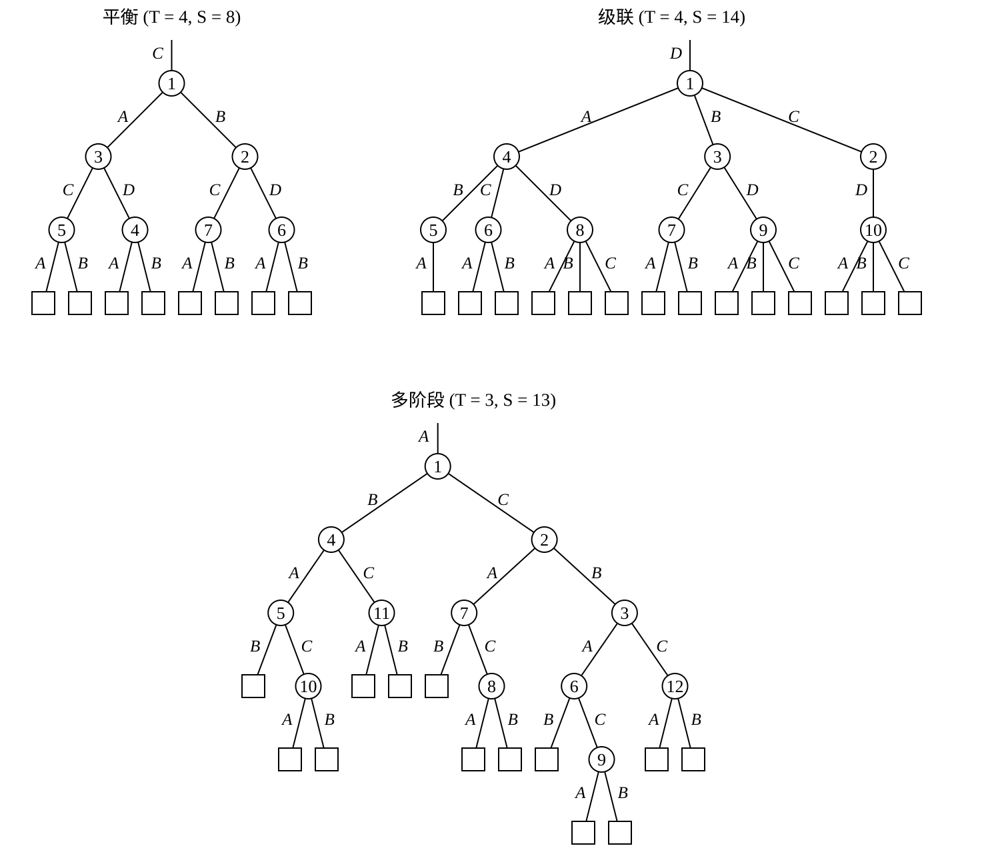

图 76　三种合并模式的树表示

这种表示方法以一种很便利的方式揭示了合并模式的许多相关性质. 例如, 如果树中第 0 级 (根结点) 上的游程是递增的, 那么第 1 级上的游程就必然是递减的, 第 2 级上的游程必然是递增的, 以此类推. 一个初始游程是递增的, 当且仅当它对应的外部结点处于偶数编号的级上. 此外, 在合并期间处理的初始游程总数 (不包括初始分布) 恰好等于树的外部路径长度, 这是因为第 $k$ 级上的每个初始游程都恰好被处理 $k$ 次.

每种合并模式都有一种树表示, 但并非每棵树都定义一种合并模式. 假定一棵树的内部结点已经标有编号 1 至 $m$, 它的线旁已经标有磁带名, 则这棵树表示有效反向读取合并模式的充要条件是:

(a) 任意连到同一内部结点的两条线都拥有不同的磁带名;

(b) 如果 $i>j$, 且 $A$ 是磁带名, 则树中不包含结构

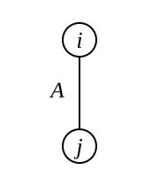

(c) 如果 $i<j<k<l$, 且 $A$ 是磁带名, 则树中不包含结构

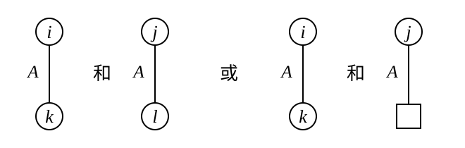

(4)

条件 (a) 是不证自明的, 因为在一个合并中输入磁带与输出磁带必须互不相同. 与此类似, 条件 (b) 也很明显. “无交叉” 条件 (c) 反映了 “后进先出” 约束, 它刻画了磁带上反向读取操作的特性: 在删除步骤 $k$ 生成的一个游程时, 先前在同一磁带上生成的所有游程一定还未被删除, 因此 (4) 中的构造是不可能出现的. 不难验证: 任何满足条件 (a)(b)(c) 的带标记树实际上都对应于一个反向读取的合并模式.

如果有 $T$ 台磁带机, 条件 (a) 意味着每个内部结点的次数为 $T-1$ 或更低. 并不是总能向所有这样的树附加适当的标记. 例如, 当 $T=3$ 时, 不存在一种合并模式, 使树的形状如下所示:

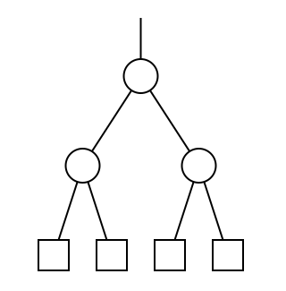

(5)

如果以适当方式添加步骤编号和磁带名, 可以由这个形状得出一种最优合并模式, 这是因为, 在一棵拥有四个外部结点的树中, 这是唯一可以实现最短外部路径长度的方式. 但是, 由于图形的对称性, 实际上只有一种方法可以进行符合条件 (a) 和 (b) 的标记, 即

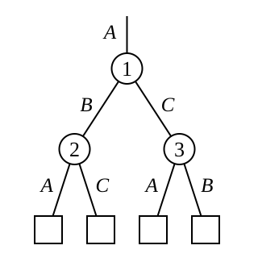

(6)

而这违反了条件 (c). 至多使用 $T$ 个磁带名、能够根据上述条件标记的形状称为 $T$-lifo 树[^p240-1].

还有另外一种方式可以用来描述能够由合并模式得出的所有标记树, 那就是考虑所有这些树是如何 “生长” 的. 首先从某个磁带名开始, 比如说 $A$, 其种子为

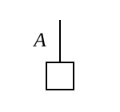

在树的生长过程中, 第 $i$ 步包括: 选择互不相同的磁带名 $B,B_1,B_2,\ldots,B_k$, 并将对应于 $B$ 的最近生成的外部结点

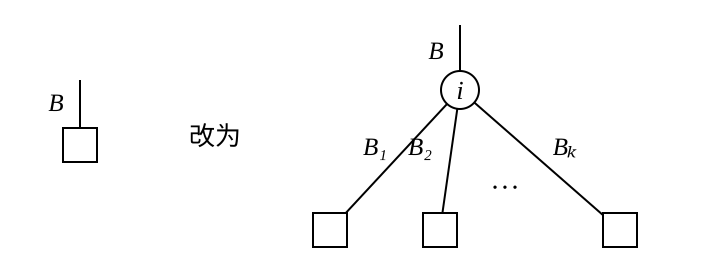

(7)

这种 “后形成先生长” 规则解释了为什么可以直接从向量表示构造树表示.

严格的最优 $T$ 磁带合并模式 (也就是说, 对于给定数目的外部结点, 路径长度最短的 $T$-lifo 树) 看起来很难确定. 例如, 下面这种不那么显而易见的模式, 是使用反向读取合并四条磁带上的七个初始游程的最优方式:

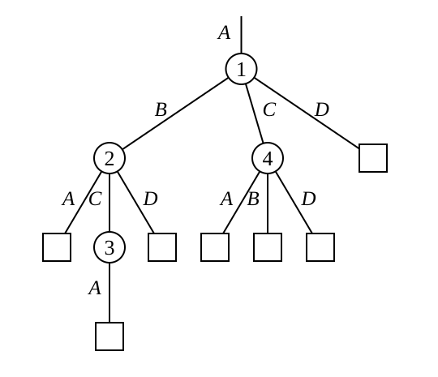

(8)

为了实现最优, 一路合并实际上是必不可少的! (见习题 8.) 另一方面, 对于任意固定的 $T$, 要给出渐近最优的构造并不是特别困难.

设 $K_T(n)$ 是具有 $n$ 个外部结点的 $T$-lifo 树中可以实现的最短外部路径长度. 根据 2.3.4.5 节提出的理论不难证明

$$
K_T(n)\ge nq-\left\lfloor\bigl((T-1)^q-n\bigr)/(T-2)\right\rfloor,\qquad q=\lceil\log_{T-1}n\rceil,\tag{9}
$$

这是因为, 对于具有 $n$ 个外部结点且所有结点的次数 $<T$ 的任何树, 这是最短的外部路径长度. 目前, 确切知道的 $K_T(n)$ 值还相当少. 下面是一些可能准确的上限:

<table data-lifo-upper10><tr><th>$n=$</th><th>1</th><th>2</th><th>3</th><th>4</th><th>5</th><th>6</th><th>7</th><th>8</th><th>9</th><th>10</th><th>11</th><th>12</th><th>13</th><th>14</th><th>15</th><th></th></tr><tr data-lifo-upper-row="3"><td>$K_3(n)\le$</td><td data-source-number>0</td><td data-source-number>2</td><td data-source-number>5</td><td data-source-number>9</td><td data-source-number>12</td><td data-source-number>16</td><td data-source-number>21</td><td data-source-number>25</td><td data-source-number>30</td><td data-source-number>34</td><td data-source-number>39</td><td data-source-number>45</td><td data-source-number>50</td><td data-source-number>56</td><td data-source-number>61</td><td>(10)</td></tr><tr data-lifo-upper-row="4"><td>$K_4(n)\le$</td><td data-source-number>0</td><td data-source-number>2</td><td data-source-number>3</td><td data-source-number>6</td><td data-source-number>8</td><td data-source-number>11</td><td data-source-number>14</td><td data-source-number>17</td><td data-source-number>20</td><td data-source-number>24</td><td data-source-number>27</td><td data-source-number>31</td><td data-source-number>33</td><td data-source-number>37</td><td data-source-number>40</td><td></td></tr></table>

卡普发现, 任何内部结点次数 $<T$ 的树都是准 $T$-lifo 树, 也就是说, 把它的某些外部结点转换为一路合并就可以变为 $T$-lifo 树. 事实上, 可以相当轻松地构造出一组合适的标记. 设 $A$ 为一个特定的磁带名, 处理过程如下:

**步骤 1.** 向树图的线上添加磁带名, 只要满足前面的条件 (a) 即可, 特定的名称 $A$ 仅用于一个分支中最左边的线.

**步骤 2.** 只要 $B\ne A$, 就把每个形如左图的外部结点代以右图.

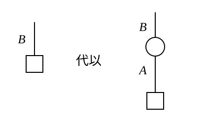

**步骤 3.** 按前序 (preorder) 为树的内部结点编号. 结果就是满足条件 (a)(b)(c) 的标记. 例如, 如果我们从树

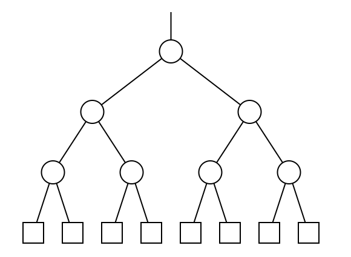

(11)

和三条磁带开始, 这个过程可以指定标记如下:

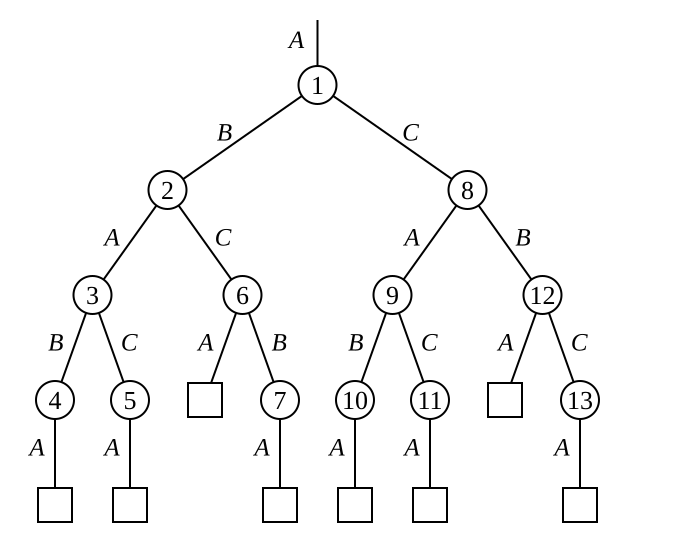

(12)

不难验证卡普的构造满足 “后形成先生长” 规则, 这是由于前序的本质所致 (见习题 12).

这个构造的结果是一种合并模式, 它的所有初始游程都出现在磁带 $A$ 上. 这就让人们想到下面的分布和排序方案, 称为前序合并:

**P1.** 把初始游程分布到磁带 $A$ 上, 直到所有输入穷尽为止. 设 $S$ 是初始游程的总数.

**P2.** 执行上述构造: 使用具有 $S$ 个外部结点的最短路径长度的 $T-1$ 叉树, 得到一棵 $T$-lifo 树, 它的外部路径长度与 (9) 中的下限的差的绝对值不会超过 $S$.

**P3.** 根据这个模式合并游程. ■

这个方案将会在任意期望的磁带上生成输出. 但它有一个明显的缺点——读者有没有看到哪里会出问题? 它的问题在于: 这种合并模式要求磁带 $A$ 上最初的游程中一部分为递增一部分为递减, 具体取决于相应的外部结点是出现在奇数级别还是偶数级别. 这个问题可以在事先不知道 $S$ 的情况下加以解决: 就在马上要用到应当为递减的游程之前, 把它复制到一条或多条辅助磁带上. 这样总处理数量是 (用初始游程长度表示)

$$
S\log_{T-1}S+O(S).\tag{13}
$$

因此, 当 $S\to\infty$ 时前序合并绝对优于多阶段合并或级联合并. 实际上, 前序合并是渐近最优的, 因为 (9) 表明 $S\log_{T-1}S+O(S)$ 是在 $T$ 条磁带上可能实现的最佳结果. 另一方面, 对于实践中经常遇到的较小的 $S$ 值, 前序合并的效率相当低. 当 $S$ 相当小时, 多阶段合并或级联合并更简单更快速. 也许有可能发现一种简单的分布和合并方法, 当 $S$ 较小时可以与多阶段合并和级联合并相比拟, 当 $S$ 很大时渐近最优.

下面的第二组习题介绍了卡普是如何以类似方式描述正向读取合并问题的. 在这种情况下理论变得相当复杂, 尽管发现了一些非常有意义的结果.

#### 习题（第一组）

**1. [17]** 在正向读取合并中, 一种比较便利的做法是在磁带上每个游程的最后包含一个虚拟标识记录, 其键为 $+\infty$, 以此标记游程的结束. 在反向读取时, 应当如何修改这个做法?　[答案](./answers/5-4-4.md#ans-5-4-4-1)

**2. [20]** 在一个诸如 (1) 这样的表中, 各列是否总是非递减的? 是否存在这样一种情况: 在从某一级进入下一级时, 必须 “减去” 某一磁带上的游程?　[答案](./answers/5-4-4.md#ans-5-4-4-2)

**▶ 3. [20]** 证明: 在以 (1) 中的完美分布应用反向读取多阶段合并时, 如果 T1 上的游程在开始时为 $ADA\ldots$, 而 T2 至 T5 在开始时为 $DAD\ldots$, 则在完成排序时, 我们总是在 T1 上得到一个 $A$ 游程.　[答案](./answers/5-4-4.md#ans-5-4-4-3)

**4. [M22]** 考虑如下做法: 以递增顺序分布所有游程, 想象所有 $D$ 位置在开始时都填充着虚拟游程, 然后执行反向读取多阶段合并. 这是不是一个好主意?　[答案](./answers/5-4-4.md#ans-5-4-4-4)

**▶ 5. [23]** 在使用反向读取多阶段合并时, 5.4.2 节中有关合并数目串的公式 (8)、(9)、(10)、(11) 将会被哪些公式代替? 绘制一幅类似于图 71(a) 的图形, 给出六条磁带上第五级分布的合并数目.　[答案](./answers/5-4-4.md#ans-5-4-4-5)

**6. [07]** 一种合并模式的树表示为 (8), 它的向量表示是什么样的?　[答案](./answers/5-4-4.md#ans-5-4-4-6)

**7. [16]** 绘制由以下向量序列定义的反向读取合并模式的树表示:　[答案](./answers/5-4-4.md#ans-5-4-4-7)

<table data-backwards-ex7><tr><td style="vertical-align:top">$\begin{aligned}v^{(33)}&=(20,9,5)\\y^{(33)}&=(+1,-1,+1)\\y^{(32)}&=(+1,+1,-1)\\y^{(31)}&=(+1,+1,-1)\\y^{(30)}&=(+1,+1,-1)\\y^{(29)}&=(+1,-1,+1)\\y^{(28)}&=(-1,+1,+1)\\y^{(27)}&=(+1,-1,+1)\\y^{(26)}&=(+1,-1,+1)\end{aligned}$</td><td style="vertical-align:top">$\begin{aligned}y^{(25)}&=(+1,+1,-1)\\y^{(24)}&=(+1,-1,+1)\\y^{(23)}&=(+1,-1,+1)\\y^{(22)}&=(+1,-1,+1)\\y^{(21)}&=(-1,+1,+1)\\y^{(20)}&=(+1,+1,-1)\\y^{(19)}&=(-1,+1,+1)\\y^{(18)}&=(+1,+1,-1)\\y^{(17)}&=(+1,+1,-1)\end{aligned}$</td><td style="vertical-align:top">$\begin{aligned}y^{(16)}&=(+1,+1,-1)\\y^{(15)}&=(+1,+1,-1)\\y^{(14)}&=(+1,-1,+1)\\y^{(13)}&=(+1,-1,+1)\\y^{(12)}&=(-1,+1,+1)\\y^{(11)}&=(+1,+1,-1)\\y^{(10)}&=(+1,+1,-1)\\y^{(9)}&=(+1,-1,+1)\\y^{(8)}&=(+1,+1,-1)\end{aligned}$</td><td style="vertical-align:top">$\begin{aligned}y^{(7)}&=(+1,+1,-1)\\y^{(6)}&=(+1,+1,-1)\\y^{(5)}&=(-1,+1,+1)\\y^{(4)}&=(+1,-1,+1)\\y^{(3)}&=(-1,+1,+1)\\y^{(2)}&=(+1,-1,+1)\\y^{(1)}&=(-1,+1,+1)\\y^{(0)}&=(1,0,0)\end{aligned}$</td></tr></table>

**8. [23]** 证明: 当 $S=7$ 且 $T=4$ 时, (8) 是反向读取的最优合并方式, 所有避免一路合并的方法都比它差.　[答案](./answers/5-4-4.md#ans-5-4-4-8)

**9. [M22]** 证明 (9) 中的下限成立.　[答案](./answers/5-4-4.md#ans-5-4-4-9)

**10. [41]** 利用计算机编制 $K_T(n)$ 的准确值表.

**▶ 11. [20]** 判断正误: 任何一个仅使用 $T-1$ 路合并的反向读取合并模式, 在每条磁带上只能有交替的 $ADAD\ldots$ 游程. 如果两个相邻游程的顺序相同, 该方法将失效.　[答案](./answers/5-4-4.md#ans-5-4-4-11)

**12. [22]** 证明: 卡普的前序构造总能得到一个满足条件 (a)(b)(c) 的有标记树.　[答案](./answers/5-4-4.md#ans-5-4-4-12)

**13. [16]** 尽可能多地删除一路合并, 使得前序仍能有效地标记内部结点, 从而提高 (12) 的效率.　[答案](./answers/5-4-4.md#ans-5-4-4-13)

**14. [40]** 设计一种算法, 仅使用 $O(\log S)$ 个字的存储器来控制合并模式, 在不需要显式表示该树的情况下完成步骤 P2 和 P3 中的前序合并.

**15. [M39]** 在正文所述卡普前序构造过程生成的树中, 若干终端结点处会有一路合并. 证明: 当 $T=3$ 时, 有可能构造一棵始终使用两路合并的渐近最优 3-lifo 树.　[答案](./answers/5-4-4.md#ans-5-4-4-15)

换句话说, 设 $\widehat K_T(n)$ 是所有具有 $n$ 个外部结点的 $T$-lifo 树中的最短外部路径长度, 每个内部结点的次数为 $T-1$. 证明 $\widehat K_3(n)=n\lg n+O(n)$.

**16. [M46]** 采用习题 15 的记号, 当 $n\equiv1\pmod{T-2}$ 时, 是否对于所有的 $T\ge3$ 都有 $\widehat K_T(n)=n\log_{T-1}n+O(n)$?

**▶ 17. [28]** (理查德·普拉特) 为在反向级联合并中实现递增顺序, 我们可以坚持采用偶数遍合并扫描. 这会让人们想到一种与算法 5.4.3C 稍有不同的初始分布技巧.　[答案](./answers/5-4-4.md#ans-5-4-4-17)

(a) 改变 5.4.3–(1), 使它仅显示需要偶数遍合并扫描的完美分布.

(b) 设计一种初始分布方案, 在这些完美分布之中进行插入. (因此, 如果初始游程数目介于完美分布之间, 可能希望将这些游程中的一部分而非全部进行两次合并, 以实现一种完美分布.)

**▶ 18. [M38]** 假定有 $T$ 条磁带可用, $T\ge3$, T1 包含 $N$ 条记录, 其余磁带为空. 不使用反向读取, 是否有可能在少于 $\Omega(N\log N)$ 步中将 T1 上的记录顺序反转? (当然, 如果允许反向读取, 这个操作就相当简单了.) 在习题 5.2.5–14 中给出了这样一类所需步骤数的确为 $N\log N$ 阶的算法.　[答案](./answers/5-4-4.md#ans-5-4-4-18)

#### 习题（第二组）

以下习题提出一种对正向读取的磁带进行磁带合并的理论. 在这种情况下, 每条磁带都相当于一个队列, 而不是栈. 合并模式完全可以像正文中那样, 表示为一系列向量 $y^{(m)}\ldots y^{(1)}y^{(0)}$, 但在把向量表示转换为树表示时, 我们把 “后形成先生长” 改为 “先形成先生长”. 于是, 无效的结构 (4) 可以改为

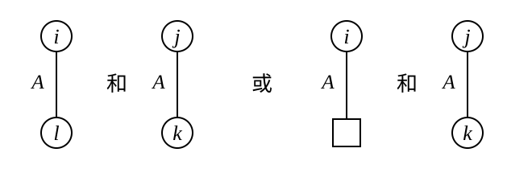

(4′)

如果一颗树的标记方法可以用来表示对 $T$ 条磁带的正向读取合并, 则称为 $T$-fifo, 类似于反向读取情形中的术语 “$T$-lifo”.

在反向读取磁带时, 它们形成很好的栈. 但遗憾的是, 它们并不能形成很好的通用队列. 如果我们按照 “先进先出” 方式随机写入和读取, 就会浪费大量的时间在磁带的各个部分之间移动. 更糟糕的是, 很快就会超出磁带的末端! 遇到的问题与 2.2.2–(4) 和 (5) 中队列超出内存的问题完全相同, 但 2.2.2–(6) 和 (7) 中的解决方案不适用于磁带, 因为它们不是循环的. 因此, 如果能够对一棵树进行适当标记, 其相应的合并模式使得每条磁带都遵循特殊的队列规则 “写, 回卷, 读取全部, 回卷; 写, 回卷, 读取全部, 回卷; 等等”, 就说这棵树是强 $T$-fifo 的.

**▶ 19. [22]** (卡普) 试找出一棵不是 3-fifo 的二叉树.　[答案](./answers/5-4-4.md#ans-5-4-4-19)

**▶ 20. [22]** 试描述 “强 $T$-fifo” 条件, 即给出一种与 (4′) 类似的相当简单的规则, 描述无效的磁带标记结构.　[答案](./answers/5-4-4.md#ans-5-4-4-20)

**21. [18]** 绘制习题 7 中向量所定义的正向读取合并模式的树表示. 这棵树是强 3-fifo 的吗?　[答案](./answers/5-4-4.md#ans-5-4-4-21)

**22. [28]** (卡普) 证明: 对于反向读取和正向读取两种情形, 除内部结点的标号之外, 采用完美分布的多阶段合并与级联合并的树表示完全相同. 试为合并模式找出更大的一类向量表示, 其应当同样满足上述条件.　[答案](./answers/5-4-4.md#ans-5-4-4-22)

**23. [24]** (卡普) 给定一个合并模式的一段 $y^{(q)}\ldots y^{(r)}$, 如果没有输出磁带随后被用作输入磁带, 也就是说, 不存在 $i,j,k$ 使得 $q\ge i>k\ge r$, $y_j^{(i)}=-1$, $y_j^{(k)}=+1$, 就说 $y^{(q)}\ldots y^{(r)}$ 是一节 (stage). 本题的目的是证明: 对磁带数和初始游程数相同的所有合并模式, 级联合并使节数降至最低.　[答案](./answers/5-4-4.md#ans-5-4-4-23)

为方便起见, 我们定义一些记号. 如果 $v$ 和 $w$ 都是 $T$ 向量, 在某一合并模式的第一节内 $w$ 能化简为 $v$, 则记为 $v\to w$. (于是存在一种合并模式 $y^{(m)}\ldots y^{(0)}$, 使得 $y^{(m)}\ldots y^{(l+1)}$ 是一节, $w=y^{(m)}+\cdots+y^{(0)}$ 且 $v=y^{(l)}+\cdots+y^{(0)}$.) 如果 $v$ 和 $w$ 都是 $T$ 向量, 对于 $1\le k\le T$, $v$ 的 $k$ 个最大元素之和不大于 $w$ 的 $k$ 个最大元素之和, 则记为 $v\preceq w$. 例如, $(2,1,2,2,2,1)\preceq(1,2,3,0,3,1)$, 因为 $2\le3$, $2+2\le3+3$, $\ldots$, $2+2+2+2+1+1\le3+3+2+1+1+0$. 最后, 假定 $v=(v_1,\ldots,v_T)$, 记 $C(v)=(s_T,s_{T-2},s_{T-3},\ldots,s_1,0)$, 其中 $s_k$ 是 $v$ 的 $k$ 个最大元素之和.

(a) 证明 $v\to C(v)$.

(b) 证明 $v\preceq w$ 蕴涵着 $C(v)\preceq C(w)$.

(c) 假定习题 24 的结论成立, 证明级联合并使节数降至最低.

**24. [M35]** 采用习题 23 的记号, 证明 $v\to w$ 蕴涵着 $w\preceq C(v)$.　[答案](./answers/5-4-4.md#ans-5-4-4-24)

**25. [M36]** (卡普) 给定一个合并模式的一段 $y^{(q)}\ldots y^{(r)}$, 如果没有一条磁带既用作输入又用作输出, 也就是说, 不存在 $i,j,k$ 使得 $q\ge i\ge r$, $q\ge k\ge r$, $y_j^{(i)}=+1$, $y_j^{(k)}=-1$, 就说 $y^{(q)}\ldots y^{(r)}$ 是一个阶段 (phase). 本题的目的是研究使阶段数降至最低的合并模式. 如果在一个阶段中 $w$ 能化简为 $v$, 则记为 $v\Rightarrow w$ (习题 23 中引入了一种类似的记号). 记 $D_k(v)=(s_k+t_{k+1},s_k+t_{k+2},\ldots,s_k+t_T,0,\ldots,0)$, 其中 $t_j$ 是 $v$ 的第 $j$ 大元素, $s_k=t_1+\cdots+t_k$.　[答案](./answers/5-4-4.md#ans-5-4-4-25)

(a) 证明: 对于 $1\le k<T$ 有 $v\Rightarrow D_k(v)$.

(b) 证明: 对于 $1\le k<T$, $v\preceq w$ 蕴涵着 $D_k(v)\preceq D_k(w)$.

(c) 证明: 对于某个 $k$ 值 ($1\le k<T$), $v\Rightarrow w$ 蕴涵着 $w\preceq D_k(v)$.

(d) 因此, 一种合并模式在 $q$ 个阶段内对 $T$ 条磁带上最大数量的初始游程排序, 这个合并模式可以表示为整数序列 $k_1k_2\ldots k_q$, 使得初始分布为 $D_{k_q}(\ldots(D_{k_2}(D_{k_1}(u)))\ldots)$, 其中 $u=(1,0,\ldots,0)$. 这种阶段最小化策略有一种强 $T$-fifo 表示, 它也属于习题 22 中所说的模式类别. 当 $T=3$ 时它是多阶段合并, 当 $T=4,5,6,7$ 时它是平衡合并的一种变化形式.

**26. [M46]** (卡普) 对于所有 $T\ge4$ 和所有充分大的 $q$ 值, 习题 25 中提到的最优序列 $k_1k_2\ldots k_q$ 是否等于 $1\lceil T/2\rceil\lfloor T/2\rfloor\lceil T/2\rceil\lfloor T/2\rfloor\ldots$?

<!-- section-footnotes -->

[^p238-1]: 这个自然段在英文版原书中因排版需要位于上一自然段前面, 中译本调整为反映作者意图的顺序. ——编者注

[^p240-1]: lifo 是 “Last In First Out (后进先出)” 的缩写. ——译者注
