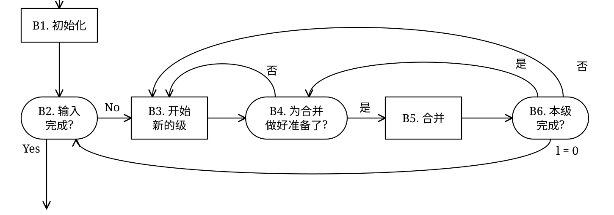
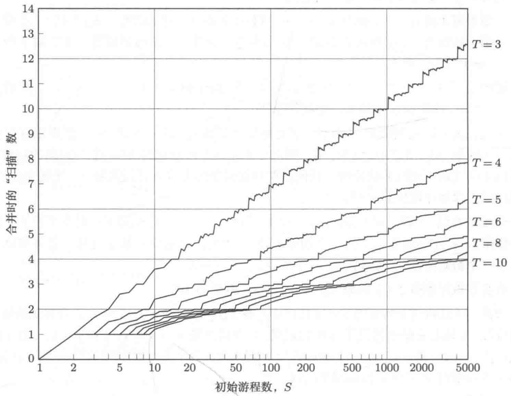

### *5.4.5　振荡排序

谢尔登·索贝尔提出一种多少有些不同的合并排序方法 [*JACM* **9** (1962), 372–375]. 在他提出的算法中, 并不是以一次分布扫描把所有初始游程都分发到磁带上开始, 而是在分发与合并之间反复振荡, 这样, 在完成对输入的查看之前, 就可以进行大多数排序工作.

例如, 假定共有五条磁带可用于合并. 索贝尔的方法对 16 个初始游程排序的过程如下:

<table data-oscillating-table="Sobel16" style="white-space:nowrap"><tr><th></th><th>操作</th><th>T1</th><th>T2</th><th>T3</th><th>T4</th><th>T5</th><th>成本</th></tr><tr data-oscillating-row="Sobel16"><td>阶段 1</td><td>分发</td><td data-oscillating-tape>$A_1$</td><td data-oscillating-tape>$A_1$</td><td data-oscillating-tape>$A_1$</td><td data-oscillating-tape>$A_1$</td><td data-oscillating-tape>—</td><td data-oscillating-cost>4</td></tr><tr data-oscillating-row="Sobel16"><td>阶段 2</td><td>合并</td><td data-oscillating-tape>—</td><td data-oscillating-tape>—</td><td data-oscillating-tape>—</td><td data-oscillating-tape>—</td><td data-oscillating-tape>$D_4$</td><td data-oscillating-cost>4</td></tr><tr data-oscillating-row="Sobel16"><td>阶段 3</td><td>分发</td><td data-oscillating-tape>—</td><td data-oscillating-tape>$A_1$</td><td data-oscillating-tape>$A_1$</td><td data-oscillating-tape>$A_1$</td><td data-oscillating-tape>$D_4A_1$</td><td data-oscillating-cost>4</td></tr><tr data-oscillating-row="Sobel16"><td>阶段 4</td><td>合并</td><td data-oscillating-tape>$D_4$</td><td data-oscillating-tape>—</td><td data-oscillating-tape>—</td><td data-oscillating-tape>—</td><td data-oscillating-tape>$D_4$</td><td data-oscillating-cost>4</td></tr><tr data-oscillating-row="Sobel16"><td>阶段 5</td><td>分发</td><td data-oscillating-tape>$D_4A_1$</td><td data-oscillating-tape>—</td><td data-oscillating-tape>$A_1$</td><td data-oscillating-tape>$A_1$</td><td data-oscillating-tape>$D_4A_1$</td><td data-oscillating-cost>4</td></tr><tr data-oscillating-row="Sobel16"><td>阶段 6</td><td>合并</td><td data-oscillating-tape>$D_4$</td><td data-oscillating-tape>$D_4$</td><td data-oscillating-tape>—</td><td data-oscillating-tape>—</td><td data-oscillating-tape>$D_4$</td><td data-oscillating-cost>4</td></tr><tr data-oscillating-row="Sobel16"><td>阶段 7</td><td>分发</td><td data-oscillating-tape>$D_4A_1$</td><td data-oscillating-tape>$D_4A_1$</td><td data-oscillating-tape>—</td><td data-oscillating-tape>$A_1$</td><td data-oscillating-tape>$D_4A_1$</td><td data-oscillating-cost>4</td></tr><tr data-oscillating-row="Sobel16"><td>阶段 8</td><td>合并</td><td data-oscillating-tape>$D_4$</td><td data-oscillating-tape>$D_4$</td><td data-oscillating-tape>$D_4$</td><td data-oscillating-tape>—</td><td data-oscillating-tape>$D_4$</td><td data-oscillating-cost>4</td></tr><tr data-oscillating-row="Sobel16"><td>阶段 9</td><td>合并</td><td data-oscillating-tape>—</td><td data-oscillating-tape>—</td><td data-oscillating-tape>—</td><td data-oscillating-tape>$A_{16}$</td><td data-oscillating-tape>—</td><td data-oscillating-cost>16</td></tr></table>

和在 5.4.4 节一样, 这里使用 $A_r$ 和 $D_r$ 分别表示相对长度为 $r$ 的递增游程和递减游程. 这个方法首先在四条磁带中的每一条上写入一个初始游程, 并把它们合并到第五条磁带上 (反向读取). 分布过程再次启动, 这次相对于磁带向右循环移动一个位置, 第二次合并生成另一个游程 $D_4$. 以这种方式生成四个 $D_4$ 之后, 增加一次合并生成 $A_{16}$. 我们可以接着生成另外三个 $A_{16}$, 把它们合并到一个 $D_{64}$ 中, 以此类推, 直到输入内容穷尽为止. 不需要事先知道输入的长度.

当初始游程数目 $S$ 为 $4^m$ 时, 不难看出这个方法把每条记录恰好处理 $m+1$ 次: 一次是在分布期间, $m$ 次是在合并期间. 当 $S$ 介于 $4^{m-1}$ 与 $4^m$ 之间时, 可以假定存在虚拟游程, 使 $S$ 增大至 $4^m$, 因此总排序时间基本上等于对所有数据执行 $\lceil\log_4S\rceil+1$ 遍扫描. 这正是对八条磁带进行平衡排序时得到的结果. 一般来说, 用 $T$ 条工作磁带进行振荡排序等价于用 $2(T-1)$ 条磁带进行平衡合并, 因为它对数据进行了 $\lceil\log_{T-1}S\rceil+1$ 遍扫描. 当 $S$ 是 $T-1$ 的幂时, 由于它达到了式 5.4.4–(9) 的下限, 所以它是所能实现的任何 $T$ 磁带方法中效果最好的. 另一方面, 如果 $S$ 是 $(T-1)^{m-1}+1$, 仅比 $T-1$ 的幂大 1, 则这个方法几乎会浪费一整遍扫描.

习题 2 说明如何利用一种特殊的结束例程部分消除因为 $S$ 不是完美幂值而造成的这一代价. 1966 年, 丹尼斯·本彻发现进一步提升的方法, 他把这种方法称为 “交叉合并”[见哈特穆特·韦德金德,*Datenorganisation* (Berlin: W. de Gruyter, 1970), 164–166; 也见美国专利第 3540000 号 (1970)]. 主要思想是推迟合并过程, 直到获得有关 $S$ 的更多信息. 我们将讨论对本彻原始方案稍作修改后的一种形式.

这个经过改进的振荡排序方法的处理过程如下:

<table data-oscillating-table="Bencher9" style="white-space:nowrap"><tr><th></th><th>操作</th><th>T1</th><th>T2</th><th>T3</th><th>T4</th><th>T5</th><th>成本</th></tr><tr data-oscillating-row="Bencher9"><td>阶段 1</td><td>分布</td><td data-oscillating-tape>—</td><td data-oscillating-tape>$A_1$</td><td data-oscillating-tape>$A_1$</td><td data-oscillating-tape>$A_1$</td><td data-oscillating-tape>$A_1$</td><td data-oscillating-cost>4</td></tr><tr data-oscillating-row="Bencher9"><td>阶段 2</td><td>分布</td><td data-oscillating-tape>—</td><td data-oscillating-tape>$A_1$</td><td data-oscillating-tape>$A_1A_1$</td><td data-oscillating-tape>$A_1A_1$</td><td data-oscillating-tape>$A_1A_1$</td><td data-oscillating-cost>3</td></tr><tr data-oscillating-row="Bencher9"><td>阶段 3</td><td>合并</td><td data-oscillating-tape>$D_4$</td><td data-oscillating-tape>—</td><td data-oscillating-tape>$A_1$</td><td data-oscillating-tape>$A_1$</td><td data-oscillating-tape>$A_1$</td><td data-oscillating-cost>4</td></tr><tr data-oscillating-row="Bencher9"><td>阶段 4</td><td>分布</td><td data-oscillating-tape>$D_4A_1$</td><td data-oscillating-tape>—</td><td data-oscillating-tape>$A_1$</td><td data-oscillating-tape>$A_1A_1$</td><td data-oscillating-tape>$A_1A_1$</td><td data-oscillating-cost>3</td></tr><tr data-oscillating-row="Bencher9"><td>阶段 5</td><td>合并</td><td data-oscillating-tape>$D_4$</td><td data-oscillating-tape>$D_4$</td><td data-oscillating-tape>—</td><td data-oscillating-tape>$A_1$</td><td data-oscillating-tape>$A_1$</td><td data-oscillating-cost>4</td></tr><tr data-oscillating-row="Bencher9"><td>阶段 6</td><td>分布</td><td data-oscillating-tape>$D_4A_1$</td><td data-oscillating-tape>$D_4A_1$</td><td data-oscillating-tape>—</td><td data-oscillating-tape>$A_1$</td><td data-oscillating-tape>$A_1A_1$</td><td data-oscillating-cost>3</td></tr><tr data-oscillating-row="Bencher9"><td>阶段 7</td><td>合并</td><td data-oscillating-tape>$D_4$</td><td data-oscillating-tape>$D_4$</td><td data-oscillating-tape>$D_4$</td><td data-oscillating-tape>—</td><td data-oscillating-tape>$A_1$</td><td data-oscillating-cost>4</td></tr><tr data-oscillating-row="Bencher9"><td>阶段 8</td><td>分布</td><td data-oscillating-tape>$D_4A_1$</td><td data-oscillating-tape>$D_4A_1$</td><td data-oscillating-tape>$D_4A_1$</td><td data-oscillating-tape>—</td><td data-oscillating-tape>$A_1$</td><td data-oscillating-cost>3</td></tr><tr data-oscillating-row="Bencher9"><td>阶段 9</td><td>合并</td><td data-oscillating-tape>$D_4$</td><td data-oscillating-tape>$D_4$</td><td data-oscillating-tape>$D_4$</td><td data-oscillating-tape>$D_4$</td><td data-oscillating-tape>—</td><td data-oscillating-cost>4</td></tr></table>

这里, 我们没有把各 $D_4$ 合并为一个 $A_{16}$ (除非输入恰好穷尽). 只有在构建

<table data-oscillating-table="Bencher15" style="white-space:nowrap"><tr><th></th><th>操作</th><th>T1</th><th>T2</th><th>T3</th><th>T4</th><th>T5</th><th>成本</th></tr><tr data-oscillating-row="Bencher15"><td>阶段 15</td><td>合并</td><td data-oscillating-tape>$D_4D_4$</td><td data-oscillating-tape>$D_4D_4$</td><td data-oscillating-tape>$D_4D_4$</td><td data-oscillating-tape>$D_4$</td><td data-oscillating-tape>—</td><td data-oscillating-cost>4</td></tr></table>

之后, 我们才会得到

<table data-oscillating-table="Bencher16" style="white-space:nowrap"><tr><th></th><th>操作</th><th>T1</th><th>T2</th><th>T3</th><th>T4</th><th>T5</th><th>成本</th></tr><tr data-oscillating-row="Bencher16"><td>阶段 16</td><td>合并</td><td data-oscillating-tape>$D_4$</td><td data-oscillating-tape>$D_4$</td><td data-oscillating-tape>$D_4$</td><td data-oscillating-tape>—</td><td data-oscillating-tape>$A_{16}$</td><td data-oscillating-cost>16</td></tr></table>

再生成三个 $D_4$ 之后将出现第二个 $A_{16}$:

<table data-oscillating-table="Bencher22-23" style="white-space:nowrap"><tr><th></th><th>操作</th><th>T1</th><th>T2</th><th>T3</th><th>T4</th><th>T5</th><th>成本</th></tr><tr data-oscillating-row="Bencher22-23"><td>阶段 22</td><td>合并</td><td data-oscillating-tape>$D_4D_4$</td><td data-oscillating-tape>$D_4D_4$</td><td data-oscillating-tape>$D_4$</td><td data-oscillating-tape>—</td><td data-oscillating-tape>$A_{16}D_4$</td><td data-oscillating-cost>4</td></tr><tr data-oscillating-row="Bencher22-23"><td>阶段 23</td><td>合并</td><td data-oscillating-tape>$D_4$</td><td data-oscillating-tape>$D_4$</td><td data-oscillating-tape>—</td><td data-oscillating-tape>$A_{16}$</td><td data-oscillating-tape>$A_{16}$</td><td data-oscillating-cost>16</td></tr></table>

以此类推 (与阶段 1–5 比较). 可以看出本彻方案的好处: 例如, 如果仅有五个初始游程, 像习题 2 中那样经过修改的振荡排序将会进行四路合并 (在阶段 2 中), 然后是两路合并, 总成本是 $4+4+1+5=14$, 而本彻方案将做一个两路合并 (在阶段 3 中), 然后是四路合并, 总成本是 $4+1+2+5=12$. 这两种方法还会涉及一个很小的附加成本, 即在最终合并之前的一次回卷.

下面的算法 B 对本彻方案进行了准确描述. 遗憾的是, 这个过程理解起来似乎比编码更难一些. 向计算机解释这项技术要比向计算机科学家解释起来容易得多! 部分原因是, 它本质上是一种递归方法, 已经表达成迭代方式, 且多少进行了一些优化. 读者可能发现, 需要对这个算法的操作过程进行几次跟踪, 才能发现它到底是如何运行的.

**算法 B (采用 “交叉” 分布的振荡排序).** 算法取得初始游程并把它们分散到磁带上, 偶尔会中断分布过程以合并某些磁带内容. 算法使用 $P$ 路合并, 假定有 $T=P+1\ge3$ 条磁带可供使用 (不包括用来保存输入数据的磁带). 必须允许以正反两个方向读取磁带, 磁带编号为 $0,1,\ldots,P$. 维护以下数组:

$\mathrm D[j]$, $0\le j\le P$: 在磁带 $j$ 的末尾出现的虚拟游程数目.

$\mathrm A[l,j]$, $0\le l\le L$, $0\le j\le P$: 这里 $L$ 是一个数, 使得最多输入 $P^{L+1}$ 个初始游程. 当 $\mathrm A[l,j]=k\ge0$ 时, 磁带 $j$ 上将存在一个标称长度为 $P^k$ 的游程, 对应于算法操作的 “级 $l$”. 如果 $k$ 是偶数则此游程为递增的, 如果 $k$ 是奇数则此游程为递减的. 当 $\mathrm A[l,j]<0$ 时级 $l$ 不使用磁带 $j$.

“在磁带 $j$ 上写入一个初始游程” 是对以下操作的简略描述:

令 $\mathrm A[l,j]\gets0$. 如果输入穷尽, 则 $\mathrm D[j]$ 增 1; 否则, 向磁带 $j$ 上写入一个初始游程 (以递增顺序).

“合并到磁带 $j$” 是对以下操作的简略描述:

如果对于所有 $i\ne j$ 都有 $\mathrm D[i]>0$, 则 $\mathrm D[i]$ 减 1 (对于所有 $i\ne j$) 且 $\mathrm D[j]$ 增 1. 否则, 从所有 $i\ne j$ 且使得 $\mathrm D[i]=0$ 的磁带 $i$ 合并一个游程到磁带 $j$ 上, 对于所有其他 $i\ne j$, $\mathrm D[i]$ 减 1.

**B1.[初始化.]** 对于 $0\le j\le P$, 置 $\mathrm D[j]\gets0$. 置 $\mathrm A[0,0]\gets-1$, $l\gets0$, $q\gets0$. 然后, 对于 $1\le j\le P$, 在磁带 $j$ 上写入一个初始游程.

**B2.[输入完成?]**(这时磁带 $q$ 为空, 其他磁带上最多各包含一个游程.) 如果还有更多的输入, 则转到 B3. 如果输入已穷尽, 则对 $j\ne q$ 回卷所有使得 $\mathrm A[0,j]$ 为偶数的磁带 $j$, 然后以正向读取刚刚回卷的磁带、反向读取其他磁带的方式合并到磁带 $q$. 这就完成了排序, 排序结果以增序输出到磁带 $q$ 上.

**B3.[开始新的级.]** 置 $l\gets l+1$, $r\gets q$, $s\gets0$, $q\gets(q+1)\bmod T$. 对于 $1\le j\le T-2$, 在磁带 $(q+j)\bmod T$ 上写入一个初始游程. (于是, 除磁带 $q$ 和 $r$ 之外, 每条磁带上都写入了一个初始游程.) 置 $\mathrm A[l,q]\gets-1$, $\mathrm A[l,r]\gets-2$.

**B4.[为合并做好准备了?]** 如果 $\mathrm A[l-1,q]\ne s$, 则返回 B3.

**B5.[合并.]**(这时对于所有的 $j\ne q$ 且 $j\ne r$ 有 $\mathrm A[l-1,q]=\mathrm A[l,j]=s$.) 合并到磁带 $r$, 反向读取. (见上文给出的这个操作的定义.) 然后, 置 $s\gets s+1$, $l\gets l-1$, $\mathrm A[l,r]\gets s$, $\mathrm A[l,q]\gets-1$. 置 $r\gets(2q-r)\bmod T$. (一般来说, 当 $s$ 为偶数时我们有 $r=(q-1)\bmod T$; 当 $s$ 为奇数时 $r=(q+1)\bmod T$.)

**B6.[本级完成?]** 如果 $l=0$, 则转到 B2. 否则, 如果对于所有的 $j\ne q$ 且 $j\ne r$ 都有 $\mathrm A[l,j]=s$, 则转到 B4. 否则返回 B3. ■

图 77　采用 “交叉” 分布的振荡排序

我们可以利用 “递推归纳法” 来证明这个算法的正确性, 就像对算法 2.3.1T 的证明那样. 假定我们以 $l=l_0$, $q=q_0$, $s_+=\mathrm A[l_0,(q_0+1)\bmod T]$, $s_-=\mathrm A[l_0,(q_0-1)\bmod T]$ 开始步骤 B3, 另外假定 $s_+=0$ 或 $s_-=1$ 或 $s_+=2$ 或 $s_-=3$ 或 $\ldots$. 用归纳法可以验证: 该算法最终会在没有改变 $\mathrm A$ 的第 0 行至第 $l_0$ 行的情况下进入步骤 B5, 且 $l=l_0+1$, $q=q_0\pm1$, $r=q_0$, $s=s_+$ 或 $s_-$, 其中如果 $s_+=0$ 或 ($s_+=2$ 且 $s_-\ne1$) 或 ($s_+=4$ 且 $s_-\ne1,3$) 或 $\ldots$, 则选择 $+$ 号; 如果 ($s_-=1$ 且 $s_+\ne0$) 或 ($s_-=3$ 且 $s_+\ne0,2$) 或 $\ldots$, 则选择 $-$ 号. 这里给出的粗略证明并不是特别精致, 但这个算法的叙述方式更适于实现而不是验证.

图 78 用每条记录的平均合并次数表示算法 B 的效率, 这个平均次数是初始游程数 $S$ 的函数, 其中假定初始游程的长度是近似相等的. (多阶段排序与级联排序的相应图形已经在图 70 和图 74 中给出.) 在准备这一图表时, 已经使用了在习题 3 中提到的一点小小改进.

图 78　振荡排序的效率, 其中采用了算法 B 和习题 3 的技巧

基于在 5.4.4 节讨论的前序合并理论, 卡普提出一种称为回旋排序的相关方法 [见兰德尔·拉斯廷编辑的 *Combinatorial Algorithms* (Algorithmics Press, 1972), 21–29].

**正向读取.** 振荡排序模式看来需要一种反向读取能力, 因为当我们合并新输入的短游程时, 也需要在某个地方存储长游程. 然而, 戈茨发现一种仅使用正向读取和简单回卷执行振荡排序的方法 [*Proc. AFIPS Spring Joint Comp. Conf.* **25** (1964), 599–607]. 他的方法与我们在本章已经看到的其他方案有着显著不同, 体现在两个方面:

(a) 数据有时被写到磁带的前端, 同时知道磁带中部的现有数据不会被破坏.

(b) 所有初始游程的最大长度都是固定的.

条件 (a) 违反了我们认为是正向读取特性的 “先进先出” 性质, 但如果在游程之间留出足够数量的空白磁带并忽略适当次数的奇偶错误, 这仍然能够可靠地实现. 条件 (b) 与替代选择的高效应用有些不够兼容.

戈茨的正向读取振荡排序方法拥有一个多少有些争议的身份: 它是最早作为算法而非实体设备申请专利的几种算法之一 [美国专利第 3380029 号 (1968)], 在 1968 年至 1988 年, 未经专利人允许, 在美国没有人可以在程序中合法使用这个算法. 几年后, IBM 对本彻的反向读取振荡排序技术申请了专利. [唉! 在过去, 发现一种新算法的乐趣就足以让人们感到满足了, 但这样的时代已经走到尽头了! 还好的是, 振荡排序本身并不是特别优秀. 我们希望那些发明最优秀算法、具有公益心的人们能够继续让人们免费应用他们的思想. 当然, 这些算法虽在一定时间内属于专利, 但好歹还是公开了, 而将新技术永远保密的做法则要恶劣得多.]

戈茨方法的中心思想就是通过适当的安排, 使每条磁带的开头是一个相对长度为 1 的游程, 接下来是一个相对长度为 $P$ 的游程, 然后是 $P^2$, 以此类推. 例如, 当 $T=5$ 时, 排序过程开始如下 (用 $.$ 表示在每条磁带上读写头的当前位置):

<table data-Goetz-table style="white-space:nowrap"><tr><th></th><th>操作</th><th>T1</th><th>T2</th><th>T3</th><th>T4</th><th>T5</th><th>“成本”</th><th>注释</th></tr><tr data-Goetz-row><td>阶段 1</td><td>分布</td><td data-Goetz-tape>$.A_1$</td><td data-Goetz-tape>$.A_1$</td><td data-Goetz-tape>$.A_1$</td><td data-Goetz-tape>$.A_1$</td><td data-Goetz-tape>$A_1.$</td><td data-Goetz-cost>5</td><td>[T5 未回卷]</td></tr><tr data-Goetz-row><td>阶段 2</td><td>合并</td><td data-Goetz-tape>$\bcancel{A}_1.$</td><td data-Goetz-tape>$\bcancel{A}_1.$</td><td data-Goetz-tape>$\bcancel{A}_1.$</td><td data-Goetz-tape>$\bcancel{A}_1.$</td><td data-Goetz-tape>$A_1A_4.$</td><td data-Goetz-cost>4</td><td>[现在全部回卷]</td></tr><tr data-Goetz-row><td>阶段 3</td><td>分布</td><td data-Goetz-tape>$.A_1$</td><td data-Goetz-tape>$.A_1$</td><td data-Goetz-tape>$.A_1$</td><td data-Goetz-tape>$A_1.$</td><td data-Goetz-tape>$.A_1A_4$</td><td data-Goetz-cost>4</td><td>[T4 未回卷]</td></tr><tr data-Goetz-row><td>阶段 4</td><td>合并</td><td data-Goetz-tape>$\bcancel{A}_1.$</td><td data-Goetz-tape>$\bcancel{A}_1.$</td><td data-Goetz-tape>$\bcancel{A}_1.$</td><td data-Goetz-tape>$A_1A_4.$</td><td data-Goetz-tape>$\bcancel{A}_1.A_4$</td><td data-Goetz-cost>4</td><td>[现在全部回卷]</td></tr><tr data-Goetz-row><td>阶段 5</td><td>分布</td><td data-Goetz-tape>$.A_1$</td><td data-Goetz-tape>$.A_1$</td><td data-Goetz-tape>$A_1.$</td><td data-Goetz-tape>$.A_1A_4$</td><td data-Goetz-tape>$.A_1A_4$</td><td data-Goetz-cost>4</td><td>[T3 未回卷]</td></tr><tr data-Goetz-row><td>阶段 6</td><td>合并</td><td data-Goetz-tape>$\bcancel{A}_1.$</td><td data-Goetz-tape>$\bcancel{A}_1.$</td><td data-Goetz-tape>$A_1A_4.$</td><td data-Goetz-tape>$\bcancel{A}_1.A_4$</td><td data-Goetz-tape>$\bcancel{A}_1.A_4$</td><td data-Goetz-cost>4</td><td>[现在全部回卷]</td></tr><tr data-Goetz-row><td>阶段 7</td><td>分布</td><td data-Goetz-tape>$.A_1$</td><td data-Goetz-tape>$A_1.$</td><td data-Goetz-tape>$.A_1A_4$</td><td data-Goetz-tape>$.A_1A_4$</td><td data-Goetz-tape>$.A_1A_4$</td><td data-Goetz-cost>4</td><td>[T2 未回卷]</td></tr><tr data-Goetz-row><td>阶段 8</td><td>合并</td><td data-Goetz-tape>$\bcancel{A}_1.$</td><td data-Goetz-tape>$A_1A_4.$</td><td data-Goetz-tape>$\bcancel{A}_1.A_4$</td><td data-Goetz-tape>$\bcancel{A}_1.A_4$</td><td data-Goetz-tape>$\bcancel{A}_1.A_4$</td><td data-Goetz-cost>4</td><td>[现在全部回卷]</td></tr><tr data-Goetz-row><td>阶段 9</td><td>分布</td><td data-Goetz-tape>$A_1.$</td><td data-Goetz-tape>$.A_1A_4$</td><td data-Goetz-tape>$.A_1A_4$</td><td data-Goetz-tape>$.A_1A_4$</td><td data-Goetz-tape>$.A_1A_4$</td><td data-Goetz-cost>4</td><td>[T1 未回卷]</td></tr><tr data-Goetz-row><td>阶段 10</td><td>合并</td><td data-Goetz-tape>$A_1A_4.$</td><td data-Goetz-tape>$\bcancel{A}_1.A_4$</td><td data-Goetz-tape>$\bcancel{A}_1.A_4$</td><td data-Goetz-tape>$\bcancel{A}_1.A_4$</td><td data-Goetz-tape>$\bcancel{A}_1.A_4$</td><td data-Goetz-cost>4</td><td>[无回卷]</td></tr><tr data-Goetz-row><td>阶段 11</td><td>合并</td><td data-Goetz-tape>$A_1A_4A_{16}.$</td><td data-Goetz-tape>$\bcancel{A}_1\bcancel{A}_4.$</td><td data-Goetz-tape>$\bcancel{A}_1\bcancel{A}_4.$</td><td data-Goetz-tape>$\bcancel{A}_1\bcancel{A}_4.$</td><td data-Goetz-tape>$\bcancel{A}_1\bcancel{A}_4.$</td><td data-Goetz-cost>16</td><td>[现在全部回卷]</td></tr></table>

以此类推. 在阶段 1 中, 在回卷 T1 的同时 T2 接收其输入, 然后在回卷 T2 的同时 T3 接收其输入, 以此类推. 最后, 当输入穷尽时, 虚拟游程将开始出现, 我们有时需要设想它们是以完整长度显式写在磁带上的. 例如, 如果 $S=18$, 则 T4 和 T5 上的 $A_1$ 在阶段 9 将是虚拟的, 在阶段 10 中从 T2 和 T3 向 T1 合并时, 必须在 T4 和 T5 上向前跳动, 这是因为在为阶段 11 做准备时, 必须到达 T4 和 T5 上的 $A_4$ 处. 另一方面, T1 上的虚拟游程 $A_1$ 不需要显式出现. 因此, “最后阶段” 还是需要一点技巧.

下一节给出这个方法的另一个示例.

#### 习题

**1. [22]** 正文中描述了 $T=5$ 且 $S=16$ 时的索贝尔原始振荡排序方法. 试精确描述一种推广这个过程的算法, 在 $T=P+1\ge3$ 条磁带上排序 $S=P^L$ 个初始游程, 力求简单.　[答案](./answers/5-4-5.md#ans-5-4-5-1)

**2. [24]** 如果索贝尔的原始方法中的 $S=6$, 我们可以假装 $S=16$, 存在 10 个虚拟游程. 这样正文示例的阶段 3 会把虚拟游程 $A_0$ 放在 T4 和 T5 上, 阶段 4 把 T2 和 T3 上的 $A_1$ 合并为 T1 上的一个 $D_2$, 阶段 5–8 不进行操作, 阶段 9 会在 T4 上生成 $A_6$. 更好的做法是在阶段 3 之后马上回卷 T2 和 T3, 然后立即利用三路合并在 T4 上生成 $A_6$.　[答案](./answers/5-4-5.md#ans-5-4-5-2)

当 $S$ 不是 $P$ 的幂时, 如何修改习题 1 的算法得到一个类似的改进结果.

**▶ 3. [29]** 假定有九个初始游程, 编制一张图表给出算法 B 在 $T=3$ 时的特性. 证明: 这个过程有一处是明显低效的, 对算法 B 进行适当修正以对该情形进行补救.　[答案](./answers/5-4-5.md#ans-5-4-5-3)

**4. [21]** 算法 B 的步骤 B3 把 $\mathrm A[l,q]$ 和 $\mathrm A[l,r]$ 置为负值. 证明: 这两个操作之一总是多余的, 因为绝不会查看对应的 $\mathrm A$ 表项.　[答案](./answers/5-4-5.md#ans-5-4-5-4)

**5. [M25]** 设 $S$ 是算法 B 的输入中存在的初始游程数. $S$ 取哪些值时, 步骤 B2 不需要回卷?　[答案](./answers/5-4-5.md#ans-5-4-5-5)
