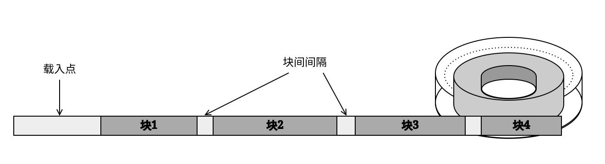
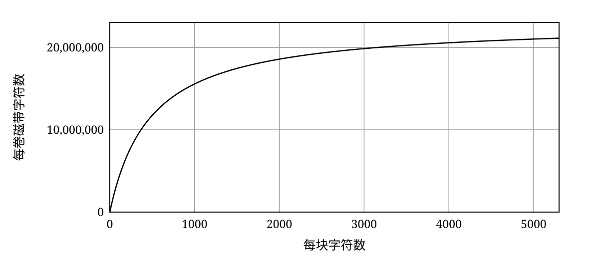
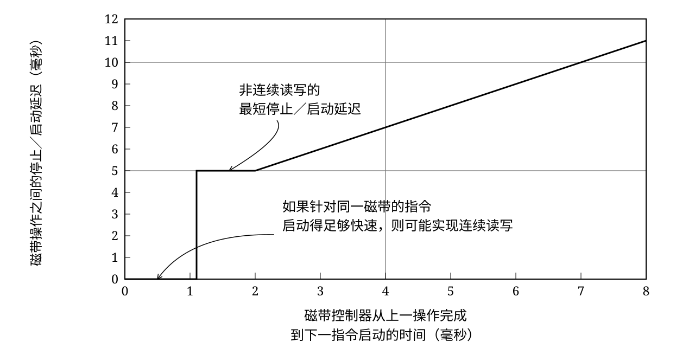
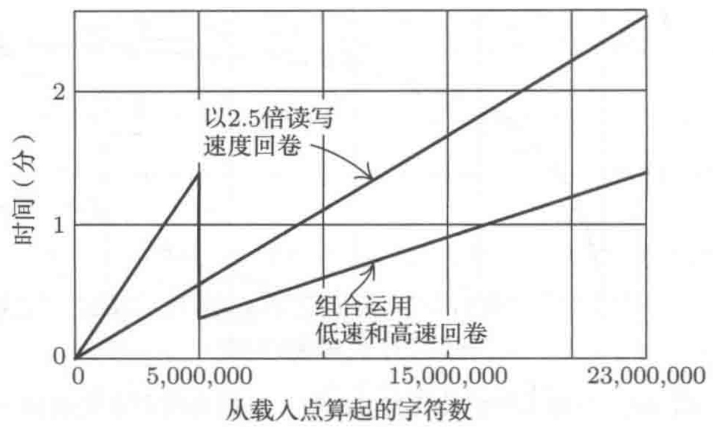
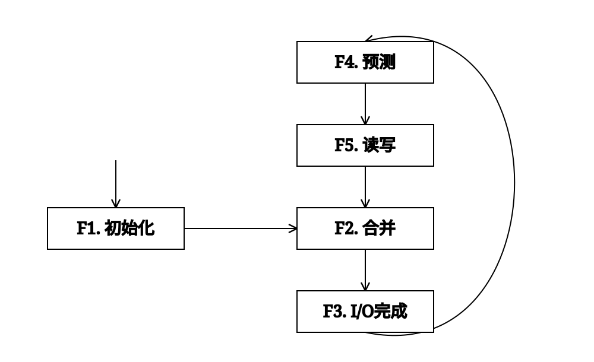
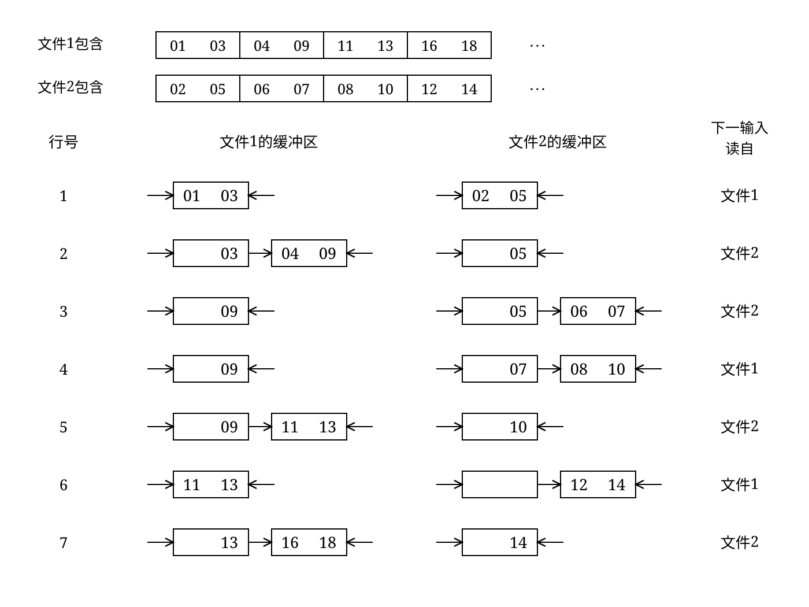
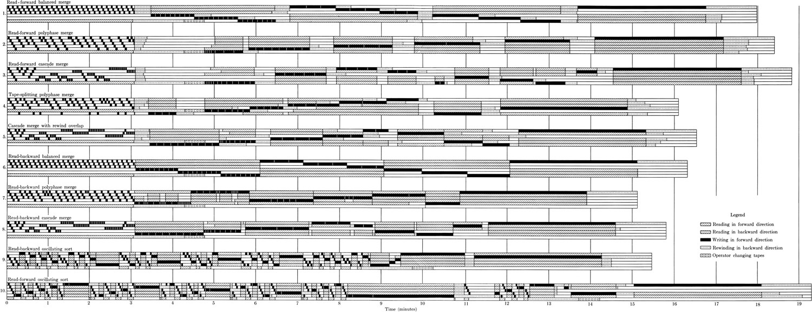
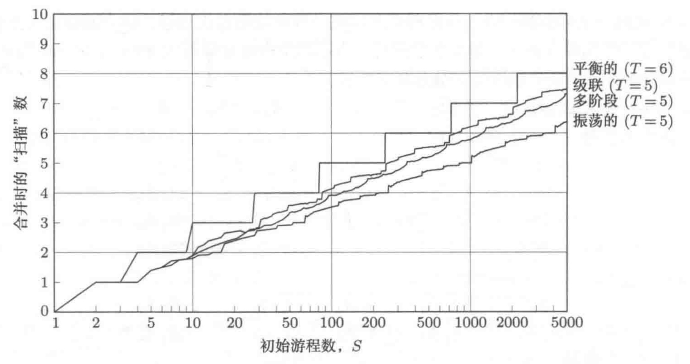

<a id="sec-5-4-6"></a>

### *5.4.6　磁带合并的实践考虑

现在该是问题的本质了: 我们已经讨论了各种合并模式序列, 现在该看看如何把它们应用于计算机与磁带的实际结构中, 并以一种有意义的方式来比较它们. 对内部排序的研究表明: 仅仅计算一种排序方法执行的比较次数是无法充分判断其效率的. 与此类似, 如果只知道外部排序方法对数据进行的扫描遍数也不能正确地评估该方法的性能.

本节将讨论典型磁带机的特性, 以及它们影响初始分布与合并的方式. 特别地, 我们将研究一些缓冲区分配方案, 以及它们对运行时间的相应影响. 我们还将简要考虑排序生成器程序的构造.

**磁带如何工作.** 不同制造商提供的磁带机的特性有很大不同. 为方便起见, 我们将定义一种假想的 MIXT 磁带机, 在首次写作本书时, 对于当时制造的磁带机来说 MIXT 是相当典型的. MIXT 每英寸读写 800 字符, 速度是每秒 75 英寸. 这意味着当磁带处于工作状态时, 每 $\frac1{60}$ 毫秒 (也就是 $16\frac23$ 微秒) 读写一个字符. 1970 年能够买到的实际磁带机的密度范围是每英寸 200 至 1600 字符, 磁带速度是每秒 $37\frac12$ 至 150 英寸, 所以它们的实际速度是 MIXT 的 1/8 到 4 倍.

当然, 我们在 5.4 节开头部分已经看到, 一般来说磁带现在已经相当过时了. 但我们在磁带排序年代学到的许多知识还是非常重要的, 今天这些知识仍然很有价值. 因此我们这里主要关注的不是如何获得具体答案, 而是了解如何合理地把理论同实践结合起来. 方法要比现象重要得多, 因为尽管技术会发生变化, 但解决问题的原理仍然一直有用. 如果读者能够暂时把自己转移到 20 世纪 70 年代的思维方式中, 那将会从这些资料中获得最大裨益. 因此我们假装仍然生活在那个已经逝去的时代.

以早些日子的观点来看, 需要记住的重要考虑事项之一是一个事实: 磁带的容量是严格受限的. 每卷磁带的长度不超过 2400 英尺, 因此每卷 MIXT 磁带上的空间最多可以容纳约 23000000 字符, 读完所有这些字符大约需要 $23000000/3600000\approx6.4$ 分钟. 如果必须排序更大的文件, 通常情况下最好是一次排序一卷磁带, 然后再合并各卷已排好序的磁带, 以避免过多的磁带操作. 这就意味着, 在我们已经研究的合并模式中实际存在的初始游程数 $S$ 永远都不会非常大. 即使内部存储器非常小, 所生成的初始游程长度仅有 5000 字符, 也不会出现 $S>5000$ 的情况. 因此, 对于那些描述算法在 $S\to\infty$ 时渐近效率的公式, 其意义主要体现在学术上.

数据是以块的形式出现在磁带上的 (见图 79), 每个读／写指令传送一个块. 磁带块经常称为 “记录”, 但我们将避免使用这一术语, 否则会造成冲突: 我们正在对另一意义的 “记录” 组成的文件排序. 20 世纪 50 年代编写的许多早期排序程序不需要进行这种区分, 因为每个块中写入一条记录. 但后面将会看到, 在磁带上的每个块中多写入几条记录通常是有利的.

<div class="source-tableau-group" style="max-width:100%;overflow-x:auto"></div>

图 79　块大小可变的磁带

<a id="pdf-257"></a>
<a id="p-251"></a>

<div class="source-tableau-group" style="max-width:100%;overflow-x:auto"></div>

图 80　每卷 MIXT 磁带的字符数, 表示为块大小的函数

为了使磁带能够在各个读写指令之间停止和启动, 在相邻块之间有一个长度为 480 字符位置的块间间隔. 块间间隔降低了每卷磁带的字符数, 具体取决于每个块的字符数 (见图 80). 由于磁带是以相当恒定的速度移动的, 所以每秒传送的平均字符数同样也会下降.

许多老式计算机的块大小是固定的, 而且相当小. 它们的设计反映在第 1 章定义的 MIX 计算机中, 这种计算机总是读写 100 字的块. MIX 的约定是每块大约 500 字符, 每个间隙的长度是 480 字符, 磁带几乎有一半被消耗了! 因此 20 世纪 70 年代的大多数机器都允许块大小可变. 下面讨论适当块大小的选择问题.

在一次读操作或写操作的末尾, 磁带机会全速 “滑过” 块间间隙的前 66 个 (左右的) 字符. 如果在这期间启动了下一个针对同一磁带的操作, 磁带将会不受干扰地继续移动. 但如果下一次操作来得不够及时, 磁带将会停止, 它还需要一定的时间才能加速到全速以执行下一次操作. 这一停止／启动时间的延迟加起来为 5 毫秒 (2 毫秒用于停止, 3 毫秒用于启动), 见图 81. 因此, 如果错过了继续全速读取的机会, 对运行时间的影响基本上就相当于块间间隙的长度为 780 字符而不是 480 字符.

<div class="source-tableau-group" style="max-width:100%;overflow-x:auto"></div>

图 81　如何计算停止／启动延迟时间 (加到用于读写块和间隙的时间上)

<a id="pdf-258"></a>
<a id="p-252"></a>

现在我们考虑回卷操作. 遗憾的是, 对于给定数目的 $n$ 个字符, 所需要的确切回卷时间并不容易描述. 在某些机器上存在一种高速回卷, 仅适用于 $n$ 大于五百万左右的情形, 当 $n$ 值较小时回卷操作会以正常的读写速度进行. 在其他机器上, 使用一种特殊的马达来控制所有的回卷操作, 它会使带盘逐渐加速到某一特定转速, 当应该停止时进行制动, 实际带速会随着带盘上磁带的多少而发生变化. 为简单起见, 我们假定 MIXT 回卷 $n$ 个字符位置 (包括间隙) 需要 $\max(30,n/150)$ 毫秒, 大约是写入这些字符所需时间的五分之二. 这是对许多实际磁带机特性相当不错的近似, 读写时间与回卷时间的比值一般介于 2 和 3 之间, 但它不足以模拟许多其他机器上采用的低速和高速组合回卷的效果. 见图 82.

<div class="source-tableau-group" style="max-width:100%;overflow-x:auto"></div>

图 82　两种常用回卷技术的近似运行时间

最初的载入或回卷会将一条磁带定位到 “载入点”, 在载入点启动任意读写操作都需要额外增加 110 毫秒的时间. 当磁带不在载入点时可以进行反向读取. 在一个正向操作之后执行任何反向操作, 或者在反向操作之后执行任何正向操作, 都需要额外增加 32 毫秒的时间.

**再论合并.** 现在再来看看 $P$ 路合并的过程, 着重考察输入输出活动, 假定共有 $P+1$ 台磁带机正在用于输入文件和输出文件. 我们的目标是尽可能多地使输入输出操作相互重叠, 以及与程序的计算重叠, 从而使整体合并时间降至最低.

考虑以下特殊情形具有指导意义, 在这种情形中, 对可能实现的同时操作数设定了严格的限制. 假定:

(a) 在任意时刻, 最多可以写一条磁带;

(b) 在任意时刻, 最多可以读一条磁带;

(c) 仅当已经同时启动读和写操作, 才会同时进行读、写和计算.

事实表明, 即使设置了这三项限制, 一个拥有 $2P$ 个输入缓冲区和 2 个输出缓冲区的系统也足以使磁带基本上以最大速度运行, 除非计算机的速度慢到异乎寻常. 注意, 因为仅有一条输出磁带, 所以条件 (a) 并非实际限制. 此外, 输入的数量等于输出的数量, 所以在任意给定时刻平均只有一条磁带正在被读取, 如果不满足条件 (b), 那必定存在一些根本没有输入内容的阶段. 因此, 如果能够使输出磁带保持繁忙, 就可以把合并时间降至最低.

一项称为预测的重要技术可以得到期望结果. 在进行 $P$ 路合并时, 一般会有 $P$ 个当前输入缓冲区用作数据源, 其中一些缓冲区要比其他缓冲区更满些, 具体取决于已经对多少数据进行了扫描. 如果所有这些缓冲区几乎同时变空, 那么在继续处理之前需要大量读操作, 除非我们提前预测到这种可能性. 幸运的是, 只需要查看每个缓冲区的最后一个记录, 就可以判断哪个缓冲区将会首先变空. 如果一个缓冲区的最后一个记录的键值最小, 无论其他键值如何, 这个缓冲区总是首先变空. 所以我们总是知道哪个文件应当作为下一条输入指令的来源. 以下算法详细叙述这个原理.


<a id="pdf-259"></a>
<a id="p-253"></a>

<a id="alg-5-4-6-F"></a>

**算法 F (浮动缓冲区预测).** 算法控制对长输入文件进行 $P$ 路合并的缓冲区安排, $P\ge2$. 假定输入磁带与文件编号为 $1,2,\ldots,P$. 算法使用 $2P$ 个输入缓冲区 $\mathrm I[1],\ldots,\mathrm I[2P]$, 两个输出缓冲区 $\mathrm O[0]$ 和 $\mathrm O[1]$, 还有以下辅助表.

$\mathrm A[j]$, $1\le j\le2P$: 如果 $\mathrm I[j]$ 可用于输入则为 0, 否则为 1.

$\mathrm B[i]$, $1\le i\le P$: 保存迄今从文件 $i$ 中读入的最后块的缓冲区的索引.

$\mathrm C[i]$, $1\le i\le P$: 当前用于存储来自文件 $i$ 的输入的缓冲区的索引.

$\mathrm L[i]$, $1\le i\le P$: 迄今从文件 $i$ 读入的最后键.

$\mathrm S[j]$, $1\le j\le2P$: 当 $\mathrm I[j]$ 变空时所用缓冲区的索引.

这里描述的算法不会终止, 后面将讨论结束算法的适当方式.

**F1.[初始化.]** 对于 $1\le i\le P$, 把磁带 $i$ 的第一个块读入缓冲区 $\mathrm I[i]$, 置 $\mathrm A[i]\gets1$, $\mathrm A[P+i]\gets0$, $\mathrm B[i]\gets i$, $\mathrm C[i]\gets i$, 置 $\mathrm L[i]$ 为缓冲区 $\mathrm I[i]$ 中最后一个记录的键. 然后找出满足 $\mathrm L[m]=\min\{\mathrm L[1],\ldots,\mathrm L[P]\}$ 的 $m$ 值. 置 $t\gets0$, $k\gets P+1$. 开始把磁带 $m$ 的内容读入缓冲区 $\mathrm I[k]$.

**F2.[合并.]** 把缓冲区 $\mathrm I[\mathrm C[1]],\ldots,\mathrm I[\mathrm C[P]]$ 的记录合并到 $\mathrm O[t]$, 直到 $\mathrm O[t]$ 填满. 如果在这期间, 一个输入缓冲区 (比如说 $\mathrm I[\mathrm C[i]]$) 变空而 $\mathrm O[t]$ 仍未填满, 则置 $\mathrm A[\mathrm C[i]]\gets0$, $\mathrm C[i]\gets\mathrm S[\mathrm C[i]]$, 然后继续合并.

**F3.[I/O 完成.]** 一直等待, 直到上一次读 (或读写) 操作完成. 然后置 $\mathrm A[k]\gets1$, $\mathrm S[\mathrm B[m]]\gets k$, $\mathrm B[m]\gets k$, 置 $\mathrm L[m]$ 为 $\mathrm I[k]$ 中最后一个记录的键.

**F4.[预测.]** 找出满足 $\mathrm L[m]=\min\{\mathrm L[1],\ldots,\mathrm L[P]\}$ 的 $m$ 值, 并找出满足 $\mathrm A[k]=0$ 的 $k$ 值.

**F5.[读写.]** 开始把磁带 $m$ 的内容读入缓冲区 $\mathrm I[k]$, 并把缓冲区 $\mathrm O[t]$ 的内容写到输出磁带. 然后置 $t\gets1-t$, 返回 F2. ■

<div class="source-tableau-group" style="max-width:100%;overflow-x:auto"></div>

图 83　浮动缓冲区预测


<a id="pdf-260"></a>
<a id="p-254"></a>

图 84 中的示例说明当 $P=2$ 时如何进行预测, 假定磁带上的每个块仅包含两个记录. 图中给出每次到达步骤 F2 的开始处时输入缓冲区的内容. 算法 F 实际上形成 $P$ 个缓冲区队列, $\mathrm C[i]$ 指向第 $i$ 个队列的头部, $\mathrm B[i]$ 指向第 $i$ 个队列的后部, $\mathrm S[j]$ 指向缓冲区 $\mathrm I[j]$ 的后续缓冲区. 这些指针如图 84 中的箭头所示. 第 1 行给出初始化之后的状态: 每个输入文件都有一个缓冲区, 正在从文件 1 中读取另一个块 (因为 $\mathtt{03}<\mathtt{05}$). 第 2 行给出合并第一个块之后的状态: 正在输出一个包含 $\boxed{\mathtt{01}\ \mathtt{02}}$ 的块, 并从文件 2 输入下一个块 (因为 $\mathtt{05}<\mathtt{09}$). 注意, 在第 3 行, 四个输入缓冲区中的三个实际上被文件 2 占用, 因为我们正在从这个文件读取内容, 而且它的队列中已经有一个全满缓冲区和一个部分填满的缓冲区. 这种 “浮动缓冲区” 的安排是算法 F 的一个重要特性: 如果我们选择文件 1 而非文件 2 作为第 3 行的输入, 将不能进入第 4 行.

<div class="source-tableau-group" style="max-width:100%;overflow-x:auto"></div>

图 84　按照算法 F 安排的缓冲区队列


为了证明算法 F 的有效性, 必须证明两件事情.

(i) 总有一个输入缓冲区可用 (即, 总是可以在步骤 F4 找到一个 $k$).

(ii) 如果一个输入缓冲区在合并时耗尽, 则它的后续者已经出现在存储器中 (即, 在步骤 F2 中 $\mathrm S[\mathrm C[i]]$ 是有意义的).

假定 (i) 为假, 也就是在我们到达步骤 F4 的某一时刻所有缓冲区都不可用. 每次到达这一步时, 所有缓冲区中的未处理数据总量恰好为 $P$ 个缓冲区负载, 也就是如果重新分布这些缓冲区, 未处理的数据总量恰好填满 $P$ 个缓冲区, 因为我们输入和输出数据的速度是相同的. 一些缓冲区只是部分填满的, 但每个文件最多只有一个缓冲区是部分填满的, 所以最多有 $P$ 个缓冲区处于这种状态. 根据假设所有 $2P$ 个缓冲区都不可用, 因此它们中至少有 $P$ 个是全满的. 仅当 $P$ 个为全满、$P$ 个为空时才会发生这种情况, 否则我们将会拥有太多的数据. 但在任一时刻最多有一个缓冲区不可用且为空, 因此 (i) 不可能为假.

假定 (ii) 为假, 于是对于某个文件存储器中没有未处理记录, 但当前输出缓冲区还没有满. 根据预测原理, 其他每个文件的数据块都不会超过一个, 因为在任何其他文件的缓冲区被穷尽之前, 我们只有在需要某个块时才会读入它. 因此未处理记录的总数最多为 $P-1$ 块, 加上未填满的输出缓冲区, 这导致存储器中的数据少于 $P$ 个缓冲区负载, 矛盾.

这个论证过程确定了算法 F 的有效性. 它还指出出现病态情形的可能性, 在这种病态情形中算法仅能勉强避免灾难. 还有一点非常重要的微妙之处我们没有提到, 那就是存在键值相等的可能性, 在习题 5 中讨论. 也见习题 4, 它考虑了 $P=1$ 的情形.

一种完美终止算法 F 的方法是: 如果刚读入的块是一个游程的最后一块, 则在步骤 F3 中把 $\mathrm L[m]$ 置为 $\infty$. (惯例是以某种特殊形式来指明游程的结尾.) 在读入所有文件的所有数据之后, 我们最终将发现步骤 F4 中所有的 $\mathrm L$ 都等于 $\infty$. 然后, 通常可能开始读取每个文件中下一个游程的前几个块, 在输出最后 $P+1$ 个块的同时开始初始化下一个合并阶段.

因此我们能使输出磁带基本上全速运转而不需要同时读取多条磁带. 这个规则的例外发生在步骤 F1 中, 为启动各项操作一次读取几条磁带是有利的. 但步骤 F1 通常可以安排成与先前的计算部分重叠.

<a id="pdf-261"></a>
<a id="p-255"></a>

通过查看每个块中的最后一个记录来预测哪个缓冲区首先变空, 这一思想由弗朗西丝·霍尔伯顿在 1953 年发现. 首先发表这项技术的则是弗兰德 [*JACM* **3** (1956), 144–145, 165]. 他的算法相当复杂, 使用了 $3P$ 个输入缓冲区, 每个输入文件有三个专用缓冲区. 算法 F 利用浮动缓冲区改进了这一情形, 允许任意单个文件一次申请多达 $P+1$ 个输入缓冲区, 但所需的总缓冲区绝不会超过 $2P$ 个. 本节末尾将讨论使用少于 $2P$ 个输入缓冲区进行的合并. 5.4.9 节讨论对算法 F 的某些很有意义的改进.


**合并模式的特性比较.** 现在我们利用所掌握的有关磁带和合并的知识来比较 5.4.2 节至 5.4.5 节研究的各种合并模式的有效性. 一种非常有指导意义的做法是: 把每种方法应用于同一任务, 并给出所有细节. 考虑这样一个排序问题: 待排序文件的每个记录包含 100 字符, 存储器中共有 100000 字符位置可用于数据存储, 其中不包括程序和辅助变量所需的空间以及选择树中链接占用的空间. (别忘了, 我们正假装生活在存储器非常小的年代.) 这些输入内容以随机顺序出现在磁带上, 每个块的大小为 5000 字符, 输出的格式与输入相同. 除了包含输入的磁带外, 还有五条空白磁带可供使用.

待排序的总记录数为 100000, 但排序算法事先并不知道这一信息.

图表 A (插页) 综述十种不同合并方案应用于这些数据时发生的操作. 查看这一重要图示的最佳方法是设想我们正在观察所进行的排序过程: 缓慢地从左向右扫描每一行, 假装我们实际上可以看到六条磁带的读、写、回卷和／或反向读取, 如图所示. 在 $P$ 路合并期间, 输入磁带的移动次数仅为输出磁带移动次数的 $1/P$. 当原输入磁带完全读入 (并已 “带锁” 回卷), 图表 A 假定一位熟练的计算机操作员在 30 秒内卸下它, 换上一条空白磁带. 在示例 2、3、4 中, 这是 “关键路径时间”, 在此期间计算机空闲, 等待操作员完工. 但在其余示例中, 卸载重装操作与其他处理过程重叠.

<a id="fig-chart-a"></a>
<a id="en-chart-a-421"></a>

**图表 A. 合并方案的磁带操作.** 时间单位: 分钟; 每行自上而下为磁带 T1、T2、T3、T4、T5、T6.

<div class="book-timeline" style="overflow-x:auto;max-width:100%"><a href="../../assets/volume3/figures/chart-a-tape-activity.jpeg"></a></div>

| 编号 | 方案 |
|---|---|
| 1 | 正向读取的平衡合并 |
| 2 | 正向读取的多阶段合并 |
| 3 | 正向读取的级联合并 |
| 4 | 磁带划分多阶段合并 |
| 5 | 具有回卷重叠的级联合并 |
| 6 | 反向读取的平衡合并 |
| 7 | 反向读取的多阶段合并 |
| 8 | 反向读取的级联合并 |
| 9 | 反向读取的振荡排序 |
| 10 | 正向读取的振荡排序 |

**图例.**

| 纹理 | 磁带操作 |
|---|---|
| 斜向右上的线纹 | 正向读取 |
| 斜向右下的线纹 | 反向读取 |
| 实黑 | 正向写入 |
| 点线 | 反向回卷 |
| 一排小圆圈 | 操作员换带 |

**示例 1. 正向读取的平衡合并.** 我们回顾一下问题的约定: 记录长度是 100 字符, 有足够的内部存储器可以一次容纳 1000 个记录, 输入磁带上的每个块包含 5000 字符 (50 个记录). 一共有 100000 个记录 (=10000000 字符=2000 个块).

我们可以自由选择中间文件的块大小. 六磁带平衡合并使用三路合并, 所以算法 F 的技术需要八个缓冲区. 因此我们可以使用包含 $1000/8=125$ 个记录 (=12500 字符) 的块.

初始分布扫描可利用替代选择 (算法 5.4.1R), 为使磁带平稳运行, 可以使用两个各包含 50 个记录的输入缓冲区, 再加上两个各包含 125 个记录的输出缓冲区. 这就在替代选择树中留出了 650 个记录的空间. 因此大多数初始游程的长度大约为 1300 个记录 (10 或 11 个块), 结果在图表 A 中生成 78 个初始游程, 最后一个相对短一些.

第一遍合并扫描有九个游程被合并到磁带 4, 而不是在磁带 4、5、6 之间交替. 这样就有可能在计算机操作员向 6 号磁带机装载空白磁带的同时做一些有用的工作. 由于在完成初始分布之后就已经知道游程总数 $S$, 算法知道应当把 $\lceil S/9\rceil$ 个游程合并到磁带 4, 然后把 $\lceil(S-3)/9\rceil$ 个游程合并到磁带 5, 接下来把 $\lceil(S-6)/9\rceil$ 个游程合并到磁带 6.

利用 5.4.2 节介绍的记号, 这个示例的整个排序过程总结如下:

<table data-comparison-table="1" style="white-space:nowrap"><tr><th>T1</th><th>T2</th><th>T3</th><th>T4</th><th>T5</th><th>T6</th></tr><tr data-comparison-row="1"><td data-comparison-field>$1^{26}$</td><td data-comparison-field>$1^{26}$</td><td data-comparison-field>$1^{26}$</td><td data-comparison-field>—</td><td data-comparison-field>—</td><td data-comparison-field>—</td></tr><tr data-comparison-row="1"><td data-comparison-field>—</td><td data-comparison-field>—</td><td data-comparison-field>—</td><td data-comparison-field>$3^{9}$</td><td data-comparison-field>$3^{9}$</td><td data-comparison-field>$3^{8}$</td></tr><tr data-comparison-row="1"><td data-comparison-field>$9^{3}$</td><td data-comparison-field>$9^{3}$</td><td data-comparison-field>$9^{2}\,6^{1}$</td><td data-comparison-field>—</td><td data-comparison-field>—</td><td data-comparison-field>—</td></tr><tr data-comparison-row="1"><td data-comparison-field>—</td><td data-comparison-field>—</td><td data-comparison-field>—</td><td data-comparison-field>$27^{1}$</td><td data-comparison-field>$27^{1}$</td><td data-comparison-field>$24^{1}$</td></tr><tr data-comparison-row="1"><td data-comparison-field>$78^{1}$</td><td data-comparison-field>—</td><td data-comparison-field>—</td><td data-comparison-field>—</td><td data-comparison-field>—</td><td data-comparison-field>—</td></tr></table>

<a id="pdf-262"></a>
<a id="p-256"></a>

**示例 2. 正向读取的多阶段合并.** 图表 A 的第二个示例按照算法 5.4.2D 执行多阶段合并. 在这个示例中, 我们执行五路合并, 所以存储器被划分为 12 个各包含 83 个记录的缓冲区. 在初始替代选择期间, 我们拥有两个各包含 50 个记录的输入缓冲区和两个各包含 83 个记录的输出缓冲区, 在树中留有 734 个记录. 所以这一次的初始游程长度大约是 1468 个记录 (17 或 18 个块). 所示情形表明, 有 $S=70$ 个初始游程, 最后两个初始游程的长度实际上分别只有四个块和一个块. 合并模式总结如下:

<table data-comparison-table="2" style="white-space:nowrap"><tr><th>T1</th><th>T2</th><th>T3</th><th>T4</th><th>T5</th><th>T6</th></tr><tr data-comparison-row="2"><td data-comparison-field>$0^{13}\,1^{18}$</td><td data-comparison-field>$0^{13}\,1^{17}$</td><td data-comparison-field>$0^{13}\,1^{15}$</td><td data-comparison-field>$0^{12}\,1^{12}$</td><td data-comparison-field>$0^{8}\,1^{8}$</td><td data-comparison-field>—</td></tr><tr data-comparison-row="2"><td data-comparison-field>$1^{15}$</td><td data-comparison-field>$1^{14}$</td><td data-comparison-field>$1^{12}$</td><td data-comparison-field>$1^{8}$</td><td data-comparison-field>—</td><td data-comparison-field>$0^{8}\,1^{4}\,2^{1}\,5^{3}$</td></tr><tr data-comparison-row="2"><td data-comparison-field>$1^{7}$</td><td data-comparison-field>$1^{6}$</td><td data-comparison-field>$1^{4}$</td><td data-comparison-field>—</td><td data-comparison-field>$4^{8}$</td><td data-comparison-field>$1^{4}\,2^{1}\,5^{3}$</td></tr><tr data-comparison-row="2"><td data-comparison-field>$1^{3}$</td><td data-comparison-field>$1^{2}$</td><td data-comparison-field>—</td><td data-comparison-field>$8^{4}$</td><td data-comparison-field>$4^{4}$</td><td data-comparison-field>$2^{1}\,5^{3}$</td></tr><tr data-comparison-row="2"><td data-comparison-field>$1^{1}$</td><td data-comparison-field>—</td><td data-comparison-field>$16^{1}\,19^{1}$</td><td data-comparison-field>$8^{2}$</td><td data-comparison-field>$4^{2}$</td><td data-comparison-field>$5^{2}$</td></tr><tr data-comparison-row="2"><td data-comparison-field>—</td><td data-comparison-field>$34^{1}$</td><td data-comparison-field>$19^{1}$</td><td data-comparison-field>$8^{1}$</td><td data-comparison-field>$4^{1}$</td><td data-comparison-field>$5^{1}$</td></tr><tr data-comparison-row="2"><td data-comparison-field>$70^{1}$</td><td data-comparison-field>—</td><td data-comparison-field>—</td><td data-comparison-field>—</td><td data-comparison-field>—</td><td data-comparison-field>—</td></tr></table>

奇怪的是, 多阶段排序花费的时间要比复杂度低很多的平衡合并长大约 25 秒! 主要原因有两个:

(1) 平衡合并在这种情况下特别幸运, 因为 $S=78$ 如此接近 3 的一个完全幂. 如果生成的是 82 个初始游程, 平衡合并将另外需要一遍扫描.

(2) 多阶段合并在改变输入磁带时浪费了 30 秒, 而且它在等待回卷操作完成时总共浪费了 5 分钟以上的时间. 与之相对的是, 平衡合并需要相对较少的回卷时间. 在多阶段合并的第二阶段, 回卷磁带 6 时可以假定该磁带上存在 8 个虚拟游程, 因此节省了 13 秒. 但没有发生其他回卷重叠. 因此, 尽管多阶段方法需要的读写时间要少得多, 但它仍然落败了.

**示例 3. 正向读取的级联合并.** 这个示例的情形类似于上一个示例, 但是使用算法 5.4.3C. 合并过程总结如下:

<table data-comparison-table="3" style="white-space:nowrap"><tr><th>T1</th><th>T2</th><th>T3</th><th>T4</th><th>T5</th><th>T6</th></tr><tr data-comparison-row="3"><td data-comparison-field>$1^{14}$</td><td data-comparison-field>$1^{15}$</td><td data-comparison-field>$1^{12}$</td><td data-comparison-field>$1^{14}$</td><td data-comparison-field>$1^{15}$</td><td data-comparison-field>—</td></tr><tr data-comparison-row="3"><td data-comparison-field>$1^{5}$</td><td data-comparison-field>$1^{9}$</td><td data-comparison-field>—</td><td data-comparison-field>$1^{14}$</td><td data-comparison-field>$1^{15}$</td><td data-comparison-field>$1^{3}\,2^{3}\,3^{6}$</td></tr><tr data-comparison-row="3"><td data-comparison-field>$5^{1}\,6^{3}$</td><td data-comparison-field>$5^{3}$</td><td data-comparison-field>$5^{3}\,6^{2}$</td><td data-comparison-field>—</td><td data-comparison-field>$1^{1}$</td><td data-comparison-field>$2^{2}$</td></tr><tr data-comparison-row="3"><td data-comparison-field>—</td><td data-comparison-field>$12^{1}$</td><td data-comparison-field>$6^{1}$</td><td data-comparison-field>$18^{1}$</td><td data-comparison-field>$18^{1}$</td><td data-comparison-field>$16^{1}$</td></tr><tr data-comparison-row="3"><td data-comparison-field>$70^{1}$</td><td data-comparison-field>—</td><td data-comparison-field>—</td><td data-comparison-field>—</td><td data-comparison-field>—</td><td data-comparison-field>—</td></tr></table>

(别忘了通过浏览插页中的图表 A 来观察所有这些示例的执行情况.)

<a id="pdf-263"></a>
<a id="p-257"></a>

**示例 4. 磁带划分多阶段合并.** 在 5.4.2 节末尾描述的这个过程允许重叠大部分回卷时间. 它使用四路合并, 所以我们把存储器分为 10 个各容纳 100 个记录的缓冲区. 在替代选择树中共有 700 个记录, 所以最终将形成 72 个初始游程. 最后一个游程还是非常短. 这里使用一种类似于算法 5.4.2D 的分布方案, 接下来使用一种简单但多少有些专用的方法来放置虚拟游程:

<table data-comparison-table="4" style="white-space:nowrap"><tr><th>T1</th><th>T2</th><th>T3</th><th>T4</th><th>T5</th><th>T6</th></tr><tr data-comparison-row="4"><td data-comparison-field>$1^{21}$</td><td data-comparison-field>$1^{19}$</td><td data-comparison-field>$1^{15}$</td><td data-comparison-field>$1^{8}$</td><td data-comparison-field>—</td><td data-comparison-field>$0^{2}\,1^{9}$</td></tr><tr data-comparison-row="4"><td data-comparison-field>$0^{2}\,1^{17}$</td><td data-comparison-field>$0^{2}\,1^{15}$</td><td data-comparison-field>$0^{2}\,1^{11}$</td><td data-comparison-field>$0^{2}\,1^{4}$</td><td data-comparison-field>—</td><td data-comparison-field>$0^{2}\,1^{9}\,4^{4}$</td></tr><tr data-comparison-row="4"><td data-comparison-field>$1^{13}$</td><td data-comparison-field>$1^{11}$</td><td data-comparison-field>$1^{7}$</td><td data-comparison-field>—</td><td data-comparison-field>$0^{2}\,4^{4}$</td><td data-comparison-field>$0^{2}\,1^{9}\,4^{4}$</td></tr><tr data-comparison-row="4"><td data-comparison-field>$1^{10}$</td><td data-comparison-field>$1^{8}$</td><td data-comparison-field>$1^{4}$</td><td data-comparison-field>—</td><td data-comparison-field>$0^{2}\,4^{4}\,3^{2}\,4^{1}$</td><td data-comparison-field>$1^{8}\,4^{4}$</td></tr><tr data-comparison-row="4"><td data-comparison-field>$1^{6}$</td><td data-comparison-field>$1^{4}$</td><td data-comparison-field>—</td><td data-comparison-field>$4^{4}$</td><td data-comparison-field>$0^{2}\,4^{4}\,3^{2}\,4^{1}$</td><td data-comparison-field>$1^{4}\,4^{4}$</td></tr><tr data-comparison-row="4"><td data-comparison-field>$1^{5}$</td><td data-comparison-field>$1^{3}$</td><td data-comparison-field>—</td><td data-comparison-field>$4^{4}\,3^{1}$</td><td data-comparison-field>$0^{1}\,4^{4}\,3^{2}\,4^{1}$</td><td data-comparison-field>$1^{3}\,4^{4}$</td></tr><tr data-comparison-row="4"><td data-comparison-field>$1^{2}$</td><td data-comparison-field>—</td><td data-comparison-field>$3^{1}\,7^{2}$</td><td data-comparison-field>$4^{4}\,3^{1}$</td><td data-comparison-field>$4^{2}\,3^{2}\,4^{1}$</td><td data-comparison-field>$4^{4}$</td></tr><tr data-comparison-row="4"><td data-comparison-field>$1^{1}$</td><td data-comparison-field>—</td><td data-comparison-field>$3^{1}\,7^{2}\,13^{1}$</td><td data-comparison-field>$4^{3}\,3^{1}$</td><td data-comparison-field>$4^{1}\,3^{2}\,4^{1}$</td><td data-comparison-field>$4^{3}$</td></tr><tr data-comparison-row="4"><td data-comparison-field>—</td><td data-comparison-field>$13^{1}$</td><td data-comparison-field>$3^{1}\,7^{2}\,13^{1}$</td><td data-comparison-field>$4^{2}\,3^{1}$</td><td data-comparison-field>$3^{2}\,4^{1}$</td><td data-comparison-field>$4^{2}$</td></tr><tr data-comparison-row="4"><td data-comparison-field>—</td><td data-comparison-field>$13^{1}\,14^{1}$</td><td data-comparison-field>$7^{2}\,13^{1}$</td><td data-comparison-field>$4^{1}\,3^{1}$</td><td data-comparison-field>$3^{1}\,4^{1}$</td><td data-comparison-field>$4^{1}$</td></tr><tr data-comparison-row="4"><td data-comparison-field>$18^{1}$</td><td data-comparison-field>$13^{1}\,14^{1}$</td><td data-comparison-field>$7^{1}\,13^{1}$</td><td data-comparison-field>$3^{1}$</td><td data-comparison-field>$4^{1}$</td><td data-comparison-field>—</td></tr><tr data-comparison-row="4"><td data-comparison-field>$18^{1}$</td><td data-comparison-field>$14^{1}$</td><td data-comparison-field>$13^{1}$</td><td data-comparison-field>—</td><td data-comparison-field>—</td><td data-comparison-field>$27^{1}$</td></tr><tr data-comparison-row="4"><td data-comparison-field>—</td><td data-comparison-field>—</td><td data-comparison-field>—</td><td data-comparison-field>$72^{1}$</td><td data-comparison-field>—</td><td data-comparison-field>—</td></tr></table>

结果表明, 在图表 A 中没有进行反向读取的示例中, 这个方法的运行时间最佳. 由于 $S$ 绝不会达到非常大, 所以有可能开发一种更为复杂的算法以更好的方式来放置虚拟游程, 见式 5.4.2–(26).


**示例 5. 具有回卷重叠的级联合并.** 这个过程的运行速度几乎与上一个示例一样, 而这个算法的控制要简单得多. 我们只需像算法 5.4.3C 中一样使用级联排序方法来进行初始分布, 但 $T=5$ 而不是 $T=6$. 接下来每个 “级联” 的每个阶段交错使用磁带, 这样我们通常不会在磁带上写入内容, 除非它获得机会被回卷过了. 这个模式可以非常简略地写为:

<table data-comparison-table="5" style="white-space:nowrap"><tr><th>T1</th><th>T2</th><th>T3</th><th>T4</th><th>T5</th><th>T6</th></tr><tr data-comparison-row="5"><td data-comparison-field>$1^{21}$</td><td data-comparison-field>$1^{22}$</td><td data-comparison-field>$1^{19}$</td><td data-comparison-field>$1^{10}$</td><td data-comparison-field>—</td><td data-comparison-field>—</td></tr><tr data-comparison-row="5"><td data-comparison-field>$1^{4}$</td><td data-comparison-field>$1^{7}$</td><td data-comparison-field>—</td><td data-comparison-field>—</td><td data-comparison-field>$1^{2}\,2^{2}\,3^{5}$</td><td data-comparison-field>$4^{10}$</td></tr><tr data-comparison-row="5"><td data-comparison-field>$7^{2}$</td><td data-comparison-field>—</td><td data-comparison-field>$8^{3}$</td><td data-comparison-field>$7^{2}\,8^{2}$</td><td data-comparison-field>—</td><td data-comparison-field>$4^{1}$</td></tr><tr data-comparison-row="5"><td data-comparison-field>—</td><td data-comparison-field>$26^{1}$</td><td data-comparison-field>—</td><td data-comparison-field>$8^{1}$</td><td data-comparison-field>$22^{1}$</td><td data-comparison-field>$16^{1}$</td></tr><tr data-comparison-row="5"><td data-comparison-field>$72^{1}$</td><td data-comparison-field>—</td><td data-comparison-field>—</td><td data-comparison-field>—</td><td data-comparison-field>—</td><td data-comparison-field>—</td></tr></table>

**示例 6. 反向读取的平衡合并.** 这个过程与第一个示例类似, 但消除了所有的回卷:

<table data-comparison-table="6" style="white-space:nowrap"><tr><th>T1</th><th>T2</th><th>T3</th><th>T4</th><th>T5</th><th>T6</th></tr><tr data-comparison-row="6"><td data-comparison-field>$A_{1}^{26}$</td><td data-comparison-field>$A_{1}^{26}$</td><td data-comparison-field>$A_{1}^{26}$</td><td data-comparison-field>—</td><td data-comparison-field>—</td><td data-comparison-field>—</td></tr><tr data-comparison-row="6"><td data-comparison-field>—</td><td data-comparison-field>—</td><td data-comparison-field>—</td><td data-comparison-field>$D_{3}^{9}$</td><td data-comparison-field>$D_{3}^{9}$</td><td data-comparison-field>$D_{3}^{8}$</td></tr><tr data-comparison-row="6"><td data-comparison-field>$A_{9}^{3}$</td><td data-comparison-field>$A_{9}^{3}$</td><td data-comparison-field>$A_{9}^{2}\,A_{6}^{1}$</td><td data-comparison-field>—</td><td data-comparison-field>—</td><td data-comparison-field>—</td></tr><tr data-comparison-row="6"><td data-comparison-field>—</td><td data-comparison-field>—</td><td data-comparison-field>—</td><td data-comparison-field>$D_{24}^{1}$</td><td data-comparison-field>$D_{27}^{1}$</td><td data-comparison-field>$D_{27}^{1}$</td></tr><tr data-comparison-row="6"><td data-comparison-field>$A_{78}^{1}$</td><td data-comparison-field>—</td><td data-comparison-field>—</td><td data-comparison-field>—</td><td data-comparison-field>—</td><td data-comparison-field>—</td></tr></table>

由于第一个示例中的回卷相当少, 所以这个方案并不比正向情形好很多. 事实上, 尽管拥有幸运数 $S=78$, 但它还是要比磁带划分多阶段方法稍慢一些.

<a id="pdf-264"></a>
<a id="p-258"></a>

**示例 7. 反向读取的多阶段合并.** 这个示例仅使用六条磁带中的五条, 为的是消除用于回卷和更换输入磁带的时间. 因此这只是一个四路合并, 缓冲区分布类似于第四和第五个示例. 使用一种类似于算法 5.4.2D 的分布, 但游程的方向是交替的, 固定磁带 1 作为最终的输出磁带. 首先在磁带 1 上写一个递增游程, 然后在磁带 2、3、4 上写递减游程, 然后在磁带 2、3、4 上写递增游程, 然后在磁带 1、2、3 上写递减游程, 以此类推. 每次切换方向时, 替代选择通常生成一个较短的游程, 所以最后将会生成 77 个初始游程, 而不是第四和第五个示例中的 72 个.

这个过程得到 $(22,21,19,15)$ 游程的一种分布, 下一个完美分布是 $(29,56,52,44)$. 习题 5.4.4–5 说明如何生成可用于在最优位置放置虚拟游程的合并数串. 这种过程在实践中是切实可行的, 因为一条磁带的有限性保证了 $S$ 绝不会太大. 图表 A 中的示例就是用这种虚拟游程放置方法构造的 (见习题 7), 结果表明它在图中所示的示例中速度最快.

**示例 8. 反向读取的级联合并.** 和第七个示例一样, 这里也仅使用五条磁带. 这个过程遵循算法 5.4.3C, 使用回卷和正向读取避免一路合并 (因为回卷速度超过读取 MIXT 单元的两倍). 因此分布与第五个示例相同. 这个模式简要总结如下, 使用 $\downarrow$ 表示回卷:

<table data-comparison-followup-table="8" style="white-space:nowrap"><tr><th>T1</th><th>T2</th><th>T3</th><th>T4</th><th>T5</th></tr><tr data-comparison-followup-row><td data-comparison-followup-field>$A_{1}^{21}$</td><td data-comparison-followup-field>$A_{1}^{22}$</td><td data-comparison-followup-field>$A_{1}^{19}$</td><td data-comparison-followup-field>$A_{1}^{10}$</td><td data-comparison-followup-field>—</td></tr><tr data-comparison-followup-row><td data-comparison-followup-field>$A_{1}^{4}\downarrow$</td><td data-comparison-followup-field>$A_{1}^{7}\downarrow$</td><td data-comparison-followup-field>—</td><td data-comparison-followup-field>$D_{1}^{2}D_{2}^{2}D_{3}^{5}$</td><td data-comparison-followup-field>$D_{4}^{10}$</td></tr><tr data-comparison-followup-row><td data-comparison-followup-field>$A_{8}A_{7}^{2}$</td><td data-comparison-followup-field>$A_{5}^{2}$</td><td data-comparison-followup-field>$A_{9}^{4}$</td><td data-comparison-followup-field>—</td><td data-comparison-followup-field>$D_{4}^{1}\downarrow$</td></tr><tr data-comparison-followup-row><td data-comparison-followup-field>—</td><td data-comparison-followup-field>$D_{17}$</td><td data-comparison-followup-field>$A_{9}\downarrow$</td><td data-comparison-followup-field>$D_{25}$</td><td data-comparison-followup-field>$D_{21}$</td></tr><tr data-comparison-followup-row><td data-comparison-followup-field>$A_{72}$</td><td data-comparison-followup-field>—</td><td data-comparison-followup-field>—</td><td data-comparison-followup-field>—</td><td data-comparison-followup-field>—</td></tr></table>

**示例 9. 反向读取的振荡排序.** $T=5$ 的振荡排序 (算法 5.4.5B) 可以像第四、五、七、八个示例一样使用缓冲区分布, 因为它执行的是四路合并. 然而替代选择不以相同的方式运转, 因为在进入每个合并阶段之前要输出一个长度为 700 (而不是 1400 等) 的游程, 以清理内部存储器. 相应地, 这个示例生成 85 个游程而不是 72 个. 这个过程的一些关键步骤是:

<table data-comparison-followup-table="9" style="white-space:nowrap"><tr><th>T1</th><th>T2</th><th>T3</th><th>T4</th><th>T5</th></tr><tr data-comparison-followup-row><td data-comparison-followup-field>—</td><td data-comparison-followup-field>$A_{1}$</td><td data-comparison-followup-field>$A_{1}A_{1}$</td><td data-comparison-followup-field>$A_{1}A_{1}$</td><td data-comparison-followup-field>$A_{1}A_{1}$</td></tr><tr data-comparison-followup-row><td data-comparison-followup-field>$D_{4}$</td><td data-comparison-followup-field>—</td><td data-comparison-followup-field>$A_{1}$</td><td data-comparison-followup-field>$A_{1}$</td><td data-comparison-followup-field>$A_{1}$</td></tr><tr><td colspan="5" style="text-align:center">······································</td></tr><tr data-comparison-followup-row><td data-comparison-followup-field>$D_{4}D_{4}$</td><td data-comparison-followup-field>$D_{4}D_{4}$</td><td data-comparison-followup-field>$D_{4}D_{4}$</td><td data-comparison-followup-field>$D_{4}$</td><td data-comparison-followup-field>—</td></tr><tr data-comparison-followup-row><td data-comparison-followup-field>$D_{4}$</td><td data-comparison-followup-field>$D_{4}$</td><td data-comparison-followup-field>$D_{4}$</td><td data-comparison-followup-field>—</td><td data-comparison-followup-field>$A_{16}$</td></tr><tr><td colspan="5" style="text-align:center">······································</td></tr><tr data-comparison-followup-row><td data-comparison-followup-field>$D_{4}$</td><td data-comparison-followup-field>$A_{16}D_{4}D_{4}$</td><td data-comparison-followup-field>$A_{16}D_{4}$</td><td data-comparison-followup-field>$A_{16}D_{4}A_{1}$</td><td data-comparison-followup-field>$A_{16}$</td></tr><tr data-comparison-followup-row><td data-comparison-followup-field>$D_{4}$</td><td data-comparison-followup-field>$A_{16}D_{4}D_{4}$</td><td data-comparison-followup-field>$A_{16}D_{4}D_{1}$</td><td data-comparison-followup-field>$A_{16}D_{4}$</td><td data-comparison-followup-field>$A_{16}$</td></tr><tr data-comparison-followup-row><td data-comparison-followup-field>—</td><td data-comparison-followup-field>$A_{16}D_{4}$</td><td data-comparison-followup-field>$A_{16}D_{4}$</td><td data-comparison-followup-field>$A_{16}$</td><td data-comparison-followup-field>$A_{16}A_{13}$</td></tr><tr data-comparison-followup-row><td data-comparison-followup-field>—</td><td data-comparison-followup-field>$A_{16}D_{4}$</td><td data-comparison-followup-field>$A_{16}$</td><td data-comparison-followup-field>$A_{16}A_{4}$</td><td data-comparison-followup-field>$A_{16}A_{13}$</td></tr><tr data-comparison-followup-row><td data-comparison-followup-field>—</td><td data-comparison-followup-field>$A_{16}$</td><td data-comparison-followup-field>$A_{16}A_{4}$</td><td data-comparison-followup-field>$A_{16}A_{4}$</td><td data-comparison-followup-field>$A_{16}A_{13}$</td></tr><tr data-comparison-followup-row><td data-comparison-followup-field>$D_{37}$</td><td data-comparison-followup-field>—</td><td data-comparison-followup-field>$A_{16}\downarrow$</td><td data-comparison-followup-field>$A_{16}\downarrow$</td><td data-comparison-followup-field>$A_{16}\downarrow$</td></tr><tr data-comparison-followup-row><td data-comparison-followup-field>—</td><td data-comparison-followup-field>$A_{85}$</td><td data-comparison-followup-field>—</td><td data-comparison-followup-field>—</td><td data-comparison-followup-field>—</td></tr></table>

<a id="pdf-265"></a>
<a id="p-259"></a>

**示例 10. 正向读取的振荡排序.** 在最后这个示例中没有使用替代选择, 因为所有初始游程的长度必须相等. 因此每当需要一个初始游程时, 占满整个内部存储器的 1000 个记录被内部排序, 这就使得 $S=100$. 这个过程的一些关键步骤是:

<table data-comparison-followup-table="10" style="white-space:nowrap"><tr><th>T1</th><th>T2</th><th>T3</th><th>T4</th><th>T5</th></tr><tr data-comparison-followup-row><td data-comparison-followup-field>$A_{1}$</td><td data-comparison-followup-field>$A_{1}$</td><td data-comparison-followup-field>$A_{1}$</td><td data-comparison-followup-field>$A_{1}$</td><td data-comparison-followup-field>$A_{1}$</td></tr><tr data-comparison-followup-row><td data-comparison-followup-field>—</td><td data-comparison-followup-field>—</td><td data-comparison-followup-field>—</td><td data-comparison-followup-field>—</td><td data-comparison-followup-field>$A_{1}A_{4}$</td></tr><tr><td colspan="5" style="text-align:center">······································</td></tr><tr data-comparison-followup-row><td data-comparison-followup-field>$A_{1}$</td><td data-comparison-followup-field>$A_{1}$</td><td data-comparison-followup-field>$A_{1}$</td><td data-comparison-followup-field>$A_{1}$</td><td data-comparison-followup-field>$A_{1}A_{4}$</td></tr><tr data-comparison-followup-row><td data-comparison-followup-field>—</td><td data-comparison-followup-field>—</td><td data-comparison-followup-field>—</td><td data-comparison-followup-field>$A_{1}A_{4}$</td><td data-comparison-followup-field>$\bcancel{A}_{1}A_{4}$</td></tr><tr data-comparison-followup-row><td data-comparison-followup-field>$A_{1}$</td><td data-comparison-followup-field>$A_{1}$</td><td data-comparison-followup-field>$A_{1}$</td><td data-comparison-followup-field>$A_{1}A_{4}$</td><td data-comparison-followup-field>$A_{1}A_{4}$</td></tr><tr><td colspan="5" style="text-align:center">······································</td></tr><tr data-comparison-followup-row><td data-comparison-followup-field>$A_{1}$</td><td data-comparison-followup-field>$A_{1}A_{4}$</td><td data-comparison-followup-field>$A_{1}A_{4}$</td><td data-comparison-followup-field>$A_{1}A_{4}$</td><td data-comparison-followup-field>$A_{1}A_{4}$</td></tr><tr data-comparison-followup-row><td data-comparison-followup-field>$A_{1}A_{4}$</td><td data-comparison-followup-field>$\bcancel{A}_{1}A_{4}$</td><td data-comparison-followup-field>$\bcancel{A}_{1}A_{4}$</td><td data-comparison-followup-field>$\bcancel{A}_{1}A_{4}$</td><td data-comparison-followup-field>$\bcancel{A}_{1}A_{4}$</td></tr><tr data-comparison-followup-row><td data-comparison-followup-field>$A_{1}A_{4}A_{16}$</td><td data-comparison-followup-field>—</td><td data-comparison-followup-field>—</td><td data-comparison-followup-field>—</td><td data-comparison-followup-field>—</td></tr><tr><td colspan="5" style="text-align:center">······································</td></tr><tr data-comparison-followup-row><td data-comparison-followup-field>—</td><td data-comparison-followup-field>$A_{1}A_{4}$</td><td data-comparison-followup-field>$A_{1}A_{4}$</td><td data-comparison-followup-field>$A_{1}A_{4}$</td><td data-comparison-followup-field>$A_{1}A_{4}A_{16}A_{64}$</td></tr><tr data-comparison-followup-row><td data-comparison-followup-field>$A_{4}$</td><td data-comparison-followup-field>$\bcancel{A}_{1}A_{4}$</td><td data-comparison-followup-field>$\bcancel{A}_{1}A_{4}$</td><td data-comparison-followup-field>$\bcancel{A}_{1}A_{4}$</td><td data-comparison-followup-field>$\bcancel{A}_{1}A_{4}A_{16}A_{64}$</td></tr><tr data-comparison-followup-row><td data-comparison-followup-field>$A_{4}A_{16}$</td><td data-comparison-followup-field>—</td><td data-comparison-followup-field>—</td><td data-comparison-followup-field>—</td><td data-comparison-followup-field>$\bcancel{A}_{1}\bcancel{A}_{4}A_{16}A_{64}$</td></tr><tr data-comparison-followup-row><td data-comparison-followup-field>$\bcancel{A}_{4}A_{16}$</td><td data-comparison-followup-field>$A_{4}$</td><td data-comparison-followup-field>—</td><td data-comparison-followup-field>—</td><td data-comparison-followup-field>$\bcancel{A}_{1}\bcancel{A}_{4}A_{16}A_{64}$</td></tr><tr data-comparison-followup-row><td data-comparison-followup-field>—</td><td data-comparison-followup-field>—</td><td data-comparison-followup-field>—</td><td data-comparison-followup-field>$A_{36}$</td><td data-comparison-followup-field>$\bcancel{A}_{1}\bcancel{A}_{4}\bcancel{A}_{16}A_{64}$</td></tr><tr data-comparison-followup-row><td data-comparison-followup-field>$A_{100}$</td><td data-comparison-followup-field>—</td><td data-comparison-followup-field>—</td><td data-comparison-followup-field>—</td><td data-comparison-followup-field>—</td></tr></table>

结果表明这个例程是所有示例中速度最慢的, 部分原因在于它没有使用替代选择, 但更多的是因为它的结尾 (一种两路合并) 相当笨拙.

**估计运行时间.** 现让我们来看看如何计算使用 MIXT 磁带的排序方法的近似执行时间. 在不进行详尽模拟的情况下, 我们能否预测图表 A 中的输出结果?

一种用于比较不同合并模式的传统方法是把曲线叠加起来, 就像我们在图 70、74、78 中已经看到的那样. 假定每个初始游程的长度近似相等, 这些曲线给出对数据进行的实际扫描数, 它们是初始游程数的函数. (见图 85.) 但这并不是一种非常现实的比较, 因为我们已经看到不同方法会产生不同的初始游程数. 此外, 块间间隙的相对频率也会导致不同的开销时间, 而且回卷时间也会产生显著影响. 所有这些与机器相关的特征都使人们无法绘制对这些方法进行与机器无关的有效对比的图表. 另一方面, 图 85 又的确向我们表明: 除了平衡合并之外, 可以使用 $\alpha\ln S+\beta$ 形式的平滑曲线很好地近似实际扫描数. 因此, 通过研究近似计算运行时间的公式, 我们可以在任意特定情况下对各方法进行相当不错的比较. 我们的目标当然是找到简单但却足够实用的公式.

<div class="source-tableau-group" style="max-width:100%;overflow-x:auto"></div>

图 85　比较合并模式的一种多少有些误导的方法

<a id="pdf-266"></a>
<a id="p-260"></a>

现在我们尝试推导此类公式, 参数如下:

- $N=$ 待排序的记录数,
- $C=$ 每条记录的字符数,
- $M=$ 内部存储器中可用的字符位置数 (假定是 $C$ 的倍数),
- $\tau=$ 读或写一个字符的秒数,
- $\rho\tau=$ 回卷一个字符的秒数,
- $\sigma\tau=$ 停止／启动时间延迟的秒数,
- $\gamma=$ 每个块间间隙的字符数,
- $\delta=$ 操作员卸下并替换输入磁带的秒数,
- $B_i=$ 未排序输入中每个块的字符数,
- $B_o=$ 已排序输出中每个块的字符数.


对于 MIXT, 我们有 $\tau=1/60000$, $\rho=2/5$, $\sigma=300$, $\gamma=480$. 在上面讨论的示例应用中, $N=100000$, $C=100$, $M=100000$, $\delta=30$, $B_i=B_o=5000$. 这些参数通常是影响排序时间的最关键的机器与数据特性 (尽管回卷时间通常是以更为复杂的表达式给出, 而不是一个简单的比值 $\rho$). 给定上述参数和一个合并模式, 我们将计算其他一些量, 如下所示:

- $P=$ 模式中的最大合并阶数,
- $P'=$ 替代选择树中的记录数,
- $S=$ 初始游程数,
- $\pi=\alpha\ln S+\beta=$ 读和写每个字符的近似平均次数, 未计入初始分布和最终合并,
- $\pi'=\alpha'\ln S+\beta'=$ 中间合并阶段对每个字符进行回卷的近似平均次数,
- $B=$ 中间合并阶段每个块的字符数,
- $\omega_i,\omega,\omega_o=$ “开销比”, 读或写一个字符需要的实际时间 (包括间隙及停止／启动) 除以硬件时间 $\tau$.

图表 A 的示例已经按照公式

$$
B=\left\lfloor\frac{M}{C(2P+2)}\right\rfloor C\tag{1}
$$

选择了块大小和缓冲区大小, 使得在与算法 F 的缓冲区分配机制保持一致的前提下这些块尽可能地大. (为了避免在最后扫描中出现麻烦, $P$ 应当足够小, 使得按照 (1) 计算的 $B\ge B_o$.) 因此, 在替代选择期间树的大小是

$$
P'=(M-2B_i-2B)/C.\tag{2}
$$

<a id="pdf-267"></a>
<a id="p-261"></a>

对于随机数据, 利用 5.4.1 节的结果, 初始游程数 $S$ 可以估计为

$$
S\approx\left\lceil\frac{N}{2P'}+\frac76\right\rceil.\tag{3}
$$

假定 $B_i<B$, 且输入磁带可以在分布期间全速运行 (见下文), 则需要花费大约 $NC\omega_i\tau$ 秒来分布初始游程, 其中

$$
\omega_i=(B_i+\gamma)/B_i.\tag{4}
$$

在合并期间, 缓冲区分配机制允许同时读、写和计算, 但频繁切换输入磁带意味着必然会增加停止／启动时间代价. 因此, 我们令

$$
\omega=(B+\gamma+\sigma)/B,\tag{5}
$$

合并时间近似为

$$
(\pi+\rho\pi')NC\omega\tau.\tag{6}
$$

这个公式稍微扩大了回卷因素的影响, 因为 $\omega$ 包含停止／启动时间, 但其他一些因素 (比如回卷块间隙以及从载入点读取的代价) 通常会补偿这一点. 假定 $B_o\le B$, 最后的合并扫描受开销比

$$
\omega_o=(B_o+\gamma)/B_o\tag{7}
$$

的限制. 我们估计最终合并与回卷操作的运行时间是

$$
NC(1+\rho)\omega_o\tau.
$$

因为存在块长度不相等的情形 (输入和输出不像算法 F 中那样保持同步), 实践中的这个时间可能会更长一些, 但对于所有合并模式运行时间基本上是相同的.

在讨论各种模式的更具体公式之前, 我们尝试证明上述两种假定的合理性.

(a) 替代选择能否跟得上输入磁带? 图表 A 的示例中大概是可以的, 因为为了选择下一记录, 大约需要对算法 5.4.1R 中的内层循环进行 10 次迭代, 而我们有 $C\omega_i\tau>1667$ 微秒的时间来执行这个操作. 如果能够精心设计替代选择循环的程序, 在大多数机器上是可以做到的 (即使是在 20 世纪 70 年代). 注意, 这种情形在合并时并不是特别关键: 因为 $P$ 不是非常大, 所以在 $P$ 路合并中每个记录的计算时间几乎总是小于每个记录的磁带运行时间.

(b) 是否真的应当像 (1) 中那样选择最大缓冲区容量作为 $B$ 值? 较大的缓冲区容量可以降低 (5) 中的开销比 $\omega$, 但由于 $P'$ 减小, 它也会增加初始游程数 $S$. 还无法立即看出哪个因素更重要. 把合并时间看作 $x=CP'$ 的函数, 它可以近似表示为

$$
\left(\theta_1\ln\left(\frac N x+\frac76\right)+\theta_2\right)\left(\frac{\theta_3-x}{\theta_4-x}\right),\tag{8}
$$

其中 $\theta_1,\theta_2,\theta_3,\theta_4$ 是某些适当的常数, 且 $\theta_3>\theta_4$. 对 $x$ 求微分可知, 存在某个 $N_0$, 使得对于所有 $N\ge N_0$, 以牺牲缓冲区大小来增大 $x$ 并不值得. 例如, 在图表 A 的排序应用中, 得出的 $N_0$ 大约为 10000. 在对超过 10000 个记录排序时, 大的缓冲区会好一些.

然而要注意, 当 $S$ 超过 $P$ 的一个幂值时, 平衡合并的扫描遍数会大幅跃升. 如果事先知道 $N$ 的近似值, 在选择缓冲区大小时, 应当使 $S$ 尽可能略小于 $P$ 的一个幂值. 例如, 图表 A 中第一行的缓冲区大小为 12500, 由于 $S=78$, 这非常令人满意, 但如果 $S$ 是 82, 则稍微降低缓冲区大小会好得多.

<a id="pdf-268"></a>
<a id="p-262"></a>

**十个示例的公式.** 回到图表 A, 我们试着给出一些公式来近似表达这十种方法的各自运行时间. 在大多数情况下, 只要我们确定了中间合并扫描数 $\pi=\alpha\ln S+\beta$ 和中间回卷扫描数 $\pi'=\alpha'\ln S+\beta'$, 基本公式

$$
NC\omega_i\tau+(\pi+\rho\pi')NC\omega\tau+(1+\rho)NC\omega_o\tau\tag{9}
$$

就可以足够好地近似表达整体排序时间. 有时有必要对 (9) 做一些校正. 每种方法的细节叙述如下.

**示例 1. 正向读取的平衡合并.** 对于在 $2P$ 条磁带上的 $P$ 路合并, 可以使用公式

$$
\pi=\lceil\ln S/\ln P\rceil-1,\qquad\pi'=\lceil\ln S/\ln P\rceil/P.
$$

**示例 2. 正向读取的多阶段合并.** 由于每个阶段之后通常都跟有一次回卷, 其长度大约与上一次合并相同, 所以可以取 $\pi'\approx\pi$. 由表 5.4.2–1 得到在六条磁带时的取值 $\alpha\approx0.795$, $\beta\approx0.864-2$. (之所以要减去 2, 是因为表中的项目除了中间扫描外, 还包含初始扫描和最终扫描.) 在初始分布之后回卷输入磁带的时间 $\rho NC\omega_i\tau+\delta$ 应当加到式 (9).

**示例 3. 正向读取的级联合并.** 表 5.4.3–1 给出 $\alpha\approx0.773$, $\beta\approx0.808-2$. 回卷时间比较难以估计, 也许取 $\pi'\approx\pi$ 就足够准确了. 和在示例 2 中一样, 需要向式 (9) 加上初始回卷时间.

**示例 4. 磁带划分多阶段合并.** 表 5.4.2–6 告诉我们 $\alpha\approx0.752$, $\beta\approx1.024-2$. 除了在初始化后 ($\rho NC\omega_i\tau+\delta$) 及接近末尾的两个阶段 ($2\rho NC\omega\tau$ 乘以 36%) 之外, 回卷时间几乎都是重叠的. 由于前半个阶段与初始回卷重叠, 还可以从 $\beta$ 中减去 0.18.

**示例 5. 具有回卷重叠的级联合并.** 在这个示例中 $T=5$, 由表 5.4.3–1 可以得到 $\alpha\approx0.897$, $\beta\approx0.800-2$. 几乎所有未重叠回卷都发生在刚完成初始分布之后和每次刚完成两路合并之后. 在完美初始分布之后, 最长的磁带包含大约 $1/g$ 的数据, 其中 $g$ 是 “增长率”. 在每次两路合并之后, 六磁带情形中的回卷量是 $d_kd_{n-k}$ (见习题 5.4.3–5), 因此, 在 $T$ 磁带情形中, 两路合并之后的回卷量近似为该文件的

$$
\bigl(2/(2T-1)\bigr)\bigl(1-\cos\bigl(4\pi/(2T-1)\bigr)\bigr).
$$

在我们的示例中 $T=5$, 回卷量是文件的 $\frac29(1-\cos80^\circ)\approx0.184$, 发生次数是 $0.946\ln S+0.796-2$.

**示例 6. 反向读取的平衡合并.** 这个示例与第一个示例类似, 只是消除了大多数回卷时间. 由正向转换为反向会导致一些延迟, 但并不是非常显著. 在最后一遍扫描之前是否需要进行回卷的可能性各占一半, 所以可以取 $\pi'=1/(2P)$.

**示例 7. 反向读取的多阶段合并.** 由于在这种情况下替代选择生成的游程会每 $P$ 次更改一次方向, 所以必须用 $S$ 的另一个公式来代替 (3). 习题 5.4.1–24 给出一个相当不错的近似, $S=\lceil N(3+1/P)/(6P')\rceil+1$. 所有回卷时间都被消除, 表 5.4.2–1 给出 $\alpha\approx0.863$, $\beta\approx0.921-2$.

**示例 8. 反向读取的级联合并.** 由表 5.4.3–1 我们有 $\alpha\approx0.897$, $\beta\approx0.800-2$. 回卷时间可以估计为该表中 “有复制扫描” 与 “无复制扫描” 之差的两倍, 如果是为了获得递增顺序而必须在最后一次合并之前回卷, 则再加上 $1/(2P)$.

<a id="pdf-269"></a>
<a id="p-263"></a>

**示例 9. 反向读取的振荡排序.** 在这种情况下替代选择必须开始和停止多次, 每次分布 $P-1$ 至 $2P-1$ 个游程, 数目平均为 $P$, 因此这些游程的平均长度近似为 $P'(2P-4/3)/P$, 我们可以估计 $S=\lceil N/((2-4/(3P))P')\rceil+1$. 在合并与分布之间切换需要一点时间, 近似为从输入磁带读入 $P'$ 个记录的时间, 即 $P'C\omega_i\tau$, 大约发生 $S/P$ 次. 可以像第六个示例中那样估计回卷时间和合并时间.


**示例 10. 正向读取的振荡排序.** 这种方法不易于分析, 原因是在输入穷尽之后执行的最终 “清理” 阶段不像先前阶段那样高效. 忽略这个棘手的方面, 只是把它作为一遍额外扫描, 就可以通过取 $\alpha=1/\ln P$, $\beta=0$, $\pi'=\pi/P$ 来估计合并时间. 在这种情况下游程分布多少有些不同, 因为没有使用替代选择. 设 $P'=M/C$, $S=\lceil N/P'\rceil$. 通过精心设计, 在开销中增加一个大约为 $(M+2B)/M$ 的因子, 就可以在分布期间使计算、读和写重叠. 在这种情况下不需要第九个示例中提到的 “模式切换” 时间, 因为它与回卷重叠在一起. 所以在这种情况下估计的排序时间为 (9) 加上 $2BNC\omega_i\tau/M$.

表 1 表明这些示例中的估计值不是太差, 尽管在某些情况下有 50 秒左右的差异. 第二、三个示例中的公式显示: 在六磁带情形下级联合并应当优于多阶段合并, 然而在实际中多阶段合并更好一些. 原因在于类似图 85 的曲线 (它显示的是五磁带情形) 对于多阶段算法更接近直线. 对于 $14\le S\le15$ 及 $43\le S\le55$, 即接近 “完美” 级联数 15 和 55, 在六磁带情形下级联合并要优于多阶段合并, 但对于所有其他的 $S\le100$, 算法 5.4.2D 的多阶段分布同样好甚至更好. 当 $S\to\infty$ 时级联合并将胜过多阶段合并, 但 $S$ 实际上不会趋于 $\infty$. 第九个示例中出现低估也是因为类似情形. 多阶段合并优于振荡合并, 尽管渐近理论告诉我们对于大的 $S$ 值振荡合并是更好的.

表 1　排序时间估计值汇总

<table data-runtime-estimates style="white-space:nowrap"><tr><th>示例</th><th>$P$</th><th>$B$</th><th>$P'$</th><th>$S$</th><th>$\omega$</th><th>$\alpha$</th><th>$\beta$</th><th>$\alpha'$</th><th>$\beta'$</th><th>(9)</th><th>添加到 (9)</th><th>估计总值</th><th>实际总值</th></tr><tr data-runtime-estimate-row><td data-runtime-estimate-field>1</td><td data-runtime-estimate-field>3</td><td data-runtime-estimate-field>12500</td><td data-runtime-estimate-field>650</td><td data-runtime-estimate-field>79</td><td data-runtime-estimate-field>1.062</td><td data-runtime-estimate-field>0.910</td><td data-runtime-estimate-field>-1.000</td><td data-runtime-estimate-field>0.303</td><td data-runtime-estimate-field>0.000</td><td data-runtime-estimate-field>1064</td><td data-runtime-estimate-field>—</td><td data-runtime-estimate-field>1064</td><td data-runtime-estimate-field>1076</td></tr><tr data-runtime-estimate-row><td data-runtime-estimate-field>2</td><td data-runtime-estimate-field>5</td><td data-runtime-estimate-field>8300</td><td data-runtime-estimate-field>734</td><td data-runtime-estimate-field>70</td><td data-runtime-estimate-field>1.094</td><td data-runtime-estimate-field>0.795</td><td data-runtime-estimate-field>-1.136</td><td data-runtime-estimate-field>0.795</td><td data-runtime-estimate-field>-1.136</td><td data-runtime-estimate-field>1010</td><td data-runtime-estimate-field>$\rho NC\omega_i\tau+\delta$</td><td data-runtime-estimate-field>1113</td><td data-runtime-estimate-field>1103</td></tr><tr data-runtime-estimate-row><td data-runtime-estimate-field>3</td><td data-runtime-estimate-field>5</td><td data-runtime-estimate-field>8300</td><td data-runtime-estimate-field>734</td><td data-runtime-estimate-field>70</td><td data-runtime-estimate-field>1.094</td><td data-runtime-estimate-field>0.773</td><td data-runtime-estimate-field>-1.192</td><td data-runtime-estimate-field>0.773</td><td data-runtime-estimate-field>-1.192</td><td data-runtime-estimate-field>972</td><td data-runtime-estimate-field>$\rho NC\omega_i\tau+\delta$</td><td data-runtime-estimate-field>1075</td><td data-runtime-estimate-field>1127</td></tr><tr data-runtime-estimate-row><td data-runtime-estimate-field>4</td><td data-runtime-estimate-field>4</td><td data-runtime-estimate-field>10000</td><td data-runtime-estimate-field>700</td><td data-runtime-estimate-field>73</td><td data-runtime-estimate-field>1.078</td><td data-runtime-estimate-field>0.752</td><td data-runtime-estimate-field>-0.994</td><td data-runtime-estimate-field>0.000</td><td data-runtime-estimate-field>0.720</td><td data-runtime-estimate-field>844</td><td data-runtime-estimate-field>$\rho NC\omega_i\tau+\delta$</td><td data-runtime-estimate-field>947</td><td data-runtime-estimate-field>966</td></tr><tr data-runtime-estimate-row><td data-runtime-estimate-field>5</td><td data-runtime-estimate-field>4</td><td data-runtime-estimate-field>10000</td><td data-runtime-estimate-field>700</td><td data-runtime-estimate-field>73</td><td data-runtime-estimate-field>1.078</td><td data-runtime-estimate-field>0.897</td><td data-runtime-estimate-field>-1.200</td><td data-runtime-estimate-field>0.173</td><td data-runtime-estimate-field>0.129</td><td data-runtime-estimate-field>972</td><td data-runtime-estimate-field>—</td><td data-runtime-estimate-field>972</td><td data-runtime-estimate-field>992</td></tr><tr data-runtime-estimate-row><td data-runtime-estimate-field>6</td><td data-runtime-estimate-field>3</td><td data-runtime-estimate-field>12500</td><td data-runtime-estimate-field>650</td><td data-runtime-estimate-field>79</td><td data-runtime-estimate-field>1.062</td><td data-runtime-estimate-field>0.910</td><td data-runtime-estimate-field>-1.000</td><td data-runtime-estimate-field>0.000</td><td data-runtime-estimate-field>0.167</td><td data-runtime-estimate-field>981</td><td data-runtime-estimate-field>—</td><td data-runtime-estimate-field>981</td><td data-runtime-estimate-field>980</td></tr><tr data-runtime-estimate-row><td data-runtime-estimate-field>7</td><td data-runtime-estimate-field>4</td><td data-runtime-estimate-field>10000</td><td data-runtime-estimate-field>700</td><td data-runtime-estimate-field>79</td><td data-runtime-estimate-field>1.078</td><td data-runtime-estimate-field>0.863</td><td data-runtime-estimate-field>-1.079</td><td data-runtime-estimate-field>0.000</td><td data-runtime-estimate-field>0.000</td><td data-runtime-estimate-field>922</td><td data-runtime-estimate-field>—</td><td data-runtime-estimate-field>922</td><td data-runtime-estimate-field>907</td></tr><tr data-runtime-estimate-row><td data-runtime-estimate-field>8</td><td data-runtime-estimate-field>4</td><td data-runtime-estimate-field>10000</td><td data-runtime-estimate-field>700</td><td data-runtime-estimate-field>73</td><td data-runtime-estimate-field>1.078</td><td data-runtime-estimate-field>0.897</td><td data-runtime-estimate-field>-1.200</td><td data-runtime-estimate-field>0.098</td><td data-runtime-estimate-field>0.117</td><td data-runtime-estimate-field>952</td><td data-runtime-estimate-field>—</td><td data-runtime-estimate-field>952</td><td data-runtime-estimate-field>949</td></tr><tr data-runtime-estimate-row><td data-runtime-estimate-field>9</td><td data-runtime-estimate-field>4</td><td data-runtime-estimate-field>10000</td><td data-runtime-estimate-field>700</td><td data-runtime-estimate-field>87</td><td data-runtime-estimate-field>1.078</td><td data-runtime-estimate-field>0.721</td><td data-runtime-estimate-field>-1.000</td><td data-runtime-estimate-field>0.000</td><td data-runtime-estimate-field>0.125</td><td data-runtime-estimate-field>846</td><td data-runtime-estimate-field>$P'SC\omega_i\tau/P$</td><td data-runtime-estimate-field>874</td><td data-runtime-estimate-field>928</td></tr><tr data-runtime-estimate-row><td data-runtime-estimate-field>10</td><td data-runtime-estimate-field>4</td><td data-runtime-estimate-field>10000</td><td data-runtime-estimate-field>—</td><td data-runtime-estimate-field>100</td><td data-runtime-estimate-field>1.078</td><td data-runtime-estimate-field>0.721</td><td data-runtime-estimate-field>0.000</td><td data-runtime-estimate-field>0.180</td><td data-runtime-estimate-field>0.000</td><td data-runtime-estimate-field>1095</td><td data-runtime-estimate-field>$2BNC\omega_i\tau/M$</td><td data-runtime-estimate-field>1131</td><td data-runtime-estimate-field>1158</td></tr></table>

**其他一些要点.** 现在对磁带合并进行一些随机观察是比较恰当的.

- 上面的公式显示, 磁带排序的成本实际上是 $N$ 乘 $C$ 的函数, 而不是 $N$ 和 $C$ 的独立函数. 除了一些相对微小的考虑事项 (比如取 $B$ 为 $C$ 的倍数这个事实) 之外, 我们的公式表明: 排序 100 万个长度各为 10 字符的记录, 和排序 10 万个长度各为 100 字符的记录, 所花费的时间差不多相等. 实际上, 由于链接字段在替代选择期间使用的空间原因, 还是有一点差别的, 但在公式中没有揭示. 无论如何, 键的大小几乎不会造成任何差别, 除非键的长度与复杂度大到使内部计算无法跟上磁带的运行.

  在长记录、短键情况下, 一种比较有诱惑力的想法是把键 “分离” 出来, 首先对它们排序, 然后再以某种方式对记录整体重排. 但这种想法实际上是不可行的, 它只是推迟了痛苦, 因为最后重排过程所花费的时间和传统合并排序的时间大体相同.

<a id="pdf-270"></a>
<a id="p-264"></a>

- 在编写一个要重复使用的排序例程时, 比较明智的作法是非常仔细地估计运行时间, 并比较理论性能与实际观测到的性能. 由于排序理论已经相当成熟, 这个过程曾发现现有系统上输入／输出硬件或软件中的缺陷. 服务的速度实际上已经严重慢于它应有的速度, 但在排序例程的运行速度太过缓慢之前却没有人能注意到!

- 我们的替代选择分析是对 “随机” 文件进行的, 但在实践中真正遇到的文件经常已经存在一定的顺序. (事实上, 人们有时会对已经有序的文件排序, 只是为了确认一下而已.) 因此经验表明, 替代选择优于其他类型的内部排序, 甚至会超过公式中显示的结果. 在反向读取的多阶段排序中这个优势会稍有减弱, 因为必须产生大量递减游程. 事实上, 罗素·吉尔斯塔德 (他首先发表了多阶段合并) 最初因为这个原因而拒绝反向读取. 但他后来注意到交替方向仍然会选择长的递增游程. 此外, 反向读取的多阶段方法是唯一同时适合递减和递增输入文件的标准技术.

- 替代选择的另一优势是它允许同时读、写和计算. 如果我们只是以一种显然的方式进行内部排序——填充存储器, 对它排序, 然后在填充下一个负载时写出它——则分布扫描将会花费大约两倍长的时间.

  在我们已经讨论过的其他内部排序方法中, 看来唯一适合同时读、写和计算的是堆排序. 为方便起见, 假定内部存储器能容纳 1000 个记录, 磁带上的每个块能容纳 100 个记录. 图表 A 的第十个示例是按以下策略编制的, 设 $B_1B_2\ldots B_{10}$ 表示划分为 10 个数据块的存储器内容, 每个块各有 100 个记录:

**步骤 0.** 填充存储器, 使 $B_2\ldots B_{10}$ 的元素满足堆的各个不等式 (最小的元素位于根结点).

**步骤 1.** 使 $B_1\ldots B_{10}$ 成为堆, 然后选出最小的 100 个记录, 把它们移到 $B_{10}$.

**步骤 2.** 写出 $B_{10}$, 选择 $B_1\ldots B_9$ 中最小的 100 个记录, 把它们移到 $B_9$.

**步骤 3.** 读入 $B_{10}$, 写出 $B_9$, 选择 $B_1\ldots B_8$ 中最小的 100 个记录, 把它们移到 $B_8$.

⋮

**步骤 9.** 读入 $B_4$, 写出 $B_3$, 选择 $B_1B_2$ 中最小的 100 个记录, 把它们移到 $B_2$, 同时使堆的各个不等式在 $B_5\ldots B_{10}$ 中成立.

**步骤 10.** 读入 $B_3$, 写出 $B_2$, 排序 $B_1$, 同时使堆的各个不等式在 $B_4\ldots B_{10}$ 中成立.

**步骤 11.** 读入 $B_2$, 写出 $B_1$, 同时使堆的各个不等式在 $B_3\ldots B_{10}$ 中成立.

**步骤 12.** 读入 $B_1$, 同时使堆的各个不等式在 $B_2\ldots B_{10}$ 中成立. 返回步骤 1. ▮

- 我们已经假定待排序记录的数目 $N$ 是事先未知的. 实际上, 在大多数计算机应用中, 有可能在所有时间跟踪所有文件中的记录数, 并且可以假定计算机系统能够告诉我们 $N$ 值. 这样会有多少帮助呢? 遗憾的是, 并不是太多! 我们已经看到替代选择拥有很大的优势, 但它会导致不可预测的初始游程数. 在平衡合并中我们可以利用 $N$ 的相关信息来设定缓冲区大小 $B$, 使 $S$ 刚好小于 $P$ 的一个幂值. 而在具有最优虚拟游程设置的多阶段分布中, 我们可以使用 $N$ 的相关信息来决定使用什么级别最好 (见表 5.4.2–2).

- 磁带机可能是计算机中可靠性最差的一个部分. 因此,*在确认整个排序过程已经令人满意地完成之前, 绝对不能破坏原始输入磁带*. 在图表 A 的一些示例中, 尽管 “操作员卸载磁带时间” 有些恼人, 但由于在很长的排序过程很可能会发生某些问题, 所以改写输入内容还是太过冒险.

- 在从正向写入改变为反向读取时, 如果不把最后的缓冲负载写到磁带可以节省一点时间, 因为它总是会被再次读取回来. 但图表 A 表明这个技巧节省的时间实际上相当小, 只有在经常反转方向的振荡排序中例外.

<a id="pdf-271"></a>
<a id="p-265"></a>

- 尽管大型计算机系统可能拥有大量磁带机, 但我们最好不要把它们全都用完. 当 $P$ 很大时, 介于 $\log_P S$ 和 $\log_{P+1}S$ 之间的百分比差值不是非常大, 而且更高阶的合并通常意味着块更小. (还要考虑到可怜的计算机操作员必须安装所有这些空白磁带.) 另一方面, 习题 12 描述了一种重要方式, 它利用更多磁带机, 对它们分组, 在不增大合并阶数的情况下重叠输入／输出时间.

- 在类似 MIX 的机器上, 块大小是固定的, 而且相当小, 在合并时几乎不需要任何内部存储器. 因此振荡排序变得更具吸引力, 因为它在合并的同时有可能在存储器中维护替代选择树. 事实上, 我们可以在这种情况下改进振荡排序 (由科林·贝尔在 1962 年提出), 每次从工作磁带中合并时, 把一个新的初始游程合并到输出中.

- 我们已经观察到, 为了避免过多的磁带操作, 在排序多卷文件时应当每次只排序一个卷. 这有时称为 “卷时间” 应用. 实际上, 通过精心编程, 六磁带平衡合并可以同时排序三个卷, 直到最后合并时为止.

  为了合并相当大量的各自有序的卷, 最短路径长度的合并树是最快的方案 (见 5.4.4 节). 弗兰德最早给出这个构造 [*JACM* **3** (1956), 166–167]. 之后, 威廉·伯奇提出, 在合并给定 (可能不等的) 长度的游程时, 可以以游程长度为权重构造一棵具有最短*加权*路径长度的树 (见 2.3.4.5 节和 5.4.9 节)[*Information and Control* **1** (1958), 181–197]. 伯奇指出, 如果忽略磁带处理时间, 这种方式是最优的.

- 我们的讨论愉快地假定可以直接控制磁带机的输入／输出指令, 没有复杂的操作系统接口会妨碍我们高效地应用磁带, 完全可以达到磁带设计者的预期. 这些理想化的假定使我们深刻理解磁带合并问题, 还可以在一定程度上理解操作系统界面的恰当设计. 但我们应该认识到, 多道程序和多重处理会使情况变得相当复杂.

- 弗兰德 [*JACM* **3** (1956), 134–168]、维尔纳·措贝尔比尔 [*Elektronische Datenverarbeitung* **5** (1960), 28–44] 和戈茨 [*Digital Computer User’s Handbook* (New York: McGraw-Hill, 1967), 1.292–1.320] 最早以书面形式讨论了本节研究的问题.

**小结.** 我们可以采用以下方式总结我们学到的有关不同磁带排序方法相对效率的知识.

<a id="thm-5-4-6-A"></a>

**定理 A.** 很难判断哪种合并模式在给定情形下是最佳的. ▮

图表 A 中的示例说明, 在现实的假定条件下如何使用六条磁带排序 10 万个随机的 100 字符的记录 (或者 100 万个 10 字符的记录). 这么多数据填充了大约一半的磁带空间, 在 MIXT 磁带上大约花费 15 至 19 分钟完成排序. 然而可利用的磁带机的差异是很大的, 在 20 世纪 70 年代的不同机器上, 完成这些任务所需要的运行时间短则大约四分钟, 长则大约两个小时. 在我们的示例中, 总时间中大约有 3 分钟用于游程的初始分布和内部排序, 大约有 $4\frac12$ 分钟用于最终合并和回卷输出磁带, 大约有 $7\frac12$ 至 $11\frac12$ 分钟花费在中间的合并阶段.

给定不能反向读取的六条磁带, 在我们的假定条件下最佳排序方法是 “磁带划分多阶段合并” (第四个示例). 对于允许反向读取的磁带, 最佳方法是具有复杂虚拟游程设置的反向读取的多阶段合并 (第七个示例). 振荡排序 (第九个示例) 排名第二, 紧随其后. 在这两种情况下, 级联合并都提供了更简单的替代方案, 速度仅慢一点点 (第五、八个示例). 在正向读取情形中, 直接平衡合并 (第一个示例) 的高效令人惊讶, 部分原因是因为这个特定示例对它有利, 也有一部分原因在于它在回卷上花费的时间相对较少.

如果可供使用的磁带数目不同, 则情形多少会有些不同.

<a id="pdf-272"></a>
<a id="p-266"></a>

**排序生成器.** 由于数据及设备特性千变万化, 几乎不可能编写出一个在各种不同应用中都令人满意的外部排序程序. 要编写一个能够真正高效处理磁带的程序也相当困难. 因此编制排序软件是相当富有挑战性的任务. 排序生成器是一种程序, 能够根据描述数据格式和硬件配置的参数为特定排序应用生成专门定制的机器代码. 这种程序经常与诸如 COBOL 或 PL/I 之类的高级语言绑定在一起.

排序生成器通常提供的功能之一就是能够插入用户的 “自有编码”, 也就是在排序例程的第一遍扫描和最后一遍扫描中集成的特殊指令序列. 第一遍扫描的自有编码通常用于编辑输入记录, 一般把它们缩小或稍微扩大成为更易于排序的形式. 例如, 假定要根据由九字符组成的键排序输入记录, 这些键以 “月-日-年” 格式表示日期:

```text
JUL041776  OCT311517  NOV051605  JUL141789  NOV071917
```

在第一遍扫描过程中, 可以查询某个表中的三字符月份代码, 用这些月份代码对应的数值代替上述键中最左侧的三个字符[^v3-p266-editor-date]:

```text
17760704  15171031  16051105  17890714  19171107
```

这缩短了记录长度, 大幅简化了后续比较. (甚至还可以使用更为紧凑的代码.) 最后一遍扫描中的自有编码用于恢复原始格式, 以及 (或者) 对文件进行其他合乎需要的修改, 以及 (或者) 计算输出记录的某个函数. 在我们已经研究过的合并算法中, 通过其组织方式可以很轻松地把最后一遍扫描同其他合并阶段区分开来. 注意, 当存在自有编码时, 即使文件最初就是有序的, 也必须扫描文件至少两次. 如果自有编码会改变记录的大小, 则可能使振荡排序很难重叠某些输入／输出操作.

排序生成器还会考虑诸如磁带标记约定等系统细节, 它们通常提供 “散列总和” 或其他校验以确保没有丢失或更改任何数据. 有时, 还会做出一些规定, 可以在适当的位置停止排序, 并在以后恢复. 最优秀的生成器允许记录长度动态变化 [见戴维·瓦克斯,*CACM* **6** (1963), 267–272].

<a id="pdf-273"></a>
<a id="p-267"></a>

**\*使用较少缓冲区的合并.** 我们已经看到 $2P+2$ 个缓冲区足以在 $P$ 路合并期间保持磁带的快速移动. 在本节的最后我们从数学上分析缓冲区数目少于 $2P+2$ 时的合并时间.

两个输出缓冲区显然是合乎需要的, 因为在从其中一个写出的同时, 在另一个形成下一个输出块. 因此我们完全可以忽略输出问题, 仅关注输入问题.

假定有 $P+Q$ 个输入缓冲区, 其中 $1\le Q\le P$. 我们将使用卢瑟·伍德拉姆提出的如下近似模型 [*IBM Systems J.* **9** (1970), 118–144]: 每读取磁带上的一个块需要花费一个时间单位. 在这段时间内, 没有输入缓冲区被清空的概率为 $p_0$, 一个输入缓冲区被清空的概率为 $p_1$, 两个或更多个输入缓冲区被清空的概率为 $p_{\ge2}$, 等等. 在完成一次磁带读取时, 将处于 $Q+1$ 个状态之一:

**状态 0.** $Q$ 个缓冲区为空. 利用本节前面介绍的预测技术, 开始把适当文件中的一个块读入这些缓冲区之一. 在一个时间单位之后, 以概率 $p_0$ 进入状态 1, 否则留在状态 0.

**状态 1.** $Q-1$ 个缓冲区为空. 预测适当的文件, 开始向这些缓冲区之一读入内容. 在一个时间单位之后, 以概率 $p_0$ 进入状态 2, 以概率 $p_1$ 留在状态 1, 以概率 $p_{\ge2}$ 进入状态 0.

⋮

**状态 $Q-1$.** 一个缓冲区为空. 预测适当的文件, 开始向这个缓冲区读入内容. 在一个时间单位之后, 以概率 $p_0$ 进入状态 $Q$, 以概率 $p_1$ 留在状态 $Q-1$, ……, 以概率 $p_{Q-1}$ 进入状态 1, 以概率 $p_{\ge Q}$ 进入状态 0.

**状态 $Q$.** 所有缓冲区都已填满. 停止读取磁带平均 $\mu$ 个时间单位, 然后进入状态 $Q-1$.

我们从状态 0 开始. 这个状态模型对应于马尔可夫过程 (见习题 2.3.4.2–26), 可以通过生成函数用下面的有趣方式分析: 设 $z$ 是一个任意参数, 假定每次有机会从磁带中读取时, 都会以概率 $z$ 决定进行读取, 但也可能以概率 $1-z$ 决定终止算法. 现在设 $g_Q(z)=\sum_{n\ge0}a_n^{(Q)}z^n(1-z)$ 表示这个过程中出现状态 $Q$ 的平均次数, 由此可以推出 $a_n^{(Q)}$ 是恰好读取了 $n$ 个块时状态 $Q$ 出现的平均次数. 因此 $n+a_n^{(Q)}\mu$ 是输入加上计算的总平均时间. 如果像使用 $2P+2$ 个缓冲区的算法中那样实现了完美重叠, 总时间将只有 $n$ 个单位, 所以 $a_n^{(Q)}\mu$ 代表 “读取挂起” 时间.

对于 $0\le i,j\le Q+1$ (其中 $Q+1$ 是新的 “停止” 状态), 设 $A_{ij}$ 表示在这个过程中从状态 $i$ 到状态 $j$ 的概率. 例如, 对于小的 $Q$ 值, $A$ 矩阵取以下形式:

$$
Q=1:\qquad\begin{pmatrix}p_{\ge1}z&p_0z&1-z\\1&0&0\\0&0&0\end{pmatrix},
$$

$$
Q=2:\qquad\begin{pmatrix}p_{\ge1}z&p_0z&0&1-z\\p_{\ge2}z&p_1z&p_0z&1-z\\0&1&0&0\\0&0&0&0\end{pmatrix},
$$

$$
Q=3:\qquad\begin{pmatrix}p_{\ge1}z&p_0z&0&0&1-z\\p_{\ge2}z&p_1z&p_0z&0&1-z\\p_{\ge3}z&p_2z&p_1z&p_0z&1-z\\0&0&1&0&0\\0&0&0&0&0\end{pmatrix}.
$$

习题 2.3.4.2–26(b) 告诉我们, $g_Q(z)=\text{余因式}_{Q0}(I-A)/\det(I-A)$. 例如当 $Q=1$ 时, 我们有

$$
\begin{aligned}
g_1(z)&=\det\begin{pmatrix}0&-p_0z&z-1\\1&0&0\\0&0&1\end{pmatrix}\Bigg/\det\begin{pmatrix}1-p_{\ge1}z&-p_0z&z-1\\-1&1&0\\0&0&1\end{pmatrix}\\
&=\frac{p_0z}{1-p_{\ge1}z-p_0z}=\frac{p_0z}{1-z}=\sum_{n\ge0}np_0z^n(1-z),
\end{aligned}
$$

所以 $a_n^{(1)}=np_0$. 这当然是先验已知的, 因为当 $Q=1$ 时问题非常简单. 当 $Q=2$ 时类似的计算 (见习题 14) 给出一个不太明显的公式

$$
a_n^{(2)}=\frac{p_0^2n}{1-p_1}-\frac{p_0^2(1-p_1^n)}{(1-p_1)^2}.\tag{10}
$$

一般来说, 可以证明当 $n\to\infty$ 时 $a_n^{(Q)}$ 的形式为 $\alpha^{(Q)}n+O(1)$, 其中常数 $\alpha^{(Q)}$ 的计算不是特别困难. (见习题 15.) 结果为 $\alpha^{(3)}=p_0^3/\bigl((1-p_1)^2-p_0p_2\bigr)$.

<a id="pdf-274"></a>
<a id="p-268"></a>

由于合并过程的本质, 我们有充足的理由假定 $\mu=1/P$, 并假定有二项分布

$$
p_k=\binom Pk\left(\frac1P\right)^k\left(\frac{P-1}P\right)^{P-k}.
$$

例如, 当 $P=5$ 时有 $p_0=.32768$, $p_1=.4096$, $p_2=.2048$, $p_3=.0512$, $p_4=.0064$, $p_5=.00032$. 因此 $\alpha^{(1)}\approx0.328$, $\alpha^{(2)}\approx0.182$, $\alpha^{(3)}\approx0.125$. 换句话说, 如果使用 $5+3$ 个输入缓冲区, 而不是 $5+5$ 个, 可以预计会增加大约 $0.125/5\approx2.5\%$ 的 “读取挂起” 时间.

当然这个模型只是非常粗略的近似. 我们知道当 $Q=P$ 时根本不存在挂起时间, 但这个模型却说存在. 当 $Q$ 较小时额外的读取挂起时间恰好抵消使用较大块而节省的开销, 所以采用 $Q=P$ 的简单机制看起来是合理的.

### 习题

<a id="ex-5-4-6-1"></a>

1. [13] 假定在没有块间间隙的情况下每条磁带恰有 23000000 字符, 试给出当磁带上每个块包含 $n$ 个字符时每条磁带上准确字符数的公式.　[答案](./answers/5-4-6.md#ans-5-4-6-1)

<a id="ex-5-4-6-2"></a>

2. [15] 试解释为什么在图 84 的第 6 行中文件 2 的第一个缓冲区是全空的.　[答案](./answers/5-4-6.md#ans-5-4-6-2)

<a id="ex-5-4-6-3"></a>

3. [20] 如果仅有 $2P-1$ 个输入缓冲区而不是 $2P$ 个, 算法 F 能否正常工作? 如果能, 请予以证明; 如果不能, 试给出一个不能正常工作的示例.　[答案](./answers/5-4-6.md#ans-5-4-6-3)

<a id="ex-5-4-6-4"></a>

4. [20] 如何改变算法 F, 使它在 $P=1$ 时也能正常工作?　[答案](./answers/5-4-6.md#ans-5-4-6-4)

<a id="ex-5-4-6-5"></a>

▶ 5. [21] 当不同文件中存在相等键时, 在预测过程中需要特别小心. 试解释其原因, 并说明如何通过更准确地定义算法 F 的合并与预测操作来绕过其中的难点.　[答案](./answers/5-4-6.md#ans-5-4-6-5)

<a id="ex-5-4-6-6"></a>

6. [22] 如何把算法 5.4.3C 修改成对 $T+1$ 条磁带进行具有回卷重叠的级联合并算法?　[答案](./answers/5-4-6.md#ans-5-4-6-6)

<a id="ex-5-4-6-7"></a>

▶ 7. [26] 图表 A 中第七个示例的初始分布在磁带 1–4 上产生　[答案](./answers/5-4-6.md#ans-5-4-6-7)

$$
(A_1D_1)^{11}\qquad D_1(A_1D_1)^{10}\qquad D_1(A_1D_1)^9\qquad D_1(A_1D_1)^7,
$$

其中 $(A_1D_1)^7$ 表示 $A_1D_1A_1D_1A_1D_1A_1D_1A_1D_1A_1D_1A_1D_1$. 说明如何以 “最佳” 方式 (最佳方式是指合并期间处理的初始游程总数降至最低) 插入更多的 $A_0$ 和 $D_0$, 使分布变为

$$
A(DA)^{14}\qquad(DA)^{28}\qquad(DA)^{26}\qquad(DA)^{22}.
$$

提示: 为保持奇偶性, 需要把许多 $A_0$ 和 $D_0$ 以相邻对方式插入. 可以像在习题 5.4.4–5 中那样计算每个初始游程的合并数. 由于相邻游程总是具有相邻的合并数, 所以会出现某些简化.

<a id="ex-5-4-6-8"></a>

8. [20] 图表 A 表明, 大多数初始游程分布方案 (级联合并的初始分布例外) 倾向于把连续游程放在不同磁带上. 如果连续游程进入同一磁带, 就可以节省停止／启动时间. 那么, 修改分布算法使它们减少切换磁带的频率, 这是不是一个好主意?　[答案](./answers/5-4-6.md#ans-5-4-6-8)

<a id="ex-5-4-6-9"></a>

▶ 9. [22] 如果使用所有 $T=6$ 条磁带进行排序, 而不是第七个示例中的 $T=5$, 试估计图表 A 中的反向读取的多阶段合并算法需要多长时间. 避免使用输入磁带是否明智?　[答案](./answers/5-4-6.md#ans-5-4-6-9)

<a id="ex-5-4-6-10"></a>

10. [M23] 利用 5.4.2 节和 5.4.3 节的分析证明: 在标准六磁带多阶段合并或级联合并中, 每次回卷的长度很少会超过文件的大约 54%(最初回卷和末次回卷除外, 它们遍及整个文件).　[答案](./answers/5-4-6.md#ans-5-4-6-10)

<a id="ex-5-4-6-11"></a>

11. [23] 通过修改表 1 中的适当项, 试估计在采用一种高低速复合回卷时图表 A 的前九个示例将花费多长时间. 假定当磁带未满大约四分之一的长度时 $\rho=1$, 且更满磁带的回卷时间大约等于 $\rho=\frac15$ 时花费的时间加上五秒. 试修改第八个示例成为采用带有复制的级联合并, 因为这种情况下正向回卷与读取慢于复制. [提示: 使用习题 10 的结果.]　[答案](./answers/5-4-6.md#ans-5-4-6-11)


<a id="pdf-275"></a>
<a id="p-269"></a>

<a id="ex-5-4-6-12"></a>

12. [40] 考虑把六条磁带分成三对, 每一对相当于 $T=3$ 的多阶段合并中的单条磁带. 每一对中的一条磁带包含块 $1,3,5,\ldots$, 另一条磁带包含块 $2,4,6,\ldots$. 采用这种方式, 在合并过程中的所有时间内, 基本上都可以有两条输入磁带和两条输出磁带, 有效地使合并速度加倍.　[答案](./answers/5-4-6.md#ans-5-4-6-12)

(a) 试找出一种适当方式把算法 F 扩展到这种情形. 将会有多少个缓冲区?

(b) 试估计使用这种方法排序 100000 个 100 字符的记录的总运行时间, 考虑正向读取和反向读取两种情形.


<a id="ex-5-4-6-13"></a>

13. [20] 根据算法 5.4.5B 定义的五磁带振荡排序方法能否用于对四条满卷输入数据排序, 直到最终合并为止?　[答案](./answers/5-4-6.md#ans-5-4-6-13)

<a id="ex-5-4-6-14"></a>

14. [M19] 推导 (10).　[答案](./answers/5-4-6.md#ans-5-4-6-14)

<a id="ex-5-4-6-15"></a>

15. [HM29] 证明 $g_Q(z)=h_Q(z)/(1-z)$, 其中 $h_Q(z)$ 是 $z$ 的有理函数, 在单位圆内没有奇点. 因此当 $n\to\infty$ 时 $a_n^{(Q)}=h_Q(1)n+O(1)$. 特别地, 证明:　[答案](./answers/5-4-6.md#ans-5-4-6-15)

$$
h_3(1)=\det\begin{pmatrix}0&-p_0&0&0\\0&1-p_1&-p_0&0\\0&-p_2&1-p_1&-p_0\\1&0&0&0\end{pmatrix}\Bigg/\det\begin{pmatrix}1&-p_0&0&0\\1&1-p_1&-p_0&0\\1&-p_2&1-p_1&-p_0\\0&0&-1&1\end{pmatrix}.
$$

<a id="ex-5-4-6-16"></a>

16. [41] 详细研究对 100000 个 100 字符的记录排序的问题, 绘制类似于图表 A 的图表, 分别假定有 3、4、5 条磁带可用.

<!-- section-footnotes -->

[^v3-p266-editor-date]: 并调整为 “年-月-日” 的格式. ——编者注
