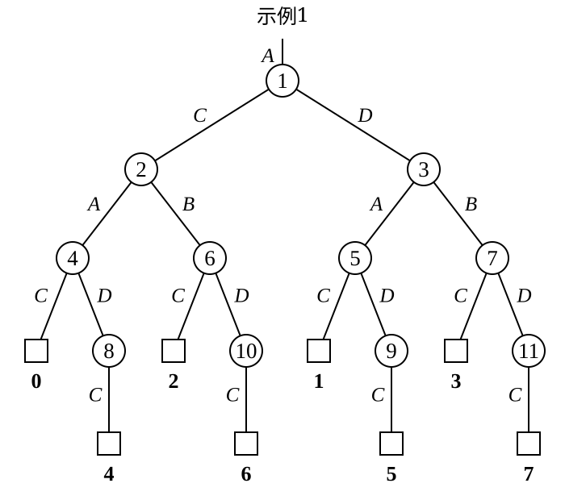
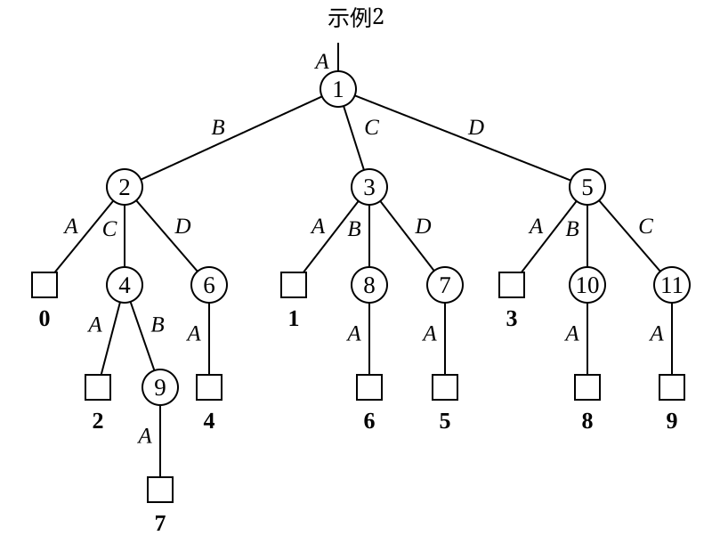
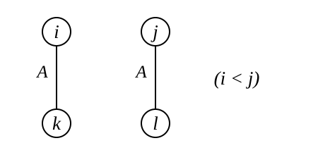

# *5.4.7　外部基数排序

前面几节讨论了通过合并进行磁带排序的过程. 但还有另外一种根据基数排序原理进行磁带排序的方法, 在机械卡片排序机中曾经用到这个原理 (见 5.2.5 节). 这种方法有时称为分布排序、列排序、包排序、数字排序、分离排序等. 它实际上就是合并的对立面!

例如, 假定有四条磁带, 仅有八个可能的键: $0,1,2,3,4,5,6,7$. 如果输入数据位于磁带 T1 上, 首先把所有偶数键传送到 T3, 所有奇数键传送到 T4:

<table data-radix8-table="initial"><tr><th></th><th>T1</th><th>T2</th><th>T3</th><th>T4</th></tr><tr data-radix8-row><td>给定</td><td data-radix8-field>{0,1,2,3,4,5,6,7}</td><td data-radix8-field>—</td><td data-radix8-field>—</td><td data-radix8-field>—</td></tr><tr data-radix8-row><td>扫描 1</td><td data-radix8-field>—</td><td data-radix8-field>—</td><td data-radix8-field>{0,2,4,6}</td><td data-radix8-field>{1,3,5,7}</td></tr></table>

现在回卷, 读取 T3, 然后是 T4, 把 $\{0,1,4,5\}$ 传送到 T1, 把 $\{2,3,6,7\}$ 传送到 T2:

<table data-radix8-table="pass2"><tr><th></th><th>T1</th><th>T2</th><th>T3</th><th>T4</th></tr><tr data-radix8-row><td>扫描 2</td><td data-radix8-field>{0,4}{1,5}</td><td data-radix8-field>{2,6}{3,7}</td><td data-radix8-field>—</td><td data-radix8-field>—</td></tr></table>

(标记 $\{0,4\}\{1,5\}$ 表示一个文件, 其中包含一些键值都是 0 或 4 的记录, 后面跟着一些键值都是 1 或 5 的记录. 注意, T1 现在包含的各键的中间二进制数位均为 0.) 再次回卷, 把 0、1、2、3 分布到 T3, 把 4、5、6、7 分布到 T4, 得到:

<table data-radix8-table="pass3"><tr><th></th><th>T1</th><th>T2</th><th>T3</th><th>T4</th></tr><tr data-radix8-row><td>扫描 3</td><td data-radix8-field></td><td data-radix8-field></td><td data-radix8-field>{0}{1}{2}{3}</td><td data-radix8-field>{4}{5}{6}{7}</td></tr></table>

现在把 T4 复制到 T3 的末尾以结束排序过程. 一般来说, 如果这些键的变化范围为 0 至 $2^k-1$, 我们可以使用 $k$ 遍扫描以类似方式对文件排序, 之后是一个最终收集阶段, 把大约一半的数据由一条磁带复制到另一条磁带. 在有六条磁带时, 可以以类似方式使用基数 3 表示法, 在 $k$ 遍扫描中对介于 0 至 $3^k-1$ 的键排序.

也可以使用部分扫描方法. 例如, 假定有十种可能的键 $\{0,1,\ldots,9\}$, 考虑罗伯特·阿申赫斯特提出的以下过程 [*Theory of Switching*, Progress Report BL-7 (Harvard Univ. Comp. Laboratory: May 1954), I.1–I.76]:

<table data-radix-followup-table="partial10" style="white-space:nowrap"><tr><th>阶段</th><th>T1</th><th>T2</th><th>T3</th><th>T4</th><th>扫描</th></tr><tr data-radix-followup-row><td data-radix-followup-field></td><td data-radix-followup-field>{0,1,…,9}</td><td data-radix-followup-field>—</td><td data-radix-followup-field>—</td><td data-radix-followup-field>—</td><td data-radix-followup-field></td></tr><tr data-radix-followup-row><td data-radix-followup-field>1</td><td data-radix-followup-field>—</td><td data-radix-followup-field>{0,2,4,7}</td><td data-radix-followup-field>{1,5,6}</td><td data-radix-followup-field>{3,8,9}</td><td data-radix-followup-field>1.0</td></tr><tr data-radix-followup-row><td data-radix-followup-field>2</td><td data-radix-followup-field>{0}</td><td data-radix-followup-field>—</td><td data-radix-followup-field>{1,5,6}{2,7}</td><td data-radix-followup-field>{3,8,9}{4}</td><td data-radix-followup-field>0.4</td></tr><tr data-radix-followup-row><td data-radix-followup-field>3</td><td data-radix-followup-field>{0}{1}{2}</td><td data-radix-followup-field>{6}{7}</td><td data-radix-followup-field>—</td><td data-radix-followup-field>{3,8,9}{4}{5}</td><td data-radix-followup-field>0.5</td></tr><tr data-radix-followup-row><td data-radix-followup-field>4</td><td data-radix-followup-field>{0}{1}{2}{3}</td><td data-radix-followup-field>{6}{7}{8}</td><td data-radix-followup-field>{9}</td><td data-radix-followup-field>{4}{5}</td><td data-radix-followup-field>0.3</td></tr><tr data-radix-followup-row><td data-radix-followup-field>C</td><td data-radix-followup-field>{0}{1}{2}{3}{4}…{9}</td><td data-radix-followup-field></td><td data-radix-followup-field></td><td data-radix-followup-field></td><td data-radix-followup-field>0.6</td></tr><tr data-radix-followup-row><td data-radix-followup-field></td><td data-radix-followup-field></td><td data-radix-followup-field></td><td data-radix-followup-field></td><td data-radix-followup-field></td><td data-radix-followup-field>2.8</td></tr></table>

这里的 C 表示收集阶段. 如果每个键值出现的概率大约为十分之一, 则上述过程对十个键排序仅需要 2.8 遍扫描, 而第一个示例仅对八个键排序就需要 3.5 遍扫描. 因此我们发现, 对于基数排序和合并排序, 一种更为巧妙的分布模式可以使结果产生显著不同.

上述示例中的分布模式可以很方便地表示为树结构:

这些树的圆形内部结点编号为 1、2、3、……, 对应于这一过程中的步骤 1、2、3、……. 磁带名称 $A,B,C,D$ (而不是 T1、T2、T3、T4) 标在树中竖线旁边, 表示这些记录将去向何方. 方形外部结点表示仅包含一个键的文件, 这个键以黑体字标在结点的下方. 方形结点上方的线旁是输出磁带的名称 (第一个示例中是 $C$, 第二个示例中是 $A$).

因此, 第一个示例的步骤 3 包括从磁带 $D$ 读取, 向磁带 $A$ 写入 1 和 5, 向磁带 $B$ 写入 3 和 7. 不难看出, 如果我们假定每个键出现的频率相同, 则扫描遍数等于这棵树的外部路径长度除以外部结点数.

由于磁带的本质是顺序性的, 且正向读取采用 “先进先出” 规则, 所以不能简单地把任意标记树当作分布模式的基础. 在第一个示例的树中, 数据在步骤 2 和步骤 3 写到磁带 $A$ 上. 必须先使用在步骤 2 中写入的数据, 然后再使用在步骤 3 中写入的数据. 一般来说, 如果在步骤 $i$ 和步骤 $j$($i<j$) 期间向磁带写入数据, 则必须首先使用在步骤 $i$ 中写入的数据. 当树中包含形如

的两个分支时, 必须有 $k<l$. 此外, 在步骤 $k$ 和步骤 $l$ 之间, 不能向磁带 $A$ 写入任何内容, 因为我们必须在读和写之间进行回卷.

已经完成 5.4.4 节习题的读者现在会立即意识到: $T$ 磁带正向读取的基数排序所允许的树正是强 $T$-fifo 树, 它刻画了 $T$ 磁带正向读取的合并排序的特性! (见习题 5.4.4–20.) 唯一的区别在于, 我们这里考虑的这些树的所有外部结点都具有相同的磁带标记. 我们可以执行一个最终收集阶段, 把所有记录传送到输出磁带上, 以此消除上述限制, 或者也可以向 $T$-fifo 树的规则中添加一些限制, 要求在相应的合并树中明确给出合并排序的初始分布扫描.

换句话说,*每种合并模式对应于一种分布模式, 每种分布模式对应于一种合并模式*. 稍加思索就能想出其中的原因, 如果我们考虑一个合并排序的操作, 并设想时间可以倒流: 最终的输出被 “去合并” 为子文件, 这些子文件再被 “去合并” 为其他文件, 以此类推, 在时刻 0 输出被 “去合并” 为 $S$ 个游程. 可以用磁带实现这个模式的充要条件是对于 $S$ 个键可以实现相应基数排序的分布模式. 合并与分布之间的这种对偶性几乎是完美的, 仅在一个方面不成立, 也就是必须在不同时间保存输入磁带.

本节开头讨论的八键示例显然对偶于对四条磁带执行的平衡合并. 如果去掉复制阶段, 也就是树中的步骤 6–11, 采用部分扫描的十键示例对应于以下十游程合并模式:

<table data-radix-followup-table="dual10" style="white-space:nowrap"><tr><th></th><th>T1</th><th>T2</th><th>T3</th><th>T4</th></tr><tr data-radix-followup-row><td data-radix-followup-field>初始分布</td><td data-radix-followup-field>$1^{4}$</td><td data-radix-followup-field>$1^{3}$</td><td data-radix-followup-field>$1^{1}$</td><td data-radix-followup-field>$1^{2}$</td></tr><tr data-radix-followup-row><td data-radix-followup-field>树步骤 5</td><td data-radix-followup-field>$1^{3}$</td><td data-radix-followup-field>$1^{2}$</td><td data-radix-followup-field>—</td><td data-radix-followup-field>$1^{2}3^{1}$</td></tr><tr data-radix-followup-row><td data-radix-followup-field>树步骤 4</td><td data-radix-followup-field>$1^{2}$</td><td data-radix-followup-field>$1^{1}$</td><td data-radix-followup-field>$2^{1}$</td><td data-radix-followup-field>$1^{2}3^{1}$</td></tr><tr data-radix-followup-row><td data-radix-followup-field>树步骤 3</td><td data-radix-followup-field>$1^{1}$</td><td data-radix-followup-field>—</td><td data-radix-followup-field>$2^{1}3^{1}$</td><td data-radix-followup-field>$1^{1}3^{1}$</td></tr><tr data-radix-followup-row><td data-radix-followup-field>树步骤 2</td><td data-radix-followup-field>—</td><td data-radix-followup-field>$4^{1}$</td><td data-radix-followup-field>$3^{1}$</td><td data-radix-followup-field>$3^{1}$</td></tr><tr data-radix-followup-row><td data-radix-followup-field>树步骤 1</td><td data-radix-followup-field>$10^{1}$</td><td data-radix-followup-field>—</td><td data-radix-followup-field>—</td><td data-radix-followup-field>—</td></tr></table>

如果把它和基数排序比较, 可以看到这两种方法的结构基本相同, 只是在时间上颠倒了过来, 磁带内容也由后至前颠倒过来: $1^23^1$ (两个长度为 1 的游程, 后面跟着一个长度为 3 的游程) 对应于 $\{3,8,9\}\{4\}\{5\}$ (两个各包含一个键的子文件, 前面是一个包含三个键的子文件).

换一种方式, 我们原则上可以构造一种对偶于多阶段合并的基数排序, 再构造另外一种对偶于级联合并的基数排序, 以此类推. 例如, 如 5.4.2 节开头所示的在三条磁带执行的 21 游程多阶段合并, 对应于下面有趣的基数排序:

<table data-radix-followup-table="radix21" style="white-space:nowrap"><tr><th>阶段</th><th>T1</th><th>T2</th><th>T3</th></tr><tr data-radix-followup-row><td data-radix-followup-field></td><td data-radix-followup-field>{0,1,…,20}</td><td data-radix-followup-field>—</td><td data-radix-followup-field>—</td></tr><tr data-radix-followup-row><td data-radix-followup-field>1</td><td data-radix-followup-field>—</td><td data-radix-followup-field>{0,2,4,5,7,9,10,12,13,15,17,18,20}</td><td data-radix-followup-field>{1,3,6,8,11,14,16,19}</td></tr><tr data-radix-followup-row><td data-radix-followup-field>2</td><td data-radix-followup-field>{0,5,10,13,18}</td><td data-radix-followup-field>—</td><td data-radix-followup-field>{1,3,6,8,11,14,16,19}{2,4,7,9,12,15,17,20}</td></tr><tr data-radix-followup-row><td data-radix-followup-field>3</td><td data-radix-followup-field>{0,5,10,13,18}{1,6,11,14,19}{2,7,12,15,20}</td><td data-radix-followup-field>{3,8,16}{4,9,17}</td><td data-radix-followup-field>—</td></tr><tr data-radix-followup-row><td data-radix-followup-field>4</td><td data-radix-followup-field>—</td><td data-radix-followup-field>{3,8,16}{4,9,17}{5,10,18}{6,11,19}{7,12,20}</td><td data-radix-followup-field>{0,13}{1,14}{2,15}</td></tr><tr data-radix-followup-row><td data-radix-followup-field>5</td><td data-radix-followup-field>{8}{9}{10}{11}{12}</td><td data-radix-followup-field>—</td><td data-radix-followup-field>{0,13}{1,14}{2,15}{3,16}…{7,20}</td></tr><tr data-radix-followup-row><td data-radix-followup-field>6</td><td data-radix-followup-field>{8}{9}{10}{11}{12}{13}…{20}</td><td data-radix-followup-field>{0}{1}…{7}</td><td data-radix-followup-field>—</td></tr></table>

这里, 在每个步骤判断哪些键应当进入哪些磁带的分布规则显得有些神奇, 但事实上它与斐波那契数系有一种简单联系. (见习题 2.)

**反向读取.** 基数排序与合并排序之间的对偶性也适用于反向读取磁带的算法. 5.4.4 节定义了 “$T$-lifo 树”, 容易看出, 它们对应于基数排序, 也对应于合并排序.

实际上, 1946 年莫奇利就已经考虑过反向读取的基数排序, 那是最早发表的有关排序的论文之一 (见 5.5 节). 莫奇利实质上给出了以下构造:

<table data-radix-followup-table="Mauchly10" style="white-space:nowrap"><tr><th>阶段</th><th>T1</th><th>T2</th><th>T3</th><th>T4</th></tr><tr data-radix-followup-row><td data-radix-followup-field></td><td data-radix-followup-field>—</td><td data-radix-followup-field>{0,1,2,…,9}</td><td data-radix-followup-field>—</td><td data-radix-followup-field>—</td></tr><tr data-radix-followup-row><td data-radix-followup-field>1</td><td data-radix-followup-field>{4,5}</td><td data-radix-followup-field>—</td><td data-radix-followup-field>{2,3,6,7}</td><td data-radix-followup-field>{0,1,8,9}</td></tr><tr data-radix-followup-row><td data-radix-followup-field>2</td><td data-radix-followup-field>{4,5}{2,7}</td><td data-radix-followup-field>{3,6}</td><td data-radix-followup-field>—</td><td data-radix-followup-field>{0,1,8,9}</td></tr><tr data-radix-followup-row><td data-radix-followup-field>3</td><td data-radix-followup-field>{4,5}{2,7}{0,9}</td><td data-radix-followup-field>{3,6}{1,8}</td><td data-radix-followup-field>—</td><td data-radix-followup-field>—</td></tr><tr data-radix-followup-row><td data-radix-followup-field>4</td><td data-radix-followup-field>{4,5}{2,7}</td><td data-radix-followup-field>{3,6}{1,8}</td><td data-radix-followup-field>{9}</td><td data-radix-followup-field>{0}</td></tr><tr><td colspan="5" style="text-align:center">································</td></tr><tr data-radix-followup-row><td data-radix-followup-field>8</td><td data-radix-followup-field>—</td><td data-radix-followup-field>—</td><td data-radix-followup-field>{9}{8}{7}{6}{5}</td><td data-radix-followup-field>{0}{1}{2}{3}{4}</td></tr><tr data-radix-followup-row><td data-radix-followup-field>C</td><td data-radix-followup-field>—</td><td data-radix-followup-field>—</td><td data-radix-followup-field>—</td><td data-radix-followup-field>{0}{1}{2}{3}{4}{5}…{9}</td></tr></table>

他的方案并不是最高效的, 但意义在于, 它表明在 1946 年就已经针对基数排序考虑了部分扫描方法, 而直到 1960 年左右, 它们才出现在关于合并的文献中.

安东尼·贝斯提出反向读取分布模式的一种高效构造 [*CACM* **11** (1968), 491–493]: 给定 $P+1$ 条磁带和 $S$ 个键, 把这些键分到 $P$ 个子文件中, 每个子文件包含 $\lfloor S/P\rfloor$ 或 $\lceil S/P\rceil$ 个键, 这个过程递归应用于每个子文件. 当 $S<2P$ 时, 一个子文件应当仅由最小键组成, 而且它应当被写到输出文件. (5.4.4 节末尾处介绍了卡普的一般前序构造, 这个方法属于卡普构造的一种特例.)

由于反向读取颠倒了游程的次序, 所以使合并变得稍微复杂了一些. 对于基数排序也有相应的影响: 它的输出是稳定或 “反稳定” 的, 具体取决于到达树中的哪一级别. 如果在奇数级别和偶数级别中都存在外部结点, 在经过反向读取的基数排序之后, 对于某些键值, 键值相同的记录与原顺序相同, 而对于其他一些键值, 键值相同的记录则与原顺序相反. (见习题 6.)

振荡合并排序也存在对偶意义下的对应物. 在振荡基数排序中, 我们持续分离键值, 直到子文件中仅有一个键, 或者小到足以进行内部排序. 排序这些子文件并写到输出磁带上, 然后重新启动分离过程. 例如, 如果有三条工作磁带和一条输出磁带, 假定键都是二进制数, 首先把形如 $0x$ 的键放到磁带 T1 上, 形如 $1x$ 的键放到磁带 T2 上. 如果 T1 接收的内容超过一次内存负载, 则再次扫描它, 把 $00x$ 放到 T2 上, $01x$ 放到 T3 上. 现在, 如果 $00x$ 子文件短到足以进行内部排序, 则排序并输出结果, 然后继续处理 $01x$ 子文件. 弗兰德称这种方法为 “级联伪基数排序”[*JACM* **3** (1956), 157–159], 纳格勒进一步发展这种方法 [*JACM* **6** (1959), 459–468], 并起了一个生动的名字 “两头蛇排序”, 查尔斯·高德特也发展了这一方法 [*IBM Tech. Disclosure Bull.* **12** (April 1970), 1849–1853].

**基数排序是否优于合并排序?** 对偶原理的一个重要推论是*基数排序通常不如合并排序*. 之所以如此, 原因在于替代选择技术为合并排序带来了一定的好处. 不存在一种明显的基数排序安排方法, 使我们能够利用内部排序一次处理多个内存负载的数据. 事实上振荡基数排序经常会生成一些略小于一个内存负载的子文件, 所以在分布模式对应的树中, 外部结点数目要远多于使用合并与替代选择时的数目. 因此树的外部路径长度 (即排序时间) 将会增大. (见习题 5.3.1–33.)

另一方面, 外部基数排序的确有其用途. 例如, 假定我们有一个文件, 包含了一家大型公司按字母顺序排列的所有员工的名字. 这家公司有十个部门, 希望按部门对这个文件排序, 而在每个部门中保持员工的字母顺序. 如果文件很长, 这就是一种适于应用稳定基数排序的绝佳情形, 因为十个部门中每个部门所属的记录数可能很大, 超出了在替代选择所生成的初始游程中获得的记录数. 一般来说, 如果键值范围很小, 以致于具有给定键值的记录集合的大小可能会是内部存储器大小的两倍以上, 则使用基数排序技术是明智的做法.

我们已经在 5.2.5 节看到, 在某些高速计算机上内部基数排序优于合并排序, 因为基数排序算法的内层循环避免了复杂的分支跳转. 如果外部存储器的速度特别快, 计算机合并数据的速度就有可能不足以快到跟上输入／输出设备. 在这种情况下, 特别是已知键为均匀分布时, 基数排序可能会优于合并排序.

### 习题

1. [20] 在 5.4 节接近开头处定义了带有参数 $P$($1\le P<T$) 的一般性 $T$ 磁带平衡合并. 证明它对应于一种基于混合基数系统的基数排序.　[答案](./answers/5-4-7.md#ans-5-4-7-1)

2. [M28] 正文阐述了 21 个键的三磁带多阶段基数排序. 把它推广到 $F_n$ 个键的情形. 说明在每个阶段结束时哪些键出现在哪些磁带上. [提示: 考虑斐波那契数系, 习题 1.2.8–34.]　[答案](./answers/5-4-7.md#ans-5-4-7-2)

3. [M35] 把习题 2 的结果推广到在四条或更多磁带上执行的多阶段基数排序. (见习题 5.4.2–10.)

4. [M23] 证明: 在不采用反向读取时, 阿申赫斯特的分布模式是在四条磁带上排序十个键的最佳方式. 所谓最佳, 是指在所有强 4-fifo 树中, 这种模式的相关树具有最短的外部路径长度. (因此, 如果忽略回卷时间, 则它实质上就是最佳方法.)　[答案](./answers/5-4-7.md#ans-5-4-7-4)

5. [15] 绘制对应于十个键的莫奇利反向读取基数排序的 4-lifo 树.　[答案](./answers/5-4-7.md#ans-5-4-7-5)

▶ 6. [20] 某个文件包含两位数字的键 00、01、……、99. 在对最低有效位执行莫奇利的基数排序之后, 交换磁带 T2 和 T4 的角色, 对最高有效位重复同样的方案. 最终出现在 T2 上的键是什么样的顺序?　[答案](./answers/5-4-7.md#ans-5-4-7-6)

7. [21] 对偶性原理是否也适用于多卷文件?　[答案](./answers/5-4-7.md#ans-5-4-7-7)
