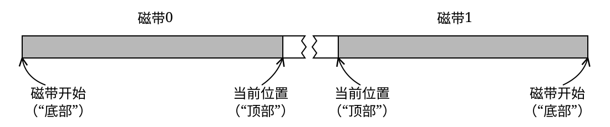
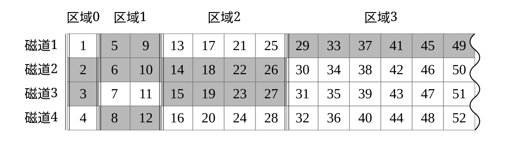
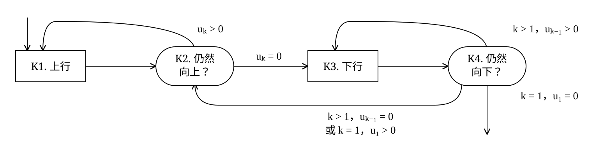
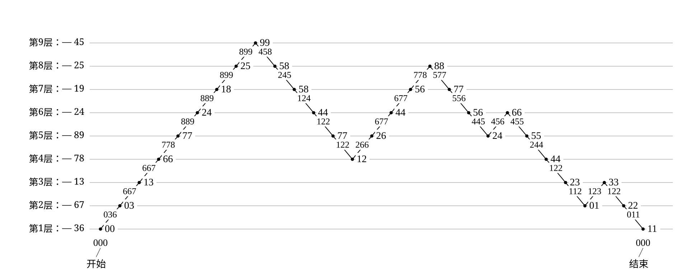

### *5.4.8　双磁带排序

我们需要三条磁带来执行没有过多磁带操作的合并过程, 所以思考一下如何仅用两条磁带来执行合理的外部排序很有意义.

1956 年, 德穆思把替代选择和冒泡排序组合在一起形成一种新的排序方法. 假定输入在磁带 T1 上, 首先把 $P+1$ 个记录读入存储器中. 现在把具有最小键的记录输出到磁带 T2, 并用下一个输入记录替换它. 维护一个具有 $P+1$ 个元素的选择树或优先队列, 继续输出当前存储器中具有最小键的记录. 当输入最终穷尽时, 这个文件的最大的 $P$ 个键将出现在存储器中, 按递增顺序输出它们. 现在回卷两条磁带, 并重复这个过程: 从 T2 中读, 写入 T1. 每遍这种扫描都将另外至少 $P$ 条记录放到正确位置. 可以在程序中置入一个简单的测试用于判断整个文件何时排序完成. 最多需要 $\lceil(N-1)/P\rceil$ 遍扫描.

稍加思索就能知道, 这个过程的每遍扫描实际上等价于冒泡排序 (算法 5.2.2B) 的 $P$ 遍连续扫描. 如果一个元素有 $P$ 个或更多个反序, 则在输入时它将小于树中的所有结点, 所以它将被立即输出——从而失去 $P$ 个反序. 如果一个元素的反序少于 $P$ 个, 它将进入选择树, 并在所有更大键之前输出——从而失去它的所有反序. 当 $P=1$ 时, 根据定理 5.2.2I, 这正是冒泡排序的情形.

因此总扫描数将是 $\lceil I/P\rceil$, 其中 $I$ 是各元素的反序数的最大值. 按照 5.2.2 节给出的理论, $I$ 的平均值是 $N-\sqrt{\pi N/2}+2/3+O(1/\sqrt N)$.

如果与存储器容量相比文件不是大得太多, 或者在开始时它已经接近有序了, 则这种 $P$ 阶冒泡排序是相当快速的. 事实上, 即使有额外的磁带机可供使用, 这种方法也可能是有利的, 因为空白磁带必须由计算机操作员来安装. 但是, 对于相当长的随机次序文件, 双磁带冒泡排序会运行得非常缓慢, 因为它的平均运行时间近似与 $N^2$ 成正比.

现在考虑对于 5.4.6 节的 100000 个记录的示例如何实现这个方法. 我们需要明智地选择 $P$, 以便补偿同时进行读、写、计算时的块间间隙. 由于这个示例假定每个记录的长度是 100 字符, 而存储器中可以容纳 100000 字符, 所以通过以下设置可以为大小为 $B$ 的两个输入缓冲区和两个输出缓冲区留出空间:

$$
100(P+1)+4B=100000.\tag{1}
$$

使用 5.4.6 节的记号, 每遍扫描的运行时间大约是

$$
NC\omega\tau(1+\rho),\qquad\omega=(B+\gamma)/B.\tag{2}
$$

由于扫描数与 $P$ 成反比, 所以希望选择 $B$ 为 100 的倍数, 以使量 $\omega/P$ 降至最低. 由初等微积分知识可知, 当 $B$ 大约为 $\sqrt{24975\gamma+\gamma^2}-\gamma$ 时上述量最小, 所以我们取 $B=3000$, $P=879$. 在上面的公式中令 $N=100000$, 可以看出扫描数 $\lceil I/P\rceil$ 大约是 114, 总运行时间大约是 8.57 小时 (为方便起见, 假定初始输入和最终输出时也是 $B=3000$). 这大约相当于 0.44 倍的满卷数据, 满卷数据大约需要 5 倍的时间. 如果我们能够定期中断算法, 把具有最大键的一些记录写到一条辅助磁带上并卸载它, 就可以对算法做一些改进, 因为这些记录一旦有序之后, 只是被来回复制而已.

**快速排序的应用.** 另外一种内部排序方法以近乎顺序方式遍历数据, 它是划分交换排序或快速排序过程 (算法 5.2.2Q). 我们能否把它应用于双磁带情形呢? [纳哈尔·约亚斯,*CACM* **8** (1965), 649.]

不难看出怎样利用反向读取来实际做到这一点. 假定两条磁带的编号是 0 和 1, 并设想文件的布置如下:

每条磁带都可当作一个栈. 它们像这样组合在一起, 就能把文件看做一个线性列表, 通过在栈间复制, 我们可以在线性列表中左右移动当前位置. 以下递归子例程定义了一个适当的排序过程:

- **`SORT00`**[排序磁带 0 顶部的子文件, 并把它写回磁带 0].

  如果这个子文件能够放入内部存储器, 则对它进行内部排序并写回磁带 0. 否则, 从子文件中选择一个记录 $R$, 设它的键为 $K$. 反向读取磁带 0, 复制键值 $>K$ 的所有记录, 在磁带 1 的顶部形成一个新的子文件. 现在正向读取磁带 0, 把键值 $=K$ 的所有记录复制到磁带 1 上. 然后再次反向读取, 把键值 $<K$ 的所有记录复制到磁带 1 上. 对 $<K$ 的键执行 `SORT10`, 随后把 $=K$ 的键复制到磁带 0 上, 最后对 $>K$ 的键执行 `SORT10`, 排序完成.

- **`SORT01`**[排序磁带 0 顶部的子文件, 并把它写到磁带 1].

  与 `SORT00` 相同, 但最后的 `SORT10` 改为 `SORT11`, 随后把 $\le K$ 的键复制到磁带 1 上.

- **`SORT10`**[排序磁带 1 顶部的子文件, 并把它写到磁带 0].

  与 `SORT01` 相同, 只是交换 0 与 1、$<$ 与 $>$.

- **`SORT11`**[排序磁带 1 顶部的子文件, 并把它写回磁带 1].

  与 `SORT00` 相同, 只是交换 0 与 1、$<$ 与 $>$.

通过在磁带上存储适当的控制信息就可以毫无困难地处理这些子例程的递归特性.

假定数据按随机次序排列, 出现相等键的概率可以忽略不计, 则这个算法的运行时间可以估计如下. 设 $M$ 表示可以放入内部存储器的记录数目. 设 $X_N$ 表示当 $N>M$ 时向一个 $N$ 记录子文件应用 `SORT00` 或 `SORT11` 时读取的平均记录数目, 设 $Y_N$ 是对于 `SORT01` 或 `SORT10` 的相应量. 于是我们有

$$
\begin{aligned}
X_N&=\begin{cases}0,&N\le M;\\3N+1+\dfrac1N\sum_{0\le k<N}(Y_k+Y_{N-1-k}),&N>M;\end{cases}\\[1em]
Y_N&=\begin{cases}0,&N\le M;\\3N+2+\dfrac1N\sum_{0\le k<N}(Y_k+X_{N-1-k}+k),&N>M.\end{cases}
\end{aligned}\tag{3}
$$

这些递归式的解 (见习题 2) 表明, 当 $N\to\infty$ 时在外部划分阶段磁带读取总量的平均值是 $6\frac23N\ln N+O(N)$. 从式 5.2.2–(25) 我们还知道内部排序阶段的平均数是 $2(N+1)/(M+2)-1$.

如果把这个分析应用于 5.4.6 节中 100000 记录的示例, 使用 25000 字符的缓冲区, 并假定排序一个 $n\le M=1000$ 记录子文件的时间是 $2nC\omega\tau$, 则可以得出平均排序时间近似为 103 分钟 (如图表 A 中那样包含最后回卷时间). 因此快速排序平均来说不是很糟糕. 当然, 它的最差情形甚至要比上面讨论的冒泡排序还要糟糕. 随机化使最差情形的出现概率极低.

**基数排序.** 基数交换方法 (算法 5.2.2R) 和快速排序如此相像, 可以采用类似方式适用于双磁带排序. 使这两种方法都能正常工作的技巧在于对一个文件多次读取, 这是我们在前面的磁带算法中从来没做过的.

同样的技巧亦可用于对双磁带进行传统的最低有效位优先的基数排序. 给定 T1 上的输入数据, 我们把所有键值以二进制位 0 结束的记录复制到 T2 上. 然后回卷 T1, 再次读取它, 复制键值以 1 结束的记录. 现在回卷两条磁带, 进行类似的一对扫描, 交换 T1 与 T2 的角色并使用第二个最低有效二进制位. 这时, T1 将包含键值为 $(\ldots00)_2$ 的所有记录, 之后是键值为 $(\ldots01)_2$ 的记录, 接下来是 $(\ldots10)_2$, 再是 $(\ldots11)_2$. 如果键的大小是 $b$ 个二进制位, 那么只需对文件进行 $2b$ 遍扫描就能完成排序.

对于某些精心选定的数 $b$, 这种基数排序可以仅应用于这些键的前 $b$ 个二进制位. 如果这些键是均匀分布的, 将会使反序数目的减少因子大约为 $2^b$, 利用 $P$ 路冒泡排序的较少扫描就能完成任务. 这种方法仅以正向读取磁带.

安德烈·尼基京和列昂尼德·绍尔莫夫提出一种新颖但多少有些复杂的方法用来完成双磁带分布排序 [*Kibernetika* **2**, 6 (1966), 79–84]. 这些键的前几个二进制位具有各种不同组合方式, 我们首先计算拥有每种组合方式的键各有多少, 然后根据这些计数构造模拟键 $\kappa_1,\kappa_2,\ldots,\kappa_M$, 使得对于每个 $i$, 介于 $\kappa_i$ 和 $\kappa_{i+1}$ 之间的实际键数介于预定限值 $P_1$ 和 $P_2$ 之间. 因此 $M$ 介于 $\lceil N/P_2\rceil$ 和 $\lceil N/P_1\rceil$ 之间. 如果前几个二进制位的计数没有提供足够的信息以确定这样的 $\kappa_1,\kappa_2,\ldots,\kappa_M$, 那就再多做一遍或几遍扫描, 以便对于最高有效位的特定结构计算较低有效位模式的频率. 构造模拟键 $\kappa_1,\kappa_2,\ldots,\kappa_M$ 的表格之后, 再做 $2\lceil\lg M\rceil$ 遍扫描就足以完成排序. (这种方法需要与 $N$ 成正比的存储空间, 所以当 $N\to\infty$ 时它不能用于外部排序. 在实践中我们不会把这种方法用于多卷文件, 所以 $M$ 将总是较小, 模拟键的表格可以舒舒服服地放入存储器.)

**更多磁带的模拟.** 弗雷德里克·亨尼和理查德·斯特恩斯设计了一种在双磁带上模拟 $k$ 条磁带的一般性技术, 所需磁带移动的增加因子仅为 $O(\log L)$, 其中 $L$ 是在任一磁带上遍历的最大距离 [*JACM* **13** (1966), 533–546]. 他们的构造在排序情形中可以稍微简化, 就像在卡普提出的以下方法中那样.

我们将使用两条磁带 T1 和 T2 来模拟一个普通的四磁带平衡合并. 首先, 磁带 T1 保存所模拟磁带的内容, 保存方式如图 86 所示. 我们设想这些数据写在四个 “磁道” 中, 每条被模拟磁带占用其中一个. (实际上, 磁带上并没有这些磁道. 块 1、5、9、13、……被看作磁道 1, 块 2、6、10、14、……被看作磁道 2, 以此类推.) 另一条磁带 T2 仅用于辅助存储, 帮助在 T1 上移动数据.

图 86　亨尼–斯特恩斯的构造中磁带 T1 的布局, 非空区域用阴影表示

每个磁道的块被分为区域, 每个区域分别包含 $1,2,4,8,\ldots,2^k,\ldots$ 个块. 每个磁道上的区域 $k$ 或者恰好填满了 $2^k$ 个数据块, 或者全空. 例如, 在图 86 中, 磁道 1 在区域 1 和 3 中有数据; 磁道 2 在区域 0、1、2 中有数据; 磁道 3 在区域 0 和 2 中有数据; 磁道 4 在区域 1 中有数据; 其余区域为空.

假定我们正在从磁道 1 和 2 把数据合并到磁道 3. 计算机的内部存储器中包含用作两路合并输入的两个缓冲区, 再加上一个用于输出的第三缓冲区. 当磁道 1 的输入缓冲区变为空时, 我们用以下方式重新填充它: 找出磁道 1 上的第一个非空区域, 比如区域 $k$, 把它的第一个块复制到输入缓冲区, 然后把其他 $2^k-1$ 个数据块复制到 T2, 并把它们移动到磁道 1 的区域 $0,1,\ldots,k-1$. (区域 $0,1,\ldots,k-1$ 现在被填满, 区域 $k$ 为空.) 每当磁道 2 的输入缓冲区变为空时, 就使用一种类似过程重新填充. 当输出缓冲区准备就绪可以写到磁道 3 时, 我们就反转这个过程, 扫描 T1, 找出磁道 3 上的第一个空白区域, 比如说区域 $k$, 把区域 $0,1,\ldots,k-1$ 中的数据复制到 T2. T2 上的数据再加上输出缓冲区的内容, 现在用于填充磁道 3 的区域 $k$.

这个过程需要能够在磁带 T1 的中部写入内容而不破坏这条磁带上的后续信息. 和正向读取的振荡排序的情形 (5.4.5 节) 一样, 如果采取适当的预防措施, 是有可能可靠地做到这一点的.

由于在每 $2^k$ 个步骤中才扫描到区域 $k$ 一次, 所以把磁道 1 的 $2^l-1$ 个块放入存储器所需要的磁带移动量是 $\sum_{0\le k<l}2^{l-1-k}\cdot c\cdot2^k=cl2^{l-1}$, $c$ 是某个常数. 因此每遍合并扫描需要 $O(N\log N)$ 个步骤. 由于在平衡合并中有 $O(\log N)$ 遍扫描, 所以在最糟糕情况下可以保证总排序时间是 $O\bigl(N(\log N)^2\bigr)$. 在渐近意义上它要远好于快速排序的最糟糕情况.

但如果把这个方法应用于 5.4.6 节的 100000 个记录的示例, 由于送往磁带 T1 的信息将会超过一卷磁带的内容, 所以这个方法并不能很好地发挥作用. 即使忽略这个事实, 并对读／写／计算重叠和块间间隙长度等使用乐观的假定, 我们也会发现完成排序将需要大约 37 个小时! 因此这个方法只有纯学术意义. 当 $N$ 属于实际范围内时, $O\bigl(N(\log N)^2\bigr)$ 中的常数会因为过大而无法令人满意.

**单磁带排序.** 我们能仅用一条磁带吗? 不难看出上述 $P$ 阶冒泡排序可以转换为单磁带排序, 但结果可能非常可怕.

德穆思观察到 [博士论文 (斯坦福大学, 1956 年), 85], 一台内存有限的计算机, 当它在磁带上移动一个限定的距离时, 只能使排列的反序数减少不多于一个限定的数量. 因此每种单磁带排序算法平均来说都必然至少需要 $N^2d$ 个时间单位, 其中 $d$ 是取决于计算机配置的正常数.

卡普以一种非常有趣的方式讨论了这一主题, 他发现单磁带排序的一种基本上最优的方式. 在讨论卡普的算法时, 把问题重新描述如下会方便一些:*利用单部电梯在各楼层之间运送人员, 最快的方式是怎样的?*[见 *Combinatorial Algorithms*, 拉斯廷编辑的 (Algorithmics Press, 1972), 17–21.]

考虑一幢 $n$ 层建筑物, 每层的房间恰好可以容纳 $b$ 人. 这幢建筑物没有门、窗、楼梯, 但有一部在每层都会停靠的电梯. 建筑物中有 $bn$ 人, 在每个特定的楼层恰好有 $b$ 人希望停靠. 电梯最多容纳 $m$ 人, 从第 $i$ 层到第 $i\pm1$ 层需要一个时间单位. 假定电梯的起止楼层都是一楼, 我们希望找出把所有人都送到适当楼层的最快方法.

不难看出电梯问题与单磁带排序之间的联系: 人就是记录, 建筑物就是磁带, 楼层是磁带上的各个块, 电梯是计算机内存. 计算机程序比电梯操作员有更多的灵活性 (例如, 它可以复制人员, 或暂时把一个人分成两个部分放到不同楼层, 等等). 但下面的解决方案并没有进行这类操作, 而以最快的速度解决了这个问题.

卡普的算法需要下面两个辅助表:

$$
\begin{aligned}
u_k,\ 1\le k\le n&:\ \text{位于}\le k\text{层且目的地}>k\text{层的人数};\\
d_k,\ 1\le k\le n&:\ \text{位于}\ge k\text{层且目的地}<k\text{层的人数}.
\end{aligned}\tag{4}
$$

当电梯为空时, 由于每层有 $b$ 人, 所以总是有 $u_k=d_{k+1}$($1\le k<n$). 在 $\{1,\ldots,k\}$ 层等待乘电梯的人数总是等于 $\{k+1,\ldots,n\}$ 层相应的人数. 根据定义, $u_n=d_1=0$.

显然, 由于电梯的每次运行只能使 $m$ 位乘客上楼, 所以电梯从第 $k$ 层到第 $k+1$ 层必须至少运行 $\lceil u_k/m\rceil$ 次 ($1\le k<n$). 类似地, 从第 $k$ 层到第 $k-1$ 层也必须至少运行 $\lceil d_k/m\rceil$ 次. 因此, 在任何正确的调度中电梯至少需要花费

$$
\sum_{k=1}^n\bigl(\lceil u_k/m\rceil+\lceil d_k/m\rceil\bigr)\tag{5}
$$

个时间单位. 卡普发现, 当 $u_1,\ldots,u_{n-1}$ 不为零时实际上可以达到这一下限.

**定理 K.** 如果对于 $1\le k<n$ 有 $u_k>0$, 则存在一种电梯调度方案, 可以在式 (5) 所示的最短时间内把每个人运送到正确楼层.

**证明.** 假定建筑物中还有另外 $m$ 人, 他们开始时在电梯中, 目标楼层被人为地置为 0. 电梯按照以下算法运行, 以 $k$ (当前楼层) 等于 1 开始:

**K1.[上行.]** 在当前位于电梯内以及在第 $k$ 层的 $b+m$ 人中, 目标楼层最高的 $m$ 人进入电梯, 其他人留在第 $k$ 层.

设现在电梯内有 $u$ 人的目标楼层 $>k$, $d$ 人的目标楼层 $\le k$. (可以得出 $u=\min(m,u_k)$. 如果 $u_k<m$, 则可能会把某些人运送到远离其目标楼层的位置, 这表明他们为整体利益作出了牺牲.) 把 $u_k$ 减小 $u$, 把 $d_{k+1}$ 增大 $d$, 然后 $k$ 增 1.

**K2.[仍然向上?]** 如果 $u_k>0$, 则返回 K1.

**K3.[下行.]** 在当前位于电梯内以及在第 $k$ 层的 $b+m$ 人中, 目标楼层最低的 $m$ 人进入电梯, 其他人留在第 $k$ 层.

设现在电梯内有 $u$ 个人的目标楼层 $\ge k$, $d$ 人的目标楼层 $<k$. (可以得出总是有 $u=0$, $d=m$, 但这里用具有一般性的 $u$ 和 $d$ 来描述这个算法, 以使证明过程更清楚一些.) 把 $d_k$ 减小 $d$, 把 $u_{k-1}$ 增大 $u$, 然后 $k$ 减 1.

**K4.[仍然向下?]** 如果 $k>1$ 且 $u_{k-1}>0$, 则返回 K3. 如果 $k=1$ 且 $u_1=0$, 则终止算法 (每个人都已安全到达目的地, “额外的”$m$ 人回到电梯中). 否则返回 K2.

图 87　卡普的电梯算法

图 88 给出了算法的一个示例, 建筑物为九层, $b=2,m=3$. 注意, 尽管事实上电梯运行了最短距离, 但要去第 6 层的人中有一人暂时被送往第 7 层. 稍后将会看到, 在步骤 K4 中测试 $u_{k-1}$ 的思想是算法的关键所在.

图 88　使用小型、缓慢电梯重新安排人员的最优方法 (每个人用其目标楼层的编号表示)

为了验证算法的有效性, 我们注意到, 如果把电梯中的人看作是位于 “当前” 的第 $k$ 层, 则步骤 K1 和 K3 总是保持 $u$ 和 $d$ 的表格 (4) 为最新. 现在通过归纳法证明下列性质在每个步骤开始时都是成立的:

$$
u_l=d_{l+1},\qquad\text{对于 }k\le l<n;\tag{6}
$$

$$
u_l=d_{l+1}-m,\qquad\text{对于 }1\le l<k;\tag{7}
$$

$$
u_{l+1}=0,\qquad\text{如果 }u_l=0\text{ 且 }k\le l<n.\tag{8}
$$

此外, 在步骤 K1 开始时, 在位于 $\le k$ 层且目的地 $>k$ 层的所有人中, 目的地楼层最高的 $\min(u_k,m)$ 人位于电梯中或位于第 $k$ 层. 在步骤 K3 开始时, 在位于 $\ge k$ 层且目的地 $<k$ 层的所有人中, 目的地楼层最低的 $\min(d_k,m)$ 人位于电梯中或位于第 $k$ 层.

从这些性质可以推出, 步骤 K1 和 K3 中括号里的注释是正确的. 步骤 K1 的每次执行都会使 $\lceil u_k/m\rceil$ 减 1, 而 $\lceil d_{k+1}/m\rceil$ 保持不变. 步骤 K3 的每次执行都会使 $\lceil d_k/m\rceil$ 减 1, 而 $\lceil u_{k-1}/m\rceil$ 保持不变. 因此算法必定在有限步骤内终止, 由于 (6) 和 (8) 每个人必定位于正确楼层. ▮

当 $u_k=0$ 且 $u_{k+1}>0$ 时, 我们有一种 “断开” 状态, 尽管没有人要从 $\le k$ 层去 $\ge k+1$ 层, 电梯还是必须上升到第 $k+1$ 层以重新安排那里的人. 不失一般性, 可以假定 $u_{n-1}>0$, 因此每个正确的电梯调度必定包含至少

$$
2\sum_{1\le k<n}\max\bigl(1,\lceil u_k/m\rceil\bigr)\tag{9}
$$

次移动, 因为我们要求电梯返回第 1 层. 可以很容易地构造出实现这个下限的调度 (习题 4).

### 习题

1. [20] 正文中讨论的 $P$ 阶冒泡排序仅使用了正向读取和回卷. 能否修改这个算法, 以利用反向读取?　[答案](./answers/5-4-8.md#ans-5-4-8-1)

2. [M26] 试求 (3) 中定义的数 $X_N,Y_N$ 的显式 “闭合式” 解. [提示: 研究式 5.2.2–(19) 的解.]　[答案](./answers/5-4-8.md#ans-5-4-8-2)

3. [38] 是否存在一种仅依赖键比较 (而不依赖数字特性) 的双磁带排序方法, 在排序 $N$ 个记录时, 最坏情况下它的磁带移动为 $O(N\log N)$? [快速排序在平均情况下可以达到这一要求, 但在最坏情况下不行, 亨尼–斯特恩斯的方法 (图 86) 实现了 $O\bigl(N(\log N)^2\bigr)$.]　[答案](./answers/5-4-8.md#ans-5-4-8-3)

4. [M23] 在电梯问题中, 假定有索引 $p$ 和 $q$, $q\ge p+2$, $u_p>0$, $u_q>0$, $u_{p+1}=\cdots=u_{q-1}=0$. 试说明如何构造一种最多需要 (9) 时间单位的调度.　[答案](./answers/5-4-8.md#ans-5-4-8-4)

▶ 5. [M23] 判断正误: 在定理 K 中算法步骤 K1 之后, 电梯中没有哪位乘客的目的地楼层低于 $<k$ 层的人员的目的地楼层.　[答案](./answers/5-4-8.md#ans-5-4-8-5)

6. [M30] (卡普) 推广电梯问题 (图 88) 至如下情形: 对于 $1\le j\le n$, 开始时在第 $j$ 层有 $b_j$ 位人员, 而有 $b_j'$ 位人员的目的地楼层是第 $j$ 层. 证明: 存在一种调度, 它花费 $2\sum_{k=1}^{n-1}\max\bigl(1,\lceil u_k/m\rceil,\lceil d_{k+1}/m\rceil\bigr)$ 时间单位, 且任意时刻第 $j$ 层都不允许有多于 $\max(b_j,b_j')$ 位人员. [提示: 如有必要, 引入虚拟人员使得对于所有 $j$ 都有 $b_j=b_j'$.]　[答案](./answers/5-4-8.md#ans-5-4-8-6)

7. [M40] (卡普) 推广习题 6 的问题, 用公共汽车走过的道路网络代替电梯的线性路径, 假设这个网络形成任意的自由树. 公共汽车的载客量是有限的, 目标是把乘客运送到他们的目的地, 且公共汽车走过的距离最短.

8. [M32] 在正文中所讨论的电梯问题中设 $b=1$. 有多少种 $n$ 个楼层中的 $n$ 个人的排列可以使 (4) 中的 $u_k\le1$ 对所有 $1\le k\le n$ 都成立? [例如 314592687 就是这样一种排列.]　[答案](./answers/5-4-8.md#ans-5-4-8-8)

▶ 9. [M25] 找出 5.2.2 节图 16 中描述的 “调酒师排序” 与 $b=1$ 情形下 (4) 中数 $u_1,u_2,\ldots,u_n$ 之间的一种重要联系.　[答案](./answers/5-4-8.md#ans-5-4-8-9)

10. [20] 如何仅用双磁带排序多卷文件?　[答案](./answers/5-4-8.md#ans-5-4-8-10)
