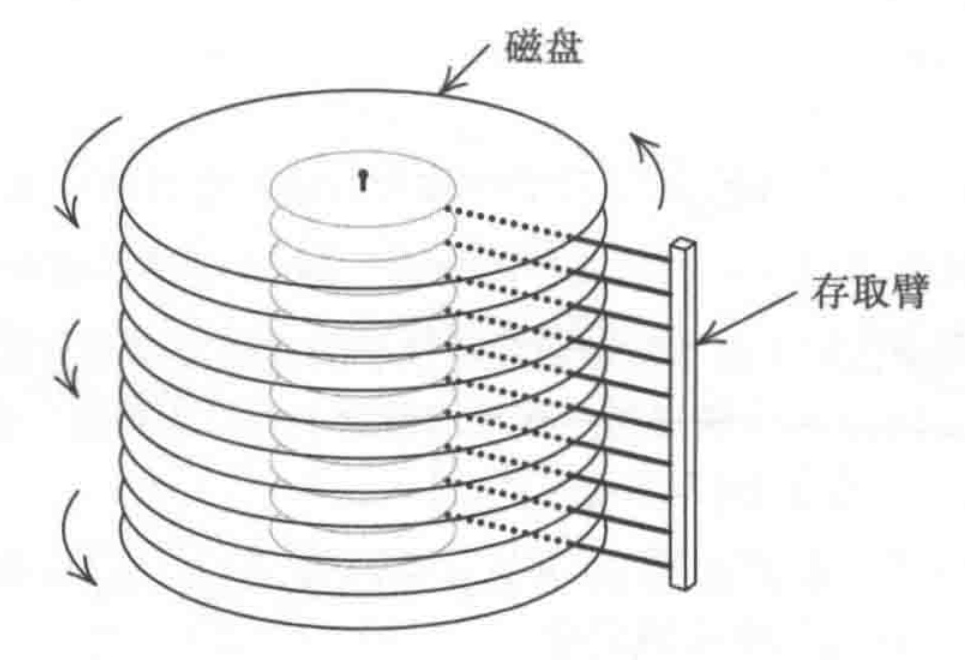
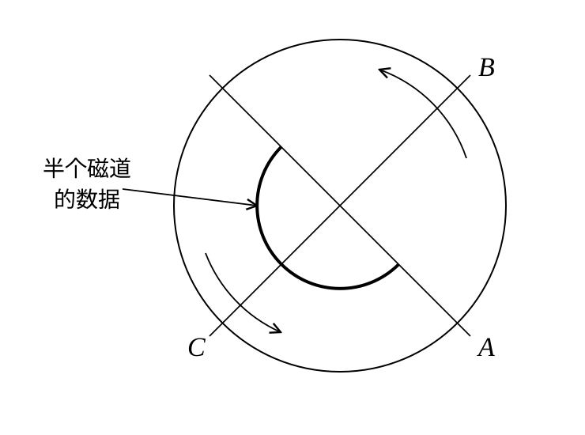
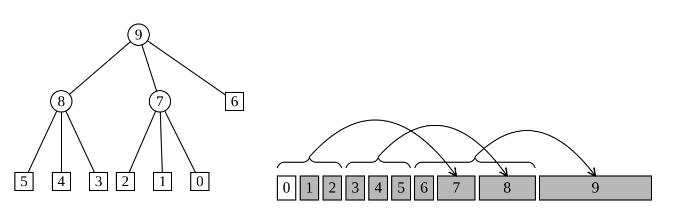
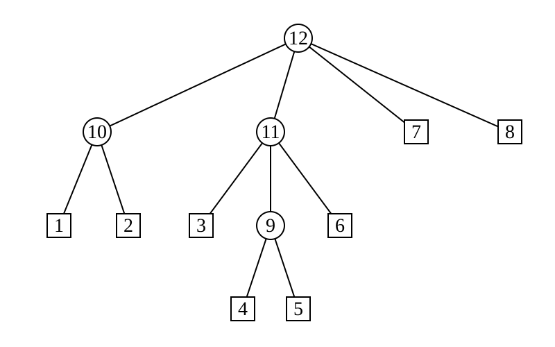
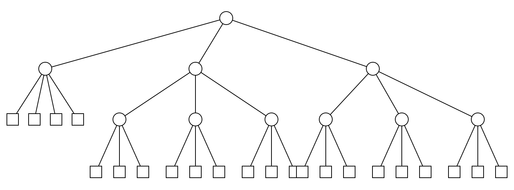
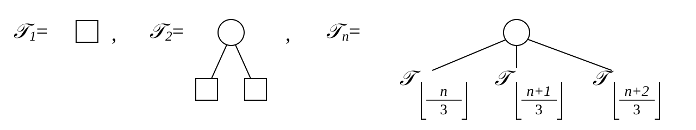

# *5.4.9　磁盘与磁鼓

到目前为止我们已经考虑了磁带作为外部排序运载工具的情况, 但通常有更为灵活的大容量存储设备可供使用. 尽管这些 “海量存储器” 或 “直接访问存储器” 设备的形式有很多种, 但它们都可以用以下特性作大致描述:

(i) 可以快速访问所存信息的任意指定部分;

(ii) 可以在内部存储器和外部存储器之间快速传送连续字块.

磁带满足 (ii) 但不满足 (i), 因为从磁带的一端到达另一端需要花费很长时间.

每种外部存储设备都有一些独有的特性, 在为其编写大型程序之前, 应当仔细研究这些特性. 但技术的变化是如此之快, 不可能在这里完整地讨论形形色色的所有硬件. 因此我们应当仅考虑一些典型的存储器设备, 它们为排序问题提供了有用的解决方法.

满足 (i) 和 (ii) 的最常用外部存储器之一是磁盘设备 (见图 89). 数据保存在快速旋转的圆盘上, 上面覆盖有磁性材料. 一个梳状存取臂上针对每个磁盘表面包含一个或多个 “读写头”, 用于存储和检索信息. 每个独立表面又被分为称作 “磁道” 的同心圆环, 使得磁盘每完成一次旋转整个磁道的数据就会通过一次读写头. 存取臂可以移入和移出, 在磁道之间移动读写头, 但这种移动需要花费时间. 不需要重新定位存取臂就能读取或写入的一组磁道称为一个柱面. 例如, 图 89 给出一个磁盘设备, 对于每个表面仅有一个读写头, 浅灰色的圆圈表示柱面之一, 包含了读写头当前正在扫描的所有磁道.

图 89　磁盘设备

为深入了解这些思想, 我们考虑假想的 MIXTEC 磁盘设备, 该设备中:

$$
\begin{aligned}
1\text{ 磁道}&=5000\text{ 字符}\\
1\text{ 柱面}&=20\text{ 磁道}\\
1\text{ 磁盘设备}&=200\text{ 柱面}
\end{aligned}
$$

这样一个磁盘设备包含 2 千万个字符, 略少于一条 MIXT 磁带上所能存储的数据量. 在某些机器上, 盘心附近的磁道所容纳的字符少于边缘附近磁道的字符数, 这样可能会大幅增加程序设计的复杂度, MIXTEC 很幸运地避免了这些问题. (关于 MIXT 磁带的讨论见 5.4.6 节. 如同在那一节, 我们通过考虑 20 世纪 70 年代早期的典型机器特性来研究典型技术. 现代的磁盘要大得多, 也快得多.)

读写一个磁盘所需要的时间量基本上是以下三个量之和:

- 寻道时间 (存取臂移到正确柱面所需要的时间);
- 等待时间 (读写头到达正确位置之前的旋转延迟);
- 传输时间 (数据通过读写头的旋转延迟).

在 MIXTEC 设备上从柱面 $i$ 到柱面 $j$ 所需要的寻道时间是 $25+\frac12|i-j|$ 毫秒. 如果 $i$ 和 $j$ 是在 1 至 200 之间随机选择的整数, 则 $|i-j|$ 的平均值是 $2\binom{201}3/200^2\approx66.7$, 所以平均寻道时间大约是 60 毫秒. MIXTEC 磁盘每 25 毫秒旋转一圈, 所以平均等待时间大约是 12.5 毫秒. $n$ 字符的传输时间是 $(n/5000)\times25$ 毫秒 $=5n$ 微秒. (这大约是 5.4.6 节示例中所用 MIXT 磁带传送速度的 $3\frac13$ 倍.)

因此 MIXTEC 磁盘与 MIXT 磁带之间的主要不同如下:

(a) 磁带仅能顺序访问.

(b) 单独的磁盘操作需要的开销可能大得多 (寻道时间＋等待时间与停止／启动时间相比).

(c) 磁盘传送率更快一些.

在磁带上使用更为巧妙的合并模式, 就能够对缺点 (a) 多少做出一些补偿. 我们现在的目标是想出更巧妙的磁盘排序算法, 能够对缺点 (b) 做出补偿.

**克服等待时间.** 当我们启动一条输入／输出指令时, 磁盘并非总是位于正确位置, 从而会导致延迟, 首先考虑使这一延迟最小化的问题. 我们不能使磁盘旋转得更快, 但仍然可以应用一些技巧来缩短甚至消除所有等待时间. 增加更多存取臂显然是有帮助的, 但这样会涉及昂贵的硬件修改. 下面是一些软件思想:

- 如果一次读取或写入一个柱面的几个磁道, 可以在除第一磁道之外的所有磁道上避免等待时间 (以及寻道时间). 一般来说, 通常可以同步计算时间与磁盘移动, 从而可以在无须等待的情况下执行输入／输出指令序列.

- 考虑读取半个磁道数据的问题 (图 90): 如果在磁头位于轴 $A$ 时开始读取命令, 则没有等待时间, 总读取时间就是传输时间 $\frac12\times25$ 毫秒. 如果命令开始时磁头位于 $B$ 处, 则需要旋转 $\frac14$ 圈的等待时间和 $\frac12$ 圈的传输时间, 总共 $\frac34\times25$ 毫秒. 最有趣的情形发生在磁头初始位置为 $C$ 时: 采用合适的硬件和软件, 不需要浪费旋转 $\frac34$ 圈的等待时间. 立即读取输入缓冲区的第二部分, 然后在 $\frac12\times25$ 毫秒的暂停之后继续读取缓冲区的前半部分, 于是在再次到达轴 $C$ 时完成指令. 以类似方式我们可以确保, 无论磁盘的初始位置在哪里, 总等待时间加上传输时间绝对不会超过旋转一圈的时间. 如果我们正在读取或写入一个磁道的指定片断 $x$($0<x\le1$), 这个方案把平均等待延迟量由半圈减至 $\frac12(1-x^2)$ 圈. 在读取或写入整个磁道时 ($x=1$), 这个技巧可以消除所有等待时间.

图 90　读取一半磁道时的等待时间分析

**磁鼓: 无寻道的情形.** 某些外部存储器设备 (通常称为磁鼓存储器) 为每个磁道都准备了一个读写头, 从而消除了寻道时间. 如果在这些设备上采用图 90 所示的技术, 假定每次总是读取或写入一个磁道, 则寻道时间和等待时间都将缩短为零. 这是一种理想情况, 传输时间是其中的唯一限制因素.

我们再次考虑 5.4.6 节的应用实例, 用容量为 100000 字符的内部存储器排序 100000 个 100 字符的记录. 待排序的所有数据填充一个 MIXTEC 磁盘的一半. 通常不可能在一个磁盘设备中同时进行读取和写入, 我们将假定有两个磁盘可用, 使读取和写入能够相互重叠. 事实上, 我们此时应当假定磁盘是磁鼓, 包含 4000 个磁道, 每个磁道包含 5000 字符, 不需要寻道时间.

应当使用哪种排序算法呢? 合并方法是相当自然的选择, 其他内部排序方法不能很好地用磁盘实现, 5.2.5 节的基数技术除外. 5.4.7 节的考虑事项表明: 对于通用应用程序来说, 基数排序通常劣于合并算法, 因为该节的对偶定理既适用于磁带, 也适用于磁盘. 然而, 当键为均匀分布且可以并行使用许多磁盘时, 基数排序有很大的优势, 因为按照键的最高有效位形成的初始分布可以把排序任务分成许多相互之间不需要进一步通信独立的子问题. (例如, 见拉梅什·阿加瓦尔,*SIGMOD Record* **25**, 2 (June 1996), 240–246.)

以下的讨论将集中于合并排序. 为开始对所述问题进行合并排序, 可以使用替代选择, 采用两个 5000 字符的输入缓冲区和两个 5000 字符的输出缓冲区. 事实上, 如果当前输入缓冲区中的记录由离开选择树的记录代替, 则有可能把上述缓冲区缩减为三个 5000 字符的缓冲区. 这样会给选择树留下 85000 字符 (850 个记录), 所以对我们的示例进行一遍扫描将形成大约 60 个初始游程. (见式 5.4.6–(3).) 如果假定内部处理速度快到足以跟上输入／输出速度, 即每 500 微秒向输出缓冲区移动一个记录, 则这一遍扫描将只需要大约 50 秒. 如果待排序的输入内容出现在 MIXT 磁带上而不是磁鼓上, 因磁带速度所致, 这一遍扫描将会变慢.

在采用两个磁鼓并进行全磁道读／写时, 不难看出, 如果让 $P$ 尽可能大, 则 $P$ 路合并的总传输时间将降至最低. 遗憾的是, 我们不能简单地对所有初始游程进行 60 路合并, 因为存储器的空间无法容纳 60 个缓冲区. (容量低于 5000 字符的缓冲区将会引入不必要的等待时间. 别忘了, 我们仍假装生活在内部存储空间非常有限的 20 世纪 70 年代.) 如果进行 $P$ 路合并, 把所有数据从一个磁鼓传送到另一个磁鼓, 以便使读取与写入重叠起来, 则合并扫描数为 $\lceil\log_P60\rceil$, 如果 $8\le P\le59$, 我们可以在两遍扫描中完成任务. 最小的 $P$ 值会减少内部计算量, 所以我们选择 $P=8$. 如果已经形成了 65 个初始游程, 则取 $P=9$. 如果已经形成了 82 个或更多个初始游程, 则取 $P=10$, 但由于仅能为 18 个输入缓冲区和 2 个输出缓冲区提供空间, 所以在合并期间有可能会挂起 (见算法 5.4.6F). 在这种情况下, 最好对小部分数据进行两遍部分扫描, 把初始游程数降至 81 或更低.

在我们假设的情况下, 两个合并扫描都需要大约 50 秒, 所以这种理想情况下完成整个排序仅需要大约 2.5 分钟 (加上用于簿记操作、初始化等操作的少许一些时间). 这比 5.4.6 节所考虑的最佳六磁带排序快六倍, 这一提速是因为: 提高了外部／内部传输速度 (快 3.5 倍), 合并阶数更高 (除非拥有九条或更多磁带, 否则不能进行八路磁带合并), 还有就是输出内容留在了磁盘上 (不需要进行最后的回卷等操作). 如果初始输入和排序后的输出需要放在 MIXT 磁带上, 磁鼓仅用于合并, 则相应的排序时间大约为 8.2 分钟.

如果仅有一个磁鼓可用而不是两个, 由于读取和写入必须分别完成, 所以输入输出时间将变为两倍. (事实上, 输入输出操作可能需要三倍的时间, 因为我们需要覆写初始输入数据. 在这种情况下, 如果硬件没有提供对写入信息的自动验证功能, 谨慎的做法是在每次写入之后跟一个 “读回校验” 操作, 以免某些输入数据丢失而造成不可挽回的损失.) 由于我们可以使用部分扫描方法, 对部分数据记录的处理频率高于对其他记录的处理, 从而可以挽回一些上述额外时间. 两磁鼓情形需要所有数据都进行偶数次或奇数次处理, 但一磁鼓情形可以使用更具一般性的合并模式.

在 5.4.4 节我们观察到, 合并模式可以用树来表示, 对应于某个合并模式的传输时间与相应树的外部路径长度成正比. 只有某些特定的树 ($T$-lifo 树或者强 $T$-fifo 树) 可用作高效磁带合并模式, 因为在合并过程中某些游程会被隐藏在磁带的中部. 但是在磁盘或磁鼓上, 所有树都定义了有用的合并模式, 只要它们的内部结点的级数对于可供使用的内部存储器容量来说不致过大就行.

因此我们可以选择一棵外部路径长度最短的树 (比如 $P$ 值尽可能大的完全 $P$ 叉树) 来使传输时间降至最低. 根据式 5.4.4–(9), 这样一棵树如果有 $S$ 个外部结点 (叶子), 则它的外部路径长度等于

$$
qS-\lfloor(P^q-S)/(P-1)\rfloor,\qquad q=\lceil\log_P S\rceil.\tag{1}
$$

设计一种根据完全 $P$ 叉树模式进行合并的算法是特别容易的. 例如, 见图 91, 它显示了 $P=3,S=6$ 的情形. 首先, 在必要时添加虚拟游程, 使得 $S\equiv1\pmod{P-1}$. 然后, 根据 “先进先出” 规则合并游程, 在每一阶段, 把队列前面的 $P$ 个最老游程合并到一个位于后部的游程中.

图 91　具有六片叶子的完全三叉树及相应的合并模式

如果所有初始游程的长度全都相等, 则完全 $P$ 叉树给出一种最优模式, 但如果某些游程长于其他游程, 则我们通常可以做得更好. 利用哈夫曼的方法 (习题 2.3.4.5–10) 可以毫无困难地为这种一般情形构造最优模式, 它可以用合并语言表述如下: “首先增加 $(1-S)\bmod(P-1)$ 个长度为 0 的虚拟游程. 然后重复合并 $P$ 个最短现有游程, 直到仅剩下一个游程为止.” 当所有初始游程的长度相同时, 这个方法就归结为前面所述的 “先进先出” 规则.

在 100000 个记录示例中我们能够进行九路合并, 因为十八个输入缓冲区和两个输出缓冲区可以放入存储器中, 且算法 5.4.6F 将重叠所有计算时间. 如果所有初始游程的长度相等, 则具有 60 片叶子的完全九叉树对应于一种具有 $1\frac{29}{30}$ 遍扫描的合并模式. 在每次写入后都进行读回校验时, 使用一个磁鼓的总排序时间大约是 7.4 分钟. 更高的 $P$ 值可能会略微缩短运行时间, 但这种情况会很复杂, 因为当缓冲区变得太满或太空时可能会发生 “读取挂起”.

**寻道时间的影响.** 以上讨论表明为磁鼓构造最优合并模式是比较容易的, 因为寻道时间和等待时间可能基本上不存在. 但在使用磁盘时, 如果采用小型缓冲区, 在信息查找过程中花费的时间要多于读取时间, 所以寻道时间对排序策略有着很大的影响. 降低合并阶数 $P$, 就可能使用更大的缓冲区, 从而需要较少的寻道时间, 这通常能补偿较小 $P$ 值所需要的额外传输时间.

寻道时间依赖于存取臂的移动距离, 我们可以尝试通过合理安排使这一距离降至最低. 例如, 首先在柱面内排序记录可能是明智的做法. 但是大规模合并往往需要在柱面之间进行大量跳转 (见习题 2). 此外, 现代操作系统的多重程序设计能力意味着用户可能会失去对磁盘存取臂位置的控制. 因此, 假定每个磁盘命令都涉及一次 “随机” 寻道通常是合理的.

我们的目标是找出在寻道时间和传输时间之间达到最佳平衡的一种合并模式, 为此需要有一种方式估计任意特定树是否能够很好地适用于特定的硬件配置. 例如考虑图 92 中的树, 我们希望估计执行相应合并需要多长时间, 以便把这棵树与其他树比较.

图 92　外部路径长度为 16 而叉数路径长度为 52 的树

在下面的讨论中我们将对磁盘合并做一些简单的假定, 以说明某些一般性思想. 假定: (i) 读取或写入 $n$ 字符需要 $72.5+0.005n$ 毫秒; (ii) 内部存储器中有 100000 字符空间可用作工作存储; (iii) 每从输入向输出传送一个字符平均需要 0.004 毫秒的计算时间; (iv) 读取、写入、计算之间没有重叠; (v) 用于输出的缓冲区大小不必与后续扫描中读取数据所用的缓冲区大小相同. 这些简单假定下的排序问题分析将为我们研究更复杂的情形提供一些洞察力.

如果进行 $P$ 路合并, 可以把内部工作存储器分为 $P+1$ 个缓冲区, $P$ 个用于输入, 一个用于输出, 每个缓冲区有 $B=100000/(P+1)$ 个字符. 假定被合并的文件总共包含 $L$ 个字符, 我们将会进行大约 $L/B$ 次输出操作以及大约相同数量的输入操作, 因此在我们的假设条件下总合并时间近似为 (单位毫秒)

$$
2\left(72.5\frac LB+0.005L\right)+0.004L=(0.00145P+0.01545)L.\tag{2}
$$

换句话说, $L$ 个字符的 $P$ 路合并需要大约 $(\alpha P+\beta)L$ 个时间单位, $\alpha$ 和 $\beta$ 是取决于寻道时间、等待时间、计算时间和存储器容量的常数. 这个公式引出了构造出色磁盘合并模式的一种有趣方式. 例如, 考虑图 92, 假定所有初始游程 (用正方形叶结点表示) 的长度是 $L_0$. 于是结点 9 和结点 10 处的合并各需要 $(2\alpha+\beta)(2L_0)$ 个时间单位, 结点 11 处的合并需要 $(3\alpha+\beta)(4L_0)$ 个时间单位, 结点 12 处的最终合并需要 $(4\alpha+\beta)(8L_0)$ 个时间单位. 因此总合并时间是 $(52\alpha+16\beta)L_0$ 个时间单位. 这里的系数 16 对我们来说是非常熟悉的, 它就是树的外部路径长度. 然而 $\alpha$ 的系数 52 是一个新概念, 它可以称为树的 “叉数路径长度”, 它是针对所有叶结点的从叶结点到根结点路径上的内部结点叉数求和. 例如, 在图 92 中叉数路径长度是

$$
(2+4)+(2+4)+(3+4)+(2+3+4)+(2+3+4)+(3+4)+(4)+(4)=52.
$$

如果 $\mathcal T$ 是任意树, 设 $D(\mathcal T)$ 和 $E(\mathcal T)$ 分别表示它的叉数路径长度和外部路径长度. 我们的分析综述如下:

**定理 H.** 如果对 $L$ 个字符进行 $P$ 路合并所需要的时间具有 $(\alpha P+\beta)L$ 的形式, 假定共有 $S$ 个等长游程需要合并, 则最佳合并模式对应于一棵树 $\mathcal T$, 在所有具有 $S$ 片叶子的树中, 树 $\mathcal T$ 的 $\alpha D(\mathcal T)+\beta E(\mathcal T)$ 是最小的. ▮

(定理 H 隐含在一篇未发表的论文中, 乔治·哈伯德在 1963 年的 ACM National Conference 上宣读了这篇论文.)

设 $\alpha$ 和 $\beta$ 是固定的常数. 如果在所有具有相同叶子数目的树 $\mathcal T$ 中, 一棵树的 $\alpha D(\mathcal T)+\beta E(\mathcal T)$ 最小, 就说这棵树是最优的. 不难看出一棵最优树的所有子树都是最优的, 因此我们可以把叶子数 $<n$ 的最优树组合在一起, 构造出具有 $n$ 片叶子的最优树.

**定理 K.** 对于 $1\le m\le n$, 数列 $A_m(n)$ 由以下规则定义:

$$
A_1(1)=0;\tag{3}
$$

$$
A_m(n)=\min_{1\le k\le n/m}\bigl(A_1(k)+A_{m-1}(n-k)\bigr),\qquad\text{对于 }2\le m\le n;\tag{4}
$$

$$
A_1(n)=\min_{2\le m\le n}\bigl(\alpha mn+\beta n+A_m(n)\bigr),\qquad\text{对于 }n\ge2.\tag{5}
$$

现在, 在所有具有 $n$ 片叶子的树 $\mathcal T$ 中, $A_1(n)$ 是 $\alpha D(\mathcal T)+\beta E(\mathcal T)$ 的最小值.

**证明.** 式 (4) 蕴涵着以下事实, 对于所有满足 $n_1+\cdots+n_m=n$ 的正整数 $n_1,\ldots,n_m$, $A_m(n)$ 是 $A_1(n_1)+\cdots+A_1(n_m)$ 的最小值. 对 $n$ 应用归纳法就可以得到结果. ▮

递归关系 (3) (4) (5) 也可用于构造最优树本身: 设 $k_m(n)$ 是使 $A_m(n)$ 取最小值的一个值. 于是我们可以在根结点处组合 $m=k_1(n)$ 个子树来构造一棵具有 $n$ 片叶子的最优树, 这些子树是分别具有 $k_m(n)$, $k_{m-1}\bigl(n-k_m(n)\bigr)$, $k_{m-2}\bigl(n-k_m(n)-k_{m-1}(n-k_m(n))\bigr)$, ……片叶子的最优树.

表 1 给出了当 $\alpha=\beta=1$ 时的这个构造, 表的右侧是相应最优树的简单说明. 例如 $n=22$ 的条目 4:9:9 意味着: 通过组合 $\mathcal T_4,\mathcal T_9,\mathcal T_9$ 可以获得一棵具有 22 片叶子的最优树 $\mathcal T_{22}$ (见图 93). 最优树并不唯一, 例如 5:8:9 和 4:9:9 一样好.

表 1　$\alpha=\beta=1$ 时的最优树特性 $A_m(n),k_m(n)$

<table data-optimal-tree-table style="display:block;overflow-x:auto;white-space:nowrap"><thead><tr><th rowspan="2">$n$</th><th colspan="12">$m$</th><th rowspan="2">树</th><th rowspan="2">$n$</th></tr><tr><th>1</th><th>2</th><th>3</th><th>4</th><th>5</th><th>6</th><th>7</th><th>8</th><th>9</th><th>10</th><th>11</th><th>12</th></tr></thead><tbody><tr data-optimal-row="1"><td style="padding:4px 9px;text-align:center">1</td><td style="padding:4px 9px;text-align:center">0,0</td><td style="padding:4px 9px;text-align:center"></td><td style="padding:4px 9px;text-align:center"></td><td style="padding:4px 9px;text-align:center"></td><td style="padding:4px 9px;text-align:center"></td><td style="padding:4px 9px;text-align:center"></td><td style="padding:4px 9px;text-align:center"></td><td style="padding:4px 9px;text-align:center"></td><td style="padding:4px 9px;text-align:center"></td><td style="padding:4px 9px;text-align:center"></td><td style="padding:4px 9px;text-align:center"></td><td style="padding:4px 9px;text-align:center"></td><td style="padding:4px 9px;text-align:center">—</td><td style="padding:4px 9px;text-align:center">1</td></tr><tr data-optimal-row="2"><td style="padding:4px 9px;text-align:center">2</td><td style="padding:4px 9px;text-align:center">6,2</td><td style="padding:4px 9px;text-align:center">0,1</td><td style="padding:4px 9px;text-align:center"></td><td style="padding:4px 9px;text-align:center"></td><td style="padding:4px 9px;text-align:center"></td><td style="padding:4px 9px;text-align:center"></td><td style="padding:4px 9px;text-align:center"></td><td style="padding:4px 9px;text-align:center"></td><td style="padding:4px 9px;text-align:center"></td><td style="padding:4px 9px;text-align:center"></td><td style="padding:4px 9px;text-align:center"></td><td style="padding:4px 9px;text-align:center"></td><td style="padding:4px 9px;text-align:center">1:1</td><td style="padding:4px 9px;text-align:center">2</td></tr><tr data-optimal-row="3"><td style="padding:4px 9px;text-align:center">3</td><td style="padding:4px 9px;text-align:center">12,3</td><td style="padding:4px 9px;text-align:center">6,1</td><td style="padding:4px 9px;text-align:center">0,1</td><td style="padding:4px 9px;text-align:center"></td><td style="padding:4px 9px;text-align:center"></td><td style="padding:4px 9px;text-align:center"></td><td style="padding:4px 9px;text-align:center"></td><td style="padding:4px 9px;text-align:center"></td><td style="padding:4px 9px;text-align:center"></td><td style="padding:4px 9px;text-align:center"></td><td style="padding:4px 9px;text-align:center"></td><td style="padding:4px 9px;text-align:center"></td><td style="padding:4px 9px;text-align:center">1:1:1</td><td style="padding:4px 9px;text-align:center">3</td></tr><tr data-optimal-row="4"><td style="padding:4px 9px;text-align:center">4</td><td style="padding:4px 9px;text-align:center">20,4</td><td style="padding:4px 9px;text-align:center">12,1</td><td style="padding:4px 9px;text-align:center">6,1</td><td style="padding:4px 9px;text-align:center">0,1</td><td style="padding:4px 9px;text-align:center"></td><td style="padding:4px 9px;text-align:center"></td><td style="padding:4px 9px;text-align:center"></td><td style="padding:4px 9px;text-align:center"></td><td style="padding:4px 9px;text-align:center"></td><td style="padding:4px 9px;text-align:center"></td><td style="padding:4px 9px;text-align:center"></td><td style="padding:4px 9px;text-align:center"></td><td style="padding:4px 9px;text-align:center">1:1:1:1</td><td style="padding:4px 9px;text-align:center">4</td></tr><tr data-optimal-row="5"><td style="padding:4px 9px;text-align:center">5</td><td style="padding:4px 9px;text-align:center">30,5</td><td style="padding:4px 9px;text-align:center">18,2</td><td style="padding:4px 9px;text-align:center">12,1</td><td style="padding:4px 9px;text-align:center">6,1</td><td style="padding:4px 9px;text-align:center">0,1</td><td style="padding:4px 9px;text-align:center"></td><td style="padding:4px 9px;text-align:center"></td><td style="padding:4px 9px;text-align:center"></td><td style="padding:4px 9px;text-align:center"></td><td style="padding:4px 9px;text-align:center"></td><td style="padding:4px 9px;text-align:center"></td><td style="padding:4px 9px;text-align:center"></td><td style="padding:4px 9px;text-align:center">1:1:1:1:1</td><td style="padding:4px 9px;text-align:center">5</td></tr><tr data-optimal-row="6"><td style="padding:4px 9px;text-align:center">6</td><td style="padding:4px 9px;text-align:center">42,2</td><td style="padding:4px 9px;text-align:center">24,3</td><td style="padding:4px 9px;text-align:center">18,1</td><td style="padding:4px 9px;text-align:center">12,1</td><td style="padding:4px 9px;text-align:center">6,1</td><td style="padding:4px 9px;text-align:center">0,1</td><td style="padding:4px 9px;text-align:center"></td><td style="padding:4px 9px;text-align:center"></td><td style="padding:4px 9px;text-align:center"></td><td style="padding:4px 9px;text-align:center"></td><td style="padding:4px 9px;text-align:center"></td><td style="padding:4px 9px;text-align:center"></td><td style="padding:4px 9px;text-align:center">3:3</td><td style="padding:4px 9px;text-align:center">6</td></tr><tr data-optimal-row="7"><td style="padding:4px 9px;text-align:center">7</td><td style="padding:4px 9px;text-align:center">52,3</td><td style="padding:4px 9px;text-align:center">32,3</td><td style="padding:4px 9px;text-align:center">24,1</td><td style="padding:4px 9px;text-align:center">18,1</td><td style="padding:4px 9px;text-align:center">12,1</td><td style="padding:4px 9px;text-align:center">6,1</td><td style="padding:4px 9px;text-align:center">0,1</td><td style="padding:4px 9px;text-align:center"></td><td style="padding:4px 9px;text-align:center"></td><td style="padding:4px 9px;text-align:center"></td><td style="padding:4px 9px;text-align:center"></td><td style="padding:4px 9px;text-align:center"></td><td style="padding:4px 9px;text-align:center">1:3:3</td><td style="padding:4px 9px;text-align:center">7</td></tr><tr data-optimal-row="8"><td style="padding:4px 9px;text-align:center">8</td><td style="padding:4px 9px;text-align:center">62,3</td><td style="padding:4px 9px;text-align:center">40,4</td><td style="padding:4px 9px;text-align:center">30,2</td><td style="padding:4px 9px;text-align:center">24,1</td><td style="padding:4px 9px;text-align:center">18,1</td><td style="padding:4px 9px;text-align:center">12,1</td><td style="padding:4px 9px;text-align:center">6,1</td><td style="padding:4px 9px;text-align:center">0,1</td><td style="padding:4px 9px;text-align:center"></td><td style="padding:4px 9px;text-align:center"></td><td style="padding:4px 9px;text-align:center"></td><td style="padding:4px 9px;text-align:center"></td><td style="padding:4px 9px;text-align:center">2:3:3</td><td style="padding:4px 9px;text-align:center">8</td></tr><tr data-optimal-row="9"><td style="padding:4px 9px;text-align:center">9</td><td style="padding:4px 9px;text-align:center">72,3</td><td style="padding:4px 9px;text-align:center">50,4</td><td style="padding:4px 9px;text-align:center">36,3</td><td style="padding:4px 9px;text-align:center">30,1</td><td style="padding:4px 9px;text-align:center">24,1</td><td style="padding:4px 9px;text-align:center">18,1</td><td style="padding:4px 9px;text-align:center">12,1</td><td style="padding:4px 9px;text-align:center">6,1</td><td style="padding:4px 9px;text-align:center">0,1</td><td style="padding:4px 9px;text-align:center"></td><td style="padding:4px 9px;text-align:center"></td><td style="padding:4px 9px;text-align:center"></td><td style="padding:4px 9px;text-align:center">3:3:3</td><td style="padding:4px 9px;text-align:center">9</td></tr><tr data-optimal-row="10"><td style="padding:4px 9px;text-align:center">10</td><td style="padding:4px 9px;text-align:center">84,3</td><td style="padding:4px 9px;text-align:center">60,5</td><td style="padding:4px 9px;text-align:center">44,3</td><td style="padding:4px 9px;text-align:center">36,1</td><td style="padding:4px 9px;text-align:center">30,1</td><td style="padding:4px 9px;text-align:center">24,1</td><td style="padding:4px 9px;text-align:center">18,1</td><td style="padding:4px 9px;text-align:center">12,1</td><td style="padding:4px 9px;text-align:center">6,1</td><td style="padding:4px 9px;text-align:center">0,1</td><td style="padding:4px 9px;text-align:center"></td><td style="padding:4px 9px;text-align:center"></td><td style="padding:4px 9px;text-align:center">3:3:4</td><td style="padding:4px 9px;text-align:center">10</td></tr><tr data-optimal-row="11"><td style="padding:4px 9px;text-align:center">11</td><td style="padding:4px 9px;text-align:center">96,3</td><td style="padding:4px 9px;text-align:center">72,4</td><td style="padding:4px 9px;text-align:center">52,3</td><td style="padding:4px 9px;text-align:center">42,2</td><td style="padding:4px 9px;text-align:center">36,1</td><td style="padding:4px 9px;text-align:center">30,1</td><td style="padding:4px 9px;text-align:center">24,1</td><td style="padding:4px 9px;text-align:center">18,1</td><td style="padding:4px 9px;text-align:center">12,1</td><td style="padding:4px 9px;text-align:center">6,1</td><td style="padding:4px 9px;text-align:center">0,1</td><td style="padding:4px 9px;text-align:center"></td><td style="padding:4px 9px;text-align:center">3:4:4</td><td style="padding:4px 9px;text-align:center">11</td></tr><tr data-optimal-row="12"><td style="padding:4px 9px;text-align:center">12</td><td style="padding:4px 9px;text-align:center">108,3</td><td style="padding:4px 9px;text-align:center">82,4</td><td style="padding:4px 9px;text-align:center">60,4</td><td style="padding:4px 9px;text-align:center">48,3</td><td style="padding:4px 9px;text-align:center">42,1</td><td style="padding:4px 9px;text-align:center">36,1</td><td style="padding:4px 9px;text-align:center">30,1</td><td style="padding:4px 9px;text-align:center">24,1</td><td style="padding:4px 9px;text-align:center">18,1</td><td style="padding:4px 9px;text-align:center">12,1</td><td style="padding:4px 9px;text-align:center">6,1</td><td style="padding:4px 9px;text-align:center">0,1</td><td style="padding:4px 9px;text-align:center">4:4:4</td><td style="padding:4px 9px;text-align:center">12</td></tr><tr data-optimal-row="13"><td style="padding:4px 9px;text-align:center">13</td><td style="padding:4px 9px;text-align:center">121,4</td><td style="padding:4px 9px;text-align:center">92,4</td><td style="padding:4px 9px;text-align:center">70,4</td><td style="padding:4px 9px;text-align:center">56,3</td><td style="padding:4px 9px;text-align:center">48,1</td><td style="padding:4px 9px;text-align:center">42,1</td><td style="padding:4px 9px;text-align:center">36,1</td><td style="padding:4px 9px;text-align:center">30,1</td><td style="padding:4px 9px;text-align:center">24,1</td><td style="padding:4px 9px;text-align:center">18,1</td><td style="padding:4px 9px;text-align:center">12,1</td><td style="padding:4px 9px;text-align:center">6,1</td><td style="padding:4px 9px;text-align:center">3:3:3:4</td><td style="padding:4px 9px;text-align:center">13</td></tr><tr data-optimal-row="14"><td style="padding:4px 9px;text-align:center">14</td><td style="padding:4px 9px;text-align:center">134,4</td><td style="padding:4px 9px;text-align:center">102,5</td><td style="padding:4px 9px;text-align:center">80,4</td><td style="padding:4px 9px;text-align:center">64,3</td><td style="padding:4px 9px;text-align:center">54,2</td><td style="padding:4px 9px;text-align:center">48,1</td><td style="padding:4px 9px;text-align:center">42,1</td><td style="padding:4px 9px;text-align:center">36,1</td><td style="padding:4px 9px;text-align:center">30,1</td><td style="padding:4px 9px;text-align:center">24,1</td><td style="padding:4px 9px;text-align:center">18,1</td><td style="padding:4px 9px;text-align:center">12,1</td><td style="padding:4px 9px;text-align:center">3:3:4:4</td><td style="padding:4px 9px;text-align:center">14</td></tr><tr data-optimal-row="15"><td style="padding:4px 9px;text-align:center">15</td><td style="padding:4px 9px;text-align:center">147,4</td><td style="padding:4px 9px;text-align:center">114,5</td><td style="padding:4px 9px;text-align:center">90,4</td><td style="padding:4px 9px;text-align:center">72,3</td><td style="padding:4px 9px;text-align:center">60,3</td><td style="padding:4px 9px;text-align:center">54,1</td><td style="padding:4px 9px;text-align:center">48,1</td><td style="padding:4px 9px;text-align:center">42,1</td><td style="padding:4px 9px;text-align:center">36,1</td><td style="padding:4px 9px;text-align:center">30,1</td><td style="padding:4px 9px;text-align:center">24,1</td><td style="padding:4px 9px;text-align:center">18,1</td><td style="padding:4px 9px;text-align:center">3:4:4:4</td><td style="padding:4px 9px;text-align:center">15</td></tr><tr data-optimal-row="16"><td style="padding:4px 9px;text-align:center">16</td><td style="padding:4px 9px;text-align:center">160,4</td><td style="padding:4px 9px;text-align:center">124,7</td><td style="padding:4px 9px;text-align:center">102,4</td><td style="padding:4px 9px;text-align:center">80,4</td><td style="padding:4px 9px;text-align:center">68,3</td><td style="padding:4px 9px;text-align:center">60,1</td><td style="padding:4px 9px;text-align:center">54,1</td><td style="padding:4px 9px;text-align:center">48,1</td><td style="padding:4px 9px;text-align:center">42,1</td><td style="padding:4px 9px;text-align:center">36,1</td><td style="padding:4px 9px;text-align:center">30,1</td><td style="padding:4px 9px;text-align:center">24,1</td><td style="padding:4px 9px;text-align:center">4:4:4:4</td><td style="padding:4px 9px;text-align:center">16</td></tr><tr data-optimal-row="17"><td style="padding:4px 9px;text-align:center">17</td><td style="padding:4px 9px;text-align:center">175,4</td><td style="padding:4px 9px;text-align:center">134,8</td><td style="padding:4px 9px;text-align:center">112,4</td><td style="padding:4px 9px;text-align:center">90,4</td><td style="padding:4px 9px;text-align:center">76,3</td><td style="padding:4px 9px;text-align:center">66,2</td><td style="padding:4px 9px;text-align:center">60,1</td><td style="padding:4px 9px;text-align:center">54,1</td><td style="padding:4px 9px;text-align:center">48,1</td><td style="padding:4px 9px;text-align:center">42,1</td><td style="padding:4px 9px;text-align:center">36,1</td><td style="padding:4px 9px;text-align:center">30,1</td><td style="padding:4px 9px;text-align:center">4:4:4:5</td><td style="padding:4px 9px;text-align:center">17</td></tr><tr data-optimal-row="18"><td style="padding:4px 9px;text-align:center">18</td><td style="padding:4px 9px;text-align:center">190,4</td><td style="padding:4px 9px;text-align:center">144,9</td><td style="padding:4px 9px;text-align:center">122,4</td><td style="padding:4px 9px;text-align:center">100,4</td><td style="padding:4px 9px;text-align:center">84,3</td><td style="padding:4px 9px;text-align:center">72,3</td><td style="padding:4px 9px;text-align:center">66,1</td><td style="padding:4px 9px;text-align:center">60,1</td><td style="padding:4px 9px;text-align:center">54,1</td><td style="padding:4px 9px;text-align:center">48,1</td><td style="padding:4px 9px;text-align:center">42,1</td><td style="padding:4px 9px;text-align:center">36,1</td><td style="padding:4px 9px;text-align:center">4:4:5:5</td><td style="padding:4px 9px;text-align:center">18</td></tr><tr data-optimal-row="19"><td style="padding:4px 9px;text-align:center">19</td><td style="padding:4px 9px;text-align:center">205,4</td><td style="padding:4px 9px;text-align:center">156,9</td><td style="padding:4px 9px;text-align:center">132,5</td><td style="padding:4px 9px;text-align:center">110,4</td><td style="padding:4px 9px;text-align:center">92,3</td><td style="padding:4px 9px;text-align:center">80,3</td><td style="padding:4px 9px;text-align:center">72,1</td><td style="padding:4px 9px;text-align:center">66,1</td><td style="padding:4px 9px;text-align:center">60,1</td><td style="padding:4px 9px;text-align:center">54,1</td><td style="padding:4px 9px;text-align:center">48,1</td><td style="padding:4px 9px;text-align:center">42,1</td><td style="padding:4px 9px;text-align:center">4:5:5:5</td><td style="padding:4px 9px;text-align:center">19</td></tr><tr data-optimal-row="20"><td style="padding:4px 9px;text-align:center">20</td><td style="padding:4px 9px;text-align:center">220,4</td><td style="padding:4px 9px;text-align:center">168,9</td><td style="padding:4px 9px;text-align:center">144,4</td><td style="padding:4px 9px;text-align:center">120,5</td><td style="padding:4px 9px;text-align:center">100,4</td><td style="padding:4px 9px;text-align:center">88,3</td><td style="padding:4px 9px;text-align:center">78,2</td><td style="padding:4px 9px;text-align:center">72,1</td><td style="padding:4px 9px;text-align:center">66,1</td><td style="padding:4px 9px;text-align:center">60,1</td><td style="padding:4px 9px;text-align:center">54,1</td><td style="padding:4px 9px;text-align:center">48,1</td><td style="padding:4px 9px;text-align:center">5:5:5:5</td><td style="padding:4px 9px;text-align:center">20</td></tr><tr data-optimal-row="21"><td style="padding:4px 9px;text-align:center">21</td><td style="padding:4px 9px;text-align:center">236,5</td><td style="padding:4px 9px;text-align:center">180,9</td><td style="padding:4px 9px;text-align:center">154,4</td><td style="padding:4px 9px;text-align:center">132,4</td><td style="padding:4px 9px;text-align:center">110,4</td><td style="padding:4px 9px;text-align:center">96,3</td><td style="padding:4px 9px;text-align:center">84,3</td><td style="padding:4px 9px;text-align:center">78,1</td><td style="padding:4px 9px;text-align:center">72,1</td><td style="padding:4px 9px;text-align:center">66,1</td><td style="padding:4px 9px;text-align:center">60,1</td><td style="padding:4px 9px;text-align:center">54,1</td><td style="padding:4px 9px;text-align:center">4:4:4:4:5</td><td style="padding:4px 9px;text-align:center">21</td></tr><tr data-optimal-row="22"><td style="padding:4px 9px;text-align:center">22</td><td style="padding:4px 9px;text-align:center">252,3</td><td style="padding:4px 9px;text-align:center">192,10</td><td style="padding:4px 9px;text-align:center">164,4</td><td style="padding:4px 9px;text-align:center">142,4</td><td style="padding:4px 9px;text-align:center">120,4</td><td style="padding:4px 9px;text-align:center">104,3</td><td style="padding:4px 9px;text-align:center">92,3</td><td style="padding:4px 9px;text-align:center">84,1</td><td style="padding:4px 9px;text-align:center">78,1</td><td style="padding:4px 9px;text-align:center">72,1</td><td style="padding:4px 9px;text-align:center">66,1</td><td style="padding:4px 9px;text-align:center">60,1</td><td style="padding:4px 9px;text-align:center">4:9:9</td><td style="padding:4px 9px;text-align:center">22</td></tr><tr data-optimal-row="23"><td style="padding:4px 9px;text-align:center">23</td><td style="padding:4px 9px;text-align:center">266,3</td><td style="padding:4px 9px;text-align:center">204,11</td><td style="padding:4px 9px;text-align:center">174,5</td><td style="padding:4px 9px;text-align:center">152,4</td><td style="padding:4px 9px;text-align:center">130,4</td><td style="padding:4px 9px;text-align:center">112,3</td><td style="padding:4px 9px;text-align:center">100,3</td><td style="padding:4px 9px;text-align:center">90,2</td><td style="padding:4px 9px;text-align:center">84,1</td><td style="padding:4px 9px;text-align:center">78,1</td><td style="padding:4px 9px;text-align:center">72,1</td><td style="padding:4px 9px;text-align:center">66,1</td><td style="padding:4px 9px;text-align:center">5:9:9</td><td style="padding:4px 9px;text-align:center">23</td></tr><tr data-optimal-row="24"><td style="padding:4px 9px;text-align:center">24</td><td style="padding:4px 9px;text-align:center">282,3</td><td style="padding:4px 9px;text-align:center">216,12</td><td style="padding:4px 9px;text-align:center">186,5</td><td style="padding:4px 9px;text-align:center">162,5</td><td style="padding:4px 9px;text-align:center">140,4</td><td style="padding:4px 9px;text-align:center">120,4</td><td style="padding:4px 9px;text-align:center">108,3</td><td style="padding:4px 9px;text-align:center">96,3</td><td style="padding:4px 9px;text-align:center">90,1</td><td style="padding:4px 9px;text-align:center">84,1</td><td style="padding:4px 9px;text-align:center">78,1</td><td style="padding:4px 9px;text-align:center">72,1</td><td style="padding:4px 9px;text-align:center">5:9:10</td><td style="padding:4px 9px;text-align:center">24</td></tr><tr data-optimal-row="25"><td style="padding:4px 9px;text-align:center">25</td><td style="padding:4px 9px;text-align:center">296,3</td><td style="padding:4px 9px;text-align:center">229,12</td><td style="padding:4px 9px;text-align:center">196,7</td><td style="padding:4px 9px;text-align:center">174,4</td><td style="padding:4px 9px;text-align:center">150,5</td><td style="padding:4px 9px;text-align:center">130,4</td><td style="padding:4px 9px;text-align:center">116,3</td><td style="padding:4px 9px;text-align:center">104,3</td><td style="padding:4px 9px;text-align:center">96,1</td><td style="padding:4px 9px;text-align:center">90,1</td><td style="padding:4px 9px;text-align:center">84,1</td><td style="padding:4px 9px;text-align:center">78,1</td><td style="padding:4px 9px;text-align:center">7:9:9</td><td style="padding:4px 9px;text-align:center">25</td></tr></tbody></table>

图 93　当定理 H 中 $\alpha=\beta$ 时合并 22 个等长初始游程的一种最优方法. 在正文中推出式 (2) 的假设条件下, 这个模式的寻道时间最短

对式 (2) 的推导表明: 只要使用 $P+1$ 个相等的缓冲区, 关系 $\alpha\le\beta$ 就会成立. 当寻道时间本身达到最短且不考虑传输时间时, 出现如表 1 和图 93 中所示的 $\alpha=\beta$ 的极限情形.

回到最初的应用, 我们尚未考虑如何首先获得初始游程. 如果没有读／写／计算重叠, 替代选择就失去了某些优势. 我们也许应该填充整个内部存储器, 然后排序并输出结果. 这种输入输出操作每一个都可以在一次寻道中完成. 或者, 我们最好使用比如存储器的 20%当作组合式输入输出缓冲区, 并进行替代选择. 这样所需的寻道次数为原来的 5 倍, (增加 60 秒左右的时间!) 但它使初始游程数由 100 降至 64. 如果输入文件已经相当有序, 则这个缩减量还可能更显著.

如果我们决定不使用替代选择, 则对于 $S=100,\ \alpha=0.00145,\ \beta=0.01545$ 的最优树 [见式 (2)] 就变得相当普通了: 它就是一个在对数据进行两遍扫描中完成的十路合并. 如果可以留出 30 秒时间进行内部排序 (比如说 100 次快速排序), 则初始分布扫描需要大约 2.5 分钟, 每遍合并扫描需要将近 5 分钟, 总数为 12.4 分钟. 如果决定使用替代选择, 则 $S=64$ 的最优树同样是平凡的 (两遍八路合并扫描), 初始分布扫描需要大约 3.5 分钟, 每遍合并扫描需要大约 4.5 分钟, 估计总时间达到 12.6 分钟. 别忘了, 这两种方法都放弃了几乎所有读／写／计算重叠, 以拥有更大的缓冲区, 缩短寻道时间. 所有这些估计时间都没有包含回读校验操作可能需要的时间.

在实践中最后的合并扫描可能与其他扫描有很大不同. 例如输出通常被展开并 (或) 写到磁带上. 在这种情况下应当使用不同最优化准则在根结点处选择树模式.

**\*更仔细地研究最优树.** 研究定理 H 和定理 K 中 $\beta=0$ 的极端情况是很有意义的, 尽管实际情况中参数通常满足 $0\le\alpha\le\beta$. 哪种具有 $n$ 片叶子的树具有最小的叉数路径长度呢? 让人惊讶的是, 事实表明三路合并是最佳的.

**定理 L.** 一棵具有 $n$ 片叶子的树的叉数路径长度绝不会小于

$$
f(n)=\begin{cases}
3qn+2(n-3^q),&\text{如果 }2\cdot3^{q-1}\le n\le3^q;\\
3qn+4(n-3^q),&\text{如果 }3^q\le n\le2\cdot3^q.
\end{cases}\tag{6}
$$

由规则

(7)

定义的三叉树 $\mathcal T_n$ 具有最短叉数路径长度.

**证明.** 重要的是观察到 $f(n)$ 是凸函数, 也就是

$$
f(n+1)-f(n)\ge f(n)-f(n-1)\qquad\text{对所有 }n\ge2\text{ 成立.}\tag{8}
$$

这个性质与当前问题的关联可由以下引理看出, 这个引理是习题 2.3.4.5–17 结果的对偶.

**引理 C.** 在正整数上定义的函数 $g(n)$ 满足

$$
\min_{1\le k<n}\bigl(g(k)+g(n-k)\bigr)=g(\lfloor n/2\rfloor)+g(\lceil n/2\rceil),\qquad n\ge2,\tag{9}
$$

当且仅当它是凸函数.

**证明.** 如果对于某个 $n\ge2$ 有 $g(n+1)-g(n)<g(n)-g(n-1)$, 则我们有 $g(n+1)+g(n-1)<g(n)+g(n)$, 与 (9) 矛盾. 反之, 如果对于 $g$ 来说 (8) 成立, 且假定 $1\le k<n-k$, 则根据凸性我们有 $g(k+1)+g(n-k-1)\le g(k)+g(n-k)$. ▮

引理 C 证明的后半部分可推广到任意 $m\ge2$, 可以证明: 只要 $g$ 为凸函数, 则

$$
\begin{aligned}
\min_{\substack{n_1+\cdots+n_m=n\\n_1,\ldots,n_m\ge1}}\bigl(g(n_1)+\cdots+g(n_m)\bigr)
&=g(\lfloor n/m\rfloor)+g(\lfloor(n+1)/m\rfloor)+\cdots\\
&\quad+g(\lfloor(n+m-1)/m\rfloor).
\end{aligned}\tag{10}
$$

设

$$
f_m(n)=f(\lfloor n/m\rfloor)+f(\lfloor(n+1)/m\rfloor)+\cdots+f(\lfloor(n+m-1)/m\rfloor),\tag{11}
$$

通过证明 $f_3(n)+3n=f(n)$, 以及对于所有 $m\ge2$ 有 $f_m(n)+mn\ge f(n)$, 即可完成定理 L 的证明. (见习题 11.)▮

如果最优树总是可以像定理 L 中那样进行简洁地描述, 那当然很好. 但表 1 中关于 $\alpha=\beta$ 的结果表明 $A_1(n)$ 并不总是凸函数. 事实上, 表 1 足以证明有关最优树的大多数简单猜测都是错误的! 不过, 我们可以在一般情况下部分地拯救定理 L. 莫里斯·施伦贝格尔和让·维耶曼已经证明总是可以避免进行高阶合并:

**定理 M.** 如定理 H 中那样给定 $\alpha$ 和 $\beta$, 存在一棵最优树, 其中每个结点的叉数至多为

$$
d(\alpha,\beta)=\left\lceil\min_{k\ge1}\left(k+\left(1+\frac1k\right)\left(1+\frac\beta\alpha\right)\right)\right\rceil.\tag{12}
$$

**证明.** 设正整数 $n_1,\ldots,n_m$ 满足 $n_1+\cdots+n_m=n$, $A(n_1)+\cdots+A(n_m)=A_m(n)$, $n_1\le\cdots\le n_m$, 假定 $m\ge d(\alpha,\beta)+1$. 设 $k$ 是使 (12) 最小化的取值. 我们将证明

$$
\alpha n(m-k)+\beta n+A_{m-k}(n)\le\alpha nm+\beta n+A_m(n),\tag{13}
$$

因此对于某个 $m\le d(\alpha,\beta)$ 总是可以达到 (5) 中的最小值.

根据定义, 由于 $m\ge k+2$, 我们必定有

$$
\begin{aligned}
A_{m-k}(n)&\le A_1(n_1+\cdots+n_{k+1})+A_1(n_{k+2})+\cdots+A_1(n_m)\\
&\le\alpha(n_1+\cdots+n_{k+1})(k+1)+\beta(n_1+\cdots+n_{k+1})+A_1(n_1)+\cdots+A_1(n_m)\\
&=(\alpha(k+1)+\beta)(n_1+\cdots+n_{k+1})+A_m(n)\\
&\le(\alpha(k+1)+\beta)(k+1)n/m+A_m(n),
\end{aligned}
$$

现在容易得出式 (13). (仔细观察这个证明过程可以看出式 (12) 是最佳的, 所谓最佳, 是指某些最优树一定拥有叉数为 $d(\alpha,\beta)$ 的结点. 见习题 13.)▮

对于 $1\le m\le n\le N$, 定理 K 中的构造需要 $O(N^2)$ 个存储单元和 $O(N^2\log N)$ 步来计算 $A_m(n)$ 值, 定理 M 表明仅需要 $O(N)$ 个单元和 $O(N^2)$ 步. 施伦贝格尔和维耶曼发现了最优树的另外几种非常有趣的性质 [*Acta Informatica* **3** (1973), 25–36]. 此外, $A_1(n)$ 的渐近值可以如习题 9 所示的那样求出.

**\*分配缓冲区的另一种方式.** 弗格森指出, 如果不使所有缓冲区为相同大小, 则可以缩短寻道时间 [*CACM* **14** (1971), 476–478]. 其他几人几乎在同时提出了同样的思想 [塞缪尔·沃特斯,*Comp. J.* **14** (1971), 109–112; 尤因·沃克,*Software Age* **4** (August–September, 1970), 16–17].

假设我们正在对长度为 $L_0$ 的等长游程进行四路合并, 使用容量为 $M$ 个字符的存储器. 如果把存储器分为大小都为 $B=M/5$ 的缓冲区, 则对于每个输入文件需要大约 $L_0/B$ 次寻道, 对于输出需要 $4L_0/B$ 次寻道, 总共需要 $8L_0/B=40L_0/M$ 次寻道. 但如果使用四个大小为 $M/6$ 的输入缓冲区和一个大小为 $M/3$ 的输出缓冲区, 则仅需要大约 $4\times(6L_0/M)+4\times(3L_0/M)=36L_0/M$ 次寻道! 两种情况下传输时间相同, 所以不会因为这一改变而有任何损失.

一般来说, 如果希望把长度为 $L_1,\ldots,L_P$ 的有序文件合并到一个长度为 $L_{P+1}=L_1+\cdots+L_P$ 的有序文件中, 假定第 $k$ 个文件使用大小为 $B_k$ 的缓冲区. 则我们有

$$
B_1+\cdots+B_P+B_{P+1}=M,\tag{14}
$$

其中 $M$ 是可用内部存储器的总容量. 寻道次数将近似为

$$
\frac{L_1}{B_1}+\cdots+\frac{L_P}{B_P}+\frac{L_{P+1}}{B_{P+1}}.\tag{15}
$$

我们尝试在满足条件 (14) 的前提下把这个量降至最低, 为方便起见假定诸 $B_k$ 不一定是整数. 如果把 $B_j$ 增大 $\delta$, 把 $B_k$ 降低相同数量, 则寻道次数改变

$$
\frac{L_j}{B_j+\delta}-\frac{L_j}{B_j}+\frac{L_k}{B_k-\delta}-\frac{L_k}{B_k}
=\left(\frac{L_k}{B_k(B_k-\delta)}-\frac{L_j}{B_j(B_j+\delta)}\right)\delta,
$$

如果 $L_j/B_j^2\ne L_k/B_k^2$ 则可以改进这个分配. 因此仅当

$$
\frac{L_1}{B_1^2}=\cdots=\frac{L_P}{B_P^2}=\frac{L_{P+1}}{B_{P+1}^2}.\tag{16}
$$

时我们得到最小寻道次数. 由于最小值确实存在, 所以满足条件

$$
B_k=\sqrt{L_k}M\big/\bigl(\sqrt{L_1}+\cdots+\sqrt{L_{P+1}}\bigr),\qquad1\le k\le P+1;\tag{17}
$$

时它必然出现, 这是满足 (14) 和 (16) 的仅有的 $B_1,\ldots,B_{P+1}$ 值. 把 (17) 代入 (15) 可以得到总寻道次数的一个相当简单的公式

$$
\bigl(\sqrt{L_1}+\cdots+\sqrt{L_{P+1}}\bigr)^2/M,\tag{18}
$$

它可以和所有缓冲区长度相等时获得的值 $(P+1)(L_1+\cdots+L_{P+1})/M$ 比较. 根据习题 1.2.3–31 改进为

$$
\sum_{1\le j<k\le P+1}\bigl(\sqrt{L_j}-\sqrt{L_k}\bigr)^2/M.
$$

遗憾的是, 式 (18) 并不像定理 K 中那样可以很轻松地确定一种最优合并模式 (见习题 14).

**链接的使用.** 戈茨提出了一种有趣方式, 通过把各个磁道链接起来以避免输出时的寻道时间 [*CACM* **6** (1963), 245–248]. 他的思想需要有一组相当出色的磁盘存储管理例程, 而且还适用于排序之外的许多其他问题, 因此这是一种非常有价值的通用技巧.

这个概念非常简单: 我们不是在磁盘柱面内顺序分配磁道, 而是把它们链接在一起, 为每个柱面维护一份可用空间列表. 在需要输出一个磁道的信息时, 我们把它写到当前柱面 (存取臂当前所在位置), 除非该柱面已经被填满. 采用这种方式通常可以消除寻道时间.

难点在于我们不能把指向下一磁道的链接保存在磁道本身, 这是因为在当时还没掌握必要的信息. (如果合适的话, 可以存储一个指向上一磁道的链接, 并在下一次扫描时反向读取文件.) 每个文件的磁道链接地址表需要的空间较少, 可以分别维护. 利用比特表可以非常紧凑地表示可用空间列表, 用 1000 个二进制位指明 1000 个磁道是否可用.

**预测回顾.** 算法 5.4.6F 表明, 通过查看每个缓冲区的最后键值可以预测 $P$ 路合并的哪个输入缓冲区将会首先变空. 因此可以同时进行读取和计算. 该算法使用浮动输入缓冲区, 它们并非专属于某个特定文件, 所以这些缓冲区的大小都必须相同, 不能使用上述缓冲区分配技术. 但是对统一缓冲区大小的限制并没有太大损失, 因为现在的计算机内部存储器要比过去大得多. 如今经常建议采用一个自然值 (比如一个完整磁道的容量) 作为缓冲区大小.

假定我们要合并 $P$ 个游程, 每个游程由一系列的数据块组成, 每个块恰好包含 $B$ 个记录 (最后一个块可能例外). 杜安·惠特洛和阿兹拉·萨松设计一种名为 SyncSort 的有趣算法 [美国专利第 4210961 号 (1980)], 改进了算法 5.4.6F, 它仅需要三个大小为 $B$ 的缓冲区和一个能容纳 $PB$ 个记录和 $PB$ 个指针的存储池. 作为对照, 算法 5.4.6F 需要 $2P$ 个输入缓冲区和两个输出缓冲器, 但不需要指针.

SyncSort 首先读取每个游程的第一个块, 并把这 $PB$ 个记录放入存储池. 存储池中的每个记录都被链接到它所属游程中的后续记录, 每个块中的最后一个记录除外, 它没有后续记录. 这些最后记录中的最小键决定了需要首先补充的游程, 所以我们把该游程的第二个块读入第一个缓冲区中. 在完成第二个块的读取之后, 立即开始合并. 通过查看它的最后键, 可以准确地预测下一个相关块, 我们可以采用同样的方式继续下去, 就在需要某些数据块之前, 准确地预先提取这些块作为输入.

三个 SyncSort 缓冲区安排成圆环. 随着合并过程的进行, 计算机处理当前缓冲区的数据, 同时把输入内容读入下一个缓冲区, 并输出第三个缓冲区的内容. 合并算法把当前缓冲区的每个记录与输出的下一记录进行交换, 这里所说的下一记录, 就是存储池中具有最小键的记录. 每次交换时也会适当地更新选择树和后续链接. 一旦到达了当前缓冲区的末尾, 我们就为旋转缓冲区圆环做好准备: 输入缓冲区变为当前缓冲区, 写缓冲区用于输入, 并开始从原先的当前缓冲区写出内容.

根据硬件性能可以对这个基本思想进行许多扩展. 例如可以使用两个磁盘, 一个用于读取, 一个用于写入, 从而使输入、输出和合并都可以同时进行. 或者也可以把这个圆环扩展为四个或更多个缓冲区 (如 1.4.4 节图 26 所示), 并变更预测的输入顺序, 从而重叠寻道时间.

**使用多个磁盘.** 磁盘设备曾经既大又重, 但在 20 世纪 80 年代后期迅速变得更小更轻更便宜, 而存储的数据量却比以前任何时候多很多. 因此人们开始为过去无法想象的由 5 个、10 个或 50 个磁盘设备组成的群集设计算法, 甚至为更大的磁盘场设计算法.

通过增加磁盘来获得速度的一种简单方法是为大型文件使用磁盘条带化技术. 假设有 $D$ 个磁盘设备, 编号为 $0,1,\ldots,D-1$, 考虑一个由 $L$ 个块 $a_0a_1\ldots a_{L-1}$ 组成的文件. 在 $D$ 个磁盘上对这个文件进行条带化, 是指把块 $a_j$ 放在编号为 $j\bmod D$ 的磁盘上. 因此, 磁盘 0 上包含块 $a_0a_Da_{2D}\ldots$, 磁盘 1 上包含块 $a_1a_{D+1}a_{2D+1}\ldots$, 以此类推. 随后, 可以对各包含 $D$ 个块的群组 $a_0a_1\ldots a_{D-1},\ a_Da_{D+1}\ldots a_{2D-1},\ \ldots$ 同时执行 $D$ 个读取或写入, 这些群组称为超块. 每个超块的各个块应当对应于不同磁盘的相同柱面, 使各个设备的寻道时间相同. 从本质上来说, 就好像我们拥有单块磁盘, 具有大小为 $DB$ 的块和缓冲区, 但输入和输出操作的执行速度最多快 $D$ 倍.

在执行两路合并时可以对超块条带化进行非常出色地改进, 一般地, 只要我们希望匹配两个文件中具有相等键值的记录, 而且这两个文件是按键排序的, 就可以应用这个改进. 假设第一个文件的块 $a_0a_1a_2\ldots$ 像上面一样被条带分割到 $D$ 个磁盘上, 另一个文件的块 $b_0b_1b_2\ldots$ 按相反方向进行条带化, 也就是说块 $b_j$ 所在磁盘的编号为 $(D-1-j)\bmod D$. 例如, 如果 $D=5$, 则块 $a_j$ 分别出现在磁盘 $0,1,2,3,4,0,1,\ldots$ 上, 而块 $b_j\ (j\ge0)$ 分别出现在磁盘 $4,3,2,1,0,4,3,\ldots$ 上. 设 $\alpha_j$ 是块 $a_j$ 的最后一个键, $\beta_j$ 是块 $b_j$ 的最后一个键. 通过查看诸 $\alpha$ 和诸 $\beta$ 可以预测我们将要读取的数据块序列. 例如, 这个序列可能是

$$
a_{0}b_{0}a_{1}a_{2}b_{1}\qquad a_{3}a_{4}b_{2}a_{5}a_{6}\qquad a_{7}a_{8}b_{3}b_{4}b_{5}\qquad b_{6}b_{7}b_{8}b_{9}b_{10}\qquad\ldots.
$$

当 $D=5$ 时, 这些块分别出现在磁盘

$$
0\ 4\ 1\ 2\ 3\qquad3\ 4\ 2\ 0\ 1\qquad2\ 3\ 1\ 0\ 4\qquad3\ 2\ 1\ 0\ 4\qquad\ldots
$$

上, 若每次读取五个块, 就会依次从磁盘 $\{0,4,1,2,3\},\{3,4,2,0,1\},\{2,3,1,0,4\},\{3,2,1,0,4\},\ldots$ 读取输入内容, 绝不会发生需要同时从同一磁盘读取两个块的冲突! 一般来说, 在有 $D$ 个磁盘时我们可以无冲突地一次读取 $D$ 个块, 因为对于某个 $k$ 值, 第一群组中包含磁盘 0 至 $k-1$ 上的 $k$ 个块 $a_0\ldots a_{k-1}$ 和磁盘 $D-1$ 至 $k$ 上的 $D-k$ 个块 $b_0\ldots b_{D-k-1}$. 之后, 我们能以同一方式继续读取, 只不过磁盘编号循环移动 $k$ 位.

纸牌魔术师们非常熟悉这个技术, 他们把它称为吉尔布雷思原理. 它是诺曼·吉尔布雷思在 20 世纪 60 年代发明的 [见马丁·加德纳,*Mathematical Magic Show* (New York: Knopf, 1977), 第 7 章; 诺曼·吉尔布雷思,*Genii* **52** (1989), 743–744]. 我们需要知道诸 $\alpha$ 和诸 $\beta$ 来决定接下来应当读取哪些块, 而这些信息只占用诸 $a$ 和诸 $b$ 所需空间中很少的一部分, 可以把它们保存在独立的文件中. 因此仅需要较少的缓冲区就能全速输入数据 (见习题 23).

**随机条带化.** 如果希望用 $D$ 个磁盘进行 $P$ 路合并, 而 $P$ 和 $D$ 又很大, 我们不可能无冲突地同时从 $D$ 个磁盘读取信息, 除非有大量缓冲区, 因为当 $P>2$ 时不存在与吉尔布雷思原理相类似的东西. 无论我们怎样把一个文件的块分配到磁盘中, 我们真正需要的数据块也可能碰巧保存在同一磁盘上, 所以就可能需要把许多数据块都读入存储器, 为使用它们做好准备.

例如, 我们希望在五个磁盘上进行八路合并, 假定八个游程的数据块 $a_0a_1a_2\ldots,\ b_0b_1b_2\ldots,\ \ldots,\ h_0h_1h_2\ldots$ 已经被条带化, $a_j$ 位于磁盘 $j\bmod D$ 上, $b_j$ 位于磁盘 $(j+1)\bmod D$ 上, ……, $h_j$ 位于磁盘 $(j+7)\bmod D$ 上. 我们可能需要按顺序

$$
a_{0}b_{0}c_{0}d_{0}e_{0}\qquad f_{0}g_{0}h_{0}d_{1}e_{1}\qquad d_{2}e_{2}d_{3}a_{1}f_{1}\qquad b_{1}g_{1}a_{2}f_{2}e_{3}\qquad d_{4}c_{1}h_{1}b_{2}g_{2}\qquad a_{3}f_{3}e_{4}d_{5}d_{6}\qquad\ldots\tag{19}
$$

访问这些块, 它们分别出现在磁盘

$$
0\ 1\ 2\ 3\ 4\qquad 0\ 1\ 2\ 4\ 0\qquad 0\ 1\ 1\ 1\ 1\qquad 2\ 2\ 2\ 2\ 2\qquad 2\ 3\ 3\ 3\ 3\qquad 3\ 3\ 3\ 3\ 4\qquad\ldots\tag{20}
$$

上, 所以最好采用以下方式来输入它们:

<table data-stripe-schedule style="display:block;overflow-x:auto;white-space:nowrap"><thead><tr><th>时刻 1</th><th>时刻 2</th><th>时刻 3</th><th>时刻 4</th><th>时刻 5</th></tr></thead><tbody><tr><td data-stripe-time="1" style="padding:12px 20px">$a_{0}b_{0}c_{0}d_{0}e_{0}$</td><td data-stripe-time="2" style="padding:12px 20px">$f_{0}g_{0}h_{0}c_{1}d_{1}$</td><td data-stripe-time="3" style="padding:12px 20px">$e_{1}e_{2}b_{1}h_{1}d_{6}$</td><td data-stripe-time="4" style="padding:12px 20px">$d_{2}d_{3}g_{1}b_{2}?$</td><td data-stripe-time="5" style="padding:12px 20px">$?a_{1}a_{2}g_{2}?$</td></tr></tbody></table>

<table data-stripe-schedule style="display:block;overflow-x:auto;white-space:nowrap"><thead><tr><th>时刻 6</th><th>时刻 7</th><th>时刻 8</th><th>时刻 9</th></tr></thead><tbody><tr><td data-stripe-time="6" style="padding:12px 20px">$?f_{1}f_{2}a_{3}?$</td><td data-stripe-time="7" style="padding:12px 20px">$??e_{3}f_{3}?$</td><td data-stripe-time="8" style="padding:12px 20px">$??d_{4}e_{4}?$</td><td data-stripe-time="9" style="padding:12px 20px">$???d_{5}?$</td></tr></tbody></table>

(21)

由于磁盘 3 的拥塞, 到我们能够查看块 $d_5$ 时, 需要已经读取 $d_6$ 和用? 表示的十五个未来数据块. 而且我们还没有完成包含 $a_3,b_2,c_1,e_4,f_3,g_2,h_1$ 中剩余内容的七个缓冲区. 因此在这个特定示例中我们至少还需要 $(16+8+5)B$ 个输入记录的缓冲区空间.

这种简单的磁盘条带化超块方法将以下面的方式进行读取: 在时刻 1 读取 $a_0a_1a_2a_3a_4$, 在时刻 2 读取 $b_0b_1b_2b_3b_4$, ……, 在时刻 8 读取 $h_0h_1h_2h_3h_4$, 然后在时刻 9 读取 $d_5d_6d_7d_8d_9$ (因为 $d_5d_6d_7d_8d_9$ 是下一个需要的超块), 以此类推. 利用 SyncSort 策略, 需要在存储器中有容纳 $(P+3)DB$ 个记录和 $PDB$ 个指针的缓冲区. 可以证明上文所述的更加通用的方法只需要大约一半大小的缓冲区空间, 但当 $P$ 和 $D$ 很大时, 存储器需求仍然与 $PDB$ 近似成正比 (见习题 24).

拉凯什·巴尔维、爱德华·格罗夫和魏杰甫证明, 对独立块方法稍作修改就可以使磁盘输入／输出以接近全速运行, 所需要的缓冲区块仅为 $O(P+D\log D)$ 而不是 $\Omega(PD)$[*Parallel Computing* **23** (1997), 601–631]. 他们的随机条带化技术把游程 $k$ 的块 $j$ 放在磁盘 $(x_k+j)\bmod D$ 上, 其中 $x_k$ 是在游程 $k$ 第一次写出之前刚刚选定的随机整数. 他们不再坚持总是输入 $D$ 个块、每个磁盘各一个, 而是引入一种简单机制, 在没有足够空间继续读取特定磁盘时暂停输入. 他们证明了这种方法是渐近最优的.

为了使用随机条带化技术在 $D$ 个磁盘上进行 $P$ 路合并, 我们可以维护 $2D+P+Q-1$ 个浮动输入缓冲区, 每个缓冲区容纳由 $B$ 个记录组成的一个块. 输入通常被读到这些缓冲区中的 $D$ 个, 称为活动读取缓冲区, 而其他缓冲区中的 $P$ 个包含一些当前正在被合并记录的先导块, 这些缓冲区称为活动合并缓冲区. 剩下的 $D+Q-1$ 个 “空白缓冲区” 或者为空, 或者容纳着将在以后用到的预取数据. $Q$ 是一个非负参数, 可以增大该参数以减少在任何磁盘上暂停读取的可能.

所有游程中的数据块都可以像在 (19) 中那样按时间顺序排列: 首先列出每个游程中的块 0, 然后通过判断活动合并缓冲区变空的顺序来列出其他块. 根据上面的说明, 这一顺序是由每个块中最后的键决定的, 所以可以很轻松地预测应当首先预取哪些块.

对 $P=8,D=5,Q=4$ 再次考虑示例 (19). 现在只有 $2D+P+Q-1=21$ 个输入缓冲块, 而不是上面为获得最大读取速度所需的 29 个. 受 $\pi$ 的十进制数字的提示, 我们将为游程 $a,b,\ldots,h$ 使用偏移量

$$
x_1=3,\quad x_2=1,\quad x_3=4,\quad x_4=1,\quad x_5=0,\quad x_6=4,\quad x_7=2,\quad x_8=1.\tag{22}
$$

因此, 如果按照时间顺序列出各个块, 则各个磁盘上包含的数据块如下所示:

<table data-random-disks style="display:block;overflow-x:auto;white-space:nowrap"><thead><tr><th>磁盘</th><th colspan="31">块</th></tr></thead><tbody><tr data-random-disk="0"><td>0:</td><td style="padding:5px 4px;min-width:29px;text-align:center"></td><td style="padding:5px 4px;min-width:29px;text-align:center"></td><td style="padding:5px 4px;min-width:29px;text-align:center"></td><td style="padding:5px 4px;min-width:29px;text-align:center"></td><td style="padding:5px 4px;min-width:29px;text-align:center">$e_{0}$</td><td style="padding:5px 4px;min-width:29px;text-align:center"></td><td style="padding:5px 4px;min-width:29px;text-align:center"></td><td style="padding:5px 4px;min-width:29px;text-align:center"></td><td style="padding:5px 4px;min-width:29px;text-align:center"></td><td style="padding:5px 4px;min-width:29px;text-align:center"></td><td style="padding:5px 4px;min-width:29px;text-align:center"></td><td style="padding:5px 4px;min-width:29px;text-align:center"></td><td style="padding:5px 4px;min-width:29px;text-align:center"></td><td style="padding:5px 4px;min-width:29px;text-align:center"></td><td style="padding:5px 4px;min-width:29px;text-align:center">$f_{1}$</td><td style="padding:5px 4px;min-width:29px;text-align:center"></td><td style="padding:5px 4px;min-width:29px;text-align:center"></td><td style="padding:5px 4px;min-width:29px;text-align:center">$a_{2}$</td><td style="padding:5px 4px;min-width:29px;text-align:center"></td><td style="padding:5px 4px;min-width:29px;text-align:center"></td><td style="padding:5px 4px;min-width:29px;text-align:center">$d_{4}$</td><td style="padding:5px 4px;min-width:29px;text-align:center">$c_{1}$</td><td style="padding:5px 4px;min-width:29px;text-align:center"></td><td style="padding:5px 4px;min-width:29px;text-align:center"></td><td style="padding:5px 4px;min-width:29px;text-align:center"></td><td style="padding:5px 4px;min-width:29px;text-align:center"></td><td style="padding:5px 4px;min-width:29px;text-align:center"></td><td style="padding:5px 4px;min-width:29px;text-align:center"></td><td style="padding:5px 4px;min-width:29px;text-align:center"></td><td style="padding:5px 4px;min-width:29px;text-align:center"></td><td>…</td></tr><tr data-random-disk="1"><td>1:</td><td style="padding:5px 4px;min-width:29px;text-align:center"></td><td style="padding:5px 4px;min-width:29px;text-align:center">$b_{0}$</td><td style="padding:5px 4px;min-width:29px;text-align:center"></td><td style="padding:5px 4px;min-width:29px;text-align:center">$d_{0}$</td><td style="padding:5px 4px;min-width:29px;text-align:center"></td><td style="padding:5px 4px;min-width:29px;text-align:center"></td><td style="padding:5px 4px;min-width:29px;text-align:center"></td><td style="padding:5px 4px;min-width:29px;text-align:center">$h_{0}$</td><td style="padding:5px 4px;min-width:29px;text-align:center"></td><td style="padding:5px 4px;min-width:29px;text-align:center">$e_{1}$</td><td style="padding:5px 4px;min-width:29px;text-align:center"></td><td style="padding:5px 4px;min-width:29px;text-align:center"></td><td style="padding:5px 4px;min-width:29px;text-align:center"></td><td style="padding:5px 4px;min-width:29px;text-align:center"></td><td style="padding:5px 4px;min-width:29px;text-align:center"></td><td style="padding:5px 4px;min-width:29px;text-align:center"></td><td style="padding:5px 4px;min-width:29px;text-align:center"></td><td style="padding:5px 4px;min-width:29px;text-align:center"></td><td style="padding:5px 4px;min-width:29px;text-align:center">$f_{2}$</td><td style="padding:5px 4px;min-width:29px;text-align:center"></td><td style="padding:5px 4px;min-width:29px;text-align:center"></td><td style="padding:5px 4px;min-width:29px;text-align:center"></td><td style="padding:5px 4px;min-width:29px;text-align:center"></td><td style="padding:5px 4px;min-width:29px;text-align:center"></td><td style="padding:5px 4px;min-width:29px;text-align:center"></td><td style="padding:5px 4px;min-width:29px;text-align:center">$a_{3}$</td><td style="padding:5px 4px;min-width:29px;text-align:center"></td><td style="padding:5px 4px;min-width:29px;text-align:center"></td><td style="padding:5px 4px;min-width:29px;text-align:center">$d_{5}$</td><td style="padding:5px 4px;min-width:29px;text-align:center"></td><td>…</td></tr><tr data-random-disk="2"><td>2:</td><td style="padding:5px 4px;min-width:29px;text-align:center"></td><td style="padding:5px 4px;min-width:29px;text-align:center"></td><td style="padding:5px 4px;min-width:29px;text-align:center"></td><td style="padding:5px 4px;min-width:29px;text-align:center"></td><td style="padding:5px 4px;min-width:29px;text-align:center"></td><td style="padding:5px 4px;min-width:29px;text-align:center"></td><td style="padding:5px 4px;min-width:29px;text-align:center">$g_{0}$</td><td style="padding:5px 4px;min-width:29px;text-align:center"></td><td style="padding:5px 4px;min-width:29px;text-align:center">$d_{1}$</td><td style="padding:5px 4px;min-width:29px;text-align:center"></td><td style="padding:5px 4px;min-width:29px;text-align:center"></td><td style="padding:5px 4px;min-width:29px;text-align:center">$e_{2}$</td><td style="padding:5px 4px;min-width:29px;text-align:center"></td><td style="padding:5px 4px;min-width:29px;text-align:center"></td><td style="padding:5px 4px;min-width:29px;text-align:center"></td><td style="padding:5px 4px;min-width:29px;text-align:center">$b_{1}$</td><td style="padding:5px 4px;min-width:29px;text-align:center"></td><td style="padding:5px 4px;min-width:29px;text-align:center"></td><td style="padding:5px 4px;min-width:29px;text-align:center"></td><td style="padding:5px 4px;min-width:29px;text-align:center"></td><td style="padding:5px 4px;min-width:29px;text-align:center"></td><td style="padding:5px 4px;min-width:29px;text-align:center"></td><td style="padding:5px 4px;min-width:29px;text-align:center">$h_{1}$</td><td style="padding:5px 4px;min-width:29px;text-align:center"></td><td style="padding:5px 4px;min-width:29px;text-align:center"></td><td style="padding:5px 4px;min-width:29px;text-align:center"></td><td style="padding:5px 4px;min-width:29px;text-align:center">$f_{3}$</td><td style="padding:5px 4px;min-width:29px;text-align:center"></td><td style="padding:5px 4px;min-width:29px;text-align:center"></td><td style="padding:5px 4px;min-width:29px;text-align:center">$d_{6}$</td><td>…</td></tr><tr data-random-disk="3"><td>3:</td><td style="padding:5px 4px;min-width:29px;text-align:center">$a_{0}$</td><td style="padding:5px 4px;min-width:29px;text-align:center"></td><td style="padding:5px 4px;min-width:29px;text-align:center"></td><td style="padding:5px 4px;min-width:29px;text-align:center"></td><td style="padding:5px 4px;min-width:29px;text-align:center"></td><td style="padding:5px 4px;min-width:29px;text-align:center"></td><td style="padding:5px 4px;min-width:29px;text-align:center"></td><td style="padding:5px 4px;min-width:29px;text-align:center"></td><td style="padding:5px 4px;min-width:29px;text-align:center"></td><td style="padding:5px 4px;min-width:29px;text-align:center"></td><td style="padding:5px 4px;min-width:29px;text-align:center">$d_{2}$</td><td style="padding:5px 4px;min-width:29px;text-align:center"></td><td style="padding:5px 4px;min-width:29px;text-align:center"></td><td style="padding:5px 4px;min-width:29px;text-align:center"></td><td style="padding:5px 4px;min-width:29px;text-align:center"></td><td style="padding:5px 4px;min-width:29px;text-align:center"></td><td style="padding:5px 4px;min-width:29px;text-align:center">$g_{1}$</td><td style="padding:5px 4px;min-width:29px;text-align:center"></td><td style="padding:5px 4px;min-width:29px;text-align:center"></td><td style="padding:5px 4px;min-width:29px;text-align:center">$e_{3}$</td><td style="padding:5px 4px;min-width:29px;text-align:center"></td><td style="padding:5px 4px;min-width:29px;text-align:center"></td><td style="padding:5px 4px;min-width:29px;text-align:center"></td><td style="padding:5px 4px;min-width:29px;text-align:center">$b_{2}$</td><td style="padding:5px 4px;min-width:29px;text-align:center"></td><td style="padding:5px 4px;min-width:29px;text-align:center"></td><td style="padding:5px 4px;min-width:29px;text-align:center"></td><td style="padding:5px 4px;min-width:29px;text-align:center"></td><td style="padding:5px 4px;min-width:29px;text-align:center"></td><td style="padding:5px 4px;min-width:29px;text-align:center"></td><td>…</td></tr><tr data-random-disk="4"><td>4:</td><td style="padding:5px 4px;min-width:29px;text-align:center"></td><td style="padding:5px 4px;min-width:29px;text-align:center"></td><td style="padding:5px 4px;min-width:29px;text-align:center">$c_{0}$</td><td style="padding:5px 4px;min-width:29px;text-align:center"></td><td style="padding:5px 4px;min-width:29px;text-align:center"></td><td style="padding:5px 4px;min-width:29px;text-align:center">$f_{0}$</td><td style="padding:5px 4px;min-width:29px;text-align:center"></td><td style="padding:5px 4px;min-width:29px;text-align:center"></td><td style="padding:5px 4px;min-width:29px;text-align:center"></td><td style="padding:5px 4px;min-width:29px;text-align:center"></td><td style="padding:5px 4px;min-width:29px;text-align:center"></td><td style="padding:5px 4px;min-width:29px;text-align:center"></td><td style="padding:5px 4px;min-width:29px;text-align:center">$d_{3}$</td><td style="padding:5px 4px;min-width:29px;text-align:center">$a_{1}$</td><td style="padding:5px 4px;min-width:29px;text-align:center"></td><td style="padding:5px 4px;min-width:29px;text-align:center"></td><td style="padding:5px 4px;min-width:29px;text-align:center"></td><td style="padding:5px 4px;min-width:29px;text-align:center"></td><td style="padding:5px 4px;min-width:29px;text-align:center"></td><td style="padding:5px 4px;min-width:29px;text-align:center"></td><td style="padding:5px 4px;min-width:29px;text-align:center"></td><td style="padding:5px 4px;min-width:29px;text-align:center"></td><td style="padding:5px 4px;min-width:29px;text-align:center"></td><td style="padding:5px 4px;min-width:29px;text-align:center"></td><td style="padding:5px 4px;min-width:29px;text-align:center">$g_{2}$</td><td style="padding:5px 4px;min-width:29px;text-align:center"></td><td style="padding:5px 4px;min-width:29px;text-align:center"></td><td style="padding:5px 4px;min-width:29px;text-align:center">$e_{4}$</td><td style="padding:5px 4px;min-width:29px;text-align:center"></td><td style="padding:5px 4px;min-width:29px;text-align:center"></td><td>…</td></tr></tbody></table>

(23)

(22) 中的 “随机” 偏移量, 再加上每个游程的顺序条带化, 将趋于使任意特定的按时间排列的序列的拥塞降至最低. 现在实际处理过程将类似于如下所示:

<table data-random-processing style="display:block;overflow-x:auto;white-space:nowrap"><thead><tr><th></th><th>活动读取</th><th>活动合并</th><th>草稿</th><th>等待</th></tr></thead><tbody><tr data-random-time="1"><td>时刻 1</td><td style="padding:7px 12px">$e_{0}b_{0}g_{0}a_{0}c_{0}$</td><td style="padding:7px 12px">$\text{—}\,\text{—}\,\text{—}\,\text{—}\,\text{—}\,\text{—}\,\text{—}\,\text{—}\,$</td><td style="padding:7px 12px">$(\text{—}\,\text{—}\,\text{—}\,\text{—}\,\text{—}\,\text{—}\,\text{—}\,\text{—}\,)$</td><td style="padding:7px 12px">$a_{0}$</td></tr><tr data-random-time="2"><td>时刻 2</td><td style="padding:7px 12px">$f_{1}d_{0}d_{1}d_{2}f_{0}$</td><td style="padding:7px 12px">$a_{0}\text{—}\,\text{—}\,\text{—}\,\text{—}\,\text{—}\,\text{—}\,\text{—}\,$</td><td style="padding:7px 12px">$b_{0}c_{0}(e_{0}g_{0}\text{—}\,\text{—}\,\text{—}\,\text{—}\,)$</td><td style="padding:7px 12px">$d_{0}$</td></tr><tr data-random-time="3"><td>时刻 3</td><td style="padding:7px 12px">$a_{2}h_{0}e_{2}g_{1}d_{3}$</td><td style="padding:7px 12px">$a_{0}b_{0}c_{0}d_{0}\text{—}\,\text{—}\,\text{—}\,\text{—}\,$</td><td style="padding:7px 12px">$e_{0}f_{0}g_{0}(d_{1}d_{2}f_{1}\text{—}\,\text{—}\,)$</td><td style="padding:7px 12px">$h_{0}$</td></tr><tr data-random-time="4"><td>时刻 4</td><td style="padding:7px 12px">$a_{2}e_{1}b_{1}g_{1}a_{1}$</td><td style="padding:7px 12px">$a_{0}b_{0}c_{0}d_{0}e_{0}f_{0}g_{0}h_{0}$</td><td style="padding:7px 12px">$d_{1}(d_{2}e_{2}d_{3}f_{1}g_{1}a_{2}\text{—}\,)$</td><td style="padding:7px 12px">$e_{1}$</td></tr><tr data-random-time="5"><td>时刻 5</td><td style="padding:7px 12px">$d_{4}f_{2}h_{1}e_{3}g_{2}$</td><td style="padding:7px 12px">$a_{0}b_{0}c_{0}d_{1}e_{1}f_{0}g_{0}h_{0}$</td><td style="padding:7px 12px">$d_{2}e_{2}d_{3}a_{1}f_{1}b_{1}g_{1}a_{2}()$</td><td style="padding:7px 12px">$f_{2}$</td></tr><tr data-random-time="6"><td>时刻 6</td><td style="padding:7px 12px">$c_{1}a_{3}f_{3}b_{2}e_{4}$</td><td style="padding:7px 12px">$a_{2}b_{1}c_{0}d_{3}e_{2}f_{2}g_{1}h_{0}$</td><td style="padding:7px 12px">$e_{3}d_{4}(h_{1}g_{2}\text{—}\,\text{—}\,\text{—}\,\text{—}\,)$</td><td style="padding:7px 12px">$c_{1}$</td></tr><tr data-random-time="7"><td>时刻 7</td><td style="padding:7px 12px">$?d_{5}d_{6}??$</td><td style="padding:7px 12px">$a_{2}b_{1}c_{1}d_{4}e_{3}f_{2}g_{1}h_{0}$</td><td style="padding:7px 12px">$h_{1}b_{2}g_{2}a_{3}f_{3}e_{4}(\text{—}\,\text{—}\,)$</td><td style="padding:7px 12px">$d_{5}$</td></tr></tbody></table>

(24)

在每个时间单位, 我们都在等待还没有被合并也没有在空白缓冲区中的按时间顺序排在第一的数据块, 这是当前被输入到活动读取缓冲区的块之一. 我们假定计算机的速度要比磁盘快得多, 因此在输入完成之前位于我们正在等待的数据块之前的所有块都已经进入合并过程. 我们还假定有足够的输出缓冲区可供使用, 使得合并过程不会因为缺少放置输出内容的位置而被延迟 (见习题 26). 当完成一轮输入时, 我们正在等待的块立即被划分为一个活动合并缓冲区, 它原先占据的空的合并缓冲区将被用作下一个活动读取缓冲区. 其他 $D-1$ 个活动读取缓冲区现在与 $D-1$ 个重要性较低的空白缓冲区交换位置, 空白缓冲区按照它们内容的时间顺序排序. 在下一轮, 我们将等待未在空白缓冲区出现的第一个未合并块. 任何按时间顺序排在这个块之前的空白缓冲区都将在下一输入周期之前成为活动合并的一部分, 但其他部分 (上面括号中所示部分) 将会保留下来, 在下一轮仍然是空白缓冲区. 但是括号中的缓冲区最多有 $Q$ 个可以保留下来, 因为在输入准备就绪之后需要立即把 $D-1$ 个空白缓冲区转换为活动读取状态. 任何额外的空白缓冲区都被有效地清空, 就好像它们还没有被读取一样. 这一清空操作发生在 (24) 的时刻 4: 我们不能把所有六个块 $d_2e_2d_3f_1g_1a_2$ 携带到时刻 5, 因为 $Q=4$, 所以我们再次读取 $g_1$ 和 $a_2$. 否则这个示例中的读取操作将以全速进行.

给定要合并游程的任意时间顺序序列, 习题 29 证明了随机条带化方法平均所需的磁盘读取次数至多为最小次数的 $r(D,Q+2)$ 倍, 函数 $r$ 在表 2 中给出. 例如, 如果 $D=4$ 且 $Q=18$, 则利用四个磁盘和 $P+25$ 个输入缓冲区对 $L$ 个数据块进行 $P$ 路合并的平均时间最多相当于在单个磁盘上读取 $r(4,20)L/D\approx1.785L/4$ 个块的时间. 这个理论上限是十分保守的, 在实践中效率要更好一些, 非常接近于最优时间 $L/4$.

表 2　随机条带化的性能保证

<table data-random-guarantee style="display:block;overflow-x:auto;white-space:nowrap"><thead><tr><th></th><th>$r(d,d)$</th><th>$r(d,2d)$</th><th>$r(d,3d)$</th><th>$r(d,4d)$</th><th>$r(d,5d)$</th><th>$r(d,6d)$</th><th>$r(d,7d)$</th><th>$r(d,8d)$</th><th>$r(d,9d)$</th><th>$r(d,10d)$</th></tr></thead><tbody><tr data-guarantee-d="2"><td>$d=2$</td><td style="padding:6px 10px">1.500</td><td style="padding:6px 10px">1.500</td><td style="padding:6px 10px">1.499</td><td style="padding:6px 10px">1.467</td><td style="padding:6px 10px">1.444</td><td style="padding:6px 10px">1.422</td><td style="padding:6px 10px">1.393</td><td style="padding:6px 10px">1.370</td><td style="padding:6px 10px">1.353</td><td style="padding:6px 10px">1.339</td></tr><tr data-guarantee-d="4"><td>$d=4$</td><td style="padding:6px 10px">2.460</td><td style="padding:6px 10px">2.190</td><td style="padding:6px 10px">1.986</td><td style="padding:6px 10px">1.888</td><td style="padding:6px 10px">1.785</td><td style="padding:6px 10px">1.724</td><td style="padding:6px 10px">1.683</td><td style="padding:6px 10px">1.633</td><td style="padding:6px 10px">1.597</td><td style="padding:6px 10px">1.570</td></tr><tr data-guarantee-d="8"><td>$d=8$</td><td style="padding:6px 10px">3.328</td><td style="padding:6px 10px">2.698</td><td style="padding:6px 10px">2.365</td><td style="padding:6px 10px">2.183</td><td style="padding:6px 10px">2.056</td><td style="padding:6px 10px">1.969</td><td style="padding:6px 10px">1.889</td><td style="padding:6px 10px">1.836</td><td style="padding:6px 10px">1.787</td><td style="padding:6px 10px">1.743</td></tr><tr data-guarantee-d="16"><td>$d=16$</td><td style="padding:6px 10px">4.087</td><td style="padding:6px 10px">3.103</td><td style="padding:6px 10px">2.662</td><td style="padding:6px 10px">2.434</td><td style="padding:6px 10px">2.277</td><td style="padding:6px 10px">2.156</td><td style="padding:6px 10px">2.067</td><td style="padding:6px 10px">1.997</td><td style="padding:6px 10px">1.933</td><td style="padding:6px 10px">1.890</td></tr><tr data-guarantee-d="32"><td>$d=32$</td><td style="padding:6px 10px">4.503</td><td style="padding:6px 10px">3.392</td><td style="padding:6px 10px">2.917</td><td style="padding:6px 10px">2.654</td><td style="padding:6px 10px">2.458</td><td style="padding:6px 10px">2.319</td><td style="padding:6px 10px">2.218</td><td style="padding:6px 10px">2.130</td><td style="padding:6px 10px">2.062</td><td style="padding:6px 10px">2.005</td></tr><tr data-guarantee-d="64"><td>$d=64$</td><td style="padding:6px 10px">5.175</td><td style="padding:6px 10px">3.718</td><td style="padding:6px 10px">3.165</td><td style="padding:6px 10px">2.847</td><td style="padding:6px 10px">2.613</td><td style="padding:6px 10px">2.465</td><td style="padding:6px 10px">2.346</td><td style="padding:6px 10px">2.249</td><td style="padding:6px 10px">2.174</td><td style="padding:6px 10px">2.107</td></tr><tr data-guarantee-d="128"><td>$d=128$</td><td style="padding:6px 10px">5.431</td><td style="padding:6px 10px">3.972</td><td style="padding:6px 10px">3.356</td><td style="padding:6px 10px">2.992</td><td style="padding:6px 10px">2.759</td><td style="padding:6px 10px">2.603</td><td style="padding:6px 10px">2.459</td><td style="padding:6px 10px">2.358</td><td style="padding:6px 10px">2.273</td><td style="padding:6px 10px">2.201</td></tr><tr data-guarantee-d="256"><td>$d=256$</td><td style="padding:6px 10px">5.909</td><td style="padding:6px 10px">4.222</td><td style="padding:6px 10px">3.536</td><td style="padding:6px 10px">3.155</td><td style="padding:6px 10px">2.910</td><td style="padding:6px 10px">2.714</td><td style="padding:6px 10px">2.567</td><td style="padding:6px 10px">2.464</td><td style="padding:6px 10px">2.363</td><td style="padding:6px 10px">2.289</td></tr><tr data-guarantee-d="512"><td>$d=512$</td><td style="padding:6px 10px">6.278</td><td style="padding:6px 10px">4.455</td><td style="padding:6px 10px">3.747</td><td style="padding:6px 10px">3.316</td><td style="padding:6px 10px">3.024</td><td style="padding:6px 10px">2.820</td><td style="padding:6px 10px">2.675</td><td style="padding:6px 10px">2.556</td><td style="padding:6px 10px">2.450</td><td style="padding:6px 10px">2.375</td></tr><tr data-guarantee-d="1024"><td>$d=1024$</td><td style="padding:6px 10px">6.567</td><td style="padding:6px 10px">4.689</td><td style="padding:6px 10px">3.879</td><td style="padding:6px 10px">3.434</td><td style="padding:6px 10px">3.142</td><td style="padding:6px 10px">2.937</td><td style="padding:6px 10px">2.780</td><td style="padding:6px 10px">2.639</td><td style="padding:6px 10px">2.536</td><td style="padding:6px 10px">2.452</td></tr></tbody></table>

**键排序是否有帮助?** 当记录很长而键很短时, 一种很有吸引力的做法是创建一个新文件, 其中仅包含键和一个指明其原始文件位置的序列号. 在对这个键文件排序后, 可以用连续的数 $1,2,\ldots$ 代替这些键, 然后按照原始文件的位置排序新文件, 我们将可以方便地说明如何整理这些记录进行最后的重新排列. 这个过程示意如下:

<table data-keysort-stages style="display:block;overflow-x:auto;white-space:nowrap"><tbody><tr><td>(i)</td><td>原文件</td><td>$(K_1,I_1)(K_2,I_2)\ldots(K_N,I_N)$</td><td>长</td></tr><tr><td>(ii)</td><td>键文件</td><td>$(K_1,1)(K_2,2)\ldots(K_N,N)$</td><td>短</td></tr><tr><td>(iii)</td><td>排好序的 (ii)</td><td>$(K_{p_1},p_1)(K_{p_2},p_2)\ldots(K_{p_N},p_N)$</td><td>短</td></tr><tr><td>(iv)</td><td>编辑后的 (iii)</td><td>$(1,p_1)(2,p_2)\ldots(N,p_N)$</td><td>短</td></tr><tr><td>(v)</td><td>排好序的 (iv)</td><td>$(q_1,1)(q_2,2)\ldots(q_N,N)$</td><td>短</td></tr><tr><td>(vi)</td><td>编辑后的 (i)</td><td>$(q_1,I_1)(q_2,I_2)\ldots(q_N,I_N)$</td><td>长</td></tr></tbody></table>

其中当且仅当 $q_k=j$ 时 $p_j=k$. 由于这些记录不是非常长, 所以 (iii) 和 (v) 中的两个排序过程比较快速 (甚至可能是内部排序). 在阶段 (vi), 问题已经简化为排序一个键值是数 $\{1,2,\ldots,N\}$ 的文件, 每个记录现在都被确切地指明应当移到何处.

乍看起来阶段 (vi) 之后剩下的外部重排问题是非常简单的. 但事实上它相当困难, 到现在还没有发现真正很出色的 (明显优于排序的) 算法. 显然可以在 $N$ 步内完成重排, 每次移动一个记录. 当 $N$ 足够大时这个结果要优于排序方法的 $N\log N$. 但 $N$ 从来不会有那么大, $N$ 足够大会使 $N$ 次寻道超乎想象.

对于 (vi) 的已编辑记录可以高效地使用基数排序方法, 因为这些记录的键是非常完美的均匀分布. 在现代计算机上处理八路分布要比处理八路合并快得多, 因此分布排序可能是最佳过程. (见 5.4.7 节, 也见习题 19.)

另一方面, 在这些键已经完全有序之后再进行完整的排序似乎有些浪费. 外部重排问题之所以会出乎意料的困难, 弗洛伊德发现了其中的一个原因, 他发现在一个磁盘设备上重排记录时所需寻道次数的一个重要下限 [*Complexity of Computer Computations* (New York: Plenum, 1972), 105–109].

借助于 5.4.8 节的电梯问题来描述弗洛伊德的结果是很方便的. 但这一次, 我们希望找出一个使停靠次数最小化的电梯调度, 而不是使运行距离最小化. 由于一次停靠把电梯的输入与电梯的输出结合在一起, 所以使停靠次数最小化并非与寻找最小寻道重排算法完全等价. 不过停靠最小化准则已经非常接近这里的基本思想.

我们将利用 “离散熵” 函数

$$
F(n)=\sum_{1<k\le n}(\lceil\lg k\rceil+1)=B(n)+n-1=n\lceil\lg n\rceil-2^{\lceil\lg n\rceil}+n,\tag{25}
$$

其中 $B(n)$ 是二叉插入函数, 也就是式 5.3.1–(3). 根据式 5.3.1–(34), $F(n)$ 是 $n$ 叶二叉树的最小外部路径长度, 且

$$
n\lg n\le F(n)\le n\lg n+0.0861n.\tag{26}
$$

由于 $F(n)$ 是凸函数且满足 $F(n)=n+F(\lfloor n/2\rfloor)+F(\lceil n/2\rceil)$, 根据上面的引理 C 我们知道

$$
F(n)\le F(k)+F(n-k)+n,\qquad\text{对于 }0\le k\le n.\tag{27}
$$

从 $F$ 的外部路径长度特性也可以看出这一关系. 这是一个至关重要的事实, 在下面的论证过程中会用到它.

和 5.4.8 节中一样, 我们假定每一层可容纳 $b$ 人, 电梯可容纳 $m$ 人, 共有 $n$ 层. 令 $s_{ij}$ 是当前位于第 $i$ 层而目标楼层为第 $j$ 层的人数. 大楼内人员配置的集中率定义为和值 $\sum_{1\le i,j\le n}F(s_{ij})$.

例如, 假定 $b=m=n=6$, 最初的 36 人在各楼层的分布如下:

<table data-entropy-config="28" style="display:block;overflow-x:auto;white-space:nowrap;border:0"><tbody><tr><td style="border:0;text-align:center;min-width:100px">$\sqcup\sqcup\sqcup\sqcup\sqcup\sqcup$</td><td style="border:0;text-align:center;min-width:100px"></td><td style="border:0;text-align:center;min-width:100px"></td><td style="border:0;text-align:center;min-width:100px"></td><td style="border:0;text-align:center;min-width:100px"></td><td style="border:0;text-align:center;min-width:100px"></td></tr><tr><td style="border:0;text-align:center;min-width:100px">$123456$</td><td style="border:0;text-align:center;min-width:100px">$123456$</td><td style="border:0;text-align:center;min-width:100px">$123456$</td><td style="border:0;text-align:center;min-width:100px">$123456$</td><td style="border:0;text-align:center;min-width:100px">$123456$</td><td style="border:0;text-align:center;min-width:100px">$123456$</td></tr></tbody></table>

(28)

电梯为空, 停靠在第一层, $\sqcup$ 表示空位. 对于每个可能存在的目标楼层, 每一层都有一人与之对应. 因此所有的 $s_{ij}$ 都是 1, 集中率为零. 如果现在电梯运送六人到第二层, 则有以下配置:

<table data-entropy-config="29" style="display:block;overflow-x:auto;white-space:nowrap;border:0"><tbody><tr><td style="border:0;text-align:center;min-width:100px"></td><td style="border:0;text-align:center;min-width:100px">$123456$</td><td style="border:0;text-align:center;min-width:100px"></td><td style="border:0;text-align:center;min-width:100px"></td><td style="border:0;text-align:center;min-width:100px"></td><td style="border:0;text-align:center;min-width:100px"></td></tr><tr><td style="border:0;text-align:center;min-width:100px">$\sqcup\sqcup\sqcup\sqcup\sqcup\sqcup$</td><td style="border:0;text-align:center;min-width:100px">$123456$</td><td style="border:0;text-align:center;min-width:100px">$123456$</td><td style="border:0;text-align:center;min-width:100px">$123456$</td><td style="border:0;text-align:center;min-width:100px">$123456$</td><td style="border:0;text-align:center;min-width:100px">$123456$</td></tr></tbody></table>

(29)

集中率变为 $6F(0)+24F(1)+6F(2)=12$. 假定电梯现在运送 $1,1,2,3,3,4$ 到第三层:

<table data-entropy-config="30" style="display:block;overflow-x:auto;white-space:nowrap;border:0"><tbody><tr><td style="border:0;text-align:center;min-width:100px"></td><td style="border:0;text-align:center;min-width:100px"></td><td style="border:0;text-align:center;min-width:100px">$112334$</td><td style="border:0;text-align:center;min-width:100px"></td><td style="border:0;text-align:center;min-width:100px"></td><td style="border:0;text-align:center;min-width:100px"></td></tr><tr><td style="border:0;text-align:center;min-width:100px">$\sqcup\sqcup\sqcup\sqcup\sqcup\sqcup$</td><td style="border:0;text-align:center;min-width:100px">$245566$</td><td style="border:0;text-align:center;min-width:100px">$123456$</td><td style="border:0;text-align:center;min-width:100px">$123456$</td><td style="border:0;text-align:center;min-width:100px">$123456$</td><td style="border:0;text-align:center;min-width:100px">$123456$</td></tr></tbody></table>

(30)

集中率跃升为 $4F(2)+2F(3)=18$. 当所有人最终都被运送到他们的目标楼层时, 集中率将变为 $6F(6)=96$.

弗洛伊德发现集中率在每次停靠时的增加量永远不会超过 $b+m$, 因为 $s$ 个目标相同的人加入到一组大小为 $s'$ 的类似人群将使集中率增加 $F(s+s')-F(s)-F(s')\le s+s'$. 因此我们有以下结果.

**定理 F.** 设 $t$ 表示上述定义下 $bn$ 人初始配置的集中率. 为把这些人运送到目的地, 电梯至少需要停靠 $\lceil(F(b)n-t)/(b+m)\rceil$ 次. ▮

用磁盘术语来描述这个结果, 设共有 $bn$ 个记录, 每个块有 $b$ 个记录, 内部存储器一次可容纳 $m$ 个记录. 每次磁盘读取都把一个块读入存储器, 每次磁盘写入则存储一个块, $s_{ij}$ 是块 $i$ 中属于块 $j$ 的记录数目. 如果 $n\ge b$, 则存在一些所有 $s_{ij}$ 都 $\le1$ 的初始配置, 所以 $t=0$, 且至少需要 $f(b)n/(b+m)\approx(bn\lg b)/m$ 次块读取操作来重新安排这些记录. (当 $b$ 很大时, 因子 $\lg b$ 使这个下限变为非平凡的.) 习题 17 为 $m$ 远大于 $b$ 的常见情形推导了一个强得多的下限.

#### 习题

**1. [M22]** 正文中介绍了一种方法, 可以把读取一个磁道中指定片断 $x$ 的平均等待时间由旋转 $\frac12$ 圈减为旋转 $\frac12(1-x^2)$ 圈. 只有一个存取臂时这是最小可能值. 如果有两个存取臂, 间隔 $180^\circ$, 假定在任意时刻只能有一个存取臂传送数据, 则相应的最短等待时间是多少?　[答案](./answers/5-4-9.md#ans-5-4-9-1)

**2. [M30]** (康海姆) 这道题的目的是研究在合并那些 “垂直” 分配到柱面上的文件时磁盘的存取臂必须移动多远. 假定共有 $P$ 个文件, 每个文件包含 $L$ 个记录块, 并假定每个文件的第一个块出现在柱面 1 上, 第二个块出现在柱面 2 上, 以此类推. 每个块中最后键的相对顺序决定了存取臂在合并期间的移动, 因此我们可以采用下面这种能够进行数学处理的方式来表示这一情形: 考虑由 $PL$ 个有序对　[答案](./answers/5-4-9.md#ans-5-4-9-2)

$$
\begin{array}{cccc}
(a_{11},1)&(a_{21},1)&\ldots&(a_{P1},1)\\
(a_{12},2)&(a_{22},2)&\ldots&(a_{P2},2)\\
\vdots&\vdots&&\vdots\\
(a_{1L},L)&(a_{2L},L)&\ldots&(a_{PL},L)
\end{array}
$$

组成的一个集合, 这里的集合 $\{a_{ij}\mid1\le i\le P,1\le j\le L\}$ 由按某种顺序排列的数 $\{1,2,\ldots,PL\}$ 组成, 对于 $1\le j<L$ 有 $a_{ij}<a_{i(j+1)}$. (行表示柱面, 列表示输入文件.) 根据这些有序对的第一个分量对它们排序, 假定得到的序列是 $(1,j_1)(2,j_2)\ldots(PL,j_{PL})$. 证明: 如果 $a_{ij}$ 的 $(PL)!/L!^P$ 个选择是等概率的, 则 $|j_2-j_1|+|j_3-j_2|+\cdots+|j_{PL}-j_{PL-1}|$ 的平均值是

$$
(L-1)\left(1+(P-1)2^{2L-2}\bigg/\binom{2L}{L}\right).
$$

[提示: 见习题 5.2.1–14.] 注意, 当 $L\to\infty$ 时这个值渐近等于 $\frac14(P-1)L\sqrt{\pi L}+O(PL)$.

**3. [M15]** 假定内部存储器有限, 所以不可能实现十路合并. 如何修改递推关系式 (3)、(4)、(5), 使得对于所有内部结点叉数都不大于 9 的 $n$ 叶树 $\mathcal T$, $\alpha D(\mathcal T)+\beta E(\mathcal T)$ 的最小值为 $A_1(n)$?　[答案](./answers/5-4-9.md#ans-5-4-9-3)

▶ **4. [M21]** 考虑平方根缓冲区分配方案的一种修改形式, 在此形式中, 所有 $P$ 个输入缓冲区的长度相等, 但输出缓冲区大小的选择应当使寻道时间降至最短. (a) 试推导对应于 (2) 的公式, 给出 $L$ 字符 $P$ 路合并的运行时间. (b) 证明: 可以修改定理 K 中的构造, 以获得一种合并模式, 根据 (a) 部分所推导公式该模式是最优的.　[答案](./answers/5-4-9.md#ans-5-4-9-4)

**5. [M20]** 如果使用两个磁盘, 使得一个磁盘的读取与另一个磁盘的写入相重叠, 由于一些叶子位于偶数级, 另一些位于奇数级, 所以不能使用类似于图 93 中的合并模式. 试说明: 如何修改定理 K 中的构造, 在所有叶子都出现在偶数级或都出现在奇数级的约束条件下生成最优树.　[答案](./answers/5-4-9.md#ans-5-4-9-5)

▶ **6. [22]** 试找出一棵树, 当 $n=23$ 且 $\alpha=\beta=1$ 时, 在习题 5 的意义下它是最优的. (您可能希望使用计算机来做.)　[答案](./answers/5-4-9.md#ans-5-4-9-6)

▶ **7. [M24]** 当初始游程的长度不完全相同时, 最佳合并模式 (在定理 H 的意义下) 使 $\alpha D(\mathcal T)+\beta E(\mathcal T)$ 降至最低, 其中 $D(\mathcal T)$ 和 $E(\mathcal T)$ 在此处表示加权路径长度: 权重 $w_1,\ldots,w_n$ (对应于初始游程的长度) 被附加到树的每个叶结点上, 叉数之和与路径长度乘以适当的权值. 例如, 如果 $\mathcal T$ 是图 92 的树, 则我们有 $D(\mathcal T)=6w_1+6w_2+7w_3+9w_4+9w_5+7w_6+4w_7+4w_8$, $E(\mathcal T)=2w_1+2w_2+2w_3+3w_4+3w_5+2w_6+w_7+w_8$. 证明: 总是存在一种最优模式, 对于某个 $k$, 首先合并最短的 $k$ 个游程.　[答案](./answers/5-4-9.md#ans-5-4-9-7)

**8. [49]** 是否存在一种算法, 对于给定的 $\alpha,\beta$ 和权值 $w_1,\ldots,w_n$, 它对某个 $c$ 值只需 $O(n^c)$ 步就能找出符合习题 7 中所述意义的最优树?

**9. [HM39]** (亚菲, 弗朗西斯·普鲁斯克尔, 让·维耶曼) 证明: 对于固定的 $\alpha$ 和 $\beta$, 当 $n\to\infty$ 时有　[答案](./answers/5-4-9.md#ans-5-4-9-9)

$$
A_1(n)=\left(\min_{m\ge2}\frac{\alpha m+\beta}{\log m}\right)n\log n+O(n)
$$

其中 $O(n)$ 项 $\ge0$.

**10. [HM44]** (亚菲, 普鲁斯克尔, 让·维耶曼) 证明: 当 $\alpha$ 和 $\beta$ 固定时, 如果 $m$ 使习题 9 中的系数最小化, 则对于所有充分大的 $n$ 有 $A_1(n)=\alpha mn+\beta n+A_m(n)$.　[答案](./answers/5-4-9.md#ans-5-4-9-10)

**11. [M29]** 采用 (6) 和 (11) 的表示法, 证明: 对于所有 $m\ge2$ 和 $n\ge2$ 有 $f_m(n)+mn\ge f(n)$, 并找出使等号成立的所有 $m$ 和 $n$ 值.　[答案](./answers/5-4-9.md#ans-5-4-9-11)

**12. [25]** 证明: 对于所有 $n>0$, 存在一棵 $n$ 叶树使叉数路径长度 (6) 最小化且所有叶子都处于相同级别.　[答案](./answers/5-4-9.md#ans-5-4-9-12)

**13. [M24]** 证明: 对于 $2\le n\le d(\alpha,\beta)$, 其中 $d(\alpha,\beta)$ 在 (12) 中定义, 在定理 H 的意义下的唯一最佳合并模式是一个 $n$ 路合并.

**14. [40]** 利用缓冲区分配的平方根方法, 图 92 中合并模式的寻道时间将与　[答案](./answers/5-4-9.md#ans-5-4-9-14)

$$
\begin{aligned}
&(\sqrt2+\sqrt4+\sqrt1+\sqrt1+\sqrt8)^2+(\sqrt1+\sqrt1+\sqrt2)^2\\
&\quad+(\sqrt1+\sqrt2+\sqrt1+\sqrt4)^2+(\sqrt1+\sqrt1+\sqrt2)^2
\end{aligned}
$$

成正比. 这是 $(\sqrt{n_1}+\cdots+\sqrt{n_m}+\sqrt{n_1+\cdots+n_m})^2$ 对于每个内部结点的和, 其中各结点的对应子树有 $(n_1,\ldots,n_m)$ 片叶子. 根据这个公式编写计算机程序生成具有 $1,2,3,\ldots$ 片叶子的最短寻道时间树.

**15. [M22]** 证明: 如果电梯初始为空且 $F(b)n\ne t$, 则定理 F 可以稍微得到改进: 在这种情况下至少需要 $\lceil(F(b)n+m-t)/(b+m)\rceil$ 次停靠.　[答案](./answers/5-4-9.md#ans-5-4-9-15)

**16. [23]** (弗洛伊德) 试找出一种电梯调度, 最多停靠十二次把 (28) 中的所有人运送到目的地. [配置 (29) 给出的是一次停靠之后的情况, 而不是两次停靠之后.]　[答案](./answers/5-4-9.md#ans-5-4-9-16)

▶ **17. [HM25]** (罗伯特·弗洛伊德, 1980) 试证明定理 F 的下限可以改进为　[答案](./answers/5-4-9.md#ans-5-4-9-17)

$$
\frac{n(b\ln n-\ln b-1)}{\ln n+b(1+\ln(1+m/b))},
$$

也就是说某些初始配置需要的停靠至少有这么多. [提示: 计算在 $s$ 次停靠之后所能获得的配置数目.]

**18. [HM26]** 设 $L$ 是习题 17 中的下限. 人们进入 $bn$ 个位置共有 $(bn)!$ 种排列方式, 证明: 当这些排列方式的概率相等时, 为把所有人送到目的地, 电梯停靠的平均次数至少为 $L-1$.　[答案](./answers/5-4-9.md#ans-5-4-9-18)

▶ **19. [25]** (布赖恩·本内特, 麦凯勒) 考虑以下键排序方法, 用具有十个键的示例文件说明:　[答案](./answers/5-4-9.md#ans-5-4-9-19)

<table data-original-keysort10 style="display:block;overflow-x:auto;white-space:nowrap"><tbody><tr><td>(i) 原始文件</td><td>$(50,I_{0})(08,I_{1})(51,I_{2})(06,I_{3})(90,I_{4})(17,I_{5})(89,I_{6})(27,I_{7})(65,I_{8})(42,I_{9})$</td></tr><tr><td>(ii) 键文件</td><td>$(50,0)(08,1)(51,2)(06,3)(90,4)(17,5)(89,6)(27,7)(65,8)(42,9)$</td></tr><tr><td>(iii) 排序后的 (ii)</td><td>$(06,3)(08,1)(17,5)(27,7)(42,9)(50,0)(51,2)(65,8)(89,6)(90,4)$</td></tr><tr><td>(iv) 容器指定 (见下文)</td><td>$(2,1)(2,3)(2,5)(2,7)(2,8)(2,9)(1,0)(1,2)(1,4)(1,6)$</td></tr><tr><td>(v) 排序后的 (iv)</td><td>$(1,0)(2,1)(1,2)(2,3)(1,4)(2,5)(1,6)(2,7)(2,8)(2,9)$</td></tr><tr><td>(vi) 容器 1</td><td>$(50,I_{0})(51,I_{2})(90,I_{4})(89,I_{6})$</td></tr><tr><td>(vi) 容器 2</td><td>$(08,I_{1})(06,I_{3})(17,I_{5})(27,I_{7})(65,I_{8})(42,I_{9})$</td></tr><tr><td>(vii) 替代选择的结果</td><td>$(06,I_{3})(08,I_{1})(17,I_{5})(27,I_{7})(42,I_{9})(50,I_{0})(51,I_{2})(65,I_{8})(89,I_{6})(90,I_{4})$</td></tr></tbody></table>

其中 (vi) 利用 (v) 把 (i) 分布到两个容器, (vii) 先读取容器 2, 然后读取容器 1.

步骤 (iv) 中容器号的分配是通过从右向左按第二个分量的递减顺序对 (iii) 执行替代选择来完成的. 容器号就是游程号. 以上示例利用选择树中仅有两个元素的替代选择, 对于 (iv) 和 (vii) 中的替代选择应当使用相同大小的树. 注意容器中的内容不一定是有序的!

证明: 这个方法将完成排序, 也就是说 (vii) 中的替代选择将仅生成一个游程. (这个技术减少了传统上根据分布进行键排序所需容器的数目, 特别是当输入内容已经大体有序时.)

▶ **20. [25]** 现代硬件／软件系统为程序员提供了虚拟存储器. 在编写程序时, 就好像存在能够容纳所有数据的非常大的内部存储器. 这种存储器被分为页, 在任意时刻只有其中很少的一部分位于实际内部存储器中, 其他的都在磁盘或磁鼓上. 程序员不需要考虑这些细节, 因为系统可以代办一切, 新页会在需要时自动取入存储器中.　[答案](./answers/5-4-9.md#ans-5-4-9-20)

虚拟存储器技术的出现似乎使外部排序方法变得过时, 因为只需使用为内部存储器开发的技术就能完成任务. 试讨论在什么情况下手工定制的外部排序方法可能优于使用通用分页技术的内部排序方法?

▶ **21. [M15]** 在把一个包含 $L$ 个块的文件条带化到 $D$ 个磁盘时有多少个块进入磁盘 $j$?　[答案](./answers/5-4-9.md#ans-5-4-9-21)

**22. [22]** 如果利用吉尔布雷思原理合并两个文件, 而且希望把键 $\alpha_j$ 与 $a$ 块存放在一起, 把键 $\beta_j$ 与 $b$ 块存放在一起, $\alpha_j$ 应当放在哪个块中, 以在需要时随时获取信息?　[答案](./answers/5-4-9.md#ans-5-4-9-22)

▶ **23. [20]** 当分别以 (a) 超块条带化和 (b) 吉尔布雷思原理进行两路合并时, 需要为输入缓冲区准备多少空间才能使输入持续进行?　[答案](./answers/5-4-9.md#ans-5-4-9-23)

**24. [M36]** 假定已经在 $D$ 个磁盘上对 $P$ 个游程进行了条带化, 使得游程 $k$ 的块 $j$ 出现在磁盘 $(x_k+j)\bmod D$ 上. 一个 $P$ 路合并过程将按照诸如 (19) 之类的某种时间顺序来读取这些块. 如果要连续输入由 $D$ 个块组成的组, 则在时刻 $t$ 读取每个磁盘上按时间顺序排在第 $t$ 个位置的块, 如 (21). 无论时间顺序如何, 为了容纳还没有合并的输入数据, 存储器中至少需要多少个缓冲区记录? 试说明如何选择偏移量 $x_1,x_2,\ldots,x_P$, 使得最坏情况下需要的缓冲区最少.　[答案](./answers/5-4-9.md#ans-5-4-9-24)

**25. [23]** 对于 $Q=3$ 而非 $Q=4$ 的情况, 重新完成正文中随机条带化的示例. 哪些缓冲区内容将代替 (24) 中的相关内容?　[答案](./answers/5-4-9.md#ans-5-4-9-25)

**26. [26]** 有多少输出缓冲区才能保证, 采用随机条带化的 $P$ 路合并绝不会因为缺少内部存储器位置来放置新合并的输出内容而暂停? 假定写一个块的时间等于读一个块的时间.　[答案](./answers/5-4-9.md#ans-5-4-9-26)

**27. [HM27]** (循环占用问题) 假定 $n$ 个空瓶子排成一圈, 并编号为 $0,1,\ldots,n-1$. 对于 $k=1,2,\ldots,p$, 我们把 $m_k$ 个球扔到第 $(X_k+j)\bmod n$ 号瓶子中, 其中 $j=0,1,\ldots,m_k-1$, 整数 $X_k$ 随机选择. 设 $S_n(m_1,\ldots,m_p)$ 是 0 号瓶中的球数, 并设 $E_n(m_1,\ldots,m_p)$ 是最满瓶子中的预期球数.　[答案](./answers/5-4-9.md#ans-5-4-9-27)

(a) 证明

$$
E_n(m_1,\ldots,m_p)\le\sum_{t=1}^m\min\bigl(1,n\Pr(S_n(m_1,\ldots,m_p)\ge t)\bigr),
$$

其中 $m=m_1+\cdots+m_p$.

(b) 利用尾部不等式 1.2.10–(25) 证明, 对于任意非负实数 $\alpha_1,\alpha_2,\ldots,\alpha_m$ 有

$$
E_n(m_1,\ldots,m_p)\le\sum_{t=1}^m\min\left(1,\frac{n(1+\alpha_t/n)^m}{(1+\alpha_t)^t}\right).
$$

$\alpha_1,\ldots,\alpha_m$ 的哪些值给出最佳上限?

**28. [HM47]** 继续习题 27, $E_n(m_1,\ldots,m_p)\ge E_n(m_1+m_2,m_3,\ldots,m_p)$ 是否成立?　[答案](./answers/5-4-9.md#ans-5-4-9-28)

▶ **29. [M30]** 本习题的目的是推导: 当数据块代表 $P$ 个游程和 $D$ 个磁盘时, 随机条带化过程按时间顺序输入任意块序列时平均所需时间的上限. 我们说, 在算法进行时 [见 (24)], 对于每一步中等候的块进行了 “标记”, 因此总输入时间与被标记的块数成正比. 标记过程仅依赖于磁盘访问的时间序列 [见 (20)]. (a) 证明: 如果 $Q+1$ 个按时间排序的连续块有 $N_j$ 个块在磁盘 $j$ 上, 那么这些块中最多有 $\max(N_0,N_1,\ldots,N_{D-1})$ 个被标记. (b) 强化 (a) 中的结果, 证明它对于 $Q+2$ 个连续块同样成立. (c) 现在利用习题 27 的循环占用问题, 在任意给定时间顺序下, 像表 2 中那样用函数 $r(D,Q+2)$ 表示平均运行时间上限.　[答案](./answers/5-4-9.md#ans-5-4-9-29)

**30. [HM30]** 证明: 当 $s\to\infty$ 时, 对于固定的 $d$ 值, 习题 29 中的函数 $r(d,m)$ 满足 $r(d,sd\log d)=1+O(1/\sqrt s)$.　[答案](./answers/5-4-9.md#ans-5-4-9-30)

**31. [HM48]** 分析随机条带化以确定它真正的平均特性, 而不只是一个上限. 把它表示为 $P,Q,D$ 的函数. (甚至在 $Q=0$ 的情况下, 它平均需要 $\Theta(L/\sqrt D)$ 个读循环, 这也是非常有意义的.)　[答案](./answers/5-4-9.md#ans-5-4-9-31)
