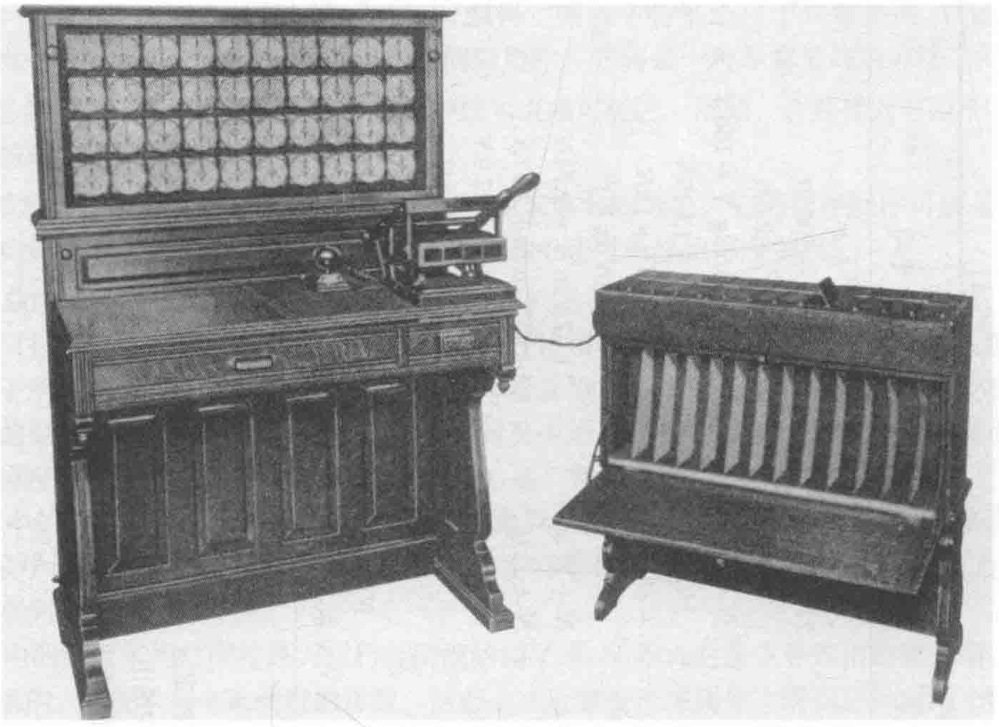

## 5.5 小结、历史与文献

我们差不多就要到达这极为冗长的一章的末尾了, 所以最好 “整理”[^v3-5-5-sort-out] 一下前面已经研究过的最重要的事实.

排序算法就是一种过程, 用于重新整理由记录组成的一个文件, 使这些记录的键处于递增顺序. 这种有序安排之所以有用, 是因为它把键值相等的记录放在一起, 允许高效地处理几个根据同一键排好序的文件, 还可以得到高效的检索算法, 而且使计算机的输出看上去没那么混乱.

当所有的记录都能放入计算机的高速内部存储器时, 就使用内部排序. 我们已经研究了二十多种内部排序算法, 详尽程度各不相同. 如果我们不知道这个问题有如此之多的不同解法, 也许反而会轻松一些! 学习所有这些技术是有趣的, 但必须面对这样一种令人讨厌的前景: 要决定在一种给定情况下到底应当使用哪种方法.

如果无论对于哪种应用, 或者正在使用哪种计算机, 仅有一两种排序方法都明显优于所有的其他排序方法, 那会好一些. 但事实上每种方法都有它自己特有的优点. 例如, 冒泡排序 (算法 5.2.2B) 没有什么明显可取的特性, 因为总有一种更好的方式来完成它所能完成的工作. 但即使是这样一项技术, 在适当推广之后, 对于双磁带排序也是非常有用的 (见 5.4.8 节). 因此, 我们发现几乎所有这些算法都值得记住, 因为在某些特定应用中它们会做到最佳.

下面的简要综述重点指明我们已经遇到的最重要的内部排序算法. 和通常一样, $N$ 表示给定文件中的记录数目.

1. 分布计数, 算法 5.2D, 当键的范围很小时它非常有用. 它是稳定的 (不会影响那些具有相同键的记录的顺序), 但需要存储空间来存放计数器和 $2N$ 个记录. 习题 5.2–13 给出一种变化形式, 以损失稳定性为代价节省了 $N$ 个记录所占的空间.

2. 直接插入, 算法 5.2.1S, 对于编程来说是最简单的方法, 不需要额外的空间, 对于较小的 $N$ 值 (比如说 $N\le25$) 十分高效. 当 $N$ 很大时, 除非输入是接近于有序的, 否则这个方法的速度会慢得让人无法忍受.

3. 谢尔排序, 算法 5.2.1D, 编程也非常容易, 使用的存储空间最少, 对于中等大小的 $N$ 值 (比如说 $N\le1000$) 相当高效.

4. 列表插入, 算法 5.2.1L, 它的基本思想与直接插入相同, 所以仅适用于很小的 $N$ 值. 与下面描述的其他列表排序方法相似, 它通过链接的使用节省了移动长记录的成本. 当记录的长度是变化的, 或者是其他数据结构的组成部分时, 这种方法特别有利.

5. 地址计算, 当键的分布已知 (通常为均匀分布) 时这种方法很高效. 该方法的主要变种包括多列表插入方法 (程序 5.2.1M) 和麦克拉伦的组合式基数插入方法 (在 5.2.5 节结束时讨论). 后者只需要 $O(\sqrt N)$ 个额外的存储单元就可以完成. 在定理 5.2.5T 中讨论了一种利用非均匀分布的两遍扫描方法.

6. 合并交换, 算法 5.2.2M (巴彻尔的方法) 及其姊妹方法——双调排序 (习题 5.3.4–10), 在可以同时进行大量比较时很有用.

7. 快速排序, 算法 5.2.2Q (霍尔的方法) 可能是最有用的内部排序通用技术, 因为它只需要很少一点存储空间, 如果能够很好地得到实现, 它在大多数计算机上的平均运行时间都优于其竞争者. 但是在最糟糕的情况下它的运行速度非常慢, 所以只要有可能存在非随机数据, 就应当非常小心地选择划分元素. 按照习题 5.2.2–55 中所建议的那样选择三个元素的中值, 可以使最差特性极不容易出现, 也可以稍微缩短平均运行时间.

8. 直接选择, 算法 5.2.3S, 当有特殊硬件可用于快速找出一个列表的最小元素时, 它是一种特别适用的简单方法.

9. 堆排序, 算法 5.2.3H, 需要的存储空间最少, 而且保证运行得相当快, 它的平均运行时间和最长运行时间都大约是快速排序平均运行时间的两倍.

10. 列表合并, 算法 5.2.4L, 它是一种列表排序, 和堆排序类似, 即使在最糟糕的情况下也能保证相当快速. 此外, 就相等的键而言, 它是稳定的.

11. 基数排序, 使用算法 5.2.5R, 是一种列表排序. 特别适用于这样一些键的排序: 或者相当短, 或者具有不寻常的字典序. 也可以使用分布计数方法 (上面的第 1 种排序方法) 作为链接的替代, 这样一种过程需要容纳 $2N$ 个记录的空间, 再加上一个计数器表, 但其内层循环的简单形式使它特别适用于超快速的、具有预测控制的 “数值密集运算” 计算机. 警告: 当 $N$ 值很小时不应使用基数排序!

12. 合并插入, 见 5.3.1 节, 在 “直线代码” 例程中特别适用于非常小的 $N$ 值. 例如, 在需要对大量包含五或六个记录的群组排序的应用中, 它将是一种非常适用的方法.

13. 混合方法, 组合利用上述两种或多种技术也是可能的. 例如, 合并插入可用于对快速排序中出现的短的子文件排序.

14. 最后, 在解答习题 5.2.1–3 时给出了一种未命名的方法, 它的排序程序可能是最短的. 但它的平均运行时间与 $N^3$ 成正比, 使它成为本书中速度最慢的排序例程!

表 1 总结了针对 MIX 编程时这些方法的速度与空间特性. 认识到以下事实很重要: 这张表中的数值只是粗略地指示了相对排序时间, 它们仅适用于一台计算机, 而且关于输入数据所做的假定对于所有程序并不是完全一致的. 许多作者都给出了诸如此类的对比表, 但没有任何两个人给出的结论是一样的. 另一方面, 这些时间至少给出了一些指示, 表明在对相当小的单字记录数组排序时每种算法的预期速度, 因为 MIX 是一种相当典型的计算机.

表 1 中的 “空间” 列给出每种程序所用辅助存储数量的信息, 以记录长度为单位. 其中 $\epsilon$ 表示记录中链接字段的长度, 例如, $N(1+\epsilon)$ 意味着这个方法需要 $N$ 个记录再加上 $N$ 个链接字段的空间.

表 1 中的渐近平均时间与最大运行时间仅给出了当 $N$ 很大时起主导作用的前几项, 并假定输入是随机的, $c$ 表示一个未确定的常数. 这些公式经常会产生误导, 所以还针对两个特定的输入数据序列给出程序的实际总运行时间. $N=16$ 的情形是指在 5.2 节的许多示例中出现的十六个键, $N=1000$ 的情形是指按照

$$
K_{1001}=0;\qquad K_{n-1}=(3141592621K_n+2113148651)\bmod10^{10}
$$

定义的序列 $K_1,K_2,\ldots,K_{1000}$. 已经使用一个相当高质量的 MIX 程序来表示表中的每个算法, 通常还整合了在习题中提出的改进. 这些程序运行时的字节大小是 100.

表 1　内部排序方法的比较 (使用 MIX 计算机)

<table data-summary-comparison style="display:block;overflow-x:auto;white-space:nowrap"><thead><tr><th rowspan="2">方法</th><th rowspan="2">见</th><th rowspan="2">稳定否? </th><th rowspan="2">MIX 代码长度</th><th rowspan="2">空间</th><th colspan="4">运行时间</th><th rowspan="2">备注</th></tr><tr><th>平均</th><th>最大</th><th>$N=16$</th><th>$N=1000$</th></tr></thead><tbody><tr data-summary-row="1"><td style="padding:6px 10px">比较计数</td><td style="padding:6px 10px">习题 5.2–5</td><td style="padding:6px 10px">是</td><td style="padding:6px 10px">22</td><td style="padding:6px 10px">$N(1+\epsilon)$</td><td style="padding:6px 10px">$4N^2+10N$</td><td style="padding:6px 10px">$5.5N^2$</td><td style="padding:6px 10px">1065</td><td style="padding:6px 10px">3992432</td><td style="padding:6px 10px">c</td></tr><tr data-summary-row="2"><td style="padding:6px 10px">分布计数</td><td style="padding:6px 10px">习题 5.2–9</td><td style="padding:6px 10px">是</td><td style="padding:6px 10px">26</td><td style="padding:6px 10px">$2N+1000\epsilon$</td><td style="padding:6px 10px">$22N+10010$</td><td style="padding:6px 10px">$22N$</td><td style="padding:6px 10px">10362</td><td style="padding:6px 10px">32010</td><td style="padding:6px 10px">a</td></tr><tr data-summary-row="3"><td style="padding:6px 10px">直接插入</td><td style="padding:6px 10px">习题 5.2.1–33</td><td style="padding:6px 10px">是</td><td style="padding:6px 10px">10</td><td style="padding:6px 10px">$N+1$</td><td style="padding:6px 10px">$1.5N^2+9.5N$</td><td style="padding:6px 10px">$3N^2$</td><td style="padding:6px 10px">412</td><td style="padding:6px 10px">1491928</td><td style="padding:6px 10px"></td></tr><tr data-summary-row="4"><td style="padding:6px 10px">谢尔排序</td><td style="padding:6px 10px">程序 5.2.1D</td><td style="padding:6px 10px">否</td><td style="padding:6px 10px">21</td><td style="padding:6px 10px">$N+\epsilon\lg N$</td><td style="padding:6px 10px">$3.9N^{7/6}+10N\lg N+166N$</td><td style="padding:6px 10px">$cN^{4/3}$</td><td style="padding:6px 10px">567</td><td style="padding:6px 10px">128758</td><td style="padding:6px 10px">d, h</td></tr><tr data-summary-row="5"><td style="padding:6px 10px">列表插入</td><td style="padding:6px 10px">习题 5.2.1–33</td><td style="padding:6px 10px">是</td><td style="padding:6px 10px">19</td><td style="padding:6px 10px">$N(1+\epsilon)$</td><td style="padding:6px 10px">$1.25N^2+13.25N$</td><td style="padding:6px 10px">$2.5N^2$</td><td style="padding:6px 10px">433</td><td style="padding:6px 10px">1248615</td><td style="padding:6px 10px">b, c</td></tr><tr data-summary-row="6"><td style="padding:6px 10px">多列表插入</td><td style="padding:6px 10px">程序 5.2.1M</td><td style="padding:6px 10px">否</td><td style="padding:6px 10px">18</td><td style="padding:6px 10px">$N+\epsilon(N+100)$</td><td style="padding:6px 10px">$0.0175N^2+18N$</td><td style="padding:6px 10px">$3.5N^2$</td><td style="padding:6px 10px">645</td><td style="padding:6px 10px">35246</td><td style="padding:6px 10px">b, c, f, i</td></tr><tr data-summary-row="7"><td style="padding:6px 10px">合并交换</td><td style="padding:6px 10px">习题 5.2.2–12</td><td style="padding:6px 10px">否</td><td style="padding:6px 10px">35</td><td style="padding:6px 10px">$N$</td><td style="padding:6px 10px">$2.875N(\lg N)^2$</td><td style="padding:6px 10px">$4N(\lg N)^2$</td><td style="padding:6px 10px">939</td><td style="padding:6px 10px">284366</td><td style="padding:6px 10px"></td></tr><tr data-summary-row="8"><td style="padding:6px 10px">快速排序</td><td style="padding:6px 10px">程序 5.2.2Q</td><td style="padding:6px 10px">否</td><td style="padding:6px 10px">63</td><td style="padding:6px 10px">$N+2\epsilon\lg N$</td><td style="padding:6px 10px">$11.67N\ln N-1.74N$</td><td style="padding:6px 10px">$\ge2N^2$</td><td style="padding:6px 10px">470</td><td style="padding:6px 10px">81486</td><td style="padding:6px 10px"></td></tr><tr data-summary-row="9"><td style="padding:6px 10px">三项取中快速排序</td><td style="padding:6px 10px">习题 5.2.2–55</td><td style="padding:6px 10px">否</td><td style="padding:6px 10px">100</td><td style="padding:6px 10px">$N+2\epsilon\lg N$</td><td style="padding:6px 10px">$10.63N\ln N+2.12N$</td><td style="padding:6px 10px">$\ge N^2$</td><td style="padding:6px 10px">487</td><td style="padding:6px 10px">74574</td><td style="padding:6px 10px">e</td></tr><tr data-summary-row="10"><td style="padding:6px 10px">基数交换</td><td style="padding:6px 10px">程序 5.2.2R</td><td style="padding:6px 10px">否</td><td style="padding:6px 10px">45</td><td style="padding:6px 10px">$N+68\epsilon$</td><td style="padding:6px 10px">$14.43N\ln N+23.9N$</td><td style="padding:6px 10px">$272N$</td><td style="padding:6px 10px">1135</td><td style="padding:6px 10px">137614</td><td style="padding:6px 10px">g, i, j</td></tr><tr data-summary-row="11"><td style="padding:6px 10px">直接选择</td><td style="padding:6px 10px">程序 5.2.3S</td><td style="padding:6px 10px">否</td><td style="padding:6px 10px">15</td><td style="padding:6px 10px">$N$</td><td style="padding:6px 10px">$2.5N^2+3N\ln N$</td><td style="padding:6px 10px">$3.25N^2$</td><td style="padding:6px 10px">853</td><td style="padding:6px 10px">2525287</td><td style="padding:6px 10px">j</td></tr><tr data-summary-row="12"><td style="padding:6px 10px">堆排序</td><td style="padding:6px 10px">程序 5.2.3H</td><td style="padding:6px 10px">否</td><td style="padding:6px 10px">30</td><td style="padding:6px 10px">$N$</td><td style="padding:6px 10px">$23.08N\ln N+0.01N$</td><td style="padding:6px 10px">$24.5N\ln N$</td><td style="padding:6px 10px">1068</td><td style="padding:6px 10px">159714</td><td style="padding:6px 10px">h, j</td></tr><tr data-summary-row="13"><td style="padding:6px 10px">列表合并</td><td style="padding:6px 10px">程序 5.2.4L</td><td style="padding:6px 10px">是</td><td style="padding:6px 10px">44</td><td style="padding:6px 10px">$N(1+\epsilon)$</td><td style="padding:6px 10px">$14.43N\ln N+4.92N$</td><td style="padding:6px 10px">$14.4N\ln N$</td><td style="padding:6px 10px">761</td><td style="padding:6px 10px">104716</td><td style="padding:6px 10px">b, c, j</td></tr><tr data-summary-row="14"><td style="padding:6px 10px">基数列表排序</td><td style="padding:6px 10px">程序 5.2.5R</td><td style="padding:6px 10px">是</td><td style="padding:6px 10px">36</td><td style="padding:6px 10px">$N+\epsilon(N+200)$</td><td style="padding:6px 10px">$32N+4838$</td><td style="padding:6px 10px">$32N$</td><td style="padding:6px 10px">4250</td><td style="padding:6px 10px">36838</td><td style="padding:6px 10px">b,c</td></tr></tbody></table>

a: 仅有三个数位的键.

b: 仅有六个数位 (即三个字节) 的键.

c: 输出未重新排列, 最终序列由链接或计数器来隐式指定.

d: 像在 5.2.1–(11) 中那样选择增量; 习题 5.2.1–29 中给出一个稍好一点的序列; $N^{7/6}$ 并非严格结果.

e: $M=9$, 使用 SRB; 对于使用 DIV 的版本, 平均运行时间要加上 $1.60N$.

f: $M=100$ (字节大小).

g: $M=34$, 因为 $2^{34}>10^{10}>2^{33}$.

h: 平均时间以实验估计为基础, 因为这一理论还不完备.

i: 平均时间的基础是假定这些键是均匀分布的.

j: 在正文和伴随这个程序的习题中提到了进一步的改进, 它们会缩短运行时间.

外部排序技术与内部排序有很大不同, 既是因为它们必须使用相对原始的数据结构, 也是因为极度强调它们的输入／输出时间的最小化需求. 5.4.6 节总结了针对磁带合并所设计的有趣方法, 5.4.9 节讨论了磁盘和磁鼓的使用.

当然, 排序并不是我们所要讨论的全部. 在研究所有这些排序技术时, 我们还学习了大量有关如何处理数据结构、如何处理外部存储器和如何分析算法的知识, 甚至还可能学习了一点点关于如何发现新算法的本领.

**早期发展.** 对当今排序技术起源的探索把我们带回到 19 世纪, 当时刚刚发明了第一批用于排序的机器. 美国每十年都会进行一次全国人口普查, 而到了 1880 年, 海量的人口普查数据的处理问题变得非常尖锐. 事实上, 尽管已经收集了必要的信息, 但从来没有在当年给出单身人士 (与已婚人士相对) 的数据报表. 赫尔曼·霍利里思是人口统计局一位二十岁的员工, 他设计了一种天才的电气制表机, 满足更好地收集统计信息的需求, 他发明的大约一百台机器成功用于编制 1890 年的人口名册.

图 94 显示了霍利里思最初的电池供电的设备. 我们的主要关注点是右边的 “排序盒”, 该盒已经打开, 以显示 26 个内部小室中的一半. 操作员把一张 $6\frac58\,\text{″}\times3\frac14\,\text{″}$ 的穿孔卡片插入 “夹具” 并拉下手柄, 在卡片中所有穿孔的地方, 上面板上由弹簧推动的针就会与下面板中的水银池接触. 相应的完整电路将会使面板上相关联的刻度盘前进一个单位, 然后排序盒的 26 个盖子之一将会弹开. 这时操作员重新打开夹具, 把卡片放在打开的小室内并盖上盖子. 据报道, 一位操作员曾经在 $6\frac12$ 小时的一个工作日内使 19071 张卡片通过这个机器, 平均每分钟大约 49 张卡片! (一般操作员的工作速度大约是这个速度的三分之一.)

图 94　霍利里思最初的制表与排序机 (照片由 IBM 档案室提供)

人口数量继续不可阻挡地增长, 原来的制表与排序机的速度已经无法应对 1900 年的人口普查, 所以霍利里思设计了另外一种机器, 避免了又一次数据处理危机. 他的新设备 (在 1901 年和 1904 年申请专利) 有一个自动进卡器, 事实上它看起来很像是现代的卡片排序机. 利昂·特鲁斯德尔讲述了霍利里思的早期机器故事, 给出很多有趣的细节 [*The Development of Punch Card Tabulation* (Washington: U.S. Bureau of the Census, 1965)]. 亦请参阅当时的报告:*Columbia College School of Mines Quarterly* **10** (1889), 238–255;*J. Franklin Inst.* **129** (1890), 300–306;*The Electrical Engineer* **12** (November 11, 1891), 521–530;*J. Amer. Statistical Assn.* **2** (1891), 330–341,**4** (1895), 365;*J. Royal Statistical Soc.* **55** (1892), 326–327;*Allgemeines statistisches Archiv* **2** (1892), 78–126;*J. Soc. Statistique de Paris* **33** (1892), 87–96; 美国专利第 395781 号 (1889), 第 685608 号 (1901), 第 777209 号 (1904). 霍利里思和另一位前人口普查局员工詹姆斯·鲍尔斯后来创建了互相竞争的公司, 它们最终分别成为 IBM 公司和 Remington Rand 公司的一部分.

霍利里思的排序机当然就是现在数字计算机中所用基数排序方法的基础. 他的专利提到: 在对两列数值项排序时, 应当 “分别对每一列” 排序, 但他没有说是应当首先考虑个位列还是十位列. 约翰·戈尔 1894 年的第 518240 号专利描述了另外一种早期的卡片排序机, 它建议从十位列开始排序. 使用个位列进行排序的不明显技巧可能首先是由某位匿名机器操作员设计, 然后再传给其他人 (见 5.2.5 节), 它出现在现存最早的 IBM 排序机手册中 (1936 年). 这种自右向左技术目前已知的最早出版是在罗伯特·法因德勒的一本书 [*Das Hollerith-Lochkarten-Verfahren* (Berlin: Reimar Hobbing, 1929), 126–130] 中, 大约在同一时间, 莱斯利·科姆里的一篇文章 [*Transactions of the Office Machinery Users’ Association* (London: 1929–1930), 25–37] 也提到这一技术. 尽管制表机最初是为了统计与报表应用而设计的, 但它们在科学计算领域也可以有富有成效的应用. 顺便一提, 科姆里是首先观察到这个重要事实的人. 他的论文特别有趣, 因为它详细描述了英格兰在 1930 年可以使用的制表设备. 当时的排序机每分钟处理 360 到 400 张卡片, 以每个月九英镑的价格可以租到.

合并思想可以回溯到另一种卡片处理机器——整理机, 它的发明要晚得多 (1936 年). 它有两个进卡点, 只需要一遍扫描就可以把两叠排序后的卡片合并成一叠, 在第一本 IBM 整理机手册 (1939 年 4 月) 中清楚地解释了完成这一任务的技术. [见拉尔夫·佩奇, 美国专利第 2359670 号 (1944).]

随后计算机登场了, 而排序过程也紧密融入这一发展过程中. 事实上有证据表明, 当计算机开始使用可存储程序后, 为其编写的第一个程序就是排序例程. EDVAC 的设计者对排序特别感兴趣, 因为它是计算机潜在非数值应用的集中体现. 他们认识到, 一个令人满意的顺序编码应当不仅能够表示求解差分方程的程序, 还必须有足够灵活性以处理算法中的组合 “判定” 问题. 因此约翰·冯·诺伊曼在 1945 年编写了用于内部合并排序的程序, 以测试他为 EDVAC 计算机建议的一些指令码是否合适. 高效专用排序机的存在提供了一种自然标准, 可以用来评价他提议的计算机组成结构的价值. 高德纳描述了这一有趣发展的细节 [*Computing Surveys* **2** (1970), 247–260], 冯·诺依曼介绍了他的原始排序程序的最终完美形式 [*Collected Works* **5** (New York: Macmillan, 1963), 196–214].

在德国, 康拉德·楚泽于 1945 年独立开发了一个用于直接插入排序的程序, 作为他的 Plankalkül 语言中线性列表操作的最简单示例之一. [这一开创性工作在近三十年里一直没有发表, 见 *Berichte der Gesellschaft für Mathematik und Datenverarbeitung* **63** (Bonn: 1972), part 4, 84–85.]

为早期计算机规划的内部存储器容量都是有限的, 所以人们在考虑内部排序的同时, 很自然地就要考虑外部排序. 穆尔电气工程学校的约翰·埃克特和莫奇利撰写的 “EDVAC 发展报告”(1945 年 9 月 30 日) 指出, 装有磁线或磁带机的计算机可以模拟卡片机的操作, 达到更快的排序速度. 这一发展报告描述了平衡两路基数排序和平衡两路合并 (称为 “整理”), 使用四个磁线或磁带机, 读写速度 “至少为 5000 脉冲／秒”.

1946 年在穆尔电气工程学校举行的计算专题讨论会上, 约翰·莫奇利做了 “排序与整理” 的演讲, 他的演讲稿成为有关计算机排序的第一次公开讨论 [*Theory and Techniques for the Design of Electronic Digital Computers*, 乔治·帕特森编辑,**3** (1946), 22.1–22.20]. 莫奇利以一段很有趣的评论作为演讲的开始: “要求一台机器同时具备计算与排序的功能, 就好像是要求一个设备既能做开瓶器又能做钢笔.” 然后他说, 能够执行复杂数学过程的机器也必然能够对数据进行排序和分类; 他还指出, 排序甚至与数值计算结合起来可能也非常有用. 他介绍了直接插入和二叉插入, 观察到前者平均使用大约 $N^2/4$ 次比较, 而后者从来不会超过大约 $N\lg N$ 次比较. 然而二叉插入需要一种相当复杂的数据结构, 接下来他说明两路合并仅通过列表的顺序访问就能实现同样低的比较次数. 演讲的后半部分专门讨论了部分扫描基数排序方法, 模拟四条磁带上的数字卡片排序, 对每个数位进行的扫描少于四遍 (见 5.4.7 节).

在之后不久, 埃克特和莫奇利创立了一家公司, 生产一些最早的电子计算机, BINAC (军用) 和 UNIVAC (商用). 美国人口普查局再次参与了这一发展过程, 接收了第一台 UNIVAC. 这时根本就不清楚计算机会在经济上获利, 计算机的排序速度快于卡片机, 但它们的费用也更高. 因此, UNIVAC 程序员在霍尔伯顿的领导下, 投入了相当大的精力来设计高速外部排序例程, 他们最初的程序也影响了硬件设计. 按照他们的估计, 在 UNIVAC 上一亿个 10 字记录可以在 9000 小时 (也就是 375 天) 内完成排序.

UNIVAC I 于 1951 年 7 月正式发布, 它的内部存储器可以容纳 1000 个 12 字符 (72 位) 的字. 它被设计为以每秒 500 字的速度在磁带上读写 60 字的数据块, 读取可以正向或反向完成, 也可能同时进行读、写和计算. 1948 年斯奈德发明了一种进行两路合并的有趣方式, 使用六个输入缓冲区把读、写和计算完美地重叠在一起: 假设每个输入文件都有一个 “当前缓冲区” 和两个 “辅助缓冲区”, 有可能采用这样一种方式进行合并, 每当要输出一个块时, 两个当前输入缓冲区中包含的未处理记录加起来恰好是一个块. 因此在形成每个输出块时恰有一个输入缓冲区变空, 我们可以通过安排, 使得在所有时间里, 这四个辅助缓冲区中有三个是满的, 同时向另一个缓冲区读入数据. 这个方法要比算法 5.4.6F 中的预测方式稍快一些, 因为它在开始下一个输入之前, 不需要查看上一次输入的结果. [见 *Collation Methods for the UNIVAC System* (Eckert–Mauchly Computer Corp., 1950), 2 volumes.]

这项工作的顶峰是排序生成器程序, 它是自动程序设计领域中开发的第一个重要软件例程. 用户指定记录大小、每个记录部分字段中最多五个键的位置, 以及标记文件结束的标识键, 随后排序生成器将为单卷文件生成一个受版权保护的排序程序. 这个程序的第一遍扫描是利用比较计数 (算法 5.2C) 对长度为 60 字的块进行内部排序, 接下来是一些平衡两路合并扫描, 反向读取, 避免如前所述的磁带互锁. [见 “Master Generating Routine for 2-way Sorting” (Eckert–Mauchly Division of Remington Rand, 1952), 这个报告第一份草稿的题目是 “Master Prefabrication Routine for 2-way Collation”. 也见霍尔伯顿,*Symposium on Automatic Programming* (Office of Naval Research, 1954), 34–39.]

到1952年，许多内部排序方法在程序设计领域已经为人们所熟知，但理论研究却很少。丹尼尔·戈登堡用Whirlwind计算机编写五种不同方法的代码，对每一程序的最佳情形和最差情形进行了分析［“Time analyses of various methods of sorting data”, Digital Computer Laboratory memo M-1680 (Mass. Inst. of Tech., 1952年10月17日)］。在按照八位键对一百个15位的字排序时，他发现最快速的方法是使用一张256字的表，把每个记录存储到一个与它的键相对应的唯一位置，然后压缩这张表。但这项技术有一个明显的缺点，只要后续记录具有相同的键，就会删除前面具有相同键的记录。他分析的其他四种方法的按从优到劣的顺序排列如下：直接两路合并、基2排序、直接选择、冒泡排序。

哈罗德·苏厄德在他 1954 年的硕士论文 [“Information sorting in the application of electronic digital computers to business operations”, Digital Computer Lab. report R-232 (Mass. Inst. of Tech., 1954 年 5 月 24 日; 60 页)] 中对戈登堡的结果进行了扩展. 苏厄德引进了分布计数和替代选择的思想, 他证明了一个随机排列的第一个游程的平均长度是 $e-1$. 他还分析了磁带和各种不同类型的海量存储器上的内部排序和外部排序.

一篇更值得一提的论文 (实际上是一篇博士论文) 是德穆思于 1956 年撰写的 [“Electronic Data Sorting” (斯坦福大学, 1956 年 10 月), 92 页;*IEEE Trans.* **C-34** (1985), 296–310]. 这一成果帮助奠定了计算复杂性理论的基础. 它使用循环、线性和随机存储器考虑了排序问题的三种抽象模型, 针对每一模型设计了最优或接近最优的方法. (见习题 5.3.4–68.) 尽管德穆思的论文并没有立即产生实际结果, 但它为理论如何联系实际确定了非常重要的思想.

排序的历史已经与计算领域的许多 “第一” 紧密联系在一起: 第一批数据处理机, 第一批可存储程序, 第一个软件, 第一批缓冲方法, 关于算法分析与计算复杂性的第一项成果.

到目前为止我们提到的所有与计算相关的文献实际上都未出现在 “公开文献” 中. 事实上, 大多数早期计算历史都是出现在相对难以获得的报告中, 因为当时很少有人参与计算机工作. 有关排序的文献最终在 1955–1956 年以三篇重要综述文章的形式首次付印.

第一篇论文是詹姆斯·霍斯肯撰写的 [*Proc. Eastern Joint Computer Conference* **8** (1955), 39–55]. 他首先给出一个敏锐的观察结果: “要降低每输出单位的成本, 人们通常会增大操作的规模. 但在这样的条件下排序的单位成本不降反升.” 霍斯肯调查了当时所有可以得到的在售专用设备, 以及在计算机上进行排序的方法. 他的 54 项参考文献大多数是以制造商的手册为基础的.

弗兰德的论文 “Sorting on Electronic Computer Systems”[*JACM* **3** (1956), 134–168] 内容广泛, 是排序发展的一个重要里程碑. 尽管自 1956 年以来已经发展了各种技术, 直到现在这篇论文的许多方面仍然值得注意. 弗兰德详细描述了相当多的内部与外部排序算法, 他特别关注缓冲技术和磁带机的特性. 他引进了一些新方法 (例如, 树选择、两头蛇排序、预测), 揭示了较早方法的一些数学性质.

大约在这一阶段出现的第三篇排序综述文章是唐纳德·戴维斯撰写的 [*Proc. Inst. Elect. Engineers* **103B**, Supplement 1 (1956), 87–93]. 在随后几年里发表了其他几篇值得注意的综述文章: 贝尔,*Comp. J.* **1** (1958), 71–77; 亚历山大·道格拉斯,*Comp. J.* **2** (1959), 1–9; 丹尼尔·麦克拉肯、哈罗德·韦斯和李再华,*Programming Business Computers* (New York: Wiley, 1959), Chapter 15, pages 298–332; 伊万·弗洛里斯,*JACM* **8** (1961), 41–80; 艾弗森,*A Programming Language* (New York: Wiley, 1962), Chapter 6, 176–245; 卡尔文·戈特利布,*CACM* **6** (1963), 194–201; 托马斯·希巴德,*CACM* **6** (1963), 206–213; 戈茨,*Digital Computer User’s Handbook*, 梅尔文·克莱尔和格拉尼诺·科恩编辑, (New York: McGraw–Hill, 1967), Chapter 1.10, pages 1.292–1.320. 1962 年 11 月 ACM 主办了一次排序研讨会, 这次研讨会上宣读的论文大多发表在 *CACM* 1963 年 5 月刊上, 它们很好地代表了这一领域当时的技术水平. 在这本论文集中, 戈特利布关于现代排序生成器的综述、希巴德关于最小存储内部排序的综述、乔治·哈伯德关于磁盘文件排序的早期研究都特别值得注意.

这一阶段发现了许多新的排序方法: 地址计算 (1956 年)、合并插入 (1959 年)、基数交换 (1959 年)、级联合并 (1959 年)、谢尔排序 (1959 年)、多阶段合并 (1960 年)、树插入 (1960 年)、振荡排序 (1962 年)、霍尔的快速排序 (1962 年)、威廉斯的堆排序 (1964 年)、巴彻尔的合并交换 (1964 年). 每种算法的历史都在本章介绍该算法的特定小节中进行了回顾. 到 20 世纪 60 年代后期, 相应理论也得到了深入发展.

最初编写本章时, 我考察了有关排序的所有论文的一份完整参考文献, 并在里夫斯特的帮助下对这份清单进行了编辑, 发表在 *Computing Reviews* **13** (1972), 283–289.

**稍后的发展.** 自 1970 年以来已经发明了数十种排序算法, 尽管几乎所有这些算法都是早期算法的变化形式. 在解答习题 5.2.2–30 时讨论的多键快速排序是这些新方法的杰出示例.

另外一种趋势迄今为止还主要是理论方面的意义, 那就是研究具有适应性的排序方案. 也就是说, 如果根据某些准则输入内容已经非常接近有序, 则能够保证这些方法更快速地运行. 例如, 见海基·曼尼拉,*IEEE Transactions* **C-34** (1985), 318–325; 弗拉迪米尔·埃斯蒂维利-卡斯特罗和德里克·伍德,*Computing Surveys* **24** (1992), 441–476; 赫里斯托斯·列夫科保罗斯和奥拉·彼得松,*Journal of Algorithms* **14** (1993), 395–413; 阿利斯泰尔·莫法特, 加里·埃迪, 奥拉·彼得松,*Software Practice & Experience* **26** (1996), 781–797.

计算机硬件的改变推动了许多非常有意义的研究: 当成本准则发生变化时排序算法的效率如何, 例如习题 5.4.9–20 中关于虚拟内存的讨论. 安东尼·拉马尔卡和理查德·拉德纳研究了硬件缓存对内部排序的影响 [*J. Algorithms* **31** (1999), 66–104]. 他们的结论之一是, 在现代机器上算法 5.2.2Q 的步骤 Q9 是一个糟糕的想法 (尽管它在诸如 MIX 之类的传统计算机上可以很好地工作): 不应该用直接插入排序来完成快速排序, 现在最好是尽早对短的子文件排序, 因为它们的键这时仍在缓存中.

当前对大量数据排序的技术状态如何呢? 自 1985 年以来非常流行的一个基准测试就是对一百万个长度为 100 字符的记录排序, 这些记录拥有长度为 10 字符的均匀随机键. 假定输入和输出驻存在磁盘上, 目的是把总时间降至最短, 包括启动程序所需要的时间. 拉梅什·阿加瓦尔使用一个台式 RISC 计算机——IBM RS/6000 型 39H——用条带分割八个磁盘设备上的文件实现基数排序, 他在 5.1 秒内完成了这个任务 [*SIGMOD Record* **25**, 2 (June 1996), 240–246]. 输入／输出是主要瓶颈, 事实上处理器只需要 0.6 秒来控制实际排序! 当有多个处理器可供使用时, 甚至可以实现更快的速度: 用 32 台 UltraSPARC I 工作站组成一个网络, 每台工作站有两个内部磁盘, 使用一种称为 NOW-Sort 的混合方法, 可以在 2.41 秒内完成对一百万个记录的排序 [安德烈娅·阿尔帕西-杜索, 雷姆济·阿尔帕西-杜索, 戴维·卡勒, 约瑟夫·赫勒斯坦, 戴维·帕特森,*SIGMOD Record* **26**, 2 (1997 年 6 月), 243–254].

这些发展意味着百万记录基准测试已经变成主要测试启动与关闭时间了, 需要有更大的数据集来给出更有意义的结果. 例如, 万亿字节排序 ($10^{10}$ 个记录, 每个记录 100 字符) 目前的世界记录是 2.5 小时, 这是 1997 年 9 月在 Silicon Graphics Origin2000 系统上实现的, 该系统具有 32 个处理器、8GB 内存、559 个 4GB 的磁盘. 这个记录是由一个名为 Nsort™的商用排序例程创下的, 该例程是克里斯托弗·尼贝里、查尔斯·凯斯特、詹姆斯·格雷使用一些尚未公开的方法开发的.

也许有一天万亿字节的基准测试也会被认为太小了. 将会永远存活下去的当前最佳候选基准测试是分钟排序: 在 60 秒内可以对多少个长 100 字符的记录完成排序? 在本书英文版付印时, 这个任务的最高记录是 NOW-Sort: 95 个工作站在 1997 年 3 月 30 日仅用 59.21 秒就完成 9025 万记录的排序. 但现今的方法还没有逼近任何真正根本性的速度限制.

总而言之, 今天的高效排序问题仍然和过去一样令人着迷.

#### 习题

**1. [05]** 叙述定理 5.4.6A 的推广形式, 对本章内容进行总结.　[答案](./answers/5-5.md#ans-5-5-1)

**2. [20]** 基于表 1 的信息, 在 MIX 计算机上使用时, 针对 6 位数字键的最佳列表排序方法是什么?　[答案](./answers/5-5.md#ans-5-5-2)

**3. [37]** (需要最少存储空间的稳定排序) 我们说一种排序算法需要最少的存储空间, 如果除了存储 $N$ 个记录所需要的空间之外, 仅需要 $O((\log N)^2)$ 个二进制位的存储器空间来存储变量. 该算法必须具备一般性, 对于所有 $N$ 而不只是某个特定的 $N$ 值有效, 假定在每次实际调用该算法进行排序时, 已经有足够数量的随机存储器可用.　[答案](./answers/5-5.md#ans-5-5-3)

前面研究过的许多排序方法都违背了这一最少存储空间要求, 特别是, 禁止使用 $N$ 个链接字段. 快速排序 (算法 5.2.2Q) 满足最少存储空间要求, 但它最差情况下的运行时间与 $N^2$ 成正比, 堆排序 (算法 5.2.3H) 是我们研究过的唯一使用最少存储空间的 $O(N\log N)$ 算法, 不过利用习题 5.2.4–18 的思想, 可以描述另一个这种算法.

我们已经考虑过的以稳定方式进行键排序的最快速一般算法是列表合并排序 (算法 5.2.4L), 但它不满足最少存储空间要求. 事实上, 我们已经看到过的仅有的几种稳定的最小存储空间的排序算法是 $\Omega(N^2)$ 方法 (直接插入、冒泡排序、直接选择的一种变化形式).

试设计一种稳定的最少存储空间的排序方法, 在最差情况下仅需要 $O(N(\log N)^2)$ 个时间单位. [提示: 有可能在 $O(N\log N)$ 个时间单位中完成稳定的最小存储空间合并 (也就是对最多两个游程排序).]

▶ **4. [28]** 如果一种排序算法完全通过键的比较来做出决定, 而且它所做的任何比较, 其结果都不可能通过先前的比较结果预测得出, 则说该排序算法是节俭的. 表 1 中所列的哪些方法是节俭的?　[答案](./answers/5-5.md#ans-5-5-4)

**5. [46]** 排序具有大量相等键的非随机数据, 要比排序均匀随机数据难得多. 设计一种排序基准测试, 要求: (i) 它现在是有趣的, 在从今往后的一百年内可能还是有趣的; (ii) 它不涉及均匀随机键; (iii) 它不使用随时间变化的数据集.

> 在过去几年里关于排序技术已经出现了大量资料,
> 如果我能对这些资料的要旨按逻辑顺序完成排序,
> 那就达到我的目标了.
>
> ——霍斯肯 (1955)

<!-- section-footnotes -->

[^v3-5-5-sort-out]: 这里是双关语: 原文是 sort out, 而本章的主题是 sort (排序). ——编者注
