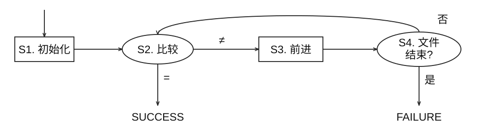
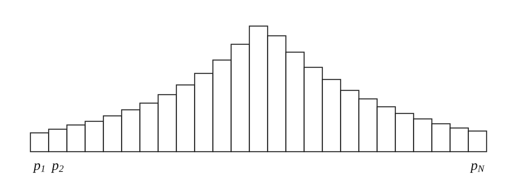

# 6.1　顺序查找

“从起点开始, 一直查找, 直到发现要找的键, 然后停止.” 这种顺序过程是最直观的查找方式, 它为我们讨论查找问题设定了一个非常有用的起点, 因为许多更复杂的算法都是以它为基础的. 我们将会看到, 尽管顺序查找非常简单, 但它包含了一些非常有意义的思想.

这个算法也许可以更精确地描述如下:

**算法 S (顺序查找).** 给定一个由记录 $R_1,R_2,\ldots,R_N$ 组成的表格, 其各自的键为 $K_1,K_2,\ldots,K_N$, 这个算法要查找一个给定的参数 $K$. 假设 $N\ge1$.

**S1.[初始化.]** 置 $i\leftarrow1$.

**S2.[比较.]** 如果 $K=K_i$, 算法成功结束.

**S3.[前进.]** 使 $i$ 加 1.

**S4.[文件结束?]** 如果 $i\le N$, 则返回 S2; 否则算法以失败结束.　▮

图 1　顺序查找或 “挨家挨户” 查找

注意, 这个算法可能以两种不同方式终止, 成功 (找到所需要的键) 或失败 (确定表中不存在给定参数). 本章其他大多数算法也是如此.

可以立即写出如下 MIX 程序:

**程序 S (顺序查找).** 假定 $K_i$ 出现在位置 $\mathtt{KEY}+i$ 处, 且记录 $R_i$ 的其余部分出现在位置 $\mathtt{INFO}+i$ 处. 以下程序使用了 $\mathrm{rA}\equiv K$, $\mathrm{rI1}\equiv i-N$.

~~~mixal
01 START   LDA  K         1       S1. 初始化.
02         ENT1 1-N       1       i ← 1.
03 2H      CMPA KEY+N,1   C       S2. 比较.
04         JE   SUCCESS   C       如果 K = Kᵢ，则退出.
05         INC1 1         C − S   S3. 前进.
06         J1NP 2B        C − S   S4. 文件结束?
07 FAILURE EQU  *         1 − S   如果不在表中，则退出.
~~~

在位置 $\mathtt{SUCCESS}$ 处, 指令 $\mathtt{LDA\ INFO+N,1}$ 会把所需的信息取至 $\mathrm{rA}$ 处.　▮

这个程序的分析非常简单, 它表明算法 S 的运行时间取决于两个参数,

$$
\begin{aligned}
C&=\text{对键进行的比较次数},\\
S&=1,\ \text{如果成功};\quad0,\ \text{如果失败}.
\end{aligned}\tag{1}
$$

程序 S 耗用 $5C-2S+3$ 个时间单位. 如果这个查找过程成功地找到 $K=K_i$, 则有 $C=i$, $S=1$. 因此, 总时间为 $(5i+1)u$. 另一方面, 如果查找失败, 则有 $C=N$, $S=0$, 总时间为 $(5N+3)u$. 如果每个输入的键出现的概率相等, 则在一次成功的查找中, $C$ 的平均值为

$$
\frac{1+2+\cdots+N}{N}=\frac{N+1}{2},\tag{2}
$$

它的标准差当然是相当大的, 大约为 $0.289N$ (见习题 1).

上面的算法对于所有程序员来说肯定是非常熟悉的. 但很少有人知道, 这并非总是进行顺序查找的正确方式! 只要记录列表不是特别短, 那稍做一点简单修改就可以加快这个算法的运行速度:

**算法 Q (快速顺序查找).** 这个算法与算法 S 相同, 只是它假定在文件的结尾处存在一个虚拟记录 $R_{N+1}$.

**Q1.[初始化.]** 置 $i\leftarrow1$, 并置 $K_{N+1}\leftarrow K$.

**Q2.[比较.]** 如果 $K=K_i$, 转至 Q4.

**Q3.[前进.]** 使 $i$ 加 1, 并返回 Q2.

**Q4.[文件结束?]** 如果 $i\le N$, 则算法成功结束; 否则, 它以失败结束 ($i=N+1$).　▮

**程序 Q (快速顺序查找).** $\mathrm{rA}\equiv K$, $\mathrm{rI1}\equiv i-N$.

~~~mixal
01 START   LDA  K          1           Q1. 初始化.
02         STA  KEY+N+1    1           Kₙ₊₁ ← K.
03         ENT1 -N         1           i ← 0.
04         INC1 1          C + 1 − S   Q3. 前进.
05         CMPA KEY+N,1    C + 1 − S   Q2. 比较.
06         JNE  *-2        C + 1 − S   如果 Kᵢ ≠ K，则转至Q3.
07         J1NP SUCCESS    1           Q4. 文件结束?
08 FAILURE EQU  *          1 − S       如果不在表中，则退出.
~~~

用分析程序 S 时给出的数量 $C$ 和 $S$ 表示, 可以得出它的运行时间下降到 $(4C-4S+10)u$. 每当成功查找中的 $C\ge6$、失败查找中的 $N\ge8$ 时, 这都是一种改进.

从算法 S 过渡到算法 Q 利用了一条重要的加速原理: 当一个程序的内层循环对两个或多个条件进行检验时, 我们应当尝试将其简化为仅检验一个条件.

另一种技术使程序 Q 还能变得更快.

**程序 Q′(更快速的顺序查找).** $\mathrm{rA}\equiv K$, $\mathrm{rI1}\equiv i-N$.

~~~mixal
01 START   LDA  K           1                   Q1. 初始化.
02         STA  KEY+N+1     1                   Kₙ₊₁ ← K.
03         ENT1 -1-N        1                   i ← -1.
04 3H      INC1 2           ⌊(C − S + 2)/2⌋     Q3. 前进.（两步）
05         CMPA KEY+N,1     ⌊(C − S + 2)/2⌋     Q2. 比较.
06         JE   4F          ⌊(C − S + 2)/2⌋     如果 K = Kᵢ，则转至Q4.
07         CMPA KEY+N+1,1   ⌊(C − S + 1)/2⌋     Q2. 比较.（下一次）
08         JNE  3B          ⌊(C − S + 1)/2⌋     如果 K ≠ Kᵢ₊₁，则转至Q3.
09         INC1 1           (C − S) mod 2       使 i 前进.
10 4H      J1NP SUCCESS     1                   Q4. 文件结束?
11 FAILURE EQU  *           1 − S               如果不在表中，则退出.
~~~

内层循环已经被重复, 这就避免了大约一半的 “$i\leftarrow i+1$” 指令, 所以它将运行时间缩短至

$$
3.5C-3.5S+10+\frac{(C-S)\bmod2}{2}
$$

个时间单位. 在对大型表进行查找时, 相对于程序 S, 可以节省 30%的运行时间. 许多现有程序都可以采用这个方式改进. 相同思想也适用于高级语言的编程. [例如, 见高德纳,*Computing Surveys* **6** (1974), 266–269.]

如果知道键的顺序是递增的, 可以对这个算法稍做变化:

**算法 T (有序表的顺序查找).** 给定由记录 $R_1,R_2,\ldots,R_N$ 组成的表格, 相应的键分别是 $K_1<K_2<\cdots<K_N$, 这个算法查找一个给定的参数 $K$. 为了方便并加快速度, 这个算法假定存在一个虚拟记录 $R_{N+1}$, 它的键值是 $K_{N+1}=\infty>K$.

**T1.[初始化.]** 置 $i\leftarrow1$.

**T2.[比较.]** 如果 $K\le K_i$, 则转至 T4.

**T3.[前进.]** 使 $i$ 加 1, 并返回 T2.

**T4.[是否相等?]** 如果 $K=K_i$, 则算法成功结束. 否则, 算法失败结束.　▮

如果所有输入的键出现的概率相同, 则这个算法在查找成功时花费的平均时间基本上与算法 Q 相同, 但失败查找的执行速度大约是算法 Q 的两倍, 因为它可以快速地确定某个记录是不存在的.

上面的每个算法都使用下标来表示表中的项目. 用这些下标来描述上述算法是很方便的, 但同样的查找过程也可用于采用链式表示的表, 因为数据是顺序遍历的. (见习题 2, 3, 4.)

**访问频率.** 到目前为止, 我们已经假设每个参数的发生概率都是相同的. 这个假设并非总与实际情况一致, 在一般情况下, 键 $K_j$ 的发生概率为 $p_j$, 其中 $p_1+p_2+\cdots+p_N=1$. 完成一次成功查找所需要的时间基本上与所比较数目 $C$ 成正比, 它的平均值现在是

$$
\bar C_N=p_1+2p_2+\cdots+Np_N.\tag{3}
$$

如果可以按照任意期望的顺序把这些记录放到表中, 则在

$$
p_1\ge p_2\ge\cdots\ge p_N\tag{4}
$$

时, 也就是经常使用的记录出现在开头附近时, 量 $\bar C_N$ 最小.

让我们来看几种概率分布, 以了解当记录按照 (4) 中指定的最优方式进行布置时, 可以节省多少时间. 如果 $p_1=p_2=\cdots=p_N=1/N$, 则式 (3) 简化为 $\bar C_N=(N+1)/2$, 我们已经在式 (2) 中推导了这个结果. 另一方面, 假定

$$
p_1=\frac12,\quad p_2=\frac14,\quad\ldots,\quad
p_{N-1}=\frac1{2^{N-1}},\quad p_N=\frac1{2^{N-1}}.\tag{5}
$$

则根据习题 7, 有 $\bar C_N=2-2^{1-N}$. 如果记录以正确的顺序出现在表格中, 则对于这个分布, 平均比较次数小于 2.

另一种概率分布为

$$
p_1=Nc,\quad p_2=(N-1)c,\quad\ldots,\quad p_N=c,\qquad
\text{其中 }c=\frac2{N(N+1)}.\tag{6}
$$

这个楔形分布与均匀分布的偏离并不像 (5) 中那样严重. 在这种情景中, 我们发现

$$
\bar C_N=c\sum_{k=1}^{N}k(N+1-k)=\frac{N+2}{3}.\tag{7}
$$

与记录以随机顺序出现时的情景相比, 这个最优排列的查找时间可以节省大约三分之一.

当然, (5) 和 (6) 中的概率分布都有很明显的人为痕迹, 可能永远都不能非常好地模拟现实. 有一种更典型的概率序列, 称为 “齐普夫定律”:

$$
p_1=c/1,\quad p_2=c/2,\quad\ldots,\quad p_N=c/N,\qquad
\text{其中 }c=1/H_N.\tag{8}
$$

这个分布是由乔治·齐普夫普及的, 他观察到, 在自然语言的文本中, 第 $n$ 个最常见单词的出现频率近似与 $1/n$ 成正比. [*The Psycho-Biology of Language* (Boston, Mass.: Houghton Mifflin, 1935); *Human Behavior and the Principle of Least Effort* (Reading, Mass.: Addison-Wesley, 1949).] 他发现, 在按照人口递减顺序对城市进行排列时, 人口普查表中也存在同一现象. 如果一个表中键的频率符合齐普夫定律, 则立即得到

$$
\bar C_N=N/H_N.\tag{9}
$$

查找这样一个文件, 要比查找记录随机排列的相同文件快 $\frac12\ln N$ 倍. [见布思、伦纳德·布兰伍德和约翰·克利夫,*Mechanical Resolution of Linguistic Problems* (New York: Academic Press, 1958), 79.]

对现实分布的另一近似是经常在商务应用中观察到的 “80-20” 法则 [例如, 见威廉·海辛,*IBM Systems J.* **2** (1963), 114–115]. 这个规则指出: 80%的事务处理一个文件中最活跃的 20%, 而对于前面的 20%, 同一规则同样适用, 也就是说 64%的事务处理最活跃的 4%, 以此类推. 换句话说,

$$
\text{对于所有的 }n,\qquad
\frac{p_1+p_2+\cdots+p_{0.20n}}{p_1+p_2+p_3+\cdots+p_n}\approx0.80.\tag{10}
$$

有一种分布, 只要 $n$ 为 5 的倍数就完全满足这个规则, 即

$$
p_1=c,\quad p_2=(2^\theta-1)c,\quad p_3=(3^\theta-2^\theta)c,\quad\ldots,\quad
p_N=\bigl(N^\theta-(N-1)^\theta\bigr)c,\tag{11}
$$

其中

$$
c=1/N^\theta,\qquad
\theta=\frac{\log0.80}{\log0.20}\approx0.1386,\tag{12}
$$

因为在这个情况下, 对于所有的 $n$ 值, 都有 $p_1+p_2+\cdots+p_n=cn^\theta$. 要处理 (11) 中的概率并不是特别容易, 但是, 我们有 $n^\theta-(n-1)^\theta=\theta n^{\theta-1}\bigl(1+O(1/n)\bigr)$, 所以有一个近似满足 80-20 法则的更简单分布, 即

$$
p_1=c/1^{1-\theta},\quad p_2=c/2^{1-\theta},\quad\ldots,\quad p_N=c/N^{1-\theta},
\qquad\text{其中 }c=1/H_N^{(1-\theta)}.\tag{13}
$$

与前面一样, 其中 $\theta=\log0.80/\log0.20$, 且 $H_N^{(s)}$ 是第 $N$ 个 $s$ 阶调和数, 即 $1^{-s}+2^{-s}+\cdots+N^{-s}$. 注意, 这个概率分布非常类似于齐普夫定律 (8). 当 $\theta$ 从 1 变到 0 时, 这些概率由均匀分布变为齐普夫分布. 将 (3) 应用于 (13) 将得到

$$
\bar C_N=H_N^{(-\theta)}/H_N^{(1-\theta)}
=\frac{\theta N}{\theta+1}+O(N^{1-\theta})\approx0.122N.\tag{14}
$$

作为符合 80-20 法则的平均比较数 (见习题 8).

由尤金·施瓦茨开展的一项字频研究显示 [见 *JACM* **10** (1963) 第 422 页上有趣的图形]: 当分布 (13) 的 $\theta$ 略小于零时, 它可以比齐普夫定律 (8) 更好地拟合数据. 在这种情况下, 当 $N\to\infty$ 时, 平均值

$$
\bar C_N=H_N^{(-\theta)}/H_N^{(1-\theta)}
=\frac{N^{1+\theta}}{(1+\theta)\zeta(1-\theta)}+O(N^{1+2\theta})\tag{15}
$$

要比 (9) 小很多.

像 (11) 和 (13) 这样的分布, 最早是由维尔弗雷多·帕雷托结合个人收入与财富的差距而进行研究的 [*Cours d’Économie Politique* **2** (Lausanne: Rouge, 1897), 304–312]. 如果 $p_k$ 与第 $k$ 个最富的人的财富成正比, 则当 $x=p_k/p_N$ 时, 一个人的财富超过或等于最穷的人 $x$ 倍的概率为 $k/N$. 因此, 当 $p_k=ck^{\theta-1}$ 且 $x=(k/N)^{\theta-1}$ 时, 所述概率为 $x^{-1/(1-\theta)}$. 这种分布现在被称为具有参数 $1/(1-\theta)$ 的帕雷托分布.

让人惊讶的是, 帕雷托并没有理解自己的分布. 他认为, 当 $\theta$ 值接近 0 时, 所对应的社会要比接近 1 时更为平等! 科拉多·吉尼纠正了他的错误 [*Atti della III Riunione della Società Italiana per il Progresso delle Scienze* (1910), 重印于他的 *Memorie di Metodologia Statistica* **1** (Rome: 1955), 3–120], 第一个叙述并解释了诸如 80-20 法则 (10) 的比值的重要性. 人们仍然很容易误解此类分布, 他们经常会说 “75-25 法则” 或 “90-10 法则”, 就好像只有当 $a+b=100$ 时, $a$-$b$ 定律才有意义, 其实 (12) 表明, $80+20$ 的值是完全没有关系的.

另一个与 (11) 和 (13) 类似的离散分布是由乔治·尤尔提出的, 他当时正在研究在各种不同进化模型下, 生物物种随时间的增长函数 [*Philos. Trans.* **B213** (1924), 21–87]. 尤尔的分布适用于 $\theta<2$ 的情景:

$$
\begin{aligned}
p_1&=c,\quad p_2=\frac{c}{2-\theta},\quad
p_3=\frac{2c}{(3-\theta)(2-\theta)},\quad\ldots,\quad
p_N=\frac{(N-1)!\,c}{(N-\theta)\cdots(2-\theta)}
=\frac{c}{\binom{N-\theta}{N-1}};\\
c&=\frac{\theta}{1-\theta}\frac{\binom{N-\theta}{N}}{1-\binom{N-\theta}{N}}.
\end{aligned}\tag{16}
$$

当 $\theta=0$ 或 $\theta=1$ 时, 使用极限值 $c=1/H_N$, 或者 $c=1/N$.

**“自组织” 文件.** 这些概率计算非常不错, 但在大多数情况下, 我们并不知道概率值. 我们可以为每条记录都保存一个计数, 表示对这个记录的访问次数, 并根据这些计数来重新调整记录的位置. 上文推导的公式显示, 这个过程经常会节省不少时间. 但我们可能不希望拿出这么多的内存空间来保存计数字段, 这是因为, 利用本章后面解释的非顺序查找技术, 可以让这个内存空间发挥更佳作用.

有一个简单的机制, 尽管人们不了解它的起源, 但已经使用了很多年. 利用这个机制, 无须附加计数字段, 就可以使记录保持良好的顺序: 只要成功地找到了一条记录, 就将它移到表的前端.

这种 “自组织” 技术背后的思想是: 当我们需要常用项目时, 可以很容易地在非常接近表格开头的位置找到它们. 如果假定 $N$ 个键的各自发生概率分别为 $\{p_1,p_2,\ldots,p_N\}$, 每次查找都与先前查找完全独立, 则可以证明, 在这样一个自组织文件中查找一个项目所需要的平均比较次数趋于极限值

$$
\widetilde C_N
=1+2\sum_{1\le i<j\le N}\frac{p_ip_j}{p_i+p_j}
=\frac12+\sum_{i,j}\frac{p_ip_j}{p_i+p_j}.\tag{17}
$$

(见习题 11). 例如, 如果对于 $1\le i\le N$ 有 $p_i=1/N$, 则自组织表的顺序总是完全随机的, 这个公式简化为上面推导的非常熟悉的表达式 $(N+1)/2$. 一般来说, 平均比较次数 (17) 总是小于最优值 (3) 的两倍, 因为 $\widetilde C_N\le1+2\sum_{j=1}^N(j-1)p_j=2\bar C_N-1$. 实际上, $\widetilde C_N$ 总是小于最优值 $\bar C_N$ 的 $\pi/2$ 倍 [钟金芳蓉、丹南贾伊·哈杰拉和保罗·西摩,*J. Comp. Syst. Sci.* **36** (1988), 148–157]. 这个比值是一般情况下的最佳常数, 因为当 $p_j$ 与 $1/j^2$ 成正比时即可趋近于该值.

我们来看看当键的概率分布服从齐普夫定律 (8) 时, 自组织过程是多么出色. 根据式 1.2.7-(8) 和 1.2.7-(3), 有

$$
\begin{aligned}
\widetilde C_N
&=\frac12+\sum_{1\le i,j\le N}\frac{(c/i)(c/j)}{c/i+c/j}
=\frac12+c\sum_{1\le i,j\le N}\frac1{i+j}\\
&=\frac12+c\sum_{i=1}^N(H_{N+i}-H_i)
=\frac12+c\sum_{i=1}^{2N}H_i-2c\sum_{i=1}^NH_i\\
&=\frac12+c\bigl((2N+1)H_{2N}-2N-2(N+1)H_N+2N\bigr)\\
&=\frac12+c\bigl(N\ln4-\ln N+O(1)\bigr)\approx2N/\lg N,
\end{aligned}\tag{18}
$$

当 $N$ 相当大时, 这个结果远优于 $\frac12N$. 与最优排列情况下所能实现的比较次数相比, 这个结果仅是它的大约 $\ln4\approx1.386$ 倍, 见 (9).

涉及实际编译器的符号表的计算试验表明, 这种自组织方法的效果甚至会优于我们的公式预测值, 这是因为前后连续进行的查找通常不是独立的 (键的小型群组通常是连续出现的).

这种自组织方案最早由约翰·麦凯布分析的 [*Operations Research* **13** (1965), 609–618], 他确定了式 (17). 麦凯布还提出了另一个很有意义的方案, 根据这个方案, 每个被成功定位但又没有在表格开头处的键, 只是与其前面的键交换位置, 而不再是一直移到最前面. 他推测说, 假定查找之间相互独立时, 这个方法的极限平均查找时间绝对不会超过 (17). 几年以后, 李维斯特证明了: 在长时间运行时, 这种交换方法的比较次数绝对少于 “移至最前” 的方法, 当然, $N\le2$ 或者所有非零概率都相等的情况除外 [*CACM* **19** (1976), 63–67]. 但是, 向渐近极限的收敛过程要远慢于 “移至最前” 的方法, 因此, 除非延长查找过程, 否则 “移至最前” 的方法要更好一些 [詹姆斯·比特纳,*SICOMP* **8** (1979), 82–110]. 此外, 本特利、凯瑟琳·麦吉奥赫、斯利托和塔扬已经证明, 只要给定对数据的任意访问序列, “移至最前” 的方法执行的内存访问次数, 绝对不会超过任意针对线性列表的算法所做内存访问次数的四倍, 即使该算法知道未来结果也是如此, 而频率计数和交换方法就不具有这个性质 [*CACM* **28** (1985), 202–208, 404–411]. 拉恩·巴克拉克和拉恩·埃尔-雅尼夫进行了很有意义的试验研究, 对自组织列表进行了超过 40 项的启发式查找, 详情见 *SODA* **8** (1997), 53–62.

**不等长记录的磁带查找.** 现在让问题再转一道弯: 假定正在查找的表存储在磁带上, 并且各条记录的长度是变化的. 例如, 在老式操作系统中, “系统库磁带” 就是这样一种文件. 编译程序、汇编程序、装入例程和报告生成程序等标准系统程序都是这个磁带上的 “记录”, 而大多数用户任务都是首先查找这个磁带, 直到输入适当的例程为止. 这个设定使我们前面对算法 S 的分析不再适用, 因为我们每次到达步骤 S3 所需要的时间是变化的. 因此, 比较次数并不是唯一关心的准则.

设 $L_i$ 是记录 $R_i$ 的长度, $p_i$ 是将会找到这个记录的概率. 查找方法的平均运行时间现在近似与下式成正比

$$
p_1L_1+p_2(L_1+L_2)+\cdots+p_N(L_1+L_2+L_3+\cdots+L_N).\tag{19}
$$

当 $L_1=L_2=\cdots=L_N=1$ 时, 该式将简化为 (3), 这在前面已经研究过了.

把最经常用到的记录放在磁带的开头似乎是符合逻辑的, 但在某些时候却是一个坏主意! 例如, 假定磁带仅有两个程序 $A$ 和 $B$, 其中 $A$ 的需求频率是 $B$ 的两倍, 但长度是 $B$ 的四倍. 因此, $N=2$, $p_A=\frac23$, $L_A=4$, $p_B=\frac13$, $L_B=1$. 如果根据上面的 “逻辑” 原则, 首先把 $A$ 放在磁带上, 那么平均运行时间就是 $\frac23\cdot4+\frac13\cdot5=\frac{13}{3}$. 但如果使用一种 “非逻辑” 思想, 先放 $B$, 那么平均运行时间就缩短为 $\frac13\cdot1+\frac23\cdot5=\frac{11}{3}$.

程序在库磁带上的最优排列可以通过以下方式来决定.

**定理 S.** 设 $L_i$ 和 $p_i$ 定义同上, 表中记录的排列是最优的, 当且仅当

$$
p_1/L_1\ge p_2/L_2\ge\cdots\ge p_N/L_N.\tag{20}
$$

换句话说, 对于 $\{1,2,\ldots,N\}$ 的所有排列 $a_1a_2\ldots a_N$, 当且仅当 (20) 成立时, $p_{a_1}L_{a_1}+p_{a_2}(L_{a_1}+L_{a_2})+\cdots+p_{a_N}(L_{a_1}+\cdots+L_{a_N})$ 的最小值等于 (19).

证明. 假定 $R_i$ 和 $R_{i+1}$ 在磁带上交换了, 则代价 (19) 由

$$
\cdots+p_i(L_1+\cdots+L_{i-1}+L_i)+p_{i+1}(L_1+\cdots+L_{i+1})+\cdots
$$

变为

$$
\cdots+p_{i+1}(L_1+\cdots+L_{i-1}+L_{i+1})+p_i(L_1+\cdots+L_{i+1})+\cdots,
$$

净改变量为 $p_iL_{i+1}-p_{i+1}L_i$. 因此, 如果 $p_i/L_i<p_{i+1}/L_{i+1}$, 则此交换会缩短平均运行时间, 给定排列不是最优的. 由此得出, (20) 在任意最优排列中都成立.

反过来, 假定 (20) 成立, 我们需要证明排列是最优的. 刚刚给出的论证过程表明, 该排列是 “局部最优的”, 也就是说交换相邻记录没有任何改进. 但也可能存在一个非常长的、复杂的交换序列, 可以得到更好的 “全局最优排列”. 我们将考虑两个证明, 一个证明应用计算机科学知识, 另一个利用数学技巧.

第一个证明. 假定 (20) 成立. 我们知道通过相邻记录的一系列交换, 可以使记录的任意排列方式变为 $R_1R_2\ldots R_N$ 次序. 对于某个 $i<j$, 每执行一次这种交换, 都会用 $\ldots R_iR_j\ldots$ 来代替 $\ldots R_jR_i\ldots$, 从而使查找时间减少 $p_iL_j-p_jL_i$, 这是一个非负量. 因此, 次序 $R_1R_2\ldots R_N$ 的查找时间最短.

第二个证明. 用

$$
p_i(\epsilon)=p_i+\epsilon^i-(\epsilon^1+\epsilon^2+\cdots+\epsilon^N)/N\tag{21}
$$

代替每个概率 $p_i$, 其中 $\epsilon$ 是一个极小的正数. 当 $\epsilon$ 足够小时, 除非 $x_1=y_1,\ldots,x_N=y_N$, 否则永远不会有 $x_1p_1(\epsilon)+\cdots+x_Np_N(\epsilon)=y_1p_1(\epsilon)+\cdots+y_Np_N(\epsilon)$. 具体来说, (20) 中的等式不会成立. 现在考虑记录的 $N!$ 个排列, 其中至少有一个是最优的, 我们知道它满足 (20). 但由于等式不成立, 所以只有一个排列满足 (20). 因此, 当表中记录的概率为 $p_i(\epsilon)$ 时, 只要 $\epsilon$ 足够小, (20) 就唯一地刻画了这些记录的最优排列. 根据连续性, 当 $\epsilon$ 被设置为 0 时, 同一排列也必然是最优的. (在与组合最优化有关的问题中, 这种 “平局决胜” 式的证明通常是有用的.)　▮

定理 S 应归功于韦恩·史密斯,*Naval Research Logistics Quarterly* **3** (1956), 59–66. 下面的习题包含了有关最优文件排列的更多结果.

### 习题

**1.** \[M20\] 当所有查找键的出现概率相同时, 对一个由 $N$ 条记录组成的表进行的成功顺序查找中, 所做比较次数的标准差为多少?　[答案](./answers/6-1.md#ans-6-1-1)

**2.** \[15\] 利用链接存储器表示法代替下标表示法, 重新表述算法 S 的步骤. (如果 $\mathrm P$ 指向表中的一条记录, 假定 $\mathtt{KEY}(\mathrm P)$ 为键, $\mathtt{INFO}(\mathrm P)$ 是相关信息, $\mathtt{LINK}(\mathrm P)$ 是指向下一条记录的指针. 另外假定 $\mathtt{FIRST}$ 指向第一条记录, 最后一条记录指向 $\Lambda$.)　[答案](./answers/6-1.md#ans-6-1-2)

**3.** \[16\] 为习题 2 的算法编写一段 MIX 程序. 该程序的运行时间为多少? 用 (1) 中的量 $C$ 和 $S$ 表示.　[答案](./answers/6-1.md#ans-6-1-3)

▶ **4.** \[17\] 算法 Q 的思想能否由下标表示延续到链式存储器表示中? (见习题 2.)　[答案](./answers/6-1.md#ans-6-1-4)

**5.** \[20\] 当 $C$ 很大时, 程序 Q′当然要比程序 Q 快得多. 但是否存在一些很小的 $C$ 和 $S$ 值, 使程序 Q′花费的时间实际上要长于程序 Q?　[答案](./answers/6-1.md#ans-6-1-5)

▶ **6.** \[20\] 向程序 Q′中增加三条指令, 使其运行时间缩短为大约 $(3.33C+\text{常数})u$.　[答案](./answers/6-1.md#ans-6-1-6)

**7.** \[M20\] 利用 “二进制的” 概率分布 (5), 求平均比较次数 (3).　[答案](./answers/6-1.md#ans-6-1-7)

**8.** \[HM22\] 当 $x\ne1$ 时, 求 $H_n^{(x)}$ 在 $n\to\infty$ 时的渐近级数.　[答案](./answers/6-1.md#ans-6-1-8)

▶ **9.** \[HM28\] 正文中提到, 当 $0<\theta<1$ 时, 由 (11) (13) (16) 给出的概率分布大体等价, 使用 (13) 时的平均比较次数是 $\frac{\theta}{\theta+1}N+O(N^{1-\theta})$.　[答案](./answers/6-1.md#ans-6-1-9)

(a) 在使用 (11) 的概率时, 平均比较次数是否也等于 $\frac{\theta}{\theta+1}N+O(N^{1-\theta})$?

(b) 使用 (16) 的概率呢?

(c) 当 $\theta<0$ 时, (11) 和 (16) 与 (13) 相比如何?

**10.** \[M20\] 顺序表中的最佳记录排列方式由 (4) 指定, 那么最差排列是什么样的呢? 证明: 最差排列下的平均比较次数与最佳排列下平均比较次数具有简单关系.　[答案](./answers/6-1.md#ans-6-1-10)

**11.** \[M30\] 这个习题的目的是针对采用 “移至最前” 试探查找方式的自组织文件, 分析其极限特性. 首先需要定义某一标记: 设 $f_m(x_1,x_2,\ldots,x_m)$ 是所有不同有序积 $x_{i_1}x_{i_2}\ldots x_{i_k}$ 的无穷和, 其中 $1\le i_1,\ldots,i_k\le m$, $x_1,x_2,\ldots,x_m$ 中的每一个在每一项中都出现. 例如　[答案](./answers/6-1.md#ans-6-1-11)

$$
f_2(x,y)=\sum_{j,k\ge0}\bigl(x^{1+j}y(x+y)^k+y^{1+j}x(x+y)^k\bigr)
=\frac{xy}{1-x-y}\left(\frac1{1-x}+\frac1{1-y}\right).
$$

给定一个由 $n$ 个变量组成的集合 $X=\{x_1,\ldots,x_n\}$, 设

$$
P_{nm}=\sum_{1\le j_1<\cdots<j_m\le n}f_m(x_{j_1},\ldots,x_{j_m});
\qquad
Q_{nm}=\sum_{1\le j_1<\cdots<j_m\le n}\frac1{1-x_{j_1}-\cdots-x_{j_m}}.
$$

例如, $P_{32}=f_2(x_1,x_2)+f_2(x_1,x_3)+f_2(x_2,x_3)$, $Q_{32}=1/(1-x_1-x_2)+1/(1-x_1-x_3)+1/(1-x_2-x_3)$. 根据惯例, 我们设 $P_{n0}=Q_{n0}=1$.

(a) 假定正文中的自组织文件已经以概率 $p_i$ 响应对项目 $R_i$ 的请求. 在该系统已经长时间运行之后, 证明: $R_i$ 成为从开头数起第 $m$ 项的概率为 $p_iP_{(N-1)(m-1)}$, 其中变量集合 $X$ 为 $\{p_1,\ldots,p_{i-1},p_{i+1},\ldots,p_N\}$.

(b) 对于 $m=1,2,\ldots$, 将 (a) 中的结果求和, 得到恒等式 $P_{nn}+P_{n(n-1)}+\cdots+P_{n0}=Q_{nn}$. 由此证明

$$
P_{nm}+\binom{n-m+1}{1}P_{n(m-1)}+\cdots+\binom{n-m+m}{m}P_{n0}=Q_{nm};
$$

$$
Q_{nm}-\binom{n-m+1}{1}Q_{n(m-1)}+\cdots+(-1)^m\binom{n-m+m}{m}Q_{n0}=P_{nm}.
$$

(c) 计算 $R_i$ 距离列表开头的极限平均距离 $d_i=\sum_{m\ge1}mp_iP_{(N-1)(m-1)}$, 然后计算 $\widetilde C_N=\sum_{i=1}^Np_id_i$.

**12.** \[M23\] 当查找键具有二进制的概率分布 (5) 时, 利用 (17) 来计算查找自组织文件所需要的平均比较次数.　[答案](./answers/6-1.md#ans-6-1-12)

**13.** \[M27\] 利用 (17) 计算楔形概率分布 (6) 的 $\widetilde C_N$.　[答案](./answers/6-1.md#ans-6-1-13)

**14.** \[M21\] 给定两个实数序列 $\langle x_1,x_2,\ldots,x_n\rangle$ 和 $\langle y_1,y_2,\ldots,y_n\rangle$, 哪种下标排列 $a_1a_2\ldots a_n$ 将使 $\sum_i x_i y_{a_i}$ 达到最大值? 哪种排列使其取最小值?　[答案](./answers/6-1.md#ans-6-1-14)

▶ **15.** \[M22\] 正文中说明了在仅查找一个程序时, 如何在系统库磁带上实现程序的最优排列. 但对于一种子例程库磁带, 我们希望装入在一个用户程序中调用的各个子例程, 所以采用另一组假定更为适合.　[答案](./answers/6-1.md#ans-6-1-15)

在这种情况下, 假定子例程 $j$ 能够满足期望的概率为 $P_j$, 与其他子例程是否符合期望无关. 例如, 根本不需要任何子例程的概率为 $(1-P_1)(1-P_2)\ldots(1-P_N)$, 查找过程在装入第 $j$ 个子例程之后马上结束的概率为 $P_j(1-P_{j+1})\ldots(1-P_N)$. 如果 $L_j$ 是子例程 $j$ 的长度, 则平均查找时间基本上与下式成正比

$$
L_1P_1(1-P_2)\ldots(1-P_N)
+(L_1+L_2)P_2(1-P_3)\ldots(1-P_N)
+\cdots+(L_1+\cdots+L_N)P_N.
$$

根据这些假设, 磁带上子例程的最优排列是怎么样的?

**16.** \[M22\](汉斯·里塞尔) 我们经常需要判断 $n$ 个给定条件是否同时为真. (例如, 我们可能希望判断是否同时满足 $x>0$ 和 $y<z^2$, 而且无法立即知道应当先判断哪个条件.) 假定条件 $j$ 的判断需要花费 $T_j$ 个时间单位, 该条件为真的概率为 $p_j$, 与所有其他条件的判断结果无关. 我们应当按照什么顺序来进行判断?　[答案](./answers/6-1.md#ans-6-1-16)

**17.** \[M23\](詹姆斯·杰克逊) 假定必须完成 $n$ 项任务, 第 $j$ 项任务耗时 $T_j$ 个时间单位, 它有最后期限 $D_j$. 换句话说, 预计第 $j$ 项任务将在最多 $D_j$ 个时间单位之后完成. 哪种任务处理调度 $a_1a_2\ldots a_n$ 可以使最大延时降至最低? 所谓最大延时就是　[答案](./answers/6-1.md#ans-6-1-17)

$$
\max(T_{a_1}-D_{a_1},T_{a_1}+T_{a_2}-D_{a_2},\ldots,
T_{a_1}+T_{a_2}+\cdots+T_{a_n}-D_{a_n}).
$$

**18.** \[M30\](链接查找) 假定 $N$ 条记录位于一个线性数组 $R_1\ldots R_N$ 中, 找到 $R_j$ 的概率为 $p_j$. 在一个查找过程中, 如果每次查找都是从上次查找停止的地方开始执行, 则称这个查找过程为 “链接查找”. 如果连续查找是独立的, 所需平均时间将等于 $\sum_{1\le i,j\le N}p_ip_jd(i,j)$, 其中 $d(i,j)$ 表示执行一个始于位置 $i$、结束于位置 $j$ 的查找所需要的时间. 例如, 如果 $d(i,j)$ 是从柱面 $i$ 遍历到柱面 $j$ 所需要的时间, 则这个模型可适用于磁盘文件查找时间.　[答案](./answers/6-1.md#ans-6-1-18)

这个习题的目标是描述当 $d(i,j)$ 为 $|i-j|$ 的增函数时, 也就是每当对于 $d_1<d_2<\cdots<d_{N-1}$, 有 $d(i,j)=d_{|i-j|}$ 时 ($d_0$ 的值无关紧要), 针对链接查找对的最优记录排列. 证明: 在这个情况下, 当且仅当 $p_1\le p_N\le p_2\le p_{N-1}\le\cdots\le p_{\lfloor N/2\rfloor+1}$ 或者 $p_N\le p_1\le p_{N-1}\le p_2\le\cdots\le p_{\lceil N/2\rceil}$ 时, 这些记录的排序方式是所有 $N!$ 种排列中的最优方式. (因此, 概率的 “管风琴式” 排列是最佳的, 如图 2 所示.)

提示: 考虑任意一种排列, 对于某一 $m\ge0$ 及 $k>0$, 各概率分别为 $q_1q_2\ldots q_k s r_k\ldots r_2r_1t_1\ldots t_m$; $N=2k+m+1$. 证明: 重新排列为 $q'_1q'_2\ldots q'_k s r'_k\ldots r'_2r'_1t_1\ldots t_m$ 更好一些, 其中 $q'_i=\min(q_i,r_i)$ 及 $r'_i=\max(q_i,r_i)$. 但以下两种情况例外: 对于所有 $i$, 有 $q'_i=q_i$ 及 $r'_i=r_i$ 时, 或者对于所有 $i$ 和 $j$, 有 $q'_i=r_i$ 及 $r'_i=q_i$ 及 $t_j=0$ 时. 当 $s$ 不存在且 $N=2k+m$ 时, 同样如此.

图 2　概率的 “管风琴式排列” 使一个链接查找中的平均查找时间缩至最短

**19.** \[M20\] 继续习题 18, 如果函数 $d(i,j)$ 满足对于所有 $i\ne j$, 有 $d(i,j)+d(j,i)=c$, 则链接查找的最优排列是什么样的? [例如, 如果磁带没有反向读取功能, 而我们又不知道恰当的查找方向, 那就会发生这种情景, 对于 $i<j$, 有 $d(i,j)=a+b(L_{i+1}+\cdots+L_j)$ 及 $d(j,i)=a+b(L_{j+1}+\cdots+L_N)+r+b(L_1+\cdots+L_i)$, 其中 $r$ 为回卷时间.]　[答案](./answers/6-1.md#ans-6-1-19)

**20.** \[M28\] 继续习题 18, 如果对于 $d_1<d_2<\cdots$, 函数 $d(i,j)$ 为 $\min(d_{|i-j|},d_{n-|i-j|})$, 则链接查找的最优排列是什么样的? [例如, 在双向链接循环列表或者在两路移位寄存器的存储设备中会发生这个情景.]　[答案](./answers/6-1.md#ans-6-1-20)

**21.** \[M28\] 考虑一个 $n$ 维立方体, 其顶点的坐标为 $(d_1,\ldots,d_n)$, $d_j=0$ 或 1. 如果两个顶点仅有一个坐标不同, 则它们是相邻的. 假定一个集合中包含 $2^n$ 个数 $x_0\le x_1\le\cdots\le x_{2^n-1}$, 这些数将被指定给 $2^n$ 个顶点, 使得 $\sum_{i,j}|x_i-x_j|$ 最小, 其中求和是对使得 $x_i$ 和 $x_j$ 被指定给相邻顶点的所有 $i$ 和 $j$ 进行的. 证明: 如果对于所有 $j$, $x_j$ 被指定给一个顶点, 而该顶点的坐标是 $j$ 的二进制表示, 则可以实现该最小值.　[答案](./answers/6-1.md#ans-6-1-21)

▶ **22.** \[20\] 假定希望查找一个大型文件, 不是为了查找等于给定键的项目, 而是找出与该给定键最接近的 1000 条记录, 所谓最接近, 就是指对于某个给定的距离函数 $d$, 这 1000 条记录的 $d(K_j,K)$ 值最小. 哪种数据结构最适合这种顺序查找?　[答案](./answers/6-1.md#ans-6-1-22)

> 尝试宜穷尽, 半途勿犹豫;  
> 天下无难事, 探索将获解.
>
> ——罗伯特·赫里克,*Seeke and finde* (1648)
