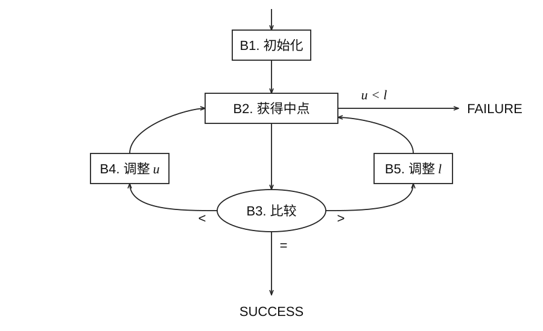
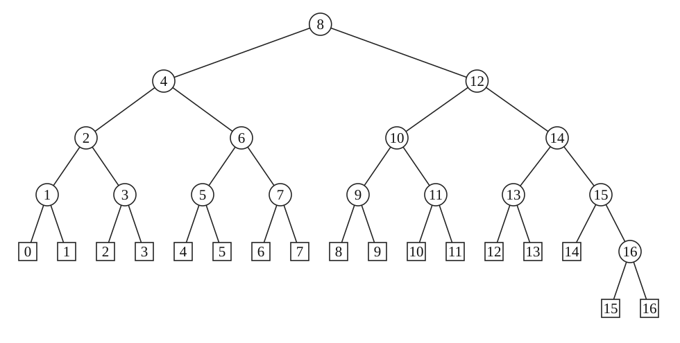
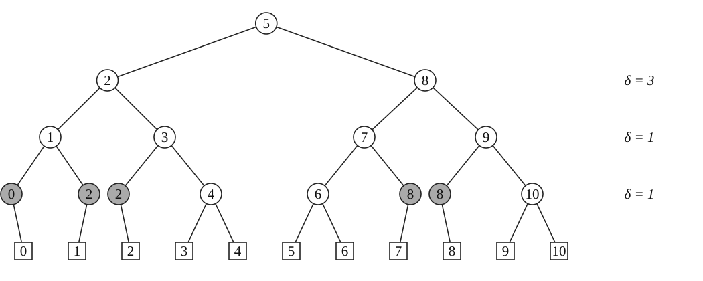
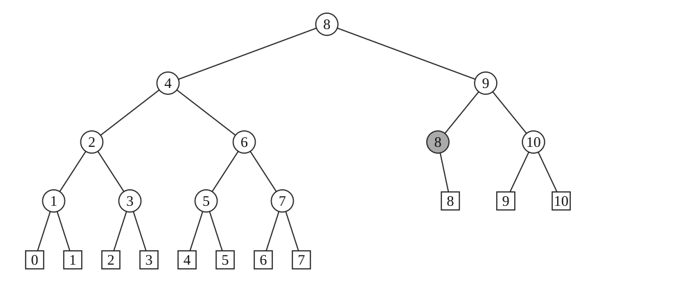
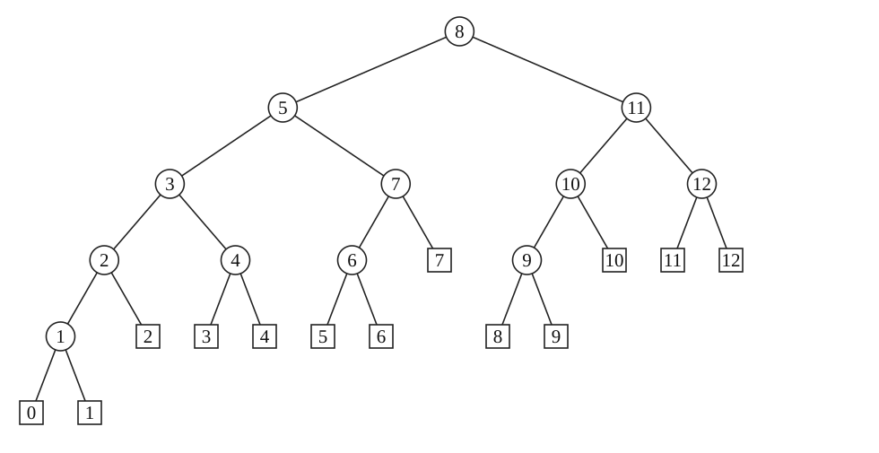
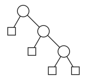
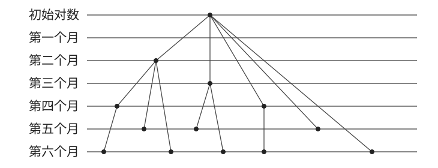

### 6.2.1　查找有序表

如果有人递给你一大本电话簿, 让你找出号码为 795-6841 的人名, 你会怎么做呢? 要解决这个问题, 恐怕没有比 6.1 节的顺序方法更好的了. (当然, 你可以直接拨打这个号码, 与接听电话的人交谈; 你也可能知道如何得到一本按照号码而非人名排序的特殊电话簿.) 关键是, 按人名查找一个项目要比按号码查找容易得多, 虽然电话簿中包含了这两种情况下所需要的全部信息. 在必须查找一个大型文件时, 顺序扫描几乎是不可能做到的, 但利用次序关系可以使任务得到大幅简化.

已经有了如此之多的排序方法可供使用 (第 5 章), 我们不用费什么力气就可以把一个文件重新排列为有序状态, 从而可以方便地进行查找. 当然, 如果只需要对表格进行一次查找, 那顺序查找可能要比对文件进行完整排序快一些. 但如果需要在同一文件中进行重复查找, 那最好还是将其转为有序状态. 因此, 在本节, 我们将主要研究适用于某一类表的查找方法, 这类表的键满足

$$
K_1<K_2<\cdots<K_N,
$$

并假定我们可以很轻松地访问任意给定位置的键. 在把 $K$ 与这样一个表中的 $K_i$ 进行比较后, 将得到以下三种结果之一:

- $K<K_i$　[不再考虑 $R_i,R_{i+1},\ldots,R_N$];
- $K=K_i$　[查找完成];
- $K>K_i$　[不再考虑 $R_1,R_2,\ldots,R_i$].

无论得到这三种结果中的哪一种, 除非 $i$ 接近表格的两端, 否则都已经取得了实质性的进展. 这就是为什么排序会引出一种高效算法的原因.

**二分查找.** 第一个想到的此类方法可能就是将 $K$ 与表的中间键进行比较. 根据这一试探性比较的结果可以知道接下来应当查找表的哪一半, 并可以再次使用同一过程, 将 $K$ 与选定了的那一半的中间键进行比较, 以此类推. 在进行大约 $\lg N$ 次比较之后, 要么找到这个键, 要么确认这个键不存在. 这个过程有时称为 “对数查找” 或 “对分查找”, 但最常见的叫法还是二分查找 (binary search).

尽管二分查找的基本思想相当简单, 但细节可能需要很强的技巧, 许多优秀的程序员在最初尝试时, 都可能多次出错. 下面这个算法最流行的正确形式之一, 是利用两个指针 $l$ 和 $u$ 分别来表示查找的当前下限和上限.

**算法 B (二分查找).** 给定由记录 $R_1,R_2,\ldots,R_N$ 组成的一个表格, 这些记录的键为递增次序 $K_1<K_2<\cdots<K_N$, 这个算法查找一个给定的参数 $K$.

**B1.[初始化.]** 置 $l\leftarrow1$, $u\leftarrow N$.

**B2.[获取中点.]**(此时, 我们知道如果 $K$ 在表中, 则满足 $K_l\le K\le K_u$. 习题 1 更准确地描述了这一情景.) 如果 $u<l$, 则这个算法以失败告终. 否则, 置 $i\leftarrow\lfloor(l+u)/2\rfloor$, 即相关表区域的近似中点.

**B3.[比较.]** 如果 $K<K_i$, 则转至 B4; 如果 $K>K_i$, 则转至 B5; 如果 $K=K_i$, 则算法成功终止.

**B4.[调整 $u$.]** 置 $u\leftarrow i-1$ 并返回 B2.

**B5.[调整 $l$.]** 置 $l\leftarrow i+1$ 并返回 B2.　▮

图 3　二分查找

图 4 给出了这个二分查找算法的两种情景: 第一种是查找参数 653, 该参数存在于表中, 然后查找表中并不存在的 400. 括号表示 $l$ 和 $u$, 带有下划线的键表示 $K_i$. 在这两个示例中, 查找过程都在进行四次比较后终止.

(a) 查找 653:

<table style="width:max-content;font-family:var(--vp-font-family-mono);font-size:0.8em;border:0"><tbody>
<tr style="border:0;background:transparent"><td style="padding:2px 1px;border:0;white-space:nowrap">[061&nbsp;</td><td style="padding:2px 1px;border:0;white-space:nowrap">&nbsp;087&nbsp;</td><td style="padding:2px 1px;border:0;white-space:nowrap">&nbsp;154&nbsp;</td><td style="padding:2px 1px;border:0;white-space:nowrap">&nbsp;170&nbsp;</td><td style="padding:2px 1px;border:0;white-space:nowrap">&nbsp;275&nbsp;</td><td style="padding:2px 1px;border:0;white-space:nowrap">&nbsp;426&nbsp;</td><td style="padding:2px 1px;border:0;white-space:nowrap">&nbsp;503&nbsp;</td><td style="padding:2px 1px;border:0;white-space:nowrap">&nbsp;<u>509</u>&nbsp;</td><td style="padding:2px 1px;border:0;white-space:nowrap">&nbsp;512&nbsp;</td><td style="padding:2px 1px;border:0;white-space:nowrap">&nbsp;612&nbsp;</td><td style="padding:2px 1px;border:0;white-space:nowrap">&nbsp;653&nbsp;</td><td style="padding:2px 1px;border:0;white-space:nowrap">&nbsp;677&nbsp;</td><td style="padding:2px 1px;border:0;white-space:nowrap">&nbsp;703&nbsp;</td><td style="padding:2px 1px;border:0;white-space:nowrap">&nbsp;765&nbsp;</td><td style="padding:2px 1px;border:0;white-space:nowrap">&nbsp;897&nbsp;</td><td style="padding:2px 1px;border:0;white-space:nowrap">&nbsp;908]</td></tr>
<tr style="border:0;background:transparent"><td style="padding:2px 1px;border:0;white-space:nowrap">&nbsp;061&nbsp;</td><td style="padding:2px 1px;border:0;white-space:nowrap">&nbsp;087&nbsp;</td><td style="padding:2px 1px;border:0;white-space:nowrap">&nbsp;154&nbsp;</td><td style="padding:2px 1px;border:0;white-space:nowrap">&nbsp;170&nbsp;</td><td style="padding:2px 1px;border:0;white-space:nowrap">&nbsp;275&nbsp;</td><td style="padding:2px 1px;border:0;white-space:nowrap">&nbsp;426&nbsp;</td><td style="padding:2px 1px;border:0;white-space:nowrap">&nbsp;503&nbsp;</td><td style="padding:2px 1px;border:0;white-space:nowrap">&nbsp;509&nbsp;</td><td style="padding:2px 1px;border:0;white-space:nowrap">[512&nbsp;</td><td style="padding:2px 1px;border:0;white-space:nowrap">&nbsp;612&nbsp;</td><td style="padding:2px 1px;border:0;white-space:nowrap">&nbsp;653&nbsp;</td><td style="padding:2px 1px;border:0;white-space:nowrap">&nbsp;<u>677</u>&nbsp;</td><td style="padding:2px 1px;border:0;white-space:nowrap">&nbsp;703&nbsp;</td><td style="padding:2px 1px;border:0;white-space:nowrap">&nbsp;765&nbsp;</td><td style="padding:2px 1px;border:0;white-space:nowrap">&nbsp;897&nbsp;</td><td style="padding:2px 1px;border:0;white-space:nowrap">&nbsp;908]</td></tr>
<tr style="border:0;background:transparent"><td style="padding:2px 1px;border:0;white-space:nowrap">&nbsp;061&nbsp;</td><td style="padding:2px 1px;border:0;white-space:nowrap">&nbsp;087&nbsp;</td><td style="padding:2px 1px;border:0;white-space:nowrap">&nbsp;154&nbsp;</td><td style="padding:2px 1px;border:0;white-space:nowrap">&nbsp;170&nbsp;</td><td style="padding:2px 1px;border:0;white-space:nowrap">&nbsp;275&nbsp;</td><td style="padding:2px 1px;border:0;white-space:nowrap">&nbsp;426&nbsp;</td><td style="padding:2px 1px;border:0;white-space:nowrap">&nbsp;503&nbsp;</td><td style="padding:2px 1px;border:0;white-space:nowrap">&nbsp;509&nbsp;</td><td style="padding:2px 1px;border:0;white-space:nowrap">[512&nbsp;</td><td style="padding:2px 1px;border:0;white-space:nowrap">&nbsp;<u>612</u>&nbsp;</td><td style="padding:2px 1px;border:0;white-space:nowrap">&nbsp;653]</td><td style="padding:2px 1px;border:0;white-space:nowrap">&nbsp;677&nbsp;</td><td style="padding:2px 1px;border:0;white-space:nowrap">&nbsp;703&nbsp;</td><td style="padding:2px 1px;border:0;white-space:nowrap">&nbsp;765&nbsp;</td><td style="padding:2px 1px;border:0;white-space:nowrap">&nbsp;897&nbsp;</td><td style="padding:2px 1px;border:0;white-space:nowrap">&nbsp;908&nbsp;</td></tr>
<tr style="border:0;background:transparent"><td style="padding:2px 1px;border:0;white-space:nowrap">&nbsp;061&nbsp;</td><td style="padding:2px 1px;border:0;white-space:nowrap">&nbsp;087&nbsp;</td><td style="padding:2px 1px;border:0;white-space:nowrap">&nbsp;154&nbsp;</td><td style="padding:2px 1px;border:0;white-space:nowrap">&nbsp;170&nbsp;</td><td style="padding:2px 1px;border:0;white-space:nowrap">&nbsp;275&nbsp;</td><td style="padding:2px 1px;border:0;white-space:nowrap">&nbsp;426&nbsp;</td><td style="padding:2px 1px;border:0;white-space:nowrap">&nbsp;503&nbsp;</td><td style="padding:2px 1px;border:0;white-space:nowrap">&nbsp;509&nbsp;</td><td style="padding:2px 1px;border:0;white-space:nowrap">&nbsp;512&nbsp;</td><td style="padding:2px 1px;border:0;white-space:nowrap">&nbsp;612&nbsp;</td><td style="padding:2px 1px;border:0;white-space:nowrap">[<u>653</u>]</td><td style="padding:2px 1px;border:0;white-space:nowrap">&nbsp;677&nbsp;</td><td style="padding:2px 1px;border:0;white-space:nowrap">&nbsp;703&nbsp;</td><td style="padding:2px 1px;border:0;white-space:nowrap">&nbsp;765&nbsp;</td><td style="padding:2px 1px;border:0;white-space:nowrap">&nbsp;897&nbsp;</td><td style="padding:2px 1px;border:0;white-space:nowrap">&nbsp;908&nbsp;</td></tr>
</tbody></table>

(b) 查找 400:

<table style="width:max-content;font-family:var(--vp-font-family-mono);font-size:0.8em;border:0"><tbody>
<tr style="border:0;background:transparent"><td style="padding:2px 1px;border:0;white-space:nowrap">[061&nbsp;</td><td style="padding:2px 1px;border:0;white-space:nowrap">&nbsp;087&nbsp;</td><td style="padding:2px 1px;border:0;white-space:nowrap">&nbsp;154&nbsp;</td><td style="padding:2px 1px;border:0;white-space:nowrap">&nbsp;170&nbsp;</td><td style="padding:2px 1px;border:0;white-space:nowrap">&nbsp;275&nbsp;</td><td style="padding:2px 1px;border:0;white-space:nowrap">&nbsp;426&nbsp;</td><td style="padding:2px 1px;border:0;white-space:nowrap">&nbsp;503&nbsp;</td><td style="padding:2px 1px;border:0;white-space:nowrap">&nbsp;<u>509</u>&nbsp;</td><td style="padding:2px 1px;border:0;white-space:nowrap">&nbsp;512&nbsp;</td><td style="padding:2px 1px;border:0;white-space:nowrap">&nbsp;612&nbsp;</td><td style="padding:2px 1px;border:0;white-space:nowrap">&nbsp;653&nbsp;</td><td style="padding:2px 1px;border:0;white-space:nowrap">&nbsp;677&nbsp;</td><td style="padding:2px 1px;border:0;white-space:nowrap">&nbsp;703&nbsp;</td><td style="padding:2px 1px;border:0;white-space:nowrap">&nbsp;765&nbsp;</td><td style="padding:2px 1px;border:0;white-space:nowrap">&nbsp;897&nbsp;</td><td style="padding:2px 1px;border:0;white-space:nowrap">&nbsp;908]</td></tr>
<tr style="border:0;background:transparent"><td style="padding:2px 1px;border:0;white-space:nowrap">[061&nbsp;</td><td style="padding:2px 1px;border:0;white-space:nowrap">&nbsp;087&nbsp;</td><td style="padding:2px 1px;border:0;white-space:nowrap">&nbsp;154&nbsp;</td><td style="padding:2px 1px;border:0;white-space:nowrap">&nbsp;<u>170</u>&nbsp;</td><td style="padding:2px 1px;border:0;white-space:nowrap">&nbsp;275&nbsp;</td><td style="padding:2px 1px;border:0;white-space:nowrap">&nbsp;426&nbsp;</td><td style="padding:2px 1px;border:0;white-space:nowrap">&nbsp;503]</td><td style="padding:2px 1px;border:0;white-space:nowrap">&nbsp;509&nbsp;</td><td style="padding:2px 1px;border:0;white-space:nowrap">&nbsp;512&nbsp;</td><td style="padding:2px 1px;border:0;white-space:nowrap">&nbsp;612&nbsp;</td><td style="padding:2px 1px;border:0;white-space:nowrap">&nbsp;653&nbsp;</td><td style="padding:2px 1px;border:0;white-space:nowrap">&nbsp;677&nbsp;</td><td style="padding:2px 1px;border:0;white-space:nowrap">&nbsp;703&nbsp;</td><td style="padding:2px 1px;border:0;white-space:nowrap">&nbsp;765&nbsp;</td><td style="padding:2px 1px;border:0;white-space:nowrap">&nbsp;897&nbsp;</td><td style="padding:2px 1px;border:0;white-space:nowrap">&nbsp;908&nbsp;</td></tr>
<tr style="border:0;background:transparent"><td style="padding:2px 1px;border:0;white-space:nowrap">&nbsp;061&nbsp;</td><td style="padding:2px 1px;border:0;white-space:nowrap">&nbsp;087&nbsp;</td><td style="padding:2px 1px;border:0;white-space:nowrap">&nbsp;154&nbsp;</td><td style="padding:2px 1px;border:0;white-space:nowrap">&nbsp;170&nbsp;</td><td style="padding:2px 1px;border:0;white-space:nowrap">[275&nbsp;</td><td style="padding:2px 1px;border:0;white-space:nowrap">&nbsp;<u>426</u>&nbsp;</td><td style="padding:2px 1px;border:0;white-space:nowrap">&nbsp;503]</td><td style="padding:2px 1px;border:0;white-space:nowrap">&nbsp;509&nbsp;</td><td style="padding:2px 1px;border:0;white-space:nowrap">&nbsp;512&nbsp;</td><td style="padding:2px 1px;border:0;white-space:nowrap">&nbsp;612&nbsp;</td><td style="padding:2px 1px;border:0;white-space:nowrap">&nbsp;653&nbsp;</td><td style="padding:2px 1px;border:0;white-space:nowrap">&nbsp;677&nbsp;</td><td style="padding:2px 1px;border:0;white-space:nowrap">&nbsp;703&nbsp;</td><td style="padding:2px 1px;border:0;white-space:nowrap">&nbsp;765&nbsp;</td><td style="padding:2px 1px;border:0;white-space:nowrap">&nbsp;897&nbsp;</td><td style="padding:2px 1px;border:0;white-space:nowrap">&nbsp;908&nbsp;</td></tr>
<tr style="border:0;background:transparent"><td style="padding:2px 1px;border:0;white-space:nowrap">&nbsp;061&nbsp;</td><td style="padding:2px 1px;border:0;white-space:nowrap">&nbsp;087&nbsp;</td><td style="padding:2px 1px;border:0;white-space:nowrap">&nbsp;154&nbsp;</td><td style="padding:2px 1px;border:0;white-space:nowrap">&nbsp;170&nbsp;</td><td style="padding:2px 1px;border:0;white-space:nowrap">[<u>275</u>]</td><td style="padding:2px 1px;border:0;white-space:nowrap">&nbsp;426&nbsp;</td><td style="padding:2px 1px;border:0;white-space:nowrap">&nbsp;503&nbsp;</td><td style="padding:2px 1px;border:0;white-space:nowrap">&nbsp;509&nbsp;</td><td style="padding:2px 1px;border:0;white-space:nowrap">&nbsp;512&nbsp;</td><td style="padding:2px 1px;border:0;white-space:nowrap">&nbsp;612&nbsp;</td><td style="padding:2px 1px;border:0;white-space:nowrap">&nbsp;653&nbsp;</td><td style="padding:2px 1px;border:0;white-space:nowrap">&nbsp;677&nbsp;</td><td style="padding:2px 1px;border:0;white-space:nowrap">&nbsp;703&nbsp;</td><td style="padding:2px 1px;border:0;white-space:nowrap">&nbsp;765&nbsp;</td><td style="padding:2px 1px;border:0;white-space:nowrap">&nbsp;897&nbsp;</td><td style="padding:2px 1px;border:0;white-space:nowrap">&nbsp;908&nbsp;</td></tr>
<tr style="border:0;background:transparent"><td style="padding:2px 1px;border:0;white-space:nowrap">&nbsp;061&nbsp;</td><td style="padding:2px 1px;border:0;white-space:nowrap">&nbsp;087&nbsp;</td><td style="padding:2px 1px;border:0;white-space:nowrap">&nbsp;154&nbsp;</td><td style="padding:2px 1px;border:0;white-space:nowrap">&nbsp;170&nbsp;</td><td style="padding:2px 1px;border:0;white-space:nowrap">&nbsp;275]</td><td style="padding:2px 1px;border:0;white-space:nowrap">[426&nbsp;</td><td style="padding:2px 1px;border:0;white-space:nowrap">&nbsp;503&nbsp;</td><td style="padding:2px 1px;border:0;white-space:nowrap">&nbsp;509&nbsp;</td><td style="padding:2px 1px;border:0;white-space:nowrap">&nbsp;512&nbsp;</td><td style="padding:2px 1px;border:0;white-space:nowrap">&nbsp;612&nbsp;</td><td style="padding:2px 1px;border:0;white-space:nowrap">&nbsp;653&nbsp;</td><td style="padding:2px 1px;border:0;white-space:nowrap">&nbsp;677&nbsp;</td><td style="padding:2px 1px;border:0;white-space:nowrap">&nbsp;703&nbsp;</td><td style="padding:2px 1px;border:0;white-space:nowrap">&nbsp;765&nbsp;</td><td style="padding:2px 1px;border:0;white-space:nowrap">&nbsp;897&nbsp;</td><td style="padding:2px 1px;border:0;white-space:nowrap">&nbsp;908&nbsp;</td></tr>
</tbody></table>

图 4　二分查找举例

**程序 B (二分查找).** 和在 6.1 节的程序中一样, 我们假定 $K_i$ 是出现在位置 $\mathtt{KEY}+i$ 处的全字的键. 下面的代码使用 $\mathrm{rI1}\equiv l$, $\mathrm{rI2}\equiv u$, $\mathrm{rI3}\equiv i$.

~~~mixal
01 START   ENT1 1          1           B1. 初始化. l ← 1.
02         ENT2 N          1           u ← N.
03         JMP  2F         1           转至B2.
04 5H      JE   SUCCESS    C1          如果 K = Kᵢ 则跳转.
05         ENT1 1,3        C1 − S      B5. 调整 l. l ← i + 1.
06 2H      ENTA 0,1        C + 1 − S   B2. 获取中点.
07         INCA 0,2        C + 1 − S   rA ← l + u.
08         SRB  1          C + 1 − S   rA ← ⌊rA/2⌋.（rX也改变.）
09         STA  TEMP       C + 1 − S
10         CMP1 TEMP       C + 1 − S
11         JG   FAILURE    C + 1 − S   如果 u < l 则跳转.
12         LD3  TEMP       C           i ← 中点.
13 3H      LDA  K          C           B3. 比较.
14         CMPA KEY,3      C
15         JGE  5B         C           如果 K ≥ Kᵢ 则跳转.
16         ENT2 -1,3       C2          B4. 调整 u. u ← i − 1.
17         JMP  2B         C2          转至B2.
~~~

▮

这个过程与 MIX 的结合并不像前面已经见到的其他算法那样顺畅, 这是因为 MIX 不允许在变址寄存器中进行许多算术运算. 运行时间为 $(18C-10S+12)u$, 其中, $C=C1+C2$ 是所做比较的次数 (步骤 B3 的执行次数), $S=[\text{结果是成功的}]$. 这个程序第 08 行的操作是 “右移一个二进制位”, 只有在 MIX 的二进制版本上, 它才是合法的. 对于一般的字节大小, 应当用 $\mathtt{MUL\ =1//2+1=}$ 来代替这条指令, 它使运行时间增加至 $(26C-18S+20)u$.

**树表示.** 为了真正了解算法 B 中发生了什么, 最好的办法是把这个过程看作一个二叉决策树, 如图 5 中所示 $N=16$ 的情景.

图 5　与 $N=16$ 时的二分查找对应的比较树

当 $N$ 为 16 时, 该算法执行的第一次比较是 $K:K_8$, 由图中的根结点⑧表示. 随后, 如果 $K<K_8$, 则算法沿左子树前进, 把 $K$ 与 $K_4$ 进行比较. 类似地, 如果 $K>K_8$, 则使用右子树. 一次失败查找将会引导至编号为 $\boxed{0}$ 至 $\boxed{N}$ 的外部方形结点之一, 例如, 当且仅当 $K_6<K<K_7$ 时, 将到达结点 $\boxed{6}$.

对于在 $N$ 条记录中进行的二分查找, 可以采用如下方式构造相应的二叉树: 如果 $N=0$, 则树就是 $\boxed{0}$. 否则, 根结点是

<table style="width:max-content;margin-inline:auto;border:0"><tbody><tr style="border:0;background:transparent"><td style="border:0">$\lceil N/2\rceil$,</td></tr></tbody></table>

左子树是具有 $\lceil N/2\rceil-1$ 个结点的相应二叉树, 右子树是具有 $\lfloor N/2\rfloor$ 个结点的相应二叉树, 并且所有结点编号都增加 $\lceil N/2\rceil$.

对于长度为 $N$ 的有序列表, 任何一种通过比较操作来对其进行查找的算法, 都可以采用类似方式表示为一棵 $N$ 结点二叉树, 其中结点的标号为 1 至 $N$ (除非算法进行了冗余比较). 反之, 任何一棵二叉树都对应一种查找有序表的有效方法. 我们只需要自左向右, 以对称序标记结点:

$$
\boxed{0}\quad\text{\textcircled{1}}\quad\boxed{1}\quad
\text{\textcircled{2}}\quad\boxed{2}\quad\cdots\quad
\boxed{N-1}\quad\text{\textcircled{\textit{N}}}\quad\boxed{N}\tag{1}
$$

如果输入算法 B 的查找参数为 $K_{10}$, 则算法执行比较 $K>K_8$, $K<K_{12}$, $K=K_{10}$. 它对应于图 5 中从根结点到⑩. 与此类似, 算法 B 针对其他键的特性对应于以树的根结点为起点的其他路径. 因此, 通过构造与算法 B 相对应的二叉树, 可以很容易地利用关于 $N$ 的归纳法来证明以下结果:

**定理 B.** 如果 $2^{k-1}\le N<2^k$, 则使用算法 B 进行一次成功查找需要 $(\min1,\max k)$ 次比较. 如果 $N=2^k-1$, 则一次失败查找需要 $k$ 次比较; 如果 $2^{k-1}\le N<2^k-1$, 则一次失败查找需要 $k-1$ 次或 $k$ 次比较.　▮

**二分查找的深入分析.**(不喜欢数学的读者可以跳读到式 (4).) 树式表示还告诉我们如何以简单方式计算平均比较次数. 假定 $N$ 个键中的每一个都是概率相等的参数, 设 $C_N$ 表示在一次成功查找中的平均比较次数. 这些键值之间及端点值之外共有 $N+1$ 个间隔, 假设其中每一个间隔的出现概率相等, 设 $C'_N$ 是在一次失败查找中的平均比较次数. 于是, 根据内部路径长度与外部路径长度的定义可得

$$
C_N=1+\frac{\text{树的内部路径长度}}{N},\qquad
C'_N=\frac{\text{树的外部路径长度}}{N+1},
$$

我们在式 2.3.4.5-(3) 中已经看到, 外部路径长度总是比内部路径长度大 $2N$. 因此, 在 $C_N$ 与 $C'_N$ 之间存在一个相当出乎意料的关系

$$
C_N=\left(1+\frac1N\right)C'_N-1.\tag{2}
$$

由托马斯·希巴德给出的这个公式对于所有与二叉树相对应的查找方法都是成立的 [*JACM* **9** (1962), 16–17]. 换句话说, 对于所有基于非冗余比较的方法, 这个公式都是成立的. 成功查找比较次数的方差也可以用失败查找的相应方差来表示 (见习题 25).

从以上公式可以看出, 如果通过比较进行查找, “最佳” 方法所对应的树在所有具有 $N$ 个内部结点的二叉树中, 其外部路径长度最短. 非常幸运, 我们可以证明: 从这个意义上来说, 对于所有 $N$ 值, 算法 B 是最优的. 我们已经看到 (习题 5.3.1-20), 一个二叉树具有最短路径长度的充要条件是它的所有外部结点最多出现在两个相邻级别上. 由此推出, 与算法 B 相对应的树的外部路径长度是

$$
(N+1)(\lfloor\lg N\rfloor+2)-2^{\lfloor\lg N\rfloor+1}.\tag{3}
$$

(见式 5.3.1-(34).) 假定所有查找参数的概率相等, 可以由这个公式及式 (2) 计算准确的平均比较次数.

<table style="width:max-content;font-size:0.9em;border:0"><tbody>
<tr style="border:0;background:transparent"><td style="padding:3px 8px;border:0;white-space:nowrap">$N=$</td><td style="padding:3px 8px;border:0;white-space:nowrap">$1$</td><td style="padding:3px 8px;border:0;white-space:nowrap">$2$</td><td style="padding:3px 8px;border:0;white-space:nowrap">$3$</td><td style="padding:3px 8px;border:0;white-space:nowrap">$4$</td><td style="padding:3px 8px;border:0;white-space:nowrap">$5$</td><td style="padding:3px 8px;border:0;white-space:nowrap">$6$</td><td style="padding:3px 8px;border:0;white-space:nowrap">$7$</td><td style="padding:3px 8px;border:0;white-space:nowrap">$8$</td><td style="padding:3px 8px;border:0;white-space:nowrap">$9$</td><td style="padding:3px 8px;border:0;white-space:nowrap">$10$</td><td style="padding:3px 8px;border:0;white-space:nowrap">$11$</td><td style="padding:3px 8px;border:0;white-space:nowrap">$12$</td><td style="padding:3px 8px;border:0;white-space:nowrap">$13$</td><td style="padding:3px 8px;border:0;white-space:nowrap">$14$</td><td style="padding:3px 8px;border:0;white-space:nowrap">$15$</td><td style="padding:3px 8px;border:0;white-space:nowrap">$16$</td></tr>
<tr style="border:0;background:transparent"><td style="padding:3px 8px;border:0;white-space:nowrap">$C_N=$</td><td style="padding:3px 8px;border:0;white-space:nowrap">$1$</td><td style="padding:3px 8px;border:0;white-space:nowrap">$1\frac{1}{2}$</td><td style="padding:3px 8px;border:0;white-space:nowrap">$1\frac{2}{3}$</td><td style="padding:3px 8px;border:0;white-space:nowrap">$2$</td><td style="padding:3px 8px;border:0;white-space:nowrap">$2\frac{1}{5}$</td><td style="padding:3px 8px;border:0;white-space:nowrap">$2\frac{2}{6}$</td><td style="padding:3px 8px;border:0;white-space:nowrap">$2\frac{3}{7}$</td><td style="padding:3px 8px;border:0;white-space:nowrap">$2\frac{5}{8}$</td><td style="padding:3px 8px;border:0;white-space:nowrap">$2\frac{7}{9}$</td><td style="padding:3px 8px;border:0;white-space:nowrap">$2\frac{9}{10}$</td><td style="padding:3px 8px;border:0;white-space:nowrap">$3$</td><td style="padding:3px 8px;border:0;white-space:nowrap">$3\frac{1}{12}$</td><td style="padding:3px 8px;border:0;white-space:nowrap">$3\frac{2}{13}$</td><td style="padding:3px 8px;border:0;white-space:nowrap">$3\frac{3}{14}$</td><td style="padding:3px 8px;border:0;white-space:nowrap">$3\frac{4}{15}$</td><td style="padding:3px 8px;border:0;white-space:nowrap">$3\frac{6}{16}$</td></tr>
<tr style="border:0;background:transparent"><td style="padding:3px 8px;border:0;white-space:nowrap">$C'_N=$</td><td style="padding:3px 8px;border:0;white-space:nowrap">$1$</td><td style="padding:3px 8px;border:0;white-space:nowrap">$1\frac{2}{3}$</td><td style="padding:3px 8px;border:0;white-space:nowrap">$2$</td><td style="padding:3px 8px;border:0;white-space:nowrap">$2\frac{2}{5}$</td><td style="padding:3px 8px;border:0;white-space:nowrap">$2\frac{4}{6}$</td><td style="padding:3px 8px;border:0;white-space:nowrap">$2\frac{6}{7}$</td><td style="padding:3px 8px;border:0;white-space:nowrap">$3$</td><td style="padding:3px 8px;border:0;white-space:nowrap">$3\frac{2}{9}$</td><td style="padding:3px 8px;border:0;white-space:nowrap">$3\frac{4}{10}$</td><td style="padding:3px 8px;border:0;white-space:nowrap">$3\frac{6}{11}$</td><td style="padding:3px 8px;border:0;white-space:nowrap">$3\frac{8}{12}$</td><td style="padding:3px 8px;border:0;white-space:nowrap">$3\frac{10}{13}$</td><td style="padding:3px 8px;border:0;white-space:nowrap">$3\frac{12}{14}$</td><td style="padding:3px 8px;border:0;white-space:nowrap">$3\frac{14}{15}$</td><td style="padding:3px 8px;border:0;white-space:nowrap">$4$</td><td style="padding:3px 8px;border:0;white-space:nowrap">$4\frac{2}{17}$</td></tr>
</tbody></table>

一般来说, 如果 $k=\lfloor\lg N\rfloor$, 我们有

$$
\begin{aligned}
C_N&=k+1-(2^{k+1}-k-2)/N
=\lg N-1+\epsilon+(k+2)/N,\\
C'_N&=k+2-2^{k+1}/(N+1)
=\lg(N+1)+\epsilon'
\end{aligned}\tag{4}
$$

其中 $0\le\epsilon,\epsilon'<0.0861$, 见式 5.3.1-(35).

总结一下: 算法 B 所做的比较次数从来不会超过 $\lfloor\lg N\rfloor+1$, 在一次成功查找中, 它进行大约 $\lg N-1$ 次比较. 没有任何一种基于比较的查找方法可以优于这个结果. 如果假定所有查找的输出结果都是等概率的, 则程序 B 的平均运行时间大约是

$$
\begin{aligned}
(18\lg N-16)u&\qquad\text{对于成功查找},\\
(18\lg N+12)u&\qquad\text{对于失败查找}.
\end{aligned}\tag{5}
$$

**一个重要的变体.** 如果在查找中没有使用三个指针 $l$、$i$ 和 $u$, 而是尝试仅使用两个指针, 即当前位置 $i$ 及其变化率 $\delta$. 在每次执行不相等的比较之后, 可以令 $i\leftarrow i\pm\delta$ 及 $\delta\leftarrow\delta/2$ (近似). 这种做法是可行的, 但必须像下面的算法一样, 特别关注细节. 更简化的方法是注定要失败的!

**算法 U (均匀二分查找).** 给定由记录 $R_1,R_2,\ldots,R_N$ 组成的一个表格, 这些记录的键为递增次序 $K_1<K_2<\cdots<K_N$, 这个算法查找一个给定的参数 $K$. 如果 $N$ 是偶数, 这个算法有时会引用一个虚拟键 $K_0$, 它应当被设定为 $-\infty$ (或小于 $K$ 的任意值). 我们假定 $N\ge1$.

**U1.[初始化.]** 置 $i\leftarrow\lceil N/2\rceil$, $m\leftarrow\lfloor N/2\rfloor$.

**U2.[比较.]** 如果 $K<K_i$, 转至 U3; 如果 $K>K_i$, 转至 U4; 如果 $K=K_i$, 则算法成功结束.

**U3.[使 $i$ 递减.]**(我们已经将查找过程精确到一个包含 $m$ 或 $m-1$ 条记录的区间, $i$ 指向这个区间的右端.) 如果 $m=0$, 则算法以失败结束. 否则, 置 $i\leftarrow i-\lceil m/2\rceil$; 然后置 $m\leftarrow\lfloor m/2\rfloor$, 并返回 U2.

**U4.[使 $i$ 递增.]**(我们已经将查找过程精确到一个包含 $m$ 或 $m-1$ 条记录的区间, $i$ 指向这个区间的左端.) 如果 $m=0$, 则算法以失败结束. 否则, 置 $i\leftarrow i+\lceil m/2\rceil$; 然后置 $m\leftarrow\lfloor m/2\rfloor$, 并返回 U2.　▮

图 6 给出了这个查找的相应二叉树, 其中 $N=10$. 在一次失败查找中, 这个算法可能会在即将结束时进行一次冗余比较, 这些结点在图中添加了阴影. 我们可以说这个查找过程是均匀的, 这是因为, 对于第 $l$ 级上的所有结点, 第 $l$ 级上的一个结点的编号与第 $l-1$ 级上相应祖先的编号之差是一个常数 $\delta$.

算法 U 的基础理论可以理解如下: 假定我们需要查找长度为 $n-1$ 的一个区间. 与中间元素进行比较 ($n$ 为偶数) 或与两个中间元素之一进行比较 ($n$ 为奇数), 会得到长度为 $\lfloor n/2\rfloor-1$ 和 $\lceil n/2\rceil-1$ 的两个区间. 这个过程重复 $k$ 次之后, 可以得到 $2^k$ 个区间, 其中最小区间的长度为 $\lfloor n/2^k\rfloor-1$, 最大区间的长度为 $\lceil n/2^k\rceil-1$. 因此, 同一级别上两个区间的长度最多相差 1. 这就有可能选择一个适当的 “中间” 元素, 而不需要跟踪区间的确切长度.

图 6　“均匀” 二分查找的比较树, $N=10$

算法 U 的主要优点在于根本不需要维护 $m$ 值, 而只需要查阅一个在树的每个级别使用的不同 $\delta$ 组成的短表. 因此, 这个算法简化为以下过程, 它在二进制计算机或十进制计算机上具有同等出色的效果:

**算法 C (均匀二分查找).** 这算法与算法 U 非常类似, 但它使用一个辅助表代替了涉及 $m$ 的计算. 表中各项为

$$
\mathtt{DELTA}[j]=\left\lfloor\frac{N+2^{j-1}}{2^j}\right\rfloor
\qquad(1\le j\le\lfloor\lg N\rfloor+2).\tag{6}
$$

**C1.[初始化.]** 置 $i\leftarrow\mathtt{DELTA}[1]$, $j\leftarrow2$.

**C2.[比较.]** 如果 $K<K_i$, 转至 C3; 如果 $K>K_i$, 转至 C4; 如果 $K=K_i$, 则算法成功结束.

**C3.[使 $i$ 递减.]** 如果 $\mathtt{DELTA}[j]=0$, 则算法以失败结束. 否则, 置 $i\leftarrow i-\mathtt{DELTA}[j]$, $j\leftarrow j+1$, 并返回 C2.

**C4.[使 $i$ 递增.]** 如果 $\mathtt{DELTA}[j]=0$, 则算法以失败结束. 否则, 置 $i\leftarrow i+\mathtt{DELTA}[j]$, $j\leftarrow j+1$, 并返回 C2.　▮

习题 8 证明, 仅当 $N$ 为偶数时, 这个算法会引用虚拟键 $K_0=-\infty$.

**程序 C (均匀二分查找).** 这个程序利用算法 C, 完成了与程序 B 相同的任务, 其中 $\mathrm{rA}\equiv K$, $\mathrm{rI1}\equiv i$, $\mathrm{rI2}\equiv j$, $\mathrm{rI3}\equiv\mathtt{DELTA}[j]$.

~~~mixal
01 START   ENT1 N+1/2      1              C1. 初始化. i ← ⌊(N + 1)/2⌋.
02         ENT2 2          1              j ← 2.
03         LDA  K          1
04         JMP  2F         1
05 3H      JE   SUCCESS    C1             如果 K = Kᵢ，则跳转.
06         J3Z  FAILURE    C1 − S         如果 DELTA[j] = 0，则跳转.
07         DEC1 0,3        C1 − S − A     C3. 使 i 递减.
08 5H      INC2 1          C − 1          j ← j + 1.
09 2H      LD3  DELTA,2    C              C2. 比较.
10         CMPA KEY,1      C
11         JLE  3B         C              如果 K ≤ Kᵢ，则跳转.
12         INC1 0,3        C2        C4. 使 i 递增.
13         J3NZ 5B         C2        如果 DELTA[j] ≠ 0，则跳转.
14 FAILURE EQU  *          1 − S     如果不在表中，则退出.
~~~

▮

在一次成功查找中, 这个算法对应的二叉树的内部路径长度与算法 B 对应的相同, 所以平均比较次数 $C_N$ 也与先前一样. 在一次失败查找中, 算法 C 总是恰好进行 $\lfloor\lg N\rfloor+1$ 次比较. 由于 C1 的权重大于 C2 的权重, 所以程序 C 的总运行时间在左、右分支之间并不是特别对称, 但习题 11 表明, $K<K_i$ 与 $K>K_i$ 的可能性大体相同. 因此, 程序 C 的运行时间大约为

$$
\begin{aligned}
(8.5\lg N-6)u&\qquad\text{对于成功查找},\\
(8.5\lfloor\lg N\rfloor+12)u&\qquad\text{对于失败查找}.
\end{aligned}\tag{7}
$$

这个速度是程序 B 速度的两倍以上, 尽管程序 B 的运行时间 (5) 假定 MIX 有一个 “二进制右移位” 指令, 但这个速度的得出并没有使用二进制计算机的任何特性.

1971 年, 列昂纳德·沙尔提出了对二分查找的另一修改方式, 它在某些计算机上的运行速度还要更快一些, 因为它在第一步之后是均匀的, 而且不需要表. 第一步是比较 $K$ 与 $K_i$, 其中 $i=2^k$, $k=\lfloor\lg N\rfloor$. 如果 $K<K_i$, 则可以使用一种均匀查找, 其中 $\delta$ 等于 $2^{k-1},2^{k-2},\ldots,1,0$. 另一方面, 如果 $K>K_i$, 则把 $i$ 重设为 $i'=N+1-2^l$, 其中 $l=\lceil\lg(N-2^k+1)\rceil$, 并假装第一个比较实际上是 $K>K_{i'}$, 使用一种均匀查找, 其中的 $\delta$ 等于 $2^{l-1},2^{l-2},\ldots,1,0$.

图 7 给出了 $N=10$ 时的沙尔方法. 和前面的算法类似, 它所做的比较次数绝对不会超过 $\lfloor\lg N\rfloor+1$ 次. 因此, 尽管它偶尔会连续执行几个冗余步骤, 但它所做的比较次数最多比平均比较次数的最小值大 1 (见习题 12).

图 7　沙尔的准均匀查找的比较树, $N=10$

习题 23 中讨论了二分查找的另一种修改形式, 当 $N$ 极大时, 它提高了上述所有方法的速度. 另见习题 24, 其中介绍了一种更快的方法.

**\*斐波那契查找.** 在多阶段合并中, 我们已经看到斐波那契数可以扮演类似于 2 的幂的角色. 在查找中也有类似现象, 斐波那契数为我们提供了二分查找的一种替代方法. 由此得到的方法仅涉及加法和减法, 而没有除以 2 的运算, 所以是某些计算机上的优选方法. 我们将要讨论的过程应当与称为 “斐波那契查找” 的重要数值过程区分开来, 后者用于查找一个单峰函数的最大值 [见 *Fibonacci Quarterly* **4** (1966), 265–269], 两个名字之间的相似已经导致了某种混淆.

如果我们直接拿过程序, 试图解释会发生什么, 那斐波那契查找技术乍看起来非常神秘, 它似乎是靠魔法工作的. 但只要给出了相应的查找树, 这种神秘马上就消失了. 因此, 我们将首先从查看斐波那契树开始对该方法的研究.

图 8 给出了 6 阶斐波那契树. 与前面已经研究过的其他树相比, 它看起来更像现实生活中的灌木, 这可能是因为许多自然过程满足斐波那契定律吧. 一般来说, $k$ 阶斐波那契树有 $F_{k+1}-1$ 个内部结点 (用圆形表示) 和 $F_{k+1}$ 个外部结点 (用方形表示), 其构造如下:

如果 $k=0$ 或 $k=1$, 则这棵树就是 $\boxed{0}$.

如果 $k\ge2$, 则根结点为 $F_k$; 左子树为 $k-1$ 阶斐波那契树; 右子树为 $k-2$ 阶斐波那契树, 它的所有编号都增大 $F_k$.

图 8　6 阶斐波那契树

除外部结点外, 每个内部结点的两个子结点上的数字与其父结点数字的差值相等, 这个差值是一个斐波那契数. 例如, 在图 8 中, $5=8-F_4$, $11=8+F_4$. 当差值为 $F_j$ 时, 左侧下一个分支的相应斐波那契差值为 $F_{j-1}$, 而在右侧, 它下跳到 $F_{j-2}$. 例如, $3=5-F_3$, 而 $10=11-F_2$.

如果将这些观测结果与一种识别外部结点的适当机制结合在一起, 就可以得到下面的方法:

**算法 F (斐波那契查找).** 给定由记录 $R_1,R_2,\ldots,R_N$ 组成的一个表格, 这些记录的键为递增次序 $K_1<K_2<\cdots<K_N$, 这个算法查找一个给定的参数 $K$.

为便于描述, 我们假定 $N+1$ 是一个完全的斐波那契数 $F_{k+1}$. 如果初始化得当, 不难使这个方法对任意 $N$ 都有效 (见习题 14).

**F1.[初始化.]** 置 $i\leftarrow F_k$, $p\leftarrow F_{k-1}$, $q\leftarrow F_{k-2}$. (在整个算法中, $p$ 和 $q$ 将表示连续的斐波那契数.)

**F2.[比较.]** 如果 $K<K_i$, 转至 F3; 如果 $K>K_i$, 转至 F4; 如果 $K=K_i$, 则算法成功结束.

**F3.[使 $i$ 递减.]** 如果 $q=0$, 则算法以失败结束. 否则, 置 $i\leftarrow i-q$ 以及 $(p,q)\leftarrow(q,p-q)$, 然后返回 F2.

**F4.[使 $i$ 递增.]** 如果 $p=1$, 则算法以失败结束. 否则, 置 $i\leftarrow i+q$, $p\leftarrow p-q$, 然后再置 $q\leftarrow q-p$, 并返回 F2.　▮

下面的 MIX 实现通过制作内层循环的两个副本来赢得速度. 在一个副本中, $p$ 在 $\mathrm{rI2}$ 中, $q$ 在 $\mathrm{rI3}$ 中, 在另一个副本中, 这两个寄存器颠倒过来, 这样就简化了步骤 F3. 事实上, 程序实际在寄存器保存了 $p-1$ 和 $q-1$, 而不是保存 $p$ 和 $q$, 以简化步骤 F4 中的判断 “$p=1$?”.

**程序 F (斐波那契查找).** 遵循前面的约定, $\mathrm{rA}\equiv K$, $\mathrm{rI1}\equiv i$, $(\mathrm{rI2}\text{ 或 }\mathrm{rI3})\equiv p-1$, $(\mathrm{rI3}\text{ 或 }\mathrm{rI2})\equiv q-1$.

~~~mixal
01 START   LDA  K             1              F1. 初始化.
02         ENT1 F_k           1              i ← Fₖ.
03         ENT2 F_(k-1)-1     1              p ← Fₖ₋₁.
04         ENT3 F_(k-2)-1     1              q ← Fₖ₋₂.
05         JMP  F2A           1              转至F2.
06 F4A     INC1 1,3           C2 − S − A     F4. 使 i 递增. i ← i + q.
07         DEC2 1,3           C2 − S − A     p ← p − q.
08         DEC3 1,2           C2 − S − A     q ← q − p.
09 F2A     CMPA KEY,1         C              F2. 比较.
10         JL   F3A           C              如果 K < Kᵢ，转至F3.
11         JE   SUCCESS       C2             如果 K = Kᵢ，则退出.
12         J2NZ F4A           C2 − S         如果 p ≠ 1，则转至F4.
13         JMP  FAILURE       A              如果不在表中，则退出.
14 F3A     DEC1 1,3           C1             F3. 使 i 递减. i ← i − q.
15         DEC2 1,3           C1             p ← p − q.
16         J3NN F2B           C1             如果 q > 0，则交换寄存器.
17         JMP  FAILURE       1 − S − A     如果不在表中，则退出.
18 F4B     INC1 1,2                          （第18–29行与第06–17行平行.）
19         DEC3 1,2
20         DEC2 1,3
21 F2B     CMPA KEY,1
22         JL   F3B
23         JE   SUCCESS
24         J3NZ F4B
25         JMP  FAILURE
26 F3B     DEC1 1,2
27         DEC3 1,2
28         J2NN F2A
29         JMP  FAILURE
~~~

▮

习题 18 中分析了这个程序的运行时间. 图 8 揭示了以下事实, 并给出了分析: 取左分支的频繁程度要略高于右分支. 设 $C$、C1 和 $(\mathrm{C2}-S)$ 分别是步骤 F2、F3 和 F4 的执行次数. 于是, 我们有

$$
\begin{aligned}
C&=(\text{ave }\phi k/\sqrt5+O(1),\ \max k-1),\\
\mathrm{C1}&=(\text{ave }k/\sqrt5+O(1),\ \max k-1),\\
\mathrm{C2}-S&=(\text{ave }\phi^{-1}k/\sqrt5+O(1),\ \max\lfloor k/2\rfloor).
\end{aligned}\tag{8}
$$

因此, 取左分支的频繁程度大约是右分支的 $\phi\approx1.618$ 倍 (我们可能已经猜到了这个事实, 因为每次试探都会将剩下的区间分为两部分, 左边部分的大小大约是右边部分的 $\phi$ 倍). 因此, 对于一次成功查找来说, 程序 F 的总平均运行时间近似为

$$
\frac15\bigl((18+4\phi)k+31-26\phi\bigr)u
\approx(7.050\lg N+1.08)u.\tag{9}
$$

对于失败查找, 还要再加上 $(9-3\phi)u\approx4.15u$. 这要比程序 C 更快一些, 尽管最差情况下的运行时间 (大约为 $8.6\lg N$) 要稍慢一些.

**插值查找.** 现在让我们暂时忘记计算机, 考虑一下人类是如何实际进行查找的. 有时, 日常生活会为我们提供得到优秀算法的线索.

设想自己正在词典中查找一个单词. 你可能不是首先查看中间的页, 然后查看 $1/4$ 或 $3/4$ 位置, 等等, 如同在二分查找中那样. 你更不大可能去使用斐波那契查找!

如果想要的单词是以字母 A 开头, 那可能会在词典的开头附近开始查找. 事实上, 许多词典都有踏步口[^v3-p327-1], 给出了以固定字母开头的单词的起始页或中间页. 这种踏步口技术可以很轻松地应用到计算机上, 它会加快查找速度, 6.3 节探讨了此类算法.

甚至在已经找到初始查找点之后, 你所执行的操作也与前面讨论的方法有很大不同. 如果注意到所需要的单词按字母顺序远大于当前所查看页面上的单词, 那在进行下一次查看之前, 会翻过相当厚的一摞页面. 这与上述算法也有很大区别, 上述算法并没有区分 “大很多” 和 “大一点”.

这些考虑事项让人们想到一种可被称为*插值查找*的算法: 假定键是数值, 且在整个区间内以大体恒定的方式递增, 当我们知道 $K$ 位于 $K_l$ 和 $K_u$ 之间时, 可以将下一次试探位置选在 $l$ 与 $u$ 之间的大约 $(K-K_l)/(K_u-K_l)$ 处.

插值查找的性能渐近优于二分查找. 当键在表中随机分布时, 二分查找的一个步骤大体将不确定性由 $n$ 缩小为 $\frac12n$, 而插值查找的一个步骤大体将其缩小为 $\sqrt n$. 因此, 插值查找平均需要大约 $\lg\lg N$ 个步骤就可以将不确定性由 $N$ 缩小为 2. (见习题 22.)

但是, 计算机仿真实验表明, 除非表格相当大, 否则插值查找减少的比较数目不足以补偿所涉及的额外计算时间. 典型文件的随机性并不充分, 除非 $N$ 大于比如 $2^{16}=65\,536$, 否则 $\lg\lg N$ 和 $\lg N$ 之差不是特别明显. 在对大型外部文件进行查找的早期阶段, 插值查找是最成功的. 在查找范围变窄后, 二分查找可以更快速地完成任务. (注意, 人工查词典的过程基本上是外部查找, 而非内部查找. 我们将在稍后讨论外部查找.)

**历史与文献.** 为便于查找而对一长串项目进行排序的最早已知例子, 是著名的巴比伦艾娜基比特-安努倒数表, 可以追溯到大约公元前 200 年. 这个陶制表格包含了 100 多对数值, 它们似乎是一张表格的开头部分, 原表格中应当包含了大约 500 个多精度的六十进制数及其倒数, 并且已经按字典序排序. 例如, 该表包括了由以下项目组成的序列:

<table>
<tbody>
<tr><td>01 13 09 34 29 08 08 53 20</td><td>49 12 27</td></tr>
<tr><td>01 13 14 31 52 30</td><td>49 09 07 12</td></tr>
<tr><td>01 13 43 40 48</td><td>48 49 41 15</td></tr>
<tr><td>01 13 48 40 30</td><td>48 46 22 59 25 25 55 33 20</td></tr>
<tr><td>01 14 04 26 40</td><td>48 36</td></tr>
</tbody>
</table>

鉴于当时可供使用的技术, 对 500 项进行排序的任务一定是相当棘手的. [如需更多细节, 见高德纳,*Selected Papers on Computer Science* (Cambridge Univ. Press, 1996), 第 11 章.]

对数值进行排序是相当自然的事情, 但字母或单词之间的顺序关系就不是那么显而易见了. 不过, 在最古老的字母表中, 就已经存在关于各个字母的整理好的序列了. 例如, 许多圣经赞美诗中都有一些严格遵循字母顺序的诗句, 第一句以希伯来文的第一个字母开头, 第二句以希伯来文的第二个字母开头, 以此类推, 这样有助于记忆. 最终, 字母的标准序列被闪米特人和希腊人用来表示数字, 例如, $\alpha,\beta,\gamma$ 分别表示 1, 2, 3.

为所有单词应用字母顺序这个发明似乎要晚得多. 我们可能认为这种应用是显而易见的事情, 但却必须向孩子们讲解, 在历史上的某一时间, 可能还需要向成人讲解. 在爱琴岛上已经发现了几份来自大约公元前 300 年的列表, 其中给出了特定宗教仪式中的人名. 这些列表已经按字母顺序进行排序, 但只是根据第一个字符进行了排序, 因此, 仅表示自左向右基数排序的第一次扫描. 一些来自公元 134–135 年的希腊莎草纸上包含了一些分类账的片断, 其中有一些按前两个字母排序的纳税人的姓名. 阿波罗尼奥斯·索菲斯塔在他的荷马史诗的很长的词语索引 (公元 1 世纪) 中, 将字母顺序应用于前两个字符, 而且经常也应用于后续字符. 人们还知道一些更完美的字母排序, 比较突出的有, 克劳迪厄斯·盖伦的 *Hippocratic Glosses*(大约公元 200 年), 但这些都是非常罕见的. 在圣伊西多罗的 *Etymologiarum*(大约公元 630 年, 第十册) 中, 仅按第一个字母对单词进行了排序,*Corpus Glossary*(大约公元 725 年) 仅使用了每个单词的前两个字母. 后两部著作可能是在中世纪编纂的最大的非数值数据文件了.

一直等到乔瓦尼·热那亚的 *Catholicon*(1286 年), 我们才看到了关于真正字母排序的具体描述. 乔瓦尼在前言中解释了:

<table>
<tbody>
<tr><td><i>amo</i></td><td>先于</td><td><i>bibo</i></td></tr>
<tr><td><i>abeo</i></td><td>先于</td><td><i>adeo</i></td></tr>
<tr><td><i>amatus</i></td><td>先于</td><td><i>amor</i></td></tr>
<tr><td><i>imprudens</i></td><td>先于</td><td><i>impudens</i></td></tr>
<tr><td><i>iusticia</i></td><td>先于</td><td><i>iustus</i></td></tr>
<tr><td><i>polisintheton</i></td><td>先于</td><td><i>polissenus</i></td></tr>
</tbody>
</table>

(从而给出了一些情景示例, 在这些例子中, 顺序是根据第一个、第二个、…、第六个字母确定的), “以此类推”. 他特意说明: 设计这些规则需要付出很大的努力. “所以, 我请求好心的读者, 不要轻视我为此付出的巨大努力, 不要认为这一顺序毫无价值.”

劳埃德·戴利已经对印刷术发明之前字母排序的发展进行了详细研究 [*Collection Latomus* **90** (1967), 100 页]. 他发现了一些重要的古老手稿, 它们显然是用作工作表的, 并根据单词的前几个字母对单词进行了排序 (见其专著的第 89–90 页).

第一本英文字典——考德里的 *Table Alphabeticall*(伦敦, 1604) 中包含以下提示:

> 如果要查找的单词以 (a) 开头, 则在本表的开头处查找它; 如果以 (v) 开头, 则到末尾处查找. 同样, 如果单词以 (ca) 开头, 则在字母 (c) 的开头处查找; 如果以 (cu) 开头, 则在该字母的末尾处查找. 以此类推.

考德里在准备自己的词典时, 似乎正在自学如何进行字母排序. 在前面几页中出现了大量位置错误的单词, 但到了后面部分, 字母顺序就没那么糟糕了.

二分查找最早是由约翰·莫奇利提到的，提到这个方法的那本书可能是最早出版的非数值程序设计方法讨论内容［*Theory and Techniques for the Design of Electronic Digital Computers*，乔治·帕特森编辑，**1** (1946)，9.7–9.8；**3** (1946)，22.8–22.9］。程序员对这个方法是非常熟悉的，但好像还没有人真正弄明白，当 $N$ 不是 $2^n-1$ 这一特殊形式时，到底该怎么办。［见布思，*Nature* **176** (1955)，565；达米，*Computers and Automation* **5** (1956年12月)，7，其中将二分查找称为“二十问题”；丹尼尔·麦克拉肯，*Digital Computer Programming* (Wiley, 1957)，201–203；以及马克·哈尔彭，*CACM* **1**, 1 (1958年2月)，1–3。］

德里克·莱默显然是第一个发表能够处理所有 $N$ 值的二分查找算法的人 [*Proc. Symp. Appl. Math.* **10** (1960), 180–181]. 下一步骤是由赫尔曼·博滕布鲁赫采取的 [*JACM* **9** (1962), 214], 他给出了算法 B 的一种重要变化形式, 这可以避免在最末尾之前单独进行相等测试: 在步骤 B2 中使用

$$
i\leftarrow\lceil(l+u)/2\rceil
$$

而不是 $i\leftarrow\lfloor(l+u)/2\rfloor$. 每当 $K\ge K_i$ 时他令 $l\leftarrow i$, 然后 $u-l$ 在每一步都递减. 最后, 当 $l=u$ 时, 有 $K_l\le K<K_{l+1}$. 我们可以再做一次比较来判断查找是否成功. (他最初假定 $K\ge K_1$.) 在许多计算机上, 这个思想都可以稍微加快内层循环的速度, 本节讨论过的所有算法都可以应用这个原理. 但由于 (2) 的原因, 一次成功的查找平均需要增加一次迭代. 由于内层循环仅执行大约 $\lg N$ 次, 所以除非 $N$ 极大, 否则在增加一次迭代和稍微加快循环速度之间的这一折中并不会节省时间. (见习题 23.) 另一方面, 当表中包含重复键时, 博滕布鲁赫的算法将会找到一个给定键在最右侧的副本, 这个性质有时是非常重要的.

艾弗森给出了算法 B 的步骤, 但没有考虑查找失败的可能性 [*A Programming Language* (Wiley, 1962), 141]. 高德纳把算法 B 作为与流程图自动绘制系统一起使用的一个例子 [*CACM* **6** (1963), 556–558]. 均匀二分查找——算法 C, 是由斯坦福大学的阿肖克·钱德拉在 1971 年向我建议的.

斐波那契查找是由戴维·弗格森发明的 [*CACM* **3** (1960), 648]. 与斐波那契树类似的二叉树早在 1910 年就出现在挪威数学家阿克塞尔·瑟伊的先驱性工作中了 (见习题 28). 没有标号的斐波那契树还作为一项新奇内容出现在雨果·斯坦豪斯的畅销书 *Mathematical Snapshots* (New York: Stechert, 1938) 第 1 版[^v3-p329-1] 第 28 页中, 他在绘制斐波那契树时将其上下颠倒了过来, 使其看起来像是一棵真正的树, 右分支的长度是左分支的两倍, 使所有叶子都出现在同一级别.

插值查找是由彼得森提出的 [*IBM J. Res. & Devel.* **1** (1957), 131–132]. 直到多年以后, 人们才发现了对其一般特性的正确分析 (见习题 22).

### 习题

▶ **1.** [21] 证明: 如果在二分查找的步骤 B2 中有 $u<l$, 则 $u=l-1$ 且 $K_u<K<K_l$. (根据惯例, 假定 $K_0=-\infty$ 且 $K_{N+1}=+\infty$, 不过这个算法从来不会实际用到这些虚拟的键, 所以它们不需要出现在实际的表中.)　[答案](./answers/6-2-1.md#ans-6-2-1-1)

▶ **2.** [22] 在算法 B 中, 当表中存在 $K$ 值时, 如果 (a) 把步骤 B5 改为 “$l\leftarrow i$” 而不再是 “$l\leftarrow i+1$”, 或者 (b) 把步骤 B4 改为 “$u\leftarrow i$” 而不再是 “$u\leftarrow i-1$”, 或者 (c) 同时进行以上两种修改, 这个算法是否仍能正常工作?　[答案](./answers/6-2-1.md#ans-6-2-1-2)

**3.** [15] 哪种查找方法与树　[答案](./answers/6-2-1.md#ans-6-2-1-3)

相对应?

在一次成功查找中进行的平均比较次数是多少? 在失败查找中呢?

**4.** [20] 如果一个查找使用程序 6.1S (顺序查找) 恰好需要 638 个时间单位, 那么使用程序 B (二分查找) 将需要多少时间?　[答案](./answers/6-2-1.md#ans-6-2-1-4)

**5.** [M24] 假定查找成功, 当 $N$ 为何值时, 程序 B 的平均速度实际慢于顺序查找 (程序 $6.1\mathrm Q'$)?　[答案](./answers/6-2-1.md#ans-6-2-1-5)

**6.** [28] (艾弗森) 习题 5 建议最好使用一种混合方式, 当剩余区间的长度小于某一精心选定值时, 由二分查找改变为顺序查找. 为这样一种查找编写一段高效的 MIX 程序, 并确定最佳切换值.

▶ **7.** [M22] 如果修改步骤 U1, 使得　[答案](./answers/6-2-1.md#ans-6-2-1-7)

(a) $i$ 和 $m$ 都被设定为 $\lfloor N/2\rfloor$,

(b) $i$ 和 $m$ 都被设定为 $\lceil N/2\rceil$,

则算法 U 是否仍能正常工作?

[提示: 假定第一步为 “置 $i\leftarrow0$, $m\leftarrow N$ (或 $N+1$), 转至 U4.”]

**8.** [M20] 像 (6) 中定义的那样, 令 $\delta_j=\mathrm{DELTA}[j]$ 为算法 C 中的第 $j$ 个增量.　[答案](./answers/6-2-1.md#ans-6-2-1-8)

(a) 总和 $\sum_{j=1}^{\lfloor\lg N\rfloor+2}\delta_j$ 是多少?

(b) 在步骤 C2 中可能出现的 $i$ 的最小值和最大值分别是多少?

**9.** [20] 是否存在大于 1 的 $N$ 值, 使算法 B 和算法 C 完全等价? 也就是说, 它们对于任意查找参数所执行的比较序列都相同.　[答案](./answers/6-2-1.md#ans-6-2-1-9)

**10.** [21] 解释如何为算法 C 编写一段 MIX 程序, 其中包含大约 $7\lg N$ 条指令, 运行时间大约为 $4.5\lg N$ 个时间单位.　[答案](./answers/6-2-1.md#ans-6-2-1-10)

**11.** [M26] 找出在程序 C 频率分析中 C1、C2 和 $A$ 的平均值的准确公式, 将其表示为 $N$ 和 $S$ 的函数.　[答案](./answers/6-2-1.md#ans-6-2-1-11)

**12.** [20] 绘制当 $N=12$ 时与沙尔方法相对应的二叉查找树.　[答案](./answers/6-2-1.md#ans-6-2-1-12)

**13.** [M24] 以表格形式给出当 $1\le N\le16$ 时沙尔方法所做的平均比较次数, 考虑成功查找和失败查找两种情景.　[答案](./answers/6-2-1.md#ans-6-2-1-13)

**14.** [21] 解释如何扩展算法 F, 使其适用于所有 $N\ge1$ 的情景.　[答案](./answers/6-2-1.md#ans-6-2-1-14)

**15.** [M19] 当 $k$ 为何值时, $k$ 阶斐波那契树定义了一种最优查找过程? 所谓 “最优”, 是指平均说来执行的比较次数最少.　[答案](./answers/6-2-1.md#ans-6-2-1-15)

**16.** [21] 图 9 给出了原始斐波那契兔子问题 (见 1.2.8 节) 中兔子的直系图. 这个图表与正文中讨论的斐波那契树之间是否存在一种简单关系?　[答案](./answers/6-2-1.md#ans-6-2-1-16)

**图 9　根据斐波那契规则繁殖的兔子对数**

**17.** [M21] 由习题 1.2.8–34 (或习题 5.4.2–10) 知道, 每个正整数 $n$ 都可以唯一地表示为斐波那契数之和　[答案](./answers/6-2-1.md#ans-6-2-1-17)

$$
n=F_{a_1}+F_{a_2}+\cdots+F_{a_r},
$$

其中 $r\ge1$, $a_j\ge a_{j+1}+2$($1\le j<r$), 且 $a_r\ge2$. 证明, 在 $k$ 阶斐波那契树中, 从根结点到结点 $\textcircled n$ 的路径长度是 $k+1-r-a_r$.

**18.** [M30] 找出在程序 F 频率分析中 C1、C2 和 $A$ 的平均值的准确公式, 将其表示为 $k$、$F_k$、$F_{k+1}$ 和 $S$ 的函数.　[答案](./answers/6-2-1.md#ans-6-2-1-18)

**19.** [M42] 对习题 14 所提议算法的平均运行时间进行详细分析.

**20.** [M22] 二分查找中所需要的比较次数近似为 $\log_2N$, 在斐波那契查找中, 这个值大约是 $(\phi/\sqrt5)\log_\phi N$. 这个习题的目的是证明这些公式是一个更一般结果的特例.　[答案](./answers/6-2-1.md#ans-6-2-1-20)

令 $p$ 和 $q$ 是满足 $p+q=1$ 的正数. 考虑一种查找算法, 给定递增的 $N$ 个数的一个表格, 首先比较参数和第 $(pN)$ 个键, 然后在较小的块上迭代这个过程. (在二分查找中, $p=q=1/2$; 在斐波那契查找中, $p=1/\phi$, $q=1/\phi^2$.)

如果 $C(N)$ 表示查找一个大小为 $N$ 的表格时所需要的平均比较次数, 它近似满足以下关系

$$
C(1)=0;\qquad\text{对于 }N>1,\quad C(N)=1+pC(pN)+qC(qN).
$$

之所以发生这种情况, 是因为在第一次比较之后, 该查找以概率 $p$ (近似) 简化为一个 $pN$ 元素的查找, 以概率 $q$ 简化为一个 $qN$ 元素的查找. 当 $N$ 很大时, 我们可以忽略因为 $pN$ 和 $qN$ 不是恰为整数而导致的低阶影响.

(a) 证明: 对于 $b$ 的某一选定值, $C(N)=\log_bN$ 恰好满足这些关系. 对于二分查找和斐波那契查找, 这个 $b$ 值与前面推导的公式一致.

(b) 考虑以下论证过程: “这个算法扫描的区间大小除以 $1/p$ 的概率为 $p$; 除以 $1/q$ 的概率为 $q$. 即平均来说区间的大小除以 $p\cdot(1/p)+q\cdot(1/q)=2$, 因此, 无论 $p$ 和 $q$ 的取值如何, 该算法都恰与二分查找一样好.” 这个推理是否有误?

**21.** [20] 绘制当 $N=10$ 时与插值查找相对应的二叉树.　[答案](./answers/6-2-1.md#ans-6-2-1-21)

**22.** [M41] (姚期智和姚储枫) 有 $N$ 个相互独立的均匀分布的随机的键已经完成排序, 证明: 对这 $N$ 个键应用精心设计的插值查找方法渐近地需要 $\lg\lg N$ 次比较. 此外, 对此类表执行的所有查找算法都必然平均执行近似 $\lg\lg N$ 次比较.　[答案](./answers/6-2-1.md#ans-6-2-1-22)

▶ **23.** [25] 在本节结束时提到了赫尔曼·博滕布鲁赫的二分查找算法, 除非是到了查找最终结束之前, 其他相等测试都可以避免. (在这个算法运行期间, 我们知道 $K_l\le K<K_{u+1}$, 直到 $l=u$ 时才查看是否相等.) 利用这个技巧, 可以从内层循环中去除 “JE” 指令, 所以对于大的 $N$ 值, 可以使程序 B 运行得稍快一些. (但是, 由于 $\lg N$ 总是比较小的, 所以这个想法实际上并不可行. 为了补偿一次成功查找所需要增加的额外工作, 可能需要 $N>2^{66}$, 因为 (5) 的运行时间 $(18\lg N-16)u$ 将 “下降” 到 $(17.5\lg N+17)u$!)　[答案](./answers/6-2-1.md#ans-6-2-1-23)

证明: 与二叉树相对应的任何查找算法都可以调整为一种在树的内部结点处使用两路分支 ($<$ 与 $\ge$) 的查找算法, 以取代正文讨论中所使用的三路分支 ($<$、$=$ 或 $>$). 具体来说, 说明如何以这个方式来修改算法 C.

▶ **24.** [23] 我们在 2.3.4.5 节和 5.2.3 节看到, 完全二叉树是一种在连续位置表示 “最短路径长度” 树的便捷方式. 根据这一表示设计一种高效的查找方法. [提示: 在二分查找中, 是否有可能用乘以 2 来代替除以 2?]　[答案](./answers/6-2-1.md#ans-6-2-1-24)

▶ **25.** [M25] 假定一个二叉树在第 $k$ 级有 $a_k$ 个内部结点和 $b_k$ 个外部结点, $k=0,1,\ldots$. (根结点位于第 0 级.) 因此, 在图 8 中, 有 $(a_0,a_1,\ldots,a_5)=(1,2,4,4,1,0)$ 和 $(b_0,b_1,\ldots,b_5)=(0,0,0,4,7,2)$.　[答案](./answers/6-2-1.md#ans-6-2-1-25)

(a) 证明: 在生成函数 $A(z)=\sum_k a_kz^k$ 和 $B(z)=\sum_k b_kz^k$ 之间存在一个简单的代数关系.

(b) 二叉树中一次成功查找的概率分布的生成函数为 $g(z)=zA(z)/N$, 对于失败查找, 其生成函数为 $h(z)=B(z)/(N+1)$. (因此, 采用正文中的表示法, 有 $C_N=\operatorname{mean}(g)$, $C'_N=\operatorname{mean}(h)$, 式 (2) 给出了这些量之间的一个关系.) 找出 $\operatorname{var}(g)$ 与 $\operatorname{var}(h)$ 之间的关系.

**26.** [22] 证明: 斐波那契树与三磁带上的多阶段合并排序相关.　[答案](./answers/6-2-1.md#ans-6-2-1-26)

**27.** [M30] (斯通和约翰·林) 考虑一种查找过程, 它同时使用 $k$ 个处理器, 并仅根据键的比较进行查找. 因此, 在查找过程的每个步骤, 指定了 $k$ 个索引 $i_1,\ldots,i_k$, 并同时执行 $k$ 个比较. 如果对于某一个 $j$ 值, $K=K_{i_j}$, 则查找成功结束, 否则, 根据 $2^k$ 个可能结果 $K<K_{i_j}$ 或 $K>K_{i_j}$($1\le j\le k$) 执行下一步骤.　[答案](./answers/6-2-1.md#ans-6-2-1-27)

假定该表中的每个键作为查找参数的概率相等, 证明: 当 $N\to\infty$ 时, 这样一个过程平均至少执行大约 $\log_{k+1}N$ 个步骤. (因此, 相对于单处理器二分查找, 其潜在速度提升因子为 $\lg(k+1)$, 而不是我们所期望的 $k$. 就这个意义而言, 更高效的做法是将每个处理器指定给不同的独立查找问题, 而不是让它们协同完成单个查找.)

**28.** [M23] 利用二元运算符 $\ast$, 以代数表达式定义瑟伊树 $T_n$ 如下: $T_0(x)=x\ast x$, $T_1(x)=x$, $T_{n+2}(x)=T_{n+1}(x)\ast T_n(x)$.　[答案](./answers/6-2-1.md#ans-6-2-1-28)

(a) $T_n$ 的叶子数是指完全写出 $T_n(x)$ 时 $x$ 的出现次数. 用斐波那契数表示这个数字.

(b) 证明: 如果二元运算符 $\ast$ 满足以下公理

$$
\bigl(x\ast(x\ast x)\bigr)\ast\bigl(x\ast(x\ast x)\bigr)=x,
$$

则对于所有 $m\ge0$ 及 $n\ge1$, 都有 $T_m\bigl(T_n(x)\bigr)=T_{m+n-1}(x)$.

▶ **29.** [22] (保罗·费尔德曼, 1985) 不假定 $K_1<K_2<\cdots<K_N$, 仅假定 $K_{p(1)}<K_{p(2)}<\cdots<K_{p(N)}$, 其中排列 $p(1)p(2)\ldots p(N)$ 是一个对合[^v3-p332-1], 而且, 对于 $j$ 的所有偶数值, 有 $p(j)=j$. 证明: 最多需要 $2\lfloor\lg N\rfloor+1$ 次比较就可以定位任意给定键 $K$, 或者判定 $K$ 不存在.　[答案](./answers/6-2-1.md#ans-6-2-1-29)

**30.** [27] (*对合编码*) 利用上题思想, 找出一种对 $N$ 个不同的键进行排列的方式, 使得 $m\le N/4+1-2^t$ 时, 它们的相对顺序能够隐含地对一个由 $t$ 位二进制数 $x_1,x_2,\ldots,x_m$ 组成的任意给定数组进行编码. 利用这个排列方式, 对于任意给定的 $j$, 应当仅通过 $k$ 次比较就可能确定 $x_j$ 的前 $k$ 个二进制位, 而且, 查找任意键所需要的比较次数不超过 $2\lfloor\lg N\rfloor+1$. (在对时间和空间上都是渐近高效的数据结构进行理论研究时用到了这个结果.)　[答案](./answers/6-2-1.md#ans-6-2-1-30)

<!-- section-footnotes -->

[^v3-p327-1]: Thumb index, 又称梯标. 在图书的外切口边上, 在每个字首处打上空缺或翻阴注上符号, 便于检索. 一般词典类图书较多采用, 将 ABCD 等 26 个字母, 分别印在以这一字母为字头组成词目的书页外切口边上, ABCD 等 26 个字母形成梯形由上而下排列, 故又叫作梯标. ——编者注

[^v3-p329-1]: 中译本: 《数学万花镜》, [波兰] 胡·斯坦豪斯著, 裘光明译, 湖南教育出版社, 1999 年第 1 版. ——编者注

[^v3-p332-1]: 对合是指一种排列, 其逆排列与原排列相同. ——编者注
