

### 6.2.2　二叉树查找

在上一节, 我们了解到, 利用隐式二叉树结构可以更轻松地理解二分查找和斐波那契查找的特性. 对于给定的 $N$ 值, 利用与二分查找相对应的树, 可以达到通过键值比较来查找一个表所需比较次数的理论最小值. 但是, 记录的顺序分配使得插入与删除操作的成本相当高昂, 所以上一节的方法主要适用于大小固定的表格. 如果表格是动态变化的, 那在维护表格上花费的时间可能会多于对其进行二分查找所节省的时间.

利用显式二叉树结构, 有可能快速插入和删除记录, 并能高效地查找表格. 这样, 我们基本上就有了一种对于查找和排序都很有用的方法. 这种灵活性的提升, 是通过向表中每条记录添加两个链接字段来实现的.

对一个不断增长的表格进行查找的方法通常被称为*符号表算法*, 这是因为汇编程序、编译程序及其他系统例程一般使用此类方法来跟踪用户定义的符号. 例如, 一个编译程序中每条记录的键可能是一个符号标识符, 用来表示 FORTRAN 或 C 语言中的一个变量, 而记录中的其余部分可能包含了有关变量类型及存储分配的信息. 或者, 记录中的键可能是 MIXAL 程序中的一个符号, 而记录的其余部分包含了这个符号的等价内容. 本节将要介绍的树查找与插入例程作为符号表算法是非常高效的, 尤其是在那些希望以字母顺序打印符号列表的应用程序中. 6.3 节和 6.4 节中介绍了其他符号表算法.

图 10 给出了一个二叉查找树, 其中包含了黄道十一宫的名称. 如果现在从树的根结点或顶点开始查找第 12 个名字——SAGITTARIUS (人马宫), 将会发现它大于 CAPRICORN (摩羯宫), 所以将其向右移; 它大于 PISCES (双鱼宫), 所以再向右移; 它小于 TAURUS (金牛宫), 所以将其向左移; 它小于 SCORPIO (天蝎宫), 于是到达一个外部结点 $\boxed8$, 查找失败. 现在在查找结束的地方插入 SAGITTARIUS (人马宫), 将其链接到树中, 替代外部结点 $\boxed8$. 这样, 树的增长过程中无须移动任何现有记录. 图 10 的构建就是从一棵空树开始, 并依次插入 CAPRICORN、AQUARIUS、PISCES、ARIES、TAURUS、GEMINI、CANCER、LEO、VIRGO、LIBRA、SCORPIO 等键而完成的.

根据字母顺序, 图 10 中根结点左子树中的所有键都小于 CAPRICORN, 右子树中的所有键都大于它. 对于每个结点的左、右子树, 都有类似陈述成立. 由此可得, 如果我们按对称序 (见 2.3.1 节) 来遍历这棵树, 这些键将由左向右严格地按照字母顺序排列如下:

$$
\mathtt{AQUARIUS},\quad\mathtt{ARIES},\quad\mathtt{CANCER},\quad\mathtt{CAPRICORN},\quad
\mathtt{GEMINI},\quad\mathtt{LEO},\quad\ldots,\quad\mathtt{VIRGO}
$$

这是因为, 对称序的原则是: 对于每个结点, 首先遍历该结点的左子树, 接着是该结点本身, 然后遍历右子树.

以下算法详细地描述了查找过程与插入过程.

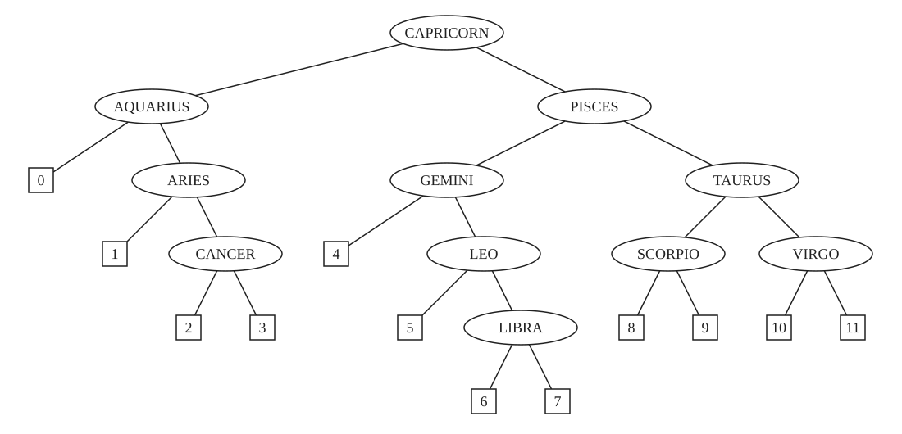

图 10　二叉查找树

**算法 T (树查找与插入).** 给定一个形式如上所述二叉树的记录表, 这个算法查找给定参数 $K$. 如果 $K$ 不在表中, 则在树中的适当位置插入一个包含 $K$ 的新结点.

假定这棵树中的结点至少包含以下字段:

$$
\begin{aligned}
\mathrm{KEY}(\mathrm P)&=\text{存储在 }\mathrm{NODE}(\mathrm P)\text{ 中的键};\\
\mathrm{LLINK}(\mathrm P)&=\text{指向 }\mathrm{NODE}(\mathrm P)\text{ 左子树的指针};\\
\mathrm{RLINK}(\mathrm P)&=\text{指向 }\mathrm{NODE}(\mathrm P)\text{ 右子树的指针}.
\end{aligned}
$$

空子树 (图 10 中的外部结点) 由空指针 $\Lambda$ 表示. 变量 `ROOT` 指向树的根结点. 由于当 $\mathrm{ROOT}=\Lambda$ 时, 所需执行的操作是显而易见的, 所以为方便起见, 我们假定这棵树是非空的 (也就是说, $\mathrm{ROOT}\ne\Lambda$).

**T1.[初始化.]** 置 $\mathrm P\leftarrow\mathrm{ROOT}$. (指针变量 $\mathrm P$ 将沿树下移.)

**T2.[比较.]** 如果 $K<\mathrm{KEY}(\mathrm P)$, 转至 T3; 如果 $K>\mathrm{KEY}(\mathrm P)$, 则转至 T4; 如果 $K=\mathrm{KEY}(\mathrm P)$, 则查找过程成功结束.

**T3.[左移.]** 如果 $\mathrm{LLINK}(\mathrm P)\ne\Lambda$, 置 $\mathrm P\leftarrow\mathrm{LLINK}(\mathrm P)$, 并转至 T2. 否则, 转至 T5.

**T4.[右移.]** 如果 $\mathrm{RLINK}(\mathrm P)\ne\Lambda$, 置 $\mathrm P\leftarrow\mathrm{RLINK}(\mathrm P)$, 并转至 T2. 否则, 转至 T5.

**T5.[插入树中.]**(查找失败, 现在把 $K$ 放入树中.) 置 $\mathrm Q\Leftarrow\mathrm{AVAIL}$, 即一个新结点的地址. 置 $\mathrm{KEY}(\mathrm Q)\leftarrow K$, $\mathrm{LLINK}(\mathrm Q)\leftarrow\mathrm{RLINK}(\mathrm Q)\leftarrow\Lambda$. (在实践中, 新结点的其他字段也应当进行初始化.) 如果 $K<\mathrm{KEY}(\mathrm P)$, 则置 $\mathrm{LLINK}(\mathrm P)\leftarrow\mathrm Q$; 否则, 置 $\mathrm{RLINK}(\mathrm P)\leftarrow\mathrm Q$. (此时, 我们可以置 $\mathrm P\leftarrow\mathrm Q$, 成功地终止算法.)　▮

这个算法非常便于用机器语言加以实现. 例如, 我们可以假定树结点具有如下形式:

<table style="width:max-content"><tbody>
<tr><td>+</td><td>0</td><td><code>LLINK</code></td><td><code>RLINK</code></td></tr>
<tr><td colspan="4" style="text-align:center"><code>KEY</code></td></tr>
</tbody></table>(1)

之后可能跟有更多的 `INFO` 字. 像第 2 章中一样, 用一个 `AVAIL` 列表表示空闲存储单元, 可以编写以下 MIX 程序:

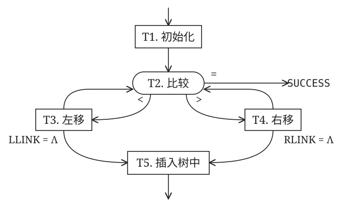

**图 11　树查找与插入**

**程序 T (树查找与插入).** $\mathrm{rA}\equiv K$, $\mathrm{rI1}\equiv\mathrm P$, $\mathrm{rI2}\equiv\mathrm Q$.

~~~mixal
01 LLINK   EQU  2:3
02 RLINK   EQU  4:5
03 START   LDA  K             1             T1. 初始化.
04         LD1  ROOT          1             P ← ROOT.
05         JMP  2F            1
06 4H      LD2  0,1(RLINK)    C2            T4. 右移. Q ← RLINK(P).
07         J2Z  5F            C2            如果 Q = Λ，则转至T5.
08 1H      ENT1 0,2           C − 1         P ← Q.
09 2H      CMPA 1,1           C             T2. 比较.
10         JG   4B            C             如果 K > KEY(P)，则转至T4.
11         JE   SUCCESS       C1            如果 K = KEY(P)，则退出.
12         LD2  0,1(LLINK)    C1 − S        T3. 左移. Q ← LLINK(P).
13         J2NZ 1B            C1 − S        如果 Q ≠ Λ，则转至T2.
14 5H      LD2  AVAIL         1 − S         T5. 插入树中.
15         J2Z  OVERFLOW      1 − S
16         LDX  0,2(RLINK)    1 − S
17         STX  AVAIL         1 − S         Q ⇐ AVAIL.
18         STA  1,2           1 − S         KEY(Q) ← K.
19         STZ  0,2           1 − S         LLINK(Q) ← RLINK(Q) ← Λ.
20         JL   1F            1 − S         K < KEY(P) 吗?
21         ST2  0,1(RLINK)    A             RLINK(P) ← Q.
22         JMP  *+2           A
23 1H      ST2  0,1(LLINK)    1 − S − A    LLINK(P) ← Q.
24 DONE    EQU  *             1 − S         插入后退出.
~~~

▮

此程序的前 13 行执行查找, 后 11 行执行插入. 查找阶段的运行时间为 $(7C+\mathrm{C1}-3S+4)u$, 其中

$$
\begin{aligned}
C&=\text{所做比较次数};\\
\mathrm{C1}&=K\le\mathrm{KEY}(\mathrm P)\text{ 的次数};\\
\mathrm{C2}&=K>\mathrm{KEY}(\mathrm P)\text{ 的次数};\\
S&=[\text{查找成功}].
\end{aligned}
$$

由于 $\mathrm{C1}+\mathrm{C2}=C$, 且 $\mathrm{C1}-S$ 的概率分布与 C2 相同, 所以一般来说, 有 $\mathrm{C1}=\frac12(C+S)$, 运行时间大约为 $(7.5C-2.5S+4)u$. 这好于使用隐式树的二分查找算法 (见程序 6.2.1C). 像程序 6.2.1F 中一样复制代码, 可以有效地消除程序 T 的第 08 行, 将运行时间缩短为 $(6.5C-2.5S+5)u$. 如果查找失败, 则该程序的插入阶段将另外需要 $14u$ 或 $15u$ 的时间.

可以很方便地对算法 T 进行修改, 将其用于变长键和变长记录. 例如, 如果按照后进先出方式顺序分配可用空间, 可以很轻松地创建变长结点. (1) 的第一个字可以表示其大小. 由于这一存储应用方式的效率很高, 所以在编译程序、汇编程序和装入程序中使用基于树的符号表算法是特别有吸引力的.

**但最差情况怎么样呢?** 程序员在最初看到算法 T 时, 经常会对其心存疑虑. 如果已经按照字母顺序 AQUARIUS, …, VIRGO 而非历法顺序 CAPRICORN, …, SCORPIO 将图 10 中的键输入树中, 则该算法已经构建了一棵退化树, 这棵树实际上指定了一种顺序查找. 所有 LLINK 都将为空. 类似地, 如果这些键采用一种很少见的顺序:

$$
\begin{gathered}
\mathtt{AQUARIUS},\ \mathtt{VIRGO},\ \mathtt{ARIES},\ \mathtt{TAURUS},\ \mathtt{CANCER},\ \mathtt{SCORPIO},\\
\mathtt{CAPRICORN},\ \mathtt{PISCES},\ \mathtt{GEMINI},\ \mathtt{LIBRA},\ \mathtt{LEO}
\end{gathered}
$$

我们将会看到一棵同样糟糕的锯齿形树. (试一试!)

另一方面, 图 10 中的特定树对于成功查找, 平均仅需要 $3\frac2{11}$ 次比较, 这仅比最佳二叉树中可能实现的最低平均比较次数 3 高一点点.

当拥有一棵相当平衡的树时, 查找时间近似与 $\log N$ 成正比, 但当拥有一棵退化树时, 查找时间近似与 $N$ 成正比. 习题 2.3.4.5–5 证明了: 如果认为每个 $N$ 结点二叉树的出现概率相等, 则平均查找时间近似与 $\sqrt N$ 成正比. 那么我们到底可以预期算法 T 具有什么样的特性呢?

幸运的是, 事实表明, 如果向树中插入键的顺序是随机的, 则树查找过程仅需要大约 $2\ln N\approx1.386\lg N$ 次比较. 最常见的还是平衡度很好的树, 退化树非常罕见.

关于这一事实, 有一个出乎意料的简单证明方式. $N$ 个键有 $N!$ 种排序方式, 其中的每一种都可作为一个插入序列, 用来构建树. 假定每种排序方式的出现概率相等. 为了找出一个键而需要执行的比较次数, 恰好比向树中插入该键所需要的比较次数多 1. 因此, 如果 $C_N$ 是一次成功查找过程中所涉及的平均比较次数, $C'_N$ 是一次失败查找中的平均比较次数, 则有

$$
C_N=1+\frac{C'_0+C'_1+\cdots+C'_{N-1}}N.\tag{2}
$$

但内部与外部路径长度之间的关系告诉我们

$$
C_N=\left(1+\frac1N\right)C'_N-1;\tag{3}
$$

这就是式 6.2.1–(2). 联立 (3) 和 (2) 可以得到

$$
(N+1)C'_N=2N+C'_0+C'_1+\cdots+C'_{N-1}.\tag{4}
$$

这一递推关系很容易求解. 减去等式

$$
NC'_{N-1}=2(N-1)+C'_0+C'_1+\cdots+C'_{N-2},
$$

可得

$$
(N+1)C'_N-NC'_{N-1}=2+C'_{N-1},\qquad
\text{因此}\quad C'_N=C'_{N-1}+2/(N+1).
$$

由于 $C'_0=0$, 所以

$$
C'_N=2H_{N+1}-2.\tag{5}
$$

应用 (3) 并化简即可得到所期望的结果

$$
C_N=2\left(1+\frac1N\right)H_N-3.\tag{6}
$$

下面的习题 6、7 和 8 给出了更为详细的信息. 计算 $C_N$ 和 $C'_N$ 的准确概率分布是可能的, 而不仅仅是平均值.

**树插入排序.** 算法 T 是为查找开发的, 但它也可以用作内部排序算法的基础. 事实上, 可以将它看作列表插入——算法 5.2.1L 的一种自然推广. 如果编程正确, 其平均运行时间仅比第 5 章讨论的一些最佳算法慢一点. 在为所有键构建树之后, 一个对称序的树遍历过程 (算法 2.3.1T) 将按排列好的顺序访问这些记录.

不过, 还是需要做一点防范工作的. 由于我们是在排序而非查找, 所以当步骤 T2 中 $K=\mathrm{KEY}(\mathrm P)$, 需要做点改变. 一种解决方法是将 $K=\mathrm{KEY}(\mathrm P)$ 就看作 $K>\mathrm{KEY}(\mathrm P)$, 这样将得到一种稳定的排序方法. (在树中, 相等的键不一定是相邻的, 它们仅按对称序是相邻的.) 但如果存在许多重复键, 这一方法将会使树变得严重不平衡, 排序速度将会减缓. 另一种思路是针对每个结点维护一个列表, 其中包含所有具有相同键的记录, 这就需要另一个链接字段. 但当存在大量相等键时, 这一做法可以加快排序速度.

因此, 如果我们仅对排序感兴趣, 而不关心查找, 那算法 T 就不是最佳的, 但它也不差. 如果有一种要将查找与排序结合起来的应用, 那么就可以强烈推荐树方法.

值得注意的是, 在树插入排序的分析与快速排序的分析之间存在一种紧密的联系, 尽管这两种方法在表面上看是不同的. 如果连续向一个最初为空的树中插入 $N$ 个键, 那所执行的平均键比较次数与算法 5.2.2Q 相同, 只有很少的例外. 例如, 在树插入方法中, 将每个键与 $K_1$ 进行比较, 然后每个小于 $K_1$ 的键与第一个小于 $K_1$ 的键进行比较, 以此类推. 在快速排序中, 每个键与第一个划分元素 $K$ 进行比较, 然后每个小于 $K$ 的键与小于 $K$ 的特定元素进行比较, 以此类推. 在这两种情况下所需要的平均比较次数为 $NC_N-N$. (但是, 为了加快内层循环, 算法 5.2.2Q 实际执行的比较次数要稍多一些.)

**删除.** 有时我们希望使计算机忘掉它所知道的某个表项. 如果一个结点中的 $\mathrm{LLINK}=\Lambda$ 或 $\mathrm{RLINK}=\Lambda$, 我们可以很轻松地删除该结点. 但如果两个子树都非空, 因为我们无法一次指向两个方向, 那就必须采取点特殊措施了.

例如, 再次考虑图 10. 我们怎样删除根结点 CAPRICORN 呢? 一种解决方案是删除按照字母顺序的下一个结点, 它总有一个空的 LLINK, 然后重新插入该结点, 代替我们真正希望删除的结点. 例如, 在图 10 中, 我们可以删除 GEMINI, 然后用 GEMINI 代替 CAPRICORN. 这一操作保持了表内各项必不可少的 “由左至右” 顺序. 下面的算法详细地描述了这一删除过程.

**算法 D (树删除).** 设 $\mathrm Q$ 是一个变量, 指向算法 T 中所表示的二叉查找树的结点. 这一算法删除该结点, 留下一棵二叉查找树. (在实际中, 在树的某一结点处, $\mathrm Q\equiv\mathrm{ROOT}$, 或者 $\mathrm Q\equiv\mathrm{LLINK}(\mathrm P)$ 或 $\mathrm{RLINK}(\mathrm P)$. 这一算法将存储器中的 $\mathrm Q$ 值复位, 以反映该删除操作.)

**D1.[RLINK 是否为空?]** 置 $\mathrm T\leftarrow\mathrm Q$. 如果 $\mathrm{RLINK}(\mathrm T)=\Lambda$, 置 $\mathrm Q\leftarrow\mathrm{LLINK}(\mathrm T)$, 并转至 D4. (例如, 如果对于某个 $\mathrm P$ 值, 有 $\mathrm Q\equiv\mathrm{RLINK}(\mathrm P)$, 我们置 $\mathrm{RLINK}(\mathrm P)\leftarrow\mathrm{LLINK}(\mathrm T)$.)

**D2.[找出后续者.]** 置 $\mathrm R\leftarrow\mathrm{RLINK}(\mathrm T)$. 如果 $\mathrm{LLINK}(\mathrm R)=\Lambda$, 置 $\mathrm{LLINK}(\mathrm R)\leftarrow\mathrm{LLINK}(\mathrm T)$, $\mathrm Q\leftarrow\mathrm R$, 并转至 D4.

**D3.[找出空 LLINK.]** 置 $\mathrm S\leftarrow\mathrm{LLINK}(\mathrm R)$. 如果 $\mathrm{LLINK}(\mathrm S)\ne\Lambda$, 则置 $\mathrm R\leftarrow\mathrm S$, 并重复这一步骤, 直到 $\mathrm{LLINK}(\mathrm S)=\Lambda$. (此时, $\mathrm S$ 将等于 $\mathrm Q\$$[^v3-p337-1], 即 $\mathrm Q$ 的对称序下的后继者.) 最后, 置 $\mathrm{LLINK}(\mathrm S)\leftarrow\mathrm{LLINK}(\mathrm T)$, $\mathrm{LLINK}(\mathrm R)\leftarrow\mathrm{RLINK}(\mathrm S)$, $\mathrm{RLINK}(\mathrm S)\leftarrow\mathrm{RLINK}(\mathrm T)$, $\mathrm Q\leftarrow\mathrm S$.

**D4.[释放该结点.]** 置 $\mathrm{AVAIL}\Leftarrow\mathrm T$, 则将被删除的结点返回到空闲的存储池中.　▮

读者可能希望尝试一下这一算法: 从图 10 中删除 AQUARIUS、CANCER 和 CAPRICORN. 每种情景都稍有不同. 机警的读者可能已经注意到, 我们并没有对 $\mathrm{RLINK}(\mathrm T)\ne\Lambda$、$\mathrm{LLINK}(\mathrm T)=\Lambda$ 的情景进行特别检测. 由于这一算法本身有一些特别重要的性质, 所以我们将对上述情景的讨论推迟到稍后进行.

由于算法 D 的左右两侧严重不对称, 因此, 一系列删除操作之后将使树不再保持平衡. 这是合乎情理的, 所以, 我们前面所做的效率估计不再有效. 但删除操作并不会真的使这些树退化!

**定理 H (托马斯·希巴德, 1962).** 利用算法 D 从一个随机树中删除一个随机元素之后, 所得到的树仍然是随机的.

[对数学不感兴趣的读者, 可以跳到 (10).] 这一定理的表述确实非常含糊. 我们可以更准确地将此情景表述如下: 设 $T$ 是一棵由 $n$ 个元素组成的树, 并设 $P(T)$ 是利用算法 T 随机插入键时出现树 $T$ 的概率. 一些树的出现概率高于其他树. 设 $Q(T)$ 表示利用算法 T 随机插入 $n+1$ 个元素, 然后随机选择其中一个元素并用算法 D 删除之后, 出现树 $T$ 的概率. 在计算 $P(T)$ 时, 我们假定这些键的 $n!$ 种排列是等概率的. 在计算 $Q(T)$ 时, 假定这些键和要删除的键的 $(n+1)!(n+1)$ 种排列是等概率的. 此定理说明, 对于所有 $T$ 值, 有 $P(T)=Q(T)$.

*证明.* 我们面对着一个事实: 概率相同的是排列, 而不是树, 因此, 我们将把排列看作随机对象, 以此来证明结果. 我们将给出从排列中删除一个元素的定义, 然后证明 “从一个随机排列中删除一个随机元素将留下一个随机排列”.

设 $a_1a_2\ldots a_{n+1}$ 是 $\{1,2,\ldots,n+1\}$ 的一个排列. 我们希望定义删除 $a_i$ 的操作, 以得到 $\{1,2,\ldots,n\}$ 的一个排列 $b_1b_2\ldots b_n$. 这一操作应当对应于算法 T 和 D, 这样, 如果我们首先通过插入 $a_1,a_2,\ldots,a_{n+1}$ 来构造这棵树, 然后删除 $a_i$, 再从 1 至 $n$ 重新对键进行编号, 将会得到由 $b_1b_2\ldots b_n$ 构造的树.

不难定义这样一个删除操作. 共有两种情景.

情景 1: $a_i=n+1$, 或对于某个 $j<i$, 有 $a_i+1=a_j$. (这实质上就是条件 “$\mathrm{RLINK}(a_i)=\Lambda$”.) 从序列中删除 $a_i$, 并把每个大于 $a_i$ 的元素减 1.

情景 2: 对于某个 $j>i$, $a_i+1=a_j$. 用 $a_j$ 替换 $a_i$, 并将 $a_j$ 从其原始位置删除, 把每个大于 $a_i$ 的元素减 1.

例如, 假定有排列 $4\,6\,1\,3\,5\,2$. 如果圈出要删除的元素, 则有

<table>
<tbody>
<tr><td>$\textcircled{4}\ 6\ 1\ 3\ 5\ 2=4\ 5\ 1\ 3\ 2$</td><td>$4\ 6\ 1\ \textcircled{3}\ 5\ 2=3\ 5\ 1\ 4\ 2$</td></tr>
<tr><td>$4\ \textcircled{6}\ 1\ 3\ 5\ 2=4\ 1\ 3\ 5\ 2$</td><td>$4\ 6\ 1\ 3\ \textcircled{5}\ 2=4\ 5\ 1\ 3\ 2$</td></tr>
<tr><td>$4\ 6\ \textcircled{1}\ 3\ 5\ 2=3\ 5\ 1\ 2\ 4$</td><td>$4\ 6\ 1\ 3\ 5\ \textcircled{2}=3\ 5\ 1\ 2\ 4$</td></tr>
</tbody>
</table>

由于共有 $(n+1)!(n+1)$ 种可能执行的删除操作, 所以, 如果可以证明 $\{1,2,\ldots,n\}$ 的每个排列都恰好是 $(n+1)^2$ 次删除的结果, 该定理得证.

设 $b_1b_2\ldots b_n$ 是 $\{1,2,\ldots,n\}$ 的一个排列. 我们将定义 $(n+1)^2$ 种删除, 每对 $i,j$($1\le i,j\le n+1$) 对应一种, 如下所示.

如果 $i<j$, 则该删除为

<table>
<tbody><tr style="background:transparent;border:0"><td style="white-space:nowrap;border:0">$b'_1\ldots b'_{i-1}$ $b_i$ $b'_{i+1}\ldots b'_{j-1}(b_i+1)b'_j\ldots b'_n.$</td><td style="border:0">(7)</td></tr></tbody>
</table>

与下面一样, 其中的 $b'_k$ 表示 $b_k$ 或 $b_k+1$, 具体取决于 $b_k$ 是否小于被圈出的元素. 此删除对应于情景 2.

如果 $i>j$, 则该删除为

<table>
<tbody><tr style="background:transparent;border:0"><td style="white-space:nowrap;border:0">$b'_1\ldots b'_{i-1}$ $b_j$ $b'_i\ldots b'_n;$</td><td style="border:0">(8)</td></tr></tbody>
</table>

此删除适合情景 1 的定义.

最后, 如果 $i=j$, 则拥有另一个 “情景 1” 删除, 即

<table>
<tbody><tr style="background:transparent;border:0"><td style="white-space:nowrap;border:0">$b'_1\ldots b'_{i-1}$ $n+1$ $b'_i\ldots b'_n.$</td><td style="border:0">(9)</td></tr></tbody>
</table>

举例说明, 设 $n=4$, 并考虑 25 个映射到 $3\,1\,4\,2$ 的删除:

<table>
<thead><tr><th></th><th>$i=1$</th><th>$i=2$</th><th>$i=3$</th><th>$i=4$</th><th>$i=5$</th></tr></thead>
<tbody>
<tr><th>$j=1$</th><td>$\textcircled{5}\ 3\ 1\ 4\ 2$</td><td>$4\ \textcircled{3}\ 1\ 5\ 2$</td><td>$4\ 1\ \textcircled{3}\ 5\ 2$</td><td>$4\ 1\ 5\ \textcircled{3}\ 2$</td><td>$4\ 1\ 5\ 2\ \textcircled{3}$</td></tr>
<tr><th>$j=2$</th><td>$\textcircled{3}\ 4\ 1\ 5\ 2$</td><td>$3\ \textcircled{5}\ 1\ 4\ 2$</td><td>$4\ 2\ \textcircled{1}\ 5\ 3$</td><td>$4\ 2\ 5\ \textcircled{1}\ 3$</td><td>$4\ 2\ 5\ 3\ \textcircled{1}$</td></tr>
<tr><th>$j=3$</th><td>$\textcircled{3}\ 1\ 4\ 5\ 2$</td><td>$4\ \textcircled{1}\ 2\ 5\ 3$</td><td>$3\ 1\ \textcircled{5}\ 4\ 2$</td><td>$3\ 1\ 5\ \textcircled{4}\ 2$</td><td>$3\ 1\ 5\ 2\ \textcircled{4}$</td></tr>
<tr><th>$j=4$</th><td>$\textcircled{3}\ 1\ 5\ 4\ 2$</td><td>$4\ \textcircled{1}\ 5\ 2\ 3$</td><td>$3\ 1\ \textcircled{4}\ 5\ 2$</td><td>$3\ 1\ 4\ \textcircled{5}\ 2$</td><td>$4\ 1\ 5\ 3\ \textcircled{2}$</td></tr>
<tr><th>$j=5$</th><td>$\textcircled{3}\ 1\ 5\ 2\ 4$</td><td>$4\ \textcircled{1}\ 5\ 3\ 2$</td><td>$3\ 1\ \textcircled{4}\ 2\ 5$</td><td>$4\ 1\ 5\ \textcircled{2}\ 3$</td><td>$3\ 1\ 4\ 2\ \textcircled{5}$</td></tr>
</tbody>
</table>

被圈出的元素总是位于位置 $i$, 对于固定的 $i$ 值, 我们已经构造了 $n+1$ 种不同的删除, 每个 $j$ 对应一种. 因此, 已经为每个排列 $b_1b_2\ldots b_n$ 构造了 $(n+1)^2$ 种不同删除. 由于只可能有 $(n+1)^2n!$ 种删除, 所以我们必然已经找到了所有这些删除.　▮

定理 H 的证明不仅告诉了我们有关删除的结果, 还帮助我们分析删除的平均运行时间. 习题 12 表明, 在从一个随机表中删除一个随机元素时, 可以预期平均来说有稍低于一半的时间在执行步骤 D2.

现在考虑步骤 D3 中的循环执行的频繁程度: 假定我们正在删除 $l$ 级的一个结点, 并假定根据对称序紧随其后的外部结点位于第 $k$ 级. 例如, 如果正在从图 10 中删除 CAPRICORN, 由于结点 $\boxed4$ 位于第 3 级, 所以有 $l=0$, $k=3$. 如果 $k=l+1$, 则在步骤 D1 有 $\mathrm{RLINK}(\mathrm T)=\Lambda$; 如果 $k>l+1$, 则在步骤 D3 中恰好进行 $k-l-2$ 次令 $\mathrm S\leftarrow\mathrm{LLINK}(\mathrm R)$. $l$ 的平均值为 (内部路径长度)$/N$, $k$ 的平均值为

$$
(\text{外部路径长度}-\text{到最左侧外部结点的距离})/N.
$$

到最左侧外部结点的距离是插入序列中由左至右极小值的个数, 所以根据 1.2.10 节的分析, 其平均值为 $H_N$. 由于外部路径长度减去内部路径长度为 $2N$, 所以 $k-l-2$ 的平均值为 $-H_N/N$. 加上 $k-l-2$ 等于 $-1$ 的平均次数, 我们可以看到, 在一次随机删除中, 步骤 D3 中的操作 $\mathrm S\leftarrow\mathrm{LLINK}(\mathrm R)$ 的平均执行次数仅为

$$
\tfrac12+(\tfrac12-H_N)/N.\tag{10}
$$

由于最差情况可能相当缓慢 (见习题 11), 所以这样就可以让人放心了.

尽管根据我们的准确表述形式, 定理 H 是严格成立的, 但它不能像我们预期的那样, 应用于后面跟有插入操作的删除操作系列. 在删除之后, 树的形状是随机的, 但在一个给定树的形状中, 值的相对分布可能会变化, 事实表明, 在删除后的第一次随机插入实际上破坏了形状的随机性. 最早由诺特在 1972 年观测到的这一事实, 虽然令人吃惊, 但应当看作是可信赖的 (见习题 15). 更让人吃惊的是杰弗里·埃平格收集的试验证据 [*CACM* **26** (1983), 663–669;**27** (1984), 235], 他发现在进行一些随机删除和插入时, 路径长度会稍有减小, 但在已经执行大约 $N^2$ 次删除/插入操作之后, 它将开始增大, 直到达到一个稳定状态. 当 $N$ 大于大约 150 时, 这一稳定状态劣于随机树的特性. 约瑟夫·卡伯森和芒罗的深入研究 [*Comp. J.* **32** (1989), 68–75;*Algorithmica* **5** (1990), 295–311] 得出了一个似乎合理的猜想: 稳定状态中的平均查找时间渐近为 $\sqrt{2N/9\pi}$. 但是, 埃平格还设计了一种简单的修改: 在算法 D 及同一算法的左右反转之间交替. 他发现这样会得到一种非常出色的稳定状态, 其路径长度将被缩减至随机树正常值的大约 88%. 目前仍然缺乏对这一特性的理论解释.

前面曾经提到, 尽管 $\mathrm{LLINK}(\mathrm T)=\Lambda$ 是容易执行删除操作的情景之一, 但算法 D 没有对其进行测试. 我们将在 D1 和 D2 之间增加一个新的步骤, 即

**D1.5.[LLINK 是否为空?]** 如果 $\mathrm{LLINK}(\mathrm T)=\Lambda$, 置 $\mathrm Q\leftarrow\mathrm{RLINK}(\mathrm T)$, 并转至 D4.

习题 14 表明, 当算法 D 中包含这一附加步骤时, 就路径长度而言, 其所得到的树至少与原算法 D 一样好, 有时甚至会更好一些. 在将这一思想与埃平格的对称删除策略相结合时, 重复随机删除/插入操作的稳定状态路径长度就缩减至仅有插入操作时取值的大约 86%.

**访问频率.** 到目前为止, 我们一直假定每个键作为查找参数的概率是相同的. 在更一般的情景中, 设 $p_k$ 是我们将查找第 $k$ 个被插入元素的概率, 其中 $p_1+\cdots+p_N=1$. 如果保持关于随机顺序的假定, 使树的形状仍然随机且式 (5) 成立, 则对式 (2) 稍作简单修改就可以得出: 一次成功查找中的平均比较次数为

$$
1+\sum_{k=1}^N p_k(2H_k-2)=2\sum_{k=1}^N p_kH_k-1.\tag{11}
$$

例如, 如果这些概率服从齐普夫定律 6.1–(8), 并按照重要程度的降序来插入键, 则平均比较次数减少至

$$
H_N-1+H_N^{(2)}/H_N.\tag{12}
$$

(见习题 18.) 这一结果大约是等频率分析中预测的比较次数的一半, 低于使用二分查找时所做的比较次数.

图 12 给出了按出现频率递减的次序输入 31 个最常见的英文单词时所得到的一棵树. 根据海伦·盖恩斯所著的《密码分析》[*Cryptanalysis* (New York: Dover, 1956), 226] 中的统计数字, 可以得到每个单词的相对频率. 在这棵树中, 一次成功查找的平均比较次数为 4.042. 使用算法 6.2.1B 或 6.2.1C 的对应二分查找将需要 4.393 次比较.

**最优二叉查找树.** 综合这些考虑因素, 人们自然就希望了解: 如果一个表中的各键具有给定频率, 哪种树最适于对这种表进行查找. 例如, 31 个最常见的英文单词的最优树如图 13 中所示, 在一次成功查找中, 平均仅需要 3.437 次比较.

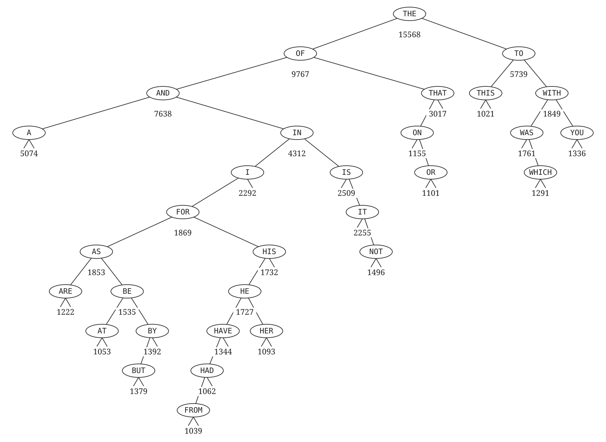

**图 12　31 个最常见的英文单词, 按出现频率递减的次序插入**

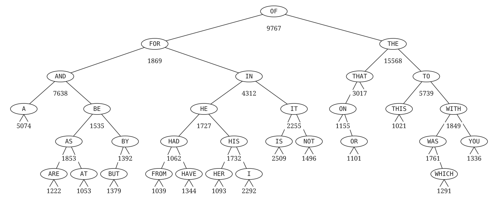

**图 13　31 个最常见的英文单词的最优查找树**

现在来探讨如何找到最优树的问题. 例如, 当 $N=3$ 时, 假定三个键 $K_1<K_2<K_3$ 的各自频率为 $p$、$q$、$r$. 于是可能存在的树共有五种:

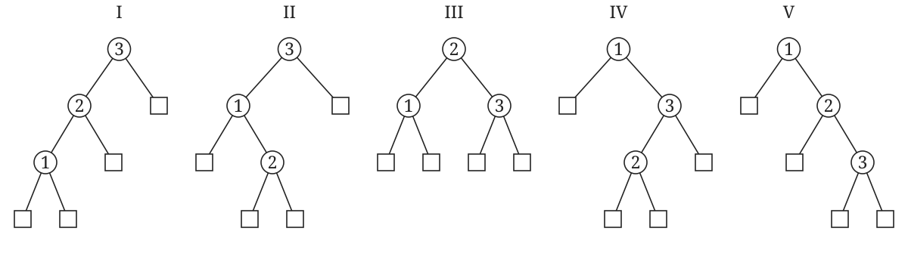

<table>
<thead><tr><th></th><th>I</th><th>II</th><th>III</th><th>IV</th><th>V</th><th></th></tr></thead>
<tbody><tr><th>成本</th><td>$3p+2q+r$</td><td>$2p+3q+r$</td><td>$2p+q+2r$</td><td>$p+3q+2r$</td><td>$p+2q+3r$</td><td>(13)</td></tr></tbody>
</table>

图 14 给出了使每棵树为最优的 $p$、$q$、$r$ 取值范围. 如果随机选择 $p$、$q$、$r$, 平衡树在大约 45%的时间内是最佳的 (见习题 21).

遗憾的是, 当 $N$ 很大时, 共有

$$
\binom{2N}N/(N+1)\approx4^N/(\sqrt\pi\,N^{3/2})
$$

棵二叉树, 所以我们无法对所有这些二叉树进行一一尝试, 以判断哪一棵是最佳的. 因此我们要更深入地研究最优二叉树的性质, 以得到一种找出最优二叉树的更好的方法.

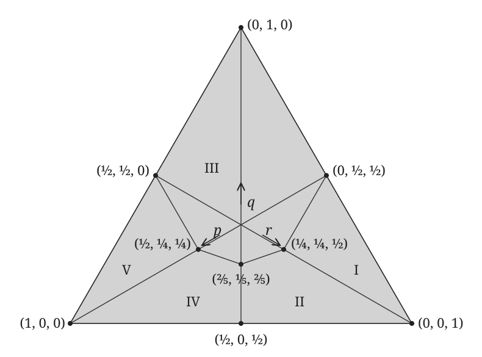

**图 14　如果 $(K_1,K_2,K_3)$ 的相对频率为 $(p,q,r)$, 则本图指出 (13) 的五棵树中哪一棵是最佳的. 尽管图中有三个坐标, 但由于事实上 $p+q+r=1$, 所以本图实际是二维图**

到目前为止, 我们仅考虑了成功查找的概率. 在实践中, 通常还必须考虑失败的情景. 例如, 图 13 中的 31 个单词仅考虑了大约 36%的典型英语文本, 其余 64%的文本肯定会影响到最优查找树的结构.

因此, 让我们确定问题如下: 给定 $2n+1$ 个概率 $p_1,p_2,\ldots,p_n$ 和 $q_0,q_1,\ldots,q_n$, 其中

$$
\begin{aligned}
p_i&=\text{查找参数是 }K_i\text{ 的概率};\\
q_i&=\text{查找参数介于 }K_i\text{ 和 }K_{i+1}\text{ 之间的概率}.
\end{aligned}
$$

(根据惯例, $q_0$ 是查找参数小于 $K_1$ 的概率, $q_n$ 是查找参数大于 $K_n$ 的概率.) 因此, $p_1+p_2+\cdots+p_n+q_0+q_1+\cdots+q_n=1$, 我们希望找到一棵二叉树, 使查找中的预期比较次数

$$
\sum_{j=1}^n p_j\bigl(\text{级}(\textcircled j)+1\bigr)
+\sum_{k=0}^n q_k\text{级}(\boxed k)\tag{14}
$$

降至最低. 其中, $\textcircled j$ 是对称序的第 $j$ 个内部结点, $\boxed k$ 是第 $k+1$ 个外部结点, 根结点位于第 0 级. 因此, 二叉树

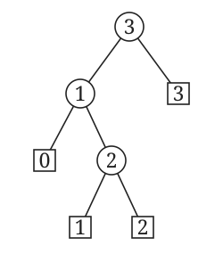(15)

的预期比较次数为 $2q_0+2p_1+3q_1+3p_2+3q_2+p_3+q_3$. 我们称之为树的*成本*, 并认为成本最低的树是最优的. 在这一定义中, 不需要 $p$ 和 $q$ 的和为 1. 对于任何给定的 “权值” 序列 $(p_1,\ldots,p_n;\ q_0,\ldots,q_n)$, 都可以求成本最低的树.

在 2.3.4.5 节我们已经研究了构建具有最小加权路径长度的树的哈夫曼过程, 但该方法要求所有 $p$ 为 0, 而且在其所生成的树中, 外部结点权值 $(q_0,\ldots,q_n)$ 通常不是严格地按照对称序由左至右排列的. 因此, 我们需要另外一种方法.

有一条定理可以帮我们一个大忙:*一棵最优树的所有子树都是最优的*. 例如, 如果 (15) 是权值 $(p_1,p_2,p_3;\ q_0,q_1,q_2,q_3)$ 的最优树, 则根结点的左子树对于 $(p_1,p_2;\ q_0,q_1,q_2)$ 必然是最优的. 对一个子树的任意改进都会导致对整棵树的改进.

这一原理提示了一个计算过程: 系统地寻找越来越大的最优子树. 我们已经在 5.4.9 节中使用同一思想来构建最优合并模式, 其一般方法称为 “动态规划”, 将在 7.7 节作进一步的研究.

设 $c(i,j)$ 是权值为 $(p_{i+1},\ldots,p_j;\ q_i,\ldots,q_j)$ 的最优树的成本, 并设 $w(i,j)=p_{i+1}+\cdots+p_j+q_i+\cdots+q_j$ 是所有这些权值之和. 因此, $c(i,j)$ 和 $w(i,j)$ 是定义在 $0\le i\le j\le n$ 上的. 由此可知, 在一个根结点为 $\textcircled k$ 的树中, 其最低可能成本为 $w(i,j)+c(i,k-1)+c(k,j)$, 所以

$$
\begin{aligned}
c(i,i)&=0,\\
c(i,j)&=w(i,j)+\min_{i<k\le j}\bigl(c(i,k-1)+c(k,j)\bigr),\qquad\text{对于 }i<j,
\end{aligned}\tag{16}
$$

当 $i<j$ 时, 设 $R(i,j)$ 是所有能够实现 (16) 中最小值的 $k$ 的集合. 这个集合确定了最优树可能选取的根结点.

利用式 (16), 有可能计算对于 $j-i=1,2,\ldots,n$ 的 $c(i,j)$ 值. 共有大约 $\frac12n^2$ 个这样的值, 对大约 $\frac16n^3$ 个 $k$ 值执行了该最小化操作. 这意味着, 我们可以在 $O(n^3)$ 个时间单位内使用 $O(n^2)$ 个内存单元来确定最优树.

实际上, 如果利用单调性, 就可以从运行时间中消去一个因子 $n$. 设 $r(i,j)$ 表示 $R(i,j)$ 的一个元素. 我们不需要计算整个集合 $R(i,j)$, 只需要一个代表就足够了. 一旦找到了 $r(i,j-1)$ 和 $r(i+1,j)$, 习题 27 的结果证明, 当权值为非负数时, 总是可以假定

$$
r(i,j-1)\le r(i,j)\le r(i+1,j).\tag{17}
$$

由于只需要查看 (16) 中的 $r(i+1,j)-r(i,j-1)+1$ 个 $k$ 值, 而不是 $j-i$ 个, 所以这样就限制了查找最小值的范围. $j-i=d$ 时的总工作量现在以下面的级数为限

$$
\sum_{\substack{d\le j\le n\\i=j-d}}\bigl(r(i+1,j)-r(i,j-1)+1\bigr)
=r(n-d+1,n)-r(0,d-1)+n-d+1<2n.
$$

因此, 总运行时间现在缩短至 $O(n^2)$.

下列算法详细地描述了这一过程.

**算法 K (寻找最优二叉查找树).** 给定 $2n+1$ 个非负权值 $(p_1,\ldots,p_n;\ q_0,\ldots,q_n)$, 此算法构建了二叉树 $t(i,j)$. 根据上述定义, 该树对于权值 $(p_{i+1},\ldots,p_j;\ q_i,\ldots,q_j)$ 拥有最低成本. 计算三个数组, 即

$$
\begin{array}{lll}
c[i,j],&\text{对于 }0\le i\le j\le n,&t(i,j)\text{ 的成本};\\
r[i,j],&\text{对于 }0\le i<j\le n,&t(i,j)\text{ 的根};\\
w[i,j],&\text{对于 }0\le i\le j\le n,&t(i,j)\text{ 的总权值}.
\end{array}
$$

该算法的结果由数组 $r$ 给出: 如果 $i=j$, 则 $t(i,j)$ 为空; 否则, 其左子树为 $t(i,r[i,j]-1)$, 其右子树为 $t(r[i,j],j)$.

**K1.[初始化.]** 对于 $0\le i\le n$, 置 $c[i,i]\leftarrow0$, $w[i,i]\leftarrow q_i$. 对于 $j=i+1,\ldots,n$, 置 $w[i,j]\leftarrow w[i,j-1]+p_j+q_j$. 然后, 对于 $1\le j\le n$, 置 $c[j-1,j]\leftarrow w[j-1,j]$, $r[j-1,j]\leftarrow j$. (这就确定了所有一个结点的最优树.)

**K2.[对 $d$ 进行循环.]** 对于 $d=2,3,\ldots,n$, 执行 K3, 然后终止算法.

**K3.[对 $j$ 进行循环.]**(我们已经确定了结点数少于 $d$ 的最优树. 这一步骤将确定所有 $d$ 个结点的最优树.) 对于 $j=d,d+1,\ldots,n$, 执行 K4.

**K4.[求 $c[i,j]$、$r[i,j]$.]** 置 $i\leftarrow j-d$. 然后置

$$
c[i,j]\leftarrow w[i,j]+\min_{r[i,j-1]\le k\le r[i+1,j]}\bigl(c[i,k-1]+c[k,j]\bigr),
$$

并且设定 $r[i,j]$ 为使上式取最小值的 $k$ 值. (习题 22 证明了 $r[i,j-1]\le r[i+1,j]$.)　▮

作为算法 K 的一个示例, 考虑图 15, 其基础是一种 “上下文中的键字”(KWIC) 索引应用. 对 *Journal of the ACM* 前 10 卷所有文章的题目进行排序, 准备一个字母索引, 在该索引中, 每个题目的每个单词都占有一行. 但是, 诸如 THE 和 EQUATION 之类的特定单词被认为提供的信息量过少, 所以将它们排除在索引之外. 这些特殊单词及其出现频率在图 15 的内部结点中给出. 注意, 像 “On the solution of an equation for a certain new problem” 这样的题目也没有什么信息, 所以也根本不会出现在索引中! KWIC 索引的思路是由汉斯·卢恩提出的 [*Amer. Documentation* **11** (1960), 288–295]. (见威廉·尤登,*JACM* **10**, 583–646, 其中给出了完整的 KWIC 索引.)

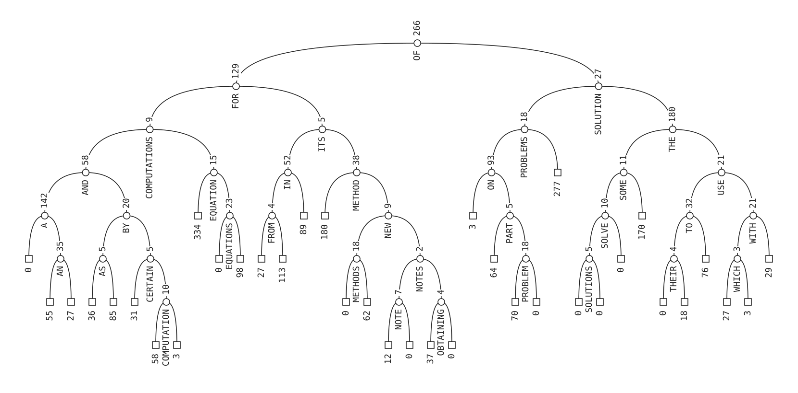

**图 15　一种 KWIC 索引应用的最优二叉查找树**

在准备用于排序的 KWIC 索引文件时, 我们希望使用一棵二叉查找树, 以判断每个具体单词是否应被编入索引. 其他单词落在两个未索引单词之间, 图 15 的外部结点给出了其频率. 因此, 在 1954～1963 年的 JACM 标题中恰有 277 个单词按字母顺序排在 PROBLEMS 和 SOLUTION 之间.

图 15 给出了 $n=35$ 时由算法 K 获得的最优树. 对于 $j=1,2,\ldots,35$ 计算的 $r[0,j]$ 值为 $(1,1,2,3,3,3,3,8,8,8,8,8,8,11,11,\ldots,11,21,21,21,21,21,21)$; 对于 $i=0,1,\ldots,34$ 的 $r[i,35]$ 值为 $(21,21,\ldots,21,25,25,25,25,25,25,26,26,26,30,30,30,30,30,30,30,33,33,33,35,35)$.

“中间性频率”$q_j$ 对于最优树结构有着显著影响, 图 16(a) 给出了当 $q_j$ 设定为 0 时所得到的最优树. 类似地, 内部频率 $p_i$ 也很重要, 图 16(b) 给出了当 $p_i$ 设定为 0 时的最优树. 考虑到整个频率集合, 平均说来, 图 15 中的树仅需要 4.15 次比较, 而图 16 中的树分别需要 4.69 次和 4.72 次.

(a)

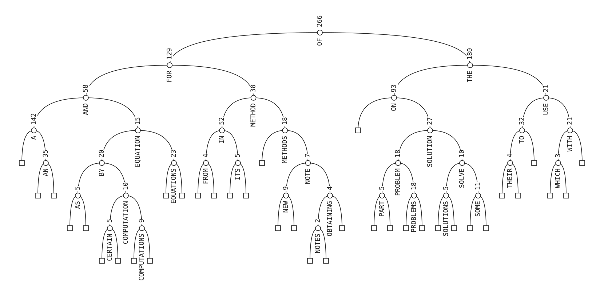

(b)

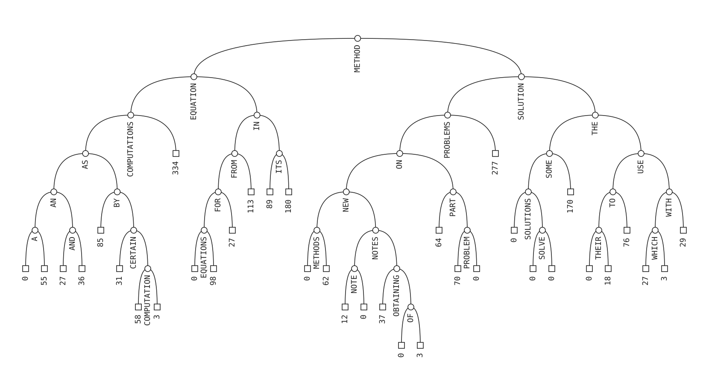

**图 16　基于图 15 中一半数据的最优二叉查找树: (a) 外部频率为 0; (b) 内部频率为 0**

由于算法 K 需要的时间和空间与 $n^2$ 成正比, 所以当 $n$ 非常大时, 该算法就变得不实用了. 当然, 考虑到本章后面将要讨论的其他查找技巧, 我们可能并不希望真的在 $n$ 值很大时使用二叉查找树. 但我们假定, 无论如何我们都想找出在 $n$ 值很大时的最优树或近似最优树.

我们已经看到, 按频率的递减顺序插入键时, 通常会给出一个相当好的树. 但它也可能非常糟糕 (见习题 20), 而且由于它没有利用 $q_j$ 权值, 所以它通常不是非常接近最优. 另一种方法是通过根结点 $k$ 的选择, 使所得到的最大子树权值 $\max(w(0,k-1),w(k,n))$ 尽可能小. 这种方法也可能非常糟糕, 因为它可能选择一个 $p_k$ 值非常小的结点作为根结点. 但是, 下面的定理 M 将证明, 它所得到的树离最优树并不是非常遥远.

根据韦恩·沃克与卡尔文·戈特利布的提议 [*Graph Theory and Computing* (Academic Press, 1972), 303–323], 将这两种方法结合起来, 可以得到一个令人满意的更好的过程: 尝试使左右两边的权值相等, 但准备将根结点向左或向右移动几步, 以找出一个具有较大 $p_k$ 的结点. 图 17 显示为什么这一方法是合理的: 如果根据图 15 中的 KWIC 数据, 将 $c(0,k-1)+c(k,n)$ 绘制为 $k$ 的函数, 我们将会看到其结果对 $p_k$ 的大小是非常敏感的.

当 $n$ 值很大时, 可以使用这样一种自上而下的方法来选择根结点, 然后来处理左、右子树. 当我们向下走到一个足够小的子树时, 就可以应用算法 K 了. 这种方法可以得出相当好的树 (据报告, 与最优值相差不超过 2%或 3%), 它只需要 $O(n)$ 个空间单位和 $O(n\log n)$ 个时间单位. 事实上, 弗雷德曼已经证明, 如果使用合适的数据结构, $O(n)$ 个时间单位就足够了 [*STOC* **7** (1975), 240–244], 见库尔特·梅尔霍恩,*Data Structures and Algorithms* **1** (Springer, 1984), 4.2 节.

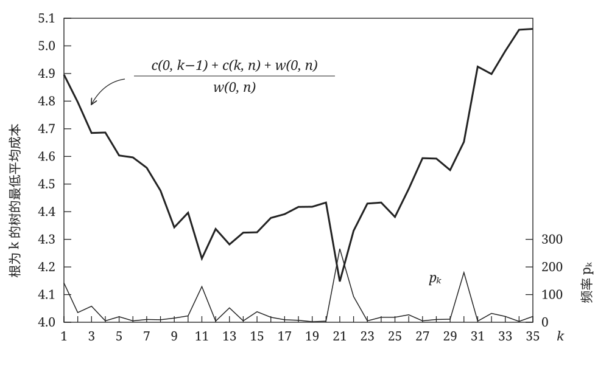

**图 17　成本特性, 表示为根结点 $k$ 的函数**

**最优树与熵.** 最低成本与一个名为*熵*的数学概念紧密相关, 它是由克劳德·香农在其开创性的信息论著作中引入的 [*Bell System Tech. J.* **27** (1948), 379–423, 623–656]. 如果 $p_1,p_2,\ldots,p_n$ 是满足 $p_1+p_2+\cdots+p_n=1$ 的概率值, 则可以用以下公式来定义熵:

$$
H(p_1,p_2,\ldots,p_n)=\sum_{k=1}^n p_k\lg\frac1{p_k}.\tag{18}
$$

直觉上, 如果有 $n$ 个事件可能出现, 第 $k$ 个事件的发生概率为 $p_k$, 我们可以设想, 当发生第 $k$ 个事件时, 我们已经接收到了 $\lg(1/p_k)$ 比特的信息. (一个概率为 $\frac1{32}$ 的事件会给出 5 比特信息, 等等.) 因此, $H(p_1,p_2,\ldots,p_n)$ 是随机事件中预期的信息的比特数. 如果 $p_k=0$, 则定义 $p_k\lg(1/p_k)=0$, 这是因为

$$
\lim_{\epsilon\to0+}\epsilon\lg\frac1\epsilon
=\lim_{m\to\infty}\frac1m\lg m=0.
$$

有了这一约定, 就可以在一些概率值为 0 时使用 (18) 了.

当 $x>0$ 时, 函数 $x\lg(1/x)$ 是凹的, 即它的二阶导数 $-1/(x\ln2)$ 为负. 因此, 当 $p_1=p_2=\cdots=p_n=1/n$ 时, $H(p_1,p_2,\ldots,p_n)$ 取最大值, 即

$$
H\left(\frac1n,\frac1n,\ldots,\frac1n\right)=\lg n.\tag{19}
$$

一般来说, 如果我们指定了 $p_1,\ldots,p_{n-k}$, 但允许其他概率 $p_{n-k+1},\ldots,p_n$ 变动, 则有

$$
\begin{aligned}
H(p_1,\ldots,p_{n-k},p_{n-k+1},\ldots,p_n)
&\le H\left(p_1,\ldots,p_{n-k},\frac qk,\ldots,\frac qk\right)\\
&=H(p_1,\ldots,p_{n-k},q)+q\lg k,
\end{aligned}\tag{20}
$$

$$
\begin{aligned}
H(p_1,\ldots,p_{n-k},p_{n-k+1},\ldots,p_n)
&\ge H(p_1,\ldots,p_{n-k},q,0,\ldots,0)\\
&=H(p_1,\ldots,p_{n-k},q),
\end{aligned}\tag{21}
$$

其中 $q=1-(p_1+\cdots+p_{n-k})$.

考虑任何不一定为二叉的树, 其中已经为叶子指定了概率, 比如

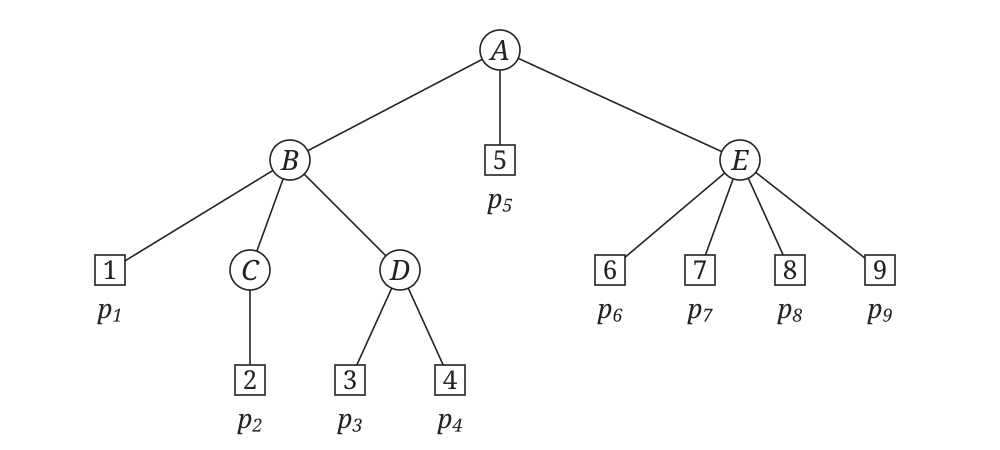(22)

这里 $p_k$ 表示查找过程在叶子 $\boxed k$ 处结束的概率. 因此, 在每个内部结点 (非叶结点) 处的分支都对应于一个局部概率分布, 其基础是每个分支之下叶概率的总和. 例如, 在结点 $\textcircled A$ 处, 第一、第二、第三分支的概率分别为 $(p_1+p_2+p_3+p_4,p_5,p_6+p_7+p_8+p_9)$, 在结点 $\textcircled B$ 处, 这些概率为 $(p_1,p_2,p_3+p_4)/(p_1+p_2+p_3+p_4)$. 我们说, 每个内部结点拥有其局部概率分布的熵, 因此

$$
\begin{aligned}
H(A)={}&(p_1+p_2+p_3+p_4)\lg\frac1{p_1+p_2+p_3+p_4}\\
&+p_5\lg\frac1{p_5}+(p_6+p_7+p_8+p_9)\lg\frac1{p_6+p_7+p_8+p_9},
\end{aligned}
$$

$$
\begin{aligned}
H(B)={}&\frac{p_1}{p_1+p_2+p_3+p_4}\lg\frac{p_1+p_2+p_3+p_4}{p_1}
+\frac{p_2}{p_1+p_2+p_3+p_4}\lg\frac{p_1+p_2+p_3+p_4}{p_2}\\
&+\frac{p_3+p_4}{p_1+p_2+p_3+p_4}\lg\frac{p_1+p_2+p_3+p_4}{p_3+p_4},
\end{aligned}
$$

$$
H(C)=\frac{p_2}{p_2}\lg\frac{p_2}{p_2},
$$

$$
H(D)=\frac{p_3}{p_3+p_4}\lg\frac{p_3+p_4}{p_3}
+\frac{p_4}{p_3+p_4}\lg\frac{p_3+p_4}{p_4},
$$

$$
\begin{aligned}
H(E)={}&\frac{p_6}{p_6+p_7+p_8+p_9}\lg\frac{p_6+p_7+p_8+p_9}{p_6}
+\frac{p_7}{p_6+p_7+p_8+p_9}\lg\frac{p_6+p_7+p_8+p_9}{p_7}\\
&+\frac{p_8}{p_6+p_7+p_8+p_9}\lg\frac{p_6+p_7+p_8+p_9}{p_8}
+\frac{p_9}{p_6+p_7+p_8+p_9}\lg\frac{p_6+p_7+p_8+p_9}{p_9}.
\end{aligned}
$$

**引理 E.** 对一棵树中所有内部结点 $\alpha$ 所取的 $p(\alpha)H(\alpha)$ 求和, 其中 $p(\alpha)$ 是到达结点 $\alpha$ 的概率, $H(\alpha)$ 是 $\alpha$ 的熵, 该和值等于叶子上概率分布的熵.

*证明.* 通过自下而上应用归纳法, 可以很轻松地确立这一恒等式. 例如, 关于上述公式, 我们有

$$
\begin{aligned}
&H(A)+(p_1+p_2+p_3+p_4)H(B)+p_2H(C)+(p_3+p_4)H(D)+(p_6+p_7+p_8+p_9)H(E)\\
&\qquad=p_1\lg\frac1{p_1}+p_2\lg\frac1{p_2}+\cdots+p_9\lg\frac1{p_9},
\end{aligned}
$$

所有涉及 $\lg(p_1+p_2+p_3+p_4)$、$\lg(p_3+p_4)$ 以及 $\lg(p_6+p_7+p_8+p_9)$ 的项均被消去.　▮

作为引理 E 的一个应用, 我们可以使用熵来为任意二叉树的成本确定一个很方便的下限.

**定理 B.** 设 $(p_1,\ldots,p_n;\ q_0,\ldots,q_n)$ 是和算法 K 中一样的非负权值, 对其进行标准化, 使得 $p_1+\cdots+p_n+q_0+\cdots+q_n=1$, 并设 $P=p_1+\cdots+p_n$ 为一次成功查找的概率. 设

$$
H=H(p_1,\ldots,p_n,q_0,\ldots,q_n)
$$

是相应概率分布的熵, 并设 $C$ 是最低成本 (14). 于是, 如果 $H\ge2P/e$, 则有

$$
C\ge H-P\lg\frac{eH}{2P}.\tag{23}
$$

*证明.* 取一棵成本为 $C$ 的二叉树, 并为它的叶子指定概率 $q_k$. 同时还在每个内部结点下方增加一个中间分支, 导致一个概率为 $p_k$ 的新叶. 于是, 对所得三叉树的内部结点 $\alpha$ 求和可得 $C=\sum p(\alpha)$, 并由引理 E 可得 $H=\sum p(\alpha)H(\alpha)$.

如果 $\alpha$ 为内部结点 $\textcircled j$, 则熵 $H(\alpha)$ 对应于一种三路分布, 其中概率之一为 $p_j/p(\alpha)$. 习题 35 证明, 只要 $p+q+r=1$, 对于所有 $x>0$ 有

$$
H(p,q,r)\le p\lg x+1+\lg\left(1+\frac1{2x}\right).\tag{24}
$$

因此, 对于所有正数 $x$, 有不等式

$$
H=\sum_\alpha p(\alpha)H(\alpha)
\le\sum_{j=1}^n p_j\lg x+\left(1+\lg\left(1+\frac1{2x}\right)\right)C.
$$

由于

$$
\begin{aligned}
C&\ge\frac1{1+\lg(1+P/H)}\left(H-P\lg\frac H{2P}\right)\\
&=\frac1{1+\lg(1+P/H)}(H+P\lg e)
-\frac P{1+\lg(1+P/H)}\lg\frac{eH}{2P}\\
&\ge H-P\lg\frac{eH}{2P},
\end{aligned}
$$

利用对于所有 $y>0$ 有 $\lg(1+y)\le y\lg e$ 这一事实, 选择 $2x=H/P$ 将得到所期望的结果.　▮

当熵极低时, 式 (23) 不一定成立. 但由于 $H$ 值通常接近于 $\lg n$, 所以对于 $H\ge2P/e$ 的情景的限制不是很严格, 见习题 37. 注意, 这一证明实际上并没有利用结点的 “由左至右” 顺序. 对于内部结点概率为 $p_j$、外部结点概率为 $q_k$、任意顺序的二叉查找树, 下限 (23) 都成立.

即使我们真的坚持由左至右的顺序, 熵计算也会给出一个距离 (23) 不是太远的上限.

**定理 M.** 根据定理 B 的假定, 还可以得到

$$
C\le H+2-P.\tag{25}
$$

*证明.* 构造 $n+1$ 个和式: $s_0=\frac12q_0$, $s_1=q_0+p_1+\frac12q_1$, $s_2=q_0+p_1+q_1+p_2+\frac12q_2$, …, $s_n=q_0+p_1+\cdots+q_{n-1}+p_n+\frac12q_n$. 我们可以假定 $s_0<s_1<\cdots<s_n$ (见习题 38). 把每个 $s_k$ 表示为二进制小数, 如果 $s_n=1$, 则记作 $s_n=(0.111\ldots)_2$. 设字符串 $\sigma_k$ 是 $s_k$ 的前导二进制位, 对于 $j\ne k$, 保留足够的二进制位以区分 $s_k$ 和 $s_j$. 例如, 对于 $n=3$, 可能有

$$
\begin{aligned}
s_0&=(0.0000001)_2,&\qquad\sigma_0&=00000\\
s_1&=(0.0000101)_2,&\qquad\sigma_1&=00001\\
s_2&=(0.0001011)_2,&\qquad\sigma_2&=0001\\
s_3&=(0.1100000)_2,&\qquad\sigma_3&=1
\end{aligned}
$$

构造具有 $n+1$ 个叶子的一棵二叉树, 使得对于 $0\le k\le n$, $\sigma_k$ 对应于从根结点到 $\boxed k$ 的路径, 其中 “0” 表示左分支, “1” 表示右分支. 还有, 如果对于某些 $\alpha_k$、$\beta_k$、$\gamma_k$, $\sigma_{k-1}$ 的形式为 $\alpha_k0\beta_k$, $\sigma_k$ 的形式为 $\alpha_k1\gamma_k$, 则设内部结点 $\textcircled k$ 对应于路径 $\alpha_k$. 因此, 在上面的例子中我们有

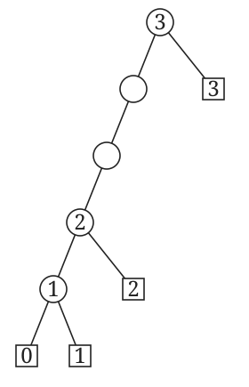

可能有一些内部结点仍然没有名字, 将每个此类结点用其唯一的孩子代替. 由此所得到的树的成本最多为 $\sum_{k=1}^n p_k(|\alpha_k|+1)+\sum_{k=0}^n q_k|\sigma_k|$.

由于 $s_k\le(.{\alpha_k})_2+2^{-|\alpha_k|}$ 以及 $s_{k-1}\ge(.{\alpha_k})_2$, 我们有

$$
p_k\le\tfrac12q_{k-1}+p_k+\tfrac12q_k=s_k-s_{k-1}\le2^{-|\alpha_k|}.\tag{26}
$$

此外, 如果 $q_k\ge2^{-t}$, 则有 $s_k\ge s_{k-1}+2^{-t-1}$ 及 $s_{k+1}\ge s_k+2^{-t-1}$, 因此 $|\sigma_k|\le t+1$. 由此可得 $q_k<2^{-|\sigma_k|+2}$. 我们已经构建了一棵二叉树, 其成本

$$
\begin{aligned}
&\le\sum_{k=1}^n p_k(1+|\alpha_k|)+\sum_{k=0}^n q_k|\sigma_k|\\
&\le\sum_{k=1}^n p_k\left(1+\lg\frac1{p_k}\right)
+\sum_{k=0}^n q_k\left(2+\lg\frac1{q_k}\right)\\
&=P+2(1-P)+H=H+2-P.
\end{aligned}
$$

▮

在图 15 的 KWIC 索引应用中, 有 $P=1304/3288\approx0.39659$, $H(p_1,\ldots,p_{35},q_0,\ldots,q_{35})\approx5.00635$. 因此, 定理 B 告诉我们 $C\ge3.3800$, 定理 M 告诉我们 $C<6.6098$.

**\*加西亚-瓦克斯算法.** 在 $p_1=\cdots=p_n=0$ 的特殊情况下, 有可能对算法 K 进行令人惊奇的改进. 在这一情景中, 只关心叶子概率 $(q_0,q_1,\ldots,q_n)$, 由于在几种重要的应用中都会遇到这一情景, 所以它非常重要. 在本节的后续部分, 我们假定概率 $p_j$ 为 0. 注意, 在此情景中, 只有 $P=1$ 时才有 $C=H+2-P$, 所以定理 B 和 M 简化为不等式

$$
H(q_0,q_1,\ldots,q_n)\le C(q_0,q_1,\ldots,q_n)<H(q_0,q_1,\ldots,q_n)+2\tag{27}
$$

成本函数 (14) 简化为

$$
C=\sum_{k=0}^n q_kl_k,\qquad l_k=\boxed k\text{ 的级别}.\tag{28}
$$

之所以有可能实现一种更为简单的算法, 其关键在于以下性质:

**引理 W.** 如果 $q_{k-1}>q_{k+1}$, 则在每棵最优树中 $l_k\le l_{k+1}$. 如果 $q_{k-1}=q_{k+1}$, 则在某些最优树中 $l_k\le l_{k+1}$.

*证明.* 假定 $q_{k-1}\ge q_{k+1}$, 并且考虑一棵 $l_k>l_{k+1}$ 的树, 则 $\boxed k$ 必然是一个右孩子, 它的左兄弟 $L$ 是一个权值为 $w\ge q_{k-1}$ 的子树. 用 $L$ 代替 $\boxed k$ 的父结点, 用其孩子为 $\boxed k$ 和 $\boxed{k+1}$ 的一个结点代替 $\boxed{k+1}$. 这样可以使总成本改变 $-w-q_k(l_k-l_{k+1}-1)+q_{k+1}\le q_{k+1}-q_{k-1}$. 所以, 如果 $q_{k-1}>q_{k+1}$, 则给定的树不是最优的. 如果 $q_{k-1}=q_{k+1}$, 那就已经将一棵最优树转换为另一棵最优树了. 在后一种情况下, 我们已经发现了一棵满足 $l_k=l_{k+1}$ 的最优树.　▮

深入分析这一结构可以告诉我们更多信息.

**引理 X.** 假定 $j$ 和 $k$ 是满足 $j<k$ 的下标, 而且满足

(i) 对于 $1\le i<k$, $q_{i-1}>q_{i+1}$;

(ii) $q_{k-1}\le q_{k+1}$;

(iii) 对于 $j\le i<k-1$, $q_i<q_{k-1}+q_k$;

(iv) $q_{j-1}\ge q_{k-1}+q_k$.

于是, 存在一棵满足 $l_{k-1}=l_k$ 的最优树, 同时, 它还满足以下条件之一:

(a) $l_j=l_k-1$,

(b) $l_j=l_k$ 且 $\boxed j$ 为左孩子.

*证明.* 颠倒引理 W 中的左与右, 我们将会看到, (ii) 隐含着存在满足 $l_{k-1}\ge l_k$ 的最优树. 但引理 W 和 (i) 还意味着 $l_1\le l_2\le\cdots\le l_k$, 因此有 $l_{k-1}=l_k$.

假定对于某个满足 $j\le s<k-1$ 的 $s$ 有 $l_s<l_k-1\le l_{s+1}$. 设 $t$ 是满足 $l_t=l_k$ 且小于 $k$ 的最小下标. 于是, 对于 $s<i<t$, 有 $l_i=l_k-1$ 且 $\boxed{s+1}$ 是左孩子, 或者 $s+1=t$. 此外, $\boxed t$ 和 $\boxed{t+1}$ 是兄弟. 用 $\boxed{t+1}$ 代替它们的父结点, 对于 $s<i<t$, 用 $\boxed{i+1}$ 代替 $\boxed i$, 用其孩子为 $\boxed s$ 和 $\boxed{s+1}$ 的一个内部结点代替外部结点 $\boxed s$. 这一改变使成本增大值 $\le q_s-q_t-q_{t+1}\le q_s-q_{k-1}-q_k$, 所以如果 $q_s<q_{k-1}+q_k$, 则这是一个改进. 因此, 由 (iii), 有 $l_j\ge l_k-1$.

我们还没有用到假设 (iv). 如果 $l_j=l_k$, 且 $\boxed j$ 不是左孩子, 则 $\boxed j$ 必然是 $\boxed{j-1}$ 的右兄弟. 用 $\boxed{j-1}$ 代替它们的父结点, 然后对于 $j<i<k$, 用 $\boxed{i-1}$ 代替叶子 $\boxed i$, 并用其孩子为 $\boxed{k-1}$ 和 $\boxed k$ 的一个内部结点代替外部结点 $\boxed k$. 成本增加 $-q_{j-1}+q_{k-1}+q_k\le0$, 所以我们得到了一棵满足 (a) 或 (b) 的最优树.　▮

**引理 Y.** 设 $j$、$k$ 与引理 X 中一样, 并考虑通过删除 $q_{k-1}$ 和 $q_k$ 并在 $q_{j-1}$ 之后插入 $q_{k-1}+q_k$ 所得到的修改后概率 $(q'_0,\ldots,q'_{n-1})=(q_0,\ldots,q_{j-1},q_{k-1}+q_k,q_j,\ldots,q_{k-2},q_{k+1},\ldots,q_n)$. 于是

$$
C(q'_0,\ldots,q'_{n-1})\le C(q_0,\ldots,q_n)-(q_{k-1}+q_k).\tag{29}
$$

*证明.* 只须证明, 对于 $(q_0,\ldots,q_n)$ 的任意最优树, 都可以转换为一棵成本相同的树, 其中 $\boxed{k-1}$ 和 $\boxed k$ 是兄弟, 且叶子按以下顺序排列:

$$
\boxed0\quad\ldots\quad\boxed{j-1}\quad\boxed{k-1}\quad\boxed k\quad
\boxed j\quad\ldots\quad\boxed{k-2}\quad\boxed{k+1}\quad\ldots\quad\boxed n.\tag{30}
$$

我们从引理 X 中构建的树入手. 如果它是 (b) 类型的, 则只需重命名这些叶子, 把 $\boxed{k-1}$ 和 $\boxed k$ 向左移动 $k-1-j$ 个位置. 如果它是 (a) 类型的, 则假定 $l_{s-1}=l_k-1$, $l_s=l_k$. 接着进行如下操作: 首先把 $\boxed{k-1}$ 和 $\boxed k$ 向左移动 $k-1-s$ 个位置, 然后用 $\boxed{s-1}$ 代替它们的 (新) 父结点. 最后, 用其孩子为 $\boxed{k-1}$ 和 $\boxed k$ 的一个结点代替 $\boxed j$, 对于 $j<i<s$, 用 $\boxed{i-1}$ 代替 $\boxed i$.　▮

**引理 Z.** 根据引理 Y 中的假设, (29) 中的等式成立.

*证明.* 对于 $(q'_0,\ldots,q'_{n-1})$ 的每棵树都对应于一棵具有叶子 (30) 的树, 其中两个乱序叶结点 $\boxed{k-1}$ 和 $\boxed k$ 是兄弟. 设内部结点 $\textcircled x$ 是它们的父结点. 我们希望证明: 任何一棵此种类型的最优树都可以转换为成本相同、叶子以正常顺序 $\boxed0\ \ldots\ \boxed n$ 排列的树.

如果 $j=k-1$, 那就没有什么需要证明的了. 如果不相等, 由于 $q_{j-1}\ge q_{k-1}+q_k>q_j$, 所以对于 $j\le i<k-1$ 有 $q'_{i-1}>q'_{i+1}$. 于是, 根据引理 W, 有 $l_x\le l_j\le\cdots\le l_{k-2}$, 其中 $l_x$ 是 $\textcircled x$ 的级别, 对于 $j\le i<k-1$, $l_i$ 是 $\boxed i$ 的级别. 如果 $l_x=l_{k-2}$, 则只需要将结点 $\textcircled x$ 右移, 用 $\boxed j\ \ldots\ \boxed{k-2}\ \textcircled x$ 替换序列 $\textcircled x\ \boxed j\ \ldots\ \boxed{k-2}$, 这样就可以根据需要整理好叶子.

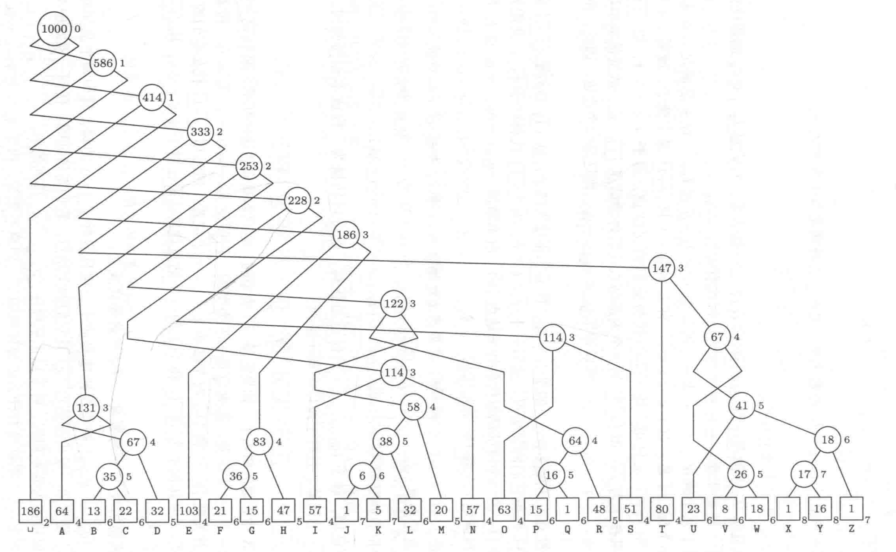

**图 18　应用于字母频率数据的加西亚-瓦克斯算法: 阶段 1 和阶段 2**

否则, 假定 $l_s=l_x$, $l_{s+1}>l_x$. 我们首先用 $\boxed j\ \ldots\ \boxed s\ \textcircled x$ 代替 $\textcircled x\ \boxed j\ \ldots\ \boxed s$, 这使得 $l\le l_{s+1}\le\cdots\le l_{k-2}$, 其中 $l=l_x+1$ 是结点 $\boxed{k-1}$ 和 $\boxed k$ 的公共级别. 最后, 将结点

$$
\boxed{k-1}\quad\boxed k\quad\boxed{s+1}\quad\ldots\quad\boxed{k-2}
$$

用循环移位后的序列

$$
\boxed{s+1}\quad\ldots\quad\boxed{k-2}\quad\boxed{k-1}\quad\boxed k.
$$

来代替. 习题 40 证明, 除非 $l_{k-2}=l$, 否则这些修改会降低成本. 但由于引理 Y 的原因, 这一成本不能降低, 所以有 $l_{k-2}=l$, 证明至此完成.　▮

这些引理表明, 关于 $n+1$ 个权值 $q_0,q_1,\ldots,q_n$ 的问题可以简化为关于 $n$ 个权值的问题: 我们首先找到满足 $q_{k-1}\le q_{k+1}$ 的最小下标 $k$, 然后找出满足 $q_{j-1}\ge q_{k-1}+q_k$ 的最大 $j<k$. 接着从列表中清除 $q_{k-1}$ 和 $q_k$, 并在 $q_{j-1}$ 之后插入 $q_{k-1}+q_k$. 在 $j=0$ 或 $k=n$ 的特殊情景中, 这些证明过程表明, 我们应当像左、右两端存在无限权值 $q_{-1}$ 和 $q_{n+1}$ 那样进行处理. 这些证明过程还表明, 由新权值 $(q'_0,\ldots,q'_{n-1})$ 获得的任何最优树 $T'$ 都可以重新排列为一棵树 $T$, 它拥有原权值 $(q_0,\ldots,q_n)$, 其顺序为正确的由左至右顺序. 此外, 在 $T$ 和 $T'$ 中, 每个权值出现的级别相同.

例如, 图 18 给出了一种构造过程, 其中的权值 $q_k$ 是字符 $\sqcup,\mathsf A,\mathsf B,\ldots,\mathsf Z$ 在英文文本中的相对频率. 前几个权值为

$$
186,\ 64,\ 13,\ 22,\ 32,\ 103,\ \ldots
$$

而且有 $186>13$, $64>22$, $13\le32$. 因此, 我们用 35 代替 “13,22”. 在下面的新序列

$$
186,\ 64,\ 35,\ 32,\ 103,\ \ldots
$$

中, 我们用 67 代替 “35,32”, 并将 67 移到 64 的左边, 得到

$$
186,\ 67,\ 64,\ 103,\ \ldots,
$$

然后 “67,64” 变为 131, 我们开始查看跟在 103 后面的权值. 在把 27 个原来的权值合并为单个权值 1000 之后, 这个连续合并的历程就指定了一棵二叉树, 其加权路径长度就是原问题的解.

但图 18 中树叶的顺序根本就是不正确的, 因为当我们把 $q_{k-1}+q_k$ 左移时, 这些叶子会变得混乱 (见习题 41). 引理 Z 的证明再次保证了存在一棵树, 其叶子的顺序正确, 而且所在级别与混乱树中完全相同. 所以这棵不再混乱的树 (图 19) 就是最优的, 它就是加西亚-瓦克斯算法输出的二叉树.

**算法 G (用于最优二叉树的加西亚-瓦克斯算法).** 给定一系列非负权值 $w_0,w_1,\ldots,w_n$, 本算法构造具有 $n$ 个内部结点的一棵二叉树, 对于这棵二叉树, $\sum_{k=0}^n w_kl_k$ 是最小的, 其中 $l_k$ 是外部结点 $\boxed k$ 到根结点的距离. 它使用一个由 $2n+2$ 个结点组成的数组, 这些结点的地址为 $\mathrm X_k$($0\le k\le2n+1$). 每个结点有四个字段, 名为 WT、LLINK、RLINK 和 LEVEL. 在构造出的树中, 其叶子为结点 $\mathrm X_0\ldots\mathrm X_n$, 内部结点为 $\mathrm X_{n+1}\ldots\mathrm X_{2n}$, 根结点为 $\mathrm X_{2n}$, 且 $\mathrm X_{2n+1}$ 用作一个临时的标识. 本算法还维护一个由指针 $\mathrm P_0,\mathrm P_1,\ldots,\mathrm P_t$ 组成的工作数组, 其中 $t\le n+1$.

**G1.[开始阶段 1.]** 对于 $0\le k\le n$, 置 $\mathrm{WT}(\mathrm X_k)\leftarrow w_k$, $\mathrm{LLINK}(\mathrm X_k)\leftarrow\mathrm{RLINK}(\mathrm X_k)\leftarrow\Lambda$. 还置 $\mathrm P_0\leftarrow\mathrm X_{2n+1}$, $\mathrm{WT}(\mathrm P_0)\leftarrow\infty$, $\mathrm P_1\leftarrow\mathrm X_0$, $t\leftarrow1$, $m\leftarrow n$. 然后对于 $r=1,2,\ldots,n$ 执行 G2, 并转到 G3.

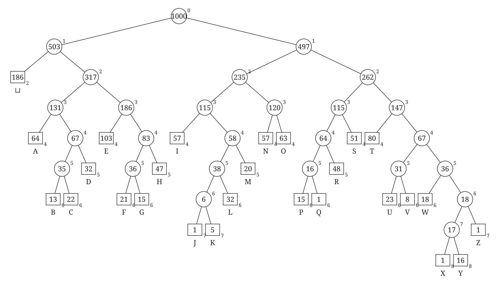

**图 19　应用于字母频率数据的加西亚-瓦克斯算法: 阶段 3**

**G2.[吸收 $w_r$.]**(此时, 我们有基本条件:

$$
\mathrm{WT}(\mathrm P_{i-1})>\mathrm{WT}(\mathrm P_{i+1})\qquad\text{对于 }1\le i<t.\tag{31}
$$

换句话说, 工作数组中的权值是 “2-递减的”.) 如果 $\mathrm{WT}(\mathrm P_{t-1})\le w_r$, 置 $k\leftarrow t$, 执行下面的子例程 C, 并重复 G2. 否则, 置 $t\leftarrow t+1$, $\mathrm P_t\leftarrow\mathrm X_r$.

**G3.[完成阶段 1.]** 当 $t>1$ 时反复执行: 置 $k\leftarrow t$, 执行下面的子例程 C.

**G4.[执行阶段 2.]**(现在 $\mathrm P_1=\mathrm X_{2n}$ 是二叉树的根结点, $\mathrm{WT}(\mathrm P_1)=w_0+\cdots+w_n$.) 对于 $0\le k\le n$, 置 $l_k$ 为结点 $\mathrm X_k$ 到结点 $\mathrm P_1$ 的距离. (见习题 43. 图 18 给出了一个示例, 其中, 在每个结点的右边给出了级别编号.)

**G5.[执行阶段 3.]** 通过改变 $\mathrm X_{n+1},\ldots,\mathrm X_{2n}$ 的链接, 构造一棵有相同的级别编号 $l_k$ 的新的二叉树, 它具有对称序 $\mathrm X_0,\ldots,\mathrm X_n$ 下的叶结点. (见习题 44. 图 19 中给出了一个示例.)　▮

**子例程 C (组合).** 此递归子例程是加西亚-瓦克斯算法的核心. 它把两个权值组合在一起, 根据需要进行左移, 并维护 2-递减条件 (31). 变量 $j$ 和 $w$ 是局部的, 但变量 $k$、$m$ 和 $t$ 是全局的.

**C1.[创建一个新结点.]**(此时有 $k\ge2$.) 置 $m\leftarrow m+1$, $\mathrm{LLINK}(\mathrm X_m)\leftarrow\mathrm P_{k-1}$, $\mathrm{RLINK}(\mathrm X_m)\leftarrow\mathrm P_k$, $\mathrm{WT}(\mathrm X_m)\leftarrow w\leftarrow\mathrm{WT}(\mathrm P_{k-1})+\mathrm{WT}(\mathrm P_k)$.

**C2.[后续结点左移.]** 置 $t\leftarrow t-1$. 然后对于 $k\le j\le t$, 置 $\mathrm P_j\leftarrow\mathrm P_{j+1}$.

**C3.[前驱结点右移.]** 置 $j\leftarrow k-2$. 然后当 $\mathrm{WT}(\mathrm P_j)<w$ 时反复执行: 置 $\mathrm P_{j+1}\leftarrow\mathrm P_j$, $j\leftarrow j-1$.

**C4.[插入新结点.]** 置 $\mathrm P_{j+1}\leftarrow\mathrm X_m$.

**C5.[是否完成?]** 如果 $j=0$ 或 $\mathrm{WT}(\mathrm P_{j-1})>w$, 则退出此子例程.

**C6.[恢复 (31).]** 置 $k\leftarrow j$, $j\leftarrow t-j$, 并递归调用子例程 C. 然后重新置 $j\leftarrow t-j$ (注意 $t$ 的值可能发生改变!), 并返回 C5.　▮

子例程 C 可能需要 $\Omega(n)$ 步来创建和插入一个新结点, 这是因为它使用的是顺序存储, 而不是链表. 因此, 算法 G 的总运行时间可能为 $\Omega(n^2)$. 但可以使用更精致的数据结构来确保阶段 1 最多需要 $O(n\log n)$ 步 (见习题 45). 阶段 2 和阶段 3 仅需要 $O(n)$ 步.

丹尼尔·克莱特曼和迈克尔·萨克斯证明了 [*SIAM J. Algeb. Discr. Methods* **2** (1981), 142–146], 最优加权路径长度从来不会超出当 $q$ 被重排为以下 “锯齿顺序” 时得到的最优加权路径长度:

$$
q_0\le q_2\le q_4\le\cdots\le q_{2\lfloor n/2\rfloor}
\le q_{2\lceil n/2\rceil-1}\le\cdots\le q_3\le q_1.\tag{32}
$$

(这是习题 6.1–18 中所讨论的管风琴顺序的逆.) 在后一情景中, 由于工作数组中的权值实际上是非递增的 (而不仅仅像在 (31) 中那样是 “2-递减的”), 所以加西亚-瓦克斯算法实际上简化为在权值 $q_0+q_1,q_2+q_3,\ldots$ 上的哈夫曼算法. 因此, 我们可以在不知道权值顺序的情况下改进定理 M 的上限.

图 19 中的最优二叉树在编码理论和查找领域有一个重要应用: 用 0 表示树中的一个左分支, 用 1 表示右分支, 可以得到以下变长码字:

<table>
<tbody>
<tr><td>$\sqcup$</td><td><code>00</code></td><td><code>I</code></td><td><code>1000</code></td><td><code>R</code></td><td><code>11001</code></td></tr>
<tr><td><code>A</code></td><td><code>0100</code></td><td><code>J</code></td><td><code>1001000</code></td><td><code>S</code></td><td><code>1101</code></td></tr>
<tr><td><code>B</code></td><td><code>010100</code></td><td><code>K</code></td><td><code>1001001</code></td><td><code>T</code></td><td><code>1110</code></td></tr>
<tr><td><code>C</code></td><td><code>010101</code></td><td><code>L</code></td><td><code>100101</code></td><td><code>U</code></td><td><code>111100</code></td></tr>
<tr><td><code>D</code></td><td><code>01011</code></td><td><code>M</code></td><td><code>10011</code></td><td><code>V</code></td><td><code>111101</code></td></tr>
<tr><td><code>E</code></td><td><code>0110</code></td><td><code>N</code></td><td><code>1010</code></td><td><code>W</code></td><td><code>111110</code></td></tr>
<tr><td><code>F</code></td><td><code>011100</code></td><td><code>O</code></td><td><code>1011</code></td><td><code>X</code></td><td><code>11111100</code></td></tr>
<tr><td><code>G</code></td><td><code>011101</code></td><td><code>P</code></td><td><code>110000</code></td><td><code>Y</code></td><td><code>11111101</code></td></tr>
<tr><td><code>H</code></td><td><code>01111</code></td><td><code>Q</code></td><td><code>110001</code></td><td><code>Z</code></td><td><code>1111111</code></td></tr>
</tbody>
</table>

(33)

于是, 像 “RIGHT ON” 这样一条消息可以用以下字符串编码

$$
\mathtt{1100110000111010111111100010111010}.
$$

尽管这些码字的长度是变化的, 但由于树结构告诉我们何时一个码字结束, 另一个码字开始, 所以可以很容易地由左至右进行解码. 这一编码方法保持了消息的字母顺序, 每个字符平均使用大约 4.2 个二进制位. 因此, 此编码可用于压缩数据文件, 而不会破坏字符信息的字典序. (每个字符 4.2 个二进制位这一数字在所有二叉树编码中是最小的, 如果我们放弃字母顺序约束条件, 可以缩减至每个字符 4.1 个二进制位. 如果对字符对而非单个字符进行编码, 还可以在保持字母顺序的前提下进一步缩减二进制位数.)

**历史与文献.** 这一节的树查找方法是由若干人在 20 世纪 50 年代独立发现的. 在 1952 年 8 月签署的一份未发表备忘录上, 达米用以下方式描述了树插入方法的一种原始形式:

> 考虑一个磁鼓, 其中存储了 $2^n$ 项, 每项有一个二进制地址.
>
> 执行以下程序:
>
> 1. 读入第一项, 将其存储到地址 $2^{n-1}$, 即存储位置的一半处.
> 2. 读入下一项. 将其与第一项对比.
> 3. 如果后一项较大, 则将其入在地址 $2^{n-1}+2^{n-2}$ 处. 如果较小, 则放在 $2^{n-2}$ 处……

戴维·惠勒介绍了树插入方法的另一早期形式, 它实际上允许进行多路分支, 类似于我们将在 6.2.4 节讨论的内容. 康韦·伯纳斯-李设计了一种二叉树插入方法 [见 *Comp. J.* **2** (1959), 5].

最早发表论文讨论树插入方法的是彼得·温德利 [*Comp. J.* **3** (1960), 84–88]、布思和安德鲁·科林 [*Information and Control* **3** (1960), 327–334], 以及托马斯·希巴德 [*JACM* **9** (1962), 13–28]. 这些作者中的每一位似乎都独立地发展了这一方法, 每篇论文都以不同方式推导了平均比较次数 (6). 各位作者还进一步研究了该算法的不同方面: 温德利给出了有关树插入排序的详细讨论; 布思和科林讨论了使前 $2^n-1$ 个元素构成一棵完全平衡树这一预处理方法的影响 (见习题 4); 希巴德引入了删除思想, 并给出了树插入分析与快速排序分析之间的联系.

最优二叉查找树的思想最早是为 $p_1=\cdots=p_n=0$ 这一特殊情景设计的, 其研究背景是类似于 (33) 这样的字母二进制编码. 埃德加·吉尔伯特和穆尔发表的一篇非常重要的论文 [*Bell System Tech. J.* **38** (1959), 933–968] 讨论了这一问题, 以及它与其他编码问题的联系. 吉尔伯特和穆尔在 $P=0$ 的特殊情况下证明了定理 M, 并观察到: 使用一种类似于算法 K 的方法, 但不利用单调关系 (17), 可以在 $O(n^3)$ 个步骤内构造出最优树. 艾弗森独立地考虑了另一情景, 即所有 $q$ 均为零的情景 [*A Programming Language* (Wiley, 1962), 142–144]. 他提出, 如果在选择根结点时, 尽可能使左右子树概率相等, 那么可能获得最优树. 遗憾的是, 我们已经看到, 这种思想是行不通的. 高德纳后来考虑了在权值 $p$ 和 $q$ 取一般值的情景, 并证明了可以将该算法缩减至 $O(n^2)$ 个步骤 [*Acta Informatica* **1** (1971), 14–25, 270]. 他还给出了一个来自编译器应用中的示例, 在这个例子中, 树中的键是一种类似于 ALGOL 的语言中的 “保留字”. 胡德强已经针对 $p_j=0$ 的情景, 对他自己的算法进行了数年研究. 由于问题的复杂性, 很难找到对其算法有效性的严格证明, 但他最终和艾伦·塔克一起找到了一个证明 [*SIAM J. Applied Math.* **21** (1971), 514–532]. 几年后, 加西亚和瓦克斯找到了引出算法 G 的简化方式 [*SICOMP* **6** (1977), 622–642], 不过, 证明仍然相当复杂. 上面的引理 W、X、Y 和 Z 是杰弗里·金斯顿发现的 [*J. Algorithms* **9** (1988), 129–136]. 马雷克·卡尔平斯基、劳伦斯·拉莫和沃伊切赫·里特发现了进一步的性质 [*Theoretical Comp. Sci.* **180** (1997), 309–324]. 另见胡德强、克莱特曼和玉置惠子的论文 [*SIAM J. Applied Math.* **37** (1979), 246–256], 其中给出了对胡德强-塔克算法的一个初等证明, 还有对其他成本函数的一些推广.

定理 B 是由保罗·拜尔给出的 [MIT/LCS/TM-69 报告 (麻省理工学院, 1975)], 他还证明了定理 M 的一种稍弱形式. 上面的较强形式是由梅尔霍恩给出的 [*SICOMP* **6** (1977), 235–239].

### 习题

**1.** [15] 正文中仅针对非空树描述了算法 T. 应当进行哪些修改, 才能使它对于空树也能正常运行?　[答案](./answers/6-2-2.md#ans-6-2-2-1)

**2.** [20] 修改算法 T, 使它对右穿线树有效. (见 2.3.1 节, 在此类树中, 对称序遍历更容易一些.)　[答案](./answers/6-2-2.md#ans-6-2-2-2)

▶ **3.** [20] 在 6.1 节, 我们发现对顺序查找算法 6.1S 稍作修改会使它更快一些 (算法 6.1Q). 类似技巧能否用于加快算法 T 的速度?　[答案](./answers/6-2-2.md#ans-6-2-2-3)

**4.** [M24] (布思和科林) 给定 $N$ 个随机顺序的键, 假定我们使用前 $2^n-1$ 个键构造一棵完全平衡树, 在第 $k$ 级放置 $2^k$ 个键 ($0\le k<n$). 然后, 我们使用算法 T 插入剩下的键. 在一次成功查找中的平均比较次数是多少? [提示: 修改式 (2).]　[答案](./answers/6-2-2.md#ans-6-2-2-4)

▶ **5.** [M25] 共有 $11!=39\,916\,800$ 种不同顺序可以将名字 CAPRICORN、AQUARIUS 等插入到一棵二叉查找树中.　[答案](./answers/6-2-2.md#ans-6-2-2-5)

(a) 这些排列中有多少种将生成图 10?

(b) 这些排列中有多少种将生成一棵退化树, 其中每个结点的 LLINK 或 RLINK 为 $\Lambda$?

**6.** [M26] 设 $a_1a_2\ldots a_n$ 是 $\{1,2,\ldots,n\}$ 满足以下条件的一个排列: 如果使用算法 T 来将 $a_1,a_2,\ldots,a_n$ 连续插入到初始为空的树中, 则在插入 $a_n$ 时, 恰好进行 $k$ 次比较. 设 $P_{nk}$ 是此类排列的个数. (在这个问题中, 我们将忽略插入 $a_1,\ldots,a_{n-1}$ 时所做的比较. 根据正文中的标记方法, 我们有 $C'_{n-1}=(\sum_k kP_{nk})/n!$, 它是在包含 $n-1$ 个元素的一棵树中进行一次失败查找所进行的平均比较次数.)　[答案](./answers/6-2-2.md#ans-6-2-2-6)

(a) 证明: $P_{(n+1)k}=2P_{n(k-1)}+(n-1)P_{nk}$. [提示: 考虑在这棵树中 $a_{n+1}$ 是否落在 $a_n$ 的下面.]

(b) 找出生成函数 $G_n(z)=\sum_k P_{nk}z^k$ 的一个简单公式, 并使用这个公式以斯特林数表示 $P_{nk}$.

(c) 这个分布的方差是多少?

**7.** [M25] (桑特·阿罗拉和沃伦·登特) 在以随机顺序将 $n$ 个元素插入初始为空的树中之后, 算法 T 找出第 $m$ 个最大的元素所需要的平均比较次数为多少? (假设该元素的键已给定.)　[答案](./answers/6-2-2.md#ans-6-2-2-7)

**8.** [M38] 算法 T 用 $n$ 个随机排序的键构建一棵树, 设其内部路径总长度为 $k$ 的概率是 $p(n,k)$. (内部路径长度是指在构建该树时, 树插入排序过程所执行的比较次数.)　[答案](./answers/6-2-2.md#ans-6-2-2-8)

(a) 找出确定相应生成函数的递推关系.

(b) 计算这个分布的方差. [1.2.7 节的若干习题可能会有所帮助.]

**9.** [41] 我们已经证明了在以随机顺序插入键时, 树查找与插入过程只需要大约 $2\ln N$ 次比较. 但在实践中, 其顺序可能不是随机的. 请进行试验研究, 看看对于编译器和/或汇编器中的符号表, 树插入方法的适用程度如何. 一个典型的大型程序中所使用的标识符是否会得到平衡度相当不错的二叉查找树?

▶ **10.** [22] (弗洛伊德) 也许我们不关心算法 T 的排序性质, 但预计输入将以非随机次序到来. 设计一种方式, 使输入 “看起来” 是随机的, 从而保持树查找方法的高效率.　[答案](./answers/6-2-2.md#ans-6-2-2-10)

**11.** [20] 从大小为 $N$ 的树中删除一个结点时, 步骤 D3 中最多会执行多少次赋值操作 $\mathrm S\leftarrow\mathrm{LLINK}(\mathrm R)$?　[答案](./answers/6-2-2.md#ans-6-2-2-11)

**12.** [M22] 从包含 $N$ 项的随机树中进行随机删除时, 平均说来, 从步骤 D1 转到 D4 的次数是多少? (见定理 H 的证明.)　[答案](./answers/6-2-2.md#ans-6-2-2-12)

▶ **13.** [M23] 如果算法 D 删除了一棵随机树的根结点, 所得到的树是否仍然是随机的?　[答案](./answers/6-2-2.md#ans-6-2-2-13)

▶ **14.** [22] 证明: 当算法中添加了步骤 D1.5 时, 它所生成的树的路径长度, 绝对不会大于没有该步骤时所生成的树的路径长度. 找出一种情景, 使得步骤 D1.5 能够真正缩短路径长度.　[答案](./answers/6-2-2.md#ans-6-2-2-14)

**15.** [23] 设 $a_1a_2a_3a_4$ 是 $\{1,2,3,4\}$ 的一个排列, 并设 $j=1,2$ 或 3. 取一棵仅有一个元素的树, 该元素的键为 $a_1$, 然后使用算法 T 插入 $a_2,a_3$, 再使用算法 D 删除 $a_j$. 接下来使用算法 T 插入 $a_4$. 在 $4!\times3$ 种可能生成的树中, 有多少种的形状分别是 (13) 中的 I、II、III、IV、V?　[答案](./answers/6-2-2.md#ans-6-2-2-15)

▶ **16.** [25] 删除操作是否为可交换的? 也就是说, 如果使用算法 D 先删除 $X$ 再删除 $Y$, 所得到的树是否与使用算法 D 先删除 $Y$ 再删除 $X$ 得到的树相同?　[答案](./answers/6-2-2.md#ans-6-2-2-16)

**17.** [25] 证明: 如果算法 D 中的左、右角色完全颠倒, 可以很轻松地扩展该算法, 使它从一个右穿线树中删除一个给定结点, 并保留必要的线索. (见习题 2.)

**18.** [M21] 证明: 由齐普夫定律可以推出 (12).　[答案](./answers/6-2-2.md#ans-6-2-2-18)

**19.** [M23] 当输入概率满足式 6.1–(11) 定义的 80-20 法则时, 近似的平均比较次数 (11) 是多少?　[答案](./answers/6-2-2.md#ans-6-2-2-19)

**20.** [M20] 假定已经按照频率的递减顺序 $p_1\ge p_2\ge\cdots\ge p_n$ 将键插入树中. 这棵树是否可能比最优查找树差很多?　[答案](./answers/6-2-2.md#ans-6-2-2-20)

**21.** [M20] 如果 $p,q,r$ 是随机选定的概率, 满足条件 $p+q+r=1$, 则 (13) 中的树 I、II、III、IV、V 为最优的概率分别多少? (考虑图 14 中各区域的相对面积.)　[答案](./answers/6-2-2.md#ans-6-2-2-21)

**22.** [M20] 证明: 在执行算法 K 的步骤 K4 时, $r[i,j-1]$ 绝对不会大于 $r[i+1,j]$.　[答案](./answers/6-2-2.md#ans-6-2-2-22)

▶ **23.** [M23] 为情景 $N=40$ 找出一棵最优二叉查找树, 其权值为 $p_1=9$, $p_2=p_3=\cdots=p_{40}=1$, $q_0=q_1=\cdots=q_{40}=0$. (不要使用计算机.)　[答案](./answers/6-2-2.md#ans-6-2-2-23)

**24.** [M25] 给定 $p_n=q_n=0$, 且其他权值为非负数, 证明: 在任何一棵针对 $(p_1,\ldots,p_{n-1};\ q_0,\ldots,q_{n-1})$ 的最优树中, 用　[答案](./answers/6-2-2.md#ans-6-2-2-24)

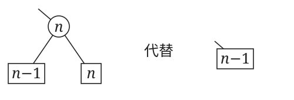

可以得到针对 $(p_1,\ldots,p_n;\ q_0,\ldots,q_n)$ 的最优树.

**25.** [M20] 设 $A$ 和 $B$ 是实数的非空集合, 如果以下性质成立:　[答案](./answers/6-2-2.md#ans-6-2-2-25)

$$
(a\in A,\ b\in B,\ \text{且 }b

**26.** [M22] 设 $(p_1,\ldots,p_n;\ q_0,\ldots,q_n)$ 为非负权值, $p_n+q_n=x$. 证明: 当 $(p_1,\ldots,p_{n-1};\ q_0,\ldots,q_{n-1})$ 保持恒定, 随着 $x$ 由 0 向 $\infty$ 变化, 最优二叉查找树的成本 $c(0,n)$ 是 $x$ 的分段线性连续凹函数, 且斜率为整数. 换句话说, 证明: 存在正整数 $l_0>l_1>\cdots>l_m$ 和实常数 $0=x_0<x_1<\cdots<x_m<x_{m+1}=\infty$ 和 $y_0<y_1<\cdots<y_m$, 使得当 $x_h\le x\le x_{h+1}$($0\le h\le m$) 时, $c(0,n)=y_h+l_hx$.　[答案](./answers/6-2-2.md#ans-6-2-2-26)

**27.** [M33] 本习题的目标是证明: 当权值 $(p_1,\ldots,p_n;\ q_0,\ldots,q_n)$ 为非负数时, 最优二叉查找树的根集合 $R(i,j)$ 满足:　[答案](./answers/6-2-2.md#ans-6-2-2-27)

$$
R(i,j-1)\le R(i,j)\le R(i+1,j),\qquad\text{对于 }j-i\ge2.
$$

其中的大小关系如习题 25 中的定义. 该证明是对 $j-i$ 进行归纳. 我们的任务是: 假定 $n\ge2$, 且所述关系对于 $j-i<n$ 成立, 证明 $R(0,n-1)\le R(0,n)$. [根据左右对称性, 由此可以推出 $R(0,n)\le R(1,n)$.]

(a) 证明: 如果 $p_n=q_n=0$, 则 $R(0,n-1)\le R(0,n)$. (见习题 24.)

(b) 设 $p_n+q_n=x$. 采用习题 26 的表示法, 设 $R_h$ 是当 $x_h<x<x_{h+1}$ 时的最优根集合 $R(0,n)$. 设 $R'_h$ 是当 $x=x_h$ 时的最优根集合. 证明:

$$
R'_0\le R_0\le R'_1\le R_1\le\cdots\le R'_m\le R_m.
$$

因此, 由 (a) 部分及习题 25, 对于所有 $x$, 我们有 $R(0,n-1)\le R(0,n)$. [提示: 考虑 $x=x_h$ 的情景, 并假定下面两棵树都是最优的, 且 $s<r$, $l\ge l'$.

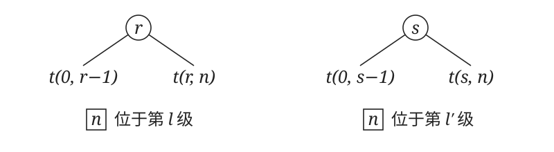

利用归纳假设, 证明存在一棵根结点为 $\textcircled r$ 的最优树, 使得 $\boxed n$ 位于第 $l'$ 级, 以及一棵根结点为 $\textcircled s$ 的最优树, 使得 $\boxed n$ 位于第 $l$ 级.]

**28.** [24] 使用某种宏语言来定义一种 “最优二分查找” 宏, 其参数是一棵最优二叉树的嵌套说明.

**29.** [40] 利用图 12 中的频率数据, 31 个最常见的英文单词的最差二叉查找树是什么样的?　[答案](./answers/6-2-2.md#ans-6-2-2-29)

**30.** [M34] 证明: 当 $j\ge i+2$ 时, 最优二叉查找树的成本满足 “四角不等式”$c(i,j)-c(i,j-1)\ge c(i+1,j)-c(i+1,j-1)$.　[答案](./answers/6-2-2.md#ans-6-2-2-30)

**31.** [M35] (陈国财) 证明: 在满足 $p_1+\cdots+p_n+q_0+\cdots+q_n=1$ 的所有概率集合 $(p_1,\ldots,p_n;\ q_0,\ldots,q_n)$ 中, 如果对于所有 $i$ 有 $p_i=0$, 对于所有偶数 $j$ 有 $q_j=0$, 对于所有奇数 $j$ 有 $q_j=1/\lceil n/2\rceil$, 则得到最昂贵的最低成本树.　[答案](./answers/6-2-2.md#ans-6-2-2-31)

▶ **32.** [M25] 设 $n+1=2^m+k$, 其中 $0\le k\le2^m$. 恰好存在 $\binom{2^m}k$ 棵二叉树, 其中所有外部结点都出现在第 $m$ 级和第 $m+1$ 级. 证明: 在所有这些树中, 如果对于足够大的 $M$ 值, 我们将算法 K 应用于权值 $(p_1,\ldots,p_n;\ M+q_0,\ldots,M+q_n)$, 就可以得到一棵对于权值 $(p_1,\ldots,p_n;\ q_0,\ldots,q_n)$ 拥有最低成本的树.　[答案](./answers/6-2-2.md#ans-6-2-2-32)

**33.** [M41] 为了找到使程序 T 的运行时间最小化的二叉查找树, 应当使量 $7C+\mathrm{C1}$ 最小化, 而不只是使比较次数 $C$ 最小化. 设计一个算法, 用于在树中左、右分支关联了不同成本时, 找出最优二叉查找树. (顺便说一下, 当右成本是左成本的两倍, 结点频率全都相等时, 斐波那契树是最优的. 见拉里·斯坦菲尔,*JACM* **17** (1970), 508–517. 在不能同时进行三路比较的机器上, 采用算法 T 的程序必须在步骤 T2 中进行两次比较, 一次判断是否相等, 一次判断是否小于. 博蒙特·希尔和普拉特已经观察到, 这些比较不一定涉及同一个键, 最好的情景可能是拥有一棵二叉树, 其内部结点指定一个相等测试或一个小于测试, 但不是同时确定这两个测试. 将这一情景作为上述问题的替代情景加以研讨, 是非常有意义的.)　[答案](./answers/6-2-2.md#ans-6-2-2-33)

**34.** [HM21] 证明: 当 $N\to\infty$ 时, 多项式系数　[答案](./answers/6-2-2.md#ans-6-2-2-34)

$$
\binom N{p_1N,\ p_2N,\ \ldots,\ p_nN}
$$

的渐近值与熵 $H(p_1,p_2,\ldots,p_n)$ 相关.

**35.** [HM22] 确立不等式 (24), 以完成定理 B 的证明.　[答案](./answers/6-2-2.md#ans-6-2-2-35)

▶ **36.** [HM25] (克劳德·香农) 设 $X$ 和 $Y$ 是具有有限范围 $\{x_1,\ldots,x_m\}$ 和 $\{y_1,\ldots,y_n\}$ 的随机变量, 设 $p_i=\Pr(X=x_i)$, $q_j=\Pr(Y=y_j)$, $r_{ij}=\Pr(X=x_i\ \text{且}\ Y=y_j)$. 设 $H(X)=H(p_1,\ldots,p_m)$ 和 $H(Y)=H(q_1,\ldots,q_n)$ 是单个变量各自的熵, $H(XY)=H(r_{11},\ldots,r_{mn})$ 是这些联合分布的熵. 证明:　[答案](./answers/6-2-2.md#ans-6-2-2-36)

$$
H(X)\le H(XY)\le H(X)+H(Y).
$$

[提示: 如果 $f$ 是任意凹函数, 则有 $\operatorname E f(X)\le f(\operatorname E X)$.]

**37.** [HM26] (保罗·拜尔, 1975) 设 $(P_1,\ldots,P_n)$ 是随机概率分布, 即 $n-1$ 维单纯形中的一个随机点, 由 $P_k\ge0$($1\le k\le n$) 和 $P_1+\cdots+P_n=1$ 确定. (等价地说, $(P_1,\ldots,P_n)$ 是在习题 3.3.2–26 意义下的随机间隔的集合.) 熵 $H(P_1,\ldots,P_n)$ 的期望值是多少?　[答案](./answers/6-2-2.md#ans-6-2-2-37)

**38.** [M20] 尽管我们仅在 $s_0<s_1<s_2<\cdots<s_n$ 的情景下证明了定理 M, 解释为什么在一般情况下它也成立.　[答案](./answers/6-2-2.md#ans-6-2-2-38)

▶ **39.** [M25] 设 $w_1,\ldots,w_n$ 是非负权值, 且 $w_1+\cdots+w_n=1$. 证明: 在 2.3.4.5 节构造的哈夫曼树的加权路径长度小于 $H(w_1,\ldots,w_n)+1$. 提示: 见定理 M 的证明.　[答案](./answers/6-2-2.md#ans-6-2-2-39)

**40.** [M26] 完成引理 Z 的证明.　[答案](./answers/6-2-2.md#ans-6-2-2-40)

**41.** [21] 图 18 给出了一棵混乱二叉树的构造. 按由左向右的顺序列出它的叶子.　[答案](./answers/6-2-2.md#ans-6-2-2-41)

**42.** [23] 解释为什么子例程 C 保持了 2-递减条件 (31).　[答案](./answers/6-2-2.md#ans-6-2-2-42)

**43.** [20] 解释如何高效地实现加西亚-瓦克斯算法的阶段 2.　[答案](./answers/6-2-2.md#ans-6-2-2-43)

▶ **44.** [25] 解释如何高效地实现加西亚-瓦克斯算法的阶段 3: 构造一棵二叉树, 以对称序给定其叶子的级别 $l_0,l_1,\ldots,l_n$.　[答案](./answers/6-2-2.md#ans-6-2-2-44)

▶ **45.** [30] 解释如何实现子例程 C, 使得加西亚-瓦克斯算法的总运行时间最多为 $O(n\log n)$.　[答案](./answers/6-2-2.md#ans-6-2-2-45)

**46.** [M30] (黄泽权和张系国) 考虑一种通过算法 T 来构造二叉查找树的机制, 但每当结点数增加到可以表示为 $2^n-1$ 的形式时, 就调整树的组织结构, 使其成为一棵完全平衡均匀树, 对于 $0\le k<n$, 在第 $k$ 级有 $2^k$ 个结点. 证明: 在构造这样一棵树时所进行的总比较数平均为 $N\lg N+O(N)$. (不难证明, 调整过程所需要的时间量为 $O(N)$.)　[答案](./answers/6-2-2.md#ans-6-2-2-46)

**47.** [M40] 将定理 B 和 M 由二叉树推广到 $t$ 叉树. 如果可能, 还允许分支成本像习题 33 中一样是非均匀的.　[答案](./answers/6-2-2.md#ans-6-2-2-47)

**48.** [M47] 严格分析在对二叉查找树进行随机插入和删除操作时的稳定状态.　[答案](./answers/6-2-2.md#ans-6-2-2-48)

**49.** [HM42] 分析一棵随机二叉查找树的平均高度.　[答案](./answers/6-2-2.md#ans-6-2-2-49)

<!-- section-footnotes -->

[^v3-p337-1]: 这个记号可见卷 1 的 2.3.1 节 (英文版第 321 页, 中文版第 255 页). ——编者注
