

### 6.2.3　平衡树

当输入数据随机时, 我们刚刚学习的树插入算法将会生成非常好的查找树, 但恼人的是, 仍然存在生成退化树的可能. 我们也许可以设计一种算法, 使得树在所有时间都是最优的. 但遗憾的是, 这似乎是一件非常困难的事情. 另一种思想是跟踪总路径长度, 只要树的路径长度, 比如说, 超过 $5N\lg N$, 就全面调整树的结构. 但在树的构造过程中, 这个方法可能需要大约 $\sqrt{N/2}$ 次结构调整.

1962 年, 两位俄国数学家格奥尔基·阿德尔森-维尔斯基和尤金尼·兰迪斯, 为如何维护一棵良好的查找树的问题找到了一个非常漂亮的解决方案 [*Doklady Akademii Nauk SSSR* **146** (1962), 263–266; 英文翻译在 *Soviet Math. Doklady* **3** (1962), 1259–1263 上]. 他们的方法只需要为每个结点增加额外的两个二进制位, 而且为查找该树或插入一项所使用的操作从来不会超过 $O(\log N)$. 事实上, 我们应当看到, 他们的方法也会引出一个一般性的方法, 可以很好地表示长度为 $N$ 的任意线性列表, 使得以下每个操作都可以仅在 $O(\log N)$ 个时间单位内完成:

(i) 找出一个拥有给定键的项.

(ii) 给定 $k$, 找出第 $k$ 项.

(iii) 在指定位置插入一项.

(iv) 删除一个指定项.

如果为线性列表使用顺序分配, 则操作 (i) 和 (ii) 的执行效率很高, 但操作 (iii) 和 (iv) 则需要阶为 $N$ 的步骤. 另一方面, 如果我们使用链接分配, 操作 (iii) 和 (iv) 的执行效率很高, 但操作 (i) 和 (ii) 需要阶为 $N$ 的步骤. 用树来表示线性列表, 则可以在 $O(\log N)$ 个步骤内完成所有四个操作. 还可能以相当的效率执行其他标准操作, 比如, 在 $O(\log(M+N))$ 个步骤中将一个 $M$ 元素列表与一个 $N$ 元素列表连接在一起.

用于实现这个目的的方法会用到我们所说的*平衡树*. (许多作者也称之为*AVL 树*, 其中的 AV 表示 Adelson-Velsky (阿德尔森-维尔斯基), L 表示 Landis (兰迪斯).) 上一段是平衡树的广告, 听起来像是包治百病的万能药, 可以将所有其他数据表示形式都抛到故纸堆里. 但我们当然应当对平衡树持一种平衡态度! 在不涉及所有上述四种操作的应用中, 我们也许能够以少得多的开销、简单得多的编程设计来完成任务. 此外, 除非 $N$ 相当大, 否则平衡树并没有什么好处. 因此, 如果有一个需要 $64\lg N$ 个时间单位的高效方法和一个需要 $2N$ 个时间单位的低效方法, 那么除非 $N$ 大于 256, 否则就应当使用那个低效方法. 另一方面, $N$ 也不能太大. 平衡树主要适用于数据的内部存储, 我们将在 6.2.4 节为外部直接访问文件研究更好的方法. 由于内部存储器随着时间的推移变得越来越大, 所以平衡树正在变得越来越重要.

一棵树的*高度*定义为它的最高级别, 也就是从根结点到外部结点的最长路径的长度. 在一棵二叉树中, 如果每个结点的左子树与右子树的高度之差从来不会超过 $\pm1$, 则说该树是*平衡*的. 图 20 给出一棵有 17 个内部结点、高度为 5 的平衡树. 根据右子树高度减去左子树高度的差值是 $+1$、0 还是 $-1$, 把每个结点中的*平衡因子*表示为 $+$、$\cdot$ 或 $-$. 图 8(6.2.1 节) 中的斐波那契树是另一棵高度为 5 的平衡树, 只有 12 个内部结点, 它的大多数平衡因子为 $-1$. 图 10(6.2.2 节) 中的黄道天宫树是不平衡的, 因为关于子树的高度限制在 AQUARIUS 和 GEMINI 结点上都不满足.

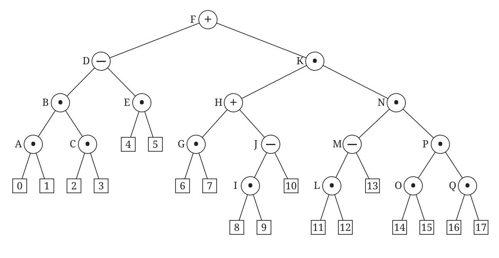

**图 20　一棵平衡二叉树**

这一平衡定义在最优二叉树 (要求所有外部结点都在两个相邻级别上) 和任意二叉树 (不受限制) 之间进行了折中. 因此, 很自然就会问到: 一棵平衡树与最优树的距离有多远? 答案是, 其查找路径绝对不会比最优树长出 45%以上:

**定理 A (阿德尔森-维尔斯基和兰迪斯).** 具有 $N$ 个内部结点的平衡树的高度总是介于 $\lg(N+1)$ 和 $1.4405\lg(N+2)-0.3277$ 之间.

*证明.* 一棵高度为 $h$ 的二叉树显然不可能有多于 $2^h$ 个外部结点, 所以 $N+1\le2^h$, 即在任意二叉树中, $h\ge\lceil\lg(N+1)\rceil$.

为了求出 $h$ 的最大值, 让我们变换一下这个问题, 求一棵高度为 $h$ 的平衡树中最少可能有多少个结点. 设 $T_h$ 是这样一棵具有最少结点的树, 然后设根结点的子树之一 (比如左子树) 的高度为 $h-1$, 而另一棵子树的高度为 $h-1$ 或 $h-2$. 由于我们希望 $T_h$ 有最少数量的结点, 所以可以假定根结点的左子树为 $T_{h-1}$, 右子树为 $T_{h-2}$. 这段论证表明: 在所有高度为 $h$ 的平衡树中, $h+1$ 阶斐波那契树有最少的结点. (见 6.2.1 节中关于斐波那契树的定义.) 因此

$$
N\ge F_{h+2}-1>\phi^{h+2}/\sqrt5-2,
$$

如同在定理 4.5.3F 中的推论中那样, 所述结果得证.　▮

这个定理的证明过程表明: 仅当树中至少包含 $F_{28}-1=317\,810$ 个结点时, 在平衡树中进行一次查找才需要 25 次以上的比较.

现在考虑使用树插入方法 (算法 6.2.2T) 向一棵平衡树中插入一个新结点时会发生什么. 在图 20 中, 如果这个新结点居于 $\boxed4$、$\boxed5$、$\boxed6$、$\boxed7$、$\boxed{10}$ 或 $\boxed{13}$ 处, 则这棵树仍然是平衡的, 但如果新结点落在其他位置, 就需要进行某种调整. 如果有一个结点的平衡因子为 $+1$, 它的右子树在插入之后变得更高; 或者与之相对, 如果平衡因子为 $-1$, 而左子树变得更高, 那就会出现问题. 不难看出, 仅在两种情景下会出现麻烦:

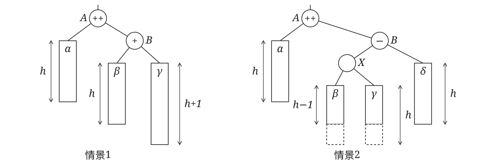

(1)

(如果将这些图形左右颠倒一下, 会得到其他两个基本相同的情景.) 在这些图形中, 大矩形 $\alpha,\beta,\gamma,\delta$ 表示各个子树, 其各自高度如图中所示. 当一个新元素刚好将结点 $B$ 的右子树高度由 $h$ 增大为 $h+1$ 时, 发生情景 1, 当新元素增大 $B$ 的左子树高度时, 发生情景 2. 在第二种情景中, 或者有 $h=0$ (所以 $X$ 自身就是新结点), 或者结点 $X$ 有高度分别为 $(h-1,h)$ 或 $(h,h-1)$ 的两棵子树.

在这两种情景下, 通过简单变换就可以恢复平衡, 同时保持树结点的对称序:

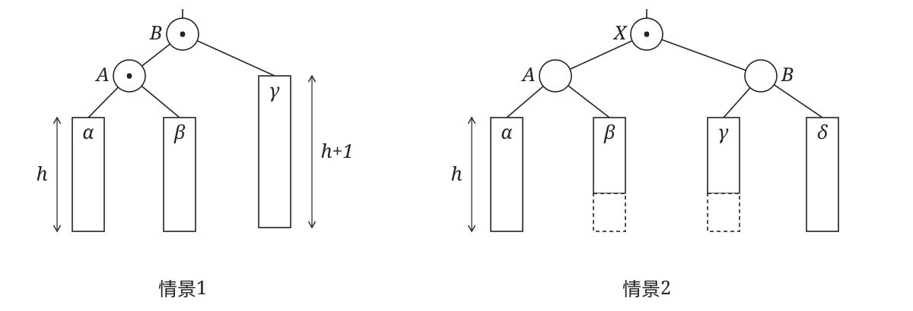

(2)

在情景 1 中, 我们只需要将这棵树向左 “转动”, 将 $\beta$ 附接到 $A$, 而不是 $B$. 这个变换类似于向代数公式应用结合律, 用 $(\alpha\beta)\gamma$ 代替 $\alpha(\beta\gamma)$. 在情景 2 中, 我们使用双转动, 首先向右转动 $(X,B)$, 然后向左转动 $(A,X)$. 在这两种情景下, 只需要改变树的几个链接. 此外, 新树的高度为 $h+2$, 就是在插入之前的高度. 因此, 树中最初位于结点 $A$ 上方的其余部分 (如果有的话) 总是保持平衡.

例如, 如果我们向图 20 的位置 $\boxed{17}$ 处插入一个新结点, 则在一次单转动之后 (情景 1), 得到如图 21 所示的平衡树. 注意, 有几个平衡因子已经发生了变化.

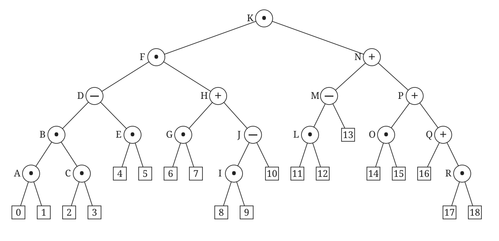

**图 21　图 20 的树, 在插入新键 R 之后再次得到平衡**

这个插入过程的具体细节可以采用几种方式实施. 乍看起来, 似乎需要一个辅助栈, 以跟踪将要附接哪些结点, 但下面的算法通过利用一个事实而获得了某种加速: 在插入之前, (1) 中结点 $B$ 的平衡因子为 0.

**算法 A (平衡树的查找与插入).** 给定一个记录表, 其中的记录构成一个如上所述的平衡二叉树, 这个算法查找一个给定参数 $K$. 如果 $K$ 不在表中, 则向树中的适当位置插入一个包含 $K$ 的新结点, 在必要时重新平衡这棵树.

假定树的结点和算法 6.2.2T 中一样, 包含 KEY、LLINK、RLINK 字段. 我们还有一个新字段

$$
\mathrm B(\mathrm P)=\mathrm{NODE}(\mathrm P)\text{ 的平衡因子},
$$

即右子树的高度减去左子树的高度. 这个字段总是包含 $+1$、0 或 $-1$ 中的一个. 在树的顶部还会存在一个特殊的表头结点, 位于单元 HEAD 中. $\mathrm{RLINK}(\mathrm{HEAD})$ 的值是指向树根结点的指针, $\mathrm{LLINK}(\mathrm{HEAD})$ 用于跟踪树的总高度. (有关高度的信息在这个算法中不是必需的, 但它在下面讨论的连接过程中是有用的.) 我们假定树非空, 即 $\mathrm{RLINK}(\mathrm{HEAD})\ne\Lambda$.

为便于描述, 本算法使用了记号 $\mathrm{LINK}(a,\mathrm P)$, 如果 $a=-1$, 则是 $\mathrm{LLINK}(\mathrm P)$ 的同义词, 如果 $a=+1$, 则是 $\mathrm{RLINK}(\mathrm P)$ 的同义词.

**A1.[初始化.]** 置 $\mathrm T\leftarrow\mathrm{HEAD}$, $\mathrm S\leftarrow\mathrm P\leftarrow\mathrm{RLINK}(\mathrm{HEAD})$. (指针变量 $\mathrm P$ 将沿树向下移动, $\mathrm S$ 将指向可能需要重新平衡的位置, $\mathrm T$ 总是指向 $\mathrm S$ 的父结点.)

**A2.[比较.]** 如果 $K<\mathrm{KEY}(\mathrm P)$, 转至 A3; 如果 $K>\mathrm{KEY}(\mathrm P)$, 转至 A4; 如果 $K=\mathrm{KEY}(\mathrm P)$, 则查找过程成功结束.

**A3.[左移.]** 置 $\mathrm Q\leftarrow\mathrm{LLINK}(\mathrm P)$. 如果 $\mathrm Q=\Lambda$, 置 $\mathrm Q\Leftarrow\mathrm{AVAIL}$, $\mathrm{LLINK}(\mathrm P)\leftarrow\mathrm Q$, 并转至 A5. 否则, 如果 $\mathrm B(\mathrm Q)\ne0$, 置 $\mathrm T\leftarrow\mathrm P$, $\mathrm S\leftarrow\mathrm Q$. 最后, 置 $\mathrm P\leftarrow\mathrm Q$, 并返回 A2.

**A4.[右移.]** 置 $\mathrm Q\leftarrow\mathrm{RLINK}(\mathrm P)$. 如果 $\mathrm Q=\Lambda$, 置 $\mathrm Q\Leftarrow\mathrm{AVAIL}$, $\mathrm{RLINK}(\mathrm P)\leftarrow\mathrm Q$, 并转至 A5. 否则, 如果 $\mathrm B(\mathrm Q)\ne0$, 置 $\mathrm T\leftarrow\mathrm P$, $\mathrm S\leftarrow\mathrm Q$. 最后, 置 $\mathrm P\leftarrow\mathrm Q$, 并返回 A2. (这个步骤的最后部分可以与 A3 的最后步骤组合在一起.)

**A5.[插入.]**(我们已经将一个新结点 $\mathrm{NODE}(\mathrm Q)$ 链接到树中, 需要初始化它的字段.) 置 $\mathrm{KEY}(\mathrm Q)\leftarrow K$, $\mathrm{LLINK}(\mathrm Q)\leftarrow\mathrm{RLINK}(\mathrm Q)\leftarrow\Lambda$, $\mathrm B(\mathrm Q)\leftarrow0$.

**A6.[调整平衡因子.]**(现在需要将 $\mathrm S$ 与 $\mathrm Q$ 之间的各个结点上的平衡因子由 0 变为 $\pm1$.) 如果 $K<\mathrm{KEY}(\mathrm S)$, 置 $a\leftarrow-1$, 否则, 置 $a\leftarrow+1$. 然后, 置 $\mathrm R\leftarrow\mathrm P\leftarrow\mathrm{LINK}(a,\mathrm S)$, 并将以下操作重复执行 0 次或多次, 直到 $\mathrm P=\mathrm Q$ 为止: 如果 $K<\mathrm{KEY}(\mathrm P)$, 置 $\mathrm B(\mathrm P)\leftarrow-1$, $\mathrm P\leftarrow\mathrm{LLINK}(\mathrm P)$; 如果 $K>\mathrm{KEY}(\mathrm P)$, 置 $\mathrm B(\mathrm P)\leftarrow+1$, $\mathrm P\leftarrow\mathrm{RLINK}(\mathrm P)$. (如果 $K=\mathrm{KEY}(\mathrm P)$, 则有 $\mathrm P=\mathrm Q$, 我们继续下一步骤.)

**A7.[平衡操作.]** 现在将出现几种情景:

(i) 如果 $\mathrm B(\mathrm S)=0$ (树已经长高), 置 $\mathrm B(\mathrm S)\leftarrow a$, $\mathrm{LLINK}(\mathrm{HEAD})\leftarrow\mathrm{LLINK}(\mathrm{HEAD})+1$, 并终止算法.

(ii) 如果 $\mathrm B(\mathrm S)=-a$ (树已经变得更平衡), 置 $\mathrm B(\mathrm S)\leftarrow0$, 并终止算法.

(iii) 如果 $\mathrm B(\mathrm S)=a$ (树已经失去平衡), 如果 $\mathrm B(\mathrm R)=a$, 则转至 A8, 如果 $\mathrm B(\mathrm R)=-a$, 则转至 A9.

(情景 (iii) 对应于当 $a=+1$ 时, (1) 中叙述的情况. $\mathrm S$ 和 $\mathrm R$ 分别指向结点 $A$ 和 $B$, $\mathrm{LINK}(-a,\mathrm S)$ 指向 $\alpha$, 等等.)

**A8.[单转动.]** 置 $\mathrm P\leftarrow\mathrm R$, $\mathrm{LINK}(a,\mathrm S)\leftarrow\mathrm{LINK}(-a,\mathrm R)$, $\mathrm{LINK}(-a,\mathrm R)\leftarrow\mathrm S$, $\mathrm B(\mathrm S)\leftarrow\mathrm B(\mathrm R)\leftarrow0$. 转至 A10.

**A9.[双转动.]** 置 $\mathrm P\leftarrow\mathrm{LINK}(-a,\mathrm R)$, $\mathrm{LINK}(-a,\mathrm R)\leftarrow\mathrm{LINK}(a,\mathrm P)$, $\mathrm{LINK}(a,\mathrm P)\leftarrow\mathrm R$, $\mathrm{LINK}(a,\mathrm S)\leftarrow\mathrm{LINK}(-a,\mathrm P)$, $\mathrm{LINK}(-a,\mathrm P)\leftarrow\mathrm S$. 现在置

$$
\bigl(\mathrm B(\mathrm S),\mathrm B(\mathrm R)\bigr)\leftarrow
\begin{cases}
(-a,0),&\text{如果 }\mathrm B(\mathrm P)=a;\\
(0,0),&\text{如果 }\mathrm B(\mathrm P)=0;\\
(0,a),&\text{如果 }\mathrm B(\mathrm P)=-a;
\end{cases}\tag{3}
$$

然后置 $\mathrm B(\mathrm P)\leftarrow0$.

**A10.[最后一步.]**(我们已经完成了重新平衡的转换, 由 (1) 变为 (2), $\mathrm P$ 指向新的子树的根结点, $\mathrm T$ 指向旧子树的根结点 $\mathrm S$ 的父结点.) 如果 $\mathrm S=\mathrm{RLINK}(\mathrm T)$, 置 $\mathrm{RLINK}(\mathrm T)\leftarrow\mathrm P$, 否则, 置 $\mathrm{LLINK}(\mathrm T)\leftarrow\mathrm P$.　▮

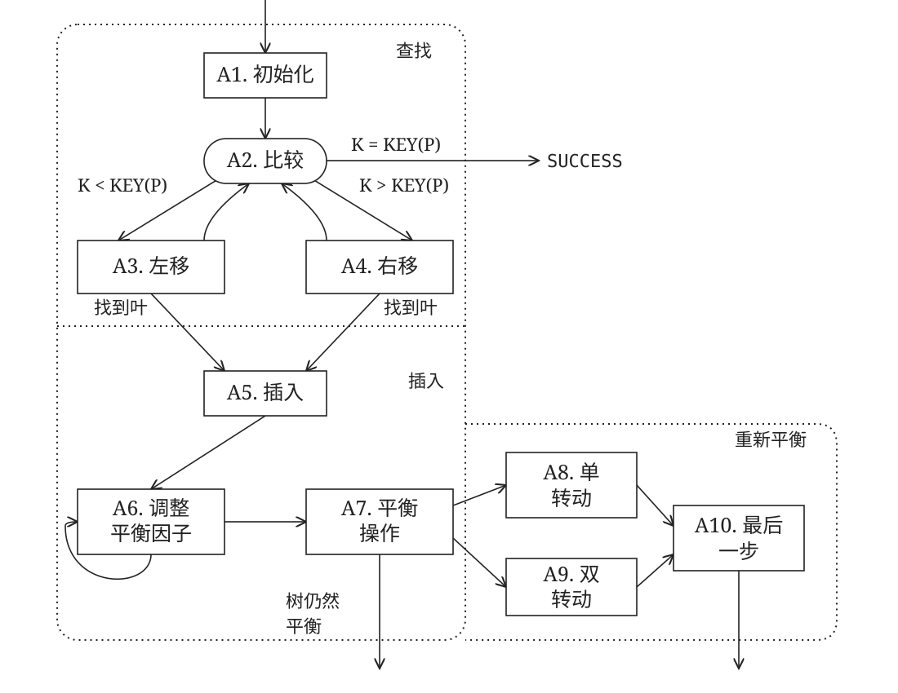

**图 22　平衡树的查找与插入**

这个算法相当长, 但它可以划分为三个简单部分: 步骤 A1～A4 进行查找, 步骤 A5～A7 插入新结点, 步骤 A8～A10 根据需要对树进行重新平衡. 如果树是穿线的 (见习题 6.2.2–2), 由于平衡操作决不需要对穿线链接作困难的变动, 所以可以使用基本相同的方法.

我们知道对于某个 $C$ 值, 该算法耗费大约 $C\lg N$ 个时间单位, 但重要的是要知道 $C$ 的近似值, 以便我们判断 $N$ 值应当大到何种程度, 才值得费这么多力气来使用平衡树. 下面的 MIX 实现可以让我们更深入地理解这个问题.

**程序 A (平衡树的查找与插入).** 这个实现算法 A 的程序使用具有以下形式的树结点:

<table style="width:max-content"><tbody><tr><td><code>B</code></td><td><code>LLINK</code></td><td><code>RLINK</code></td></tr><tr><td colspan="3" style="text-align:center"><code>KEY</code></td></tr></tbody></table>;　(4)

$\mathrm{rA}\equiv K$, $\mathrm{rI1}\equiv\mathrm P$, $\mathrm{rI2}\equiv\mathrm Q$, $\mathrm{rI3}\equiv\mathrm R$, $\mathrm{rI4}\equiv\mathrm S$, $\mathrm{rI5}\equiv\mathrm T$. 对步骤 A7～A9 的代码进行了重复, 从而使得 $a$ 的值隐式 (而非显式) 出现在程序中.

~~~mixal
01  B       EQU  0:1
02  LLINK   EQU  2:3
03  RLINK   EQU  4:5
04  START   LDA  K             1             A1. 初始化.
05          ENT5 HEAD          1             T ← HEAD.
06          LD2  0,5(RLINK)    1             Q ← RLINK(HEAD).
07          JMP  2F            1             令 S ← P ← Q 并转至A2.
08  4H      LD2  0,1(RLINK)    C2            A4. 右移. Q ← RLINK(P).
09          J2Z  5F            C2            如果 Q = Λ 则转至A5.
10  1H      LDX  0,2(B)        C − 1         rX ← B(Q).
11          JXZ  *+3           C − 1         如果 B(Q) = 0 则跳转.
12          ENT5 0,1           D − 1         T ← P.
13  2H      ENT4 0,2           D             S ← Q.
14          ENT1 0,2           C             P ← Q.
15          CMPA 1,1           C             A2. 比较.
16          JG   4B            C             如果 K > KEY(P) 则转至A4.
17          JE   SUCCESS       C1            如果 K = KEY(P) 则退出.
18          LD2  0,1(LLINK)    C1 − S        A3. 左移. Q ← LLINK(P).
19          J2NZ 1B            C1 − S        如果 Q ≠ Λ 则跳转.
20  5H      LD2  AVAIL         1 − S         A5. 插入.
21          J2Z  OVERFLOW      1 − S
22          LDX  0,2(RLINK)    1 − S
23          STX  AVAIL         1 − S         Q ⇐ AVAIL.
24          STA  1,2           1 − S         KEY(Q) ← K.
25          STZ  0,2           1 − S         LLINK(Q) ← RLINK(Q) ← Λ.
26          JL   1F            1 − S         K < KEY(P) 吗?
27          ST2  0,1(RLINK)    A             RLINK(P) ← Q.
28          JMP  *+2           A
29  1H      ST2  0,1(LLINK)    1 − S − A    LLINK(P) ← Q.
30  6H      CMPA 1,4           1 − S         A6. 调整平衡因子.
31          JL   *+3           1 − S         如果 K < KEY(S) 则跳转.
32          LD3  0,4(RLINK)    E             R ← RLINK(S).
33          JMP  *+2           E
34          LD3  0,4(LLINK)    1 − S − E    R ← LLINK(S).
35          ENT1 0,3           1 − S         P ← R.
36          ENTX -1            1 − S         rX ← -1.
37          JMP  1F            1 − S         转至比较循环.
38  4H      JE   7F            F2 + 1 − S   如果 K = KEY(P) 则转至A7.
39          STX  0,1(1:1)      F2            B(P) ← +1（原来是 +0）.
40          LD1  0,1(RLINK)    F2            P ← RLINK(P).
41  1H      CMPA 1,1           F + 1 − S
42          JGE  4B            F + 1 − S    如果 K ≥ KEY(P) 则跳转.
43          STX  0,1(B)        F1            B(P) ← -1.
44          LD1  0,1(LLINK)    F1            P ← LLINK(P).
45          JMP  1B            F1            转至比较循环.
46  7H      LD2  0,4(B)        1 − S         A7. 平衡操作. rI2 ← B(S).
47          STZ  0,4(B)        1 − S         B(S) ← 0.
48          CMPA 1,4           1 − S
49          JG   A7R           1 − S         如果 K > KEY(S) 则转至 a = +1 例程.
50  A7L     J2P  DONE          U1            如果 rI2 = -a 则退出.
51          J2Z  7F            G1 + J1       如果 B(S) 为0则跳转.
52          ENT1 0,3           G1            P ← R.
53          LD2  0,3(B)        G1            rI2 ← B(R).
54          J2N  A8L           G1            如果 rI2 = a 则转至A8.
55  A9L     LD1  0,3(RLINK)    H1            A9. 双转动.
56          LDX  0,1(LLINK)    H1            LINK(a,P ← LINK(-a,R))
57          STX  0,3(RLINK)    H1              → LINK(-a,R).
58          ST3  0,1(LLINK)    H1            LINK(a,P) ← R.
59          LD2  0,1(B)        H1            rI2 ← B(P).
60          LDX  T1,2          H1            -a,0或0
61          STX  0,4(B)        H1              → B(S).
62          LDX  T2,2          H1            0,0或a
63          STX  0,3(B)        H1              → B(R).
64  A8L     LDX  0,1(RLINK)    G1            A8. 单转动.
65          STX  0,4(LLINK)    G1            LINK(a,S) ← LINK(-a,P).
66          ST4  0,1(RLINK)    G1            LINK(-a,P) ← S.
67          JMP  8F            G1            与其他分支相组合.
68  A7R     J2N  DONE          U2            如果 rI2 = -a 则退出.
69          J2Z  6F            G2 + J2       如果 B(S) 为0则跳转.
70          ENT1 0,3           G2            P ← R.
71          LD2  0,3(B)        G2            rI2 ← B(R).
72          J2P  A8R           G2            如果 rI2 = a 则转至A8.
73  A9R     LD1  0,3(LLINK)    H2            A9. 双转动.
74          LDX  0,1(RLINK)    H2            LINK(a,P ← LINK(-a,R))
75          STX  0,3(LLINK)    H2              → LINK(-a,R).
76          ST3  0,1(RLINK)    H2            LINK(a,P) ← R.
77          LD2  0,1(B)        H2            rI2 ← B(P).
78          LDX  T2,2          H2            -a,0或0
79          STX  0,4(B)        H2              → B(S).
80          LDX  T1,2          H2            0,0或a
81          STX  0,3(B)        H2              → B(R).
82  A8R     LDX  0,1(LLINK)    G2            A8. 单转动.
83          STX  0,4(RLINK)    G2            LINK(a,S) ← LINK(-a,P).
84          ST4  0,1(LLINK)    G2            LINK(-a,P) ← S.
85  8H      STZ  0,1(B)        G             B(P) ← 0.
86  A10     CMP4 0,5(RLINK)    G             A10. 最后一步.
87          JNE  *+3           G             如果 RLINK(T) ≠ S 则跳转.
88          ST1  0,5(RLINK)    G3            RLINK(T) ← P.
89          JMP  DONE          G3            退出.
90          ST1  0,5(LLINK)    G4            LLINK(T) ← P.
91          JMP  DONE          G4            退出.
92          CON  +1
93  T1      CON  0                           (3)的表格.
94  T2      CON  0
95          CON  -1
96  6H      ENTX +1            J2            rX ← +1.
97  7H      STX  0,4(B)        J             B(S) ← a.
98          LDX  HEAD(LLINK)   J             LLINK(HEAD)
99          INCX 1             J               + 1
100         STX  HEAD(LLINK)   J               → LLINK(HEAD).
101 DONE    EQU  *             1 − S         插入完成.
~~~

▮

**对平衡树插入的分析.** [对数学不感兴趣的读者, 请跳读至 (10).] 为了求出算法 A 的运行时间, 我们希望知道以下问题的答案:

- 在查找期间进行了多少次比较?
- 结点 $\mathrm S$ 和 $\mathrm Q$ 将相距多远? (换句话说, 在步骤 A6 中需要进行多少次调整?)
- 需要多长时间进行一次单转动或双转动?

利用定理 A, 不难推导出最差情况下运行时间的上限, 但在实践中, 我们当然希望知道平均特性. 到目前为止, 由于这个算法显得过于复杂, 所以还未能成功地从理论角度来确定平均特性, 但已经获得了几个有趣的理论和实验结果.

首先, 我们可以尝试计算拥有 $n$ 个内部结点、高度为 $h$ 的平衡二叉树的个数 $B_{nh}$. 根据关系式

$$
B_0(z)=1,\qquad B_1(z)=z,\qquad
B_{h+1}(z)=zB_h(z)\bigl(B_h(z)+2B_{h-1}(z)\bigr),\tag{5}
$$

不难计算出当 $h$ 较小时的生成函数 $B_h(z)=\sum_{n\ge0}B_{nh}z^n$ (见习题 6). 因此

$$
\begin{aligned}
B_2(z)&=2z^2+z^3,\\
B_3(z)&=\phantom{2z^2+z^3,}\ 4z^4+6z^5+4z^6+z^7,\\
B_4(z)&=\phantom{2z^2+z^3,\ 4z^4+6z^5+}\ 16z^7+32z^8+44z^9+\cdots+8z^{14}+z^{15}.
\end{aligned}
$$

而且, 当 $h\ge3$ 时, 一般地说, $B_h(z)$ 的形式为

$$
2^{F_{h+1}-1}z^{F_{h+2}-1}
+2^{F_{h+1}-2}L_{h-1}z^{F_{h+2}}
+\text{复杂项}
+2^{h-1}z^{2^h-2}+z^{2^h-1},\tag{6}
$$

其中 $L_k=F_{k+1}+F_{k-1}$. (这个公式推广了定理 A.) 高度为 $h$ 的平衡树的总数是 $B_h=B_h(1)$, 它满足递推式

$$
B_0=B_1=1,\qquad B_{h+1}=B_h^2+2B_hB_{h-1},\tag{7}
$$

所以 $B_2=3$, $B_3=3\cdot5$, $B_4=3^2\cdot5\cdot7$, $B_5=3^3\cdot5^2\cdot7\cdot23$. 一般情况下,

$$
B_h=A_0^{F_h}A_1^{F_{h-1}}\cdots A_{h-1}^{F_1}A_h^{F_0},\tag{8}
$$

其中 $A_0=1$, $A_1=3$, $A_2=5$, $A_3=7$, $A_4=23$, $A_5=347$, …, $A_h=A_{h-1}B_{h-2}+2$. 序列 $B_h$ 和 $A_h$ 增长得非常迅速. 事实上, 它们是*双指数*增长的: 习题 7 证明了存在一个实数 $\theta\approx1.43687$, 使得

$$
B_h=\left\lfloor\theta^{2^h}\right\rfloor-\left\lfloor\theta^{2^{h-1}}\right\rfloor
+\left\lfloor\theta^{2^{h-2}}\right\rfloor-\cdots
+(-1)^h\left\lfloor\theta^{2^0}\right\rfloor.\tag{9}
$$

如果将每棵 $B_h$ 树看作是等概率的, 则习题 8 证明了一棵高度为 $h$ 的树中的平均结点数是

$$
B'_h(1)/B_h(1)\approx(0.70118)2^h-1.\tag{10}
$$

这表明, 具有 $N$ 个结点一棵平衡树的高度与 $\log_2N$ 的接近程度, 通常要远高于与 $\log_\phi N$ 的接近程度.

遗憾的是, 这些结果实际上与算法 A 没有太大关系, 这是因为该算法的机制使得一些树的出现几率远大于其他树. 例如, 考虑 $N=7$ 的情景, 此时一共可能存在 17 棵平衡树. 在向其中插入 7 个键时, 共有 $7!=5040$ 种可能的顺序. 完全平衡的 “完备” 树

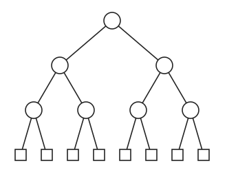(11)

出现 2160 次. 而与之相对, 斐波那契树

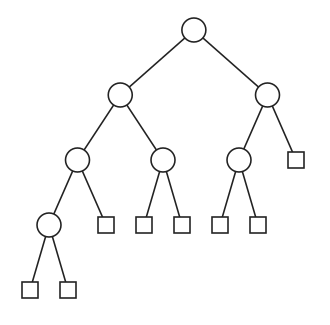(12)

仅出现 144 次, 而类似下边的树

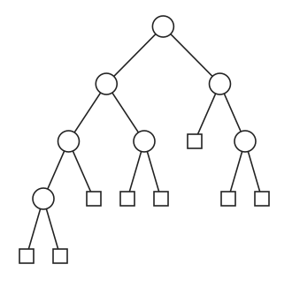(13)

出现 216 次. 用任意的四结点平衡树替代 (12) 和 (13) 的左子树, 然后左右颠倒, 可以生成 16 棵不同树. 由 (12) 生成的 8 棵各出现 144 次, 由 (13) 生成的 8 棵各出现 216 次. 让人奇怪的是, (13) 比 (12) 更常见.

完全平衡树出现的概率是如此之高 (还要加上 (10), 它对应于等概率情景), 由于这一事实, “平衡树的平均查找时间应该是大约 $\lg N+c$ 次比较 ($c$ 是某个较小的常数)” 这种说法就似乎合理了. 但是弗洛伊德已经发现, $\lg N$ 的系数不太可能恰好是 1, 因为树的根结点将接近中部, 而它两个子树的根结点将接近四分位处. 所以采用单转动和双转动都不能很轻松地将根结点保持在中部附近. 试验结果表明, 除非 $N$ 很小, 插入第 $N$ 项所需要的真实平均比较次数大约是 $1.01\lg N+0.1$.

为了研究算法 A 的插入与重新平衡阶段的特性, 可以如图 23 所示对平衡树的外部结点进行分类. 由一个外部结点引出的路径可以用 $+$ 和 $-$ 组成的序列指定 ($+$ 表示右链接, $-$ 表示左链接). 我们记下链接的详细描述, 直到第一个具有非零平衡因子的结点为止, 如果没有此类结点, 则直到根结点为止. 接着, 根据在给定位置插入一个内部结点时, 新树是平衡的还是不平衡的, 写下 A 或 B. 因此, 由 $\boxed3$ 向上的路径为 <code style="white-space:nowrap">++-B</code>, 表示 “右链接, 右链接, 左链接, 不平衡”. 一个以 A 结尾的链接描述在插入新结点之后不需要重新平衡; 以 <code style="white-space:nowrap">++B</code> 或 <code style="white-space:nowrap">--B</code> 结束的链接描述需要进行一次单转动; 而以 <code style="white-space:nowrap">+-B</code> 或 <code style="white-space:nowrap">-+B</code> 结束的链接描述需要一次双转动. 当描述中出现 $k$ 个链接, 步骤 A6 必须恰好调整 $k-1$ 个平衡因子. 因此, 这些描述给出了控制步骤 A6 至 A10 运行时间的基本事实.

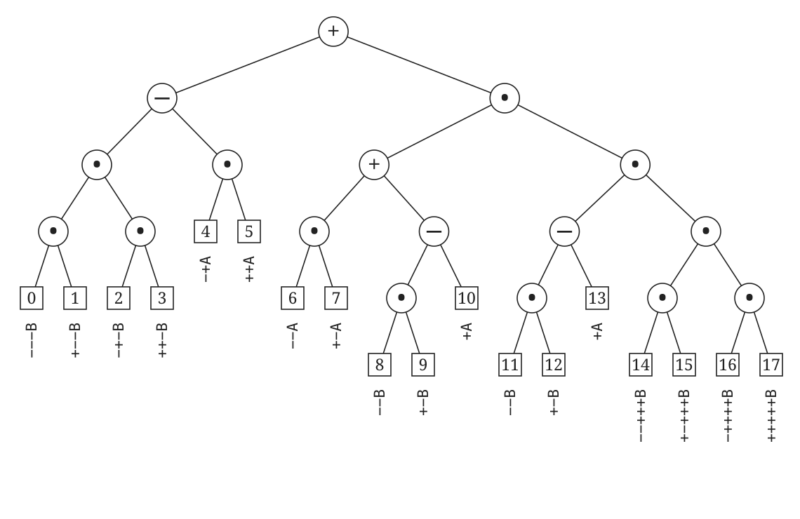

**图 23　在插入新结点之后描述算法 A 的特性的分类码**

对于 $100\le N\le2000$ 的随机数进行试验测试, 得到了各种类型路径的近似概率, 如表 1 所示. 显然, 当 $N\to\infty$ 时, 这些概率快速接近极限值. 表 2 给出了当 $N=10$ 时与表 1 相对应的确切概率, 其中将输入的 $10!$ 种排列看作是等概率的. (对于所有 $N\ge7$, 在表 1 中显示为 0.143 的概率实际上等于 $1/7$, 见习题 11. 当 $N\le15$ 时, 单转动和双转动的概率相等, 但当 $N\ge16$ 时, 双转动的发生频率要略低一些.)

**表 1　插入第 $N$ 项时的近似概率**

| 路径长度 $k$ | 无重新平衡 | 单转动 | 双转动 |
| --- | ---: | ---: | ---: |
| 1 | 0.143 | 0.000 | 0.000 |
| 2 | 0.152 | 0.143 | 0.143 |
| 3 | 0.092 | 0.048 | 0.048 |
| 4 | 0.060 | 0.024 | 0.024 |
| 5 | 0.036 | 0.010 | 0.010 |
| $>5$ | 0.051 | 0.009 | 0.008 |
| 平均 2.78 | 总共 0.534 | 0.233 | 0.232 |

由表 1 可以看出, $k\le2$ 的概率大约为 $0.143+0.152+0.143+0.143=0.581$. 因此, 步骤 A6 在大约 60%的时间内都是非常简单的. 在这个步骤中, 平衡因子由 0 变化到 $\pm1$ 的平均次数大约为 1.8. 在步骤 A7 至 A10 中, 平衡因子由 $\pm1$ 变化到 0 的平均次数大约为 $0.534+2(0.233+0.232)\approx1.5$. 因此, 插入一个新结点平均增加大约 $1.8-1.5=0.3$ 个不平衡结点. 这与如下事实是一致的: 在算法 A 构建的随机树中, 在全部结点中大约有 68%是平衡的.

**表 2　插入第 10 项时的准确概率**

| 路径长度 $k$ | 无重新平衡 | 单转动 | 双转动 |
| --- | ---: | ---: | ---: |
| 1 | $1/7$ | 0 | 0 |
| 2 | $6/35$ | $1/7$ | $1/7$ |
| 3 | $4/21$ | $2/35$ | $2/35$ |
| 4 | 0 | $1/21$ | $1/21$ |
| 平均 $247/105$ | $53/105$ | $26/105$ | $26/105$ |

卡克斯顿·福斯特已经提出了算法 A 特性的一个近似模型 [*Proc. ACM Nat. Conf.* **20** (1965), 192–205]. 这个模型并非严格准确的, 但它的正确程度足以提供一些启示. 由算法 A 构建一棵大树, 设其中一个给定结点的平衡因子为 0 的概率为 $p$, 该平衡因子为 $+1$ 的概率为 $\frac12(1-p)$, 为 $-1$ 的概率同样为 $\frac12(1-p)$. (不加论证地) 进一步假定所有结点的平衡因子是独立的. 则步骤 A6 将恰好 $k-1$ 个平衡因子设定为非 0 值的概率为 $p^{k-1}(1-p)$, 所以 $k$ 的平均值为 $1/(1-p)$. 需要转动树的一部分的概率为 $q\approx\frac12$. 插入一个新结点, 应当会使平衡的结点数平均增大 $p$, 这个数字在步骤 A5 中实际增大 1, 在步骤 A6 中增大 $-p/(1-p)$, 在步骤 A7 中为 $q$, 在步骤 A8 或 A9 中为 $2q$, 所以应当有:

$$
p=1-p/(1-p)+3q\approx5/2-p/(1-p).
$$

对 $p$ 求解的结果与表 1 相当一致:

$$
p\approx\frac{9-\sqrt{41}}4\approx0.649;\qquad1/(1-p)\approx2.851.\tag{14}
$$

程序 A 查找阶段 (第 01～19 行) 的运行时间为

$$
10C+\mathrm{C1}+2D+2-3S,\tag{15}
$$

其中, $C$、C1、$S$ 与本章前面算法中相同, $D$ 是在查找路径上遇到的不平衡结点数. 试验表明, 可以取 $D\approx\frac13C$, $\mathrm{C1}\approx\frac12(C+S)$, $C+S\approx1.01\lg N+0.1$, 所以平均查找时间近似为 $11.3\lg N+3-13.7S$ 个单位. (由于查找过程不需要知道平衡因子, 所以如果查找操作的执行次数远高于插入操作, 当然可以使一个更快速的独立程序进行查找. 这样, 一次成功查找的平均运行时间将仅有大约 $(6.6\lg N-3.4)u$, 最差情况下的运行时间事实上要略优于用程序 6.2.2T 得到的平均运行时间.)

在查找失败时, 程序 A 插入阶段 (第 20～45 行) 的运行时间为 $8F+26+(0,1\text{ 或 }2)$ 个单位. 表 1 中的数据表明, 平均来说 $F\approx1.8$. 重新平衡阶段 (第 46～101 行) 需要 16.5、8、27.5 或 45.5($\pm0.5$) 个时间单位, 具体取决于我们是增加整个高度, 还是直接退出而不进行重新平衡, 或是执行单转动或双转动. 第一种情景几乎从来不会发生, 其余几种情景的发生概率近似为 0.534、0.233、0.232, 所以程序 A 的插入与重新平衡组合部分的平均运行时间大约为 $63u$.

这些数据表明, 尽管程序很长, 但在内存中维护一棵平衡树是相当快的. 如果输入数据是随机的, 6.2.2 节中的简单树插入算法执行每次插入的速度快大约 $50u$. 但平衡树算法即使在输入数据非随机时也能保证是可靠的.

把程序 A 与程序 6.2.2T 进行对比的一种方式是考虑后者的最差情景. 如果研究以递增顺序向初始为空的树中插入 $N$ 个键所需要的时间量, 将会发现程序 A 在 $N\le26$ 时较慢, 在 $N\ge27$ 时较快.

**线性列表的表示.** 现在我们再回过头来讨论本节开始时的断言: 平衡树可用于表示线性列表, 以快速插入项目 (克服顺序分配的难题), 还可以对列表项目进行随机访问 (克服链接分配的难题).

其思想是在每个结点中引入一个名为 RANK 的新字段. 这个字段表明该结点在其子树中的相对位置, 即其左子树中的结点数加 1. 图 24 给出了图 23 中二叉树的 RANK 值. 我们可以完全消除 KEY 字段. 如果愿意, 也可以同时拥有 KEY 字段和 RANK 字段, 从而有可能根据其键值或其在列表中的相对位置来查找项目.

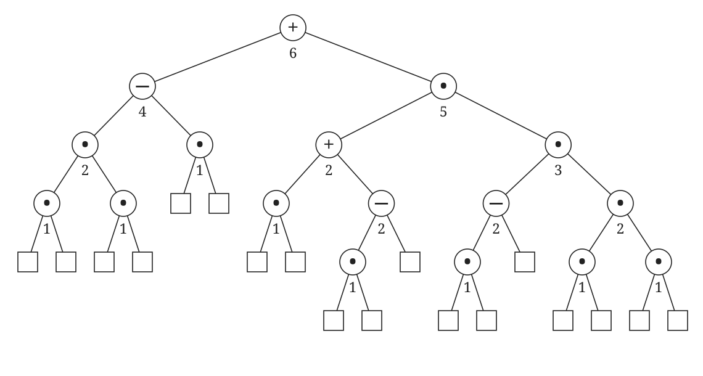

**图 24　RANK 字段, 用于按位置查找**

利用这个 RANK 字段, 按位置查找只不过是对我们正在研究的查找算法进行一点简单的修改.

**算法 B (根据位置进行树查找).** 给定一个表示为二叉树的线性列表, 给定 $k$, 本算法查找列表中的第 $k$ 个元素 (树中按对称序的第 $k$ 个结点). 假定该二叉树和算法 A 中一样, 拥有 LLINK 和 RLINK 字段以及一个表头, 另外再加上如前所述的一个 RANK 字段.

**B1.[初始化.]** 置 $\mathrm M\leftarrow k$, $\mathrm P\leftarrow\mathrm{RLINK}(\mathrm{HEAD})$.

**B2.[比较.]** 如果 $\mathrm P=\Lambda$, 算法以失败结束. (只有当 $k$ 大于树中的结点数或者 $k\le0$ 时才可能发生这种情况.) 否则, 如果 $\mathrm M<\mathrm{RANK}(\mathrm P)$, 转至 B3; 如果 $\mathrm M>\mathrm{RANK}(\mathrm P)$, 转至 B4; 如果 $\mathrm M=\mathrm{RANK}(\mathrm P)$, 则算法成功结束 ($\mathrm P$ 指向第 $k$ 个结点).

**B3.[左移.]** 置 $\mathrm P\leftarrow\mathrm{LLINK}(\mathrm P)$, 并返回 B2.

**B4.[右移.]** 置 $\mathrm M\leftarrow\mathrm M-\mathrm{RANK}(\mathrm P)$, $\mathrm P\leftarrow\mathrm{RLINK}(\mathrm P)$, 并返回 B2.　▮

这个算法中唯一的新关注点就是步骤 B4 中对 $\mathrm M$ 的操作. 我们可以采用类似方式来修改插入过程, 但其具体实现需要的技巧性要更多一点:

**算法 C (根据位置进行平衡树插入).** 给定一个表示为平衡二叉树的线性列表, 给定 $k$ 和指向一个新结点的指针 $\mathrm Q$, 本算法将这个新结点插入到列表中第 $k$ 个元素之前, 与其直接相邻. 如果 $k=N+1$, 则在列表最后一个元素之后插入这个新结点.

假定该二叉树非空, 并和算法 A 中一样, 拥有 LLINK、RLINK 和 B 字段以及一个表头, 再加上如前所述的一个 RANK 字段. 这个算法只是算法 A 的改写版. 区别在于它使用和更新了 RANK 字段, 而不是 KEY 字段.

**C1.[初始化.]** 置 $\mathrm T\leftarrow\mathrm{HEAD}$, $\mathrm S\leftarrow\mathrm P\leftarrow\mathrm{RLINK}(\mathrm{HEAD})$, $\mathrm U\leftarrow\mathrm M\leftarrow k$.

**C2.[比较.]** 如果 $\mathrm M\le\mathrm{RANK}(\mathrm P)$, 转至 C3, 否则转至 C4.

**C3.[左移.]** 置 $\mathrm{RANK}(\mathrm P)\leftarrow\mathrm{RANK}(\mathrm P)+1$ (我们将在 $\mathrm P$ 的左侧插入一个新结点). 置 $\mathrm R\leftarrow\mathrm{LLINK}(\mathrm P)$. 如果 $\mathrm R=\Lambda$, 置 $\mathrm{LLINK}(\mathrm P)\leftarrow\mathrm Q$, 并转至 C5. 否则, 如果 $\mathrm B(\mathrm R)\ne0$, 置 $\mathrm T\leftarrow\mathrm P$, $\mathrm S\leftarrow\mathrm R$, $\mathrm U\leftarrow\mathrm M$. 最后置 $\mathrm P\leftarrow\mathrm R$, 并返回 C2.

**C4.[右移.]** 置 $\mathrm M\leftarrow\mathrm M-\mathrm{RANK}(\mathrm P)$, $\mathrm R\leftarrow\mathrm{RLINK}(\mathrm P)$. 如果 $\mathrm R=\Lambda$, 置 $\mathrm{RLINK}(\mathrm P)\leftarrow\mathrm Q$, 并转至 C5. 否则, 如果 $\mathrm B(\mathrm R)\ne0$, 置 $\mathrm T\leftarrow\mathrm P$, $\mathrm S\leftarrow\mathrm R$, $\mathrm U\leftarrow\mathrm M$. 最后置 $\mathrm P\leftarrow\mathrm R$, 并返回 C2.

**C5.[插入.]** 置 $\mathrm{RANK}(\mathrm Q)\leftarrow1$, $\mathrm{LLINK}(\mathrm Q)\leftarrow\mathrm{RLINK}(\mathrm Q)\leftarrow\Lambda$, $\mathrm B(\mathrm Q)\leftarrow0$.

**C6.[调整平衡因子.]** 置 $\mathrm M\leftarrow\mathrm U$. (这个操作将恢复 $\mathrm M$ 在 $\mathrm P$ 是 $\mathrm S$ 时的先前值. 所有 RANK 字段现在都得到正确设定.) 如果 $\mathrm M<\mathrm{RANK}(\mathrm S)$, 置 $\mathrm R\leftarrow\mathrm P\leftarrow\mathrm{LLINK}(\mathrm S)$, $a\leftarrow-1$; 否则, 置 $\mathrm R\leftarrow\mathrm P\leftarrow\mathrm{RLINK}(\mathrm S)$, $a\leftarrow+1$, $\mathrm M\leftarrow\mathrm M-\mathrm{RANK}(\mathrm S)$. 接着重复执行以下操作, 直到 $\mathrm P=\mathrm Q$ 为止: 如果 $\mathrm M<\mathrm{RANK}(\mathrm P)$, 置 $\mathrm B(\mathrm P)\leftarrow-1$, $\mathrm P\leftarrow\mathrm{LLINK}(\mathrm P)$; 如果 $\mathrm M>\mathrm{RANK}(\mathrm P)$, 置 $\mathrm B(\mathrm P)\leftarrow+1$, $\mathrm M\leftarrow\mathrm M-\mathrm{RANK}(\mathrm P)$, $\mathrm P\leftarrow\mathrm{RLINK}(\mathrm P)$. (如果 $\mathrm M=\mathrm{RANK}(\mathrm P)$, 则有 $\mathrm P=\mathrm Q$, 我们继续下一步骤.)

**C7.[平衡操作.]** 现在将再出现几种情景.

(i) 如果 $\mathrm B(\mathrm S)=0$, 置 $\mathrm B(\mathrm S)\leftarrow a$, $\mathrm{LLINK}(\mathrm{HEAD})\leftarrow\mathrm{LLINK}(\mathrm{HEAD})+1$, 并终止算法.

(ii) 如果 $\mathrm B(\mathrm S)=-a$, 置 $\mathrm B(\mathrm S)\leftarrow0$, 并终止算法.

(iii) 如果 $\mathrm B(\mathrm S)=a$, 在 $\mathrm B(\mathrm R)=a$ 时转至 C8, 在 $\mathrm B(\mathrm R)=-a$ 时转至 C9.

**C8.[单转动.]** 置 $\mathrm P\leftarrow\mathrm R$, $\mathrm{LINK}(a,\mathrm S)\leftarrow\mathrm{LINK}(-a,\mathrm R)$, $\mathrm{LINK}(-a,\mathrm R)\leftarrow\mathrm S$, $\mathrm B(\mathrm S)\leftarrow\mathrm B(\mathrm R)\leftarrow0$. 如果 $a=+1$, 置 $\mathrm{RANK}(\mathrm R)\leftarrow\mathrm{RANK}(\mathrm R)+\mathrm{RANK}(\mathrm S)$; 如果 $a=-1$, 置 $\mathrm{RANK}(\mathrm S)\leftarrow\mathrm{RANK}(\mathrm S)-\mathrm{RANK}(\mathrm R)$. 转至 C10.

**C9.[双转动.]** 执行步骤 A9 (算法 A) 的所有操作. 然后, 如果 $a=+1$, 置 $\mathrm{RANK}(\mathrm R)\leftarrow\mathrm{RANK}(\mathrm R)-\mathrm{RANK}(\mathrm P)$, $\mathrm{RANK}(\mathrm P)\leftarrow\mathrm{RANK}(\mathrm P)+\mathrm{RANK}(\mathrm S)$; 如果 $a=-1$, 先置 $\mathrm{RANK}(\mathrm P)\leftarrow\mathrm{RANK}(\mathrm P)+\mathrm{RANK}(\mathrm R)$, 然后置 $\mathrm{RANK}(\mathrm S)\leftarrow\mathrm{RANK}(\mathrm S)-\mathrm{RANK}(\mathrm P)$.

**C10.[最后一步.]** 如果 $\mathrm S=\mathrm{RLINK}(\mathrm T)$, 则置 $\mathrm{RLINK}(\mathrm T)\leftarrow\mathrm P$, 否则, 置 $\mathrm{LLINK}(\mathrm T)\leftarrow\mathrm P$.　▮

**\*删除、连接等.** 可以对平衡树做许多其他事情, 并保持其平衡, 但这些算法过长, 其细节超出了本书的范围. 我们在这里只讨论一般性的思想, 感兴趣的读者不难补充这些细节.

如果方法正确, 可以在 $O(\log N)$ 个步骤中解决删除问题 [福斯特, “A Study of AVL Trees”, Goodyear Aerospace Corp. GER-12158 报告 (1965 年 4 月)]. 首先, 我们可以像算法 6.2.2D 中一样, 把任何结点的删除简化为删除一个结点 $\mathrm P$, 其 $\mathrm{LLINK}(\mathrm P)$ 或 $\mathrm{RLINK}(\mathrm P)$ 为 $\Lambda$. 还应当修改该算法, 使其构造一个指针列表, 指明通向结点 $\mathrm P$ 的路径, 即

$$
(P_0,a_0),\qquad(P_1,a_1),\qquad\ldots,\qquad(P_l,a_l),\tag{16}
$$

其中 $P_0=\mathrm{HEAD}$, $a_0=+1$; $\mathrm{LINK}(a_i,P_i)=P_{i+1}$($0\le i<l$); $P_l=\mathrm P$; $\mathrm{LINK}(a_l,P_l)=\Lambda$. 在我们沿树向下查找时, 可以将这个列表放到一个辅助栈中. 删除结点 $\mathrm P$ 的过程令 $\mathrm{LINK}(a_{l-1},P_{l-1})\leftarrow\mathrm{LINK}(-a_l,P_l)$, 我们必须调整结点 $P_{l-1}$ 处的平衡因子. 假定需要调整结点 $P_k$ 的平衡因子, 因为该结点的 $a_k$ 子树刚刚降低了高度. 可以使用以下调整过程: 如果 $k=0$, 令 $\mathrm{LLINK}(\mathrm{HEAD})\leftarrow\mathrm{LLINK}(\mathrm{HEAD})-1$, 并终止算法, 这是因为整个树的高度已经降低. 否则, 考察平衡因子 $\mathrm B(P_k)$, 共有三种情况:

(i) $\mathrm B(P_k)=a_k$. 令 $\mathrm B(P_k)\leftarrow0$, $k$ 减 1, 并为 $k$ 的这一新值重复调整过程.

(ii) $\mathrm B(P_k)=0$. 令 $\mathrm B(P_k)$ 为 $-a_k$, 并终止删除算法.

(iii) $\mathrm B(P_k)=-a_k$. 需要重新平衡!

需要重新平衡的情景几乎与我们在插入算法中遇到的情景完全一样. 再次参考 (1), $A$ 为结点 $P_k$, $B$ 为结点 $\mathrm{LINK}(-a_k,P_k)$, 位于删除位置的相对分支上. 唯一的新特征是结点 $B$ 可能是平衡的, 这就导致了一种新的情景 3, 它类似于情景 1, 但 $\beta$ 的高度为 $h+1$. 在前面的情景中, 如 (2) 中的重新平衡意味着我们降低了高度, 所以令 $\mathrm{LINK}(a_{k-1},P_{k-1})$ 为 (2) 的根, 将 $k$ 减 1, 并为 $k$ 的这一新值重新启动调整过程. 在情景 3 中, 我们进行一次单转动, 这样会使 $A$ 和 $B$ 的平衡因子都不是 0, 而且不改变整体高度. 在使 $\mathrm{LINK}(a_{k-1},P_{k-1})$ 指向结点 $B$ 之后, 随之终止算法.

删除与插入之间的重要区别是删除可能需要多达 $\log N$ 次转动, 而插入从来不会超过 1 次. 如果我们尝试删除斐波那契树中最右侧的结点, 就会明了其中的原因 (见 6.2.1 节图 8). 但试验表明, 实际上, 每次删除平均仅需要大约 0.21 次转动.

针对线性列表表示法应用平衡树, 还意味着需要连接算法, 在这种情况下, 我们希望将整个树 $L_2$ 插入到树 $L_1$ 的右侧, 而且不破坏平衡性. 克拉克·克兰最早设计了一种非常出色的连接算法: 假设高度 $(L_1)\ge$ 高度 $(L_2)$, 另一情景也是类似的. 删除 $L_2$ 的第一个结点, 称它为接合结点 $J$, 并令 $L'_2$ 代表新树 $L_2\setminus\{J\}$. 现在沿 $L_1$ 的右链接向下移动, 直到找到一个结点 $P$, 使得

$$
\text{高度}(P)-\text{高度}(L'_2)=0\text{ 或 }1.
$$

这总是可能做到的, 因为每次向下移动 1 级, 高度变化 1 或 2. 然后用

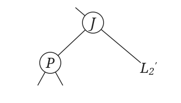

代替 $\textcircled P$, 然后就像新结点 $J$ 是刚由算法 A 插入的那样, 继续调整 $L_1$.

克兰还解决了更困难的求逆问题, 把一个列表分割为两部分, 使得它们连接起来还是原来的列表. 例如, 考虑把图 20 中的列表分割为两个列表的问题, 一个列表中包含 $\{\mathsf A,\ldots,\mathsf I\}$, 另一个包含 $\{\mathsf J,\ldots,\mathsf Q\}$. 这需要对这些子树进行大量的重组工作. 一般情况下, 当希望在某个给定的结点 $P$ 处分割一棵树时, 到 $P$ 的路径类似于图 25 中所示. 我们希望构造一棵左树, 其中以对称序包含结点 $\alpha_1,P_1,\alpha_4,P_4,\alpha_6,P_6,\alpha_7,P_7,\alpha,P$, 右树包含 $\beta,P_8,\beta_8,P_5,\beta_5,P_3,\beta_3,P_2,\beta_2$. 这可以用一系列连接操作来完成: 首先在 $\alpha$ 的右边插入 $P$, 然后以 $P_8$ 为接合结点把 $\beta$ 和 $\beta_8$ 连接起来, 以 $P_7$ 为接合结点, 把 $\alpha_7$ 和 $\alpha P$ 连接起来, 使用 $P_6$ 把 $\alpha_6$ 与 $\alpha_7P_7\alpha P$ 连接起来, 使用 $P_5$ 把 $\beta P_8\beta_8$ 与 $\beta_5$ 连接起来, 以此类推. 在通向 $P$ 的路径上的结点 $P_8,P_7,\ldots,P_1$ 用作接合结点. 克兰证明了, 当原来的树包含 $N$ 个结点时, 这个分割算法仅需要 $O(\log N)$ 个时间单位. 其主要原因是: 使用一个接合结点的连接操作需要 $O(k)$ 步, 其中 $k$ 是被连接树的高度差, 必须累加起来的 $k$ 值实际上为正在构建的左树和右树形成了一个收缩的级数.

所有这些算法都可以使用 KEY 或 RANK 字段之一, 或同时使用这两者, 尽管在连接算法中, $L_2$ 的键必须全都大于 $L_1$ 的键. 对于一般的目的来说, 通常优先选使用三重链接树, 它具有 UP 链接以及 LLINK 和 RLINK 字段, 还有一个新的单个二进制位的字段, 说明某个结点是其父结点的左孩子还是右孩子. 三重链接树表示法使这些算法稍有简化, 可以让我们指定树中的结点, 而无须显式跟踪到该结点的路径. 我们可以编写一个在给定 $\mathrm P$ 时删除 $\mathrm{NODE}(\mathrm P)$ 的子例程, 或者删除按对称序排在 $\mathrm{NODE}(\mathrm P)$ 后面的结点, 或者找出包含 $\mathrm{NODE}(\mathrm P)$ 的列表, 等等. 在三重链接树的删除算法中, 不需要构造列表 (16), 这是因为 UP 链接提供了我们所需要的信息. 当然, 如果使用三重链接树, 在执行插入、删除和转动操作时, 需要改变稍微更多的链接. 使用三重链接树来代替双链接树, 类似于使用两路链接代替一路链接: 我们可以在任意点开始, 向前或向后移动. 克兰的博士论文 (斯坦福大学, 1972) 完整地描述了基于三重链接平衡树的列表算法.

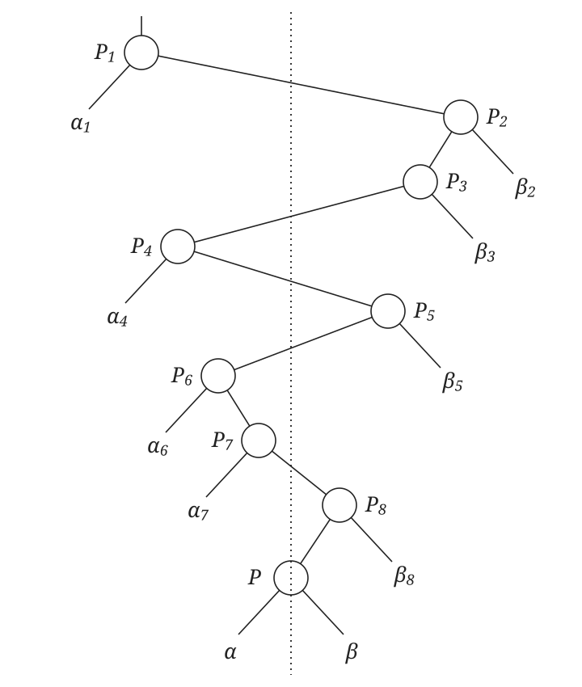

**图 25　列表分割问题**

**AVL 树的替代方案.** 为了保证访问时间符合对数关系, 人们已经提出了许多其他方式来组织树的结构. 例如, 福斯特 [*CACM* **16** (1973), 513–517] 考虑了允许子树高度差最多为 $k$ 的二叉树. 这样的结构可称为 HB$(k)$, 意思是 “高度平衡”(height-balanced), 所以通常的平衡树代表着特殊情景 HB$(1)$.

于尔格·尼弗格尔特、莱因戈尔德和黄泽权已经研究了*加权平衡树*的有趣概念. 他们不是考虑树的高度, 而是规定所有结点的子树都必须满足

$$
\sqrt2-1<\frac{\text{左权值}}{\text{右权值}}<\sqrt2+1,\tag{17}
$$

其中的左权值、右权值分别对左、右子树中的外部结点进行计数. 有可能证明, 像算法 A 中一样仅使用单转动和双转动进行重新平衡, 就可以在插入时维护权值的平衡 (见习题 25). 但是, 在一次插入期间可能需要进行许多次重新平衡. 有可能放宽 (17) 中的条件, 以延长查找时间为代价, 降低重新平衡的次数.

乍看起来, 加权平衡树需要的内存可能要多于单纯的平衡树, 但事实上, 它们有时需要的反而还要稍微少一些! 如果每个结点已经有了一个 RANK 字段, 对于线性列表表示, 这就是左权值, 在沿着树向下移动时, 可以跟踪相应的右权值. 但是, 为维护权值的平衡所需要的簿记工作, 看起来花费的时间要多于算法 A, 并且为了每个结点减少两个二进制位, 可能不值得费这么多周折.

> 为什么不把它们配对成三个呢?
>
> ——归属于约吉·贝拉 (约 1970)

AVL 树的另一种有趣的替代称为 “2-3 树”, 是由约翰·霍普克罗夫特在 1970 年引入的 [见艾尔弗雷德·阿霍、约翰·霍普克罗夫特和杰弗里·厄尔曼,*The Design and Analysis of Computer Algorithms* (Reading, Mass.: Addison-Wesley, 1974), 第 4 章]. 其思想是在每个结点拥有 2 路或 3 路分支, 并规定所有外部结点都出现在相同级别. 每个内部结点包含一个或两个键, 如图 26 所示.

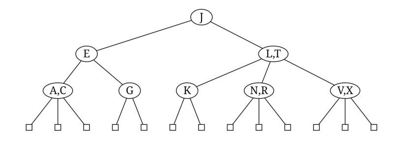

**图 26　一棵 2-3 树**

向 2-3 树中插入结点的过程解释起来要比向 AVL 树中插入容易一些: 如果希望将一个新键放入一个仅包含一个键的结点中, 只需要将新键作为第二个键插入即可. 另一方面, 如果该结点已经包含两个键, 则将其分为两个单键结点, 并把中间键插入父结点. 如果父结点已经包含两个键, 将会以类似方式划分父结点. 图 27 显示了向图 26 的 2-3 树中插入新键的过程.

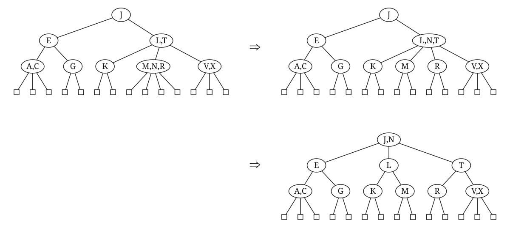

**图 27　向图 26 的 2-3 树中插入新键 M**

约翰·霍普克罗夫特观察到: 所有删除、连接和分割操作都可对 2-3 树执行, 其方式相当简单, 类似于对 AVL 树执行的相应操作.

鲁道夫·拜尔为 2-3 树提出了一种有趣的二叉树表示法 [*Proc. ACM-SIGFIDET Workshop* (1971), 219–235]. 见图 28, 它给出了图 26 的二叉树表示, 每个结点中有一个二进制位用于区分 “水平” 与 “垂直” 的 RLINK. 注意, 与所有二叉查找树一样, 树中的键以对称序由左向右显示. 事实表明, 在像图 27 中那样插入一个新键时, 对这样一棵二叉树执行的变换就是向 AVL 树中插入一个新键时的单转动和双转动, 不过每次转动仅需要一个版本, 而不需要算法 A 和 C 中的左右颠倒.

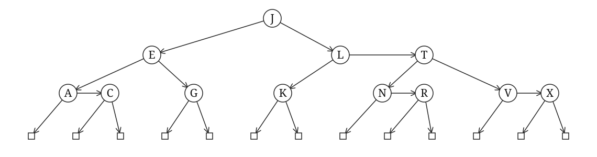

**图 28　图 26 中的 2-3 树表示为一棵二叉查找树**

对这些思想的精心推敲, 已经得到了许多不同风格的平衡树, 最著名的是*红黑树*, 也称为对称二叉 $B$-树或半平衡树 [拜尔,*Acta Informatica* **1** (1972), 290–306; 莱昂尼达斯·吉巴斯和塞奇威克,*FOCS* **19** (1978), 8–21; 昂德里克·奥利维耶,*RAIRO Informatique Théorique* **16** (1982), 51–71; 塔扬,*Inf. Proc. Letters* **16** (1983), 253–257; 托马斯·科尔曼、查理·莱瑟森和李维斯特,*Introduction to Algorithms* (MIT Press, 1990), 第 14 章; 塞奇威克,*Algorithms in C* (Addison-Wesley, 1997), §13.4]. 还有一组密切相关的树, 称为歇斯底里 $B$-树或 $(a,b)$-树, 其中非常有名的是 $(2,4)$-树 [戴维·梅尔和沙伦·萨克维特,*Inf. Proc. Letters* **12** (1981), 199–202; 查尔斯·赫德尔斯顿和梅尔霍恩,*Acta Informatica* **17** (1982), 157–184].

如果对一些键的访问要远比对其他键的访问更为频繁, 我们就希望使这些重要的键更靠近根结点, 就像 6.2.2 节中的最优二叉查找树中一样. 本特、丹尼尔·斯利托和塔扬 [*SICOMP* **14** (1985), 545–568], 琼·费根鲍姆和塔扬 [*Bell System Tech. J.* **62** (1983), 3139–3158] 设计了一种名为*有偏树*的动态树, 利用这种树有可能将权值的平衡维持在最优的一个常数因子的范围内. 然而, 这些算法十分复杂.

后来, 斯利托和塔扬设计了一种简单得多的自调整数据结构, 称为*倾斜树*[*JACM* **32** (1985), 652–686], 其思想类似于 6.1 节讨论的前移与转换等启发式方法. 在此之前, 布赖恩·艾伦和芒罗 [*JACM* **25** (1978), 526–535], 以及詹姆斯·比特纳 [*SICOMP* **8** (1979), 82–110] 已经探讨了类似的技术. 倾斜树和前面已经提到的其他平衡树一样, 支持连接与分割、插入与删除等操作, 而且其方式特别简单. 此外, 已知在访问一棵倾斜树中的数据时, 如果将其时间分摊到任意操作系列上, 所需时间最多为静态最优树访问时间的一个小的常数倍. 实际上, 斯利托和塔扬猜测, 对倾斜树的总访问时间最多是任意二叉树算法访问数据及动态地执行转动所用最优时间的常数倍.

通过随机化得到了一些看起来比倾斜树更简单、更快速的方法. 让·维耶曼介绍了*笛卡儿树*, 在这种树中, 每个结点有两个键 $(x,y)$[*CACM* **23** (1980), 229–239]. $x$ 部分像二叉查找树中一样由左向右排序, $y$ 部分像 5.2.3 节的优先队列树中一样, 自上而下排序. 塞西莉亚·阿拉贡和雷蒙德·塞德尔为这一数据结构起了一个更富有色彩的名字*树堆*, 因为它非常巧妙地将树与堆的概念结合在一起. 准确地说, 如果各个 $x$ 和各个 $y$ 都不相同, 则可以用 $n$ 个给定键对 $(x_1,y_1),\ldots,(x_n,y_n)$ 构成一个树堆. 得到它的一种方法是利用算法 6.2.2T 根据 $y$ 的顺序插入 $x$. 但还有一种简单方法, 可以直接向任意树堆中插入任意新的键对. 阿拉贡和塞德尔观察到 [*FOCS* **30** (1989), 540–546], 如果 $x$ 是普通键, 而 $y$ 是随机选定的, 则可以确信树堆具有随机二叉查找树的形状. 具体来说, 一个具有随机 $y$ 值的树堆总是能够达到相当程度的平衡, 发生例外的概率指数级别地小 (见习题 5.2.2-42). 阿拉贡和塞德尔还证明, 可以很容易地使树堆成为有偏的, 比如, 当一个相对频率为 $f$ 的键 $x$ 与 $y=U^{1/f}$ 相关联时, 可以使 $x$ 适当地靠近根结点, 其中 $U$ 为介于 0 和 1 之间的随机数. 在由高德纳主持的与凸包计算有关的一些试验中, 树堆的表现一致地优于倾斜树 [*Lecture Notes in Comp. Sci.* **606** (1992), 53–55].

 在本书下一版中, 计划增加一个专门讨论随机化数据结构的 6.2.5 节. 它将讨论 “跳跃列表”[威廉·皮尤,*CACM* **33** (1990), 668–676] 和 “随机化二叉查找树”[萨尔瓦多·罗拉和孔拉多·马丁内斯,*JACM* **45** (1998), 288–323], 以及树堆.

### 习题

**1. [01]** 在 (1) 的情景 2 中, 为什么说仅仅通过交换 $A$ 和 $B$ 的左子树来恢复平衡不是一个好主意?　[答案](./answers/6-2-3.md#ans-6-2-3-1)

**2. [16]** 如果到达步骤 A7 时 $\mathrm B(\mathrm S)=0$, 解释为什么这棵树会高出一级来.　[答案](./answers/6-2-3.md#ans-6-2-3-2)

**▶ 3. [M25]** 证明: 在一棵具有 $N$ 个内部结点的平衡树中, 其中平衡因子不为 0 的结点不可能超过 $(\phi-1)N\approx0.61803N$ 个.　[答案](./answers/6-2-3.md#ans-6-2-3-3)

**4. [M22]** 证明或证伪: 在所有具有 $F_{h+1}-1$ 个内部结点的平衡树当中, $h$ 阶斐波那契树的内部路径长度最大.　[答案](./answers/6-2-3.md#ans-6-2-3-4)

**▶ 5. [M25]** 证明或证伪: 如果使用算法 A 以递增顺序将键 $K_2,\ldots,K_N$ 逐个插入到最初仅包含一个键 $K_1$ 的树中, 其中 $K_1<K_2<\cdots<K_N$, 则所生成的树总是最优的 (即, 在所有 $N$ 个结点的二叉树中, 其内部路径长度最短).　[答案](./answers/6-2-3.md#ans-6-2-3-5)

**6. [M21]** 证明: 式 (5) 定义了高度为 $h$ 的平衡树的生成函数.　[答案](./answers/6-2-3.md#ans-6-2-3-6)

**7. [M27]**(艾尔弗雷德·阿霍和尼尔斯·斯隆) 证明著名公式 (9), 它给出了高度为 $h$ 的平衡树的个数. [提示: 设 $C_n=B_n+B_{n-1}$, 并利用一个事实: 当 $n$ 很大时, $\log(C_{n+1}/C_n^2)$ 非常小.]　[答案](./answers/6-2-3.md#ans-6-2-3-7)

**8. [M24]**(列昂尼德·凯泽德尔) 证明: 存在一个常数 $\beta$, 使得当 $h\to\infty$ 时, $B'_h(1)/B_h(1)=2^h\beta-1+O(2^h/B_{h-1})$.　[答案](./answers/6-2-3.md#ans-6-2-3-8)

**9. [HM44]** 具有 $n$ 个内部结点的平衡二叉树的近似数目 $\sum_{h\ge0}B_{nh}$ 等于多少? 近似平均高度 $\sum_{h\ge0}hB_{nh}/\sum_{h\ge0}B_{nh}$ 等于多少?　[答案](./answers/6-2-3.md#ans-6-2-3-9)

**▶ 10. [27]**(罗纳德·理查兹) 证明: 一棵平衡树的形状, 可以利用其平衡因子 $\mathrm B(1)\mathrm B(2)\ldots\mathrm B(N)$ 的列表, 按照对称序唯一地构造出来.　[答案](./answers/6-2-3.md#ans-6-2-3-10)

**11. [M24]**(马克·布朗) 证明: 当 $n\ge6$ 时, 在一棵由算法 A 构建的包括 $n$ 个内部结点的随机平衡树中, 其类型为 <code style="white-space:nowrap">+A</code>、<code style="white-space:nowrap">-A</code>、<code style="white-space:nowrap">++B</code>、<code style="white-space:nowrap">+-B</code>、<code style="white-space:nowrap">-+B</code>、<code style="white-space:nowrap">--B</code> 的任何一种外部结点的平均数目恰好为 $(n+1)/14$.　[答案](./answers/6-2-3.md#ans-6-2-3-11)

**▶ 12. [24]** 当把第 8 个结点插入到一棵平衡树时, 程序 A 的最长运行时间是多少? 这一插入操作的最短运行时间是多少?　[答案](./answers/6-2-3.md#ans-6-2-3-12)

**13. [05]** 为什么使用正文中定义的 RANK 字段, 要比直接存储每个结点的索引 (将第一个结点称为 “1”, 第二个结点称为 “2”, 以此类推.) 作为键值更好一些?　[答案](./answers/6-2-3.md#ans-6-2-3-13)

**14. [11]** 能否修改算法 6.2.2T 和 6.2.2D, 就像对本节的平衡树算法所进行的修改那样, 使用一个 RANK 字段来处理线性列表?　[答案](./answers/6-2-3.md#ans-6-2-3-14)

**15. [18]**(克兰) 假定将一个有序线性列表表示为一个二叉树, 每个结点都有 KEY 和 RANK 字段. 设计一个算法, 在树中查找一个给定键 $K$, 并确定 $K$ 在列表中的位置, 即, 找到数 $m$, 使得 $K$ 是第 $m$ 个最小键.　[答案](./answers/6-2-3.md#ans-6-2-3-15)

**▶ 16. [20]** 利用正文中的删除算法, 从图 20 中删除结点 E 和根结点 F, 请绘制所得到的平衡树.　[答案](./answers/6-2-3.md#ans-6-2-3-16)

**▶ 17. [21]** 使用正文中的连接算法, 将斐波那契树 (12) 连接到图 20 中的树的 (a) 右部, (b) 左部, 然后绘制出这两种情况下获得的平衡树.　[答案](./answers/6-2-3.md#ans-6-2-3-17)

**18. [22]** 利用正文中的分割算法, 将图 20 分割为两部分 $\{\mathsf A,\ldots,\mathsf I\}$ 和 $\{\mathsf J,\ldots,\mathsf Q\}$. 绘制所得到的平衡树.　[答案](./answers/6-2-3.md#ans-6-2-3-18)

**▶ 19. [26]** 找出一个转换给定平衡树的方法, 使根结点处的平衡因子不是 $-1$. 该转换应当保持结点的对称序, 无论原来的树的大小如何, 应当在 $O(1)$ 个时间单位内生成另一棵平衡树.　[答案](./answers/6-2-3.md#ans-6-2-3-19)

**20. [40]** 探讨使用受限制的一类平衡树的思想, 这些树中所有结点的平衡因子限于是 0 或 $+1$. (因此, B 字段的长度可以缩减至 1 个二进制位.) 对于此类树, 是否有相当高效的插入过程?　[答案](./answers/6-2-3.md#ans-6-2-3-20)

**▶ 21. [30]**(*完全平衡*) 设计一个算法, 构造根据习题 5 的意义为最优的 $N$ 个结点的二叉树. 该算法应当使用 $O(N)$ 个步骤, 而且应当是 “联机” 的, 也就是说, 它在事先不知道 $N$ 的最终值的情况下, 按递增顺序逐一输入结点, 逐步构建部分树. (在重新构造一棵失去平衡的树时, 或者将两棵树的键合并到一棵树时, 使用这样一种算法是比较恰当的.)　[答案](./answers/6-2-3.md#ans-6-2-3-21)

**22. [M20]** 对于加权平衡树, 类似于定理 A 的结果是什么?　[答案](./answers/6-2-3.md#ans-6-2-3-22)

**23. [M20]**(莱因戈尔德) 证明在高度平衡树与加权平衡树之间不存在简单关系:　[答案](./answers/6-2-3.md#ans-6-2-3-23)

(a) 证明: 存在高度平衡树, 根据 (17) 的意义, 其比值 “左权值/右权值” 为任意小.

(b) 证明: 存在加权平衡树, 其左、右子树的高度差为任意大.

**24. [M22]**(莱因戈尔德) 证明: 如果将条件 (17) 强化为　[答案](./answers/6-2-3.md#ans-6-2-3-24)

$$
\frac12<\frac{\text{左权值}}{\text{右权值}}<2,
$$

则仅有的几棵满足这个条件的二叉树是具有 $2^n-1$ 个内部结点的完全平衡树. (在此类树中, 在所有结点处的左、右权值完全相等.)

**25. [27]**(尼弗格尔特、莱因戈尔德和黄泽权) 证明: 有可能为加权平衡树设计一个插入算法, 使得条件 (17) 得以保持, 并且每次插入最多执行 $O(\log N)$ 次转动.　[答案](./answers/6-2-3.md#ans-6-2-3-25)

**26. [40]** 对于 $t>2$, 探讨平衡 $t$ 叉树的性质.

**▶ 27. [M23]** 估计在查找一棵拥有 $N$ 个内部结点的 2-3 树时所需要的最大比较次数.　[答案](./answers/6-2-3.md#ans-6-2-3-27)

**28. [41]** 编制 2-3 树算法的高效实现方案.

**29. [M47]** 分析 2-3 树在随机插入下的平均特性.　[答案](./answers/6-2-3.md#ans-6-2-3-29)

**30. [26]**(爱德华·麦克赖特)2.5 节讨论了几种用于动态存储分配的策略, 包括 “最佳匹配” (从所有满足要求的可用区域中选出尽可能小的一个) 和 “最先匹配” (从所有满足要求的可用区域中选出地址最低的一个). 证明: 如果以适当方式将可用空间链接在一起, 变为一棵平衡树, 有可能仅在 $O(\log n)$ 个时间单位中执行 (a) 最佳匹配 (b) 最先匹配, 其中 $n$ 是可用区域的数目. (2.5 节为这些方法给出的算法需要 $n$ 个步骤.)　[答案](./answers/6-2-3.md#ans-6-2-3-30)

**31. [34]**(弗雷德曼, 1975) 为线性列表设计一种表示法, 使其具有以下性质: 给定 $m$ 值, 在位置 $m-1$ 与 $m$ 之间插入一个新项目将需要 $O(\log m)$ 个时间单位.　[答案](./answers/6-2-3.md#ans-6-2-3-31)

**32. [M27]** 给定两棵 $n$ 个结点的二叉树 $T$ 和 $T'$, 如果可以通过一系列 0 次或多次向右转动, 由 $T$ 获得 $T'$, 就说 $T\preceq T'$. 证明: 对于 $1\le k\le n$, 当且仅当 $r_k\le r'_k$ 时, $T\preceq T'$, 其中 $r_k$ 和 $r'_k$ 表示按对称序 $T$ 和 $T'$ 的第 $k$ 个结点的右子树的各自大小.　[答案](./answers/6-2-3.md#ans-6-2-3-32)

**▶ 33. [25]**(亚当·布克斯鲍姆) 解释如何对一棵 AVL 树的平衡因子进行隐式编码, 使每个结点可以节省两个二进制位, 其代价是在访问时会增加一些工作量.　[答案](./answers/6-2-3.md#ans-6-2-3-33)
