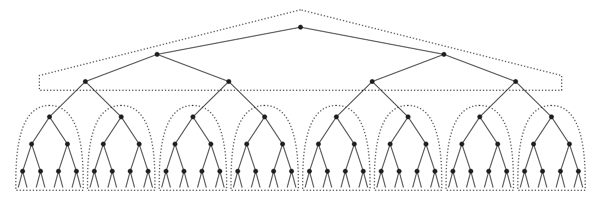
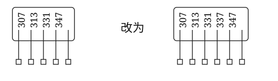
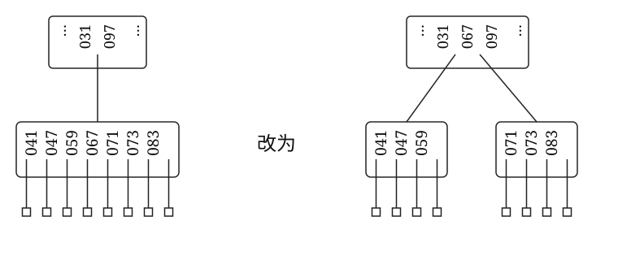
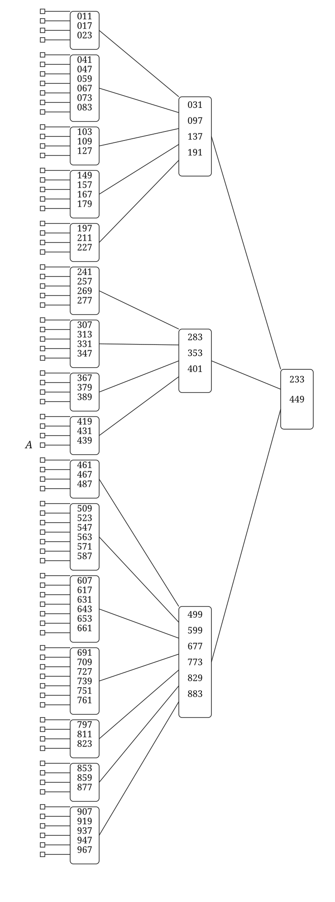

> 塞缪尔逐个部落地考察以色列民族,  
> 并抽签选中了本杰明的部落.  
> 然后他逐个家族地考察本杰明的部落,  
> 并抽签选中马特里的家庭.  
> 接着他逐人地考察马特里的家庭,  
> 并抽签选中基斯的儿子索尔.  
> 但当他们寻找索尔时, 却找不到他.  
>
> ——1 塞缪尔 10:20–21

# 6.2.4 多路树

我们已经讨论的树查找方法主要是为内部查找开发的, 在这种情况下, 我们希望查看的表能够完全容纳在计算机高速内存中. 现在考虑外部查找的问题, 在这种情况下, 希望从一个存储在直接访问存储设备 (比如磁盘或磁鼓) 的大型文件中检索信息. (5.4.9 节对磁盘和磁鼓进行了介绍.)

如果我们选择一种适当的方式来表示树, 那么树结构本身就可以很好地用于外部查找. 考虑图 29 所示的大型二叉查找树, 并设想它已经存储在一个磁盘文件中. (树的 LLINK 和 RLINK 现在是磁盘地址, 而不是内存地址.) 如果采用一种朴实的方式来查找这棵树, 直接运用前面学到的内部树查找算法, 那在完成查找之前, 必须进行大约 $\lg N$ 次磁盘访问. 当 $N$ 为 100 万时, 这意味着我们需要进行 20 次左右的寻道. 但假定我们将这个表分成许多 7 个结点的 “页”, 如图 29 中的虚线所示. 如果一次访问一页, 只需要大约三分之一的寻道, 所以查找过程的速度大约会加快三倍!

像这样将结点分到各个页中, 实际上是将树由二叉树改为八叉树, 每个页结点上有 8 路分叉. 如果让这些页更大一些, 每次磁盘访问后有 128 路分支, 那么只需要查找 3 页, 就可以在一个拥有 100 万项的表中找到任意期望的键. 我们可以始终将根页放在内存中, 这样, 只需要对磁盘进行两次引用, 而内存在任意时刻保存的键数都不超过 254 个.

**图 29　可以划分为 “页” 的大型二叉查找树**

当然, 我们不希望让这些页变得任意大, 因为内存容量是有限的, 而且读取大的页面需要的时间也很长. 例如, 假定读取一个允许 $m$ 路分支的页面需要花费 $72.5+0.05m$ 毫秒. 每页的内部处理时间大约为 $a+b\lg m$, 其中 $a$ 与 72.5 毫秒相比很小, 所以查找大型表所需要的总时间量近似正比于 $\lg N$ 乘以

$$
(72.5+0.05m)/\lg m+b.
$$

这个量在 $m\approx307$ 时达到最小值. 实际上, 这个最小值是非常 “宽泛” 的, 对于所有介于 200 与 500 之间的 $m$ 值, 都可以得到一个近似最优值. 在实践中, 会存在一个类似范围的好的 $m$ 值, 具体取决于特定外部存储设备的特性和表中记录的长度.

瓦尔特·兰道尔建议在构造 $m$ 叉树时, 要求在将第 $l$ 级接近填满之前, 不能在第 $l+1$ 级出现任何东西 [*IEEE Trans.* **EC-12** (1963), 863–871]. 这一机制需要一种相当复杂的转动方法, 这是因为, 也许只是为了插入一个新项目, 就必须在整棵树中进行重大修改. 兰道尔假定, 在树中查找项目的机会要远远高于插入或删除项目的机会.

如果一个文件存储在磁盘上, 而且对其执行的插入和删除操作比较少, 那三级树是比较恰当的, 其中第一级分支确定了将使用哪个柱面, 第二级分支确定了柱面上的适当磁道, 第三级包含了记录本身. 这一方法被称为*索引顺序文件组织结构*[*JACM* **16** (1969), 569–571].

理查德·芒茨和罗伯特·乌泽加里斯提议修改树查找与插入方法——算法 6.2.2T, 使所有插入操作都尽可能针对那些与其父结点位于同一页的结点进行 [*Proc. Princeton Conf. on Inf. Sciences and Systems* **4** (1970), 345–349]. 如果可能, 在填满该页时才开始新页. 如果页数不受限制, 而且数据的进入顺序随机, 可以证明: 页访问的平均次数近似为 $H_N/(H_m-1)$, 只是略大于在最佳 $m$ 叉树中获得的结果. (见习题 8.)

**$B$ 树.** 1970 年, 拜尔和麦克赖特发现了一种利用多路树分支进行外部查找的新方法 [*Acta Informatica* **1** (1972), 173–189], 马克·考夫曼也几乎在同一时间独立地发现了这一方法 [未发表]. 他们的思想基于一种被称为 $B$ 树的通用新型数据结构, 有可能利用相对简单的算法来查找和更新大型数据文件, 并能在最差情况下保证效率.

$m$ 阶 $B$ 树是满足以下性质的树:

(i) 每个结点最多有 $m$ 个子结点.

(ii) 除了根结点及叶子外, 每个结点至少有 $m/2$ 个子结点.

(iii) 根结点至少有 2 个子结点 (除非它是一个叶子).

(iv) 所有叶子都出现在同一级别, 并且不携带任何信息.

(v) 具有 $k$ 个子结点的非叶结点包含 $k-1$ 个键.

(和通常一样, “叶子” 是没有子结点的终端结点. 由于叶子中不携带任何信息, 所以可以把它们看作不在树中的外部结点, 所以 $\Lambda$ 是指向叶子的一个指针.)

图 30 给出一棵 7 阶 $B$ 树. 每个结点 (根结点与叶结点除外) 的子结点数介于 $\lceil7/2\rceil$ 和 7 之间, 所以它包含 3、4、5 或 6 个键. 根结点可以包含 1 至 6 个键. 在本例中, 它有 2 个键. 所有叶结点都位于第 3 级. 注意, (a) 这些键由左向右按递增次序出现, 使用了对称序概念的一种自然推广; (b) 叶子数比键数恰好大 1.

1 阶或 2 阶 $B$ 树显然没有什么意义, 所以我们仅考虑 $m\ge3$ 的情景. 在 6.2.3 节末尾定义的 2-3 树与 3 阶 $B$ 树等价. (拜尔和麦克赖特仅考虑了 $m$ 为奇数的情景. 一些作者所说的 $m$ 阶 $B$ 树是我们所说的 $2m+1$ 阶 $B$ 树.)

一个包含 $j$ 个键和 $j+1$ 个指针的结点可以表示为

<table style="border-collapse:separate;border-spacing:0">
<tbody>
<tr style="background:transparent;border:0"><td colspan="9" style="border:0;text-align:center">$P$ $\downarrow$</td><td style="border:0;padding:0 .35em"></td><td rowspan="3" style="border:0;vertical-align:middle">(1)</td></tr>
<tr style="background:transparent;border:0"><td style="border:0;border-top:1px solid currentColor;border-bottom:1px solid currentColor;border-left:1px solid currentColor;border-radius:1em 0 0 1em;white-space:nowrap;padding:.15em .08em">$P_0,$</td><td style="border:0;border-top:1px solid currentColor;border-bottom:1px solid currentColor;white-space:nowrap;padding:.15em .08em">$K_1,$</td><td style="border:0;border-top:1px solid currentColor;border-bottom:1px solid currentColor;white-space:nowrap;padding:.15em .08em">$P_1,$</td><td style="border:0;border-top:1px solid currentColor;border-bottom:1px solid currentColor;white-space:nowrap;padding:.15em .08em">$K_2,$</td><td style="border:0;border-top:1px solid currentColor;border-bottom:1px solid currentColor;white-space:nowrap;padding:.15em .08em">$P_2,$</td><td style="border:0;border-top:1px solid currentColor;border-bottom:1px solid currentColor;white-space:nowrap;padding:.15em .08em">$\ldots,$</td><td style="border:0;border-top:1px solid currentColor;border-bottom:1px solid currentColor;white-space:nowrap;padding:.15em .08em">$P_{j-1},$</td><td style="border:0;border-top:1px solid currentColor;border-bottom:1px solid currentColor;white-space:nowrap;padding:.15em .08em">$K_j,$</td><td style="border:0;border-top:1px solid currentColor;border-bottom:1px solid currentColor;border-right:1px solid currentColor;border-radius:0 1em 1em 0;white-space:nowrap;padding:.15em .08em">$P_j$</td><td style="border:0;padding:0 .35em"></td></tr>
<tr style="background:transparent;border:0"><td style="border:0;text-align:center;padding:.1em .08em">$\downarrow$</td><td style="border:0;text-align:center;padding:.1em .08em"></td><td style="border:0;text-align:center;padding:.1em .08em">$\downarrow$</td><td style="border:0;text-align:center;padding:.1em .08em"></td><td style="border:0;text-align:center;padding:.1em .08em">$\downarrow$</td><td style="border:0;text-align:center;padding:.1em .08em"></td><td style="border:0;text-align:center;padding:.1em .08em">$\downarrow$</td><td style="border:0;text-align:center;padding:.1em .08em"></td><td style="border:0;text-align:center;padding:.1em .08em">$\downarrow$</td><td style="border:0;padding:0 .35em"></td></tr>
</tbody>
</table>

其中 $K_1<K_2<\cdots<K_j$, 且 $P_i$ 指向包含 $K_i$ 和 $K_{i+1}$ 之间的键的子树. 因此, 在 $B$ 树中进行查找是很简单的: 在将结点 (1) 提取到内存以后, 在 $K_1,K_2,\ldots,K_j$ 等键中查找给定参数. (当 $j$ 很大时, 我们可能会执行二分查找. 但当 $j$ 很小时, 顺序查找是最好的.) 如果查找成功, 那么已经找到了期望的键. 但如果因为参数介于 $K_i$ 和 $K_{i+1}$ 之间而使得查找失败, 则取由 $P_i$ 指向的结点, 并继续进行处理. 如果参数小于 $K_1$, 则使用指针 $P_0$, 如果参数大于 $K_j$ 则使用 $P_j$. 如果 $P_i=\Lambda$, 则查找失败.

$B$ 树有一个优点, 那就是其插入也非常简单. 例如, 考虑图 30. 每个叶子对应于一个可能发生的新的插入操作的位置. 如果希望插入新的键 337, 只需要将适当的结点由

<table><tbody><tr style="background:transparent;border:0"><td style="border:0"></td><td style="border:0">(2)</td></tr></tbody></table>

另一方面, 如果我们希望插入新的键 071, 由于第 2 级相应结点已 “满”, 所以没有空间. 在处理这一情况时, 可以将结点分为两部分, 每个部分 3 个键, 将中间键传送到第 1 级:

<table><tbody><tr style="background:transparent;border:0"><td style="border:0"></td><td style="border:0">(3)</td></tr></tbody></table>

一般情况下, 如果希望将一个新的项插入到 $m$ 阶 $B$ 树中, 当所有叶子都在第 $l$ 级时, 我们将新的键插入第 $l-1$ 级的适当结点中. 如果该结点现在包含 $m$ 个键, 使得它具有形式 (1), 且 $j=m$, 就将它分为两个结点

<table style="border-collapse:separate;border-spacing:0">
<tbody>
<tr style="background:transparent;border:0"><td colspan="6" style="border:0;text-align:center">$P$ $\downarrow$</td><td style="border:0;padding:0 .35em"></td><td colspan="6" style="border:0;text-align:center">$P'$ $\downarrow$</td><td style="border:0;padding:0 .35em"></td><td rowspan="3" style="border:0;vertical-align:middle">(4)</td></tr>
<tr style="background:transparent;border:0"><td style="border:0;border-top:1px solid currentColor;border-bottom:1px solid currentColor;border-left:1px solid currentColor;border-radius:1em 0 0 1em;white-space:nowrap;padding:.15em .08em">$P_0,$</td><td style="border:0;border-top:1px solid currentColor;border-bottom:1px solid currentColor;white-space:nowrap;padding:.15em .08em">$K_1,$</td><td style="border:0;border-top:1px solid currentColor;border-bottom:1px solid currentColor;white-space:nowrap;padding:.15em .08em">$P_1,$</td><td style="border:0;border-top:1px solid currentColor;border-bottom:1px solid currentColor;white-space:nowrap;padding:.15em .08em">$\ldots,$</td><td style="border:0;border-top:1px solid currentColor;border-bottom:1px solid currentColor;white-space:nowrap;padding:.15em .08em">$K_{\lceil m/2\rceil-1},$</td><td style="border:0;border-top:1px solid currentColor;border-bottom:1px solid currentColor;border-right:1px solid currentColor;border-radius:0 1em 1em 0;white-space:nowrap;padding:.15em .08em">$P_{\lceil m/2\rceil-1}$</td><td style="border:0;padding:0 .35em"></td><td style="border:0;border-top:1px solid currentColor;border-bottom:1px solid currentColor;border-left:1px solid currentColor;border-radius:1em 0 0 1em;white-space:nowrap;padding:.15em .08em">$P_{\lceil m/2\rceil},$</td><td style="border:0;border-top:1px solid currentColor;border-bottom:1px solid currentColor;white-space:nowrap;padding:.15em .08em">$K_{\lceil m/2\rceil+1},$</td><td style="border:0;border-top:1px solid currentColor;border-bottom:1px solid currentColor;white-space:nowrap;padding:.15em .08em">$P_{\lceil m/2\rceil+1},$</td><td style="border:0;border-top:1px solid currentColor;border-bottom:1px solid currentColor;white-space:nowrap;padding:.15em .08em">$\ldots,$</td><td style="border:0;border-top:1px solid currentColor;border-bottom:1px solid currentColor;white-space:nowrap;padding:.15em .08em">$K_m,$</td><td style="border:0;border-top:1px solid currentColor;border-bottom:1px solid currentColor;border-right:1px solid currentColor;border-radius:0 1em 1em 0;white-space:nowrap;padding:.15em .08em">$P_m$</td><td style="border:0;padding:0 .35em"></td></tr>
<tr style="background:transparent;border:0"><td style="border:0;text-align:center;padding:.1em .08em">$\downarrow$</td><td style="border:0;text-align:center;padding:.1em .08em"></td><td style="border:0;text-align:center;padding:.1em .08em"></td><td style="border:0;text-align:center;padding:.1em .08em"></td><td style="border:0;text-align:center;padding:.1em .08em"></td><td style="border:0;text-align:center;padding:.1em .08em">$\downarrow$</td><td style="border:0;padding:0 .35em"></td><td style="border:0;text-align:center;padding:.1em .08em">$\downarrow$</td><td style="border:0;text-align:center;padding:.1em .08em"></td><td style="border:0;text-align:center;padding:.1em .08em"></td><td style="border:0;text-align:center;padding:.1em .08em"></td><td style="border:0;text-align:center;padding:.1em .08em"></td><td style="border:0;text-align:center;padding:.1em .08em">$\downarrow$</td><td style="border:0;padding:0 .35em"></td></tr>
</tbody>
</table>

并把键 $K_{\lceil m/2\rceil}$ 插入到原来的结点的父结点中. (因此, 父结点中的指针 $P$ 由序列 $P,K_{\lceil m/2\rceil},P'$ 代替.) 这一插入操作可能会使该父结点包含 $m$ 个键, 如果确实如此, 则应当以相同方式对其进行分割. (上一节的图 27 说明了 $m=3$ 的情景.) 如果需要分割根结点 (它没有父结点), 只需要创建一个新的根结点, 其中包含单个键 $K_{\lceil m/2\rceil}$. 在这种情况下, 这棵树长高了 1 级.

**图 30　所有叶子都位于第 3 级的 7 阶 $B$ 树. 每个结点包含 3、4、5 或 6 个键. 键 449 之前的叶子已经被标为 A. 见 (8)**

这一插入过程巧妙地保留了 $B$ 树的所有性质. 为全面欣赏这一思想的美妙之处, 读者应当完成习题 1. 这棵树实际上是由顶部向上增长的, 而不是在底部向下延伸, 这是因为它仅在分割根结点时才会变高.

从 $B$ 树中删除结点只比插入操作稍微复杂一点 (见习题 6).

**运行时间的上限.** 现在让我们看看在一棵 $m$ 阶 $B$ 树中进行查找时, 最糟糕情况下会访问多少个结点. 假定存在 $N$ 个键, $N+1$ 个叶子出现在第 $l$ 级. 则第 1、2、3、……级上的结点数至少为 $2,2\lceil m/2\rceil,2\lceil m/2\rceil^2,\ldots$ 因此

$$
N+1\ge2\lceil m/2\rceil^{l-1}.\tag{5}
$$

换句话说,

$$
l\le1+\log_{\lceil m/2\rceil}\left(\frac{N+1}{2}\right).\tag{6}
$$

这意味着, 例如, 如果 $N=1\,999\,998$ 且 $m=199$, 则 $l$ 最多为 3. 由于在一次查找期间最多需要访问 $l$ 个结点, 则这一公式保证了运行时间非常短.

在插入一个新的键时, 可能必须分割多达 $l$ 个结点. 但是, 由于构造整棵树时发生的总分割次数就是树中内部结点总数减去 $l$, 所以需要分割的结点的平均数要小得多. 如果有 $p$ 个内部结点, 则至少有 $1+(\lceil m/2\rceil-1)(p-1)$ 个键. 因此

$$
p\le1+\frac{N-1}{\lceil m/2\rceil-1}.\tag{7}
$$

由此可以得出, 在构建一棵由 $N$ 个键组成的树时, 每做一次插入, 需要分割结点的平均次数小于 $1/(\lceil m/2\rceil-1)$.

**改进与变形.** 稍微打破一点规则, 就可以有几种方法来改进上面定义的基本 $B$ 树结构.

首先, 我们注意到位于第 $l-1$ 级的结点中的所有指针都是 $\Lambda$, 其他级别没有指针是 $\Lambda$. 这通常意味着存在大量被浪费的空间, 因此, 如果消除所有这些 $\Lambda$, 为所有 “底” 结点使用不同的 $m$ 值, 既能节省时间, 又能节约空间. 这样使用两个不同的 $m$ 值并不会使插入算法变差, 因为一个结点被划分为两个部分后仍然与原来的结点位于同一级别. 事实上, 我们可以定义一种阶数为 $m_1,m_2,m_3,\ldots$ 的广义 $B$ 树, 要求第 $l-k$ 级上所有非根结点的子结点数都介于 $m_k/2$ 至 $m_k$ 之间. 这样的一棵 $B$ 树每一级的 $m$ 值不同, 但插入算法仍然可以和过去一样正常工作.

为了进一步深化上一段介绍的思想, 我们可以在树的每一级使用一种完全不同的结点格式, 还可以在叶子中存储信息. 有时, 这些键仅构成文件中记录的很少一部分, 在这种情况下, 在接近树的根结点附近的分支结点中存储整个记录是错误的. 这样会使 $m$ 太小, 而不利于高效的多路分支.

接下来可以重新考虑图 30, 设想文件中的所有记录现在都存储在叶子中, 只有很少几个键已经被复制到分支结点中. 根据这一解读, 最左边的叶子包含了键值 $\le011$ 的所有记录. 标有 A 的叶子中包含键值满足

$$
439<K\le449\tag{8}
$$

的所有记录, 以此类推. 根据这一解释, 叶结点会像分支结点一样增长和分裂, 只是一条记录从来不会由一个叶子传送到下一级别. 因此, 这些叶子至少总是填到半满. 每当一个叶子分裂时, 一个新的键进入该树的非叶子部分. 如果每个叶子都被连接到其对称序的后续者, 那我们就能够高效而便捷地遍历该文件, 既可以用顺序方式, 也可以用随机方式. 这一变化形式被称为 $B^+$ 树而闻名.

萨克蒂·高希和迈克尔·先科的一些计算提示, 使叶子大到相当程度也许是一个好主意, 比如长达大约 10 个连续页 [*JACM* **16** (1969), 569–579]. 通过对每个叶子已知键范围进行线性插值, 可以猜测 10 个页面中的哪一个可能包含给定查找参数. 如果猜测错误, 就会损失时间, 但试验表明, 这个损失比我们通过减少树的大小所节省的时间要少.

托马斯·马丁已经指出: $B$ 树的基本思想也可用于变长键 [未发表]. 不需要对每个结点的子结点数设定 $[m/2\mathbin{\ldotp\ldotp}m]$ 的限制. 只需要说每个结点中应该至少有半满的数据. 尽管每个结点的确切键数取决于这些键的长短, 插入和分割机制仍然可以有效工作. 但是, 这些键不能太长, 否则会让事情变得糟糕. (见习题 5.)

对基本 $B$ 树机制的另一重要修改是由拜尔和麦克赖特引入的*溢出*思想. 这个思想改进插入算法的做法是: 抵制住频繁分割结点的诱惑, 代以一种局部转动算法. 假定我们有一个结点是过满的, 因为它包含 $m$ 个键和 $m+1$ 个指针. 我们不是对其进行分割, 而是首先看看它右边的同级结点, 它拥有比如 $j$ 个键和 $j+1$ 个指针. 在父结点中, 存在一个键 $\bar K_f$, 它按下图分开这两个同级结点的键

<table>
<tbody>
<tr style="background:transparent;border:0"><td colspan="2" style="border:0;text-align:center">$\cdots\quad\bar K_f\quad\cdots$</td><td rowspan="4" style="border:0;vertical-align:middle">(9)</td></tr>
<tr style="background:transparent;border:0"><td style="border:0;text-align:center">$P\ \swarrow$</td><td style="border:0;text-align:center">$\searrow\ P'$</td></tr>
<tr style="background:transparent;border:0"><td style="border:0;white-space:nowrap">$K_1\quad\cdots\quad K_m$</td><td style="border:0;white-space:nowrap">$K'_1\quad\cdots\quad K'_j$</td></tr>
<tr style="background:transparent;border:0"><td style="border:0;white-space:nowrap">$P_0\!\downarrow\quad P_1\!\downarrow\quad P_m\!\downarrow$</td><td style="border:0;white-space:nowrap">$P'_0\!\downarrow\quad P'_1\!\downarrow\quad P'_j\!\downarrow$</td></tr>
</tbody>
</table>

如果 $j<m-1$, 只需对结构进行简单重排就可以避免分割了: 我们在左结点中保留 $\lfloor(m+j)/2\rfloor$ 个键, 在父结点中用 $K_{\lfloor(m+j)/2\rfloor+1}$ 代替 $\bar K_f$, 并且把剩下的 $\lceil(m+j)/2\rceil$ 个键 (包括 $\bar K_f$) 和相应的指针放到右结点中. 因此, 满结点 “溢出” 到它的同级结点中. 另一方面, 如果同级结点已满 ($j=m-1$), 则可以分割这两个结点, 使三个结点达到大约三分之二满, 分别包括 $\lfloor(2m-2)/3\rfloor$、$\lfloor(2m-1)/3\rfloor$ 和 $\lfloor2m/3\rfloor$ 个键:

<table>
<tbody>
<tr style="background:transparent;border:0"><td colspan="3" style="border:0;text-align:center;white-space:nowrap">$\cdots\quad K_{\lfloor(2m+1)/3\rfloor}\quad K'_{\lfloor(m-1)/3\rfloor}\quad\cdots$</td><td rowspan="4" style="border:0;vertical-align:middle">(10)</td></tr>
<tr style="background:transparent;border:0"><td style="border:0;text-align:center">$P\ \swarrow$</td><td style="border:0;text-align:center">$P''\ \downarrow$</td><td style="border:0;text-align:center">$\searrow\ P'$</td></tr>
<tr style="background:transparent;border:0"><td style="border:0;white-space:nowrap">$K_1\quad K_2\quad\cdots$</td><td style="border:0;white-space:nowrap">$\cdots\quad K_m\quad\bar K_f\quad K'_1\quad\cdots$</td><td style="border:0;white-space:nowrap">$\cdots\quad K'_j$</td></tr>
<tr style="background:transparent;border:0"><td style="border:0;white-space:nowrap">$P_0\!\downarrow\quad P_1\!\downarrow$</td><td style="border:0;white-space:nowrap">$P_m\!\downarrow\quad P'_0\!\downarrow\quad P'_1\!\downarrow$</td><td style="border:0;white-space:nowrap;text-align:right">$P'_j\!\downarrow$</td></tr>
</tbody>
</table>

如果原来的结点没有右同级结点, 则可以用同一方式考虑其左同级结点. (如果原结点拥有左、右同级结点, 我们甚至可以在左、右同级结点都变满之前, 避免分割出新的结点.) 最后, 如果要分割的原来的结点根本就没有同级结点, 那它必然是根结点. 我们可以改变 $B$ 树的定义, 允许根结点中包含多达 $2\lfloor(2m-2)/3\rfloor$ 个键, 以便在分割根结点时, 它会生成各包含 $\lfloor(2m-2)/3\rfloor$ 个键的两个结点.

上一段中所有技术的效果就是生成一种非常优良的树, 比如说, $m$ 阶 $B^*$ 树, 它可以定义如下:

(i) 除根结点外, 每个结点最多有 $m$ 个子结点.

(ii) 除根结点和叶结点外, 每个结点至少有 $(2m-1)/3$ 个子结点.

(iii) 根结点至少有 2 个、最多有 $2\lfloor(2m-2)/3\rfloor+1$ 个子结点.

(iv) 所有叶结点都出现在同一级别.

(v) 具有 $k$ 个子结点的非叶结点包含 $k-1$ 个键.

重要变化是条件 (ii), 它断言, 我们在每个结点中至少使用了三分之二的可用空间. 由于我们将 (6) 和 (7) 中的 $\lceil m/2\rceil$ 代之以 $\lceil(2m-1)/3\rceil$, 所以这一变化不仅可以更高效地利用空间, 还可以加快查找过程的速度. 但是, 因为在填满结点时需要对其多加注意, 所以插入过程会变得慢一些. 见张斌和许玖君,*Acta Informatica* **26** (1989), 421–438, 他们对所涉及的折衷问题进行了大概的分析.

在另一个极端, 在频繁改变的树中, 有时让结点变得低于半满状态会更好一些, 在插入次数多于删除次数时尤其如此. 西奥多·约翰逊和丹尼斯·沙沙已经对这一情景进行了分析 [*J. Comput. Syst. Sci.* **47** (1993), 45–76].

由于根结点的次数可能低到 2, 所以读者可能已经对 $B$ 树有所怀疑. 我们为什么仅仅为一个两路决策浪费整个磁盘访问呢?! 有一种简单的缓冲机制可以克服这一缺陷, 这种机制是*替换最近最少使用的页*. 我们可以在内存中保存若干个缓冲区的信息负载, 这样当已经存在相应页面时, 就可以避免输入命令. 根据这一机制, 只有当必需页面不在内存中时, 查找或插入算法才会发出被转换为实际输入指令的 “虚拟读取” 命令; 当这个缓冲区已经被读过并且可能已经被算法所修改时, 会发出后续的 “释放” 命令. 在需要一次实际读取时, 将选择最早被释放的缓冲区; 如果缓冲区的内容在读入之后发生了变化, 则写出该缓冲区内容, 然后将所需页面读入这个选定缓冲区中.

与缓冲区的个数相比, 树中的级数通常比较小, 所以这个分页机制将确保根页面总是存在于内存中. 如果根结点仅有 2 个或 3 个子结点, 则第一级的页面将几乎肯定驻留在内存中. 在需要时, 任何在插入期间需要分割的页面都会自动出现在内存中, 这是因为在此前的最近的查找已经记住了它们.

麦克赖特进行的试验已经表明这个策略是非常成功的. 例如, 他发现当有 10 个缓冲区且 $m=121$ 时, 按照递增顺序插入 100000 个键的过程仅需要 22 个实际读取命令和 857 个实际写入命令. 因此, 大多数操作发生在内存中. 此外, 这棵树仅包含 835 个结点, 仅比最小可能值 $\lceil100000/(m-1)\rceil=834$ 多 1 个. 因此, 存储利用率接近 100%. 对于这个试验, 他使用了溢出技术, 但仅使用了 (4) 中的 2 路结点分割, 而没有使用 (10) 中的 3 路分割. (见习题 3.)

在另外一次试验中, 同样是 10 个缓冲区和 $m=121$, 并且采用溢出技术, 他将 5000 个键以随机顺序插入到一棵初始为空的树中, 在进行 2762 次实际读取和 2739 次实际写入之后, 生成一棵具有 48 个结点的 2 级树 (87%的存储利用率). 然后, 1000 次随机查找需要 786 次实际读取. 没有溢出特性的同一试验, 在进行 2743 次实际读取和 2800 次实际写入之后, 生成一棵具有 62 个结点的 2 级树 (67%的存储利用率). 1000 个后续随机查找需要 836 次实际读取. 这不仅证明这种分页机制是有效的, 还表明, 在决定分割一个结点之前局部处理溢出更明智一些.

姚期智已经证明: 当 $N$ 值和 $m$ 值较大时, 在没有溢出特性下执行随机插入后的平均结点数为 $N/(m\ln2)+O(N/m^2)$, 所以存储利用率近似为 $\ln2\approx69.3\%$[*Acta Informatica* **9** (1978), 159–170]. 也见伯恩哈德·艾森巴特、尼维奥·泽雅亚尼、加斯东·戈内、梅尔霍恩和伍德 [*Information and Control* **55** (1982), 125–174], 以及巴埃萨-耶茨 [*Acta Informatica* **26** (1989), 439–471] 所做的更详尽的分析.

$B$ 树在发明之后, 很快就变得非常普及. 例如, 道格拉斯·科默在 *Computing Surveys* **11** (1979), 121–137、412 上发表的文章, 讨论了其早期发展, 并介绍了一种广泛使用的系统——IBM 公司开发的 VSAM (虚拟存储访问方法). VSAM 的创新之一就是复制磁盘轨道上的块, 以使等待时间缩至最短.

不幸的是, 基本 $B$ 树策略的两个最重要发展结果被赋予了几乎相同的名字: “*SB* 树” 和 “SB 树”. 帕特里克·奥尼尔 [*Acta Inf.* **29** (1992), 241–265] 的 *SB* 树被设计为: 向相同磁道或柱面分配邻近的记录, 在需要同时访问许多连续记录的应用中保持高效率, 从而使磁盘输入/输出时间降至最低. 在这种情况下 *SB* 用斜体表示,*S* 表示 “sequential” (顺序的). 保罗·费拉吉纳和罗伯托·格罗西 [*STOC* **27** (1995), 693–702;*SODA* **7** (1996), 373–382] 的 SB 树非常出色地将 $B$ 树结构和我们将在 6.3 节讨论的 Patricia 树结合在一起. 在这种情况下, SB 用罗马体表示, S 表示 “string” (字符串). SB 树在大规模文本处理方面有许多应用, 它们为磁盘上变长字符串的高效排序提供了基础 [见拉尔斯·阿尔格、保罗·费拉吉纳、罗伯托·格罗西和魏杰甫,*STOC* **29** (1997), 540–548].

### 习题

**1. [10]** 向图 30 中插入键 613 后, 得到什么样的 7 阶 $B$ 树? (不要使用溢出技术.)　[答案](./answers/6-2-4.md#ans-6-2-4-1)

**2. [15]** 完成习题 1, 但使用溢出技术和 (10) 中的 3 路分割.　[答案](./answers/6-2-4.md#ans-6-2-4-2)

**▶ 3. [23]** 假定我们按递增的顺序在一个初始为空的 101 阶 $B$ 树中插入键 1、2、3、…. 在采用以下各方式时, 哪个键会导致叶子首次出现在第 4 级?　[答案](./answers/6-2-4.md#ans-6-2-4-3)

(a) 在没有使用溢出时.

(b) 在使用溢出和 (4) 中的仅仅 2 路分割时.

(c) 在使用 101 阶 $B^*$ 树, 采用溢出和 (10) 中的 3 路分割时.

**4. [21]**(拜尔和麦克赖特) 试解释, 如何处理向一棵广义 $B$ 树的插入操作, 使得除根结点和叶子结点之外的所有结点都一定至少有 $\frac34m-\frac12$ 个孩子.　[答案](./answers/6-2-4.md#ans-6-2-4-4)

**▶ 5. [21]** 假定某个结点表示外部存储器中的 1000 个字符位置. 如果每个指针占用 5 个字符, 并且键是可变长的, 其长度在 5 至 50 个字符之间, 但总是 5 的倍数. 在插入期间, 分割一个结点后, 该结点所占用的最少字符位置为多少? (仅考虑一种类似于正文中对定长键 $B$ 树所描述的简单分割过程, 不采用溢出. 上移键使得其余两部分大小最为接近.)　[答案](./answers/6-2-4.md#ans-6-2-4-5)

**6. [23]** 为 $B$ 树设计一个删除算法.　[答案](./answers/6-2-4.md#ans-6-2-4-6)

**7. [28]** 为 $B$ 树设计一个连接算法 (见 6.2.3 节).

**▶ 8. [HM37]** 考虑芒茨和乌泽加里斯提议的树插入过程的推广, 其中每页可以容纳 $M$ 个键. 在将 $N$ 个随机项插入这样一棵树之后, 使其拥有 $N+1$ 个外部结点. 设 $b_{Nk}^{(j)}$ 表示发生如下情景的概率: 一次失败查找需要 $k$ 次页访问, 而且它终止于一个外部结点, 同时其父结点属于一个包含 $j$ 个键的页面. 如果 $B_N^{(j)}(z)=\sum b_{Nk}^{(j)}z^k$ 是相应的生成函数, 证明: 我们有 $B_1^{(j)}(z)=\delta_{j1}z$, 且　[答案](./answers/6-2-4.md#ans-6-2-4-8)

$$
B_N^{(j)}(z)=\frac{N-j-1}{N+1}B_{N-1}^{(j)}(z)+\frac{j+1}{N+1}B_{N-1}^{(j-1)}(z),\qquad\text{对于 }1<j<M;
$$

$$
B_N^{(1)}(z)=\frac{N-2}{N+1}B_{N-1}^{(1)}(z)+\frac{2z}{N+1}B_{N-1}^{(M)}(z);
$$

$$
B_N^{(M)}(z)=\frac{N-1}{N+1}B_{N-1}^{(M)}(z)+\frac{M+1}{N+1}B_{N-1}^{(M-1)}(z).
$$

$C'_N=\sum_{j=1}^M B_N^{(j)\prime}(1)$ 是每次失败查找所访问的平均页数, 试求其渐近特性. [提示: 用以下矩阵表示该递推关系

$$
W(z)=\begin{pmatrix}
-3&0&\cdots&0&2z\\
3&-4&\cdots&0&0\\
0&4&\cdots&0&0\\
\vdots&\vdots&&\vdots&\vdots\\
0&0&\cdots&-M-1&0\\
0&0&\cdots&M+1&-2
\end{pmatrix},
$$

并把 $C'_N$ 与 $W(1)$ 中的 $N$ 次多项式关联起来.]

**9. [22]** $B$ 树的思想能否用于按位置而不是按键值来查找一个线性列表中的项目? (见算法 6.2.3B)　[答案](./answers/6-2-4.md#ans-6-2-4-9)

**▶ 10. [35]** 讨论一个组织为 $B$ 树形式的大型文件, 怎样用于由大量用户同时进行并发访问和更新, 使不同页面的用户几乎不会相互影响.　[答案](./answers/6-2-4.md#ans-6-2-4-10)
