

> 关于存储分配的优化、  
> 所需操作数目的最小化等内容,  
> 甚至其他等价算法, 我们都知之甚少.  
> 这个研究领域的未来发展,  
> 必须利用纯数学和应用数学这两方面的最强有力资源.
>
> ——安东尼·奥廷格 (1961)

## 6.3 数字查找

键可以表示为一系列的数字或字母字符, 我们可以利用这些表示, 而不再以键的比较作为查找方法的基础. 例如, 考虑一本大型词典的踏步口, 根据一个给定单词的第一个字母, 我们可以立即找到包含所有以该字母开头的单词的页面.

如果我们继续踏步口的思想, 一个合理的结果就是得出一种查找方案, 它以表 1 所示的重复 “下标” 为基础. 假定我们希望检测一个给定的查找参数, 看它是否是 31 个最常见的英文单词之一 (见 6.2.2 节的图 12 和 13). 表 1 中的数据被表示为一种*检索结构*(trie structure). 这个名字是由爱德华·弗雷德金提议的 [*CACM* **3** (1960), 490–499], 因为它是信息检索 (information retrieval) 的一部分. 一个检索结构 (trie, 其发音与 try 相同) 实际上就是一棵 $M$ 路树, 其结点是 $M$ 维向量, 向量的各个分量对应于数字或字符. 第 $l$ 级上的每个结点表示一个键的集合, 其中包含了所有以特定 $l$ 个字符序列开头的键, 这个由 $l$ 个字符组成的序列称为其*前缀*. 该结点根据第 $l+1$ 个字符确定一个 $M$ 路分支.

**表 1　31 个最常见的英文单词组成的检索结构**

<table>
<thead><tr><th></th><th>(1)</th><th>(2)</th><th>(3)</th><th>(4)</th><th>(5)</th><th>(6)</th><th>(7)</th><th>(8)</th><th>(9)</th><th>(10)</th><th>(11)</th><th>(12)</th></tr></thead>
<tbody>
<tr><th>$\sqcup$</th><td></td><td>A</td><td></td><td></td><td></td><td>I</td><td></td><td></td><td></td><td></td><td>HE</td><td></td></tr>
<tr><th>A</th><td>(2)</td><td></td><td></td><td></td><td>(10)</td><td></td><td></td><td></td><td>WAS</td><td></td><td></td><td>THAT</td></tr>
<tr><th>B</th><td>(3)</td><td></td><td></td><td></td><td></td><td></td><td></td><td></td><td></td><td></td><td></td><td></td></tr>
<tr><th>C</th><td></td><td></td><td></td><td></td><td></td><td></td><td></td><td></td><td></td><td></td><td></td><td></td></tr>
<tr><th>D</th><td></td><td></td><td></td><td></td><td></td><td></td><td></td><td></td><td></td><td>HAD</td><td></td><td></td></tr>
<tr><th>E</th><td></td><td></td><td>BE</td><td></td><td>(11)</td><td></td><td></td><td></td><td></td><td></td><td></td><td>THE</td></tr>
<tr><th>F</th><td>(4)</td><td></td><td></td><td></td><td></td><td></td><td>OF</td><td></td><td></td><td></td><td></td><td></td></tr>
<tr><th>G</th><td></td><td></td><td></td><td></td><td></td><td></td><td></td><td></td><td></td><td></td><td></td><td></td></tr>
<tr><th>H</th><td>(5)</td><td></td><td></td><td></td><td></td><td></td><td></td><td>(12)</td><td>WHICH</td><td></td><td></td><td></td></tr>
<tr><th>I</th><td>(6)</td><td></td><td></td><td></td><td>HIS</td><td></td><td></td><td></td><td>WITH</td><td></td><td></td><td>THIS</td></tr>
<tr><th>$\Delta$</th><td></td><td></td><td></td><td></td><td></td><td></td><td></td><td></td><td></td><td></td><td></td><td></td></tr>
<tr><th>J</th><td></td><td></td><td></td><td></td><td></td><td></td><td></td><td></td><td></td><td></td><td></td><td></td></tr>
<tr><th>K</th><td></td><td></td><td></td><td></td><td></td><td></td><td></td><td></td><td></td><td></td><td></td><td></td></tr>
<tr><th>L</th><td></td><td></td><td></td><td></td><td></td><td></td><td></td><td></td><td></td><td></td><td></td><td></td></tr>
<tr><th>M</th><td></td><td></td><td></td><td></td><td></td><td></td><td></td><td></td><td></td><td></td><td></td><td></td></tr>
<tr><th>N</th><td>NOT</td><td>AND</td><td></td><td></td><td></td><td>IN</td><td>ON</td><td></td><td></td><td></td><td></td><td></td></tr>
<tr><th>O</th><td>(7)</td><td></td><td></td><td>FOR</td><td></td><td></td><td></td><td>TO</td><td></td><td></td><td></td><td></td></tr>
<tr><th>P</th><td></td><td></td><td></td><td></td><td></td><td></td><td></td><td></td><td></td><td></td><td></td><td></td></tr>
<tr><th>Q</th><td></td><td></td><td></td><td></td><td></td><td></td><td></td><td></td><td></td><td></td><td></td><td></td></tr>
<tr><th>R</th><td></td><td>ARE</td><td></td><td>FROM</td><td></td><td></td><td>OR</td><td></td><td></td><td></td><td>HER</td><td></td></tr>
<tr><th>$\Sigma$</th><td></td><td></td><td></td><td></td><td></td><td></td><td></td><td></td><td></td><td></td><td></td><td></td></tr>
<tr><th>$\Pi$</th><td></td><td></td><td></td><td></td><td></td><td></td><td></td><td></td><td></td><td></td><td></td><td></td></tr>
<tr><th>S</th><td></td><td>AS</td><td></td><td></td><td></td><td>IS</td><td></td><td></td><td></td><td></td><td></td><td></td></tr>
<tr><th>T</th><td>(8)</td><td>AT</td><td></td><td></td><td></td><td>IT</td><td></td><td></td><td></td><td></td><td></td><td></td></tr>
<tr><th>U</th><td></td><td></td><td>BUT</td><td></td><td></td><td></td><td></td><td></td><td></td><td></td><td></td><td></td></tr>
<tr><th>V</th><td></td><td></td><td></td><td></td><td></td><td></td><td></td><td></td><td></td><td>HAVE</td><td></td><td></td></tr>
<tr><th>W</th><td>(9)</td><td></td><td></td><td></td><td></td><td></td><td></td><td></td><td></td><td></td><td></td><td></td></tr>
<tr><th>X</th><td></td><td></td><td></td><td></td><td></td><td></td><td></td><td></td><td></td><td></td><td></td><td></td></tr>
<tr><th>Y</th><td>YOU</td><td></td><td>BY</td><td></td><td></td><td></td><td></td><td></td><td></td><td></td><td></td><td></td></tr>
<tr><th>Z</th><td></td><td></td><td></td><td></td><td></td><td></td><td></td><td></td><td></td><td></td><td></td><td></td></tr>
</tbody>
</table>

例如, 表 1 的检索结构有 12 个结点, 结点 (1) 是根结点, 我们在这里查找第 1 个字符. 如果第 1 个字符是 N, 则由表可知, 我们的单词必然是 NOT (或者它不在表中). 另一方面, 如果第 1 个字符是 W, 结点 (1) 告诉我们前进到结点 (9), 以同一方式查找第 2 个字符, 结点 (9) 表明第 2 个字符应当是 A、H 或 I. 结点 (10) 的前缀是 HA. 表中的空白项表示空链接.

表 1 中的结点向量是根据 MIX 字符代码排列的. 这意味着一次检索结构查找是非常快速的, 因为是以键的字符为下标来提取一个数组的字. 利用下标进行快速多路判断的方法被称为 “检表”(table look-at), 以与 “查表”(table look-up) 相区分 [见菲利普·舍曼,*CACM* **4** (1961), 172–173、175].

**算法 T (检索结构查找).** 给定一个记录表, 表中的记录构成一个 $M$ 路检索结构, 本算法查找一个给定的参数 $K$. 检索结构结点是其下标范围为 0 至 $M-1$ 的向量, 这些向量的每个分量或者是一个键, 或者是一个链接 (可能为空).

**T1.[初始化.]** 设定链接变量 $\mathrm P$, 使其指向检索结构的根结点.

**T2.[分支.]** 令 $k$ 为输入参数 $K$ 由左向右数的下一个字符. (如果已经对参数进行了完全扫描, 我们将令 $k$ 为 “空白” 或单词结束符号. 该字符应当表示为 $0\le k<M$ 范围内的一个数.) 设 $X$ 是 $\mathrm{NODE}(\mathrm P)$ 中编号为 $k$ 的表项. 如果 $X$ 是一个链接, 则转至 T3. 但是如果 $X$ 是一个键, 则转至 T4.

**T3.[前进.]** 如果 $X\ne\Lambda$, 则置 $\mathrm P\leftarrow X$, 并返回 T2; 否则, 本算法则以失败告终.

**T4.[比较.]** 如果 $X=K$, 则本算法成功结束; 否则, 它将以失败结束.　▮

注意, 如果查找失败, 则已经找到了最长的匹配. 这个特性有时在应用中很有用.

为了比较这个算法与本章其他算法的速度, 我们可以编写一个简短的 MIX 程序, 假定字符都是字节, 这些键至多为 5 个字节.

**程序 T (检索结构查找).** 这个程序假定所有键都用一个 MIX 字来表示, 如果键的字符数少于 5 个, 则在右边添加空格. 由于我们使用 MIX 字符代码, 所以假定查找参数的每个字节包含一个小于 30 的数字. 链接表示为一个结点字的 0:2 字段中的负数. $\mathrm{rI1}\equiv\mathrm P$, $\mathrm{rX}\equiv K$ 的未扫描部分.

~~~mixal
01 START   LDX   K            1   T1. 初始化.
02         ENT1  ROOT         1   P ← 指向检索结构的根结点的指针.
03 2H      SLAX  1            C   T2. 分支.
04         STA   *+1(2:2)     C   提取下一个字符，k.
05         ENT2  0,1          C   Q ← P + k.
06         LD1N  0,2(0:2)     C   P = LINK(Q).
07         J1P   2B           C   T3. 前进. 如果P是一个≠Λ的链接则转至T2.
08         LDA   0,2          1   T4. 比较. rA ← KEY(Q).
09         CMPA  K            1
10         JE    SUCCESS      1   如果rA = K则成功退出.
11 FAILURE EQU   *                如果不在检索结构中则退出.
~~~

此程序的运行时间为 $8C+8$ 个单位, 其中 $C$ 是所查看字符的数目. 由于 $C\le5$, 所以这个查找从来不需要超过 48 个时间单位.

如果现在将这个程序 (使用表 1 中的检索结构) 的效率与程序 6.2.2T (使用图 13 中的最优二叉查找树) 对比, 则可以观察到如下结果.

1. 检索结构占用的内存空间要多得多. 仅仅为了表示 31 个键, 我们使用了 360 个字, 而二叉查找树仅使用了 62 个字的内存. (但习题 4 表明, 稍加调整, 实际上可以将表 1 的检索结构放到仅 49 个字的空间中.)

2. 两种程序执行成功查找所需要的时间都为大约 26 个时间单位. 但检索结构中失败查找的速度更快一些, 二叉查找树中要慢一些. 对于这一数据, 查找失败的情景要多于查找成功, 所以从速度的角度来看, 优选检索结构.

3. 如果我们考虑图 15 中的 KWIC 索引应用程序, 而不是 31 个最常见的英文单词, 则检索结构会因为数据的本质特性而失去优势. 例如, 一个检索结构需要 12 次迭代来区分 COMPUTATION 和 COMPUTATIONS. 在这种情况下, 在构造检索结构时, 最好由右向左扫描单词, 而不是由左向右.

用检索结构来表示一组串的抽象概念是由阿克塞尔·瑟伊在一篇有关不包含相邻重复子串的串的论文中介绍的 [*Skrifter udgivne af Videnskabs-Selskabet i Christiania, Mathematisk-Naturvidenskabelig Klasse* (1912), No. 1; 在瑟伊的 *Selected Mathematical Papers* (Oslo: Universitetsforlaget, 1977), 413–477 中重印].

用于计算机查找的检索结构的存储的思想, 最早是由勒内·布廉戴斯推荐的 [*Proc. Western Joint Computer Conf.* **15** (1959), 295–298]. 他指出, 如果为每个结点向量使用一个链表, 由于向量中的大多数项目都是空的, 所以能够以运行时间为代价来节省内存空间. 事实上, 这一思想相当于用图 31 所示的森林来代替表 1 中的检索结构. 在这种森林中进行的查找的过程是首先查找与第一个字符匹配的根结点, 然后找出这个根结点中与第二个字符相匹配的子结点, 以此类推.

在他的文章中, 布廉戴斯没有完全像表 1 或图 31 中那样实际停止树的分支, 而是继续逐个字符地表示每个键, 直到遇到表示单词结束的分隔符为止. 因此, 他实际上使用

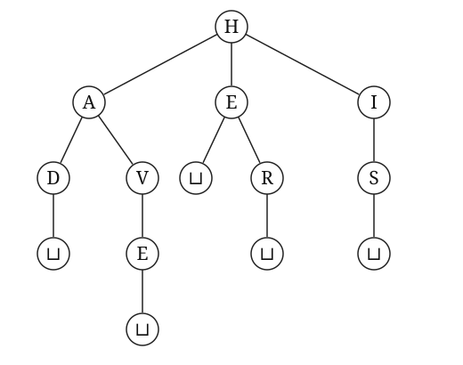

(1)

代替了图 31 中的 H 树. 这一表示需要更多的存储, 但它使得变长数据的处理变得特别容易. 如果为每个字符使用两个链接字段, 就可以使用一种简单方式来处理动态插入和删除.

如果使用通常方式, 将树表示为二叉树, (1) 变为二叉树

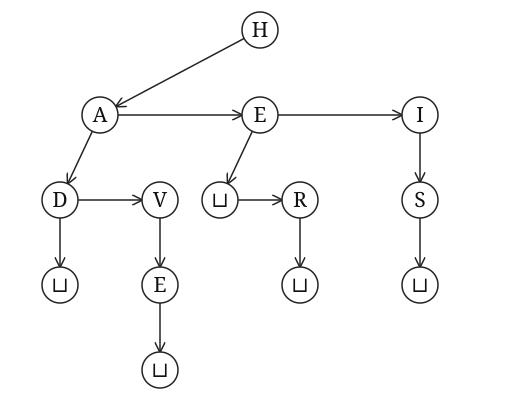

(2)

(在图 31 的完整森林的表示中, 还可以用一个指针, 由 H 向右引向其相邻根结点 I.) 这棵查找树中的查找过程为: 将参数的一个字符与树中的字符进行对比, 一直沿 RLINK 前进, 直到找到匹配为止; 接下来, 取得 LLINK, 并以相同方式处理参数的下一个字符.

采用这样一棵二叉树时, 我们或多或少地是在通过比较进行查找, 使用 “等于与不等于” 的分支方式, 而不是 “小于与大于” 的分支方式. 由 6.2.1 节的基础理论知道, 我们平均至少进行 $\lg N$ 次比较, 以区分 $N$ 个键. 在查找一棵类似于图 31 所示的树时, 所进行的平均测试数至少与使用 6.2 节中的技术进行二分查找时所做的测试一样多.

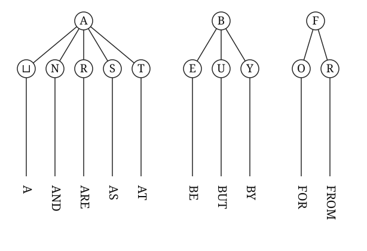

**图 31　表 1 的检索结构, 转换为一片 “森林”**

另一方面, 表 1 中的检索结构能够一次进行整个 $M$ 路分支. 我们将会看到, 如果输入数据随机, 当 $N$ 很大时, 平均查找时间仅涉及大约

$$
\log_M N=\lg N/\lg M
$$

次迭代. 还将看到, 一个类似于算法 T 中的 “纯” 检索结构方案需要总共大约 $N/\ln M$ 个结点来区分 $N$ 个随机输入. 因此, 总空间数量与 $MN/\ln M$ 成正比.

根据这些考虑因素, 显然检索结构的思想仅有利于树中有限的前几级. 将两种策略混合起来, 使用检索结构表示前几个字符, 然后切换到某个其他技术, 将会得到更好的性能. 例如, 小爱德华·萨森古思提议一直使用逐个字符的方案 [*CACM* **6** (1963), 272–279], 直到我们到达树中的某一部分, 在这里, 比如仅可能存在文件中的 6 个或更少的键, 这时可以顺次遍历剩余键的短列表. 我们将会看到, 这种混合策略使检索结构结点减少到大约六分之一, 而运行时间没有显著变化.

西蒙·别尔科维奇在 *Doklady Akademii Nauk SSSR* **202** (1972), 298–299[英译:*Soviet Physics-Doklady* **17** (1972), 20–21] 中提出了一种在外部存储器中存储不断增长的大型检索结构的有趣方法.

托马斯·图尔巴指出, 对于变长键的查找来说, 为每种不同长度拥有一棵查找树或一个检索结构有时是最为方便的 [*CACM* **25** (1982), 522–526].

**二叉情景.** 现在考虑 $M=2$ 的特殊情景, 在这种情况下, 我们每次扫描查找参数的一个二进制位. 人们已经设计了两种特别适合于这一情景的有趣方法.

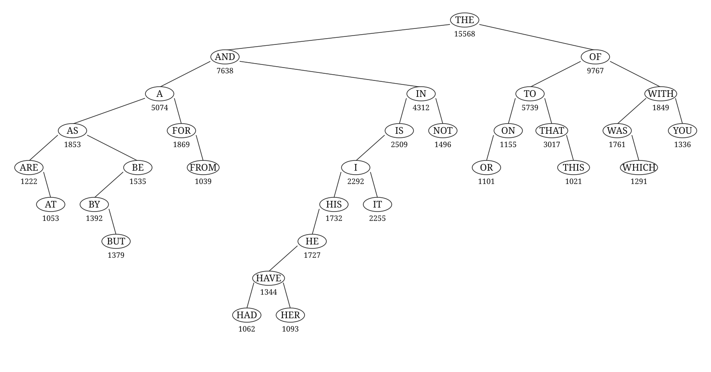

**图 32　31 个最常见的英文单词的数字查找树, 按频率递减顺序插入**

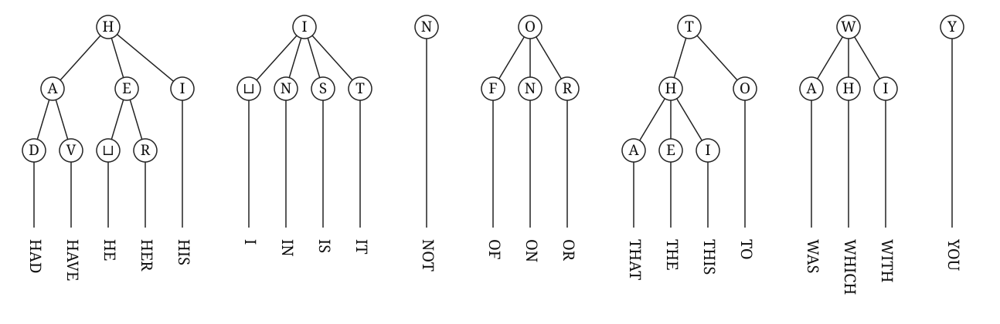

第一种方法称为*数字树查找*, 它是由小爱德华·科夫曼和詹姆斯·伊夫提出的 [*CACM* **13** (1970), 427–432、436]. 其思想是在结点中存储完整的键, 就像 6.2.2 节的树查找算法中所做的那样, 但在每个步骤中, 利用参数的二进制位 (而不是比较结果) 来控制左、右分支的选取. 图 32 给出的是按照频率递减顺序插入 31 个最常见的英文单词时, 用这个方法构造的二叉树. 为了方便说明, 需要为其提供一些二进制数据, 为此, 我们用 MIX 字符代码表示了这些单词, 这些代码已经被转换为二进制数, 每个字节共有 5 个二进制位. 因此, 单词 WHICH 被表示为二进制位序列 <code>11010 01000 01001 00011 01000</code>.

为了在图 32 中查找 WHICH 这个单词, 我们首先将它与树的根结点处的单词 THE 进行比较. 由于不匹配, 而且 WHICH 的第 1 个二进制位是 1, 所以我们向右移动, 并与 OF 进行比较. 由于还不匹配, 而且 WHICH 的第 2 个二进制位是 1, 所以我们向右移动, 并与 WITH 进行比较, 以此类推. 数字查找树中键的字母顺序不再与结点的对称序相对应.

把图 32 与 6.2.2 节的图 12 作一对照是有趣的, 因为这两种树的构造方式相同, 但图 12 中是利用比较而非键的二进制位进行分支控制的. 如果考虑给定的频率, 则在使用图 32 的数字查找树时, 每次成功查找平均需要 3.42 次比较, 这要略微优于图 12 所需要的 4.04 次比较, 当然, 每次比较花费的时间可能是不同的.

**算法 D (数字树的查找与插入).** 给定一个记录表, 表中的记录如上所述构成一棵二叉树, 本算法查找一个给定的参数 $K$. 如果 $K$ 不在表中, 则在这棵树的适当位置插入一个包含 $K$ 的新结点.

本算法假定这棵树非空, 且与算法 6.2.2T 中一样, 其结点拥有 KEY、LLINK 和 RLINK 字段. 事实上, 读者可以验证, 这两个算法几乎是相同的.

**D1.[初始化.]** 置 $\mathrm P\leftarrow\mathrm{ROOT}$, $K'\leftarrow K$.

**D2.[比较.]** 如果 $K=\mathrm{KEY}(\mathrm P)$, 则查找成功结束. 否则令 $b$ 为 $K'$ 的第一个二进制位, 将 $K'$ 左移一个二进制位 (从而删除该二进制位, 并在右边引入一个 0). 如果 $b=0$, 则转至 D3, 否则转至 D4.

**D3.[左移.]** 如果 $\mathrm{LLINK}(\mathrm P)\ne\Lambda$, 则置 $\mathrm P\leftarrow\mathrm{LLINK}(\mathrm P)$ 并返回 D2. 否则, 转至 D5.

**D4.[右移.]** 如果 $\mathrm{RLINK}(\mathrm P)\ne\Lambda$, 则置 $\mathrm P\leftarrow\mathrm{RLINK}(\mathrm P)$ 并返回 D2.

**D5.[插入到树中.]** 置 $\mathrm Q\Leftarrow\mathrm{AVAIL}$, $\mathrm{KEY}(\mathrm Q)\leftarrow K$, $\mathrm{LLINK}(\mathrm Q)\leftarrow\mathrm{RLINK}(\mathrm Q)\leftarrow\Lambda$. 如果 $b=0$, 则置 $\mathrm{LLINK}(\mathrm P)\leftarrow\mathrm Q$, 否则, 置 $\mathrm{RLINK}(\mathrm P)\leftarrow\mathrm Q$.　▮

尽管算法 6.2.2T 的树查找在本质上是二分查找, 但不难看出, 对于任意 $M\ge2$, 现在的算法可以扩展到 $M$ 路数字查找 (见习题 13).

唐纳德·莫里森发现了一个非常出色的方法 [*JACM* **15** (1968), 514–534], 根据键的二进制表示来构建 $N$ 个结点的查找树, 而无需将键存储在结点中. 他的算法称为 Patricia(Practical Algorithm To Retrieve Information Coded In Alphanumeric, 即 “字母数字编码的信息的实用检索算法”), 特别适合处理极长的变长键, 比如大型文件中存储的标题或短句. 几乎与此同时, 赫尔诺特·格温贝格发现了一个紧密相关的算法 [*Elektronische Rechenanlagen* **10** (1968), 223–226].

Patricia 的基本思想是构造一个两路检索结构, 但在每个结点中都包含一些二进制位的数目, 在进行下一次测试之前可以跳过这些二进制位, 从而避免单路分支. 有几种方式可以实现这个思想. 最容易解释的也许就是图 33 所示的方法. 我们有一个由二进制位组成的 TEXT 数组, 它通常非常长. 由于每次查找仅访问一次 TEXT, 所以可以将这个数组存储为一个外部直接访问文件. 每个要存储在表中的键都由文本中的起始位置指定, 并可以设想它会从这个起始位置一直走到文本的末尾. (Patricia 并不查看键与参数之间是否严格相等, 而是判断是否存在一个以该参数开始的键.)

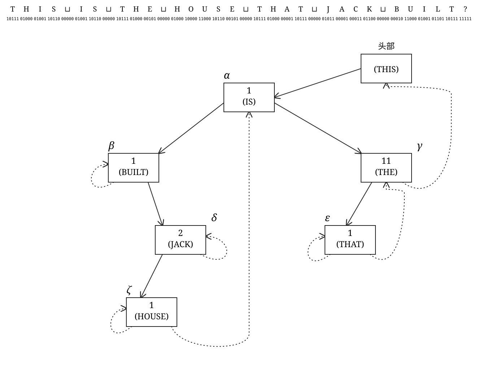

**图 33　Patricia 树和 TEXT 的一个示例**

图33所述的情景包括7个键，在每个单词处开始一个键，即“THIS IS THE HOUSE THAT JACK BUILT?”“IS THE HOUSE THAT JACK BUILT?”…“BUILT?”。这里存在一个重要限制，即任何一个键都不能是其他键的前缀。如果用一个没有在其他任何地方出现的独特文本结束代码（在本例中是?）作为文本的结束，那就可以满足这一限制。在算法T的检索结构方案中也隐含了同样的限制，在那里的结束代码是 $\sqcup$。

Patricia 用于查找的这棵树应当包含在随机访问存储器中, 或者应当像 6.2.4 节中建议的那样, 安排为页面形式. 它包含 1 个表头和 $N-1$ 个结点, 其中的结点包含以下字段:

KEY，指向文本的指针。如果正文中包含 $C$ 个字符，则这个字段至少必须包含 $\lg C$ 个二进制位。在图33中，每个结点中所示的单词实际上由指向文本的指针表示。例如，结点中将不会包含(JACK)，而是包含数24（它在文本串中指示JACK BUILT?的起始位置）。

LLINK 和 RLINK, 树中的指针. 这些字段至少必须包含 $\lg N$ 个二进制位.

LTAG 和 RTAG, 仅包含 1 个二进制位的字段, 分别说明 LLINK 和 RLINK 是指向结点的子结点还是祖先结点. 图 33 中的虚线对应于其 TAG 字段为 1 的指针.

SKIP, 一个数, 告知在查找时要跳过多少个二进制位, 解释见下文. 这个字段的大小应当足以容纳最大的数 $k$, 使得: 字符串 $\sigma$ 是至少两个不同键的前缀, 在所有以 $\sigma$ 为前缀的键中, 紧跟在 $\sigma$ 之后的 $k$ 个二进制位都是一致的. 在实践中, 通常可以假定 $k$ 不是太大, 如果 SKIP 字段的大小超过限制, 可以给出一个错误指示. 在图 33 的每个非表头结点中, SKIP 字段显示为结点内的数.

表头仅包含 KEY、LLINK 和 LTAG 字段.

Patricia 树中的查找执行过程如下: 假定我们正在查找单词 THE (二进制位形式是 <code>10111 01000 00101</code>). 首先查看根结点 $\alpha$ 的 SKIP 字段, 它告诉我们查看该参数的第 1 个二进制位. 该位为 1, 所以向右移. 下一个结点 $\gamma$ 中的 SKIP 字段告诉我们查看该参数的第 $1+11=12$ 个二进制位. 该位为 0, 所以向左移. 下一结点 $\epsilon$ 的 SKIP 字段告诉我们查看第 $12+1$ 个二进制位, 该位为 1. 现在我们发现 RTAG=1, 所以返回结点 $\gamma$, 它把我们引向 TEXT. 对于任意一个二进制位形式是 <code>1xxxx xxxxx x01…</code> 的参数, 都会出现前面走过的这一查找路径, 我们必须查看它是否匹配以该形式开头的唯一键, 即 THE.

另一方面, 假定我们正在查找任何或所有以 TH 开头的键. 查找过程的开头和上面一样, 但它最后会尝试查看这个参数的第 12 个二进制位 (它是不存在的, 因为这个参数仅有 10 个二进制位.) 这时, 我们将在当前结点中指定的位置 (在本例中为结点 $\gamma$) 将该参数与 TEXT 进行比较. 如果不匹配, 则该参数不是任何键的开头. 但是如果匹配, 该参数就是所有由结点 $\gamma$ 及其后代中虚线链接所表示的键 (即 THIS、THAT、THE) 的开头.

这个查找过程可以更准确地描述如下.

**算法 P(Patricia).** 给定一个 TEXT 数组和一棵拥有如上所述 KEY、LLINK、RLINK、LTAG、RTAG、SKIP 字段的树, 本算法判断 TEXT 中是否存在一个以指定的参数 $K$ 开头的键. (对于 $r\ge1$, 如果存在 $r$ 个这样的键, 则可能在接下来的 $O(r)$ 个步骤中找出所有这些键的位置, 见习题 14.) 假定树中至少存在一个键.

**P1.[初始化.]** 置 $\mathrm P\leftarrow\mathrm{HEAD}$, $j\leftarrow0$. (变量 $\mathrm P$ 是一个将沿着树向下移动的指针, $j$ 是一个计数器, 将标记参数中二进制位的位置.) 置 $n\leftarrow K$ 中的二进制位的数目.

**P2.[左移.]** 置 $\mathrm Q\leftarrow\mathrm P$, $\mathrm P\leftarrow\mathrm{LLINK}(\mathrm Q)$. 如果 $\mathrm{LTAG}(\mathrm Q)=1$, 转至 P6.

**P3.[跳过二进制位.]**(此时我们知道, 如果 $K$ 的前 $j$ 个二进制位与无论哪一个键匹配, 则它们与开始于 $\mathrm{KEY}(\mathrm P)$ 的键匹配.) 置 $j\leftarrow j+\mathrm{SKIP}(\mathrm P)$. 如果 $j>n$, 转至 P6.

**P4.[检测二进制位.]**(此时我们知道, 如果 $K$ 的前 $j-1$ 个二进制位与无论哪一个键匹配, 则它们与开始于 $\mathrm{KEY}(\mathrm P)$ 的键匹配.) 如果 $K$ 的第 $j$ 个二进制位为 0, 则转至 P2, 否则转至 P5.

**P5.[右移.]** 置 $\mathrm Q\leftarrow\mathrm P$, $\mathrm P\leftarrow\mathrm{RLINK}(\mathrm Q)$. 如果 $\mathrm{RTAG}(\mathrm Q)=0$, 转至 P3.

**P6.[比较.]**(此时我们知道, 如果 $K$ 与任何一个键匹配, 则它与开始于 $\mathrm{KEY}(\mathrm P)$ 的键匹配.) 将 $K$ 与 TEXT 数组中起始于 $\mathrm{KEY}(\mathrm P)$ 的键进行比较. 如果它们相等 (直到 $n$ 个二进制位, 即 $K$ 的长度为止), 则本算法成功结束. 如果不相等, 则以失败结束.　▮

习题 15 说明了首先可以如何构建 Patricia 树. 我们还可以增加文本, 并插入新的键, 只要新文本材料总是以独一无二的分隔符结尾即可 (例如, 后面跟有序列号的文本结束符号).

Patricia 需要一些技巧, 需要在进行仔细研究之后才能发现它的所有美妙之处.

**算法分析.** 在本节的最后, 我们对检索结构、数字查找树和 Patricia 进行数学研究. 最后给出这些分析的主要结果的综述.

首先来考虑两路检索结构的情景, 即 $M=2$ 的检索结构. 图 34 给出了一个两路检索结构, 把第 5 章的排序示例的 16 个键看作 10 位的二进制数即可得到该检索结构. (这些键是用八进制表示法给出的, 例如, $1144$ 表示 10 位的二进制数 $612=(1001100100)_2$.) 和在算法 T 中一样, 我们使用检索结构来存储各个键的前导二进制位的信息, 一直到第一个能够唯一确定该键的位置为止. 接下来完整地重新记录该键.

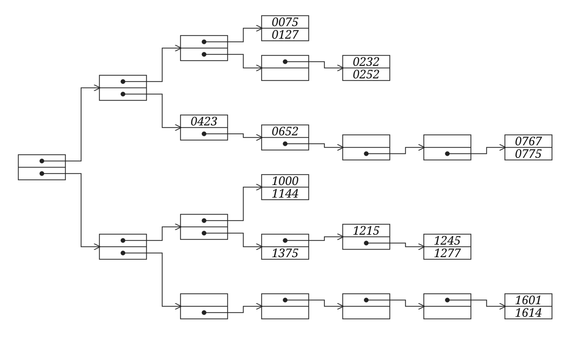

**图 34　随机两路检索结构的示例**

如果对比图 34 与表 5.2.2-3, 就可以揭示检索结构存储与基数交换排序之间一种令人惊异的关系. (又, 这个关系也许是非常明显的.) 图 34 中的 22 个结点准确对应于表 5.2.2-3 中的 22 个划分阶段, 前序中的第 $p$ 个结点对应于阶段 $p$. 在划分阶段进行的二进制位的检索次数等于相应结点及其子检索结构中的键的个数. 因此, 可以给出如下结果.

**定理 T.** 如果如上所述把 $N$ 个不同二进制数放到一个两路检索结构中, 则 (i) 该检索结构结点的个数等于用基数交换方法对这些数进行排序时所需要的划分阶段数. (ii) 利用算法 T 检索一个键所需要的平均二进制位探查次数, 等于基数交换排序所需的二进制位检索次数的 $1/N$.　▮

根据这一定理, 我们可以利用 5.2.2 节为基数交换开发的所有数学工具. 例如, 如果假定这些键是介于 0 和 1 之间、随机均匀分布、无限精度的实数, 则检索所需要的二进制位的探查次数将为 $\lg N+\gamma/\ln2+1/2+\delta(N)+O(N^{-1})$, 检索结构结点的个数为 $N/\ln2+N\bar\delta(N)+O(1)$. 这里的 $\delta(N)$ 和 $\bar\delta(N)$ 是非常复杂的函数, 由于其绝对值总是小于 $10^{-6}$ (见习题 5.2.2-38 和 5.2.2-48), 所以可以忽略.

当然, 由于我们需要将两路检索结构推广到 $M$ 路检索结构, 所以还要再做一点工作. 这里仅介绍这些探索内容的起始部分, 而将有益的细节留作练习.

设 $A_N$ 是包含 $N$ 个键的随机 $M$ 路检索结构中的内部结点的平均数目. 则 $A_0=A_1=0$, 对于 $N\ge2$, 由于 $N!M^{-N}/k_1!\ldots k_M!$ 是这些键中的 $k_1$ 个在第 1 个子检索结构中, …, $k_M$ 个在第 $M$ 个子检索结构中的概率, 所以有

$$
A_N=1+\sum_{k_1+\cdots+k_M=N}\left(\frac{N!}{k_1!\ldots k_M!}M^{-N}\right)(A_{k_1}+\cdots+A_{k_M}).\tag{3}
$$

利用对称性, 再针对 $k_2,\ldots,k_M$ 求和, 可以将这个公式改写为

$$
\begin{aligned}
A_N&=1+M^{1-N}\sum_{k_1+\cdots+k_M=N}\left(\frac{N!}{k_1!\ldots k_M!}\right)A_{k_1}\\
&=1+M^{1-N}\sum_k\binom Nk(M-1)^{N-k}A_k,\qquad N\ge2.
\end{aligned}\tag{4}
$$

类似地, 如果 $C_N$ 表示在检索结构中查找所有 $N$ 个键所需的数位探查的总数的平均值, 则发现 $C_0=C_1=0$, 以及

$$
C_N=N+M^{1-N}\sum_k\binom Nk(M-1)^{N-k}C_k,\qquad N\ge2.\tag{5}
$$

习题 17 说明如何处理这种类型的一般递推关系, 习题 18–25 给出了随机检索结构的相应理论. [对 $A_N$ 的分析, 最早是由莱尔·约翰逊和迈克尔·麦克安德鲁结合一种面向硬件的等价排序算法, 从另一角度来解决的, 见 *IBM J. Res. and Devel.* **8** (1964), 189–193.]

如果现在转向对数字查找树的研究, 就会发现其公式是类似的, 但其差异足以使人们很难看出如何推导渐近特性. 例如, 如果 $\bar C_N$ 表示在一个 $M$ 路数字查找树中查找所有 $N$ 个键时所进行的数位探查的总数的平均值, 则不难像上文那样推导出 $\bar C_0=\bar C_1=0$, 以及

$$
\bar C_{N+1}=N+M^{1-N}\sum_k\binom Nk(M-1)^{N-k}\bar C_k,\qquad N\ge0.\tag{6}
$$

这几乎与式 (5) 相同. 但这个公式左侧出现的是 $N+1$, 而不是 $N$, 这足以改变该递推式的整个特性, 因此用于研究 (5) 的方法都失效了.

首先来考虑两路的情景. 图 35 给出了与图 34 中 16 个示例键相对应的数字查找树, 已经按照第 5 章示例中使用的顺序将这些键插入树中. 如果希望确定在一次随机成功查找中所做的二进制位探查操作的平均次数, 由于在第 $l$ 级查找一个结点需要 $l$ 次二进制位探查, 所以所求结果等于树的内部路径长度除以 $N$. 但要注意, 在随机失败查找中所做的二进制位探查的平均次数不只是与树的外部路径长度有关, 因为失败查找更可能发生在根结点附近的外部结点处. 因此, 到达图 35 中结点 0075 左子分支的概率为 $\frac18$ (假定键具有无限精度), 而遇到结点 0232 左子分支的概率仅为 $\frac1{32}$. 因此, 当键为均匀分布时, 数字查找树的平衡度可能优于算法 6.2.2T 中的二叉查找树.

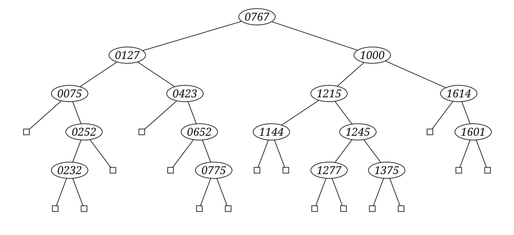

**图 35　由算法 D 构建的随机数字查找树**

我们可以使用生成函数来描述数字查找树的相关特性. 如果第 $l$ 级有 $a_l$ 个内部结点, 考虑生成函数 $a(z)=\sum_l a_lz^l$. 例如, 与图 35 对应的生成函数是 $a(z)=1+2z+4z^2+5z^3+4z^4$. 如果第 $l$ 级有 $b_l$ 个外部结点, 并且如果 $b(z)=\sum_l b_lz^l$, 则根据习题 6.2.1-25, 有

$$
b(z)=1+(2z-1)a(z).\tag{7}
$$

例如, $1+(2z-1)(1+2z+4z^2+5z^3+4z^4)=3z^3+6z^4+8z^5$. 在一次随机成功查找中所做的二进制位探查的平均次数是 $a'(1)/a(1)$, 因为 $a'(1)$ 是树的内部路径长度, $a(1)$ 是内部结点数. 在一次随机失败查找中所做的二进制位探查的平均次数是 $\sum_l lb_l2^{-l}=\frac12b'(\frac12)=a(\frac12)$, 因为我们结束于第 $l$ 级的一个给定外部结点的概率是 $2^{-l}$. 比较的次数等于二进制位探查的次数, 在成功查找中要加 1. 例如, 在图 35 中, 平均来说, 一次成功查找平均执行 $2\frac9{16}$ 次二进制位探查和 $3\frac9{16}$ 次比较. 一次失败查找各需要 $3\frac78$ 次.

现在设 $g_N(z)$ 是具有 $N$ 个结点的树的 “平均”$a(z)$. 换句话说, $g_N(z)$ 是针对所有具有 $N$ 个内部结点的二叉数字查找树 $T$ 的求和 $\sum p_Ta_T(z)$, 其中 $a_T(z)$ 是 $T$ 的内部结点的生成函数, $p_T$ 是在使用算法 D 插入 $N$ 个随机数时出现 $T$ 的概率. 因此, 在成功查找中, 二进制位探查的平均次数是 $g'_N(1)/N$, 在失败查找中是 $g_N(\frac12)$.

我们可以通过模拟树的构造过程来计算 $g_N(z)$. 如果 $a(z)$ 是一棵 $N$ 个结点的树的生成函数, 可以在任何一个外部结点位置进行下一次插入, 从而由 $N$ 个结点的树生成 $N+1$ 个结点的树. 该插入发生在第 $l$ 级一个给定外部结点的概率是 $2^{-l}$. 因此 $N+1$ 棵新的树的生成函数的总和, 再乘以发生概率, 得到 $a(z)+b(\frac12z)=a(z)+1+(z-1)a(\frac12z)$. 对于所有具有 $N$ 个结点的树求平均, 得出

$$
g_{N+1}(z)=g_N(z)+1+(z-1)g_N(\tfrac12z);\qquad g_0(z)=0.\tag{8}
$$

外部结点的相应生成函数 $h_N(z)=1+(2z-1)g_N(z)$ 处理起来稍微容易一些, 这是因为 (8) 等价于公式

$$
h_{N+1}(z)=h_N(z)+(2z-1)h_N(\tfrac12z);\qquad h_0(z)=1.\tag{9}
$$

重复应用这个规则, 得出

$$
\begin{aligned}
h_{N+1}(z)
&=h_{N-1}(z)+2(2z-1)h_{N-1}(\tfrac12z)+(2z-1)(z-1)h_{N-1}(\tfrac14z)\\
&=h_{N-2}(z)+3(2z-1)h_{N-2}(\tfrac12z)+3(2z-1)(z-1)h_{N-2}(\tfrac14z)\\
&\qquad+(2z-1)(z-1)(\tfrac12z-1)h_{N-2}(\tfrac18z)
\end{aligned}
$$

等等, 所以最终有

$$
h_N(z)=\sum_k\binom Nk\prod_{j=0}^{k-1}(2^{1-j}z-1);\tag{10}
$$

$$
g_N(z)=\sum_{k\ge0}\binom N{k+1}\prod_{j=0}^{k-1}(2^{-j}z-1).\tag{11}
$$

例如, $g_4(z)=4+6(z-1)+4(z-1)(\frac12z-1)+(z-1)(\frac12z-1)(\frac14z-1)$. 利用这些公式可以将我们正在求解的量表示为乘积之和:

$$
\bar C_N=g'_N(1)=\sum_{k\ge0}\binom N{k+2}\prod_{j=1}^{k}(2^{-j}-1);\tag{12}
$$

$$
g_N(\tfrac12)=\sum_{k\ge0}\binom N{k+1}\prod_{j=1}^{k}(2^{-j}-1)=\bar C_{N+1}-\bar C_N.\tag{13}
$$

这个 $\bar C_N$ 的公式满足 (6), 这一点并不那么容易看出!

遗憾的是, 由于 $2^{-j}-1$ 是负数, 所以这些表达式不便于计算或求出渐近展开式. 我们会得到相当大的项, 并会有大量消去. 应用习题 5.1.1-16 的分划恒等式, 可以得到 $\bar C_N$ 的一个更有用的公式. 我们有

$$
\begin{aligned}
\bar C_N
&=\left(\prod_{j\ge1}(1-2^{-j})\right)\sum_{k\ge0}\binom N{k+2}(-1)^k\prod_{l\ge0}(1-2^{-l-k-1})^{-1}\\
&=\left(\prod_{j\ge1}(1-2^{-j})\right)\sum_{k\ge0}\binom N{k+2}(-1)^k\sum_{m\ge0}(2^{-k-1})^m\prod_{r=1}^{m}(1-2^{-r})^{-1}\\
&=\sum_{m\ge0}2^m\left(\sum_k\binom Nk(-2^{-m})^k-1+2^{-m}N\right)\prod_{j\ge0}(1-2^{-j-m-1})\\
&=\sum_{m\ge0}2^m\bigl((1-2^{-m})^N-1+2^{-m}N\bigr)\sum_{n\ge0}(-2^{-m-1})^n\frac{2^{-n(n-1)/2}}{\prod_{r=1}^{n}(1-2^{-r})}.
\end{aligned}\tag{14}
$$

乍看起来, 这似乎对式 (12) 没有什么改进, 其实它有一个很大的优点: 对于每个固定的 $n$ 值, 对 $m$ 求和时可以快速收敛. 对于式 5.2.2-(38) 和 5.2.2-(39) 中检索结构的情景会发生非常类似的情况. 事实上, 如果仅考虑 $n=0$ 时 (14) 中的各项, 将会恰好有 $N-1$ 加上在两路检索结构中的二进制位探查的数目. 我们现在将采用基本与前面相同的方式来获得该渐近值, 见习题 27. [上述推导主要基于康海姆和唐纳德·纽曼提议的方法,*Discrete Mathematics* **4** (1973), 57–63.]

最后让我们从数学角度来研究一下 Patricia. 在这种情况下, 二叉树就像是同一组键上的相应两路检索结构, 但被挤压在了一起 (因为 SKIP 字段消除了单路分支), 所以总是恰好存在 $N-1$ 个内部结点和 $N$ 个外部结点. 图 36 给出了与图 34 的检索结构中 16 个键相对应的 Patricia 树. 每个分支结点中显示的数字是 SKIP 的数目. 尽管外部结点没有显式给出, 但这些键都用外部结点显示 (实际上每个外部结点都被一个带有标记的链接代替, 该链接指向一个引用 TEXT 的内部结点). 为进行分析, 假定存在所示外部结点.

由于通过 Patricia 进行的成功查找都在外部结点处结束, 所以一次随机成功查找中所做的二进制位探查的平均次数等于外部路径长度除以 $N$. 如果像上面那样为外部结点构建生成函数 $b(z)$, 则为 $b'(1)/b(1)$. 通过 Patricia 执行的失败查找也会在外部结点处结束, 但对于第 $l$ 级的外部结点会以概率 $2^{-l}$ 进行加权, 所以二进制位探查的平均次数是 $\frac12b'(\frac12)$. 例如, 在图 36 中, 有 $b(z)=3z^3+8z^4+3z^5+2z^6$. 因此, 平均来说, 每次成功查找共有 $4\frac14$ 次二进制位探查, 每次失败查找共有 $3\frac{25}{32}$ 次.

设 $h_n(z)$ 是一棵 Patricia 树的 “平均”$b(z)$, 该树有 $n$ 个外部结点, 采用均匀分布的键. 递推关系

$$
h_n(z)=2^{1-n}\sum_k\binom nk h_k(z)\bigl(z+\delta_{kn}(1-z)\bigr),\qquad h_0(z)=0,\qquad h_1(z)=1\tag{15}
$$

看起来没有简单解. 但幸运的是, 由于

$$
\begin{aligned}
h'_n(1)&=2^{1-n}\sum_k\binom nk h'_k(1)+2^{1-n}\sum_k\binom nk k(1-\delta_{kn})\\
&=n-2^{1-n}n+2^{1-n}\sum_k\binom nk h'_k(1),
\end{aligned}\tag{16}
$$

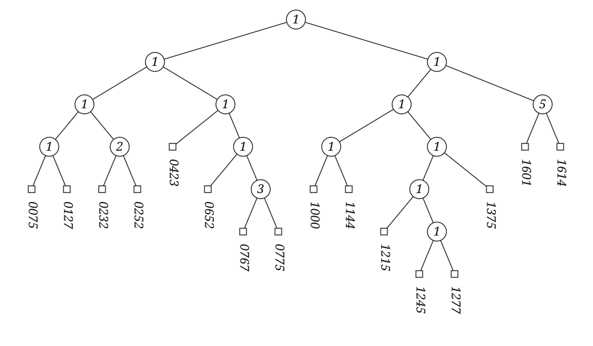

**图 36　Patricia 构造此树来代替图 34**

对于平均外部路径长度 $h'_n(1)$ 存在一种简单的递推关系. 由于它具有 (6) 的形式, 所以可以使用已有方法来求解 $h'_n(1)$, 其结果恰好比一个随机两路检索结构中相应的二进制位探查次数少 $n$. 因此, 对于随机数据, SKIP 字段为每次成功查找节约了大约一次二进制位探查. (见习题 31.) 在使用典型的真实数据时, 会因为其中的冗余性而节约更多.

当尝试求解 Patricia 所执行的一次随机失败查找的二进制位探查的平均次数时, 可以得到递推关系

$$
a_n=1+\frac1{2^n-2}\sum_{k<n}\binom nk a_k,\qquad n\ge2;\qquad a_0=a_1=0.\tag{17}
$$

这里, $a_n=\frac12h'_n(\frac12)$. 这不是我们已经研究过的任何递推关系, 也不容易将它转换为此类递推关系. 5.2.2 节介绍的梅林变换理论以及那里引用的参考文献提供了一种高级方式来处理具有数字特性的递推. 结果, (17) 的解中涉及到贝努利数:

$$
\frac{na_{n-1}}2-n+2=\sum_{k=2}^{n-1}\binom nk\frac{B_k}{2^{k-1}-1},\qquad n\ge2.\tag{18}
$$

这个公式大概是我们必须解决的最难的渐近问题了. 习题 34 中的解, 对前面已经完成的许多事情进行了有益的总结, 并带有某些稍微不同的意味.

**分析综述.** 作为本节所有复杂数学推导的结果, 以下事实可能是最值得注意的:

(a) 在一个 $M$ 路检索结构中存储 $N$ 个随机键, 检索结构的分支终止于 $\le s$ 个键的子文件, 则所需要的结点数近似为 $N/(s\ln M)$. 这个近似值对于很大的 $N$、小的 $s$ 和小的 $M$ 是有效的. 由于一个检索结构结点涉及 $M$ 个链接字段, 所以, 如果选择 $s=M$, 则仅需要大约 $N/\ln M$ 个链接字段.

(b) 对于所考虑的全部方法来说, 在一次随机查找期间探查的数位或字符的数目近似为 $\log_M N$. 当 $M=2$ 时, 各种分析为我们提供了以下二进制位探查次数的更准确估计:

| | 成功 | 失败 |
|---|---|---|
| 检索结构查找 | $\lg N+1.33275$ | $\lg N-0.10995$ |
| 数字树查找 | $\lg N-1.71665$ | $\lg N-0.27395$ |
| Patricia | $\lg N+0.33275$ | $\lg N-0.31875$ |

(这些近似值都可以用基本的数学常数来表示. 例如, 0.31875 代表 $(\ln\pi-\gamma)/\ln2-1/2$.)

(c) 这里所说的 “随机” 数据是指 $M$ 进制数字是一致分布的, 就像这些键是介于 0 和 1 之间、采用 $M$ 进制表示的实数. 数字查找方法对于向文件中输入键的顺序不敏感 (算法 D 除外, 它是唯一对顺序稍有敏感的). 但它们对于数字的分布非常敏感. 例如, 如果二进制数字 0 远比二进制数字 1 常见, 则这些树的倾斜程度要远远超过在以上分析中所考虑的随机数据的情景. 习题 5.2.2-53 给出了一个示例, 说明在数据有这种偏差时的情景.

### 习题

**1. [00]** 如果一棵树有叶子, 那一个检索结构有什么?　[答案](./answers/6-3.md#ans-6-3-1)

**2. [20]** 使用算法 T 中的约定, 设计一个算法, 把一个新的键插入到一个 $M$ 路检索结构中.　[答案](./answers/6-3.md#ans-6-3-2)

**3. [21]** 使用算法 T 中的约定, 设计一个算法, 从一个 $M$ 路检索结构中删除一个键.　[答案](./answers/6-3.md#ans-6-3-3)

**▶ 4. [21]** 表 1 中的 360 项大多为空白 (空链接). 但是可以像下面这样, 将非空项与空白项重叠, 将该表压缩为仅有 49 项:　[答案](./answers/6-3.md#ans-6-3-4)

<table>
<thead><tr><th>位置</th><th>1</th><th>2</th><th>3</th><th>4</th><th>5</th><th>6</th><th>7</th><th>8</th><th>9</th><th>10</th><th>11</th><th>12</th><th>13</th><th>14</th><th>15</th><th>16</th><th>17</th><th>18</th><th>19</th><th>20</th><th>21</th><th>22</th><th>23</th><th>24</th><th>25</th></tr></thead>
<tbody><tr><th>项</th><td></td><td>(10)</td><td></td><td>WAS</td><td>THAT</td><td>(11)</td><td>OF</td><td>BE</td><td>THE</td><td>HIS</td><td>WHICH</td><td>WITH</td><td>THIS</td><td></td><td>(12)</td><td>ON</td><td>I</td><td>HE</td><td>A</td><td>OR</td><td>(2)</td><td>(3)</td><td>TO</td><td>HAD</td><td></td></tr></tbody>
</table>
<table>
<thead><tr><th>位置</th><th>26</th><th>27</th><th>28</th><th>29</th><th>30</th><th>31</th><th>32</th><th>33</th><th>34</th><th>35</th><th>36</th><th>37</th><th>38</th><th>39</th><th>40</th><th>41</th><th>42</th><th>43</th><th>44</th><th>45</th><th>46</th><th>47</th><th>48</th><th>49</th></tr></thead>
<tbody><tr><th>项</th><td>(4)</td><td>BUT</td><td>(5)</td><td>(6)</td><td>FOR</td><td>BY</td><td>IN</td><td>FROM</td><td>AND</td><td>NOT</td><td>(7)</td><td>HER</td><td>ARE</td><td>IS</td><td>IT</td><td>AS</td><td>AT</td><td>(8)</td><td></td><td>HAVE</td><td>(9)</td><td></td><td>YOU</td><td></td></tr></tbody>
</table>

(在这个压缩表中, 表 1 中的结点 (1)、(2)、…、(12) 的起始位置分别是 20、19、3、14、1、17、1、7、3、20、18、4.)

证明: 如果用此压缩表代替表 1, 则程序 T 仍然有效, 但不是很快.

**▶ 5. [M26]**(耶尔·帕特) 图 31 的各棵树按字母顺序在每一组中排列其字符. 这一顺序并非必需的, 如果在构建像 (2) 那样的二叉树之前, 在各组内重新排列结点顺序, 则可以得到更快速的查找方法. 从这个角度来看, 图 31 的什么样的重新排列方式是最优的? (利用图 32 的频率假设, 求出符合以下条件的森林: 在将其表示为一棵二叉树时, 其成功查找时间最短.)　[答案](./answers/6-3.md#ans-6-3-5)

**6. [15]** 如果用算法 D 按递增顺序把 15 个 4 位二进制键 0001、0010、0011、…、1111 插入树中, 将得到什么样的数字查找树? (在根结点处以 0001 开始, 然后进行 14 次插入.)　[答案](./answers/6-3.md#ans-6-3-6)

**▶ 7. [M26]** 如果以不同顺序插入习题 6 的 15 个键, 可能会得到一棵不同的树. 在这些键的所有 $15!$ 种排列中, 哪一种是最差的, 也就是说它所生成的树具有最大内部路径长度?　[答案](./answers/6-3.md#ans-6-3-7)

**8. [20]** 考虑算法 D 的以下修改, 其效果是消除变量 $K'$: 在步骤 D2 中的两个地方把 $K'$ 改为 $K$, 并从步骤 D1 中删除操作 $K'\leftarrow K$. 所得到的算法对于查找与插入是否仍然有效?　[答案](./answers/6-3.md#ans-6-3-8)

**9. [21]** 为算法 D 编写一段 MIX 程序, 并将其与程序 6.2.2T 比较. 可以使用二进制操作, 比如 SLB(AX 二进制左移)、JAE(A 为偶数时跳转), 等等. 如果有用的话, 还可以使用习题 8 的思想.　[答案](./answers/6-3.md#ans-6-3-9)

**10. [23]** 给定一个文件, 其中所有的键都是 $n$ 位二进制数, 并给定一个查找参数 $K=b_1b_2\ldots b_n$. 假定我们希望查找 $k$ 的最大值, 使得文件中存在一个以二进制位模式 $b_1b_2\ldots b_k$ 开头的键. 将该文件表示为以下各种形式时, 可以如何高效地完成上述任务?　[答案](./answers/6-3.md#ans-6-3-10)

(a) 二叉查找树 (算法 6.2.2T).

(b) 两路检索结构 (算法 T).

(c) 二叉数字查找树 (算法 D).

**11. [21]** 算法 6.2.2D 能否不加修改地用于从数字查找树中删除一个结点?　[答案](./answers/6-3.md#ans-6-3-11)

**12. [25]** 从一棵由算法 D 构建的随机数字查找树中删除一个随机元素, 所得到的树是否仍然随机? (见习题 11 和定理 6.2.2H.)　[答案](./answers/6-3.md#ans-6-3-12)

**13. [20]**(*M 路数字查找*) 说明如何将算法 T 和算法 D 结合为一个扩充的算法, 当 $M=2$ 时, 它基本上与算法 D 相同. 如果对于 $M=30$ 的情景使用这个算法, 应当对表 1 进行哪些修改?　[答案](./answers/6-3.md#ans-6-3-13)

**▶ 14. [25]** 设计一个高效算法, 在算法 P 成功结束后, 它能接着执行, 以确定 $K$ 在 TEXT 中出现的所有位置.　[答案](./answers/6-3.md#ans-6-3-14)

**15. [28]** 设计一个高效算法, 可用于构造 Patricia 使用的树, 或者向一棵现有树中插入新的 TEXT 引用. 这个插入算法至多只能访问 TEXT 数组 2 次.　[答案](./answers/6-3.md#ans-6-3-15)

**16. [22]** 对于 Patricia, 为什么希望做出限制: 任何一个键都不是其他键的前缀?　[答案](./answers/6-3.md#ans-6-3-16)

**17. [M25]** 给出一种方法, 通过推广习题 5.2.2-36 的技术, 用二项式变换来表示以下递推式的解:　[答案](./answers/6-3.md#ans-6-3-17)

$$
x_0=x_1=0,\qquad x_n=a_n+m^{1-n}\sum_k\binom nk(m-1)^{n-k}x_k,\qquad n\ge2.
$$

**18. [M21]** 利用习题 17 的结果, 以函数 $U_n$ 和 $V_n$ 来表示 (4) 和 (5) 的解, 这两个函数的定义与习题 5.2.2-38 中类似.　[答案](./answers/6-3.md#ans-6-3-18)

**19. [HM23]** 对于固定的 $s\ge0$ 和 $m>1$, 求当 $n\to\infty$ 时, 以下函数在 $O(1)$ 范围内的渐近值:　[答案](./answers/6-3.md#ans-6-3-19)

$$
K(n,s,m)=\sum_{k\ge2}\binom nk\binom ks\frac{(-1)^k}{m^{k-1}-1}.
$$

[$s=0$ 的情景已经在习题 5.2.2-50 中解决了, $s=1$、$m=2$ 的情景已经在习题 5.2.2-48 中解决了.]

**▶ 20. [M30]** 考虑在 $M$ 路检索结构存储中, 每当到达键的个数不超过 $s$ 的子文件时, 就使用顺序查找. (算法 T 是 $s=1$ 的特例.) 应用前面习题的结果来分析　[答案](./answers/6-3.md#ans-6-3-20)

(a) 检索结构结点的平均数.

(b) 一次成功查找中所探查的数字或字符的平均数.

(c) 一次成功查找中所做的比较的平均数.

将上述答案表述为: 对于固定的 $M$ 和 $s$, 当 $N\to\infty$ 时的渐近公式. (a) 的答案应当在 $O(1)$ 范围内是正确的, (b) 和 (c) 的答案应当在 $O(N^{-1})$ 范围内是正确的. [当 $M=2$ 时, 这个分析也适用于经过修改的基数交换排序, 其中大小不超过 $s$ 的子文件是通过插入进行排序的.]

**21. [M25]** 在一个包含 $N$ 个键的随机 $M$ 路检索结构中, 有多少结点在表项 0 中有一个空指针? (例如, 表 1 的 12 个结点中有 9 个在 $\sqcup$ 位置有空指针. 这个习题中的 “随机” 和通常一样, 意味着这些键的数字是在 0 与 $M-1$ 之间一致分布的.)　[答案](./answers/6-3.md#ans-6-3-21)

**22. [M25]** 在一个包含 $N$ 个键的随机 $M$ 路检索结构中, 对于 $l=0,1,2,\ldots$, 第 $l$ 级上有多少个检索结构结点?　[答案](./answers/6-3.md#ans-6-3-22)

**23. [M26]** 在一个包含 $N$ 个随机键的 $M$ 路检索结构中, 一次失败查找期间平均进行多少次数字探查?　[答案](./answers/6-3.md#ans-6-3-23)

**24. [M30]** 考虑一个已经被表示为森林的 $M$ 路检索结构 (见图 31). 找出以下各值的精确及渐近表达式　[答案](./answers/6-3.md#ans-6-3-24)

(a) 森林中的平均结点数.

(b) 在一次随机的成功查找期间执行 $\mathrm P\leftarrow\mathrm{RLINK}(\mathrm P)$ 的平均次数.

**▶ 25. [M24]** 本节中对渐近值的数学推导有点难度, 其中涉及了复变理论, 这是因为我们希望获得更多的信息, 而不只是渐近特性的第 1 项 (其第 2 项在本质上就非常复杂). 本习题的目的是证明, 初等方法足以推导出一些较弱形式的结果.　[答案](./answers/6-3.md#ans-6-3-25)

(a) 用归纳法证明 (4) 的解满足 $A_N\le M(N-1)/(M-1)$.

(b) 设 $D_N=C_N-NH_{N-1}/\ln M$, 其中 $C_N$ 由 (5) 定义. 证明 $D_N=O(N)$, 因此 $C_N=N\log_M N+O(N)$. [提示: 使用 (a) 和定理 1.2.7A.]

**26. [23]** 通过手工计算, 确定无穷乘积　[答案](./answers/6-3.md#ans-6-3-26)

$$
(1-\tfrac12)(1-\tfrac14)(1-\tfrac18)(1-\tfrac1{16})\cdots
$$

的值, 精确到 5 位有效数字. [提示: 见习题 5.1.1-16.]

**27. [HM31]** 由 (14) 给出的 $\bar C_N$ 在 $O(1)$ 范围内的渐近值是什么?　[答案](./answers/6-3.md#ans-6-3-27)

**28. [HM26]** 对于一般的 $M\ge2$, 在一棵随机 $M$ 路数字查找树中进行查找时, 探查的数字的渐近平均数是多少? 考虑成功查找与失败查找两种情况, 并给出在 $O(N^{-1})$ 范围内的答案.　[答案](./answers/6-3.md#ans-6-3-28)

**29. [HM40]** 在一棵 $M$ 路数字查找树中, 所有 $M$ 个链接都为空的结点数目的渐近平均值是多少? (我们可以通过消除此类结点来节省存储空间, 见习题 13.)　[答案](./answers/6-3.md#ans-6-3-29)

**30. [M24]** 证明: (15) 中定义的 Patricia 生成函数 $h_n(z)$ 可以表示为相当恐怖的形式　[答案](./answers/6-3.md#ans-6-3-30)

$$
n\sum_{m\ge1}z^m\left(\sum_{\substack{a_1+\cdots+a_m=n-1\\a_1,\ldots,a_m\ge1}}\binom{n-1}{a_1,\ldots,a_m}\frac1{(2^{a_1}-1)(2^{a_1+a_2}-1)\ldots(2^{a_1+\cdots+a_m}-1)}\right).
$$

[因此, 如果存在 $h_n(z)$ 的一个简单公式, 那就能够化简这个相当笨拙的表达式了.]

**31. [M21]** 求解递推式 (16).　[答案](./answers/6-3.md#ans-6-3-31)

**32. [M21]** 在一棵具有 $N-1$ 个内部结点的随机 Patricia 树中, 所有 SKIP 字段总和的平均值为多少?　[答案](./answers/6-3.md#ans-6-3-32)

**33. [M30]** 证明: (18) 是递推关系式 (17) 的一个解. [提示: 考虑生成函数 $A(z)=\sum_{n\ge0}a_nz^n/n!$.]　[答案](./answers/6-3.md#ans-6-3-33)

**34. [HM40]** 本习题的目的是求 (18) 的渐近特性.　[答案](./answers/6-3.md#ans-6-3-34)

(a) 证明: 如果 $n\ge2$, 则

$$
\frac1n\sum_{2\le k<n}\binom nk\frac{B_k}{2^{k-1}-1}
=\sum_{j\ge1}\left(\frac{1^{n-1}+2^{n-1}+\cdots+(2^j-1)^{n-1}}{2^{j(n-1)}}-\frac{2^j}{n}+\frac12\right).
$$

(b) 证明: (a) 中的被加数近似为 $1/(e^x-1)-1/x+1/2$, 其中 $x=n/2^j$, 所得到的和等于原来的和加上 $O(n^{-1})$.

(c) 证明:

$$
\frac1{e^x-1}-\frac1x+\frac12
=\frac1{2\pi i}\int_{-\frac12-i\infty}^{-\frac12+i\infty}\zeta(z)\Gamma(z)x^{-z}\,dz,\qquad\text{实数 }x>0.
$$

(d) 因此, 该和值等于

$$
\frac1{2\pi i}\int_{-\frac12-i\infty}^{-\frac12+i\infty}\frac{\zeta(z)\Gamma(z)n^{-z}}{2^{-z}-1}\,dz+O(n^{-1}).
$$

求这一积分值.

**▶ 35. [M20]** 在 5 个键上的 Patricia 树是且具有如图所示的 SKIP 字段 $a,b,c,d$ 的概率是多少. (假定这些键具有独立的随机二进制位, 将答案表示为 $a,b,c,d$ 的函数.)　[答案](./answers/6-3.md#ans-6-3-35)

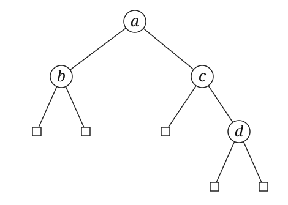

**36. [M25]** 共有 5 棵二叉树, 各包括 3 个内部结点. 如果考虑对于随机数据, 每棵特定的树在各种算法中作为查找树出现的频率, 将会得到以下不同概率:　[答案](./answers/6-3.md#ans-6-3-36)

<table>
<thead><tr><th></th><th>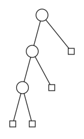</th><th>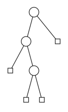</th><th>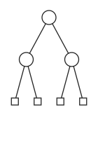</th><th>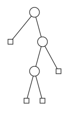</th><th>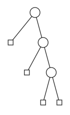</th></tr></thead>
<tbody>
<tr><th>树查找 (算法 6.2.2T)</th><td>$\frac16$</td><td>$\frac16$</td><td>$\frac13$</td><td>$\frac16$</td><td>$\frac16$</td></tr>
<tr><th>数字树查找 (算法 D)</th><td>$\frac18$</td><td>$\frac18$</td><td>$\frac12$</td><td>$\frac18$</td><td>$\frac18$</td></tr>
<tr><th>Patricia (算法 P)</th><td>$\frac17$</td><td>$\frac17$</td><td>$\frac37$</td><td>$\frac17$</td><td>$\frac17$</td></tr>
</tbody>
</table>

(注意, 数字查找树达到平衡的频率高于其他树.) 在习题 6.2.2-5 中, 我们发现树查找算法中一棵树的概率是 $\prod(1/s(x))$, 其中乘积是对所有内部结点 $x$ 进行, $s(x)$ 是以 $x$ 为根结点的子树的内部结点数. 试求一棵树在以下两个算法中的类似概率公式: (a) 算法 D. (b) 算法 P.

**▶ 37. [M22]** 考虑在第 $l$ 级有 $b_l$ 个外部结点的二叉树. 正文中观察到: 数字查找树中失败查找的运行时间并非与外部路径长度 $\sum lb_l$ 相关, 而是基本上与修正的外部路径长度 $\sum lb_l2^{-l}$ 成比例. 证明或证伪: 对于所有具有 $N$ 个外部结点的树, 当所有的外部结点都出现在最多两个相邻级别时, 得到最小的修正的外部路径长度. (见习题 5.3.1-20.)　[答案](./answers/6-3.md#ans-6-3-37)

**38. [M40]** 给定 $\alpha$ 和 $\beta$, 在习题 37 的意义下, 设计一个算法, 以找到一棵 $n$ 个结点的树, 它的 $\alpha\cdot(\text{内部路径长度})+\beta\cdot(\text{修正的外部路径长度})$ 具有最小值.　[答案](./answers/6-3.md#ans-6-3-38)

**39. [M43]** 设计一个算法, 以找到最优数字查找树, 类似于在 6.2.2 节考虑的最优二叉查找树.　[答案](./answers/6-3.md#ans-6-3-39)

**▶ 40. [25]** 设 $a_0a_1a_2\ldots$ 是一个周期二进制序列, 对于所有 $k\ge0$, 有 $a_{N+k}=a_k$. 证明: 存在一种方式, 可以在 $O(N)$ 个内存位置中表示此种类型的任何固定序列, 从而可以仅在 $O(N)$ 个步骤中完成以下操作: 给定任意二进制模式 $b_0b_1\ldots b_{n-1}$, 确定该模式在周期中的出现频率 (即, 找出存在多少个 $p$ 值, 满足 $0\le p<N$, 且对于 $0\le k<n$, 满足 $b_k=a_{p+k}$). 该模式的长度 $n$ 是可变的, 模式本身也是. 假定每个内存位置可以容纳 0 和 $N$ 之间的任意整数. [提示: 见习题 14.]　[答案](./answers/6-3.md#ans-6-3-40)

**41. [HM28]** 这是对群论的一个应用. 设 $G$ 是字母表 $\{a_1,\ldots,a_n\}$ 上的一个自由群, 即所有串 $\alpha=b_1\ldots b_r$ 的集合, 其中每个 $b_i$ 都是 $a_j$ 或 $a_j^{-}$ 之一, 并且不会出现相邻的对 $a_ja_j^{-}$ 或 $a_j^{-}a_j$. $\alpha$ 的逆是 $b_r^{-}\ldots b_1^{-}$, 两个这样的串的相乘方法是将它们连接在一起并消去相邻的互逆的对. 设 $H$ 是由串 $\{\beta_1,\ldots,\beta_p\}$ 生成的 $G$ 的子群, 即可以写成各个 $\beta$ 以及它们的逆的乘积的 $G$ 的所有元素集合. 根据雅各布·尼尔森的一个著名定理 (见马歇尔·霍尔,*The Theory of Groups* (New York: Macmillan, 1959), 第 7 章), 我们总是可以找到 $H$ 的生成元 $\theta_1,\ldots,\theta_m$, 且 $m\le p$, 它们具有以下性质: 各个 $\theta_i$ 的中间字符 (如果 $\theta_i$ 的长度为偶数, 则为它的两个中间字符中的至少一个) 从来不会在表达式 $\theta_i\theta_j^e$ 或 $\theta_j^e\theta_i$ 中消去, 这里 $e=\pm1$, 除非 $j=i$ 且 $e=-1$. 这个性质暗示着存在一个简单的算法, 可以用来判断 $G$ 的一个任意元素是否在 $H$ 中: 使用 $2n$ 个字母 $a_1,\ldots,a_n,a_1^{-},\ldots,a_n^{-}$ 在一棵面向字符的查找树中记录 $2m$ 个键 $\theta_1,\ldots,\theta_m,\theta_1^{-},\ldots,\theta_m^{-}$. 设 $\alpha=b_1\ldots b_r$ 是 $G$ 的一个给定元素. 如果 $r=0$, 则 $\alpha$ 显然在 $H$ 中. 否则查找 $\alpha$, 找出能与一个键匹配的最长前缀 $b_1\ldots b_k$. 如果以 $b_1\ldots b_k$ 开头的键多于一个, 则 $\alpha$ 不在 $H$ 中; 否则, 设这个唯一的键是 $b_1\ldots b_kc_1\ldots c_l=\theta_i^e$, 则用 $\theta_i^{-e}\alpha=c_l^{-}\ldots c_1^{-}b_{k+1}\ldots b_r$ 代替 $\alpha$. 如果这个新的 $\alpha$ 值长于旧的 (即如果 $l>k$), 则 $\alpha$ 不在 $H$ 中; 否则, 对 $\alpha$ 的新值重复以上过程. 尼尔森性质意味着这个算法总会结束. 如果 $\alpha$ 最终简化为空串, 则可以将原来的 $\alpha$ 的表示重构为各个 $\theta$ 的乘积.

例如, 设 $\{\theta_1,\theta_2,\theta_3\}=\{bbb,b^{-}a^{-}b^{-},ba^{-}b\}$, 且 $\alpha=bbabaab$. 上述算法可以利用森林

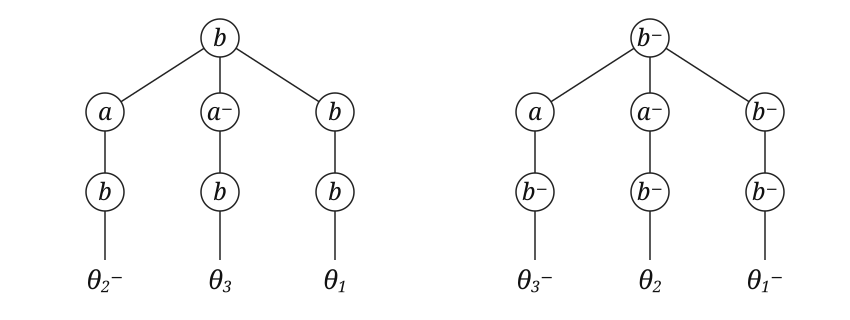

来推导出 $\alpha=\theta_1\theta_3^{-}\theta_1\theta_3^{-}\theta_2^{-}$. 给定各个 $\theta$ 作为程序的输入, 实现此算法.

**42. [23]**(*前压缩与后压缩*) 当一组二进制键用作一个索引, 以分割大型文件时, 不需要存储整个键. 例如, 如果使用图 34 中的 16 个键, 只要有足够的数字能够唯一地识别这些键, 就可以在右侧截断它们: <code>0000, 0001, 00100, 00101, 010, …, 1110001</code>. 这些截断后的键可用于将一个文件划分为 17 个部分, 例如, 第 5 部分包括所有以 0011 或 010 开头的键, 而最后的部分包含所有以 111001、11101 或 1111 开头的键. 如果压缩所有与前一个键相同的前导数字, 则可以更紧凑地表示截断后的键: <code style="white-space:nowrap">0000</code>、<code style="white-space:nowrap">◇◇◇1</code>、<code style="white-space:nowrap">◇◇100</code>、<code style="white-space:nowrap">◇◇◇◇1</code>、<code style="white-space:nowrap">◇10</code>、…、<code style="white-space:nowrap">◇◇◇◇◇◇1</code>. 跟在 $\diamond$ 后面的二进制位总是 1, 所以可以去掉它. 一个大型文件可能有许多 $\diamond$, 我们只需要存储 $\diamond$ 的个数和随后的二进制位的值.

证明: 除了 $\diamond$ 和随后的二进制位 1 之外, 压缩文件中的二进制位的总数总是等于这些键的两路检索结构中的结点数.

(相应地, 在整个索引中, 这样的二进制位的总平均数大约是 $N/\ln2$, 每个键仅 1.44 个二进制位. 这个压缩技术是由罗伯特·赫勒和罗伯特·约翰逊向我展示的. 由于我们只需要表示该检索结构, 所以还可以进一步压缩, 见定理 2.3.1A.)

**43. [HM42]** 分析一个随机 $M$ 路检索结构的高度, 和习题 20 中一样, 它有 $N$ 个键, 截止参数为 $s$. (当 $s=1$ 时, 这是 $M$ 元字母表中 $N$ 个长随机字的最长公共前缀.)　[答案](./answers/6-3.md#ans-6-3-43)

**▶ 44. [30]**(本特利和塞奇威克) 探讨检索结构的一种三路表示法, 其中左、右链接对应于 (2) 的水平分支, 而中间链接对应于向下的分支.　[答案](./answers/6-3.md#ans-6-3-44)

**▶ 45. [M25]** 如果利用习题 15 中的算法以随机顺序插入图 33 的 7 个键, 获得所示的树的概率是多少?　[答案](./answers/6-3.md#ans-6-3-45)
