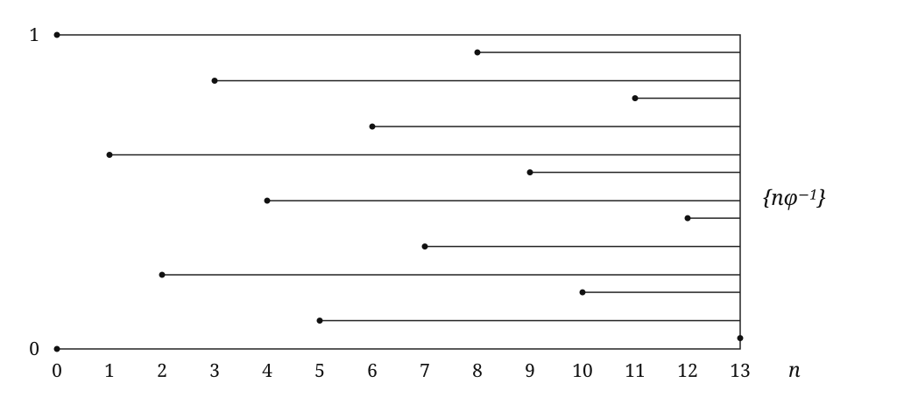
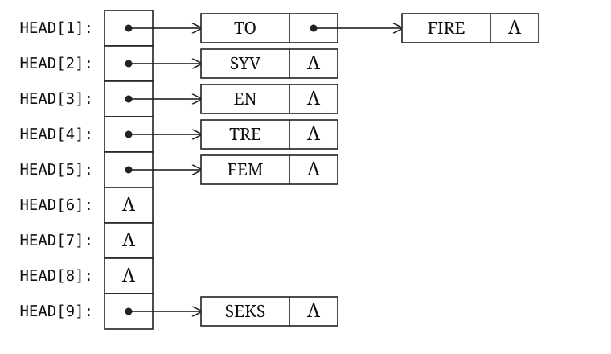
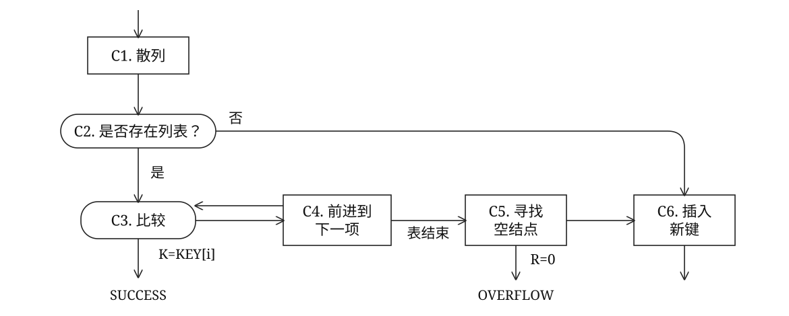
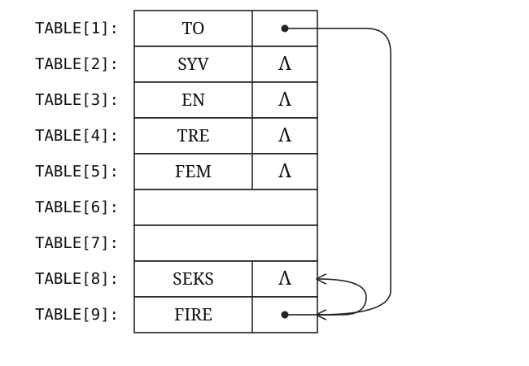
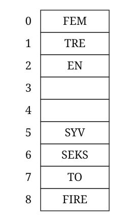
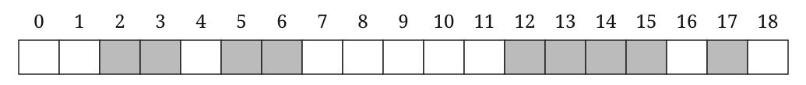
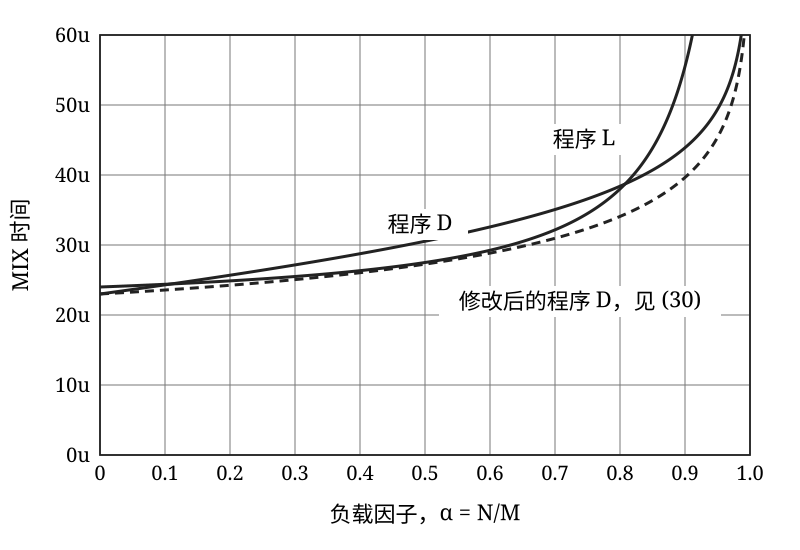
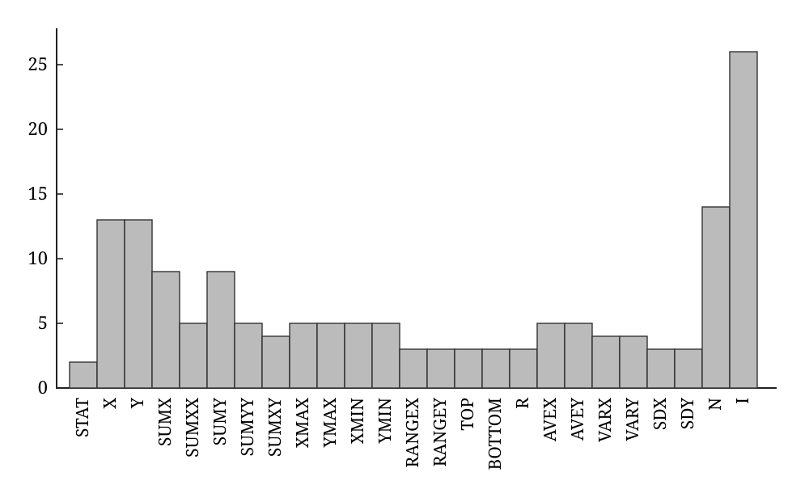
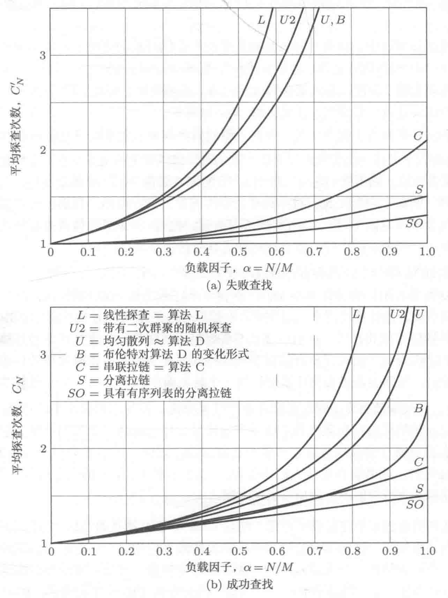
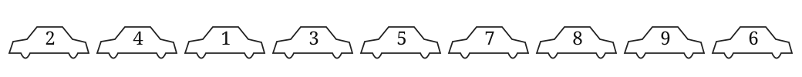

## 6.4 散列

到目前为止, 我们已经研究过的查找方法, 或者基于把给定参数 $K$ 与表中键进行对比, 或者使用键的数字来控制分支过程. 第三种可能性是通过一些计算来避免反复检查, 即对 $K$ 执行一些算术运算, 计算一个函数 $f(K)$, 它是 $K$ 的位置及表中的相关数据.

例如, 再次考虑 31 个英文单词组成的集合, 我们已经在 6.2.2 节和 6.3 节对其应用了各种查找策略. 表 1 给出了一段简短的 MIX 程序, 它把 31 个键中的每一个键转换为介于 $-10$ 和 30 之间的唯一的数 $f(K)$. 如果把这个方法与前面所讨论的其他方法 (比如, 二分查找、最优树查找、检索结构存储、数字树查找) 的 MIX 程序进行对比, 会发现它在空间和速度方面都非常出众, 只有二分查找使用的空间略小一些. 事实上, 在以图 12 中的频率数据使用表 1 中的程序时, 一次成功查找的平均时间仅为大约 $17.8u$, 只需要 41 个表位置来存储 31 个键.

遗憾的是, 这样的函数 $f(K)$ 并不容易发现. 从一个有 31 个元素的集合到一个有 41 个元素的集合共有 $41^{31}\approx10^{50}$ 种可能的函数, 其中只有 $41\cdot40\cdot\ldots\cdot11=41!/10!\approx10^{43}$ 个会对每个自变量给出不同值. 因此, 大约每 1 千万个函数中仅有 1 个是适合的.

能够避免重复值的函数是相当罕见的, 甚至对于一个相当大的表也是这样. 例如, 著名的 “生日悖论” 断言: 如果一个房间里有不少于 23 个人, 其中两个人同月、同日出生的机率非常大! 换句话说, 如果我们选择一个随机函数, 把 23 个键映射到一个大小为 365 的表中, 任何两个键都不会映射到相同位置的机率仅为 0.4927 (小于一半). 对这一结果持怀疑态度的人们应当试着在自己下一次参加的大型聚会上找找生日相同的人. [生日悖论由数学家在 20 世纪 30 年代非正式讨论过, 但其起源不详. 见欧文·古德,*Probability and the Weighing of Evidence* (Griffin, 1950), 38. 也见理查德·冯·米泽斯,*Istanbul Üniversitesi Fen Fakültesi Mecmuasi* **4** (1939), 145–163, 以及威利鲍尔德·费勒,*An Introduction to Probability Theory* (New York: Wiley, 1950), 2.3 节.]

**表 1　把一组键转换为互不相同的地址**

指令

给定一个特定的键 $K$, 执行了这条指令后, rI1 的内容

~~~text
                             A    AND    ARE     AS     AT     BE    BUT     BY    FOR   FROM    HAD   HAVE     HE    HER    HIS      I     IN     IS     IT    NOT     OF     ON     OR   THAT    THE   THIS     TO    WAS  WHICH   WITH    YOU
   LD1N  K(1:1)             -1     -1     -1     -1     -1     -2     -2     -2     -6     -6     -8     -8     -8     -8     -8     -9     -9     -9     -9    -15    -16    -16    -16    -23    -23    -23    -23    -26    -26    -26    -28
   LD2   K(2:2)             -1     -1     -1     -1     -1     -2     -2     -2     -6     -6     -8     -8     -8     -8     -8     -9     -9     -9     -9    -15    -16    -16    -16    -23    -23    -23    -23    -26    -26    -26    -28
   INC1  -8,2               -9      6     10     13     14     -5     14     18      2      5    -15    -15    -11    -11     -7    -17     -2      5      6     -7    -18     -9     -5    -23    -23    -23    -15    -33    -26    -25    -20
   J1P   *+2                -9      6     10     13     14     -5     14     18      2      5    -15    -15    -11    -11     -7    -17     -2      5      6     -7    -18     -9     -5    -23    -23    -23    -15    -33    -26    -25    -20
   INC1  16,2                7      .      .      .      .     16      .      .      .      .      2      2     10     10     18     -1     29      .      .     25      4     22     30      1      1      1     17    -16     -2      0     12
   LD2   K(3:3)              7      6     10     13     14     16     14     18      2      5      2      2     10     10     18     -1     29      5      6     25      4     22     30      1      1      1     17    -16     -2      0     12
   J2Z   9F                  7      6     10     13     14     16     14     18      2      5      2      2     10     10     18     -1     29      5      6     25      4     22     30      1      1      1     17    -16     -2      0     12
   INC1  -28,2               .    -18    -13      .      .      .      9      .     -7     -7    -22     -1      .      1     12      .      .      .      .     20      .      .      .    -26    -22    -18      .    -22    -21     -5      8
   J1P   9F                  .    -18    -13      .      .      .      9      .     -7     -7    -22     -1      .      1     12      .      .      .      .     20      .      .      .    -26    -22    -18      .    -22    -21     -5      8
   INC1  11,2                .     -3      3      .      .      .      .      .     23     20     -7     35      .      .      .      .      .      .      .      .      .      .      .    -14     -6      2      .     11     -1     29      .
   LDA   K(4:4)              .     -3      3      .      .      .      .      .     23     20     -7     35      .      .      .      .      .      .      .      .      .      .      .    -14     -6      2      .     11     -1     29      .
   JAZ   9F                  .     -3      3      .      .      .      .      .     23     20     -7     35      .      .      .      .      .      .      .      .      .      .      .    -14     -6      2      .     11     -1     29      .
   DEC1  -5,2                .      .      .      .      .      .      .      .      .      9      .     15      .      .      .      .      .      .      .      .      .      .      .    -10      .     -2      .      .     -5     11      .
   J1N   9F                  .      .      .      .      .      .      .      .      .      9      .     15      .      .      .      .      .      .      .      .      .      .      .    -10      .     -2      .      .     -5     11      .
   INC1  10                  .      .      .      .      .      .      .      .      .     19      .     25      .      .      .      .      .      .      .      .      .      .      .      .      .      .      .      .      .     21      .
9H LDA   K                   7     -3      3     13     14     16      9     18     23     19     -7     25     10      1     12     -1     29      5      6     20      4     22     30    -10     -6     -2     17     11     -5     21      8
   CMPA  TABLE,1             7     -3      3     13     14     16      9     18     23     19     -7     25     10      1     12     -1     29      5      6     20      4     22     30    -10     -6     -2     17     11     -5     21      8
   JNE   FAILURE             7     -3      3     13     14     16      9     18     23     19     -7     25     10      1     12     -1     29      5      6     20      4     22     30    -10     -6     -2     17     11     -5     21      8
~~~

另一方面, 表 1 中使用的方法相当灵活 [见马雷克·格里纽斯基和瓦迪斯瓦夫·图尔斯基,*CACM* **6** (1963), 322–323], 而且对于一个中等大小的表来说, 经过大约一天的工作就可以找到一个适当的函数. 事实上, 解决诸如此类的难题相当有趣. 许多人已经讨论了适用的技术, 见伦佐·斯普鲁格诺里,*CACM* **20** (1977), 841–850,**22** (1979), 104、553; 理查德·奇凯利,*CACM* **23** (1980), 17–19; 托马斯·塞杰,*CACM* **28** (1985), 523–532,**29** (1986), 557; 博赫丹·马耶夫斯基、尼古拉斯·沃莫尔德、乔治·阿瓦斯和兹比格纽·切赫,*Comp. J.* **39** (1996), 547–554; 切赫、阿瓦斯和马耶夫斯基,*Theoretical Comp. Sci.* **182** (1997), 1–143. 关于完全散列函数的理论极限, 见亚诺什·克尔纳和卡塔林·马顿的文章,*Europ. J. Combinatorics* **9** (1988), 523–530.

当然, 这个方法有一个严重缺陷, 就是必须事先知道表中的内容, 再增加一个键都可能会毁掉一切, 几乎需要从头来过. 如果放弃唯一性思想, 允许不同键生成相同值 $f(K)$, 并使用一种特殊方法, 在计算出 $f(K)$ 之后解决所出现的二义性问题, 就可以得到一种通用得多的方法.

这些考虑事项可以得出一类非常流行的查找方法, 通常称为*散列*或*分散存储*技术. 动词 “散列” 的意思是把东西剁碎, 或者将其打乱. 散列的思想是把将键的某些内容杂乱地收集在一起, 并使用这种部分的信息作为查找的基础. 我们计算一个散列地址 $h(K)$, 并由此开始查找.

生日悖论告诉我们, 对于互不相同的键 $K_i\ne K_j$, 它们可能会散列为相同的值 $h(K_i)=h(K_j)$. 这种情况称为*冲突*, 几种有趣的方法已被设计出来处理这个问题. 为了使用散列表, 程序员必须做出两个几乎相互独立的决策: 必须选择一个散列函数 $h(K)$, 必须选择一个解决冲突的方法. 我们将依次来考虑问题的这两个方面.

**散列函数.** 为了使事情更明了一些, 在本节始终假定: 散列函数 $h$ 最多取 $M$ 个不同值, 即对于所有的键 $K$, 有

$$
0\le h(K)<M.\tag{1}
$$

在实践中, 实际文件中的这些键通常具有很大的冗余性. 我们必须很小心地寻找散列函数, 打破由几乎相同的键组成的群组, 以减少冲突次数.

从理论上说, 不可能定义一个散列函数, 能够由实际文件中的非随机数据生成真正随机数据. 但在实践中, 要想利用第 3 章已经讨论过的简单算法来出色地模拟随机数据, 并不是非常困难. 事实上, 我们经常可以做得更好: 利用实际数据的非随机性质来构造一个散列函数, 使其得到的冲突少于真正随机键所导致的冲突.

例如, 考虑一个十进制计算机上 10 位数字的键的情况. 一个可考虑使用的散列函数是, 比如说, 设 $M=1000$, 并设 $h(K)$ 是从 20 位乘积 $K\times K$ 中部附近的某个位置选出的三位数字. 这样得出的结果似乎会非常好地分散在 000 至 999 之间, 发生冲突的概率极低. 利用实际数据作出的试验表明, 事实上, 只要键的开头和结尾没有大量 0, 则这个 “平方取中” 方法并不是很差. 但事实表明, 还有更安全、更明智的处理方法, 就像我们在第 3 章发现的, 平方取中方法并不是特别优秀的随机数生成器.

针对典型文件的大量测试已经表明, 有两种主要类型的散列函数十分有效. 一种以除法为基础, 另一种以乘法为基础.

除法方法特别容易, 只需要使用模 $M$ 的余数:

$$
h(K)=K\bmod M.\tag{2}
$$

在这种情况下, 一些 $M$ 值显然远优于其他值. 例如, 如果 $M$ 是偶数, 则当 $K$ 是偶数时, $h(K)$ 是偶数, 当 $K$ 是奇数时, 它也是奇数, 在许多文件中这将导致很大的偏向. 如果令 $M$ 为计算机基数的幂次, 情况可能会变得更糟, 因为 $K\bmod M$ 就只是 $K$ 的最低有效位上的一些数字 (而与其他数字无关). 类似地, 我们可以断言: $M$ 可能不应当是 3 的倍数, 因为如果键是字符串, 且两个键的区别仅在于字母的排列顺序不同, 则其数值之差恰好是 3 的倍数. (发生这种情况是因为 $2^{2n}\bmod3=1$, $10^n\bmod3=1$.) 一般来说, 我们希望避免能够整除 $r^k\pm a$ 的 $M$ 值, 其中 $k$ 和 $a$ 都是较小的数, $r$ 是字符集的基数 (通常 $r=64$、256 或 100), 因为对这样一个 $M$ 值求模后得到的余数, 非常可能就是这些键中的数字的简单迭加. 这些考虑提示我们选择 $M$ 为一个素数, 使得对于小的 $k$ 和 $a$, 有 $r^k\not\equiv\pm a\pmod M$. 已经发现, 这种选择在大多数情况下都是十分令人满意的.

例如, 在 MIX 计算机上, 我们可以选择 $M=1009$, 由以下序列计算 $h(K)$:

~~~mixal
LDX   K         rX ← K.
ENTA  0         rA ← 0.
DIV   =1009=    rX ← K mod 1009.
~~~

(3)

乘法散列方案同样很容易执行, 但其描述要稍困难一些, 因为我们必须想象自己是在处理分数, 而不是整数. 设 $w$ 是计算机的字大小, 对于 MIX 来说, $w$ 通常是 $10^{10}$ 或 $2^{30}$. 如果设定小数点位于字的左侧, 则可以将整数 $A$ 看作分数 $A/w$. 这种方法是选择某个与 $w$ 互素的整数常数 $A$, 并设

$$
h(K)=\left\lfloor M\left(\left(\frac AwK\right)\bmod1\right)\right\rfloor.\tag{4}
$$

在这种情况下, 我们通常在二进制计算机上令 $M$ 为 2 的幂, 所以 $h(K)$ 由乘积 $AK$ 的较低一半的一些前导二进制位组成.

在 MIX 代码中, 如果设 $M=2^m$, 并采用二进制基数, 则乘法散列函数是

~~~mixal
LDA   K    rA ← K.
MUL   A    rAX ← AK.
ENTA  0    rAX ← AK mod w.
SLB   m    把rAX左移m个二进制位.
~~~

(5)

现在 $h(K)$ 出现在寄存器 A 中. 由于 MIX 的乘法与移位指令速度相当缓慢, 所以这一序列的计算时间恰好与 (3) 一样长. 但在许多机器上, 乘法要比除法快得多.

例如, 我们可以取 $A$ 为 $w/1009$ 的近似值, 所以在某种意义上, 这种方法可以看作是 (3) 的推广. 乘以一个常数的倒数, 通常要快于除以该常数. (5) 的技巧差不多就是一种 “平方取中” 方法, 但它有一个重要的区别: 我们将会看到, 与一个合适的常数相乘具有非常好的特性.

乘法方案的好特性之一是在 (5) 中清空 A 寄存器时不会丢失信息. 在完成 (5) 之后, 仅给定 rAX 的内容, 可以再次确定 $K$. 其原因是 $A$ 与 $w$ 互素, 所以可以使用欧几里得算法寻找一个常数 $A'$, 使得 $AA'\bmod w=1$. 这意味着 $K=(A'(AK\bmod w))\bmod w$. 换句话说, 如果 $f(K)$ 表示恰在 (5) 中 SLB 指令之前寄存器 X 的内容, 则

$$
K_1\ne K_2\qquad\text{意味着}\qquad f(K_1)\ne f(K_2).\tag{6}
$$

当然, $f(K)$ 的取值范围为 0 至 $w-1$, 所以它不像散列函数那么好, 但它作为*扰乱函数*非常有用, 所谓扰乱函数就是满足 (6) 并使各键随机化的函数. 如果键的顺序不重要, 那这种函数结合 6.2.2 节的树查找算法可能非常有用, 这是因为当以递增顺序将键输入树中时, 它消除了发生退化的危险. (见习题 6.2.2-10.) 如果实际的键的二进制位是有偏的, 则扰乱函数结合 6.3 节的数字树查找算法也是非常有用的.

乘法散列算法的另一个特征是, 它很好地利用了许多文件中都存在的非随机性. 实际的键集合通常有一种算术级数的倾向, 其中 $\{K,K+d,K+2d,\ldots,K+td\}$ 全部都出现在文件中. 例如, 考虑诸如 $\{\mathrm{PART1},\mathrm{PART2},\mathrm{PART3}\}$ 或 $\{\mathrm{TYPEA},\mathrm{TYPEB},\mathrm{TYPEC}\}$ 的字符名称. 乘法散列方法将算术级数转换为不同散列值的近似算术级数 $h(K),h(K+d),h(K+2d),\ldots$, 减少在随机情况下可能发生的冲突数目. 除法方法也有同样的性质.

图 37 在一种特别有趣的情景中展示了乘法散列这方面的性质. 假定 $A/w$ 近似为黄金比例 $\phi^{-1}=(\sqrt5-1)/2\approx0.6180339887$, 则相继的值 $h(K),h(K+1),h(K+2),\ldots$ 基本上与相继的散列值 $h(0),h(1),h(2),\ldots$ 具有相同特性, 这提示进行以下试验: 从线段 $[0\mathbin{\ldotp\ldotp}1]$ 开始, 我们连续标出 $\{\phi^{-1}\}$、$\{2\phi^{-1}\}$、$\{3\phi^{-1}\}$、……等各个点, 其中 $\{x\}$ 表示 $x$ 的小数部分 (即 $x-\lfloor x\rfloor$, 或 $x\bmod1$). 如图 37 所示, 这些点可以很好地相互分离. 事实上, 每个新增加的点都落在剩余区间中最大的一个区间之内, 并以黄金比例划分该区间! [这一现象是在很久之前由植物学家路易·布拉韦和奥古斯特·布拉韦观察到的,*Annales des Sciences Naturelles* **7** (1837), 42–110, 他们给出了一个与图 37 等价的图示, 并将它与斐波那契序列关联在一起. 也见斯坦尼斯瓦夫·斯怀切柯夫斯基,*Fundamenta Math.* **46** (1958), 187–189.]

黄金比例的著名散布性质实际上是一个很普遍结果的特例, 这个结果最初是由雨果·斯坦豪斯猜测并由薇拉·绍什证明的 [*Acta Math. Acad. Sci. Hung.* **8** (1957), 461–471;*Ann. Univ. Sci. Budapest. Eötvös Sect. Math.* **1** (1958), 127–134]:

**定理 S.** 设 $\theta$ 是任意无理数. 当点 $\{\theta\}$、$\{2\theta\}$、…、$\{n\theta\}$ 被放在线段 $[0\mathbin{\ldotp\ldotp}1]$ 上时, 所形成的 $n+1$ 条线段最多有三种不同长度. 此外, 下一个点 $\{(n+1)\theta\}$ 将落在最长的已有线段上.　▮

因此, 点 $\{\theta\}$、$\{2\theta\}$、…、$\{n\theta\}$ 非常平均地散布在 0 与 1 之间. 如果 $\theta$ 是有理数, 如果能够合理地解释在 $n$ 大于或等于 $\theta$ 的分母时所出现的长度为 0 的线段, 那么同样的定理也是成立的. 在习题 8 中给出了定理 S 的证明, 并详尽分析了该情景的基础结构. 可以证明, 一个给定长度的线段是以先进先出形式被创建和破坏的. 当然, 一些 $\theta$ 要优于其他 $\theta$, 比如, 如果 $\theta$ 值接近 0 或 1, 在开始时会有许多小线段和一个大线段. 习题 9 证明: 在介于 0 与 1 之间的所有 $\theta$ 中, $\phi^{-1}$ 和 $\phi^{-2}=1-\phi^{-1}$ 这两个数可以得出 “分布最均匀的” 序列.

**图 37　斐波那契散列**

上述理论提示了*斐波那契散列*, 在这种散列中, 我们将常数 $A$ 选择为最接近 $\phi^{-1}w$ 并与 $w$ 互素的整数. 例如, 如果 MIX 是一个十进制计算机, 则取

$$
A=\begin{array}{|c|c|c|c|c|c|}\hline+&61&80&33&98&87\\\hline\end{array}.\tag{7}
$$

这个乘数将会很好地分散诸如 LIST1、LIST2、LIST3 这样的字符键. 但请注意当第 4 个字符位置是一个算术级数时会发生什么, 比如在 $\mathtt{SUM1}\sqcup$、$\mathtt{SUM2}\sqcup$、$\mathtt{SUM3}\sqcup$ 等键中, 其效果就相当于在使用定理 S 时, 取 $\theta=\{100A/w\}=0.80339887$, 而不是 $\theta=0.6180339887=A/w$. 尽管这个 $\theta$ 值并不像 $\phi^{-1}$ 那样非常好, 但所得到的特性仍然没有问题. 另一方面, 如果级数发生在第 2 个位置, 像在 $\mathtt{A1}\sqcup\sqcup\sqcup$、$\mathtt{A2}\sqcup\sqcup\sqcup$、$\mathtt{A3}\sqcup\sqcup\sqcup$ 中那样, 则有效的 $\theta$ 是 0.9887, 而这可能太接近 1 了.

因此, 用类似于

$$
A=\begin{array}{|c|c|c|c|c|c|}\hline+&61&61&61&61&61\\\hline\end{array}
$$

这样的乘数来代替 (7), 可能会更好一些. 这样一个乘数将会散布在任意字符位置存在差别的连续的键序列. 遗憾的是, 这一选择面临着另一个问题, 类似于除以 $r^k\pm1$ 的难题: 诸如 XY 和 YX 之类的键很可能会被散列到相同位置! 更深入的研究定理 S 的基础结构, 有可能摆脱这个难题. 将 $\theta$ 表示为连分数, 对于键的短级数, 只有连分数的前几个部分商发挥作用, 小的部分商对应于好的分布特性. 因此, 我们发现 $\theta$ 的最佳值位于以下范围内

$$
\frac14<\theta<\frac3{10},\qquad
\frac13<\theta<\frac37,\qquad
\frac47<\theta<\frac23,\qquad
\frac7{10}<\theta<\frac34.
$$

可以找到一个 $A$ 值, 使它的每个字节都落在一个很好的范围内, 而不会太接近其他字节的值或其补数, 例如

$$
A=\begin{array}{|c|c|c|c|c|c|}\hline+&61&25&42&33&71\\\hline\end{array}.\tag{8}
$$

可以推荐这样一个乘数. (有关乘法散列的这些思想主要是由弗洛伊德提出的.)

一个好的散列函数应当满足两项要求:

(a) 它的计算应当非常快;

(b) 它应当使冲突降至最低.

性质 (a) 与机器相关, 性质 (b) 与数据相关. 如果键是真正随机的, 可以仅从键中提取一些二进制位, 并使用这些二进制位作为散列函数. 但在实践中, 我们几乎总是需要一个依赖键的所有二进制位的散列函数, 以便满足 (b).

到目前为止, 我们已经考虑了如何散列单字键. 多字键或变长键可以用以上方法的多精度扩展方法来处理, 但一般情况下, 只需要将各个字组合为一个字, 然后再像上面一样进行一次乘法或除法, 这样可以加快处理速度. 这个组合过程可以通过模 $w$ 加法或者在二进制计算机上执行异或运算来完成. 这两种操作都有一个优点: 它们是可逆的, 也就是说, 它们依赖于两个参数的所有二进制位, 由于异或可以避免算术溢出, 所以有时优选异或运算. 然而, 这两种操作都是可交换的, 因此 $(X,Y)$ 和 $(Y,X)$ 将被散列到同一地址. 诺特已经提议, 在要马上执行加法或异或操作之前进行一次循环移位, 以此来避免上述问题.

还有一个更好的方法用来散列由 $l$ 个字符或 $l$ 个字组成的键 $K=x_1x_2\ldots x_l$, 那就是计算

$$
h(K)=\bigl(h_1(x_1)+h_2(x_2)+\cdots+h_l(x_l)\bigr)\bmod M,\tag{9}
$$

其中每个 $h_j$ 都是一个独立的散列函数. 这一思想是由约翰·卡特和马克·韦格曼在 1977 年介绍的, 当每个 $x_j$ 为单个字符时, 其效率特别高, 因为我们可以为每个 $h_j$ 使用一个预先计算的数组. 利用这种数组就不再需要执行乘法. 如果 $M$ 为 2 的幂, 可以用异或代替加法, 从而避免 (9) 中的除法. 这给出了一个不同的但同样好的散列函数. 因此, (9) 当然满足性质 (a). 此外, 卡特和韦格曼证明了: 如果随机选择 $h_j$, 则无论输入数据如何, 性质 (b) 都成立. (见习题 72.)

人们还提出了大量的其他散列方法, 但还没有证实其中有任何一个优于上述简单方法. 见林耀燊、袁师德和马利舒·多德的论文,*CACM* **14** (1971), 228–239, 其中给出了对某些其他方法的研究, 以及在实际文件上应用这些方法时, 有关性能的详细统计信息.

在已经尝试过的所有散列方法中, 最有趣的可能是一种以代数编码理论为基础的方法. 其思想类似于上文所述的除法方法, 但它除以一个模 2 多项式, 而不是除以一个整数. (在 4.6 节已经看到, 这个操作类似于除法, 就像加法类似于异或.) 对于这个方法, $M$ 应当是 2 的幂, 即 $M=2^m$, 我们利用一个 $m$ 次多项式 $P(x)=x^m+p_{m-1}x^{m-1}+\cdots+p_0$. 一个 $n$ 位二进制键 $K=(k_{n-1}\ldots k_1k_0)_2$ 可以看作多项式 $K(x)=k_{n-1}x^{n-1}+\cdots+k_1x+k_0$, 我们利用多项式模 2 算术来计算余式

$$
K(x)\bmod P(x)=h_{m-1}x^{m-1}+\cdots+h_1x+h_0.
$$

则 $h(K)=(h_{m-1}\ldots h_1h_0)_2$. 如果 $P(x)$ 的选择正确, 则可以保证这个散列函数在近似相等的键之间避免冲突. 例如, 如果 $n=15$、$m=10$, 且

$$
P(x)=x^{10}+x^8+x^5+x^4+x^2+x+1,\tag{10}
$$

则可以证明, 如果 $K_1$ 和 $K_2$ 是不同的键值, 它们相互不同的二进制位少于 7 个, 则 $h(K_1)$ 就不等于 $h(K_2)$. (有关这个方案的更多信息, 见习题 7. 当然, 与软件实现相比, 它更适于硬件或微编程实现.)

在调试程序时, 使用常数散列函数 $h(K)=0$ 通常更方便一些, 这是因为所有键都存储在一起. 稍后可以换成一个高效的 $h(K)$.

**通过 “拉链” 来解决冲突.** 我们已经注意到, 某些散列地址由于对应多个键, 可能要出麻烦. 解决这个问题的最明显方法可能就是维护 $M$ 个链表, 每个可能存在的散列码对应一个列表. 每条记录应当包含一个 LINK 字段, 还将存在 $M$ 个列表头, 其编号比如为从 1 至 $M$. 在散列了键之后, 我们只需要在第 $h(K)+1$ 号列表中进行顺序查找. (见习题 6.1-2. 这种情景非常类似于多列表插入排序, 即程序 5.2.1M.)

图 38 对 $M=9$ 时的这个简单拉链方案进行了说明, 其针对 7 个键序列

$$
K=\mathtt{EN},\ \mathtt{TO},\ \mathtt{TRE},\ \mathtt{FIRE},\ \mathtt{FEM},\ \mathtt{SEKS},\ \mathtt{SYV}\tag{11}
$$

(挪威语中的数字 1 至 7), 其各自的散列码为

$$
h(K)+1=3,\ 1,\ 4,\ 1,\ 5,\ 9,\ 2.\tag{12}
$$

第一个列表有两个元素, 而且列表中有三个为空.

图 38　分离的拉链

因为列表很短, 所以拉链的速度很快. 如果把 365 个人聚集在一个房间里, 可能会有许多对生日相同的人, 但生日为给定日期的平均人数仅为 1! 一般情况下, 如果有 $N$ 个键和 $M$ 个列表, 则平均列表大小为 $N/M$. 散列方法可以将顺序查找所需要的平均工作量减少为大约 $1/M$. (习题 34 给出了一个准确的公式.)

这个方法是前面已经讨论的各种技术的简单组合, 所以不需要描述拉链散列表的详尽算法. 对各个列表按键排序通常是一个好主意, 这样可以加快失败查找——必然在插入之前发生——的速度. 因此, 如果我们选择使列表为递增顺序, 则图 38 的 TO 和 FIRE 将会交换, 所有 $\Lambda$ 链接都将以一些指针代替, 这些指针指向一条以 $\infty$ 为键的虚拟记录. (见算法 6.1T.) 或者, 我们可以利用 6.1 节讨论的 “自组织文件” 的概念. 它不是按键对列表排序, 而是根据最近出现的时间对其进行排序.

出于速度考虑, 我们希望使 $M$ 相当大. 但当 $M$ 很大时, 许多列表都会为空, $M$ 个列表头的大部分空间将被浪费. 这就提示了另一种方法, 当记录很小时: 可以将记录存储与列表头重叠, 为总共 $M$ 条记录和 $M$ 个链接留出空间, 而不是留出 $N$ 条记录和 $M+N$ 条链接的空间. 有时, 有可能对所有数据进行一次扫描, 以找出将会使用哪些列表头, 然后再进行另一次扫描, 将所有 “溢出” 记录都插入空位. 但这一做法经常是不切实际或根本无法实现的, 我们更希望有一种技术, 仅在每次记录首次进入系统时对其进行一次处理. 由小弗朗西斯·威廉斯提出的以下算法可以便捷地解决这个问题 [*CACM* **2**, 6 (June 1959), 21–24].

**算法 C (拉链散列表的查找与插入).** 本算法在有 $M$ 个结点的表中查找一个给定的键 $K$. 如果 $K$ 不在表中, 且表没有满, 则插入 $K$.

表中的结点用 $\mathrm{TABLE}[i]$($0\le i\le M$) 来表示, 它们属于两种不同的类型: 空的和已占用的. 已占用的结点包含一个键字段 $\mathrm{KEY}[i]$、一个链接字段 $\mathrm{LINK}[i]$, 还可能包含其他字段.

该算法利用一个散列函数 $h(K)$. 另外, 还使用一个辅助变量 $R$ 来帮助寻找可用空间. 当表为空时, 有 $R=M+1$, 在进行插入时, 对于所有属于 $R\le j\le M$ 范围内的 $j$ 值, $\mathrm{TABLE}[j]$ 总是已占用的. 约定 $\mathrm{TABLE}[0]$ 总是空的.

**C1.[散列.]** 置 $i\leftarrow h(K)+1$. (现在 $1\le i\le M$.)

**C2.[是否存在列表?]** 如果 $\mathrm{TABLE}[i]$ 是空的, 则转至 C6. (否则, $\mathrm{TABLE}[i]$ 是已占用的. 我们将查看从这里开始的已占用结点的列表.)

**C3.[比较.]** 如果 $K=\mathrm{KEY}[i]$, 则本算法成功结束.

**C4.[前进到下一项.]** 如果 $\mathrm{LINK}[i]\ne0$, 则置 $i\leftarrow\mathrm{LINK}[i]$ 并返回 C3.

**C5.[寻找空结点.]**(查找失败, 我们希望找到表中的一个空位置.) 将 $R$ 减少一次或多次, 直到找到使 $\mathrm{TABLE}[R]$ 为空的 $R$ 值为止. 如果 $R=0$, 则本算法以溢出结束 (没有空结点). 否则, 置 $\mathrm{LINK}[i]\leftarrow R$, $i\leftarrow R$.

**C6.[插入新键.]** 将 $\mathrm{TABLE}[i]$ 标记为已占用的结点, 并置 $\mathrm{KEY}[i]\leftarrow K$, $\mathrm{LINK}[i]\leftarrow0$. ■

图 39　拉链散列表的查找与插入

这个算法允许将几个列表串联起来, 这样, 在将记录插入表中之后, 就不再需要移动了. 例如, 见图 40, 其中 SEKS 出现在包含 TO 和 FIRE 的列表中, 这是因为后者已经被插入位置 9.

图 40　串联起来的拉链

可以编写下面的 MIX 程序, 将算法 C 与本章的其他算法相比较. 下面给出的分析指出, 已占用单元的列表通常很短, 在设计这个程序时已经考虑了这个事实.

**程序 C (拉链散列表的查找与插入).** 为方便起见, 假定键的长度仅为 3 个字节, 结点表示如下:

<table style="border-collapse:collapse;width:max-content">
<tbody>
<tr><th style="border:0;background:none;padding-right:24px;font-weight:normal">空结点</th><td style="border:1px solid;padding:4px 10px;text-align:center">−</td><td style="border:1px solid;padding:4px 10px;text-align:center">1</td><td style="border:1px solid;padding:4px 10px;text-align:center">0</td><td style="border:1px solid;padding:4px 10px;text-align:center">0</td><td style="border:1px solid;padding:4px 10px;text-align:center">0</td><td style="border:1px solid;padding:4px 10px;text-align:center">0</td><td style="border:0;padding-left:8px">; </td></tr>
<tr style="background:none"><th style="border:0;background:none;padding-right:24px;font-weight:normal">已占用结点</th><td style="border:1px solid;padding:4px 10px;text-align:center">+</td><td colspan="2" style="border:1px solid;padding:4px 10px;text-align:center">LINK</td><td colspan="3" style="border:1px solid;padding:4px 10px;text-align:center">KEY</td><td style="border:0">. </td></tr>
</tbody>
</table>

(13)

假定表的大小 $M$ 是素数. $\mathrm{TABLE}[i]$ 存储在位置 $\mathrm{TABLE}+i$ 中. $\mathrm{rI1}\equiv i$, $\mathrm{rA}\equiv K$, $\mathrm{rI2}\equiv\mathrm{LINK}[i]$ 和/或 $R$.

~~~mixal
01 KEY    EQU   3:5
02 LINK   EQU   0:2
03 START  LDX   K                 1          C1. 散列.
04        ENTA  0                 1
05        DIV   =M=               1
06        STX   *+1(0:2)          1
07        ENT1  *                 1          i ← h(K)
08        INC1  1                 1                  +1.
09        LDA   K                 1
10        LD2   TABLE,1(LINK)     1          C2. 是否存在列表?
11        J2N   6F                1          如果TABLE[i]是空的,则转至C6.
12        CMPA  TABLE,1(KEY)      A          C3. 比较.
13        JE    SUCCESS           A          如果K=KEY[i],则退出.
14        J2Z   5F                A-S1       如果LINK[i]=0,则转至C5.
15 4H     ENT1  0,2               C-1        C4. 前进到下一项.
16        CMPA  TABLE,1(KEY)      C-1        C3. 比较.
17        JE    SUCCESS           C-1        如果K=KEY[i],则退出.
18        LD2   TABLE,1(LINK)     C-1-S2
19        J2NZ  4B                C-1-S2     如果LINK[i]≠0,则前进.
20 5H     LD2   R                 A-S        C5. 寻找空结点.
21        DEC2  1                 T          R ← R-1.
22        LDX   TABLE,2           T
23        JXNN  *-2               T          重复直到TABLE[R]为空.
24        J2Z   OVERFLOW          A-S        如果没有空结点,则退出.
25        ST2   TABLE,1(LINK)     A-S        LINK[i] ← R.
26        ENT1  0,2               A-S        i ← R.
27        ST2   R                 A-S        更新内存中的R.
28 6H     STZ   TABLE,1(LINK)     1-S        C6. 插入新键. LINK[i] ←0.
29        STA   TABLE,1(KEY)      1-S        KEY[i] ←K.
~~~

此程序的运行时间取决于

$C=$ 在查找时探查的表项数目;

$A=[\text{初始探查找到一个已占用结点}]$;

$S=[\text{查找成功}]$;

$T=$ 在寻找空结点时, 所探查的表项数目.

这里, $S=S_1+S_2$. 如果在第 1 次尝试时成功, 则 $S_1=1$. 程序 C 的查找阶段的总运行时间为 $(7C+4A+17-3S+2S_1)u$. 当 $S=0$ 时, 插入一个新键还需要另外的 $(8A+4T+4)u$.

假定在此程序开始时, 表中有 $N$ 个键, 而且设

$$
\alpha=N/M=\text{表的负载因子}.\tag{14}
$$

如果散列函数是随机的, 则在一次失败查找中, $A$ 的平均值显然是 $\alpha$. 习题 39 证明了, 在一次失败查找中, $C$ 的平均值是

$$
C'_N=1+\frac14\left(\left(1+\frac2M\right)^N-1-\frac{2N}{M}\right)
\approx1+\frac{e^{2\alpha}-1-2\alpha}{4}.\tag{15}
$$

因此, 当表为半满时, 在一次失败查找中所执行的平均探查次数大约是 $\frac14(e+2)\approx1.18$. 甚至当表快要全满时, 在插入最后的项之前所执行的平均探查次数也仅大约是 $\frac14(e^2+1)\approx2.10$. 如同在习题 40 中所证明的那样, 标准差也很小. 这些统计数字证明: 当散列函数是随机的时, 即使算法偶尔允许将列表串联起来, 它们仍然很短. 当然, 如果散列函数很差, 或者我们极度不走运, 那么 $C$ 可能会像 $N$ 那样大.

在一次成功查找中, 总是有 $A=1$. 如果假定每个键的概率相等, 则可以针对前 $N$ 次失败查找对 $C+A$ 求和, 再除以 $N$, 以此来计算一次成功查找中的平均探查次数. 于是, 我们得到, 在一次随机成功查找中, 平均探查次数是

$$
\begin{aligned}
C_N&=\frac1N\sum_{0\le k<N}\left(C'_k+\frac kM\right)
=1+\frac18\frac MN\left(\left(1+\frac2M\right)^N-1-\frac{2N}{M}\right)+\frac14\frac{N-1}{M}\\
&\approx1+\frac{e^{2\alpha}-1-2\alpha}{8\alpha}+\frac\alpha4.
\end{aligned}\tag{16}
$$

甚至对于一个满的表, 平均也仅需要大约 1.80 次探查就能找到一个项目! 类似地 (见习题 42), $\mathrm{S1}$ 的平均值是

$$
\mathrm{S1}_N=1-\tfrac12\bigl((N-1)/M\bigr)\approx1-\tfrac12\alpha.\tag{17}
$$

乍看起来, 步骤 C5 的效率似乎不高, 因为它必须对空位置进行顺序查找. 但实际上, 在构建一个表时, 步骤 C5 中所进行的表探查总数绝对不会超过表中的项数. 所以平均每次插入最多执行一次此类探查. 习题 41 证明, 在一次随机失败查找中, $T$ 近似为 $\alpha e^\alpha$.

还有可能修改算法 C, 避免把两个列表串联在一起, 但这样就有必要来回移动记录. 以图 40 为例, 考虑我们希望将 SEKS 插入到位置 9 的情景. 为了使这些列表保持分离, 需要移动 FIRE, 为此, 需要找出哪个结点指向 FIRE. 我们可以像戴维·弗格森提议的那样, 通过散列 FIRE, 并向下查找它的列表, 由于这些列表都很短, 所以不需要提供两路链接就能解决这个问题. 习题 34 表明, 当列表未被串联时, 平均探查次数减小为

$$
C'_N=1+\frac{N(N-1)}{2M^2}\approx1+\frac{\alpha^2}{2}\qquad\text{(失败查找)},\tag{18}
$$

$$
C_N=1+\frac{N-1}{2M}\approx1+\frac\alpha2\qquad\text{(成功查找)}.\tag{19}
$$

对 (15) 和 (16) 的这个改进不足以成为修改这个算法的恰当理由.

另一方面, 巴特勒·兰普森已经注意到, 如果避免将链接串联在一起, 则在拉链方法中, 实际上可以节省下被链接占用的大多数空间. 这样就引出在习题 13 中讨论的一种重要算法. 兰普森的方法在每一项中引入了一个标志位, 在一次失败查找中所需要的平均探查次数由 (18) 略微下降至

$$
\left(1-\frac1M\right)^N+\frac NM\approx e^{-\alpha}+\alpha.\tag{18'}
$$

当 $N>M$ 时, 可以使用图 38 中的分离的拉链, 所以在此情况下, 溢出不再是一个严重问题. 当这些列表像在图 40 和算法 C 中一样串联起来时, 可以向一个辅助存储池中链接入额外项目. 莱昂尼达斯·吉巴斯已经证明: 插入第 $M+L+1$ 项所进行的平均探查次数是 $(L/2M+\frac14)((1+2/M)^M-1)+\frac12$. 但是, 通常优选使用一种替代机制, 将最早的冲突元素放到一个辅助存储区域, 仅当这个辅助区域被充满时才允许链表串联在一起, 见习题 43.

**通过 “开放寻址” 来解决冲突.** 另一种解决冲突的方法是完全不使用链接, 只是逐一查看表中各项, 直到发现键 $K$ 或发现空位置为止. 其思想是设计某种规则, 每个键 $K$ 都根据这个规则来确定一个 “探查序列”, 即每次插入或查找 $K$ 时需要检查的表位置序列. 如果使用由 $K$ 确定的探查序列, 在查找 $K$ 时遇到一个空位置, 就可以得出结论, $K$ 不在表中. 因为在每次处理 $K$ 时, 使用的都是同一个探查序列. 这一类通用方法被彼得森称为开放寻址 [*IBM J. Research & Development* **1** (1957), 130–146].

最简单的开放寻址方案称为线性探查, 它使用循环探查序列

$$
h(K),\ h(K)-1,\ \ldots,\ 0,\ M-1,\ M-2,\ \ldots,\ h(K)+1\tag{20}
$$

如以下算法所示.

**算法 L (线性探查和插入).** 本算法在有 $M$ 个结点的表中查找一个给定的键 $K$. 如果 $K$ 不在表中, 且表未满, 则插入 $K$.

表中的结点用 $\mathrm{TABLE}[i]$($0\le i<M$) 来表示, 它们属于两种不同的类型: 空的和已占用的. 已占用的结点包含一个键, 称为 $\mathrm{KEY}[i]$, 还可能包含其他字段. 一个辅助变量 $N$ 用于跟踪有多少已占用的结点. 这个变量被看作表的一部分, 每当插入一个新键时, 使其加 1.

本算法利用散列函数 $h(K)$, 它使用线性探查序列 (20) 来对表寻址. 对该序列的修改将在下面讨论.

**L1.[散列.]** 置 $i\leftarrow h(K)$. (现在 $0\le i<M$.)

**L2.[比较.]** 如果 $\mathrm{TABLE}[i]$ 为空, 则转至 L4. 否则, 如果 $\mathrm{KEY}[i]=K$, 则算法成功结束.

**L3.[前进到下一项.]** 置 $i\leftarrow i-1$. 如果现在 $i<0$, 则置 $i\leftarrow i+M$. 返回到 L2.

**L4.[插入.]**(查找失败.) 如果 $N=M-1$, 则算法以溢出结束. (这一算法在 $N=M-1$ 时认为表是满的, 而不是当 $N=M$ 时做此判断. 见习题 15.) 否则, 置 $N\leftarrow N+1$, 将 $\mathrm{TABLE}[i]$ 标记为已占用, 并置 $\mathrm{KEY}[i]\leftarrow K$. ■

图 41 显示了在利用算法 L 插入 7 个示例键 (11) 时所发生的情况, 所使用的各个散列码是 2, 7, 1, 8, 2, 8, 1: 最后三个键 FEM、SEKS 和 SYV 已经由其初始位置 $h(K)$ 转移开.

图 41　线性开放寻址

**程序 L (线性探查和插入).** 本程序处理全字的键, 但不允许出现等于 0 的键, 因为 0 用于表示表中的空位置. (或者, 我们可以要求键是非负的, 让空位置包含 $-1$.) 假定表的大小 $M$ 为素数, $\mathrm{TABLE}[i]$ 存储在位置 $\mathrm{TABLE}+i$($0\le i<M$). 为加快内层循环的速度, 假定位置 $\mathrm{TABLE}-1$ 包含 0. 假定位置 $\mathrm{VACANCIES}$ 包含值 $M-1-N$. 且 $\mathrm{rA}\equiv K$, $\mathrm{rI1}\equiv i$.

为了加快本程序内层循环的速度, 从该循环中清除了测试 $i<0$, 仅保留了步骤 L2 和 L3 的必要部分. 查找阶段的总运行时间为 $(7C+9E+21-4S)u$, 而在失败查找之后的插入额外增加 $8u$.

~~~mixal
01 START  LDX   K                 1          L1. 散列.
02        ENTA  0                 1
03        DIV   =M=               1
04        STX   *+1(0:2)          1
05        ENT1  *                 1          i ← h(K).
06        LDA   K                 1
07        JMP   2F                1
08 8H     INC1  M+1               E          L3. 前进到下一项.
09 3H     DEC1  1                 C+E-1      i ← i-1.
10 2H     CMPA  TABLE,1           C+E        L2. 比较.
11        JE    SUCCESS           C+E        如果K=KEY[i],则退出.
12        LDX   TABLE,1           C+E-S
13        JXNZ  3B                C+E-S      如果TABLE[i]不为空,则转至L3.
14        J1N   8B                E+1-S      如果i=-1,则令i ← M并转至L3.
15 4H     LDX   VACANCIES         1-S        L4. 插入.
16        JXZ   OVERFLOW          1-S        如果N=M-1,则溢出并退出.
17        DECX  1                 1-S
18        STX   VACANCIES         1-S        将N加1.
19        STA   TABLE,1           1-S        TABLE[i] ← K.
~~~

和在程序 C 中一样, 变量 $C$ 表示探查的次数, $S$ 告知查找是否成功. 变量 $E$ 可以忽略, 只有在进行一次假的探查 $\mathrm{TABLE}[-1]$ 时, 该变量才为 1, 这是因为其平均值为 $(C-1)/M$.

线性探查的经验表明, 在表开始变满之前, 这个算法的运行情况一直很好. 但这个过程最终会慢下来, 因为长时间的查找过程会出现得越来越频繁. 考虑以下假想散列表可以理解出现这个特性的原因, 其中 $M=19$, $N=9$:

(21)

阴影方框表示已占用的位置. 下一个插入到表中的键 $K$ 将进入 10 个空位置之一, 但它们的概率并不相等. 事实上, 如果 $11\le h(K)\le15$, 则 $K$ 会被插入到位置 11, 只有当 $h(K)=8$ 时, 它才会落入位置 8. 因此, 进入位置 11 的可能性是进入位置 8 的 5 倍. 长列表可能会变得更长.

这个现象本身还不足以说明线性探查的性能为什么比较差, 因为算法 C 中也存在类似情况. (在算法 C 中, 一个长度为 4 的列表, 其概率为长度为 1 的列表的 4 倍.) 当 (21) 中像 4 或 16 这样的单元格被占用时, 才会真正遇到问题. 这时, 两个分离列表被结合在一起, 而算法 C 中的列表每次增长的步数绝对不会超过一步. 因此, 当 $N$ 接近 $M$ 时, 线性探查的性能会快速下降.

在本节后面将会证明, 算法 L 所需要的平均探查次数近似为

$$
C'_N\approx\frac12\left(1+\left(\frac1{1-\alpha}\right)^2\right)\qquad\text{(失败查找)},\tag{22}
$$

$$
C_N\approx\frac12\left(1+\frac1{1-\alpha}\right)\qquad\text{(成功查找)},\tag{23}
$$

其中, $\alpha=N/M$ 是表的负载因子. 因此, 当表的满载程度低于 75%时, 尽管程序 C 处理的键长非常短, 短得不切实际, 但程序 L 仍然几乎与程序 C 的一样快. 另一方面, 当 $\alpha$ 接近 1 时, 能够对程序 L 给出的最高评价就是它还能正常工作, 虽然缓慢, 但却可靠. 事实上, 当 $N=M-1$ 时, 表中只有一个空位, 所以一次失败查找中的平均探查次数是 $(M+1)/2$. 我们还将证明, 当表被填满时, 一次成功查找中的平均探查次数近似为 $\sqrt{\pi M/8}$.

当表接近填满时, 扎堆现象使得线性探查的成本非常高昂. 而如果有很大的可能出现连续的键值 $\{K,K+1,K+2,\ldots\}$, 使用除法散列将会加剧这种扎堆现象, 因为这些键将会具有连续的散列码. 乘法散列会打散这些聚集结果, 其效果令人满意.

另外一种应对连续散列码问题的方法是在步骤 L3 中置 $i\leftarrow i-c$, 而不是置 $i\leftarrow i-1$. 只要与 $M$ 互素, $c$ 取任意正值都是有效的, 因为在此情况下, 探查序列仍然会查看表的每个位置. 由于需要测试 $i<0$, 所以这个变化会使程序 L 变得慢一点. 减 $c$ 而不是减 1 并不会改变扎堆现象, 仍然会出现由距离为 $c$ 的记录组成的群组. 式 (22) 和 (23) 仍然适用. 不过, 这时连续键 $\{K,K+1,K+2,\ldots\}$ 的出现实际上是有好处的, 而不再是一种障碍.

尽管 $c$ 的固定值不会减少扎堆现象, 但如果让 $c$ 取决于 $K$, 则可以很明显地改善这个情况. 这个思想导致的对算法 L 的重要修改, 最早是由盖伊·德巴尔比内蒂提出的 [博士论文, Calif. Inst. of Technology (1968), 149–150]:

**算法 D (使用两次散列的开放寻址).** 本算法几乎与算法 L 相同, 但它对表的探查方式稍有不同, 利用了两个散列函数 $h_1(K)$ 和 $h_2(K)$. 和通常一样, $h_1(K)$ 生成一个介于 0 与 $M-1$ 之间 (含 0 和 $M-1$) 的值. 但 $h_2(K)$ 必须生成一个介于 1 与 $M-1$ 之间且与 $M$ 互素的值. (例如, 如果 $M$ 是素数, 则 $h_2(K)$ 可以是介于 1 与 $M-1$ 之间 (含 1 和 $M-1$) 的任意值. 或者, 如果 $M=2^m$, 则 $h_2(K)$ 可以是介于 1 与 $2^m-1$ 之间的任意奇数值.)

**D1.[第一次散列.]** 置 $i\leftarrow h_1(K)$.

**D2.[第一次探查.]** 如果 $\mathrm{TABLE}[i]$ 为空, 则转至 D6. 否则, 如果 $\mathrm{KEY}[i]=K$, 则算法成功结束.

**D3.[第二次散列.]** 置 $c\leftarrow h_2(K)$.

**D4.[前进到下一项.]** 置 $i\leftarrow i-c$. 如果现在 $i<0$, 置 $i\leftarrow i+M$.

**D5.[比较.]** 如果 $\mathrm{TABLE}[i]$ 为空, 则转至 D6. 否则, 如果 $\mathrm{KEY}[i]=K$, 则算法成功结束. 否则, 返回到 D4.

**D6.[插入.]** 如果 $N=M-1$, 则本算法以溢出结束. 否则, 置 $N\leftarrow N+1$, 将 $\mathrm{TABLE}[i]$ 标记为已占用, 且置 $\mathrm{KEY}[i]\leftarrow K$. ■

对于 $h_2(K)$ 的计算已经提出了几种可能性. 如果 $M$ 是素数, 且 $h_1(K)=K\bmod M$, 我们可以令 $h_2(K)=1+(K\bmod(M-1))$. 但由于 $M-1$ 是偶数, 所以最好令 $h_2(K)=1+(K\bmod(M-2))$. 这就提示: $M$ 的选择应当使 $M$ 和 $M-2$ 为 “孪生素数”, 比如 1021 和 1019. 或者, 可以令 $h_2(K)=1+(\lfloor K/M\rfloor\bmod(M-2))$, 这是因为作为计算 $h_1(K)$ 的副产品, 可以在一个寄存器中得到商 $\lfloor K/M\rfloor$.

如果 $M=2^m$, 而且正在使用乘法散列, 只需要左再多移 $m$ 个二进制位, 并与 1“求或”, 即可求得 $h_2(K)$. 这样, (5) 中的代码序列后面应当跟上

~~~mixal
ENTA  0      清空rA.
SLB   m      将rAX左移m个二进制位.
OR    =1=    rA ← rA | 1.
~~~

(24)

这种方式要快于除法方法.

在上述任一方法中, $h_1(K)$ 和 $h_2(K)$ 基本上都是独立的; 也就是说, 不同键对 $h_1$ 和 $h_2$ 生成相同值的概率近似与 $1/M^2$ 成正比, 而不是与 $1/M$ 成正比. 试验测试表明: 在采用独立散列函数时, 算法 D 的特性基本上与将键随机插入表中时所需要的探查次数没有什么区别. 实际上不存在算法 L 中的 “扎堆” 或 “群聚” 现象.

还可能根据诺特在 1968 年的提议, 让 $h_2(K)$ 依赖于 $h_1(K)$. 例如, 如果 $M$ 是素数, 则可以设

$$
h_2(K)=\begin{cases}
1,&\text{如果 }h_1(K)=0;\\
M-h_1(K),&\text{如果 }h_1(K)>0.
\end{cases}\tag{25}
$$

这样要比再做一次除法更快一些, 但后面将会看到, 它会导致一定数量的二次群聚, 由于两个或多个键沿循相同路径的机率增大, 所以需要的探查次数会稍多一些. 下面推导的公式可用于判断散列时间方面的收益是否超过了探查时间方面的损失.

算法 L 和算法 D 非常类似, 但两者之间的差别还是值得对比一下相应的 MIX 程序的运行时间.

**程序 D (使用两次散列的开放寻址).** 由于这个算法基本上与算法 L 相同, 所以不再给出注释. $\mathrm{rI2}\equiv c-1$.

~~~mixal
01 START  LDX   K                 1
02        ENTA  0                 1
03        DIV   =M=               1
04        STX   *+1(0:2)          1
05        ENT1  *                 1
06        LDX   TABLE,1           1
07        CMPX  K                 1
08        JE    SUCCESS           1
09        JXZ   4F                1-S1
10        SRAX  5                 A-S1
11        DIV   =M-2=             A-S1
12        STX   *+1(0:2)          A-S1
13        ENT2  *                 A-S1
14        LDA   K                 A-S1
15 3H     DEC1  1,2               C-1
16        J1NN  *+2               C-1
17        INC1  M                 B
18        CMPA  TABLE,1           C-1
19        JE    SUCCESS           C-1
20        LDX   TABLE,1           C-1-S2
21        JXNZ  3B                C-1-S2
22 4H     LDX   VACANCIES         1-S
23        JXZ   OVERFLOW          1-S
24        DECX  1                 1-S
25        STX   VACANCIES         1-S
26        LDA   K                 1-S
27        STA   TABLE,1           1-S
~~~

这个程序中的频率计数 $A,C,\mathrm{S1},\mathrm{S2}$ 与前面程序 C 中的解释类似. 另一个变量 $B$ 的平均值大约是 $(C-1)/2$. (如果将 $h_2(K)$ 的范围限制为比如 $1\le h_2(K)\le M/2$, 则 $B$ 大约仅为 $(C-1)/4$. 这个速度提高幅度可能不足以弥补探查次数的显著增大.) 当表中存在 $N=\alpha M$ 个键时, 在一次失败查找中, $A$ 的平均值当然是 $\alpha$, 在成功查找中 $A=1$. 和在算法 C 中一样, 一次成功查找中 $\mathrm{S1}$ 的平均值为 $1-\frac12((N-1)/M)\approx1-\frac12\alpha$. 平均探查次数很难准确判定, 但试验测试结果与下面针对 “均匀探查” 推导的公式非常一致, 即当 $h_1(K)$ 和 $h_2(K)$ 独立时, 有

$$
C'_N=\frac{M+1}{M+1-N}\approx(1-\alpha)^{-1}\qquad\text{(失败查找)},\tag{26}
$$

$$
C_N=\frac{M+1}{N}(H_{M+1}-H_{M+1-N})\approx-\alpha^{-1}\ln(1-\alpha)\qquad\text{(成功查找)}.\tag{27}
$$

当 $h_2(K)$ 像在 (25) 中一样依赖于 $h_1(K)$ 时, 二次群聚会导致 (26) 和 (27) 增大到

$$
\begin{aligned}
C'_N&=\frac{M+1}{M+1-N}-\frac N{M+1}+H_{M+1}-H_{M+1-N}+O(M^{-1})\\
&\approx(1-\alpha)^{-1}-\alpha-\ln(1-\alpha);
\end{aligned}\tag{28}
$$

$$
\begin{aligned}
C_N&=1+H_{M+1}-H_{M+1-N}-\frac N{2(M+1)}-(H_{M+1}-H_{M+1-N})/N+O(N^{-1})\\
&\approx1-\ln(1-\alpha)-\tfrac12\alpha.
\end{aligned}\tag{29}
$$

(见习题 44.) 注意, 随着表逐渐变满, 即当 $N=M$ 时, $C_N$ 的这些值分别趋近于 $H_{M+1}-1$ 和 $H_{M+1}-\frac12$. 这要比我们在算法 L 中看到的结果好得多, 但与拉链方法相比, 还有所不足.

由于算法 L 中每次探查耗费的时间稍少一些, 所以只有当表变满时, 两次散列才有优势. 图 42 对比了程序 L、程序 D 和经过修改的程序 D 的平均运行时间. 经过修改的程序 D 涉及二次群聚, 将第 10–13 行比较缓慢的 $h_2(K)$ 计算用以下三条指令代替:

~~~mixal
ENN2  1-M,1    c ← M-i.
J1NZ  *+2
ENT2  0        如果i=0,c ← 1.
~~~

(30)

程序 D 耗费的总时间是 $8C+19A+B+26-13S-17\mathrm{S1}$ 个时间单位. 在一次成功查找中, (30) 所节省的时间大约是 $15(A-\mathrm{S1})\approx7.5\alpha$. 在此情况下, 二次群聚优先于独立的两次散列.

图 42　三种开放寻址方案的成功查找运行时间

在一台二进制计算机中, 比如说, 如果 $M$ 是大于 512 的素数, 可以采用另一种方法来加快 $h_2(K)$ 的计算, 将第 10–13 行用以下代码代替

~~~mixal
AND   =511=       rA ← rA mod 512.
STA   *+1(0:2)
ENT2  *           c ← rA+1.
~~~

(31)

这个思想 (由詹姆斯·贝尔和查尔斯·卡曼提出,*CACM* **13** (1970), 675–677, 他们独立发现了算法 D) 在不需要另加一次除法的情况下避免了二次群聚.

人们还提出了许多其他探查序列用来改进算法 L, 但它们似乎都不比算法 D 优越, 只有习题 20 中描述的方法还有点可能.

利用键的相对顺序, 可以将算法 L 或 D 中失败查找的平均运行时间, 缩短为成功查找的平均运行时间, 见习题 66. 如果应用情景中的查找过程经常失败, 那么这个技术是非常重要的. 例如, $\TeX$ 在查找其连字规则的例外情况时, 使用的就是这种算法.

**布伦特变形.** 理查德·布伦特发现了一种修改算法 D 的方式, 使成功查找的平均时间在表变满时仍能限定在一定范围内. 他的方法 [*CACM* **16** (1973), 105–109] 基于以下事实: 在许多应用中, 成功查找要远比插入更为常见. 因此, 他建议在插入一个项目时多做一点工作, 移动记录, 以减少预期的检索时间.

例如, 图 43 显示了在一个典型的 PL/I 过程中, 实际发现的每个标识符的出现次数. 这个数据显示, 使用散列表来跟踪变量名称的 PL/I 编译器, 会对许多名称进行五次或更多次的查找, 但只会插入一次. 与此类似, 贝尔和卡曼发现, COBOL 编译器在编译程序时用到 10988 次符号表算法, 但只向表中执行 735 次插入. 每出现一次失败查找, 平均大约有 14 次成功查找. 有时, 一个表实际上仅创建一次 (例如, 汇编程序中的符号操作码表), 而在以后专门用于检索.

图 43　一个编译器在典型情况下查找变量名称的次数. 这些名称自左向右按其第一次出现的顺序列出

布伦特的想法是像下面这样改变算法 D 的插入过程. 假定一次失败查找已经探查了位置 $p_0,p_1,\ldots,p_{t-1},p_t$, 其中 $p_j=(h_1(K)-jh_2(K))\bmod M$, 且 $\mathrm{TABLE}[p_t]$ 为空. 如果 $t\le1$, 则像通常一样在位置 $p_t$ 处插入 $K$. 但如果 $t\ge2$, 则计算 $c_0=h_2(K_0)$, 其中 $K_0=\mathrm{KEY}[p_0]$, 并查看 $\mathrm{TABLE}[(p_0-c_0)\bmod M]$ 是否为空. 如果为空, 则将其设定为 $\mathrm{TABLE}[p_0]$, 然后在位置 $p_0$ 处插入 $K$. 这样会将 $K_0$ 的检索时间增大一步, 但对 $K$ 的检索时间减少 $t\ge2$ 步, 所以最终结果是改进的. 类似地, 如果 $\mathrm{TABLE}[(p_0-c_0)\bmod M]$ 已占用, 且 $t\ge3$, 则尝试 $\mathrm{TABLE}[(p_0-2c_0)\bmod M]$. 如果它也满了, 则计算 $c_1=h_2(\mathrm{KEY}[p_1])$, 并尝试 $\mathrm{TABLE}[(p_1-c_1)\bmod M]$. 以此类推. 一般来说, 令 $c_j=h_2(\mathrm{KEY}[p_j])$, 且 $p_{j,k}=(p_j-kc_j)\bmod M$, 如果发现对于所有满足 $j+k<r$ 的下标 $j$ 和 $k$, $\mathrm{TABLE}[p_{j,k}]$ 都已经被占用, 而且如果 $t\ge r+1$, 则查看 $\mathrm{TABLE}[p_{0,r}],\mathrm{TABLE}[p_{1,r-1}],\ldots,\mathrm{TABLE}[p_{r-1,1}]$. 如果第一个空缺位置出现在位置 $p_{j,r-j}$ 处, 则令 $\mathrm{TABLE}[p_{j,r-j}]\leftarrow\mathrm{TABLE}[p_j]$, 并将 $K$ 插入位置 $p_j$.

布伦特的分析表明, 每次成功查找的平均探查次数缩减到第 427 页的图 44 所示的级别, 最大值大约为 2.49.

布伦特变形没有缩减失败查找中的探查数 $t+1$. 它仍然保持在式 (26) 所示的级别, 当表变满时, 其趋近于 $\frac12(M+1)$. 根据布伦特的分析, 每次插入需要计算的平均次数 $h_2$ 为 $\alpha^2+\alpha^5+\frac13\alpha^6+\cdots$, 最终趋近于 $\Theta(\sqrt M)$. 在判断如何进行插入时增加探查的表位置数目大约为 $\alpha^2+\alpha^4+\frac43\alpha^5+\alpha^6+\cdots$.

埃弗雷姆·马利亚奇已经对布伦特变形进行了试验 [*Comp. J.* **20** (1977), 137–140], 戈内和芒罗获得了其他一些结果 [*SICOMP* **8** (1979), 463–478].

**删除.** 许多计算机程序员都非常信任算法, 然而他们会惊奇地发现一种明显可以从散列表中删除记录的方法竟然无效的. 例如, 如果我们尝试从图 41 中删除键 EN, 不能简单地将这个表位置标记为空, 因为这样会导致另一个键 FEM 被突然忘在一边! (别忘了, EN 和 FEM 都被散列到相同位置. 在查找 FEM 时, 我们会发现一个空位置, 表明这是一次失败查找.) 因为列表的串接原因, 对于算法 C 也存在类似的问题. 设想一下将 TO 和 FIRE 都从图 40 中删除的情况.

一般情况下, 在处理删除时, 可以将一个特殊的编码值放在相应的单元中, 从而存在三种表项: 空、已占用和已删除. 在查找一个键时, 应当跳过已删除的单元, 就像它们是已占用一样. 如果查找失败, 可以将键插入遇到的第一个已删除的位置或空位置.

但这种思想仅在删除操作非常少见时才有效, 因为表中各项一旦变为已占用之后从来不会再次变空. 在大量重复的插入和删除之后, 所有空位置最终都将消失, 每次失败查找都需要 $M$ 次探查! 而且, 每次探查的平均时间都将延长, 因为必须在步骤 D4 中测试 $i$ 是否已经返回其起始值. 成功查找中的探查次数将由 $C_N$ 增大到 $C'_N$.

在使用线性探查 (算法 L) 时, 如果愿意为删除操作额外多做一点工作, 就可以在执行删除时避免这种麻烦状况.

**算法 R (用于线性探查的删除).** 假定已经由算法 L 构造了一个开放散列表, 本算法删除给定位置 $\mathrm{TABLE}[i]$ 处的记录.

**R1.[清空一个单元.]** 将 $\mathrm{TABLE}[i]$ 标记为空, 并置 $j\leftarrow i$.

**R2.[减小 $i$.]** 置 $i\leftarrow i-1$, 如果这一操作使 $i$ 变为负数, 则置 $i\leftarrow i+M$.

**R3.[检查 $\mathrm{TABLE}[i]$.]** 如果 $\mathrm{TABLE}[i]$ 为空, 则算法结束. 否则, 置 $r\leftarrow h(\mathrm{KEY}[i])$, 键的原散列地址现在存储在位置 $i$. 如果 $i\le r<j$, 或者如果 $r<j<i$ 或 $j<i\le r$ (换句话说, 如果 $r$ 循环地位于 $i$ 和 $j$ 之间), 则返回到 R2.

**R4.[移动一条记录.]** 置 $\mathrm{TABLE}[j]\leftarrow\mathrm{TABLE}[i]$, 并返回 R1. ■

习题 22 表明这个算法不会导致性能恶化. 换句话说, 式 (22) 和 (23) 中预测的平均探查次数保持相同. (在定理 6.2.2H 中证明了对于树插入算法的一个较弱结果.) 但算法 R 的有效性严重依赖于一个事实: 其中使用了线性探查, 并且不存在与算法 D 一起使用的类似删除过程. 习题 64 分析了算法 R 的平均运行时间.

当然, 在对于每个可能散列值的分离列表使用拉链时, 删除不会导致问题, 因为它就是从一个链式线性列表中执行的删除操作. 习题 23 中讨论了算法 C 使用的删除方法.

算法 R 可能会移动一些表项, 如果在其他地方引用了这些表项, 那么就不希望出现这种移动. 采用垃圾收集中用到的一些思想 (见 2.3.5 节), 还可能实现另一种删除方法: 我们可以为每个键保持一个引用计数, 告诉人们有多少个其他键与它冲突. 在这些键的引用数减小为 0 时, 就有可能将未占用单元转换为空闲状态. 或者, 每当累积了太多的已删除项目时, 就遍历整个表格, 将所有未占用位置改为空闲, 然后查找所有剩余键, 以了解哪些未占用位置仍然需要保持 “被删除” 状态. 这些过程避免了再分配过程, 适用于任何散列技术, 它最早是由郡司隆男和後藤英一提出的 [*J. Information Proc.* **3** (1980), 1–12].

**\*对这些算法的分析.** 了解一种散列方法的平均特性是特别重要的, 因为每次进行散列时只能信任概率法则. 这些算法的最差情况会差到几乎让人无法想像, 所以我们需要确认其平均特性是非常好的.

在开始分析线性探查等内容之前, 我们先来考虑一种近似的情景模型, 称之为均匀探查. 在这个由彼得森提出的模型中 [*IBM J. Research & Devel.* **1** (1957), 135–136], 假定每个键都被放在表中一个完全随机的位置, 所以 $N$ 个已占用的单元和 $M-N$ 个空闲单元的 $\binom MN$ 种可能组合方式是等概率的. 这个模型忽略了初次群聚和二级群聚可能产生的任何影响. 所以, 插入第 $N+1$ 项恰好需要 $r$ 次探查的概率等于 “$r-1$ 个给定的单元已占用, 另一个为空” 的组合数再除以 $\binom MN$, 即

$$
P_r=\binom{M-r}{N-r+1}\bigg/\binom MN.
$$

因此, 均匀探查的平均探查次数是

$$
\begin{aligned}
C'_N&=\sum_{r=1}^M rP_r=M+1-\sum_{r=1}^M(M+1-r)P_r\\
&=M+1-\sum_{r=1}^M(M+1-r)\binom{M-r}{M-N-1}\bigg/\binom MN\\
&=M+1-\sum_{r=1}^M(M-N)\binom{M+1-r}{M-N}\bigg/\binom MN\\
&=M+1-(M-N)\binom{M+1}{M-N+1}\bigg/\binom MN\\
&=M+1-(M-N)\frac{M+1}{M-N+1}=\frac{M+1}{M-N+1},\qquad1\le N<M.
\end{aligned}\tag{32}
$$

(在习题 3.4.2-5 中, 实质上已经结合随机取样解决了同样的问题.) 设 $\alpha=N/M$, $C'_N$ 的这个精确公式近似等于

$$
\frac1{1-\alpha}=1+\alpha+\alpha^2+\alpha^3+\cdots,\tag{33}
$$

这个级数有一个粗略的直观解释: 需要超过一次探查的概率为 $\alpha$, 需要超过两次的概率为 $\alpha^2$, 以此类推. 一次成功查找的相应平均探查次数是

$$
\begin{aligned}
C_N&=\frac1N\sum_{k=0}^{N-1}C'_k
=\frac{M+1}{N}\left(\frac1{M+1}+\frac1M+\cdots+\frac1{M-N+2}\right)\\
&=\frac{M+1}{N}(H_{M+1}-H_{M-N+1})\approx\frac1\alpha\ln\frac1{1-\alpha}.
\end{aligned}\tag{34}
$$

如上文所述, 大量测试表明: 对所有实际用途来说, 具有两个独立散列函数的算法 D, 其行为特性基本上类似于均匀探查. 事实上, 在 $M\to\infty$ 时的极限情况下, 两次散列的特性渐近等价于均匀探查 (见习题 70).

这就完成了我们对均匀探查的分析. 为了研究线性探查和其他类型的解决冲突的方法, 需要以一种更为现实的不同方式来确立该理论. 为达成这一目的, 对所用概率模型做出如下假定: 在 $M^N$ 个可能出现的 “散列序列” 中, 其中每个序列

$$
a_1a_2\ldots a_N,\qquad0\le a_j<M,\tag{35}
$$

都是等概率的, 其中 $a_j$ 表示将第 $j$ 个键插入表中的初始散列地址. 和上面一样, 在给定任意特殊查找算法后, 一次成功查找中的平均探查次数表示为 $C_N$. 假定这个值是查找第 $k$ 个键所需要的平均探查次数, 这里所说的平均是指针对 $1\le k\le N$ 求平均 (每个键的概率相等)、针对所有散列序列 (35) 求平均 (每个序列的概率相等). 类似地, 当认为所有序列 (35) 的概率相等时, 插入第 $N$ 个键所需要的平均探查次数记为 $C'_{N-1}$. 这是在一个拥有 $N-1$ 个元素的表中执行一次失败查找时的平均探查数目. 在使用开放寻址时,

$$
C_N=\frac1N\sum_{k=0}^{N-1}C'_k,\tag{36}
$$

所以, 我们可以由其中一个量推出另一个量, 在 (34) 中就是这样做的.

严格来说, 即使在这样一个更为准确的模型中也有两个缺陷. 首先, 不同散列序列的概率并不全都相等, 因为这些键本身是互不相同的. 这就使得 $a_1=a_2$ 的概率稍小于 $1/M$. 但由所有可能的键组成的集合通常要远大于 $M$, 所以这个差别通常可以忽略. (见习题 24.) 此外, 一个好的散列函数将会利用典型数据的非随机性, 使得 $a_1=a_2$ 的可能性变得更低. 因此, 我们对探查次数的估计可能有些悲观了. 这个模型的另一不够准确之处由图 43 中给出: 先出现的键比后出现的键更容易被找到 (也有一些例外). 因此, 我们对 $C_N$ 的评估可能更加过于悲观了, 这些算法的实际性能应当稍高于上面分析的预测结果.

有了这些思想准备之后, 我们就可以开始对线性探查进行 “精确” 分析了[^v3-p420-1]. 设 $f(M,N)$ 是在利用算法 L 插入各个键之后, 使得表的位置 0 为空的散列序列 (35) 的个数. 根据线性探查的循环对称性可知, 位置 0 为空的概率与任何其他位置为空的概率相同, 所以它为空的概率是 $1-N/M$, 也就是

$$
f(M,N)=\left(1-\frac NM\right)M^N.\tag{37}
$$

根据约定, 我们也令 $f(0,0)=1$. 现在设 $g(M,N,k)$ 是满足以下条件的散列序列 (35) 的个数: 算法保持位置 0 为空, 位置 1 至 $k$ 已占用, 位置 $k+1$ 为空. 我们有

$$
g(M,N,k)=\binom Nk f(k+1,k)f(M-k-1,N-k).\tag{38}
$$

因为所有此类散列序列都由两个子序列组成, 一个序列 (包含 $k$ 个元素 $a_i\le k$) 使得位置 0 为空, 位置 1 至 $k$ 被占用; 另一个序列 (包含 $N-k$ 个元素 $a_j\ge k+1$) 使得位置 $k+1$ 为空. 前一类型的子序列有 $f(k+1,k)$ 个, 后一类型有 $f(M-k-1,N-k)$ 个, 共有 $\binom Nk$ 种方式来组合两个这样的子序列. 最后, 设 $P_k$ 是在插入第 $N+1$ 个键时恰好需要 $k+1$ 次探查的概率. 由此可以推出 (见习题 25):

$$
P_k=M^{-N}\bigl(g(M,N,k)+g(M,N,k+1)+\cdots+g(M,N,N)\bigr).\tag{39}
$$

现在, $C'_N=\sum_{k=0}^N(k+1)P_k$. 将此式与 (36)–(39) 结合并进行化简, 可以得到以下结果

**定理 K.** 假定所有 $M^N$ 个散列序列 (35) 的概率相等, 则算法 L 需要的平均探查次数是

$$
C_N=\tfrac12\bigl(1+Q_0(M,N-1)\bigr)\qquad\text{(成功查找)},\tag{40}
$$

$$
C'_N=\tfrac12\bigl(1+Q_1(M,N)\bigr)\qquad\text{(失败查找)},\tag{41}
$$

其中

$$
\begin{aligned}
Q_r(M,N)&=\binom r0+\binom{r+1}1\frac NM+\binom{r+2}2\frac{N(N-1)}{M^2}+\cdots\\
&=\sum_{k\ge0}\binom{r+k}k\frac NM\frac{N-1}M\cdots\frac{N-k+1}M.
\end{aligned}\tag{42}
$$

**证明.** 习题 27 给出了计算细节. (关于方差, 见习题 28、67 和 68.)■

这个定理中出现了一个看起来相当奇怪的函数 $Q_r(M,N)$, 实际上它并不是很难处理. 我们有

$$
N^k-\binom k2N^{k-1}\le N(N-1)\cdots(N-k+1)\le N^k.
$$

因此, 如果 $N/M=\alpha$,

$$
\sum_{k\ge0}\binom{r+k}k\left(N^k-\binom k2N^{k-1}\right)\bigg/M^k
\le Q_r(M,N)\le\sum_{k\ge0}\binom{r+k}kN^k/M^k,
$$

$$
\sum_{k\ge0}\binom{r+k}k\alpha^k-\frac\alpha M\sum_{k\ge0}\binom{r+k}k\binom k2\alpha^{k-2}
\le Q_r(M,\alpha M)\le\sum_{k\ge0}\binom{r+k}k\alpha^k;
$$

即

$$
\frac1{(1-\alpha)^{r+1}}-\frac1M\binom{r+2}2\frac\alpha{(1-\alpha)^{r+3}}
\le Q_r(M,\alpha M)\le\frac1{(1-\alpha)^{r+1}}.\tag{43}
$$

当 $M$ 很大而 $\alpha$ 不是太接近于 1 时, 这个关系可以给出 $Q_r(M,N)$ 的一个很好的估计结果. (下限的近似程度要好于上限.) 当 $\alpha$ 趋近于 1 时, 这些公式就变得没用了, 但幸运的是, $Q_0(M,M-1)$ 就是在 1.2.11.3 节详细研究了其渐近特性的 $Q(M)$. 而且, $Q_1(M,M-1)$ 就等于 $M$ (见习题 50). 根据超几何函数的标准记号, 即等式 1.2.6-(39), 可得 $Q_r(M,N)=F(r+1,-N;;-1/M)=F\!\left(\begin{matrix}r+1,-N,1\\1\end{matrix}\middle|-\frac1M\right)$.

在早先的时候, 小盖佐·沙伊和威廉·施普鲁特采用另外一种方法对线性探查进行了分析 [*CACM* **5** (1962), 459–462]. 尽管他们的方法仅给出了定理 K 中准确公式的近似式, 但使得这个算法变得更为明了, 所以这里简单地介绍一下. 首先考虑线性探查一个令人惊讶的性质, 它最早是由彼得森在 1957 年注意到的.

**定理 P.** 算法 L 在一次成功查找中执行的平均探查次数与键的插入顺序无关, 它仅取决于散列到每个地址的键数.

换句话说, 对一个散列序列 $a_1a_2\ldots a_N$ 进行任意重新排列后, 会得到另一个散列序列, 该序列的各个键相对于散列地址的平均位移与原序列相同. (和前面一样, 假定表中的所有键都是同等重要的. 如果对某些键的访问频率高于其他键, 则可以扩展这个证明方法, 以证明: 如果使用定理 6.1S 中的方法, 按频率的递减顺序插入各个键, 就可以得到最优排列.)

**证明.** 只需证明, 为散列序列 $a_1a_2\ldots a_N$ 插入键所需的总探查次数与 $a_1\ldots a_{i-1}a_{i+1}a_i a_{i+2}\ldots a_N$($1\le i<N$) 所需的总次数相同. 显然, 除了第二个序列的第 $i+1$ 个键落入到第一个序列中第 $i$ 个键所占的位置外, 两者没有差别. 而第 $i$ 个键和第 $i+1$ 个只是交换了位置, 所以第 $i+1$ 个键的探查次数的减少量就等于第 $i$ 个的增加量. ■

定理 P 告诉我们: 散列序列 $a_1a_2\ldots a_N$ 的平均查找长度可以由数 $b_0b_1\ldots b_{M-1}$ 来确定, 其中 $b_j$ 表示有多少个 $a$ 与 $j$ 相等. 由这个序列, 可以确定 “进位序列”$c_0c_1\ldots c_{M-1}$, 其中 $c_j$ 是符合以下条件的键的数目: 在插入该键时, 位置 $j$ 和 $j-1$ 都会被探查到. 这个序列由以下规则确定

$$
c_j=\begin{cases}
0,&\text{如果 }b_j=c_{(j+1)\bmod M}=0;\\
b_j+c_{(j+1)\bmod M}-1,&\text{其他}.
\end{cases}\tag{44}
$$

例如, 设 $M=10$, $N=8$, 且 $b_0\ldots b_9=0\,3\,2\,0\,1\,0\,0\,0\,0\,2$. 由于一个键需要由位置 2“进位” 到位置 1, 三个键由位置 1“进位” 到位置 0, 两个键由位置 0“进位” 到位置 9, 等等, 所以 $c_0\ldots c_9=2\,3\,1\,0\,0\,0\,0\,1\,2\,3$. 我们有 $b_0+b_1+\cdots+b_{M-1}=N$, 而且为了检索 $N$ 个键所需要的平均探查次数是

$$
1+(c_0+c_1+\cdots+c_{M-1})/N.\tag{45}
$$

规则 (44) 似乎是 $c$ 本身的循环定义, 但实际上, 只要 $N<M$, 所述方程就存在唯一解 (见习题 32).

小沙伊和施普鲁特利用这个思想, 借助 $b_j=k$ 的概率 $p_k$ 来确定 $c_j=k$ 的概率 $q_k$, (这些概率与 $j$ 无关.) 于是

$$
\begin{aligned}
q_0&=p_0q_0+p_1q_0+p_0q_1,\\
q_1&=p_2q_0+p_1q_1+p_0q_2,\\
q_2&=p_3q_0+p_2q_1+p_1q_2+p_0q_3,
\end{aligned}\tag{46}
$$

等等, 因为, 例如, $c_j=2$ 的概率是 $b_j+c_{(j+1)\bmod M}=3$ 的概率. 设 $B(z)=\sum p_kz^k$ 和 $C(z)=\sum q_kz^k$ 是这些概率分布的生成函数. 则式 (46) 等价于

$$
B(z)C(z)=p_0q_0+(q_0-p_0q_0)z+q_1z^2+\cdots=p_0q_0(1-z)+zC(z).
$$

由于 $B(1)=1$, 我们可以写 $B(z)=1+(z-1)D(z)$, 由于 $C(1)=1$, 所以可以得到

$$
C(z)=\frac{p_0q_0}{1-D(z)}=\frac{1-D(1)}{1-D(z)}.\tag{47}
$$

根据 (45), 检索所需要的平均探查次数是

$$
1+\frac MN C'(1)=1+\frac MN\frac{D'(1)}{1-D(1)}=1+\frac M{2N}\frac{B''(1)}{1-B'(1)}.\tag{48}
$$

由于我们假定每个散列序列 $a_1\ldots a_N$ 的概率相同, 所以有

$$
\begin{aligned}
p_k&=\Pr(\text{对于固定的 }j\text{ 值, 恰有 }k\text{ 个 }a_i\text{ 等于 }j)\\
&=\binom Nk\left(\frac1M\right)^k\left(1-\frac1M\right)^{N-k}.
\end{aligned}\tag{49}
$$

因此

$$
B(z)=\left(1+\frac{z-1}M\right)^N,\qquad B'(1)=\frac NM,\qquad B''(1)=\frac{N(N-1)}{M^2},\tag{50}
$$

根据 (48), 平均探查次数是

$$
C_N=\frac12\left(1+\frac{M-1}{M-N}\right).\tag{51}
$$

读者能否指出是什么样的错误推导, 导致这一答案不同于定理 K 中的正确结果? (见习题 33.)

**\*最优化考虑.** 我们已经看到几个用于开放寻址的探查序列的示例, 人们很自然地希望找到其中一个序列, 证明它在某种意义下是最佳的. 厄尔曼通过下面的有趣方式提出了这一问题 [*JACM* **19** (1972), 569–575]: 我们不去计算散列地址 $h(K)$, 而是将每个键 $K$ 映射到 $\{0,1,\ldots,M-1\}$ 的一个完整排列, 这个排列表示为针对 $K$ 使用的探查序列. 为 $M!$ 个排列中的每个排列都指定一个概率, 假设一个广义散列函数会以相应概率选择每个排列. 问题是: “为各个排列指定什么样的概率可以得到最佳性能, 也就是说相应的平均探查次数 $C_N$ 或 $C'_N$ 降至最低?”

例如, 如果为每个排列都指定概率 $1/M!$, 容易看出, 所得到的正是前面在 (32) 和 (34) 中已经分析过的均匀探查的特性. 但是, 当 $M=4$ 和 $N=2$ 时, 厄尔曼找到了一个示例, 它的 $C'_N$ 要小于在均匀探查时得到的值 $\frac53$. 在他的构造中, 除了以下 6 个排列外, 所有其他排列的概率均指定为 0:

| 排列 | 概率 | 排列 | 概率 |
|:---:|:---:|:---:|:---:|
| 0 1 2 3 | $(1+2\epsilon)/6$ | 1 0 3 2 | $(1+2\epsilon)/6$ |
| 2 0 1 3 | $(1-\epsilon)/6$ | 2 1 0 3 | $(1-\epsilon)/6$ |
| 3 0 1 2 | $(1-\epsilon)/6$ | 3 1 0 2 | $(1-\epsilon)/6$ |

(52)

粗略地说, 第一次探查趋向于 2 或 3, 而第二次探查总是 0 或 1. 插入第三项所需要的平均探查次数 $C'_2$ 是 $\frac53-\frac19\epsilon+O(\epsilon^2)$, 所以我们取 $\epsilon$ 为一个小的正值, 就可以改进均匀探查.

然而, 这些概率对应的 $C'_1$ 的值是 $\frac{23}{18}+O(\epsilon)$, 它大于 $\frac54$ (均匀探查的值). 厄尔曼证明了: 对于某个 $N$ 值, 任何能够满足 $C'_N<(M+1)/(M+1-N)$ 的概率指派, 总是意味着对于某个 $n<N$, 有 $C'_n>(M+1)/(M+1-n)$. 我们不可能在所有时间内都胜过均匀探查.

实际上, 一次成功查找的探查次数 $C_N$ 是一种优于 $C'_N$ 的度量. (52) 中的排列不会对于任意 $N$ 值都得到 $C_N$ 的改进值, 实际上, 厄尔曼猜测: 没有任何一种概率指定能够使 $C_N$ 小于均匀探查的值 $((M+1)/N)(H_{M+1}-H_{M+1-N})$. 姚期智通过证明当 $N=\alpha M$ 和 $M\to\infty$ 时的极限成本总是 $\ge\frac1\alpha\ln\frac1{1-\alpha}$, 证明了这个猜想的一个渐近形式 [*JACM* **32** (1985), 687–693].

厄尔曼的猜想的严格形式似乎很难证明, 特别是因为有许多种概率分配方式可以实现均匀探查的效率. 我们不需要为每个排列指定 $1/M!$. 例如, 在 $M=4$ 时, 采用以下指定方式 (为其他 16 个排列指定的概率为 0), 其效率即等价于均匀探查:

| 排列 | 概率 | 排列 | 概率 |
|:---:|:---:|:---:|:---:|
| 0 1 2 3 | $1/6$ | 0 2 1 3 | $1/12$ |
| 1 2 3 0 | $1/6$ | 1 3 2 0 | $1/12$ |
| 2 3 0 1 | $1/6$ | 2 0 3 1 | $1/12$ |
| 3 0 1 2 | $1/6$ | 3 1 0 2 | $1/12$ |

(53)

以下定理描述了所有能够产生均匀探查特性的指定方式.

**定理 U.** 对于 $0<N<M$, 在进行 $N$ 次插入之后, 空单元和已占用单元共有 $\binom MN$ 种组合方式, 一种概率指定方式使每种组合方式概率相等的充要条件是: 一种排列方式的前 $N$ 个元素是某个给定 $N$ 个元素的集合的成员, 对于所有 $N$ 值和所有 $N$ 个元素的集合, 为此类集合指定的概率之和是 $1/\binom MN$.

例如, 在某个顺序下以数字 $\{0,1,2\}$ 开头的排列方式共有 $3!(M-3)!$ 种, 为其中每种排列方式指定的概率总和必然是 $1/\binom M3=3!(M-3)!/M!$. 由于 $1/6+1/12=1/4$, 我们注意到 (53) 满足定理的条件.

**证明.** 设 $A\subseteq\{0,1,\ldots,M-1\}$, 并设 $\Pi(A)$ 是由所有以下排列组成的集合: 其前 $|A|$ 个元素是 $A$ 的成员. 还设 $S(A)$ 是指定给这些排列的概率之和. 设 $P_k(A)$ 是以下事件的概率: 开放寻址过程的前 $|A|$ 次插入占用 $A$ 指定的位置, 最后一次插入恰好需要 $k$ 次探查. 最后, 设 $P(A)=P_1(A)+P_2(A)+\cdots$. 本证明是对 $N\ge1$ 应用归纳法, 设对于所有满足 $|A|=n<N$ 的集合 $A$ 有

$$
P(A)=S(A)=1\bigg/\binom Mn.
$$

设 $B$ 是任意 $N$ 个元素集合. 则

$$
P_k(B)=\sum_{\substack{A\subseteq B\\|A|=k}}\sum_{\pi\in\Pi(A)}\Pr(\pi)P(B\setminus\{\pi_k\}),
$$

其中 $\Pr(\pi)$ 是指定给排列 $\pi$ 的概率, $\pi_k$ 是它的第 $k$ 个元素. 应用归纳法

$$
P_k(B)=\sum_{\substack{A\subseteq B\\|A|=k}}\frac1{\binom M{N-1}}\sum_{\pi\in\Pi(A)}\Pr(\pi),
$$

它等于

$$
\frac{\binom Nk}{\binom M{N-1}\binom Mk},\qquad\text{如果 }k<N;
$$

因此

$$
P(B)=\frac1{\binom M{N-1}}\left(S(B)+\sum_{k=1}^{N-1}\frac{\binom Nk}{\binom Mk}\right),
$$

当且仅当 $S(B)$ 取正确的值时, 上式等于 $1/\binom MN$. ■

**外部查找.** 散列技术非常适于对诸如磁盘或磁鼓之类的直接存取存储设备进行外部查找. 对于此类应用, 和在 6.2.4 节中一样, 我们希望将对文件的访问次数降至最低, 这对算法的选择有两个重要影响:

(1) 花费更多的时间来计算散列函数是合理的, 因为散列不佳的代价要远大于认真完成这一工作所需要的额外时间.

(2) 通常会对记录进行分组, 放入页或桶中, 所以每次会从外部存储器中提取若干条记录.

文件被分为 $M$ 个各包含 $b$ 条记录的桶. 现在, 除非是 $b$ 个以上的键拥有相同散列地址, 否则冲突不会再造成问题. 下面三种解决冲突的方法看起来是最佳的:

**(A) 将分离的列表拉链在一起.** 如果有超过 $b$ 条记录落入同一桶内, 则可以在第一个桶的末端插入指向一条溢出记录的链接. 这些溢出记录被存储在一个特殊的溢出区域. 在溢出区域拥有桶通常没有好处, 因为溢出的发生相对较少. 因此, 通常会将额外的记录链接在一起, 使得一个列表的第 $(b+k)$ 条记录需要 $1+k$ 次访问. 在一个磁盘文件的每个柱面为溢出留出一点空间, 通常是一个好主意, 这样可以使大多数访问在同一柱面进行.

尽管这种处理溢出的方法似乎效率不佳, 但根据统计, 溢出次数很小, 足以将平均查找时间缩短到一定程度. 表 2 和表 3 给出了当 $M,N\to\infty$ 时, 负载因子 $\alpha$ 固定时的平均访问次数, 它是 $\alpha$ 的函数, 其中负载因子

$$
\alpha=N/Mb.\tag{54}
$$

让人奇怪的是, 当 $\alpha=1$ 时, 失败查找的渐近访问次数随着 $b$ 的增加而增加.

**(B) 将串联的列表拉链在一起.** 我们也可以修改算法 C, 使之适用于外部文件, 以代替分离的溢出区域. 可以为每个柱面维护一个有关可用空间的双向链表, 将每个还没有全满的桶链接在一起. 根据这个方案, 每个桶中包含一个计数, 说明有多少个记录位置为空, 只有当桶的计数变为零时, 才会将它从双向链表中删除. 可以使用一个 “游动指针” 来分散溢出 (见习题 2.5-6), 使不同链锁倾向于使用不同溢出桶. 还没有对这个方法进行过分析, 但事实可能证明它是十分有用的.

表 2　利用分离拉链, 在一次失败查找中的平均访问次数

<table>
<thead><tr><th rowspan="2" style="white-space:nowrap">桶的 大小 $b$</th><th colspan="10">负载因子 $\alpha$</th></tr>
<tr><th>10%</th><th>20%</th><th>30%</th><th>40%</th><th>50%</th><th>60%</th><th>70%</th><th>80%</th><th>90%</th><th>95%</th></tr></thead>
<tbody>
<tr><td>1</td><td>1.0048</td><td>1.0187</td><td>1.0408</td><td>1.0703</td><td>1.1065</td><td>1.1488</td><td>1.197</td><td>1.249</td><td>1.307</td><td>1.34</td></tr>
<tr><td>2</td><td>1.0012</td><td>1.0088</td><td>1.0269</td><td>1.0581</td><td>1.1036</td><td>1.1638</td><td>1.238</td><td>1.327</td><td>1.428</td><td>1.48</td></tr>
<tr><td>3</td><td>1.0003</td><td>1.0038</td><td>1.0162</td><td>1.0433</td><td>1.0898</td><td>1.1588</td><td>1.252</td><td>1.369</td><td>1.509</td><td>1.59</td></tr>
<tr><td>4</td><td>1.0001</td><td>1.0016</td><td>1.0095</td><td>1.0314</td><td>1.0751</td><td>1.1476</td><td>1.253</td><td>1.394</td><td>1.571</td><td>1.67</td></tr>
<tr><td>5</td><td>1.0000</td><td>1.0007</td><td>1.0056</td><td>1.0225</td><td>1.0619</td><td>1.1346</td><td>1.249</td><td>1.410</td><td>1.620</td><td>1.74</td></tr>
<tr><td>10</td><td>1.0000</td><td>1.0000</td><td>1.0004</td><td>1.0041</td><td>1.0222</td><td>1.0773</td><td>1.201</td><td>1.426</td><td>1.773</td><td>2.00</td></tr>
<tr><td>20</td><td>1.0000</td><td>1.0000</td><td>1.0000</td><td>1.0001</td><td>1.0028</td><td>1.0234</td><td>1.113</td><td>1.367</td><td>1.898</td><td>2.29</td></tr>
<tr><td>50</td><td>1.0000</td><td>1.0000</td><td>1.0000</td><td>1.0000</td><td>1.0000</td><td>1.0007</td><td>1.018</td><td>1.182</td><td>1.920</td><td>2.70</td></tr>
</tbody>
</table>

表 3　利用分离拉链, 在一次成功查找中的平均访问次数

<table>
<thead><tr><th rowspan="2" style="white-space:nowrap">桶的 大小 $b$</th><th colspan="10">负载因子 $\alpha$</th></tr>
<tr><th>10%</th><th>20%</th><th>30%</th><th>40%</th><th>50%</th><th>60%</th><th>70%</th><th>80%</th><th>90%</th><th>95%</th></tr></thead>
<tbody>
<tr><td>1</td><td>1.0500</td><td>1.1000</td><td>1.1500</td><td>1.2000</td><td>1.2500</td><td>1.3000</td><td>1.350</td><td>1.400</td><td>1.450</td><td>1.48</td></tr>
<tr><td>2</td><td>1.0063</td><td>1.0242</td><td>1.0520</td><td>1.0883</td><td>1.1321</td><td>1.1823</td><td>1.238</td><td>1.299</td><td>1.364</td><td>1.40</td></tr>
<tr><td>3</td><td>1.0010</td><td>1.0071</td><td>1.0215</td><td>1.0458</td><td>1.0806</td><td>1.1259</td><td>1.181</td><td>1.246</td><td>1.319</td><td>1.36</td></tr>
<tr><td>4</td><td>1.0002</td><td>1.0023</td><td>1.0097</td><td>1.0257</td><td>1.0527</td><td>1.0922</td><td>1.145</td><td>1.211</td><td>1.290</td><td>1.33</td></tr>
<tr><td>5</td><td>1.0000</td><td>1.0008</td><td>1.0046</td><td>1.0151</td><td>1.0358</td><td>1.0699</td><td>1.119</td><td>1.186</td><td>1.268</td><td>1.32</td></tr>
<tr><td>10</td><td>1.0000</td><td>1.0000</td><td>1.0002</td><td>1.0015</td><td>1.0070</td><td>1.0226</td><td>1.056</td><td>1.115</td><td>1.206</td><td>1.27</td></tr>
<tr><td>20</td><td>1.0000</td><td>1.0000</td><td>1.0000</td><td>1.0000</td><td>1.0005</td><td>1.0038</td><td>1.018</td><td>1.059</td><td>1.150</td><td>1.22</td></tr>
<tr><td>50</td><td>1.0000</td><td>1.0000</td><td>1.0000</td><td>1.0000</td><td>1.0000</td><td>1.0000</td><td>1.001</td><td>1.015</td><td>1.083</td><td>1.16</td></tr>
</tbody>
</table>

**(C) 开放寻址.** 我们也可以使用一种 “开放” 方法, 不使用链接来完成任务. 在考虑外部查找时, 线性探查可能优于随机探查, 这是因为通常可以通过选择增量 $c$, 使得连续访问之间的等待延迟时间降至最短. 上面给出的线性探查的近似理论模型可以进行推广, 将桶的影响考虑在内, 它表明, 除非表变得非常满, 否则, 线性探查实际上还是很令人满意的. 例如, 见表 4, 当负载因子为 90%、桶大小为 50 时, 成功查找中的平均访问次数仅为 1.04. 在桶大小相同时, 这个结果实际上优于拉链链方法 (A) 需要的 1.08 次访问!

表 4　利用线性探查, 在一次成功查找中的平均访问次数

<table>
<thead><tr><th rowspan="2" style="white-space:nowrap">桶的 大小 $b$</th><th colspan="10">负载因子 $\alpha$</th></tr>
<tr><th>10%</th><th>20%</th><th>30%</th><th>40%</th><th>50%</th><th>60%</th><th>70%</th><th>80%</th><th>90%</th><th>95%</th></tr></thead>
<tbody>
<tr><td>1</td><td>1.0556</td><td>1.1250</td><td>1.2143</td><td>1.3333</td><td>1.5000</td><td>1.7500</td><td>2.167</td><td>3.000</td><td>5.500</td><td>10.50</td></tr>
<tr><td>2</td><td>1.0062</td><td>1.0242</td><td>1.0553</td><td>1.1033</td><td>1.1767</td><td>1.2930</td><td>1.494</td><td>1.903</td><td>3.147</td><td>5.64</td></tr>
<tr><td>3</td><td>1.0009</td><td>1.0066</td><td>1.0201</td><td>1.0450</td><td>1.0872</td><td>1.1584</td><td>1.286</td><td>1.554</td><td>2.378</td><td>4.04</td></tr>
<tr><td>4</td><td>1.0001</td><td>1.0021</td><td>1.0085</td><td>1.0227</td><td>1.0497</td><td>1.0984</td><td>1.190</td><td>1.386</td><td>2.000</td><td>3.24</td></tr>
<tr><td>5</td><td>1.0000</td><td>1.0007</td><td>1.0039</td><td>1.0124</td><td>1.0307</td><td>1.0661</td><td>1.136</td><td>1.289</td><td>1.777</td><td>2.77</td></tr>
<tr><td>10</td><td>1.0000</td><td>1.0000</td><td>1.0001</td><td>1.0011</td><td>1.0047</td><td>1.0154</td><td>1.042</td><td>1.110</td><td>1.345</td><td>1.84</td></tr>
<tr><td>20</td><td>1.0000</td><td>1.0000</td><td>1.0000</td><td>1.0000</td><td>1.0003</td><td>1.0020</td><td>1.010</td><td>1.036</td><td>1.144</td><td>1.39</td></tr>
<tr><td>50</td><td>1.0000</td><td>1.0000</td><td>1.0000</td><td>1.0000</td><td>1.0000</td><td>1.0000</td><td>1.001</td><td>1.005</td><td>1.040</td><td>1.13</td></tr>
</tbody>
</table>

方法 (A) 和 (C) 的分析涉及一些非常有趣的数学, 这里仅概述其结果, 具体细节在习题 49 和 55 中给出. 这些公式涉及两个函数, 它们与定理 K 中的 $Q$ 函数有着密切联系, 即

$$
R(\alpha,n)=\frac n{n+1}+\frac{n^2\alpha}{(n+1)(n+2)}+\frac{n^3\alpha^2}{(n+1)(n+2)(n+3)}+\cdots,\tag{55}
$$

和

$$
\begin{aligned}
t_n(\alpha)&=e^{-n\alpha}\left(\frac{(\alpha n)^n}{(n+1)!}+2\frac{(\alpha n)^{n+1}}{(n+2)!}+3\frac{(\alpha n)^{n+2}}{(n+3)!}+\cdots\right)\\
&=\frac{e^{-n\alpha}n^n\alpha^n}{n!}\bigl(1-(1-\alpha)R(\alpha,n)\bigr).
\end{aligned}\tag{56}
$$

利用这些函数, 当 $M,N\to\infty$ 时, 拉链方法 (A) 在一次失败查找中进行的平均访问次数是

$$
C'_N=1+\alpha b t_b(\alpha)+O\left(\frac1M\right),\tag{57}
$$

一次成功查找中的相应次数是

$$
C_N=1+\frac{e^{-b\alpha}b^b\alpha^b}{2\,b!}\left(2+(\alpha-1)b+\bigl(\alpha^2+(\alpha-1)^2(b-1)\bigr)R(\alpha,b)\right)+O\left(\frac1M\right).\tag{58}
$$

这些公式的极限值是表 2 和表 3 中给出的值.

由于拉链锁方法 (A) 需要一个分离的溢出区域, 所以需要估计会发生多少次溢出. 由于 $C'_N-1$ 是任意给定列表中的平均溢出数目, 所以溢出的平均数是 $M(C'_N-1)=Nt_b(\alpha)$. 因此, 表 2 可用于推导所需要的溢出空间. 对于固定的 $\alpha$, 当 $M\to\infty$ 时, 溢出总数的标准偏差大致同 $\sqrt M$ 成正比.

$C'_N$ 和 $C_N$ 的渐近值在习题 53 中给出, 但当 $b$ 很小或 $\alpha$ 很大时, 这一近似效果不是非常好. 幸运的是, 当 $\alpha$ 很大时, $R(\alpha,n)$ 的级数收敛得非常快, 因此, 不用费多大力气就能为这些公式计算出任意所需精度的取值. 根据斯特林近似和 1.2.11.3 节对函数 $R(n)=R(1,n)-1$ 的分析, 当 $b\to\infty$ 时, 在

$$
\max C'_N=1+\frac{e^{-b}b^{b+1}}{b!}=\sqrt{\frac b{2\pi}}+1+O(b^{-1/2}),\tag{59}
$$

$$
\max C_N=1+\frac{e^{-b}b^b}{2\,b!}(R(b)+1)=\frac54+\sqrt{\frac2{9\pi b}}+O(b^{-1}),\tag{60}
$$

的条件下, $\alpha=1$ 时取最大值.

利用线性探查, 一次成功外部查找的平均访问次数具有相当简单的表达式

$$
C_N\approx1+t_b(\alpha)+t_{2b}(\alpha)+t_{3b}(\alpha)+\cdots,\tag{61}
$$

我们可对它作以下理解: 查找所有 $N$ 个键所需要的平均总访问次数为 $NC_N$, 这就是 $N+T_1+T_2+\cdots$, 其中 $T_k$ 是需要多于 $k$ 次访问的键的平均个数. 定理 P 表明, 我们可以采用任意顺序输入这些键, 而不影响 $C_N$. 由此可以推出, 如果有 $M/k$ 个大小为 $kb$ 的桶, 那么 $T_k$ 就是拉链方法中溢出记录的平均数, 也就是上面所说的 $Nt_{kb}(\alpha)$. 式 (61) 的进一步论证在习题 55 中给出.

关于外部散列表设计中所涉及的实际考虑因素, 查尔斯·奥尔森在早期进行了精彩的讨论 [*Proc. ACM Nat. Conf.* **24** (1969), 539–549]. 他给出了几个有用实例, 并指出, 如果对文件进行频繁插入/删除操作, 而不重新分配记录, 则溢出记录数会有大幅增大. 另外, 他还与小詹姆·斯德佩斯特尔合作给出了对这个情景的分析.

**各个方法的对比.** 我们现在已经研究了大量查找技术, 怎样才能为给定应用选择一种正确的方法呢? 很难用短短几句话就总结出在选择查找方法时所需权衡的具体细节, 但在查询速度和所需存储空间方面, 以下各项似乎是首要考虑事项.

图 44 总结了本节的分析, 显示了各种解决冲突的方法得到的不同探查次数. 但探查次数并不能决定一切, 因为每次探查所花费的时间在不同方法中是变化的, 而这个变化对于运行时间也有着显著影响 (在图 42 中我们已经观察到这一点). 线性探查对表的访问频繁程度要高于图 44 中所示的其他方法, 但它的优点是简单. 此外, 即使是线性探查也算不上差得可怕: 当表有 90%满时, 算法 L 查找表中的一个随机项目平均需要不足 5.5 次探查. (然而, 利用算法 L 向一个 90%满的表中插入一个新的项时, 将需要大约 50.5 次探查.)

图 44　解决冲突的方法对比: 当 $M\to\infty$ 时, 平均探查次数的极限值

图 44 显示拉链方法在探查次数方面非常经济, 但链接字段需要的额外存储空间, 使得开放寻址对于小记录更具吸引力. 例如, 如果必须在一个容量为 500 的拉链散列表和容量为 1000 的开放散列表之间进行选择, 后者显然更好一些. 因为当存在 500 条记录时, 后者可以进行高效查找, 而且能够容纳多达两倍的数据. 另一方面, 有些记录的大小和格式实际上无需额外的代价就能为链接字段提供所需的空间. (见习题 65.)

散列方法与这一章研究的其他查找策略相比, 又怎么样呢? 从速度的角度来看, 当记录数量很大时, 可以说散列方法更好一些, 原因在于, 如果规定永远不要让表变得太满, 当 $N\to\infty$ 时, 散列方法的平均查找时间仍然不会超出一定限度. 例如, 当表 90%满时, 程序 L 执行一次成功查找只需要大约 55 个时间单位. 当 $N$ 大于 600 左右时, 这就战胜了我们所见到的最快速的 MIX 二分查找例程 (习题 6.2.1-24), 其代价只是 11%的存储空间. 此外, 二分查找仅适用于固定表, 而散列表允许高效插入.

我们还可以将程序 L 与允许动态插入的面向树的查找方法进行对比. 当 $N$ 大于大约 90 时, 对于 90%满的表, 程序 L 快于程序 6.2.2T. 而当 $N$ 大于大约 75 时, 它也快于程序 6.3D (习题 6.3-9).

在本章的查找方法中, 只有一种方法在几乎没有存储开销的情况下可以实现高效的成功查找, 那就是算法 D 的布伦特变形. 他的方法允许将 $N$ 条记录放到一个大小为 $M=N+1$ 的表中, 平均只需要大约 2.5 次探查就能找到任意记录. 不需要用于链接字段或标识位的额外空间. 但是, 失败查找的速度会非常慢, 需要大约 $N/2$ 次探查.

因此, 散列确实有若干优点. 另一方面, 散列表查找有三个重要的方面要劣于其他方法:

(a) 在散列表中进行一次失败查找之后, 我们只知道所希望的键不存在. 基于比较的查找方法还会给出更多信息, 利用它们还可以找出 $\le K$ 的最大键和/或 $\ge K$ 的最小键. 这在许多应用中都非常重要, 例如, 它允许我们对存储在表中的函数值进行内插. 我们还可以利用基于比较的方法来查找介于给定值 $K$ 和 $K'$ 之间的所有的键. 此外, 6.2 节的树查找算法使它很容易按递增的顺序遍历一个表中的内容, 而无须对其进行单独排序.

(b) 散列表的存储分配经常会有点难度. 我们必须专门拿出特定的存储区域来当作散列表, 可能不是特别容易看出应当分配多少空间. 如果提供了过多的内存, 则可能会浪费存储空间, 影响到其他列表或其他计算机用户. 但如果没有提供足够的空间, 这个表就会溢出. 与之相对, 树查找与插入算法处理的是树, 它们的增长不会超出所需限度. 在虚拟存储器环境中, 如果使用树查找或数字树查找, 则可以使存储器访问保持局部化, 而不用创建大型散列表, 几乎在每次散列一个键时, 散列表都需要操作系统访问一个新页面.

(c) 最后, 在使用散列算法时, 需要非常信任概率论, 因为它们仅在平均意义上是高效的, 而最差情况是非常糟糕的! 和随机数生成器中的情景一样, 在将一个散列函数应用于一组新数据时, 我们永远不能百分百地肯定它一定会正常运行. 因此, 散列不适用于特定的实时应用, 比如空中交通管制, 这可能会危及人们的生命. 6.2.3 节和 6.2.4 节的平衡树算法要安全得多, 因为它们可以保证查找时间不会超出一定的上限.

**历史.** 散列的思想似乎是起源于卢恩, 他在 1953 年 1 月撰写的一份 IBM 的内部备忘录中建议使用拉链. 事实上, 他的建议是链式线性列表的最早应用之一. 他指出, 在外部查找中使用包含多于一个元素的桶是令人满意的. 不久以后, 安德鲁·林将卢恩的分析推进一步, 提出一种使用 “退化地址” 来处理溢出的技术. 例如, 假定存在 10000 个初级桶, 1000 个次级桶和 100 个三级桶, 等等, 初级桶 2748 产生的溢出被放入次级桶 274 中, 而从该桶产生的溢出被放到三级桶 27 中, 以此类推. 最初由卢恩提出的散列函数在本质上是数字的. 例如, 他将键中的数字的相邻对求和, 并对 10 取模, 从而合并这些数字对, 比如将 31415926 压缩为 4548.

几乎同时, 另一组 IBM 人员独立地提出了散列的思想, 他们是吉恩·安达尔、伊莱恩·贝姆、纳撒尼尔·罗切斯特和阿瑟·塞缪尔, 他们当时正在为 IBM 701 编制汇编程序. 为了处理冲突问题, 安达尔提出了采用线性探查的开放寻址思想. [也见约翰·德尔和理查德·卢克,*JACM* **3** (1956), 303.]

散列码是由达米最早在公开文献中介绍的 [*Computers and Automation* **5**, 12 (December 1956), 6–9]. 他首先提出了除以一个素数并以余数作为散列地址的思想. 达米的重要文章提到了拉链, 但没有提到开放寻址. 俄国的安德烈·叶尔绍夫在 1957 年独立发现了线性开放寻址 [*Doklady Akad. Nauk SSSR* **118** (1958), 427–430]. 他发表了有关探查次数的试验结果, 并正确地猜到了: 当 $N/M<2/3$ 时, 每次成功查找的平均探查次数小于 2.

彼得森的经典文章 [*IBM J. Research & Development* **1** (1957), 130–146] 是第一篇论述在大型文件中的查找问题的重要论文. 他定义了一般意义上的开放寻址, 分析了均匀探查的性能, 针对线性开放寻址在桶大小不同时的特性, 给出了大量实验统计数字, 注意到了在删除项目时性能的退化. 有关这个主题的另外一篇全面综述在 6 年之后由沃纳·巴克霍尔兹发表 [*IBM Systems J.* **2** (1963), 86–111], 他非常出色地讨论了散列函数. 关于算法 L 的正确分析最早是由康海姆、本杰明·韦斯 [*SIAM J. Appl. Math.* **14** (1966), 1266–1274] 和维克托·彼德尔朱金 [*Wissenschaftliche Zeitschrift der Technischen Universität Dresden* **17** (1968), 1087–1089] 发表的.

到这时, 线性探查是文献中出现的唯一的开放寻址方案. 但还有几个人独立地设计了另外一种方案, 其基础是利用独立散列函数进行重复的随机探查 (见习题 48). 在接下来的几年里, 散列得到了广泛应用, 但几乎再没有更多的相关信息被发表. 之后, 罗伯特·莫里斯针对这一主题撰写了一篇很有影响力的综述 [*CACM* **11** (1968), 38–44], 他在这篇综述中介绍了带有二次群聚的随机探查的思想. 莫里斯的论文激发了一系列研究热潮, 其高潮就是算法 D 及其改进.

值得注意的是, 在 20 世纪 60 年代后期之前, “散列” 一词从来没有以目前意义出现在公开发表的文献中, 但在当时, 它已经成为世界上多个地区的通用术语. 这个单词首次出现在公开发表的文献中, 似乎是在赫伯特·赫尔曼的书 *Digital Computer System Principles* (New York: McGraw-Hill, 1967) 第 152 页中. 在我撰写本节时所研究的大约 60 份相关文献中, 早于上述时间的只有一处, 那是在彼得森于 1961 年撰写的一份未发表的备忘录中. 在 20 世纪 60 年代中期, 动词 “散列” 神奇地成为 “键变换” 的标准术语, 但在 1967 年之前, 还没有人轻率地在出版文献中使用这样一个不够严肃的词语.

**后来的发展.** 在我 1972 年首次准备本章之后, 散列的理论与实践都取得了许多进展, 但上面讨论的基本思想对于通常的应用仍然是非常有用的. 例如, 魏杰甫和陈文进编写的书 *Design and Analysis of Coalesced Hashing* (New York: Oxford Univ. Press, 1987) 讨论和分析了算法 C 的几种很有指导意义的变形.

从实践的角度来看, 20 世纪 70 年代后期发明的最重要的散列技术大概就是维托尔德·利特温称之为线性散列的方法 [*Proc. 6th International Conf. on Very Large Databases* (1980), 212–223]. 线性散列 (顺便说一下, 它与经典的线性探查技术没有任何关系) 允许散列地址的数目随着项目的插入和/或删除而适度地增大和/或缩小. 佩尔-奥克·拉松已经在 *CACM* **31** (1988), 446–457 中对线性散列进行了非常精彩的讨论, 其中包括了与其他内部查找方法的对比. 有关同时存在许多大型和/或小型表时的改进, 也见威廉·格里斯沃尔德和格雷格·汤森,*Software Practice & Exp.* **23** (1993), 351–367. 线性散列还能用于在一个网络上许多不同站点分布的大型数据库 [见利特温, 玛丽-安妮·内马特和多诺万·施奈德,*ACM Trans. Database Syst.* **21** (1996), 480–525]. 几乎同时, 罗纳德·费金、尼弗格尔特、尼古拉斯·皮彭格尔和小霍维·斯特朗 [*ACM Trans. Database Syst.* **4** (1979), 315–344] 提出了一种称为可扩展散列的替代方案, 这种方案具有一种性质: 最多需要对外部页面进行两次引用就可以检索到任意记录. 诺特已经研究了相关思想 [*Proc. ACM-SIGFIDET Workshop on Data Description, Access and Control* (1971), 187–206]. 当键的顺序不重要时, 线性散列和可扩展散列都优于 6.2.4 节的 $B$ 树.

在理论领域, 人们已经设计了一些更为复杂的方法, 利用这些方法, 无论考察什么样的键, 都有可能保证每次访问的最大时间为 $O(1)$, 每次插入和删除的平均分摊时间为 $O(1)$. 此外, 在任何时刻使用的总存储量都有一个上限: 一个常数乘以当前的项数, 再加上另外一个常数. 这一结果是由马丁·迪茨费尔宾格、安娜·卡林、梅尔霍恩、弗里德黑尔姆·迈尔、汉斯·罗尼特和塔扬给出的 [*SICOMP* **23** (1994), 738–761], 其基础是弗雷德曼、亚诺什·科姆洛什和安德烈·塞迈雷迪提出的思想 [*JACM* **31** (1984), 538–544].

### 习题

**1. [20]** 在到达表 1 的指令 9H 时, 如果假定 $K$ 的字节 1, 2, 3 各自包含的字母字符代码都小于 30, 则 rI1 的内容可能有多小, 有多大?　[答案](./answers/6-4.md#ans-6-4-1)

**2. [20]** 不修改程序, 找出一个不在表 1 中, 而又可以添加到该表中的相当常见的英文单词.　[答案](./answers/6-4.md#ans-6-4-2)

**3. [23]** 由于不会对给定的键生成唯一地址, 所以对于任何常数 $a$, 以下面五条指令开头的所有程序都不能用来替代表 1 中的更复杂的程序. 解释其原因.　[答案](./answers/6-4.md#ans-6-4-3)

~~~mixal
LD1   K(1:1)    或 LD1N  K(1:1)
LD2   K(2:2)    或 LD2N  K(2:2)
INC1  a,2
LD2   K(3:3)
J2Z   9F
~~~

**4. [M30]** 应当邀请多少人参加晚会, 才会使现场很可能有三个人的生日相同?　[答案](./answers/6-4.md#ans-6-4-4)

**5. [15]** 阿呆先生正在使用一台十进制 MIX 计算机编写 FORTRAN 编译器, 他需要一个符号表来跟踪所编译 FORTRAN 程序中的变量名字. 这些名字的长度限制为最多 10 个字符. 他决定使用 $M=100$ 的一个散列表, 并使用快速散列函数 $h(K)=(K\text{ 的最左边的字节})$. 这是不是一个好主意?　[答案](./answers/6-4.md#ans-6-4-5)

**6. [15]** 将 (3) 的前两条指令改为 <code>LDA K; ENTX 0</code> 是否明智?　[答案](./answers/6-4.md#ans-6-4-6)

**7. [HM30]** (多项式散列) 本习题的目的是考虑构造一个像 (10) 这样的多项式 $P(x)$, 它将 $n$ 个二进制位的键转换为 $m$ 个二进制位的地址, 使得差别不超过 $t$ 个二进制位的不同键被散列到不同地址. 给定 $n$ 和 $t\le n$, 并给定一个整数 $k$, 使得 $n$ 整除 $2^k-1$. 我们将构造一个 $m$ 次多项式, 它是 $n$、$t$ 和 $k$ 的函数. (通常, 可以在必要时增大 $n$ 值, 从而可以把 $k$ 值选择得相当小.)　[答案](./answers/6-4.md#ans-6-4-7)

设 $S$ 是满足以下条件的最小整数集合: $\{1,2,\ldots,t\}\subseteq S$, 对于所有 $j\in S$, 有 $(2j)\bmod n\in S$. 例如, 当 $n=15,k=4,t=6$ 时, 有 $S=\{1,2,3,4,5,6,8,10,12,9\}$. 现在定义多项式 $P(x)=\prod_{j\in S}(x-\alpha^j)$, 其中 $\alpha$ 是有限域 $\mathrm{GF}(2^k)$ 中的一个 $n$ 阶元素, $P(x)$ 的系数也在这个域中计算得出. $P(x)$ 的次数 $m$ 是 $S$ 的元素的个数. 由于只要 $\alpha^j$ 是 $P(x)$ 的一个根, $\alpha^{2j}$ 也是 $P(x)$ 的根, 所以可以推出 $P(x)$ 的系数 $p_i$ 满足 $p_i^2=p_i$, 所以它们全都是 0 或 1.

证明: 如果 $R(x)=r_{n-1}x^{n-1}+\cdots+r_1x+r_0$ 是任意模 2 非零多项式, 最多有 $t$ 个非零系数, 则 $R(x)$ 不是 “$P(x)$ modulo 2” 的倍数. [由此推出, 相应的散列函数具有上述特性.]

**8. [M34]** (三距离定理) 设 $\theta$ 是介于 0 和 1 之间的无理数, 根据 4.5.3 节的记号, 其连分数表示是 $\theta=\mathopen{//}a_1,a_2,a_3,\ldots\mathclose{//}$. 设 $q_0=0,p_0=1,q_1=1,p_1=0$, 当 $k\ge1$ 时, $q_{k+1}=a_kq_k+q_{k-1}$, $p_{k+1}=a_kp_k+p_{k-1}$. 设 $\{x\}$ 表示 $x\bmod1=x-\lfloor x\rfloor$, 并且设 $\{x\}^+$ 表示 $x-\lceil x\rceil+1$. 在将 $\{\theta\},\{2\theta\},\{3\theta\},\ldots$ 等各点依次插入到区间 $[0\mathinner{\ldotp\ldotp}1]$ 时, 设线段的编号形式为: 对于给定的长度, 第一条此长度的线段的编号为 0, 下一条同一长度的线段的编号为 1, 以此类推. 证明下列命题全部为真: 长度为 $\{t\theta\}$、编号为 $s$ 的区间 (其中 $t=rq_k+q_{k-1}$, $0\le r<a_k$, $k$ 是偶数, $0\le s<q_k$), 其左端点是 $\{s\theta\}$, 右端点是 $\{(s+t)\theta\}^+$. 长度为 $1-\{t\theta\}$、编号为 $s$ 的区间 (其中 $t=rq_k+q_{k-1}$, $0\le r<a_k$, $k$ 是奇数, $0\le s<q_k$), 其左端是 $\{(s+t)\theta\}$, 右端点是 $\{s\theta\}^+$. 对于某个 $k\ge1$, $1\le r\le a_k$, $0\le s<q_k$, 每个正整数 $n$ 都可以唯一地表示为 $n=rq_k+q_{k-1}+s$. 根据这个表示, 在插入点 $\{n\theta\}$ 之前, 已有的 $n$ 个的区间为　[答案](./answers/6-4.md#ans-6-4-8)

长度为 $\{(-1)^k(rq_k+q_{k-1})\theta\}$ 的前 $s$ 个区间 (编号为 $0,\ldots,s-1$).

长度为 $\{(-1)^{k+1}q_k\theta\}$ 的前 $n-q_k$ 个区间 (编号为 $0,\ldots,n-q_k-1$).

长度为 $\{(-1)^k((r-1)q_k+q_{k-1})\theta\}^+$ 的最后 $q_k-s$ 个区间 (编号为 $s,\ldots,q_k-1$).

插入 $\{n\theta\}$ 将会删除编号为 $s$ 的第三类区间, 将其转换为编号为 $s$ 的第一类区间, 以及编号为 $n-q_k$ 的第二类区间.

**9. [M30]** 当我们将 $\{\theta\},\{2\theta\},\ldots$ 等各点依次插入到区间 $[0\mathinner{\ldotp\ldotp}1]$ 时, 定理 S 断言每个新的点总是会分割剩下的最大区间, 如果区间 $[a\mathinner{\ldotp\ldotp}c]$ 被分为两个部分 $[a\mathinner{\ldotp\ldotp}b]$ 和 $[b\mathinner{\ldotp\ldotp}c]$, 且其中一部分的长度超过另一部分的两倍, 也就是说, 如果 $b-a>2(c-b)$ 或者 $c-b>2(b-a)$, 就说这是一个坏的分割.　[答案](./answers/6-4.md#ans-6-4-9)

证明: 除非 $\theta\bmod1=\phi^{-1}$ 或 $\phi^{-2}$, 否则对于某个 $\{n\theta\}$, 将会出现坏的分割, 而当 $\theta\bmod1=\phi^{-1}$ 或 $\phi^{-2}$ 时, 绝对不会产生坏的分割.

**10. [M38]** (葛立恒) 如果 $\theta,\alpha_1,\ldots,\alpha_d$ 是实数且 $\alpha_1=0$, 并且 $n_1,\ldots,n_d$ 是正整数, 对于 $1\le j\le d$, $0\le n<n_j$, 点 $\{n\theta+\alpha_j\}$ 被插入到区间 $[0\mathinner{\ldotp\ldotp}1]$ 中. 证明: 所得到的 $n_1+\cdots+n_d$ 个 (可能为空的) 区间最多有 $3d$ 种不同的长度.　[答案](./answers/6-4.md#ans-6-4-10)

**11. [16]** 成功查找的发生频率通常高于失败查找. 那么将程序 C 的第 12–13 行与第 10–11 行交换, 是不是一个好主意?　[答案](./answers/6-4.md#ans-6-4-11)

**▶ 12. [21]** 证明: 可以改写程序 C, 使得内层循环中仅有一个条件跳转指令. 对比该程序在修改前后的运行时间.　[答案](./answers/6-4.md#ans-6-4-12)

**▶ 13. [24]** (缩写的键) 设 $h(K)$ 是一个散列函数, 且设 $q(K)$ 是 $K$ 的一个函数, 在给定 $h(K)$ 和 $q(K)$ 后即可确定 $K$ 值. 例如, 在除法散列中, 可以设 $h(K)=K\bmod M$, $q(K)=\lfloor K/M\rfloor$. 在乘法散列中, 可以设 $h(K)$ 为 $(AK/w)\bmod1$ 的前导二进制位, 而 $q(K)$ 为其余二进制位.　[答案](./answers/6-4.md#ans-6-4-13)

证明: 如果使用拉链方法而不对列表进行重叠, 则只需要在每条记录中存储 $q(K)$, 而不用存储 $K$. (这基本上节省了链接字段所需要的空间.) 修改程序 C, 以避免重叠列表, 从而允许使用此类缩写的键, 而且还不需要辅助存储位置来保存溢出记录.

**14. [24]** (爱德华·埃尔科克) 证明: 有可能让一个大型散列表与任意数目的其他链表共享内存. 设列表区域的每个字都有一个 2 个二进制位的 TAG 字段, 名为 LINK 和 AUX 的两个链接字段, 其解释如下:　[答案](./answers/6-4.md#ans-6-4-14)

$\mathrm{TAG}(P)=0$ 表示可用空间列表中的一个字. $\mathrm{LINK}(P)$ 指向这个列表中的下一项, $\mathrm{AUX}(P)$ 未使用.

$\mathrm{TAG}(P)=1$ 表示正在使用的一个字, 其中 $P$ 不是散列表中任何键的散列地址. 位置 $P$ 中的字的其他字段可以有任何需要的格式.

$\mathrm{TAG}(P)=2$ 表示 $P$ 是至少一个键的散列地址. $\mathrm{AUX}(P)$ 指向包含所有这些键的一个链表, $\mathrm{LINK}(P)$ 指向这个列表存储器中的另一个字. 在处理任意列表期间, 如果被访问字的 $\mathrm{TAG}(P)=2$, 则重复令 $P\leftarrow\mathrm{LINK}(P)$, 直到找到一个 $\mathrm{TAG}(P)\le1$ 的字. (为了提高效率, 也可以改变前面的链接, 从而不需要一次又一次地跳过相同项目.)

定义一个适当的算法, 用于在这样一种散列表中插入和检索键.

**15. [16]** 为什么说对于算法 L 和算法 D, 在 $N=M-1$ 时而不是在 $N=M$ 时发出溢出警示是一个好主意?　[答案](./answers/6-4.md#ans-6-4-15)

**16. [10]** 程序 L 指出 $K$ 不应为 0. 但当 $K$ 为 0 时, 它是否真的不能工作?　[答案](./answers/6-4.md#ans-6-4-16)

**17. [15]** 当 $h_1(K)\ne0$ 时, 为什么不简单地在 (25) 中定义 $h_2(K)=h_1(K)$?　[答案](./answers/6-4.md#ans-6-4-17)

**▶ 18. [21]** 作为程序 D 中第 10–13 行的替代, (31) 是优于还是劣于 (30)? 以 $A$、$\mathrm{S1}$ 和 $C$ 的平均值为基础, 给出你的答案.　[答案](./answers/6-4.md#ans-6-4-18)

**19. [40]** 凭经验测试在算法 D 中用下列方式限制 $h_2(K)$ 的范围的影响: (a) 对于 $r=1,2,3,\ldots,10$, 使得 $1\le h_2(K)\le r$. (b) 对于 $\rho=\frac1{10},\frac2{10},\ldots,\frac9{10}$, 使得 $1\le h_2(K)\le\rho M$.

**20. [M25]** (鲁道夫·克鲁塔) 像下面这样修改算法 D, 避免使用散列函数 $h_2(K)$: 在 D3, 置 $c\leftarrow0$; 在 D4 的开头, 置 $c\leftarrow c+1$. 证明: 如果 $M=2^m$, 相应的探查序列 $h_1(K),(h_1(K)-1)\bmod M,\ldots,(h_1(K)-\binom M2)\bmod M$ 将是 $\{0,1,\ldots,M-1\}$ 的一个排列. 如果将这个 “二次探查” 方法编写为 MIX 程序, 它与图 42 中考虑的三个程序相比, 其性能如何? 假定该算法的行为特性与带有二次群聚的随机探查相似.　[答案](./answers/6-4.md#ans-6-4-20)

**▶ 21. [20]** 假定我们希望从由算法 D 构建的一个表中删除一条记录, 像正文中提议的那样, 将其标记为 “已删除”. 我们是否还应当缩小用于控制算法 D 的变量 $N$?　[答案](./answers/6-4.md#ans-6-4-21)

**22. [27]** 证明: 执行算法 R 后, 表格与最初从未插入 $\mathrm{KEY}[i]$ 时的状态完全一样.　[答案](./answers/6-4.md#ans-6-4-22)

**▶ 23. [33]** 设计与算法 R 类似的一个算法, 用于从由算法 C 构建的拉链散列表中删除项目.　[答案](./answers/6-4.md#ans-6-4-23)

**24. [M20]** 假定由所有可能出现的键组成的集合有 $MP$ 个元素, 对于任意给定地址, 都恰有 $P$ 个键被散列到该地址. (在实践情景中, $P$ 非常大. 例如, 如果这些键为任意 10 位数, 而且 $M=10^3$, 则有 $P=10^7$.) 假定 $M\ge7$ 且 $N=7$. 如果从所有可能键的集合中随机选择 7 个不同键, 则获得散列序列 1 2 6 2 1 6 1 (即 $h(K_1)=1,h(K_2)=2,\ldots,h(K_7)=1$) 的准确概率是多少? 将其表示为 $M$ 和 $P$ 的函数.　[答案](./answers/6-4.md#ans-6-4-24)

**25. [M19]** 解释等式 (39) 为什么是正确的.　[答案](./answers/6-4.md#ans-6-4-25)

**26. [M20]** 利用线性探查时, 有多少个散列序列 $a_1a_2\ldots a_9$ 会生成如 (21) 那样的已占用单元的模式?　[答案](./answers/6-4.md#ans-6-4-26)

**27. [M27]** 完成定理 K 的证明. [提示: 设　[答案](./answers/6-4.md#ans-6-4-27)

$$
s(n,x,y)=\sum_k\binom nk(x+k)^{k+1}(y-k)^{n-k-1}(y-n).
$$

使用阿贝尔二项式定理, 即等式 1.2.6-(16), 来证明: $s(n,x,y)=x(x+y)^n+ns(n-1,x+1,y-1)$.]

**28. [M30]** 在过去的日子里, 计算机的速度要比现在慢得多, 有可能观察指示灯的闪烁以了解算法 L 的运行速度有多快. 当表格开始填满时, 一些项目的处理非常快速, 而另一些则需要大量时间.　[答案](./answers/6-4.md#ans-6-4-28)

这个经验意味着, 在使用线性探查时, 失败查找中探查次数的标准偏差是相当高的. 找出一个公式, 用定理 K 中定义的 $Q_r$ 来表示这个方差, 并估计当 $M\to\infty$ 且 $N=\alpha M$ 时的方差.

**29. [M21]** (停车问题) 一条特定的单行道有 $m$ 个排成一行的停车位, 编号为 1 至 $m$. 一个人和他正在打瞌睡的妻子驾车路过, 妻子突然醒来, 命令他立即停车. 他立即毕恭毕敬地停在第一个可供停放的车位. 但如果在不倒车的情况下没有空位可供停放 (也就是说, 如果他妻子醒来时, 汽车接近车位 $k$, 而车位 $k,k+1,\ldots,m$ 都已经停满), 他只能表示遗憾并驱车前进.　[答案](./answers/6-4.md#ans-6-4-29)

事实上, 假定 $n$ 辆不同汽车都发生这个情况, 其中第 $j$ 位妻子恰好在停车位 $a_j$ 处醒来. 假定这条街道在开始时为空, 而且没有人在停车后离开, 试问有多少个 $a_1\ldots a_n$ 序列, 使得所有汽车都可以安全停车? 例如, 当 $m=n=9$ 且 $a_1\ldots a_9=3\,1\,4\,1\,5\,9\,2\,6\,5$ 时, 这些汽车的停车顺序如下:

[提示: 使用线性探查的分析.]

**30. [M38]** 在习题 29 的停车问题中, 当 $n=m$ 时, 证明: 所有汽车都可以找到停车位的充要条件是, 存在 $\{1,2,\ldots,n\}$ 的一个排列 $p_1p_2\ldots p_n$, 使得对于所有 $j$, 有 $a_j\le p_j$.　[答案](./answers/6-4.md#ans-6-4-30)

**31. [M40]** 在习题 29 的停车问题中, 当 $n=m$ 时, 解出来的结果是 $(n+1)^{n-1}$. 由习题 2.3.4.4-22 可知, 这与 $n+1$ 个有标号顶点上的自由树的个数相同! 试找出停车序列与树之间的有趣联系.　[答案](./answers/6-4.md#ans-6-4-31)

**32. [M27]** 证明: 只要 $b_0,b_1,\ldots,b_{M-1}$ 是总和小于 $M$ 的非负整数, 则方程组 (44) 有唯一解 $(c_0,c_1,\ldots,c_{M-1})$. 设计求出这个解的算法.　[答案](./answers/6-4.md#ans-6-4-32)

**▶ 33. [M23]** 解释 (51) 为什么只是给出了算法 L 所做的真正的平均探查次数的近似值. 在 (51) 的推导中有哪些不严格的地方?　[答案](./answers/6-4.md#ans-6-4-33)

**▶ 34. [M23]** 本习题的目的是研究: 当列表像图 38 中一样保持分离时, 在一个拉链散列表中所进行的平均探查次数.　[答案](./answers/6-4.md#ans-6-4-34)

(a) 求 $P_{Nk}$, 即当 $M^N$ 个散列序列 (35) 的出现概率相等时, 一个给定列表的长度为 $k$ 的概率.

(b) 求生成函数 $P_n(z)=\sum_{k\ge0}P_{Nk}z^k$.

(c) 利用这个生成函数, 表达出一次成功查找中的平均探查次数.

(d) 考虑到数据结构的各种变形, 推导出一次失败查找中的平均探查次数, 在这些变形中, 使用以下约定: (i) 总是散列到列表头 (见图 38); (ii) 散列到表中一个位置 (见图 40), 但除列表的第一个键之外, 其他所有的键都进入一个分离的溢出区; (iii) 散列到列表中一个位置, 所有项都出现在散列表中.

**35. [M24]** 继续习题 34. 当各个列表按照其键值保持有序时, 一次失败查找中的平均探查次数是多少? 考虑数据结构 (i)、(ii) 和 (iii).　[答案](./answers/6-4.md#ans-6-4-35)

**36. [M23]** 继续习题 34(d), 在使用数据结构 (i) 和 (ii), 且查找失败时, 探查次数的方差是多少?　[答案](./answers/6-4.md#ans-6-4-36)

**▶ 37. [M29]** 等式 (19) 给出了查找成功时, 在分离拉链中探查的平均次数. 它的方差是多少?　[答案](./answers/6-4.md#ans-6-4-37)

**38. [M32]** (树散列) 聪明的程序员可能会在拉链方法中用二叉查找树来代替线性列表, 从而将算法 6.2.2T 与散列结合起来. 针对成功与失败查找, 分析这个复合算法所需要的平均探查次数. [提示: 见式 5.2.1-(15).]　[答案](./answers/6-4.md#ans-6-4-38)

**39. [M28]** 设 $c_N(k)$ 是把算法 C 应用于所有 $M^N$ 个散列序列 (35) 时, 所形成的长度为 $k$ 的列表的总数. 找出关于数 $c_N(k)$ 的一个递推关系, 从而有可能确定和式　[答案](./answers/6-4.md#ans-6-4-39)

$$
S_N=\sum_k\binom k2c_N(k)
$$

的一个简单公式. $S_N$ 与算法 C 在一次失败查找中所需的探查次数有什么关系?

**40. [M33]** 等式 (15) 给出了算法 C 在一次失败查找中所需的平均探查次数. 它的方差是多少?　[答案](./answers/6-4.md#ans-6-4-40)

**41. [M40]** 分析 $T_N$, 即利用算法 C 插入第 $N+1$ 个项目时, 索引 $R$ 值减 1 的平均次数.　[答案](./answers/6-4.md#ans-6-4-41)

**▶ 42. [M20]** 推导 (17), 即算法 C 立即成功的概率.　[答案](./answers/6-4.md#ans-6-4-42)

**43. [HM44]** 分析算法 C 的一种修改形式, 它使用一个大小为 $M'\ge M$ 的表. 只有前 $M$ 个位置用于散列, 所以在步骤 C5 中找到的前 $M'-M$ 个空结点将是该表的额外位置. 对于固定的 $M'$, 在 $1\le M\le M'$ 范围内选择什么样的 $M$ 值将得到最佳性能?　[答案](./answers/6-4.md#ans-6-4-43)

**44. [M43]** (带有二次群聚的随机探查) 本习题的目的是确定在开放寻址方案中, 使用以下探查序列时的预期探查次数　[答案](./answers/6-4.md#ans-6-4-44)

$$
h(K),\quad(h(K)+p_1)\bmod M,\quad(h(K)+p_2)\bmod M,\quad\ldots,\quad(h(K)+p_{M-1})\bmod M,
$$

其中 $p_1p_2\ldots p_{M-1}$ 是 $\{1,2,\ldots,M-1\}$ 的一个随机选定的排列, 其选择取决于 $h(K)$. 换句话说, $h(K)$ 值相同的所有键都会遵循相同的探查序列, 而且具有这个性质的 $M$ 个探查序列的 $(M-1)!^M$ 种选择的可能性相同.

对一个大小为 $m$、初始为空的线性数组执行下面的实验步骤, 即可准确地对上述情景建模. 将以下操作执行 $n$ 次: “以概率 $p$ 占用最左侧的空白位置. 否则 (即以概率 $q=1-p$), 选择表中除最左侧之外的任意位置, 这 $m-1$ 个位置的可能性相同. 如果选定位置为空, 则占用它. 否则, 选择任意空白位置 (包括最左侧的) 并占用它, 将这些空白位置中的每个位置都看作是等概率的.”

例如, 当 $m=5,n=3$ 时, 经过这样一个实验后, 数组布局是 (已占用, 已占用, 空闲, 已占用, 空闲) 的概率为

$$
\frac7{192}qqq+\frac16pqq+\frac16qpq+\frac{11}{64}qqp+\frac13ppq+\frac14pqp+\frac14qpp.
$$

(这个过程对应于当 $p=1/m$ 时具有二次群聚的随机探查, 因为我们可以对表中项目进行重新编号, 使得一个特定的探查序列为 0, 1, 2, $\ldots$, 所有其他序列随机.)

试求一个公式, 用来计算数组左侧已占用位置的平均数目 (也就是上例中的 2), 并求当 $p=1/m$, $n=\alpha(m+1)$ 和 $m\to\infty$ 时这个量的渐近值.

**45. [M43]** 当探查序列以 $h_1(K),((h_1(K)+h_2(K))\bmod M)$ 开头, 而后续探查为仅取决于 $h_1(K)$ 和 $h_2(K)$ 的随机选择时, 试求解习题 44 在带有三次群聚时的类似情景. (因此, 具有这个性质的 $M(M-1)$ 个探查序列的 $(M-2)!^{M(M-1)}$ 种可能选择被认为是等概率的.) 这个过程是否渐近等价于均匀探查?　[答案](./answers/6-4.md#ans-6-4-45)

**46. [M42]** 确定当开放寻址方法使用以下探查序列时的 $C'_N$ 和 $C_N$　[答案](./answers/6-4.md#ans-6-4-46)

$$
h(K),0,1,\ldots,h(K)-1,h(K)+1,\ldots,M-1.
$$

**47. [M25]** 求开放寻址方法在使用以下探查序列时的平均探查次数　[答案](./answers/6-4.md#ans-6-4-47)

$$
h(K),h(K)-1,h(K)+1,h(K)-2,h(K)+2,\ldots.
$$

这个探查序列曾一度被提出, 因为当 $M$ 是偶数时, 连续探查之间的所有距离都是不同的. [提示: 一旦找到窍门, 这个问题将很容易.]

**▶ 48. [M21]** 给定一个由相互独立的随机散列函数组成的无穷序列 $\langle h_n(K)\rangle$, 试分析探查位置 $h_1(K),h_2(K),h_3(K),\ldots$ 的开放寻址方法. 在这个方案中, 有可能对同一位置进行两次探查, 例如, 当 $h_1(K)=h_2(K)$ 时即是如此, 但在表格变满之前, 出现这种情况的可能性非常低.　[答案](./answers/6-4.md#ans-6-4-48)

**49. [HM24]** 将习题 34 推广到每个桶中有 $b$ 条记录的情景. 假定一个包含 $k$ 个元素的列表在一次失败查找中需要 $\max(1,k-b+1)$ 次探查, 试确定对于采用分离列表的拉链的平均探查 (外部存储器访问) 次数 $C_N$ 和 $C'_N$. 这里不像习题 34 中使用准确概率 $P_{Nk}$, 而是使用泊松近似　[答案](./answers/6-4.md#ans-6-4-49)

$$
\begin{aligned}
\binom Nk\left(\frac1M\right)^k\left(1-\frac1M\right)^{N-k}
&=\frac NM\frac{N-1}M\cdots\frac{N-k+1}M\left(1-\frac1M\right)^N\left(1-\frac1M\right)^{-k}\frac1{k!}\\
&=\frac{e^{-\rho}\rho^k}{k!}\bigl(1+O(k^2/M)\bigr),
\end{aligned}
$$

对于 $N=\rho M$ 和 $k\le\sqrt M$, 当 $M\to\infty$ 时, 这个近似是有效的. 试推导式 (57) 和 (58).

**50. [M20]** 采用 (42) 的记号, 证明: $Q_1(M,N)=M-(M-N-1)Q_0(M,N)$. 提示: 首先证明 $Q_1(M,N)=(N+1)Q_0(M,N)-NQ_0(M,N-1)$.　[答案](./answers/6-4.md#ans-6-4-50)

**51. [HM17]** 用 (42) 中定义的函数 $Q_0$ 表示 (55) 中定义的 $R(\alpha,n)$.　[答案](./answers/6-4.md#ans-6-4-51)

**52. [HM20]** 证明 $Q_0(M,N)=\int_0^\infty e^{-t}(1+t/M)^N\,dt$.　[答案](./answers/6-4.md#ans-6-4-52)

**53. [HM20]** 证明函数 $R(\alpha,n)$ 可以用不完备的伽马函数来表示, 并使用习题 1.2.11.3-9 的结果求出当 $n\to\infty$ 时, 对于固定的 $\alpha<1$, $R(\alpha,n)$ 的渐近值, 精确到 $O(n^{-2})$.　[答案](./answers/6-4.md#ans-6-4-53)

**54. [HM28]** 证明: 当 $b=1$ 时, 式 (61) 等价于式 (23). 提示: 我们有　[答案](./answers/6-4.md#ans-6-4-54)

$$
t_n(\alpha)=\frac{(-1)^{n-1}}{n!\,\alpha}\sum_{m>n}\frac{(-n\alpha)^m}{m(m-1)(m-n-1)!}.
$$

**55. [HM43]** 将定理 P 之后讨论的沙伊–施普鲁特模型推广到大小为 $b$ 的 $M$ 个桶的情景. 证明 $C(z)$ 等于 $Q(z)/(B(z)-z^b)$, 其中 $Q(z)$ 是 $b$ 次多项式, 且 $Q(1)=0$. 证明平均探查次数是　[答案](./answers/6-4.md#ans-6-4-55)

$$
1+\frac MN C'(1)=1+\frac1b\left(\frac1{1-q_1}+\cdots+\frac1{1-q_{b-1}}-\frac12\frac{B''(1)-b(b-1)}{B'(1)-b}\right),
$$

其中, $q_1,\ldots,q_{b-1}$ 是 $Q(z)/(z-1)$ 的根. 用泊松近似 $P(z)=e^{b\alpha(z-1)}$ (其中 $\alpha=N/Mb$) 代替二项概率分布 $B(z)$, 并使用拉格朗日反演公式 (见式 2.3.4.4-(21) 和习题 4.7-8) 将你的答案简化为式 (61).

**56. [HM43]** 推广定理 K, 对桶大小为 $b$ 的线性探查进行准确分析. 当表变满 ($N=Mb$) 时, 在一次成功查找中的探查次数渐近是多少?　[答案](./answers/6-4.md#ans-6-4-56)

**57. [M47]** 对于所有的开放寻址方法, 为各探查序列指定均匀的概率, 能否得到 $C_N$ 的最小值?

**58. [M21]** (斯蒂芬·约翰逊) 找出 $\{0,1,2,3,4\}$ 的 10 个排列, 它们在定理 U 的意义下与均匀探查等价.　[答案](./answers/6-4.md#ans-6-4-58)

**59. [M25]** 证明: 如果各排列的概率的一种指定方式, 在定理 U 的意义下等价于均匀探查, 则当 $M$ 足够大时, 对于任何固定的指数 $a$, 概率不为 0 的排列数将超过 $M^a$.　[答案](./answers/6-4.md#ans-6-4-59)

**60. [M47]** 如果一个开放寻址方案恰好使用 $M$ 个探查序列, 其中每个序列以 $h(K)$ 的每个可能的值开头, 这每个可能的值都以 $1/M$ 的概率出现, 则称这个方案涉及单散列.　[答案](./answers/6-4.md#ans-6-4-60)

最佳单散列方案 (在 $C_N$ 为最小的意义下) 是否渐近地优于 (29) 所述的随机方案? 特别是, 当 $M\to\infty$ 时, 是否有 $C_{\alpha M}\ge1+\frac12\alpha+\frac12\alpha^2+O(\alpha^3)$?

**61. [M46]** 在习题 60 的意义下, 习题 46 中分析的方法是不是最差的单散列方案?

**62. [M49]** 根据习题 44 的记号, 如果增量 $p_1p_2\ldots p_{M-1}$ 对于所有 $K$ 值都是固定的, 则说单散列方案是循环的. (这种方法的例子是线性探查和习题 20 和 47 中考虑的序列.) 最佳单散列方案是指, 对于给定的 $M$ 值, 在所有 $(M-1)!^M$ 个单散列方案中, $C_M$ 最小的方案. 当 $M\le5$ 时, 最佳单散列方案是循环的. 这一点是否对于所有 $M$ 值都成立?　[答案](./answers/6-4.md#ans-6-4-62)

**63. [M25]** 如果在散列表中重复地进行随机的插入和删除, 则平均需要多少次独立的插入操作, 才能使得所有 $M$ 个位置都至少被占用过一次? (对于仅将单元标记为 “已删除” 状态的删除方法, 这就是平均无故障时间.)　[答案](./answers/6-4.md#ans-6-4-63)

**64. [M41]** 分析算法 R 的预期特性 (采用线性探查进行删除). 步骤 R4 平均执行多少次?　[答案](./answers/6-4.md#ans-6-4-64)

**▶ 65. [20]** (变长键) 在散列表的许多应用中, 需要处理的键中可能包含任意多个字符. 在这种情况下, 我们不能像本节的程序中那样, 简单地把键存入表中. 在 MIX 计算机上, 有什么好办法来处理散列表中的变长键?　[答案](./answers/6-4.md#ans-6-4-65)

**▶ 66. [25]** (奥勒·安布勒, 1973) 向开放散列表插入键时, 是否有可能利用键的数值或字母顺序, 以便在算法 L 或算法 D 执行查找时, 只要遇到一个键小于查找参数, 就知道查找已经失败?　[答案](./answers/6-4.md#ans-6-4-66)

**67. [M41]** 如果算法 L 分别以散列地址 $a_1a_2\ldots a_N$ 插入 $N$ 个键, 设 $d_j$ 是第 $j$ 个键距离其原地址 $a_j$ 的位移, 则 $C_N=1+(d_1+d_2+\cdots+d_N)/N$. 定理 P 告诉我们, 各个 $a$ 的排列不会影响 $d_1+d_2+\cdots+d_N$ 的值. 然而, 这个排列却可能会大幅度改变 $d_1^2+d_2^2+\cdots+d_N^2$ 的值. 例如, 散列序列 $1\,2\,\ldots\,N-1\,N-1$ 使得 $d_1d_2\ldots d_{N-1}d_N=0\,0\,\ldots\,0\,N-1$ 且 $\sum d_j^2=(N-1)^2$, 而它的反射 $N-1\,N-1\,\ldots\,2\,1$ 所得到的位移 $0\,1\,\ldots\,1\,1$ 要温和得多, 对于它, $\sum d_j^2=N-1$.　[答案](./answers/6-4.md#ans-6-4-67)

(a) $a_1a_2\ldots a_N$ 的哪种重新排列可以使 $\sum d_j^2$ 降至最小?

(b) 说明如何修改算法 L, 使得在每次插入之后, 能够保持位移的一个最小方差集合.

(c) 确定 $\sum d_j^2$ 在带有和不带这个修改时的平均值.

**68. [M41]** 算法 L 在一次成功查找中平均探查次数的方差是多少? 特别是, 根据习题 67 的记号, $(d_1+d_2+\cdots+d_N)^2$ 的平均值是多少?　[答案](./answers/6-4.md#ans-6-4-68)

**69. [M25]** (姚期智) 证明: 所有循环单散列方案 (在习题 62 的意义下) 都满足不等式 $C'_{\alpha M}\ge\frac12(1+1/(1-\alpha))$. [提示: 证明一次失败查找恰好进行 $k$ 次探查的概率 $p_k\le(M-N)/M$.]　[答案](./answers/6-4.md#ans-6-4-69)

**70. [HM43]** 证明: 在使用两次散列的情况下, 插入第 $(\alpha M+1)$ 项时所需要的预期探查次数, 最多是在使用均匀探查情况下, 插入第 $(\alpha M+\sqrt{O(\log M)/M})$ 项所需要的预期探查次数.　[答案](./answers/6-4.md#ans-6-4-70)

**71. [40]** 如正文中所述, 将算法 C 应用于外部查找, 以实验方式研究其特性.

**▶ 72. [M28]** (通用散列) 设想有一个巨大的矩阵 $H$, 每个可能出现的键 $K$ 各占一列. $H$ 的元素是介于 0 和 $M-1$ 之间的数字, $H$ 的行表示散列函数. 如果 $H$ 的任意两列至多在 $R/M$ 行处相同 (其中 $R$ 是矩阵的行数), 则说 $H$ 定义了一个通用散列函数族.　[答案](./answers/6-4.md#ans-6-4-72)

(a) 证明: 如果 $H$ 在上述意义下是通用的, 而且我们通过随机选择 $H$ 的一行而选择了散列函数 $h$, 则在分离拉链方法 (图 38) 中, 在插入任意 $N$ 个互不相同的键 $K_1,K_2,\ldots,K_N$ 之后, 包含任意给定的键 $K$ 的列表的预期大小 $\le1+N/M$.

(b) 假定 (9) 中的每个 $h_j$ 是一个随机选定的映射, 从全体字符集映射到集合 $\{0,1,\ldots,M-1\}$. 证明这对应于一个通用散列函数族.

(c) 如果对于所有 $j$ 都有 $h_j(0)=0$, 但当 $x\ne0$ 时, $h_j(x)$ 是随机的, 则 (b) 的结果是否仍然成立?

**73. [M26]** (约翰·卡特和马克·韦格曼) 证明: 在上一习题中, 即使 $h_j$ 不是完全随机的函数, 但只要它们具有以下特殊形式之一, 部分 (b) 仍然成立: (i) 设 $x_j$ 是二进制数 $(b_{j(n-1)}\ldots b_{j1}b_{j0})_2$, 而且 $h_j(x_j)=(a_{j(n-1)}b_{j(n-1)}+\cdots+a_{j1}b_{j1}+a_{j0}b_{j0})\bmod M$, 其中每个 $a_{jk}$ 是随机选定的 $(\text{modulo }M)$. (ii) 设 $M$ 是素数, 并假设 $0\le x_j<M$, 而且 $h_j(x_j)=(a_jx_j+b_j)\bmod M$, 其中 $a_j$ 和 $b_j$ 是随机选定的 $(\text{modulo }M)$.　[答案](./answers/6-4.md#ans-6-4-73)

**74. [M29]** 设 $H$ 定义了一个通用散列函数族. 证明或证伪: 给定任意 $N$ 个互不相同的列, 并且随机地选择任何一行, 则这些列中 0 的预期的个数是 $O(1)+O(N/M)$. [因此, 分离拉链方法中的每个列表都具有这个预期大小.]　[答案](./answers/6-4.md#ans-6-4-74)

**75. [M26]** 当 $h_j$ 是独立的随机函数时, 证明或证伪下面关于 (9) 中的散列函数 $h$ 的各种命题:　[答案](./answers/6-4.md#ans-6-4-75)

(a) 对于所有 $0\le m<M$, $h(K)=m$ 的概率是 $1/M$.

(b) 如果 $K\ne K'$, 则对于所有 $0\le m,m'<M$, $h(K)=m$ 且 $h(K')=m'$ 的概率是 $1/M^2$.

(c) 如果 $K,K',K''$ 互不相同, 则对于所有 $0\le m,m',m''<M$, $h(K)=m,h(K')=m',h(K'')=m''$ 的概率是 $1/M^3$.

(d) 如果 $K,K',K'',K'''$ 互不相同, 则对于所有 $0\le m,m',m'',m'''<M$, $h(K)=m,h(K')=m',h(K'')=m'',h(K''')=m'''$ 的概率是 $1/M^4$.

**▶ 76. [M21]** 针对变长键, 给出一个方法来修改 (9), 以保留通用散列的性质.　[答案](./answers/6-4.md#ans-6-4-76)

**77. [M22]** 设 $H$ 定义了一组从 32 个二进制位的键到 16 个二进制位的键的通用散列函数族. (因此, 根据习题 72 的记号, $H$ 具有 $2^{32}$ 列, 且 $M=2^{16}$.) 一个 256 个二进制位的键可以看作是由 8 个 32 个二进制位的部分 $x_1x_2x_3x_4x_5x_6x_7x_8$ 串接而成, 可以使用以下散列函数将此键映射到一个 16 个二进制位的地址　[答案](./answers/6-4.md#ans-6-4-77)

$$
h_4\bigl(h_3(h_2(h_1(x_1)h_1(x_2))h_2(h_1(x_3)h_1(x_4)))h_3(h_2(h_1(x_5)h_1(x_6))h_2(h_1(x_7)h_1(x_8)))\bigr),
$$

其中, $h_1,h_2,h_3,h_4$ 是 $H$ 中独立的随机选定行. (例如, 这里的 $h_1(x_1)h_1(x_2)$ 表示通过把 $h_1(x_1)$ 与 $h_1(x_2)$ 串接而获得的 32 位二进制数.) 证明: 两个不同的键被散列到相同的地址的概率小于 $2^{-14}$. [这个方案只需要比 (9) 少得多的随机选择.]

**▶ 78. [M26]** (彼得·韦尔费尔) 如果 $0\le x<2^n$, 设 $h_{a,b}(x)=\lfloor(ax+b)/2^k\rfloor\bmod2^{n-k}$. 证明: 集合 $\{h_{a,b}\mid0<a<2^n,\ a\text{ 是奇数},\ 0\le b<2^k\}$ 是一个从 $n$ 个二进制位的键到 $n-k$ 个二进制位的键的通用散列函数族. (在二进制计算机上, 这些函数非常容易实现.)　[答案](./answers/6-4.md#ans-6-4-78)

> 当然, 她在专有名称方面搞得一团糟.
>
> ——格兰特·艾伦,*The Tents of Shem* (1889)

> *HASH, x.* 这个单词没有定义——没有人知道 Hash 是什么.
>
> ——安布罗斯·比耶尔斯, 《魔鬼词典》(1906)

<!-- section-footnotes -->

[^v3-p420-1]: 我忍不住要在这里插入一段历史说明: 我最早是在 1962 年阐述以下推导过程的, 当时刚撰写《计算机程序设计艺术》不久. 它是我透彻分析的第一个重要算法, 从而强烈影响了这几卷书的结构. 从那时起, 算法分析实际上已经成为我生活中的重要主题之一.
