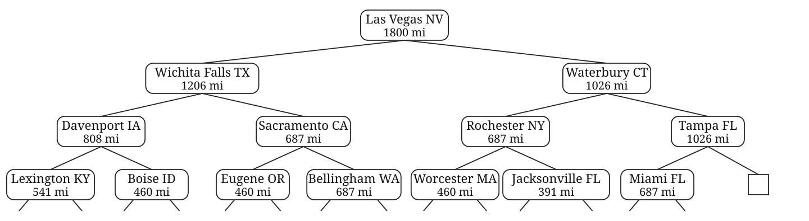
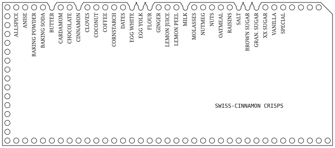
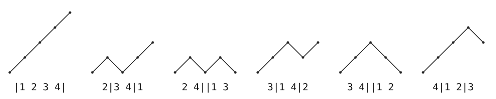

# 6.5 辅助键的查找

主键可以唯一地确定文件中的一条记录, 我们已经完成了对主键查找的研究. 但有些时候, 需要依赖记录中除主键之外的其他一些字段的值来进行查找, 这些其他字段经常被称为记录的辅助键或属性. 例如, 在一个包含某所大学的学生信息的注册文件中, 可能希望查找所有来自俄亥俄州的专业不是数学或统计学的二年级学生, 或者查找所有讲法语的未婚女研究生, 等等.

一般来说, 假定每条记录都包含若干属性, 我们希望查找特定属性取特定值的所有记录. 对所需记录的具体说明称为一个查询. 查询通常限于以下三种类型:

(a) 简单查询, 它给出一个特定属性的一个特定值. 例如, “<code>MAJOR = MATHEMATICS</code>”, 或者 “<code>RESIDENCE.STATE = OHIO</code>”.

(b) 范围查询, 它给出一个特定属性的一个指定的取值范围. 例如, “<code>COST &lt; &#36;18.00</code>”, 或者 “<code>21 &lt; AGE ≤ 23</code>”.

(c) 布尔查询, 它用 AND, OR, NOT 等操作将上述类型结合起来. 例如,

~~~text
(CLASS = SOPHOMORE) AND (RESIDENCE.STATE = OHIO)
AND NOT ((MAJOR = MATHEMATICS) OR (MAJOR = STATISTICS))
~~~

要针对这三种类型的查询找出高效的查找方法已经非常困难了, 所以通常不再考虑更复杂类型的查询. 例如, 一家铁路公司可能有记载它的所有货车当前状态的一个文件, 显然不允许提出这样一个查询: “找出在西雅图 500 英里范围内的所有空闲冷藏货车”, 除非 “到西雅图的距离” 是存储在每条记录中的一个属性, 而不是需要由其他属性推导得出的一个复杂函数. 除了 AND、OR 和 NOT 之外, 其他逻辑量词的使用会引入更多的复杂性, 其复杂程度仅受查询提出者想像力的限制. 例如, 给定一个有关棒球统计信息的文件, 我们可能希望知道晚场比赛中最长的持续安打. 这些例子很复杂, 但只要对一个排列恰当的文件进行一次全面扫描, 仍然可以得到解决. 而另外一些查询就要难得多了——例如, 找出有 5 个或更多个属性的取值完全相同的所有记录对 (没有指定哪些属性必须匹配). 这样的查询可以看作是超出了本书讨论范围的一般编程任务, 当然, 通常可以将这些查询分解为属于这里考虑的问题类型的一些子问题.

在开始研究辅助键查找的各种技术之前, 考虑这个主题的经济效益是非常重要的. 尽管有大量应用都可以放到上文概括的三种查询的一般框架中, 但在这些应用中, 并没有太多真正需要我们将要研究的复杂技术, 其中一些人工完成要比用机器更好一些! 人们攀登珠穆朗玛峰是 “因为它就在那里”, 还因为已经设计出了使攀登成为可能的工具. 与此类似, 在面对一座数据大山时, 人们就会受到一种诱惑: 对于联机实时环境中所能想出的最困难的查询, 要不计成本地用计算机找出答案. 也许可能实现所需要的计算, 但它们并不适用于所有人的应用.

例如, 考虑下面关于辅助键查找的简单方法: 在批量聚集许多查询之后, 可以对整个文件进行顺序查找, 检索出所有相关记录. (“批量聚集” 是指在累积大量查询之前, 不对它们进行任何操作.) 如果文件不是太大, 如果这些查询不需要立即处理, 那么这个方法是十分令人满意的. 甚至对于磁带文件也能使用这个方法, 而且它只是不定时占用计算机, 所以从设备成本的角度来看, 它可能非常经济. 此外, 它甚至可以处理上面讨论的 “到西雅图的距离” 这一类的计算型查询.

有助于辅助键查找的另一个简单方法, 是由人来完成部分工作, 为他们打印出适当的信息索引. 这通常是最合理、最经济的处理方式 (当然, 前提是在打印新索引时, 对旧纸张进行重复使用), 特别是因为当人们能够方便地获取大量数据时, 他们倾向于去注意那些有趣的模式.

有一些应用无法用上述简单方案加以妥善处理, 它们涉及非常大型的文件, 而且在查询这些文件时, 又需要快速获得查询结果. 例如, 如果大量用户持续同时查询文件, 或者这些查询是由机器而不是由人生成的, 那就可能发生上述情况. 本节的目的是, 基于对文件结构的各种不同假定, 探究用传统计算机处理辅助键查找的效果能达到多好. 幸运的是, 随着计算成本的持续大幅度下降, 我们将要讨论的方法在实践中的可行性正在变得越来越高.

人们已经提出了应对这个问题的大量好主意, 但是 (读者可能已经从所有这些预警式注释中猜到了), 这些算法绝对不如主键查找算法那样好. 由于文件与应用的多样性, 我们无法全面讨论已经考虑到的所有可能性, 也无法分析每个算法在典型环境下的特性. 本节的剩余部分将向读者展现人们已经提出的一些基本方法. 在每种具体情况下, 哪种技术组合最为适合, 留给读者的想像力来决定.

**反转文件.** 辅助键查找的第一类重要技术以反转文件的思想为基础. 这并不是要将文件上下颠倒, 而是指将记录与属性的角色颠倒了过来. 我们不是列出一条给定记录的属性, 而是列出具有给定属性的记录.

在日常生活中, 我们经常会遇到反转文件 (其名字可能不同). 例如, 与俄英词典相对应的反转文件是英俄词典. 与本书相对应的反转文件是本书结尾处给出的索引. 会计人员在传统上使用 “双项簿记”, 所有交易都会同时记录在现金账和客户账中, 这样, 当前的现金头寸和当前的客户负债都可以很轻松地得到.

一般来说, 反转文件通常不是单独使用的, 而是与原来的未反转的文件结合使用. 它提供了重复的冗余信息, 以加快辅助键查找的速度. 反转文件的组成部分称为反转列表, 它包含了某个属性具有给定值的所有记录.

和所有列表一样, 反转列表在计算机中可以用很多方式来表示, 而且不同的表示方式适用于不同的场合. 一些辅助键字段只有两个值 (例如, “性别”), 相应的反转列表就非常长; 但其他一些字段通常会有大量的值, 而很少重复 (例如, “电话号码”).

设想一下, 我们希望在电话簿中存储信息, 以便能够根据姓名、电话号码或住址来检查所有项目. 一种解决方案就是直接制作三个独立文件, 分别用于对一种键的查找. 另一种思想是合并这些文件, 制作三个散列表, 用作拉链方法的列表头. 在后一种方案中, 这个文件的每条记录都是三个列表的一个元素, 因此, 它将包含三个链接字段. 这就是 2.2.6 节图 13 中介绍的所谓多列表方法, 下面要对它进行进一步讨论. 第三种可能性是将三个文件合并到一个超文件中, 类似于图书馆卡片目录, 将作者卡、书名卡和主题卡按字母顺序排列在一起.

考虑一下本书索引所使用的格式, 可以得到有关反转列表的表示方法的进一步的想法. 在一些辅助键字段中, 每个属性值通常对应于大约 5 个项目, 对于这种键, 我们只需要给出一个简短的顺序列表, 在键值后面给出记录位置 (类似于书籍索引中的页码). 如果相关记录可能聚集在一起, 那么 “范围说明” 码 (例如, 559–582 页) 是很有用的. 如果可能频繁地重新分配文件中的记录, 那最好在反转文件中使用主键, 而不是记录位置, 这样在位置变化时, 就不再需要进行更新. 例如, 对《圣经》段落的引用总是按章、节给出的, 一些书中的索引是基于段落编号, 而不是基于页号.

所有这些思想都不是特别适用于像 “性别” 这种只有两个值的属性. 在这种情况下当然只需要一个反转列表, 因为非男性就是女性, 反之亦然. 如果每个值与文件中大约一半的项目相关联, 那么反转列表会长得可怕. 但是, 在二进制计算机上, 可以利用一种二进制位串表示, 每个二进制位指定一条特定记录的取值, 就能相当完美地解决这个问题. 因此, 二进制位串 $\mathtt{01001011101}\ldots$ 意味着文件中的第一条记录是关于一位男性的, 第二条是女性, 后面两个是男性, 等等.

这样的方法足以处理有关特定属性值的简单查询了. 稍作扩展就可能处理范围查询, 不过必须使用基于比较的查找方案 (6.2 节) 来代替散列.

对于像 “<code>(MAJOR = MATHEMATICS) AND (RESIDENCE.STATE = OHIO)</code>” 这样的布尔查询, 需要把两个反转列表交织在一起. 有几种方法可以做到这一点, 例如, 如果两个列表都是有序的, 对每个列表进行一次扫描就可以选出所有公共项目. 或者, 可以选择最短的列表, 查看它的每条记录, 检查其他属性. 但这种方法仅对 AND 有效, 对 OR 无效. 而且它对外部文件没有吸引力, 因为它需要对那些不满足查询条件的记录进行许多次访问.

同样的考虑表明: 上文所述的多列表组织方式对于外部文件上的布尔查询也是低效的, 因为它需要进行大量的非必需访问. 例如, 设想一下, 如果本书的索引以多列表方式进行组织, 将会发生什么: 索引中的每一项将仅仅指向提到该主题的最后一页. 然后在每一页上, 会为该页上每个主题另外准备一个索引, 指向该主题上一次出现的位置. 为了找到所有与 “[算法分析] 和 [(外部排序) 或 (外部查找)]” 相关的页面, 我们需要翻动许多页面. 另一方面, 只需要对反转列表进行一些简单操作, 找出满足查询的页面的最小子集, 查看实际出现该索引的仅仅两个页面, 就能解决同样的查询问题.

当反转列表被表示为一个二进制位串时, 简单查询的布尔组合当然很容易执行, 因为计算机能够以较高的速度来处理二进制位串. 在一些混合查询中, 一些属性表示为记录编号的顺序列表, 而另一些属性则表示为二进制位串, 对于这种查询, 不难将顺序列表转换为二进制位串, 然后对这些二进制位串执行布尔操作.

现在给出一个假设的应用的定量示例, 可能会有所帮助. 假定我们有 1000000 条记录, 每条记录的长度是 40 个字符, 文件存储在 MIXTEC 磁盘上, 如 5.4.9 节所述. 因此, 这个文件本身会填充两个磁盘单元, 反转列表可能会多填充几个. 每个磁道包含 5000 个字符=30000 个二进制位, 所以一个特定属性的反转列表最多会占用 34 个磁道. (只有当二进制位串的表示为最短时才会出现这个最大磁道数.) 假定我们有一个相当复杂的查询, 涉及到 10 个反转列表的布尔组合. 在最糟糕的情况下, 我们必须从反转文件中读取 340 个磁道的信息, 总读取时间是 $340\times25$ 毫秒 $=8.5$ 秒. 平均等待延迟大约为读取时间的一半, 但通过精心编程, 有可能消除这个等待时间. 将每个二进制位串列表的第一个磁道存储在一个柱面中, 将每个列表的第二个磁道存储在下一个柱面中, 以此类推, 可以消除大多数寻道时间. 因此, 我们可以估计最长寻道时间大约是 $34\times26$ 毫秒 $\approx0.9$ 秒 (如果涉及到两个独立的磁盘单元, 则这个数值翻倍). 最后, 如果有 $q$ 条记录满足查询, 则需要大约 $q\times(60\text{毫秒 (寻道)}+12.5\text{毫秒 (等待)}+0.2\text{毫秒 (读)})$ 的额外时间来进行提取, 供后续处理. 因此, 为处理这个相当复杂的查询, 对总预期时间的一个乐观估计大约是 $10+0.073q$ 秒. 在假设条件相同但没有使用任何反转文件时, 以最高速度读取整个文件需要大约 210 秒, 两者形成鲜明的对比.

这个例子表明, 在磁盘存储中, 空间最优化与时间最优化是紧密相关的, 处理反转列表的时间大约就是寻找和读取它们所需要的时间.

上述讨论都或多或少地假定, 在查询期间, 文件不会增大或缩小. 如果需要频繁更新, 应当怎么做呢? 在许多应用中, 只要累积一批更新请求, 然后在不需要应答查询的空闲时间里处理它们就可以了. 或者, 如果文件更新操作拥有高优先级, 那么 $B$ 树 (6.2.4 节) 的方法是很有吸引力的. 可以将反转列表的整个集合放到一个大型 $B$ 树中, 并对叶子采取一些特殊约定, 使得分支结点包含键的值, 而叶子既包含键, 又包含记录指针的列表. 文件更新也可以使用下面将要讨论的其他方法进行处理.

**几何数据.** 大量应用需要处理二维或多维空间中的点、线和形状. 对于面向距离的查询, 最早的方法之一是 1972 年由布鲁斯·麦克纳特提出的 “邮局树”. 例如, 假设给定 $x$ 的值, 我们希望处理像 “哪个城市到点 $x$ 的距离最近?” 这样的查询. 麦克纳特树的每个结点对应于一个城市 $y$ 和一个 “测试半径”$r$, 这个结点的左子树, 对应于随后进入树的这个部分的所有城市 $z$, 使得从 $y$ 到 $z$ 的距离 $\le r+\delta$. 类似地, 右子树对应于该距离 $\ge r-\delta$ 的城市. 这里的 $\delta$ 是一个给定的容差. 与 $y$ 的距离介于 $r-\delta$ 与 $r+\delta$ 之间的城市必须进入到两个子树中. 在这样一棵树中进行查找, 使得找出与一个给定点的距离不超过 $\delta$ 的所有城市成为可能. (见图 45.)

图 45　“邮局树” 示例顶端的各个级别. 为了查找接近给定点 $x$ 的所有城市, 从根结点开始: 如果 $x$ 位于拉斯维加斯 1800 英里范围内, 则向左走, 否则向右走. 然后重复这一过程, 直到遇到一个终端结点为止. 树的构造方法确保在这个查找过程中, 将会遇到在 $x$ 的 20 英里范围内的所有城市

麦克纳特和爱德华·布林基于这个思想进行了几次试验, 并且以随机顺序使用了美国大陆上的 231 个人口最多的城市作为示例数据库. 他们以固定的方式缩小测试半径, 向左走时, 用 $0.67r$ 代替 $r$, 向右走时, 用 $0.57r$ 代替, 如果连续两次选取右分支, 则在第二次选取时保持 $r$ 不变. 其结果是, 当 $\delta=20$ 英里时, 树中需要 610 个结点, 当 $\delta=35$ 英里时, 需要 1600 个结点. 在图 45 中给出了他们的较小的树的顶端各级. (在这个树剩下的级别中, 佛罗里达州的奥兰多出现在杰克逊维尔和迈阿密的下面. 某些城市出现得十分频繁, 例如, 有 17 个结点对应于马萨诸塞州的布罗克顿市!)

随着 $\delta$ 的增大, 文件也快速增长, 这意味着邮局树的用途可能非常有限. 我们可以采用一种更好的做法: 直接处理各个点的坐标, 将坐标看作属性或辅助键. 然后, 可以根据这些键的范围执行布尔查询. 例如, 假定文件的记录涉及北美的城市, 而且查询请求给出符合以下条件的所有城市

$$
(21.49^\circ\le\text{纬度}\le37.41^\circ)\quad\text{且}\quad(70.34^\circ\le\text{经度}\le75.72^\circ).
$$

查阅地图可以看出, 有许多城市满足这个纬度范围, 也有许多城市满足这个经度范围, 但几乎没有哪个城市同时满足这两个范围. 这种正交范围查询的一个解决方法是, 相当粗略地划分纬度和经度所有可能的取值集合, 每个属性仅有很少的几个类别 (例如, 截短到下一个较小的 $5^\circ$ 的倍数), 然后为 (纬度, 经度) 的每个复合类准备一个反转列表. 这就类似于一些地图, 为每个局部区域准备一页. 利用 $5^\circ$ 区间, 上述查询将查阅 8 个页面, 即 $(20^\circ,70^\circ),(25^\circ,70^\circ),\ldots,(35^\circ,75^\circ)$. 需要针对这些页面中的每一页来处理范围查询, 或者进入页面中的一个更精细分划, 或者直接查阅这些记录本身, 具体取决于与该页相对应的记录数. 在某种意义上, 这是一种在每个内部结点都有二维分支的树结构.

尼弗格尔特、汉斯·欣登贝格和肯尼思·谢夫西克对这个方法进行了实质性的精心改进, 称之为网格文件 [*ACM Trans. Database Systems* **9** (1984), 38–71]. 如果每个点 $x$ 有 $k$ 个坐标 $(x_1,\ldots,x_k)$, 他们将第 $i$ 个坐标值划分到以下范围

$$
-\infty=g_{i0}<g_{i1}<\cdots<g_{ir_i}=+\infty\tag{1}
$$

并且通过确定满足以下条件的下标 $(j_1,\ldots,j_k)$ 来定位 $x$

$$
0\le j_i<r_i,\qquad g_{ij_i}\le x_i<g_{i(j_i+1)},\qquad1\le i\le k.\tag{2}
$$

有给定的 $(j_1,\ldots,j_k)$ 的值的所有点称为单元格. 相同单元格中各点的记录存储在外部存储器的同一个桶中. 如果每个桶对应于一个 $k$ 维矩形区域或者 “超单元格”, 则也允许桶包含来自若干相邻单元格的点. 有几种不同策略可以用来更新网格边界值 $g_{ij}$、分割或合并桶, 例如, 见克劳斯·欣里希斯,*BIT* **25** (1985), 569–592. 对于带有随机数据的网格文件, 其特性已经由米雷耶·雷尼耶 [*BIT* **25** (1985), 335–357]、弗拉若莱和克劳德·皮埃什 [*JACM* **33** (1986), 371–407, §4.2] 进行了分析.

本特利和拉斐尔·芬克尔引入了一种处理正交范围查询的更简单方法, 它使用一种称为四叉树的结构 [*Acta Informatica* **4** (1974), 1–9]. 在他们的二维构造中, 这样一棵树的每个结点表示一个矩形, 而且在这个矩形中包含各个点中的一个. 共有 4 棵子树, 分别表示原来的矩形相对于给定点坐标的 4 个象限. 与此类似, 在三维构造中, 共有 8 路分支, 这种树有时被称为八叉树. 一个 $k$ 维四叉树具有 $2^k$ 路分支.

随机四叉树的数学分析非常困难, 但是在 1988 年, 两组独立工作的研究人员确定了在一个随机 $k$ 维四叉树中, 插入第 $N$ 个结点的预期时间可渐近表示为

$$
\frac2k\ln N+O(1).\tag{3}
$$

见卢克·德夫洛伊和路易丝·拉福雷,*SICOMP* **19** (1990), 821–832; 弗拉若莱、戈内、克劳德·皮埃什和约翰·罗布森,*Algorithmica* **10** (1993), 473–500. 注意当 $k=1$ 时, 这个结果与关于二叉查找树的插入的著名的公式, 即等式 6.2.2-(5) 一致. 弗拉若莱、吉尔贝·拉贝勒、路易丝·拉福雷和布鲁诺·萨尔维进行了更深入的研究, 事实上证明了, 平均内部路径长度可以表示成优美得令人惊讶的形式

$$
\sum_{l\ge2}\binom Nl(-1)^l\prod_{j=3}^l\left(1-\frac{2^k}{j^k}\right).\tag{4}
$$

因此, 在超几何函数的帮助下, 有可能对随机四叉树作进一步的分析 [见 *Random Structures & Algorithms* **7** (1995), 117–144.]

本特利通过引入 “$k$ 维树”, 进一步地简化了四叉树的表示, 这种树在每个结点上仅有两路分支 [*CACM* **18** (1975), 509–517;*IEEE Transactions* **SE-5** (1979), 333–340]. 1 维树就是 6.2.2 节中的普通二叉查找树. 2 维树与其类似, 但在分支跳转时, 偶数级别上的结点与 $x$ 坐标进行比较, 奇数级别上的结点与 $y$ 坐标进行比较. 一般来说, $k$ 维树具有带 $k$ 个坐标的结点, 在每个级别的分支跳转仅依赖于这些坐标之一. 例如, 我们可以在第 $l$ 级按照第 $(l\bmod k)+1$ 个坐标来进行分支跳转. 有一种规则可以根据记录序号或内存中的位置来打破平局, 可以利用这个规则来确保在任意坐标位置不会有两条记录完全一致. 事实表明, 对于随机增长的 $k$ 维树, 它的平均路径长度和形状分布完全与普通二叉查找树相同, 因为作为其增长基础的假设条件与一维情景完全相同 (见习题 6.2.2-6).

如果文件不动态地变化, 可以通过选择在每个结点进行分支的中间值, 对任意 $N$ 个结点的 $k$ 维树进行平衡, 使得它的高度 $\approx\lg N$. 因此, 我们可以确信, 若干基本类型的查询都会得到高效的处理. 例如, 本特利证明了, 我们可以在 $O(N^{1-t/k})$ 个步骤内标识出具有 $t$ 个指定坐标的所有记录. 如果坐标中的 $t$ 个被限制于子范围内, 而且共有 $q$ 个这样的记录, 我们也可以在最多 $O(tN^{1-1/k}+q)$ 个步骤中找出位于一个给定矩形区域中的所有记录 [李德财和黄泽权,*Acta Informatica* **9** (1977), 23–29]. 事实上, 杰尔姆·弗里德曼、本特利和芬克尔证明了 [*ACM Trans. Math. Software* **3** (1977), 209–226]: 如果给定区域几乎是立方体而且 $q$ 很小, 以及如果为每个结点分支选定的坐标具有最为分散的属性值, 则对这样的一个区域进行查询的平均时间仅仅是 $O(\log N+q)$. 如果查找这种 $k$ 维树的目的是在一个 $k$ 维空间中找出与一个给定点最接近的邻域, 这个公式同样适用.

当 $k$ 维树是随机的, 而不是完美地平衡时, 与 $t$ 个指定坐标的部分匹配的平均运行时间稍有增大, 变为 $\Theta(N^{1-t/k+f(t/k)})$, 这里的函数 $f$ 是由下面的方程隐式定义的

$$
(f(x)+3-x)^x(f(x)+2-x)^{1-x}=2,\tag{5}
$$

而且它非常小: 我们有

$$
0\le f(x)<0.06329\,33881\,23738\,85718\,14011\,27797\,33590\,58170\text{−},\tag{6}
$$

当 $x$ 接近 0.585 时这个函数取最大值 [见弗拉若莱和克劳德·皮埃什,*JACM* **33** (1986), 371–407, §3].

因为几何算法富有美学魅力和极端重要, 所以在求解更高维查找问题和许多相关问题的技术方面取得了极大的进展. 事实上, 从 20 世纪 70 年代开始, 一个新的数学与计算机科学子领域——“计算几何” 就开始快速发展. 由雅各布·古德曼和约瑟夫·奥罗克编辑的 *Handbook of Discrete and Computational Geometry* (Boca Raton, Florida: CRC Press, 1997) 是一本非常出色的参考书, 概括了该领域到 1997 年为止的发展状况.

哈南·萨梅特在两本互为补充的书 *The Design and Analysis of Spatial Data Structures* 和 *Applications of Spatial Data Structures* (Addison-Wesley, 1990) 中, 针对二维与三维物体的重要特例, 对数据结构和算法进行了全面综述. 萨梅特指出, 本特利和芬克尔最初提出的四叉树, 现在称为 “点四叉树” 更为恰当. “四叉树” 这一名称本身, 已经成为一个通用术语, 用于表示几何数据任意层次的分解.

**复合属性.** 有可能将两个或更多个属性组合到一个超属性中. 例如, 将一所大学注册文件的 CLASS 和 MAJOR 字段组合在一起, 可以创建一个 (CLASS, MAJOR) 属性. 这样, 通常可以通过取互不相交的短列表的并集来满足查询, 而不需要取更长列表的交集.

林耀燊进一步发展了属性组合的思想 [*CACM* **13** (1970), 660–665], 他提议自左向右按字典序, 对复合属性的反转列表进行排序, 并制作多份副本, 用一个更为巧妙的方法来排列各个属性. 例如, 假定有 3 个属性 A, B, C, 我们可以构造出 3 个复合属性

$$
\mathtt{(A,B,C)},\qquad\mathtt{(B,C,A)},\qquad\mathtt{(C,A,B)}\tag{7}
$$

并为其中每个属性构造有序的反转列表. (因此, 在第 1 个列表中, 记录以它的 A 值的顺序出现, A 值相同的所有记录按 B 值排序, 然后再按 C 值排序.) 这个组织形式有可能根据 3 个属性的任意组合来满足查询要求. 例如, 具有指定的 A 和 C 值的所有记录都将连续出现在第 3 个列表中.

类似地, 根据 4 个属性 A, B, C, D, 我们可以构造出 6 个复合属性

$$
\mathtt{(A,B,C,D)},\ \mathtt{(B,C,D,A)},\ \mathtt{(B,D,A,C)},\ \mathtt{(C,A,D,B)},\ \mathtt{(C,D,A,B)},\ \mathtt{(D,A,B,C)},\tag{8}
$$

它们足以回答与这些属性中 1 个、2 个、3 个或 4 个值相关的简单查询的所有组合. 有一个通用过程可以由 $n$ 个属性构造出 $\binom nk$ 个复合属性, 其中 $k\le\frac12n$, 使得有最多 $k$ 个、最少 $n-k$ 个 属性值的特定组合的所有记录, 将连续出现在一个复合属性列表中 (见习题 1). 或者, 当一些属性的取值有限时, 可以用更少的组合来达成目的. 例如, 如果 D 是一个仅有两个取值的属性, 则将 D 放在 (7) 之前而获得的 3 个组合

$$
\mathtt{(D,A,B,C)},\qquad\mathtt{(D,B,C,A)},\qquad\mathtt{(D,C,A,B)}\tag{9}
$$

几乎和 (8) 一样好, 而冗余只有一半, 这是因为只需要查看这些列表其中之一的两个位置, 就可以处理那些不依赖于 D 的查询.

**二值属性.** 如果所有属性只有两种取值, 那考虑此类特殊情景是富有指导意义的. 在某种意义上, 这是属性组合的对立面, 因为我们可以把任意值表示为二进制数, 而且把这个数的各个二进制位看作独立的属性. 表 1 给出了一个涉及 “是-否” 属性的典型文件. 在这种情况下, 记录表示所选择的甜饼配方, 属性指定使用哪些配料. 例如, 杏仁风味薄脆饼是用黄油、面粉、牛奶、坚果仁和砂糖制成的. 如果把表 1 看作由 0 和 1 组成的矩阵, 则矩阵的转置就是二进制位串形式下的反转文件.

表 1 的最右边的列用于表示很少出现的 (多个) 特殊项目. 比起为每个项目都设置一列, 这样的方式可以更有效地进行编码. “玉米淀粉” 列也可以同样处理. 与此相对应, 我们可以找出一种更高效的方法来对 “面粉” 列进行编码, 因为它在除蛋白甜饼之外的每一行中都会出现. 不过, 目前我们先将这些考虑因素放在一边, 并直接忽略 “特殊配料” 列.

一个二值属性文件中的基本查询定义为: 该查询请求在特定列为 0、另外一些特定列为 1、其余列中取任意值的所有记录. 用 “\*” 表示任意值, 我们可以把任何基本查询表示为 0、1 和\*的序列. 例如, 设想有一个人喜欢某种椰子饼干, 对巧克力过敏、讨厌茴香, 不喜欢提纯香精, 他可以像下面这样简洁、清楚地表达查询

$$
\mathtt{*0****0**1*******************0},\tag{10}
$$

从表 1 中看出, 美味梅脯条饼正是他想要的东西.

我们将会考虑如何针对基本查询进行文件组织这种一般性的问题, 但在此之前, 非常重要的一点是先来研究一种没有指定 0、仅指定了 1 和\*的特例. 如果假定 1 表示存在的属性, 0 表示不存在的属性, 则这种查询可以称为包含查询, 因为它需要提供所有包含特定属性集的记录. 例如, 在表 1 的食谱中, 既需要发酵粉又需要发酵苏打的, 是浇糖姜汁饼和旧式家常糖饼.

在某些应用中, 提供包含性查询这个特例就足够了. 例如, 在许多人工填卡系统中, 比如 “边缘切口卡” 或 “功能卡”, 就会出现这种情形. 与表 1 相对应的边缘切口卡会针对每种配方提供一张卡片, 针对每种配料打一个孔 (见图 46). 为了处理一个包含查询, 将一组卡片排成整齐的一叠, 如果要包含一个属性, 则在与其相对应的位置中放入一根针. 当升高这些针之后, 具有适当属性的所有卡片都将被选出.

功能卡系统的工作方式与反转文件相似. 在这种情况下, 每个属性都有一张卡片, 对于具有该属性的每条记录, 都在这张卡片的指定位置打一个孔. 因此, 利用一张普通的 80 列卡片, 可以知道 $12\times80=960$ 条记录中有哪些记录具有给定属性. 为了处理包含查询, 选择指定属性的功能卡, 并把它们放在一起. 然后, 光线将会穿过所有与期望记录相对应的所有位置. 这个操作类似于前文介绍的通过求反转的二进制位串的交集来处理布尔查询的方法.

**叠加编码.** 我们特别关注这些人工卡片系统的原因在于人们已经设计了一些精巧的方案来节省边缘切口卡上的空间. 同样的原理也可应用到计算机文件的表示中. 叠加编码是一种类似于散列的技术, 它的发明实际上比散列的发现早了几年. 其思想是将各个属性映射到一个 $n$ 位二进制字段的随机 $k$ 个二进制位的编码中, 并对一条记录中出现的每个属性的编码进行叠加. 对于某个属性集的包含查询可以转换为对相应的叠加的二进制位的编码的包含查询. 有时可能会多出一些满足这个查询的记录, 但这种 “假情报” 的个数在统计上是可控的. [见卡尔文·穆尔斯,*Amer. Chem. Soc. Meeting* **112** (1947 年 9 月), 14E–15E; *American Documentation* **2** (1951), 20–32.]

表 1　具有二值属性的一个文件

<table>
<thead><tr><th></th>
<th style="padding:6px 7px">多香果</th>
<th style="padding:6px 7px">茴香籽</th>
<th style="padding:6px 7px">发酵粉</th>
<th style="padding:6px 7px">发酵苏打</th>
<th style="padding:6px 7px">黄油</th>
<th style="padding:6px 7px">小豆蔻</th>
<th style="padding:6px 7px">巧克力</th>
<th style="padding:6px 7px">桂皮</th>
<th style="padding:6px 7px">丁香</th>
<th style="padding:6px 7px">椰子</th>
<th style="padding:6px 7px">咖啡</th>
<th style="padding:6px 7px">玉米淀粉</th>
<th style="padding:6px 7px">枣</th>
<th style="padding:6px 7px">蛋白</th>
<th style="padding:6px 7px">蛋黄</th>
<th style="padding:6px 7px">面粉</th>
<th style="padding:6px 7px">姜汁</th>
<th style="padding:6px 7px">柠檬汁</th>
<th style="padding:6px 7px">柠檬皮</th>
<th style="padding:6px 7px">牛奶</th>
<th style="padding:6px 7px">糖浆</th>
<th style="padding:6px 7px">肉豆蔻</th>
<th style="padding:6px 7px">坚果仁</th>
<th style="padding:6px 7px">燕麦片</th>
<th style="padding:6px 7px">葡萄干</th>
<th style="padding:6px 7px">盐</th>
<th style="padding:6px 7px">红糖</th>
<th style="padding:6px 7px">砂糖</th>
<th style="padding:6px 7px">面糖</th>
<th style="padding:6px 7px">提纯香精</th>
<th style="padding:6px 7px">特殊配料</th>
</tr></thead>
<tbody>
<tr><th style="font-weight:normal;white-space:nowrap">杏仁风味薄脆饼</th><td style="text-align:center;padding:3px 7px">0</td><td style="text-align:center;padding:3px 7px">0</td><td style="text-align:center;padding:3px 7px">0</td><td style="text-align:center;padding:3px 7px">0</td><td style="text-align:center;padding:3px 7px">1</td><td style="text-align:center;padding:3px 7px">0</td><td style="text-align:center;padding:3px 7px">0</td><td style="text-align:center;padding:3px 7px">0</td><td style="text-align:center;padding:3px 7px">0</td><td style="text-align:center;padding:3px 7px">0</td><td style="text-align:center;padding:3px 7px">0</td><td style="text-align:center;padding:3px 7px">0</td><td style="text-align:center;padding:3px 7px">0</td><td style="text-align:center;padding:3px 7px">0</td><td style="text-align:center;padding:3px 7px">0</td><td style="text-align:center;padding:3px 7px">1</td><td style="text-align:center;padding:3px 7px">0</td><td style="text-align:center;padding:3px 7px">0</td><td style="text-align:center;padding:3px 7px">0</td><td style="text-align:center;padding:3px 7px">1</td><td style="text-align:center;padding:3px 7px">0</td><td style="text-align:center;padding:3px 7px">0</td><td style="text-align:center;padding:3px 7px">1</td><td style="text-align:center;padding:3px 7px">0</td><td style="text-align:center;padding:3px 7px">0</td><td style="text-align:center;padding:3px 7px">0</td><td style="text-align:center;padding:3px 7px">0</td><td style="text-align:center;padding:3px 7px">1</td><td style="text-align:center;padding:3px 7px">0</td><td style="text-align:center;padding:3px 7px">0</td><td style="white-space:nowrap">—</td></tr>
<tr><th style="font-weight:normal;white-space:nowrap">苹果酱香味方饼</th><td style="text-align:center;padding:3px 7px">0</td><td style="text-align:center;padding:3px 7px">0</td><td style="text-align:center;padding:3px 7px">0</td><td style="text-align:center;padding:3px 7px">1</td><td style="text-align:center;padding:3px 7px">1</td><td style="text-align:center;padding:3px 7px">0</td><td style="text-align:center;padding:3px 7px">0</td><td style="text-align:center;padding:3px 7px">1</td><td style="text-align:center;padding:3px 7px">1</td><td style="text-align:center;padding:3px 7px">0</td><td style="text-align:center;padding:3px 7px">0</td><td style="text-align:center;padding:3px 7px">0</td><td style="text-align:center;padding:3px 7px">0</td><td style="text-align:center;padding:3px 7px">1</td><td style="text-align:center;padding:3px 7px">1</td><td style="text-align:center;padding:3px 7px">1</td><td style="text-align:center;padding:3px 7px">0</td><td style="text-align:center;padding:3px 7px">0</td><td style="text-align:center;padding:3px 7px">0</td><td style="text-align:center;padding:3px 7px">0</td><td style="text-align:center;padding:3px 7px">0</td><td style="text-align:center;padding:3px 7px">1</td><td style="text-align:center;padding:3px 7px">1</td><td style="text-align:center;padding:3px 7px">0</td><td style="text-align:center;padding:3px 7px">1</td><td style="text-align:center;padding:3px 7px">0</td><td style="text-align:center;padding:3px 7px">0</td><td style="text-align:center;padding:3px 7px">1</td><td style="text-align:center;padding:3px 7px">1</td><td style="text-align:center;padding:3px 7px">1</td><td style="white-space:nowrap">苹果酱</td></tr>
<tr><th style="font-weight:normal;white-space:nowrap">香蕉燕麦片家常小甜饼</th><td style="text-align:center;padding:3px 7px">0</td><td style="text-align:center;padding:3px 7px">0</td><td style="text-align:center;padding:3px 7px">0</td><td style="text-align:center;padding:3px 7px">1</td><td style="text-align:center;padding:3px 7px">1</td><td style="text-align:center;padding:3px 7px">0</td><td style="text-align:center;padding:3px 7px">0</td><td style="text-align:center;padding:3px 7px">1</td><td style="text-align:center;padding:3px 7px">0</td><td style="text-align:center;padding:3px 7px">0</td><td style="text-align:center;padding:3px 7px">0</td><td style="text-align:center;padding:3px 7px">0</td><td style="text-align:center;padding:3px 7px">0</td><td style="text-align:center;padding:3px 7px">1</td><td style="text-align:center;padding:3px 7px">1</td><td style="text-align:center;padding:3px 7px">1</td><td style="text-align:center;padding:3px 7px">0</td><td style="text-align:center;padding:3px 7px">0</td><td style="text-align:center;padding:3px 7px">0</td><td style="text-align:center;padding:3px 7px">0</td><td style="text-align:center;padding:3px 7px">0</td><td style="text-align:center;padding:3px 7px">1</td><td style="text-align:center;padding:3px 7px">1</td><td style="text-align:center;padding:3px 7px">1</td><td style="text-align:center;padding:3px 7px">0</td><td style="text-align:center;padding:3px 7px">1</td><td style="text-align:center;padding:3px 7px">0</td><td style="text-align:center;padding:3px 7px">1</td><td style="text-align:center;padding:3px 7px">0</td><td style="text-align:center;padding:3px 7px">1</td><td style="white-space:nowrap">香蕉</td></tr>
<tr><th style="font-weight:normal;white-space:nowrap">巧克力薄片小甜饼</th><td style="text-align:center;padding:3px 7px">0</td><td style="text-align:center;padding:3px 7px">0</td><td style="text-align:center;padding:3px 7px">0</td><td style="text-align:center;padding:3px 7px">1</td><td style="text-align:center;padding:3px 7px">1</td><td style="text-align:center;padding:3px 7px">0</td><td style="text-align:center;padding:3px 7px">1</td><td style="text-align:center;padding:3px 7px">0</td><td style="text-align:center;padding:3px 7px">0</td><td style="text-align:center;padding:3px 7px">0</td><td style="text-align:center;padding:3px 7px">0</td><td style="text-align:center;padding:3px 7px">0</td><td style="text-align:center;padding:3px 7px">0</td><td style="text-align:center;padding:3px 7px">1</td><td style="text-align:center;padding:3px 7px">1</td><td style="text-align:center;padding:3px 7px">1</td><td style="text-align:center;padding:3px 7px">0</td><td style="text-align:center;padding:3px 7px">0</td><td style="text-align:center;padding:3px 7px">0</td><td style="text-align:center;padding:3px 7px">0</td><td style="text-align:center;padding:3px 7px">0</td><td style="text-align:center;padding:3px 7px">0</td><td style="text-align:center;padding:3px 7px">1</td><td style="text-align:center;padding:3px 7px">0</td><td style="text-align:center;padding:3px 7px">0</td><td style="text-align:center;padding:3px 7px">1</td><td style="text-align:center;padding:3px 7px">0</td><td style="text-align:center;padding:3px 7px">1</td><td style="text-align:center;padding:3px 7px">0</td><td style="text-align:center;padding:3px 7px">1</td><td style="white-space:nowrap">—</td></tr>
<tr><th style="font-weight:normal;white-space:nowrap">椰子杏仁饼</th><td style="text-align:center;padding:3px 7px">0</td><td style="text-align:center;padding:3px 7px">0</td><td style="text-align:center;padding:3px 7px">1</td><td style="text-align:center;padding:3px 7px">0</td><td style="text-align:center;padding:3px 7px">1</td><td style="text-align:center;padding:3px 7px">0</td><td style="text-align:center;padding:3px 7px">0</td><td style="text-align:center;padding:3px 7px">0</td><td style="text-align:center;padding:3px 7px">0</td><td style="text-align:center;padding:3px 7px">1</td><td style="text-align:center;padding:3px 7px">0</td><td style="text-align:center;padding:3px 7px">0</td><td style="text-align:center;padding:3px 7px">0</td><td style="text-align:center;padding:3px 7px">1</td><td style="text-align:center;padding:3px 7px">1</td><td style="text-align:center;padding:3px 7px">1</td><td style="text-align:center;padding:3px 7px">0</td><td style="text-align:center;padding:3px 7px">0</td><td style="text-align:center;padding:3px 7px">0</td><td style="text-align:center;padding:3px 7px">0</td><td style="text-align:center;padding:3px 7px">0</td><td style="text-align:center;padding:3px 7px">0</td><td style="text-align:center;padding:3px 7px">1</td><td style="text-align:center;padding:3px 7px">0</td><td style="text-align:center;padding:3px 7px">0</td><td style="text-align:center;padding:3px 7px">1</td><td style="text-align:center;padding:3px 7px">0</td><td style="text-align:center;padding:3px 7px">1</td><td style="text-align:center;padding:3px 7px">0</td><td style="text-align:center;padding:3px 7px">1</td><td style="white-space:nowrap">—</td></tr>
<tr><th style="font-weight:normal;white-space:nowrap">奶油乳酪小甜饼</th><td style="text-align:center;padding:3px 7px">0</td><td style="text-align:center;padding:3px 7px">0</td><td style="text-align:center;padding:3px 7px">0</td><td style="text-align:center;padding:3px 7px">0</td><td style="text-align:center;padding:3px 7px">1</td><td style="text-align:center;padding:3px 7px">0</td><td style="text-align:center;padding:3px 7px">1</td><td style="text-align:center;padding:3px 7px">0</td><td style="text-align:center;padding:3px 7px">0</td><td style="text-align:center;padding:3px 7px">0</td><td style="text-align:center;padding:3px 7px">0</td><td style="text-align:center;padding:3px 7px">0</td><td style="text-align:center;padding:3px 7px">0</td><td style="text-align:center;padding:3px 7px">0</td><td style="text-align:center;padding:3px 7px">1</td><td style="text-align:center;padding:3px 7px">1</td><td style="text-align:center;padding:3px 7px">0</td><td style="text-align:center;padding:3px 7px">0</td><td style="text-align:center;padding:3px 7px">0</td><td style="text-align:center;padding:3px 7px">0</td><td style="text-align:center;padding:3px 7px">0</td><td style="text-align:center;padding:3px 7px">0</td><td style="text-align:center;padding:3px 7px">0</td><td style="text-align:center;padding:3px 7px">0</td><td style="text-align:center;padding:3px 7px">0</td><td style="text-align:center;padding:3px 7px">0</td><td style="text-align:center;padding:3px 7px">0</td><td style="text-align:center;padding:3px 7px">1</td><td style="text-align:center;padding:3px 7px">0</td><td style="text-align:center;padding:3px 7px">1</td><td style="white-space:nowrap">奶油乳酪</td></tr>
<tr><th style="font-weight:normal;white-space:nowrap">美味梅脯条饼</th><td style="text-align:center;padding:3px 7px">0</td><td style="text-align:center;padding:3px 7px">0</td><td style="text-align:center;padding:3px 7px">0</td><td style="text-align:center;padding:3px 7px">0</td><td style="text-align:center;padding:3px 7px">1</td><td style="text-align:center;padding:3px 7px">0</td><td style="text-align:center;padding:3px 7px">0</td><td style="text-align:center;padding:3px 7px">0</td><td style="text-align:center;padding:3px 7px">0</td><td style="text-align:center;padding:3px 7px">1</td><td style="text-align:center;padding:3px 7px">0</td><td style="text-align:center;padding:3px 7px">1</td><td style="text-align:center;padding:3px 7px">0</td><td style="text-align:center;padding:3px 7px">1</td><td style="text-align:center;padding:3px 7px">1</td><td style="text-align:center;padding:3px 7px">1</td><td style="text-align:center;padding:3px 7px">0</td><td style="text-align:center;padding:3px 7px">0</td><td style="text-align:center;padding:3px 7px">0</td><td style="text-align:center;padding:3px 7px">0</td><td style="text-align:center;padding:3px 7px">0</td><td style="text-align:center;padding:3px 7px">0</td><td style="text-align:center;padding:3px 7px">1</td><td style="text-align:center;padding:3px 7px">0</td><td style="text-align:center;padding:3px 7px">0</td><td style="text-align:center;padding:3px 7px">1</td><td style="text-align:center;padding:3px 7px">1</td><td style="text-align:center;padding:3px 7px">0</td><td style="text-align:center;padding:3px 7px">0</td><td style="text-align:center;padding:3px 7px">0</td><td style="white-space:nowrap">桔子, 梅脯</td></tr>
<tr><th style="font-weight:normal;white-space:nowrap">双料巧克力糖饼</th><td style="text-align:center;padding:3px 7px">0</td><td style="text-align:center;padding:3px 7px">0</td><td style="text-align:center;padding:3px 7px">0</td><td style="text-align:center;padding:3px 7px">1</td><td style="text-align:center;padding:3px 7px">1</td><td style="text-align:center;padding:3px 7px">0</td><td style="text-align:center;padding:3px 7px">1</td><td style="text-align:center;padding:3px 7px">0</td><td style="text-align:center;padding:3px 7px">0</td><td style="text-align:center;padding:3px 7px">0</td><td style="text-align:center;padding:3px 7px">0</td><td style="text-align:center;padding:3px 7px">0</td><td style="text-align:center;padding:3px 7px">0</td><td style="text-align:center;padding:3px 7px">1</td><td style="text-align:center;padding:3px 7px">1</td><td style="text-align:center;padding:3px 7px">1</td><td style="text-align:center;padding:3px 7px">0</td><td style="text-align:center;padding:3px 7px">0</td><td style="text-align:center;padding:3px 7px">0</td><td style="text-align:center;padding:3px 7px">0</td><td style="text-align:center;padding:3px 7px">0</td><td style="text-align:center;padding:3px 7px">0</td><td style="text-align:center;padding:3px 7px">1</td><td style="text-align:center;padding:3px 7px">0</td><td style="text-align:center;padding:3px 7px">0</td><td style="text-align:center;padding:3px 7px">1</td><td style="text-align:center;padding:3px 7px">0</td><td style="text-align:center;padding:3px 7px">1</td><td style="text-align:center;padding:3px 7px">0</td><td style="text-align:center;padding:3px 7px">0</td><td style="white-space:nowrap">—</td></tr>
<tr><th style="font-weight:normal;white-space:nowrap">甜美条</th><td style="text-align:center;padding:3px 7px">0</td><td style="text-align:center;padding:3px 7px">0</td><td style="text-align:center;padding:3px 7px">1</td><td style="text-align:center;padding:3px 7px">0</td><td style="text-align:center;padding:3px 7px">1</td><td style="text-align:center;padding:3px 7px">0</td><td style="text-align:center;padding:3px 7px">0</td><td style="text-align:center;padding:3px 7px">0</td><td style="text-align:center;padding:3px 7px">0</td><td style="text-align:center;padding:3px 7px">1</td><td style="text-align:center;padding:3px 7px">0</td><td style="text-align:center;padding:3px 7px">0</td><td style="text-align:center;padding:3px 7px">0</td><td style="text-align:center;padding:3px 7px">1</td><td style="text-align:center;padding:3px 7px">1</td><td style="text-align:center;padding:3px 7px">1</td><td style="text-align:center;padding:3px 7px">0</td><td style="text-align:center;padding:3px 7px">0</td><td style="text-align:center;padding:3px 7px">0</td><td style="text-align:center;padding:3px 7px">0</td><td style="text-align:center;padding:3px 7px">0</td><td style="text-align:center;padding:3px 7px">0</td><td style="text-align:center;padding:3px 7px">1</td><td style="text-align:center;padding:3px 7px">0</td><td style="text-align:center;padding:3px 7px">0</td><td style="text-align:center;padding:3px 7px">1</td><td style="text-align:center;padding:3px 7px">1</td><td style="text-align:center;padding:3px 7px">0</td><td style="text-align:center;padding:3px 7px">0</td><td style="text-align:center;padding:3px 7px">1</td><td style="white-space:nowrap">—</td></tr>
<tr><th style="font-weight:normal;white-space:nowrap">带馅半圆形卷饼</th><td style="text-align:center;padding:3px 7px">0</td><td style="text-align:center;padding:3px 7px">0</td><td style="text-align:center;padding:3px 7px">1</td><td style="text-align:center;padding:3px 7px">0</td><td style="text-align:center;padding:3px 7px">1</td><td style="text-align:center;padding:3px 7px">0</td><td style="text-align:center;padding:3px 7px">0</td><td style="text-align:center;padding:3px 7px">0</td><td style="text-align:center;padding:3px 7px">0</td><td style="text-align:center;padding:3px 7px">0</td><td style="text-align:center;padding:3px 7px">0</td><td style="text-align:center;padding:3px 7px">0</td><td style="text-align:center;padding:3px 7px">1</td><td style="text-align:center;padding:3px 7px">1</td><td style="text-align:center;padding:3px 7px">1</td><td style="text-align:center;padding:3px 7px">1</td><td style="text-align:center;padding:3px 7px">0</td><td style="text-align:center;padding:3px 7px">1</td><td style="text-align:center;padding:3px 7px">1</td><td style="text-align:center;padding:3px 7px">0</td><td style="text-align:center;padding:3px 7px">0</td><td style="text-align:center;padding:3px 7px">0</td><td style="text-align:center;padding:3px 7px">1</td><td style="text-align:center;padding:3px 7px">0</td><td style="text-align:center;padding:3px 7px">0</td><td style="text-align:center;padding:3px 7px">1</td><td style="text-align:center;padding:3px 7px">0</td><td style="text-align:center;padding:3px 7px">1</td><td style="text-align:center;padding:3px 7px">0</td><td style="text-align:center;padding:3px 7px">1</td><td style="white-space:nowrap">—</td></tr>
<tr><th style="font-weight:normal;white-space:nowrap">芬斯卡·卡客饼</th><td style="text-align:center;padding:3px 7px">0</td><td style="text-align:center;padding:3px 7px">0</td><td style="text-align:center;padding:3px 7px">0</td><td style="text-align:center;padding:3px 7px">0</td><td style="text-align:center;padding:3px 7px">1</td><td style="text-align:center;padding:3px 7px">0</td><td style="text-align:center;padding:3px 7px">0</td><td style="text-align:center;padding:3px 7px">0</td><td style="text-align:center;padding:3px 7px">0</td><td style="text-align:center;padding:3px 7px">0</td><td style="text-align:center;padding:3px 7px">0</td><td style="text-align:center;padding:3px 7px">0</td><td style="text-align:center;padding:3px 7px">0</td><td style="text-align:center;padding:3px 7px">1</td><td style="text-align:center;padding:3px 7px">1</td><td style="text-align:center;padding:3px 7px">1</td><td style="text-align:center;padding:3px 7px">0</td><td style="text-align:center;padding:3px 7px">0</td><td style="text-align:center;padding:3px 7px">0</td><td style="text-align:center;padding:3px 7px">0</td><td style="text-align:center;padding:3px 7px">0</td><td style="text-align:center;padding:3px 7px">0</td><td style="text-align:center;padding:3px 7px">1</td><td style="text-align:center;padding:3px 7px">0</td><td style="text-align:center;padding:3px 7px">0</td><td style="text-align:center;padding:3px 7px">1</td><td style="text-align:center;padding:3px 7px">0</td><td style="text-align:center;padding:3px 7px">1</td><td style="text-align:center;padding:3px 7px">0</td><td style="text-align:center;padding:3px 7px">0</td><td style="white-space:nowrap">提纯杏仁</td></tr>
<tr><th style="font-weight:normal;white-space:nowrap">浇糖姜汁饼</th><td style="text-align:center;padding:3px 7px">0</td><td style="text-align:center;padding:3px 7px">0</td><td style="text-align:center;padding:3px 7px">1</td><td style="text-align:center;padding:3px 7px">1</td><td style="text-align:center;padding:3px 7px">1</td><td style="text-align:center;padding:3px 7px">0</td><td style="text-align:center;padding:3px 7px">0</td><td style="text-align:center;padding:3px 7px">1</td><td style="text-align:center;padding:3px 7px">1</td><td style="text-align:center;padding:3px 7px">0</td><td style="text-align:center;padding:3px 7px">0</td><td style="text-align:center;padding:3px 7px">0</td><td style="text-align:center;padding:3px 7px">0</td><td style="text-align:center;padding:3px 7px">1</td><td style="text-align:center;padding:3px 7px">1</td><td style="text-align:center;padding:3px 7px">1</td><td style="text-align:center;padding:3px 7px">1</td><td style="text-align:center;padding:3px 7px">0</td><td style="text-align:center;padding:3px 7px">0</td><td style="text-align:center;padding:3px 7px">1</td><td style="text-align:center;padding:3px 7px">1</td><td style="text-align:center;padding:3px 7px">0</td><td style="text-align:center;padding:3px 7px">0</td><td style="text-align:center;padding:3px 7px">0</td><td style="text-align:center;padding:3px 7px">0</td><td style="text-align:center;padding:3px 7px">0</td><td style="text-align:center;padding:3px 7px">1</td><td style="text-align:center;padding:3px 7px">0</td><td style="text-align:center;padding:3px 7px">1</td><td style="text-align:center;padding:3px 7px">0</td><td style="white-space:nowrap">醋</td></tr>
<tr><th style="font-weight:normal;white-space:nowrap">胡桃葡萄干甜饼</th><td style="text-align:center;padding:3px 7px">0</td><td style="text-align:center;padding:3px 7px">0</td><td style="text-align:center;padding:3px 7px">0</td><td style="text-align:center;padding:3px 7px">1</td><td style="text-align:center;padding:3px 7px">1</td><td style="text-align:center;padding:3px 7px">0</td><td style="text-align:center;padding:3px 7px">0</td><td style="text-align:center;padding:3px 7px">1</td><td style="text-align:center;padding:3px 7px">0</td><td style="text-align:center;padding:3px 7px">0</td><td style="text-align:center;padding:3px 7px">1</td><td style="text-align:center;padding:3px 7px">0</td><td style="text-align:center;padding:3px 7px">0</td><td style="text-align:center;padding:3px 7px">1</td><td style="text-align:center;padding:3px 7px">1</td><td style="text-align:center;padding:3px 7px">1</td><td style="text-align:center;padding:3px 7px">0</td><td style="text-align:center;padding:3px 7px">0</td><td style="text-align:center;padding:3px 7px">0</td><td style="text-align:center;padding:3px 7px">0</td><td style="text-align:center;padding:3px 7px">0</td><td style="text-align:center;padding:3px 7px">1</td><td style="text-align:center;padding:3px 7px">0</td><td style="text-align:center;padding:3px 7px">0</td><td style="text-align:center;padding:3px 7px">1</td><td style="text-align:center;padding:3px 7px">1</td><td style="text-align:center;padding:3px 7px">1</td><td style="text-align:center;padding:3px 7px">0</td><td style="text-align:center;padding:3px 7px">0</td><td style="text-align:center;padding:3px 7px">0</td><td style="white-space:nowrap">杏</td></tr>
<tr><th style="font-weight:normal;white-space:nowrap">宝石家常甜饼</th><td style="text-align:center;padding:3px 7px">0</td><td style="text-align:center;padding:3px 7px">0</td><td style="text-align:center;padding:3px 7px">0</td><td style="text-align:center;padding:3px 7px">0</td><td style="text-align:center;padding:3px 7px">1</td><td style="text-align:center;padding:3px 7px">0</td><td style="text-align:center;padding:3px 7px">0</td><td style="text-align:center;padding:3px 7px">0</td><td style="text-align:center;padding:3px 7px">0</td><td style="text-align:center;padding:3px 7px">0</td><td style="text-align:center;padding:3px 7px">0</td><td style="text-align:center;padding:3px 7px">0</td><td style="text-align:center;padding:3px 7px">0</td><td style="text-align:center;padding:3px 7px">1</td><td style="text-align:center;padding:3px 7px">1</td><td style="text-align:center;padding:3px 7px">1</td><td style="text-align:center;padding:3px 7px">0</td><td style="text-align:center;padding:3px 7px">0</td><td style="text-align:center;padding:3px 7px">0</td><td style="text-align:center;padding:3px 7px">0</td><td style="text-align:center;padding:3px 7px">0</td><td style="text-align:center;padding:3px 7px">0</td><td style="text-align:center;padding:3px 7px">1</td><td style="text-align:center;padding:3px 7px">0</td><td style="text-align:center;padding:3px 7px">0</td><td style="text-align:center;padding:3px 7px">0</td><td style="text-align:center;padding:3px 7px">1</td><td style="text-align:center;padding:3px 7px">0</td><td style="text-align:center;padding:3px 7px">0</td><td style="text-align:center;padding:3px 7px">1</td><td style="white-space:nowrap">葡萄肉冻</td></tr>
<tr><th style="font-weight:normal;white-space:nowrap">环形甜薄饼</th><td style="text-align:center;padding:3px 7px">0</td><td style="text-align:center;padding:3px 7px">0</td><td style="text-align:center;padding:3px 7px">0</td><td style="text-align:center;padding:3px 7px">0</td><td style="text-align:center;padding:3px 7px">1</td><td style="text-align:center;padding:3px 7px">0</td><td style="text-align:center;padding:3px 7px">0</td><td style="text-align:center;padding:3px 7px">1</td><td style="text-align:center;padding:3px 7px">0</td><td style="text-align:center;padding:3px 7px">0</td><td style="text-align:center;padding:3px 7px">0</td><td style="text-align:center;padding:3px 7px">0</td><td style="text-align:center;padding:3px 7px">0</td><td style="text-align:center;padding:3px 7px">1</td><td style="text-align:center;padding:3px 7px">1</td><td style="text-align:center;padding:3px 7px">1</td><td style="text-align:center;padding:3px 7px">0</td><td style="text-align:center;padding:3px 7px">0</td><td style="text-align:center;padding:3px 7px">0</td><td style="text-align:center;padding:3px 7px">0</td><td style="text-align:center;padding:3px 7px">0</td><td style="text-align:center;padding:3px 7px">0</td><td style="text-align:center;padding:3px 7px">0</td><td style="text-align:center;padding:3px 7px">0</td><td style="text-align:center;padding:3px 7px">0</td><td style="text-align:center;padding:3px 7px">1</td><td style="text-align:center;padding:3px 7px">0</td><td style="text-align:center;padding:3px 7px">1</td><td style="text-align:center;padding:3px 7px">0</td><td style="text-align:center;padding:3px 7px">1</td><td style="white-space:nowrap">色拉油</td></tr>
<tr><th style="font-weight:normal;white-space:nowrap">波纹套圈饼</th><td style="text-align:center;padding:3px 7px">0</td><td style="text-align:center;padding:3px 7px">0</td><td style="text-align:center;padding:3px 7px">0</td><td style="text-align:center;padding:3px 7px">0</td><td style="text-align:center;padding:3px 7px">1</td><td style="text-align:center;padding:3px 7px">1</td><td style="text-align:center;padding:3px 7px">0</td><td style="text-align:center;padding:3px 7px">0</td><td style="text-align:center;padding:3px 7px">0</td><td style="text-align:center;padding:3px 7px">0</td><td style="text-align:center;padding:3px 7px">0</td><td style="text-align:center;padding:3px 7px">0</td><td style="text-align:center;padding:3px 7px">0</td><td style="text-align:center;padding:3px 7px">1</td><td style="text-align:center;padding:3px 7px">1</td><td style="text-align:center;padding:3px 7px">1</td><td style="text-align:center;padding:3px 7px">0</td><td style="text-align:center;padding:3px 7px">0</td><td style="text-align:center;padding:3px 7px">1</td><td style="text-align:center;padding:3px 7px">0</td><td style="text-align:center;padding:3px 7px">0</td><td style="text-align:center;padding:3px 7px">0</td><td style="text-align:center;padding:3px 7px">1</td><td style="text-align:center;padding:3px 7px">0</td><td style="text-align:center;padding:3px 7px">0</td><td style="text-align:center;padding:3px 7px">0</td><td style="text-align:center;padding:3px 7px">0</td><td style="text-align:center;padding:3px 7px">1</td><td style="text-align:center;padding:3px 7px">0</td><td style="text-align:center;padding:3px 7px">0</td><td style="white-space:nowrap">—</td></tr>
<tr><th style="font-weight:normal;white-space:nowrap">圆腿肉面包</th><td style="text-align:center;padding:3px 7px">1</td><td style="text-align:center;padding:3px 7px">0</td><td style="text-align:center;padding:3px 7px">0</td><td style="text-align:center;padding:3px 7px">1</td><td style="text-align:center;padding:3px 7px">0</td><td style="text-align:center;padding:3px 7px">0</td><td style="text-align:center;padding:3px 7px">0</td><td style="text-align:center;padding:3px 7px">1</td><td style="text-align:center;padding:3px 7px">1</td><td style="text-align:center;padding:3px 7px">0</td><td style="text-align:center;padding:3px 7px">0</td><td style="text-align:center;padding:3px 7px">0</td><td style="text-align:center;padding:3px 7px">0</td><td style="text-align:center;padding:3px 7px">1</td><td style="text-align:center;padding:3px 7px">1</td><td style="text-align:center;padding:3px 7px">1</td><td style="text-align:center;padding:3px 7px">0</td><td style="text-align:center;padding:3px 7px">1</td><td style="text-align:center;padding:3px 7px">1</td><td style="text-align:center;padding:3px 7px">1</td><td style="text-align:center;padding:3px 7px">0</td><td style="text-align:center;padding:3px 7px">1</td><td style="text-align:center;padding:3px 7px">1</td><td style="text-align:center;padding:3px 7px">0</td><td style="text-align:center;padding:3px 7px">0</td><td style="text-align:center;padding:3px 7px">1</td><td style="text-align:center;padding:3px 7px">1</td><td style="text-align:center;padding:3px 7px">0</td><td style="text-align:center;padding:3px 7px">1</td><td style="text-align:center;padding:3px 7px">0</td><td style="white-space:nowrap">蜂蜜</td></tr>
<tr><th style="font-weight:normal;white-space:nowrap">蛋白甜饼</th><td style="text-align:center;padding:3px 7px">0</td><td style="text-align:center;padding:3px 7px">0</td><td style="text-align:center;padding:3px 7px">0</td><td style="text-align:center;padding:3px 7px">0</td><td style="text-align:center;padding:3px 7px">1</td><td style="text-align:center;padding:3px 7px">0</td><td style="text-align:center;padding:3px 7px">0</td><td style="text-align:center;padding:3px 7px">0</td><td style="text-align:center;padding:3px 7px">0</td><td style="text-align:center;padding:3px 7px">0</td><td style="text-align:center;padding:3px 7px">0</td><td style="text-align:center;padding:3px 7px">0</td><td style="text-align:center;padding:3px 7px">1</td><td style="text-align:center;padding:3px 7px">1</td><td style="text-align:center;padding:3px 7px">0</td><td style="text-align:center;padding:3px 7px">0</td><td style="text-align:center;padding:3px 7px">0</td><td style="text-align:center;padding:3px 7px">0</td><td style="text-align:center;padding:3px 7px">0</td><td style="text-align:center;padding:3px 7px">0</td><td style="text-align:center;padding:3px 7px">0</td><td style="text-align:center;padding:3px 7px">0</td><td style="text-align:center;padding:3px 7px">1</td><td style="text-align:center;padding:3px 7px">0</td><td style="text-align:center;padding:3px 7px">0</td><td style="text-align:center;padding:3px 7px">0</td><td style="text-align:center;padding:3px 7px">0</td><td style="text-align:center;padding:3px 7px">1</td><td style="text-align:center;padding:3px 7px">0</td><td style="text-align:center;padding:3px 7px">0</td><td style="white-space:nowrap">蜜饯樱桃</td></tr>
<tr><th style="font-weight:normal;white-space:nowrap">摩拉维亚香味家常甜饼</th><td style="text-align:center;padding:3px 7px">1</td><td style="text-align:center;padding:3px 7px">0</td><td style="text-align:center;padding:3px 7px">0</td><td style="text-align:center;padding:3px 7px">1</td><td style="text-align:center;padding:3px 7px">1</td><td style="text-align:center;padding:3px 7px">0</td><td style="text-align:center;padding:3px 7px">0</td><td style="text-align:center;padding:3px 7px">1</td><td style="text-align:center;padding:3px 7px">1</td><td style="text-align:center;padding:3px 7px">0</td><td style="text-align:center;padding:3px 7px">0</td><td style="text-align:center;padding:3px 7px">0</td><td style="text-align:center;padding:3px 7px">0</td><td style="text-align:center;padding:3px 7px">1</td><td style="text-align:center;padding:3px 7px">0</td><td style="text-align:center;padding:3px 7px">1</td><td style="text-align:center;padding:3px 7px">1</td><td style="text-align:center;padding:3px 7px">0</td><td style="text-align:center;padding:3px 7px">0</td><td style="text-align:center;padding:3px 7px">0</td><td style="text-align:center;padding:3px 7px">1</td><td style="text-align:center;padding:3px 7px">1</td><td style="text-align:center;padding:3px 7px">0</td><td style="text-align:center;padding:3px 7px">0</td><td style="text-align:center;padding:3px 7px">0</td><td style="text-align:center;padding:3px 7px">1</td><td style="text-align:center;padding:3px 7px">1</td><td style="text-align:center;padding:3px 7px">0</td><td style="text-align:center;padding:3px 7px">1</td><td style="text-align:center;padding:3px 7px">0</td><td style="white-space:nowrap">—</td></tr>
<tr><th style="font-weight:normal;white-space:nowrap">燕麦枣椰条饼</th><td style="text-align:center;padding:3px 7px">0</td><td style="text-align:center;padding:3px 7px">0</td><td style="text-align:center;padding:3px 7px">0</td><td style="text-align:center;padding:3px 7px">1</td><td style="text-align:center;padding:3px 7px">1</td><td style="text-align:center;padding:3px 7px">0</td><td style="text-align:center;padding:3px 7px">0</td><td style="text-align:center;padding:3px 7px">0</td><td style="text-align:center;padding:3px 7px">0</td><td style="text-align:center;padding:3px 7px">0</td><td style="text-align:center;padding:3px 7px">0</td><td style="text-align:center;padding:3px 7px">0</td><td style="text-align:center;padding:3px 7px">1</td><td style="text-align:center;padding:3px 7px">0</td><td style="text-align:center;padding:3px 7px">0</td><td style="text-align:center;padding:3px 7px">1</td><td style="text-align:center;padding:3px 7px">0</td><td style="text-align:center;padding:3px 7px">1</td><td style="text-align:center;padding:3px 7px">0</td><td style="text-align:center;padding:3px 7px">0</td><td style="text-align:center;padding:3px 7px">0</td><td style="text-align:center;padding:3px 7px">0</td><td style="text-align:center;padding:3px 7px">1</td><td style="text-align:center;padding:3px 7px">1</td><td style="text-align:center;padding:3px 7px">0</td><td style="text-align:center;padding:3px 7px">1</td><td style="text-align:center;padding:3px 7px">1</td><td style="text-align:center;padding:3px 7px">1</td><td style="text-align:center;padding:3px 7px">0</td><td style="text-align:center;padding:3px 7px">0</td><td style="white-space:nowrap">—</td></tr>
<tr><th style="font-weight:normal;white-space:nowrap">旧式家常糖饼</th><td style="text-align:center;padding:3px 7px">0</td><td style="text-align:center;padding:3px 7px">0</td><td style="text-align:center;padding:3px 7px">1</td><td style="text-align:center;padding:3px 7px">1</td><td style="text-align:center;padding:3px 7px">1</td><td style="text-align:center;padding:3px 7px">0</td><td style="text-align:center;padding:3px 7px">0</td><td style="text-align:center;padding:3px 7px">0</td><td style="text-align:center;padding:3px 7px">0</td><td style="text-align:center;padding:3px 7px">0</td><td style="text-align:center;padding:3px 7px">0</td><td style="text-align:center;padding:3px 7px">0</td><td style="text-align:center;padding:3px 7px">0</td><td style="text-align:center;padding:3px 7px">1</td><td style="text-align:center;padding:3px 7px">1</td><td style="text-align:center;padding:3px 7px">1</td><td style="text-align:center;padding:3px 7px">0</td><td style="text-align:center;padding:3px 7px">0</td><td style="text-align:center;padding:3px 7px">0</td><td style="text-align:center;padding:3px 7px">0</td><td style="text-align:center;padding:3px 7px">0</td><td style="text-align:center;padding:3px 7px">1</td><td style="text-align:center;padding:3px 7px">0</td><td style="text-align:center;padding:3px 7px">0</td><td style="text-align:center;padding:3px 7px">0</td><td style="text-align:center;padding:3px 7px">1</td><td style="text-align:center;padding:3px 7px">0</td><td style="text-align:center;padding:3px 7px">1</td><td style="text-align:center;padding:3px 7px">0</td><td style="text-align:center;padding:3px 7px">1</td><td style="white-space:nowrap">酸奶</td></tr>
<tr><th style="font-weight:normal;white-space:nowrap">花生黄油风车饼</th><td style="text-align:center;padding:3px 7px">0</td><td style="text-align:center;padding:3px 7px">0</td><td style="text-align:center;padding:3px 7px">0</td><td style="text-align:center;padding:3px 7px">1</td><td style="text-align:center;padding:3px 7px">1</td><td style="text-align:center;padding:3px 7px">0</td><td style="text-align:center;padding:3px 7px">1</td><td style="text-align:center;padding:3px 7px">0</td><td style="text-align:center;padding:3px 7px">0</td><td style="text-align:center;padding:3px 7px">0</td><td style="text-align:center;padding:3px 7px">0</td><td style="text-align:center;padding:3px 7px">0</td><td style="text-align:center;padding:3px 7px">0</td><td style="text-align:center;padding:3px 7px">1</td><td style="text-align:center;padding:3px 7px">1</td><td style="text-align:center;padding:3px 7px">1</td><td style="text-align:center;padding:3px 7px">0</td><td style="text-align:center;padding:3px 7px">0</td><td style="text-align:center;padding:3px 7px">0</td><td style="text-align:center;padding:3px 7px">0</td><td style="text-align:center;padding:3px 7px">0</td><td style="text-align:center;padding:3px 7px">0</td><td style="text-align:center;padding:3px 7px">0</td><td style="text-align:center;padding:3px 7px">0</td><td style="text-align:center;padding:3px 7px">0</td><td style="text-align:center;padding:3px 7px">1</td><td style="text-align:center;padding:3px 7px">1</td><td style="text-align:center;padding:3px 7px">0</td><td style="text-align:center;padding:3px 7px">0</td><td style="text-align:center;padding:3px 7px">1</td><td style="white-space:nowrap">花生黄油</td></tr>
<tr><th style="font-weight:normal;white-space:nowrap">裙状燕尾饼</th><td style="text-align:center;padding:3px 7px">0</td><td style="text-align:center;padding:3px 7px">0</td><td style="text-align:center;padding:3px 7px">0</td><td style="text-align:center;padding:3px 7px">1</td><td style="text-align:center;padding:3px 7px">1</td><td style="text-align:center;padding:3px 7px">0</td><td style="text-align:center;padding:3px 7px">0</td><td style="text-align:center;padding:3px 7px">0</td><td style="text-align:center;padding:3px 7px">0</td><td style="text-align:center;padding:3px 7px">0</td><td style="text-align:center;padding:3px 7px">0</td><td style="text-align:center;padding:3px 7px">0</td><td style="text-align:center;padding:3px 7px">0</td><td style="text-align:center;padding:3px 7px">0</td><td style="text-align:center;padding:3px 7px">0</td><td style="text-align:center;padding:3px 7px">1</td><td style="text-align:center;padding:3px 7px">0</td><td style="text-align:center;padding:3px 7px">0</td><td style="text-align:center;padding:3px 7px">0</td><td style="text-align:center;padding:3px 7px">0</td><td style="text-align:center;padding:3px 7px">0</td><td style="text-align:center;padding:3px 7px">0</td><td style="text-align:center;padding:3px 7px">0</td><td style="text-align:center;padding:3px 7px">0</td><td style="text-align:center;padding:3px 7px">0</td><td style="text-align:center;padding:3px 7px">1</td><td style="text-align:center;padding:3px 7px">0</td><td style="text-align:center;padding:3px 7px">0</td><td style="text-align:center;padding:3px 7px">1</td><td style="text-align:center;padding:3px 7px">1</td><td style="white-space:nowrap">—</td></tr>
<tr><th style="font-weight:normal;white-space:nowrap">圣诞小酥饼</th><td style="text-align:center;padding:3px 7px">1</td><td style="text-align:center;padding:3px 7px">1</td><td style="text-align:center;padding:3px 7px">1</td><td style="text-align:center;padding:3px 7px">0</td><td style="text-align:center;padding:3px 7px">0</td><td style="text-align:center;padding:3px 7px">1</td><td style="text-align:center;padding:3px 7px">0</td><td style="text-align:center;padding:3px 7px">1</td><td style="text-align:center;padding:3px 7px">1</td><td style="text-align:center;padding:3px 7px">0</td><td style="text-align:center;padding:3px 7px">1</td><td style="text-align:center;padding:3px 7px">0</td><td style="text-align:center;padding:3px 7px">0</td><td style="text-align:center;padding:3px 7px">1</td><td style="text-align:center;padding:3px 7px">1</td><td style="text-align:center;padding:3px 7px">1</td><td style="text-align:center;padding:3px 7px">0</td><td style="text-align:center;padding:3px 7px">0</td><td style="text-align:center;padding:3px 7px">1</td><td style="text-align:center;padding:3px 7px">0</td><td style="text-align:center;padding:3px 7px">0</td><td style="text-align:center;padding:3px 7px">1</td><td style="text-align:center;padding:3px 7px">1</td><td style="text-align:center;padding:3px 7px">0</td><td style="text-align:center;padding:3px 7px">0</td><td style="text-align:center;padding:3px 7px">1</td><td style="text-align:center;padding:3px 7px">1</td><td style="text-align:center;padding:3px 7px">0</td><td style="text-align:center;padding:3px 7px">1</td><td style="text-align:center;padding:3px 7px">0</td><td style="white-space:nowrap">香橼, 肉豆蔻干皮, 胡椒</td></tr>
<tr><th style="font-weight:normal;white-space:nowrap">苏格兰燕麦脆饼</th><td style="text-align:center;padding:3px 7px">0</td><td style="text-align:center;padding:3px 7px">0</td><td style="text-align:center;padding:3px 7px">0</td><td style="text-align:center;padding:3px 7px">0</td><td style="text-align:center;padding:3px 7px">1</td><td style="text-align:center;padding:3px 7px">0</td><td style="text-align:center;padding:3px 7px">0</td><td style="text-align:center;padding:3px 7px">0</td><td style="text-align:center;padding:3px 7px">0</td><td style="text-align:center;padding:3px 7px">0</td><td style="text-align:center;padding:3px 7px">0</td><td style="text-align:center;padding:3px 7px">0</td><td style="text-align:center;padding:3px 7px">0</td><td style="text-align:center;padding:3px 7px">0</td><td style="text-align:center;padding:3px 7px">0</td><td style="text-align:center;padding:3px 7px">1</td><td style="text-align:center;padding:3px 7px">0</td><td style="text-align:center;padding:3px 7px">0</td><td style="text-align:center;padding:3px 7px">0</td><td style="text-align:center;padding:3px 7px">0</td><td style="text-align:center;padding:3px 7px">0</td><td style="text-align:center;padding:3px 7px">0</td><td style="text-align:center;padding:3px 7px">0</td><td style="text-align:center;padding:3px 7px">1</td><td style="text-align:center;padding:3px 7px">0</td><td style="text-align:center;padding:3px 7px">1</td><td style="text-align:center;padding:3px 7px">0</td><td style="text-align:center;padding:3px 7px">1</td><td style="text-align:center;padding:3px 7px">0</td><td style="text-align:center;padding:3px 7px">1</td><td style="white-space:nowrap">—</td></tr>
<tr><th style="font-weight:normal;white-space:nowrap">星状脆饼</th><td style="text-align:center;padding:3px 7px">0</td><td style="text-align:center;padding:3px 7px">0</td><td style="text-align:center;padding:3px 7px">0</td><td style="text-align:center;padding:3px 7px">0</td><td style="text-align:center;padding:3px 7px">1</td><td style="text-align:center;padding:3px 7px">0</td><td style="text-align:center;padding:3px 7px">0</td><td style="text-align:center;padding:3px 7px">0</td><td style="text-align:center;padding:3px 7px">0</td><td style="text-align:center;padding:3px 7px">0</td><td style="text-align:center;padding:3px 7px">0</td><td style="text-align:center;padding:3px 7px">0</td><td style="text-align:center;padding:3px 7px">0</td><td style="text-align:center;padding:3px 7px">0</td><td style="text-align:center;padding:3px 7px">0</td><td style="text-align:center;padding:3px 7px">1</td><td style="text-align:center;padding:3px 7px">0</td><td style="text-align:center;padding:3px 7px">0</td><td style="text-align:center;padding:3px 7px">0</td><td style="text-align:center;padding:3px 7px">0</td><td style="text-align:center;padding:3px 7px">0</td><td style="text-align:center;padding:3px 7px">0</td><td style="text-align:center;padding:3px 7px">0</td><td style="text-align:center;padding:3px 7px">0</td><td style="text-align:center;padding:3px 7px">0</td><td style="text-align:center;padding:3px 7px">0</td><td style="text-align:center;padding:3px 7px">1</td><td style="text-align:center;padding:3px 7px">0</td><td style="text-align:center;padding:3px 7px">0</td><td style="text-align:center;padding:3px 7px">0</td><td style="white-space:nowrap">—</td></tr>
<tr><th style="font-weight:normal;white-space:nowrap">春饼</th><td style="text-align:center;padding:3px 7px">0</td><td style="text-align:center;padding:3px 7px">1</td><td style="text-align:center;padding:3px 7px">1</td><td style="text-align:center;padding:3px 7px">0</td><td style="text-align:center;padding:3px 7px">0</td><td style="text-align:center;padding:3px 7px">0</td><td style="text-align:center;padding:3px 7px">0</td><td style="text-align:center;padding:3px 7px">0</td><td style="text-align:center;padding:3px 7px">0</td><td style="text-align:center;padding:3px 7px">0</td><td style="text-align:center;padding:3px 7px">0</td><td style="text-align:center;padding:3px 7px">0</td><td style="text-align:center;padding:3px 7px">0</td><td style="text-align:center;padding:3px 7px">1</td><td style="text-align:center;padding:3px 7px">1</td><td style="text-align:center;padding:3px 7px">1</td><td style="text-align:center;padding:3px 7px">0</td><td style="text-align:center;padding:3px 7px">0</td><td style="text-align:center;padding:3px 7px">1</td><td style="text-align:center;padding:3px 7px">0</td><td style="text-align:center;padding:3px 7px">0</td><td style="text-align:center;padding:3px 7px">0</td><td style="text-align:center;padding:3px 7px">0</td><td style="text-align:center;padding:3px 7px">0</td><td style="text-align:center;padding:3px 7px">0</td><td style="text-align:center;padding:3px 7px">1</td><td style="text-align:center;padding:3px 7px">0</td><td style="text-align:center;padding:3px 7px">1</td><td style="text-align:center;padding:3px 7px">1</td><td style="text-align:center;padding:3px 7px">0</td><td style="white-space:nowrap">—</td></tr>
<tr><th style="font-weight:normal;white-space:nowrap">斯普里兹家常甜饼</th><td style="text-align:center;padding:3px 7px">0</td><td style="text-align:center;padding:3px 7px">0</td><td style="text-align:center;padding:3px 7px">0</td><td style="text-align:center;padding:3px 7px">0</td><td style="text-align:center;padding:3px 7px">1</td><td style="text-align:center;padding:3px 7px">0</td><td style="text-align:center;padding:3px 7px">0</td><td style="text-align:center;padding:3px 7px">0</td><td style="text-align:center;padding:3px 7px">0</td><td style="text-align:center;padding:3px 7px">0</td><td style="text-align:center;padding:3px 7px">0</td><td style="text-align:center;padding:3px 7px">0</td><td style="text-align:center;padding:3px 7px">0</td><td style="text-align:center;padding:3px 7px">0</td><td style="text-align:center;padding:3px 7px">1</td><td style="text-align:center;padding:3px 7px">1</td><td style="text-align:center;padding:3px 7px">0</td><td style="text-align:center;padding:3px 7px">0</td><td style="text-align:center;padding:3px 7px">0</td><td style="text-align:center;padding:3px 7px">0</td><td style="text-align:center;padding:3px 7px">0</td><td style="text-align:center;padding:3px 7px">0</td><td style="text-align:center;padding:3px 7px">0</td><td style="text-align:center;padding:3px 7px">0</td><td style="text-align:center;padding:3px 7px">0</td><td style="text-align:center;padding:3px 7px">1</td><td style="text-align:center;padding:3px 7px">0</td><td style="text-align:center;padding:3px 7px">1</td><td style="text-align:center;padding:3px 7px">0</td><td style="text-align:center;padding:3px 7px">1</td><td style="white-space:nowrap">—</td></tr>
<tr><th style="font-weight:normal;white-space:nowrap">瑞典套圈饼</th><td style="text-align:center;padding:3px 7px">0</td><td style="text-align:center;padding:3px 7px">0</td><td style="text-align:center;padding:3px 7px">0</td><td style="text-align:center;padding:3px 7px">0</td><td style="text-align:center;padding:3px 7px">1</td><td style="text-align:center;padding:3px 7px">0</td><td style="text-align:center;padding:3px 7px">0</td><td style="text-align:center;padding:3px 7px">0</td><td style="text-align:center;padding:3px 7px">0</td><td style="text-align:center;padding:3px 7px">0</td><td style="text-align:center;padding:3px 7px">0</td><td style="text-align:center;padding:3px 7px">0</td><td style="text-align:center;padding:3px 7px">0</td><td style="text-align:center;padding:3px 7px">1</td><td style="text-align:center;padding:3px 7px">1</td><td style="text-align:center;padding:3px 7px">1</td><td style="text-align:center;padding:3px 7px">0</td><td style="text-align:center;padding:3px 7px">0</td><td style="text-align:center;padding:3px 7px">0</td><td style="text-align:center;padding:3px 7px">1</td><td style="text-align:center;padding:3px 7px">0</td><td style="text-align:center;padding:3px 7px">0</td><td style="text-align:center;padding:3px 7px">0</td><td style="text-align:center;padding:3px 7px">0</td><td style="text-align:center;padding:3px 7px">0</td><td style="text-align:center;padding:3px 7px">0</td><td style="text-align:center;padding:3px 7px">0</td><td style="text-align:center;padding:3px 7px">1</td><td style="text-align:center;padding:3px 7px">0</td><td style="text-align:center;padding:3px 7px">0</td><td style="white-space:nowrap">—</td></tr>
<tr><th style="font-weight:normal;white-space:nowrap">瑞士桂皮香脆片饼</th><td style="text-align:center;padding:3px 7px">0</td><td style="text-align:center;padding:3px 7px">0</td><td style="text-align:center;padding:3px 7px">0</td><td style="text-align:center;padding:3px 7px">0</td><td style="text-align:center;padding:3px 7px">1</td><td style="text-align:center;padding:3px 7px">0</td><td style="text-align:center;padding:3px 7px">0</td><td style="text-align:center;padding:3px 7px">1</td><td style="text-align:center;padding:3px 7px">0</td><td style="text-align:center;padding:3px 7px">0</td><td style="text-align:center;padding:3px 7px">0</td><td style="text-align:center;padding:3px 7px">0</td><td style="text-align:center;padding:3px 7px">0</td><td style="text-align:center;padding:3px 7px">1</td><td style="text-align:center;padding:3px 7px">1</td><td style="text-align:center;padding:3px 7px">1</td><td style="text-align:center;padding:3px 7px">0</td><td style="text-align:center;padding:3px 7px">0</td><td style="text-align:center;padding:3px 7px">0</td><td style="text-align:center;padding:3px 7px">1</td><td style="text-align:center;padding:3px 7px">0</td><td style="text-align:center;padding:3px 7px">0</td><td style="text-align:center;padding:3px 7px">0</td><td style="text-align:center;padding:3px 7px">0</td><td style="text-align:center;padding:3px 7px">0</td><td style="text-align:center;padding:3px 7px">1</td><td style="text-align:center;padding:3px 7px">1</td><td style="text-align:center;padding:3px 7px">1</td><td style="text-align:center;padding:3px 7px">0</td><td style="text-align:center;padding:3px 7px">0</td><td style="white-space:nowrap">—</td></tr>
<tr><th style="font-weight:normal;white-space:nowrap">太妃条</th><td style="text-align:center;padding:3px 7px">0</td><td style="text-align:center;padding:3px 7px">0</td><td style="text-align:center;padding:3px 7px">0</td><td style="text-align:center;padding:3px 7px">0</td><td style="text-align:center;padding:3px 7px">1</td><td style="text-align:center;padding:3px 7px">0</td><td style="text-align:center;padding:3px 7px">1</td><td style="text-align:center;padding:3px 7px">0</td><td style="text-align:center;padding:3px 7px">0</td><td style="text-align:center;padding:3px 7px">0</td><td style="text-align:center;padding:3px 7px">0</td><td style="text-align:center;padding:3px 7px">0</td><td style="text-align:center;padding:3px 7px">0</td><td style="text-align:center;padding:3px 7px">0</td><td style="text-align:center;padding:3px 7px">1</td><td style="text-align:center;padding:3px 7px">1</td><td style="text-align:center;padding:3px 7px">0</td><td style="text-align:center;padding:3px 7px">0</td><td style="text-align:center;padding:3px 7px">0</td><td style="text-align:center;padding:3px 7px">0</td><td style="text-align:center;padding:3px 7px">0</td><td style="text-align:center;padding:3px 7px">0</td><td style="text-align:center;padding:3px 7px">1</td><td style="text-align:center;padding:3px 7px">0</td><td style="text-align:center;padding:3px 7px">0</td><td style="text-align:center;padding:3px 7px">0</td><td style="text-align:center;padding:3px 7px">1</td><td style="text-align:center;padding:3px 7px">0</td><td style="text-align:center;padding:3px 7px">0</td><td style="text-align:center;padding:3px 7px">1</td><td style="white-space:nowrap">—</td></tr>
<tr><th style="font-weight:normal;white-space:nowrap">香精果仁冰镇家常饼</th><td style="text-align:center;padding:3px 7px">0</td><td style="text-align:center;padding:3px 7px">0</td><td style="text-align:center;padding:3px 7px">1</td><td style="text-align:center;padding:3px 7px">0</td><td style="text-align:center;padding:3px 7px">1</td><td style="text-align:center;padding:3px 7px">0</td><td style="text-align:center;padding:3px 7px">0</td><td style="text-align:center;padding:3px 7px">0</td><td style="text-align:center;padding:3px 7px">0</td><td style="text-align:center;padding:3px 7px">0</td><td style="text-align:center;padding:3px 7px">0</td><td style="text-align:center;padding:3px 7px">0</td><td style="text-align:center;padding:3px 7px">0</td><td style="text-align:center;padding:3px 7px">1</td><td style="text-align:center;padding:3px 7px">1</td><td style="text-align:center;padding:3px 7px">1</td><td style="text-align:center;padding:3px 7px">0</td><td style="text-align:center;padding:3px 7px">0</td><td style="text-align:center;padding:3px 7px">0</td><td style="text-align:center;padding:3px 7px">0</td><td style="text-align:center;padding:3px 7px">0</td><td style="text-align:center;padding:3px 7px">0</td><td style="text-align:center;padding:3px 7px">1</td><td style="text-align:center;padding:3px 7px">0</td><td style="text-align:center;padding:3px 7px">0</td><td style="text-align:center;padding:3px 7px">1</td><td style="text-align:center;padding:3px 7px">0</td><td style="text-align:center;padding:3px 7px">1</td><td style="text-align:center;padding:3px 7px">0</td><td style="text-align:center;padding:3px 7px">1</td><td style="white-space:nowrap">—</td></tr>
</tbody>
</table>

参考:*McCall’s Cook Book* (New York: Random House, 1963), 第 9 章.

**图 46** 一张边缘切口卡

作为叠加编码的一个例子, 让我们再次考虑表 1, 但这次仅考虑调味品, 而不考虑像发酵粉、起酥油、蛋和面粉之类的基本配料. 如果我们把 10 个二进制位的一个字段中的 2 个二进制位的随机编码指定给每种调味品的属性, 并叠加这些编码, 将会得到如表 2 所示的内容. 例如, 通过叠加巧克力、坚果仁和提纯香精的编码, 可以得到巧克力薄片小脆饼的编码项

$$
\mathtt{0010001000}\mid\mathtt{0000100100}\mid\mathtt{0000001001}
=\mathtt{0010101101}.
$$

这些编码的叠加也会生成一些虚构的属性, 在本例中是多香果、蜜饯樱桃、葡萄肉冻、花生黄油和胡椒. 它们会导致在某些查询中出现假情报 (而且它们也提出了创造一种称为 “假情报家常饼” 的新配方!).

实际上, 叠加编码在表 2 中的工作并不是特别有效, 因为该表是一个具有大量属性的小例子. 事实上, 苹果酱香味方饼对于每个查询中都将是一个假情报, 因为它是通过叠加 7 个编码得到的, 而结果是覆盖了全部 10 个位置. 而圣诞小酥饼还要更糟糕一些, 它是通过叠加 12 个编码获得的. 另一方面, 表 2 在某些方面的表现好得令人惊讶, 例如, 如果我们尝试查询 “提纯香精” 时, 只有圣诞小酥饼的记录会作为假情报出现.

如果我们有, 比如说, 一个 32 个二进制位的字段, 以及由 $\binom{32}3=4960$ 个不同属性组成的集合, 允许每条记录具有多达 6 个属性, 通过指定 32 个二进制位中的 3 个二进制位来对每个属性进行编码, 这样就可以得到一个更为恰当的叠加编码示例. 在这种情况下, 如果假定每条记录有 6 个随机选定的属性, 则在一个包含查询中出现假情报的概率是

$$
\begin{array}{ll}
\text{在1个属性上是}&0.07948358,\\
\text{在2个属性上是}&0.00708659,\\
\text{在3个属性上是}&0.00067094,\\
\text{在4个属性上是}&0.00006786,\\
\text{在5个属性上是}&0.00000728,\\
\text{在6个属性上是}&0.00000082.
\end{array}\tag{11}
$$

**表 2** 叠加编码的一个例子

<table>
<thead><tr><th colspan="4">各个调味品的编码</th></tr></thead>
<tbody>
<tr><td style="white-space:nowrap">提纯杏仁</td><td style="white-space:nowrap"><code>0100000001</code></td><td style="white-space:nowrap">枣</td><td style="white-space:nowrap"><code>1000000100</code></td></tr>
<tr><td style="white-space:nowrap">多香果</td><td style="white-space:nowrap"><code>0000100001</code></td><td style="white-space:nowrap">姜汁</td><td style="white-space:nowrap"><code>0000110000</code></td></tr>
<tr><td style="white-space:nowrap">茴香籽</td><td style="white-space:nowrap"><code>0000011000</code></td><td style="white-space:nowrap">蜂蜜</td><td style="white-space:nowrap"><code>0000000011</code></td></tr>
<tr><td style="white-space:nowrap">苹果酱</td><td style="white-space:nowrap"><code>0010010000</code></td><td style="white-space:nowrap">柠檬汁</td><td style="white-space:nowrap"><code>1000100000</code></td></tr>
<tr><td style="white-space:nowrap">杏</td><td style="white-space:nowrap"><code>1000010000</code></td><td style="white-space:nowrap">柠檬皮</td><td style="white-space:nowrap"><code>0011000000</code></td></tr>
<tr><td style="white-space:nowrap">香蕉</td><td style="white-space:nowrap"><code>0000100010</code></td><td style="white-space:nowrap">肉豆蔻干皮</td><td style="white-space:nowrap"><code>0000010100</code></td></tr>
<tr><td style="white-space:nowrap">蜜饯樱桃</td><td style="white-space:nowrap"><code>0000101000</code></td><td style="white-space:nowrap">糖浆</td><td style="white-space:nowrap"><code>1001000000</code></td></tr>
<tr><td style="white-space:nowrap">小豆蔻</td><td style="white-space:nowrap"><code>1000000001</code></td><td style="white-space:nowrap">肉豆蔻</td><td style="white-space:nowrap"><code>0000010010</code></td></tr>
<tr><td style="white-space:nowrap">巧克力</td><td style="white-space:nowrap"><code>0010001000</code></td><td style="white-space:nowrap">坚果仁</td><td style="white-space:nowrap"><code>0000100100</code></td></tr>
<tr><td style="white-space:nowrap">桂皮</td><td style="white-space:nowrap"><code>1000000010</code></td><td style="white-space:nowrap">桔子</td><td style="white-space:nowrap"><code>0100000100</code></td></tr>
<tr><td style="white-space:nowrap">香橼</td><td style="white-space:nowrap"><code>0100000010</code></td><td style="white-space:nowrap">花生黄油</td><td style="white-space:nowrap"><code>0000000101</code></td></tr>
<tr><td style="white-space:nowrap">丁香</td><td style="white-space:nowrap"><code>0001100000</code></td><td style="white-space:nowrap">胡椒</td><td style="white-space:nowrap"><code>0010000100</code></td></tr>
<tr><td style="white-space:nowrap">椰子</td><td style="white-space:nowrap"><code>0001010000</code></td><td style="white-space:nowrap">梅脯</td><td style="white-space:nowrap"><code>0010000010</code></td></tr>
<tr><td style="white-space:nowrap">咖啡</td><td style="white-space:nowrap"><code>0001000100</code></td><td style="white-space:nowrap">葡萄干</td><td style="white-space:nowrap"><code>0101000000</code></td></tr>
<tr><td style="white-space:nowrap">葡萄肉冻</td><td style="white-space:nowrap"><code>0010000001</code></td><td style="white-space:nowrap">提纯香精</td><td style="white-space:nowrap"><code>0000001001</code></td></tr>
</tbody></table>

<table>
<thead><tr><th colspan="4">叠加编码</th></tr></thead>
<tbody>
<tr><td style="white-space:nowrap">杏仁风味薄脆饼</td><td style="white-space:nowrap"><code>0000100100</code></td><td style="white-space:nowrap">圆腿肉面包</td><td style="white-space:nowrap"><code>1011110111</code></td></tr>
<tr><td style="white-space:nowrap">苹果酱香味方饼</td><td style="white-space:nowrap"><code>1111111111</code></td><td style="white-space:nowrap">蛋白甜饼</td><td style="white-space:nowrap"><code>1000101100</code></td></tr>
<tr><td style="white-space:nowrap">香蕉燕麦片家常小甜饼</td><td style="white-space:nowrap"><code>1000111111</code></td><td style="white-space:nowrap">摩拉维亚香味家常甜饼</td><td style="white-space:nowrap"><code>1001110011</code></td></tr>
<tr><td style="white-space:nowrap">巧克力薄片小甜饼</td><td style="white-space:nowrap"><code>0010101101</code></td><td style="white-space:nowrap">燕麦枣椰条饼</td><td style="white-space:nowrap"><code>1000100100</code></td></tr>
<tr><td style="white-space:nowrap">椰子杏仁饼</td><td style="white-space:nowrap"><code>0001111101</code></td><td style="white-space:nowrap">旧式家常糖饼</td><td style="white-space:nowrap"><code>0000011011</code></td></tr>
<tr><td style="white-space:nowrap">奶油乳酪小甜饼</td><td style="white-space:nowrap"><code>0010001001</code></td><td style="white-space:nowrap">花生黄油风车饼</td><td style="white-space:nowrap"><code>0010001101</code></td></tr>
<tr><td style="white-space:nowrap">美味梅脯条饼</td><td style="white-space:nowrap"><code>0111110110</code></td><td style="white-space:nowrap">裙状燕尾饼</td><td style="white-space:nowrap"><code>0000001001</code></td></tr>
<tr><td style="white-space:nowrap">双料巧克力糖饼</td><td style="white-space:nowrap"><code>0010101100</code></td><td style="white-space:nowrap">圣诞小酥饼</td><td style="white-space:nowrap"><code>1111111111</code></td></tr>
<tr><td style="white-space:nowrap">甜美条</td><td style="white-space:nowrap"><code>0001111101</code></td><td style="white-space:nowrap">苏格兰燕麦脆饼</td><td style="white-space:nowrap"><code>0000001001</code></td></tr>
<tr><td style="white-space:nowrap">带馅半圆形卷饼</td><td style="white-space:nowrap"><code>1011101101</code></td><td style="white-space:nowrap">星状脆饼</td><td style="white-space:nowrap"><code>0000000000</code></td></tr>
<tr><td style="white-space:nowrap">芬斯卡·卡客饼</td><td style="white-space:nowrap"><code>0100100101</code></td><td style="white-space:nowrap">春饼</td><td style="white-space:nowrap"><code>0011011000</code></td></tr>
<tr><td style="white-space:nowrap">浇糖姜汁饼</td><td style="white-space:nowrap"><code>1001110010</code></td><td style="white-space:nowrap">斯普里兹家常甜饼</td><td style="white-space:nowrap"><code>0000001001</code></td></tr>
<tr><td style="white-space:nowrap">胡桃葡萄干甜饼</td><td style="white-space:nowrap"><code>1101010110</code></td><td style="white-space:nowrap">瑞典套圈饼</td><td style="white-space:nowrap"><code>0000000000</code></td></tr>
<tr><td style="white-space:nowrap">宝石家常甜饼</td><td style="white-space:nowrap"><code>0010101101</code></td><td style="white-space:nowrap">瑞士桂皮香脆片饼</td><td style="white-space:nowrap"><code>1000000010</code></td></tr>
<tr><td style="white-space:nowrap">环形甜薄饼</td><td style="white-space:nowrap"><code>1000001011</code></td><td style="white-space:nowrap">太妃条</td><td style="white-space:nowrap"><code>0010101101</code></td></tr>
<tr><td style="white-space:nowrap">波纹套圈饼</td><td style="white-space:nowrap"><code>1011100101</code></td><td style="white-space:nowrap">香精果仁冰镇家常饼</td><td style="white-space:nowrap"><code>0000101101</code></td></tr>
</tbody></table>

因此, 如果有不真正满足 2 个属性的查询的 $M$ 条记录, 则大约有 $0.007M$ 条记录的叠加编码会虚假地与 2 个指定的属性的编码的所有二进制位相匹配. (在习题 4 中将会计算这些概率.) 反转文件中所需要的总的二进制位只是记录数的 32 倍, 不到在原来的文件中确定这些属性所需要的二进制位的一半.

如果使用精心选择的非随机编码, 则如威廉·考茨和辛格尔顿所证明的 [*IEEE Trans.* **IT-10** (1964), 363–377], 有可能在叠加编码中完全避免出现假情报. 他们的构造之一在习题 16 中给出.

马尔科姆·哈里森观察到, 叠加编码可用于加快文本查找的速度 [*CACM* **14** (1971), 777–779]. 假定我们希望找出一个特定字符串在一大篇文本中的所有出现位置, 但又不用像在算法 6.3P 中那样构造一个大型表. 而且假定, 文本被划分为包含 (比如说)50 个字符的行 $c_1c_2\ldots c_{50}$. 哈里森建议对 49 对 $c_1c_2,c_2c_3,\ldots,c_{49}c_{50}$ 中的每一对进行编码, 把它们散列到介于 (比如说)0 与 127 之间的一个数. 所以, 行 $c_1c_2\ldots c_{50}$ 的 “特征” 是 128 位的二进制位串 $b_0b_1\ldots b_{127}$, 其中, 当且仅当对于某个 $j$ 有 $h(c_jc_{j+1})=i$ 时, $b_i=1$.

如果现在希望在一个名为 HAYSTACK 的大型文本文件中查找单词 NEEDLE 出现的所有位置, 只需要查看其特征在 $h(\mathtt{NE}),h(\mathtt{EE}),h(\mathtt{ED}),h(\mathtt{DL}),h(\mathtt{LE})$ 等位置包含二进制位 1 的所有行. 假定散列函数是随机的, 一个随机行在其特征中包含所有这些二进制位的概率仅为 0.00341 (见习题 4), 因此, 5 个反转列表的二进制位串的交集可以快速找出所有包含 NEEDLE 的行, 而且只有少量的假情报.

在这个应用中, 有关随机性的假设实际上并不是非常合理, 因为典型的文本中总是存在大量冗余. 英文单词中相邻字母对的分布有着高度的偏向性. 例如, 放弃所有包含空格的字符对 $c_jc_{j+1}$ 可能会很有帮助, 因为空格的出现通常要比所有其他符号都常见得多.

叠加编码在查找问题中的另一个有趣的应用是由伯顿·布卢姆提出的 [*CACM* **13** (1970), 422–426]. 尽管他的方法最适合在本节进行讨论, 但实际上适用于主键查找. 设想涉及大型数据库的一个查找应用, 当查找失败时不需要进行计算. 例如, 我们可能希望查看某个人的信用评级或者护照号码, 如果文件中没有找到这个人的记录, 那就不需要再深入调查. 类似地, 在计算机排版应用中, 可能有一个简单算法, 可以为大多数单词正确添加连字符, 但对于大约 50 000 个例外单词会发生错误. 如果没有在例外文件中找到某个单词, 就能够放心地使用这个简单算法.

在此类情景中, 有可能在内存中维护一个二进制位表, 从而可以认为未在该文件中出现的大多数键是不存在的, 而无须对外部存储器进行任何访问. 方法如下: 设内部二进制位表是 $b_0b_1\ldots b_{M-1}$, 其中 $M$ 相当大. 对于文件中的每个键 $K_j$, 计算 $k$ 个独立的散列函数 $h_1(K_j),\ldots,h_k(K_j)$, 并把相应的 $k$ 个 $b$ 设置为 1. (这 $k$ 个值不必是不同的.) 因此, 当且仅当对于某些 $j$ 和 $l$ 有 $h_l(K_j)=i$ 时, $b_i=1$. 现在来确定一个查找参数 $K$ 是否在外部文件中, 首先判断, 对于 $1\le l\le k$, 是否有 $b_{h_l(K)}=1$. 如果不是, 则不需要访问外部存储器. 如果是, 而且适当地选择了 $k$ 和 $M$, 一种传统的查找算法也许就能找到 $K$. 当文件中有 $N$ 条记录时, 出现假情报的概率大约是 $(1-e^{-kN/M})^k$. 在某种意义上, 布卢姆的方法把整个文件看作一条记录, 以主键作为存在的属性, 在一个包含 $M$ 个二进制位的大型字段中进行叠加编码.

古斯塔夫森还提出了叠加编码的另外一种变体 [博士论文 (南卡罗来纳大学, 1969 年)]. 假设我们有 $N$ 条记录, 而且每条记录具有从 10 000 种可能的属性的集合中挑选出来的 6 个属性. 例如, 这些记录可能表示技术论文, 属性可能是描述文章的关键词. 设 $h$ 是一个散列函数, 把每个属性映射到介于 0 和 15 之间的一个数. 如果一条记录具有属性 $a_1,a_2,\ldots,a_6$, 古斯塔夫森建议把这个记录映射为 16 位二进制数 $b_0b_1\ldots b_{15}$, 其中, 当且仅当对于某些 $j$ 有 $h(a_j)=i$ 时, $b_i=1$. 此外, 如果用这个方法得到的各个 $b$ 中只有 $k$ 个等于 1, 这里 $k<6$, 则利用某个随机方法提供另外 $6-k$ 个 1 (不一定依赖于这个记录本身). 共有 $\binom{16}6=8008$ 个 16 个二进制位的编码中恰好 6 个 1 出现, 而且如果幸运的话, 大约有 $N/8008$ 条记录被映射到每个值. 我们可以维护 8008 个记录列表, 使用适当的公式, 直接计算与 $b_0b_1\ldots b_{15}$ 对应的地址. 事实上, 如果 1 出现在位置 $0\le p_1<p_2<\cdots<p_6$, 则函数

$$
\binom{p_1}1+\binom{p_2}2+\cdots+\binom{p_6}6
$$

会将每个串 $b_0b_1\ldots b_{15}$ 转换为介于 0 和 8007 之间的唯一的数, 我们在习题 1.2.6-56 和习题 2.2.6-7 中已经看到了这一点.

现在, 如果希望找出具有三个特定属性 $A_1,A_2,A_3$ 的所有记录, 我们计算 $h(A_1),h(A_2),h(A_3)$. 假设这三个值互不相同, 则只需要查看存储在 $\binom{13}3=286$ 个列表中的记录, 其二进制编码 $b_0b_1\ldots b_{15}$ 在这三个位置包含 1. 换句话说, 在查找中, 只需要查看 $286/8008\approx3.6\%$ 的记录.

关于叠加编码的一个精彩讲解, 还有它在大型电话簿数据库中的应用, 见查尔斯·罗伯茨的论文 [*Proc. IEEE* **67** (1979), 1624–1642]. 詹姆斯·马林和丹尼尔·马戈利亚什讨论了它在拼写检查软件中的应用 [*Software Practice & Exper.* **20** (1990), 625–630].

**组合散列.** 上文刚刚介绍的古斯塔夫森的方法, 基础思想是找出某种方法把记录映射到内存位置, 使得只有较少的位置与一个特定的查询相关联. 但是他的方法仅适用于各条记录具有很少属性时的包含查询. 李维斯特在 1971 年发现了另外一种映射方法, 用于处理像 (10) 那样由 0、1 和\*组成的任意基本查询. [见 *SICOMP* **5** (1976), 19–50.]

首先假定我们希望针对所有六个字母的英文单词编写一本纵横字谜字典. 一个典型的查询可以是, 比如说, 要求提供具有 N\*\*D\*E 形式的所有单词, 并且得到答复{NEEDLE, NIDDLE, NODDLE, NOODLE, NUDDLE}. 我们可以很完美地解决这个问题: 维护 $2^{12}$ 个列表, 把单词 NEEDLE 放到以下列表编号中

$$
h(\mathtt N)\,h(\mathtt E)\,h(\mathtt E)\,h(\mathtt D)\,h(\mathtt L)\,h(\mathtt E).
$$

这里的 $h$ 是把每个字母转换为 2 位二进制数的散列函数, 我们把这 6 个数放在一起, 得到一个表示为 12 位二进制数的列表地址. 然后, 只需要查看 4096 个列表中的 64 个, 就可以为查询 N\*\*D\*E 提供结果.

类似地, 假设有 1 000 000 条记录, 各包含 10 个辅助键, 其中每个辅助键有非常多的可能取值. 我们可以把辅助键为 $(K_1,K_2,\ldots,K_{10})$ 的记录映射到 20 位二进制数

$$
h(K_1)h(K_2)\ldots h(K_{10}),\tag{12}
$$

其中 $h$ 是把每个辅助键转换为 2 位二进制数的散列函数, (12) 表示把这 10 个数并排放在一起. 这个方案把 1 000 000 条记录映射到 $2^{20}=1\,048\,576$ 个可能的值, 而且我们可以把总体映射看作一个 $M=2^{20}$ 的散列函数, 可以使用拉链来解决冲突. 如果我们想查找任意 5 个辅助键具有指定值的所有记录, 只需要查看 $2^{10}$ 个列表, 与 (12) 中 5 个未确定的 2 位二进制数相对应. 因此, 平均只需要查看大约 $1000=\sqrt N$ 条记录. (有泽诚 [*J. Inf. Proc. Soc. Japan* **12** (1971), 163–167] 和巴里·德怀尔 (未发表) 提出了一个类似方法. 德怀尔建议使用比 (12) 更灵活的映射方法, 即

$$
\bigl(h_1(K_1)+h_2(K_2)+\cdots+h_{10}(K_{10})\bigr)\bmod M,
$$

其中 $M$ 是任何合适的数, $h_i$ 是任意散列函数, 其形式可能是 $w_iK_i$, $w_i$ 是 “随机” 的.)

李维斯特进一步发展了这个思想, 使得在许多情况下都具备以下条件. 假设有 $N\approx2^n$ 条记录, 每条记录有 $m$ 个辅助键. 每条记录通过这样一种方式被映射到表示为 $n$ 位二进制数的散列地址, 即, 如果一个查询中有 $k$ 个键没有具体指定取值, 则会查询到大约 $N^{k/m}$ 个散列地址. 本节讨论的所有其他方法 (古斯塔夫森的方法除外), 都需要阶为 $N$ 的步骤进行检索, 尽管比例常数很小. 当 $N$ 足够大时, 李维斯特的方法会更快, 而且不需要反转文件.

但是, 我们必须首先定义一个适当的映射, 才能应用这个技术. 这里有一个参数较小的示例, 其中 $m=4,n=3$, 所有的辅助键都是二值的. 我们可以把具有 4 个二进制位的各个记录映射到 8 个地址:

$$
\begin{array}{ll}
\mathtt{*001}\to0&\mathtt{*110}\to4\\
\mathtt{0*00}\to1&\mathtt{1*11}\to5\\
\mathtt{10*0}\to2&\mathtt{01*1}\to6\\
\mathtt{110*}\to3&\mathtt{001*}\to7
\end{array}\tag{13}
$$

查看这个表格后可以发现, 所有与查询 $0***$ 相对应的记录被映射到位置 0, 1, 4, 6, 7. 而且类似地, 任何具有三个\*的基本查询恰好对应到 5 个位置. 具有两个\*的基本查询各自对应到 3 个位置, 而具有一个\*的基本查询对应到 1 个或 2 个位置, 平均为 $(8\times1+24\times2)/32=1.75$. 因此, 我们有

$$
\begin{array}{cc}
\text{查询中未确定的二进制位数}&\text{要查找的位置个数}\\
4&8=8^{4/4}\\
3&5\approx8^{3/4}\\
2&3\approx8^{2/4}\\
1&1.75\approx8^{1/4}\\
0&1=8^{0/4}
\end{array}\tag{14}
$$

当然, 这是一个很小的例子, 通过硬算处理它更容易一些. 但它可以引出一些不平凡的应用, 因为在 $m=4r$ 和 $n=3r$ 时也可以使用它: 把辅助键分成 $r$ 组, 每组 4 个二进制位, 对每组应用 (13), 从而把 $4r$ 个二进制位的记录映射到 $2^{3r}\approx N$ 个位置. 得到的映射具有我们想要的性质: 对于 $m$ 个二进制位, 如果一个查询对其中的 $k$ 位不加指定, 则它对应于大约 $N^{k/m}$ 个位置. (见习题 6.)

安德里斯·布劳沃已经找到一个很有吸引力的方法 [*SICOMP* **28** (1999), 1970–1971], 采用类似于 (13) 的一个映射, 把 8 个二进制位压缩为 5 个二进制位. 每个 8 个二进制位的字节恰好属于以下 32 类之一:

$$
\begin{array}{llll}
\mathtt{0*000*0*}&\mathtt{01*0**11}&\mathtt{00*11**1}&\mathtt{*11**101}\\
\mathtt{1*000*0*}&\mathtt{11*0**11}&\mathtt{10*11**1}&\mathtt{*11**010}\\
\mathtt{0*010*0*}&\mathtt{01*1**11}&\mathtt{00*0*01*}&\mathtt{*10*0*10}\\
\mathtt{1*010*0*}&\mathtt{11*1**11}&\mathtt{10*0*01*}&\mathtt{*10*1*01}\\
\mathtt{0*10*1*0}&\mathtt{0*1*000*}&\mathtt{*01*01*1}&\mathtt{*0*1001*}\\
\mathtt{1*10*1*0}&\mathtt{1*1*000*}&\mathtt{*10*10*0}&\mathtt{*0*0100*}\\
\mathtt{0*11*1*0}&\mathtt{0*0*11*0}&\mathtt{*00*011*}&\mathtt{*0*011*1}\\
\mathtt{1*11*1*0}&\mathtt{1*0*11*0}&\mathtt{*11*100*}&\mathtt{*0*110*0}
\end{array}\tag{15}
$$

这个设计中的\*是这样安排的, 即每行有 3 个, 每列有 12 个. 习题 18 解释了如何得到类似的方案, 把具有 (比如说)$m=4^r$ 个二进制位的记录压缩为具有 $n=3^r$ 个二进制位的地址. 在实践中, 将会使用大小为 $b$ 的桶, 而且可以取 $N\approx2^nb$. 为了讲述的简单性, 上述讨论中已经使用了 $b=1$ 的情景.

李维斯特还提出了处理基本查询的另外一个简单方法. 假设我们有 (比如说)$N\approx2^{10}$ 条记录, 每条记录有 30 个二进制位, 我们希望回答像 (10) 那样的任意的 30 个二进制位的基本查询. 于是, 可以简单地把这 30 个二进制位分成三个 10 个二进制位的字段, 并保持三个大小为 $M=2^{10}$ 的独立的散列表. 每个记录存储了三次, 分别存储在与该记录的三个字段的二进制位布局相对应的列表中. 在适当的条件下, 每个列表将包含大约一个元素. 给定一个带有 $k$ 个未指定的二进制位的基本查询, 则这些字段中至少有一个具有 $\lfloor k/3\rfloor$ 或更少的未指定的二进制位.

因此, 为了答复这一查询, 最多需要查看 $2^{\lfloor k/3\rfloor}\approx N^{k/30}$ 个列表. 或者, 我们可以使用任何其他技术来处理选定字段中的基本查询.

**广义检索结构.** 基于类似于 6.3 节的检索结构的数据结构, 李维斯特接着提出了另外一个方法. 我们可以让广义两路检索结构的每个内部结点指明它表示的是记录中的哪个二进制位. 例如, 对于表 1 的数据, 可以让检索结构的根结点表示提纯香精, 于是左子检索结构对应于 16 个不含提纯香精的甜饼配方, 而右子检索结构则表示 16 个使用提纯香精的配方. 这个 16–16 划分恰好将文件二等分. 我们可以采用类似的方式来处理每个子文件. 当一个子文件变得足够小时, 就用一个终端结点表示它.

要处理一个基本查询, 首先从检索结构的根结点开始. 在查找一个广义检索结构时, 如果它的根结点指定了一个查询是 0 或 1 的属性, 则分别查找左、右子检索结构. 如果查询中这个位置的二进制位是\*, 则查找两个子检索结构.

假设属性不是二值的, 但是使用二进制来表示它们. 我们可以使用以下方法来构造一个检索结构: 首先查看属性 1 的第 1 个二进制位, 然后是属性 2 的第 1 个二进制位, …, 属性 $m$ 的第 1 个二进制位, 然后是属性 1 的第 2 个二进制位, 以此类推. 这样一个结构叫做 “$m$ 维检索结构”, 类似于 $m$ 维树 ($m$ 维树是通过比较, 而不是查看二进制位, 来进行分支跳转). 弗拉若莱和克劳德·皮埃什已经证明了, 当未被指定的属性占 $k/m$ 时, 要回答 $N$ 结点随机 $m$ 维检索结构中的部分匹配查询, 平均时间是 $\Theta(N^{k/m})$[*JACM* **33** (1986), 371–407, §4.1]. 维尔纳·沙兴格已经计算了它的方差 [*Random Structures & Algorithms* **7** (1995), 81–95].

对于数字查找树的 $m$ 维版本和 6.3 节的 Patricia 树, 也可以设计类似算法. 这些结构在平衡方面要比 $m$ 维检索结构稍好一些, 彼得·基尔申霍费尔和赫尔穆特·普罗丁格已经对它们进行了分析 [*Random Structures & Algorithms* **5** (1994), 123–134].

**\*平衡归档方案.** 信息检索的另外一个组合方法, 是基于平衡不完全区组设计的, 它已经成为大量研究的主题. 尽管从数学的角度来看, 这个主题是非常有趣的, 但遗憾的是, 还没有证明它比上述其他方法更有用. 这里给出简短的理论介绍, 是为了展示这些结果的特点, 希望读者能够想出一些好的方法, 将这些思想付诸实践.

施泰纳三元系是把 $v$ 个对象排列为无序三元组, 使得每一对对象恰好出现在一个三元组中. 例如, 当 $v=7$ 时, 实质上只有一个施泰纳三元系, 即

$$
\begin{array}{ll}
\text{三元组}&\text{包含的对象对}\\
\{1,2,4\}&\{1,2\},\ \{1,4\},\ \{2,4\}\\
\{2,3,5\}&\{2,3\},\ \{2,5\},\ \{3,5\}\\
\{3,4,6\}&\{3,4\},\ \{3,6\},\ \{4,6\}\\
\{4,5,0\}&\{0,4\},\ \{0,5\},\ \{4,5\}\\
\{5,6,1\}&\{1,5\},\ \{1,6\},\ \{5,6\}\\
\{6,0,2\}&\{0,2\},\ \{0,6\},\ \{2,6\}\\
\{0,1,3\}&\{0,1\},\ \{0,3\},\ \{1,3\}
\end{array}\tag{16}
$$

由于有 $\frac12v(v-1)$ 对对象, 且每个三元组中有三对, 所以三元组总数必然是 $\frac16v(v-1)$. 而且由于每个对象必然与 $v-1$ 个其他对象结对, 所以每个对象必然恰好出现在 $\frac12(v-1)$ 个三元组中. 这些条件意味着, 除非 $\frac16v(v-1)$ 和 $\frac12(v-1)$ 是整数, 否则不可能存在施泰纳三元系, 这就相当于说, $v$ 是奇数, 而且对 3 取模的结果不等于 2, 即

$$
v\bmod6=1\text{ 或 }3.\tag{17}
$$

反之, 托马斯·柯克曼在 1847 年证明了, 对于所有使得 (17) 成立的 $v\ge1$, 施泰纳三元系的确存在. 他的有趣的构造在习题 10 中给出.

施泰纳三元系可用于减少组合反转文件索引中的冗余. 例如, 再次考虑表 1 中的甜饼配方文件, 并把最右边的列转换为第 31 号属性, 如果需要任意特殊调味品, 该属性为 1, 否则为 0. 假定我们希望答复关于属性对的所有包含查询, 比如 “哪些配方同时使用了椰子和葡萄干?” 我们可以为 $\binom{31}2=465$ 个查询的每一个都构造一个反转列表. 但由于 (比如说) 圣诞小酥饼会出现在 $\binom{17}2=136$ 个列表中, 一条具有所有 31 个属性的记录将出现在每个列表中, 所以这个方法会占用大量空间! 可以使用施泰纳三元系对这个情景稍做改善. 存在一个 31 个对象的施泰纳三元系, 有 155 个三元组, 每对对象恰好出现在其中一个三元组中. 我们为每个三元组 $\{a,b,c\}$ 关联四个列表, 一个列表用于具有属性 $a,b,\bar c$ (即, 有 $a$ 和 $b$, 但没有 $c$) 的所有记录, 一个用于 $a,\bar b,c$, 一个用于 $\bar a,b,c$, 一个用于具有全部三个属性 $a,b,c$ 的所有记录. 这就保证了任何记录都不会包含在超过 155 个反转列表中, 而且只要一条记录具有三个与该系统中某个三元组相对应的属性, 就可以节省空间.

区组设计的区组具有三个或更多个对象, 而三元系是区组设计的特例. 例如, 有一个方法可以将 31 个对象排列为六元组, 使得每对对象恰好出现在一个六元组中:

$$
\{0,4,16,21,22,24\},\ \{1,5,17,22,23,25\},\ \ldots,\ \{30,3,15,20,21,23\}.\tag{18}
$$

(这个设计是利用模 31 加法由第一个区组形成的. 为了验证它具有所述性质, 注意到: 当 $i\ne j$ 时, 30 个值 $(a_i-a_j)\bmod31$ 是互不相同的, 其中 $(a_1,a_2,\ldots,a_6)=(0,4,16,21,22,24)$. 为了找出包含 $(x,y)$ 的六元组, 选择 $i$ 和 $j$, 使得 $a_i-a_j\equiv x-y\pmod{31}$. 现在, 如果 $k=(x-a_i)\bmod31$, 则有 $(a_i+k)\bmod31=x,\ (a_j+k)\bmod31=y$.)

我们可以使用上述设计来存储反转列表, 使任何记录不会出现 31 次以上. 当一条记录具有属性 $a,b,c,d,e,f$ 中的两个或更多个时, 共有 57 种可能性, 对于这些可能性, 每个六元组 $\{a,b,c,d,e,f\}$ 与 57 个列表相关联, 即 $(a,b,\bar c,\bar d,\bar e,\bar f)$, $(a,\bar b,c,\bar d,\bar e,\bar f)$, …, $(a,b,c,d,e,f)$. 而且, 每个 2-属性的包含查询的结果, 就是适当六元组中 16 个适当列表的不相交并集. 对于这个设计, 圣诞小酥饼将被存储在 31 个区组的 29 个中, 这是因为, 如果将表中各列编号为 0 到 30, 则在除了 $\{19,23,4,9,10,12\}$ 和 $\{13,17,29,3,4,6\}$ 之外的所有区组中, 该记录都具有 6 个属性中的 2 个.

小马歇尔·霍尔的著作 *Combinatorial Theory* (Waltham, Mass.: Blaisdell, 1967) 详细阐明了区组设计以及相关模式的理论. 尽管这些组合结构很美, 但到目前为止, 它们在信息检索中的主要应用还是减少在使用复合反转列表时出现的冗余. 戴维·乔观察到, 即使不使用组合设计, 也可以实现这种类型的冗余减少 [*Information and Control* **15** (1969), 377–396].

**简史与文献.** 有关辅助键查找技术的第一篇公开的论文, 是由莱尔·约翰逊在 *CACM* **4** (1961), 218–222 上发表的. 诺厄·普里威斯、哈里·格雷、瓦尔特·兰道尔、戴维·莱夫科维茨和塞缪尔·利特温几乎在同一时期独立开发了多列表系统, 见 *IEEE Trans. on Communication and Electronics* **82** (1963), 488–492. 另外一篇发表得相当早并对后期工作产生影响的论文是由戴维·戴维斯和林撰写的 [*CACM* **8** (1965), 243–246].

从那时开始, 有关这个主题的大量文献迅速增长, 但是大部分都是讨论用户界面和程序设计语言方面的考虑事项, 这超出了本书的范围. 除了前面已经引用的论文之外, 在 1972 年首次编写本节时, 下列已经发表的论文对我的帮助最大: 杰克·明克和杰尔姆·塞布尔,*Ann. Rev. of Information Science and Technology* **2** (1967), 123–160; 罗伯特·布莱尔,*Proc. ACM Nat. Conf.* **22** (1967), 41–49; 杰尔姆·费尔德曼和保罗·罗夫纳,*CACM* **12** (1969), 439–449; 布卢姆,*Proc. ACM Nat. Conf.* **24** (1969), 83–95; 哈罗德·希普斯和拉里·蒂尔,*Information Storage and Retrieval* **6** (1970), 137–153; 林耀燊和林辉,*Proc. ACM Nat. Conf.* **26** (1971), 349–356. 伯恩撰写的 *Methods of Information Handling* (New York: Wiley, 1963) 第 5 章出色地综述了人工卡片归档系统. 平衡归档方案最早是由查科·亚伯拉罕、高希和德维坚德拉·拉伊-乔杜里在 1965 年设计的, 见拉杰·博斯和加里·科克的论文 *SIAM J. Appl. Math.* **17** (1969), 1203–1214.

在有关多属性数据的经典算法中, 众所周知的具有重要实践意义的大多数算法, 都已在上文进行了讨论, 但本书的下一版计划增加几个主题, 包括:

- 麦克赖特引入了优先查找树 [*SICOMP* **14** (1985), 257–276], 专门设计用来表示动态变化的区间族的交集, 并且用来处理诸如以下形式的范围查询: “求满足 $x_0\le x\le x_1$ 和 $y\le y_1$ 的所有记录”. (注意, $y$ 的下限必须是 $-\infty$, 但 $x$ 的两端都可以是有限的.)
- 弗雷德曼已经证明了几个基本的下限, 它们表明, 无论使用什么数据结构, 混合着插入和删除的 $N$ 个 $k$ 维范围查询序列, 在最坏的情况下必然耗用 $\Omega(N(\log N)^k)$ 个操作. 见 *JACM* **28** (1981), 696–705; *SICOMP* **10** (1981), 1–10; *J. Algorithms* **2** (1981), 77–87.

有关文本串的模式匹配和近似模式匹配的基本算法将在第 9 章讨论.

值得注意的是, 人脑在辅助键查找方面要比计算机好得多. 事实上, 人类可以相当轻松地仅从一些片断信息里识别出面孔或曲调, 而计算机几乎根本就做不到这一点. 因此, 也许将来某一天可以发现一种全新的机器设计方法, 能够一劳永逸地解决辅助键查找问题, 使本节内容全部变得过时, 这并不是不可能的.

### 习题

**▶ 1. [M27]** 设 $0\le k\le n/2$. 证明以下构造将生成 $\{1,2,\ldots,n\}$ 的 $\binom nk$ 个排列, 这些排列满足以下条件: 对于 $t\le k$ 或 $t\ge n-k$, 由 $\{1,2,\ldots,n\}$ 中任意 $t$ 个元素组成的所有子集, 都是上述种排列中至少一个排列的前 $t$ 个元素. 对于 $r\ge n-2k$, 考虑平面上从 $(0,0)$ 到 $(n,r)$ 的一条路径, 其中的第 $i$ 步是从 $(i-1,j)$ 到 $(i,j+1)$ 或 $(i,j-1)$. 仅当 $j\ge1$ 时才允许出现后一种可能性, 所以这条路径永远不会到达 $x$ 轴的下方. 恰好有 $\binom nk$ 条这样的路径. 对于每条这样的路径, 使用三个初始为空的列表, 构造一个排列如下: 对于 $i=1,2,\ldots,n$, 如果这条路径的第 $i$ 步向上, 则把数 $i$ 放在列表 B 中. 如果这个步骤向下, 则把 $i$ 放在列表 A 中, 把列表 B 中的当前最大元素移到列表 C 中. 得到的排列是下述列表的最终内容: 列表 A, 然后是列表 B, 接着是列表 C, 每个列表以增序出现.　[答案](./answers/6-5.md#ans-6-5-1)

例如, 当 $n=4,k=2$ 时, 这个过程确定的 6 条路径和排列是

(竖线是列表 A、B 和 C 之间的分界线. 这 6 个排列对应于 (8) 中的复合属性.)

提示: 把由 $t$ 个元素组成的每个子集 $S$ 表示为从 $(0,0)$ 到 $(n,n-2t)$ 的一条路径. 如果 $i\notin S$, 则它的第 $i$ 个步骤从 $(i-1,j)$ 通向 $(i,j+1)$. 如果 $i\in S$, 则通向 $(i,j-1)$. 把这样的每条路径都转换为具有上述特殊形式的适当路径.

**2. [M25]** (高希) 列表 $r_1r_2\ldots r_l$ 是对记录的引用, $\mathtt{**1,*1*,1**, *11,1*1,11*,111}$ 是对 3 个二值辅助键执行的包含查询. 求这个列表的最短长度 $l$, 使得对上述任一包含查询的所有答复的集合, 都出现在连续位置 $r_i\ldots r_j$ 处.　[答案](./answers/6-5.md#ans-6-5-2)

**3. [19]** 在表 2 中, 哪些包含查询会导致在假情报中出现 (a) 旧式家常糖饼, (b) 燕麦枣椰条饼?　[答案](./answers/6-5.md#ans-6-5-3)

**4. [M30]** 假设每条记录有 $r$ 个不同的属性, 这些属性随机地选自一个 $n$ 位二进制字段中的 $\binom nk$ 个 $k$ 位二进制编码, 并假设这个查询涉及 $q$ 个互不相同的但除此之外是随机的属性, 求 (11) 中概率的准确公式. (如果这个公式不能简化, 请不要吃惊.)　[答案](./answers/6-5.md#ans-6-5-4)

**5. [40]** 试验各种方式, 在使用哈里森的子串查找技术时, 避免出现文本冗余.

**▶ 6. [M20]** 在 $m$ 个二进制位中, 指定其中 $t$ 个二进制位的基本查询的总数是 $s=\binom mt2^t$. 如果类似于 (13) 的一个组合散列函数将这些查询分别转换到 $l_1,l_2,\ldots,l_s$ 个位置, 则 $L(t)=(l_1+l_2+\cdots+l_s)/s$ 是每个查询的平均位置数. [例如, 在 (13) 中, 有 $L(3)=1.75$.]　[答案](./answers/6-5.md#ans-6-5-6)

现在考虑一个 $(m_1+m_2)$ 位二进制字段上的复合散列函数, 它是用一个散列函数来映射前 $m_1$ 位, 用另一个散列函数来映射剩下的 $m_2$ 位而实现的, $L_1(t)$ 和 $L_2(t)$ 是每个查询对应的平均位置数. 找出一个公式, 用 $L_1$ 和 $L_2$ 来表示这个复合函数的 $L(t)$.

**7. [M24]** (李维斯特) 对于以下复合散列函数, 求上题中定义的函数 $L(t)$:　[答案](./answers/6-5.md#ans-6-5-7)

$$
\begin{array}{ll}
\text{(a) }m=3,n=2&\text{(b) }m=4,n=2\\
\mathtt{00*}\to0&\mathtt{00**}\to0\\
\mathtt{1*0}\to1&\mathtt{*1*0}\to1\\
\mathtt{*11}\to2&\mathtt{*111}\to2\\
\mathtt{101}\to3&\mathtt{101*}\to2\\
\mathtt{010}\to3&\mathtt{*101}\to3\\
&\mathtt{100*}\to3
\end{array}
$$

**8. [M32]** (李维斯特) 考虑集合 $Q_{t,m}$, 其中的元素是与 (10) 类似的所有 $2^t\binom mt$ 个基本查询, 恰好指定了 $m$ 个二进制位中的 $t$ 个. 给定一个由 $m$ 位二进制记录组成的集合 $S$, 设 $f_t(S)$ 表示 $Q_{t,m}$ 中查询的个数, 对这些查询的答复中包含 $S$ 的一个元素. 并且, 对于 $0\le s\le2^m$, 设 $f_t(s,m)$ 是在所有这样的具有 $s$ 个元素的集合 $S$ 中得到的最小 $f_t(S)$. 按照惯例, $f_t(0,0)=0$, $f_t(1,0)=\delta_{t0}$.　[答案](./answers/6-5.md#ans-6-5-8)

(a) 证明: 对于所有 $t\ge1,m\ge1$, 且对于 $0\le s\le2^m$,

$$
f_t(s,m)=f_t(\lceil s/2\rceil,m-1)+f_{t-1}(\lceil s/2\rceil,m-1)+f_{t-1}(\lfloor s/2\rfloor,m-1).
$$

(b) 考虑从 $2^m$ 条可能的记录映射到 $2^n$ 个列表的任何组合散列函数 $h$, 其中每个列表对应于 $2^{m-n}$ 条记录. 如果 $Q_{t,m}$ 中每个查询出现的概率相同, 则每个查询需要查看的平均列表数是 $1/\bigl(2^t\binom mt\bigr)$ 乘以

$$
\sum_{Q\in Q_{t,m}}(\text{查询 }Q\text{ 需要查看的列表数})
=\sum_{\text{列表 }S}(Q_{t,m}\text{ 中与 }S\text{ 相关的查询})
\ge2^nf_t(2^{m-n},m).
$$

证明: 当每个列表为 “子立方体” 时, $h$ 是最优的, 也就是说可以实现这个下限. 换句话说, 如果每个列表都对应于一个记录集, 这个记录集能够满足恰有 $n$ 个指定的二进制位的某个基本查询, 则上述等式成立.

**9. [M20]** 证明: 当 $v=3^n$ 时, 形如

$$
\bigl\{(a_1\ldots a_{k-1}\,0\,b_1\ldots b_{n-k})_3,\ 
(a_1\ldots a_{k-1}\,1\,c_1\ldots c_{n-k})_3,\ 
(a_1\ldots a_{k-1}\,2\,d_1\ldots d_{n-k})_3\bigr\},
\quad1\le k\le n
$$

的所有三元组的集合构成一个施泰纳三元系, 其中各个 $a,b,c,d$ 取遍满足 $b_j+c_j+d_j\equiv0\pmod3$ 的 0, 1, 2 的所有组合, 其中 $1\le j\le n-k$.

**10. [M32]** (柯克曼,*Cambridge and Dublin Math. Journal* **2** (1847), 191–204) 我们说一个 $v$ 阶柯克曼三元系是把 $v+1$ 个对象 $\{x_0,x_1,\ldots,x_v\}$ 变为三元组的一种安排, 使得每个 $\{x_i,x_j\}$($i\ne j$) 恰好出现在一个三元组中, 但 $v$ 个 $\{x_i,x_{(i+1)\bmod v}\}$($0\le i<v$) 对从来不会出现在同一个三元组中. 例如,　[答案](./answers/6-5.md#ans-6-5-10)

$$
\{x_0,x_2,x_4\},\ \{x_1,x_3,x_4\}
$$

是一个 4 阶柯克曼三元系.

(a) 证明: 仅当 $v\bmod6=0$ 或 4 时, 才会存在柯克曼三元系.

(b) 给定 $v$ 个对象 $\{x_1,\ldots,x_v\}$ 上的一个施泰纳三元系 $S$, 证明: 以下构造将会得到另外一个 $2v+1$ 个对象上的施泰纳三元系 $S'$ 和一个 $2v-2$ 阶柯克曼三元系 $K'$: $S'$ 的三元组是 $S$ 的三元组加上

$$
\text{(i) }\{x_i,y_j,y_k\}\qquad
\text{其中 }j+k\equiv i\pmod v\text{ 且 }j<k,\quad1\le i,j,k\le v;
$$

$$
\text{(ii) }\{x_i,y_j,z\}\qquad
\text{其中 }2j\equiv i\pmod v,\quad1\le i,j\le v.
$$

$K'$ 的三元组是 $S'$ 的三元组减去所有包含 $y_1$ 和/或 $y_v$ 的三元组.

(c) 给定 $\{x_0,x_1,\ldots,x_v\}$ 上的一个柯克曼三元系 $K$, 其中 $v=2u$, 证明: 以下构造将会得到一个 $2v+1$ 个对象上的施泰纳三元系 $S'$ 和一个 $2v-2$ 阶柯克曼三元系 $K'$: $S'$ 的三元组是 $K$ 的三元组加上

$$
\text{(i) }\{x_i,x_{(i+1)\bmod v},y_{i+1}\},\quad0\le i<v;
$$

$$
\text{(ii) }\{x_i,y_j,y_k\},\quad j+k\equiv2i+1\pmod{v-1},\quad
1\le j<k-1\le v-2,\quad1\le i\le v-2;
$$

$$
\text{(iii) }\{x_i,y_j,y_v\},\quad2j\equiv2i+1\pmod{v-1},\quad
1\le j\le v-1,\quad1\le i\le v-2;
$$

$$
\text{(iv) }\{x_0,y_{2j},y_{2j+1}\},\
\{x_{v-1},y_{2j-1},y_{2j}\},\
\{x_v,y_j,y_{v-j}\},\quad1\le j<u;
$$

$$
\text{(v) }\{x_v,y_u,y_v\}.
$$

$K'$ 的三元组是 $S'$ 的三元组减去所有包含 $y_1$ 和/或 $y_{v-1}$ 的三元组.

(d) 利用以上结果证明: 对于形如 $6k$ 或 $6k+4$ 的所有 $v\ge0$, 都存在 $v$ 阶柯克曼三元系. 对于形如 $6k+1$ 或 $6k+3$ 的所有 $v\ge1$, 都存在由 $v$ 个对象构成的施泰纳三元系.

**11. [M25]** 正文中介绍了施泰纳三元系与包含查询结合在一起的用法. 为了把这个应用扩展到所有基本查询, 可以很自然地定义以下概念. 一个 $v$ 阶互补三元系是把 $2v$ 个对象 $\{x_1,\ldots,x_v,\bar x_1,\ldots,\bar x_v\}$ 变为三元组的一种安排, 使得每对对象恰好在一个三元组中一起出现, 但互补对 $\{x_i,\bar x_i\}$ 从来不会一起出现. 例如:　[答案](./answers/6-5.md#ans-6-5-11)

$$
\{x_1,x_2,x_3\},\
\{x_1,\bar x_2,\bar x_3\},\
\{\bar x_1,x_2,\bar x_3\},\
\{\bar x_1,\bar x_2,x_3\}
$$

是一个 3 阶互补三元系.

证明: 对于不是形如 $3k+2$ 的所有 $v\ge0$, 都存在 $v$ 阶互补三元系.

**12. [M23]** 继续习题 11, 构造一个 7 阶互补四元系.　[答案](./answers/6-5.md#ans-6-5-12)

**13. [M25]** 模仿习题 9 中的三元系, 用 $v=4^n$ 个元素构造四元系.

**14. [28]** 讨论从四叉树、$k$ 维树和类似于图 45 的邮局树中删除结点的问题.　[答案](./answers/6-5.md#ans-6-5-14)

**15. [HM30]** (彼得·伊莱亚斯) 给定一大组 $m$ 位二进制记录, 假设我们希望找出与一个给定的查找参数最为接近的记录, 也就是与查找参数相同的二进制位数最多的记录. 假设给定了 $2^n$ 个元素的一个 $m$ 位二进制编码, 这个编码能够纠正 $t$ 个错误, 并假设每个记录已经被散列到 $2^n$ 个列表中与最接近的码字相对应的列表. 设计一个算法, 高效地解决这个问题.

**▶ 16. [25]** (考茨和辛格尔顿) 证明: 可以使用一个 $v$ 阶施泰纳三元系构造 $v(v-1)/6$ 个各有 $v$ 个二进制位的码字, 使得任何码字都不会包含在任何其他两个码字的叠加码中.　[答案](./answers/6-5.md#ans-6-5-16)

**▶ 17. [M30]** 考虑下面的把 $2n+1$ 位二进制键 $a_{-n}\ldots a_0\ldots a_n$ 缩减为 $n+1$ 位二进制桶地址 $b_0\ldots b_n$ 的方法:　[答案](./answers/6-5.md#ans-6-5-17)

$$
\begin{gathered}
b_0\leftarrow a_0;\\
\text{对于 }1\le k\le n,\quad
\text{如果 }b_{k-1}=0,\text{ 则 }b_k\leftarrow a_{-k},\text{ 否则 }b_k\leftarrow a_k.
\end{gathered}
$$

(a) 描述出现在桶 $b_0\ldots b_n$ 中的键.

(b) 在指定了 $t$ 个二进制位的一个基本查询中, 最多需要查看多少个桶?

**▶ 18. [M35]** (关联区组设计) 一个类似于 (13) 的 $m$ 元组的集合, 在 $2^n$ 行中的每一行恰有 $m-n$ 个\*. 如果每一列中包含的\*的个数相同, 而且每两行都有某一列中存在 “失配” 情况 (0 对 1), 则把这个集合称为 $\operatorname{ABD}(m,n)$. 每个 $m$ 位二进制数恰好匹配一行. 例如, (13) 是一个 ABD(4,3).　[答案](./answers/6-5.md#ans-6-5-18)

(a) 证明: 除非 $m$ 是 $2^{n-1}n$ 的因数, 且 $n^2\ge2m(1-2^{-n})$, 否则不可能存在 ABD$(m,n)$.

(b) 如果 ABD 的一行包含奇数个 1, 则说它是奇校验的. 证明: 对于从 ABD$(m,n)$ 中选出 $m-n$ 个列的每个选择, 在这些列中带有\*的奇校验的行的个数等于偶校验的行的个数. 特别地, 星号的每种模式必然出现在偶数个行中.

(c) 找出无法通过对各列进行交换和/或求补而由 (13) 获得的一个 ABD(4,3).

(d) 构造一个 ABD(16,9).

(e) 构造一个 ABD(16,10). 从 (d) 部分的 ABD(16,9) 入手, 而不是从 (15) 的 ABD(8,5) 入手.

**19. [M22]** 像在 (14) 中分析 (13) 那样, 分析 (15) 的 ABD(8,5): 对于有 $k$ 个二进制位未指定的一个普通的查询, 必须查找 32 个位置中的多少个位置? 在最坏情况下必须查找多少个位置?　[答案](./answers/6-5.md#ans-6-5-19)

**20. [M47]** 找出当 $n=5$ 或 $n=6$ 时的所有 ABD$(m,n)$.　[答案](./answers/6-5.md#ans-6-5-20)

在本书的下一版中, 我们计划增加一个新的 6.6 节, 专门讲述 “持久数据结构”. 持久数据结构能够采用某种方式来表示不断变化的信息, 从而可以高效地重现过去的历史. 换句话说, 我们可以进行许多次插入和删除, 但在进行查找时, 仍然可以像是从未执行某个给定的时刻之后的更新一样. 关于这个主题的早期相关参考文献包括以下论文:

- 马林,*Comp. J.* **24** (1981), 367–373;
- 马库斯·奥弗尔马斯,*Lecture Notes in Comp. Sci.* **156** (1983), 第 9 章;
- 尤金·迈尔斯 (小),*ACM Symp. Principles of Prog. Lang.* **11** (1984), 66–75;
- 贝尔纳·沙泽勒,*Information and Control* **64** (1985), 77–99;
- 戴维·多布金和芒罗,*J. Algorithms* **6** (1985), 455–465;
- 理查德·科尔,*J. Algorithms* **7** (1986), 202–220;
- 丹尼尔·菲尔德,*Information Processing Letters* **24** (1987), 95–96;
- 克里斯托弗·弗雷泽和迈尔斯,*ACM Trans. Prog. Lang. and Systems* **9** (1987), 277–295;
- 德里斯科尔、尼尔·萨尔那克、斯利托和塔扬,*J. Comp. Syst. Sci.* **38** (1989), 86–124;
- 罗杰·丹嫩贝格,*Software Practice & Experience* **20** (1990), 109–132;
- 德里斯科尔、斯利托和塔扬,*JACM* **41** (1994), 943–959.

> 指令表 [程序] 将必须由具有计算经验、  
> 可能还得有一定难题求解能力的数学家来编写.  
> 可能会有大量的此类工作需要完成,  
> 因为每个已知过程都需要在某个阶段翻译成指令表形式; ……  
> 构建程序表的过程应当是非常迷人的.  
> 这个过程不存在变得单调乏味的实际风险,  
> 因为任何十分机械化的过程都可以交给机器本身来完成.  
> ——阿兰·图灵 (1945)
