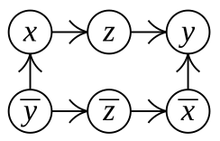
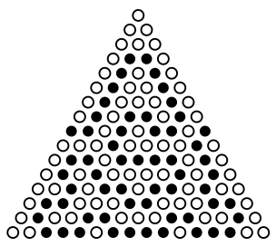
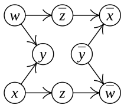
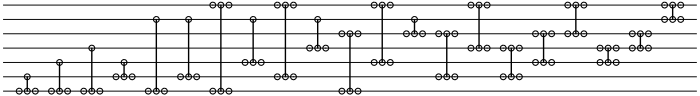
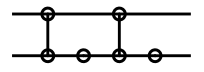
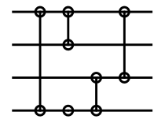
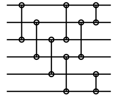
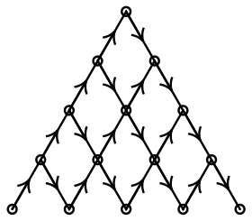
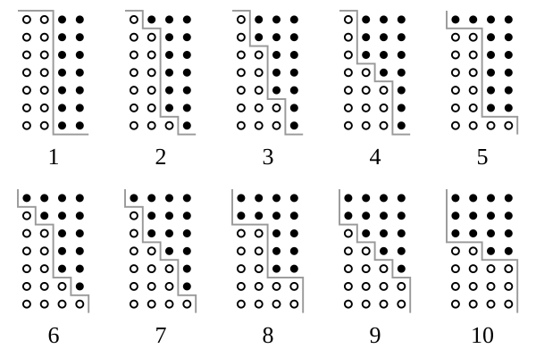

### 7.1.1 节

**1.** [题目](../sec-7-1-1.md#ex-7-1-1-1) (克里斯蒂安·萨特纳提供解法) 他是描述蕴涵关系 $x\Rightarrow y$, 引文中的 “它” 分别代表 $y,x,x,y,y,x$. (可能存在其他解答.)

**2.** [题目](../sec-7-1-1.md#ex-7-1-1-2) 对应于平卡斯星球上的 $x\circ y$, 我们用 $\overline{\overline x\circ\overline y}$ 与之关联. 所以, 它的真值表是对于 $\circ$ 的真值表之补的逆. 因此, 对应的答案是 $\top,\vee,\subset,\mathsf L,\supset,\mathsf R,\equiv,\wedge,\overline\wedge,\oplus,\overline{\mathsf R},\overline\supset,\overline{\mathsf L},\overline\subset,\overline\vee,\bot$. (包含表 1 的 16 种运算的任何恒等式蕴涵一个对应的通过替换平卡斯星球上的等价运算获得的对偶恒等式. 例如, 德摩根定律 (11) 和 (12) 的每一个是另一个的对偶, 就像关联 $\equiv$ 和 $\oplus$ 的恒等式 (3) 和 (4). 在这个意义下可以认为 $\equiv$ 正如它的对偶 $\oplus$ 一样有用.)

**3.** [题目](../sec-7-1-1.md#ex-7-1-1-3) (a) $\vee$; (b) $\wedge$; (c) $\overline{\mathsf L}$; (d) $\equiv$. [如果我们用 $-1$ 表示 “真” 而用 $+1$ 表示 “假” (虽然这种约定似乎有点不正常), 那么许多公式其实更好计算. 这种情况下 $x\cdot y$ 对应于 $\oplus$. 请注意, 无论按哪种约定都有 $\langle xyz\rangle=\operatorname{sign}(x+y+z)$.]

**4.** [题目](../sec-7-1-1.md#ex-7-1-1-4) [*Trans. Amer. Math. Soc.* **14** (1913), 481–488.] (a) 从对于 $\mathsf L$ 和 $\mathsf R$ 的真值表开始, 然后, 从每对已知真值表 $\alpha$ 和 $\beta$ 按位计算真值表 $\alpha\mathbin{\overline\wedge}\beta$, 产生按照每个公式的长度顺序的结果, 写下最短公式得到每个新的 4 位表:

| 运算 | 最短公式 |
|---|---|
| $\bot$ | $(x\mathbin{\overline\wedge}(x\mathbin{\overline\wedge}x))\mathbin{\overline\wedge}(x\mathbin{\overline\wedge}(x\mathbin{\overline\wedge}x))$ |
| $\wedge$ | $(x\mathbin{\overline\wedge}y)\mathbin{\overline\wedge}(x\mathbin{\overline\wedge}y)$ |
| $\overline\supset$ | $(x\mathbin{\overline\wedge}(x\mathbin{\overline\wedge}y))\mathbin{\overline\wedge}(x\mathbin{\overline\wedge}(x\mathbin{\overline\wedge}y))$ |
| $\mathsf L$ | $x$ |
| $\overline\subset$ | $(y\mathbin{\overline\wedge}(x\mathbin{\overline\wedge}x))\mathbin{\overline\wedge}(y\mathbin{\overline\wedge}(x\mathbin{\overline\wedge}x))$ |
| $\mathsf R$ | $y$ |
| $\oplus$ | $(y\mathbin{\overline\wedge}(x\mathbin{\overline\wedge}x))\mathbin{\overline\wedge}(x\mathbin{\overline\wedge}(x\mathbin{\overline\wedge}y))$ |
| $\vee$ | $(y\mathbin{\overline\wedge}y)\mathbin{\overline\wedge}(x\mathbin{\overline\wedge}x)$ |
| $\overline\vee$ | $(x\mathbin{\overline\wedge}(x\mathbin{\overline\wedge}x))\mathbin{\overline\wedge}((y\mathbin{\overline\wedge}y)\mathbin{\overline\wedge}(x\mathbin{\overline\wedge}x))$ |
| $\equiv$ | $(x\mathbin{\overline\wedge}y)\mathbin{\overline\wedge}((y\mathbin{\overline\wedge}y)\mathbin{\overline\wedge}(x\mathbin{\overline\wedge}x))$ |
| $\overline{\mathsf R}$ | $y\mathbin{\overline\wedge}y$ |
| $\subset$ | $y\mathbin{\overline\wedge}(x\mathbin{\overline\wedge}x)$ |
| $\overline{\mathsf L}$ | $x\mathbin{\overline\wedge}x$ |
| $\supset$ | $x\mathbin{\overline\wedge}(x\mathbin{\overline\wedge}y)$ |
| $\overline\wedge$ | $x\mathbin{\overline\wedge}y$ |
| $\top$ | $x\mathbin{\overline\wedge}(x\mathbin{\overline\wedge}x)$ |

(b) 对于这种情况, 从 4 个表 $\bot,\top,\mathsf L,\mathsf R$ 开始, 如果给定长度的公式存在多种选择, 则优先采用变量出现较少的公式:

| 运算 | 最短公式 |
|---|---|
| $\bot$ | $0$ |
| $\wedge$ | $(x\mathbin{\overline\wedge}y)\mathbin{\overline\wedge}1$ |
| $\overline\supset$ | $((y\mathbin{\overline\wedge}1)\mathbin{\overline\wedge}x)\mathbin{\overline\wedge}1$ |
| $\mathsf L$ | $x$ |
| $\overline\subset$ | $(y\mathbin{\overline\wedge}(x\mathbin{\overline\wedge}1))\mathbin{\overline\wedge}1$ |
| $\mathsf R$ | $y$ |
| $\oplus$ | $(y\mathbin{\overline\wedge}(x\mathbin{\overline\wedge}1))\mathbin{\overline\wedge}((y\mathbin{\overline\wedge}1)\mathbin{\overline\wedge}x)$ |
| $\vee$ | $(y\mathbin{\overline\wedge}1)\mathbin{\overline\wedge}(x\mathbin{\overline\wedge}1)$ |
| $\overline\vee$ | $1\mathbin{\overline\wedge}((y\mathbin{\overline\wedge}1)\mathbin{\overline\wedge}(x\mathbin{\overline\wedge}1))$ |
| $\equiv$ | $(x\mathbin{\overline\wedge}y)\mathbin{\overline\wedge}((y\mathbin{\overline\wedge}1)\mathbin{\overline\wedge}(x\mathbin{\overline\wedge}1))$ |
| $\overline{\mathsf R}$ | $y\mathbin{\overline\wedge}1$ |
| $\subset$ | $y\mathbin{\overline\wedge}(x\mathbin{\overline\wedge}1)$ |
| $\overline{\mathsf L}$ | $x\mathbin{\overline\wedge}1$ |
| $\supset$ | $(y\mathbin{\overline\wedge}1)\mathbin{\overline\wedge}x$ |
| $\overline\wedge$ | $x\mathbin{\overline\wedge}y$ |
| $\top$ | $1$ |

**5.** [题目](../sec-7-1-1.md#ex-7-1-1-5) (a) $\bot:x\mathbin{\overline\subset}x$; $\wedge:(x\mathbin{\overline\subset}y)\mathbin{\overline\subset}y$; $\overline\supset:y\mathbin{\overline\subset}x$; $\mathsf L:x$; $\overline\subset:x\mathbin{\overline\subset}y$; $\mathsf R:y$; 仅用 $\overline\subset$ 无法表示其他 10 种运算.

(b) 然而, 如果允许使用常数 0 和 1, 则所有 16 种运算都能表示:

| 运算 | 公式 |
|---|---|
| $\bot$ | $0$ |
| $\wedge$ | $(y\mathbin{\overline\subset}1)\mathbin{\overline\subset}x$ |
| $\overline\supset$ | $y\mathbin{\overline\subset}x$ |
| $\mathsf L$ | $x$ |
| $\overline\subset$ | $x\mathbin{\overline\subset}y$ |
| $\mathsf R$ | $y$ |
| $\oplus$ | $((y\mathbin{\overline\subset}x)\mathbin{\overline\subset}((x\mathbin{\overline\subset}y)\mathbin{\overline\subset}1))\mathbin{\overline\subset}1$ |
| $\vee$ | $(y\mathbin{\overline\subset}(x\mathbin{\overline\subset}1))\mathbin{\overline\subset}1$ |
| $\overline\vee$ | $y\mathbin{\overline\subset}(x\mathbin{\overline\subset}1)$ |
| $\equiv$ | $(y\mathbin{\overline\subset}x)\mathbin{\overline\subset}((x\mathbin{\overline\subset}y)\mathbin{\overline\subset}1)$ |
| $\overline{\mathsf R}$ | $y\mathbin{\overline\subset}1$ |
| $\subset$ | $(x\mathbin{\overline\subset}y)\mathbin{\overline\subset}1$ |
| $\overline{\mathsf L}$ | $x\mathbin{\overline\subset}1$ |
| $\supset$ | $(y\mathbin{\overline\subset}x)\mathbin{\overline\subset}1$ |
| $\overline\wedge$ | $((y\mathbin{\overline\subset}1)\mathbin{\overline\subset}x)\mathbin{\overline\subset}1$ |
| $\top$ | $1$ |

[本杰明·伯恩斯坦,*University of California Publications in Mathematics* **1** (1914), 87–96.]

**6.** [题目](../sec-7-1-1.md#ex-7-1-1-6) (a) $\bot,\wedge,\mathsf L,\mathsf R,\oplus,\vee,\equiv,\top$. (b) $\bot,\mathsf L,\mathsf R,\oplus,\equiv,\top$. [注意这些运算都是可结合的. 事实上, 所述恒等式蕴涵结合律: 首先, 我们有

$$
\begin{aligned}
\text{(i)}\quad (x\circ y)\circ((z\circ y)\circ w)
&=((x\circ z)\circ(z\circ y))\circ((z\circ y)\circ w)\\
&=(x\circ z)\circ w,
\end{aligned}
$$

同样, 我们有 (ii) $(x\circ(y\circ z))\circ(y\circ w)=x\circ(z\circ w)$. 根据 (i) 我们还有

$$
\text{(iii)}\quad (x\circ y)\circ(z\circ w)
=(x\circ y)\circ((z\circ y)\circ(y\circ w))
=(x\circ z)\circ(y\circ w).
$$

因此, 根据 (i), (iii), (ii), 我们有

$$
\begin{aligned}
(x\circ z)\circ w
&=(x\circ z)\circ((z\circ z)\circ w)\\
&=(x\circ(z\circ z))\circ(z\circ w)\\
&=x\circ(z\circ w).
\end{aligned}
$$

由 $\{x_1,\ldots,x_n\}$ 产生的无约束系统恰好有 $n+2^n n^2$ 个不同元素, 即 $\{x_j\mid1\le j\le n\}$ 和 $\{x_i\circ x_{j_1}\circ\cdots\circ x_{j_r}\circ x_k\mid r\ge0\text{ 且 }1\le i,k\le n\text{ 且 }1\le j_1<\cdots<j_r\le n\}$.]

**7.** [题目](../sec-7-1-1.md#ex-7-1-1-7) 这相当于恒等式 $y\circ(x\circ y)=x$, 它仅对 $\oplus$ 和 $\equiv$ 成立. [威廉·杰文斯在 *Pure Logic* §151 中指出 $\oplus$ 的这个性质, 但他没有进一步讨论. 我们将在 7.2.2.1 节探讨具有这种性质的一般系统, 把它称为 “摸索”.]

**8.** [题目](../sec-7-1-1.md#ex-7-1-1-8) $(\{\bot,\wedge,\overline\subset\},S_0)$, $(\{\top,\vee,\supset\},S_1)$, $(\{\mathsf L,\overline{\mathsf L}\},S_0\cap S_1)$, $(\{\oplus,\equiv,\overline{\mathsf R}\},S_2)$, $(\{\overline\supset,\overline\vee\},S_0\cap S_2)$, $(\{\subset,\overline\wedge\},S_1\cap S_2)$, $(\mathsf R,\text{任意运算})$, 其中 $S_0=\{\square\mid0\mathbin{\square}0=0\},S_1=\{\square\mid1\mathbin{\square}1=1\},S_2=\{\square\mid\overline x\mathbin{\square}\overline y=\overline{x\mathbin{\square}y}\}=\{\mathsf L,\mathsf R,\overline{\mathsf L},\overline{\mathsf R}\}$. 因此 256 种配对中的 92 种是左分配的. [这个问题以及习题 6 的两个问题由弗里德里希·施罗德在 *Vorlesungen über die Algebra der Logik* **2**, 2 (1905) 的§55 首次讨论, 该书是在他辞世后出版的. 他是通过说明本质上 $(\circ,\square)$ 各自的真值表 $(pqrs,wxyz)$ 必须满足关系

$$
((pq\vee rs)\wedge\overline z)
\vee((\overline p\,\overline q\vee\overline r\,\overline s)\wedge w)
\vee((p\overline q\vee r\overline s)\wedge((w\equiv z)\vee(x\equiv y)))=0
$$

表示答案的.]

**9.** [题目](../sec-7-1-1.md#ex-7-1-1-9) (a) 假, $(x\oplus y)\vee z=(x\vee z)\oplus(y\vee z)\oplus z$. (b) 真, 因为当 $z=0$ 和 $z=1$ 时恒等式显然成立. (c) 真, 它也是 $(x\oplus y)\vee(x\oplus z)=1-[x=y=z]$.

**10.** [题目](../sec-7-1-1.md#ex-7-1-1-10) 分解 (16) 的第一步产生具有真值表 $g=10100011$ 和 $h=10100011\oplus10010011=00110000$ 的函数. 同时, 这个过程继续以同样方式产生 $1+y+xz+w+wy+wx+wxz\pmod2$.

**11.** [题目](../sec-7-1-1.md#ex-7-1-1-11) 所述的项出现在 $f$ 的多重线性表示中的充分必要条件是, 在 $x_1=x_4=x_5=x_7=x_9=x_{10}=\cdots=0$ 时 $f(x_1,\ldots,x_n)$ 为真的次数是奇数. (当我们把除 $k$ 个变量以外的所有变量置 0 时存在 $2^k$ 个这样的事例.) 换句话说, 假定 $n=3$, 多重线性表示可以用像

$$
f(x,y,z)=(f_{000}+f_{00*}z+f_{0*0}y+f_{0**}yz+f_{*00}x+f_{*0*}xz+f_{**0}xy+f_{***}xyz)\bmod2
$$

这样的示意性记号表示, 其中 $f_{**0}=f(1,1,0)\oplus f(1,0,0)\oplus f(0,1,0)\oplus f(0,0,0)$, 等等.

**12.** [题目](../sec-7-1-1.md#ex-7-1-1-12) (a) 在 (23) 中用 $1-w$ 替换 $\overline w$, 其余变量替换依此类推, 得到 $1-y-xz+2xyz-w+wy+wx+wxz-2wxyz$. [某些作者称此式为 “热加尔金多项式”, 但伊万·热加尔金本人从来都是用模 2 处理的. 见于文献的其他名称有 “可用性多项式”“可靠性多项式” 和 “特征多项式”.]

(b) 对于任意 $n$ 元函数, 对应系数的绝对值可以大到 $2^{n-1}$ (根据归纳法可以证明, 这是最大值). 例如, $x_1\oplus\cdots\oplus x_n$ 在整数范围的整数多重线性表示是 $e_1-2e_2+4e_3-\cdots+(-2)^{n-1}e_n$, 其中 $e_k$ 是 $\{x_1,\ldots,x_n\}$ 的第 $k$ 个初等对称函数. 上题答案中的公式现在变成整数范围的公式

$$
f(x,y,z)=f_{000}+f_{00*}z+f_{0*0}y+f_{0**}yz+f_{*00}x+f_{*0*}xz+f_{**0}xy+f_{***}xyz,
$$

其中 $f_{**0}=f(1,1,0)-f(1,0,0)-f(0,1,0)+f(0,0,0)$, 等等. 带有 $k$ 个 $*$ 作为下标的 $f$ 是 $k$ 变量阿达马变换公式 4.6.4-(38).

(c, d) 该多项式是它的一些像 $x_1(1-x_2)(1-x_3)x_4$ 这样的小项之和. 当 $0\le x_1,\ldots,x_n\le1$ 时每个小项是非负的, 而且全部小项之和等于 1.

(e) $\partial f/\partial x_j=h(x)-g(x)$, 根据 (d), $h(x)\ge g(x)$. (见习题 21.)

**13.** [题目](../sec-7-1-1.md#ex-7-1-1-13) 事实上, $F$ 恰好是整数多重线性表示. (见习题 12.)

**14.** [题目](../sec-7-1-1.md#ex-7-1-1-14) 令 $r_j=p_j/(1-p_j)$. 我们要求 $f(0,0,0)=0$ 且 $f(1,1,1)=1\iff r_1r_2r_3>1$, $f(0,0,1)=0$ 且 $f(1,1,0)=1\iff r_1r_2>r_3$, $f(0,1,0)=0$ 且 $f(1,0,1)=1\iff r_1r_3>r_2$, $f(0,1,1)=0$ 且 $f(1,0,0)=1\iff r_1>r_2r_3$. 所以我们得到: (a) $\langle x_1x_2x_3\rangle$; (b) $x_1$; (c) $\overline{x_3}$.

**15.** [题目](../sec-7-1-1.md#ex-7-1-1-15) 习题 1.2.6-10 告诉我们 $\binom xk\bmod2=[x\mathbin{\&}k=k]$. 因此, 举例来说, 当 $x=(x_n\ldots x_1)_2$ 时有 $\binom x{11}\equiv x_4\wedge x_2\wedge x_1\pmod2$, 而且, 我们可以用这种方式获得像 (19) 那样的多重线性表示中的每一项. 此外, 我们无须按模 2 计算, 因为插值多项式 $\binom x{11}\binom{15-x}4$ 正好代表 $x_4\wedge\overline{x_3}\wedge x_2\wedge x_1$.

**16.** [题目](../sec-7-1-1.md#ex-7-1-1-16) 能, 甚至能用 $+$ 替代 $\vee$, 因为不同小项不会同时为真. (但在像 (25) 的一般析取范式中我们不能这么做. 见习题 35.)

**17.** [题目](../sec-7-1-1.md#ex-7-1-1-17) 二元运算 $\overline\wedge$ 不是可结合的, 所以必须把 $x\mathbin{\overline\wedge}y\mathbin{\overline\wedge}z$ 这样的表达式解释为一个三元运算. 如果把 NAND 理解为 $n$ 元运算, 并注意到单变量 $x$ 的 NAND 运算结果是 $\overline x$, 采用奎克的表示法是好主意.

**18.** [题目](../sec-7-1-1.md#ex-7-1-1-18) 如果不是这样的结果, 我们可以置 $u_1\gets\cdots\gets u_s\gets1$ 和 $v_1\gets\cdots\gets v_t\gets0$, 使 $f$ 同时为真和假. (如果对一个析取范式反复应用分配律 (2) 直至它变成一个合取范式, 我们发现反之亦然: $f$ 蕴涵析取式 $v_1\vee\cdots\vee v_t$, 当且仅当它同 $f$ 的每个蕴涵元有一个共同的字面值, 当且仅当它同 $f$ 的每个素蕴涵元有一个共同的字面值, 当且仅当它同 $f$ 的某个析取范式的每个蕴涵元有一个共同的字面值.)

**19.** [题目](../sec-7-1-1.md#ex-7-1-1-19) 包含在 0010, 0011, 0101, 0110, 1000, 1001, 1010, 1011 中的最大子立方是 $0{*}10,0101,{*}01{*},10{*}{*}$, 所以答案是 $(w\vee\overline y\vee z)\wedge(w\vee\overline x\vee y\vee\overline z)\wedge(x\vee\overline y)\wedge(\overline w\vee x)$. (这个合取范式也是最短的.)

**20.** [题目](../sec-7-1-1.md#ex-7-1-1-20) 真. 对应的最大子立方包含在某些最大子立方 $f'$ 和 $g'$ 内, 而且它们的交不会更大. (这个结果是爱德华·萨姆森和伯顿·米尔斯发现的, 他们的文章引用在习题 31 的答案中.)

**21.** [题目](../sec-7-1-1.md#ex-7-1-1-21) 根据布尔的展开定律 (20), 可以看出: $n$ 元函数 $f$ 是单调的, 当且仅当它的 $(n-1)$ 元投影 $g$ 和 $h$ 是单调的而且满足 $g\le h$. 因此

$$
f=(g\wedge\overline{x_n})\vee(h\wedge x_n)
=(g\wedge\overline{x_n})\vee(g\wedge x_n)\vee(h\wedge x_n)
=g\vee(h\wedge x_n),
$$

所以我们可以不用补表示. 函数表达式中不出现常数 0 和 1, 除非它为常函数. 反之, 用 $\wedge$ 和 $\vee$ 构建的任何表达式显然是单调的.

关于术语的注记: 严格来说, 如果我们想保持经典的数学语言, 那么应当用 “单调非递减的” 而不是简单地说 “单调的”, 因为实变量递减函数也可称为单调函数. (例如, 见 3.3.2G 节的 “游程检验”.) 但是, “非递减的” 是很拗口的术语, 所以, 广泛同布尔函数打交道的研究人员几乎一致认定, 在布尔函数的情形 “单调的” 自动隐含非递减的. 同样, 数学上 “正函数” 这个术语正常情况下是指其值超出 0 的函数. 但是, 作者们描述关于 “正布尔函数” 时是指我们现在所谓的单调函数. 因为单调函数是保持顺序的, 所以有些作者采用 “保序”[^v4a-p447-1] 这一术语, 但这个词已经被物理学家、化学家和音乐家占有.

像 $\overline x\vee y$ 这样的布尔函数, 当它的变量的某个子集取补时变成单调函数, 则称它为单边函数. 定理 Q 显然适用于单边函数.

**22.** [题目](../sec-7-1-1.md#ex-7-1-1-22) $g$ 和 $g\oplus h$ 都必须是单调的, 而且 $g(x)\wedge h(x)=0$.

**23.** [题目](../sec-7-1-1.md#ex-7-1-1-23) $x\wedge(v\vee y)\wedge(v\vee z)\wedge(w\vee z)$. (推论 Q 也适用于单调函数的合取素式. 所以, 为了求解这种类型的任何问题, 我们仅需应用分配律 (2), 直到没有 $\wedge$ 出现在 $\vee$ 中, 然后消除包含另一子句全部变量的任何子句.)

**24.** [题目](../sec-7-1-1.md#ex-7-1-1-24) 根据对 $k$ 的归纳法, 在根结点使用 $\vee$ 的类似的树给出一个有 $2^{2^{\lceil k/2\rceil}-1}$ 个素蕴涵元的长度为 $2^{\lfloor k/2\rfloor}$ 的函数, 而使用 $\wedge$ 的树给出有 $4^{2^{\lfloor k/2\rfloor}-1}$ 个素蕴涵元的长度为 $2^{\lceil k/2\rceil}$ 的函数. 例如, 当 $k=6$ 时, 在使用 $\wedge$ 的情形, 有 $4^7=2^{14}$ 个素蕴涵元的函数具有形式

$$
\begin{aligned}
&x_{(0t_0 0t_{00}0t_{000})_2}\wedge x_{(0t_0 0t_{00}1t_{001})_2}\wedge x_{(0t_0 1t_{01}0t_{010})_2}\wedge x_{(0t_0 1t_{01}1t_{011})_2}\\
&\quad\wedge x_{(1t_1 0t_{10}0t_{100})_2}\wedge x_{(1t_1 0t_{10}1t_{101})_2}\wedge x_{(1t_1 1t_{11}0t_{110})_2}\wedge x_{(1t_1 1t_{11}1t_{111})_2},
\end{aligned}
$$

其中 $t$ 的位置或者是 0 或者是 1. [关于这种布尔函数的进一步资料, 见高德纳和罗纳德·穆尔,*Artificial Intelligence* **6** (1975), 293–326; 弗拉基米尔·古尔维奇和列昂尼德·哈奇扬,*Discrete Mathematics* **169** (1997), 245–248.]

**25.** [题目](../sec-7-1-1.md#ex-7-1-1-25) 令 $a_n$ 是所求素蕴涵元数量. 那么 $a_2=a_3=2,a_4=3$, 对于 $n>4$ 有 $a_n=a_{n-2}+a_{n-3}$. 因为, 对于 $k$ 变量情形的某个素蕴涵元 $p_k$, 当 $n>4$ 时素蕴涵元或者是 $p_{n-2}\wedge x_{n-1}$ 或者是 $p_{n-3}\wedge x_{n-2}\wedge x_n$. (这些素蕴涵元对应于路径图 $P_n$ 的极小顶点覆盖. 当按字典序列出时, 它们在习题 35 的意义下是可剥壳的. 当 $P_n$ 为习题 7.1.4-15 的佩兰数时, 我们有 $a_n=(7P_n+10P_{n+1}+P_{n+2})/23$.)

**26.** [题目](../sec-7-1-1.md#ex-7-1-1-26) (a) 令 $x_j=[j\in J]$, 那么 $f(x)=0$ 且 $g(x)=1$. (这是习题 18 的事实.)

(b) 例如, 假定 $k\in J\in\mathcal G$ 且 $k\notin\bigcup_{I\in\mathcal F}I$, 并假定已经通过 (a) 的检验. 令 $x_j=[j\in J\text{ 且 }j\ne k]$. 那么 $f(x)=1$; 而且 $g(x)=0$, 因为满足条件 $J'\ne J$ 的每个 $J'\in\mathcal G$ 含有一个 $\notin J$ 的元素.

(c) 再次假定条件 (a) 已经排除. 举例来说, 如果 $|J|>|\mathcal F|$, 令 $x_j=[\text{对于某个 }I\in\mathcal F,\ j\text{ 是 }I\cap J\text{ 的最小元素}]$. 那么 $f(x)=1,g(x)=0$.

(d) 现在我们假定 $\bigcup_{I\in\mathcal F}I=\bigcup_{J\in\mathcal G}J$. 每个 $I\in\mathcal F$ 代表满足 $f(x)=0$ 的 $2^{n-|I|}$ 个向量; 同样, 每个 $J\in\mathcal G$ 代表满足 $g(x)=1$ 的 $2^{n-|J|}$ 个向量. 如果和 $s$ 小于 $2^n$, 我们可以计算 $s=s_0+s_1$, 其中 $s_0$ 计算当 $x_n=0$ 时对 $s$ 的贡献. 如果 $s_0<2^{n-1}$, 置 $x_n\gets0$; 否则 $s_1<2^{n-1}$, 所以我们置 $x_n\gets1$. 然后, 我们置 $n\gets n-1$; 最后, 我们知道所有的 $x_j$, 而且 $f(x)=1,g(x)=0$.

**27.** [题目](../sec-7-1-1.md#ex-7-1-1-27) 令 $m=\min(\{|I|\mid I\in\mathcal F\}\cup\{|J|\mid J\in\mathcal G\})$ 是最短的素子句或素蕴涵元的长度. 那么 $N\cdot2^{n-m}\ge\sum_{I\in\mathcal F}2^{n-|I|}+\sum_{J\in\mathcal G}2^{n-|J|}\ge2^n$, 所以我们有 $m\le\lg N$. 举例来说, 如果 $|I|=m$, 某个下标 $k$ 必定至少出现在成员 $J\in\mathcal G$ 的 $1/m$ 中, 因为每个 $J$ 同 $I$ 相交. 这个结果证明了提示的要求.

现在, 令 $A(0)=A(1)=1$, 对于 $v>1$ 令 $A(v)=1+A(v-1)+A(\lfloor\rho v\rfloor)$. 那么 $A(|\mathcal F||\mathcal G|)$ 是递归调用次数 (步骤 X1 的执行次数) 的上界. 令 $B(v)=A(v)+1$, 对于 $v>1$ 我们有 $B(v)=B(v-1)+B(\lfloor\rho v\rfloor)$. 因此, 对于 $v>k$ 有 $B(v)\le B(v-k)+kB(\lfloor\rho v\rfloor)$. 取 $k=v-\lfloor\rho v\rfloor$, 从而 $B(v)\le((1-\rho)v+2)B(\lfloor\rho v\rfloor)$, 因此, 当 $\rho^t v\le1$ 时, 也就是当 $t\ge\ln v/\ln(1/\rho)=\Theta((\log v)(\log N))$ 时, 我们有 $B(v)=O(((1-\rho)v+2)^t)$. 所以 $A(|\mathcal F||\mathcal G|)\le A(N^2/4)=N^{O(\log N)^2}$.

实际上, 算法的执行将比刚导出的悲观上界快得多. 由于一个函数的素子句是其对偶函数的素蕴涵元, 这个问题实质上与证明一个给定的析取范式为另外一个的对偶是同一回事. 此外, 如果从 $f(x)=0$ 开始, 重复求满足 $f(x)=g(\overline x)=0$ 的最小 $x$, 我们可以 “增长”$f$ 直到获得 $g$ 的对偶.

这里采纳的思想是迈克尔·弗雷德曼和列昂尼德·哈奇扬 [*J. Algorithms* **21** (1996), 618–628] 提出的, 他们还提出改进使算法执行时间降低到 $N^{O(\log N/\log\log N)}$. 还不知道多项式时间的算法. 然而, 这个问题不太可能是 NP 完全问题, 因为我们可以用少于指数时间求解它.

[^v4a-p447-1]: 英文为 isotone, 作为物理学名词和化学名词, 是 “同中子异位素”; 作为音乐名词, 是 “等音调”. ——编者注

**28.** [题目](../sec-7-1-1.md#ex-7-1-1-28) 一旦理解, 这个结果是显而易见的, 但记号和术语可能使它混乱. 所以, 让我们考虑一个具体例子: 比方说, 如果 $y_1=y_4=y_6=1$, 而其他 $y_k$ 都是 0, 函数 $g$ 为真当且仅当素蕴涵元 $p_1,p_4,p_6$ 覆盖 $f$ 为真的所有位置. 因此, 我们可以看出, 在 $g$ 的每个蕴涵元与仅包含素蕴涵元 $p_j$ 的 $f$ 的每个析取范式之间存在一一对应关系. 在这种对应中, $g$ 的素蕴涵元对应于 “非冗余的” 析取范式, 其中没有可以舍去的 $p_j$.

罗伯特·卡特勒和室贺三郎 [*IEEE Transactions* **C-36** (1987), 277–292] 对这个原理的多种改进作过讨论.

**29. B1.** [题目](../sec-7-1-1.md#ex-7-1-1-29) [初始化.] 置 $k\gets k'\gets0$. (习题 5-19 讨论了类似的方法.)

**B2.** [找到零值.] 增加 $k$ 零次或者更多次, 直到或者 $k=m$ (算法终止) 或者 $v_k\mathbin{\&}2^j=0$.

**B3.** [使 $k'>k$.] 如果 $k'\le k$, 置 $k'\gets k+1$.

**B4.** [推进 $k'$.] 增加 $k'$ 零次或者多次, 直到或者 $k'=m$ (算法终止) 或者 $v_{k'}\ge v_k+2^j$.

**B5.** [跳过一个大的不匹配.] 如果 $v_k\oplus v_{k'}\ge2^{j+1}$, 置 $k\gets k'$ 并返回 B2.

**B6.** [记录一个匹配.] 如果 $v_{k'}=v_k+2^j$, 输出 $(k,k')$.

**B7.** [推进 $k$.] 置 $k\gets k+1$ 并返回 B2. ■

(步骤 B3 和 B5 是可选的, 但是推荐采用.)

**30.** [题目](../sec-7-1-1.md#ex-7-1-1-30) 下述算法在一个大小绝不超过 $2m+n$ 的栈 $S$ 中维持一些长度可变的有序表. 当栈顶元素是 $S_t=s$ 时, 顶端的表是有序集 $S_s<S_{s+1}<\cdots<S_{t-1}$. 标记位保持在另外一个栈 $T$ 中, 在初始化步骤后, 它具有和 $S$ 同样的大小.

**P1.** [初始化.] 对于 $0\le k<m$ 置 $T_k\gets0$. 然后, 对于 $0\le j<n$ 应用习题 29 的 $j$-伙伴扫描算法, 接着, 对于求出的所有数对 $(k,k')$ 置 $T_k\gets T_k+2^j,T_{k'}\gets T_{k'}+2^j$. 然后, 置 $s\gets t\gets0$, 并重复下述运算直到 $s=m$: 如果 $T_s=0$, 输出子立方 $(0,v_s)$, 置 $s\gets s+1$; 否则, 置 $S_t\gets v_s,T_t\gets T_s,t\gets t+1,s\gets s+1$. 最后, 置 $A\gets0,S_t\gets0$.

**P2.** [推进 $A$.] (此时栈 $S$ 包含 $\nu(A)+1$ 个子立方的有序表. 也就是说, 如果 $A=2^{e_1}+\cdots+2^{e_r}$ (其中 $e_1>\cdots>e_r\ge0$), 栈中包含 $a$ 值分别为 $0,2^{e_1},2^{e_1}+2^{e_2},\ldots,A$ 的所有子立方 $(a,b)\subseteq V$ 的 $b$ 值, 只是那些标记为 0 的子立方不出现. 所有这些表都是非空的, 可能最后一个除外. 现在我们要把 $A$ 增加到下一个相关值.) 置 $j\gets0$. 如果 $S_t=t$ (也就是说, 如果顶端的表是空表), 增加 $j$ 零次或者多次, 直到 $j\ge n$ 或 $A\mathbin{\&}2^j\ne0$. 然后, 当 $j<n$ 且 $A\mathbin{\&}2^j\ne0$ 时, 置 $t\gets S_t-1,A\gets A-2^j,j\gets j+1$. 如果 $j\ge n$, 终止算法; 否则, 置 $A\gets A+2^j$.

**P3.** [生成表 $A$.] 置 $r\gets t,s\gets S_t$, 对 $r-s$ 个数 $S_s<\cdots<S_{r-1}$ 应用习题 29 的 $j$-伙伴扫描算法. 对于求出的所有数对 $(k,k')$ 置 $x\gets(T_k\mathbin{\&}T_{k'})-2^j$. 如果 $x=0$, 输出子立方 $(A,S_k)$; 否则, 置 $t\gets t+1,S_t\gets S_k,T_t\gets x$. 最后, 置 $t\gets t+1,S_t\gets r+1$, 返回 P2. ■

这个算法部分建立在欧金尼奥·莫雷亚莱 [*IEEE Trans. EC-16* (1967), 611–620; *Proc. ACM Nat. Conf.* **23** (1968), 355–365] 的思想基础上. 执行时间最多正比于 $mn$ (对于步骤 P1) 加上 $n$ 乘以 $V$ 中包含的子立方总数. 如果 $m\le2^n(1-\epsilon)$, 而且 $V$ 是随机选择的大小为 $m$ 的集合, 习题 34 表明, 子立方的平均总数最多是 $O(\log\log n/\log\log\log n)$ 乘以最大子立方的平均数, 因此, 多数情况下平均执行时间近乎同产生的平均输出总量成正比. 另一方面, 习题 32 和 116 表明输出总量可能是非常大的.

**31.** [题目](../sec-7-1-1.md#ex-7-1-1-31) (a) 令 $c=c_{n-1}\ldots c_0,c'=c'_{n-1}\ldots c'_0,c''=c''_{n-1}\ldots c''_0$. 必定存在满足 $c_j\ne *$ 和 $c_j\ne c''_j$ 的某个 $j$, 否则我们有 $c''\subseteq c$. 同样, 必定存在满足 $c'_k\ne *$ 和 $c'_k\ne c''_k$ 的某个 $k$. 如果 $j\ne k$, 则存在一点 $x_{n-1}\ldots x_0\in c''$, 它既不在 $c$ 中也不在 $c'$ 中, 因为我们可以令 $x_j=\overline{c_j},x_k=\overline{c'_k}$. 因此 $j=k$, 而且 $j$ 的值是唯一确定的. 此外, 容易看出 $c'_j=\overline{c_j}$. 如果 $i\ne j$, 我们有 $c_i=*$ 或者 $c_i=c''_i$, 我们还有 $c'_i=*$ 或者 $c'_i=c''_i$.

(b) 这个命题是 (a) 的一个显然推论.

(c) 首先我们证明, 每当进入步骤 E2 时括号内的陈述是真的. 当 $j=0$ 时它显然为真. 否则, 令 $c\subseteq V$ 是一个 $j$ 立方, 并假设 $c=c_0\cup c_1$, 其中 $c_0$ 和 $c_1$ 是 $(j-1)$ 立方. 在步骤 E2 之前的执行中我们已经有 $c_0\subseteq c'_0\in C$ 和 $c_1\subseteq c'_1\in C$ (对于某个 $c'_0$ 和 $c'_1$), 因此, 或者 $c\subseteq c'_0\sqcup c'_1$ 或者 $c\subseteq c'_0$ 或者 $c\subseteq c'_1$. 在每种情形下, $c$ 现在包含在 $C$ 的某个元素中.

其次我们证明, 步骤 E3 中的输出恰好是包含在 $V$ 中的极大 $j$ 立方: 令 $c\subseteq V$ 是任意 $k$ 立方. 如果 $c$ 是极大的, 那么, 当我们以 $j=k$ 到达步骤 E3 时有 $c\in C$, 而且它将被输出. 如果 $c$ 不是极大的, 它有一个伙伴 $c'\subseteq V$, 当我们到达步骤 E3 时, $c'$ 是包含在某个子立方 $c''\in C$ 内的 $k$ 立方. 因为 $c\nsubseteq c''$, 合意方 $c\sqcup c''$ 将是 $C'$ 的一个 $(j+1)$ 立方, 而且 $c$ 不会被输出.

参考文献: 合意方的概念是阿奇·布莱克在他的博士论文 *Canonical Expressions in Boolean Algebra*(芝加哥大学, 1937) 第 25 页首次定义的 (命名为 “三段论的结果”), 见 *J. Symbolic Logic* **3** (1938), 93, 112–113. 爱德华·萨姆森和伯顿·米尔斯 [*Air Force Cambridge Research Center Tech. Report 54-21* (Cambridge, Mass.: April 1954), 54 页] 以及威拉德·奎因 [*AMM* **62** (1955), 627–631] 独立重新发现了这个概念. 这个运算有时也称为预解式, 因为约翰·艾伦·鲁宾逊在更一般的形式下 (对于子句而不是蕴涵元) 使用它, 作为关于定理证明的 “预解原理” 的基础 [*JACM* **12** (1965), 23–41]. 算法 E 是安·尤因、约翰·罗思和埃里克·瓦格纳 [*AIEE Transactions*, Part 1, **80** (1961), 450–458] 建立的.

**32.** [题目](../sec-7-1-1.md#ex-7-1-1-32) (a) 设 $A=\{0,1,*,\bullet\}$, 对于所有 $a\in A$ 和 $x\in\{0,1\}$, 把习题 31 中 $\sqcup$ 的定义改为关于 $A$ 中的四个符号可结合和可交换的运算:

$$
*\sqcup a=a\sqcup *=a,\qquad
\bullet\sqcup a=a\sqcup\bullet=x\sqcup\overline x=\bullet,\qquad
x\sqcup x=x.
$$

此外, 令 $h(0)=0,h(1)=1,h(*)=*,h(\bullet)=*$. 那么, 按分量计算的 $c=h(c_1\sqcup\cdots\sqcup c_m)$ 是仅有的可能成为广义合意方的子立方. [见皮埃尔·蒂森,*IEEE Transactions* **EC-16** (1967), 446–456.]

(b) 例如, 令 $c_j=*^{j-1}1*^{m-j}1^{j-1}0*^{m-j}$. [最后的分量是不必要的. 罗伯特·斯隆、鲍拉日·瑟雷尼和哲尔吉·图兰在 *SIAM J. Discrete Math.* **21** (2008), 987–998 中描述了全部解.]

(c) 根据 (a), 每个素蕴涵元唯一对应于它 “遇到” 的蕴涵元的子集. [阿肖克·钱德拉和乔治·马可夫斯基,*Discrete Math.* **24** (1978), 7–11.]

(d) 例如, 像 (b) 中的 $(y_1\wedge\overline{x_1})\vee(y_2\wedge x_1\wedge\overline{x_2})\vee\cdots\vee(y_m\wedge x_1\wedge\cdots\wedge x_{m-1}\wedge\overline{x_m})$. [让-玛丽·拉博德,*Discrete Math.* **32** (1980), 209–212.]

**33.** [题目](../sec-7-1-1.md#ex-7-1-1-33) (a) $\binom{2^n-2^{n-k}}{m-2^{n-k}}\big/\binom{2^n}m$. (b) 我们必须排除当 $x_1\wedge\cdots\wedge x_{j-1}\wedge\overline{x_j}\wedge x_{j+1}\wedge\cdots\wedge x_k$ 时也是蕴涵元的情况. 根据容斥原理, 答案是

$$
\sum_l\binom kl(-1)^l\binom{2^n-(l+1)2^{n-k}}{m-(l+1)2^{n-k}}\bigg/\binom{2^n}m.
$$

当 $k=n$ 时简化为 $\binom{2^n-n-1}{m-1}\big/\binom{2^n}m$. 例如, 见式 1.2.6-(24).

**34.** [题目](../sec-7-1-1.md#ex-7-1-1-34) (a) 我们有 $c(m,n)=\sum c_j(m,n)$, 其中 $c_j(m,n)=2^{n-j}\binom nj\binom{2^n-2^j}{m-2^j}\big/\binom{2^n}m$ 是含有 $n-j$ 个字面值的蕴涵元的平均数 (习题 30 的术语中的 $j$ 维子立方的平均数). 显然 $c_0(m,n)=m$, 而且

$$
c_1(m,n)=\frac{nm(m-1)}{2(2^n-1)}\le\frac{mn}2\left(\frac m{2^n}\right)\le\frac12m;
$$

同样, $c_j(m,n)\le m/(2^j j!n^{2^j-1-j})$. 我们还有 $p(m,n)=\sum_jp_j(m,n)$, 其中

$$
\begin{aligned}
p_0(m,n)
&=2^n\binom{2^n-n-1}{m-1}\bigg/\binom{2^n}m
=m\frac{(2^n-n-1)^{\underline{m-1}}}{(2^n-1)^{\underline{m-1}}}
\ge m\frac{(2^n-n-m)^{m-1}}{(2^n-m)^{m-1}}\\
&\ge m\left(1-\frac n{2^n-m}\right)^m
\ge m\left(1-\frac n{2^n-2^n/n}\right)^{2^n/n}
=m\exp\left(\frac{2^n}n\ln\left(1-\frac{n^2}{2^n(n-1)}\right)\right).
\end{aligned}
$$

(b) 注意 $t=\lfloor\lg\lg n-\lg\lg(2^n/m)+\lg(4/3)\rfloor\le\lg\lg n+O(1)$ 是相当小的. 我们将重复利用 $\binom{2^n-j\cdot2^t}{m-j\cdot2^t}\big/\binom{2^n}m<\alpha_{mn}^j$ 这一事实, 而且当 $j$ 不是太大时

$$
\binom{2^n-j\cdot2^t}{m-j\cdot2^t}\Big/\binom{2^n}m
=\alpha_{mn}^j\bigl(1+O(j^2 2^{2t}/m)\bigr)
$$

是非常好的逼近. 为了证明题目中的提示, 注意到 $\sum_{j<t}c_j(m,n)/c_t(m,n)=O(tc_{t-1}(m,n)/c_t(m,n))=O(t^2/(n\sqrt{\alpha_{mn}}))=O((\log\log n)^2/n^{1/3})$ 且 $c_{t+j}(m,n)/c_t(m,n)=O((n/(2t))^j\alpha_{mn}^{2^j-1})$. 因此我们有 $c(m,n)/c_t(m,n)\approx1+\tfrac12\left(\tfrac{n-t}{t+1}\right)\alpha_{mn}$, 其中, 当 $\alpha_{mn}$ 处于它的值域的较高区域时第二项占优. 此外

$$
\sum_l\binom{n-t}l(-1)^l\alpha_{mn}^l\left(1+O\left(\frac{l^2 2^{2t}}m\right)\right)
=(1-\alpha_{mn})^{n-t}+O\bigl(n^2\alpha_{mn}(1+\alpha_{mn})^n2^{2t}/m\bigr)
$$

带有一个指数的小误差项, 因为 $(1+\alpha_{mn})^n=O(e^{n^{1/3}})\ll m$. 因此, $p(m,n)/c_t(m,n)$ 渐近于 $e^{-n\alpha_{mn}}+\tfrac12\left(\tfrac{n-t}{t+1}\right)\alpha_{mn}e^{-n\alpha_{mn}^2}$.

(c) 这里 $\alpha_{mn}=2^{-2^t}\approx n^{-1}\ln(t/\ln t)$, 因此 $c(m,n)/c_t(m,n)=1+O(t^{-1}\log t),p(m,n)/c_t(m,n)=t^{-1}\ln t+\tfrac12t^{-1}\ln t+O(t^{-1}\log\log t)$. 在这种情形, 我们推断

$$
\frac{c(m,n)}{p(m,n)}
=\frac23\frac{\lg\lg n}{\ln\lg\lg n}
\left(1+O\left(\frac{\log\log\log\log n}{\log\log\log n}\right)\right).
$$

(d) 如果 $n\alpha_{mn}\le\ln t-\ln\ln t$, 我们有 $p(m,n)/c(m,n)\ge p_t(m,n)/c(m,n)\ge t^{-1}\ln t+O(t^{-1}\log t)^2$. 另一方面, 如果 $n\alpha_{mn}\ge\ln t-\ln\ln t$, 我们有 $p(m,n)/c(m,n)\ge p_{t+1}(m,n)/c(m,n)\ge\tfrac12t^{-1}\ln t+O(t^{-1}\log\log t)$.

[佛朗哥·米莱托和詹弗兰科·普措卢在 *IEEE Trans. EC-13* (1964), 87–92; *JACM* **12** (1965), 364–375 中首先研究了均值 $c(m,n)$ 和 $p(m,n)$, 以及 $c(m,n)$ 的方差. 当每个值 $f(x_1,\ldots,x_n)$ 独立地以 $p(n)$ 的概率等于 1 时, 关于随机布尔函数的蕴涵元、素蕴涵元和非冗余析取范式的详细渐近数据已由卡尔·韦伯在 *Elektronische Informationsverarbeitung und Kybernetik* **19** (1983), 365–374, 449–458, 529–534 中得出.]

**35.** [题目](../sec-7-1-1.md#ex-7-1-1-35) (a) 通过重排坐标我们可以假定第 $p$ 个子立方是 $0^k1^u*^v$, 所以 $B_p=0^k1^u0^v$ 且 $S_p=1^k0^{u+v}$. 于是, 按照对 $p$ 的归纳法, $*^k1^u*^v$ 的所有点仍然被覆盖, 因为对于 $1\le j\le k$, $*^{j-1}1*^{k-j}1^u*^v$ 已经被覆盖.

(b) 第 $j$ 个和第 $k$ 个子立方在 $B_j\mathbin{\&}S_k$ 非零的每个坐标位置不同. 另一方面, 如果 $B_j\mathbin{\&}S_k$ 为零, 根据 (a), 子立方 $k$ 的点 $\overline{S_k}$ 位于前面的一个子立方内, 因为我们有 $\overline{S_k}\supseteq B_j$.

(c) 从表 $1100,1\underline{0}11,\underline{0}011$ (每个 $S_k$ 的二进制位带下划线) 我们得到正交析取范式 $(x_1\wedge x_2)\vee(x_1\wedge\overline{x_2}\wedge x_3\wedge x_4)\vee(\overline{x_1}\wedge x_3\wedge x_4)$.

(d) 存在 8 个解. 例如 $(01100,0\underline{0}110,00\underline{0}11,11\underline{0}1\underline{0},11\underline{00}0)$.

(e) $(001100,011\underline{0}00,00\underline{0}110,11\underline{00}10,11\underline{0}0\underline{0}0,\underline{0}1\underline{00}11,0\underline{0}0\underline{0}11)$ 是一个对称的解. 同时存在很多其他可能性. 例如, 位码 $\{110000,011000,001100,000110,000011,110010,011010\}$ 的 42 种排列都是剥壳.

[迈克尔·鲍尔和约翰·普罗文在 *Operations Research* **36** (1988), 703–715 中引进了单调布尔函数的剥壳这一概念, 他们讨论了许多重要应用.]

**36.** [题目](../sec-7-1-1.md#ex-7-1-1-36) 如果 $j<k$, 对于某些位串 $\alpha,\beta,\gamma$, 有 $B_j=\alpha1\beta,B_k=\alpha0\gamma$. 建立序列 $x_0=\alpha1\gamma,x_1=x'_0,\ldots,x_l=x'_{l-1}$, 其中 $x_l=\alpha00^{|\gamma|}$. 因为 $x_0\supseteq B_k$, 有 $f(x_0)=1$, 但是 $f(x_l)=0$, 因为 $x_l\subseteq B'_j$. 所以, 满足 $f(x_i)=1$ 且 $f(x_{i+1})=\cdots=f(x_l)=0$ 的位串 $x_i$ 在 $B$ 内. 它位于 $B_k$ 之前, 从而有 $B_j\mathbin{\&}S_k\supseteq0^{|\alpha|}10^{|\beta|}$.

[这个结构以及习题 35 的部分答案是安德烈·博罗什、伊夫·克拉马、奥亚·埃金、彼得·阿梅、茨木俊秀和亚历山大·科甘在 *SIAM J. Discrete Math.* **13** (2000), 212–226 中给出的.]

**37.** [题目](../sec-7-1-1.md#ex-7-1-1-37) 剥壳顺序 $(000011,0011\underline{0}1,00110\underline{0},11\underline{0}1\underline{0}1,11\underline{0}10\underline{0},110\underline{00}1,110\underline{0}0\underline{0})$ 推广到所有的 $n$. 另外, 也存在不是建立在剥壳基础上的有趣解, 就像循环对称的子立方 $(\texttt{110***},\texttt{1110**},\texttt{**110*},\texttt{**1110},\texttt{0***11},\texttt{10**11},\texttt{111111})$.

为了证明蕴涵数量的下界, 对每个点 $x$ 赋予权值 $w_x=-\prod_{j=1}^n(x_{2j-1}+x_{2j}-3x_{2j-1}x_{2j})$, 注意, 在任何子立方内 $w_x$ 遍及所有 $x$ 的和是 0 或者 $\pm1$. (当 $n=1$ 时, 这足以对 9 种可能的每个子立方证实这一奇特的事实.) 现在, 选择分拆集合 $F=\{x\mid f(x)=1\}$ 的一组不相交子立方, 我们有

$$
\sum_{C\text{ chosen}}1
\ge\sum_{C\text{ chosen}}\sum_{x\in C}w_x
=\sum_{x\in F}w_x\sum_{C\text{ chosen}}[x\in C]
=\sum_{x\in F}w_x.
$$

存在恰好具有 $k$ 对分量 $x_{2j-1}x_{2j}=1$ 且具有非零权值的 $\binom nk2^{n-k}$ 个向量 $x$. 它们的权值是 $(-1)^{k-1}$, 而且, 除了 $k=0$ 的情形, 它们属于集合 $F$. 因此 $\sum_{x\in F}w_x=\sum_{k>0}\binom nk2^{n-k}(-1)^{k-1}=2^n-(2-1)^n$.

[见迈克尔·鲍尔和乔治·内姆豪泽,*Mathematics of Operations Research* **4** (1979), 132–143.]

**38.** [题目](../sec-7-1-1.md#ex-7-1-1-38) 当然没有困难. 一个析取范式为可满足的, 当且仅当它至少有一个蕴涵元. 对于一个析取范式, 难点在于判定它是否为重言式 (恒为真).

**39.** [题目](../sec-7-1-1.md#ex-7-1-1-39) 把变量 $y_1,\ldots,y_N$ 按前序与每个内部结点关联, 使得每个树结点恰好对应于 $F$ 的一个变量. 对于用二元运算符 $\circ$ 标记的带有两个子结点 $(l,r)$ 的每个内部结点 $y$, 构造 4 个 3CNF 子句 $c_{00}\wedge c_{01}\wedge c_{10}\wedge c_{11}$, 其中

$$
c_{pq}=(y^{\overline p\circ\overline q}\vee l^p\vee r^q),
$$

而 $x^p$ 表示 $[x=p]$, 所以 $x^0=\overline x,x^1=x$. 实际上, 这些子句表明 $y=l\circ r$. 例如, 如果 $\circ$ 是 $\wedge$, 则 4 个子句是 $(y\vee\overline l\vee\overline r)\wedge(\overline y\vee\overline l\vee r)\wedge(\overline y\vee l\vee\overline r)\wedge(\overline y\vee l\vee r)$. 最后, 为迫使 $f=1$, 添加一个子句 $(y_1\vee y_1\vee y_1)$.

> 每一个高阶数可以仅由三项组成.
>
> ……举一个四元事件的实例, $A$ 以价格 $D$ 把 $B$ 卖给 $C$.
>
> 这是两件事的复合:
>
> 第一, $A$ 与 $C$ 达成一项我们可以称之为 $E$ 的明确交易;
>
> 第二, 这起交易 $E$ 是以价格 $D$ 卖出 $B$.
>
> ——查尔斯·皮尔斯, 《谜题猜测》(1887)

**40.** [题目](../sec-7-1-1.md#ex-7-1-1-40) 按照提示, $A$ 表明 “$u<v\oplus v<u$”, $B$ 表明 “$u<v\wedge v<w\Rightarrow u<w$”. 所以, $A\wedge B$ 表明存在顶点的线性序 $u_1<u_2<\cdots<u_n$. (有 $n!$ 种方式满足 $A\wedge B$.) 现在, $C$ 表明 $q_{uvw}$ 等价于 $u<v<w$. 所以, $D$ 表明当 $u\mathrel{\not\text{—}}w$ 时 $u$ 和 $w$ 在线性序中不是相邻的. 因此, $A\wedge B\wedge C\wedge D$ 是可满足的等价于, 存在一个线性序, 其中的所有非邻接顶点都是不相邻的 (也就是说, 其中的所有相邻顶点都是邻接的).

**41.** [题目](../sec-7-1-1.md#ex-7-1-1-41) 解法 0: “$[m\le n]$” 是这样一个公式, 但它同本题的精神不符.

解法 1: 令 $x_{jk}$ 表示鸽子 $j$ 占据鸽巢 $k$. 那么, 对于 $1\le j\le m$ 的子句是 $(x_{j1}\vee\cdots\vee x_{jn})$, 而对于 $1\le i<j\le m$ 且 $1\le k\le n$ 的子句是 $(\overline{x_{ik}}\vee\overline{x_{jk}})$. [见斯蒂芬·库克和罗伯特·雷克豪,*J. Symbolic Logic* **44** (1979), 36–50; 阿明·哈肯,*Theoretical Comp. Sci.* **39** (1985), 297–308.]

解法 2: 假定 $n=2^t$, 令鸽子 $j$ 占据鸽巢 $(x_{j1}\ldots x_{jt})_2$. 通过引进辅助子句 $(\overline{y_{ijk}}\vee x_{ik}\vee x_{jk})\wedge(y_{ijk}\vee x_{ik}\vee\overline{x_{jk}})\wedge(y_{ijk}\vee\overline{x_{ik}}\vee x_{jk})\wedge(\overline{y_{ijk}}\vee\overline{x_{ik}}\vee\overline{x_{jk}})$, 可以像在习题 39 那样把对于 $1\le i<j\le m$ 的子句 $((x_{i1}\oplus x_{j1})\vee\cdots\vee(x_{it}\oplus x_{jt}))$ 用合取范式形式 $(y_{ij1}\vee\cdots\vee y_{ijt})$ 表示. (实际上, 只需要这 4 个子句中的第一个和最后一个.) 这个合取范式的总规模是 $\Theta(m^2\log n)$, 可以把它同解法 1 的 $\Theta(m^2n)$ 比较一下. 如果 $n$ 不是 2 的幂, 附加 $O(m\log n)$ 个规模为 $O(\log n)$ 的额外子句, 将排除不合适的值.

**42.** [题目](../sec-7-1-1.md#ex-7-1-1-42) $(\overline x\vee y)\wedge(\overline z\vee x)\wedge(\overline y\vee\overline z)\wedge(z\vee z)$.

**43.** [题目](../sec-7-1-1.md#ex-7-1-1-43) 可能不存在, 因为每个 3SAT 问题都能转换成这种形式. 例如, 子句 $(x_1\vee x_2\vee\overline{x_3})$ 可以替换为 $(x_1\vee\overline y\vee\overline{x_3})\wedge(\overline y\vee\overline{x_2})\wedge(y\vee x_2)$, 其中 $y$ 是新变量 (实际上等价于 $\overline{x_2}$).

**44.** [题目](../sec-7-1-1.md#ex-7-1-1-44) 假定 $f(x)=f(y)=1$ 蕴涵 $f(x\mathbin{\&}y)=1$, 还假定 (比如说)$c=x_1\vee x_2\vee\overline{x_3}\vee\overline{x_4}$ 是 $f$ 的素子句. 那么, $c'=\overline{x_1}\vee x_2\vee\overline{x_3}\vee\overline{x_4}$ 不是一个子句; 否则, $c\wedge c'=x_2\vee\overline{x_3}\vee\overline{x_4}$ 也会是一个子句, 同定理前提矛盾. 所以, 存在一个满足 $f(y)=1$ 的向量 $y$, 而且 $y_1=1,y_2=0,y_3=y_4=1$. 同样, 存在一个满足 $f(z)=1$ 的向量 $z$, 而且 $z_1=0,z_2=1,z_3=z_4=1$. 但是, 在这种情况下我们有 $f(y\mathbin{\&}z)=1$, 而且 $c$ 不是一个子句. 对于一个具有不同字面值数量的子句 $c$ 可以作同样论证, 只要至少有两个不是取补的字面值.

**45.** [题目](../sec-7-1-1.md#ex-7-1-1-45) (a) 霍恩函数 $f(x_1,\ldots,x_n)$ 是不确定的, 当且仅当它不等于确定的霍恩函数 $g(x_1,\ldots,x_n)=f(x_1,\ldots,x_n)\vee(x_1\wedge\cdots\wedge x_n)$. 所以, $f\leftrightarrow g$ 是不确定的霍恩函数与确定的霍恩函数之间的一一对应.

(b) 如果 $f$ 是单调的, 它的补 $\overline f$ 要么恒等于 1, 要么是一个不确定的霍恩函数.

**46.** [题目](../sec-7-1-1.md#ex-7-1-1-46) 算法C把88个字符对 `xy` 置于核心内：当 `x` = `a`, `b`, `c`, `0`, `1` 时，跟随的字符 `y` 可以是除 `(` 之外的任何字符。当 `x` = `(`, `*`, `/`, `+`, `-` 时，我们可能有 `y` = `(`, `a`, `b`, `c`, `0`, `1`；当 `x` = `(`, `+`, `-` 时还可能有 `y` = `-`。最后，以 `x` = `)` 开始的合乎条件的字符对有 `)+`, `)-`, `)*`, `)/`, `))`。

**47.** [题目](../sec-7-1-1.md#ex-7-1-1-47) 算法 C 把顶点置入核心的次序是一个拓扑排序, 因为 $k$ 的所有前导是在算法置 $\mathrm{TRUTH}(x_k)\gets1$ 之前推断的. 但是, 算法 2.2.3T 使用队列代替栈, 所以, 它实际产生的排序通常不同于算法 C 的排序.

**48.** [题目](../sec-7-1-1.md#ex-7-1-1-48) 令 $\bot$ 是一个新变量, 并把每个不确定的霍恩子句通过同这个新变量 OR 改变为确定的霍恩子句. (例如, 把 “$\overline w\vee\overline y$” 改变为 “$\overline w\vee\overline y\vee\bot$”, 即 “$w\wedge y\Rightarrow\bot$”. 确定的霍恩子句保持不变.) 然后应用算法 C. 最初的霍恩子句是不可满足的, 当且仅当 $\bot$ 在新霍恩子句的核心内. 所以, 只要算法准备置 $\mathrm{TRUTH}(\bot)\gets1$, 它就能终结.

(乔纳森·奎克考虑过另一种解法: 我们可以对习题 45(a) 答案中构造的函数 $g$ 应用算法 C, 因为 $f$ 是不可满足的当且仅当每个变量 $x_j$ 在 $g$ 的核心内. 然而, 像 $\overline w\vee\overline y$ 这样的 $f$ 的不确定子句变成 $g$ 的许多不同子句 $(\overline w\vee\overline y\vee z)\wedge(\overline w\vee\overline y\vee x)\wedge(\overline w\vee\overline y\vee v)\wedge(\overline w\vee\overline y\vee u)\wedge\cdots$, 不在最初的霍恩子句中的每个变量都有一个相应子句. 所以, 奎克的建议可能把子句的数量增加 $\Omega(n)$ 倍, 尽管他的建议乍一看似乎非常漂亮.)

**49.** [题目](../sec-7-1-1.md#ex-7-1-1-49) 我们有 $f\le g$ 当且仅当 $f\wedge\overline g$ 是不可满足的, 当且仅当 $f\wedge\overline c$ 对于 $g$ 的每个子句 $c$ 是不可满足. 但是, $\overline c$ 是字面值的 AND, 所以可以应用习题 48 的方法. [进一步的结果见汉斯·克莱内·比宁和特奥多尔·莱特曼,*Aussagenlogik: Deduktion und Algorithmen* (1994), [^v4a-p452-1] §5.6, 其中包括一个检验 $g$ 是不是 $f$ 的 “重新命名” 的有效方法, 即判定是否存在常数 $(y_1,\ldots,y_n)$ 满足 $f(x_1,\ldots,x_n)=g(x_1\oplus y_1,\ldots,x_n\oplus y_n)$.]

**50.** [题目](../sec-7-1-1.md#ex-7-1-1-50) 见加布里埃尔·伊斯特拉特,*Random Structures & Algorithms* **20** (2002), 483–506.

**51.** [题目](../sec-7-1-1.md#ex-7-1-1-51) 如果顶点 $v$ 标记为 A, 引进子句 $\Rightarrow A^+(v)$ 和 $\Rightarrow B^-(v)$; 如果顶点 $v$ 标记为 B, 引进子句 $\Rightarrow A^-(v)$ 和 $\Rightarrow B^+(v)$. 在其他情形, 令 $v$ 有 $k$ 段引出弧 $v\to u_1,\ldots,v\to u_k$. 对于 $1\le j\le k$, 引进子句 $A^-(u_j)\Rightarrow B^+(v)$ 和 $B^-(u_j)\Rightarrow A^+(v)$. 另外, 如果顶点 $v$ 不是用 C 标记的, 引进子句 $A^+(u_1)\wedge\cdots\wedge A^+(u_k)\Rightarrow B^-(v)$ 和 $B^+(u_1)\wedge\cdots\wedge B^+(u_k)\Rightarrow A^-(v)$. 所有的强制策略都是这些子句的结果, 习题 2.2.3-28 及其答案提供了进一步的资料.

因此, 请注意, 原则上算法 C 可以用来判定国际象棋赛事中执白子的一方能否获得强制性胜利——如果不考虑对应的有向图规模超出物质世界范围这些烦人的细节.

**52.** [题目](../sec-7-1-1.md#ex-7-1-1-52) 最佳比赛结果 (参见习题 51) 如下:

| $n$ | (a) | (b) | (c) | (d) |
|---|---|---|---|---|
| 2 | 参赛者 0 赢 | 后手赢 | 参赛者 1 赢 | 后手赢 |
| 3 | 参赛者 0 赢 | 先手赢 | 先手赢 | 先手赢 |
| 4 | 先手赢 | 先手赢 | 先手赢 | 先手赢 |
| 5 | 后手赢 | 平局 | 平局 | 1 先手时输 |
| 6 | 后手赢 | 后手赢 | 1 先手时输 | 1 先手时输 |
| 7 | 1 先手时输 | 后手赢 | 1 先手时输 | 1 先手时输 |
| 8 | 平局 | 平局 | 平局 | 1 先手时输 |
| 9 | 平局 | 平局 | 平局 | 1 先手时输 |

(这里 “1 先手时输” 是指: 如果 0 是先手, 比赛达成平局, 否则 0 能够赢.) 评注: 在比赛 (a) 中, 参赛者 1 处于略微不利的地位, 因为当 $x_1\ldots x_n$ 是回文时 $f(x)=0$. 这个细微差异甚至影响到 $n=7$ 时的结果. 尽管参赛者 1 在二进制串左半部分置 0 值似乎更占上风, 但当 $n=4$ 时他或她的首次移动必须是 `*1**`, 如果替换为 `*0**` 则成平局. 比赛 (b) 实际上是看谁能够消除最后的 `*`. 在比赛 (c) 中, $x_1\ldots x_n$ 的一种随机选择以概率 $F_{n+2}/2^n=\Theta((\phi/2)^n)$ 使得 $f(x)=1$. 在比赛 (d) 中, 这个概率以更慢的速度趋近于零, 像 $\Theta(1/\log n)$ 那样. 然而, 当 $n=2,5,8,9$ 时, 参赛者 1 在 (c) 中的处境比在 (d) 中更好; 当 $n$ 为其他值时, 他或她的处境也不会更差.

**53.** [题目](../sec-7-1-1.md#ex-7-1-1-53) (a) 她应把第 1 天或第 2 天改成第 3 天.

(b, f) 有几种可能性. 例如, 把第 2 天改成第 3 天.

(c) 这是图 6 中说明的情况. 把 Desert 或 Excalibur 改成 Aladdin.

(d) 把 Caesars 或 Excalibur 改成 Aladdin.

[^v4a-p452-1]: 英译本:*Propositional Logic: Deduction and Algorithms* (1999). ——编者注

(e) 把 Bellagio 或 Desert 改成 Aladdin.

当然, 不在圈 (42) 中出现的 Williams 不负有对日程冲突的任何责任.

**54.** [题目](../sec-7-1-1.md#ex-7-1-1-54) 如果 $x$ 和 $\overline x$ 都在 $S$ 中, 则 $u\in S\Rightarrow\overline u\in S$, 因为存在从 $x$ 到 $u$ 和从 $u$ 到 $x$ 的路径, 蕴涵存在从 $\overline u$ 到 $\overline x$ 和从 $\overline x$ 到 $\overline u$ 的路径. 同样, $\overline u\in S\Rightarrow u\in S$.

**55.** [题目](../sec-7-1-1.md#ex-7-1-1-55) (a) 成功重新命名一个像 $x_1\vee\overline{x_2}\vee x_3\vee\overline{x_4}$ 这样的子句的充分必要条件是 $(y_1\vee\overline{y_2})\wedge(y_1\vee y_3)\wedge(y_1\vee\overline{y_4})\wedge(\overline{y_2}\vee y_3)\wedge(\overline{y_2}\vee\overline{y_4})\wedge(y_3\vee\overline{y_4})$. 长度为 2 的用变量 $\{y_1,\ldots,y_n\}$ 表示的 $\binom k2$ 个子句的一个类似集合, 对应于长度为 $k$ 的用变量 $\{x_1,\ldots,x_n\}$ 表示的任意子句. [哈里·刘易斯,*JACM* **25** (1978), 134–135.]

(b) 一个给定的长度 $k>3$ 的用变量 $\{x_1,\ldots,x_n\}$ 表示的子句, 通过引进 $k-3$ 个新变量 $\{t_2,\ldots,t_{k-2}\}$ 可以转换为长度为 2 的 $3(k-2)$ 个 (而不是上面的 $\binom k2$ 个) 子句. 下面说明的是对于子句 $x_1\vee x_2\vee x_3\vee x_4\vee x_5$ 的转换:

$$
(y_1\vee y_2)\wedge(y_1\vee t_2)\wedge(y_2\vee t_2)
\wedge(\overline{t_2}\vee y_3)\wedge(\overline{t_2}\vee t_3)\wedge(y_3\vee t_3)
\wedge(\overline{t_3}\vee y_4)\wedge(\overline{t_3}\vee y_5)\wedge(y_4\vee y_5).
$$

一般情况下, 来自 $x_1\vee\cdots\vee x_k$ 的子句是 $(\overline{t_{j-1}}\vee y_j)\wedge(\overline{t_{j-1}}\vee t_j)\wedge(y_j\vee t_j)$ (其中 $1<j<k$), 但是, 要用 $\overline{y_1}$ 代替 $t_1$, 用 $y_k$ 代替 $t_{k-1}$; 如果出现 $\overline{x_j}$ 而不是出现 $x_j$, 把 $y_j$ 改为 $\overline{y_j}$. 对每个给定的子句作这种改变, 对于不同子句使用不同辅助变量 $t_j$. 结果是长度小于 $3m$ 的 2CNF 的公式, 它是可满足的当且仅当霍恩重新命名是可能的. 现在, 应用定理 K. (变量 $t$ 的数量可以减少, 见习题 7.2.2.2-12.)

[见本特·阿斯普瓦尔,*J. Algorithms* **1** (1980), 97–103. 汉斯·克莱内·比宁和特奥多尔·莱特曼在 *Aussagenlogik: Deduktion und Algorithmen* (1994)[^v4a-p453-1] 定理 5.2.4 中指出, 任何一个 2CNF 的可满足公式可以重新命名为霍恩子句. 注意, 对于同一个函数的两个 CNF 可能给出不同的结果. 例如, $(x\vee y\vee z)\wedge(\overline x\vee\overline y\vee\overline z)\wedge(\overline x\vee z)\wedge(\overline y\vee z)$ 实际上是一个霍恩函数, 但是, 这个表示中的子句不能通过取补转变成霍恩形式.]

**56.** [题目](../sec-7-1-1.md#ex-7-1-1-56) 这里的 $f(x,y,z)$ 对应于右图所示的有向图 (与图 6 相似), 而且它还可以简化为 $y\wedge(\overline x\vee z)$. 每个顶点都是强分图. 所以, 关于量词 $\exists\exists\exists,\exists\exists\forall,\forall\exists\exists$ 的公式为真; 关于量词 $\forall\exists\forall,(\text{任意})\forall(\text{任意})$ 的公式为假. 一般情况下, 可以把 8 种可能性置于一个立方体的角点, 从 $\exists$ 到 $\forall$ 的每一种改变更有可能使公式变为假.

**57.** [题目](../sec-7-1-1.md#ex-7-1-1-57) 如定理 K 那样建立有向图, 我们可以证明量化公式成立当且仅当 (i) 不存在同时包含 $x$ 和 $\overline x$ 的强分图; (ii) 不存在从一个全称变量 $x$ 到另一个全称变量 $y$ 或它的补 $\overline y$ 的路径; (iii) 当 “$\exists v$” 出现在 “$\forall x$” 的左边时, 不存在既包含全称变量 $x$ 又包含存在变量 $v$ 或它的补 $\overline v$ 的强分图. 这 3 个条件显然是必要条件, 在寻找强分图时容易检验它们.

为了证明它们是充分条件, 首先注意到, 如果 $S$ 是仅包含存在变量字面值的强分图, 条件 (i) 使我们可以像在定理 K 中那样把它们设置为全都相等. 否则, $S$ 恰好包含一个全称变量字面值 $u_j=x_j$ 或 $u_j=\overline{x_j}$. $S$ 中所有其他字面值是存在变量而且是在 $x_j$ 的右边说明的, 所以可以让它们等于 $u_j$. 在这种情形进入 $S$ 的所有路径纯粹来自存在变量的强分图, 它们的值可以设置为 0, 因为这种强分图的补图不能也落入 $S$. 如果 $v$ 和 $\overline v$ 蕴涵 $u_j$, 则 $\overline{u_j}$ 蕴涵 $\overline v$ 和 $v$.

[*Information Proc. Letters* **8** (1979), 121–123. 另一方面, 梅尔文·克罗姆在 *J. Symbolic Logic* **35** (1970), 210–216 中证明了, 一阶谓词逻辑中一个类似问题 (其中参数化谓词取代简单布尔变量, 而且是在参数上量化) 通常是实际上不可解的.]

**58.** [题目](../sec-7-1-1.md#ex-7-1-1-58) 像习题 48 那样通过引进 “$\bot$” 并把 “$\forall\bot$” 置于左边, 我们可以假定每个子句是确定的. 引入全称变量 $x_0,x_1,\ldots,x_m$ (其中 $x_0$ 是 $\bot$), 并引入存在变量 $y_1,\ldots,y_n$. 我们用 “$u\prec v$” 表示在量词表中变量 $u$ 出现在变量 $v$ 的左边. 当 $y_k\prec x_j$ 时, 从非补字面值是 $y_k$ 的任意子句中删除 $\overline{x_j}$. 然后, 对于 $0\le j\le m$, 当附加另外的子句 $(x_0)\wedge\cdots\wedge(x_{j-1})\wedge(x_{j+1})\wedge\cdots\wedge(x_m)\wedge\bigwedge\{(y_k)\mid y_k\prec x_j\text{ 且 }y_k\in C_0\}$ 时, 令 $C_j$ 是霍恩子句的核心. (换句话说, 当假定除 $x_j$ 外的所有 $x$ 为真时, $C_j$ 告诉我们可以推导出什么结果.) 我们断定: 给定的公式为真当且仅当 $x_j\notin C_j$ (其中 $0\le j\le m$).

[^v4a-p453-1]: 英译本:*Propositional Logic: Deduction and Algorithms* (1999). ——编者注

为了证明这个断言, 首先注意到, 对于某个 $j$ 如果 $x_j\in C_j$ 则公式肯定不成立. (如果 $i\ne j$, 当 $y_k\in C_0$ 且 $y_k\prec x_j$ 且 $x_i=1$ 时, 我们必须置 $y_k\gets1$.) 否则, 我们可以如下选择每个 $y_k$ 使公式为真: 如果 $y_k\notin C_0$, 置 $y_k\gets0$; 否则, 置 $y_k\gets\bigwedge\{x_j\mid y_k\notin C_j\}$. 注意, 仅当 $x_j\prec y_k$ 时 $y_k$ 依赖于 $x_j$. 带非补字面值 $x_j$ 的每个子句 $c$ 现在为真: 因为如果 $x_j=0$, 从而 $x_j\notin C_j$, 某个满足 $y_k\notin C_j$ 的 $\overline{y_k}$ 出现在 $c$ 中; 因此 $y_k=0$. 带非补字面值 $y_k$ 的每个子句 $c$ 也为真: 如果 $y_k=0$, 我们或者有 $y_k\notin C_0$, 在这种情形 $c$ 中的某个 $\overline{y_l}\notin C_0$, 因此 $y_l=0$; 或者对于某个 $j$ 有 $y_k\in C_0\setminus C_j$, 在这种情形某个 $x_j=0$, 而且要么 $\overline{x_j}$ 出现在 $c$ 中, 要么某个 $\overline{y_l}$ 出现在满足 $y_l\notin C_j$ 的 $c$ 中, 使得 $y_l=0$.

[这个解是索斯藤·达尔海姆尔求出的. 见马雷克·卡尔平斯基、汉斯·克莱内·比宁和彼得·施米特,*Lecture Notes in Comp. Sci.* **329** (1988), 129–137; 汉斯·克莱内·比宁、克里希纳穆尔蒂·苏布拉马尼和赵希顺,*Lecture Notes in Comp. Sci.* **2919** (2004), 93–104.]

**59.** [题目](../sec-7-1-1.md#ex-7-1-1-59) 对 $n$ 应用归纳法: 假定 $f(0,x_2,\ldots,x_n)$ 导致量化结果 $y_1,\ldots,y_{2^{n-1}}$, 类似地, $f(1,x_2,\ldots,x_n)$ 导致 $z_1,\ldots,z_{2^{n-1}}$. 于是, $\exists x_1f(x_1,x_2,\ldots,x_n)$ 导致 $y_1\vee z_1,\ldots,y_{2^{n-1}}\vee z_{2^{n-1}}$, 而且, $\forall x_1f(x_1,x_2,\ldots,x_n)$ 导致 $y_1\wedge z_1,\ldots,y_{2^{n-1}}\wedge z_{2^{n-1}}$. 现在利用 $(y\vee z)+(y\wedge z)=y+z$ 这一事实. [见 *Proc. Mini-Workshop on Quantified Boolean Formulas* **2** (QBF-02) (Cincinnati: May 2002), 1–16.]

**60.** [题目](../sec-7-1-1.md#ex-7-1-1-60) (a) 和 (b) 都是. 然而, (c) 恒等于 0; (d) 恒等于 1; (e) 是 $\overline{\langle xyz\rangle}$; (f) 是 $\overline x\vee\overline y\vee\overline z$.

**61.** [题目](../sec-7-1-1.md#ex-7-1-1-61) 真. 实际上, 当 $w=0$ 和 $w=1$ 时显然是这样.

**62.** [题目](../sec-7-1-1.md#ex-7-1-1-62) 因为 $\{x_1,x_2,x_3\}\subseteq\{0,1\}$, 根据对称性我们可以假定 $x_1=x_2$. 于是, 或者 $f(x_1,x_1,x_3,x_4,\ldots,x_n)=f(x_1,x_1,x_1,x_4,\ldots,x_n)$, 或者 $f(x_1,x_1,x_3,x_4,\ldots,x_n)=f(x_3,x_1,x_3,x_4,\ldots,x_n)$, 只要假定 $f$ 按它前三个变量是单调的.

**63.** [题目](../sec-7-1-1.md#ex-7-1-1-63) $\langle xyz\rangle=\langle xxyyz\rangle$. 注记: 事实上, 埃米尔·波斯特证明了, 一个对于任何非平凡单调自对偶函数的子程序足以计算所有这类函数. (根据对 $n$ 归纳法, 至少有一种调用这样 $n$ 元子程序的适当方式将产生 $\langle xyz\rangle$.)

**64.** [题目](../sec-7-1-1.md#ex-7-1-1-64) [*FOCS* **3** (1962), 149–157.] (a) 如果 $f$ 是单调的自对偶函数, 定理 P 表明 $f(x)=x_k$ 或 $f(x)=\langle f_1(x)f_2(x)f_3(x)\rangle$. 所以条件直接成立, 或者根据归纳法成立. 反之, 如果条件成立, 那么它蕴涵 $f$ 是单调的 (当 $x$ 和 $y$ 恰好有一个二进制位不同时) 和自对偶的 (当它们在所有二进制位不同时).

(b) 我们只需证明, 可以在新的一点定义 $f$ 而不会引入矛盾. 假定 $x$ 是使得 $f(x)$ 无定义的按字典序的最小点. 如果 $f(\overline x)$ 有定义, 置 $f(x)=\overline{f(\overline x)}$. 否则, 如果对于某个 $x'\subseteq x$ 有 $f(x')=1$, 置 $f(x)=1$; 否则置 $f(x)=0$. 这时条件依然成立.

**65.** [题目](../sec-7-1-1.md#ex-7-1-1-65) 如果 $\mathcal F$ 是极大交汇族, 我们有 (i) $X\in\mathcal F\Rightarrow\overline X\notin\mathcal F$, 其中 $\overline X$ 是补集 $\{1,2,\ldots,n\}\setminus X$; (ii) $X\in\mathcal F$ 且 $X\subseteq Y\Rightarrow Y\in\mathcal F$, 因为 $\mathcal F\cup\{Y\}$ 是交汇族; (iii) $X\notin\mathcal F\Rightarrow\overline X\in\mathcal F$, 因为 $\mathcal F\cup\{X\}$ 必定包含一个元素 $Y\subseteq\overline X$. 反之容易证明, 任何满足条件 (i) 和 (ii) 的族 $\mathcal F$ 是交汇族, 如果还满足条件 (iii), 那么它是极大交汇族.

妙语: 按照布尔函数语言, 所有 3 个命题都是简单命题: (i) $f(x)=1\Rightarrow f(\overline x)=0$; (ii) $x\subseteq y\Rightarrow f(x)\le f(y)$; (iii) $f(x)=0\Rightarrow f(\overline x)=1$.

**66.** [题目](../sec-7-1-1.md#ex-7-1-1-66) [茨木俊秀和龟田恒彦,*IEEE Transactions on Parallel and Distributed Systems* **4** (1993), 779–794.] 具有 $Q\subseteq Q'$ 蕴涵 $Q=Q'$ 这一性质的每个族显然对应于单调布尔函数 $f$ 的素蕴涵元. 进一步的条件 $Q\cap Q'\ne\emptyset$ 对应于进一步的关系 $f(\overline x)\le\overline{f(x)}$, 因为 $f(\overline x)=f(x)=1$ 成立当且仅当 $x$ 和 $\overline x$ 同时使素蕴涵元为真.

如果小族团 $C$ 和 $C'$ 以这种方式对应于函数 $f$ 和 $f'$, 那么, $C$ 支配 $C'$ 当且仅当对于所有 $x$ 有 $f\ne f'$ 且 $f'(x)\le f(x)$. 于是 $f'$ 不是自对偶的, 因为存在一个 $x$ 满足 $f'(\overline x)=0,f(\overline x)=1$. 同时我们有 $f(x)=0$, 因此 $f'(x)=0$.

反过来, 如果 $f'$ 不是自对偶的, 那么, 存在一个 $y$ 满足 $f'(y)=f'(\overline y)=0$. 如果 $y=0\ldots0$, 那么小族团 $C'$ 是空集, 并且受每个其他小族团支配. 否则, 定义 $f(x)=f'(x)\vee[x\supseteq y]$. 那么, $f$ 是单调的, 而且对于所有 $x$ 有 $f(\overline x)\le\overline{f(x)}$. 所以, 它对应于一个支配 $C'$ 的小族团.

**67.** [题目](../sec-7-1-1.md#ex-7-1-1-67) (a) $t$ 中的一个黑 Y 促成 $t^*$ 中的一个黑 Y, 因为 $t$ 中邻接的黑石子 $a\mathbin{—}b\mathbin{—}c$ 产生 $t^*$ 中两枚邻接的黑石子. 同样, $t^*$ 中的一个黑 Y 促成 $t$ 中的一个黑 Y.

(b) 根据 (a) 以及等式 $(t_{abc})_{def}=t_{(a+d)(b+e)(c+f)}=(t_{def})_{abc}$ 可以推出这个公式. [在 1979 年 1 月 21 日致马丁·加德纳的 28 页的信中, 克雷奇·申斯特德陈述了本题以及习题 62 和 69 的结论. 约翰·米尔诺曾在 1957 年 3 月 26 日写信给加德纳, 讨论一种对应的称为 “三角板” 的游戏.]

**68.** [题目](../sec-7-1-1.md#ex-7-1-1-68) 下图是 $n=15$ 的三角形网格的 258594 种解之一, 它有 59 枚黑石子. (对于 $1\le n\le15$ 的答案分别是 2, 3, 4, 6, 8, 11, 14, 18, 23, 27, 33, 39, 45, 52, 59. 这些函数的素蕴涵元可以用非常小的 ZDD 表示, 见 7.1.4 节.)

**69.** [题目](../sec-7-1-1.md#ex-7-1-1-69) 定理 P 的证明表明, 我们仅需证明 $Y(T)\le f(x)$. $T$ 中的 Y 意味着我们至少获得每个 $p_j$ 中的一个变量. 所以, $f(\bar x_1,\ldots,\bar x_n)=0$ 且 $f(x_1,\ldots,x_n)=1$.

**70.** [题目](../sec-7-1-1.md#ex-7-1-1-70) 当 $f$ 是自对偶函数时, 对于任意的 $t$, 函数 $g$ 的自对偶性是显然的:

$$
\begin{aligned}
\overline{g(\bar x)}
&=(\overline{f(\bar x)}\vee[\bar x=t])\wedge[\bar x\ne\bar t]\\
&=(f(x)\vee[x=\bar t])\wedge[x\ne t]\\
&=(f(x)\wedge[x\ne t])\vee([x=\bar t]\wedge[x\ne t])=g(x).
\end{aligned}
$$

令 $x=x_1\ldots x_{j-1}0x_{j+1}\ldots x_n$ 且 $y=x_1\ldots x_{j-1}1x_{j+1}\ldots x_n$, 对于单调性必须证明 $g(x)\le g(y)$. 如果 $x=t$ 或 $y=t$, 我们有 $g(x)=0$; 如果 $x=\bar t$ 或 $y=\bar t$, 我们有 $g(y)=1$; 对于其他情形, 我们有 $g(x)=f(x)\le f(y)=g(y)$. [*European J. Combinatorics* **16** (1995), 491–501; 由简·比奥克和茨木俊秀独立发现,*IEEE Transactions on Parallel and Distributed Systems* **6** (1995), 905–914.]

**71.** [题目](../sec-7-1-1.md#ex-7-1-1-71)

$$
\begin{aligned}
\langle\langle xyz\rangle uv\rangle
&=\langle\langle\langle xyz\rangle uv\rangle uv\rangle\\
&=\langle\langle\langle yuv\rangle x\langle zuv\rangle\rangle uv\rangle\\
&=\langle\langle yuv\rangle\langle xuv\rangle\langle\langle zuv\rangle uv\rangle\rangle\\
&=\langle\langle xuv\rangle\langle yuv\rangle\langle zuv\rangle\rangle.
\end{aligned}
$$

**72.** [题目](../sec-7-1-1.md#ex-7-1-1-72) 对于 (58): $v=\langle uvu\rangle=u$.

对于 (59): $\langle uyv\rangle=\langle vu\langle xuy\rangle\rangle=\langle\langle vux\rangle uy\rangle=\langle xuy\rangle=y$.

对于 (60): $\langle xyz\rangle=\langle\langle xuv\rangle yz\rangle=\langle x\langle uyz\rangle\langle vyz\rangle\rangle=\langle xyy\rangle=y$.

**73.** [题目](../sec-7-1-1.md#ex-7-1-1-73) (a) 如果 $d(u,v)=d(u,x)+d(x,v)$, 显然, 我们得到形为 $u\mathbin{—}\cdots\mathbin{—}x\mathbin{—}\cdots\mathbin{—}v$ 的一条最短路径. 反之, 如果 $[uxv]$, 令 $u\mathbin{—}\cdots\mathbin{—}x\mathbin{—}\cdots\mathbin{—}v$ 是一条最短路径, 以 $l$ 步从 $u$ 到 $x$ 再以 $m$ 步到 $v$. 那么 $d(u,v)=l+m\ge d(u,x)+d(x,v)\ge d(u,v)$.

(b) 对于所有的 $z$, 我们有 $\langle zxu\rangle=\langle z\langle vux\rangle\langle yux\rangle\rangle=\langle\langle zvy\rangle ux\rangle\in\{\langle yux\rangle,\langle vux\rangle\}=\{u,x\}$.

(c) 我们可以假定 $d(x,u)\ge d(x,v)>0$. 令 $u\mathbin{—}\cdots\mathbin{—}y\mathbin{—}v$ 是一条最短路径, 令 $w=\langle xuy\rangle$. 那么 $\langle vxw\rangle=\langle v\langle vux\rangle\langle wux\rangle\rangle=\langle\langle vvw\rangle ux\rangle=\langle vux\rangle=x$, 所以 $x\in[w\ldots v]$. 我们有 $[uwy]$, 因为 $d(u,y)<d(u,v)$, $w\in[u\ldots y]$. 如果 $w\ne u$, 我们有 $d(w,v)<d(u,v)$; 因此 $[wxv]$, 从而 $[uxv]$. 如果 $w=u$, 根据 (b) 我们有 $x\mathbin{—}u$. 然而 $d(x,u)\ge d(x,v)$, 所以我们有 $x\mathbin{—}v$ 且 $[uxv]$.

(d) 令 $y=\langle uxv\rangle$. 因为 $y\in[u\ldots x]$, 根据 (a) 和 (c), 我们有 $d(u,x)=d(u,y)+d(y,x)$. 同样, $d(u,v)=d(u,y)+d(y,v)$ 且 $d(x,v)=d(x,y)+d(y,v)$. 根据这 3 个等式以及 $d(u,v)=d(u,x)+d(x,v)$ 可得 $d(x,y)=0$. [*Proc. Amer. Math. Soc.* **12** (1961), 407–414.]

**74.** [题目](../sec-7-1-1.md#ex-7-1-1-74)

$$
\begin{aligned}
w&=\langle yxw\rangle=\langle yx\langle zxw\rangle\rangle\\
&=\langle yx\langle zx\langle yzw\rangle\rangle\rangle
=\langle\langle yxz\rangle x\langle yzw\rangle\rangle\\
&=\langle x\langle xyz\rangle\langle wyz\rangle\rangle
=\langle\langle xxw\rangle yz\rangle=\langle xyz\rangle,
\end{aligned}
$$

依据分别是 (55) (55) (55) (52) (51) (53) (50).

**75.** [题目](../sec-7-1-1.md#ex-7-1-1-75) (a) 令 $w=\langle xxy\rangle$, 根据 (iii) 有 $[xwx]$, 根据 (i) 有 $w=x$.

(b) 公理 (iii) 和 (a) 的结果告诉我们, $[xxy]$ 恒为真. 在 (ii) 中令 $y=x$ 可得 $[uxv]\Longleftrightarrow[vxu]$. 所以, (iii) 中 $\langle xyz\rangle$ 的定义在 $x,y,z$ 之间是完全对称的.

(c) 根据 (iii) 中 $\langle uxv\rangle$ 的定义, 我们有 $x=\langle uxv\rangle$ 当且仅当 $[uxx],[uxv],[xxv]$. 然而, 我们知道 $[uxx]$ 和 $[xxv]$ 恒为真.

(d) 在这一部分和随后两个部分, 我们将建立 $M$ 的一个或多个辅助点, 然后用算法 C 推导我们所知的居间关系的每项结果. (这几条公理具有霍恩子句的便利形式.) 例如, 定义 $z=\langle xyv\rangle$, 所以我们有 $[uxy],[uyv],[xzy],[xzv],[yzv]$. 从这些假设可以推出 $[uzy],[uzv]$. 所以我们有 $z=\langle uyv\rangle=y$.

(e) 根据提示建立的点蕴涵 $[utv],[utz],[vtz],[uwv],[uwz],[vwz]$, 因此我们有 $t=w$. (此处计算机程序是有帮助的.) 加上假设 $[rws],[rwz],[swz]$, 得出 $[xyz]$, 正如所期望的那样. 此外, 我们有 $r=p,s=q$.

(f) 令 $r=\langle yuv\rangle,s=\langle zuv\rangle,t=\langle xyz\rangle,p=\langle xrs\rangle,q=\langle tuv\rangle$, 则我们有 $[pqp]$. [*Proc. Amer. Math. Soc.* **5** (1954), 801–807. 关于居间公理的早期研究工作, 见爱德华·亨廷顿和约翰·克兰,*Trans. Amer. Math. Soc.* **18** (1917), 301–325.]

**76.** [题目](../sec-7-1-1.md#ex-7-1-1-76) 公理 (i) 显然成立, 而公理 (ii) 由交换律和 (52) 推出. 习题 74 的答案从恒等式 $\langle xyz\rangle=\langle x\langle xyz\rangle\langle wyz\rangle\rangle$ 导出公理 (iii). 所以, 我们仅需证实公式

$$
\begin{aligned}
\langle x\langle xyz\rangle\langle wyz\rangle\rangle
&=\langle\langle yxz\rangle x\langle wyz\rangle\rangle\\
&=\langle\langle\langle yxz\rangle xz\rangle x\langle wyz\rangle\rangle\\
&=\langle\langle yxz\rangle x\langle zx\langle wyz\rangle\rangle\rangle\\
&=\langle x\langle xyz\rangle\langle z\langle xyz\rangle w\rangle\rangle\\
&=\langle\langle x\langle xyz\rangle z\rangle\langle xyz\rangle w\rangle\\
&=\langle\langle xyz\rangle\langle xyz\rangle w\rangle.
\end{aligned}
$$

注记: 加勒特·伯克霍夫和斯蒂芬·基斯在 *Bull. Amer. Math. Soc.* **53** (1947), 749–752 中对中位数代数的原始论述假定公理 (50) (51) 和短分配律 (53) 成立. 结合律 (52) 实际蕴涵分配律的事实直到多年之后才被认识. 米兰·科利比亚尔和塔玛拉·马尔奇索娃在 *Matematický Časopis* **24** (1974), 179–185 中像本题一样通过肖兰德公理证明了它. 2005 年, 罗伯特·韦罗夫和小威廉·麦丘恩利用奥特定理证明程序的一个扩充完成了从 (50)–(52) 到 (53) 的机械的推导.

**77.** [题目](../sec-7-1-1.md#ex-7-1-1-77) (a) 在标记的坐标 $r\mathbin{—}s$ 中, 假定 $l(r)$ 有一个 0, $l(s)$ 有一个 1, 于是, 那个坐标中的左顶点含有 0. 如果有 $u\mathbin{—}v\mathbin{—}u'$, 其中 $u$ 和 $u'$ 落在左边但 $v$ 落在右边, 那么 $\langle uu'v\rangle$ 落在左边. 然而 $[u\ldots v]\cap[u'\ldots v]=\{v\}$, 除非 $u=u'$.

(b) 根据推论 C, 这个断言显然成立.

(c) 假定有 $u\mathbin{—}v$ 和 $u'\mathbin{—}v'$, 其中 $u$ 和 $u'$ 落在左边, $v$ 和 $v'$ 落在右边. 令 $v=v_0\mathbin{—}\cdots\mathbin{—}v_k=v'$ 是一条最短路径, 令 $u_0=u,u_k=u'$. 根据 (b), 全部顶点 $v_j$ 落在右边. 左顶点 $u_1=\langle u_0v_1u_k\rangle$ 必定是 $u_0$ 和 $v_1$ 的公共邻近, 因为距离 $d(u_0,v_1)=2$. ($u_1=u_0$ 必定不成立, 因为那样将蕴涵存在一条从 $v$ 到 $v'$ 的最短路径通过左顶点 $u$.) 所以 $v_1$ 具有秩 1. 按同样的论据, $v_2,\ldots,v_{k-1}$ 也具有秩 1. [拉吉斯拉夫·内贝斯基,*Commentationes Mathematicæ Universitatis Carolinæ* **12** (1971), 317–325; 亨利·马尔德,*Discrete Math.* **24** (1978), 197–204.]

(d) 这些步骤按照从 $s$ 到 $v$ 的距离 $d(v,s)$ 的顺序访问秩为 1 的所有顶点 $v$. 如果这样一个顶点 $v$ 有一个尚未遇见的后邻近 $u$, 那么, $u$ 的秩必定是 1 或 2. 如果秩是 1, 它至少有两个先邻近, 即 $v$ 和将来的 $\mathrm{MATE}(u)$. 步骤 I8 把它的判定建立在 $u$ 的任意一个先邻近 $w$ 的基础上, 其中 $w\ne v$. 根据 (c), 顶点 $x=\langle svw\rangle$ 的秩为 1. 如果 $x=v$, 那么 $u$ 的秩为 2, 除非 $w$ 的秩为 0. 否则 $d(x,s)<d(v,s)$, 而且当 $x$ 被访问时 $w$ 的秩已经正确确定. 如果 $w$ 的秩为 1, $u$ 落在从 $v$ 到 $w$ 的一条最短路径上; 如果 $w$ 的秩为 2, $w$ 落在从 $u$ 到 $s$ 的一条最短路径上. 根据 (c), 在这两种情形 $u$ 和 $w$ 都具有相同的秩.

(e) 根据 (a) 和 (d), 算法消除等价于 $r\mathbin{—}s$ 的所有边. 消除它们显然使图断开. 根据 (b), 留下的两块图是凸的. 所以, 它们是连通的, 实际上它们是中位数图. 步骤 I7 记录这两块图之间的所有相应关系, 因为消失的所有 4 圈是在那里检验的. 根据对顶点数量的归纳法, 每块图是正确标记的.

**78.** [题目](../sec-7-1-1.md#ex-7-1-1-78) 在步骤 I4 中, 顶点 $v$ 每次出现都会失去其邻近顶点 $u_j$ 中的一个顶点. 这些边 $v\mathbin{—}u_j$ 中的每一条都对应于标记的一个不同坐标, 所以我们可以假定 $l(v)$ 对于某个二进制串 $\alpha$ 具有 $\alpha1^k$ 这种形式. 于是, 对于 $u_1,u_2,\ldots,u_k$ 的标记是 $\alpha01^{k-1},\alpha101^{k-2},\ldots,\alpha1^{k-1}0$. 通过取按分量的中位数, 现在我们可以证明, 对于图中的顶点出现 $\alpha\beta$ 形式的全部 $2^k$ 个标记, 因为 $\langle(\alpha\beta)(\alpha\beta')(0\ldots0)\rangle$ 是二进制位串 $\alpha(\beta\mathbin{\&}\beta')$.

**79.** [题目](../sec-7-1-1.md#ex-7-1-1-79) (a) 如果 $l(v)=k$, 恰好有 $\nu(k)$ 个更小的顶点是 $v$ 的邻近.

(b) 对于 $0\le j<\lceil\lg n\rceil$, 最多 $\lfloor n/2\rfloor$ 个 1 出现在二进制位 $j$ 的位置.

(c) 假设恰好 $k$ 个顶点具有从 0 开始的标记, 最多 $\min(k,n-k)$ 条边对应于那个二进制位的位置, 而且最多出现其他 $f(k)+f(n-k)$ 条边, 但是

$$
f(n)=\max_{0\le k\le n}\bigl(\min(k,n-k)+f(k)+f(n-k)\bigr),
$$

因为函数 $g(m,n)=f(m+n)-m-f(m)-f(n)$ 满足递推公式

$$
g(2m+a,2n+b)=ab+g(m+a,n)+g(m,n+b),\qquad0\le a,b\le1.
$$

根据归纳法, 由此推出 $g(m,m)=g(m,m+1)=0$, 而且当 $m\le n$ 时有 $g(m,n)\ge0$. [*Annals of the New York Academy of Sciences* **175** (1970), 170–186; 高德纳,*Proc. IFIP Congress 1971* (1972), 24.]

**80.** [题目](../sec-7-1-1.md#ex-7-1-1-80) (a)(威尔弗里德·伊姆里奇提供解法) 对具有顶点标记 $\texttt{0000},\texttt{0001},\texttt{0010},\texttt{0011},\texttt{0100},\texttt{0110},\texttt{0111},\texttt{1100},\texttt{1101},\texttt{1110},\texttt{1111}$ 的图不能用任何实质上不同的方法做标记. 但是, 从 $\texttt{0001}$ 到 $\texttt{1101}$ 的距离是 4 而不是 2.

(b) 圈 $C_{2m}$ 是一个部分立方, 因为对于 $0\le k<m$ 的顶点可以用 $l(k)=1^k0^{m-k},l(m+k)=0^k1^{m-k}$ 标记. 但是, $l(0),l(m-1)$ 和 $l(m+1)$ 的按位中位数是 $01^{m-2}0$. 实际上, 当 $m>2$ 时那些顶点没有中位数.

**81.** [题目](../sec-7-1-1.md#ex-7-1-1-81) 是. 中位数图是超立方的诱导子图, 这种图是二部图.

**82.** [题目](../sec-7-1-1.md#ex-7-1-1-82) 一般情形简化为 $G$ 仅具有两个顶点 $\{0,1\}$ 的简单情形, 因为我们可以按分量方式对中位数标记进行运算, 还因为 $d(u,v)$ 是 $l(u)$ 和 $l(v)$ 之间的汉明距离.

在简单情形, 除非 $u_{k-1}=v_{k-1}=v_{k+1}\ne v_k$, 所述规则置 $u_k\gets v_k$. 容易证明它是最优的. (然而, 存在其他最优解的可能性. 例如, 如果 $v_0v_1v_2v_3=\texttt{0110}$, 我们可以置 $u_0u_1u_2u_3=\texttt{0000}$.)

[自组织数据结构的研究引出了这个问题. 钟金芳蓉、葛立恒和迈克尔·萨克斯在 *Discrete Algorithms and Complexity* (Academic Press, 1987), 351–387 中证明了中位数图是仅有的这样一种图, 对它们而言, $u_k$ 始终能够以最佳方式选择为 $(v_0,v_1,\ldots,v_{k+1})$ 的一个函数, 而与其后的值 $(v_{k+2},\ldots,v_t)$ 无关. 在 *Combinatorica* **9** (1989), 111–131 中, 他们还描述了所有那样一些事例的特征, 对于它们, 给出有限的先行量就足够了.]

**83.** [题目](../sec-7-1-1.md#ex-7-1-1-83) 我们首先考虑布尔 (两顶点) 序列的情形, 假定可以通过对 $1\le j\le t$ 的递归规则 $u_0\gets v_0$ 和 $u_j\gets f_{t+2-j}(u_{j-1},v_j,\ldots,v_t)$ 获得最优解, 其中每个 $f_k$ 是适当的 $k$ 变量布尔函数. 第一个函数 $f_{t+1}(v_0,v_1,\ldots,v_t)$ 实际上依赖于它的 “最远” 变量 $v_t$, 因为当 $\rho=1-\epsilon$ 且 $k\ge2$ 时我们必定有 $f_{2k+1}(0,1,1,0,1,0,1,\ldots,0,1,0,x)=x$.

可以用下述方式获得符合要求的函数 $f_{t+1}$: 如果 $v_1=0$, 令 $f_{t+1}(0,v_1,\ldots,v_t)=0$. 否则, 令输入序列的 “游程” 是

$$
\begin{aligned}
v_0v_1\ldots v_t&=01^{a_k}0^{a_{k-1}}\ldots1^{a_2}0^{a_1}\\
\text{或}\quad&01^{a_k}0^{a_{k-1}}\ldots1^{a_3}0^{a_2}1^{a_1},
\end{aligned}
$$

其中 $a_k,\ldots,a_1\ge1$, 并且对于 $1\le j\le k$ 令 $\alpha_j=2\mathbin{\dot{-}}a_j\rho=\max(0,2-a_j\rho)$. 于是

$$
f_{t+1}(0,v_1,\ldots,v_t)=\bigl[\alpha_k\mathbin{\dot{-}}(\alpha_{k-1}\mathbin{\dot{-}}(\cdots\mathbin{\dot{-}}(\alpha_2\mathbin{\dot{-}}(1\mathbin{\dot{-}}a_1\rho))\cdots))=0\bigr].
$$

此外, 令 $f_{t+1}(1,v_1,\ldots,v_t)=\overline f_{t+1}(0,\bar v_1,\ldots,\bar v_t)$, 则 $f_{t+1}$ 是自对偶的.

用巧妙一点的方法还可以证明 $f_{t+1}$ 是单调的.

所以, 根据定理 P, 我们可以对任意中位数图的标记按分量应用 $f_{t+1}$, 始终停留在图内.

**84.** [题目](../sec-7-1-1.md#ex-7-1-1-84) 这样的函数有 81 个, 它们当中的每一个都可以表示成奇数个元素的中位数. 有 7 种类型的顶点:

| 类型 | 典型顶点 | 数量 | 邻接到 | 度数 |
| --- | --- | --- | --- | --- |
| 1 | $\langle z\rangle$ | 5 | $\langle vwxyzzz\rangle$ | 1 |
| 2 | $\langle vwxyzzz\rangle$ | 5 | $\langle z\rangle,\langle wxyzz\rangle$ | 5 |
| 3 | $\langle wxyzz\rangle$ | 20 | $\langle vwxyzzz\rangle,\langle vwxxyyzzz\rangle$ | 4 |
| 4 | $\langle vwxxyyzzz\rangle$ | 30 | $\langle xyz\rangle,\langle wxyzz\rangle,\langle vwxyyzz\rangle$ | 5 |
| 5 | $\langle vwxyyzz\rangle$ | 10 | $\langle vwxxyyzzz\rangle,\langle vwxyz\rangle$ | 7 |
| 6 | $\langle vwxyz\rangle$ | 1 | $\langle vwxyyzz\rangle$ | 10 |
| 7 | $\langle xyz\rangle$ | 10 | $\langle vwxxyyzzz\rangle$ | 3 |

[约翰·冯·诺依曼和奥斯卡·摩根斯顿在 *Theory of Games and Economic Behavior* (1944), §52.5 中列举了这 7 类函数, 同关于获胜联盟系统的一种等价问题的研究相关, 他们把这种系统称为简单对策. 6 变量函数的图出现在习题 70 引用的迈耶罗维茨的论文中, 该图有 30 种类型的 2646 个顶点. 这些顶点中仅有 21 种可以表示成简单的奇数个元素的中位数. 例如, 像 $\langle\langle abd\rangle\langle ace\rangle\langle bcf\rangle\rangle$ 这样的顶点没有此类表示. 令对应的 $n$ 变量图有 $M_n$ 个顶点. 爱尔特希和尼尔·欣德曼在 *Discrete Math.* **48** (1984), 61–65 中证明了 $\lg M_n$ 渐近于 $\binom{n-1}{\lfloor n/2\rfloor}$. 丹尼尔·克莱特曼在 *J. Combin. Theory* **1** (1966), 153–155 中证明了这个图中像 $x$ 和 $y$ 这种不同的投影函数的顶点总是相距最远的.]

**85.** [题目](../sec-7-1-1.md#ex-7-1-1-85) 每个强分图必定由单顶点组成, 否则, 两个坐标将始终相等或始终互补. 因此有向图必定是无圈的.

此外, 必定不存在从一个顶点到它的补的路径, 否则, 一个坐标将是常数. 如果满足上述两个条件, 对位于 $x$ 或 $\bar x$ 前的所有顶点赋值 0, 对跟随 $x$ 或 $\bar x$ 的所有顶点赋值 1, 对所有其他顶点赋适合的值, 我们可以证明没有顶点 $x$ 是冗余的.

(因此, 我们得到一种完全不同的方法来表示中位数图. 例如, 下图所示的有向图对应于标记为 $\{\texttt{0000},\texttt{0001},\texttt{0010},\texttt{0011},\texttt{0111},\texttt{1010}\}$ 的中位数图.)

**86.** [题目](../sec-7-1-1.md#ex-7-1-1-86) 是. 根据定理 P, 任何单调自对偶函数把 $X$ 的元素映射到 $X$.

**87.** [题目](../sec-7-1-1.md#ex-7-1-1-87) 在此, 拓扑排序 $7\,6\,5\,4\,3\,2\,1\,\overline1\,\overline2\,\overline3\,\overline4\,\overline5\,\overline6\,\overline7$ 可以代替 (72), 我们获得 CI 网络

(当然, 同一行上连续的反相器是可以删除的.)

**88.** [题目](../sec-7-1-1.md#ex-7-1-1-88) 一个给定的 $d$ 值最多贡献 $6\lceil t/d\rceil$ 单位延迟 (对于 $2\lceil t/d\rceil$ 个部件簇). (奥米德·埃泰萨米注意到, 如果我们重排具有相同 $d$ 的部件簇, 实际上 $O(t)$ 级延迟足够了, 因为它们中的每一个都可以在小于等于 9 单位时间内完成.)

**89.** [题目](../sec-7-1-1.md#ex-7-1-1-89) 首先假定新条件是 $i\to j$ 而旧条件是 $i'\to j'$, 其中 $i<j$ 且 $i'<j'$, 而且没有带补的字面值. 新模块把 $x_1\ldots x_t$ 变成 $y_1\ldots y_t$, 其中 $y_i=x_i\wedge x_j$ 且 $y_j=x_i\vee x_j$, 而其他的 $y_k=x_k$. 当 $\{i',j'\}\cap\{i,j\}=\emptyset$ 时, 我们必定有 $y_{i'}\le y_{j'}$. 因为 $y_{i'}=y_i\le x_i=x_{i'}\le x_{j'}=y_{j'}$, 所以当 $i=i'$ 时也没问题. 对于 $i=j'$ 情形的证明需要一定的技巧: 此时关系 $i'\to i$ 和 $i\to j$ 也蕴涵 $i'\to j$, 但这个关系已由过去的模块强加, 因为已经按拓扑排序 $u_1\ldots u_{2t}$ 的递减距离 $d$ 的次序附加了模块. 所以我们有 $y_{i'}=x_{i'}\le x_j$、$y_{i'}\le x_{j'}=x_i$, 从而 $y_{i'}\le x_i\wedge x_j=y_i=y_{j'}$. 当 $j=i'$ 或 $j=j'$ 时适用类似的证明方法.

最后, 通过对二进制位的倒相和反倒相, 网络构造巧妙地把带补字面值的一般情形转变成不带补的情形.

**90.** [题目](../sec-7-1-1.md#ex-7-1-1-90) 当 $t=2$ 时, 下图可以完成任务. 从这个构件递归地把 $t$ 降到 $\lceil t/2\rceil$ 可以建立一般情形的 CI 网络.

(厄恩斯特·迈尔和阿肖克·苏布拉马尼扬 [*J. Computer and System Sci.* **44** (1992), 302–323] 开创了 CI 网络以及更具普遍性的其他网络的研究.)

**91.** [题目](../sec-7-1-1.md#ex-7-1-1-91) 即使在中位数图是一棵自由树 (具有 $t+1$ 个顶点) 的特殊情形, 或者像推论 F 那样在它是分配网格的单调情形, 答案看来还是不知道. 在后一种情形, 可能不需要反相器.

**93.** [题目](../sec-7-1-1.md#ex-7-1-1-93) 当 $u$ 与 $v$ 之间的一条最短路径完全位于 $X$ 内时, 令 $d_X(u,v)$ 是这条路径上的边数. 显然 $d_X(u,v)\ge d_G(u,v)$. 如果 $u=u_0\mathbin{—}u_1\mathbin{—}\cdots\mathbin{—}u_k=v$ 是 $G$ 的一条最短路径, 当 $f$ 是从 $G$ 到 $X$ 的一个收缩映射时, 路径 $u=f(u_0)\mathbin{—}f(u_1)\mathbin{—}\cdots\mathbin{—}f(u_k)=v$ 位于 $X$ 内. 因此 $d_X(u,v)\le d_G(u,v)$.

**94.** [题目](../sec-7-1-1.md#ex-7-1-1-94) 如果 $f$ 是 $t$ 立方到 $X$ 上的一个收缩映射, 对于所有的 $x\in X$, 两个不同坐标位置不能总是相等或总是互补, 除非它们是常数. 因为 (比如说) 假定 $X$ 的所有元素都具有 $\texttt{00*}\ldots\texttt{*}$ 或 $\texttt{11*}\ldots\texttt{*}$ 的形式, 在那两种类型的顶点之间将没有路径, 同 $X$ 是等距子图 (因此是连通的) 这一事实矛盾.

给定 $x,y,z\in X$, 令 $w=\langle xyz\rangle$ 是它们在 $t$ 立方中的中位数. 那么 $f(w)\in[x\ldots y]\cap[x\ldots z]\cap[y\ldots z]$, 因为 (比如说)$f(w)$ 位于 $X$ 内从 $x$ 到 $y$ 的一条最短路径上. 所以 $f(w)=w$, 而我们已经证明了 $w\in X$. [汉斯-于尔根·班德尔特在 *J. Graph Theory* **8** (1984), 501–510 中给出了这个结果以及它的逆定理的非常巧妙的证明.]

**95.** [题目](../sec-7-1-1.md#ex-7-1-1-95) 假 (虽然我曾经期待相反的结果). 下方四线图的网络取 $\texttt{0001}\mapsto\texttt{0000}$、$\texttt{0010}\mapsto\texttt{0011}$、$\texttt{1101}\mapsto\texttt{0110}$, 但没有二进制位串 $\mapsto\texttt{0010}$.

(即使网络不用反相器, 所有可能输出的集合并没有显现易于描述的特征. 例如, 下方六线图中托马斯·费德尔构建的纯比较器网络取 $\texttt{000000}\mapsto\texttt{000000}$、$\texttt{010101}\mapsto\texttt{010101}$、$\texttt{101010}\mapsto\texttt{011001}$, 但没有二进制位串 $\mapsto\texttt{010001}$. 也见习题 5.3.4-50、5.3.4-52.)

**96.** [题目](../sec-7-1-1.md#ex-7-1-1-96) 不会. 如果 $f$ 是基于实参数 $w=(w_1,\ldots,w_n)$ 和 $t$ 的门限函数, 令 $\max\{w\cdot x\mid f(x)=0\}=t-\epsilon$. 那么 $\epsilon>0$, 而且 $f$ 是由以下 $2^n$ 个不等式定义的: 当 $f(x)=1$ 时 $w\cdot x-t\ge0$, 当 $f(x)=0$ 时 $t-w\cdot x-\epsilon\ge0$. 假设 $A$ 是任意 $M\times N$ 整数矩阵, 如果线性不等式方程组 $Av\ge(0,\ldots,0)^T$ 有实数解 $v=(v_1,\ldots,v_N)^T$ (其中 $v_N>0$), 那么也有这样一个整数解. (用对 $N$ 的归纳法证明.) 所以, 我们可以假定 $w_1,\ldots,w_n,t$ 和 $\epsilon$ 是整数.

[利用阿达马不等式 (见 4.6.1-(25)) 做更细致的分析表明, 事实上, 绝对值至多为 $(n+1)^{(n+1)/2}/2^n$ 的整数权值就足够了. 见室贺三郎、户田岩和高须达,*J. Franklin Inst.* **271** (1961), 376–418, 定理 16. 此外, 习题 112 表明近乎那样大的权值有时是需要的.]

**97.** [题目](../sec-7-1-1.md#ex-7-1-1-97) $\langle11111x_1x_2\rangle,\langle111x_1x_2\rangle,\langle1x_1x_2\rangle,\langle0x_1x_2\rangle,\langle000x_1x_2\rangle,\langle00000x_1x_2\rangle$.

**98.** [题目](../sec-7-1-1.md#ex-7-1-1-98) 我们可以假定 $f(x_1,\ldots,x_n)=\langle y_1^{w_1}\ldots y_n^{w_n}\rangle$, 带有正整数权值 $w_j$, 而且 $w_1+\cdots+w_n$ 是奇数. 令 $\delta$ 是带有 $n$ 个独立变化的正负号的 $2^n$ 个和式 $\pm w_1\pm\cdots\pm w_n$ 的最小正数. 对下标重新编号使得 $w_1+\cdots+w_k-w_{k+1}-\cdots-w_n=\delta$. 于是

$$
\begin{aligned}
&w_1y_1+\cdots+w_ny_n>\tfrac12(w_1+\cdots+w_n)\\
&\Longleftrightarrow\quad w_1(y_1-\tfrac12)+\cdots+w_n(y_n-\tfrac12)>0\\
&\Longleftrightarrow\quad w_1(y_1-\tfrac12)+\cdots+w_n(y_n-\tfrac12)>-\delta/2\\
&\Longleftrightarrow\quad w_1y_1+\cdots+w_ny_n>\tfrac12\bigl(w_1+\cdots+w_n-(w_1+\cdots+w_k-w_{k+1}-\cdots-w_n)\bigr)=w_{k+1}+\cdots+w_n\\
&\Longleftrightarrow\quad w_1y_1+\cdots+w_ky_k-w_{k+1}\bar y_{k+1}-\cdots-w_n\bar y_n>0.
\end{aligned}
$$

**99.** [题目](../sec-7-1-1.md#ex-7-1-1-99) 我们有

$$
[x_1+\cdots+x_{2s-1}+s(y_1+\cdots+y_{2t-2})\ge st]
=[\lfloor(x_1+\cdots+x_{2s-1})/s\rfloor+y_1+\cdots+y_{2t-2}\ge t],
$$

以及 $\lfloor(x_1+\cdots+x_{2s-1})/s\rfloor=[x_1+\cdots+x_{2s-1}\ge s]$.

(例如, $\langle\langle xyz\rangle uv\rangle=\langle xyzu^2v^2\rangle$, 根据分配律 (53) 和 (54), 我们知道它等于 $\langle x\langle yuv\rangle\langle zuv\rangle\rangle$ 和 $\langle\langle xuv\rangle\langle yuv\rangle\langle zuv\rangle\rangle$. 参考文献: 卡尔文·埃尔戈,*FOCS* **2** (1961), 238.)

**100.** [题目](../sec-7-1-1.md#ex-7-1-1-100) 真, 这是因为上题以及 (45).

**101.** [题目](../sec-7-1-1.md#ex-7-1-1-101) (a) 当 $n=7$ 时 $F_n$ 的素蕴涵元是 $x_7\wedge x_6$、$x_6\wedge x_5$、$x_7\wedge x_5\wedge x_4$、$x_6\wedge x_4\wedge x_3$、$x_7\wedge x_5\wedge x_3\wedge x_2$、$x_6\wedge x_4\wedge x_2\wedge x_1$、$x_7\wedge x_5\wedge x_3\wedge x_1$. 一般情况下, $F_n$ 具有 $n$ 个素蕴涵元, 具有类似模式. (我们有 $x_n=x_{n-1}$ 或者 $x_n=\bar x_{n-1}$. 在第一种情形, $x_n\wedge x_{n-1}$ 显然是一个素蕴涵元. 在第二种情形, $F_n(x_1,\ldots,x_{n-1},\bar x_{n-1})=F_{n-1}(x_1,\ldots,x_{n-1})$, 所以我们使用后者的素蕴涵元, 并且当 $x_{n-1}$ 不出现时插入 $x_n$.)

(b) $n=7$ 时的剥壳模式 $(\mathtt{0000011},\mathtt{000011\underline0},\mathtt{00011\underline01},\mathtt{0011\underline01\underline0},\mathtt{011\underline01\underline01},\mathtt{11\underline01\underline01\underline0},\mathtt{1\underline01\underline01\underline01})$ 对于所有 $n$ 都适用.

(c) $n=7$ 时的若干可能表示形式中的下面两种形式说明了一般情形:

$$
F_7(x_1,\ldots,x_7)=Y\begin{pmatrix}
x_6\\
x_7\ x_5\\
x_6\ x_6\ x_4\\
x_7\ x_5\ x_7\ x_3\\
x_6\ x_6\ x_4\ x_6\ x_2\\
x_7\ x_5\ x_7\ x_3\ x_7\ x_1
\end{pmatrix}
=Y\begin{pmatrix}
x_6\\
x_7\ x_5\\
x_6\ x_6\ x_4\\
x_7\ x_5\ x_5\ x_3\\
x_6\ x_6\ x_4\ x_4\ x_2\\
x_7\ x_5\ x_5\ x_3\ x_3\ x_1
\end{pmatrix}.
$$

[室贺三郎引入了斐波那契门限函数, 他还发现习题 105 中的最优结果, 见 *IEEE Transactions* **EC-14** (1965), 136–148.]

**102.** [题目](../sec-7-1-1.md#ex-7-1-1-102) (a) 根据运算规则 (11) 和 (12), $\hat f(\bar x_0,\bar x_1,\ldots,\bar x_n)$ 是 $\hat f(x_0,x_1,\ldots,x_n)$ 的补.

(b) 如果 $f$ 是由式 (75) 给出的, 则 $\hat f$ 是 $[(w+1-2t)x_0+w_1x_1+\cdots+w_nx_n\ge w+1-t]$, 其中 $w=w_1+\cdots+w_n$. 反之, 如果 $\hat f$ 是门限函数, 则 $f(x_1,\ldots,x_n)=\hat f(1,x_1,\ldots,x_n)$ 也是门限函数. [后藤英一和高桥秀俊,*Proc. IFIP Congress* (1962), 747–752.]

**103.** [题目](../sec-7-1-1.md#ex-7-1-1-103) [见罗伯特·明尼克,*IRE Transactions* **EC-10** (1961), 6–16.] 我们必须对于 $1\le j\le n$ 的约束条件 $w_j\ge0$ 和对于每个素蕴涵元 $x_1^{e_1}\wedge\cdots\wedge x_n^{e_n}$ 的约束条件 $(2e_1-1)w_1+\cdots+(2e_n-1)w_n\ge1$, 使 $w_1+\cdots+w_n$ 达到最小值. 例如, 如果 $n=6$, 素蕴涵元 $x_2\wedge x_5\wedge x_6$ 将导致约束条件 $-w_1+w_2-w_3-w_4+w_5+w_6\ge1$. 如果最小值是 $+\infty$, 给定的函数不是门限函数. (习题 84 的答案提供了这种情形的最简单例子之一.) 否则, 如果解 $(w_1,\ldots,w_n)$ 仅包含整数, 它使要求的长度达到最小. 当出现非整数解时, 必须增加额外的约束条件, 直到求出最优解, 像在下题的 (c) 中那样.

**104.** [题目](../sec-7-1-1.md#ex-7-1-1-104) 首先我们需要一个算法, 当 $w_1\ge\cdots\ge w_n$ 且 $w_1+\cdots+w_n$ 是奇数时生成给定的过半数函数 $\langle x_1^{w_1}\ldots x_n^{w_n}\rangle$ 的素蕴涵元 $x_1^{e_1}\wedge\cdots\wedge x_n^{e_n}$.

**K1.** [初始化.] 置 $t\gets0$. 然后对于 $j=n,n-1,\ldots,1$ (按此顺序) 置 $a_j\gets t,t\gets t+w_j,e_j\gets0$. 最后, 置 $t\gets(t+1)/2,s_1\gets0,l\gets0$.

**K2.** [进入 $l$ 层循环.] 置 $l\gets l+1,e_l\gets1,s_{l+1}\gets s_l+w_l$.

**K3.** [低于门限?] 如果 $s_{l+1}<t$ 则返回 K2.

**K4.** [访问素蕴涵元.] 访问指数 $(e_1,\ldots,e_n)$.

**K5.** [降低层次.] 置 $e_l\gets0$. 然后, 如果 $s_l+a_l\ge t$, 置 $s_{l+1}\gets s_l$, 转到 K2.

**K6.** [回溯.] 置 $l\gets l-1$. 如果 $l=0$ 则终止算法; 否则, 如果 $e_l=1$ 则转到 K5, 否则重复本步骤. $\quad\blacksquare$

(a) $\langle x_1x_2^2x_3^3x_4^5x_5^6x_6^8x_7^{10}x_8^{12}\rangle$(21 个素蕴涵元).

(b) 当 $0\le t\le8$ 时, 关于 $\langle x_0^{16-2t}x_1^8x_2^4x_3^2x_4\rangle$ 的最优权值是 $w_0w_1w_2w_3w_4=\texttt{10000},\texttt{31111},\texttt{21110},\texttt{32211},\texttt{11100},\texttt{23211},\texttt{12110},\texttt{13111},\texttt{01000}$. 其他情形是对偶函数.

(c) 这里最优权值 $(w_1,\ldots,w_{10})$ 是 $(29,25,19,15,12,8,8,3,3,0)/2$, 所以我们知道 $x_{10}$ 是不相关的, 而且必须处理分数的权值. 限定 $w_8\ge2$ 给出整数权值 $(15,13,10,8,6,4,4,2,1,0)$, 这些权值必定是最优的, 因为它们的和比前一个和大 2. (在 175428 个九变量自对偶门限函数中, 仅有两个具有使 $w_1+\cdots+w_n$ 达到最小值的非整数权值; 另一个是 $\langle x_1^{17}x_2^{15}x_3^{11}x_4^9x_5^7x_6^5x_7^4x_8^2x_9\rangle$. 最小表示的最大 $w_1$ 出现在 $\langle x_1^{42}x_2^{22}x_3^{18}x_4^{15}x_5^{13}x_6^{10}x_7^8x_8^4x_9^3\rangle$; 最大的 $w_1+\cdots+w_9$ 唯一地出现在 $\langle x_1^{34}x_2^{32}x_3^{28}x_4^{27}x_5^{24}x_6^{20}x_7^{18}x_8^{15}x_9^{11}\rangle$, 这也是最大的 $w_9$ 的例子. 见室贺三郎、坪井定一和查尔斯·鲍,*IEEE Transactions* **C-19** (1970), 818–825.)

**105.** [题目](../sec-7-1-1.md#ex-7-1-1-105) 当 $n=7$ 时, 习题 103 生成的不等式是

$$
\begin{aligned}
w_7+w_6-w_5-w_4-w_3-w_2-w_1&\ge1,\\
-w_7+w_6+w_5-w_4-w_3-w_2-w_1&\ge1,\\
w_7-w_6+w_5+w_4-w_3-w_2-w_1&\ge1,\\
-w_7+w_6-w_5+w_4+w_3-w_2-w_1&\ge1,\\
w_7-w_6+w_5-w_4+w_3+w_2-w_1&\ge1,\\
-w_7+w_6-w_5+w_4-w_3+w_2+w_1&\ge1,\\
w_7-w_6+w_5-w_4+w_3-w_2+w_1&\ge1;
\end{aligned}
$$

它们分别乘以 1, 1, 2, 3, 5, 8, 5 得到 $w_1+\cdots+w_7\ge1+1+2+3+5+8+5$. 同样的做法对于所有的 $n\ge3$ 都适用.

**106.** [题目](../sec-7-1-1.md#ex-7-1-1-106) (a) $\langle x_1^{2^{n-1}}x_2^{2^{n-2}}\ldots x_n\bar y_1^{2^{n-1}}\bar y_2^{2^{n-2}}\ldots\bar y_n\bar z\rangle$. (根据习题 99, 我们也能执行 $n$ 个 3 变量中位数运算: $\langle\langle\cdots\langle x_n\bar y_n\bar z\rangle\cdots x_2\bar y_2\rangle x_1\bar y_1\rangle$.)

(b) 如果 $\langle x_1^{u_1}x_2^{u_2}\ldots x_n^{u_n}\bar y_1^{v_1}\bar y_2^{v_2}\ldots\bar y_n^{v_n}\bar z^w\rangle$ 能解决问题, $2^{n+1}-1$ 个基本不等式必须成立. 例如, 当 $n=2$ 时它们是

$$
\begin{aligned}
u_1+u_2-v_1+v_2-w&\ge1,\\
u_1+u_2-v_1-v_2+w&\ge1,\\
u_1-u_2+v_1-v_2-w&\ge1,\\
u_1-u_2-v_1+v_2+w&\ge1,\\
-u_1+u_2+v_1+v_2-w&\ge1,\\
-u_1+u_2+v_1-v_2+w&\ge1,\\
-u_1-u_2+v_1+v_2+w&\ge1.
\end{aligned}
$$

把它们全加在一起可得 $u_1+u_2+\cdots+u_n+v_1+v_2+\cdots+v_n+w\ge2^{n+1}-1$.

**107.** [题目](../sec-7-1-1.md#ex-7-1-1-107)

| $f$ | $N(f)$ | $\Sigma(f)$ |
| --- | --- | --- |
| $\bot$ | 0 | $(0,0)$ |
| $\wedge$ | 1 | $(1,1)$ |
| $\overline\supset$ | 1 | $(1,0)$ |
| $\mathsf L$ | 2 | $(2,1)$ |
| $\overline\subset$ | 1 | $(0,1)$ |
| $\mathsf R$ | 2 | $(1,2)$ |
| $\oplus$ | 2 | $(1,1)$ |
| $\vee$ | 3 | $(2,2)$ |
| $\overline\vee$ | 1 | $(0,0)$ |
| $\equiv$ | 2 | $(1,1)$ |
| $\overline{\mathsf R}$ | 2 | $(1,0)$ |
| $\subset$ | 3 | $(2,1)$ |
| $\overline{\mathsf L}$ | 2 | $(0,1)$ |
| $\supset$ | 3 | $(1,2)$ |
| $\overline\wedge$ | 3 | $(1,1)$ |
| $\top$ | 4 | $(2,2)$ |

注意, $\oplus$ 和 $\equiv$ 具有相同的参数 $N(f)$ 和 $\Sigma(f)$, 它们是仅有的不是门限函数的二元布尔运算.

**108.** [题目](../sec-7-1-1.md#ex-7-1-1-108) 如果 $\Sigma(g)=(s_0,s_1,\ldots,s_n)$, 在 $x_0=1$ 的 $s_0$ 个实例和 $x_0=0$ 的 $2^n-s_0$ 个实例中 $g$ 的值是 1. 此外, 我们有 $\Sigma(f_0)+\Sigma(f_1)=(s_1,\ldots,s_n)$ 以及

$$
\begin{aligned}
\Sigma(f_0)&=\sum_{x_1=0}^1\cdots\sum_{x_n=0}^1(\bar x_1,\ldots,\bar x_n)g(0,\bar x_1,\ldots,\bar x_n)\\
&=\sum_{x_1=0}^1\cdots\sum_{x_n=0}^1\bigl((1,\ldots,1)-(x_1,\ldots,x_n)\bigr)\bigl(1-g(1,x_1,\ldots,x_n)\bigr)\\
&=(2^{n-1}-s_0,\ldots,2^{n-1}-s_0)+\Sigma(f_1).
\end{aligned}
$$

所以, 对于 $n>0$, 答案是 (a) $N(f_0)=2^n-s_0,\Sigma(f_0)=\tfrac12(s_1-s_0+2^{n-1},\ldots,s_n-s_0+2^{n-1})$; (b) $N(f_1)=s_0,\Sigma(f_1)=\tfrac12(s_1+s_0-2^{n-1},\ldots,s_n+s_0-2^{n-1})$. [1963 年, 后藤英一在麻省理工学院的演讲中提出了等价的结果.]

**109.** [题目](../sec-7-1-1.md#ex-7-1-1-109) (a) $a_1+\cdots+a_k\ge b_1+\cdots+b_k$ 当且仅当 $k-a_1-\cdots-a_k\le k-b_1-\cdots-b_k$.

(b) 令 $\alpha^+=(a_1,a_1+a_2,\ldots,a_1+\cdots+a_n)$. 那么, 通过对 $\alpha^+$ 和 $\beta^+$ 按分量取最小值得到的向量 $(c_1,\ldots,c_n)$ 是 $(\alpha\wedge\beta)^+$. (显然 $c_j=c_{j-1}+a_j$ 或 $b_j$.)

(c) 像在 (b) 中那样进行, 只是按分量取最大值, 即取 $\overline{\bar\alpha\wedge\bar\beta}$.

(d) 真, 因为 max 和 min 满足这两个分配律. (事实上, 我们用一种类似的方法从满足 $0\le a_j<m_j\ (1\le j\le n)$ 的所有 $n$ 元组 $a_1\ldots a_n$ 的集合获得一个优化的混合进制分配网格. 理查德·斯坦利注意到, 图 8 也是下图所示的三角形网格的阶理想网格.)

(e) $\alpha1$ 覆盖 $\alpha0$, $\alpha10\beta$ 覆盖 $\alpha01\beta$. [罗伯特·温德在 *IEEE Trans.* **EC-14** (1965), 315–325 中描述了这个事实, 但他没有证明网格性质. 该网格通常称为 $M(n)$. 见伯恩特·林德斯特伦,*Nordisk Mat. Tidskrift* **17** (1969), 61–70; 斯坦利,*SIAM J. Algebraic and Discrete Methods* **1** (1980), 177–179.]

(f) 根据 (e), 我们有 $r(\alpha)=na_1+(n-1)a_2+\cdots+a_n$.

(g) 要点在于: $0\beta\succeq0\alpha$ 当且仅当 $\beta\succeq\alpha$, 以及 $1\beta\succeq0\alpha$ 当且仅当 $1\beta\succeq10\ldots0\vee0\alpha=1\alpha'$.

(h) 这也就是说, 有多少 $a_1\ldots a_n$ 具有以下性质: $a_1\ldots a_k$ 包含的 1 的数量不超过它包含的 0 的数量? 答案是 $\binom n{\lfloor n/2\rfloor}$. 例如, 见习题 2.2.1-4 或 7.2.1.6-42(a).

**110.** [题目](../sec-7-1-1.md#ex-7-1-1-110) (a) 如果 $x\subseteq y$, 那么 $x\preceq y$, 因此 $f(x)\le f(y)$. 证明完毕.

(b) 不成立. 门限函数无须是单调函数 (见式 (79)). 但可以证明, 如果我们还要求 $w_n\ge0$, 则 $f$ 是正则函数, 这是因为, 如果 $f(x)=1$ 且 $y$ 覆盖 $x$, 我们就有 $w\cdot y\ge w\cdot x$.

(c) 只要有 $f(x)=1$ 且 $x_j<x_{j+1}$, 当 $y$ 覆盖 $x_j\leftrightarrow x_{j+1}$ 的 $x$ 时我们就有 $f(y)=1$, 因此 $s_j\ge s_{j+1}$. (即使当 $w_n<0$ 时这个论证也成立.)

(d) 不成立. 例如, 考虑 $\langle x_1x_2^2x_3^2\rangle$, 它等于 $\langle x_1x_2x_3\rangle$. 当权值 $w_1+\cdots+w_n$ 达到最小时出现反例, 因为习题 103 中线性规划的解不总是唯一的. 室贺三郎、坪井定一和查尔斯·鲍发现的这样一个实例是 $\langle x_1^{17}x_2^9x_3^8x_4^6x_5^7x_6^5x_7^3x_8^2x_9^2\rangle$, 它实际上是关于 $x_4$ 和 $x_5$ 对称的函数. 然而, 如果 $s_j>s_{j+1}$, 根据 (c), 我们必定有 $w_j>w_{j+1}$.

**111.** [题目](../sec-7-1-1.md#ex-7-1-1-111) (a) 像在习题 14 中那样求逐点最优的自对偶函数 $f$. 出现平局时, 选择 $f(x_1,\ldots,x_n)=x_1$. 因此 $f(x_1,\ldots,x_n)=[r_1^{x_1}\ldots r_n^{x_n}\ge\sqrt{r_1\ldots r_n}]$, 只是当 $x_1=0$ 时 “$\ge$” 变成 “$>$”. 当 $r_1\ge\cdots\ge r_n\ge1$ 时它是正则函数.

(b) 令 $g$ 是 (a) 中建立的正则自对偶函数. 如果 $f$ 是给定的正则自对偶函数, 则我们需要证明对于所有向量 $x$ 有 $f(x)\le g(x)$. 这个结果蕴涵 $f=g$, 因为两个函数都是自对偶函数.

假定 $f(x)=1$, 令 $y\preceq x$ 是满足 $f(y)=1$ 的极小元素. 如果我们证明了 $g(y)=1$, 那么, 如期望的那样, 当然有 $g(x)=1$. [见牧野和久和龟田恒彦,*SIAM Journal on Discrete Mathematics* **14** (2001), 381–407.]

例如, 当 $n=5$ 时, 仅有 7 个自对偶正则布尔函数, 由图 8 中的以下极小元素产生: $\texttt{10000}$; $\texttt{01111},\texttt{10001}$; $\texttt{01110},\texttt{10010}$; $\texttt{01101},\texttt{10011},\texttt{10100}$; $\texttt{01100}$; $\texttt{01011},\texttt{11000}$; $\texttt{00111}$. 所以, 只检验少量函数值就能找到一个最优小族团.

(c) 假定 $1>p_1\ge\cdots\ge p_r\ge\tfrac12>p_{r+1}\ge\cdots\ge p_n>0$. 设 $f_k(x_1,\ldots,x_n)$ 是第 $k$ 个单调自对偶函数, $F_k(x_1,\ldots,x_n)$ 是它的整数多重线性表示. 我们需要计算最优可用性 $G(p_1,\ldots,p_n)=\max_kF_k(p_1,\ldots,p_n)$. 如果 $p_1\le p'_1,\ldots,p_n\le p'_n$, 根据习题 12(e), 我们有 $F_k(p_1,\ldots,p_n)\le F_k(p'_1,\ldots,p'_n)$. 从而可以得出, $G(p_1,\ldots,p_n)\le G(p'_1,\ldots,p'_n)$.

所以, 如果 $0<r<n$, 我们有

$$
G(p_1,\ldots,p_n)\le G(p_1,\ldots,p_r,\tfrac12,\ldots,\tfrac12).
$$

因此, 像在 (a) 中那样, 后者是从那些较大的概率中导出的 $F(p_1,\ldots,p_r,\tfrac12,\ldots,\tfrac12)$. 这个函数与 $(x_{r+1},\ldots,x_n)$ 无关, 所以它给出最优结果.

如果 $r=0$, 问题似乎更难求解. 我们有 $G(p_1,\ldots,p_n)\le G(p_1,\ldots,p_1)$. 所以可以推断, 这种情形的最优小族团是 $f(x_1,\ldots,x_n)=x_1$, 如果当 $p<\tfrac12$ 时我们能够对于所有 $k$ 证明 $F_k(p,\ldots,p)\le p$. 通常 $F_k(p,\ldots,p)=\sum_m c_mp^m(1-p)^{n-m}$, 其中 $c_m$ 是满足 $f_k(x)=1$ 和 $\nu x=m$ 的向量 $x$ 的数量. 因为 $f_k$ 是自对偶函数, 所以对于所有 $k$ 我们有 $c_m+c_{n-m}=\binom nm$. 爱尔特希–柯召–劳多定理 (习题 7.2.1.3-111) 告诉我们, 当 $m\le n/2$ 时, 对于 $m$ 元素集合的任何交汇族[^v4a-ans711-111-intersecting] 有 $c_m\le\binom{n-1}{m-1}$. 由此得出结果.

[见亚伊尔·阿米尔和阿维沙伊·伍尔,*Information Processing Letters* **65** (1998), 223–228.]

**112.** [题目](../sec-7-1-1.md#ex-7-1-1-112) (a) 首项分别是 $0,\quad+xy,\quad-xy,\quad+x,\quad-xy,\quad+y,\quad-2xy,\quad-xy,\quad+xy,\quad+2xy,\quad-y,\quad+xy,\quad-x,\quad+xy,\quad-xy,\quad1$. 所以, 如果 $f$ 是 $\wedge,\mathsf L,\mathsf R,\overline\vee,\equiv,\subset,\supset,\top$, 我们有 $F(f)=1$.

(b) 按习题 12 答案的记号, 比如说, 对应于指数 $\texttt{01101}$ 的系数是 $f_{0**0*}$. 它是真值表条目的线性组合, 当含有 $k$ 个星号时总是位于区间 $\lceil-2^{k-1}\rceil\le f_{0**0*}\le\lceil2^{k-1}\rceil$ 内, 因此首项系数是正数当且仅当混合进制数

$$
\begin{bmatrix}
f_{**\ldots*},&f_{0*\ldots*},&\ldots,&f_{*0\ldots0},&f_{00\ldots0}\\
2^m+1,&2^{m-1}+1,&\ldots,&2^1+1,&2^0+1
\end{bmatrix}
$$

是正数, 其中各个 $f$ 按蔡斯序列的逆序排列, 基 $2^k+1$ 对应于带 $k$ 个星号的 $f$. 例如, 当 $m=2$ 时, $F(f)=1$ 当且仅当和

$$
\begin{aligned}
&18f_{**}+6f_{0*}+2f_{*0}+f_{00}\\
&=18(f_{11}-f_{01}-f_{10}+f_{00})+6(f_{01}-f_{00})+2(f_{10}-f_{00})+f_{00}\\
&=18f_{11}-12f_{01}-16f_{10}+11f_{00}
\end{aligned}
$$

是正数. 因此, 门限函数可以重写为 $\langle f_{11}^{18}\bar f_{01}^{12}\bar f_{10}^{16}f_{00}^{11}\rangle$.

(在这种特殊情形, 简单得多的表达式 $\langle f_{11}f_{11}\bar f_{01}\bar f_{10}f_{00}\rangle$ 实际上是符合条件的. (c) 将证明, 当 $m$ 很大时不会有重大改进.)

(c) 假定 $F(f)=[\sum_\alpha v_\alpha(f_\alpha-\tfrac12)>0]$, 其中求和是针对所有 $n=2^m$ 个长度为 $m$ 的二进制串 $\alpha$, 每个 $v_\alpha$ 是整数权值. 定义

$$
\begin{aligned}
w_\alpha&=\sum_\beta(-1)^{\nu(\alpha\mathbin{\dot{-}}\beta)}v_\beta,\\
F_\alpha&=\sum_\beta(-1)^{\nu(\alpha\mathbin{\dot{-}}\beta)}f_\beta-2^{m-1}[\alpha=00\ldots0].
\end{aligned}
$$

因此, 例如, $w_{01}=-v_{00}+v_{01}-v_{10}+v_{11}$, $F_{11}=f_{00}-f_{01}-f_{10}+f_{11}$. 如果每当 $\nu(\alpha)>k>0$ 时有 $F_\alpha=0$, 则我们可以证明 $F_{1^k0^l}=2^lf_{*^k0^l}$. 所以, 变换的真值系数 $F_\alpha$ 的符号决定多重线性表示中首项系数的符号. 此外, 我们现在有 $F(f)=[\sum_\alpha w_\alpha F_\alpha>0]$.

证明的一般思想是从那些可以导出变换权值 $w_\alpha$ 的性质的函数中选择检验函数 $f$. 例如, 如果 $k\ge0$ 且 $f(x_1,\ldots,x_m)=x_1\oplus\cdots\oplus x_k\oplus[k\text{是偶数}]$, 那么我们发现对所有 $\alpha$ 有 $F_\alpha=0$, 只是 $F_{1^k0^{m-k}}=2^{m-1}$ 除外. 函数 $f$ 的多重线性表示有首项 $\lceil2^{k-1}\rceil x_1\cdots x_k$. 因此, 我们可以断定 $w_{1^k0^{m-k}}>0$, 用同样方法对所有 $\alpha$ 得出 $w_\alpha>0$. 一般情况下, 如果 $m$ 变成 $m+1$, 但 $f$ 不依赖于 $x_{m+1}$, 我们有 $F_{\alpha0}=2F_\alpha$ 和 $F_{\alpha1}=0$.

检验函数 $x_2\oplus\cdots\oplus x_m\oplus x_1\bar x_2\cdots\bar x_m$ 表明

$$
w_{1^m}>(2^{m-1}-1)w_{01^{m-1}}+\sum_{k=1}^{m-1}w_{1^k01^{m-1-k}}+\text{更小的项},
$$

[^v4a-ans711-111-intersecting]: 交汇族的定义见习题 65. ——编者注

其中更小的项仅包含满足 $\nu(\alpha)\le m-2$ 的 $w_\alpha$. 特别是, 我们有 $w_{11}>w_{01}+w_{10}+w_{00}$. 检验函数 $x_1\oplus\cdots\oplus x_{m-1}\oplus\bar x_1\cdots\bar x_{m-2}(x_{m-1}\oplus\bar x_m)$ 表明

$$
w_{1^{m-2}01}>(2^{m-2}-1)w_{1^{m-2}10}+\sum_{k=0}^{m-3}\bigl(w_{1^k01^{m-3-k}10}+w_{1^k01^{m-3-k}01}\bigr)+\text{更小的项},
$$

此次更小的项仅包含满足 $\nu(\alpha)\le m-3$ 的 $w_\alpha$. 特别是, 我们有 $w_{101}>w_{110}+w_{010}+w_{001}$. 通过排列下标, 我们得到的类似不等式导致

$$
w_{\alpha_j}>(2^{\nu(\alpha_j)-1}-1)w_{\alpha_{j-1}},\qquad0<j<2^m,
$$

因为这些 $w$ 开始快速增长. 另一方面, 我们有 $v_\alpha=\sum_\beta(-1)^{\nu(\beta\mathbin{\dot{-}}\alpha)}w_\beta/n$, 因此 $|v_\alpha|=w_{11\ldots1}/n+O(w_{11\ldots1}/n^2)$. [*SIAM J. Discrete Math.* **7** (1994), 484–492. 诺加·阿隆和宇文贺在 *J. Combinatorial Theory* **A79** (1997), 133–160 中得到这个结果的若干重要推广.]

**113.** [题目](../sec-7-1-1.md#ex-7-1-1-113) 所述的 $g_3$ 就是 $S_{2,3,6,8,9}$, 因为所述的 $g_2$ 是 $S_{2,3,4,5,8,9,10,11,12}$.

对于更难计算的函数 $S_{1,3,5,8}$, 令 $g_1=[\nu x\ge6]$, $g_2=[\nu x\ge3]$, $g_3=[\nu x-5g_1-2g_2\ge2]=S_{2,4,5,9,10,11,12}$, $g_4=[2\nu x-15g_1-9g_3\ge1]=S_{1,3,5,8}$. [见马丁·菲施勒和迈耶·坦嫩鲍姆,*IEEE Transactions* **C-17** (1968), 273–279.]

**114.** [题目](../sec-7-1-1.md#ex-7-1-1-114) $[4x+2y+z\in\{3,6\}]=(\bar x\wedge y\wedge z)\vee(x\wedge y\wedge\bar z)$. 同样, 任何 $n$ 变量布尔函数是 $2^n-1$ 变量对称函数的特例. [见威廉·考茨,*IRE Transactions* **EC-10** (1961), 378.]

**115.** [题目](../sec-7-1-1.md#ex-7-1-1-115) 两端都是自对偶函数, 所以我们可以假定 $x_0=0$. 于是

$$
s_j=[x_j+\cdots+x_{j+m-1}>x_{j+m}+\cdots+x_{j+2m-1}].
$$

如果 $x_1+\cdots+x_{2m}$ 是奇数, 我们有 $s_j=\bar s_{j+m}$; 因此 $s_1+\cdots+s_{2m}=m$ 而且结果是 1. 但是, 如果 $x_1+\cdots+x_{2m}$ 是偶数, 那么, 差 $x_j+\cdots+x_{j+m-1}-x_{j+m}-\cdots-x_{j+2m-1}$ 将对于至少一个 $j\le m$ 是零值; 那个 $j$ 使得 $s_j=s_{j+m}=0$, 所以, 我们有 $s_1+\cdots+s_{2m}<m$.

**116.** [题目](../sec-7-1-1.md#ex-7-1-1-116) (a) 它是蕴涵元的充分必要条件是每当 $j\le\nu x\le n-k+j$ 时就有 $f(x)=1$. 它是素蕴涵元的充分必要条件是当 $\nu x=j-1$ 或 $\nu x=n-k+j+1$ 时我们还有 $f(x)=0$.

(b) 考虑满足 $f(x)=v_{\nu x}$ 的串 $v=v_0v_1\ldots v_n$. 根据 (a), 当 $v=0^a1^{b+1}0^c$ 时有 $\binom{a+b+c}{a,b,c}$ 个素蕴涵元. 在所述情况, $a=b=c=3$, 所以有 1680 个素蕴涵元.

(c) 对于一般的对称函数, 我们把对于 $v$ 中每个连续 1 串的素蕴涵元加在一起. 当 $a<c-1$ 时, $v'=0^{a+1}1^{b+1}0^{c-1}$ 的素蕴涵元显然多于 $v=0^a1^{b+1}0^c$ 的素蕴涵元. 所以, 当达到最大数量时 $v$ 不可能包含两个连续的 0.

对于 $m<j\le n$, 当 $v_m=1$ 且 $v_j=0$ 时, 令 $\hat b(m,n)$ 是最大可能的素蕴涵元数量. 那么, 当 $m\le\tfrac12n$ 时, 我们有

$$
\begin{aligned}
\hat b(m,n)&=\max_{0\le k\le m}\left(\binom n{k,m-k,n-m}+\hat b(k-2,n)\right)\\
&=\binom n{\lceil m/2\rceil,\lfloor m/2\rfloor,n-m}+\hat b(\lceil m/2\rceil-2,n),
\end{aligned}
$$

以及 $\hat b(-2,n)=\hat b(-1,n)=0$. 因此, 素蕴涵元的最大数量是

$$
\hat b(n)=\binom n{n_0,n_1,n_2}+\hat b(n_1-2,n)+\hat b(n_2-2,n),\qquad n_j=\left\lfloor\frac{n+j}3\right\rfloor.
$$

特别地, 我们有 $\hat b(9)=1698$, 当 $v=\texttt{1101111011}$ 时出现这个最大数量.

(d) 根据斯特林近似式, 我们有 $\hat b(n)=3^{n+3/2}/(2\pi n)+O(3^n/n^2)$.

(e) 在这种情形, 对于 $m<\lceil n/2\rceil$ 的相应递推公式是

$$
\begin{aligned}
\tilde b(m,n)&=\max_{0\le k\le m}\left(\binom n{k,m-k,n-m}+\binom n{k-1,0,n-k+1}+\tilde b(k-2,n)\right)\\
&=\binom n{\lceil m/2\rceil,\lfloor m/2\rfloor,n-m}+\binom n{\lceil m/2\rceil-1}+\tilde b(\lceil m/2\rceil-2,n),
\end{aligned}
$$

而且 $\tilde b(n)=\tilde b(\lceil n/2\rceil-1,n)$ 最大化 $\min(\text{素蕴涵元}(f),\text{素蕴涵元}(\bar f))$. 我们有 $(\tilde b(1),\tilde b(2),\ldots)=(1,1,4,5,21,31,113,177,766,1271,4687,7999,34412,\ldots)$. 例如, $\tilde b(9)=766$ 对应于 $S_{0,2,3,4,8}(x_1,\ldots,x_9)$. 渐近地, $\tilde b(n)=2^{(3n+3+(n\bmod2))/2}/(2\pi n)+O(2^{3n/2}/n^2)$.

参考文献:*Summaries, Summer Inst. for Symbolic Logic* (Dept. of Math., Cornell Univ., 1957), 211–212; 布拉德福德·邓纳姆和理查德·弗里德沙尔,*J. Symbolic Logic* **24** (1959), 17–19; 阿纳托利·维库林,*Problemy Kibernetiki* **29** (1974), 151–166, 其中报导了 1960 年开展的工作; 五十岚善英,*Transactions of the IEICE of Japan* **E62** (1979), 389–394.

**117.** [题目](../sec-7-1-1.md#ex-7-1-1-117) $n$ 立方的子立方的最大数量 (其中没有一个子立方包含在另一个子立方中), 是当我们选取所有 $\lfloor n/3\rfloor$ 维子立方时获得的. (这个数量也可以通过选取所有 $\lfloor(n+1)/3\rfloor$ 维子立方得到. 例如, 当 $n=2$ 时, 我们可以选取 $\{\texttt{0*},\texttt{1*},\texttt{*0},\texttt{*1}\}$ 或 $\{\texttt{00},\texttt{01},\texttt{10},\texttt{11}\}$.) 因此 $b^*(n)=\binom n{\lfloor n/3\rfloor}2^{n-\lfloor n/3\rfloor}=3^{n+1}/\sqrt{4\pi n}+O(3^n/n^{3/2})$. [见上题答案中维库林的论文第 164–166 页; 阿肖克·钱德拉和乔治·马可夫斯基,*Discrete Math.* **24** (1978), 7–11; 尼古拉斯·梅特罗波利斯和吉安-卡洛·罗塔,*SIAM J. Applied Math.* **35** (1978), 689–694.]

**118.** [题目](../sec-7-1-1.md#ex-7-1-1-118) 如果可以从一个函数通过求补变量和 (或) 置换变量 (但不是求补函数值本身) 获得另一个函数, 则我们把这两个函数看成是等价的. 这样的函数显然具有相同数量的素蕴涵元. 我们将在习题 125 的答案中进一步考虑这种等价关系. 一个基于习题 30 的计算机程序产生以下结果:

| $m$ | 类型数量 | 函数数量 |
| --- | --- | --- |
| 0 | 1 | 1 |
| 1 | 5 | 81 |
| 2 | 18 | 1324 |
| 3 | 46 | 6608 |
| 4 | 87 | 14536 |
| 5 | 87 | 17472 |
| 6 | 70 | 12696 |
| 7 | 43 | 7408 |
| 8 | 24 | 3346 |
| 9 | 10 | 1296 |
| 10 | 7 | 632 |
| 11 | 1 | 96 |
| 12 | 2 | 24 |
| 13 | 1 | 16 |
| 14 | 0 | 0 |

下面是 5 变量函数的统计数字:

| $m$ | 类型数量 | 函数数量 |
| --- | --- | --- |
| 0 | 1 | 1 |
| 1 | 6 | 243 |
| 2 | 37 | 14516 |
| 3 | 244 | 318520 |
| 4 | 1527 | 3319580 |
| 5 | 6997 | 19627904 |
| 6 | 23434 | 73795768 |
| 7 | 57048 | 190814016 |
| 8 | 105207 | 362973410 |
| 9 | 152763 | 538238660 |
| 10 | 183441 | 652555480 |
| 11 | 186447 | 666555696 |
| 12 | 165460 | 590192224 |
| 13 | 129381 | 459299440 |
| 14 | 91026 | 319496560 |
| 15 | 57612 | 199792832 |
| 16 | 33590 | 113183894 |
| 17 | 17948 | 58653984 |
| 18 | 8880 | 27429320 |
| 19 | 3986 | 11597760 |
| 20 | 1795 | 4548568 |
| 21 | 720 | 1633472 |
| 22 | 338 | 608240 |
| 23 | 130 | 197440 |
| 24 | 71 | 75720 |
| 25 | 37 | 28800 |
| 26 | 15 | 10560 |
| 27 | 6 | 2880 |
| 28 | 4 | 1040 |
| 29 | 2 | 640 |
| 30 | 2 | 48 |
| 31 | 2 | 64 |
| 32 | 1 | 16 |

**119.** [题目](../sec-7-1-1.md#ex-7-1-1-119) 几位作者猜测 $b(n)=\hat b(n)$. 马哈奇·哈吉耶夫证明了这个等式对于 $n\le6$ 成立 [*Diskretnyĭ Analiz* **18** (1971), 3–24].

**120.** [题目](../sec-7-1-1.md#ex-7-1-1-120) (a) 每个素蕴涵元都是一个小项, 因为 $n$ 立方不具有相同奇偶性的邻接点. 所以, 在这种情形, 全析取范式是仅有的合乎条件的析取范式.

(b) 现在, 所有的素蕴涵元包含两个邻接点. 为了覆盖满足 $\nu x=1$ 和 $\nu x=6$ 的点, 我们必须把对于 $0\le j\le6$ 的 14 个子立方 $0^j\texttt{*}0^{6-j}$ 和 $1^j\texttt{*}1^{6-j}$ 包含在内. 其他 $\binom73+\binom74=70$ 个点可以用恰当选择的 35 个素蕴涵元覆盖 (例如, 见习题 6.5-1, 或者 7.2.1.6 节中的 “圣诞树模式”). 因此, 最短析取范式的长度为 49. [谢尔盖·亚布隆斯基在 *Problemy Kibernetiki* **7** (1962), 229–230 中提出一个似乎有理的奇思妙想证明, 说明需要 70 个素蕴涵元, 但论证是错误的.]

(c) 对于 $(x_1,\ldots,x_{n-1})$ 的 $2^{n-1}$ 种选择中的每一种, 我们最多需要一个蕴涵元说明关于 $x_n$ 的函数特性.

[渐近地, 几乎所有 $n$ 变量的布尔函数都有一个最短析取范式, 它含有 $\Theta(2^n/(\log n\log\log n))$ 个素蕴涵元. 见罗沙利·尼格马图林,*Diskretnyĭ Analiz* **10** (1967), 69–89; 瓦列里·格拉戈列夫,*Problemy Kibernetiki* **19** (1967), 75–94; 阿列克谢·科尔舒诺夫,*Metody Diskretnogo Analiza* **37** (1981), 9–41; 尼古拉斯·皮彭格尔,*Random Structures & Algorithms* **22** (2003), 161–186.]

**121.** [题目](../sec-7-1-1.md#ex-7-1-1-121) (a) 令 $x=x_1\ldots x_m,y=y_1\ldots y_n$. 因为 $f$ 是 $(\nu x,\nu y)$ 的函数, 所以共有 $2^{(m+1)(n+1)}$ 种可能性.

(b) 在这种情形, $\nu x\le\nu x'$ 且 $\nu y\le\nu y'$ 蕴涵 $f(x,y)\le f(x',y')$. 每个这样的函数对应于一条从 $a_0=(-\tfrac12,n+\tfrac12)$ 到 $a_{m+n+2}=(m+\tfrac12,-\tfrac12)$ 的之字形路径, 其中 $a_j=a_{j-1}+(1,0)$ 或 $a_j=a_{j-1}-(0,1)\ (1\le j\le m+n+2)$. 我们有 $f(x,y)=1$ 当且仅当点 $(\nu x,\nu y)$ 位于这条路径的上方. 所以, 可能性的数量是此类路径的数量, 即 $\binom{m+n+2}{m+1}$.

(c) 对 $x$ 取补将 $\nu x$ 变为 $m-\nu x$; 对 $y$ 取补将 $\nu y$ 变为 $n-\nu y$. 所以, 当 $m$ 和 $n$ 都是偶数时不存在这样的自对偶函数; 否则, 有 $2^{(m+1)(n+1)/2}$ 个自对偶函数.

(d) 现在, 对于 $0\le j\le m+n+2$, (b) 中的路径必定满足 $a_j+a_{m+n+2-j}=(m,n)$. 因此, 存在 $\binom{\lceil m/2\rceil+\lceil n/2\rceil}{\lceil m/2\rceil}[m\text{为奇数或}n\text{为奇数}]$ 个这样的函数. 例如, 当 $m=3,n=6$ 时有以下 10 种情形:

**122.** [题目](../sec-7-1-1.md#ex-7-1-1-122) $x$ 在 $y$ 左边这种类型的函数是正则函数, 当且仅当之字形路径不包含满足 $0<y<n$ 的两点 $(x,y)$ 和 $(x+2,y)$; 它是 $y$ 在 $x$ 左边的正则函数, 当且仅当之字形路径不同时包含满足 $0<x<m$ 的 $(x,y+2)$ 和 $(x,y)$. 它是门限函数, 当且仅当存在一条经过点 $(m/2,n/2)$ 的具有以下性质的直线: 对于 $0\le s\le m$ 和 $0\le t\le n$, 点 $(s,t)$ 在直线的上方当且仅当 $(s,t)$ 在路径的上方. 所以, 上题答案中图示的情形 5 和 8 不是正则函数, 情形 1, 2, 3, 7, 9, 10 是门限函数. 剩余的两个不是门限函数的正则函数可以表示如下: $((x_1\vee x_2\vee x_3)\wedge\langle x_1x_2x_3y_1y_2y_3y_4y_5y_6\rangle)\vee(x_1\wedge x_2\wedge x_3)$ (情形 4), $\langle00x_1x_2x_3y_1y_2y_3y_4y_5y_6\rangle\vee(\langle x_1x_2x_3\rangle\wedge\langle11x_1x_2x_3y_1y_2y_3y_4y_5y_6\rangle)$ (情形 6).

**123.** [题目](../sec-7-1-1.md#ex-7-1-1-123) 对小的 $n$ 列举自对偶正则函数比较容易, 但函数的数量增长非常快: 当 $n=9$ 时它们有 319124 个, 这是室贺三郎、坪井定一和查尔斯·鲍在 1967 年求出的; 然而, 当 $n=10$ 时达到 1214554343 个 (见习题 7.1.4-75). 表 5 给出了对应于 $n\le6$ 的函数数量. 当 $n<9$ 时所有这样的函数都是门限函数, 当 $n=7$ 时有 135 个, 当 $n=8$ 时有 2470 个.

对于任何这样的函数可以用习题 103 的改进方法快速检验门限条件, 因为仅对使得 $f(x)=1$ 的极小向量 $x$ (就优化而论) 需要约束条件.

已知 $n$ 变量门限函数的数量 $\theta_n$ 满足 $\lg\theta_n=n^2-O(n^2/\log n)$, 见尤里·祖耶夫,*Matematicheskie Voprosy Kibernetiki* **5** (1994), 5–61.

**124.** [题目](../sec-7-1-1.md#ex-7-1-1-124) 表 5 中列出的 222 个等价函数类包含 24 个大小为 $2^{n+1}n!=768$ 的类, 所以, 本题有 $24\times768=18432$ 个答案. 它们中的一个是函数 $(w\wedge(x\vee(y\wedge z)))\oplus z$.

**125.** [题目](../sec-7-1-1.md#ex-7-1-1-125) $0$; $x$; $x\wedge y$; $x\wedge y\wedge z$; $x\wedge(y\vee z)$; $x\wedge(y\oplus z)$ (这些函数是 $x\wedge f(y,z)$, 其中 $f$ 遍及两变量函数的等价类, 在变量的而不是函数值的置换和 (或) 取补下. 通常, 我们用 $f\simeq g$ 表示 $f$ 在这种较弱意义下等价于 $g$. 但是, 如果它们是在表 5 的意义下等价, 则写成 $f\cong g$. 假定 $f$ 与 $g$ 不依赖于变量 $x$, 那么 $x\wedge f\cong x\wedge g$ 当且仅当 $f\simeq g$. 因为容易看出 $(x\wedge f)\simeq(\bar x\vee\bar g)$ 是不可能的. 如果 $(x\wedge f)\simeq(x\wedge g)$, 我们可以证明 $f\simeq g$, 只要证明当 $\sigma$ 是 $\{x_0,\ldots,x_n\}$ 的带符号排列且 $x=x_1\ldots x_n$ 时恒等式 $x_0\wedge f(x)=(x_0\sigma)\wedge g(x\sigma)$ 蕴涵 $f(x)=g(x\sigma\tau)$, 其中 $\tau$ 交换 $x_0\leftrightarrow x_0\sigma$. 所以, 表 5 的最后一行列举 $\simeq$ 下的等价类, 但要使用加 1 后的 $n$. 例如, 有 402 个这样的 4 变量函数类.)

**126.** [题目](../sec-7-1-1.md#ex-7-1-1-126) (a) 函数是定向的, 当且仅当它有一个最多带一个字面值的素蕴涵元, 或者一个最多带一个字面值的素子句.

(b) 函数是定向的, 当且仅当 $\Sigma(f)$ 的至少一个分量等于 $0,2^{n-1},N(f),N(f)-2^{n-1}$ 之一. [见伊利亚·什穆列维奇、哈里·莱赫德斯迈基和卡连·叶吉阿扎里安,*IEEE Signal Processing Letters* **11** (2004), 289–292, 命题 6.]

(c) 举例来说, 如果 $\bigvee(f)=y_1\ldots y_n$ 且 $y_j=0$, 那么每当 $x_j=1$ 时 $f(x)=0$. 所以, $f$ 是定向函数, 当且仅当我们没有 $\bigvee(f)=\bigvee(\bar f)=1\ldots1$ 和 $\bigwedge(f)=\bigwedge(\bar f)=0\ldots0$. 用这个检验方法可以证明, 当它们的值仅在少数点为已知时, 许多函数不是定向函数.

**127.** [题目](../sec-7-1-1.md#ex-7-1-1-127) (a) 恰好在 $2^{n-1}$ 个点为真的自对偶函数 $f(x_1,\ldots,x_n)$ 是对于变量 $x_j$ 的定向函数, 当且仅当 $f(x_1,\ldots,x_n)=x_j$ 或 $\bar x_j$.

(b) 确定的霍恩函数显然是定向函数, 如果 (i) 它包含任何带单个字面值的子句, 或者 (ii) 某个字面值出现在每个子句中. 否则它不是定向函数. 这是因为, 如果 (i) 为假, 我们有 $f(0,\ldots,0)=f(1,\ldots,1)=1$; 如果 (ii) 为假, 假设 $x_j$ 是任意变量, 则存在不含 $\bar x_j$ 的子句 $C_0$ 和不含 $x_j$ 的子句 $C_1$. 通过选择其他变量的相应值, 我们可以使得当 $x_j=0$ 时 $C_0\wedge C_1$ 为假, 而且当 $x_j=1$ 时它也为假.

**128.** [题目](../sec-7-1-1.md#ex-7-1-1-128) 例如, $(x_1\wedge\cdots\wedge x_n)\vee(\bar x_1\wedge\cdots\wedge\bar x_n)$.

**129.** [题目](../sec-7-1-1.md#ex-7-1-1-129)

$$
\sum_{k=1}^n(-1)^{k+1}\binom nk2^{2^{n-k}+k+1}-2(n-1)-4(n\bmod2)
=n2^{2^{n-1}+2}+O(n^22^{2^{n-2}}).
$$

[见温弗里德·尤斯特、伊利亚·什穆列维奇和约翰·孔瓦利纳,*Physica* **D197** (2004), 211–221.]

**130.** [题目](../sec-7-1-1.md#ex-7-1-1-130) (a) 如果存在 $n$ 变量或更少变量的 $a_n$ 个函数, 但是有恰好 $n$ 变量的 $b_n$ 个函数, 则我们有 $a_n=\sum_k\binom nkb_k$. 所以 $b_n=\sum_k(-1)^{n-k}\binom nka_k$. (克劳德·香农在 *Trans. Amer. Inst. Electrical Engineers* **57** (1938), 713–723, §4 提出了这条规则, 除了对称函数的情形外, 适用于表 3 的所有行.) 特别地, 这里寻找的答案是 $168-4\cdot20+6\cdot6-4\cdot3+2=114$.

(b) 如果存在 $n$ 变量或更少变量的 $a'_n$ 个实质上不同的函数, 但是有恰好 $n$ 变量的 $b'_n$ 个实质上不同的函数, 我们有 $a'_n=\sum_{k=0}^nb'_k$. 因此 $b'_n=a'_n-a'_{n-1}$, 这种情形的答案是 $30-10=20$.

**131.** [题目](../sec-7-1-1.md#ex-7-1-1-131) 假定有 $h(n)$ 个霍恩函数和 $k(n)$ 个克罗姆函数. 显然 $\lg h(n)\ge\binom n{\lfloor n/2\rfloor}$ 和 $\lg k(n)\ge\binom n2$. 瓦列里·阿列克谢耶夫 [*Diskretnaia Matematika* **1** (1989), 129–136] 证明了 $\lg h(n)=\binom n{\lfloor n/2\rfloor}(1+O(n^{-1/4}\log n))$. 贝洛·博洛巴什、格雷厄姆·布赖特韦尔和伊姆雷·利德 [*Israel J. Math.* **133** (2003), 45–60] 证明了 $\lg k(n)\sim\tfrac12n^2$.

**132.** [题目](../sec-7-1-1.md#ex-7-1-1-132) (a) 因为

$$
\begin{aligned}
\sum_y s(y)s(y\oplus z)
&=\sum_{w,x,y}(-1)^{f(w)+w\cdot y+f(x)+x\cdot(y+z)}\\
&=2^n\sum_{w,x}(-1)^{f(w)+f(x)+x\cdot z}[x=w],
\end{aligned}
$$

所以提示是真. 现在假定对于 $x$ 的 $2^{n-1}+k$ 个值有 $f(x)=g(x)$, 那么, 对于 $x$ 的 $2^{n-1}-k$ 个值有 $f(x)=g(x)\oplus1$. 但是, 如果对于所有的仿射函数 $g$ 有 $|k|<2^{n/2-1}$, 则对于所有的 $y$ 有 $|s(y)|<2^{n/2}$, 同 $z=0$ 时的提示矛盾.

(b) 给定 $y_0,y_1,\ldots,y_n$, 对于 $1\le k\le n/2$, 当 $x_{2k}=y_{2k-1}$ 时, $f(x)=(y_0+x\cdot y)\bmod2$ 恰好有 $2^{n/2}\bigl((y_1y_2+y_3y_4+\cdots+y_{n-1}y_n+1+y_0+h(y_1,y_3,\ldots,y_{n-1}))\bmod2\bigr)$ 个解, 而对于 $(x_2,x_4,\ldots,x_n)$ 的其他 $2^{n/2}-1$ 个值的每一个, $f(x)$ 有 $2^{n/2-1}$ 个解. 所以, $f(x)$ 共有 $2^{n-1}\pm2^{n/2-1}$ 个解. (事实上, 这个论据表明, 每当 $g(x_1,x_3,\ldots,x_{2n-1})$ 是所有 $2^{n/2}$ 位二进制向量的一个置换时, $(g(x_1,x_3,\ldots,x_{2n-1})\cdot(x_2,x_4,\ldots,x_{2n})+h(x_2,x_4,\ldots,x_{2n}))\bmod2$ 是弯曲函数.)

(c) 本题 (a) 中的论据表明, $f(x)$ 是弯曲函数当且仅当对于某个布尔函数 $g(y)$ 有 $s(y)=2^{n/2}(-1)^{g(y)}$, 作为 $f$ 的傅里叶／阿达马变换, 这个函数 $g$ 也是弯曲函数, 因为对于所有 $w$ 有

$$
\begin{aligned}
\sum_y(-1)^{g(y)+w\cdot y}
&=2^{-n/2}\sum_{x,y}(-1)^{f(x)+x\cdot y+w\cdot y}\\
&=2^{n/2}\sum_x(-1)^{f(x)}[x=w]=2^{n/2}(-1)^{f(w)}.
\end{aligned}
$$

现在, (a) 中的提示表明, 对于所有非零的 $z$ 有 $\sum_y(-1)^{g(y)+g(y\oplus z)}=0$, 关于 $f$ 有同样的结论.

反之, 假定 $f(x)$ 满足所述条件. 那么, 对于所有的 $y$ 有

$$
\begin{aligned}
s(y)^2&=\sum_{x,t}(-1)^{f(x)+x\cdot y+f(x\oplus t)+(x\oplus t)\cdot y}\\
&=\sum_t(-1)^{t\cdot y}\sum_x(-1)^{f(x)+f(x\oplus t)}=2^n.
\end{aligned}
$$

(d) 根据习题 11, $f$ 中包含项 $x_1\cdots x_r$ 当且仅当方程 $f(x_1,\ldots,x_r,0,\ldots,0)=1$ 有奇数个解, 一个等价条件是 $(\sum_{x_1,\ldots,x_r}(-1)^{f(x_1,\ldots,x_r,0,\ldots,0)})\bmod4=2$. 从 (c) 中可以看出, 这个和等于

$$
2^{-n}\sum_{x_1,\ldots,x_r,y}s(y)(-1)^{x_1y_1+\cdots+x_ry_r}
=2^{r-n}\sum_{y_{r+1},\ldots,y_n}s(0,\ldots,0,y_{r+1},\ldots,y_n).
$$

如果 $r=n$, 等式右边那个和是 $\pm2^{n/2}$; 否则, 它含有偶数个被加项, 其中的每一项是 $\pm2^{r-n/2}$. 所以结果是 4 的倍数.

奥斯卡·罗索斯在 1966 年引入了弯曲函数, 他私下传播的论文最终发表在 *J. Combinatorial Theory* **A20** (1976), 300–305. 约翰·狄龙 [*Congressus Numerantium* **14** (1975), 237–249] 发现了另外一些弯曲函数族, 随后找到了 $n\ge8$ 且 $n$ 为偶数时的其他许多例子. 当 $n$ 为奇数时不存在弯曲函数, 然而, 当 $g$ 和 $g\oplus h$ 都是弯曲函数时, 一个像 $g(x_1,\ldots,x_{n-1})\oplus x_n\wedge h(x_1,\ldots,x_{n-1})$ 的函数离所有仿射函数的距离达到 $2^{n-1}-2^{(n-1)/2}$. 对于 $n=15$ 的情形, 尼古拉斯·帕特森和道格拉斯·威德曼 [*IEEE Transactions* **IT-29** (1983), 354–356, **IT-36** (1990), 443] 找到一个更好的函数构造, 达到距离 $2^{14}-108$. 当 $n=9$ 时, 塞尔丘克·卡武特和梅莱克·迪凯尔·于杰尔 [*Information and Computation* **208** (2010), 341–350] 达到距离 $2^8-14$. 当 $n$ 经由奇数趋于无穷时的渐近最优结果, 见 K.-U. Schmidt,*J. Combinatorial Theory* **A164** (2019), 50–59.

**133.** [题目](../sec-7-1-1.md#ex-7-1-1-133) 令 $p_k=1/(2^{2^{n-k}}+1)$, 所以 $\bar p_k=2^{2^{n-k}}/(2^{2^{n-k}}+1)$. [博士论文 (麻省理工学院, 1994).]
