<a id="answers-7-1-2"></a>


# 7.1.2 节

<a id="ans-7-1-2-1"></a>

**1.** [题目](../sec-7-1-2.md#ex-7-1-2-1) $((x_1\vee x_4)\wedge x_2)\equiv(x_1\vee x_3)$.

<a id="ans-7-1-2-2"></a>

**2.** [题目](../sec-7-1-2.md#ex-7-1-2-2) (a) $(w\oplus(x\wedge y))\oplus((x\oplus y)\wedge z)$; (b) $(w\wedge(x\vee y))\wedge((x\wedge y)\vee z)$.

<a id="ans-7-1-2-3"></a>

**3.** [题目](../sec-7-1-2.md#ex-7-1-2-3) [*Doklady Akademii Nauk SSSR* **115** (1957), 247–248.] 构造一个 $k\times n$ 矩阵, 它的行是满足 $f(x)=1$ 的向量 $x$. 通过变量的置换和 (或) 取补, 我们可以假定矩阵的顶行是 $1\ldots1$ 并且列是有序的. 假定矩阵有 $l$ 列是不同的. 那么 $f=g\wedge h$, 其中 $g$ 是所有 $1<j\le n$ 的第 $j-1$ 列等于第 $j$ 列的表达式 $(x_{j-1}\equiv x_j)$ 的 AND, 并且 $h$ 是长度为 $l$ 的使用每组相等列中一个变量的 $k$ 个小项的 OR. 例如, 如果 $n=8$ 且 $f$ 在 $k=3$ 个点 $\texttt{11111111},\texttt{00001111},\texttt{00110111}$ 的值是 1, 那么 $l=4$ 且 $f(x)$ 等于

$$
\begin{aligned}
&(x_1\equiv x_2)\wedge(x_3\equiv x_4)\wedge(x_6\equiv x_7)\wedge(x_7\equiv x_8)\\
&\quad\wedge\bigl((x_1\wedge x_3\wedge x_5\wedge x_6)\vee(\bar x_1\wedge\bar x_3\wedge x_5\wedge x_6)\vee(\bar x_1\wedge x_3\wedge\bar x_5\wedge x_6)\bigr).
\end{aligned}
$$

这个公式的长度通常是 $2n+(k-2)l-1$, 并且我们有 $l\le2^{k-1}$.

注意, 如果 $k$ 是很大的数, 我们通过把 $f(x)$ 写成析取式 $f_1(x)\vee\cdots\vee f_r(x)$ 获得更短的公式, 其中每个 $f_j$ 最多有 $\lceil k/r\rceil$ 个 1. 因此

$$
L(f)\le\min_{r\ge1}\left(r-1+\left(2n+\lceil k/r-2\rceil2^{\lceil k/r-1\rceil}\right)r\right).
$$

<a id="ans-7-1-2-4"></a>

**4.** [题目](../sec-7-1-2.md#ex-7-1-2-4) 第一个不等式是显然的, 因为一棵深度为 $d$ 的二叉树最多有 $1+2+\cdots+2^{d-1}=2^d-1$ 个内部结点. 当 $f_t$ 是 $g$ 被 $t$ 替换时出现的长度为 $L(f)-L(g)-1$ 的公式时, 必然有提示的结果. 对于 $1\le k<L(f)$, 令 $g_k$ 是长度大于等于 $k$ 的最小子公式. 然后从在第 2 层有 $g_k,f_{k1},f_{k0}$ 的一棵树获得 $g_k?f_{k1}:f_{k0}$.

令 $d_r=\max\{D(f)\mid L(f)=r\}$. 由于 $g_k$ 的子结点出现在第 3 层且大小小于 $k$, 则对于 $r\ge3$, 我们有 $d_r\le\min_{k=1}^{r-1}\max(3+d_{k-1},2+d_{r-k-1})$. 当 $r\le b_l$ 时, 由对 $r$ 的归纳法得到 $d_r\le l$, 其中, 对于 $0\le l\le2$ 有 $b_l=l$, 对于 $l\ge3$ 有 $b_l=b_{l-2}+b_{l-3}+2$. 利用习题 7.1.4-15 的佩兰数列, 我们也有 $b_l+2=(8P_l+18P_{l+1}+11P_{l+2})/23=c\chi^l+O(0.87^l)$, 其中 $c=(2+4\chi+3\chi^2)/(3+2\chi)\approx2.224$. 因此, 当 $r>1$ 时 $d_r<\alpha\lg r$. [见菲利普·斯皮拉,*Hawaii Int. Conf. Syst. Sci.* **4** (1971), 525–527; 理查德·布伦特、戴维·库克和丸山清,*IEEE* **C-22** (1973), 532–534. 在 *JACM* **23** (1976), 534–543 中, 戴维·马勒和佛朗哥·普雷帕拉塔证明了 $D(f)\le\beta\lg L(f)+O(1)$, 其中 $\beta=1/\lg z\approx2.0807$, $z^4=2z+1$. $\beta$ 是最佳的吗?]

<a id="ans-7-1-2-5"></a>

**5.** [题目](../sec-7-1-2.md#ex-7-1-2-5) 令 $g_0=0,g_1=x_1$, 并且对于 $j\ge2$ 令 $g_j=x_j\wedge(x_{j-1}\vee g_{j-2})$. 那么 $F_n=g_n\vee g_{n-1}$, 带有代价 $2n-2$ 和深度 $n$. [这些函数 $g_i$ 在二进制加法中也起着重要作用. 以深度 $O(\log n)$ 计算它们的方法见习题 42 和 44.]

<a id="ans-7-1-2-6"></a>

**6.** [题目](../sec-7-1-2.md#ex-7-1-2-6) 真: 考虑 $y=0$ 和 $y=1$ 这两种情况.

<a id="ans-7-1-2-7"></a>

**7.** [题目](../sec-7-1-2.md#ex-7-1-2-7) $\hat x_5=x_1\vee x_4$, $\hat x_6=x_2\wedge\hat x_5$, $\hat x_7=x_1\vee x_3$, $\hat x_8=\hat x_6\oplus\hat x_7$. (原来的链计算 “随机” 函数 (6), 见习题 1. 新的链计算那个函数的正规化, 即它的补.)

<a id="ans-7-1-2-8"></a>

**8.** [题目](../sec-7-1-2.md#ex-7-1-2-8) 像 (7) 中那样, 欲求的真值表包含 $2^{n-k}$ 个 0 的位段和交替出现的 $2^{n-k}$ 个 1 的位段. 因此, 如果乘以 $2^{2^{n-k}}+1$, 我们得到 $x_k+(x_k\ll2^{n-k})$, 它全是 1.

<a id="ans-7-1-2-9"></a>

**9.** [题目](../sec-7-1-2.md#ex-7-1-2-9) 当在步骤 L6 找出 $L(f)=\infty$ 时, 我们可以把 $g$ 和 $h$ 存储在与 $f$ 相联系的记录中. 然后一个递归过程能够从 $g$ 和 $h$ 各自的公式对 $f$ 构造最小长度的公式.


<a id="pdf-483"></a><a id="p-468"></a>

<a id="ans-7-1-2-10"></a>

**10.** [题目](../sec-7-1-2.md#ex-7-1-2-10) 在步骤 L3, 用 $k=r-1$ 代替 $k=r-1-j$. 也把各处的 $L$ 更改为 $D$.

<a id="ans-7-1-2-11"></a>

**11.** [题目](../sec-7-1-2.md#ex-7-1-2-11) 唯一的微妙之处是应当在步骤 U3 减少 $j$, 于是当 $j=0$ 时我们绝不会有 $\phi(g)\mathbin{\&}\phi(h)\ne0$, 因此在我们开始检查表 $r-1$ 之前将发现代价为 $r-1$ 的所有事例.

**U1.** [初始化.] 置 $U(0)\gets\phi(0)\gets0$ 并且对于 $1\le f<2^{2^n-1}$ 置 $U(f)\gets\infty$. 然后置 $U(x_k)\gets\phi(x_k)\gets0$, 并且像在步骤 L1 中那样把 $x_k$ 放进表 0 中. 此外, 对于 $1\le j<k\le n$ 和所有 5 个正规运算符 $\circ$, 置 $U(x_j\circ x_k)\gets1$, 固定 $\phi(x_j\circ x_k)$ 到它的唯一足迹向量 (它恰好包含一个 1), 并且把 $x_j\circ x_k$ 放进表 1. 最后置 $c\gets2^{2^n-1}-5\binom n2-n-1$.

**U2.** [对 $r$ 循环.] 当 $c>0$ 时, 对于 $r=2,3,\ldots$ 执行 U3.

**U3.** [对 $j$ 和 $k$ 循环.] 当 $j\ge0$ 时, 对于 $j=\lfloor(r-1)/2\rfloor,\lfloor(r-1)/2\rfloor-1,\ldots$, 以及 $k=r-1-j$ 执行 U4.

**U4.** [对 $g$ 和 $h$ 循环.] 对于表 $j$ 中的所有 $g$ 和表 $k$ 中的所有 $h$ 执行 U5. 如果 $j=k$, 限制 $h$ 为表 $k$ 中跟随 $g$ 的函数.

**U5.** [对 $f$ 循环.] 如果 $\phi(g)\mathbin{\&}\phi(h)\ne0$, 置 $u\gets r-1,v\gets\phi(g)\mathbin{\&}\phi(h)$, 否则置 $u\gets r,v\gets\phi(g)\mathbin{|}\phi(h)$. 然后对于 $f=g\mathbin{\&}h$、$f=\bar g\mathbin{\&}h$、$f=g\mathbin{\&}\bar h$、$f=g\mathbin{|}h$、$f=g\oplus h$ 执行 U6.

**U6.** [更新 $U(f)$ 和 $\phi(f)$.] 如果 $U(f)=\infty$, 置 $c\gets c-1,\phi(f)\gets v,U(f)\gets u$, 并且把 $f$ 放进表 $u$ 中. 否则如果 $U(f)>u$, 把 $f$ 从表 $U(f)$ 移到表 $u$ 并且置 $\phi(f)\gets v,U(f)\gets u$. 否则如果 $U(f)=u$, 置 $\phi(f)\gets\phi(f)\mathbin{|}v$. $\quad\blacksquare$

<a id="ans-7-1-2-12"></a>

**12.** [题目](../sec-7-1-2.md#ex-7-1-2-12) $x_4=x_1\oplus x_2$, $x_5=x_3\wedge x_4$, $x_6=x_2\wedge\bar x_4$, $x_7=x_5\vee x_6$.

<a id="ans-7-1-2-13"></a>

**13.** [题目](../sec-7-1-2.md#ex-7-1-2-13) $f_5=\texttt{01010101}$($x_3$); $f_4=\texttt{01110111}$($x_2\vee x_3$); $f_3=\texttt{01110101}$($(\bar x_1\wedge x_2)\vee x_3$); $f_2=\texttt{00110101}$($x_1?x_3:x_2$); $f_1=\texttt{00010111}$($\langle x_1x_2x_3\rangle$).

<a id="ans-7-1-2-14"></a>

**14.** [题目](../sec-7-1-2.md#ex-7-1-2-14) 对于 $1\le j\le n$, 首先计算 $t\gets(g\oplus(g\gg2^{n-j}))\mathbin{\&}x_j$、$t\gets t\oplus(t\ll2^{n-j})$, 其中 $x_j$ 是真值表 (11). 然后, 对于 $1\le k\le n$ 且 $k\ne j$, 欲求的对应于 $x_j\gets x_j\circ x_k$ 的真值表是 $g\oplus(t\mathbin{\&}((x_j\circ x_k)\oplus x_j))$.

($5n(n-1)$ 个掩码 $(x_j\circ x_k)\oplus x_j$ 是独立于 $g$ 的, 并且可以预先计算. 如果我们允许更一般的计算形式 $x_{j(i)}\gets x_{k(i)}\circ_i x_{l(i)}$, 同样的思想适用于 $5n^2(n-1)$ 个掩码 $(x_k\circ x_l)\oplus x_j$.)

<a id="ans-7-1-2-15"></a>

**15.** [题目](../sec-7-1-2.md#ex-7-1-2-15) 计算对称函数的显著不对称方法:

(a)

```text
x1 ← x1 ⊕ x2
x1 ← x1 ⊕ x3
x2 ← x2 ∧ x3
x1 ← x1 ∧ x̄2
```

(b)

```text
x1 ← x1 ⊕ x2
x3 ← x3 ⊕ x4
x1 ← x1 ⊕ x3
x2 ← x2 ⊕ x4
x3 ← x3 ∨ x2
x3 ← x3 ∧ x̄1
```

(c)

```text
x1 ← x1 ⊕ x2
x2 ← x2 ∧ x̄1
x3 ← x3 ⊕ x4
x4 ← x4 ∧ x1
x2 ← x̄2 ∧ x3
x2 ← x2 ⊕ x1
x2 ← x2 ∧ x̄4
```

(d)

```text
x1 ← x1 ⊕ x2
x2 ← x2 ⊕ x3
x2 ← x2 ∨ x1
x1 ← x1 ⊕ x4
x1 ← x1 ∧ x3
x2 ← x2 ∧ x̄1
x2 ← x2 ⊕ x4
```

<a id="ans-7-1-2-16"></a>

**16.** [题目](../sec-7-1-2.md#ex-7-1-2-16) 仅用 $\oplus$ 和取补的计算只能产生仿射函数 (见习题 7.1.1-132). 假设 $f(x)=f(x_1,\ldots,x_n)$ 是可用最小存储计算的非仿射函数. 那么, 对于某个以 0 和 1 为元素的非奇异的 $n\times n$ 矩阵 $A$, $f(x)$ 具有 $g(Ax+c)$ 的形式, 其中 $g(y_1,y_2,\ldots,y_n)=g(y_1\wedge y_2,y_2,\ldots,y_n)$, 这里的 $x$ 和 $c$ 是列向量, 并且向量运算按 mod 2 执行. 在这个公式中, 矩阵 $A$ 和向量 $c$ 计及所有的运算 $x_i\gets x_i\oplus x_j$ 和 (或) 最近执行的非仿射运算之后出现的坐标的置换和取补. (见 (14).) 我们将利用 $g(0,0,y_3,\ldots,y_n)=g(1,0,y_3,\ldots,y_n)$ 的事实.

令 $\alpha$ 和 $\beta$ 是 $A$ 的头两行, 也令 $a$ 和 $b$ 是 $c$ 的头两个元素. 那么如果 $Ax+c\equiv y\pmod2$, 则我们有 $y_1=y_2=0$ 当且仅当 $\alpha\cdot x\equiv a$ 且 $\beta\cdot x\equiv b$. 恰好有 $2^{n-2}$ 个向量 $x$ 满足这个条件, 并且对于所有这样的向量我们有 $f(x)=f(x\oplus w)$, 其中 $Aw\equiv(1,0,\ldots,0)^T$.

给定 $\alpha,\beta,a,b,w$, 满足 $\alpha\ne(0,\ldots,0),\beta\ne(0,\ldots,0),\alpha\ne\beta,\alpha\cdot w\equiv1\pmod2$, 每当 $\alpha\cdot x\bmod2=a$ 且 $\beta\cdot x\bmod2=b$ 时, 有 $2^{2^n-2^{n-2}}$ 个函数 $f$ 具有 $f(x)=f(x\oplus w)$ 的性质. 因此可以用最小存储计算的函数的总数最多是 $2^{n+1}$ (对于仿射函数) 加上

$$
(2^n-1)(2^n-2)2^2(2^{n-1})(2^{2^n-2^{n-2}})<2^{2^n-2^{n-2}+3n+1}.
$$


<a id="pdf-484"></a><a id="p-469"></a>

<a id="ans-7-1-2-17"></a>

**17.** [题目](../sec-7-1-2.md#ex-7-1-2-17) 像 7.1.1-(16) 那样令 $f(x_1,\ldots,x_n)=g(x_1,\ldots,x_{n-1})\oplus(h(x_1,\ldots,x_{n-1})\wedge x_n)$. 用合取范式表示 $h$, 构成用 $x_0$ 的逐个子句并把它们 AND 到 $x_n$, 获得 $h\wedge x_n$. 表示 $g$ 为合取的 $(\text{mod }2)$ 和, 构成相继的用 $x_0$ 的合取, 并且当就绪时把它们 XOR 到 $x_n$.

(如果不允许使用非定向运算符 $\oplus$ 和 $\equiv$, 看起来不可能在 $n+1$ 个寄存器内求所有函数的值. 但是 $n+2$ 个寄存器显然是足够的, 即使我们把自己限制于单个运算符 $\overline\wedge$.)

<a id="ans-7-1-2-18"></a>

**18.** [题目](../sec-7-1-2.md#ex-7-1-2-18) 正如习题 14 的答案提到的那样, 我们应该把正文中的最小存储计算的定义扩展到也允许像 $x_{j(i)}\gets x_{k(i)}\circ_i x_{l(i)}$ 那样的操作步, 其中 $k(i)\ne j(i)$ 且 $l(i)\ne j(i)$, 因为那对于某些仅依赖 5 个变量中的 4 个的函数将给出更好的结果. 于是我们对于函数的 (2, 2, 5, 20, 93, 389, 1960, 10459, 47604, 135990, 198092, 123590, 21540, 472, 0) 个类分别求出 $C_m(f)=(0,1,\ldots,13,14)$……剩下 75908 个类 (以及 575963136 个函数), 对于它们 $C_m(f)=\infty$, 因为它们完全不能用最小存储求值. 最有趣的那种类型的函数或许是

$$
(x_1\wedge x_2)\vee(x_2\wedge x_3)\vee(x_3\wedge x_4)\vee(x_4\wedge x_5)\vee(x_5\wedge x_1),
$$

它的 $C(f)=7$ 但是 $C_m(f)=\infty$. 另外一个有趣的事例是 $(((x_1\vee x_2)\oplus x_3)\vee((x_2\vee\bar x_4)\wedge x_5))\wedge((x_1\equiv x_2)\vee x_3\vee x_4)$, 它的 $C(f)=8$ 而 $C_m(f)=13$. 用 8 步求这个函数值的一种方式是

```text
x6 = x1 ∨ x2
x7 = x1 ∨ x4
x8 = x2 ⊕ x7
x9 = x3 ⊕ x6
x10 = x4 ⊕ x9
x11 = x5 ∨ x9
x12 = x8 ∧ x10
x13 = x11 ∧ x̄12
```

<a id="ans-7-1-2-19"></a>

**19.** [题目](../sec-7-1-2.md#ex-7-1-2-19) 如果不是, 因为缺少事例 (i), 根结点的左子树与右子树必定交叠. 根据假设, 每个变量必定作为一个叶结点至少出现一次. 由于不出现事例 (ii), 至少两个变量必定作为叶结点至少出现两次. 但是, 我们不可能有带 $r\le n+1$ 个内部结点的 $n+2$ 个叶结点, 除非子树不交叠.

<a id="ans-7-1-2-20"></a>

**20.** [题目](../sec-7-1-2.md#ex-7-1-2-20) 现在的算法 L (在步骤 L5 中删去 “$f=g\oplus h$”) 说明某些公式必定具有长度 15. 因此即使习题 11 的足迹方法也做不到比 14 更好的结果. 为了获得真正的最小链, 对于正文中 $r=6$ 的 25 条特殊链, 必须用不能再排除的其他 5 条链补充, 也就是

[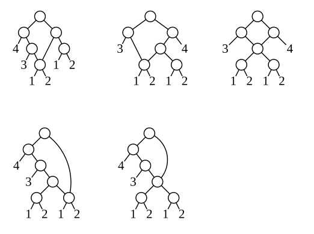](../../../assets/volume4a/figures/answer-7-1-2-20-five-chains.svg);

并且当 $r=(7,8,9)$ 时, 还必须分别考虑不是自顶向下和自底向上结构特例的另外 (653, 12387, 225660) 条潜在的链. 为了与表 1 比较, 下面给出所得的统计数字:

| $C_c(f)$ | 类 | 函数 | $U_c(f)$ | 类 | 函数 | $L_c(f)$ | 类 | 函数 | $D_c(f)$ | 类 | 函数 |
| --- | --- | --- | --- | --- | --- | --- | --- | --- | --- | --- | --- |
| 0 | 2 | 10 | 0 | 2 | 10 | 0 | 2 | 10 | 0 | 2 | 10 |
| 1 | 1 | 48 | 1 | 1 | 48 | 1 | 1 | 48 | 1 | 1 | 48 |
| 2 | 2 | 256 | 2 | 2 | 256 | 2 | 2 | 256 | 2 | 7 | 684 |
| 3 | 7 | 940 | 3 | 7 | 940 | 3 | 7 | 940 | 3 | 59 | 17064 |
| 4 | 9 | 2336 | 4 | 9 | 2336 | 4 | 7 | 2048 | 4 | 151 | 47634 |
| 5 | 24 | 6464 | 5 | 21 | 6112 | 5 | 20 | 5248 | 5 | 2 | 96 |
| 6 | 30 | 10616 | 6 | 28 | 9664 | 6 | 23 | 8672 | 6 | 0 | 0 |
| 7 | 61 | 18984 | 7 | 45 | 15128 | 7 | 37 | 11768 | 7 | 0 | 0 |
| 8 | 45 | 17680 | 8 | 40 | 14296 | 8 | 27 | 10592 | 8 | 0 | 0 |
| 9 | 37 | 7882 | 9 | 23 | 8568 | 9 | 33 | 11536 | 9 | 0 | 0 |
| 10 | 4 | 320 | 10 | 28 | 5920 | 10 | 16 | 5472 | 10 | 0 | 0 |
| 11 | 0 | 0 | 11 | 6 | 1504 | 11 | 30 | 6304 | 11 | 0 | 0 |
| 12 | 0 | 0 | 12 | 5 | 576 | 12 | 3 | 960 | 12 | 0 | 0 |
| 13 | 0 | 0 | 13 | 3 | 144 | 13 | 8 | 1472 | 13 | 0 | 0 |
| 14 | 0 | 0 | 14 | 2 | 34 | 14 | 2 | 96 | 14 | 0 | 0 |
| 15 | 0 | 0 | 15 | 0 | 0 | 15 | 4 | 114 | 15 | 0 | 0 |

<a id="pdf-485"></a><a id="p-470"></a>

深度为 5 的两个函数类以 $S_{2,4}(x_1,x_2,x_3,x_4)$ 和 $x_1\oplus S_2(x_2,x_3,x_4)$ 为代表, 并且这两个函数以及 $S_2(x_1,x_2,x_3,x_4)$ 与奇偶性函数 $S_{1,3}(x_1,x_2,x_3,x_4)=x_1\oplus x_2\oplus x_3\oplus x_4$ 都具有长度 15. 此外 $U_c(S_{2,4})=U_c(S_{1,3})=14$. 代价为 10 的 4 类函数以 $S_{1,4}(x_1,x_2,x_3,x_4)$、$S_{2,4}(x_1,x_2,x_3,x_4)$、$(x_4?x_1\oplus x_2\oplus x_3:\langle x_1x_2x_3\rangle)$、$[(x_1x_2x_3x_4)_2\in\{0,1,4,7,10,13\}]$ 为代表. (附带指出, 其中第三个函数等价于 “哈佛的最难求值事例”(20).)

<a id="ans-7-1-2-21"></a>

**21.** [题目](../sec-7-1-2.md#ex-7-1-2-21) (哈佛的作者们指出, 他们的表项 “应当仅仅看成当今写作者所知的最节省的运算符”.) 他们最难求值的函数 (20) 的最小代价仍然是未知的, 但是戴维·史蒂文森已经证明了 $V(f)\le17$:

$$
\begin{aligned}
g&=\operatorname{AND}(\operatorname{NAND}(w,x),\operatorname{NAND}(\bar w,\bar x));\\
f&=\operatorname{OR}\bigl(\operatorname{AND}(\operatorname{NOT}(g),\operatorname{NAND}(w,\bar z),\operatorname{NAND}(y,z)),\\
&\qquad\operatorname{AND}(\operatorname{NOT}(\operatorname{NOT}(g)),\operatorname{NAND}(y,\bar z),\operatorname{NAND}(\bar y,z))\bigr).
\end{aligned}
$$

虽然哈佛的研究人员未能找到这种特殊结构, 但是他们的工作是极其出色的, 在某些情况下超越足迹试探法达 6 个栅极!

<a id="ans-7-1-2-22"></a>

**22.** [题目](../sec-7-1-2.md#ex-7-1-2-22) 当且仅当 $\nu(x_1x_2x_3x_4)\in\{2,3\}$ 且 $\nu(x_1x_2x_3x_4x_5)$ 是奇数时有 $\nu(x_1x_2x_3x_4x_5)=3$. 类似地, $S_2(x_1,x_2,x_3,x_4,x_5)=S_3(\bar x_1,\bar x_2,\bar x_3,\bar x_4,\bar x_5)$ 合并 $S_{1,2}(\bar x_1,\bar x_2,\bar x_3,\bar x_4)$:

[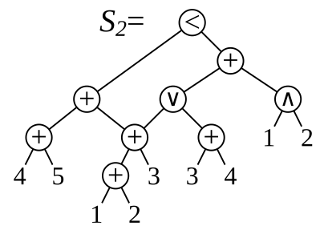](../../../assets/volume4a/figures/answer-7-1-2-22-symmetric-two.svg)

<a id="ans-7-1-2-23"></a>

**23.** [题目](../sec-7-1-2.md#ex-7-1-2-23) 因为对称函数的补也是对称的, 我们只需考虑图 9 的 32 种正规函数事例. 然后可以利用像 $S_{1,2}(x)=S_{3,4}(\bar x)$ 那样的反射以及可能像 $S_{2,3,4,5}(x)=\bar S_{0,1}(x)=\bar S_{4,5}(\bar x)$ 那样的求补导出大多数剩余事例. 自然 $S_5,S_{1,3,5}$ 和 $S_{1,2,3,4,5}$ 通常的代价是 4. 那样就仅留下 $S_{1,2,3,4}(x_1,x_2,x_3,x_4,x_5)=(x_1\oplus x_2)\vee(x_2\oplus x_3)\vee(x_3\oplus x_4)\vee(x_4\oplus x_5)$, 对于一般的 $n$, 这种情况在习题 79 中讨论.

<a id="ans-7-1-2-24"></a>

**24.** [题目](../sec-7-1-2.md#ex-7-1-2-24) 如正文中指出的, 这个猜测对于 $n\le5$ 成立.

<a id="ans-7-1-2-25"></a>

**25.** [题目](../sec-7-1-2.md#ex-7-1-2-25) 它是非平凡正规函数的数目 $2^{2^n-1}-n-1$. (在长度为 $r$ 的不包含所有这些函数的任何正规链中, 对于 $1\le j,k\le n+r$ 范围内的某些 $j$ 和 $k$ 以及某个正规二元运算符 $\circ$, $x_j\circ x_k$ 将是一个新函数, 因此我们可以用每个新的步骤计算一个新函数, 直到获得它们全部的值.)

<a id="ans-7-1-2-26"></a>

**26.** [题目](../sec-7-1-2.md#ex-7-1-2-26) 假. 例如, 如果 $g=S_{1,3}(x_1,x_2,x_3)$ 且 $h=S_{2,3}(x_1,x_2,x_3)$, 那么 $C(gh)=5$ 是全加器的代价. 但是由图 9, $f=S_{2,3}(x_0,x_1,x_2,x_3)$ 的代价为 6.

<a id="ans-7-1-2-27"></a>

**27.** [题目](../sec-7-1-2.md#ex-7-1-2-27) 能: 操作

```text
x2 ← x2 ⊕ x1
x1 ← x1 ⊕ x3
x1 ← x1 ∧ x̄2
x1 ← x1 ⊕ x3
x2 ← x2 ⊕ x3
```

把 $(x_1,x_2,x_3)$ 转换为 $(z_1,z_0,x_3)$.

<a id="ans-7-1-2-28"></a>

**28.** [题目](../sec-7-1-2.md#ex-7-1-2-28) 令 $v'=v''=v\oplus(x\oplus y)$; $u'=((v\oplus y)\mathbin{\overline\supset}(x\oplus y))\oplus u$, $u''=((v\oplus y)\vee(x\oplus y))\oplus u$. 因此, 如果 $j$ 是奇数, 我们可以置 $u_0\gets0,v_0\gets x_1,u_j\gets((v_{j-1}\oplus x_{2j+1})\vee(x_{2j}\oplus x_{2j+1}))\oplus u_{j-1}$; 如果 $j$ 是偶数, 置 $u_j\gets((v_{j-1}\oplus x_{2j+1})\mathbin{\overline\supset}(x_{2j}\oplus x_{2j+1}))\oplus u_{j-1}$. 并且置 $v_j\gets v_{j-1}\oplus(x_{2j}\oplus x_{2j+1})$, 得到 $(u_jv_j)_2=(-1)^j(x_1+\cdots+x_{2j+1})\bmod4\ (0\le j\le\lfloor n/2\rfloor)$. 如果 $n$ 是偶数置 $x_{n+1}\gets0$. 因此在 $\lfloor5n/2\rfloor-2$ 步内计算出 $[(x_1+\cdots+x_n)\bmod4=0]=\bar u_{\lfloor n/2\rfloor}\wedge\bar v_{\lfloor n/2\rfloor}$.

这个结构归功于拉里·斯托克迈尔, 他证明了这几乎是最优的. 实际上, 习题 80 的结果以及图 9 和图 10 证明, 对于所有 $n\ge5$, 它比可能的最佳链最多超过一步.

顺便指出, 类似的公式 $u'''=((v\oplus y)\wedge(x\oplus y))\oplus u$ 产生 $(u'''v')_2=((uv)_2+x-y)\bmod4$. 看起来更简单的函数 $((uv)_2+x+y)\bmod4$ 的代价是 6 而不是 5.

<a id="ans-7-1-2-29"></a>

**29.** [题目](../sec-7-1-2.md#ex-7-1-2-29) 为了获得一个上界, 假定每个全加器或半加器将深度增加 3. 如果存在权为 $2^j$ 且深度为 $3d$ 的 $a_{jd}$ 个二进制位, 我们最多排定权为 $\{2^j,2^{j+1}\}$ 且深度为 $3(d+1)$ 的随后 $\lceil a_{jd}/3\rceil$ 个二进制位. 由归纳法推出 $a_{jd}\le\binom dj3^{-d}n+4$. 因此当 $d\ge l=\lceil\log_{3/2}n\rceil$ 时有 $a_{jd}\le4$. 由此可见 $a_{j(j+l+3)}=0\ (0\le j\le\lg n)$ 给出总深度小于等于 $3(l+\lg n+2)$. (实际的深度结果是, 当 $n=10^7$ 时恰好为 101, 当 $n=10^8$ 时是 118, 当 $n=10^9$ 时是 133.)


<a id="pdf-486"></a><a id="p-471"></a>

<a id="ans-7-1-2-30"></a>

**30.** [题目](../sec-7-1-2.md#ex-7-1-2-30) 照例让 $\nu n$ 表示 $n$ 自身二进制表示的位叠加和. 那么 $s(n)=5n-2\nu n-3\lfloor\lg n\rfloor-3$.

<a id="ans-7-1-2-31"></a>

**31.** [题目](../sec-7-1-2.md#ex-7-1-2-31) 在 $s(n)<5n$ 步的位叠加加法之后, 由定理 L, 一个 $(z_{\lfloor\lg n\rfloor},\ldots,z_0)$ 的任意函数可以用最多 $\sim2n/\lg n$ 步求值. [见奥列格·卢帕诺夫,*Doklady Akademii Nauk SSSR* **140** (1961), 322–325. 习题 7.2.2.2-481 把 $5n$ 改进为 $4.5n$.]

<a id="ans-7-1-2-32"></a>

**32.** [题目](../sec-7-1-2.md#ex-7-1-2-32) 用自展方法: 首先用对 $n$ 的归纳法证明 $t(n)\le2^{n+1}$.

<a id="ans-7-1-2-33"></a>

**33.** [题目](../sec-7-1-2.md#ex-7-1-2-33) 假, 在一个技术性细节上有误: 比如说, 如果 $N=\sqrt n$, 至少需要 $n$ 步. 但是, 如果首先注意到, 当 $N\ge2^{n-1}$ 时正文中的方法给出 $N+O(\sqrt N)$, 可以证明正确的渐近公式是 $N+O(\sqrt N)+O(n)$. 否则, 如果 $\lfloor\lg N\rfloor=n-k-1$, 我们可以用 $O(n)$ 个操作来对量 $\bar x_1\wedge\cdots\wedge\bar x_k$ 与其他变量 $x_{k+1},\ldots,x_n$ 进行 AND 运算, 然后用减去 $k$ 的 $n$ 继续进行.

(推论: 我们可以用代价 $s(n)+n+O(\sqrt n)=6n+O(\sqrt n)$ 和深度 $O(\log n)$ 计算对称函数 $\{S_1,S_2,\ldots,S_n\}$.)

<a id="ans-7-1-2-34"></a>

**34.** [题目](../sec-7-1-2.md#ex-7-1-2-34) 我们说, 扩充的优先编码器有 $n+1=2^m$ 个输入 $x_0x_1\ldots x_n$ 和 $m+1$ 个输出 $y_0y_1\ldots y_m$, 其中 $y_0=x_0\vee x_1\vee\cdots\vee x_n$. 如果 $Q'_m$ 和 $Q''_m$ 是 $x'_0\ldots x'_n$ 和 $x''_0\ldots x''_n$ 的扩充的编码器, 那么, 如果我们定义 $y_0=y'_0\vee y''_0,y_1=y''_0,y_2=y_1?y''_1:y'_1,\ldots,y_{m+1}=y_1?y''_m:y'_m$, 则 $Q_{m+1}$ 也对 $x'_0\ldots x'_nx''_0\ldots x''_n$ 起作用. 如果 $P'_m$ 是 $x'_1\ldots x'_n$ 的普通优先编码器, 则我们可以用类似的方法获得对于 $x'_1\ldots x'_nx''_0\ldots x''_n$ 的 $P_{m+1}$.

从 $m=2$ 和 $y_2=x_3\vee(x_1\wedge\bar x_2),y_1=x_2\vee x_3,y_0=x_0\vee x_1\vee y_1$ 开始, 这个结构产生代价为 $p_m$ 和 $q_m$ 的 $P_m$ 和 $Q_m$, 其中 $p_2=3,q_2=5,p_{m+1}=3m+p_m+q_m,q_{m+1}=3m+1+2q_m\ (m\ge2)$. 因此 $p_m=q_m-m$ 且 $q_m=15\cdot2^{m-2}-3m-4\approx3.75n$.

<a id="ans-7-1-2-35"></a>

**35.** [题目](../sec-7-1-2.md#ex-7-1-2-35) 如果 $n=2m$, 计算 $x_1\wedge x_2,\ldots,x_{n-1}\wedge x_n$, 然后对于 $1\le k\le m$ 递归地建立 $x_1\wedge\cdots\wedge x_{2k-2}\wedge x_{2k+1}\wedge\cdots\wedge x_n$, 并且再用 $n$ 步结束. 如果 $n=2m-1$, 对 $n+1$ 个元素使用这条链, 通过置 $x_{n+1}\gets1$, 可以消除 3 步. [英戈·韦格纳,*The Complexity of Boolean Functions* (1987), 习题 3.25. 同样的思想可以用在以任何可结合的且可交换的运算符代替 $\wedge$ 的情况下.]

<a id="ans-7-1-2-36"></a>

**36.** [题目](../sec-7-1-2.md#ex-7-1-2-36) 递归地构造 $P_n(x_1,\ldots,x_n)$ 和 $Q_n(x_1,\ldots,x_n)$ 如下, 其中, 对于 $1\le j\le n$, $P_n$ 有 $D(y_j)\le\lceil\lg n\rceil$ 且 $Q_n$ 有 $D(y_j)\le\lceil\lg n\rceil+[j\ne n]$; $n=1$ 是平凡的情形. 在其他情况下, $P_n$ 是通过置 $y_j\gets y'_j\ (1\le j\le r)$, $y_j\gets y'_r\wedge y''_{j-r}\ (r<j\le n)$, 从 $Q'_r(x_1,\ldots,x_r)$ 和 $P''_s(x_{r+1},\ldots,x_n)$ 得到的, 其中 $r=\lceil n/2\rceil$ 且 $s=\lfloor n/2\rfloor$. 并且 $Q_n$ 是通过置 $y_1\gets x_1,y_{2j}\gets y'_j,y_{2j+1}\gets y'_j\wedge x_{2j+1}\ (1\le j<s)$, $y_{2s}\gets y'_s,y_n\gets y'_r$, 从 $P'_r(x_1\wedge x_2,\ldots,x_{n-1}\wedge x_n)$ 或 $P'_r(x_1\wedge x_2,\ldots,x_{n-2}\wedge x_{n-1},x_n)$ 得到的.

这些计算可以用最小存储实现, 对于某些下标 $j(i)<k(i)$ 在第 $i$ 步置 $x_{k(i)}\gets x_{j(i)}\wedge x_{k(i)}$. 因此我们可以用类似于排序网络的图形说明这个结构. 例如,

[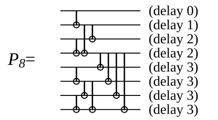](../../../assets/volume4a/figures/answer-7-1-2-36-P8.svg)

[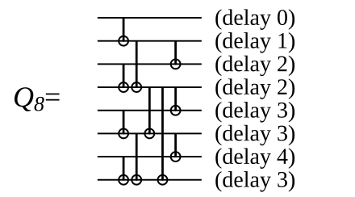](../../../assets/volume4a/figures/answer-7-1-2-36-Q8.svg)

当 $n>1$ 时, 代价 $p_n$ 和 $q_n$ 满足 $p_n=\lfloor n/2\rfloor+q_{\lceil n/2\rceil}+p_{\lfloor n/2\rfloor}$, $q_n=2\lfloor n/2\rfloor-1+p_{\lceil n/2\rceil}$. 例如, $(p_1,\ldots,p_7)=(q_1,\ldots,q_7)=(0,1,2,4,5,7,9)$. 令 $\bar p_n=4n-p_n,\bar q_n=3n-q_n$ 导致更简单的公式, 由此证明 $p_n<4n$ 且 $q_n<3n$: $\bar q_n=\bar p_{\lceil n/2\rceil}+[n\text{是偶数}]$; $\bar p_{4n}=\bar p_{2n}+\bar p_n+1$, $\bar p_{4n+1}=\bar p_{2n}+\bar p_{n+1}+1$, $\bar p_{4n+2}=\bar p_{2n+1}+\bar p_{n+1}$, $\bar p_{4n+3}=\bar p_{4n+2}+2$. 特别地, $1+\bar p_{2^m}=F_{m+5}$ 是一个斐波那契数.

[见 *JACM* **27** (1980), 831–834. 如果当 $n$ 是 2 的乘方时用 ($Q_{2n}$ 和 $y_{2n+1}=y_{2n}\wedge x_{2n+1}$) 替换 $Q_{2n+1}$, 用 $Q_5$ 和 $Q_6$ 替换 $P_5$ 和 $P_6$, 并且用 $(Q_9,Q_{10},Q_{11},Q_{17})$ 替换 $(P_9,P_{10},P_{11},P_{17})$, 我们得到稍微好一些的链.]

注意, 如果用任何可结合的运算符代替 “$\wedge$”, 这个结构通常也适用. 特别地, 对于 $1\le k\le n$, 前缀 $x_1\oplus\cdots\oplus x_k$ 的序列定义了从格雷二进制码到二进制整数的转换公式 7.2.1.1-(10).


<a id="pdf-487"></a><a id="p-472"></a>

<a id="ans-7-1-2-37"></a>

**37.** [题目](../sec-7-1-2.md#ex-7-1-2-37) 下图说明 $m=15,n=16$ 的情形.

[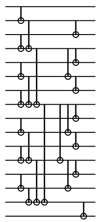](../../../assets/volume4a/figures/answer-7-1-2-37-S15-16.svg)

(a) 令 $x_{i..j}$ 表示 $x_i\wedge\cdots\wedge x_j$ 的原先值. 每当算法置 $x_k\gets x_j\wedge x_k$ 时, 我们可以证明 $x_k$ 的先前值是 $x_{j+1..k}$. 在步骤 S1 之后, $x_k$ 是 $x_{f(k)+1..k}$, 其中 $f(k)=k\mathbin{\&}(k-1)\ (1\le k<m)$ 且 $f(m)=0$. 在步骤 S2 之后, $x_k$ 是 $x_{1..k}\ (1\le k\le m)$.

(b) S1 的代价是 $m-1$, S2 的代价是 $m-1-\lceil\lg m\rceil$, S3 的代价是 $n-m$. 对于 $1\le k<m$, $x_k$ 的最终延迟是 $\lfloor\lg k\rfloor+\nu k-1$, 对于 $m\le k\le n$ 是 $\lceil\lg m\rceil+k-m$. 因此, 对于 $m<4$, $\{x_1,\ldots,x_{m-1}\}$ 的最大延迟结果是 $g(m)=m-1$, 对于 $m\ge4$ 是 $g(m)=\lfloor\lg m\rfloor+\lfloor\lg(m/3)\rfloor$. 我们有 $c(m,n)=m+n-2-\lceil\lg m\rceil$, $d(m,n)=\max(g(m),\lceil\lg m\rceil+n-m)$. 因此, 每当 $n\ge m+g(m)-\lceil\lg m\rceil$ 时 $c(m,n)+d(m,n)=2n-2$.

(c) 值的一个表揭示当 $n<8$ 时 $d(n)=\lceil\lg n\rceil$, 而当 $n\ge8$ 时 $d(n)=\lfloor\lg(n-\lfloor\lg n\rfloor+3)\rfloor+\lfloor\lg(\tfrac23(n-\lfloor\lg n\rfloor+3))\rfloor-1$. 说明这一点的另一种方式是, 当且仅当对于某个 $k>1$ 有 $n=2^k+k-3$ 或 $2^k+2^{k-1}+k-3$ 时, 我们有 $d(n)>d(n-1)$ 且 $n>2$. 当 $n<8$ 时, 对于 $m=n$ 出现用最小代价的最小 $d(n)$ 值. 在其他情况下, 对于 $m=n-\lfloor\lg(\tfrac23(n-\lfloor\lg n\rfloor+3))\rfloor+2-[\text{对于某个}k\text{有}n=2^k+k-3]$ 出现这个最小值.

(d) 置 $m\gets m(n,d)$, 其中 $m(n,d(n))$ 是在前一段定义的, 并且当 $d>d(n)$ 时 $m(n,d)=m(n-1,d-1)$. [见 *J. Algorithms* **7** (1986), 185–201.]

<a id="ans-7-1-2-38"></a>

**38.** [题目](../sec-7-1-2.md#ex-7-1-2-38) (a) 自顶向下, $f_k(x_1,\ldots,x_n)$ 是一个初等对称函数, 又称为门限函数 $S_{\ge k}(x_1,\ldots,x_n)$. (见习题 5.3.4-28 和等式 7.1.1-(90).)

(b) 像在习题 33 的答案中那样, 在用 $\approx6n$ 步计算出 $\{S_1,\ldots,S_n\}$ 后, 我们可以用习题 37 的方法继续进行 $2n$ 步完成求值.

但是更有趣的是为计算对于 $0\le k\le2^m$ 的 $2^m+1$ 个门限函数 $g_k(x_1,\ldots,x_m)=[(x_1\ldots x_m)_2\ge k]$ 设计一条特殊的布尔链. 由于 $[(x'x'')_2\ge(y'y'')_2]=[(x')_2\ge(y')_2+1]\vee([(x')_2\ge(y')_2]\wedge[(x'')_2\ge(y'')_2])$, 采用类似于二进制译码器的一种分而治之的结构最多以 $2t(m)$ 的代价求解这个问题.

此外, 如果 $2^{m-1}\le n<2^m$, 用这种方法计算 $\{g_1,\ldots,g_n\}$ 的代价 $u(n)$ 结果是 $2n+O(\sqrt n)$, 在 $n$ 很小时这是非常合理的:

| $n$ | $u(n)$ |
| --- | --- |
| 1 | 0 |
| 2 | 1 |
| 3 | 2 |
| 4 | 4 |
| 5 | 7 |
| 6 | 7 |
| 7 | 8 |
| 8 | 12 |
| 9 | 15 |
| 10 | 17 |
| 11 | 19 |
| 12 | 19 |
| 13 | 20 |
| 14 | 21 |
| 15 | 22 |
| 16 | 27 |
| 17 | 32 |
| 18 | 34 |
| 19 | 36 |
| 20 | 36 |

从位叠加加法开始, 我们可以用 $s(n)+u(n)\approx7n$ 步对 $n$ 个布尔值排序. 当 $n=4$ 时, 一个代价为 $2\hat S(n)$ 的排序网络更好, 但是, 当 $n\ge8$ 时它不再是最好的. [见 5.3.4-(11). 戴维·马勒和佛朗哥·普雷帕拉塔,*JACM* **22** (1975), 195–201.]

<a id="ans-7-1-2-39"></a>

**39.** [题目](../sec-7-1-2.md#ex-7-1-2-39) [*IEEE Transactions* **C-29** (1980), 737–738.] 由恒等式

$$
M_{r+s}(x_1,\ldots,x_r,x_{r+1},\ldots,x_{r+s};y_0,\ldots,y_{2^{r+s}-1})
=M_r(x_1,\ldots,x_r;y'_0,\ldots,y'_{2^r-1}),
$$

其中 $y'_j=\bigvee_{k=0}^{2^s-1}(d_k\wedge y_{2^sj+k})$ 和 $d_k$ 是对 $(x_{r+1},\ldots,x_{r+s})$ 应用 $s$ 到 $2^s$ 译码器的第 $k$ 个输出, 证明 $C(M_{r+s})\le C(M_r)+2^{r+s}+2^r(2^s-1)+t(s)$, 这里的 $t(s)$ 是译码器的代价 (30). 深度是 $D(M_{r+s})=\max(D_x(M_{r+s}),D_y(M_{r+s}))$, 其中 $D_x$ 和 $D_y$ 表示变量 $x$ 和 $y$ 的最大深度. 我们有 $D_x(M_{r+s})\le\max(D_x(M_r),1+s+\lceil\lg s\rceil+D_y(M_r))$ 且 $D_y(M_{r+s})\le1+s+D_y(M_r)$.

取 $r=\lceil m/2\rceil$ 且 $s=\lfloor m/2\rfloor$, 得到 $C(M_m)\le2^{m+1}+O(2^{m/2})$, $D_y(M_m)\le m+1+\lceil\lg m\rceil$, $D_x(M_m)\le D_y(M_m)+\lceil\lg m\rceil$.

<a id="ans-7-1-2-40"></a>

**40.** [题目](../sec-7-1-2.md#ex-7-1-2-40) 例如, 我们可以令 $f_{nk}(x)=\bigvee_{j=1}^{n+1-k}(l_j(x)\wedge r_{j+k-1}(x))$, 其中

$$
l_j(x)=\begin{cases}
x_j,&\text{如果 }j\bmod k=0,\\
x_j\wedge l_{j+1}(x),&\text{如果 }j\bmod k\ne0,
\end{cases}\qquad\text{对于 }1\le j\le n-(n\bmod k);
$$

$$
r_j(x)=\begin{cases}
1,&\text{如果 }j\bmod k=0,\\
x_j\wedge r_{j-1}(x),&\text{如果 }j\bmod k\ne0,
\end{cases}\qquad\text{对于 }k\le j\le n.
$$


<a id="pdf-488"></a><a id="p-473"></a>

代价是 $4n-3k-3\lfloor n/k\rfloor-\lfloor(n-1)/k\rfloor+2-(n\bmod k)$.

当 $n$ 是小的数或 $k$ 是小的数时, 一个递归解是更可取的: 注意

$$
f_{nk}(x)=\begin{cases}
\begin{aligned}x_{n-k+1}\wedge\cdots\wedge x_k\wedge{}\\
f_{(2n-2k)(n-k)}(x_1,\ldots,x_{n-k},x_{k+1},\ldots,x_n),\end{aligned}&\text{对于 }k<n<2k;\\[6pt]
\begin{aligned}f_{\lfloor(n+k)/2\rfloor k}(x_1,\ldots,x_{\lfloor(n+k)/2\rfloor})\vee{}\\
f_{\lfloor(n+k-1)/2\rfloor k}(x_{\lfloor(n-k)/2\rfloor+1},\ldots,x_n),\end{aligned}&\text{对于 }n\ge2k.
\end{cases}
$$

当 $k\le n<2k$ 时, 可以证明这个解的代价等于 $n-1+\sum_{j=1}^{n-k}\lfloor\lg j\rfloor$, 并且当 $n\to\infty$ 时它渐近位于 $(m+\alpha_k-1)n+O(km)$ 和 $(m+2-2/\alpha_k)n+O(km)$ 之间, 其中 $m=\lfloor\lg k\rfloor$ 且 $1<\alpha_k=(k+1)/2^m\le2$.

把这两种方法结合起来更好, 最优代价是未知的.

<a id="ans-7-1-2-41"></a>

**41.** [题目](../sec-7-1-2.md#ex-7-1-2-41) 当 $x$ 和 $y$ 有 $n=2^m$ 个二进制位时, 令 $c(m)$ 是用条件求和计算 $(x)_2+(y)_2$ 和 $(x)_2+(y)_2+1$ 的代价, 并且令 $c'(m)$ 是只计算更简单的 $(x)_2+(y)_2$ 问题的代价. 那么 $c(m+1)=2c(m)+6\cdot2^m+2$, $c'(m+1)=c(m)+c'(m)+3\cdot2^m+1$. (和的二进制位 $z_n$ 的代价是 1, 但是对于 $n<k\le2n+1$ 的二进制位 $z_k$ 的代价是 3, 因为它们具有 $c?a_k:b_k$ 的形式, 其中 $c$ 是进位位.) 如果我们从 $n=1$ 和 $c(0)=3,c'(0)=2$ 开始, 解是 $c(m)=(3m+5)2^m-2$, $c'(m)=(3m+2)2^m-m$. 但是对于 $n=2$ 的情形的改进的结构使我们可以从 $c(1)=11$ 和 $c'(1)=7$ 开始, 于是解是 $c(m)=(3m+\tfrac72)2^m-2$, $c'(m)=(3m+\tfrac12)2^m-m+1$. 无论哪种情况, 深度都是 $2m+1$. [见杰克·斯克兰斯基,*IRE Transactions* **EC-9** (1960), 226–231.]

<a id="ans-7-1-2-42"></a>

**42.** [题目](../sec-7-1-2.md#ex-7-1-2-42) (a) 由于 $\langle x_ky_kc_k\rangle=u_k\vee(v_k\wedge c_k)$, 我们可以用式 (26) 和归纳法证明.

(b) 注意 $U_k^{k+1}=u_k$ 且 $V_k^{k+1}=v_k$, 用对 $j-i$ 的归纳法证明. [见阿诺德·温伯格和约翰·史密斯,*IRE Transactions* **EC-5** (1956), 65–73; 理查德·布伦特和孔祥重,*IEEE Transactions* **C-31** (1982), 260–264.]

(c) 首先, 对于 $l=1,2,\ldots,m-1$, 以及对于 $1\le k\le n$, 就 $h(l)$ 在范围 $k_l\ge i\ge k_{l+1}$ 内的所有倍数 $i$ 计算 $V_i^k$, 其中 $k_l=h(l)\lfloor(k-1)/h(l)\rfloor$ 表示 $h(l)$ 的比 $k$ 小的最大倍数. 例如, 当 $l=3$ 且 $k=99$ 时, 我们计算 $V_{96}^{99},V_{88}^{99}=V_{96}^{99}\wedge V_{88}^{96},V_{80}^{99}=V_{88}^{99}\wedge V_{80}^{88},\ldots,V_{64}^{99}=V_{72}^{99}\wedge V_{64}^{72}$. 这是利用当 $l=2$ 时计算的值 $V_{96}^{99},V_{88}^{96},V_{80}^{88},\ldots,V_{64}^{72}$ 的前置部分计算. 利用习题 36 的方法, 第 $l$ 步对深度最多增加 $l$ 级, 并且它总共需要 $(p_1+p_2+\cdots+p_{2^l})n/2^l=O(2^ln)$ 个门.

然后, 再次对于 $l=1,2,\ldots,m-1$ 以及对于 $1\le k\le n$, 利用 “展开的” 公式

$$
U_{k_{l+1}}^k=U_{k_l}^k\vee\bigvee_{\substack{k_l>j\ge k_{l+1}\\h(l)\mid j}}(V_{j+h(l)}^k\wedge U_j^{j+h(l)}),
$$

计算对于 $i=k_{l+1}$ 的 $U_i^k$. 例如, 当 $l=3$ 且 $k=99$ 时, 展开的公式是

$$
U_{64}^{99}=U_{96}^{99}\vee(V_{96}^{99}\wedge U_{88}^{96})\vee(V_{88}^{99}\wedge U_{80}^{88})\vee(V_{80}^{99}\wedge U_{72}^{80})\vee(V_{72}^{99}\wedge U_{64}^{72}).
$$

每个这样的 $U_i^k$ 最多是 $2^l$ 项的或, 因此除了每一项的深度外它可以用额外的小于等于 $l$ 的深度计算. 对于 $1\le k\le n$ 这个阶段的总代价是 $(0+2+4+\cdots+(2^l-2))n/2^l=O(2^ln)$.

因此计算所有需要的 $U$ 和 $V$ 的总代价是 $\sum_{l=1}^{m-1}O(2^ln)=O(2^mn)$. (此外, $V_0^k$ 这个量实际上是不需要的, 所以我们节省了 $\sum_{l=1}^{m-1}h(l)p_{2^l}$ 个门的代价.) 例如, 当 $m=(2,3,4,5)$ 时我们分别获得 $(2,8,64,1024)$ 位二进制数的加法的布尔链, 它们总的深度和代价分别是 $(3,7,11,16)$ 和 $(7,64,1254,48\,470)$.

<a id="pdf-489"></a><a id="p-474"></a>

[这个结构是瓦列里·赫拉普琴科在 *Problemy Kibernetiki* **19** (1967), 107–122 中提出的, 他还证明了如何把它同其他的方法组合, 将使总代价变为 $O(n)$, 同时仍然达到深度 $\lg n+O(\sqrt{\log n})$. 然而, 他的组合方法只有理论上的意义, 因为它在深度变成比 $2\lg n$ 小之前要求 $n>2^{64}$. 另外一种利用 (b) 中的递推达到小深度的方法可以建立在斐波那契数列的基础上: 斐波那契方法以深度 $\log_\phi n+O(1)\approx1.44\lg n$ 和代价 $O(n\log n)$ 计算进位. 例如, 它对二进制加法产生具有下述特征的布尔链:

| $n$ | 深度 | 代价 |
| --- | --- | --- |
| 4 | 6 | 24 |
| 8 | 7 | 71 |
| 16 | 9 | 186 |
| 32 | 10 | 467 |
| 64 | 12 | 1125 |
| 128 | 13 | 2648 |
| 256 | 15 | 6102 |
| 512 | 16 | 13 775 |
| 1024 | 18 | 30 861 |

见高德纳, 《斯坦福图库》(1994), 276–279.

查尔斯·巴贝奇对类似的十进制加法问题找到一种巧妙的机械解法, 宣称他的设计能够以常数时间相加任意精度的数. 为了使这种解法能够正常工作, 他需要严格的消除空隙的理想化部件. 见亨利·巴贝奇,*Babbage's Calculating Engines* (1889), 334–335. 颇不寻常的是, 一种等价的思想完全适用于物理晶体管, 虽然它不能用布尔链的方式表示. 见彼得·芬威克,*Comp. J.* **30** (1987), 77–79.]

<a id="ans-7-1-2-43"></a>

**43.** [题目](../sec-7-1-2.md#ex-7-1-2-43) (a) 令 $A=B=Q=\{0,1\},q_0=0$. 定义 $c(q,a)=d(q,a)=\bar q\wedge a$.

(b) 关键思想是建立函数 $d_1(q)\ldots d_{n-1}(q)$, 其中 $d_1(q)=d(q,a_1)$ 且 $d_j(q)=d(d_{j-1}(q),a_j)$. 换句话说, $d_1=d^{(a_1)}$ 且 $d_j=d_{j-1}\circ d^{(a_j)}$, 其中 $d^{(a)}$ 是取 $q\mapsto d(q,a)$ 的函数, $\circ$ 表示函数复合. 每个函数 $d_j$ 可以用二进制记数法编码, 而 $\circ$ 是对这些二进制表示的一个可结合的运算. 因此, 函数 $d_1d_2\ldots d_{n-1}$ 是前缀 $d^{(a_1)},d^{(a_1)}\circ d^{(a_2)},\ldots,d^{(a_1)}\circ\cdots\circ d^{(a_{n-1})}$, 并且 $q_1q_2\ldots q_n=q_0d_1(q_0)\ldots d_{n-1}(q_0)$.

(c) 用函数的真值表 $f_0f_1$ 表示函数 $f(q)$. 那么函数复合 $f_0f_1\circ g_0g_1$ 是 $h_0h_1$, 其中函数 $h_0=f_0?g_1:g_0$ 和 $h_1=f_1?g_1:g_0$ 是可以用代价 3 和深度 2 计算的多路复用器函数. (组合的代价 $C(h_0h_1)$ 只有 5, 但是我们可以尽力保持小深度.)$d^{(a)}$ 的真值表是 $a0$. 利用习题 36, 我们因此可以用代价 $\le6p_{n-1}<24n$ 和深度 $\le2\lceil\lg(n-1)\rceil$ 计算真值表 $d_{10}d_{11}d_{20}d_{21}\ldots d_{(n-1)0}d_{(n-1)1}$. 于是 $b_1=a_1$, 并且 $b_j=\bar q_j\wedge a_j=\bar d_{(j-1)0}\wedge a_j\ (j>1)$. (这些代价的估值是很保守的. 由于 $d^{(a_j)}$ 的初始真值表含有 0, 以及许多中间值 $d_{j1}$ 不被使用, 会出现大量的简化. 例如, 当 $n=5$ 时, 实际的代价仅为 10 而不是 $6p_{n-1}+(n-1)=28$; 实际深度是 4 而不是 $2\lceil\lg(n-1)\rceil+1=5$. 注意, 对于 $1<j\le n$ 的简单布尔链 $b_j=a_j\wedge\bar b_{j-1}$ 也求解问题 (a), 它赢得代价, 但是达到深度 $n-1$.)

<a id="ans-7-1-2-44"></a>

**44.** [题目](../sec-7-1-2.md#ex-7-1-2-44) 可以把输入看成串 $x_0y_0x_1y_1\ldots x_{n-1}y_{n-1}$, 它的元素属于 4 字母表 $A=\{00,01,10,11\}$, 表示一个可能的进位位, 存在带有初始状态 $q_0=0$ 的两个状态 $Q=\{0,1\}$. 输出字母表是 $B=\{0,1\}$, 并且我们有 $c(q,xy)=q\oplus x\oplus y$, $d(q,xy)=\langle qxy\rangle$. 因此, 在这种情况下, 有限状态转换器实际上是由一个全加器描述的.

当我们建立映射 $d^{(xy)}$ 时, $q$ 的 4 个可能的函数中仅出现 3 个. 可以把它们编码为 $u\vee(q\wedge v)$. 初始函数 $d^{(xy)}$ 有 $u=x\wedge y,v=x\oplus y$. 并且函数复合 $(uv)\circ(u'v')$ 是 $u''v''$, 其中 $u''=u'\vee(v'\wedge u)$ 且 $v''=v\wedge v'$.

例如, 当 $n=4$ 时, 利用习题 42 的记号, 布尔链具有下述形式: $U_k^{k+1}=x_k\wedge y_k,V_k^{k+1}=x_k\oplus y_k\ (0\le k<4)$; $U_0^2=U_1^2\vee(V_1^2\wedge U_0^1),U_2^4=U_3^4\vee(V_3^4\wedge U_2^3),V_2^4=V_2^3\wedge V_3^4$; $U_0^3=U_2^3\vee(V_2^3\wedge U_0^2)$; $U_0^4=U_2^4\vee(V_2^4\wedge U_0^2)$; $z_0=V_0^1,z_1=U_0^1\oplus V_1^2,z_2=U_0^2\oplus V_2^3,z_3=U_0^3\oplus V_3^4,z_4=U_0^4$. 总代价是 20, 最大深度 6 出现在 $z_3$ 的计算中.

一般说来, 按习题 36 的记号, 代价将是 $2n+3p_n$, 因为对于初始函数 $u$ 和 $v$ 需要 $2n$ 个门, 然后前缀计算需要 $3p_n$ 个门. 为了建立对于 $0<j<n$ 的 $z_j$ 需要的另外 $n-1$ 个门, 由我们不必计算对于 $1<j\le n$ 的 $V_0^j$ 的事实所补偿. 因此总代价是 $14\cdot2^m-3F_{m+5}+3$, 胜过条件求和方法 (然而它有深度 $2m+1$ 而非 $2m+2$):

| $n$ | 条件求和链的代价 | 拉德纳–费希尔链的代价 |
| --- | --- | --- |
| 2 | 7 | 7 |
| 4 | 25 | 20 |
| 8 | 74 | 52 |
| 16 | 197 | 125 |
| 32 | 492 | 286 |
| 64 | 1179 | 632 |
| 128 | 2746 | 1363 |
| 256 | 6265 | 2888 |
| 512 | 14 072 | 6040 |
| 1024 | 31 223 | 12 509 |

[乔治·布尔为了证明可以通过算术运算理解逻辑, 引入了他的代数. 最终逻辑变得很好理解, 形势逆转过来: 香农和康拉德·楚泽等人在 20 世纪 30 年代开始设计用逻辑运算表示算术运算的电路, 自此以后发现了许多处理并行加法问题的方法. 尤里·奥夫曼设计了代价为 $O(n)$ 且深度为 $O(\log n)$ 的第一条布尔链, 见 *Doklady Akademii Nauk SSSR* **145** (1962), 48–51. 他的链类似于上面的结构, 但其深度近似于 $4m$.]


<a id="pdf-490"></a><a id="p-475"></a>

<a id="ans-7-1-2-45"></a>

**45.** [题目](../sec-7-1-2.md#ex-7-1-2-45) 那样的论证看起来的确更简单, 但是不足以证明所要求的结果. (许多扇出为 0 的步骤的链抬高了这种更简单的估计.) 正文采用的置换增强的证明方法是由约翰·萨维奇在其 *The Complexity of Computing* (New York: Wiley, 1976) 一书的定理 3.4.1 中引入的.

<a id="ans-7-1-2-46"></a>

**46.** [题目](../sec-7-1-2.md#ex-7-1-2-46) 当 $r=2^n/n+O(1)$ 时我们有 $\ln(2^{2r+1}(n+r-1)^{2r}/(r-1)!)=r\ln r+(1+\ln4)r+O(n)=(2^n/n)(n\ln2-\ln n+1+\ln4)+O(n)$. 因此 $\alpha(n)\le(n/(4e))^{-2^n/n+O(n/\log n)}$, 当 $n>4e$ 时它确实非常快地趋近于 0.

(实际上, (32) 给出 $\alpha(11)<7.6\times10^7,\alpha(12)<4.2\times10^{-6},\alpha(13)<1.2\times10^{-38}$.)

<a id="ans-7-1-2-47"></a>

**47.** [题目](../sec-7-1-2.md#ex-7-1-2-47) 限于对 $(r-m)!$ 个事例的置换, 其中 $i\pi=i\ (1\le i\le n)$ 和 $(n+r+1-k)\pi$ 是第 $k$ 个输出. 于是我们得到代替 (32) 的 $(r-m)!c(m,n,r)\le2^{2r+1}(n+r-1)^{2r}$. 因此, 像在习题 46 中那样, 当 $m=O(2^n/n^2)$ 时, 几乎所有这样的函数都有超过 $2^nm/(n+\lg m)$ 的代价.

<a id="ans-7-1-2-48"></a>

**48.** [题目](../sec-7-1-2.md#ex-7-1-2-48) (a) 不必奇怪, 关于 $C(n)$ 的这个下界当 $n$ 很小时是比较粗略的:

| $n$ | $r(n)$ |
| --- | --- |
| 1 | 1 |
| 2 | 1 |
| 3 | 2 |
| 4 | 3 |
| 5 | 5 |
| 6 | 9 |
| 7 | 16 |
| 8 | 29 |
| 9 | 54 |
| 10 | 99 |
| 11 | 184 |
| 12 | 343 |
| 13 | 639 |
| 14 | 1196 |
| 15 | 2246 |
| 16 | 4229 |

(b) 自展方法 [见《具体数学》9.4 节] 产生

$$
r(n)=\frac{2^n}{n}\left(1+\frac{\lg n-2-1/\ln2}{n}+O\left(\frac{\log n}{n^2}\right)\right).
$$

<a id="ans-7-1-2-49"></a>

**49.** [题目](../sec-7-1-2.md#ex-7-1-2-49) 可以用长度小于等于 $r$ 的公式表示的正规布尔函数最多有 $5^rn^{r+1}g_r$ 个, 其中 $g_r$ 是具有 $r$ 个内部结点的有向二叉树的数目. 在这个公式中置 $r=2^n/\lg n-2^{n+2}/(\lg n)^2$, 再除以 $2^{2^n-1}$, 得到 $L(f)\le r$ 的函数的数目的上界所占的比例. 根据习题 2.3.4.4-7, 这个结果迅速趋近于 0, 因为它是 $O((5\alpha/16)^{2^n/\lg n})$, 其中 $\alpha\approx2.483$.

[约翰·赖尔登和香农在 *J. Math. and Physics* **21** (1942), 83–93 中获得了串行–并行开关网络的一个类似的下界. 这样的网络等价于仅限于使用定向运算符的公式. 拉斐尔·克里切夫斯基在 *Problemy Kibernetiki* **2** (1959), 123–138 中获得了更一般的结果, 奥列格·卢帕诺夫在 *Prob. Kibernetiki* **3** (1960), 61–80 中给出一个渐近匹配的上界.]

<a id="ans-7-1-2-50"></a>

**50.** [题目](../sec-7-1-2.md#ex-7-1-2-50) (a) 像在习题 7.1.1-30 中那样用子立方记号, 素蕴涵元是 `00001*`、`(0001*1)`、`0100*1`、`0111*1`、`1010*1`、`101*11`、`00*011`、`00*101`、`(01*111)`、`11*101`、`(0*1101)`、`(1*0101)`、`1*1011`、`0*0*11`、`*00101`、`(*01011)`、`(*11101)`, 其中一个最短的 DNF 的括号内的子立方中被删除. (b) 类似地, 素子款和一个最短的 CNF 由 `00111*`、`01010*`、`10110*`、`0110**`、`00*00*`、`11*00*`、`11*11*`、`(0*100*)`、`1*00**`、`1*0*1*`、`(1****0)`、`(*0000*)`、`(*1100*)`、`*1***0`、`**1**0`、`***1*0`、`(****00)` 给出. (因此, CNF 是 $(x_1\vee x_2\vee\bar x_3\vee\bar x_4\vee\bar x_5)\wedge(x_1\vee\bar x_2\vee x_3\vee\bar x_4\vee x_5)\wedge\cdots\wedge(\bar x_4\vee x_6)$.)

<a id="ans-7-1-2-51"></a>

**51.** [题目](../sec-7-1-2.md#ex-7-1-2-51)

$$
\begin{aligned}
f={}&\bigl([(x_5x_6)_2\in\{1\}]\wedge[(x_1x_2x_3x_4)_2\in\{1,3,4,7,9,10,13,15\}]\bigr)\\
&\vee\bigl([(x_5x_6)_2\in\{2,3\}]\wedge[(x_1x_2x_3x_4)_2\in\{0\}]\bigr)\\
&\vee\bigl([(x_5x_6)_2\in\{3\}]\wedge[(x_1x_2x_3x_4)_2\in\{1,2,4,5,7,10,11,14\}]\bigr).
\end{aligned}
$$

<a id="ans-7-1-2-52"></a>

**52.** [题目](../sec-7-1-2.md#ex-7-1-2-52) 小 $n$ 值的上界同渐近条件下的结果, 差异是相当大的:

| $n$ | $k$ | $l$ | (38) |
| --- | --- | --- | --- |
| 5 | 2 | 2 | 39 |
| 6 | 2 | 2 | 67 |
| 7 | 2 | 1 | 109 |
| 8 | 3 | 2 | 175 |
| 9 | 3 | 2 | 279 |
| 10 | 4 | 4 | 471 |
| 11 | 4 | 4 | 803 |
| 12 | 4 | 3 | 1329 |
| 13 | 5 | 6 | 2355 |
| 14 | 5 | 5 | 4045 |
| 15 | 5 | 5 | 7141 |
| 16 | 5 | 4 | 12 431 |

(当 $n$ 很小时, 这些上界非常弱. 例如, 我们知道当 $n=(1,2,3,4,5)$ 时 $C(n)=(0,1,4,7,12)$, 但是等式 7.1.1-(16) 给出 $C(n+1)\le2C(n)+2$, 因此 $C(6)\le26,C(7)\le54$, 等等.)

<a id="ans-7-1-2-53"></a>

**53.** [题目](../sec-7-1-2.md#ex-7-1-2-53) 首先注意到 $2^k/l\le n-3\lg n$, 因此 $m_i\le n-3\lg n+1$ 且 $2^{m_i}=O(2^n/n^3)$. 还有 $l=O(n)$ 和 $t(n-k)=O(2^n/n^2)$. 因此 (38) 简化为 $l\cdot2^{n-k}+O(2^n/n^2)=2^n/(n-3\lg n)+O(2^n/n^2)$.


<a id="pdf-491"></a><a id="p-476"></a>

<a id="ans-7-1-2-54"></a>

**54.** [题目](../sec-7-1-2.md#ex-7-1-2-54) 奥利弗·龙格的饥饿搜索启发式给出一条长度为 13 的链:

```text
x5 = x2 ⊕ x3
x6 = x4 ∧ x̄5
f4 = x7 = x1 ∧ x6
x8 = x1 ⊕ x3
f2 = x9 = x6 ∧ x̄8
x10 = x̄7 ∧ x8
f3 = x11 = x4 ∧ x10
f5 = x12 = x1 ∧ x11
x13 = x5 ∧ x̄11
f6 = x14 = x4 ∧ x13
x15 = x8 ∧ x13
x16 = x3 ∧ x15
f1 = x17 = x14 ∨ x16
```

它比足迹贪婪启发式少一步; 他还通过穷举证明不存在 12 步链. 在我们消除不被使用的操作步骤后, 小项优先方法对应于一条长度为 22 的链:

```text
x5 = x̄1 ∧ x̄2
x6 = x̄1 ∧ x2
x7 = x1 ∧ x̄2
x8 = x1 ∧ x2
x9 = x̄3 ∧ x4
x10 = x3 ∧ x̄4
x11 = x3 ∧ x4
x12 = x5 ∧ x9
x13 = x5 ∧ x10
x14 = x5 ∧ x11
x15 = x6 ∧ x9
x16 = x6 ∧ x11
x17 = x7 ∧ x9
x18 = x7 ∧ x11
f5 = x19 = x8 ∧ x9
x20 = x8 ∧ x11
f6 = x21 = x15 ∨ x18
f1 = x22 = x13 ∨ x21
f2 = x23 = x12 ∨ x20
x24 = x14 ∨ x16
f3 = x25 = x24 ∨ x19
f4 = x26 = x17 ∨ x20
```

(分配律能够通过两步代替 $x_{14},x_{16},x_{24}$ 的计算.)

顺便说明, 习题 51 答案中的 3 个函数可以仅用 10 步计算:

```text
x5 = x2 ∨ x4
x6 = x̄1 ∧ x5
x7 = x2 ∧ x4
x8 = x3 ∧ x̄7
f3 = x9 = x6 ⊕ x8
x10 = x1 ⊕ x8
f̄2 = x11 = x9 ∨ x10
x12 = x2 ⊕ x3
x13 = x̄10 ∧ x12
f1 = x14 = x4 ⊕ x13
```

<a id="ans-7-1-2-55"></a>

**55.** [题目](../sec-7-1-2.md#ex-7-1-2-55) 在习题 50 的答案中, 最优的两级 DNF 表示的代价是 53; CNF 表示的代价可以降至 42. 当像习题 54 中那样优化时, 式 (37) 的代价是 28. 习题 51 中的替代函数的代价只有 17. 但是对于这个 6 变量函数, 最优的 5 变量布尔链列表显现为

```text
x7 = x̄1 ∧ x2
x8 = x3 ⊕ x7
x9 = x2 ∧ x8
x10 = x1 ⊕ x9
x11 = x5 ∧ x10
x12 = x5 ∨ x10
x13 = x4 ∧ x̄11
x14 = x8 ∧ x12
x15 = x13 ⊕ x14
x16 = x5 ∧ x̄10
x17 = x̄3 ∧ x16
x18 = x̄4 ∧ x17
x19 = x6 ∧ x15
x20 = x18 ∨ x19
```

存在更好的表示方式吗?

<a id="ans-7-1-2-56"></a>

**56.** [题目](../sec-7-1-2.md#ex-7-1-2-56) 如果我们至多只需顾及两个输入组合, 函数可能是常数, 也可能是 $x_j$ 或 $\bar x_j$.

<a id="ans-7-1-2-57"></a>

**57.** [题目](../sec-7-1-2.md#ex-7-1-2-57) 使用十六进制表示, 从 $x_5$ 到 $x_{15}$ 的真值表分别是 `0fff`、`3ccc`、`30c0`、`75d5`、`4919`、`7000`、`0606`、`4808`、`2000`、`5d5d`、`3ece`. 因此我们得到

[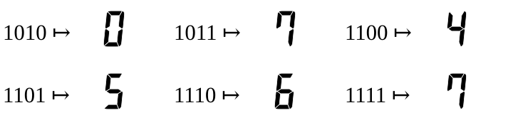](../../../assets/volume4a/figures/answer-7-1-2-57-original-eleven-step.svg)

[科里·普洛韦尔认为找到不会把非数字假冒为数字的一个解可能更好, 他发现一条 12 步的链 (用非贪婪的 $x_7$)

```text
x5 = x1 ⊕ x2
x6 = x3 ∧ x̄4
x7 = x1 ⊕ x6
x8 = x4 ∨ x7
x9 = x2 ⊕ x3
g = x10 = x7 ∨ x9
d̄ = x11 = x8 ⊕ x10
ā = x12 = x̄3 ∧ x11
b̄ = x13 = x2 ∧ x̄11
c̄ = x14 = x7 ∧ x9
ē = x15 = x4 ∨ x12
f̄ = x16 = x̄5 ∧ x8
```

对于这条链 $a,\ldots,g$ 具有真值表 `b7ff`、`f9f0`、`dfe3`、`b6df`、`a2aa`、`8ff2`、`3efd`, 并且

[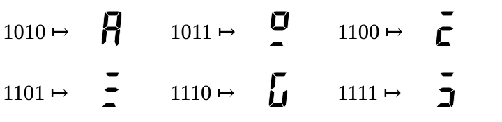](../../../assets/volume4a/figures/answer-7-1-2-57-plover-twelve-step.svg)

他还证明, 真值表 (44) 的所有 11 步解把非数字映射为

[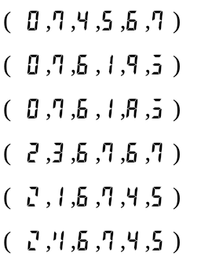](../../../assets/volume4a/figures/answer-7-1-2-57-six-eleven-step-outputs.svg)

.]


<a id="pdf-492"></a><a id="p-477"></a>

<a id="ans-7-1-2-58"></a>

**58.** [题目](../sec-7-1-2.md#ex-7-1-2-58) 所有代价为 7 的函数的真值表, 如果恰好有 8 个 1, 那么这个真值表等价于 `0779`、`169b` 或 `179a`. 以所有可能方式组合这些结果得到 9656 个解, 它们在 $\{x_1,x_2,x_3,x_4\}$ 的置换和 (或) 取补下以及在 $\{f_1,f_2,f_3,f_4\}$ 的置换和 (或) 取补下是不同的.

<a id="ans-7-1-2-59"></a>

**59.** [题目](../sec-7-1-2.md#ex-7-1-2-59) 足迹贪婪启发式产生一条 17 步的链, 而龙格的饥饿搜索达到 15 步:

```text
x5 = x2 ⊕ x4
x6 = x2 ⊕ x3
x7 = x1 ⊕ x5
x8 = x7 ∧ x̄4
x9 = x3 ⊕ x8
x10 = x̄6 ∧ x9
f3 = x11 = x7 ⊕ x10
x12 = x3 ∧ x7
x13 = x5 ∨ x12
f2 = x14 = x9 ⊕ x13
x15 = x1 ∧ x̄14
x16 = x6 ∧ x̄15
f4 = x17 = x12 ∨ x16
x18 = x12 ⊕ x16
f1 = x19 = x9 ⊕ x18
```

所有初始函数都具有很长的足迹, 因此我们不能达到 $C(f_1f_2f_3f_4)=28$. 但是或许确实存在更难一些的 S 盒.

<a id="ans-7-1-2-60"></a>

**60.** [题目](../sec-7-1-2.md#ex-7-1-2-60) 一种方法是 $u_1=x_1\oplus y_1,u_2=x_2\oplus y_2,v_1=y_2\oplus u_1,v_2=y_1\oplus u_2,z_1=v_1\wedge\bar u_2,z_2=v_2\wedge\bar u_1$.

<a id="ans-7-1-2-61"></a>

**61.** [题目](../sec-7-1-2.md#ex-7-1-2-61) 下述由戴维·史蒂文森提出的 17 个门的解, 把 $\bmod 2^m+1$ 的加法推广到了 $8m+1$ 个门:

```text
u0 = x0 ∧ y0
v0 = x0 ⊕ y0
u1 = x1 ∧ y1
v1 = x1 ⊕ y1
t1 = v1 ∧ u0
t2 = v1 ⊕ u0
c2 = u1 ∨ t1
u2 = x2 ∧ y2
t3 = x2 ∨ y2
t4 = t3 ∨ c2
t5 = t2 ∨ v0
t6 = t5 ∧ t4
t7 = t6 ∨ u2
t8 = t7 ∧ v̄0
z0 = t7 ⊕ v0
z1 = t2 ⊕ t8
z2 = t4 ⊕ t7
```

(注意 $(x_2x_1x_0)_2+(y_2y_1y_0)_2=(u_2t_4t_2v_0)_2-4[x=y=4]$. 如果输入是用 `000`、`001`、`011`、`101`、`111` 表示的, 李景杰找到另外一个 17 步的解.)

<a id="ans-7-1-2-62"></a>

**62.** [题目](../sec-7-1-2.md#ex-7-1-2-62) 存在 $\binom{2^n}{2^nd}2^{2^nc}$ 个这样的函数, 它们最多有 $\binom{2^n}{2^nd}c(n,r)$ 个具有小于等于 $r$ 的代价. 因此我们可以像在习题 46 中那样论证, 从 (32) 断定代价小于等于 $r=\lfloor2^nc/n\rfloor$ 的函数所占的比例最多为 $2^{2r+1-2^nc}(n+r-1)^{2r}/(r-1)!=2^{-r\lg n+O(r)}$.

<a id="ans-7-1-2-63"></a>

**63.** [题目](../sec-7-1-2.md#ex-7-1-2-63) [*Problemy Kibernetiki* **21** (1969), 215–226.] 像在奥列格·卢帕诺夫的方法中那样把真值表置于一个 $2^k\times2^{n-k}$ 数组中, 并且假定对于 $0\le j<2^{n-k}$ 在第 $j$ 列有 $c_j$ 个在意值. 把那些列分为 $\lfloor c_j/m\rfloor$ 个子列, 每个子列含有 $m$ 个在意值, 加上在底端的一个可能为空的子列, 该子列包含不足 $m$ 个在意值. 提示表明, 最多 $2^{m+k}$ 个列向量足以与具有指定顶行 $i_0$ 和底行 $i_1$ 的每个子列的 0 和 1 相匹配. 因此, 我们可以从 $\{x_1,\ldots,x_k\}$ 的小项用 $O(m2^{m+3k})$ 个运算构建 $O(2^{m+3k})$ 个函数 $g_t(x_1,\ldots,x_k)$, 使得每个子列与某个类型 $t$ 相匹配. 并且对于每个类型 $t$, 我们可以指定与 $t$ 相匹配的列从 $\{x_{k+1},\ldots,x_n\}$ 的小项构建函数 $h_t(x_{k+1},\ldots,x_n)$, 代价最多是 $\sum_j(\lfloor c_j/m\rfloor+1)\le2^nc/m+2^{n-k}$. 最后, $f=\bigvee_t(g_t\wedge h_t)$ 需要 $O(2^{m+3k})$ 个额外的步骤. 选择 $k=\lfloor2\lg n\rfloor$ 且 $m=\lceil n-9\lg n\rceil$ 使总代价最多达到 $(2^nc/n)(1+9n^{-1}\lg n+O(n^{-1}))$.

当然, 我们需要证明提示的结果, 它由爱德华·尼基波鲁克 [*Doklady Akad. Nauk SSSR* **163** (1965), 40–42] 给出. 事实上, $2^m(1+\lceil k\ln2\rceil)$ 个向量就足够了 (见舍曼·斯坦,*J. Combinatorial Theory* **A16** (1974), 391–397): 如果我们随机选择 $q=2^m\lceil k\ln2\rceil$ 个向量 (它们不必是不同的), 未触及的子立方的期望数是 $\binom km2^m(1-2^{-m})^q<\binom km2^me^{-q2^{-m}}<2^m$. (一种显式结构会更令人满意.)

对于一般化的推广——容许一定百分比的错误以及指定 1 的密度——见尼古拉斯·皮彭格尔,*Mathematical Systems Theory* **10** (1977), 129–167.

<a id="ans-7-1-2-64"></a>

**64.** [题目](../sec-7-1-2.md#ex-7-1-2-64) 如果我们像中国一种古老魔方中那样按 $\begin{smallmatrix}6&1&8\\7&5&3\\2&9&4\end{smallmatrix}$ 对方格编号, 它恰好是九宫游戏. [埃尔温·伯利坎普、约翰·康威和理查德·盖伊在他们的书 *Winning Ways* **3** (2003), 732–736 中使用这种计算策略给出了对九宫游戏的完整分析.]

<a id="ans-7-1-2-65"></a>

**65.** [题目](../sec-7-1-2.md#ex-7-1-2-65) 一种解是通过 “进攻” 移动 $a_j$ 和 “反击” 移动 $c_j$ 代替通过 “防守” 移动 $d_j$, 并且仅对角上的方格 $j\in\{1,3,9,7\}$ 这样做. 令 $j\cdot k=(jk)\bmod10$, 那么由于 $j\perp10$, 当 $j$ 是角上方格时,

$$
\begin{matrix}
j\cdot1&j\cdot2&j\cdot3\\
j\cdot4&j\cdot5&j\cdot6\\
j\cdot7&j\cdot8&j\cdot9
\end{matrix}
$$


<a id="pdf-493"></a><a id="p-478"></a>

给予我们另外一种考察九宫图形的途径. 于是 $a_j$ 和 $c_j$ 的确切定义是

$$
\begin{aligned}
a_j={}&m_j\wedge\bigl((x_{j\cdot3}\wedge\beta_{(j\cdot8)(j\cdot9)}\wedge(o_{j\cdot4}\oplus o_{j\cdot6}))\vee(x_{j\cdot7}\wedge\beta_{(j\cdot6)(j\cdot9)}\wedge(o_{j\cdot2}\oplus o_{j\cdot8}))\\
&\qquad\vee\bigl(m_{j\cdot9}\wedge\bigl((m_{j\cdot8}\wedge x_{j\cdot2}\wedge\overline{(o_{j\cdot3}\oplus o_{j\cdot6})})\vee(m_{j\cdot6}\wedge x_{j\cdot4}\wedge\overline{(o_{j\cdot7}\oplus o_{j\cdot8})})\bigr)\bigr)\bigr);\\
c_j={}&d_j\wedge\overline{(x_{j\cdot6}\wedge o_{j\cdot7})}\wedge\overline{(x_{j\cdot8}\wedge o_{j\cdot3})}\wedge\bar d_{j\cdot9};
\end{aligned}
$$

其中 $d_j=m_j\wedge\beta_{(j\cdot2)(j\cdot3)}\wedge\beta_{(j\cdot4)(j\cdot7)}$ 取代 (51). 我们还定义

$$
\begin{aligned}
u&=(x_1\oplus x_3)\oplus(x_7\oplus x_9),\\
v&=(o_1\oplus o_3)\oplus(o_7\oplus o_9),\\
t&=m_2\wedge m_6\wedge m_8\wedge m_4\wedge(u\vee\bar v),
\end{aligned}\qquad
z_j=\begin{cases}
m_j\wedge\bar t,&\text{如果 }j=5,\\
m_j\wedge\bar d_{j\cdot9},&\text{如果 }j\in\{1,3,9,7\},\\
m_j,&\text{如果 }j\in\{2,6,8,4\},
\end{cases}
$$

以便涵盖少数其他几种例外情况. 最后, 用序列 $a_1a_3a_9a_7c_1c_3c_9c_7z_5z_1z_3z_9z_7z_2z_6z_8z_4$ 代替 (53) 中的次序有序的移动序列 $d_5d_1d_3d_9d_7d_2d_6d_8d_4m_5m_1m_3m_9m_7m_2m_6m_8m_4$, 并且当 $j$ 是角方格时, 我们用 $(a_j\wedge\bar a'_j)\vee(c_j\wedge\bar c'_j)\vee(z_j\wedge\bar z'_j)$ 代替 (55) 中的 $(d_j\wedge\bar d'_j)\vee(m_j\wedge\bar m'_j)$, 否则, 简单地用 $(z_j\wedge\bar z'_j)$ 代替.

(注意这个自动机需要正确地从所有合法位置移动, 即使那些位置不可能在机器先前替×作出各步移动后出现. 实际上我们允许人类玩游戏直到他们求助于机器帮助, 否则可以作大量简化. 例如, 如果×总是先移动, 它将强占中央方格, 并且消除大量未来的可能性. 可能出现的赛局少于 $8\times6\times4\times2=384$ 种. 倘若○先移动, 存在相对于一种固定策略的可能赛况少于 $9\times7\times5\times3=945$ 种. 事实上, 采用此处定义策略的不同赛局的实际数量最后是 $76+457$, 其中 $72+328$ 种是机器获胜, 其余属于不分胜负的猫局.)

<a id="ans-7-1-2-66"></a>

**66.** [题目](../sec-7-1-2.md#ex-7-1-2-66) 上题答案中的布尔链完成它从所有 4520 个合法位置实现正确移动的任务, 其中正确性的实际界定是指最坏情况的最终结果最大化. 但是真正杰出的九宫游戏选手将取不同的位置行事方式. 例如, 机器从位置 <a href="../../../assets/volume4a/figures/answer-7-1-2-66-1-board.svg">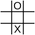</a> 占据中心 <a href="../../../assets/volume4a/figures/answer-7-1-2-66-2-board.svg">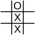</a>, 于是○可能通过在角方格采取行动而战成平局. 但是移动到 <a href="../../../assets/volume4a/figures/answer-7-1-2-66-3-board.svg">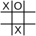</a> 或 <a href="../../../assets/volume4a/figures/answer-7-1-2-66-4-board.svg">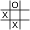</a> 将只给○两次避免失败的机会. [见马丁·加德纳,*Hexaflexagons and Other Mathematical Diversions*, 第 4 章.]

此外, 像 <a href="../../../assets/volume4a/figures/answer-7-1-2-66-5-board.svg">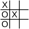</a> 位置的最佳移动是变成 <a href="../../../assets/volume4a/figures/answer-7-1-2-66-6-board.svg">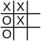</a> 而非立即取胜, 然后如果回应是 <a href="../../../assets/volume4a/figures/answer-7-1-2-66-7-board.svg">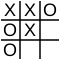</a>, 那么移动为 <a href="../../../assets/volume4a/figures/answer-7-1-2-66-8-board.svg">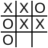</a>. 这种方式仍然使你获胜, 但是没有使你的对手严重丢失面子.

最后, 即使仅仅一个 “最佳移动” 的概念也是存在缺陷的, 因为优秀的选手在不同对局中会选择不同的移动步骤 (正如亨利·巴贝奇指出的那样).

> 人们也许认为, 设计玩九宫游戏的数字计算机程序  
> 或者设计九宫游戏自动机的专用电路  
> 是很简单的. 确实是这样, 除非你的目标是创立一个高超的机器人,  
> 它在面对缺乏经验的选手时将赢得最高数量的赛局.
>
> ——马丁·加德纳,*The Scientific American Book of Mathematical Puzzles & Diversions* (1959)

<a id="ans-7-1-2-67"></a>

**67.** [题目](../sec-7-1-2.md#ex-7-1-2-67) 迄今所知的最佳解是由戴维·史蒂文森在 2010 年给出的, 共使用 818 个门 (472 个 AND、327 个 OR、13 个 NOR、6 个 BUTNOT), 细节见

<https://www-cs-faculty.stanford.edu/~knuth/818-gate-solution>.

在关心像 $w_j$ 和 $b_j$ 这样的移动后, 并且巧妙地优化不在意的移动, 史蒂文森实际上用 OR 把使 $c=1$ 的大约 200 个特殊位置 (例如 <a href="../../../assets/volume4a/figures/answer-7-1-2-67-c-board.svg">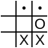</a>)、使 $s=1$ 的大约 200 个其他位置 (例如 <a href="../../../assets/volume4a/figures/answer-7-1-2-67-s-board.svg">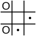</a>) 以及使 $m=1$ 的大约 50 个位置 (例如 <a href="../../../assets/volume4a/figures/answer-7-1-2-67-m-board.svg">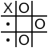</a>) 连接在一起. 然后通过在定义特殊位置的 AND 中间寻找公共子表达式以及利用分配律等手段节省门.

[这道题是由约翰·韦克利的书 *Digital Design* (Prentice-Hall, 3rd edition, 2000), 6.2.7 节的一处讨论引起的. 顺便指出, 查尔斯·巴贝奇曾打算通过考查 $N\bmod k$ 来在 $k$ 个可能的移动间选择, 其中 $N$ 是迄今赢得的局数. 他未认识到连续的移动在 $N$ 改变之前多半是高度相关的. 令 $N$ 是到现在为止已执行的移动步数将会好得多.]

<a id="ans-7-1-2-68"></a>

**68.** [题目](../sec-7-1-2.md#ex-7-1-2-68) 不能. 那个方法产生一条 “均匀” 布尔链, 它具有一种易于理解的结构, 但是它的代价是 $\Omega(n2^n)$. 存在一种按定理 L 构造的大约 $2^n/n$ 个门的电路, 但是很难制作. (顺便说明, $C(\pi_5)=10$.)


<a id="pdf-494"></a><a id="p-479"></a>

<a id="ans-7-1-2-69"></a>

**69.** [题目](../sec-7-1-2.md#ex-7-1-2-69) (a) 例如, 通过尝试全部 64 种事例可以证明这个结果.

(b) 如果 $x_m$ 处在 $x_i$ 的同样的行或同样的列, 并且还处在 $x_j$ 的同样的行或同样的列, 我们有 $\alpha_{111}=\alpha_{101}=\alpha_{011}=0$, 因此函数值对是优良的. 否则, 实际上存在 3 种不同的可能性, 它们都是低劣的: 如果 $(i,j,m)=(1,2,4)$, 那么 $\alpha_{101}=0,\alpha_{100}=x_5x_9\oplus x_6x_8,\alpha_{011}=x_9$; 如果 $(i,j,m)=(1,2,6)$, 那么 $\alpha_{010}=x_4x_9,\alpha_{011}=x_7,\alpha_{100}=x_5x_9,\alpha_{101}=x_8$; 如果 $(i,j,m)=(1,5,9)$, 那么 $\alpha_{111}=1,\alpha_{110}=0,\alpha_{010}=x_3x_7$.

<a id="ans-7-1-2-70"></a>

**70.** [题目](../sec-7-1-2.md#ex-7-1-2-70) (a) $x_1\wedge((x_5\wedge x_9)\oplus(x_6\wedge x_8))\oplus x_2\wedge((x_6\wedge x_7)\oplus(x_4\wedge x_9))\oplus x_3\wedge((x_4\wedge x_8)\oplus(x_5\wedge x_7))$.

(b) $x_1\wedge((x_5\wedge x_9)\vee(x_6\wedge x_8))\vee x_2\wedge((x_6\wedge x_7)\vee(x_4\wedge x_9))\vee x_3\wedge((x_4\wedge x_8)\vee(x_5\wedge x_7))$.

(c) 令 $y_1=x_1\wedge x_5\wedge x_9,y_2=x_3\wedge x_4\wedge x_8,y_3=x_2\wedge x_6\wedge x_7,y_4=x_2\wedge x_4\wedge x_9,y_5=x_1\wedge x_6\wedge x_8,y_6=x_3\wedge x_5\wedge x_7$. 函数 $f(y_1,\ldots,y_6)=[y_1+y_2+y_3>y_4+y_5+y_6]$ 能够用两个全加器和一个比较器以额外的 15 步求值, 但是存在一个 14 步的解: 令 $z_1=(y_1\oplus y_2)\oplus y_3,z_2=(y_1\oplus y_2)\vee(y_1\oplus y_3),z_3=(y_4\oplus y_5)\oplus y_6,z_4=(y_4\oplus y_5)\vee(y_4\oplus y_6)$. 那么 $f=(z_1\oplus(z_2\wedge(\bar z_4\oplus(z_1\vee z_3))))\wedge(\bar z_3\vee z_4)$. 此外 $y_1y_2y_3=111\Longleftrightarrow y_4y_5y_6=111$. 因此存在不在意值, 导致一个 11 步的解: $f=((\bar z_1\wedge z_3)\vee\bar z_4)\wedge z_2$. 总代价是 $12+11=23$.

(据我所知, 如果仅仅给出 $f$ 的真值表, 无法用计算机以合理的时间发现这样一条有效的布尔链. 但是可能存在一条甚至更好的链.)

<a id="ans-7-1-2-71"></a>

**71.** [题目](../sec-7-1-2.md#ex-7-1-2-71) (a) $P(p)=1-12p^2+24p^3+12p^4-96p^5+144p^6-96p^7+24p^8$, 当 $p=\tfrac12+\epsilon$ 时, 它是 $\tfrac{11}{32}+\tfrac92\epsilon^2-3\epsilon^4-24\epsilon^6+24\epsilon^8$.

(b) 存在 8 个值 $(f_0,\ldots,f_7)$ 的 $N=2^{n-3}$ 种设定, 它们中每一种以概率 $P(p)$ 产生优良的函数值对. 所以答案是 $1-P(p)^N$.

(c) 恰好 $r$ 种设定获得成功的概率是 $\binom NrP(p)^r(1-P(p))^{N-r}$, 在这种情况下 $t$ 次试验将以概率 $(r/N)^t$ 获得优良的函数值对. 所以答案是

$$
1-\sum_{r=0}^N\binom NrP(p)^r(1-P(p))^{N-r}(r/N)^t=1-P(p)^t+O(t^2/N).
$$

(d) $\sum_{r=0}^N\binom NrP(p)^r(1-P(p))^{N-r}\sum_{j=0}^{t-1}(r/N)^j=(1-P(p)^t)/(1-P(p))+O(t^3/N)$.

<a id="ans-7-1-2-72"></a>

**72.** [题目](../sec-7-1-2.md#ex-7-1-2-72) 习题 71(a) 中的概率变成

$$
\begin{aligned}
P(p){}&+(72p^3-264p^4+432p^5-336p^6+96p^7)r\\
&+(60p^2-240p^3+456p^4-432p^5+144p^6)r^2\\
&+(-48p^2+144p^3-216p^4+96p^5)r^3\\
&+(-36p^2+24p^3+12p^4)r^4+(48p^2-24p^3)r^5-12p^2r^6.
\end{aligned}
$$

如果 $p=q=(1-r)/2$, 这是 $(11+48r+36r^2-144r^3-30r^4+336r^5-348r^6+144r^7-21r^8)/32$. 例如, 当 $r=1/2$ 时, 它的值是 $7739/8192\approx0.94$.

<a id="ans-7-1-2-73"></a>

**73.** [题目](../sec-7-1-2.md#ex-7-1-2-73) 考虑霍恩子句 $1\wedge2\Rightarrow3,1\wedge3\Rightarrow4,\ldots,1\wedge(n-1)\Rightarrow n,1\wedge n\Rightarrow2,i\wedge j\Rightarrow1\ (1<i<j\le n)$. 假定在分解中 $|Z|>1$, 并且令 $i$ 是满足 $x_i\in Z$ 的最小下标. 还令 $j$ 是满足 $j>i$ 且 $x_j\in Z$ 的最小下标. 因为此时 $i\wedge j\Rightarrow1$, 我们不可能有 $i>1$. 因此 $i=1$, 并且 $x_j\in\bar Z\ (2\le j\le n)$.

<a id="ans-7-1-2-74"></a>

**74.** [题目](../sec-7-1-2.md#ex-7-1-2-74) 假定我们知道没有符合 $x_1\in Z$ 或……或 $x_{i-1}\in Z$ 的非平凡的分解, 开始时 $i=1$. 我们也希望通过巧妙选择 $j$ 和 $m$ 把 $x_i\in Z$ 排除在外. 当 $i$ 确定时, 霍恩子句 $i\wedge j\Rightarrow m$ 约化为克罗姆子句 $j\Rightarrow m$. 因此, 我们实质上想要在可能存在也可能不存在弧 $j\Rightarrow m$ 的有向图中, 对于强分图使用罗伯特·塔扬的深度优先搜索.

当从顶点 $j$ 开始探索时, 首先尝试 $m=1,\ldots,m=i-1$. 如果任何这样的蕴涵 $i\wedge j\Rightarrow m$ 成立, 我们可以从 $i$ 的有向图中消除 $j$ 及其所有前导. 否则, 对于任何这样消除的顶点 $m$ 检查是否有 $j\Rightarrow m$. 否则, 检查未探索过的顶点 $m$. 否则, 尝试已经遇见过的顶点 $m$, 优先检查深度优先树的根结点附近的顶点.

在例子 $f(x)=(\det X)\bmod2$ 中, 我们将相继找出 $1\wedge2\nRightarrow3,1\wedge2\Rightarrow4,1\wedge4\nRightarrow3,1\wedge3\Rightarrow5,1\wedge5\Rightarrow6,1\wedge6\Rightarrow7,1\wedge7\Rightarrow8,1\wedge8\Rightarrow9,1\wedge9\Rightarrow2$ (现在 $i\gets2$); $2\wedge3\nRightarrow1,2\wedge3\Rightarrow4,2\wedge4\nRightarrow1,2\wedge4\nRightarrow5,2\wedge4\Rightarrow6,2\wedge6\Rightarrow1$ (现在 3、4、6 从 2 的有向图中消除), $2\wedge5\Rightarrow1$ (并且 5 被消除), $2\wedge7\nRightarrow1,2\wedge7\Rightarrow3$(7 被消除), $2\wedge8\Rightarrow1,2\wedge9\Rightarrow1$ (现在 $i\gets3$); $3\wedge4\nRightarrow1,3\wedge4\Rightarrow2,3\wedge5\Rightarrow1$, 等等.

<a id="ans-7-1-2-75"></a>

**75.** [题目](../sec-7-1-2.md#ex-7-1-2-75) 这个函数仅在互补的两个点是 1. 因此它是不可分解的, 当 $n>3$ 时函数值对 (58) 绝不会是劣质的. 因此每个分划 $(Y,Z)$ 将是分解的一个候选者.

类似地, 如果 $f$ 关于 $(Y,Z)$ 是可分解的, 则不可分解的函数 $f(x)\oplus S_{0,n}(x)$ 在检验中实际上将起到像 $f$ 那样的作用. (在一个通用的可分解性检验器中, 也许应该提供一种处理近似可分解函数的方法.)


<a id="pdf-495"></a><a id="p-480"></a>

<a id="ans-7-1-2-76"></a>

**76.** [题目](../sec-7-1-2.md#ex-7-1-2-76) (a) 对于 $0\le l\le2^m$ 令 $a_l=[i\ge l]$. 像在习题 38(b) 答案中看到的那样, 代价 $\le2t(m)$. 并且实际上, 用深度为 $\Theta(m)$ 的链可以把代价降低到 $2^{m+1}-2m-2$. 此外, 函数 $[i\le j]=(\bar i_1\wedge j_1)\vee((i_1\equiv j_1)\wedge[i_2\ldots i_m\le j_2\ldots j_m])$ 可以用 $4m-3$ 个门求值. 在计算 $x\oplus y$ 后, 每个 $z_l$ 的代价是 $2^{m+1}+1=O(n)$.

(b) 因为每个 $g_l$ 是 $2^m$ 个输入的函数, 由定理 L, 这里代价最多是 $C(g_0)+\cdots+C(g_{2^m})\le(2^m+1)(2^{2^m}/(2^m-O(m)))$.

(c) 如果 $i\le j$, 我们有 $z_l=x\ (l\le i)$ 且 $z_l=y\ (l>i)$. 因此 $f_i(x)=c_0\oplus\cdots\oplus c_i$ 且 $f_j(y)=c_{j+1}\oplus\cdots\oplus c_{2^m}$. 如果 $i>j$, 我们有 $z_l=y\ (l\le i)$ 且 $z_l=x\ (l>i)$. 因此 $f_j(y)=c_0\oplus\cdots\oplus c_j$ 且 $f_i(x)=c_{i+1}\oplus\cdots\oplus c_{2^m}$.

(d) 正如 (a) 中那样, 对于 $0\le l\le2^m$, 函数 $b_l=[j<l]$ 可以用 $O(2^m)$ 步计算. 所以我们可以用 $O(2^m)$ 个额外的门从 $(c_0,\ldots,c_{2^m})$ 计算 $F$. 因此对于大的 $m$ 的代价, 步骤 (b) 处于支配地位.

(e) $a_0=1,a_1=i,a_2=0$; $b_0=0,b_1=j,b_2=1$; $d=[i\le j]=\bar i\vee j$; $m_l=a_l\oplus d,z_{l0}=x_0\oplus(m_l\wedge(x_0\oplus y_0)),z_{l1}=x_1\oplus(m_l\wedge(x_1\oplus y_1))\ (l=0,1,2)$; $c_0=z_{01}$; $c_1=z_{10}\wedge\bar z_{11}$; $c_2=z_{20}\vee z_{21}$; $c'_l=c_l\wedge(d\equiv a_l),c''_l=c_l\wedge(d\equiv b_l)\ (l=0,1,2)$. 并且, 最终 $F=(c'_0\oplus c'_1\oplus c'_2)\vee(c''_0\oplus c''_1\oplus c''_2)$.

在这样一个小例子中, 这个纯代价 (在明显的简化后是 29) 自然是令人难以容忍的. 但是人们想知道, 最先进的自动优化器是否能够把这条链降低至仅用 5 个门.

[这个结果是 *Matematicheskie Zametki* **15** (1974), 937–944 和 *London Math. Soc. Lecture Note Series* **169** (1992), 165–173 中更一般定理的特例.]

<a id="ans-7-1-2-77"></a>

**77.** [题目](../sec-7-1-2.md#ex-7-1-2-77) 对于 $f_n$ 或 $\bar f_n$ 给定最短的这样的链, 令 $U_l=\{i\mid l=j(i)\text{或}l=k(i)\}$ 是 $x_l$ 的 “使用”, 并且令 $u_l=|U_l|$. 如果 $x_i=x_{j(i)}\vee x_{k(i)}$ 令 $t_i=1$, 否则令 $t_i=0$. 我们按下述思路证明存在计算 $f_{n-1}$ 或 $\bar f_{n-1}$ 的长度小于等于 $r-4$ 的链: 如果对于任意 $m$ 设置变量 $x_m$ 为 0 或 1, 通过删除 $U_m$ 的所有步并且相应地修改其他步, 可以获得一条关于 $f_{n-1}$ 或 $\bar f_{n-1}$ 的链. 此外, 如果 $x_i=x_{j(i)}\circ x_{k(i)}$ 并且如果当 $x_m$ 已经设置为 0 或 1 时知道 $x_{j(i)}$ 或 $x_{k(i)}$ 等于 $t_i$, 那么我们还可以删去 $U_i$ 的步. (在整个论证过程中, 字母 $m$ 代表 $1\le m\le n$ 范围内的下标.)

情形 1: 对于某些 $m$ 有 $u_m=1$. 这种情形不可能出现在最短链中. 因为如果 $x_m$ 的仅有使用是 $x_i=\bar x_m$, 取消这一步将交换 $f_n\leftrightarrow\bar f_n$. 否则我们可以设置 $x_1,\ldots,x_{m-1},x_{m+1},\ldots,x_n$ 的值使得 $x_i$ 不依赖于 $x_m$, 同 $x_{n+r}=f_n$ 或 $\bar f_n$ 矛盾. 所以每个变量必定至少被使用两次.

情形 2: 对于某些 $l$ 和 $m$ 有 $x_l=\bar x_m$, 其中 $u_m>1$. 这时, 对于某些 $i$ 和 $k$ 有 $x_i=x_l\circ x_k$, 并且我们可以置 $x_m\gets\bar t_i$ 使得 $x_i$ 不依赖于 $x_k$. 取消 $U_m,U_l,U_i$ 中的步骤, 便至少取消 4 步, 除非 $u_l=u_i=1$ 且 $u_m=2$ 且 $x_j=x_m\circ x_i$. 但是在那种情况下我们还可以取消 $U_j$ 步.

情形 3: 对于某些 $m$ 有 $u_m\ge3$, 并且不是情形 2. 如果 $i,j,k\in U_m$ 且 $i<j<k$, 置 $x_m\gets t_k$ 并且取消 $i,j,k,U_k$ 步.

情形 4: $u_1=u_2=\cdots=u_n=2$, 并且不是情形 2. 我们可以假定第一步是 $x_{n+1}=x_1\circ x_2$, 并且假定对于某些 $k<l$ 有 $x_l=x_1\circ x_k$.

情形 4.1: $k>n$. 然后 $k>n+1$. 如果 $u_k=1$, 置 $x_1\gets t_l$ 并且取消 $n+1,k,l,U_l$ 步. 否则, 置 $x_2\gets t_{n+1}$, 这迫使 $x_k=\bar t_l$, 并且我们可以取消 $n+1,k,l,U_k$ 步.

情形 4.2: $x_l=x_1\circ x_m$. 此时, 我们必定有 $m=2$. 因为如果 $m>2$, 我们可以置 $x_2\gets t_{n+1},x_m\gets t_l$, 并且使得 $x_{n+r}$ 不依赖于 $x_1$. 因此我们可以假定 $x_{n+1}=x_1\wedge x_2,x_{n+2}=x_1\vee x_2$. 置 $x_1\gets0$ 使我们可以取消 $U_1$ 和 $U_{n+1}$ 步, 置 $x_1\gets1$ 使我们可以取消 $U_1$ 和 $U_{n+2}$ 步. 这样我们就完成了证明, 除非 $u_{n+1}=u_{n+2}=1$.

如果 $x_p=\bar x_{n+1}$, 置 $x_1\gets0$ 并且取消 $n+1,n+2,p,U_p$ 步; 如果 $x_q=\bar x_{n+2}$, 置 $x_1\gets1$ 并且取消 $n+1,n+2,q,U_q$ 步. 否则 $x_p=x_{n+1}\circ x_u$ 且 $x_q=x_{n+2}\circ x_v$, 其中 $x_u$ 和 $x_v$ 不依赖于 $x_1$ 或 $x_2$. 但是这是不可能的, 这将允许我们设置 $x_3,\ldots,x_n$ 使得 $x_u=t_p$, 然后置 $x_2\gets1$ 使得 $x_{n+r}$ 不依赖于 $x_1$.

[*Problemy Kibernetiki* **23** (1970), 83–101;**28** (1974), 4. 尼古拉·雷德金用类似的方法证明了函数 $[x_1\ldots x_n<y_1\ldots y_n]$ 和 $[x_1\ldots x_n=y_1\ldots y_n]$ 的最短 AND–OR–NOT 链分别具有长度 $5n-3$ 和 $5n-1$.]


<a id="pdf-496"></a><a id="p-481"></a>

<a id="ans-7-1-2-78"></a>

**78.** [题目](../sec-7-1-2.md#ex-7-1-2-78) [*SICOMP* **6** (1977), 427–430.] 如果 $k\in S$, 就说 $y_k$ 是活动的. 我们可以假定布尔链是正规的并且 $|S|>1$. 证明类似于尼古拉·雷德金在习题 77 答案中所做的.

情形 1: 某些活动的 $y_k$ 被使用一次以上. 置 $y_k\gets0$ 至少节省两步, 并且产生对于带 $|S|-1$ 个活动值的函数的一条布尔链.

情形 2: 某些活动的 $y_k$ 仅出现在一个 AND 门中. 置 $y_k\gets0$ 至少消除两步, 除非这个 AND 是最后一步. 但是它不可能是最后一步, 因为 $y_k=0$ 使得结果不依赖于任何其他活动的 $y_j$.

情形 3: 类似于情形 2, 但是改为 OR 或 NOTBUT 或 BUTNOT 门. 对于某个相应的常数 $c$ 置 $y_k\gets c$, 获得想要的结果.

情形 4: 类似于情形 2, 但是改为 XOR 门. 这个门不可能是最后一个, 因为当 $(x_1\ldots x_m)_2$ 确定一个不同的活动值 $y_j$ 时结果将不依赖于 $y_k$. 所以通过把 $y_k$ 设置为对 XOR 的其他输入定义的函数, 我们可以消除两步.

<a id="ans-7-1-2-79"></a>

**79.** [题目](../sec-7-1-2.md#ex-7-1-2-79) (a) 假设代价是 $r<2n-2$, 那么 $n>1$. 如果每个变量恰好使用一次, 两个叶结点必定是伙伴. 因此某个变量至少使用了两次, 剪除它后产生一条涉及 $n-1$ 个变量的代价小于等于 $r-2$ 的链, 其中没有伙伴.

(顺便说明, 如果每个变量至少使用两次, 代价至少是 $2n-1$, 因为布尔链中至少 $2n$ 次变量的使用必定是联接在一起的.)

(b) 注意每当边 $u\mathbin{—}v$ 构成 $\{x_1,\ldots,x_n\}$ 上的一棵自由树时, $S_{0,n}=\bigwedge_{u\mathbin{—}v}(u\equiv v)$. 因此存在许多达到代价 $2n-3$ 的途径.

任何代价为 $r<2n-3$ 的链必定有 $n>2$, 并且必然包含伙伴 $u$ 和 $v$. 通过重新命名以及可能的中间结果求补, 我们可以假定 $u=1,v=2$, 以及 $f(x_1,\ldots,x_n)=g(x_1\circ h(x_3,\ldots,x_n),x_2,\ldots,x_n)$, 其中 $\circ$ 是 $\wedge$ 或 $\oplus$.

情形 1: $\circ$ 是 AND. 我们必定有 $h(0,\ldots,0)=h(1,\ldots,1)=1$, 要不然 $f(x_1,x_2,y,\ldots,y)$ 将不依赖于 $x_1$. 因此 $f(x_1,\ldots,x_n)=h(x_3,\ldots,x_n)\wedge g(x_1,x_2,\ldots,x_n)$ 可以通过一条同样代价的链计算, 在这个链中 1 与 2 是伙伴, 并且它们之间的路径更短.

情形 2: $\circ$ 是 XOR. 此时 $f=f_0\vee f_1$, 其中 $f_0(x_1,\ldots,x_n)=(x_1\equiv h(x_3,\ldots,x_n))\wedge g(0,x_2,\ldots,x_n)$ 且 $f_1(x_1,\ldots,x_n)=(x_1\oplus h(x_3,\ldots,x_n))\wedge g(1,x_2,\ldots,x_n)$. 但是 $f=S_{0,n}$ 只有两个素蕴涵元. 所以仅存在下述 4 种可能:

情形 2a: $f_0=f$. 此时为了得到一条对于函数 $g(0,x_2,\ldots,x_n)=S_{0,n-1}(x_2,\ldots,x_n)$ 的代价小于等于 $r-2$ 的链, 我们可以用 0 代替 $x_1\oplus h$.

情形 2b: $f_1=f$. 类似于情形 2a.

情形 2c: $f_0(x)=x_1\wedge\cdots\wedge x_n$ 且 $f_1(x)=\bar x_1\wedge\cdots\wedge\bar x_n$. 在这种情形下, 我们必定有 $g(0,x_2,\ldots,x_n)=x_2\wedge\cdots\wedge x_n$ 且 $g(1,x_2,\ldots,x_n)=\bar x_2\wedge\cdots\wedge\bar x_n$. 因此用 1 代替 $h$ 产生一条以小于 $r$ 步计算 $f$ 的链.

情形 2d: $f_0(x)=\bar x_1\wedge\cdots\wedge\bar x_n$ 且 $f_1(x)=x_1\wedge\cdots\wedge x_n$. 类似于情形 2c.

重复应用这些简化将导致矛盾. 类似地, 可以证明 $C(S_0S_n)=2n-2$. [*Theoretical Computer Science* **1** (1976), 289–295.]

<a id="ans-7-1-2-80"></a>

**80.** [题目](../sec-7-1-2.md#ex-7-1-2-80) (a) 不失一般性, 假定 $a_0=0$ 且布尔链是正规的. 像在习题 77 的答案中那样定义 $U_l$ 和 $u_l$. 由对称性我们可以假设 $u_1=\max(u_1,\ldots,u_n)$.

我们必定有 $u_1\ge2$. 因为如果 $u_1=1$, 我们可以进一步假定 $x_{n+1}=x_1\circ x_2$, 因此, 3 个函数 $S_\alpha(0,0,x_3,\ldots,x_n)=S_{\alpha''},S_\alpha(0,1,x_3,\ldots,x_n)=S_{{}'\alpha'},S_\alpha(1,1,x_3,\ldots,x_n)=S_{{}''\alpha}$ 中的两个将是相等的. 但是在这种情况下, $S_\alpha$ 将是奇偶性函数, 或者 $S_{\alpha'}$ 将是常数.

因此置 $x_1\gets0$ 使我们可以消除 $U_1$ 的门, 对 $S_{\alpha'}$ 给出一条至少减少 2 个门的链. 由此推出 $C(S_\alpha)\ge C(S_{\alpha'})+2$. 同样, 置 $x_1\gets1$ 证明 $C(S_\alpha)\ge C(S_{{}'\alpha})+2$.

当我们进一步考察这种情况时出现下述 3 种情形:

情形 1: $u_1\ge3$. 置 $x_1\gets0$ 证明 $C(S_\alpha)\ge C(S_{\alpha'})+3$.


<a id="pdf-497"></a><a id="p-482"></a>

情形 2: $U_1=\{i,j\}$ 且运算符 $\circ_j$ 是定向的 (即 AND、BUTNOT、NOTBUT 或 OR). 置 $x_1$ 为相应的常数, 强加 $x_j$ 的值并且允许我们消除 $U_1\cup U_j$. 注意在一条最优链中 $i\notin U_j$. 因此 $C(S_\alpha)\ge C(S_{\alpha'})+3$ 或 $C(S_\alpha)\ge C(S_{{}'\alpha})+3$.

情形 3: $U_1=\{i,j\}$ 且 $\circ_i=\circ_j=\oplus$. 我们可以假定 $x_i=x_1\oplus x_2$ 且 $x_j=x_1\oplus x_k$. 如果 $u_j=1$ 且 $x_l=x_j\oplus x_p$, 通过令 $x_j=x_k\oplus x_p,x_l=x_1\oplus x_j$ 可以重新构造这个链. 因此我们可以假定 $u_j\ne1$, 或者对于某个定向运算符 $\circ$ 有 $x_l=x_j\circ x_p$. 如果 $U_2=\{i,j'\}$, 我们同样可以假定 $x_{j'}=x_2\oplus x_{k'}$, 并且假定 $u_{j'}\ne1$, 或者对于某个定向运算符 $\circ'$ 有 $x_{l'}=x_{j'}\circ'x_{p'}$. 此外, 由对称性我们可以假定 $x_j$ 不依赖于 $x_{j'}$.

如果 $x_k$ 不依赖于 $x_i$, 令 $f(x_3,\ldots,x_n)=x_k$, 否则令 $f(x_3,\ldots,x_n)$ 是当 $x_i=1$ 时 $x_k$ 的值. 通过置 $x_1\gets f(x_3,\ldots,x_n),x_2\gets\bar f(x_3,\ldots,x_n)$, 或者反过来, 我们使 $x_i$ 和 $x_j$ 成为常数, 同时获得对非常值函数 $S_{{}'\alpha'}$ 的一条链. 事实上, 我们可以保证在 $u_j=1$ 的情况下 $x_l$ 是常数. 我们断言至少可以消除这条链的 5 个门 (包括 $x_i$ 和 $x_j$). 因此 $C(S_\alpha)\ge C(S_{{}'\alpha'})+5$. 如果 $|U_i\cup U_j|\ge3$, 断言显然为真.

我们必然有 $|U_i\cup U_j|>1$. 否则我们将有 $p=i$, 并且 $x_k$ 不依赖于 $x_i$, 所以, 根据我们对 $x_2$ 的选择, $S_\alpha$ 将不依赖于 $x_1$. 因此 $|U_i\cup U_j|=2$.

情形 3a: $U_j=\{l\}$. 此时 $x_l$ 是常数, 我们可以消除 $x_i,x_j$ 和 $U_i\cup U_j\cup U_l$. 如果后面这个集合仅包含两个元素, 那么 $x_q=x_i\circ x_l$ 也是常数, 而且我们消除 $U_q$. 由于 $S_{{}'\alpha'}$ 不是常数, 我们将不能消除输出门.

情形 3b: $U_i\subseteq U_j,|U_j|=2$. 此时对于某个 $q$ 有 $x_q=x_i\circ x_j$. 我们可以消除 $x_i,x_j$ 和 $U_j\cup U_q$. 断言已经得到证明.

(b) 由归纳法, 对于 $0<k<n$ 有 $C(S_k)\ge2n+\min(k,n-k)-3-[n=2k]$, 对于 $1<k<n$ 有 $C(S_{\ge k})\ge2n+\min(k,n+1-k)-4$. 容易的情形是 $C(S_0)=C(S_n)=C(S_{\ge1})=C(S_{\ge n})=n-1$; $C(S_{\ge0})=0$.

参考文献:*Mathematical Systems Theory* **10** (1977), 323–336.

(大约在 1978 年, 阿德尔曼的一个很好但未发表的想法, 证明了 $C(S_{\ge2})=2n+O(\sqrt n)$: 给定 $m^2$ 个元素 $x_{ij}$, 计算 $c\vee r$, 其中 $c=S_{\ge2}(\bigvee_{i=1}^m x_{i1},\ldots,\bigvee_{i=1}^m x_{im})$ 和 $r=S_{\ge2}(\bigvee_{j=1}^m x_{1j},\ldots,\bigvee_{j=1}^m x_{mj})$ 仅使用 $\vee$ 和 $\wedge$, 且每一个的代价 $<m^2+3m$.)

<a id="ans-7-1-2-81"></a>

**81.** [题目](../sec-7-1-2.md#ex-7-1-2-81) 如果某个变量被使用一次以上, 我们可以把它设置为常数, 让 $n$ 减少 1 且 $c$ 减少大于等于 2. 否则第一个运算必定涉及 $x_1$, 因为 $y_1=x_1$ 是无须计算的唯一输出. 使 $x_1$ 为常数, 让 $n$ 减少 1、$c$ 减少大于等于 1 且 $d$ 减少大于等于 1. [*J. Algorithms* **7** (1986), 185–201.]

<a id="ans-7-1-2-82"></a>

**82.** [题目](../sec-7-1-2.md#ex-7-1-2-82) (62) 是假.

(63) 读作: “对于所有数 $m$ 存在一个数字 $n$, 使得 $m<n+1$.” 这是真语句, 因为我们可以取 $m=n$.

(64) 当 $n=0$ 或 $n=1$ 时失效, 因为这些公式中的数必须是非负整数.

(65) 说明, 如果 $b$ 对 $a$ 超出 2 或 2 以上, 则它们之间存在一个数 $\mathit{ab}$. 它当然是真的, 因为我们可以令 $\mathit{ab}=a+1$.

(66) 已经在正文中解释, 它也是真语句. 注意, “$\wedge$” 优先于 “$\vee$” 且 “$\equiv$” 优先于 “$\Leftrightarrow$”, 正如在 (65) 中 “$+$” 优先于 “$\ge$” 以及 “$<$” 优先于 “$\wedge$” 一样. 这些约定减少 $L$ 的语句中对于括号的需求.

(67) 说明, 如果 $A$ 至少包含一个元素 $n$, 它必定含有一个最小元素 $m$ (一个小于或者等于它的所有元素的元素). 这是真语句.

(68) 是类似的语句, 但是 $m$ 现在是一个最大元素. 这也是真语句, 因为假设所有集合都是有限集.

(69) 要求一个具有如下性质的集合 $P$: $[0\in P]=[3\notin P],[1\in P]=[4\notin P],\ldots,[999\in P]=[1002\notin P],[1000\in P]\ne[1003\notin P],[1001\in P]\ne[1004\notin P]$, 等等. 它是真语句的充分条件 (也是必要条件) 是 $P=\{x\mid x\bmod6\in\{1,2,3\}\text{且}0\le x<1000\}$.

最后, (70) 中的子公式 $\forall n(n\in C\Leftrightarrow n+1\in C)$ 是说明 $C=\varnothing$ 的另一种方式, 因为集合 $C$ 是有限集. 因此 $\forall A\forall B$ 后括号内的公式是说明 $A=\varnothing$ 且 $B\ne\varnothing$ 的巧妙方式. (拉里·斯托克迈尔和艾伯特·迈耶使用这种技巧缩短 $L$ 中包含长子公式一次以上的语句.) (70) 是真语句, 因为空集不等于非空集.


<a id="pdf-498"></a><a id="p-483"></a>

<a id="ans-7-1-2-83"></a>

**83.** [题目](../sec-7-1-2.md#ex-7-1-2-83) 我们可以假定这条链是正规的. 令定向步骤是 $y_1,\ldots,y_p$. 那么 $y_k=\alpha_k\circ\beta_k$ 且 $f=\alpha_{p+1}$, 其中 $\alpha_k$ 和 $\beta_k$ 是 $\{x_1,\ldots,x_n,y_1,\ldots,y_{k-1}\}$ 中某些子集的 $\oplus$. 首先结合共同项, 计算它们最多需要 $n+k-2$ 个运算符 $\oplus$. 因此 $C(f)\le p+\sum_{k=1}^{p+1}(n+k-2)=(p+1)(n+p/2)-1$.

<a id="ans-7-1-2-84"></a>

**84.** [题目](../sec-7-1-2.md#ex-7-1-2-84) 像在上题答案中那样证明, 用 $\vee$ 或 $\wedge$ 代替 $\oplus$. [诺加·阿隆和拉维·博帕纳,*Combinatorica* **7** (1987), 15–16.]

<a id="ans-7-1-2-85"></a>

**85.** [题目](../sec-7-1-2.md#ex-7-1-2-85) (a) 一个简单的计算机程序证明, 13 744 个函数族是合法的, 19 024 个是不合法的. (这种类型的不合法的函数族至少有 8 个成员, `{00,0f,33,55,ff,15,3f,77}` 就是其中之一. 其实, 如果函数 $x_1\vee x_2$(`3f`)、$x_2\vee x_3$(`77`)、$(x_1\vee x_2)\wedge x_3$(`15`) 出现在合法的函数族 $L$ 中, 那么 $x_2\sqcup\mathtt{15}=\mathtt{33}\mathbin{|}\mathtt{15}=\mathtt{37}$ 也必定在 $L$ 中.)

(b) 投影函数与常值函数显然是出现的. 定义 $A^*=\bigcap\{B\mid B\supseteq A\text{且}B\in\mathcal A\}$, 或者当不存在这样的集合 $B$ 时 $A^*=\infty$. 于是我们有 $\lceil A\rceil\sqcap\lceil B\rceil=\lceil A\cap B\rceil$ 且 $\lceil A\rceil\sqcup\lceil B\rceil=\lceil(A\cup B)^*\rceil$.

(c) 公式简化为 $\hat x_l\subseteq x_l\vee\bigvee_{i=n+1}^l\delta_i,x_l\subseteq\hat x_l\vee\bigvee_{i=n+1}^l\epsilon_i$, 再用归纳法证明: 如果 $l$ 步是 AND 步, 则

$$
\hat x_l=\hat x_j\sqcap\hat x_k\subseteq\hat x_j\wedge\hat x_k\subseteq(x_j\vee\bigvee_{i=n+1}^l\delta_i)\wedge(x_k\vee\bigvee_{i=n+1}^l\delta_i)=x_l\vee\bigvee_{i=n+1}^l\delta_i;
$$

$$
x_l=x_j\wedge x_k\subseteq(\hat x_j\vee\bigvee_{i=n+1}^{l-1}\epsilon_i)\wedge(\hat x_k\vee\bigvee_{i=n+1}^{l-1}\epsilon_i)=(\hat x_j\wedge\hat x_k)\vee\bigvee_{i=n+1}^{l-1}\epsilon_i;
\qquad\hat x_j\wedge\hat x_k=\hat x_l\vee\epsilon_l.
$$

如果 $l$ 步是 OR 步, 证明是类似的.

<a id="ans-7-1-2-86"></a>

**86.** [题目](../sec-7-1-2.md#ex-7-1-2-86) (a) 如果 $S$ 是包含在 $(r+1)$ 族 $S'$ 中的一个 $r$ 族, 显然 $\Delta(S)\subseteq\Delta(S')$.

(b) 由鸽巢原理, 每当 $S$ 是一个 $r$ 族时 $\Delta(S)$ 包含每部分的元素 $u$ 和 $v$. 于是如果 $\Delta(S)=\{u,v\}$, 我们肯定有 $u\mathbin{—}v$.

(c) 当 $r=1$ 时结果是显然的. 由 “强封闭” 性质, 最多有 $r-1$ 条包含任意给定的顶点 $u$ 的边. 于是如果 $u\mathbin{—}v$, 从 $\{u,v\}$ 脱离的边是强 $(r-1)$ 封闭的. 所以由归纳法, 它们中最多有 $(r-2)^2$ 条边. 因此, 最多共有 $1+2(r-2)+(r-2)^2$ 条边.

(d) 由习题 85(b), 如果 $r>1$, $L$ 是合法的, 因为强 $r$ 封闭的图在相交下是封闭的. 当 $r>1$ 时所有边数小于等于 1 的图是强 $r$ 封闭的, 因为它们没有包含不同边的 $r$ 族.

(e) 存在 $\binom n3$ 个三角形 $x_{ij}\wedge x_{ik}\wedge x_{jk}$, 它们中只有 $n-2$ 个三角形包含在 $\hat f$ 的任意项 $x_{uv}$ 中. 因此最多有 $(r-1)^2(n-2)$ 个三角形的小项包含在 $\hat f$ 中, 而其他小项必定包含在 $p$ AND 步的项 $\epsilon_i=\hat x_i\oplus(\hat x_{j(i)}\wedge\hat x_{k(i)})$ 的并集中. 这样一个项具有 $T=(\lceil G\rceil\sqcap\lceil H\rceil)\oplus(\lceil G\rceil\wedge\lceil H\rceil)=(\lceil G\rceil\wedge\lceil H\rceil)\wedge\overline{\lceil G\cap H\rceil}$ 的形式, 其中 $G$ 和 $H$ 是强 $r$ 封闭的. 我们将要证明 $T$ 最多包含 $2(r-1)^3$ 个三角形.

为什么? 因为 $T$ 中的三角形 $x_{ij}\wedge x_{ik}\wedge x_{jk}$ 必定包含 $\lceil G\rceil$ 的某个变量 (比如说 $x_{ij}$) 和 $\lceil H\rceil$ 的某个变量 (比如说 $x_{ik}$), 但是不包含 $\lceil G\cap H\rceil$ 的变量. 对于 $ij$ 最多有 $(r-1)^2$ 种选择. 对于 $k$ 最多有 $2(r-1)$ 种选择, 因为 $H$ 最多有 $r-1$ 条边触及 $i$ 且最多有 $r-1$ 条边触及 $j$.

(f) 有 $2^{n-1}$ 个完全偶图是这样获得的, 顶点 1 着红色, 其他顶点着红色或蓝色, 并且令 $u\mathbin{—}v$ 当且仅当 $u$ 和 $v$ 带相反的颜色. 由习题 85(c) 的第一个公式, 每个这种图的小项 $B$ 必定包含在项 $T=\delta_i=\hat x_i\oplus(\hat x_{j(i)}\vee\hat x_{k(i)})=\lceil(G\cup H)^*\rceil\wedge\overline{\lceil G\cup H\rceil}$ 中. (例如, 如果 $n=4$ 且顶点 $(2,3,4)$ 着 (红、蓝、蓝) 色, 那么 $B=\bar x_{12}\wedge x_{13}\wedge x_{14}\wedge x_{23}\wedge x_{24}\wedge\bar x_{34}$.) 小项 $B$ 包含在 $T$ 中, 当且仅在 $B$ 的着色中, $(G\cup H)^*$ 的某条边带有相反颜色的顶点, 但是 $G\cup H$ 的所有边都是单色的. 我们将证明 $T$ 最多包含 $2^{n-2-r}r^2$ 个这样的 $B$. 因此 $2^{n-2-r}r^2q\ge2^{n-1}$.

我们可以用下面 (效率低下) 的算法从任何给定的图 $G$ 计算 $G^*=G_t$: 置 $G_0\gets G,t\gets0$. 如果 $G_t$ 有一个满足 $|\Delta(S)|<2$ 的 $r$ 族, 置 $t\gets t+1,G_t\gets\infty$, 然后停止. 否则, 如果 $\Delta(S)=\{u,v\}$ 且 $u\not\mathbin{—}v$, 置 $t\gets t+1,G_t\gets(G_{t-1}\text{加上边}u\mathbin{—}v)$ 并且重复. 否则停止.

当 $|\Delta(S)|<2$ 时, 对于 $1\le j\le r$, 有 $2^{n-1-r}$ 个二部图小项 $B$ 着有单色的 $\{u_j,v_j\}$. 于是当 $\Delta(S)=\{u,v\}$ 时有 $2^{n-2-r}$ 个着单色的 $\{u_j,v_j\}$ 和着双色的 $\{u,v\}$. 因此 $T=\lceil G^*\rceil\setminus\lceil G\rceil=(\lceil G_t\rceil\setminus\lceil G_{t-1}\rceil)\vee\cdots\vee(\lceil G_1\rceil\setminus\lceil G_0\rceil)$ 包含 $2^{n-2-r}(t+[G^*=\infty])$ 个小项 $B$. 并且算法以 $t\le(r-1)^2$ 停止.


<a id="pdf-499"></a><a id="p-484"></a>

(g) 习题 84 告诉我们 $q<\binom p2+(p+1)\binom n2$. 因此我们有 $2(r-1)^3p\ge\binom n3-(r-1)^2(n-2)$ 或 $\binom p2+(p+1)\binom n2>2^{r+1}/r^2$.

当 $r=\left\lceil\lg\left(\dfrac{n^6}{746496(\lg n)^4}\right)\right\rceil$ 时, $p$ 的两个下界都大于等于 $\dfrac16\left(\dfrac n{6\lg n}\right)^3\left(1+O\left(\dfrac{\log\log n}{\log n}\right)\right)$.

[诺加·阿隆和拉维·博帕纳在 *Combinatorica* **7** (1987), 1–22 中继续用这个方法证明, 在判定 $G$ 是否含有固定大小 $s\ge3$ 的团的任何单调布尔链中, 除了别的之外, 运算符 $\wedge$ 个数的下界是 $\Omega(n/\log n)^s$.]

<a id="ans-7-1-2-87"></a>

**87.** [题目](../sec-7-1-2.md#ex-7-1-2-87) 当 $X$ 是 0–1 矩阵时, $X^3$ 中每个元素的值都不超过 $n^2$. 一条 $O(n^{\lg7}(\log n)^2)$ 个门的布尔链可以实现施特拉森的关于整数 $\bmod2^{\lfloor\lg n^2\rfloor+1}$ 的矩阵乘法算法 4.6.4-(36).

<a id="ans-7-1-2-88"></a>

**88.** [题目](../sec-7-1-2.md#ex-7-1-2-88) 在有关变量置换的 716 类函数中有 1 422 564 个这样的函数. 算法 L 以及这一节的其他方法容易扩展到三元运算, 并且对于最优的仅限中位数的计算我们得到下面的结果:

| $C(f)$ | 类 | 函数 | $C_m(f)$ | 类 | 函数 | $L(f)$ | 类 | 函数 | $D(f)$ | 类 | 函数 |
| --- | --- | --- | --- | --- | --- | --- | --- | --- | --- | --- | --- |
| 0 | 1 | 7 | 0 | 1 | 7 | 0 | 1 | 7 | 0 | 1 | 7 |
| 1 | 1 | 35 | 1 | 1 | 35 | 1 | 1 | 35 | 1 | 1 | 35 |
| 2 | 2 | 350 | 2 | 2 | 350 | 2 | 2 | 350 | 2 | 13 | 5670 |
| 3 | 9 | 3885 | 3 | 9 | 3885 | 3 | 8 | 3745 | 3 | 700 | 1 416 822 |
| 4 | 48 | 42 483 | 4 | 48 | 42 483 | 4 | 38 | 35 203 | 4 | 1 | 30 |
| 5 | 201 | 406 945 | 5 | 188 | 391 384 | 5 | 139 | 270 830 | 5 | 0 | 0 |
| 6 | 354 | 799 946 | 6 | 253 | 622 909 | 6 | 313 | 699 377 | 6 | 0 | 0 |
| 7 | 98 | 168 631 | 7 | 69 | 134 337 | 7 | 176 | 367 542 | 7 | 0 | 0 |
| 8 | 2 | 282 | 8 | 2 | 2520 | 8 | 34 | 43 135 | 8 | 0 | 0 |
| 9 | 0 | 0 | 9 | 0 | 0 | 9 | 3 | 2310 | 9 | 0 | 0 |
| 10 | 0 | 0 | 10 | 0 | 0 | 10 | 0 | 0 | 10 | 0 | 0 |
| 11 | 0 | 0 | $\infty$ | 143 | 224 654 | 11 | 1 | 30 | 11 | 0 | 0 |

($C(f)$ 的这些结果在 2019 年由 E. 特斯塔进行了修正和独立验证.) 索尔·阿马雷尔、乔治·库克和罗伯特·温德 [*IEEE Trans.* **EC-13** (1964), 4–13, 图 5b] 猜测, 9 步运算公式

$$
\langle x_1x_2x_3x_4x_5x_6x_7\rangle=\langle x_1\langle\langle x_2x_3x_5\rangle\langle x_2x_4x_6\rangle\langle x_3x_4x_7\rangle\rangle\langle\langle x_2x_5x_6\rangle\langle x_3x_5x_7\rangle\langle x_4x_6x_7\rangle\rangle\rangle
$$

是通过 3 值的中位数计算 7 值的中位数的最佳方法. 但是, “魔法” 公式

$$
\langle x_1\langle x_2\langle x_3x_4x_5\rangle\langle x_3x_6x_7\rangle\rangle\langle x_4\langle x_2x_6x_7\rangle\langle x_3x_5\langle x_5x_6x_7\rangle\rangle\rangle\rangle
$$

只需 8 步运算, 并且事实上最短的链仅需 7 步运算:

$$
\langle x_1x_2x_3x_4x_5x_6x_7\rangle=\langle x_1\langle x_2\langle x_5x_6x_7\rangle\langle x_3\langle x_5x_6x_7\rangle x_4\rangle\rangle\langle x_5\langle x_2x_3x_4\rangle\langle x_6\langle x_2x_3x_4\rangle x_7\rangle\rangle\rangle.
$$

有趣的函数 $f(x_1,\ldots,x_7)=(x_1\wedge x_2\wedge x_4)\vee(x_2\wedge x_3\wedge x_5)\vee(x_3\wedge x_4\wedge x_6)\vee(x_4\wedge x_5\wedge x_7)\vee(x_5\wedge x_6\wedge x_1)\vee(x_6\wedge x_7\wedge x_2)\vee(x_7\wedge x_1\wedge x_3)$ 的素蕴涵元对应于包含 7 点的射影平面, 它是所有函数中最难处理的: 它的布尔链的最小长度 $L(f)=11$ 和最小深度 $D(f)=4$ 是在引人注目的公式

$$
\langle\langle x_1x_4\langle x_4x_5x_6\rangle\rangle\langle x_3x_6\langle x_1\langle x_2x_3x_7\rangle\langle x_2x_5x_6\rangle\rangle\rangle\langle x_2x_7\langle x_1\langle x_5x_2x_4\rangle\langle x_5x_3x_7\rangle\rangle\rangle\rangle
$$

中达到的. 下面更惊人的链是计算它的最佳链:

```text
x8 = ⟨x1 x2 x3⟩
x9 = ⟨x1 x4 x6⟩
x10 = ⟨x1 x5 x8⟩
x11 = ⟨x2 x7 x8⟩
x12 = ⟨x3 x9 x10⟩
x13 = ⟨x4 x5 x12⟩
x14 = ⟨x6 x11 x12⟩
x15 = ⟨x7 x13 x14⟩
```
