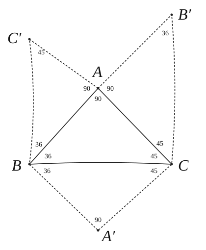
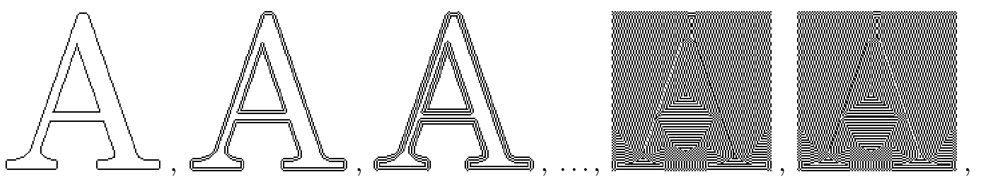
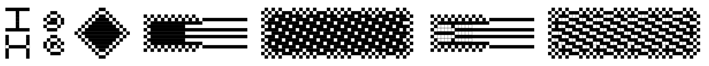
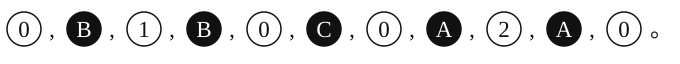

<a id="answers-7-1-3"></a>


# 7.1.3 节

<a id="ans-7-1-3-1"></a>

**1.** [题目](../sec-7-1-3.md#ex-7-1-3-1) 这些运算在 $m$ 是 1 的位置交换 $x$ 和 $y$ 的二进制位. (特别地, 如果 $m=-1$, 步骤 `y ← y ⊕ (x & m)` 恰好变成 `y ← y ⊕ x`, 3 个赋值操作将交换 $x\leftrightarrow y$ 而无须使用辅助寄存器. 小亨利·沃伦在 1961 年的 IBM 程序设计课程笔记中找到了这个技巧.)


<a id="pdf-500"></a><a id="p-485"></a>

<a id="ans-7-1-3-2"></a>

**2.** [题目](../sec-7-1-3.md#ex-7-1-3-2) 当 $x$ 和 $y$ 非负时, 或者当我们把 $x$ 和 $y$ 看成是 $0<1<2<\cdots<-3<-2<-1$ 的 “无符号 2 基整数” 时, 3 个关系式全部成立. 但是如果负整数是小于非负整数的, (i) 不成立当且仅当 $x<0$ 且 $y<0$; (ii) 和 (iii) 不成立当且仅当 $x\oplus y<0$, 也就是, 当且仅当 $x<0$ 且 $y\ge0$, 或者 $x\ge0$ 且 $y<0$.

<a id="ans-7-1-3-3"></a>

**3.** [题目](../sec-7-1-3.md#ex-7-1-3-3) 注意 $x-y=(x\oplus y)-2(\bar x\mathbin{\&}y)$ (见习题 93). 通过移除 $x$ 和 $y$ 左边的公共位, 我们可以假定 $x_{n-1}=1$ 且 $y_{n-1}=0$. 于是, $2(\bar x\mathbin{\&}y)\le2((x\oplus y)-2^{n-1})=(x\oplus y)-(x\oplus y)^M-1$.

<a id="ans-7-1-3-4"></a>

**4.** [题目](../sec-7-1-3.md#ex-7-1-3-4) 由 (16) 我们有 $x^{CN}=x+1=x^S$. 因此, $x^{NC}=x^{NCSP}=x^{NCCNP}=x^{NNP}=x^P$.

<a id="ans-7-1-3-5"></a>

**5.** [题目](../sec-7-1-3.md#ex-7-1-3-5) (a) 证伪: 令 $x=(\ldots x_2x_1x_0)_2$. 那么, $x\ll k$ 的二进制位 $l$ 是 $x_{l-k}[l\ge k]$. 所以, 式子左端的二进制位 $l$ 是 $x_{l-k-j}[l\ge k][l-k\ge j]$, 式子右端的二进制位 $l$ 是 $x_{l-j-k}[l\ge j+k]$. 如果 $j\ge0$ 或 $k\le0$, 这两个表达式是一致的. 但是, 如果 $j<0<k$, 当 $l=\max(0,j+k)$ 且 $x_{l-j-k}=1$ 时它们是不同的.

(然而, 在所有情况我们都有 $(x\ll j)\ll k\subseteq x\ll(j+k)$.)

(b) 证明: 在所有 3 个公式中二进制位 $l$ 都是 $x_{l+j}[l\ge-j]\wedge y_{l-k}[l\ge k]$.

<a id="ans-7-1-3-6"></a>

**6.** [题目](../sec-7-1-3.md#ex-7-1-3-6) 由于 $x\ll y\ge0$ 当且仅当 $x\ge0$, 我们必定有 $x\ge0$ 当且仅当 $y\ge0$. 显然 $x=y$ 始终是一个解. 满足 $x>y$ 的解是: (a) $x=-1$ 且 $y=-2$, 或者 $2^y>x>y>0$; (b) $x=2$ 且 $y=1$, 或者 $2^{-x}\ge-y>-x>0$.

<a id="ans-7-1-3-7"></a>

**7.** [题目](../sec-7-1-3.md#ex-7-1-3-7) 置 $x'\gets(x+\bar\mu_0)\oplus\bar\mu_0$, 其中 $\mu_0$ 是 (47) 中的常数. 那么 $x'=(\ldots x'_2x'_1x'_0)_2$, 因为

$$
(x'\oplus\bar\mu_0)-\bar\mu_0=(\ldots\bar x'_3x'_2\bar x'_1x'_0)_2-(\ldots1010)_2=(\ldots0x'_20x'_0)_2-(\ldots x'_30x'_10)_2=x.
$$

[这是著名科学研究文摘 HAKMEM 中的 Hack128, 见后面的习题 20 的答案. 达尔马·阿格拉沃尔在 *IEEE Trans.* **C-29** (1980), 1032–1035 提出替代公式 $x'\gets(\mu_0-x)\oplus\mu_0$. 对于所有 $n$, 两种结果模 $2^n$ 都是正确的, 但可能出现上溢或下溢. 例如, $n$ 位寄存器中二进制补码的数值范围是从 $-2^{n-1}$ 到 $2^{n-1}-1$ 的闭区间, 但是, 当 $n$ 是偶数时, 负二进制数的数值范围是从 $-\tfrac23(2^n-1)$ 到 $\tfrac13(2^n-1)$ 的闭区间. 通常, 当 $\mu=(\ldots m_2m_1m_0)_2$ 时, 公式 $x'\gets(x+\mu)\oplus\mu$ 从二进制计数法转换到习题 4.1-30(c) 中讨论的二进制基底 $\langle2^n(-1)^{m_n}\rangle$ 的一般数系.]

<a id="ans-7-1-3-8"></a>

**8.** [题目](../sec-7-1-3.md#ex-7-1-3-8) 首先, $x\oplus y\notin(S\oplus y)\cup(x\oplus T)$. 其次, 假定 $0\le k<x\oplus y$, 并令 $x\oplus y=(\alpha1\alpha')_2,k=(\alpha0\alpha'')_2$, 其中 $\alpha,\alpha',\alpha''$ 是满足 $|\alpha'|=|\alpha''|$ 的 0–1 串. 由对称性, 假定 $x=(\beta1\beta')_2,y=(\gamma0\gamma')_2$, 其中 $|\alpha'|=|\beta'|=|\gamma'|$. 那么, $k\oplus y=(\beta0\gamma'')_2$ 小于 $x$. 因此, $k\oplus y\in S$ 且 $k=(k\oplus y)\oplus y\in S\oplus y$. [见罗兰·斯普拉格,*Tôhoku Math. J.* **41** (1936), 438–444; 帕特里克·格伦迪,*Eureka* **2** (1939), 6–8.]

<a id="ans-7-1-3-9"></a>

**9.** [题目](../sec-7-1-3.md#ex-7-1-3-9) 上题的斯普拉格–格伦迪定理表明, 两堆 $x$ 根火柴棍和 $y$ 根火柴棍等价于一堆 $x\oplus y$ 根火柴棍. (存在非负整数 $k<x\oplus y$, 当且仅当存在非负整数 $i<x$ 满足 $i\oplus y<x\oplus y$, 或者存在非负整数 $j<y$ 满足 $x\oplus j<x\oplus y$.) 所以, $k$ 堆火柴棍等价于一堆 $a_1\oplus\cdots\oplus a_k$ 根火柴棍. [参见查尔斯·布顿,*Annals of Math.* (2) **3** (1901–1902), 35–39.]

<a id="ans-7-1-3-10"></a>

**10.** [题目](../sec-7-1-3.md#ex-7-1-3-10) 为了简明扼要, 我们仅在本答案 (i) 至 (iv) 中用 $xy$ 表示 $x\otimes y$, 用 $x+y$ 表示 $x\oplus y$.

(i) 显然有 $0y=0,x+y=y+x,xy=yx$. 由对 $y$ 的归纳法还有 $1y=y$.

(ii) 如果 $x\ne x'$ 且 $y\ne y'$, 那么 $xy+xy'+x'y+x'y'\ne0$, 因为 $xy$ 的定义表明当 $0\le x'<x$ 且 $0\le y'<y$ 时 $xy'+x'y+x'y'\ne xy$. 特别地, 如果 $x\ne0$ 且 $y\ne0$, 那么 $xy\ne0$. 另外, 如果对于任意有限集合 $S$ 和 $T$ 有 $x=\operatorname{mex}(S)$ 且 $y=\operatorname{mex}(T)$, 那么我们有 $xy=\operatorname{mex}\{xj+iy+ij\mid i\in S,j\in T\}$.

(iii) 因此, 由对 $x,y,z$ 的 (普通) 和的归纳法, $(x+y)z$ 等于

$$
\begin{aligned}
\operatorname{mex}\{&(x+y)z'+(x'+y)z+(x'+y)z',\\
&(x+y)z'+(x+y')z+(x+y')z'\mid0\le x'<x,0\le y'<y,0\le z'<z\},
\end{aligned}
$$

也就是 $\operatorname{mex}\{xz'+x'z+x'z'+yz,xz+yz'+y'z+y'z'\}=xz+yz$. 特别地, 存在消去律: 如果 $xz=yz$, 那么 $(x+y)z=0$, 所以 $x=y$ 或 $z=0$.

(iv) 由类似的归纳法,

$$
\begin{aligned}
(xy)z&=\operatorname{mex}\{(xy)z'+(xy'+x'y+x'y')(z+z')\}\\
&=\operatorname{mex}\{(xy)z'+(xy')z+(xy')z'+\cdots\}\\
&=\operatorname{mex}\{x(yz')+x(y'z)+x(y'z')+\cdots\}\\
&=\operatorname{mex}\{(x+x')(yz'+y'z+y'z')+x'(yz)\}=x(yz).
\end{aligned}
$$


<a id="pdf-501"></a><a id="p-486"></a>

(v) 如果 $0\le x,y<2^{2^n}$, 我们将证明 $x\otimes y<2^{2^n},2^{2^n}\otimes y=2^{2^n}y,2^{2^n}\otimes2^{2^n}=\tfrac32\,2^{2^n}$. 由分配律 (iii), 对于 $0\le a,b<2^n$ 考虑 $x=2^a$ 且 $y=2^b$, 上述结论得证. 令 $a=2^p+a'$ 且 $b=2^q+b'$, 其中 $0\le a'<2^p$ 且 $0\le b'<2^q$, 那么, 对 $n$ 用归纳法, 我们有 $x=2^{2^p}\otimes2^{a'}$ 且 $y=2^{2^q}\otimes2^{b'}$.

如果 $p<n-1$ 且 $q<n-1$, 我们已经证明了 $x\otimes y<2^{2^{n-1}}$. 如果 $p<q=n-1$, 那么 $x\otimes2^{b'}<2^{2^q}$, 因此 $x\otimes y<2^{2^n}$. 如果 $p=q=n-1$, 我们有 $x\otimes y=2^{2^p}\otimes2^{2^p}\otimes2^{a'}\otimes2^{b'}=(\tfrac32\,2^{2^p})\otimes z$, 其中 $z<2^{2^p}$. 于是, 在所有情况我们都有 $x\otimes y<2^{2^n}$.

根据消去律, 小于 $2^{2^n}$ 的非负整数构成一个子域. 因此在公式

$$
2^{2^n}\otimes y=\operatorname{mex}\{2^{2^n}y'\oplus x'\otimes(y\oplus y')\mid0\le x'<2^{2^n},0\le y'<y\}
$$

中, 对于每个 $y'$, 我们可以选择 $x'$ 以排除介于 $2^{2^n}y'$ 和 $2^{2^n}(y'+1)-1$ 之间的所有数, 但绝不排除 $2^{2^n}y$.

最后, 在 $2^{2^n}\otimes2^{2^n}=\operatorname{mex}\{2^{2^n}(x'\oplus y')\oplus(x'\otimes y')\mid0\le x',y'<2^{2^n}\}$ 中, 选择 $x'=y'$ 将排除直到 $2^{2^n}-1$ (含) 的全部数值, 因为 $x\otimes x=y\otimes y$ 蕴涵 $(x\oplus y)\otimes(x\oplus y)=0$, 所以 $x=y$. 选择 $x'=y'\oplus1$ 排除从 $2^{2^n}$ 到 $\tfrac32\,2^{2^n}-1$ 的数值, 因为 $(x\otimes x)\oplus x=(y\otimes y)\oplus y$ 蕴涵 $x=y$ 或 $x=y\oplus1$, 而且 $x\otimes x$ 的最高有效位与 $x$ 的最高有效位相同. 同样的论证表明不会排除 $\tfrac32\,2^{2^n}$. 证毕.

例如, 考虑子域 $\{0,1,\ldots,15\}$. 由分配律, 我们可以把 $x\otimes y$ 简化为 $x\otimes1,x\otimes2,x\otimes4$ 和 (或)$x\otimes8$ 之和. 我们有 $2\otimes2=3,2\otimes4=8,4\otimes4=6$. 因为 $8=2\otimes4$, “用 8 乘” 可以先 “用 2 乘” 然后再 “用 4 乘” 来完成, 或者反过来. 于是, 我们有 $2\otimes8=12,4\otimes8=11,8\otimes8=13$.

一般情况下, 对于 $n>0$ 令 $n=2^m+r$, 其中 $0\le r<2^m$. 存在 $2^{m+1}\times2^{m+1}$ 矩阵 $Q_n$, 用 $2^n$ 乘等价于把 $Q_n$ 应用到 $2^{m+1}$ 个二进制位的位块 (按模 2 运算). 例如, $Q_1=\begin{pmatrix}1&1\\1&0\end{pmatrix}$, $(\ldots x_4x_3x_2x_1x_0)_2\otimes2^1=(\ldots y_4y_3y_2y_1y_0)_2$, 其中 $y_0=x_1,y_1=x_1\oplus x_0,y_2=x_3,y_3=x_3\oplus x_2,y_4=x_5$, 等等. 这些矩阵以递归方式建立如下: 令 $Q_0=R_0=(1)$,

$$
Q_{2^m+r}=\begin{pmatrix}I&R_m\\I&0\end{pmatrix}\begin{pmatrix}Q_r&&0\\&\ddots&\\0&&Q_r\end{pmatrix},\qquad
R_{m+1}=\begin{pmatrix}R_m&R_m^2\\R_m&0\end{pmatrix}=Q_{2^{m+1}-1},
$$

其中, $Q_r$ 重复足够次数以达到 $2^{m+1}$ 行和 $2^{m+1}$ 列. 例如,

$$
Q_2=\begin{pmatrix}1&0&1&1\\0&1&1&0\\1&0&0&0\\0&1&0&0\end{pmatrix};\qquad
Q_3=Q_2\begin{pmatrix}Q_1&0\\0&Q_1\end{pmatrix}=\begin{pmatrix}1&1&0&1\\1&0&1&1\\1&1&0&0\\1&0&0&0\end{pmatrix}=R_2.
$$

如果寄存器 $x$ 中保存有任意 64 位二进制数, 而且 $0\le j\le7$, 给定十六进制矩阵常数

```text
q0 = 8040201008040201
q1 = c08030200c080302
q2 = b06080400b060804
q3 = d0b0c0800d0b0c08
q4 = 8d4b2c1880402010
q5 = c68d342cc0803020
q6 = b9678d4bb0608040
q7 = deb9c68dd0b0c080
```

MMIX 指令 $\mathtt{MXOR}\;y,\mathtt q_j,x$ 将计算 $y=x\otimes2^j$. [1976 年, 约翰·康威在《论数值与博弈》(*On Numbers and Games*) 第 6 章指出, 这些定义实际上在序数上构成一个代数闭域.]

<a id="ans-7-1-3-11"></a>

**11.** [题目](../sec-7-1-3.md#ex-7-1-3-11) 令 $m=2^{a_s}+\cdots+2^{a_1}$ (其中 $a_s>\cdots>a_1\ge0$), $n=2^{b_t}+\cdots+2^{b_1}$ (其中 $b_t>\cdots>b_1\ge0$). 那么, $m\otimes n=mn$ 当且仅当 $(a_s\mathbin{|}\cdots\mathbin{|}a_1)\mathbin{\&}(b_t\mathbin{|}\cdots\mathbin{|}b_1)=0$.

<a id="ans-7-1-3-12"></a>

**12.** [题目](../sec-7-1-3.md#ex-7-1-3-12) 假定 $x=2^{2^n}a+b$ (其中 $0\le a,b<2^{2^n}$), 令 $x'=x\otimes(x\oplus a)$. 那么

$$
x'=((2^{2^n}\otimes a)\oplus b)\otimes((2^{2^n}\otimes a)\oplus a\oplus b)=(2^{2^n-1}\otimes a\otimes a)\oplus(b\otimes(a\oplus b))<2^{2^n}.
$$

要进行除以 $x$ 的尼姆除法, 我们可以先除以 $x'$, 然后再乘 $x\oplus a$. [小伦斯特拉提出了这个算法, 见 *Séminaire de Théorie des Nombres* (Université de Bordeaux, 1977–1978), exposé11, 习题 5.]

<a id="ans-7-1-3-13"></a>

**13.** [题目](../sec-7-1-3.md#ex-7-1-3-13) 如果 $a_2\oplus\cdots\oplus a_k=a_1\oplus a_3\oplus\cdots\oplus((k-2)\otimes a_k)=0$, 每次移动将打破这个条件. 当 $x\oplus y=x'\oplus y'$ 且 $a\ne b$ 时, 我们不可能有 $(a\otimes x)\oplus(b\otimes y)=(a\otimes x')\oplus(b\otimes y')$, 除非 $(x,y)=(x',y')$.


<a id="pdf-502"></a><a id="p-487"></a>

反之, 如果 $a_2\oplus\cdots\oplus a_k\ne0$, 我们可以减少某个 $a_j$($j\ge2$) 使这个和为零. 然后, 可以令 $a_1$ 为 $a_3\oplus\cdots\oplus((k-2)\otimes a_k)$. 如果 $a_2\oplus\cdots\oplus a_k=0$ 且 $a_1\ne a_3\oplus\cdots\oplus((k-2)\otimes a_k)$, 我们在 $a_1$ 过大时简单地减少它. 否则, 由于尼姆乘法的定义, 存在 $j\ge3$, 对于某个 $2\le i<j$ 和 $0\le a'_j<a_j$, 如果令 $(j-2)\otimes a_j$ 用一个适当的更小值 $((j-2)\otimes a'_j)\oplus((i-2)\otimes(a_j\oplus a'_j))$ 代替, 等式将出现. 因此, 令 $a_j\leftarrow a'_j$, $a_i\leftarrow a_i\oplus a_j\oplus a'_j$, 所求的两个等式成立. [伯利坎普、康威和盖伊在《制胜之道》(*Winning Ways*) 第 14 章末尾介绍了这个游戏.]

<a id="ans-7-1-3-14"></a>

**14.** [题目](../sec-7-1-3.md#ex-7-1-3-14) (a) 由于 $x_0=y_0\oplus t$, $\lfloor y/2\rfloor=\lfloor x/2\rfloor^{T_{x_0}}$, 每个 $y=(\ldots y_2y_1y_0)_2=x^T$ 唯一确定 $x=(\ldots x_2x_1x_0)_2$.

(b) 当 $k>0$ 时, 它是带有标记 $t_{\alpha a\beta}=a$($|\beta|=k-1$) 和标记 $t_\alpha=0$($|\alpha|<k$) 的分支函数. 但是, 当 $k\le0$ 时, 该变换不是排列. 事实上, 当 $k<0$ 时, 它使 $2^{-k}$ 个不同的 2 基整数变成零.

[$k=1$ 的情形特别重要: 这时, $x^T$ 把非负整数变成二进制位中 1 的个数为偶数的非负整数, 负整数变成二进制位中 1 的个数为奇数的非负整数, $-1/3\mapsto-1$. 此外, $\lfloor x^T/2\rfloor$ 是 “格雷二进制码”7.2.1.1-(9).]

(c) 如果 $\rho(x\oplus y)=k$, 我们有 $T(x)\equiv T(y)$, $x\equiv y+2^k\pmod{2^{k+1}}$. 因此 $\rho(x^T\oplus y^T)=\rho(x\oplus y\oplus T(x)\oplus T(y))=k$. 反过来, 如果每当 $y=x+2^k$ 时 $\rho(x^T\oplus y^T)=k$, 当 $x=(\alpha^R)_2$ 时通过置 $t_\alpha=(x^T\gg|\alpha|)\bmod2$, 我们就得到一个符合要求的位标记.

(d) 由 (a) 和 (c) 直接可得这个证明. 因为, 如果我们总是有 $\rho(x\oplus y)=\rho(x^U\oplus y^U)=\rho(x^V\oplus y^V)$, 那么 $\rho(x\oplus y)=\rho(x^U\oplus y^U)=\rho(x^{UV}\oplus y^{UV})$. 于是, 如果对于所有 $x$ 有 $x^{TU}=x$, $\rho(x^U\oplus y^U)=\rho(x\oplus y)$ 同 $\rho(x\oplus y)=\rho(x^T\oplus y^T)$ 是等价的.

我们也可以显式构造标记: 如果 $W=UV$, 注意到当 $a,b,c\in\{0,1\}$ 时我们有 $W_a=U_aV_{a'}$, $W_{ab}=U_{ab}V_{a'b'}$, $W_{abc}=U_{abc}V_{a'b'c'}$, 其中 $a'=a\oplus u$, $b'=b\oplus u_a$, $c'=c\oplus u_{ab}$, 等等. 因此, 我们有 $w=u\oplus v$, $w_a=u_a\oplus v_{a'}$, $w_{ab}=u_{ab}\oplus v_{a'b'}$, 等等. 通过交换所有标记为 1 的结点的左子树和右子树, 我们得到 $U$ 的逆的标记 $T$. 因此, 我们有 $t=u$, $t_{a'}=u_a$, $t_{a'b'}=u_{ab}$, 等等.

(e) (d) 中的显式构造表明, 平衡条件对复合和反转是保持的, 因为在每一层 $\{0',1'\}=\{0,1\}$.

注记: 小伦斯特拉注意到, 当我们用公式 $1/2^{\rho(x\oplus y)}$ 定义 2 基整数 $x$ 与 $y$ 之间的 “距离” 时, 把分支函数视为 2 基整数的 “等距同构” (保持距离的排列) 是有利的. 此外, 分支函数 (模 $2^d$) 是 $\{0,1,\ldots,2^d-1\}$ 的全部排列构成的群的西洛 2-子群, 即那个群的所有子群中具有最大 2 幂阶的唯一 (达到同构的) 子群. 它们同包含 $2^d$ 个叶结点的完全二叉树的自同构也是等价的.

<a id="ans-7-1-3-15"></a>

**15.** [题目](../sec-7-1-3.md#ex-7-1-3-15) 等价的等式是 $(x+2a)\oplus b=(x\oplus b)+2a$. 所以我们也可以求所有满足 $(x\oplus b)+c=(x+c)\oplus b$ 的 $b$ 和 $c$. 令 $x=0$ 和 $x=-c$ 蕴涵 $b+c=b\oplus c$ 和 $b-c=b\oplus(-c)$, 因此, 由 (89) 得 $b\mathbin{\&}c=b\mathbin{\&}(-c)=0$, 而且我们有 $b<2^{\rho c}$. 这个条件也是充分条件. 所以, $0\le b<2^{\rho a+1}$ 是原来问题的充分必要条件.

<a id="ans-7-1-3-16"></a>

**16.** [题目](../sec-7-1-3.md#ex-7-1-3-16) (a) 如果 $\rho(x\oplus y)=k$, 我们有 $x\equiv y+2^k\pmod{2^{k+1}}$. 因此, 我们有 $x+a\equiv y+a+2^k$, $\rho((x+a)\oplus(y+a))=k$. 于是, $\rho((x\oplus b)\oplus(y\oplus b))$ 显然等于 $k$.

(b) 提示中的标记称为 $P(c)$, 它在对应于 $c$ 的路径上取 1, 而在其他地方取 0. 因此它是平衡的. 一般的活跃函数可以写成

$$
x^{P(c_0)^{-a_1}P(c_1)^{-a_2}\cdots P(c_{m-1})^{-a_m}}\oplus c_m,\qquad\text{其中 }c_j=b_1\oplus\cdots\oplus b_j.
$$

所以, 它是平衡的当且仅当 $c_m=0$.

[顺便指出, 集合 $S=\{P(0)\}\cup\{P(k)\oplus P(k+2^e)\mid k\ge0\text{ 且 }2^e>k\}$ 对于所有可能的平衡标记提供一个重要的基: 一个标记是平衡的, 当且仅当对于某个 $Q\subseteq S$ 它是 $\bigoplus\{q\mid q\in Q\}$. 即便 $Q$ 可能是无限的, 这个异或运算也是明确定义的, 因为在每个结点仅出现有限多的 1.]

(c) 因为 $x^{P(c)}=x\oplus\lfloor x\oplus c\rceil$, 所以 (b) 中的函数 $P(c)$ 具有这种形式. 它的反函数 $x^{S(c)}=((x\oplus c)+1)\oplus c$ 是 $x\oplus\lfloor x\oplus\bar c\rceil=x^{P(\bar c)}$. 此外, 因为对于任何分支函数 $x^T$ 有 $\lfloor x\oplus y\rceil=\lfloor x^T\oplus y^T\rceil$, 所以我们有 $x^{P(c)P(d)}=x^{P(c)}\oplus\lfloor x^{P(c)}\oplus d\rceil=x\oplus\lfloor x\oplus c\rceil\oplus\lfloor x\oplus d^{S(c)}\rceil$. 同样, $x^{P(c)P(d)P(e)}=x\oplus\lfloor x\oplus c\rceil\oplus\lfloor x\oplus d^{S(c)}\rceil\oplus\lfloor x\oplus e^{S(d)S(c)}\rceil$, 等等. 舍弃相等的项后, 得到我们想要的形式. 结果数值 $p_j$ 是唯一的, 因为它们是函数改变符号处 $x$ 仅有的值.

(d) 例如, 我们有 $x\oplus\lfloor x\oplus a\rceil\oplus\lfloor x\oplus b\rceil\oplus\lfloor x\oplus c\rceil=x^{P(a')P(b')P(c')}$, 其中 $a'=a$, $b'=b^{P(a')}$, $c'=c^{P(a')P(b')}$.


<a id="pdf-503"></a><a id="p-488"></a>

[受到科内利斯·韦尔特过去工作 *Indagationes Math.* **14** (1952), 304–314;**16** (1954), 194–200 的启发, 1976 年, 在《论数值与博弈》(*On Numbers and Games*) 第 13 章, 约翰·康威建立了活跃函数的理论.]

<a id="ans-7-1-3-17"></a>

**17.** [题目](../sec-7-1-3.md#ex-7-1-3-17) (马泰奥·斯拉尼纳给出的解) 这样的等式是可判定的, 即使我们也允许像 $x\mathbin{\&}y$, $\bar x$, $x\ll1$, $x\gg1$, $2^{\rho x}$, $2^{\lambda x}$ 之类的运算, 而且, 通过把它们转换成带一个后继的二阶一元逻辑 (S1S) 的公式, 允许关于整数变量的命题与量词化的布尔组合. 每个 2 基变量 $x=(\ldots x_2x_1x_0)_2$ 对应一个 S1S 集合变量 $X$, 其中 $j\in X$ 意味着 $x_j=1$:

$$
\begin{aligned}
z=\bar x&\quad\text{变成}\quad&&\forall t(t\in Z\Leftrightarrow t\notin X);\\
z=x\mathbin{\&}y&\quad\text{变成}\quad&&\forall t(t\in Z\Leftrightarrow(t\in X\land t\in Y));\\
z=2^{\rho x}&\quad\text{变成}\quad&&\forall t(t\in Z\Leftrightarrow(t\in X\land\forall s(s<t\Rightarrow s\notin X)));\\
z=x+y&\quad\text{变成}\quad&&\exists C\forall t\bigl(0\notin C\ \land\ (t\in Z\Leftrightarrow(t\in X)\oplus(t\in Y)\oplus(t\in C))\\
&&&\qquad\land\ (t+1\in C\Leftrightarrow\langle(t\in X)(t\in Y)(t\in C)\rangle)\bigr).
\end{aligned}
$$

像 $x\mathbin{\&}(-x)=2^{\rho x}$ 这样的恒等式与

$$
\forall X\forall Y\forall Z\bigl((\operatorname{integer}(X)\ \land\ 0=x+y\ \land\ z=x\mathbin{\&}y)\ \Rightarrow\ z=2^{\rho x}\bigr)
$$

的转换等价, 其中 $\operatorname{integer}(X)$ 代表 $\exists t\forall s(s>t\Rightarrow(s\in X\Leftrightarrow t\in X))$. 如果它们是 (比如说) 整数之比, 我们还可以包含 2 基常数. 例如, $z=\mu_0$ 等价于公式 $0\in Z\land\forall t(t\in Z\Leftrightarrow t+1\notin Z)$. 当然, 我们不能包含任意 (不可计算的) 常数.

尤利乌斯·比希 [*Logic, Methodology, and Philosophy of Science: Proceedings* (Stanford, 1960), 1–11] 证明所有的 S1S 公式都是可判定的. 如果只限于考虑等式, 实际上我们可以证明指数时间是足够的.

另一方面, 迈克尔·汉堡证明, 如果把 $\rho x$, $\lambda x$ 或 $1\ll x$ 添加到公式中, 问题变为不可判定. 乘法则是可以编码的.

顺便指出, 即使仅使用 $x\oplus y$ 和 $x+1$ 运算, 也存在很多非平凡的恒等式. 例如, 科内利斯·韦尔特在 1952 年就注意到

$$
((x\oplus(y+1))+1)\oplus(x+1)=((((x+1)\oplus y)+1)\oplus x)+1.
$$

<a id="ans-7-1-3-18"></a>

**18.** [题目](../sec-7-1-3.md#ex-7-1-3-18) 当 $x$ 是 64 的倍数时, 第 $x$ 行当然完全是空的. 这幅图像的细节明显是 “混乱” 且复杂的. 但是, 对于不太大的整数 $j,k\ge1$, 有一种非常简单的了解直线 $x=64\sqrt j$ 与双曲线 $xy=2^{11}k$ 交点附近出现什么图像的方法.

确实, 当 $x$ 和 $y$ 是整数时, $x^2y\gg11$ 的值是奇数当且仅当 $x^2y/2^{12}\bmod1\ge\tfrac12$. 因此, 如果 $x=64\sqrt j+\delta$ 且 $xy=2^{11}(k+\epsilon)$, 则我们有

$$
\frac{x^2y}{2^{12}}\bmod1=\Bigl(\frac{128\sqrt j\delta+\delta^2}{4096}\Bigr)y\bmod1=\Bigl(\frac{2\delta x-\delta^2}{4096}\Bigr)y\bmod1=\Bigl((k+\epsilon)\delta-\frac{\delta^2y}{4096}\Bigr)\bmod1,
$$

而且, 比如说, 当 $\delta$ 接近于一个小整数时, 这个等式有一个关于 $\tfrac12$ 的已知关系. [见克利福德·皮科韦尔和阿赫列什·拉赫塔基亚,*J. Recreational Math.* **21** (1989), 166–169.]

<a id="ans-7-1-3-19"></a>

**19.** [题目](../sec-7-1-3.md#ex-7-1-3-19) (a) 当 $n=1$ 时, $f(A,B,C)$ 在所有排列下具有同样的值, 除了当 $a_0\ne a_1$, $b_0\ne b_1$, $c_0\ne c_1$ 时的排列; 这时它不超过 1. 对于更大的 $n$ 值, 我们用归纳法证明. 为了避免繁琐的记号, 假定 $n=3$. 令 $A_0=(a_0,a_1,a_2,a_3)$, $A_1=(a_4,a_5,a_6,a_7)$, $\ldots$, $C_1=(c_4,c_5,c_6,c_7)$. 由归纳法, 我们有 $f(A,B,C)=\sum_{j\oplus k\oplus l=0}f(A_j,B_k,C_l)\le\sum_{j\oplus k\oplus l=0}f(A_j^*,B_k^*,C_l^*)$. 因此, 我们可以假定 $a_0\ge a_1\ge a_2\ge a_3$, $a_4\ge a_5\ge a_6\ge a_7$, $\ldots$, $c_4\ge c_5\ge c_6\ge c_7$. 我们还可以用同样的方法对子向量 $A'_0=(a_0,a_1,a_4,a_5)$, $A'_1=(a_2,a_3,a_6,a_7)$, $\ldots$, $C'_1=(c_2,c_3,c_6,c_7)$ 排序. 最后, 我们可以对 $A''_0=(a_0,a_1,a_6,a_7)$, $A''_1=(a_2,a_3,a_4,a_5)$, $\ldots$, $C''_1=(c_2,c_3,c_4,c_5)$ 排序, 因为在每项 $a_jb_kc_l$ 中, 具有前导位 01、10 和 11 的下标 $\{j,k,l\}$ 的数值必须满足 $s_{01}\equiv s_{10}\equiv s_{11}\pmod2$. 由习题 5.3.4-48, 这 3 个排序运算留下 $A,B,C$ 的全排序. (对于所有 $n\ge2$, 恰好需要对长度为 $2^{n-1}$ 的子向量的 3 个排序运算.)


<a id="pdf-504"></a><a id="p-489"></a>

(b) 假定 $A=A^*$, $B=B^*$, $C=C^*$. 那么, 我们有 $a_j=\sum_{t=0}^{2^n-1}\alpha_t[j\le t]$, 其中 $\alpha_j=a_j-a_{j+1}\ge0$ 并且置 $a_{2^n}=0$. 对于 $b_k$ 和 $c_l$ 也有同样的公式. 当 $p$ 是 $\{0,1,\ldots,2^n-1\}$ 的排列时, 令 $A_{(p)}$ 表示向量 $(a_{p(0)},\ldots,a_{p(2^n-1)})$. 那么, 由 (a) 我们有

$$
\begin{aligned}
f(A_{(p)},B_{(q)},C_{(r)})&=\sum_{j\oplus k\oplus l=0}\sum_{t,u,v}\alpha_t\beta_u\gamma_v[p(j)\le t][q(k)\le u][r(l)\le v]\\
&\le\sum_{j\oplus k\oplus l=0}\sum_{t,u,v}\alpha_t\beta_u\gamma_v[j\le t][k\le u][l\le v]=f(A,B,C).
\end{aligned}
$$

[哈代、李特尔伍德和波利亚在 *Inequalities* (1934), §10.3 中给出这个证明.]

(c) 同样的证明方法扩展到任意数目的向量即可. [雷蒙德·佩利,*Proc. London Math. Soc.* (2) **34** (1932), 265–279, 定理 15.]

<a id="ans-7-1-3-20"></a>

**20.** [题目](../sec-7-1-3.md#ex-7-1-3-20) 给出的步骤计算满足 $\nu y=\nu x$ 的大于 $x$ 的最小整数 $y$. 如果要生成从 $n$ 个对象中取 $m$ 个对象的全部组合 (这种组合即 $n$ 元素集合的所有 $m$ 元素子集, 其中的元素用二进制位 1 表示), 它们是有用的.

[这个珍闻是著名科学研究文摘 HAKMEM (麻省理工学院人工智能实验室研究报告 239 号, 1972 年 2 月 29 日) 的 Hack175.]

<a id="ans-7-1-3-21"></a>

**21.** [题目](../sec-7-1-3.md#ex-7-1-3-21) 置 $t\leftarrow y+1$, $u\leftarrow t\oplus y$, $v\leftarrow t\mathbin{\&}y$, $x\leftarrow v-(v\mathbin{\&}(-v))/(u+1)$. 如果 $y=2^m-1$ 是第一个 $m$ 组合, 这 8 个运算置 $x$ 为零. ($x=\overline{f(\bar y)}$ 的事实似乎不产生任何更短的计算方案.)

<a id="ans-7-1-3-22"></a>

**22.** [题目](../sec-7-1-3.md#ex-7-1-3-22) 不使用除法的位叠加加法:

```text
SUBU t,x,1; ANDN u,x,t; SADD k,t,x; ADDU v,x,u;
XOR t,v,x; ADDU k,k,2; SRU t,t,k; ADDU y,v,t.
```

如果我们能好好利用常量 $\mathtt{mone}=-1$, 实际上可以节约一步:

```text
SUBU t,x,1; XOR u,t,x; ADDU y,x,u; SADD k,t,y;
ANDN y,y,u; SLU t,mone,k; ORN y,y,t.
```

<a id="ans-7-1-3-23"></a>

**23.** [题目](../sec-7-1-3.md#ex-7-1-3-23) (a) $(0\ldots01\ldots1)_2=2^m-1$ 和 $(0101\ldots01)_2=(2^{2m}-1)/3$.

(b) 这个解利用 2 基常数 $\mu_0=(\ldots010101)_2=-1/3$:

$$
t\leftarrow x\oplus\mu_0,\quad u\leftarrow(t-1)\oplus t,\quad v\leftarrow x\mathbin{|}u,\quad w\leftarrow v+1,\quad y\leftarrow w+\Bigl\lfloor\frac{v\mathbin{\&}\bar w}{\sqrt{u+1}}\Bigr\rfloor.
$$

如果 $x=(2^{2m}-1)/3$, 因为 $u=2^{2m+1}-1$, 这些运算将产生奇怪的结果.

(c)

```text
XOR t,x,m0; SUBU u,t,1; XOR u,t,u; OR v,x,u;
SADD y,u,m0; ADDU w,v,1; ANDN t,v,w; SRU y,t,y;
ADDU y,w,y.
```

[本习题受到约尔格·阿恩特的启发.]

<a id="ans-7-1-3-24"></a>

**24.** [题目](../sec-7-1-3.md#ex-7-1-3-24) 先作准备, 把数组初始化为筛除 3、5、7、11 的所有倍数后的状态, 是有利的. 像和田英一建议的那样, 我们可以结合筛除 3 和 11 以及 5 和 7 的倍数:

```text
      LOC Data_Segment
qbase GREG @ ;N IS 3584 ;n GREG N ;one GREG 1
Q     OCTA #816d129a64b4cb6e                             Q_0 (小端)
      LOC Q+N/16
qtop  GREG @                                            表Q结束
Init  OCTA #9249249249249249|#4008010020040080             [129..255]中3或11的倍数
      OCTA #8421084210842108|#0408102040810204             [129..255]中5或7的倍数
 t IS $255 ;x33 IS $0 ;x35 IS $1 ;j IS $4
      LOC #100
Main  LDOU x33,Init; LDOU x35,Init+8
      LDA j,qbase,8; SUB j,j,qtop                        准备置Q_1.
1H    NOR t,x33,x33; ANDN t,t,x35; STOU t,qtop,j           初始化64位筛.
      SLU t,x33,2; SRU x33,x33,31; OR x33,x33,t            准备下一个64位值.
      SLU t,x35,6; SRU x35,x35,29; OR x35,x35,t
      ADD j,j,8; PBN j,1B                                重复，直到达到qtop.
```

然后, 对于 $p=13,17,\ldots$, 直到 $p^2>N$, 我们可以舍去合数 $p^2,p^2+2p,\ldots$:

<a id="pdf-505"></a><a id="p-490"></a>

```text
p IS $0 ;pp IS $1 ;m IS $2 ;mm IS $3 ;q IS $4 ;s IS $5
      LDOU q,qbase,0; LDA pp,qbase,8
      SET p,13; NEG m,13*13,n; SRU q,q,6                  从p=13开始.
1H    SR m,m,1                                          m <- floor((p^2-N)/2).
2H    SR mm,m,3; LDOU s,qtop,mm; AND t,m,#3f;
      SLU t,one,t; ANDN s,s,t; STOU s,qtop,mm             将1个二进制位置零.
      ADD m,m,p; PBN m,2B                                前进p个二进制位.
      SRU q,q,1; PBNZ q,3F                               移动至下一个候选素数.
2H    LDOU q,pp,0; INCL pp,8                             读入另一批候选素数.
      OR p,p,#7f; PBNZ q,3F
      ADD p,p,2; JMP 2B                                  跳过128个合数.
2H    SRU q,q,1
3H    ADD p,p,2; PBEV q,2B                               置p <- p+2，直到p是素数.
      MUL m,p,p; SUB m,m,n; PBN m,1B                     重复，直到p^2>N.
```

运行时间是 $1172\mu+5166\upsilon$, 当然比程序 1.3.2′P 的步骤 P1–P8 所需时间 $10037\mu+641543\upsilon$ 小得多 (在习题 1.3.2′-14 中改进为 $10096\mu+215351\upsilon$). [保罗·普里查德在 *Science of Computer Programming* **9** (1987), 17–35 中给出若干富有启示性的变化. 实际上, 当筛大到计算机高速缓存无法容纳时, 这样的程序势必急剧降低运行速度. 像利昂·兰德和托马斯·帕金 [*Math. Comp.* **21** (1967), 483–488] 以及约翰·贝斯和理查德·赫德森 [*BIT* **17** (1977), 121–127] 建议的那样, 使用分块筛可以获得更好的结果, 这种筛是包含 $N_0+k\delta$ 至 $N_0+(k+1)\delta$ 之间数值的二进制位组. 这里 $N_0$ 可以非常大, 但 $\delta$ 受到高速缓存容量的限制; 计算分别对 $k=0,1,\ldots$ 进行. 分块筛已经有了高度发展, 例如, 见托马斯·奈斯利的文章 *Math. Comp.* **68** (1999), 1311–1315 及其引用的参考文献. 我在 2006 年利用这样的程序发现素数 418032645936712127 与下一个更大素数之间长达 1370 的非常大的间隙.]

<a id="ans-7-1-3-25"></a>

**25.** [题目](../sec-7-1-3.md#ex-7-1-3-25) $(1+1+25+1+1+25+1+1=56)$ 毫米. 蠹虫不会看见第 1 卷的第 2–500 页和第 4 卷的第 1–499 页. (除非这四卷书是按小端约定方式摆放在书架上, 这种情况的答案是 106 毫米.) 这个经典的智力题可以在萨姆·劳埃德的 *Cyclopedia* (New York: 1914) 第 327 页和第 383 页找到.

<a id="ans-7-1-3-26"></a>

**26.** [题目](../sec-7-1-3.md#ex-7-1-3-26) 我们可以用乘以 $\mathtt{\#aa\ldots ab}$ 代替用 12 除 (见习题 1.3.1′-17), 但是乘法也是很慢的. 或者, 我们可以处理 12000000×5 个连续二进制位 (=7.5 兆字节) 的 “平展” 序列, 忽略字之间的边界. 另一种可能是采用既非大端约定也非小端约定的转置方案: 把第 $k$ 项放进地址为 $8(k\bmod2^{20})$ 的全字, 它在那里左移 $5\lfloor k/2^{20}\rfloor$ 位. 由于 $k<12000000$, 移位量总是小于 60. 把第 $k$ 项放进寄存器 `$1` 的 MMIX 代码是:

```text
AND $0,k,[#fffff]; SLU $0,$0,3; LDOU $1,base,$0;
SRU $0,k,20; 4ADDU $0,$0,$0; SRU $1,$1,$0; AND $1,$1,#1f.
```

[这个解法使用了 8 个大兆字节 ($2^{23}$ 字节). 只要始终如一地使用同一方法, 把数据项的数值转换成全字地址并移动指定位数的任何适当方案都是可行的. 当然, 只有 `LDBU $1,base,k` 是较快的.]

<a id="ans-7-1-3-27"></a>

**27.** [题目](../sec-7-1-3.md#ex-7-1-3-27) (a) $((x-1)\oplus x)+x$. [这道题以卢瑟·伍德拉姆的思想为基础, 他注意到 $((x-1)\mathbin{|}x)+1=(x\mathbin{\&}(-x))+x$.]

(b) $(y+x)\mathbin{|}y$, 其中 $y=(x-1)\oplus x$.

(c, d, e) $((z\oplus x)+x)\mathbin{\&}z$, $((z\oplus x)+x)\oplus z$, $\overline{((z\oplus x)+x)}\mathbin{\&}z$, 其中 $z=x-1$.

(f) $x\oplus\text{(a)}$; 也可以用 $t\oplus(t+1)$, 其中 $t=x\mathbin{|}(x-1)$. [数 $(0^\infty01^a11^b)_2$ 看起来更简单, 但它明显需要 5 个运算: $((t+1)\mathbin{\&}t)-1$.]

即使在 $x=-2^b$ 的特殊情况, 这些构造也全部给出合理结果.

<a id="ans-7-1-3-28"></a>

**28.** [题目](../sec-7-1-3.md#ex-7-1-3-28) 用比特 1 指示 $x$ 中最右边的 0 的指示器 (例如, $(101011)_2\mapsto(000100)_2$); $-1\mapsto0$.

<a id="ans-7-1-3-29"></a>

**29.** [题目](../sec-7-1-3.md#ex-7-1-3-29) $\mu_k=\mu_{k+1}\oplus(\mu_{k+1}\ll2^k)$[见 *STOC* **6** (1974), 125]. 如果从 $\mu_{d,d}=2^{2^d}-1$ 开始, 当 $0\le k<d$ 时, 对于 (48) 中的常数 $\mu_{d,k}$, 这个关系也成立. (然而, 不存在从 $\mu_k$ 到 $\mu_{k+1}$ 的便捷方法, 除非我们使用 “拉链” 运算; 见 (77).)


<a id="pdf-506"></a><a id="p-491"></a>

<a id="ans-7-1-3-30"></a>

**30.** [题目](../sec-7-1-3.md#ex-7-1-3-30) 对 (50) 附加 `CSZ rho,x,64`, 它的执行时间因此增加 $1\upsilon$. 或者, 用

```text
SRU t,y,rho; SLU t,t,2; SRU t,[#300020104],t;
AND t,t,#f; ADD rho,rho,t
```

替换最后两行, 节省 $1\upsilon$ 的执行时间. 对于 (51), 我们只需保证 $\mathit{rhotab}[0]=8$.

<a id="ans-7-1-3-31"></a>

**31.** [题目](../sec-7-1-3.md#ex-7-1-3-31) 首先, 当 $x=0$ 时, 他的代码将陷入死循环. 即使修正了这个错误, 假定 $x$ 是随机整数也站不住脚. 在很多应用中, 如果需要计算非零 64 位二进制数 $x$ 的 $\rho x$, 更合理的假设应该是结果 $\{0,1,\ldots,63\}$ 中的每一个都是等可能的. 因此, 均值是 31.5, 标准差 $\approx18.5$.

<a id="ans-7-1-3-32"></a>

**32.** [题目](../sec-7-1-3.md#ex-7-1-3-32)

```text
NEGU y,x; AND y,x,y; MULU y,debruijn,y;
SRU y,y,58; LDB rho,decode,y
```

估计执行时间为 $\mu+14\upsilon$, 虽然乘以 2 的乘幂可能比典型的乘法快. 在习题 30 的答案中加 $1\upsilon$ 修正.

<a id="ans-7-1-3-33"></a>

**33.** [题目](../sec-7-1-3.md#ex-7-1-3-33) 事实上, 穷举计算表明, 恰有 94727 个合适的常数 $a$ 产生该问题的 “完全散列函数”; 其中 90970 个还能识别 “2 的乘幂”$y=2^j$ 的情形, 其中 90918 个还能区分 $y=0$ 的情形. 当已知 $y$ 是有效输入时, 在无须访问 $\mathit{decode}[32400]$ 以上表项的意义下, 乘数 $\mathtt{\#208b2430c8c82129}$ 是唯一最佳的.

<a id="ans-7-1-3-34"></a>

**34.** [题目](../sec-7-1-3.md#ex-7-1-3-34) 当 $x=5$, $y=6$ 时 (a) 不成立; 但 (b) 为真, 当 $xy=0$ 时亦然. 利维乌·拉列斯库给出 (c) 的证明: $x\oplus y=(x-1)\oplus(y-1)$ 当且仅当 $x\oplus(x-1)=y\oplus(y-1)$, 根据 (41), 我们有 $x\oplus(x-1)=2^{1+\rho x}-1$.

<a id="ans-7-1-3-35"></a>

**35.** [题目](../sec-7-1-3.md#ex-7-1-3-35) 令 $f(x)=x\oplus3x$. 显然 $f(2x)=2f(x)$, $f(4x+1)=4f(x)+2$. 由习题 34(c) 我们还有 $f(4x-1)=4f(x)+2$. 由此可得提示中的恒等式.

给定 $n$, 置 $u\leftarrow n\gg1$, $v\leftarrow u+n$, $t\leftarrow u\oplus v$, $n^+\leftarrow v\mathbin{\&}t$, $n^-\leftarrow u\mathbin{\&}t$. 显然 $u=\lfloor n/2\rfloor$, $v=\lfloor3n/2\rfloor$, 所以 $n^+-n^-=v-u=n$. 因为 $n^+\mathbin{|}n^-$ 中没有连续的 1, 所以这是赖特维斯纳表示. [赫尔穆特·普罗丁格,*Integers* **0** (2000), A8:1–A8:14. 顺便说一下, 我们还有 $f(-x)=f(x)$.]

<a id="ans-7-1-3-36"></a>

**36.** [题目](../sec-7-1-3.md#ex-7-1-3-36) (i) 指令 $x\leftarrow x\oplus(x\ll1)$, $x\leftarrow x\oplus(x\ll2)$, $x\leftarrow x\oplus(x\ll4)$, $x\leftarrow x\oplus(x\ll8)$, $x\leftarrow x\oplus(x\ll16)$, $x\leftarrow x\oplus(x\ll32)$, 把 $x$ 变成 $x^\oplus$. (ii) $x^\&=x\mathbin{\&}\mathop{\sim}(x+1)$.

(关于 $x^\oplus$ 的应用见习题 66 和 70, 另见习题 128 和 209.)

<a id="ans-7-1-3-37"></a>

**37.** [题目](../sec-7-1-3.md#ex-7-1-3-37) 在 (55) 中的 `FLOTU` 后面插入 `CSZ y,x,half`, 其中 `half = #3fe0000000000000`. 注意: (55) 中用的是 `SR` (不是 `SRU`). 如果 $\mathit{lamtab}[0]=-1$, 则不需要改变 (56).

<a id="ans-7-1-3-38"></a>

**38.** [题目](../sec-7-1-3.md#ex-7-1-3-38)

```text
SRU t,x,1; OR y,x,t; SRU t,y,2; OR y,y,t;
SRU t,y,4; OR y,y,t; ...; SRU t,y,32; OR y,y,t;
SRU t,y,1; SUBU y,y,t
```

花费时间 $14\upsilon$.

[但约瑟夫·达洛斯仅需要 $5\upsilon$! 执行

```text
MOR y,a,x; SRU y,y,1; MOR y,a,y; MOR y,y,b; ANDN y,x,y
```

其中 `a = #ff7f3f1f0f070301`, `b = #80c0e0f0f8fcfeff`. 我们可以用

```text
MOR y,c,x; ANDN y,x,y
```

提取每个字节的前导二进制位, 其中 $c=a\ll8$.]

<a id="ans-7-1-3-39"></a>

**39.** [题目](../sec-7-1-3.md#ex-7-1-3-39) (小亨利·沃伦给出的解) 令 $\sigma(x)$ 表示将 $x$ 涂写到右边的结果, 像 (57) 第一行那样. 计算 $x\mathbin{\&}\sigma((x\gg1)\mathbin{\&}\bar x)$.

<a id="ans-7-1-3-40"></a>

**40.** [题目](../sec-7-1-3.md#ex-7-1-3-40) 假定 $\lambda x=\lambda y=k$. 如果 $x=y=0$, 那么, 无论我们怎样定义 $\lambda0$, (58) 肯定成立. 否则, 对于满足 $|\alpha|=|\beta|=k$ 的二进制串 $\alpha$ 和 $\beta$, 我们有 $x=(1\alpha)_2$, $y=(1\beta)_2$; 我们还有 $x\oplus y<2^k\le x\mathbin{\&}y$. 另一方面, 如果 $\lambda x<\lambda y=k$, 则我们有 $x\oplus y\ge2^k>x\mathbin{\&}y$. 此外, 小亨利·沃伦指出, $\lambda x<\lambda y$ 当且仅当 $x<y\mathbin{\&}\bar x$.

<a id="ans-7-1-3-41"></a>

**41.** [题目](../sec-7-1-3.md#ex-7-1-3-41) (a)

$$
\sum_{n=1}^\infty(\rho n)z^n=\sum_{k=1}^\infty\frac{z^{2^k}}{1-z^{2^k}}=\sum_{k=1}^\infty\frac{kz^{2^k}}{1-z^{2^{k+1}}}=\frac z{1-z}-\sum_{k=0}^\infty\frac{z^{2^k}}{1+z^{2^k}}.
$$

狄利克雷生成函数更简单: $\sum_{n=1}^\infty(\rho n)/n^z=\zeta(z)/(2^z-1)$.

(b) $\sum_{n=1}^\infty(\lambda n)z^n=\sum_{k=1}^\infty z^{2^k}/(1-z)$.

(c) $\sum_{n=1}^\infty(\nu n)z^n=\sum_{k=0}^\infty z^{2^k}/((1-z)(1+z^{2^k}))=\sum_{k=0}^\infty z^{2^k}\mu_k(z)$, 其中 $\mu_k(z)=(1+z+\cdots+z^{2^k-1})/(1-z^{2^{k+1}})$. ((47) 的幻掩码对应于 $\mu_k(2)$.)

[关于用 $\nu_2$ 和 $s_2$ 表示的函数 $\rho$ 和 $\nu$ 的进一步资料, 见让-保罗·阿卢什和杰弗里·沙历特 2003 年的著作《自动序列》(*Automatic Sequences*) 第 3 章.]

<a id="ans-7-1-3-42"></a>

<a id="pdf-507"></a><a id="p-492"></a>

**42.** [题目](../sec-7-1-3.md#ex-7-1-3-42) 根据对 $r$ 的归纳法, 我们有 $e_1 2^{e_1-1}+(e_2+2)2^{e_2-1}+\cdots+(e_r+2r-2)2^{e_r-1}$. [高德纳,*Proc. IFIP Congress* (1971), **1**, 19–27. 让-保罗·阿卢什和杰弗里·沙历特 2003 年的著作《自动序列》(<em>Automatic</em> <em>Sequences</em>) 的图 3.1 和 3.2 说明了这个和的分形形态.] 也可考虑 $S'_n(1)$, 其中

$$
S_n(z)=\sum_{k=0}^{n-1}z^{\nu k}=(1+z)^{e_1}+z(1+z)^{e_2}+\cdots+z^{r-1}(1+z)^{e_r}.
$$

<a id="ans-7-1-3-43"></a>

**43.** [题目](../sec-7-1-3.md#ex-7-1-3-43) 直接执行 (63) 的 MMIX 指令是

```text
SET nu,0; SET y,x; BZ y,Done;
1H ADD nu,nu,1; SUBU t,y,1; AND y,y,t; PBNZ y,1B
```

花费 $(5+4\nu x)\upsilon$. 当 $\nu x<4$ 时它胜过直接执行 (62), 当 $\nu x=4$ 时它与 (62) 持平, 当 $\nu x>4$ 时它不如 (62).

但是, 如果我们不是直接执行 (62), 而是用 “$y\leftarrow y+(y\gg8)$, $y\leftarrow y+(y\gg16)$, $y\leftarrow y+(y\gg32)$, $\nu\leftarrow y\mathbin{\&}\mathtt{\#ff}$” 代替最后的 “乘法与移位”, 则可以节省 $4\upsilon$. [当然, 用单条 MMIX 指令 `SADD nu,x,0` 要好得多.]

<a id="ans-7-1-3-44"></a>

**44.** [题目](../sec-7-1-3.md#ex-7-1-3-44) 令这个和为 $\nu^{(2)}x$. 如果我们能够对 $2^d$ 位二进制数计算这个和, 就可以对 $2^{d+1}$ 位二进制数求解它, 因为 $\nu^{(2)}(2^{2^d}x+x')=\nu^{(2)}x+\nu^{(2)}x'+2^d\nu x$. 因此, 在 64 位机器上呈现与 (62) 相似的一个解:

置 $z\leftarrow(x\gg1)\mathbin{\&}\mu_0$, $y\leftarrow x-z$.

置 $z\leftarrow((z+(z\gg2))\mathbin{\&}\mu_1)+((y\mathbin{\&}\bar\mu_1)\gg1)$, $y\leftarrow(y\mathbin{\&}\mu_1)+((y\gg2)\mathbin{\&}\mu_1)$.

置 $z\leftarrow((z+(z\gg4))\mathbin{\&}\mu_2)+((y\mathbin{\&}\bar\mu_2)\gg2)$, $y\leftarrow(y+(y\gg4))\mathbin{\&}\mu_2$.

最终置 $\nu^{(2)}\leftarrow(((Az)\bmod2^{64})\gg56)+((((By)\bmod2^{64})\gg56)\ll3)$,

其中 $A=(11111111)_{256}$, $B=(01234567)_{256}$.

但是, 在带有内嵌位叠加加法的 MMIX 机器上, 约瑟夫·达洛斯提出一个更好的解:

```text
SADD nu2,x,m5; SADD t,x,m4; 2ADDU nu2,nu2,t;
SADD t,x,m3; 2ADDU nu2,nu2,t; SADD t,x,m2;
2ADDU nu2,nu2,t; SADD t,x,m1; 2ADDU nu2,nu2,t;
SADD t,x,m0; 2ADDU nu2,nu2,t.
```

[一般说来, $\nu^{(2)}x=\sum_k2^k\nu(x\mathbin{\&}\bar\mu_k)$. 见 *Dr. Dobb's Journal* **8**, 4 (April 1983), 24–37.]

<a id="ans-7-1-3-45"></a>

**45.** [题目](../sec-7-1-3.md#ex-7-1-3-45) 令 $d=(x-y)\mathbin{\&}(y-x)$, 检验 $d\mathbin{\&}y\ne0$ 是否成立. [罗基奇提出一种称为 “反向字典序”[^colex-order] 的思想, 可以用于 “接近随机” 的二叉查找树 (或称笛卡儿树) 的结点寻址, 就像它们是树堆一样, 无须在每个结点附加随机 “优先关键码”. 见美国专利第 6347318 号 (2002 年 2 月 12 日).]

<a id="ans-7-1-3-46"></a>

**46.** [题目](../sec-7-1-3.md#ex-7-1-3-46)

```text
SADD t,x,m; NXOR y,x,m; CSOD x,t,y
```

掩码 $m$ 是 $\mathop{\sim}(1\ll i\mathbin{|}1\ll j)$. (一般说来, 如果由 $\bar m$ 指定的二进制位组具有奇奇偶性, 这些指令求这个二进制位组的补.)

<a id="ans-7-1-3-47"></a>

**47.** [题目](../sec-7-1-3.md#ex-7-1-3-47) $y\leftarrow(x\gg\delta)\mathbin{\&}\theta$, $z\leftarrow(x\mathbin{\&}\theta)\ll\delta$, $x\leftarrow(x\mathbin{\&}m)\mathbin{|}y\mathbin{|}z$, 其中 $\bar m=\theta\mathbin{|}(\theta\ll\delta)$.

<a id="ans-7-1-3-48"></a>

**48.** [题目](../sec-7-1-3.md#ex-7-1-3-48) 给定 $\delta$, 存在 $s_\delta=\prod_{j=0}^{\delta-1}F_{\lfloor(n+j)/\delta\rfloor+1}$ 种不同的 $\delta$ 交换, 其中包括恒等置换. (见习题 4.5.3-32.) 针对 $\delta$ 求和总共给出 $1+\sum_{\delta=1}^{n-1}(s_\delta-1)$ 种交换.

<a id="ans-7-1-3-49"></a>

**49.** [题目](../sec-7-1-3.md#ex-7-1-3-49) (a) 关于位移 $\delta_1,\ldots,\delta_m$ 的集合 $S=\{a_1\delta_1+\cdots+a_m\delta_m\mid\{a_1,\ldots,a_m\}\subseteq\{-1,0,+1\}\}$ 必须包含 $\{n-1,n-3,\ldots,1-n\}$, 因为, 对于 $1\le k\le n$, 第 $k$ 位必须同第 $(n+1-k)$ 位交换. 因此 $|S|\ge n$. 于是, $S$ 最多包含 $3^m$ 个数, 它们中最多有 $2\cdot3^{m-1}$ 个是奇数.

(b) 显然 $s(mn)\le s(m)+s(n)$, 因为我们可以颠倒 $m$ 个 $n$ 位字段中的每一个. 因此 $s(3^m)\le m$ 且 $s(2\cdot3^m)\le m+1$. 此外, 颠倒 $3^m$ 位仅使用 $\delta$ 取偶数值的 $\delta$ 交换. 对应的 $(\delta/2)$ 交换证明我们有 $s((3^m\pm1)/2)\le m$. 当 $m>1$ 时, 这些上界与 (a) 的下界配对.

(c) 用一次 $(3n+1)$ 交换接一次 $(n+1)$ 交换, 可以把满足 $|\alpha|=|\beta|=|\theta|=|\psi|=|\omega|=n$ 的串 $\alpha a\beta\theta\psi z\omega$ 变成 $\omega z\psi\theta\beta a\alpha$. 然后, 再用 $s(n)$ 次交换颠倒全部串. 因此 $s(32)\le s(6)+2=4$, $s(64)\le5$. 再次由 (a) 证明等式成立.

顺便说一下, 由于 $s(7)=s(9)=2$, 我们有 $s(63)=4$. 由 (a) 中的下界可得出当 $1\le n\le22$ 时 $s(n)$ 的确切值, 除了 $s(16)=4$.


<a id="pdf-508"></a><a id="p-493"></a>

<a id="ans-7-1-3-50"></a>

**50.** [题目](../sec-7-1-3.md#ex-7-1-3-50) 用平衡三进制记号表示 $n=(t_m\ldots t_1t_0)_3$. 令 $n_j=(t_m\ldots t_j)_3$, $\delta_j=2n_j+t_{j-1}$, 所以, 对于 $1\le j\le m$ 有 $n_{j-1}-\delta_j=n_j$ 和 $2\delta_j-n_{j-1}=n_j+t_{j-1}$. 令 $E_0=\{0\}$, $E_{j+1}=E_j\cup\{t_j-x\mid x\in E_j\}$($0\le j<m$). (例如, $E_1=\{0,t_0\}$, $E_2=\{0,t_0,t_1,t_1-t_0\}$.) 注意, $\varepsilon\in E_j$ 蕴涵 $|\varepsilon|\le j$.

根据对 $j$ 的归纳假设, 对于 $\delta=\delta_1,\ldots,\delta_j$ 的 $\delta$ 交换把 $n$ 位二进制字 $\alpha_1\cdots\alpha_{3^j}$ 变成 $\alpha_{3^j}\cdots\alpha_1$, 其中每个子字 $\alpha_k$ 的长度是 $n_j+\varepsilon_k$ (对于某个 $\varepsilon_k\in E_j$). 如果 $n_{j+1}>j$, 每个子字内的 $\delta_{j+1}$ 交换将保持这个假设. 否则, 对每个子字 $\alpha_k$ 有 $|\alpha_k|\le n_j+j\le3n_{j+1}+1+j\le4j+1<4m$. 因此, 对于 $\lfloor\lg4m\rfloor\ge k\ge0$ 的 $2^k$ 交换将把它们全部颠倒过来. (注意, 在大小为 $t$ 的子字上的 $2^k$ 交换把它变成大小为 $t-2^k,2^{k+1}-t,t-2^k$ 的 3 个子字, 其中 $2^k<t\le2^{k+1}$.)

<a id="ans-7-1-3-51"></a>

**51.** [题目](../sec-7-1-3.md#ex-7-1-3-51) (a) 如果 $c=(c_{d-1}\ldots c_0)_2$, 我们必定有 $\theta_{d-1}=c_{d-1}\mu_{d,d-1}$. 但是, 对于 $0\le k<d-1$, 我们可以取 $\theta_k=c_k\mu_{d,k}\oplus\hat\theta_k$, 其中 $\hat\theta_k$ 是任意掩码 $\subseteq\mu_{d,k}$.

(b) 令 $\Theta(d,c)$ 是所有这样掩码序列的集合. 显然 $\Theta(1,c)=\{c\}$. 当 $d>1$ 时, 对于适当的 $\theta_0,\hat\theta_0,c',c''$, 通过把两个序列 $(\theta'_0,\ldots,\theta'_{d-3},\theta'_{d-2},\hat\theta'_{d-3},\ldots,\hat\theta'_0)\in\Theta(d-1,c')$ 和 $(\theta''_0,\ldots,\theta''_{d-3},\theta''_{d-2},\hat\theta''_{d-3},\ldots,\hat\theta''_0)\in\Theta(d-1,c'')$“拉链在一起”, 我们有递归的

$$
\Theta(d,c)=\{(\theta_0,\ldots,\theta_{d-2},\theta_{d-1},\hat\theta_{d-2},\ldots,\hat\theta_0)\mid\theta_k=\theta'_{k-1}\ddagger\theta''_{k-1},\ \hat\theta_k=\hat\theta'_{k-1}\ddagger\hat\theta''_{k-1}\}.
$$

当 $c$ 是奇数时, 对应于 (75) 的偶图仅有一个圈; 所以, $(\theta_0,\hat\theta_0,c',c'')$ 是 $(\mu_{d,0},0,\lceil c/2\rceil,\lfloor c/2\rfloor)$ 或者 $(0,\mu_{d,0},\lfloor c/2\rfloor,\lceil c/2\rceil)$. 但是, 当 $c$ 是偶数时, 偶图有 $2^{d-1}$ 个双键; 所以, $\theta_0=\hat\theta_0$ 是 $\subseteq\mu_{d,0}$ 的任意掩码, 而且 $c'=c''=c/2$. [顺便指出, $\lg|\Theta(d,c)|=2^{d-1}(d-1)-\sum_{k=1}^{d-1}(2^{d-k}-1)(2^{k-1}-|2^{k-1}-c\bmod2^k|)$.]

因此, 在两种情况下我们都可以令 $\hat\theta_{d-2}=\cdots=\hat\theta_0=0$, 从而整个删去 (71) 的后半部分. 当然, 对于情况 (b), 我们可以全然不用 (71), 直接进行循环移位. 但是, 习题 58 表明, 其他许多有用的排列 (例如选择颠倒接着循环移位) 也可以用具有掩码 $\hat\theta_k=0$ (对于所有 $k$) 的 (71) 处理. 那些排列的逆排列可以用具有掩码 $\theta_k=0$ (其中 $0\le k<d-1$) 的 (71) 处理.

<a id="ans-7-1-3-52"></a>

**52.** [题目](../sec-7-1-3.md#ex-7-1-3-52) 每当存在下面的解就使得 $\hat\theta_j=0$. 我们用 $\mu$ 来表示掩码 $\theta$, 例如, 写成 $\mu_{6,5}\mathbin{\&}\mu_0$, 而不是表示成要求的十六进制形式 $\mathtt{\#55555555}$. 这种 $\mu$ 形式更简短而且更有用.

(a) 对于 $0\le k<5$, $\theta_k=\mu_{6,k}\mathbin{\&}\mu_5$, $\hat\theta_k=\mu_{6,k}\mathbin{\&}(\mu_{k+1}\oplus\mu_{k-1})$; $\theta_5=\theta_4$. (这里 $\mu_{-1}=0$. 为了获得 “其他的” 全混洗 $(x_{31}x_{63}\ldots x_1x_{33}x_0x_{32})_2$, 令 $\hat\theta_0=\mu_{6,0}\mathbin{\&}\bar\mu_1$.)

(b) $\theta_0=\theta_3=\hat\theta_0=\mu_{6,0}\mathbin{\&}\mu_3$; $\theta_1=\theta_4=\hat\theta_1=\mu_{6,1}\mathbin{\&}\mu_4$; $\theta_2=\theta_5=\hat\theta_2=\mu_{6,2}\mathbin{\&}\mu_5$; $\hat\theta_3=\hat\theta_4=0$. [关于一般理论, 见雅克·朗方,*IEEE Trans.* **C-27** (1978), 637–647.]

(c) $\theta_0=\mu_{6,0}\mathbin{\&}\mu_4$; $\theta_1=\mu_{6,1}\mathbin{\&}\mu_5$; $\theta_2=\theta_4=\mu_{6,2}\mathbin{\&}\mu_4$; $\theta_3=\theta_5=\mu_{6,3}\mathbin{\&}\mu_5$; $\hat\theta_0=\mu_{6,0}\mathbin{\&}\mu_2$; $\hat\theta_1=\mu_{6,1}\mathbin{\&}\mu_3$; $\hat\theta_2=\hat\theta_0\oplus\theta_2$; $\hat\theta_3=\hat\theta_1\oplus\theta_3$; $\hat\theta_4=0$.

(d) 对于 $0\le k\le5$, $\theta_k=\mu_{6,k}\mathbin{\&}\mu_{5-k}$; 对于 $0\le k\le2$, $\hat\theta_k=\theta_k$; $\hat\theta_3=\hat\theta_4=0$.

<a id="ans-7-1-3-53"></a>

**53.** [题目](../sec-7-1-3.md#ex-7-1-3-53) 我们可以把 $\psi$ 写成 $d-t$ 个对换的乘积 $(u_1v_1)\cdots(u_{d-t}v_{d-t})$ (参见习题 5.2.2-2). 当 $u<v$ 时, 由在下标数字上的单个对换 $(uv)$ 导出的排列对应于带掩码 $\mu_{d,v}\mathbin{\&}\bar\mu_u$ 的 $(2^v-2^u)$ 交换. 我们应当首先对 $(u_1v_1)$ 进行这样一个交换, ……, 最后对 $(u_{d-t}v_{d-t})$ 进行这样的交换.

特别是, 一个 $2^d$ 位寄存器内的全混洗对应于 $\psi=(01\ldots(d-1))$ 是一个圈的情况. 所以, 它可以通过对 $(u,v)=(0,1),\ldots,(0,d-1)$ 进行这样的 $(2^v-2^u)$ 交换达到. 例如, 当 $d=3$ 时的两步过程是 $12345678\mapsto13245768\mapsto15263748$. [小盖伊·斯蒂尔提出一种可供选择的 $(d-1)$ 步过程: 对于 $d-1>k\ge0$, 我们可以做一次带掩码 $\mu_{d,k+1}\mathbin{\&}\bar\mu_k$ 的 $2^k$ 交换. 当 $d=3$ 时, 他的方法产生 $12345678\mapsto12563478\mapsto15263748$.]

习题 52(b) 中的矩阵转置对应于 $d=6$ 和 $(u,v)=(0,3),(1,4),(2,5)$. 这些运算是在正文中说明的对于 8×8 矩阵转置的 7 交换、14 交换和 28 交换的步骤, 它们可以按任意顺序执行.

对于习题 52(c), 使用 $d=6$ 和 $(u,v)=(0,2),(1,3),(0,4),(1,5)$. 习题 52(d) 同习题 52(b) 一样容易求解, 使用 $(u,v)=(0,5),(1,4),(2,3)$.

<a id="ans-7-1-3-54"></a>

<a id="pdf-509"></a><a id="p-494"></a>

**54.** [题目](../sec-7-1-3.md#ex-7-1-3-54) 转置相当于颠倒各条次对角线上的位. 那些对角线的连续元素在寄存器中相隔 $m-1$ 位. 所有对角线元素的同时颠倒对应于大小为 $1,\ldots,m$ 的子字的同时颠倒, 可以用 $2^k$ 交换 (其中 $0\le k<\lceil\lg m\rceil$) 完成 (正如正文中解释的那样, 当 $m$ 为 2 的乘幂时, 容易完成这样的转置). 下面是当 $m=7$ 时的转置过程:

<table class="transpose54-table"><thead><tr><th>给定</th><th>6 交换</th><th>12 交换</th><th>24 交换</th></tr></thead><tbody><tr>
<td><pre>00 01 02 03 04 05 06
10 11 12 13 14 15 16
20 21 22 23 24 25 26
30 31 32 33 34 35 36
40 41 42 43 44 45 46
50 51 52 53 54 55 56
60 61 62 63 64 65 66</pre></td>
<td><pre>00 <strong>10</strong> 02 <strong>12</strong> 04 <strong>14</strong> 06
<strong>01</strong> 11 <strong>03</strong> 13 <strong>05</strong> 15 <strong>25</strong>
20 <strong>30</strong> 22 <strong>32</strong> 24 <strong>16</strong> 26
<strong>21</strong> 31 <strong>23</strong> 33 <strong>43</strong> 35 <strong>45</strong>
40 <strong>50</strong> 42 <strong>34</strong> 44 <strong>36</strong> 46
<strong>41</strong> 51 <strong>61</strong> 53 <strong>63</strong> 55 <strong>65</strong>
60 <strong>52</strong> 62 <strong>54</strong> 64 <strong>56</strong> 66</pre></td>
<td><pre>00 10 <strong>20</strong> <strong>30</strong> 04 14 <strong>24</strong>
01 11 <strong>21</strong> <strong>31</strong> 05 15 25
<strong>02</strong> <strong>12</strong> 22 32 <strong>06</strong> 16 26
<strong>03</strong> <strong>13</strong> 23 33 43 <strong>53</strong> <strong>63</strong>
40 50 <strong>60</strong> 34 44 <strong>54</strong> <strong>64</strong>
41 51 61 <strong>35</strong> <strong>45</strong> 55 65
<strong>42</strong> 52 62 <strong>36</strong> <strong>46</strong> 56 66</pre></td>
<td><pre>00 10 20 30 <strong>40</strong> <strong>50</strong> <strong>60</strong>
01 11 21 31 <strong>41</strong> <strong>51</strong> <strong>61</strong>
02 12 22 32 <strong>42</strong> <strong>52</strong> <strong>62</strong>
03 13 23 33 43 53 63
<strong>04</strong> <strong>14</strong> <strong>24</strong> 34 44 54 64
<strong>05</strong> <strong>15</strong> <strong>25</strong> 35 45 55 65
<strong>06</strong> <strong>16</strong> <strong>26</strong> 36 46 56 66</pre></td>
</tr></tbody></table>

<a id="ans-7-1-3-55"></a>

**55.** [题目](../sec-7-1-3.md#ex-7-1-3-55) 给定 $x$ 和 $y$, 首先, 对于 $2d\le k<3d$ 置 $x\leftarrow x\mathbin{|}(x\ll2^k)$, $y\leftarrow y\mathbin{|}(y\ll2^k)$. 然后, 对于 $0\le k<d$, 置 $x\leftarrow x$ 用掩码 $\mu_{2d+k}\mathbin{\&}\bar\mu_k$ 的 $(2^{2d+k}-2^k)$ 交换, 置 $y\leftarrow y$ 用掩码 $\mu_{2d+k}\mathbin{\&}\bar\mu_{d+k}$ 的 $(2^{2d+k}-2^{d+k})$ 交换. 接着, 置 $z\leftarrow x\mathbin{\&}y$, 然后, 对于 $2d\le k<3d$, 或者置 $z\leftarrow z\mathbin{|}(z\gg2^k)$, 或者置 $z\leftarrow z\oplus(z\gg2^k)$; 最后, 置 $z\leftarrow z\mathbin{\&}(2^{n^2}-1)$. [证明的思想是构造两个 $n\times n\times n$ 阵列: $x=(x_{000}\ldots x_{(n-1)(n-1)(n-1)})_2$ (其中 $x_{ijk}=a_{jk}$), $y=(y_{000}\ldots y_{(n-1)(n-1)(n-1)})_2$ (其中 $y_{ijk}=b_{jk}$), 然后, 转置坐标使得 $x_{ijk}=a_{ji}$, $y_{ijk}=b_{ik}$; 现在 $x\mathbin{\&}y$ 进行一次所有的 $n^3$ 个按位乘法. 这个方法属于沃恩·普拉特和拉里·斯托克迈尔,*J. Computer and System Sci.* **12** (1976), 210–213.]

<a id="ans-7-1-3-56"></a>

**56.** [题目](../sec-7-1-3.md#ex-7-1-3-56) 使用 (71), 取

$$
\begin{aligned}
\theta_0&=\hat\theta_0=0,\\
\theta_1&=\mathtt{\#0010201122113231},\\
\theta_2&=\mathtt{\#00080e0400080c06},\\
\theta_3&=\mathtt{\#00000092008100a2},\\
\theta_4&=\mathtt{\#0000000000000f16},
\end{aligned}\qquad
\begin{aligned}
\theta_5&=\mathtt{\#0000000003199c26},\\
\hat\theta_4&=\mathtt{\#00000c9f0000901a},\\
\hat\theta_3&=\mathtt{\#003a00b50015002b},\\
\hat\theta_2&=\mathtt{\#00103080c0d0f0c},\\
\hat\theta_1&=\mathtt{\#0020032033233333}.
\end{aligned}
$$

<a id="ans-7-1-3-57"></a>

**57.** [题目](../sec-7-1-3.md#ex-7-1-3-57) 当 $d>1$ 时每个圈的两种选择具有互补的设置. 所以, 除了在中间的那一列, 我们可以选择一种设置, 其中至少半数交叉模块是不工作的. (关于排列网络的其他方面, 见习题 5.3.4-55.)

<a id="ans-7-1-3-58"></a>

**58.** [题目](../sec-7-1-3.md#ex-7-1-3-58) (a) 交叉模块每种不同的设置给出不同的排列, 因为对于所有的 $0\le i,j<N$ 恰有一条从输入线 $i$ 到输出线 $j$ 的路径. (具有这种性质的网络称为 “榕树”.) 在线 $l(i,j,k)=((i\gg k)\ll k)+(j\bmod2^k)$ 上传送输入 $i$ 的这种唯一路径在 $k$ 步交换之后完成.

(b) 我们有 $l(i\varphi,i,k)=l(j\varphi,j,k)$ 当且仅当 $i\bmod2^k=j\bmod2^k$ 且 $i\varphi\gg k=j\varphi\gg k$, 所以 (\*) 是必要条件. 同时它也是充分条件, 因为满足 (\*) 的变换 $\varphi$ 总是可以用在 $k$ 步交换后 $j\varphi$ 出现在线 $l=l(j\varphi,j,k)$ 上这样一种方式确定路径: 如果 $k>0$ 则 $j\varphi$ 将出现在线 $l(j\varphi,j,k-1)$ 上, 它是对 $l$ 的输入之一. 条件 (\*) 说明, 即使 $l$ 是 $l(i\varphi,i,k)$, 我们也可以把它传送到 $l$ 而不出现冲突.

[在 *IEEE Transactions* **C-24** (1975), 1145–1155 中, 邓肯·劳里证明, 对于集合 $\{0,1,\ldots,N-1\}$ 到自身的任何变换 $\varphi$, 当像习题 75 中那样允许交叉模块是一般 2×2 变换模块时, 条件 (\*) 是充分必要条件. 此外, 变换 $\varphi$ 可以是部分指定的, 对 $j$ 的某些值有 $j\varphi=*$(“通配符” 或 “不在意值”). 前段出现的证明实际上展示了劳里的更一般定理.]

(c) $i\bmod2^k=j\bmod2^k$ 当且仅当 $k\le\rho(i\oplus j)$; $i\gg k=j\gg k$ 当且仅当 $k>\lambda(i\oplus j)$; 当 $\varphi$ 是排列时, $i\varphi=j\varphi$ 当且仅当 $i=j$.

(d) 对所有 $i\ne j$, $\lambda(i\varphi\oplus j\varphi)\ge\rho(i\oplus j)$ 当且仅当 $\lambda(i\tau\varphi\oplus j\tau\varphi)\ge\rho(i\tau\oplus j\tau)=\rho(i\oplus j)$, 因为 $\tau$ 是一个排列. [注意, 此处的记号可能存在混乱: 如果先应用排列 $\varphi$, 然后应用排列 $\tau$, 二进制位 $j\tau\varphi$ 出现在位置 $j$. 西洛群 $T$ 包含许多有趣和重要的排列, 例如位颠倒和循环移位. 它对应于欧米加网络的设置, 其中, 长度为 $2^j$ 的那些交叉模块是模 $2^{j+1}$ 同余的, 作为一个部件全部转换或全部通过.]

(e) 由于 $l(j,j,k)=j$ (其中 $0\le k\le d$), $\Omega$ 的一个排列固定 $j$ 当且仅当它的每个交换固定 $j$. 因此, 由 $\varphi$ 执行的交换和由 $\psi$ 执行的交换作用在不相交元素上. 这些交换的并给出 $\varphi\psi$.

(f) 交叉模块的任何设置对应于使得巴彻尔比较器模块执行等价转换的排列.

<a id="ans-7-1-3-59"></a>

<a id="pdf-510"></a><a id="p-495"></a>

**59.** [题目](../sec-7-1-3.md#ex-7-1-3-59) 有 $2^{M_d(a,b)}$ 个这样的排列, 其中 $M_d(a,b)$ 是两个端点都在 $[a\mathinner{.\,.}b]$ 中的交叉模块数目. 为了计算它们的数目, 令 $k=\lambda(a\oplus b)$, $a'=a\bmod2^k$, $b'=b\bmod2^k$, 注意 $b-a=2^k+b'-a'$ 且 $M_d(a,b)=M_{k+1}(a',2^k+b')$. 计算上半部分和下半部分的交叉模块的数目, 加上在两部分之间转移的那些模块的数目, 给出 $M_{k+1}(a',2^k+b')=M_k(a',2^k-1)+M_k(0,b')+((b'+1)\mathbin{\dot{-}}a')$. 最后, 我们有 $M_k(0,b')=S(b'+1)$. 因此 $M_k(a',2^k-1)=M_k(0,2^k-1-a')=S(2^k-a')=k2^{k-1}-ka'+S(a')$, 其中 $S(n)$ 的值在习题 42 中求得.

<a id="ans-7-1-3-60"></a>

**60.** [题目](../sec-7-1-3.md#ex-7-1-3-60) 长度为 $2l$ 的圈对应于模式 $u_0\leftarrow v_0\leftrightarrow v_1\rightarrow u_1\leftrightarrow u_2\leftarrow v_2\leftrightarrow\cdots\leftrightarrow v_{2l-1}\rightarrow u_{2l-1}\leftrightarrow u_{2l}$, 其中 $u_{2l}=u_0$, 而 $u\leftarrow v$ 或 $v\rightarrow u$ 是指排列把 $u$ 变成 $v$, $x\leftrightarrow y$ 是指 $x=y\oplus1$.

我们可以生成一个随机排列如下: 给定 $u_0$, 对于 $v_0$ 存在 $2n$ 种选择, 然后对于 $u_1$ 有 $2n-1$ 种选择, 其中仅有一种产生 $u_2=u_0$, 然后对于 $v_2$ 有 $2n-2$ 种选择, 然后对于 $u_3$ 有 $2n-3$ 种选择, 其中仅有一种选择合拢成圈, 等等.

所以, 生成函数是 $G(z)=\prod_{j=1}^n\frac{2n-2j+z}{2n-2j+1}$. 圈数 $k$ 的期望值是 $G'(1)=H_{2n}-\tfrac12H_n=\tfrac12\ln n+\ln2+\tfrac12\gamma+O(n^{-1})$. $2^k$ 的均值是 $G(2)=(2^n n!)^2/(2n)!=\sqrt{\pi n}+O(n^{-1/2})$, 方差是 $G(4)-G(2)^2=(n+1-G(2))G(2)=\sqrt\pi n^{3/2}+O(n)$.

<a id="ans-7-1-3-62"></a>

**62.** [题目](../sec-7-1-3.md#ex-7-1-3-62) $P(2^d)$ 中的交叉模块设置可以用 $(2d-1)2^{d-1}=Nd-\tfrac12N$ 个二进制位存储. 为了获得逆排列, 我们从右到左进行处置. [见保罗·赫克尔和理查德·施罗皮尔,*Electronic Design* **28**, 8 (12 April 1980), 148–152. 注意, 表示一个任意排列的任何方法需要至少 $\lg N!>Nd-N/\ln2$ 个二进制位的存储空间, 所以这种表示在空间上近乎是最优的.]

<a id="ans-7-1-3-63"></a>

**63.** [题目](../sec-7-1-3.md#ex-7-1-3-63) (i) $x=y$. (ii) 或者 $z$ 是偶数, 或者 $x\oplus y<2^{\max(0,(z-1)/2)}$. (当 $z$ 是奇数时, 我们有 $(x\ddagger y)\gg z=(y\gg\lceil z/2\rceil)\ddagger(x\gg\lfloor z/2\rfloor)$, 甚至当 $z<0$ 时也成立.)(iii) 对于所有的 $w,x,y,z$ 这个恒等式都成立 (而且还可以用任何其他按位布尔运算符代替 $\mathbin{\&}$).

<a id="ans-7-1-3-64"></a>

**64.** [题目](../sec-7-1-3.md#ex-7-1-3-64) $(((z\mathbin{\&}\mu_0)+(z'\mathbin{|}\bar\mu_0))\mathbin{\&}\mu_0)\mathbin{|}(((z\mathbin{\&}\bar\mu_0)+(z'\mathbin{|}\mu_0))\mathbin{\&}\bar\mu_0)$. (见 (86).)

<a id="ans-7-1-3-65"></a>

**65.** [题目](../sec-7-1-3.md#ex-7-1-3-65) $xu(x^2)+v(x^2)=xu(x)^2+v(x)^2$.

<a id="ans-7-1-3-66"></a>

**66.** [题目](../sec-7-1-3.md#ex-7-1-3-66) (a) $v(x)=(u(x)/(1+x^\delta))\bmod x^n$, 它是满足 $(1+x^\delta)v(x)\equiv u(x)\pmod{x^n}$ 的次数低于 $n$ 的唯一多项式. (等价地, $v$ 是满足 $(v\oplus(v\ll\delta))\bmod2^n=u$ 的唯一 $n$ 位二进制整数.)

(b) 我们也可以假定 $n=64m$, 以及 $u=(u_{m-1}\ldots u_1u_0)_{2^{64}}$, $v=(v_{m-1}\ldots v_1v_0)_{2^{64}}$. 置 $c\leftarrow0$. 然后, 利用习题 36, 对于 $j=0,1,\ldots,m-1$, 置 $v_j\leftarrow u_j^\oplus\oplus(-c)$, $c\leftarrow v_j\gg63$.

(c) 置 $c\leftarrow v_0\leftarrow u_0$, 然后, 对于 $j=1,2,\ldots,m-1$, 置 $v_j\leftarrow u_j\oplus c$, $c\leftarrow v_j$.

(d) 从 $c\leftarrow0$ 开始. 然后, 对于 $j=0,1,\ldots,m-1$ 执行以下操作: 置 $t\leftarrow u_j$, $t\leftarrow t\oplus(t\ll3)$, $t\leftarrow t\oplus(t\ll6)$, $t\leftarrow t\oplus(t\ll12)$, $t\leftarrow t\oplus(t\ll24)$, $t\leftarrow t\oplus(t\ll48)$, $v_j\leftarrow t\oplus c$, $c\leftarrow(v_j\gg61)\times\mathtt{\#9249249249249249}$.

(e) 从 $v\leftarrow u$ 开始. 然后, 对于 $j=1,2,\ldots,m-1$, 置 $v_j\leftarrow v_j\oplus(v_{j-1}\ll3)$ 并且 (如果 $j<m-1$) 置 $v_{j+1}\leftarrow v_{j+1}\oplus(v_{j-1}\gg61)$.

<a id="ans-7-1-3-67"></a>

**67.** [题目](../sec-7-1-3.md#ex-7-1-3-67) 令 $n=2l-1$, $m=n-2d$. 如果 $\tfrac12n<k<n$, 则我们有 $x^{2k}\equiv x^{m+t}+x^t\pmod{x^n+x^m+1}$, 其中 $t=2k-n$ 是奇数. 所以, 如果 $v=(v_{n-1}\ldots v_1v_0)_2$, 数

$$
w=u\oplus(((u\gg d)\oplus(u\gg2d)\oplus(u\gg3d)\oplus\cdots)\mathbin{\&}(-2^{l-d}))
$$

等于 $(v_{n-2}\ldots v_3v_1v_{n-1}\ldots v_2v_0)_2$. 例如, 当 $l=4$ 且 $d=2$ 时, $u_6x^6+\cdots+u_1x+u_0$ 的平方 $\bmod(x^7+x^3+1)$ 是 $u_6x^5+u_5x^3+(u_6\oplus u_4)x^1+(u_5\oplus u_3)x^6+(u_6\oplus u_4\oplus u_2)x^4+u_1x^2+u_0$. 为了计算 $v$, 我们进行一次全混洗 $v=\lfloor w/2^l\rfloor\ddagger(w\bmod2^l)$. 数 $w$ 可以用类似上题的那些方法计算. [见理查德·布伦特、S. Larvala 和保罗·齐默尔曼,*Math. Comp.* **72** (2003), 1443–1452;**74** (2005), 1001–1002.]

<a id="ans-7-1-3-68"></a>

**68.** [题目](../sec-7-1-3.md#ex-7-1-3-68)

```text
SRU t,x,delta; PUT rM,theta; MUX x,t,x.
```

<a id="ans-7-1-3-69"></a>

**69.** [题目](../sec-7-1-3.md#ex-7-1-3-69) 注意, 如果我们试图首先而不是最后进行 $2^{d-1}$ 移位, 则所用方法可能失败. 证明 “小位先移” 策略行之有效的关键在于观察选择的位组之间的间隔. 我们将证明, 在 $2^k$ 移位后这些间隔的长度是 $2^{k+1}$ 的倍数.

<a id="pdf-511"></a><a id="p-496"></a>

考虑无穷串 $\chi_k=\ldots1^{t_4}0^{2^k}1^{t_3}0^{2^k}1^{t_2}0^{2^k}1^{t_1}0^{2^k}1^{t_0}$, 这代表其中 $t_l\ge0$ 的项需要向右移动 $2^k l$ 位的情况. 具有形式为 $\theta_k=\ldots0^{t_4}\mathord{*}^{2^{k+1}}1^{t_3}0^{t_2}\mathord{*}^{2^{k+1}}1^{t_1}0^{t_0}$ 的任何掩码的 $2^k$ 移位, 留给我们的是由串 $\chi_{k+1}=\ldots1^{T_2}0^{2^{k+1}}1^{T_1}0^{2^{k+1}}1^{T_0}$ 表示的情况, 其中恰好有 $T_l=t_{2l}+t_{2l+1}$ 项需要右移 $2^{k+1}l$ 位. 所以由对 $k$ 的归纳法断言成立.

<a id="ans-7-1-3-70"></a>

**70.** [题目](../sec-7-1-3.md#ex-7-1-3-70) 令 $\psi_k=\theta_k\oplus(\theta_k\ll1)$, 所以在习题 36 的表示法中 $\theta_k=\psi_k^\oplus$. 如果在上题答案中取 $\mathord{*}^{2^{k+1}}=0^{2^k}1^{2^k}$, 我们有 $\psi_0=\bar\chi$ 和 $\psi_{k+1}=(\psi_k\mathbin{\&}\bar\theta_k)\gg2^k$. 因此我们可以如下处理:

置 $\psi\leftarrow\bar\chi$, $k\leftarrow0$. 当 $\psi\ne0$ 时重复下述步骤: 置 $x\leftarrow\psi$, 然后, 对于 $0\le l<d$ 置 $x\leftarrow x\oplus(x\ll2^l)$; 然后, 置 $\theta_k\leftarrow x$, $\psi\leftarrow(\psi\mathbin{\&}\bar x)\gg2^k$, $k\leftarrow k+1$.

计算以 $k=\lambda\nu\bar\chi+1$ 结束. 如果存在遗留掩码 $\theta_k,\ldots,\theta_{d-1}$ 的话, 它们是零, 在 (80) 中可以省略那些掩码为零步骤. 如果用 “$\psi\leftarrow(\psi\mathbin{\&}\bar x)\gg2^k$, $\theta_k\leftarrow x\mathbin{\&}(x+\psi)$” 代替上面循环中的运算 “$\theta_k\leftarrow x$, $\psi\leftarrow(\psi\mathbin{\&}\bar x)\gg2^k$”, 那么, 我们将得到习题 69 答案中的 “最小” 掩码 (对于它们有 $\mathord{*}^{2^{k+1}}=0^{2^{k+1}}$).

[见小亨利·沃伦,*Hacker's Delight* (Addison-Wesley, 2002), §7-4 中的 “压缩”; 也见小盖伊·斯蒂尔, 美国专利第 6715066 号 (2004 年 3 月 30 日). 1965 年设计的 BESM-6 计算机以名为«сборка»(“聚集” 或 “打包”) 的指令执行压缩操作. 它的«разборка»(“分散” 或 “解包”) 指令执行相反的操作.]

<a id="ans-7-1-3-71"></a>

**71.** [题目](../sec-7-1-3.md#ex-7-1-3-71) 从 $x\leftarrow y$ 开始. 用习题 70 的掩码, 对于 $k=d-1,\ldots,1,0$, 对 $x$ 执行具有掩码 $\theta_k\ll2^k$ 的 $(-2^k)$ 移位. 最后, 置 $z\leftarrow x$ (或者, 如果我们想要一种 “干净” 的结果, 置 $z\leftarrow x\mathbin{\&}\chi$).

<a id="ans-7-1-3-72"></a>

**72.** [题目](../sec-7-1-3.md#ex-7-1-3-72) 因为最左边的掩码位 $\chi_{N-1}$ 是无关紧要的, 所以我们假定它为零. 那么, 任何 “集中-翻转” 的结果 $(z_{(N-1)\varphi}\ldots z_{1\varphi}z_{0\varphi})_2$ 对应于满足 $0\varphi<\cdots<k\varphi>\cdots>(N-1)\varphi$ 的排列, 其中 $k=\nu\chi$. 例如, 如果 $N=8$, $\chi=(00101100)_2$, 则结果是 $(z_0z_1z_4z_6z_7z_5z_3z_2)_2$. 所以, 根据习题 5.3.4-11 和 58(f), $\varphi\in\Omega$.

此外, 我们可以如下计算 1 交换、2 交换、$\ldots$、$2^{d-1}$ 交换的掩码 $\theta_0,\theta_1,\ldots,\theta_{d-1}$: 排列 $\psi=\varphi^-$ 满足 $j\psi=(N-1-j)\bar\chi_j+s_j$, 其中 $s_j=\chi_{j-1}+\cdots+\chi_1+\chi_0$ 是掩码位 $\chi_j$ 之后 1 的计数. 令 $\psi_0=\psi$, $\theta_k=(\lfloor\psi_k/2^k\rfloor\bmod2)\mathbin{\&}\mu_k$, 其中 $\psi_{k+1}$ 是 $\psi_k$ 的用掩码 $\theta_k$ 的 $2^k$ 交换. (在我们的例子中, $s_7\ldots s_1s_0=33221000$, $(0\bar\chi_7)\ldots(6\bar\chi_1)(7\bar\chi_0)=01030067$, 因此 $\psi_0=(7\psi)\ldots(1\psi)(0\psi)=33221000+01030067=34251067$. 于是 $\theta_0=(10011001)_2\mathbin{\&}\mu_0=(00010001)_2$; $\psi_1=34521076$; $\theta_1=(10010011)_2\mathbin{\&}\mu_1=(00010011)_2$; $\psi_2=32547610$; $\theta_2=(00111100)_2\mathbin{\&}\mu_2=(00001100)_2$. 通常 $j\psi_k\equiv j\pmod{2^k}$.) 把每个排列 $\psi_k$ 表示为 $d$ 个位向量的集合, 即 “位切片”$\psi_k\bmod2$, $\lfloor\psi_k/2\rfloor\bmod2$, 等等. 那么, $O(d^2)$ 个按位运算满足这个计算的需要.

“分散-翻转” 运算是经由同样但是从右到左的交叉模块网络获得的 (从 $2^{d-1}$ 交换开始, 以 1 交换结束), 它的作用是还原 “集中-翻转” 运算.

[见 *Journal of Signal Processing Systems* **53** (2008), 145–169.]

<a id="ans-7-1-3-73"></a>

**73.** [题目](../sec-7-1-3.md#ex-7-1-3-73) (a) 这等价于, 对于 $\{0,1,\ldots,2^d-1\}$ 的任何排列 $\pi$, $d$ 步归类运算必定能够把字 $x^\pi=(x_{(2^d-1)\pi}\ldots x_{1\pi}x_{0\pi})_2$ 转换成 $(x_{2^d-1}\ldots x_1x_0)_2$. 通过基数列表排序 (算法 5.2.5R) 能完成这个转换: 首先把奇数号码的二进制位移到左边, 然后把 $\lfloor j/2\rfloor$ 为奇数的二进制位 $j$ 移到左边, 依此类推. 例如, 当 $d=3$ 且 $x^\pi=(x_3x_1x_0x_7x_5x_2x_6x_4)_2$ 时, 3 个运算相继产生 $(x_3x_1x_7x_5x_0x_2x_6x_4)_2$, $(x_3x_7x_2x_6x_1x_5x_0x_4)_2$, $(x_7x_6x_5x_4x_3x_2x_1x_0)_2$. [见史志杰和李佩露,*Proc. IEEE Conf. ASAP’00* (IEEE CS Press, 2000), 138–148.]

(b) 采用 “集中-翻转” 运算, 同样的策略总是产生 $(x_{g(2^d-1)}\ldots x_{g(1)}x_{g(0)})_2$, 其中 $g(k)$ 是格雷二进制码 7.2.1.1-(9). 例如, (a) 中的例子现在是 $(x_5x_7x_1x_3x_0x_2x_6x_4)_2$, $(x_6x_2x_3x_7x_5x_1x_0x_4)_2$, $(x_4x_5x_7x_6x_2x_3x_1x_0)_2$.

<a id="ans-7-1-3-74"></a>

**74.** [题目](../sec-7-1-3.md#ex-7-1-3-74) 如果 $|\sum c_{2l}-\sum c_{2l+1}|=2\Delta>0$, 我们必须从过多的一半移去 $\Delta$, 把它给予不足的一半. 在不足的一半有一个位置 $l$ 满足 $c_l=0$, 否则这一半的和至少是 $2^{d-1}$. 改变从 $l$ 至 $(l+t)\bmod2^d$ 的位置的循环 1 移位, 使得 $c'_{l+k}=c_{l+k+1}$($0\le k<t$), $c'_{l+t}=c_{l+t+1}-\delta$, $c'_{l+t+1}=\delta$, $c'_{l+k}=c_{l+k}$ (所有其他 $k$), 这里 $\delta$ 可以是区间 $0\le\delta\le c_{l+t+1}$ 内任何想要的值. (我们把这些公式中下标按模 $2^d$ 处理.) 所以, 对于某个 $\delta\ge0$, 我们可以使用最小偶数 $t$, 它满足 $c_{l+1}+c_{l+3}+\cdots+c_{l+t+1}=c_l+c_{l+2}+\cdots+c_{l+t}+\Delta+\delta$.

(如果允许用左移代替右移, 1 移位不必是循环移位. 但在后续操作步骤中可能需要循环特性.)


<a id="pdf-512"></a><a id="p-497"></a>

<a id="ans-7-1-3-75"></a>

**75.** [题目](../sec-7-1-3.md#ex-7-1-3-75) 这等价于, 给定下标 $0\le i_0<i_1<\cdots<i_{s-1}<i_s=2^d$ 和 $0=j_0<j_1<\cdots<j_{s-1}<j_s=2^d$, 我们要变换 $(x_{2^d-1}\ldots x_1x_0)_2\mapsto(x_{(2^d-1)\varphi}\ldots x_{1\varphi}x_{0\varphi})_2$, 其中 $j\varphi=i_r$($j_r\le j<j_{r+1}$ 且 $0\le r<s$). 如果 $d=1$, 一个变换模块完成这个任务.

当 $d>1$ 时, 我们可以设置左手边的交叉模块, 使得它们把输入 $i_r$ 传送到网线 $i_r\oplus((i_r+r)\bmod2)$. 如果 $s$ 是偶数, 我们需要 $P(2^d)$ 内部的网络 $P(2^{d-1})$ 之一对下标 $\lfloor\{i_0,i_2,\ldots,i_s\}/2\rfloor$ 和 $\lfloor\{j_0,j_2,\ldots,j_s\}/2\rfloor$ 递归地求解问题, 而另外一个网络对下标 $\lfloor\{i_1,i_3,\ldots,i_{s-1},2^d\}/2\rfloor$ 和 $\lceil\{j_0,j_2,\ldots,j_s\}/2\rceil$ 求解问题. 现在, 我们可以在 $P(2^d)$ 的右端检验, 当 $j_r\le j<j_{r+1}$ 时, 如果 $j\equiv r\pmod2$, 对于网线 $j$ 和 $j\oplus1$ 的变换模块有网线 $j$ 上的输入 $i_r$, 否则 $i_r$ 是在网线 $j\oplus1$ 上. 当 $s$ 是奇数时, 类似的证明适用. 例如, 如果 $(i_0,\ldots,i_5)=(j_0,\ldots,j_5)=(0,1,3,5,7,8)$, 子问题有 $i=j=(0,1,3,4)$ 和 $(0,2,4)$; $x_7\ldots x_0\mapsto x_6x_7x_5x_4x_2x_3x_1x_0\mapsto\cdots\mapsto x_5x_7x_5x_3x_1x_3x_1x_0\mapsto x_7x_5x_5x_3x_3x_1x_1x_0$.

注记: 这个网络是对尤里·奥夫曼 [*Trudy Mosk. Mat. Obshchestva* **14** (1965), 186–199] 提出的网络结构的微小改进. 我们可以用 “$\delta$ 变换” 代替 “$\delta$ 交换” 实现对应的网络, 用两个掩码执行 7 个而不是 6 个运算代替 (69): $y\leftarrow x\oplus(x\gg\delta)$, $x\leftarrow x\oplus(y\mathbin{\&}\theta)\oplus((y\mathbin{\&}\theta')\ll\delta)$. 因此, (71) 的这个扩充仅需 $d$ 个额外的时间单位.

<a id="ans-7-1-3-76"></a>

**76.** [题目](../sec-7-1-3.md#ex-7-1-3-76) 当一个变换网络实现一个排列时, 它的全部模块必须充当交叉模块, 因此 $G(n)\ge\lg n!$. 尤里·奥夫曼证明了 $G(n)\le2.5n\lg n$, 并在脚注中指出常数 2.5 可以改进 (没有给出任何细节). 实际上, 我们已经知道 $G(n)\le2n\lg n$. 注意 $G(3)=3$.

<a id="ans-7-1-3-77"></a>

**77.** [题目](../sec-7-1-3.md#ex-7-1-3-77) 用 $(x_{2^n-1}\ldots x_1x_0)_2$ 表示 $n$ 网络, 其中对于 $0\le k<2^n$, $x_k=$ [当把网络应用到 0 和 1 的所有 $2^n$ 个序列时, $k$ 的二进制表示是 0 和 1 的一个可能的配置]. 因此, 空网络表示为 $2^{2^n}-1$, 而 $n=3$ 的排序网络表示为 $(10001011)_2$. 通常, $x$ 表示 $n$ 元素排序网络, 当且仅当 $x$ 表示 $n$ 网络且 $\nu x=n+1$, 当且仅当 $x=2^0+2^1+2^3+2^7+\cdots+2^{2^n-1}$.

如果按照这些约定 $x$ 表示 $\alpha$, 则 $\alpha[i:j]$ 的表示是 $(x\oplus y)\mathbin{|}(y\gg(2^{n-i}-2^{n-j}))$, 其中 $y=x\mathbin{\&}\bar\mu_{n-i}\mathbin{\&}\mu_{n-j}$. [见沃恩·普拉特、迈克尔·拉宾和拉里·斯托克迈尔,*STOC* **6** (1974), 122–126.]

<a id="ans-7-1-3-78"></a>

**78.** [题目](../sec-7-1-3.md#ex-7-1-3-78) 如果 $k\ge\lg(m-1)$, 则检验有效, 因为我们始终有 $x_1+x_2+\cdots+x_m\ge x_1\mathbin{|}x_2\mathbin{|}\cdots\mathbin{|}x_m$, 取等号的充分必要条件是集合不相交. 此外, 我们有 $(x_1+\cdots+x_m)-(x_1\mathbin{|}\cdots\mathbin{|}x_m)\le(m-1)(2^{n-k-1}+\cdots+1)<(m-1)2^{n-k}\le2^n$.

反之, 如果 $m\ge2^k+2$ 且 $n>2k$, 则检验无效. 例如, 我们可能有 $x_1+\cdots+x_m=(2^k+1)(2^{n-k}-2^{n-2k-1})+2^{n-k-1}=2^n+(2^{n-k}-2^{n-2k-1})$.

但是, 如果 $n\le2k$, 当 $m=2^k+2$ 时检验依然有效, 因为上述证明表明此时我们有 $x_1+\cdots+x_m-(x_1\mathbin{|}\cdots\mathbin{|}x_m)\le(2^k+1)(2^{n-k}-1)<2^n$.

<a id="ans-7-1-3-79"></a>

**79.** [题目](../sec-7-1-3.md#ex-7-1-3-79) $x_{\prime}=(x-1)\mathbin{\&}\chi$. (公式 $x_{\prime}=((x-b-1)\mathbin{\&}a)+b$ 对应于 (85).) 关于 $x'$ 和 $x_{\prime}$ 的这些秘诀, 是约尔格·阿恩特 2001 年 “位技巧” 例程的一部分, 它们的由来不得而知.

<a id="ans-7-1-3-80"></a>

**80.** [题目](../sec-7-1-3.md#ex-7-1-3-80) 最好的方法或许是从 $x\leftarrow\chi-1$ 作为一个带符号数开始, 然后当 $x\ge0$ 时循环执行以下操作: 置 $x\leftarrow x\mathbin{\&}\chi$, 访问 $x$, 置 $x\leftarrow2x-\chi$. (实际上, 我们可以仅用一条 MMIX 指令 `2ADDU x,x,minuschi` 执行运算 $2x-\chi$.)

但是, 如果 $\chi$ 大到已经是 “负值” 的地步, 上述技巧会归于失败. 一种稍慢些但更一般的方法是: 从 $x\leftarrow\chi$ 开始, 然后当 $x\ne0$ 时循环执行以下操作: 置 $t\leftarrow x\mathbin{\&}(-x)$, 访问 $\chi-t$, 置 $x\leftarrow x-t$.

<a id="ans-7-1-3-81"></a>

**81.** [题目](../sec-7-1-3.md#ex-7-1-3-81) $((z\mathbin{\&}\chi)-(z'\mathbin{\&}\chi))\mathbin{\&}\chi$. (我们可以用 (18) 验证这个公式.)

<a id="ans-7-1-3-82"></a>

**82.** [题目](../sec-7-1-3.md#ex-7-1-3-82) 是的, 通过在 (86) 中令 $z=z'$: $w\mathbin{|}(z\mathbin{\&}\bar\chi)$, 其中 $w=((z\mathbin{\&}\chi)+(z\mathbin{|}\bar\chi))\mathbin{\&}\chi$.

<a id="ans-7-1-3-83"></a>

**83.** [题目](../sec-7-1-3.md#ex-7-1-3-83) (下面的迭代在分散累加器 $t$ 的间隙中把 $y$ 中的位组传送到右边. 辅助变量 $u$ 和 $v$ 分别标记每个间隙的左与右, 它们在大小上加倍, 直到被 $w$ 消除.) 置 $t\leftarrow z\mathbin{\&}\chi$, $u'\leftarrow(\chi\gg1)\mathbin{\&}\bar\chi$, $v\leftarrow((\chi\ll1)+1)\mathbin{\&}\bar\chi$, $w\leftarrow3(u'\mathbin{\&}v)$, $u\leftarrow3u'$, $v\leftarrow3v$, $k\leftarrow1$. 然后, 当 $u\ne0$ 时循环执行以下操作: $t\leftarrow t\mathbin{|}((t\gg k)\mathbin{\&}u')$, $k\leftarrow k\ll1$, $u\leftarrow u\mathbin{\&}\bar w$, $v\leftarrow v\mathbin{\&}\bar w$, $w\leftarrow((v\mathbin{\&}(u\gg1)\mathbin{\&}\bar u)\ll(k+1))-((u\mathbin{\&}(v\ll1)\mathbin{\&}\bar v)\gg k)$, $u'\leftarrow(u\mathbin{\&}\bar v)\gg k$, $v\leftarrow v+((v\mathbin{\&}\bar u)\ll k)$, $u\leftarrow u+u'$. 最后返回答案 $((t\gg1)\mathbin{\&}\chi)\mathbin{|}(z\mathbin{\&}\bar\chi)$.


<a id="pdf-513"></a><a id="p-498"></a>

<a id="ans-7-1-3-84"></a>

**84.** [题目](../sec-7-1-3.md#ex-7-1-3-84) $z\leftharpoondown\chi=w-(z\mathbin{\&}\chi)$, 其中 $w=(((z\mathbin{\&}\chi)\ll1)+\bar\chi)\mathbin{\&}\chi$, 它出现在习题 82 的答案中. $z\rightharpoondown\chi$ 是在习题 83 的答案中 (用更大难度) 计算的量.

<a id="ans-7-1-3-85"></a>

**85.** [题目](../sec-7-1-3.md#ex-7-1-3-85) (a) 如果像所述那样, $x=\operatorname{LOC}(a[i,j,k])$ 是对应于交叉位组的磁鼓单元, 那么, 由 (84) 和习题 79 的答案, $\operatorname{LOC}(a[i+1,j,k])=x\oplus((x\oplus((x\mathbin{\&}\chi)-\chi))\mathbin{\&}\chi)$, $\operatorname{LOC}(a[i-1,j,k])=x\oplus((x\oplus((x\mathbin{\&}\chi)-1))\mathbin{\&}\chi)$, 其中 $\chi=(11111)_8$. 关于 $\operatorname{LOC}(a[i,j\pm1,k])$ 和 $\operatorname{LOC}(a[i,j,k\pm1])$ 带掩码 $2\chi$ 和 $4\chi$ 的公式是相似的.

(b) 给定 $f[(i_4i_3i_2i_1i_0)_2]=(i_4i_3i_2i_1i_0)_8$, 对于随机存取, 我们期待有长度为 32 的表的存储空间. 这种情况下 $\operatorname{LOC}(a[i,j,k])=(((f[k]\ll1)+f[j])\ll1)+f[i]$. (在旧式计算机上, $f$ 的按位计算比查表慢得多, 因为寄存器操作常常像从存储器取数那样慢.)

(c) 令 $p$ 是快速存储器中当前页面的位置, 令 $z=-128$. 当访问位置 $x$ 时, 如果 $x\mathbin{\&}z\ne p$, 则应先在当前数据已改变时将其写回磁鼓位置 $p$, 再从磁鼓位置 $x\mathbin{\&}z$ 读出 128 个字, 然后置 $p\leftarrow x\mathbin{\&}z$. [见 *J. Royal Stat. Soc.* **B-16** (1954), 53–55. 艾兹赫尔·戴克斯特拉在 1960 年前后独立设计了这种外部存储的数组分配方案, 他把这种方案称为 “拉链” 方法. 这个方法经常被重复发现, 例如, 1966 年盖伊·莫顿重新发现了它, 随后四叉树研究人员又重新发现这个方法, 见哈南·萨梅特,*Applications of Spatial Data Structures* (Addison-Wesley, 1990). 也见拉吉夫·拉曼和戴维·怀斯,*IEEE Trans.* **C57** (2008), 567–573, 他们用现代的观点阐述了这个方法. 格奥尔格·康托尔在 *Crelle* **84** (1878), 242–258, §7 曾经考虑交错十进制小数的数字, 但他注意到, 这种思想不会导致单位区间 $[0\mathinner{.\,.}1]$ 与单位正方形 $[0\mathinner{.\,.}1]\times[0\mathinner{.\,.}1]$ 之间的简单一一对应.]

<a id="ans-7-1-3-86"></a>

**86.** [题目](../sec-7-1-3.md#ex-7-1-3-86) 如果 $(i,j,k)$ 的最右边位组 $(p',q',r')$ 与其他位组 $(p'',q'',r'')$ 是在不影响页号的地址部分, 缺页总数是 $2((2^{p-p'}-1)2^{q+r}+(2^{q-q'}-1)2^{p+r}+(2^{r-r'}-1)2^{p+q})$. 因此, 我们要最小化 $2^{-p'}+2^{-q'}+2^{-r'}$, 其中非负整数 $(p',q',r',p'',q'',r'')$ 满足 $p'+p''\le p$, $q'+q''\le q$, $r'+r''\le r$, $p'+q'+r'+p''+q''+r''=s$. 因为当 $a$ 和 $b$ 是满足 $a>b+1$ 的整数时有 $2^a+2^b>2^{a-1}+2^{b+1}$, 针对所有 $s$ 的最小值出现在从右到左循环选择位组 (直至运行结束) 时. 例如, 当 $(p,q,r)=(2,6,3)$ 时定址函数是 $(j_5j_4j_3k_2j_2k_1j_1i_1k_0j_0i_0)_2$. 特别地, 托赫尔的方案是最优的.

[但是, 当页面大小不是 2 的乘幂时, 这样的变换未必是最佳的. 例如, 考虑 16×16 矩阵, 对于从 17 到 62 的所有页面大小, 定址函数 $(j_3i_3i_2i_1i_0j_2j_1j_0)_2$ 比 $(j_3i_3j_2i_2j_1i_1j_0i_0)_2$ 更好. (除了页面大小 32, 此时它们同样好.)]

<a id="ans-7-1-3-87"></a>

**87.** [题目](../sec-7-1-3.md#ex-7-1-3-87) 置 $x\leftarrow x\mathbin{\&}\mathop{\sim}((x\mathbin{\&}\texttt{"@@@@@@@@"})\gg1)$, 因此, 每个字节 $(a_7\ldots a_0)_2$ 转换为 $(a_7a_6(a_5\land\bar a_6)a_4\ldots a_0)_2$. 这个转换也适用于 ASCII 码的 Latin-1 增补的 30 个附加字母 (例如, $\text{æ}\mapsto\text{Æ}$), 但存在瑕疵: $\text{ÿ}\mapsto\text{ß}$.

[1976 年, 唐纳德·伍兹在他的《冒险》(*Adventure*) 游戏的原始程序中使用了这个技巧, 在字典中查找用户输入的单词之前把它们转换为大写字母. 在 MMIX 计算机上, 约瑟夫·达洛斯节约了一条指令:

```text
MOR y,m,x; ANDN x,x,y
```

其中 $m=1\ll53$.]

<a id="ans-7-1-3-88"></a>

**88.** [题目](../sec-7-1-3.md#ex-7-1-3-88) 置 $z\leftarrow(x\oplus\bar y)\mathbin{\&}h$, 然后置 $z\leftarrow((x\mathbin{|}h)-(y\mathbin{\&}\bar h))\oplus z$.

<a id="ans-7-1-3-89"></a>

**89.** [题目](../sec-7-1-3.md#ex-7-1-3-89) $t\leftarrow x\mathbin{|}\bar y$, $t\leftarrow t\mathbin{\&}(t\gg1)$, $z\leftarrow(x\mathbin{\&}\bar y\mathbin{\&}\bar\mu_0)\mathbin{|}(t\mathbin{\&}\mu_0)$. [出自亨利·迪茨和兰德尔·费希尔的 SWARC 编译程序的 “nasty” 测试程序, 由索斯藤·达尔海姆尔优化.]

<a id="ans-7-1-3-90"></a>

**90.** [题目](../sec-7-1-3.md#ex-7-1-3-90) 在 $z\leftarrow(x\mathbin{\&}y)+z$ 的前面或后面插入 $z\leftarrow z\mathbin{|}((x\oplus y)\mathbin{\&}l)$. (插入的次序不产生差别, 因为当 $x+y$ 是奇数时我们有 $x+y\equiv x\oplus y\pmod4$. 通过使用 MOR 指令, MMIX 程序可以不花费额外代价完成舍入到最接近的奇数这一任务. 在有歧义的情况下舍入到最接近的偶数更为困难, 使用定点算术并没有优势.)

<a id="ans-7-1-3-91"></a>

**91.** [题目](../sec-7-1-3.md#ex-7-1-3-91) 如果 $\tfrac12[x,y]$ 像在 (88) 中那样表示平均值, 重复以下运算 7 次:

$$
\begin{aligned}
z&\leftarrow\tfrac12[x,y],\quad t\leftarrow\alpha\mathbin{\&}h,\quad m\leftarrow(t\ll1)-(t\gg7),\\
x&\leftarrow(m\mathbin{\&}z)\mathbin{|}(\bar m\mathbin{\&}x),\quad y\leftarrow(\bar m\mathbin{\&}z)\mathbin{|}(m\mathbin{\&}y),\quad\alpha\leftarrow\alpha\ll1,
\end{aligned}
$$

然后再执行一次 $z\leftarrow\tfrac12[x,y]$, 可以获得所求结果. 尽管舍入误差经过 8 层积累, 结果的绝对误差不会超过 807/255. 此外, 如果我们对全部 $256^3$ 种情况取平均, 误差 $\approx1.13$, 而且它以 $\approx94.2\%$ 的概率小于 2. 如果我们像在习题 90 那样舍入到最接近的奇数, 最大误差和平均误差分别减少到 616/255 和 $\approx0.58$, 误差小于 2 的概率上升到 $\approx99.9\%$. 因此, 以下 MMIX 代码使用无偏舍入:


<a id="pdf-514"></a><a id="p-499"></a>

```text
x GREG ;y GREG ;z GREG
alf GREG ;m GREG ;t IS $255
rodd GREG #4020100804020101
ffhi GREG -1<<56
```

重复 7 次:

```text
XOR t,x,y
MOR z,rodd,t
AND t,x,y
ADDU z,z,t
MOR m,ffhi,alf
PUT rM,m
MUX x,z,x
MUX y,y,z
SLU alf,alf,1
```

但删去最后的 `SLU`, 然后重复前四条指令. 8 次 $\alpha$ 混合的总时间 ($66\upsilon$) 小于 8 次乘法的代价.

<a id="ans-7-1-3-92"></a>

**92.** [题目](../sec-7-1-3.md#ex-7-1-3-92) 对于每个 $j$ 我们有 $z_j=\lceil(x_j+y_j)/2\rceil$. (小亨利·沃伦指出这个事实, 它由恒等式 $x+y=((x\mathbin{|}y)\ll1)-(x\oplus y)$ 推出. 另见下题.)

<a id="ans-7-1-3-93"></a>

**93.** [题目](../sec-7-1-3.md#ex-7-1-3-93) $x-y=(x\oplus y)-((\bar x\mathbin{\&}y)\ll1)$. (“借位” 代替 “进位”.)

<a id="ans-7-1-3-94"></a>

**94.** [题目](../sec-7-1-3.md#ex-7-1-3-94) $(x-l)_j=(x_j-1-b_j)\bmod256$, 其中 $b_j$ 是来自右侧字段的 “借位”. 所以, $t_j$ 非零当且仅当 $(x_j\ldots x_0)_{256}<(1\ldots1)_{256}=(256^{j+1}-1)/255$. (因此, 所述问题的答案分别是 “是” 和 “否”.)

一般说来, 如果常数 $l$ 允许取任意值 $(l_7\ldots l_1l_0)_{256}$, 运算 (90) 使得 $t_j\ne0$ 当且仅当 $(x_j\ldots x_0)_{256}<(l_j\ldots l_0)_{256}$ 且 $x_j<128$.

<a id="ans-7-1-3-95"></a>

**95.** [题目](../sec-7-1-3.md#ex-7-1-3-95) 使用 (90): 检验

$$
h\mathbin{\&}\bigl(t(x\oplus((x\gg8)+(x\ll56)))\mathbin{|}t(x\oplus((x\gg16)+(x\ll48)))\mathbin{|}t(x\oplus((x\gg24)+(x\ll40)))\mathbin{|}t(x\oplus((x\gg32)+(x\ll32)))\bigr)=0
$$

是否成立, 其中 $t(x)=(x-l)\mathbin{\&}\bar x$. (当循环移位可用时, 这 28 步运算减少到 20 步, 或者用 `MXOR` 和 `BDIF` 减少到 11 步.)

<a id="ans-7-1-3-96"></a>

**96.** [题目](../sec-7-1-3.md#ex-7-1-3-96) 如果 $0\le x,y<256$, 我们有 $x<y\iff\bar x+y\ge256\iff\lfloor(\bar x+y)/2\rfloor\ge128$. 因此, 我们可以使用 (88), 只是用 $\bar x$ 代替 $x$.

对于 $[x_j\le y_j]=1-[y_j<x_j]$, 为了得到类似的检验函数, 我们仅需交换 $x\leftrightarrow y$ 并取补. 注意到 $\bar y\oplus x=\bar x\oplus y$ 且 $\overline{u+v}=\bar u-v$ 且 $\overline{\bar y\mathbin{\&}x}=\bar x\mathbin{|}y$, 结果类似于 (93):

$$
t\leftarrow\bigl((\bar x\mathbin{|}y)-(((\bar x\oplus y)\gg1)\mathbin{\&}\bar h)\bigr)\mathbin{\&}h.
$$

诺伯特·朱法注意到, 在最后的 $\mathbin{\&}h$ 前面, 在每个字节中有 $\lfloor(\bar x_j+y_j+1)/2\rfloor$, 当 $x_j+y_j$ 是奇数时, 按字节平均是上取整而非下取整.

<a id="ans-7-1-3-97"></a>

**97.** [题目](../sec-7-1-3.md#ex-7-1-3-97) 置 $x'\leftarrow x\oplus\texttt{"********"}$, $y'\leftarrow x\oplus y$, $t\leftarrow h\mathbin{\&}(x\mathbin{|}((x\mathbin{|}h)-l))\mathbin{\&}(y'\mathbin{|}((y'\mathbin{|}h)-l))$, $m\leftarrow(t\ll1)-(t\gg7)$, $t\leftarrow t\mathbin{\&}(x'\mathbin{|}((x'\mathbin{|}h)-l))$, $z\leftarrow(m\mathbin{\&}\texttt{"********"})\mathbin{|}(\bar m\mathbin{\&}y)$. (20 步.)

<a id="ans-7-1-3-98"></a>

**98.** [题目](../sec-7-1-3.md#ex-7-1-3-98) 置 $t\leftarrow((\bar x\mathbin{\&}y)+(((\bar x\oplus y)\gg1)\mathbin{\&}\bar h))\mathbin{\&}h$, $t\leftarrow(t-(t\gg7))+t$, $v\leftarrow(x\oplus y)\mathbin{\&}t$, $z\leftarrow x\oplus v$, $w\leftarrow y\oplus v$. [这个 13 步过程使用 (93) 寻找这样的字节, 在其中我们要交换 $x_j\leftrightarrow y_j$. 当然, 如果可用的话, MMIX 解法快得多:

```text
BDIF t,x,y; ADDU z,y,t; SUBU w,x,t
```

因为 $\min(x,y)=x-(x\mathbin{\dot{-}}y)$.]

<a id="ans-7-1-3-99"></a>

**99.** [题目](../sec-7-1-3.md#ex-7-1-3-99) 在这道杂题中, 八个字节中的每一个求解一类不同问题. 重构条件使它们有共同的结构: $f_0=[x_0\oplus\texttt{'!'}\le0]$, $f_1=[x_1\oplus\texttt{'*'}>0]$, $f_2=[x_2\le\texttt{'A'}-1]$, $f_3=[x_3>\texttt{'z'}]$, $f_4=[x_4>\texttt{'a'}-1]$, $f_5=[x_5\oplus\texttt{'0'}\le9]$, $f_6=[x_6\oplus255>86]$, $f_7=[x_7\oplus\texttt{'?'}\le3]$. 啊哈! 我们可以用类似 (91) 的公式, 当需要时调整 $d$ 可以在 $\le$ 与 $>$ 之间切换:

$$
\begin{aligned}
a&=(\texttt{'?'}(255)\texttt{'0'}000\texttt{'*'}\texttt{'!'})_{256}=\mathtt{\#3fff300000002a21};\\
b&=\bar h=\mathtt{\#7f7f7f7f7f7f7f7f};\\
c&=\bar h\mathbin{\&}\mathop{\sim}(3(86)9(\texttt{'a'}-1)\texttt{'z'}(\texttt{'A'}-1)00)_{256}=\mathtt{\#7c29761f053f7f7f}\quad\text{(这个最困难)};\\
d&=\mathtt{\#8000800000800080};\qquad e=h=\mathtt{\#8080808080808080}.
\end{aligned}
$$

<a id="ans-7-1-3-100"></a>

**100.** [题目](../sec-7-1-3.md#ex-7-1-3-100) 我们要计算 $u_j=x_j+y_j+c_j-10c_{j+1}$ 和 $v_j=x_j-y_j-b_j+10b_{j+1}$, 其中 $c_j$ 和 $b_j$ 分别是到数位 $j$ 的 “进位” 和 “借位”. 置 $u'\leftarrow(x+y+(6\ldots66)_{16})\bmod2^{64}$ 和 $v'\leftarrow(x-y)\bmod2^{64}$. 然后, 通过对 $j$ 的归纳法, 对于 $0\le j<16$ 计算 $u'_j=x_j+y_j+c_j+6-16c_{j+1}$ 和 $v'_j=x_j-y_j-b_j+16b_{j+1}$. 因此, $u'$ 和 $v'$ 具有像我们是在处理十进制时的同样进位和借位模式, 而且我们有 $u=u'-6(\bar c_{16}\ldots\bar c_2\bar c_1)_{16}$, $v=v'-6(b_{16}\ldots b_2b_1)_{16}$. 所以, 下面的计算方案提供我们想要的结果 (对加法有 10 个运算, 对减法有 9 个运算):

$$
\begin{aligned}
y'&\leftarrow y+(6\ldots66)_{16},\quad u'\leftarrow x+y',&\qquad v'&\leftarrow x-y,\\
t&\leftarrow\langle\bar x\bar y'u'\rangle\mathbin{\&}(8\ldots88)_{16},&t&\leftarrow\langle\bar x yv'\rangle\mathbin{\&}(8\ldots88)_{16},\\
u&\leftarrow u'-t+(t\gg2);&v&\leftarrow v'-t+(t\gg2).
\end{aligned}
$$


<a id="pdf-515"></a><a id="p-500"></a>

<a id="ans-7-1-3-101"></a>

**101.** [题目](../sec-7-1-3.md#ex-7-1-3-101) 对于减法, 置 $z\leftarrow x-y$; 对于加法, 置 $z\leftarrow x+y+\mathtt{\#e8c4c4fc18}$, 这里的常数是由 $256-24=\mathtt{\#e8}$, $256-60=\mathtt{\#c4}$, $65536-1000=\mathtt{\#fc18}$ 拼接而成的. 在字段之间将出现借位和进位, 就像在执行混合进制的加减法一样. 剩下的任务是对出现借位或者不出现进位情况作修正, 通过检查个别数字容易做到这一点, 因为基数小于字段大小的一半: 置 $t\leftarrow z\mathbin{\&}\mathtt{\#8080808000}$, $t\leftarrow(t\ll1)-(t\gg7)-((t\gg15)\mathbin{\&}1)$, $z\leftarrow z-(t\mathbin{\&}\mathtt{\#e8c4c4fc18})$. [见斯蒂芬·索尔,*CACM* **18** (1975), 344–346. 所幸 fc18 中的 c 是偶数.]

<a id="ans-7-1-3-102"></a>

**102.** [题目](../sec-7-1-3.md#ex-7-1-3-102) (a) 假定 $x=(x_{15}\ldots x_0)_{16}$, $y=(y_{15}\ldots y_0)_{16}$, 其中 $0\le x_j,y_j<5$. 例程的目标是计算 $u=(u_{15}\ldots u_0)_{16}$, $v=(v_{15}\ldots v_0)_{16}$, 其中 $u_j=(x_j+y_j)\bmod5$, $v_j=(x_j-y_j)\bmod5$. 计算步骤如下:

$$
\begin{aligned}
u&\leftarrow x+y,&\qquad v&\leftarrow x-y+5l,\\
t&\leftarrow(u+3l)\mathbin{\&}h,&t&\leftarrow(v+3l)\mathbin{\&}h,\\
u&\leftarrow u-((t-(t\gg3))\mathbin{\&}5l);&v&\leftarrow v-((t-(t\gg3))\mathbin{\&}5l),
\end{aligned}
$$

其中 $l=(1\ldots1)_{16}=(2^{64}-1)/15$, $h=8l$. (7 个运算用加法, 8 个运算用减法.)

(b) 现在 $x=(x_{20}\ldots x_0)_8$, 等等, 我们必须更仔细限制进位:

$$
\begin{aligned}
t&\leftarrow x+\bar h,&&\\
z&\leftarrow(t\mathbin{\&}\bar h)+(y\mathbin{\&}\bar h),&\qquad z&\leftarrow(x\mathbin{|}h)-(y\mathbin{\&}\bar h),\\
t&\leftarrow(y\mathbin{|}z)\mathbin{\&}t\mathbin{\&}h,&t&\leftarrow(y\mathbin{|}\bar z)\mathbin{\&}\bar x\mathbin{\&}h,\\
u&\leftarrow x+y-(t+(t\gg2));&v&\leftarrow x-y+t+(t\gg2).
\end{aligned}
$$

其中 $h=(4\ldots4)_8=(2^{65}-4)/7$. (11 个运算用加法, 10 个运算用减法.)

当然, 类似的过程也适用于其他模数. 事实上, 对于通常的环面坐标可以按字节进行算术运算, 每个分量用不同的模数 (见 7.2.1.3-(66)).

<a id="ans-7-1-3-103"></a>

**103.** [题目](../sec-7-1-3.md#ex-7-1-3-103) 令 $h$ 和 $l$ 分别是 (87) 和 (88) 中的常数. 加法很容易: $u\leftarrow x\mathbin{|}((x\mathbin{\&}\bar h)+y)$. 对于减法, 减去 1 再加上 $x_j\mathbin{\&}(1-y_j)$: $t\leftarrow(x\mathbin{\&}\bar l)\gg1$, $v\leftarrow t\mathbin{|}(t+(x\mathbin{\&}(y\oplus l)))$.

<a id="ans-7-1-3-104"></a>

**104.** [题目](../sec-7-1-3.md#ex-7-1-3-104) 是的, 可以用 19 次运算完成: 令 $a=(((1901\ll4)+1)\ll5)+1$, $b=(((2099\ll4)+12)\ll5)+28$. 置 $m\leftarrow(x\gg5)\mathbin{\&}\mathtt{\#f}$ (月份), $c\leftarrow\mathtt{\#10}\mathbin{\&}\mathop{\sim}((x\mathbin{|}(x\gg1))\gg5)$ (闰年修正), $u\leftarrow b+\mathtt{\#3}\mathbin{\&}((\mathtt{\#3bbeecc}+c)\gg(m+m))$($\mathit{max\_day}$ 调整), $t\leftarrow((x\oplus a\oplus(x-a))\mathbin{|}(x\oplus u\oplus(u-x)))\mathbin{\&}\mathtt{\#1000220}$ (检验无用的进位).

<a id="ans-7-1-3-105"></a>

**105.** [题目](../sec-7-1-3.md#ex-7-1-3-105) 习题 98 说明如何计算按字节的最小值和最大值, 稍做修改可用于计算某些字节位置的最小值和其他字节位置的最大值. 因此, 如果我们能够在 $x$ 与 $y$ 之间正确排列字节, 就可以像 5.3.4 节图 57 那样 “按全混洗排序”. 根据习题 1, 这样的排列很容易实现. [当然, 有更快更简单的 16 字节的排序方法. 此外, 关于这种方法的渐近含义, 见苏珊·阿伯斯和托本·哈格吕普,*Inf. and Computation* **136** (1997), 25–51, 以及米克尔·托鲁普,*J. Algorithms* **42** (2002), 205–230.]

<a id="ans-7-1-3-106"></a>

**106.** [题目](../sec-7-1-3.md#ex-7-1-3-106) 把 $n$ 个二进制位看作 $g$ 个字段, 每个字段为 $g$ 个二进制位. 首先, 检查非零的那些字段 ($t_1$), 建立一个字 $y$, 在每个 $g$ 位字段中有 $(y_{g-1}\ldots y_0)_2$, 其中 $y_j=[x\text{ 的字段 }j\text{ 非零}]$. 然后, 把每个字段与常数 $2^{g-1},\ldots,2^0$ 比较 ($t_2$), 建立一个掩码 $m$, 识别 $x$ 的最高有效非零字段. 在把那个字段的 $g$ 个拷贝置放进 $z$ 之后, 像检验 $y$ 那样检验 $z$($t_3$). 最后, $t_2$ 和 $t_3$ 的适当的 (按 $g$ 位的) 位叠加加法产生 $\lambda$. (请试着计算 $g=4$, $n=16$ 的情形.)

为了计算 $2^\lambda$ (不使用左移位), 用 $t_2+t_2$ 代替 $t_2\ll1$, 并且用 $w\leftarrow(((a\cdot(t_3\oplus(t_3\gg g)))\bmod2^n)\gg(n-g))\cdot l$ 代替最后一行, 则 $w\mathbin{\&}m$ 是 $2^{\lambda x}$.


<a id="pdf-516"></a><a id="p-501"></a>

<a id="ans-7-1-3-107"></a>

**107.** [题目](../sec-7-1-3.md#ex-7-1-3-107)

```text
h  GREG #8000800080008000
ms GREG #00ff0f0f33335555
1H SRU q,x,32
   ZSNZ lam,q,32
   ADD t,lam,16
   SRU q,x,t
   CSNZ lam,q,t
2H SRU t,x,lam
   SLU q,t,16
   ADDU t,t,q
   SLU q,t,32
   ADDU t,t,q
3H ANDN y,t,ms
4H XOR t,t,y
   OR q,y,h
   SUBU t,q,t
   OR t,t,y
   AND t,t,h
5H SLU q,t,15
   ADDU t,t,q
   SLU q,t,30
   ADDU t,t,q
6H SRU q,t,60
   ADDU lam,lam,q
```

总时间是 $22\upsilon$ (而且不使用存储空间). [如果 (56) 的最后一行用

```text
ADD t,lam,4; SRU y,x,t; CSNZ lam,y,t; SRU y,x,lam;
SLU t,y,1; SRU t,[#ffffaa50],t; AND t,t,3; ADD lam,lam,t
```

代替, 我们得到一个使用少量存储空间的版本, 总时间仅为 $16\upsilon$.]

<a id="ans-7-1-3-108"></a>

**108.** [题目](../sec-7-1-3.md#ex-7-1-3-108) 例如, 令 $e$ 是满足 $n\le2^e\cdot2^{2^e}$ 的最小值. 如果 $n$ 是 $2^e$ 的倍数, 我们可以用长度为 $n/2^e$ 的 $2^e$ 个字段, 在步骤 B1 完成 $e$ 次递减; 否则, 我们可以用长度为 $2^{\lceil\lg n\rceil-e-1}$ 的 $2^e$ 个字段, 在步骤 B1 完成 $e+1$ 次递减. 无论哪种情况, 在步骤 B2 和 B5 步都有 $e$ 次迭代, 所以, 总运行时间是 $O(e)=O(\log\log n)$.

<a id="ans-7-1-3-109"></a>

**109.** [题目](../sec-7-1-3.md#ex-7-1-3-109) 从 $x\leftarrow x\mathbin{\&}(-x)$ 开始, 并应用算法 B. (对于这种特殊情况, 步骤 B4 可以稍加简化, 用常数 $l$ 代替 $x\oplus y$.)

<a id="ans-7-1-3-110"></a>

**110.** [题目](../sec-7-1-3.md#ex-7-1-3-110) 令 $s=2^d$, 其中 $d=2^e-e$. 我们使用 $n$ 位字中的 $s$ 位字段.

K1.[伸展 $x\bmod s$.] 置 $y\leftarrow x\mathbin{\&}(s-1)$. 然后对于 $e>j\ge0$ 置 $t\leftarrow y\mathbin{\&}\bar\mu_j$ 和 $y\leftarrow y\oplus t\oplus(t\ll2^j(s-1))$. 最后置 $y\leftarrow(y\ll s)-y$. [如果 $x=(x_{2^e-1}\ldots x_0)_2$, 现在我们有 $y=(y_{2^e-1}\ldots y_0)_{2^s}$, 其中 $y_j=(2^s-1)x_j[j<d]$.]

K2.[建立小项.] 置 $y\leftarrow y\oplus(a_{2^e-1}\ldots a_0)_{2^s}$, 其中对于 $0\le j<d$ 有 $a_j=\mu_{d,j}$, 对于 $d\le j<2^e$ 有 $a_j=2^s-1$.

K3.[压缩.] 对于 $e>j\ge0$ 置 $y\leftarrow y\mathbin{\&}(y\gg2^j s)$. [现在 $y=1\ll(x\bmod s)$. 这是算法有效的关键.]

K4.[完成.] 对于 $0\le j<e$ 置 $y\leftarrow y\mathbin{|}(y\ll2^j s)$. 最后, 对于 $d\le j<2^e$ 置 $y\leftarrow y\mathbin{\&}(\mu_{2^e,j}\oplus(-((x\gg j)\mathbin{\&}1)))$.

<a id="ans-7-1-3-111"></a>

**111.** [题目](../sec-7-1-3.md#ex-7-1-3-111) 把 $n$ 个二进制位分成若干字段, 每个字段包含 $s$ 个二进制位, 最左边字段可能不足位. 首先, 把 $y$ 设置为标识全 1 字段. 然后, $t=(\ldots t_1t_0)_{2^s}$ 包含 $q$ 的候选位组, 包括对特定模式 $01^k$($s\le k<r$) 的 “虚假段”. 我们总是有 $\nu t_j\le1$, 以及 $t_j\ne0$ 蕴涵 $t_{j-1}=0$. $u$ 和 $v$ 的位组把 $t$ 分为两部分, 使得我们对消除 “虚假段” 做最后检查之前可以可靠地计算 $m=(t\gg1)\mathbin{|}(t\gg2)\mathbin{|}\cdots\mathbin{|}(t\gg r)$.

<a id="ans-7-1-3-112"></a>

**112.** [题目](../sec-7-1-3.md#ex-7-1-3-112) 注意, 如果 $q=x\mathbin{\&}(x\ll1)\mathbin{\&}\cdots\mathbin{\&}(x\ll(r-1))\mathbin{\&}\mathop{\sim}(x\ll r)$, 那么我们有 $x\mathbin{\&}\overline{x+q}=x\mathbin{\&}(x\ll1)\mathbin{\&}\cdots\mathbin{\&}(x\ll(r-1))$.

如果我们可以用 $O(1)$ 步求解所述问题, 我们也能够用 $O(1)$ 步提取 $r$ 位二进制数的最高有效位: 把情形 $n=2r$ 应用于数 $2^n-1-x$. 反过来, 可以把提取问题的解展现为 $1^r0$ 问题的解. 所以, 习题 110 蕴涵一个 $O(\log\log r)$ 步的解.

<a id="ans-7-1-3-113"></a>

**113.** [题目](../sec-7-1-3.md#ex-7-1-3-113) 令 $0'=0$, $x'_0=x_0$, 并对于 $1\le i\le r$ 构造 $x'_{i'}=x_i$ 如下: 如果 $x_i=a\circ_i b$, $\circ_i\notin\{+,-,\ll\}$, 令 $i'=(i-1)'+1$, $x'_{i'}=a'\circ_i b'$, 其中, 若 $a=x_j$ 则 $a'=x'_{j'}$, 若 $a=c_i$ 则 $a'=a$. 如果 $x_i=a\ll c$, 令 $i'=(i-1)'+2$, $(x'_{i'-1},x'_{i'})=(a'\mathbin{\&}(\lceil2^{n-c}\rceil-1),x'_{i'-1}\ll c)$. 如果 $x_i=a+b$, 令 $i'=(i-1)'+6$ 且令 $(x'_{(i-1)'+1},\ldots,x'_{i'})$ 计算 $((a'\mathbin{\&}\bar h)+(b'\mathbin{\&}\bar h))\oplus((a'\oplus b')\mathbin{\&}h)$, 其中 $h=2^{n-1}$. 如果 $x_i=a-b$, 执行类似的计算 $((a'\mathbin{|}h)-(b'\mathbin{\&}\bar h))\oplus((a'\equiv b')\mathbin{\&}h)$. 显然 $r'\le6r$.

<a id="ans-7-1-3-114"></a>

**114.** [题目](../sec-7-1-3.md#ex-7-1-3-114) 简单地, 当 $x_i=x_{j(i)}\circ_i x_{k(i)}$ 时令 $X_i=X_{j(i)}\circ_i X_{k(i)}$, 当 $x_i=c_i\circ_i x_{k(i)}$ 时令 $X_i=C_i\circ_i X_{k(i)}$, 当 $x_i=x_{j(i)}\circ_i c_i$ 时令 $X_i=X_{j(i)}\circ_i C_i$, 其中, 当 $c_i$ 是一个移位量时 $C_i=c_i$, 否则 $C_i=(c_i\ldots c_i)_{2^n}=(2^{mn}-1)c_i/(2^n-1)$. 由于不允许可变长度移位的事实, 这种结构是合理的.


<a id="pdf-517"></a><a id="p-502"></a>

[注意, 如果 $m=2^d$, 我们可以利用这种想法模拟 $f(x,y_i)$ 的 $2^d$ 个实例. 于是, $O(d)$ 个进一步的运算允许 “量词化”.]

<a id="ans-7-1-3-115"></a>

**115.** [题目](../sec-7-1-3.md#ex-7-1-3-115) (a) $z\leftarrow(\bar x\ll1)\mathbin{\&}(x\ll2)$, $y\leftarrow x\mathbin{\&}(x+z)$. [这个问题是沃恩·普拉特在 1977 年向作者提出的.]

(b) 首先计算 $x_l\leftarrow(x\ll1)\mathbin{\&}\bar x$ 和 $x_r\leftarrow x\mathbin{\&}\overline{x\ll1}$, 这是 $x$ 块的左端和右端, 然后置 $x'_r\leftarrow x_r\mathbin{\&}(x_r-1)$. 这时 $z_e\leftarrow x'_r\mathbin{\&}(x'_r-(x_l\mathbin{\&}\bar\mu_0))$ 和 $z_o\leftarrow x'_r\mathbin{\&}(x'_r-(x_l\mathbin{\&}\mu_0))$ 分别是其后左端位于偶数位置或奇数位置的那些右端. 答案是 $y\leftarrow x\mathbin{\&}(x+(z_e\mathbin{\&}\bar\mu_0)+(z_o\mathbin{\&}\mu_0))$, 它可以简化为 $y\leftarrow x\mathbin{\&}(x+(z_e\oplus(x'_r\mathbin{\&}\mu_0)))$.

(c) 由推论 I, 这种情况是不可能的.

<a id="ans-7-1-3-116"></a>

**116.** [题目](../sec-7-1-3.md#ex-7-1-3-116) 根据引理 A, 语言 $L$ 是明确定义的 (除了空串的存在或不存在是无关的). 一种语言是正则的当且仅当它可以用有限状态自动机定义, 而一个 2 基整数是有理数当且仅当它可以用一种忽视其输入的有限状态自动机定义. 恒等函数对应于语言 $L=1(0\cup1)^*$, 而一个简单结构定义一种自动机, 它对应于由作用在序列 $x_0x_1x_2\ldots$ 上的任何两个给定自动机定义的数的和、差或布尔组合. 因此, $L$ 是正则语言.

在习题 115 中, $L$ 是 (a) $11^*(000^*1(0\cup1)^*\cup0^*)$; (b) $11^*(00(00)^*1(0\cup1)^*\cup0^*)$.

<a id="ans-7-1-3-117"></a>

**117.** [题目](../sec-7-1-3.md#ex-7-1-3-117) 顺便指出, 所述语言 $L$ 对应于一种逆格雷二进制码: 它定义一个带有性质 $f(2x)=\mathop{\sim}f(2x+1)$ 和 $g(f(2x))=g(f(2x+1))=x$ 的函数, 其中 $g(x)=x\oplus(x\gg1)$ (见等式 7.2.1.1-(9)).

<a id="ans-7-1-3-118"></a>

**118.** [题目](../sec-7-1-3.md#ex-7-1-3-118) 如果 $x=(x_{n-1}\ldots x_1x_0)_2$ 且对于 $0\le j<n$ 有 $0\le a_j\le2^j$, 则我们有 $\sum_{j=0}^{n-1}a_jx_j=\sum_{j=0}^{n-1}(a_j\mathbin{\dot{-}}(\bar x\mathbin{\&}2^j))$. 为了获得 $x\gg1$, 取 $a_j=\lfloor2^{j-1}\rfloor$.

反过来, 由迈克尔·佩特森给出的下述论证, 证明必须至少使用点减 $n-1$ 次: 考虑对于 $f(x)$ 使用加法、减法、按位布尔运算, 以及 $k$ 次出现的 “下溢” 运算 $y\triangleleft z=(2^n-1)[y<z]$ 的任意链. 如果 $k<n-1$, 必定有两个 $n$ 位二进制数 $x'$ 和 $x''$, 使得 $x'\bmod2=x''\bmod2=0$, 而且 $\triangleleft$ 的所有 $k$ 次出现对于 $x'$ 和 $x''$ 都产生同样结果. 于是, 当 $j=\rho(x'\oplus x'')$ 时 $f(x')\bmod2^j=f(x'')\bmod2^j$. 所以, $f(x)$ 不是函数 $x\gg1$.

<a id="ans-7-1-3-119"></a>

**119.** [题目](../sec-7-1-3.md#ex-7-1-3-119) $z\leftarrow x\oplus y$, $f\leftarrow2^p\mathbin{\&}\bar z\mathbin{\&}(z-1)$. (见 (90).)

<a id="ans-7-1-3-120"></a>

**120.** [题目](../sec-7-1-3.md#ex-7-1-3-120) 推广推论 W, 这些函数是这样的函数, 对于 $0\le k\le n$ 和 $1\le j\le m$, 每当 $x_j\equiv y_j\pmod{2^k}$ 时 $f(x_1,\ldots,x_m)\equiv f(y_1,\ldots,y_m)\pmod{2^k}$. 最低有效位是 $m$ 个变量的二进制函数, 所以它有 $2^{2^m}$ 种可能性; 次低有效位是 $2m$ 个变量的二进制函数, 即 $(x_1\bmod4,\ldots,x_m\bmod4)$ 的二进制位数, 所以它有 $2^{2^{2m}}$ 种可能性; 依此类推. 因此答案是 $2^{2^m+2^{2m}+\cdots+2^{nm}}$.

<a id="ans-7-1-3-121"></a>

**121.** [题目](../sec-7-1-3.md#ex-7-1-3-121) (a) 如果 $f$ 有长度为 $pq$ 的周期, 其中 $q>1$ 是奇数, 它的 $p$ 重迭代 $f^{[p]}$ 具有长度为 $q$ 的周期, 比如说 $y_0\mapsto y_1\mapsto\cdots\mapsto y_q=y_0$, 其中 $y_{j+1}=f^{[p]}(y_j)$ 且 $y_1\ne y_0$. 然而, 根据推论 W, 我们在对应的 $(n-1)$ 位链中必定有 $y_0\bmod2^{n-1}\mapsto y_1\bmod2^{n-1}\mapsto\cdots\mapsto y_q\bmod2^{n-1}$. 由对 $n$ 的归纳法得出 $y_1\equiv y_0\pmod{2^{n-1}}$. 因此, 我们有 $y_1=y_0\oplus2^{n-1}$, $y_2=y_0$, 等等, 产生矛盾.

(b) $x_1=x_0+x_0$, $x_2=x_0\gg(p-1)$, $x_3=x_1\mathbin{|}x_2$, 长度为 $p$ 的周期从 $x_0=(1+2^p+2^{2p}+\cdots)\bmod2^n$ 开始.

<a id="ans-7-1-3-122"></a>

**122.** [题目](../sec-7-1-3.md#ex-7-1-3-122) 减法同加法相似. 布尔运算甚至更简单. 至于常数仅有一种位模式. 仅留下 $x_r=x_j\gg c$ 的情形, 其中我们有 $S_r=S_j+c$, 当 $c<0$ 时向左移位. 于是 $V_{pqr}=V_{(p+c)(q+c)j}$, 而且

$$
x_r\mathbin{\&}\lfloor2^p-2^q\rfloor=(((x_j\mathbin{\&}\lfloor2^{p+c}-2^{q+c}\rfloor)\gg c)\mathbin{\&}(2^n-1)).
$$

因此, 根据归纳法我们有 $|X_{pqr}|\le|X_{(p+c)(q+c)j}|\le B_j=B_r$.

<a id="ans-7-1-3-123"></a>

**123.** [题目](../sec-7-1-3.md#ex-7-1-3-123) 设 $x=(x_{g-1}\ldots x_0)_2$, 首先注意到, 在 (104) 中 $t=2^{g-1}(x_0\ldots x_{g-1})_{2^g}$. 因此, 如所宣称的那样, 我们有 $y=(x_0\ldots x_{g-1})_2$. 定理 P 现在意味着 $\lfloor\tfrac13\lg g\rfloor$ 步广义字操作需要以 $a_{g+1}$ 和 $a_{g-1}$ 分别相乘. 上述乘法中至少有一个必定需要 $\lfloor\tfrac16\lg g\rfloor$ 步或者更多步.

<a id="ans-7-1-3-124"></a>

**124.** [题目](../sec-7-1-3.md#ex-7-1-3-124) 首先, 置 $t\leftarrow0$, $x_0=x$, $U_0=\{2^0,2^1,\ldots,2^{n-1}\}$, $1'\leftarrow0$. 当置 $t\leftarrow t+1$ 时, 如果当前指令是 $r_i\leftarrow r_j\pm r_k$, 我们直接定义 $x_t=x_{j'}\pm x_{k'}$, 置 $i'\leftarrow t$. 情形 $r_i\leftarrow r_j\circ r_k$ 和 $r_i\leftarrow c$ 类似.

如果当前指令在 $r_i\le r_j$ 时执行了转移, 定义 $x_t=x_{t-1}$, 令 $V_1=\{x\in U_{t-1}\mid x_{i'}\le x_{j'}\}$, $V_0=U_{t-1}\setminus V_1$. 令 $U_t$ 是 $V_0$ 和 $V_1$ 中的较大者, 如果 $U_t=V_1$ 则转移. 注意, 此时我们有 $|U_t|\ge|U_{t-1}|/2$.


<a id="pdf-518"></a><a id="p-503"></a>

如果当前指令是 $r_i\leftarrow r_j\gg r_k$, 令 $W=\{x\in U_{t-1}\mid\text{对于某个 }s\in S_{k'}\text{ 有 }x\mathbin{\&}\lfloor2^{\lg n+s}-2^s\rfloor\ne0\}$, 并注意到 $|W|\le|S_{k'}|\lg n\le2^{t-1+e+f}$. 对于 $|c|<n$ 令 $V_c=\{x\in U_{t-1}\setminus W\mid x_{k'}=c\}$, 令 $V_n=U_{t-1}\setminus W\setminus\bigcup_{|c|<n}V_c$. 引理 B 告诉我们, 集合 $V_c$ 中最多有 $B_{k'}+1\le2^{2^{t-1}-1}+1$ 个非空; 令 $U_t$ 是最大的集合, 如果它是 $V_c$, 定义 $x_t=x_{j'}\gg c$, 置 $i'\leftarrow t$. 此时我们有 $|U_t|\ge(|U_{t-1}|-2^{t-1+e+f})/(2^{2^{t-1}-1}+1)$.

同样, 对于 $r_i\leftarrow M[r_j\bmod2^m]$ 或 $M[r_j\bmod2^m]\leftarrow r_i$, 令 $W=\{x\in U_{t-1}\mid\text{对于某个 }s\in S_{j'}\text{ 有 }x\mathbin{\&}\lfloor2^{m+s}-2^s\rfloor\ne0\}$, 对于 $0\le z<2^m$ 令 $V_z=\{x\in U_{t-1}\setminus W\mid x_{j'}\bmod2^m=z\}$. 根据引理 B, 集合 $V_z$ 中最多有 $B_{j'}\le2^{2^{t-1}-1}$ 个非空; 令 $U_t=V_z$ 是最大的集合. 为了在 $M[z]$ 写入 $r_i$, 定义 $x_t=x_{t-1}$, 置 $z''\leftarrow i'$; 为了从 $M[z]$ 读出 $r_i$, 如果 $z''$ 有定义, 置 $i'\leftarrow t$ 并定义 $x_t=x_{z''}$, 否则, 令 $x_t$ 是预先计算的常数 $M[z]$. 在这两种情况 $|U_t|\ge(|U_{t-1}|-2^{t-1}m)/2^{2^{t-1}-1}$ 都是足够大的.

如果 $t<f$, 我们不能肯定 $r_1=\rho x$. 原因在于集合 $W=\{x\in U_t\mid\text{对于某个 }s\in S_{1'}\text{ 有 }x\mathbin{\&}\lfloor2^{\lg n+s}-2^s\rfloor\ne0\}$ 具有大小 $|W|\le|S_{1'}|\lg n\le2^{t+e+f}$, 从而 $|U_t\setminus W|\ge2^{2^{e+f}-2^t+1}-2^{t+e+f}>2^{2^t-1}\ge|\{x_{1'}\mathbin{\&}\lfloor2^{\lg n}-1\rfloor\mid x_0\in U_t\setminus W\}|$. $U_t\setminus W$ 的两个元素不能有同样的值 $\rho x=x_{1'}\mathbin{\&}\lfloor2^{\lg n}-1\rfloor$.

[即使我们允许在时刻 $t$ 在 RAM 上建立 $(r_1,\ldots,r_l)$ 基础上的任意 $2^{2^{t-1}}$ 路转移, 同样的下界也适用.]

<a id="ans-7-1-3-125"></a>

**125.** [题目](../sec-7-1-3.md#ex-7-1-3-125) 像上题答案那样开始, 但是令 $U_0=[0\mathinner{.\,.}2^g)$. 简化消除集合 $W$ 的那个论证将产生满足 $|U_t|\ge2^g/\max(2^m,2n)^t$ 的集合. 例如, 最多可能出现 $2n$ 条不同的移位指令.

假定我们能在时刻 $t<\lfloor\lg(h+1)\rfloor$ 停止. 定理 P 的证明产生 $x^R\mathbin{\&}\lfloor2^p-2^q\rfloor$ 的 $p$ 和 $q$ (与 $x\mathbin{\&}\lfloor2^{p+s}-2^{q+s}\rfloor$ 无关). 因此, 提示中的扩充的引理 B 说明, 对于其他字位 $\{x\mathbin{\&}\lfloor2^{p+s}-2^{q+s}\rfloor\mid s\in S_t\}$ 的每个设置, $x^R$ 最多取 $2^{2^t-1}\le2^{(h-1)/2}$ 个不同的值. 所以, $r_1=x_{1'}$ 是 $x$ 的最多 $2^{(h-1)/2+g-h}$ 个值中 $x^R$ 的正确值. 但是, 根据 (106), $2^{(h-1)/2+g-h}$ 小于 $|U_t|$.

<a id="ans-7-1-3-126"></a>

**126.** [题目](../sec-7-1-3.md#ex-7-1-3-126) 迈克尔·佩特森提出过一个相关 (但不同) 的猜测: 对于带 $k$ 个加减法运算的每条 2 基链, 存在满足 $\nu x=k+1$ 的 (可能是非常大的) 整数 $x$, 使得这条链不是计算 $2^{\lambda x}$ 的链.

<a id="ans-7-1-3-127"></a>

**127.** [题目](../sec-7-1-3.md#ex-7-1-3-127) 约翰·哈斯塔 [*Advances in Computing Research* **5** (1989), 143–170] 证明了, 用不限制扇入的 AND 和 OR 门从输入 $\{x_1,\ldots,x_n,\bar x_1,\ldots,\bar x_n\}$ 计算奇偶性函数的每个多项式规模的电路必定有深度 $\Omega(\log n/\log\log n)$.

<a id="ans-7-1-3-128"></a>

**128.** [题目](../sec-7-1-3.md#ex-7-1-3-128) (亦请注意, 习题 36 和 66 考虑了后缀奇偶性函数 $x^\oplus$.)

<a id="ans-7-1-3-130"></a>

**130.** [题目](../sec-7-1-3.md#ex-7-1-3-130) 如果答案为 “否”, 考虑使用变量 $a$ 的类似问题.

<a id="ans-7-1-3-131"></a>

**131.** [题目](../sec-7-1-3.md#ex-7-1-3-131) 这个程序执行典型的 “广度优先搜索”, 保持 $\operatorname{LINK}(q)=r$. 寄存器 $u$ 是当前被检验的顶点, 寄存器 $v$ 是它的后继之一.

```text
0H LDOU r,q,link     1         r <- LINK(q).
   SET u,r          1         u <- r.
1H LDOU a,u,arcs     |R|       a <- ARCS(u).
   BZ a,4F          |R|       S[u]为空吗?
2H LDOU v,a,tip      S         v <- TIP(a).
   LDOU a,a,next     S         a <- NEXT(a).
   LDOU t,v,link     S         t <- LINK(v).
   PBNZ t,3F        S         v属于R吗?
   STOU v,q,link     |R|-|Q|   LINK(q) <- v.
   STOU r,v,link     |R|-|Q|   LINK(v) <- r.
   SET q,v          |R|-|Q|   q <- v.
3H PBNZ a,2B        S         对a循环.
4H LDOU u,u,link     |R|       u <- LINK(u).
   CMPU t,u,r       |R|       u不等于r吗?
   PBNZ t,1B        |R|       如果是，继续.
```

<a id="ans-7-1-3-132"></a>

**132.** [题目](../sec-7-1-3.md#ex-7-1-3-132) (a) 我们总有 $\tau(U)\subseteq\mathop{\&}_{u\notin U}\delta_u=\sigma(U)$. 等式成立当且仅当对于所有的 $u\in U$ 和 $u'\in U$ 有 $2^u\subseteq\rho(u')$.

(b) 我们已经证明 $\tau(U)\subseteq\sigma(U)$, 因此 $T\subseteq U$. 如果 $t\in T$, 则对于所有的 $u\in U$ 有 $2^t\subseteq\rho_u$. 所以 $\sigma(T)\subseteq\tau(T)$.

(c) 答案 (a) 和 (b) 证明了 $C_n$ 的元素代表团.

(d) 如果 $u\subseteq v$, 那么 $u\mathbin{\&}\rho_k\subseteq v\mathbin{\&}\rho_k$ 且 $u\mathbin{\&}\delta_k\subseteq v\mathbin{\&}\delta_k$. 所以我们完全可以用最大项操作. 下面的算法以类似于基数交换排序 (算法 5.2.2R) 的方式使用适合高速缓存的顺序分配 (而不是链接分配).


<a id="pdf-519"></a><a id="p-504"></a>

假定 $w_1\ldots w_s$ 是 $s$ 个无符号字的工作区, 以 $w_0=0$ 和 $w_{s+1}=2^n-1$ 为界. $C_{k-1}^+$ 的元素最初出现在位置 $w_1\ldots w_m$, 我们的目标是用 $C_k^+$ 的元素替代它们.

M1.[初始化.] 如果 $\rho_k=2^n-1$, 终止算法. 否则, 置 $v\leftarrow2^k$, $i\leftarrow1$, $j\leftarrow m$.

M2.[划分 $v$.] 当 $w_i\mathbin{\&}v=0$ 时循环执行 $i\leftarrow i+1$. 当 $w_j\mathbin{\&}v\ne0$ 时循环执行 $j\leftarrow j-1$. 然后, 如果 $i>j$, 转到 M3; 否则, 交换 $w_i\leftrightarrow w_j$, 置 $i\leftarrow i+1$, $j\leftarrow j-1$, 重复执行本步骤.

M3.[分裂 $w_i\ldots w_m$.] 置 $l\leftarrow j$, $p\leftarrow s+1$. 当 $i\le m$ 时循环执行: 用 $u=w_i$ 调用子程序 Q, 置 $i\leftarrow i+1$.

M4.[组合最大元素.] 置 $m\leftarrow l$. 当 $p\le s$ 时循环执行 $m\leftarrow m+1$, $w_m\leftarrow w_p$, $p\leftarrow p+1$.

子程序 Q 使用全局变量 $j,k,l,p,v$. 实际上, 它用 $u'=u\mathbin{\&}\rho_k$ 和 $u''=u\mathbin{\&}\delta_k$ 代替字 $u$, 如果它们仍然是最大的, 就保留它们. 如果是这样, $u'$ 进入上部工作区 $w_p\ldots w_s$, 但 $u''$ 停留在下部工作区.

Q1.[检验 $u'$.] 置 $w\leftarrow u\mathbin{\&}\rho_k$, $q\leftarrow s$. 如果 $w=u$, 转到 Q4.

Q2.[它是可比较的吗?] 如果 $q<p$, 转到 Q3. 否则, 如果 $w\mathbin{\&}w_q=w$, 转到 Q7. 否则, 如果 $w\mathbin{\&}w_q=w_q$, 转到 Q4. 否则, 置 $q\leftarrow q-1$, 重复执行 Q2.

Q3.[尝试接受 $u'$.] 置 $p\leftarrow p-1$, $w_p\leftarrow w$. 如果 $p\le m+1$, 出现存储器溢出. 否则转到 Q7.

Q4.[准备循环.] 置 $r\leftarrow p$, $w_{p-1}\leftarrow0$.

Q5.[移除非最大元素.] 当 $w\mathbin{|}w_q\ne w$ 时循环执行 $q\leftarrow q-1$. 当 $w\mathbin{|}w_r=w$ 时循环执行 $r\leftarrow r+1$. 然后, 如果 $q<r$, 转到 Q6; 否则, 置 $w_q\leftarrow w_r$, $w_r\leftarrow0$, $q\leftarrow q-1$, $r\leftarrow r+1$, 重复执行本步骤.

Q6.[重置 $p$.] 置 $w_q\leftarrow w$, $p\leftarrow q$. 如果 $w=u$, 终止子程序.

Q7.[检验 $u''$.] 置 $w\leftarrow u\mathbin{\&}\bar v$. 如果对于区间 $1\le q\le j$ 内的某个 $q$ 有 $w=w_q$, 啥也不做. 否则, 置 $l\leftarrow l+1$, $w_l\leftarrow w$.

实际上, 这个算法表现相当出色. 例如, 把它应用到 8×8 的皇后图 (习题 7-129), 它用 379 个字的工作区做 306513 次内存访问后, 计算出 310 个极大团. 它用 15090 个字的工作区做大约 30959 万次内存访问后, 计算出同一图的 10188 个极大独立集. 大小为 $(5,6,7,8)$ 的这种集合分别有 $(728,6912,2456,92)$ 个, 其中包括八皇后问题的 92 个著名的解.

参考文献: 尼古拉斯·贾丁和罗宾·西布森,*Mathematical Taxonomy* (Wiley, 1971), 附录 5. 列举极大团的其他许多算法也已经发表, 例如: 瓦尔特·克内德尔,*Computing* **3** (1968), 239–240,**4** (1969), 75; 昆拉德·布龙和约瑟夫·凯博施,*CACM* **16** (1973), 575–577; 筑山修治、井手千生、有吉弘和白川功,*SICOMP* **6** (1977), 505–517; 埃曼努埃尔·卢卡基斯,*Computers and Math. with Appl.* **9** (1983), 583–589; 戴维·约翰逊、米哈利斯·扬纳卡基斯和赫里斯托斯·帕帕季米特里乌,*Inf. Proc. Letters* **27** (1988), 119–123. 也见习题 5-23.

<a id="ans-7-1-3-133"></a>

**133.** [题目](../sec-7-1-3.md#ex-7-1-3-133) (a) 独立集是 $\bar G$ 的团. 所以, 对 $G$ 取补集. (b) 顶点覆盖是独立集的补集. 所以, 对 $G$ 取补集, 然后对输出取补集.

<a id="ans-7-1-3-134"></a>

**134.** [题目](../sec-7-1-3.md#ex-7-1-3-134) $a\mapsto00$, $b\mapsto01$, $c\mapsto11$ 是 II 类第一个变换.

<a id="ans-7-1-3-135"></a>

**135.** [题目](../sec-7-1-3.md#ex-7-1-3-135) 实现这些一元算符很简单: $\neg(x_lx_r)=\bar x_r\bar x_l$; $\diamond(x_lx_r)=x_rx_r$; $\square(x_lx_r)=x_lx_l$. 此外, $x_lx_r\Leftrightarrow y_ly_r=(z_l\land z_r)(z_l\lor z_r)$, 其中 $z_l=(x_l\equiv y_l)$, $z_r=(x_r\equiv y_r)$.

<a id="ans-7-1-3-136"></a>

**136.** [题目](../sec-7-1-3.md#ex-7-1-3-136) (a) II 类、III 类、$\mathrm{IV}_a$ 类和 $\mathrm{IV}_c$ 类全都具有最优代价 4. 说来也怪, 函数 $z_l=x_l\lor y_l\lor(x_r\land y_r)$, $z_r=x_r\lor y_r$, 既适用于 II 类的变换 $(a,b,c)\mapsto(00,01,11)$, 也适用于 $\mathrm{IV}_c$ 类的变换 $(a,b,c)\mapsto(00,01,1*)$. [当 $a=0$, $b=1$ 且 $c$ 代表 “超过 1” 时, 这个运算等价于饱和加.]

<a id="pdf-520"></a><a id="p-505"></a>

(b) $a,b,c$ 之间的对称性意味着我们仅需试验 I 类、$\mathrm{IV}_a$ 类和 $\mathrm V_a$ 类, 这些类的代价分别是 6、7、8. 具有 $(a,b,c)\mapsto(00,01,10)$ 的 I 类的一个获胜者是 $z_l=v_r\land\bar u_l$, $z_r=v_l\land\bar u_r$, 其中 $u_l=x_l\oplus y_l$, $u_r=x_r\oplus y_r$, $v_l=y_r\oplus u_l$, $v_r=y_l\oplus u_r$. [见习题 7.1.2-60, 它给出同样的答案, 但是有 $z_l\leftrightarrow z_r$. 原因在于, 在这个问题中我们有 $(x+y+z)\bmod3=0$, 但在那个问题中是 $(x+y-z)\bmod3=0$; 而且, $z_l\leftrightarrow z_r$ 等价于否定. 这种情况的二进制运算 $z=x\circ y$ 的特征还可以通过元素 $(x,y,z)$ 完全相同或者完全不同的事实来刻画, 玩过神奇形色牌[^fn-4a-7-1-3-136] 的人都熟悉它. 它是具有以下性质的 $n$ 元素集合仅有的二进制运算: 该集合有 $n!$ 个自同构, 并且不是平凡例子 $x\circ y=x$ 或 $x\circ y=y$.]

(c) 仅用 I 类即可达成, 代价为 3: 令 $(a,b,c)\mapsto(00,01,10)$, $z_l=(x_l\lor x_r)\land\bar y_l$, $z_r=\bar x_r\land y_r$.

<a id="ans-7-1-3-137"></a>

**137.** [题目](../sec-7-1-3.md#ex-7-1-3-137) 事实上, 当 $(a,b,c)\mapsto(00,01,10)$ 时我们有 $z=(x+1)\mathbin{\&}y$. [这是一个人为的例子.]

<a id="ans-7-1-3-138"></a>

**138.** [题目](../sec-7-1-3.md#ex-7-1-3-138) 我所知的最简单实例, 需要用两个二进制运算进行计算, 例如

$$
\begin{pmatrix}a&b&b\\a&b&b\\c&a&a\end{pmatrix}\qquad\text{和}\qquad\begin{pmatrix}a&b&a\\a&b&a\\c&a&c\end{pmatrix},
$$

在 $\mathrm V_a$ 类中每个运算具有代价 2, 在 I 类和 II 类中, 这两个运算的代价分别是 (3,2) 和 (2,3).

<a id="ans-7-1-3-139"></a>

**139.** [题目](../sec-7-1-3.md#ex-7-1-3-139) 实际上, $z_2$ 的计算等价于习题 136(b), 所以变换的自然表示 (111) 获胜. 幸运的是, 这个表示对于 $z_1$ 也适用, 使用 $z_{1l}=x_l\land y_l$, $z_{1r}=x_r\land y_r$.

<a id="ans-7-1-3-140"></a>

**140.** [题目](../sec-7-1-3.md#ex-7-1-3-140) 使用自然表示 (111), 首先用二进制全加器以 $5+5=10$ 步计算 $(a_1a_0)_2=x_l+y_l+z_l$ 和 $(b_1b_0)_2=x_r+y_r+z_r$. 现在, “贪婪足迹” 方法显示如何以额外 8 步计算所需的 $(a_1,a_0,b_1,b_0)$ 的 4 个函数: $u_l=a_1\land\bar b_0$, $u_r=\bar a_0\land b_1$; $t_1=a_1\oplus b_0$, $t_2=a_0\oplus b_1$, $t_3=a_1\oplus t_2$, $t_4=a_0\oplus t_1$, $v_l=t_3\land\bar t_1$, $v_r=t_4\land\bar t_2$. [这是最优方法吗?]

<a id="ans-7-1-3-141"></a>

**141.** [题目](../sec-7-1-3.md#ex-7-1-3-141) 假定我们已经计算二进制位组 $a=a_0a_1\ldots a_{2m-1}$ 和 $b=b_0b_1\ldots b_{2m-1}$, 使得对于某个整数 $m=U_n\ge2$ 有

$a_s=$[$s=1$ 或者 $s=2$ 或者 $s$ 恰好以一种方式是 $\le m$ 的不同乌拉姆数之和],

$b_s=$[$s$ 以一种以上的方式是 $\le m$ 的不同乌拉姆数之和].

例如, 当 $m=n=2$ 时我们有 $a=0111$ 和 $b=0000$. 于是 $\{s\mid s\le m\text{ 且 }a_s=1\}=\{U_1,\ldots,U_n\}$. 并且 $U_{n+1}=\min\{s\mid s>m\text{ 且 }a_s=1\}$. (注意, 当 $s=U_{n-1}+U_n$ 时 $a_s=1$.) 下面的简单按位运算保持这些条件: $n\leftarrow n+1$, $m\leftarrow U_n$, 以及

$$
\begin{aligned}
&(a_m\ldots a_{2m-1},b_m\ldots b_{2m-1})\\
&\quad\leftarrow\bigl((a_m\ldots a_{2m-1}\oplus a_0\ldots a_{m-1})\mathbin{\&}\overline{b_m\ldots b_{2m-1}},\\
&\qquad\qquad(a_m\ldots a_{2m-1}\mathbin{\&}a_0\ldots a_{m-1})\mathbin{|}b_m\ldots b_{2m-1}\bigr),
\end{aligned}
$$

其中, 在赋值号右端当 $2U_{n-1}\le s<2U_n$ 时 $a_s=b_s=0$.

[见马尔温·文德利希,*BIT* **11** (1971), 217–224;*Computers in Number Theory* (1971), 249–257. 由斯坦尼斯瓦夫·乌拉姆最先在 *SIAM Review* **6** (1964), 348 中定义的这些神秘数值困扰了数论工作者很多年. 比值 $U_n/n$ 似乎收敛于 $\rho\approx13.52$, 例如, $U_{10\,000\,000}=135\,160\,791$, $U_{1\,000\,000\,000}=13\,517\,631\,473$. 戴维·惠特克·威尔逊注意到这些乌拉姆数形成拟周期的 “聚类”, 它们的中心之间的间隔是 $\delta\approx21.6016$ 的倍数. 然后, 斯蒂芬·斯坦纳伯格从经验中观察到 $U_n\bmod\lambda$ 几乎总是位于 $[\tfrac13\lambda\mathinner{.\,.}\tfrac23\lambda]$, 其中 $\lambda\approx2.443443$[Report DCS/TR-1508 (耶鲁大学, 2015)]. 利用这个奇异性质, 菲利普·吉布斯 [viXra:1508.0085 (2015)] 发现, 使用大约 $O(N)$ 的时间和 $O(N)$ 的空间足以计算前 $N$ 个乌拉姆数. 2015 年, 他和贾德森·麦克拉尼计算了超过 250 亿个乌拉姆数, 发现 $U_{23\,647\,775\,834}-U_{23\,647\,775\,833}=319\,654\,122\,989-319\,654\,121\,875=1114$ 这种大间隙. 很明显, 仅当 $U_n\in\{2,3,4,48\}$ 时出现最小间隙 $U_n-U_{n-1}=1$. 我们从未观察到像 6、11、14、16 这样的小间隙.]

<a id="ans-7-1-3-142"></a>

**142.** [题目](../sec-7-1-3.md#ex-7-1-3-142) 在那道习题中, 算法 E 执行对子立方的下列运算: (i) 对给定子立方 $c$ 中的 $*$ 计数. (ii) 给定 $c$ 和 $c'$, 检验 $c\subseteq c'$ 是否成立. (iii) 给定 $c$ 和 $c'$, 计算 $c\sqcup c'$ (如果存在的话). 用位叠加加法容易计算 (i); 对于 (ii) 和 (iii), 我们检查 9 类两位二进制编码 (119)、(123)、(124) 中哪一类性能最佳. 假定 $a=0$, $b=1$, $c=*$, 0 和 1 之间的对称性意味着我们仅需检验 I 类、III 类、$\mathrm{IV}_a$ 类、$\mathrm{IV}_c$ 类、$\mathrm V_a$ 类和 $\mathrm V_c$ 类.


<a id="pdf-521"></a><a id="p-506"></a>

关于属于 I 类的 “星号和二进制位” 变换 $(0,1,*)\mapsto(00,01,10)$, 在每个分量中 $c\not\subseteq c'$ 的真值表是 `010*100*110*****`. (例如, $0\subseteq *$ 且 $*\not\subseteq1$. 真值表中的 $*$ 是不在意值, 对应于未使用的代码 11.)7.1.2 节的方法告诉我们, 这种最低代价函数具有代价 3. 例如, $c\subseteq c'$ 当且仅当 $((b\oplus b')\mathbin{|}a)\mathbin{\&}\bar a'=0$. 此外, 子立方共存体 $c\sqcup c'=c''$ 存在当且仅当 $\nu z=1$, 其中 $z=(b\oplus b')\mathbin{\&}\mathord\sim(a\oplus a')$. 在这种情况下, $a''=(a\oplus b\oplus b')\mathbin{\&}\mathord\sim(a\oplus a')$, $b''=(b\mathbin{|}b')\mathbin{\&}\bar z$. [梅尔文·布鲁尔在 *Proc. ACM Nat. Conf.* **23** (1968), 241–250 中提出了用于这种目的的 “星号和二进制位” 代码.]

但是, 使用 $(0,1,*)\mapsto(01,10,00)$ 的 III 类的效果更好. 于是, $c\subseteq c'$ 当且仅当 $(\bar c_l\mathbin{\&}c_l')\mathbin{|}(\bar c_r\mathbin{\&}c_r')=0$; $c\sqcup c'=c''$ 存在当且仅当 $\nu z=1$, 其中 $z=x\mathbin{\&}y$, $x=c_l\mathbin{|}c_l'$, $y=c_r\mathbin{|}c_r'$; 此外, $c_l''=x\oplus z$, $c_r''=y\oplus z$. 对于与 I 类相关的每个子立方共存体, 我们节省了两个运算, 作为对星号计数的一个额外步骤的补偿.

$\mathrm{IV}_a$ 类、$\mathrm V_a$ 类和 $\mathrm V_c$ 类的结果就差了许多. $\mathrm{IV}_c$ 类有某些优点, 但 III 类是最好的.

<a id="ans-7-1-3-143"></a>

**143.** [题目](../sec-7-1-3.md#ex-7-1-3-143) $f(x)=((x\mathbin{\&}m_1)\ll17)\mathbin{|}((x\gg17)\mathbin{\&}m_1)\mathbin{|}((x\mathbin{\&}m_2)\ll15)\mathbin{|}((x\gg15)\mathbin{\&}m_2)\mathbin{|}((x\mathbin{\&}m_3)\ll10)\mathbin{|}((x\gg10)\mathbin{\&}m_3)\mathbin{|}((x\mathbin{\&}m_4)\ll6)\mathbin{|}((x\gg6)\mathbin{\&}m_4)$, 其中 $m_1=\texttt{\#7f7f7f7f7f7f}$, $m_2=\texttt{\#fefefefefefe}$, $m_3=\texttt{\#3f3f3f3f3f3f3f}$, $m_4=\texttt{\#fcfcfcfcfcfcfc}$. [例如, 见彼得·弗雷编辑的 *Chess Skill in Man and Machine* (1977), 第 59 页. 在 MMIX 上 5 步运算 (4 个 MOR 运算和 1 个 OR 运算) 足以计算 $f(x)$, 因为 $f(x)=q\cdot x\cdot q'\mathbin{|}q'\cdot x\cdot q$, 其中 $q=\texttt{\#40a05028140a0502}$, $q'=\texttt{\#2010884422110804}$.]

<a id="ans-7-1-3-144"></a>

**144.** [题目](../sec-7-1-3.md#ex-7-1-3-144) 结点 $j\oplus(k\ll1)$, 其中 $k=j\mathbin{\&}{-j}$.

<a id="ans-7-1-3-145"></a>

**145.** [题目](../sec-7-1-3.md#ex-7-1-3-145) 它确定高度 $h$ 的叶结点 $j\mathbin{|}1$ 的先辈.

<a id="ans-7-1-3-146"></a>

**146.** [题目](../sec-7-1-3.md#ex-7-1-3-146) 根据 (136), 我们需要证明当 $l-2^{\rho l}<i\le l\le j<l+2^{\rho l}$ 时 $\lambda(j\mathbin{\&}{-i})=\rho l$. 因为 $-l\le-i<-l+2^{\rho l}$, 从 (35) 推出所求结果.

<a id="ans-7-1-3-147"></a>

**147.** [题目](../sec-7-1-3.md#ex-7-1-3-147) (a) 对于 $1\le j\le n$ 我们有 $\pi v_j=\beta v_j=j$, $\alpha v_j=1\ll\rho j$, $\tau j=\Lambda$.

(b) 假定 $n=2^{e_1}+\cdots+2^{e_t}$, 其中 $e_1>\cdots>e_t\ge0$, 对于 $0\le k\le t$ 令 $n_k=2^{e_1}+\cdots+2^{e_k}$. 那么, 对于 $n_{k-1}<j\le n_k$ 我们有 $\pi v_j=j$, $\beta v_j=\alpha v_j=n_k$. 此外, 对于 $1\le k\le t$ 我们有 $\tau n_k=v_{n_{k-1}}$, 其中 $v_0=\Lambda$; 所有其他 $\tau j=\Lambda$.

<a id="ans-7-1-3-148"></a>

**148.** [题目](../sec-7-1-3.md#ex-7-1-3-148) 是的, 如果 $\pi y_1=010000$, $\pi y_2=010100$, $\pi x_1=010101$, $\pi x_2=010110$, $\pi x_3=010111$; $\beta x_3=010111$, $\beta y_2=010100$, $\beta x_2=011000$, $\beta y_1=010000$, $\beta x_1=100000$.

<a id="ans-7-1-3-149"></a>

**149.** [题目](../sec-7-1-3.md#ex-7-1-3-149) 对于所有顶点 $v$ (包括 $v=\Lambda$), 我们假定最初 $\operatorname{CHILD}(v)=\operatorname{SIB}(v)=\operatorname{PARENT}(v)=\Lambda$, 并且至少有一个非空顶点.

S1.[建立三重链接树.] 对于 $n$ 段弧 $u\longrightarrow v$ (其中 $v$ 可能是 $\Lambda$) 中的每一段, 置 $\operatorname{SIB}(u)\leftarrow\operatorname{CHILD}(v)$, $\operatorname{CHILD}(v)\leftarrow u$, $\operatorname{PARENT}(u)\leftarrow v$. (见习题 2.3.3-6.)

S2.[开始第一次遍历.] 置 $p\leftarrow\operatorname{CHILD}(\Lambda)$, $n\leftarrow0$, $\lambda0\leftarrow-1$.

S3.[计算容易情况的 $\beta$.] 置 $n\leftarrow n+1$, $\pi p\leftarrow n$, $\tau n\leftarrow\Lambda$, $\lambda n\leftarrow1+\lambda(n\gg1)$. 如果 $\operatorname{CHILD}(p)\ne\Lambda$, 置 $p\leftarrow\operatorname{CHILD}(p)$ 并重复本步骤; 否则置 $\beta p\leftarrow n$.

S4.[自底向上计算 $\tau$.] 置 $\tau\beta p\leftarrow\operatorname{PARENT}(p)$. 然后, 如果 $\operatorname{SIB}(p)\ne\Lambda$, 置 $p\leftarrow\operatorname{SIB}(p)$ 并返回 S3; 否则置 $p\leftarrow\operatorname{PARENT}(p)$.

S5.[计算困难情况的 $\beta$.] 如果 $p\ne\Lambda$, 置 $h\leftarrow\lambda(n\mathbin{\&}{-\pi p})$, 然后置 $\beta p\leftarrow((n\gg h)\mathbin{|}1)\ll h$ 并返回 S4.

S6.[开始第二次遍历.] 置 $p\leftarrow\operatorname{CHILD}(\Lambda)$, $\lambda0\leftarrow\lambda n$, $\pi\Lambda\leftarrow\beta\Lambda\leftarrow\alpha\Lambda\leftarrow0$.

S7.[自顶向下计算 $\alpha$.] 置 $\alpha p\leftarrow\alpha(\operatorname{PARENT}(p))\mathbin{|}(\beta p\mathbin{\&}{-\beta p})$. 然后, 如果 $\operatorname{CHILD}(p)\ne\Lambda$, 置 $p\leftarrow\operatorname{CHILD}(p)$ 并重复本步骤.

S8.[继续遍历.] 如果 $\operatorname{SIB}(p)\ne\Lambda$, 置 $p\leftarrow\operatorname{SIB}(p)$ 并返回 S7. 否则, 置 $p\leftarrow\operatorname{PARENT}(p)$, 如果 $p\ne\Lambda$ 则重复本步骤.

<a id="ans-7-1-3-150"></a>

**150.** [题目](../sec-7-1-3.md#ex-7-1-3-150) 把元素 $A_j$ 看作序偶 $(A_j,j)$, 可以假定它们是不同的. 提示中的二叉查找树是让·维耶曼 [*CACM* **23** (1980), 229–239] 引入的 “笛卡儿树” 的特例, 具有 “$k(i,j)$ 是 $i$ 和 $j$ 的最近共同先辈” 这一性质.


<a id="pdf-522"></a><a id="p-507"></a>

其实, 任何给定结点 $j$ 的先辈恰好是这样的结点 $k$, 使得 $A_k$ 是 $A_1\ldots A_j$ 的一个从右到左的极小值或者 $A_k$ 是 $A_j\ldots A_n$ 的一个从左到右的极小值.

上题答案的算法完成所需要的预处理, 除了我们需要在结点 $\{0,1,\ldots,n\}$ 上建立一棵不同的三重链接树. 对于 $0\le v\le n$, 像前面那样从 $\operatorname{CHILD}(v)=\operatorname{SIB}(v)=\operatorname{PARENT}(v)=0$ 开始, 并且令 $\Lambda=0$. 对于 $1\le j\le n$, 假定 $A_0\le A_j$. 置 $t\leftarrow0$, 对于 $v=n,n-1,\ldots,1$ 执行下列操作: 置 $u\leftarrow0$, 然后, 当 $A_v<A_t$ 时循环执行 $u\leftarrow t$ 和 $t\leftarrow\operatorname{PARENT}(t)$. 如果 $u\ne0$, 置 $\operatorname{SIB}(v)\leftarrow\operatorname{SIB}(u)$, $\operatorname{SIB}(u)\leftarrow0$, $\operatorname{PARENT}(u)\leftarrow v$, $\operatorname{CHILD}(v)\leftarrow u$; 否则, 简单地置 $\operatorname{SIB}(v)\leftarrow\operatorname{CHILD}(t)$. 另外, 置 $\operatorname{CHILD}(t)\leftarrow v$, $\operatorname{PARENT}(v)\leftarrow t$, $t\leftarrow v$.

在三重链接树建立后, 从步骤 S2 开始继续执行. 运行时间是 $O(n)$, 因为对每个结点 $t$ 运算 $t\leftarrow\operatorname{PARENT}(t)$ 最多执行一次. [哈罗德·加保、乔恩·本特利和罗伯特·塔扬在 *STOC* **16** (1984), 137–138 中提出了这个把区域最小值查询问题简化为最近共同先辈问题的优美方法, 他们还提出了下面的习题.]

<a id="ans-7-1-3-151"></a>

**151.** [题目](../sec-7-1-3.md#ex-7-1-3-151) 对于带有 $k$ 个子结点 $u_1,\ldots,u_k$ 的结点 $v$, 定义结点序列 $S(v)$ 如下: 如果 $k=0$ 则 $S(v)=v$; 如果 $k=1$ 则 $S(v)=vS(u_1)$; 如果 $k>1$ 则 $S(v)=S(u_1)v\ldots vS(u_k)$. (因此, 在 $S(v)$ 中 $v$ 恰好出现 $\max(k-1,1)$ 次.) 如果森林中有 $k$ 棵根在 $u_1,\ldots,u_k$ 的树, 写下结点序列 $S(u_1)\Lambda\ldots\Lambda S(u_k)=V_1\ldots V_N$. (这个序列的长度 $N$ 满足 $n\le N<2n$.) 对于 $1\le j\le N$, 令 $A_j$ 是结点 $V_j$ 的深度, 规定 $\Lambda$ 的深度为 0. (例如, 考虑森林 (141), 但另外添加一个子结点 $K\longrightarrow D$ 和一个孤立结点 $L$. 那么, $V_1\ldots V_{15}=\textit{CFAGJDHDK}\Lambda\textit{BEI}\Lambda\textit L$, $A_1\ldots A_{15}=231342323012301$.) 于是, 当 $u=V_i$, $v=V_j$ 时, $u$ 和 $v$ 的最近共同先辈是区域最小值查询问题中的 $V_{k(i,j)}$. [见约翰内斯·菲舍尔和福尔克尔·霍伊恩,*Lecture Notes in Comp. Sci.* **4009** (2006), 36–48.]

<a id="ans-7-1-3-152"></a>

**152.** [题目](../sec-7-1-3.md#ex-7-1-3-152) 步骤 V1 求出高度的层次, 在它之上 $\alpha x$ 和 $\alpha y$ 具有同时适用于它们的先辈的位组. (见习题 148.) 在需要时, 步骤 V2 把 $h$ 增加到它们有共同先辈的层次, 或者, 当它们没有共同先辈时 (即当 $k=0$ 时), 把 $h$ 增加到顶层 $\lambda n$. 如果 $\beta x\ne\beta z$, 步骤 V4 求出 $x$ 的先辈中的最顶层, 它能导向层次 $h$; 因此, 它知道最低的先辈 $\hat x$, 满足 $\beta\hat x=\beta z$ (或者 $\hat x=\Lambda$). 最后, 在步骤 V5, 前序告诉我们, $\hat x$ 和 $\hat y$ 中的哪一个是另外一个的先辈.

<a id="ans-7-1-3-153"></a>

**153.** [题目](../sec-7-1-3.md#ex-7-1-3-153) 那个指针有 $\rho j$ 个二进制位, 根据 (61), 它在已打包串的 $\rho1+\rho2+\cdots+\rho j=j-\nu j$ 位之后结束. [此处 $j$ 是偶数. 导航堆是在 *Nordic Journal of Computing* **10** (2003), 238–262 中引入的.]

<a id="ans-7-1-3-154"></a>

**154.** [题目](../sec-7-1-3.md#ex-7-1-3-154) 灰色线定义了 36°-36°-90°的三角形, 每 10 个三角形组合成一个五边形, 这些五边形的每个内角都是 72°. 这些五边形铺满双曲平面, 每个顶点都汇聚了 5 个五边形.

<a id="ans-7-1-3-155"></a>

**155.** [题目](../sec-7-1-3.md#ex-7-1-3-155) 首先, 因为不存在连续的 1, 我们有 $0\le(\alpha0)_{1/\phi}<\phi^{-1}+\phi^{-3}+\phi^{-5}+\cdots=1$. 其次, 根据习题 1.2.8-11, 我们有 $F_{-n}\phi\equiv\phi^{-n}\pmod1$. 现在加上 $F_{k_1}\phi+\cdots+F_{k_r}\phi$. 例如, $(4\phi)\bmod1=\phi^{-5}+\phi^{-2}$; $(-2\phi)\bmod1=\phi^{-4}+\phi^{-1}$.

这个论证还证明了有趣的公式 $\lfloor N(\alpha)\phi\rfloor=-N(\alpha0)$.

<a id="ans-7-1-3-156"></a>

**156.** [题目](../sec-7-1-3.md#ex-7-1-3-156) (a) 从 $y\leftarrow0$ 开始, 使用足够大的 $k$ 使得 $|x|<F_{k+1}$. 如果 $x<0$, 置 $k\leftarrow(k-1)\mathbin{|}1$, 当 $x+F_k>0$ 时循环执行 $k\leftarrow k-2$; 然后, 置 $y\leftarrow y+(1\ll k)$, $x\leftarrow x+F_{k+1}$; 重复执行本步骤. 否则, 如果 $x>1$, 置 $k\leftarrow k\mathbin{\&}{-2}$, 当 $x-F_k\le0$ 时循环执行 $k\leftarrow k-2$; 然后, 置 $y\leftarrow y+(1\ll k)$, $x\leftarrow x-F_{k+1}$; 重复执行本步骤. 否则, 置 $y\leftarrow y+x$, 以 $y=(\alpha)_2$ 终结.

(b) 运算 $x_1\leftarrow a_1$, $y_1\leftarrow-a_1$, $x_k\leftarrow y_{k-1}+a_k$, $y_k\leftarrow x_{k-1}-x_k$ 计算 $x_k=N(a_1\ldots a_k)$, $y_k=N(a_1\ldots a_k0)$. [对于 $N(a_1\ldots a_n)$, 每一条广义字链需要 $\Omega(n)$ 步?]

<a id="ans-7-1-3-157"></a>

**157.** [题目](../sec-7-1-3.md#ex-7-1-3-157) 除了包含 $(\alpha-)$ 的两种情况, 两个递推公式的规则是显然的. 至于那两个例外, 因为递减不会在右边 “借位”, 对于所有的 $k\ge0$ 我们有 $N((\alpha-)0^k)=N(\alpha0^k)+F_{-k-2}$. (但是, 类似的公式 $N((\alpha+)0^k)=N(\alpha0^k)+F_{-k-1}$ 不成立.)

<a id="ans-7-1-3-158"></a>

**158.** [题目](../sec-7-1-3.md#ex-7-1-3-158) 递增满足规则 $(\alpha00)+=\alpha01$, $(\alpha10)+=(\alpha+)00$, $(\alpha1)+=(\alpha+)0$. 通过置 $y\leftarrow x\mathbin{|}(x\gg1)$, $z\leftarrow y\mathbin{\&}\mathord\sim(y+1)$, $x\leftarrow(x\mathbin{|}z)+1$, 它可以用对整数 $x=(\alpha)_2$ 的 6 个 2 进运算达到.


<a id="pdf-523"></a><a id="p-508"></a>

非零码字的递减更为困难. 它满足 $(\alpha10^{2k})-=\alpha0(10)^k$, $(\alpha10^{2k+1})-=\alpha(01)^{k+1}$. 因此, 根据推论 I, 它不能用一条 2 基链计算. 然而, 如果允许使用点减, 7 个运算就足够了: $y\leftarrow x-1$, $z\leftarrow y\mathbin{\&}\bar x$, $w\leftarrow z\mathbin{\&}\mu_0$, $x\leftarrow y-w+(w\mathbin{\dot{-}}(z-w))$.

<a id="ans-7-1-3-159"></a>

**159.** [题目](../sec-7-1-3.md#ex-7-1-3-159) 除了斐波那契数系 (146) 和负斐波那契数系 (147), 还有一种奇斐波那契数系: 每个正整数可以唯一地写成

$$
x=F_{l_1}+F_{l_2}+\cdots+F_{l_s},\qquad\text{其中 }l_1\succ l_2\succ\cdots\succ l_s>0\text{ 而且 }l_s\text{ 是奇数.}
$$

给定负斐波那契码 $\alpha$, 以下 19 步的 2 基链把 $x=(\alpha)_2$ 转换成 $y=(\beta)_2$ 再转换成 $z=(\gamma)_2$ (其中 $\beta$ 是满足 $N(\alpha)=F(\beta)$ 的奇码字, $\gamma$ 是满足 $F(\beta)=F(\gamma0)$ 的标准码字): $x^+\leftarrow x\mathbin{\&}\mu_0$, $x^-\leftarrow x\oplus x^+$; $d\leftarrow x^+-x^-$; $t\leftarrow d\mathbin{|}x^-$, $t\leftarrow t\mathbin{\&}\mathord\sim(t\ll1)$; $y\leftarrow(d\mathbin{\&}\bar\mu_0)\oplus t\oplus((t\mathbin{\&}x^-)\gg1)$; $z\leftarrow(y+1)\gg1$; $w\leftarrow z\oplus(4\mu_0)$; $t\leftarrow w\mathbin{\&}\mathord\sim(w+1)$; $z\leftarrow(z\mathbin{|}t)-(t\gg1)$.

对应的负斐波那契和奇斐波那契表示服从著名的定律:

$$
F_{k_1+m}+\cdots+F_{k_r+m}=(-1)^m(F_{l_1-m}+\cdots+F_{l_s-m})\qquad\text{对于所有整数 }m\text{ 成立.}
$$

例如, 如果 $N(\alpha)<0$, 上述步骤把 $x=(\alpha0)_2$ 转换为 $y=(\beta)_2$, 其中 $F((\beta\gg2)0)=-N(\alpha)$. 此外, 当 $|\alpha|=|\beta|$ 是奇数且 $N(\alpha)>0$ 时, $\beta$ 是负斐波那契码 $\alpha$ 的奇码, 当且仅当 $\alpha^R$ 是负斐波那契码 $\beta^R$ 的奇码.

由推论 I 不会有其他方式的有穷 2 基链, 因为当 $k$ 是奇数时斐波那契码 $10^k$ 对应于负斐波那契码 $10^{k+1}$, 当 $k$ 是偶数时对应于负斐波那契码 $(10)^{k/2}1$. 但是, 如果 $\gamma$ 是标准斐波那契码字, 我们可以通过置 $y\leftarrow z\ll1$, $t\leftarrow y\mathbin{\&}{-y}\mathbin{\&}\bar\mu_0$, $y\leftarrow(t=0?\ y:\ y-1-((t-1)\mathbin{\&}\bar\mu_0))$ 从 $z=(\gamma)_2$ 计算 $y=(\beta)_2$. 于是, 上面的方法从 $\beta^R$ 计算 $\alpha^R$. 对于两个串颠倒, 从标准形式转换成负斐波那契形式的总运行时间是 $\log|\gamma|$ 量级.

<a id="ans-7-1-3-160"></a>

**160.** [题目](../sec-7-1-3.md#ex-7-1-3-160) 正文中的规则实际上是不完备的: 还应当定义每个邻近的方向. 我们约定 $\alpha_{sn}=\alpha$; $\alpha_{en}=\alpha$; $(\alpha0)_{wn}=\alpha0$, $(\alpha1)_{wo}=\alpha1$; $(\alpha00)_{ns}=\alpha00$, $(\alpha10)_{nw}=\alpha10$, $(\alpha1)_{ne}=\alpha1$; $(\alpha0)_{oo}=\alpha0$, $(\alpha101)_{oo}=\alpha101$, $(\alpha1001)_{oo}=\alpha1001$, $(\alpha0001)_{ow}=\alpha0001$. 实例分析表明, 根据对图中距离 $d$ 的归纳法, 在起始单元 $d$ 步内的所有单元具有一致的标记和方向. (注意到恒等式 $\alpha+=((\alpha0)-)\gg1$.) 此外, 当我们附加 $y$ 坐标并通过 (153) 的 $\delta$ 规则 (必要时) 从一个条带移动到另一个条带时, 标记仍然是一致的.

<a id="ans-7-1-3-161"></a>

**161.** [题目](../sec-7-1-3.md#ex-7-1-3-161) 是的, 五边形网格是二部图, 因为它的所有边是由边界线段定义的. (双曲柱面不能着双色, 但两个邻接条带 $y\bmod2$ 可以着双色.)

<a id="ans-7-1-3-162"></a>

**162.** [题目](../sec-7-1-3.md#ex-7-1-3-162) 通过另一面透镜观察双曲平面是方便的, 这面透镜把它的点映射到上半平面 $\Im z>0$. 于是, “直线” 变成圆心在 $x$ 轴的半圆和 (极限情形下的) 纵向半直线. 在这种表示中, 如果 $r^2=\phi+\sqrt\phi$, 边 $|z-1|=\sqrt2$, $|z|=r$, $\Re z=0$ 定义了一个 36°-45°-90°三角形. 每个三角形 $ABC$ 有 3 个邻近三角形 $CBA'$、$ACB'$、$BAC'$, 它们是通过把三角形的两条边对第三条边 “反射” 得到的, 其中 $|z-c'|=r'$ 对 $|z-c|=r$ 的反射是 $|z-c-\tfrac12(x_1+x_2)|=\tfrac12|x_1-x_2|$, $x_j=r^2/(c'\pm r'-c)$.

[](../../../assets/volume4a/figures/answer-7-1-3-162.svg)

变换 $z\mapsto(z-z_0)/(z-\bar z_0)$ 把上半平面变成单位圆, 当 $z_0=\tfrac12(\sqrt\phi-1/\phi)(1+5^{1/4}i)$ 时中央的五边形是对称的. 初始三角形的重复反射, 利用广度优先搜索直至达到那些不可见的三角形, 将生成图 14. 为了仅得到五边形 (不要那些灰色线), 可以仅从中央单元开始并实施对它的边的反射, 等等.

<a id="ans-7-1-3-163"></a>

**163.** [题目](../sec-7-1-3.md#ex-7-1-3-163) (可以把这个图画成像习题 162 中那样, 从投影到三点 $ir$、$ir\omega$、$ir\omega^2$ 的那些顶点开始, 其中 $r^2=\tfrac12(1+\sqrt2)(4-\sqrt2-\sqrt6)$, $\omega=e^{2\pi i/3}$. 使用路德维希·施拉夫利在 1852 年设计的记号, 可以把它描述成使用参数 $\{3,8\}$ 的无穷平铺, 这意味着在每个顶点有 8 个三角形相交, 见施拉夫利的 *Gesammelte Mathematische Abhandlungen* **1** (1950), 212. 同样, 习题 154 的五边形网格和平铺分别具有施拉夫利记号 $\{5,4\}$ 和 $\{5,5\}$.)

<a id="ans-7-1-3-164"></a>

**164.** [题目](../sec-7-1-3.md#ex-7-1-3-164) 原初定义需要更多的计算, 虽然它是可以分解因数的:

$$
\operatorname{custer}'(X)=X\mathbin{\&}\mathord\sim(Y_{\mathrm N}\mathbin{\&}Y\mathbin{\&}Y_{\mathrm S}),\qquad Y=X_{\mathrm W}\mathbin{\&}X\mathbin{\&}X_{\mathrm E}.
$$


<a id="pdf-524"></a><a id="p-509"></a>

采用 (157) 的主要原因是, 它产生一条更细的王连通边界. 由 1957 年的定义生成的车连通边界的吸引力较小, 因为当边界沿对角线移动时显著地比它沿横向或纵向移动更黑. (做一些尝试你就会明白.)

<a id="ans-7-1-3-165"></a>

**165.** [题目](../sec-7-1-3.md#ex-7-1-3-165) 第一幅图 $X^{(1)}$ 是原有黑色像素的 “外部” 边界. 指纹螺纹是此后形成的. 例如, 从图 15(a) 开始, 我们获得用 120×120 位图表示的图像

[](../../../assets/volume4a/figures/answer-7-1-3-165.png)

最终在两个奇怪的模式之间无穷交替. (每个非空 $M\times N$ 位图都会导致这种两模式循环吗?)

<a id="ans-7-1-3-166"></a>

**166.** [题目](../sec-7-1-3.md#ex-7-1-3-166) 如果 $X=\operatorname{custer}(X)$, 那么, $X+(X\mathbin{\substack{\textstyle\wedge\\[-.4em]\textstyle\wedge}}1)+(X\ll1)+(X\gg1)+(X\mathbin{\substack{\textstyle\vee\\[-.4em]\textstyle\vee}}1)$ 的元素之和最多是 $4MN+2M+2N$, 因为它在矩形的每个胞腔内最多是 4, 在邻接的胞腔内最多是 1. 这个和也是黑色像素数目的 5 倍. 因此 $f(M,N)\le\tfrac45MN+\tfrac25M+\tfrac25N$. 反过来, 通过令 $i$ 行 $j$ 列的像素为黑色 (除非 $(i+2j)\bmod5=2$), 我们得到 $f(M,N)\ge\tfrac45MN-\tfrac25$. (这个问题等价于求 $M\times N$ 网格的一个最小控制集.)

<a id="ans-7-1-3-167"></a>

**167.** [题目](../sec-7-1-3.md#ex-7-1-3-167) (a) 用 17 步运算可以构造 1 个半加器和 3 个全加器 (见 7.1.2-(23)), 使得 $(z_1z_2)_2=x_{\mathrm{NW}}+x_{\mathrm W}+x_{\mathrm{SW}}$, $(z_3z_4)_2=x_{\mathrm N}+x_{\mathrm S}$, $(z_5z_6)_2=x_{\mathrm{NE}}+x_{\mathrm E}+x_{\mathrm{SE}}$, $(z_7z_8)_2=z_2+z_4+z_6$. 于是 $f=S_1(z_1,z_3,z_5,z_7)\land(x\lor z_8)$, 其中, 根据 7.1.2 节图 9, 对称函数 $S_1$ 需要 7 步运算. [这个解以威廉·曼和丹尼尔·斯利托的思想为基础.]

(b) 给定 $x^-=X_{j-1}^{(t)}$, $x=X_j^{(t)}$, $x^+=X_{j+1}^{(t)}$, 计算 $a\leftarrow x^-\mathbin{\&}x^+$($=z_3$), $b\leftarrow x^-\oplus x^+$($=z_4$), $c\leftarrow x\oplus b$, $d\leftarrow c\gg1$($=z_6$), $c\leftarrow c\ll1$($=z_2$), $e\leftarrow c\oplus d$, $c\leftarrow c\mathbin{\&}d$, $f\leftarrow b\mathbin{\&}e$, $f\leftarrow f\mathbin{|}c$($=z_7$), $e\leftarrow b\oplus e$($=z_8$), $c\leftarrow x\mathbin{\&}b$, $c\leftarrow c\mathbin{|}a$, $b\leftarrow c\ll1$($=z_5$), $c\leftarrow c\gg1$($=z_1$), $d\leftarrow b\mathbin{\&}c$, $c\leftarrow b\mathbin{|}c$, $b\leftarrow a\mathbin{\&}f$, $f\leftarrow a\mathbin{|}f$, $f\leftarrow d\mathbin{|}f$, $c\leftarrow b\mathbin{|}c$, $f\leftarrow f\oplus c$($=S_1(z_1,z_3,z_5,z_7)$), $e\leftarrow e\mathbin{|}x$, $f\leftarrow f\mathbin{\&}e$.

[关于生命游戏的乐趣与激情的卓越总结, 包括可以对任何图灵机进行模拟的证明, 见马丁·加德纳,*Wheels, Life and Other Mathematical Amusements* (1983), Chapters 20–22; 埃尔温·伯利坎普、约翰·康威和理查德·盖伊, 《制胜之道 4》(*Winning Ways 4*)(A. K. Peters, 2004) 第 25 章.]

> 我终于获得了我想要的东西——一条显然无法预料的遗传法则.  
> ……个体过多的种群同个体过少的种群一样, 势必毁灭.  
> 健康的群体既不能过于密集, 也不能过于稀疏.  
> ——约翰·康威, 《致马丁·加德纳的信》(1970 年 3 月)

<a id="ans-7-1-3-168"></a>

**168.** [题目](../sec-7-1-3.md#ex-7-1-3-168) 下面使用 4 个 $n$ 位寄存器 $x^-$、$x$、$x^+$、$y$ 的算法, 即使当 $M=1$ 或 $N=1$ 时也是完全有效的. 对于每个光栅字, 它大约只需两次读出和两次写入就能把 (158) 中的 $X^{(t)}$ 转换成 $X^{(t+1)}$.

C1.[对 $k$ 循环.] 对于 $0\le j<M$ 置 $A_{j0}\leftarrow0$. 然后, 对于 $k=1,2,\ldots,N'$ 执行 C2. 然后转到 C5.

C2.[对 $j$ 循环.] 置 $x\leftarrow A_{(M-1)k}$, $x^+\leftarrow A_{0k}$, $A_{Mk}\leftarrow x^+$. 然后, 对于 $j=0,1,\ldots,M-1$ 执行 C3 和 C4.

C3.[向下移动.] 置 $x^-\leftarrow x$, $x\leftarrow x^+$, $x^+\leftarrow A_{(j+1)k}$. (现在 $x=A_{jk}$, 而且 $x^-$ 保存了 $A_{(j-1)k}$ 的旧值.) 计算按位函数值 $y\leftarrow f(x^-\gg1,x^-,x^-\ll1,x\gg1,x,x\ll1,x^+\gg1,x^+,x^+\ll1)$.

C4.[更新 $A_{jk}$.] 置 $x^-\leftarrow A_{j(k-1)}\mathbin{\&}{-2}$, $y\leftarrow y\mathbin{\&}(2^{n-1}-1)$, $A_{j(k-1)}\leftarrow x^-+(y\gg(n-2))$, $A_{jk}\leftarrow y+(x^-\ll(n-2))$.

C5.[回卷.] 对于 $0\le j<M$ 置 $x\leftarrow A_{jN'}\mathbin{\&}{-2^{n-1-d}}$, $A_{jN'}\leftarrow x+(A_{j1}\gg d)$, $A_{j1}\leftarrow A_{j1}+(x\ll d)$, 其中 $d=1+(N-1)\bmod(n-2)$.


<a id="pdf-525"></a><a id="p-510"></a>

[在许多像 (157) 和 (159) 甚至是 (161) 的情形, 一个 $M\times N$ 环面等价于一个由零围绕的 $(M-1)\times(N-1)$ 阵列. 对于习题 173, 我们可以清空以两行两列的零为边界的 $(M-2)\times(N-2)$ 阵列. 但生命游戏的图像 (习题 167) 可以超越边界无限制增长, 它们不能可靠地局限在环面内.]

<a id="ans-7-1-3-169"></a>

**169.** [题目](../sec-7-1-3.md#ex-7-1-3-169) 它快速变形为一只兔子, 随后爆发性增长. 从时刻 278 开始, 所有活动稳定到由一组交通信号灯和三个闪光灯以及三个静物 (木桶、船和蜂房) 构成的两模式循环.

<a id="ans-7-1-3-170"></a>

**170.** [题目](../sec-7-1-3.md#ex-7-1-3-170) 如果 $M\ge2$ 且 $N\ge2$, 第一步清空顶行和最右列. 然后, 如果 $M\ge3$ 且 $N\ge3$, 下一步清空底行和最左列. 所以, 通常在 $t=\min(M,N)-1$ 步之后留下一行或一列黑色像素: 前 $\lceil t/2\rceil$ 行和后 $\lceil t/2\rceil$ 列, 以及后 $\lfloor t/2\rfloor$ 行和前 $\lfloor t/2\rfloor$ 列已经被置零. 自动机在再执行两个 (没有变化的) 循环后停止.

<a id="ans-7-1-3-171"></a>

**171.** [题目](../sec-7-1-3.md#ex-7-1-3-171) 不含 (160) 中的额外事例: $x_1\leftarrow x_{\mathrm{SE}}\mathbin{\&}\bar x_{\mathrm N}$, $x_2\leftarrow x_{\mathrm N}\mathbin{\&}\bar x_{\mathrm{SE}}$, $x_3\leftarrow x_{\mathrm E}\mathbin{\&}\bar x_1$, $x_4\leftarrow x_{\mathrm{NE}}\mathbin{\&}\bar x_2$, $x_5\leftarrow x_3\mathbin{|}x_4$, $x_6\leftarrow x_{\mathrm W}\mathbin{\&}\bar x_5$, $x_7\leftarrow x_1\mathbin{\&}\bar x_{\mathrm{NE}}$, $x_8\leftarrow x_7\mathbin{\&}\bar x_{\mathrm{NW}}$, $x_9\leftarrow x_{\mathrm E}\mathbin{|}x_{\mathrm{SW}}$, $x_{10}\leftarrow x_8\mathbin{\&}x_9$, $x_{11}\leftarrow x_{10}\mathbin{|}x_6$, $x_{12}\leftarrow x_{\mathrm S}\mathbin{\&}x_{11}$, $x_{13}\leftarrow x_2\mathbin{\&}\bar x_{\mathrm E}$, $x_{14}\leftarrow x_{13}\mathbin{\&}x_{\mathrm W}$, $x_{15}\leftarrow x_{\mathrm N}\mathbin{\&}x_{\mathrm{NE}}$, $x_{16}\leftarrow x_{\mathrm{SW}}\mathbin{\&}x_{\mathrm W}$, $x_{17}\leftarrow x_{15}\mathbin{|}x_{16}$, $x_{18}\leftarrow x_{\mathrm{NE}}\mathbin{\&}x_{\mathrm{SW}}$, $x_{19}\leftarrow x_{17}\mathbin{\&}\bar x_{18}$, $x_{20}\leftarrow x_{\mathrm E}\mathbin{|}x_{\mathrm{SE}}$, $x_{21}\leftarrow x_{20}\mathbin{|}x_{\mathrm S}$, $x_{22}\leftarrow x_{\mathrm{NW}}\mathbin{\&}\bar x_{21}$, $x_{23}\leftarrow x_{22}\mathbin{\&}x_{19}$, $x_{24}\leftarrow x_{12}\mathbin{|}x_{14}$, $g\leftarrow x_{23}\mathbin{|}x_{24}$. 包含 (160) 中的额外事例: 置 $x_4\leftarrow x_{\mathrm{NE}}\mathbin{\&}\bar x_{\mathrm N}$, 而其余一切保持不变.

<a id="ans-7-1-3-172"></a>

**172.** [题目](../sec-7-1-3.md#ex-7-1-3-172) 命题不完全为真, 考虑下面的例子:

[](../../../assets/volume4a/figures/answer-7-1-3-172.png)

左边的 I 和 H 表明, 路径交汇处的像素有时是原封不动的, 但旋转 90°会产生不同的结果. 接着的两个图例说明左右反射的奇特影响. 菱形图例说明厚重图像是不可能瘦化的, 在不改变空洞的数目的情况下无法消除它的黑色像素. 最后几个图例 (其中一个受习题 166 的答案启发), 如果不用 (160) 处理, 变换对它们不起作用. 但是, 如果用 (160) 处理, 它们将显著瘦化.

<a id="ans-7-1-3-173"></a>

**173.** [题目](../sec-7-1-3.md#ex-7-1-3-173) (a) 容易验证提示中的命题. 注意, 若 $X$ 和 $Y$ 是封闭的, 则 $X\mathbin{\&}Y$ 是封闭的; 若 $X$ 和 $Y$ 是开放的, 则 $X\mathbin{|}Y$ 是开放的. 因此, $X^D$ 是封闭的而 $X^L$ 是开放的; $X^{DD}=X^D$ 且 $X^{LL}=X^L$. (事实上我们有 $X^L=\mathord\sim(\mathord\sim X)^D$, 因为这两个定义是对偶的, 可通过交换黑色像素与白色像素得到对方.) 现在 $X^{DL}\subseteq X^D$, 所以 $X^{DLD}\subseteq X^{DD}=X^D$. 根据对偶性, 我们有 $X^L\subseteq X^{LDL}$. 我们得出结论, 没有理由清除一幅清洁的图形: $X^{DLDL}=(X^{DLD})^L\subseteq X^{DL}\subseteq(X^D)^{LDL}=X^{DLDL}$.

(b) 我们有 $X^D=(X\mathbin{|}X_{\mathrm W}\mathbin{|}X_{\mathrm{NW}}\mathbin{|}X_{\mathrm N})\mathbin{\&}(X\mathbin{|}X_{\mathrm N}\mathbin{|}X_{\mathrm{NE}}\mathbin{|}X_{\mathrm E})\mathbin{\&}(X\mathbin{|}X_{\mathrm E}\mathbin{|}X_{\mathrm{SE}}\mathbin{|}X_{\mathrm S})\mathbin{\&}(X\mathbin{|}X_{\mathrm S}\mathbin{|}X_{\mathrm{SW}}\mathbin{|}X_{\mathrm W})$. 此外, 与习题 167(b) 的答案类似, 这个函数可以从 $x^-$、$x$、$x^+$ 用 10 步广义字操作计算: $f\leftarrow x\mathbin{|}(x\gg1)\mathbin{|}((x^-\mathbin{|}(x^-\gg1))\mathbin{\&}(x^+\mathbin{|}(x^+\gg1)))$, $f\leftarrow f\mathbin{\&}(f\ll1)$. [这个答案借鉴了戴维·富克斯的思想.]

为了得到 $X^L$, 只需交换 $\mathbin{|}$ 与 $\mathbin{\&}$. [进一步的讨论见克里斯托弗·范维克和高德纳, Report STAN-CS-79-707 (Stanford Univ., 1979), 15–36. 也见让·塞拉,*Image Analysis and Mathematical Morphology* (1982).]

<a id="ans-7-1-3-174"></a>

**174.** [题目](../sec-7-1-3.md#ex-7-1-3-174) 雷米·马尔圭雷斯在 *Theoretical Computer Science* **186** (1997), 1–41 中研究了三维数字拓扑.

<a id="ans-7-1-3-175"></a>

**175.** [题目](../sec-7-1-3.md#ex-7-1-3-175) 轮廓中有 25 个, 眼睛中有 $2+3$ 个, 耳朵中有 $1+1$ 个, 鼻子中有 4 个, 笑容中有 1 个, 总共有 37 个. (所有白色像素都与背景王连通.)

<a id="ans-7-1-3-176"></a>

**176.** [题目](../sec-7-1-3.md#ex-7-1-3-176) (a) 如果 $v$ 不是孤立顶点, 存在 8 种要考虑的简单情况, 依赖于 $v$ 在 $G$ 中有何种类型的邻近顶点.

(b) 顶点 $w'\in G'$ 与 $N_u\cup N_v$ 的每个顶点或相等或邻接. (四种情况.)

(c) 是的. 事实上, 根据定义 (161), 我们总是有 $|S'(v')|\ge2$.

(d) 令 $N_{v'}'=\{v\mid v'\in N_v\}$. 如果 $v'$ 是 $u'$ 的东面邻近 (称为 $u_{\mathrm E}'$), 那么我们有 $u'\in G$ 或 $u_{\mathrm S}'\in G$; 这个元素与 $N_{u'}'\cup N_{v'}'$ 的每个顶点或相等或邻接. 当 $v'=u_{\mathrm N}'$ 时适用类似的论证. 如果 $v'=u_{\mathrm{NE}}'$, 当 $u'\in G$ 时不存在问题. 否则, 我们有 $u_{\mathrm W}'\in G$, $u_{\mathrm S}'\in G$, 并且, 要么 $u_{\mathrm N}'\in G$, 要么 $u_{\mathrm E}'\in G$. 因此, $N_{u'}'\cup N_{v'}'$ 在 $G$ 中是连通的. 最后, 如果 $v'=u_{\mathrm{SE}}'$, 当 $u_{\mathrm S}'\in G$ 时证明是容易的; 否则, 我们有 $u'\in G$ 且 $v'\in G$.


<a id="pdf-526"></a><a id="p-511"></a>

(e) 给定 $G$ 的一个非平凡分图 $C$, 以及 $v\in C$ 和 $v'\in S(v)$, 令 $C'$ 是包含 $v'$ 的 $G'$ 的分图. 根据 (a) 和 (b), 这个分图 $C'$ 是明确定义的. 给定 $G'$ 的一个分图 $C'$, 以及 $v'\in C'$ 和 $v\in S'(v')$, 令 $C$ 是包含 $v$ 的 $G$ 的分图. 根据 (c) 和 (d), 这个分图 $C$ 是非平凡且明确定义的. 最后, 对应 $C\leftrightarrow C'$ 是一一对应.

<a id="ans-7-1-3-177"></a>

**177.** [题目](../sec-7-1-3.md#ex-7-1-3-177) 现在 $G$ 的顶点是白色像素, 当它们是车邻近时相邻接. 定义 $N_{(i,j)}=\{(i,j),(i-1,j),(i,j+1)\}$. 像在习题 176 的答案中那样进行论证 (但更简单), 在 $G$ 的非平凡分图与 $G'$ 的分图之间建立一一对应.

<a id="ans-7-1-3-178"></a>

**178.** [题目](../sec-7-1-3.md#ex-7-1-3-178) 注意到在 $X^*$ 的邻接行中, 同样值的两个像素仅当它们是车连通时才是王邻近的.

<a id="ans-7-1-3-179"></a>

**179.** [题目](../sec-7-1-3.md#ex-7-1-3-179) 每一行像素 $x_1\ldots x_N$ 可以用 “游程[^v4a-ans713-179-run] 长度” 编码为整数序列 $0=c_0<c_1<\cdots<c_{2m+1}=N+2$, 使得对于 $j\in[c_0\mathinner{.\,.}c_1)\cup[c_2\mathinner{.\,.}c_3)\cup\cdots\cup[c_{2m}\mathinner{.\,.}c_{2m+1})$ 有 $x_j=0$, 对于 $j\in[c_1\mathinner{.\,.}c_2)\cup\cdots\cup[c_{2m-1}\mathinner{.\,.}c_{2m})$ 有 $x_j=1$. (在多数图像中每一行的游程数目多半是相当小的值. 注意, 背景条件 $x_0=x_{N+1}=0$ 是隐式假定的.)

下面的算法使用一种修正编码, 对于 $0\le j\le2m+1$ 令 $a_j=2c_j-(j\bmod2)$. 例如, 柴郡猫的第二行有 $(c_1,c_2,c_3,c_4,c_5)=(5,8,23,25,32)$, 我们用 $(a_1,a_2,a_3,a_4,a_5)=(9,16,45,50,63)$ 代替. 原因在于, 邻接行的白色游程为车邻接的, 当且仅当对应的区间 $[a_j\mathinner{.\,.}a_{j+1})$ 和 $[b_k\mathinner{.\,.}b_{k+1})$ 交叠, 这个条件正好也刻画了邻接行的黑色游程为王邻接的情形. 因此, 修正编码把两种情形完美地统一了起来 (见习题 178).

我们构造当前分图的三重链接树, 每个结点有以下这些字段: CHILD、SIB、PARENT (树链); DORMANT (通过 SIB 链收集同当前行不连接的所有前面的子结点的循环表); HEIR (合并了本结点的结点); ROW 和 COL (第一个像素的位置); AREA (分图中像素总数).

算法用双指针 $(\mathtt P,\mathtt P')$ 以双序 (见习题 2.3.1-18) 遍历树, 第一次遍历 $\mathtt P$ 时 $\mathtt P'=\mathtt P$, 第二次遍历 $\mathtt P$ 时 $\mathtt P'=\operatorname{PARENT}(\mathtt P)$. $(\mathtt P,\mathtt P')$ 的后继是 $(\mathtt Q,\mathtt Q')=\operatorname{next}(\mathtt P,\mathtt P')$, 确定如下: 如果 $\mathtt P=\mathtt P'$, 如果 $\operatorname{CHILD}(\mathtt P)\ne\Lambda$ 则 $\mathtt Q\leftarrow\mathtt Q'\leftarrow\operatorname{CHILD}(\mathtt P)$, 否则 $\mathtt Q\leftarrow\mathtt P$, $\mathtt Q'\leftarrow\operatorname{PARENT}(\mathtt Q)$; 如果 $\mathtt P\ne\mathtt P'$, 如果 $\operatorname{SIB}(\mathtt P)\ne\Lambda$ 则 $\mathtt Q\leftarrow\mathtt Q'\leftarrow\operatorname{SIB}(\mathtt P)$, 否则 $\mathtt Q\leftarrow\operatorname{PARENT}(\mathtt P)$, $\mathtt Q'\leftarrow\operatorname{PARENT}(\mathtt Q)$.

当存在 $m$ 个黑色游程时, 树有 $m+1$ 个结点, 不计休眠的结点或者已经被合并的结点. 此外, 双重遍历 $(\mathtt P_1,\mathtt P_1'),\ldots,(\mathtt P_{2m+1},\mathtt P_{2m+1}')$ 的带撇号的指针 $\mathtt P_1',\ldots,\mathtt P_{2m+1}'$ 正是当前行按从左到右顺序的分图. 例如, 在 (163) 中有 $m=5$, $(\mathtt P_1',\ldots,\mathtt P_{11}')$ 分别指向

[](../../../assets/volume4a/figures/answer-7-1-3-179-pointer-sequence.svg)

I1.[初始化.] 置 $t\leftarrow1$, $\mathtt{ROOT}\leftarrow\operatorname{LOC}(\operatorname{NODE}(0))$, $\operatorname{CHILD}(\mathtt{ROOT})\leftarrow\operatorname{SIB}(\mathtt{ROOT})\leftarrow\operatorname{PARENT}(\mathtt{ROOT})\leftarrow\operatorname{DORMANT}(\mathtt{ROOT})\leftarrow\operatorname{HEIR}(\mathtt{ROOT})\leftarrow\Lambda$. 另外, 置 $\operatorname{ROW}(\mathtt{ROOT})\leftarrow\operatorname{COL}(\mathtt{ROOT})\leftarrow0$, $\operatorname{AREA}(\mathtt{ROOT})\leftarrow N+2$, $s\leftarrow0$, $a_0\leftarrow b_0\leftarrow0$, $a_1\leftarrow2N+3$.

I2.[输入新行.] 如果 $s>M$, 算法终结. 否则, 对于 $k=1,2,\ldots$, 置 $b_k\leftarrow a_k$, 直到 $b_k=2N+3$; 然后, 置 $b_{k+1}\leftarrow b_k$ 作为 “停止符”. 置 $s\leftarrow s+1$. 如果 $s>M$, 置 $a_1\leftarrow2N+3$; 否则, 像上面讨论的那样, 令 $a_1,\ldots,a_{2m+1}$ 是行 $s$ 的修正的游程长度编码. (借助 $\rho$ 函数可以获得这种编码, 见 (43).) 置 $j\leftarrow k\leftarrow1$, $\mathtt P\leftarrow\mathtt P'\leftarrow\mathtt{ROOT}$.

I3.[合并短的 $b$.] 如果 $b_{k+1}\ge a_j$, 转到 I9. 否则, 置 $(\mathtt Q,\mathtt Q')\leftarrow\operatorname{next}(\mathtt P,\mathtt P')$, $(\mathtt R,\mathtt R')\leftarrow\operatorname{next}(\mathtt Q,\mathtt Q')$, 并按照 $2[\mathtt Q\ne\mathtt Q']+[\mathtt R\ne\mathtt R']=(0,1,2,3)$ 执行转到 (I4,I5,I6,I7) 的四路转移.

I4.[情形 0.] (现在, $\mathtt Q=\mathtt Q'$ 是 $\mathtt P'$ 的子结点, $\mathtt R=\mathtt R'$ 是 $\mathtt Q'$ 的第一个子结点. 将来, 结点 $\mathtt Q$ 仍是 $\mathtt P'$ 的子结点, 但它将以 $\mathtt R$ 的任何一个子结点为先导.) 把 $\mathtt R$ 合并到 $\mathtt P'$ (见下). 置 $\operatorname{CHILD}(\mathtt Q)\leftarrow\operatorname{SIB}(\mathtt R)$, $\mathtt Q'\leftarrow\operatorname{CHILD}(\mathtt R)$. 如果 $\mathtt Q'\ne\Lambda$, 置 $\mathtt R\leftarrow\mathtt Q'$, 当 $\mathtt R\ne\Lambda$ 时循环执行 $\operatorname{PARENT}(\mathtt R)\leftarrow\mathtt P'$, $\mathtt R\leftarrow\operatorname{SIB}(\mathtt R)$; 然后, 置 $\operatorname{SIB}(\mathtt R)\leftarrow\mathtt Q$, $\mathtt Q\leftarrow\mathtt Q'$. 如果 $\mathtt P=\mathtt P'$, 置 $\operatorname{CHILD}(\mathtt P)\leftarrow\mathtt Q$; 否则置 $\operatorname{SIB}(\mathtt P)\leftarrow\mathtt Q$. 转到 I8.

I5.[情形 1.] (现在, 分图 $\mathtt Q=\mathtt R$ 被 $\mathtt P'=\mathtt R'$ 包围.) 如果 $\mathtt P=\mathtt P'$, 置 $\operatorname{CHILD}(\mathtt P)\leftarrow\operatorname{SIB}(\mathtt Q)$; 否则置 $\operatorname{SIB}(\mathtt P)\leftarrow\operatorname{SIB}(\mathtt Q)$. 置 $\mathtt R\leftarrow\operatorname{DORMANT}(\mathtt R')$. 然后, 如果 $\mathtt R=\Lambda$, 置 $\operatorname{DORMANT}(\mathtt R')\leftarrow\operatorname{SIB}(\mathtt Q)\leftarrow\mathtt Q$; 否则置 $\operatorname{SIB}(\mathtt Q)\leftarrow\operatorname{SIB}(\mathtt R)$, $\operatorname{SIB}(\mathtt R)\leftarrow\mathtt Q$. 转到 I8.


<a id="pdf-527"></a><a id="p-512"></a>

I6.[情形 2.] (现在, $\mathtt Q'$ 是 $\mathtt P'$ 和 $\mathtt R$ 的父结点. 或者 $\mathtt P=\mathtt P'$ 无子结点, 或者 $\mathtt P$ 是 $\mathtt P'$ 的最后一个子结点.) 把 $\mathtt R$ 合并到 $\mathtt P'$ (见下). 置 $\operatorname{SIB}(\mathtt P')\leftarrow\operatorname{SIB}(\mathtt R)$, $\mathtt R\leftarrow\operatorname{CHILD}(\mathtt R)$. 如果 $\mathtt P=\mathtt P'$, 置 $\operatorname{CHILD}(\mathtt P)\leftarrow\mathtt R$; 否则置 $\operatorname{SIB}(\mathtt P)\leftarrow\mathtt R$. 当 $\mathtt R\ne\Lambda$ 时循环执行 $\operatorname{PARENT}(\mathtt R)\leftarrow\mathtt P'$, $\mathtt R\leftarrow\operatorname{SIB}(\mathtt R)$. 转到 I8.

I7.[情形 3.] (结点 $\mathtt P'=\mathtt Q$ 是 $\mathtt Q'=\mathtt R$ 的最后一个子结点, $\mathtt Q'$ 是 $\mathtt R'$ 的子结点.) 把 $\mathtt P'$ 合并到 $\mathtt R'$ (见下). 如果 $\mathtt P=\mathtt P'$, 置 $\mathtt P\leftarrow\mathtt R$. 否则, 置 $\mathtt P'\leftarrow\operatorname{CHILD}(\mathtt P')$, 当 $\mathtt P'\ne\Lambda$ 时循环执行 $\operatorname{PARENT}(\mathtt P')\leftarrow\mathtt R'$, $\mathtt P'\leftarrow\operatorname{SIB}(\mathtt P')$; 另外, 置 $\operatorname{SIB}(\mathtt P)\leftarrow\operatorname{SIB}(\mathtt Q')$, $\operatorname{SIB}(\mathtt Q')\leftarrow\operatorname{CHILD}(\mathtt Q)$. 如果 $\mathtt Q=\operatorname{CHILD}(\mathtt R)$, 置 $\operatorname{CHILD}(\mathtt R)\leftarrow\Lambda$. 否则, 置 $\mathtt R\leftarrow\operatorname{CHILD}(\mathtt R)$, 然后置 $\mathtt R\leftarrow\operatorname{SIB}(\mathtt R)$ 直到 $\operatorname{SIB}(\mathtt R)=\mathtt Q$, 然后置 $\operatorname{SIB}(\mathtt R)\leftarrow\Lambda$. 最后置 $\mathtt P'\leftarrow\mathtt R'$.

I8.[推进 $k$.] 置 $k\leftarrow k+2$, 转到 I3.

I9.[更新面积.] 置 $\operatorname{AREA}(\mathtt P')\leftarrow\operatorname{AREA}(\mathtt P')+\lceil a_j/2\rceil-\lceil a_{j-1}/2\rceil$. 然后, 如果 $a_j=2N+3$ 则转到 I2.

I10.[合并短的 $a$.] 如果 $a_{j+1}\ge b_k$ 则转到 I11. 否则, 置 $\mathtt Q\leftarrow\operatorname{LOC}(\operatorname{NODE}(t))$, $t\leftarrow t+1$. 置 $\operatorname{PARENT}(\mathtt Q)\leftarrow\mathtt P'$, $\operatorname{DORMANT}(\mathtt Q)\leftarrow\operatorname{HEIR}(\mathtt Q)\leftarrow\Lambda$; 另外, 置 $\operatorname{ROW}(\mathtt Q)\leftarrow s$, $\operatorname{COL}(\mathtt Q)\leftarrow\lceil a_j/2\rceil$, $\operatorname{AREA}(\mathtt Q)\leftarrow\lceil a_{j+1}/2\rceil-\lceil a_j/2\rceil$. 如果 $\mathtt P=\mathtt P'$, 置 $\operatorname{SIB}(\mathtt Q)\leftarrow\operatorname{CHILD}(\mathtt P)$, $\operatorname{CHILD}(\mathtt P)\leftarrow\mathtt Q$; 否则, 置 $\operatorname{SIB}(\mathtt Q)\leftarrow\operatorname{SIB}(\mathtt P)$, $\operatorname{SIB}(\mathtt P)\leftarrow\mathtt Q$. 最后, 置 $\mathtt P\leftarrow\mathtt Q$, $j\leftarrow j+2$, 转到 I3.

I11.[继续.] 置 $j\leftarrow j+1$, $k\leftarrow k+1$, $(\mathtt P,\mathtt P')\leftarrow\operatorname{next}(\mathtt P,\mathtt P')$, 转到 I3.

“把 $\mathtt P$ 合并到 $\mathtt Q$” 是指执行下列操作: 如果 $(\operatorname{ROW}(\mathtt P),\operatorname{COL}(\mathtt P))$ 小于 $(\operatorname{ROW}(\mathtt Q),\operatorname{COL}(\mathtt Q))$, 置 $(\operatorname{ROW}(\mathtt Q),\operatorname{COL}(\mathtt Q))\leftarrow(\operatorname{ROW}(\mathtt P),\operatorname{COL}(\mathtt P))$. 置 $\operatorname{AREA}(\mathtt Q)\leftarrow\operatorname{AREA}(\mathtt P)+\operatorname{AREA}(\mathtt Q)$. 如果 $\operatorname{DORMANT}(\mathtt Q)=\Lambda$, 置 $\operatorname{DORMANT}(\mathtt Q)\leftarrow\operatorname{DORMANT}(\mathtt P)$; 否则, 如果 $\operatorname{DORMANT}(\mathtt P)\ne\Lambda$, 交换 $\operatorname{SIB}(\operatorname{DORMANT}(\mathtt P))\leftrightarrow\operatorname{SIB}(\operatorname{DORMANT}(\mathtt Q))$. 最后, 置 $\operatorname{HEIR}(\mathtt P)\leftarrow\mathtt Q$. (HEIR 链可以用在第二遍确定每个像素的最后分图上. 注意, 休眠结点的 PARENT 链是不更新的.)

[吕迪格·卢茨在 *Comp. J.* **23** (1980), 262–269 给出一个类似的算法.]

<a id="ans-7-1-3-180"></a>

**180.** [题目](../sec-7-1-3.md#ex-7-1-3-180) 令 $F(x,y)=x^2-y^2+13$, $Q(x,y)=F(x-\tfrac12,y-\tfrac12)=x^2-y^2-x+y+13$. 应用算法 T 数字化从 $(\xi,\eta)=(-6,7)$ 到 $(\xi',\eta')=(0,\sqrt{13})$ 的双曲线, 因此 $x=-6$, $y=7$, $x'=0$, $y'=4$. 产生的边是 $(-6,7)—(-5,7)—(-5,6)—(-4,6)—(-4,5)—(-3,5)—(-3,4)—\cdots—(0,4)$. 然后再用 $\xi=0$, $\eta=\sqrt{13}$, $\xi'=6$, $\eta'=7$, $x=0$, $y=4$, $x'=6$, $y'=7$ 应用算法 T, 找到同样一些边 (按相反的次序), 但带有负值的 $x$ 坐标.

<a id="ans-7-1-3-181"></a>

**181.** [题目](../sec-7-1-3.md#ex-7-1-3-181) 在点 $(\xi,\eta)$ 处细分圆锥曲线, 其中 $F_x(\xi,\eta)=0$ 或 $F_y(\xi,\eta)=0$. 也就是说, 在 $\{Q(-(b(\eta+\tfrac12)+d)/(2a),\eta+\tfrac12)=0,\ \xi=-(b(\eta+\tfrac12)+d)/(2a)-\tfrac12\}$ 或 $\{Q(\xi+\tfrac12,-(b(\xi+\tfrac12)+e)/(2c))=0,\ \eta=-(b(\xi+\tfrac12)+e)/(2c)-\tfrac12\}$ 的实根 (如果它们存在的话) 处细分圆锥曲线.

<a id="ans-7-1-3-182"></a>

**182.** [题目](../sec-7-1-3.md#ex-7-1-3-182) 根据对 $|x'-x|+|y'-y|$ 的归纳法可知该过程是正确的. 例如, 考虑 $x>x'$, $y<y'$ 的情形. 我们从 (iii) 知道, $(\xi,\eta)$ 落在 $x-\tfrac12\le\xi<x+\tfrac12$, $y-\tfrac12\le\eta<y+\tfrac12$ 的框体内, 从 (ii) 知道, 曲线从 $(\xi,\eta)$ 到 $(\xi',\eta')$ 是单调行进的. 所以, 必定存在以 $(x-\tfrac12,y-\tfrac12)—(x-\tfrac12,y+\tfrac12)$ 或 $(x-\tfrac12,y+\tfrac12)—(x+\tfrac12,y+\tfrac12)$ 为边的框体. 后者成立的充分必要条件是 $F(x-\tfrac12,y+\tfrac12)<0$, 因为当 $x'<x$ 时曲线不会同那条边相交两次. 由于步骤 T1 的初始化, $F(x-\tfrac12,y+\tfrac12)$ 是在步骤 T4 中检验的值 $Q(x,y+1)$. (通过在幕后对函数 $F$ 暗地加一个小正数, 我们可以假定曲线不是恰好经过 $(x-\tfrac12,y+\tfrac12)$.)

<a id="ans-7-1-3-183"></a>

**183.** [题目](../sec-7-1-3.md#ex-7-1-3-183) 例如, 考虑由 $F(x-\tfrac12,y-\tfrac12)=Q(x,y)=13x^2+7xy+y^2-2=0$ 定义的椭圆. 这个椭圆大致呈伸展在 $(-2,5)$ 与 $(1,-6)$ 之间的雪茄烟形状. 假定我们要数字化它的右上方边界. 如果

$$
\xi=\sqrt{\frac83}-\frac12,\qquad\eta=-\sqrt{\frac{98}3}-\frac12,\qquad\xi'=-\sqrt{\frac{98}{39}}-\frac12,\qquad\eta'=\sqrt{\frac{104}3}-\frac12,
$$

<a id="pdf-528"></a><a id="p-513"></a>

$x=1$, $y=-6$, $x'=-2$, $y'=5$, 算法 T 的假设 (i)–(iv) 成立. 步骤 T1 置 $Q\leftarrow Q(1,-5)=1$, 它使步骤 T4 执行左移 (L); 事实上, 得到的路径是 $\mathrm L^3\mathrm U^{11}$, 然而, 按照 (164), 正确的数字化表示是 $\mathrm U^3\mathrm L\mathrm U^4\mathrm L\mathrm U^3\mathrm L\mathrm U$. 出现错误是因为 $Q(x,y)=0$ 在边 $(1,-5)—(2,-5)$ 上有两个根, 即 $((35\pm\sqrt{29})/26,-5)$, 导致 $Q(1,-5)$ 与 $Q(2,-5)$ 同号. (这两个根中的一个在我们不想画出的边界上, 但它就在那里.) 同样的错误出现在由 $Q(x,y)=9x^2+6xy+y^2-y=0$, $\xi=-5/12$, $\eta=-1/4$, $\xi'=-5/2$, $\eta'=-19/2$, $x=0$, $y=0$, $x'=-2$, $y'=9$ 定义的抛物线上. 双曲线也可能出错 (考虑 $6x^2+5xy+y^2=1$).

离散几何算法的难度是出奇的, 一些异乎寻常的实例往往使它们狂野不羁. 算法 T 完全适用于任何椭圆或抛物线中最大曲率小于 2 的那些部分. 半轴 $\alpha\ge\beta$ 的椭圆的最大曲率是 $\alpha/\beta^2$; 雪茄烟形状例子的最大曲率 $\approx42.5$. 抛物线 $y=\alpha x^2$ 的最大曲率是 $2|\alpha|$; 上述异常抛物线的最大曲率 $\approx21.1$. “比较好的” 圆锥曲线不会产生这样的急转弯.

在没有条件 (v) 的情况下, 为了使算法 T 正确执行, 我们把测试 “$Q<0$” 改为 “$Q<0$ 或 $X$”, 使它慢一些, 其中 $X$ 是对导数的符号测试. 也就是说, 在步骤 T2、T3、T4、T5 中, $X$ 分别是 $S>c$, $R>a$, $R<-a$, $S<-c$.

<a id="ans-7-1-3-184"></a>

**184.** [题目](../sec-7-1-3.md#ex-7-1-3-184) 令 $Q'(x,y)=-1-Q(x,y)$. 要点是, $Q(x,y)<0$ 当且仅当 $Q'(x,y)\ge0$. (令人惊奇的是, 算法在反向做出同样判定, 尽管它在不同位置检查 $Q'$ 和 $Q$ 的值.)

<a id="ans-7-1-3-185"></a>

**185.** [题目](../sec-7-1-3.md#ex-7-1-3-185) 求正整数 $h$ 使得 $d=(\eta-\eta')h$ 和 $e=(\xi'-\xi)h$ 都是整数且 $d+e$ 是偶数. 然后, 用 $x=\lfloor\xi+\tfrac12\rfloor$, $y=\lfloor\eta+\tfrac12\rfloor$, $x'=\lfloor\xi'+\tfrac12\rfloor$, $y'=\lfloor\eta'+\tfrac12\rfloor$, $Q(x,y)=d(x-\tfrac12)+e(y-\tfrac12)+f$ 执行算法 T, 其中

$f=\lfloor(\eta'\xi-\xi'\eta)h\rfloor-$[$d>0$ 且 $(\eta'\xi-\xi'\eta)h$ 是整数].

($d>0$ 项保证从 $(\xi',\eta')$ 到 $(\xi,\eta)$ 的反向直线恰好会有同样的边, 见习题 184.) 因为 $R=d$ 和 $S=e$ 是常数, 同一般情形相比, 步骤 T1 和 T6–T9 现在简单得多.

(弗雷德·斯托克顿 [*CACM* **6** (1963), 161; 450] 和杰克·布雷塞纳姆 [*IBM Systems Journal* **4** (1965), 25–30] 给出类似的算法, 但允许使用对角线的边.)

<a id="ans-7-1-3-186"></a>

**186.** [题目](../sec-7-1-3.md#ex-7-1-3-186) (a) $B(\epsilon)=z_0+2\epsilon(z_1-z_0)+O(\epsilon^2)$; $B(1-\epsilon)=z_2-2\epsilon(z_2-z_1)+O(\epsilon^2)$.

(b) $S(z_0,z_1,z_2)$ 的每个点是 $z_0,z_1,z_2$ 的凸组合.

(c) 显然为真, 因为 $(1-t)^2+2(1-t)t+t^2=1$.

(d) 共线条件由 (b) 推出. 否则, 根据 (c) 我们只须考虑 $z_0=0$ 和 $z_2-2z_1=1$ 的情况, 其中 $z_1=x_1+iy_1$, $y_1\ne0$. 此时所有点都落在抛物线 $4x=(y/y_1)^2+4yx_1/y_1$ 上.

(e) 注意到对于 $0\le u\le1$ 我们有 $B(u\theta)=(1-u)^2z_0+2u(1-u)((1-\theta)z_0+\theta z_1)+u^2B(\theta)$.

[谢尔盖·伯恩斯坦在 *Soobshcheniia Khar'kovskoe matematicheskoe obshchestvo* (2)**13** (1912), 1–2 中引入了 $B_n(z_0,z_1,\ldots,z_n;t)=\sum_k\binom nk(1-t)^{n-k}t^kz_k$.]

<a id="ans-7-1-3-187"></a>

**187.** [题目](../sec-7-1-3.md#ex-7-1-3-187) 我们可以假定 $z_0=(x_0,y_0)$, $z_1=(x_1,y_1)$, $z_2=(x_2,y_2)$, 其中坐标 (比如说) 是表示成除以 32 的 16 位二进制整数的定点数.

如果 $z_0,z_1,z_2$ 共线, 用习题 185 的方法画一条从 $z_0$ 到 $z_2$ 的直线. (如果 $z_1$ 不位于 $z_0$ 与 $z_2$ 之间, 其他的边将被删除, 因为那些边通过填充算法进行隐式 XOR 处理.) 出现这种情况的充分必要条件是 $D=x_0y_1+x_1y_2+x_2y_0-x_1y_0-x_2y_1-x_0y_2=0$.

否则, $S(z_0,z_1,z_2)$ 的点 $(x,y)$ 满足 $F(x,y)=0$, 其中

$$
\begin{aligned}
F(x,y)={}&\bigl((x-x_0)(y_2-2y_1+y_0)-(y-y_0)(x_2-2x_1+x_0)\bigr)^2\\
&-4D\bigl((x_1-x_0)(y-y_0)-(y_1-y_0)(x-x_0)\bigr)
\end{aligned}
$$

而 $D$ 如上定义. 乘以 $32^4$ 得到整系数; 然后, 如果 $D<0$, 为了满足算法 T 的条件 (iv) 以及产生顺序相反的边这一条件, 对这个公式取负值并减 1. (见习题 184.)

单调性条件 (ii) 成立当且仅当 $(x_1-x_0)(x_2-x_1)\ge0$ 且 $(y_1-y_0)(y_2-y_1)\ge0$. 如有必要, 我们可以用习题 186(e) 的递推公式把 $S(z_0,z_1,z_2)$ 分割成最多 3 个单调的子 S 形样条. 例如, 令 $\theta=(x_0-x_1)/(x_0-2x_1+x_2)$ 将在坐标 $x$ 达到单调性. (在这个定点运算中可能出现少量舍入误差, 但可以采用使子 S 形样条一定是单调的这样一种方式执行递推公式.)

<a id="pdf-529"></a><a id="p-514"></a>

注记: 当 $z_0,z_1,z_2$ 彼此接近时, 就大多数实用目的而言, 如果我们不关心像 “向上然后向左” 与 “向左然后向上” 这样的局部边序列之间的精确选择, 一种更简单更快速的基于习题 186(e) 带 $\theta=\tfrac12$ 的方法就足够了. 在 20 世纪 80 年代后期, 桑波·卡西拉选择使用 S 样条作为全真字体 (TrueType font) 格式中形状说明的基本方法, 因为它们可以非常快地数字化. METAFONT 系统采用三次贝塞尔样条达到更大的灵活性 [见高德纳,*METAFONT: The Program* (Addison–Wesley, 1986)], 但以额外的处理时间为代价. 然而, 约翰·霍比 [*ACM Trans. on Graphics* **9** (1990), 262–277] 随后建立了一种相当快的 “六寄存器算法”, 用于生成三次曲线. 沃恩·普拉特在 *Computer Graphics* **19**, 3 (July 1985), 151–159 中引入了二次样条, 它们是介于 S 样条和三次贝塞尔样条之间的中间类型. 二次样条片段可以是椭圆型的或双曲线型的, 也可以是抛物线型的, 因此, 它们比 S 样条需要更少的中间点和控制点. 此外, 它们可以用算法 T 处理.

<a id="ans-7-1-3-188"></a>

**188.** [题目](../sec-7-1-3.md#ex-7-1-3-188) 下面的大端约定程序假定 $n\le74880$.

```text
         LOC Data_Segment
BITMAP   LOC @+M*N/8
base     GREG @
GRAYMAP  LOC @+M*N/64
GTAB     BYTE 255,252,249,246,243
         BYTE 240,236,233,230,227
         BYTE 224,221,217,214,211
         BYTE 208,204,201,198,194
         BYTE 191,188,184,181,178
         BYTE 174,171,167,164,160
         BYTE 157,153,150,146,142
         BYTE 139,135,131,128,124
         BYTE 120,116,112,108,104
         BYTE 100,96,92,88,84
         BYTE 79,75,70,66,61
         BYTE 56,52,46,41,36
         BYTE 30,24,18,10,0
Initk    OCTA BITMAP-GRAYMAP
corr     GREG N-8
c1       GREG #4000100004000100
c2       GREG #2010000002010000
c3       GREG #0804020100000000
mu1      GREG #3333333333333333
mu2      GREG #0f0f0f0f0f0f0f0f
h        GREG #8080808080808080
gtab     GREG GTAB-#80
         LOC #100
MakeGray LDA z,GRAYMAP
         LDO k,Initk
0H       SET s,N/64
1H       SET a,h                 使用技巧（见下）
         SET r,8
2H       LDOU t,base,k
         MOR u,c1,t
         SUBU t,t,u             按双比特求和
         MOR u,c2,t
         AND t,t,mu1
         ADDU t,t,u             按半字节求和
         MOR u,c3,t
         AND t,t,mu2
         ADDU t,t,u             按字节求和
         ADDU a,a,t
         INCL k,N/8             移动到下行
         SUB r,r,1
         PBNZ r,2B              重复8次
3H       SRU t,a,56
         LDBU t,gtab,t
         SLU a,a,8
         STBU t,z,0
         INCL z,1
         PBN a,3B               技巧
         SUB k,k,corr
         SUB s,s,1
         PBNZ s,1B              按列循环
         INCL k,7*N/8           按8行一组循环
         PBN k,0B
```

[受到尼尔·亨特的 DVIPAGE 的启发, 我于 1992–1998 年准备本书新版本时广泛使用了这样的灰度图.]

<a id="ans-7-1-3-189"></a>

**189.** [题目](../sec-7-1-3.md#ex-7-1-3-189) 如果位图的行是 $(X_0,X_1,\ldots,X_{63})$, 对 $k=0,1,\ldots,5$ 执行下列运算: 对满足 $0\le i<64$, $i\mathbin{\&}2^k=0$ 的所有 $i$, 令 $j=i+2^k$ 以及 (a) 置 $t\leftarrow(X_i\oplus(X_j\gg2^k))\mathbin{\&}\mu_{6,k}$, $X_i\leftarrow X_i\oplus t$, $X_j\leftarrow X_j\oplus(t\ll2^k)$, 或者 (b) 置 $t\leftarrow X_i\mathbin{\&}\bar\mu_{6,k}$, $u\leftarrow X_j\mathbin{\&}\mu_{6,k}$, $X_i\leftarrow((X_i\ll2^k)\mathbin{\&}\bar\mu_{6,k})\mathbin{|}u$, $X_j\leftarrow((X_j\gg2^k)\mathbin{\&}\mu_{6,k})\mathbin{|}t$.

[基本思想是像在习题 5-12 中那样, 对递增的 $k$ 变换大小为 $2^k\times2^k$ 的子矩阵. 用 MMIX 提高速度是可能的, 像在习题 208 中那样使用 MOR 和 MUX, 当 $k=5$ 时使用 LDTU/STTU. 见莱昂尼达斯·吉巴斯和豪尔赫·斯托尔菲,*ACM Transactions on Graphics* **1** (1982), 204–207; 米克尔·托鲁普,*J. Algorithms* **42** (2002), 217. 顺便指出, 定理 P 和习题 54 的答案说明, 转置一个 $n\times n$ 二进制矩阵需要对 $n$ 位二进制数执行 $\Omega(n\log n)$ 次运算. 所以, 一个需要频繁转置矩阵的应用使用冗余表示可能更好, 即同时保持矩阵的正常形式和转置形式.]


<a id="pdf-530"></a><a id="p-515"></a>

<a id="ans-7-1-3-190"></a>

**190.** [题目](../sec-7-1-3.md#ex-7-1-3-190) (a) 对于 $j\ge1$ 我们必有 $\alpha_{j+1}=f(\alpha_j)\oplus\alpha_{j-1}$, 其中 $\alpha_0=0\ldots0$ 且 $f(\alpha)=((\alpha\ll1)\mathbin{\&}1\ldots1)\oplus\alpha\oplus(\alpha\gg1)$. 底行的元素 $\alpha_m$ 满足奇偶性条件, 当且仅当这个规则使 $\alpha_{m+1}$ 为全零.

(b) 真. 矩阵元素 $a_{ij}$ 的奇偶性条件是 $a_{ij}=a_{(i-1)j}\oplus a_{i(j-1)}\oplus a_{i(j+1)}\oplus a_{(i+1)j}$, 其中, 当 $i=0$ 或 $i=m+1$ 或 $j=0$ 或 $j=n+1$ 时 $a_{ij}=0$. 如果两个矩阵 $(a_{ij})$ 和 $(b_{ij})$ 都满足这个条件, 当 $c_{ij}=a_{ij}\oplus b_{ij}$ 时 $(c_{ij})$ 也满足这个条件.

(c) 由位于第一个全零行 (如果存在的话) 前面的所有行和位于第一个全零列 (如果存在的话) 前面的所有列组成的左上角子矩阵是完全模式. 这个子矩阵决定整个矩阵, 因为位于全零行或者全零列对面的模式是它的邻近的上下反射或者左右反射. 例如, 如果 $\alpha_{m'+1}$ 是零, 那么, 对于 $1\le j\le m'$ 有 $\alpha_{m'+1+j}=\alpha_{m'+1-j}$.

(d) 从给定的向量 $\alpha_1$ 开始, 利用 (a) 中的规则, 总是导致带 $\alpha_{m+1}=0\ldots0$ 的行. 证明: 根据鸽巢原理, 对于某些 $0\le j<k\le2^{2n}$, 我们必定有 $(\alpha_j,\alpha_{j+1})=(\alpha_k,\alpha_{k+1})$. 如果 $j>0$, 我们还有 $(\alpha_{j-1},\alpha_j)=(\alpha_{k-1},\alpha_k)$, 因为 $\alpha_{j-1}=f(\alpha_j)\oplus\alpha_{j+1}=f(\alpha_k)\oplus\alpha_{k+1}=\alpha_{k-1}$. 因此, 第一对重复向量从全零行 $\alpha_k$ 开始. 此外, 对于 $0\le i\le k$ 我们有 $\alpha_i=\alpha_{k-i}$; 因此, 当 $m$ 等于 $k-1$ 或 $k/2-1$ 时出现第一个全零行 $\alpha_{m+1}$.

行 $\alpha_1,\ldots,\alpha_m$ 构成完全模式, 除非有一个全零列. 当 $t>0$ 时, 存在 $t$ 个这样的列的充分必要条件是: $t+1$ 是 $n+1$ 的因子, 而且 $\alpha_1$ 具有 $\alpha0\alpha^R0\ldots0\alpha$($t$ 是偶数) 或 $\alpha0\alpha^R0\ldots0\alpha^R$($t$ 是奇数) 的形式, 其中 $|\alpha|+1=(n+1)/(t+1)$.

(e) 这个起始向量不具有 (d) 中禁止的形式.

<a id="ans-7-1-3-191"></a>

**191.** [题目](../sec-7-1-3.md#ex-7-1-3-191) (a) 前者是 $\alpha_1,\alpha_2,\ldots$ 当且仅当后者是 $0\alpha_10\alpha_1^R,0\alpha_20\alpha_2^R,\ldots$.

(b) 令二进制串 $a_0a_1\ldots a_{N-1}$ 对应于多项式 $a_0+a_1x+\cdots+a_{N-1}x^{N-1}$, 令 $y=x^{-1}+1+x$. 那么, $\alpha_0=0\ldots0$ 对应于 $F_0(y)$; $\alpha_1=10\ldots0$ 对应于 $F_1(y)$; 根据归纳法, $\alpha_j$ 对应于 $F_j(y)$ (模 $x^N+1$ 以及模 2). 例如, 当 $N=6$ 时我们有 $\alpha_2=110001\leftrightarrow1+x+x^5$, 因为 $x^{-1}\bmod(x^6+1)=x^5$, 等等.

(c) 再次应用对 $j$ 的归纳法.

(d) 根据对 $m$ 的归纳法, 提示中的恒等式成立, 因为当 $m=1$ 和 $m=2$ 时它显然为真. 使用模 2 运算, 这个恒等式产生简单的等式

$$
F_{2k}(y)=yF_k(y)^2;\qquad F_{2k-1}(y)=(F_{k-1}(y)+F_k(y))^2.
$$

所以, 可以从多项式对 $P_k=(F_{k-1}(y)\bmod(x^N+1),F_k(y)\bmod(x^N+1))$ 用 $O(n)$ 步到达多项式对 $P_{k+1}$, 用 $O(n^2)$ 步达到多项式对 $P_{2k}$. 因此, 我们可以在 $O(\log j)$ 次迭代后计算 $F_j(y)\bmod(x^N+1)$. 于是, 乘以 $f_\alpha(x)+f_\alpha(x^{-1})$ 并降低模 $x^N+1$ 可以确定 $\alpha_j$ 的值.

顺便指出, $F_{n+1}(x)$ 是连续多项式[^v4a-ans713-191-continuant] 的特例 $K_n(x,x,\ldots,x)$, 见 4.5.3-(4). 我们有 $F_{n+1}(x)=\sum_{k=0}^n\binom{n-k}k x^{n-2k}=i^{-n}U_n(ix/2)$, 其中 $U_n$ 是由 $U_n(\cos\theta)=\sin((n+1)\theta)/\sin\theta$ 定义的典型切比雪夫多项式.

<a id="ans-7-1-3-192"></a>

**192.** [题目](../sec-7-1-3.md#ex-7-1-3-192) (a) 根据习题 191(c), $c(q)$ 是最小的正整数 $j$, 使得 $(x+x^{-1})F_j(x^{-1}+1+x)\equiv0\pmod{x^{2q}+1}$ (使用多项式模 2 运算). 这等价于, 它是满足以下条件的最小的正整数 $j$: 当 $y=x^{-1}+1+x$ 时, $F_j(y)$ 是 $(x^{2q}+1)/(x^2+1)=(1+x+\cdots+x^{q-1})^2$ 的倍数.

(b) 对于 $M$ 的所有素因子 $p$, 令 $j=M/p$, 用习题 191(d) 的方法计算 $((x+x^{-1})F_j(y))\bmod(x^{2q}+1)$. 如果结果为零, 置 $M\leftarrow M/p$ 并重复这个过程. 如果所有这些结果都非零, $c(q)=M$.


<a id="pdf-531"></a><a id="p-516"></a>

(c) 我们需要证明 $c(2^e)$ 是 $3\cdot2^{e-1}$ 的因子, 但不是 $3\cdot2^{e-2}$ 或 $2^{e-1}$ 的因子. 后者成立是因为 $F_{2^e-1}(y)=y^{2^{e-1}-1}$ 与 $x^{2^{e+1}}+1$ 互素. 前者成立是因为

$$
F_{3\cdot2^{e-1}}(y)=y^{2^{e-1}-1}F_3(y)^{2^{e-1}}=y^{2^{e-1}-1}(1+y)^{2^e}=y^{2^{e-1}-1}(x^{-1}+x)^{2^e},
$$

它 $\equiv0$ 模 $x^{2^{e+1}}+1$, 但它 $\not\equiv0$ 模 $x^{2^{e+2}}+1$.

(d) $F_{2^e-1}(y)=\sum_{k=1}^e y^{2^e-2^k}$. 由于 $y=x^{-1}(1+x+x^2)$ 与 $x^q+1$ 互素, 对于某些系数 $a_i$ 我们有 $y^{-1}\equiv a_0+a_1x+\cdots+a_{q-1}x^{q-1}\pmod{x^q+1}$. 因此, 对于 $0\le k<e$ 有

$$
\begin{aligned}
y^{-2^k}&\equiv a_0+a_1x^{2^k}+\cdots+a_{q-1}x^{2^k(q-1)}\\
&\equiv a_0+a_1x^{2^{k+e}}+\cdots+a_{q-1}x^{2^{k+e}(q-1)}\equiv y^{-2^{k+e}}\pmod{x^q+1},
\end{aligned}
$$

由此推出 $F_{2^{2e}-1}(y)$ 是 $x^{2q}+1$ 的倍数.

(e) 在这种情况 $c(q)$ 整除 $4(2^{2e}-1)$. 证明: 令 $x^q+1=f_1(x)f_2(x)\ldots f_r(x)$, 其中 $f_1(x)=x+1$, $f_2(x)=x^2+x+1$, 每个 $f_j(x)$ 是模 2 不可约的. 由于 $q$ 是奇数, 这些因子各不相同. 因此, 像在 (d) 中那样, 当 $j\ge3$ 时, 在多项式模 $f_j(x)$ 的有限域内我们有 $y^{-2^k}=y^{-2^{k+e}}$. 由此可知, $F_{2^{2e}-1}(y)$ 是 $f_3(x)\ldots f_r(x)=(x^q+1)/(x^3+1)$ 的倍数. 所以, 像希望的那样, $F_{4(2^{2e}-1)}(y)=y^3F_{2^{2e}-1}(y)^4$ 是 $(x^{2q}+1)/(x^2+1)=f_2(x)^2f_3(x)^2\ldots f_r(x)^2$ 的倍数.

(f) 如果 $F_{c(q)}(y)$ 是 $x^{2q}+1$ 的倍数, 容易看出 $c(2q)=2c(q)$. 否则 $F_{3c(q)}(y)$ 是 $F_3(y)=(1+y)^2=x^{-2}(1+x)^4$ 的倍数; 因此, $F_{6c(q)}(y)$ 是 $x^{4q}+1$ 的倍数, 而且 $c(2q)$ 整除 $6c(q)$. 仅当 $q$ 是奇数时后面一种情形能出现.

注记: 奇偶模式与一个称为 “熄灯”(Lights Out) 的流行谜题有关, 它是达里奥·乌里在 20 世纪 80 年代初发明的, 大约在同一时期, 又由拉斯洛·梅勒独立发明, 称为 XL25. [见戴维·辛马斯特,*Cubic Circular*, issues 7&8 (Summer 1985), 39–42; 迪特尔·格布哈特,*Cubism For Fun* **69** (March 2006), 23–25.] 克劳斯·祖特纳在 *Theoretical Computer Science* **230** (2000), 49–73 中进一步探索了这个理论.

<a id="ans-7-1-3-193"></a>

**193.** [题目](../sec-7-1-3.md#ex-7-1-3-193) 对于 $0\le i\le m$, $0\le j\le n$, 令 $b_{(2i)(2j)}=a_{ij}$, $b_{(2i+1)(2j)}=a_{ij}\oplus a_{(i+1)j}$, $b_{(2i)(2j+1)}=a_{ij}\oplus a_{i(j+1)}$, $b_{(2i+1)(2j+1)}=0$, 其中我们注意到当 $i=0$ 或 $i=m+1$ 或 $j=0$ 或 $j=n+1$ 时 $a_{ij}=0$. 我们没有 $(b_{(2i)1},b_{(2i)2},\ldots,b_{(2i)(2n+1)})=(0,0,\ldots,0)$, 因为对于 $1\le i\le m$ 有 $(a_{i1},\ldots,a_{in})\ne(0,\ldots,0)$. 同样, 我们没有 $(b_{(2i+1)1},b_{(2i+1)2},\ldots,b_{(2i+1)(2n+1)})=(0,0,\ldots,0)$, 因为当 $m$ 是奇数时, 对于 $0\le i\le m$, 相邻行 $(a_{i1},\ldots,a_{in})$ 和 $(a_{(i+1)1},\ldots,a_{(i+1)n})$ 总是不同的.

<a id="ans-7-1-3-194"></a>

**194.** [题目](../sec-7-1-3.md#ex-7-1-3-194) 对于 $1\le i\le m$ 置 $\beta_i\leftarrow(1\ll(n-i))\mathbin{|}(1\ll(i-1))$, 其中 $m=\lceil n/2\rceil$. 另外, 置 $\gamma_i\leftarrow(\beta_1\mathbin{\&}\alpha_{i1})+(\beta_2\mathbin{\&}\alpha_{i2})+\cdots+(\beta_m\mathbin{\&}\alpha_{im})$, 其中, $\alpha_{ij}$ 是由 $\beta_i$ 开始的奇偶模式的第 $j$ 行; 向量 $\gamma_i$ 记录这样一个矩阵的对角线元素. 然后, 置 $r\leftarrow0$, 对 $i=1,2,\ldots,m$ 应用习题 195 答案中的子程序 N. 所得向量 $\theta_1,\ldots,\theta_r$ 是具有八重对称性的所有 $n\times n$ 奇偶模式的基.

为了检验任何这样的模式是不是完全模式, 令第 $c_i$ 行中以 $\theta_i$ 开始的模式首先是零. 如果任何 $c_i=n+1$, 则答案是肯定的. 如果 $\operatorname{lcm}(c_1,\ldots,c_r)\le n$, 则答案是否定的. 如果这两个条件都无法判定结果, 我们采用蛮力检查 $\theta$ 向量的 $2^r-1$ 个非零线性组合的方法.

例如, 当 $n=9$ 时, 我们求得 $\gamma_1=111101111$, $\gamma_2=\gamma_3=010101010$, $\gamma_4=000000000$, $\gamma_5=001010100$. 于是, $r=2$, $\theta_1=011000110$, $\theta_2=000101000$, $c_1=c_2=5$. 所以没有完全模式解.

在我对 $n\le3000$ 的试验中, 仅当 $n=1709$ 时需要 “蛮力” 检查. 于是 $r=21$, 而除 $c_{21}=342$ 外的全部 $c_i$ 值都等于 171 或 855. 我们立即求出解 $\theta_1\oplus\theta_{21}$.

对于 $1\le n\le383$, 答案是 4、5、11、16、23、29、30、32、47、59、62、64、65、84、95、101、119、125、126、128、131、154、164、170、185、191、203、204、239、251、254、256、257、263、314、329、340、341、371、383.

[亨里克·埃里克松、基莫·埃里克松和约纳斯·舍斯特兰德在论文 *Advances in Applied Math.* **27** (2001), 365 中提出了一个与图 20 类似的分形, 称为 “天皇模式”. 也见斯蒂芬·沃尔弗拉姆,*A New Kind of Science* (2002) 第 439 页的规则 150R.]


<a id="pdf-532"></a><a id="p-517"></a>

<a id="ans-7-1-3-195"></a>

**195.** [题目](../sec-7-1-3.md#ex-7-1-3-195) 对于 $1\le i\le m$ 置 $\beta_i\leftarrow1\ll(m-i)$, $\gamma_i\leftarrow\alpha_i$. 置 $r\leftarrow0$. 然后, 对于 $i=1,2,\ldots,m$ 执行下面的子程序:

N1.[提取低位.] 置 $x\leftarrow\gamma_i\mathbin{\&}{-\gamma_i}$. 如果 $x=0$, 则转到 N4.

N2.[寻找 $j$.] 求满足 $\gamma_j\mathbin{\&}x\ne0$ 和 $\gamma_j\mathbin{\&}(x-1)=0$ 的最小 $j\ge1$.

N3.[线性相关吗?] 如果 $j<i$, 置 $\gamma_i\leftarrow\gamma_i\oplus\gamma_j$, $\beta_i\leftarrow\beta_i\oplus\beta_j$, 返回 N1. (这些运算保持矩阵等式 $C=BA$.) 否则, 结束子程序 (因为 $\gamma_i$ 同 $\gamma_1,\ldots,\gamma_{i-1}$ 是线性无关的).

N4.[记录解.] 置 $r\leftarrow r+1$, $\theta_r\leftarrow\beta_i$.

在结束时, $m-r$ 个非零向量 $\gamma_i$ 是 $\alpha_1,\ldots,\alpha_m$ 的全部线性组合的向量空间的基, 它们的特点由它们的低阶二进制位表示.

<a id="ans-7-1-3-196"></a>

**196.** [题目](../sec-7-1-3.md#ex-7-1-3-196) (a) $\texttt{\#0a}$; $\texttt{\#cea3}$; $\texttt{\#e7ae97}$; $\texttt{\#f09d8581}$.

(b) 如果 $\lambda x=\lambda x'$, 因为 $l=l'$, 所以结果是显然的. 否则, 我们有 $\alpha_1<\alpha_1'$ 或者 $(\alpha_1=\alpha_1'\text{ 且 }\alpha_2<\alpha_2')$. 仅当 $x\ge2^{16}$ 时后一种情况可能出现.

(c) 置 $j\leftarrow k$. 当 $\alpha_j\oplus\texttt{\#80}<\texttt{\#40}$ 时循环执行 $j\leftarrow j-1$. 则 $\alpha(x^{(i)})$ 以 $\alpha_j$ 开始.

<a id="ans-7-1-3-197"></a>

**197.** [题目](../sec-7-1-3.md#ex-7-1-3-197) (a) $\texttt{\#000a}$; $\texttt{\#03a3}$; $\texttt{\#7b97}$; $\texttt{\#d834dd41}$.

(b) 比如说, 当 $x=\texttt{\#ffff}$, $x'=\texttt{\#10000}$ 时无法保持字典序.

(c) 为了正确回答这个问题, 我们需知道: 区间 $\texttt{\#d800}\le x<\texttt{\#e000}$ 内的 2048 个整数不是通用字符集 (UCS) 的法定码点; 它们称为代理. 基于这一认知, 当 $\beta_k\oplus\texttt{\#dc00}\ge\texttt{\#0400}$ 时 $\beta(x^{(i)})$ 从 $\beta_k$ 开始, 否则它从 $\beta_{k-1}$ 开始.

<a id="ans-7-1-3-198"></a>

**198.** [题目](../sec-7-1-3.md#ex-7-1-3-198) $a=\texttt{\#e50000}$, $b=3$, $c=\texttt{\#16}$. (我们可以令 $b=0$, 然而 $a$ 将非常大. 皮埃尔·雷诺-里夏尔在 1997 年提出了这个技巧. 罗兹贝赫·普尔纳德在 2008 年提出的前述常数, 是可能的最小常数.)

<a id="ans-7-1-3-199"></a>

**199.** [题目](../sec-7-1-3.md#ex-7-1-3-199) 我们需要 $\alpha_1>\texttt{\#c1}$, $2^8\alpha_1+\alpha_2<\texttt{\#f490}$, 并且要求 $(\alpha_1\mathbin{\&}{-\alpha_1})+\alpha_1<\texttt{\#100}$ 或者 $\alpha_1+\alpha_2>\texttt{\#17f}$. 这些条件成立, 当且仅当

$$
\begin{aligned}
&(\texttt{\#c1}-\alpha_1)\mathbin{\&}(2^8\alpha_1+\alpha_2-\texttt{\#f490})\\
&\quad\mathbin{\&}\bigl(((\alpha_1\mathbin{\&}{-\alpha_1})+\alpha_1-\texttt{\#100})\mathbin{|}(\texttt{\#17f}-\alpha_1-\alpha_2)\bigr)<0.
\end{aligned}
$$

马库斯·库恩建议添加额外子句 $\mathbin{\&}(\texttt{\#1f}-((2^8\alpha_1+\alpha_2)\oplus\texttt{\#eda0}))$, 以保证 $\alpha_1\alpha_2$ 不是一个代理编码的开始.

<a id="ans-7-1-3-200"></a>

**200.** [题目](../sec-7-1-3.md#ex-7-1-3-200) 如果 `$0` $=(x_7\ldots x_1x_0)_{256}$, 则把 `$3` 设置为对称函数 $S_2(x_7,x_4,x_2)$.

<a id="ans-7-1-3-201"></a>

**201.** [题目](../sec-7-1-3.md#ex-7-1-3-201) `MOR x,c,x`, 其中 $c=\texttt{\#f0f0f0f00f0f0f0f}$.

<a id="ans-7-1-3-202"></a>

**202.** [题目](../sec-7-1-3.md#ex-7-1-3-202) 一条指令是 `MOR x,x,c`, 其中 $c=\texttt{\#c0c030300c0c0303}$. 另一条指令是 `MOR x,mone,x`. (见习题 209 的答案.)

<a id="ans-7-1-3-203"></a>

**203.** [题目](../sec-7-1-3.md#ex-7-1-3-203) 这 5 个常数是: $a=\texttt{\#0008000400020001}$, $b=\texttt{\#0804020108040201}$, $c=\texttt{\#0606060606060606}$, $d=\texttt{\#0000002700000000}$, $e=\texttt{\#2a2a2a2a2a2a2a2a}$. (字符 `0` 的 ASCII 码是 $6+\texttt{\#2a}$, 字符 `a` 的 ASCII 码是 $6+\texttt{\#2a}+10+\texttt{\#27}$.)

<a id="ans-7-1-3-204"></a>

**204.** [题目](../sec-7-1-3.md#ex-7-1-3-204) 它们是 $p=\texttt{\#8008400420021001}$, $q=\texttt{\#8020080240100401}$($p$ 的转置), $r=\texttt{\#4080102004080102}$ (一个对称矩阵), $m=\texttt{\#aa55aa55aa55aa55}$.

<a id="ans-7-1-3-205"></a>

**205.** [题目](../sec-7-1-3.md#ex-7-1-3-205) 执行混洗, 但交换 $p\leftrightarrow q$, 取 $r=\texttt{\#0804020180402010}$, $m=\texttt{\#f0f0f0f00f0f0f0f}$.

<a id="ans-7-1-3-206"></a>

**206.** [题目](../sec-7-1-3.md#ex-7-1-3-206) 只需把 $p$ 改为 $\texttt{\#0880044002200110}$. (顺便指出, 这两种混洗也可以用另外的方法定义为对 $z=(z_{63}\ldots z_1z_0)_2$ 的排列: 对于 $0\le j<63$, 外混洗取变换 $z_j\mapsto z_{(2j)\bmod63}$, 而内混洗取变换 $z_j\mapsto z_{(2j+1)\bmod65}$.)

<a id="ans-7-1-3-207"></a>

**207.** [题目](../sec-7-1-3.md#ex-7-1-3-207) 执行

```text
MOR y,p,x; MOR y,y,p; MOR t,y,q; PUT rM,m1;
MUX y,y,t; MOR t,t,q; PUT rM,m2; MUX y,y,t;
```

其中, 对于两种情形, $p=\texttt{\#2004801002400801}$; 对于三重拉链, $q=\texttt{\#4020100804020180}$, $m_1=\texttt{\#4949494949494949}$, $m_2=\texttt{\#dbdbdbdbdbdbdbdb}$; 对于逆, $q=\texttt{\#0402018040201008}$, $m_1=\texttt{\#0707070707070707}$, $m_2=\texttt{\#3f3f3f3f3f3f3f3f}$.


<a id="pdf-533"></a><a id="p-518"></a>

<a id="ans-7-1-3-208"></a>

**208.** [题目](../sec-7-1-3.md#ex-7-1-3-208) (小亨利·沃伦给出的解) 正文中的 7 交换、14 交换、28 交换方法可以仅用以下 12 条指令实现:

```text
MOR t,x,c1; MOR t,c1,t; PUT rM,m1; MUX y,x,t;
MOR t,y,c2; MOR t,c2,t; PUT rM,m2; MUX y,y,t;
MOR t,y,c3; MOR t,c3,t; PUT rM,m3; MUX y,y,t;
```

其中 $c_1=\texttt{\#4080102004080102}$, $c_2=\texttt{\#2010804002010804}$, $c_3=\texttt{\#0804020180402010}$, $m_1=\texttt{\#aa55aa55aa55aa55}$, $m_2=\texttt{\#cccc3333cccc3333}$, $m_3=\texttt{\#f0f0f0f00f0f0f0f}$.

<a id="ans-7-1-3-209"></a>

**209.** [题目](../sec-7-1-3.md#ex-7-1-3-209) 四条指令就足够了:

```text
MXOR y,p,x; MXOR x,mone,x; MXOR x,x,q; XOR x,x,y;
```

其中 $p=\texttt{\#80c0e0f0f8fcfeff}=\bar q$, 寄存器 `mone` $=-1$.

<a id="ans-7-1-3-210"></a>

**210.** [题目](../sec-7-1-3.md#ex-7-1-3-210)

```text
SLU x,one,x; MOR x,b,x; AND x,x,a; MOR x,x,#ff;
```

其中寄存器 `one` $=1$.

<a id="ans-7-1-3-211"></a>

**211.** [题目](../sec-7-1-3.md#ex-7-1-3-211) 一般说来, 布尔矩阵积 $AXB$ 的元素 $ij$ 是 $\bigvee\{x_{kl}\mid a_{ik}b_{lj}=1\}$. 对于这个问题我们选择 $a_{ik}=[i\supseteq k]$, $b_{lj}=[l\subseteq j]$. 答案是

```text
MOR t,f,a; MOR t,b,t;
```

其中 $a=\texttt{\#80c0a0f088ccaaff}$, $b=\texttt{\#ff5533110f050301}=a^T$.

(注意, 这种技巧给出单调性的一种简单检验 $[f=\hat f]$. 此外, 根据习题 7.1.1-11 的结论, 如果我们用 MXOR 代替 MOR, 64 位结果 $(t_{63}\ldots t_1t_0)_2$ 给出多重线性表示

$$
f(x_1,\ldots,x_6)=(t_{63}+t_{62}x_6+\cdots+t_1x_1x_2x_3x_4x_5+t_0x_1x_2x_3x_4x_5x_6)\bmod2
$$

的系数.)

<a id="ans-7-1-3-212"></a>

**212.** [题目](../sec-7-1-3.md#ex-7-1-3-212) 如果像在 (183) 中那样, 用 $\cdot$ 表示通过 MXOR 进行的矩阵乘法, 而 $b=(\beta_7\ldots\beta_1\beta_0)_{256}$ 含有字节 $\beta_j$, 我们可以计算

$$
\begin{aligned}
c={}&(a\cdot B_0^L)\oplus((a\ll8)\cdot(B_1^L+B_0^U))\\
&\oplus((a\ll16)\cdot(B_2^L+B_1^U))\oplus\cdots\oplus((a\ll56)\cdot(B_7^L+B_6^U)),
\end{aligned}
$$

其中 $B_j^U=(q\beta_j)\mathbin{\&}m$, $B_j^L=(((q\beta_j)\ll8)+\beta_j)\mathbin{\&}\bar m$, $q=\texttt{\#0080402010080402}$, $m=\texttt{\#7f3f1f0f07030100}$. (这里 $q\beta_j$ 表示普通整数乘法.)

<a id="ans-7-1-3-213"></a>

**213.** [题目](../sec-7-1-3.md#ex-7-1-3-213) 在这个大端约定计算中, 寄存器 `nn` 保存 $-n$, 寄存器 `data` 指向存储器中给定字节串 $\alpha_{n-1}\ldots\alpha_1\alpha_0$($\alpha_{n-1}$ 优先) 之后的全字 (8 字节). 对于 $72\le k<80$ 计算余数 $x^k\bmod p(x)$, 我们发现常数 $\mathtt{aa}=\texttt{\#8381808080402010}$ 和 $\mathtt{bb}=\texttt{\#339bcf6530180c06}$ 对应于矩阵 $A$ 和 $B$.

```text
   SET c,0          c <- 0.
   LDOU t,data,nn   t <- 下一个全字.
   ADD nn,nn,8      n <- n-8.
   BZ nn,2F         如果n=0则结束.
1H MXOR u,aa,t      u <- t·A.
   MXOR v,bb,t      v <- t·B.
   LDOU t,data,nn   t <- 下一个全字.
   ADD nn,nn,8      n <- n-8.
   XOR u,u,c        u <- u XOR c.
   SLU c,v,56       c <- v<<56.
   SRU v,v,8        v <- v>>8.
   XOR u,u,v        u <- u XOR v.
   XOR t,t,u        t <- t XOR u.
   PBN nn,1B        如果n>0则重复.
```

一个类似的方法能完成这个作业, 无需辅助表:

```text
2H SET nn,8         n <- 8.
3H AND x,t,ffooo    x <- 高字节.
   MXOR u,aaa,x     u <- x·A'.
   MXOR v,bbb,x     v <- x·B'.
   SLU t,t,8        t <- t<<8.
   XOR t,t,u        t <- t XOR u.
   SRU v,v,8        v <- v>>8.
   XOR t,t,v        t <- t XOR v.
   SUB nn,nn,1      n <- n-1.
   PBP nn,3B        如果n>0则重复.
   XOR t,t,c        t <- t XOR c.
   SRU crc,t,48     返回t>>48.
```

其中 $\mathtt{aaa}=\texttt{\#8381808080808080}$, $\mathtt{bbb}=\texttt{\#0383c363331b0f05}$, $\mathtt{ffooo}=\texttt{\#ff00}\ldots\texttt{00}$.


<a id="pdf-534"></a><a id="p-519"></a>

“大头派”[^v4a-ans713-214-endian] 的图书已被长期禁止.  
——莱缪尔·格列佛, 《格列佛游记》(1726)

<a id="ans-7-1-3-214"></a>

**214.** [题目](../sec-7-1-3.md#ex-7-1-3-214) 通过考虑矩阵 $X$ 的特征多项式的不可约因式, 我们必定有 $X^n=I$, 其中 $n=2^3\cdot3^2\cdot5\cdot7\cdot17\cdot31\cdot127=168661080$. 尼尔·克利夫特证明了 $l(n-1)=33$, 而且得出计算 $Y=X^{-1}=X^{n-1}$ 的 33 条 MXOR 指令序列:

```text
MXOR t,x,x; MXOR $1,t,x; MXOR $2,t,$1; MXOR $3,$2,$2;
MXOR t,$3,$3; S^6; MXOR t,t,$2; S^3; MXOR $1,t,$1;
MXOR t,$1,$3; S^13; MXOR t,t,$1; S; MXOR y,t,x;
```

这里 $S$ 代表 `MXOR t,t,t`. 为了检验 $X$ 是否为非奇异矩阵, 执行 `MXOR t,y,x`, 并与单位矩阵 `#8040201008040201` 比较.

<a id="ans-7-1-3-215"></a>

**215.** [题目](../sec-7-1-3.md#ex-7-1-3-215) 执行

```text
SADD $0,x,0; SADD $1,x,a; NEG $0,32,$0;
2ADDU $1,$1,$0; SLU $0,b,$1;
```

然后执行 `BN $0,Yes;` 其中 $a=\texttt{\#aaaaaaaaaaaaaaaa}$, $b=\texttt{\#2492492492492492}$.

<a id="ans-7-1-3-216"></a>

**216.** [题目](../sec-7-1-3.md#ex-7-1-3-216) 对于 $0\le k<m$, 从 $s_k\leftarrow0$ 和 $t_k\leftarrow-1$ 开始. 然后, 对于 $1\le k\le m$ 执行以下操作: 如果 $x_k\ne0$ 且 $x_k<2^m$, 置 $l\leftarrow\lambda x_k$, $s_l\leftarrow s_l+x_k$; 如果 $t_l<0$ 或 $t_l>x_k$, 同时还置 $t_l\leftarrow x_k$. 最后, 置 $y\leftarrow1$, $k\leftarrow0$; 当 $y\ge t_k$ 且 $k<m$ 时循环执行 $y\leftarrow y+s_k$, $k\leftarrow k+1$. 对于 $y$ 和 $s_k$, 双精度 $n$ 位二进制算术足够了. [戴维·爱泼斯坦在 2008 年 3 月 22 日的博客中介绍了这个有趣的算法.]

<a id="ans-7-1-3-217"></a>

**217.** [题目](../sec-7-1-3.md#ex-7-1-3-217) 见罗伯特·卡梅伦, 美国专利第 7400271 号 (2008 年 7 月 15 日);*Proc. ACM Symp. Principles and Practice of Parallel Programming* **13** (2008), 91–98.

<a id="ans-7-1-3-218"></a>

**218.** [题目](../sec-7-1-3.md#ex-7-1-3-218) 令 $b$ 为满足 $b\bmod8=5$ 的任意整数. 那么, 每当 $0<x<2^d$ 且 $x\bmod4=1$ 时, 对于依赖于 $b$ 的某个整数 $L(x)$, 我们有 $x=b^{L(x)}\bmod2^d$ (见 3.2.1.2 节). 对于 $1<k<d$, 给定 $t_k=-4L(2^k+1)$ 的一个表, 假定当 $k\ge d/2$ 时 $t_k=2^k$, 下面的算法计算 $s=4L(x)$: 置 $s\leftarrow0$, $j\leftarrow1$; 然后, 当 $j<d/2-1$ 时循环执行以下操作: 置 $j\leftarrow j+1$, 如果 $x\mathbin{\&}(1\ll j)\ne0$, 同时还置 $x\leftarrow(x+(x\ll j))\bmod2^d$, $s\leftarrow(s+t_j)\bmod2^d$. 最后, 置 $s\leftarrow(s+1-x)\bmod2^d$.

现在, 为计算 $a\cdot x^y$, 我们可以处理如下 (按模 $2^d$ 执行所有的运算): 如果 $x\mathbin{\&}2\ne0$, 置 $x\leftarrow-x$, $a\leftarrow(-1)^{y\mathbin{\&}1}a$. (此时 $x\bmod4=1$.) 利用上面的算法, 置 $s\leftarrow4L(x)\cdot y$, 并且置 $j\leftarrow1$; 然后, 当 $s\ne0$ 时循环执行以下操作: 置 $j\leftarrow j+1$, 如果 $s\mathbin{\&}(1\ll j)\ne0$, 同时还置 $s\leftarrow s+t_j$, $a\leftarrow a+(a\ll j)$. 所求的答案是 $a$. (使用另一个乘法运算, 一旦 $j\ge d/2$, 我们就能返回 $(1-s)a$.)

当 $d-1\ge k\ge d/2$ 时, 置 $t_k\leftarrow1\ll k$, 然后对剩余的 $k$ 按递减的次序进行如下处理, 可以计算符合要求的 $t_k$: 置 $x\leftarrow1+(1\ll k)$, $x\leftarrow x+(x\ll k)$, $s\leftarrow0$, $j\leftarrow k$; 然后, 当 $j<d/2-1$ 时置 $j\leftarrow j+1$, 且如果 $x\mathbin{\&}(1\ll j)\ne0$, 还置 $x\leftarrow x+(x\ll j)$, $s\leftarrow s-t_j$; 最后, 置 $t_k\leftarrow(s+x-1)\gg1$. 例如, 当 $d=32$ 时, 我们得到 $t_{15}=\texttt{\#20008000}$, $t_{14}=\texttt{\#18004000}$, $t_{13}=\texttt{\#0e002000}$, $t_{12}=\texttt{\#07801000}$, $t_{11}=\texttt{\#03e00800}$, $t_{10}=\texttt{\#41f80400}$, $t_9=\texttt{\#18fe0200}$, $t_8=\texttt{\#0b7f8100}$, $t_7=\texttt{\#319fe080}$, $t_6=\texttt{\#5e8bf840}$, $t_5=\texttt{\#4a617e20}$, $t_4=\texttt{\#17c26f90}$, $t_3=\texttt{\#6119d1e8}$, $t_2=\texttt{\#2c30267c}$. (对于某个整数 $b$, 这个过程求出 $L$ 而不暴露 $b$ 自身的实际值!)

[本题的方法同亨利·布里格斯和理查德·费曼在习题 1.2.2-25 和 1.2.2-28 中求实数值的对数和指数算法有着有趣的联系. 当 $y=-1$ 时, 关于 $x^y$ 的广义字过程对于按模 $2^d$ 计算 $x$ 的逆也适用. 然而, 对于那种计算有一个直接算法可用: 置 $z\leftarrow1$, $j\leftarrow0$; 当 $x\ne1$ 时置 $j\leftarrow j+1$, 且如果 $x\mathbin{\&}(1\ll j)\ne0$, 还置 $z\leftarrow(z+(z\ll j))\bmod2^d$, $x\leftarrow(x+(x\ll j))\bmod2^d$. 最终的 $z$ 是原来的奇数 $x$ 的逆.]

<a id="ans-7-1-3-219"></a>

**219.** [题目](../sec-7-1-3.md#ex-7-1-3-219) 该语句 “排序” 二进制位, 把 $x$ 变为 $2^{\nu x}-1$.


<a id="ans-sec-7-1-4"></a>

[^colex-order]: 在从左至右拼写的语言中, 反向字典序 (colexicographic order, 简称 colex order) 从右至左比较各个字符, 就好像单词是反向拼写的. 例如, 字典序: and co colex color if me o odd of off only order the they to too we yet; 反向字典序: odd and the me we off if of o co too to order color yet colex they only. ——编者注


[^fn-4a-7-1-3-136]: 神奇形色牌 (SET game) 是一种益智类纸牌游戏, 共有 81 张各不相同的牌, 每张牌有 4 种特征: 形状 (菱形、椭圆形、波浪形), 纹路 (空心、条纹、实心), 数量 (1、2、3), 颜色 (红、紫、绿). 在每种特征上完全相同或者完全不同的 3 张牌称为一组 (SET), 玩家的任务是尝试以最快的速度发现 SET, 收集 SET 最多的玩家获胜. 参见: <https://en.wikipedia.org/wiki/Set_(game)>. ——编者注


[^v4a-ans713-179-run]: 游程的定义见 5.1.3 节: 如果在一个排列 $a_1a_2\ldots a_n$ 的两端各放置一条竖线, 并在所有满足 $a_j>a_{j+1}$ 的 $a_j$ 和 $a_{j+1}$ 之间放置一条竖线, 一对竖线之间的片段就称为游程. 也见 3.3.2 节 “G. 游程检验”. ——编者注


[^v4a-ans713-191-continuant]: 连续多项式 (continuant polynomial)$K_n(x_1,x_2,\ldots,x_n)$ 递归地定义为

    $$
    \begin{aligned}
    K_0&=1;\\
    K_1(x_1)&=x_1;\\
    K_n(x_1,x_2,\ldots,x_n)&=x_nK_{n-1}(x_1,x_2,\ldots,x_{n-1})+K_{n-2}(x_1,x_2,\ldots,x_{n-2}).
    \end{aligned}
    $$

    容易证明，它等于一个 $n$ 阶行列式，其主对角线元素是 $x_1,x_2,\ldots,x_n$，紧邻主对角线右侧的元素是1，紧邻主对角线下方的元素是−1，其余元素是0。参见<https://en.wikipedia.org/wiki/Continuant_(mathematics)>。——译者注


[^v4a-ans713-214-endian]: 小人国为吃鸡蛋须先剥大头还是小头陷入长期战争, 这是英国著名讽刺小说《格列佛游记》中的一个荒诞故事. “大头派”(Big-Endians) 坚持先剥大头, 而 “小头派”(Little-Endians) 坚持先剥小头. 计算机数据存储中的 “大端” 约定和 “小端” 约定用了相同的两个英文单词. ——译者注
