<a id="answers-7-1-4"></a>


## 7.1.4 节

<a id="ans-7-1-4-1"></a>

**1.** [题目](../sec-7-1-4.md#ex-7-1-4-1) 下面是真值表 0000,0001,…,1111 的 BDD, 它们的大小显示在下端.

[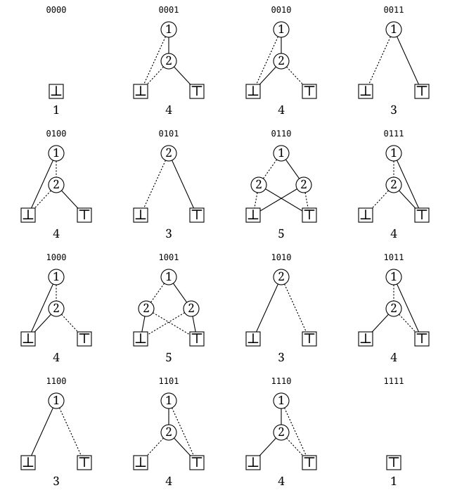](../../../assets/volume4a/figures/answer-7-1-4-1-all-two-variable-bdds.svg)


<a id="pdf-535"></a><a id="p-520"></a>

<a id="ans-7-1-4-2"></a>

**2.** [题目](../sec-7-1-4.md#ex-7-1-4-2) (顺序属性决定每段弧的方向.)

[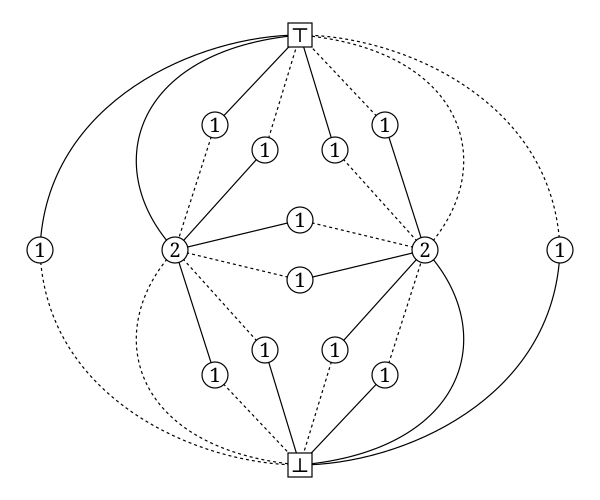](../../../assets/volume4a/figures/answer-7-1-4-2-combined-bdds.svg)

<a id="ans-7-1-4-3"></a>

**3.** [题目](../sec-7-1-4.md#ex-7-1-4-3) 有两个布尔函数的 BDD 的大小为 1 (即两个常值函数). 没有 BDD 的大小为 2 的布尔函数 (因为两个汇结点不可能同时是可达的, 除非另有一个分支结点). 还有 $2n$ 个 BDD 的大小为 3 的布尔函数 (即对于 $1\le j\le n$ 的 $x_j$ 和 $\bar x_j$).

<a id="ans-7-1-4-4"></a>

**4.** [题目](../sec-7-1-4.md#ex-7-1-4-4) 置 $y\leftarrow\texttt{\#0ffffffeffffffe}\mathbin{\&}\bar x+\texttt{\#20000002}$, $y\leftarrow(y\gg28)\mathbin{\&}\texttt{\#10000001}$, $x'\leftarrow x\oplus y$.

<a id="ans-7-1-4-5"></a>

**5.** [题目](../sec-7-1-4.md#ex-7-1-4-5) 你得到 $f$ 的对偶 $\overline{f(\bar x_1,\ldots,\bar x_n)}=f^D(x_1,\ldots,x_n)$ (见习题 7.1.1-2).

<a id="ans-7-1-4-6"></a>

**6.** [题目](../sec-7-1-4.md#ex-7-1-4-6) $g$ 的真值表是 1011000110010011, 它的最大子表 10110001,10010011,1011,0001,1001,0011 是全部不同的串珠. 平方串和重复串不会出现, 直到我们考察长度为 2 的子表 $\{10,11,00,01\}$. 所以 $g$ 具有大小为 11 的 BDD.

<a id="ans-7-1-4-7"></a>

**7.** [题目](../sec-7-1-4.md#ex-7-1-4-7) (a) 如果 $f$ 的真值表是 $\alpha_0\alpha_1\ldots\alpha_{2^k-1}$, 其中每个 $\alpha_j$ 是长度为 $2^{n-k}$ 的二进制串, 那么 $g_k$ 的真值表是 $\beta_0\beta_2\ldots\beta_{2^k-2}$, 其中 $\beta_{2j}=\alpha_{2j}\alpha_{2j+1}\alpha_{2j+1}\alpha_{2j+1}$.

(b) 因此 $f$ 和 $g_k$ 的串珠是密切相关的. 通过把标号为 $j$ 的结点变成标号为 $j-1$ 的结点 ($1\le j<k$), 并把下图左侧替换为右侧, 我们从 $f$ 的 BDD 获得 $g_k$ 的 BDD.

[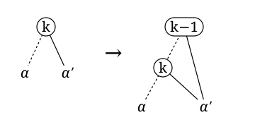](../../../assets/volume4a/figures/answer-7-1-4-7-local-rewrite.svg)

<a id="ans-7-1-4-8"></a>

**8.** [题目](../sec-7-1-4.md#ex-7-1-4-8) (a) 现在 $\beta_{2j}=\alpha_{2j}\alpha_{2j+1}\alpha_{2j+1}\alpha_{2j}$.

(b) 再次把标号为 $j$ 的结点变成标号为 $j-1$ 的结点 ($1\le j<k$). 如果具有 LO 指向 $\alpha$、HI 指向 $\alpha'$ 的 $k$ 结点出现在 $f$ 中, 但具有 LO 指向 $\alpha'$、HI 指向 $\alpha$ 的 $k$ 结点不出现, 那么用下图右侧替换左侧; 否则用下一图右侧成对替换左侧.

[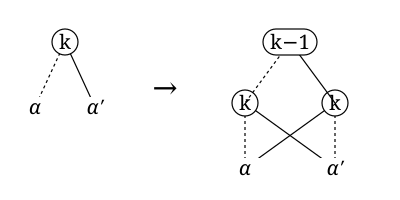](../../../assets/volume4a/figures/answer-7-1-4-8-single-rewrite.svg)

[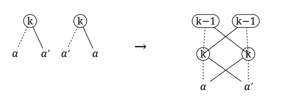](../../../assets/volume4a/figures/answer-7-1-4-8-pair-rewrite.svg)

[叶连娜·杜布罗瓦和卢卡·马基亚鲁洛,*IEEE Trans.* **C-49** (2000), 1290–1292.]

<a id="ans-7-1-4-9"></a>

**9.** [题目](../sec-7-1-4.md#ex-7-1-4-9) 如果 $s=2$, 无答案. 否则置 $k\leftarrow s-1$, $j\leftarrow1$, 并且重复下列操作: (i) 当 $j<v_k$ 时循环执行 $x_j\leftarrow1$, $j\leftarrow j+1$; (ii) 如果 $k=0$ 则停止; (iii) 如果 $h_k\ne1$, 置 $x_j\leftarrow1$, $k\leftarrow h_k$, 否则置 $x_j\leftarrow0$, $k\leftarrow l_k$; (iv) 置 $j\leftarrow j+1$.

<a id="ans-7-1-4-10"></a>

**10.** [题目](../sec-7-1-4.md#ex-7-1-4-10) 令 $I_k=(\bar v_k?l_k:h_k)$($0\le k<s$), $I_k'=(\bar v_k'?l_k':h_k')$($0\le k<s'$). 我们可以假定 $s=s'$; 否则 $f\ne f'$. 下述算法要么找到使得 $I_k$ 对应于 $I_{t_k}'$ 的下标 $(t_0,\ldots,t_{s-1})$, 要么推断出 $f\ne f'$.

I1.[初始化和循环.] 置 $t_{s-1}\leftarrow s-1$, $t_1\leftarrow1$, $t_0\leftarrow0$, 对于 $2\le k\le s-2$ 置 $t_k\leftarrow-1$. 对于 $k=s-1,s-2,\ldots,2$ (按这个顺序) 执行 I2–I4. 如果这些步骤 “停止” 在任何点, 我们有 $f\ne f'$; 否则 $f=f'$.

I2.[检验 $v_k$.] 置 $t\leftarrow t_k$. (现在 $t\ge0$, 否则 $I_k$ 将没有前导.) 如果 $v_t'\ne v_k$ 则停止.

I3.[检验 $l_k$.] 置 $l\leftarrow l_k$. 如果 $t_l<0$, 置 $t_l\leftarrow l_t'$; 否则如果 $l_t'\ne t_l$ 则停止.

I4.[检验 $h_k$.] 置 $h\leftarrow h_k$. 如果 $t_h<0$, 置 $t_h\leftarrow h_t'$; 否则如果 $h_t'\ne t_h$ 则停止.

<a id="ans-7-1-4-11"></a>

**11.** [题目](../sec-7-1-4.md#ex-7-1-4-11) (a) 是, 因为 $c_k$ 正确计数导致由结点 $k$ 到结点 1 的 $x_{v_k}\ldots x_n$ 取值的次数. (事实上, 很多 BDD 算法在存在等价结点或冗余分支结点的情况下可以正确执行——不过更慢. 但是, 比如说当我们需要像习题 10 那样快速检验 $f=f'$ 成立与否时, 则 BDD 的约化是很重要的.)

(b) 否. 例如, 假定 $I_3=(\bar1?2:1)$, $I_2=(\bar1?0:1)$, $I_1=(\bar2?1:1)$, $I_0=(\bar2?0:0)$, 那么算法置 $c_2\leftarrow1$, $c_3\leftarrow\frac32$. (另外也见习题 35(b).)


<a id="pdf-536"></a><a id="p-521"></a>

<a id="ans-7-1-4-12"></a>

**12.** [题目](../sec-7-1-4.md#ex-7-1-4-12) (a) 第一个条件使 $K$ 成为独立集, 第二个条件使它也是极大独立集.

(b) 当 $n$ 为奇数时不存在核, 否则存在由交替顶点构成的两个核.

(c) 一个顶点是在核内, 当且仅当它是汇顶点或者它在通过删除所有汇顶点以及它们的直接前导得到的图的核内.

[核表示类似尼姆的游戏中的取胜位置, 而且它们也出现在 $n$ 人游戏中. 见约翰·冯·诺依曼和奥斯卡·摩根斯顿,*Theory of Games and Economic Behavior* (1944), §30.1; 克劳德·伯奇,*Graphs and Hypergraphs* (1973), Chapter 14.]

<a id="ans-7-1-4-13"></a>

**13.** [题目](../sec-7-1-4.md#ex-7-1-4-13) (a) $G$ 的极大团是 $\overline G$ 的核, 反之亦然. (b) 极小顶点覆盖 $U$ 是核 $W$ 的补 $V\setminus W$, 反之亦然 (见 7-(61)).

<a id="ans-7-1-4-14"></a>

**14.** [题目](../sec-7-1-4.md#ex-7-1-4-14) (a) BDD 的大小是 $4(n-2)+2[n=3]$. 当 $n\ge6$ 时, 这些 BDD 构成一个图形, 其中有变量 $4,5,\ldots,n-2$ 的 4 个分支结点, 以及在顶部和底部的一个固定图形. 4 个分支结点实际上是

[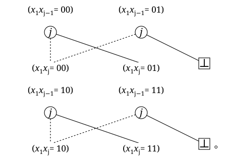](../../../assets/volume4a/figures/answer-7-1-4-14a-cycle-states.svg)

(b) 对于 $3\le n\le10$, BDD 的大小是 $(7,9,14,17,22,30,37,45)$. 然后, 像 (a) 中那样在顶部和底部产生一个固定图形, 以及中间每个变量的 9 个分支结点, 总大小达到 $9(n-5)$. 每个中间层上的 9 个结点分成 3 个结点一组的 3 个组,

[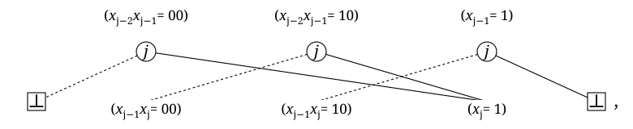](../../../assets/volume4a/figures/answer-7-1-4-14b-kernel-states.svg)

以及 $x_1x_2=00$ 的一个组, $x_1x_2=01$ 的一个组, $x_1=1$ 的一个组.

<a id="ans-7-1-4-15"></a>

**15.** [题目](../sec-7-1-4.md#ex-7-1-4-15) 这两种情况的数目由对两个著名数列的归纳法导出: (a) 卢卡斯数列 $L_n=F_{n+1}+F_{n-1}=\phi^n+\hat\phi^n$[见爱德华·卢卡斯,*Théorie des Nombres* (1891), 第 18 章]. (b) 由 $P_3=3$, $P_4=2$, $P_5=5$, $P_n=P_{n-2}+P_{n-3}=\chi^n+\hat\chi^n+\overline{\hat\chi}^n$ 定义的佩兰数列 [见爱德华·卢卡斯,*Association Française pour l'Avancement des Sciences, Compte-rendu* **5** (1876), 62; 拉乌尔·佩兰,*L'Intermédiaire des Mathématiciens* **6** (1899), 76–77; 佐尔坦·菲雷迪,*Journal of Graph Theory* **11** (1987), 463.]

<a id="ans-7-1-4-16"></a>

**16.** [题目](../sec-7-1-4.md#ex-7-1-4-16) 当 BDD 不是 $\boxed\bot$ 时, 所有解是通过调用 $\mathit{List}(1,\mathit{root})$ 产生的, 其中 $\mathit{List}(j,p)$ 是下述递归过程: 如果 $v(p)>j$, 置 $x_j\leftarrow0$, 调用 $\mathit{List}(j+1,p)$; 置 $x_j\leftarrow1$, 再调用 $\mathit{List}(j+1,p)$. 否则, 如果 $p$ 是汇结点 $\boxed\top$, 访问解 $x_1\ldots x_n$. (在 7.2.1 节开头讨论了生成所有组合对象时 “访问” 对象的概念.) 否则, 置 $x_j\leftarrow0$, 如果 $\operatorname{LO}(p)\ne\boxed\bot$, 调用 $\mathit{List}(j+1,\operatorname{LO}(p))$; 置 $x_j\leftarrow1$, 如果 $\operatorname{HI}(p)\ne\boxed\bot$, 再调用 $\mathit{List}(j+1,\operatorname{HI}(p))$.

解是按字典序生成的. 假定存在 $N$ 个解. 如果第 $k$ 个解与第 $k-1$ 个解在位置 $x_1\ldots x_{j-1}$ 一致, 但是在 $x_j$ 不一致, 则令 $c(k)=n-j$; 并且令 $c(1)=n$. 那么, 运行时间同 $\sum_{k=1}^N c(k)$ 成正比, 通常是 $O(nN)$. (这个界成立是因为 BDD 的每个分支结点至少导致一个解. 事实上, 实际运行时间一般是 $O(N)$.)

<a id="ans-7-1-4-17"></a>

**17.** [题目](../sec-7-1-4.md#ex-7-1-4-17) 这是不可能的, 因为存在 $N=2^{2k}$ 且 $B(f)=O(2^{2k})$ 的函数, 它的每两个解在超过 $2^{k-1}$ 个二进制位的位置是不同的. 对于这样一个函数生成全部解的任何算法的运行时间必定是 $\Omega(2^{3k})$, 因为在两个解之间需要 $\Omega(2^k)$ 个运算. 为了构造 $f$, 首先令

$$
g(x_1,\ldots,x_k,y_0,\ldots,y_{2^k-1})=[y_{(t_1\ldots t_k)_2}=x_1t_1\oplus\cdots\oplus x_kt_k,\quad0\le t_1,\ldots,t_k\le1].
$$

(换句话说, $g$ 断定 $y_0\ldots y_{2^k-1}$ 是阿达马矩阵的第 $(x_1\ldots x_k)_2$ 行, 见等式 4.6.4-(38).) 现在我们令

<a id="pdf-537"></a><a id="p-522"></a>

$$
f(x_1,\ldots,x_k,y_0,\ldots,y_{2^k-1},x_1',\ldots,x_k',y_0',\ldots,y_{2^k-1}')=g(x_1,\ldots,x_k,y_0,\ldots,y_{2^k-1})\land g(x_1',\ldots,x_k',y_0',\ldots,y_{2^k-1}').
$$

当变量用这种方式排序时显然有 $B(f)=O(2^{2k})$. 实际上, 索斯藤·达尔海姆尔注意到 $B(f)=2B(g)-2$, 其中

$$
B(g)=2^k+1+\sum_{j=1}^{2^k}2^{\min(k,1+\lceil\lg j\rceil)}=\frac53\,2^{2k-1}+2^k+\frac53.
$$

<a id="ans-7-1-4-18"></a>

**18.** [题目](../sec-7-1-4.md#ex-7-1-4-18) 首先, $(W_1,\ldots,W_5)=(5,4,4,4,0)$. 然后 $m_2=w_4=4$, $t_2=1$; $m_3=t_3=0$; $m_4=\max(m_3,m_2+w_3)=1$, $t_4=1$; $m_5=W_4-W_5=4$, $t_5=0$; $m_6=w_2+W_3-W_5=2$, $t_6=1$; $m_7=\max(m_5,m_4+w_2)=4$, $t_7=0$; $m_8=\max(m_7,m_6+w_1)=4$, $t_8=0$. 解 $x_1x_2x_3x_4=0001$.

<a id="ans-7-1-4-19"></a>

**19.** [题目](../sec-7-1-4.md#ex-7-1-4-19) $\sum_{j=1}^n\min(w_j,0)\le\sum_{j=v_k}^n\min(w_j,0)\le m_k\le\sum_{j=v_k}^n\max(w_j,0)=W_{v_k}\le W_1.$

<a id="ans-7-1-4-20"></a>

**20.** [题目](../sec-7-1-4.md#ex-7-1-4-20) 置 $w_1\leftarrow-1$, 然后对于 $1\le j\le n/2$ 置 $w_{2j}\leftarrow w_j$, $w_{2j+1}\leftarrow-w_j$. [这个方法也可以计算 $w_{n+1}$. 该权值序列因图厄,*Skrifter udgivne af Videnskabs-Selskabet i Christiania, Mathematisk-Naturvidenskabelig Klasse* (1912), No. 1, §7 和摩尔斯,*Trans. Amer. Math. Soc.* **22** (1921), 84–100, §14 的工作得名.]

<a id="ans-7-1-4-21"></a>

**21.** [题目](../sec-7-1-4.md#ex-7-1-4-21) 能. 我们只是必须改变每个权值 $w_j$ 的符号. (或者我们可以在每个顶点使 LO 和 HI 起相反的作用.)

<a id="ans-7-1-4-22"></a>

**22.** [题目](../sec-7-1-4.md#ex-7-1-4-22) 当 $f$ 表示图的核时, 如果 $f(x)=f(x')=1$, 那么汉明距离 $\nu(x\oplus x')$ 不是 1. 在这种情况下, 当 $l\ne0$ 时 $v_l=v+1$, 而当 $h\ne0$ 时 $v_h=v+1$.

<a id="ans-7-1-4-23"></a>

**23.** [题目](../sec-7-1-4.md#ex-7-1-4-23) 对于任何连通图的连通性函数, BDD 在从根到 $\boxed\top$ 的每条路径上恰好有 $n-1$ 段实线弧, 因为很多边需要连接 $n$ 个顶点, 同时因为 BDD 没有冗余分支结点. (也见定理 S.)

<a id="ans-7-1-4-24"></a>

**24.** [题目](../sec-7-1-4.md#ex-7-1-4-24) 应用带权值 $(w_{12}',\ldots,w_{89}')=(-w_{12}-x,\ldots,-w_{89}-x)$ 的算法 B, 其中 $x$ 大到足以使得这些新权值 $w_{uv}'$ 全部为负值. 于是 $\sum w_{uv}'x_{uv}$ 的最大值将呈现为 $\sum x_{uv}=8$, 而且那些边将构成具有最小 $\sum w_{uv}x_{uv}$ 的生成树. (对于习题 2.3.4.1-11 中的最小生成树, 我们已经见过一个更好的算法, 至于其他方法将在 7.5.4 节讨论, 然而, 本题表明 BDD 可以紧凑地表示所有生成树的集合.)

<a id="ans-7-1-4-25"></a>

**25.** [题目](../sec-7-1-4.md#ex-7-1-4-25) 步骤 C1 中的答案变成 $(1+z)^{v_{s-1}-1}c_{s-1}$, 步骤 C2 中的 $c_k$ 的值变成 $(1+z)^{v_l-v_k-1}c_l+(1+z)^{v_h-v_k-1}zc_h$.

<a id="ans-7-1-4-26"></a>

**26.** [题目](../sec-7-1-4.md#ex-7-1-4-26) 在这种情况下, 步骤 C1 中的答案只是 $c_{s-1}$, 步骤 C2 中的 $c_k$ 的值只是 $(1-p_{v_k})c_l+p_{v_k}c_h$.

<a id="ans-7-1-4-27"></a>

**27.** [题目](../sec-7-1-4.md#ex-7-1-4-27) 多重线性多项式 $H(x_1,\ldots,x_n)=F(x_1,\ldots,x_n)-G(x_1,\ldots,x_n)$ 是非零的 (模 $q$), 因为对于每个分量均取 $x_k\in\{0,1\}$ 的某组整数选择, 它的值是 $\pm1$. 如果它的次数为 $d$ (模 $q$), 可以证明, 满足 $0\le q_k<q$ 的 $(q_1,\ldots,q_n)$ 值至少存在使得 $H(q_1,\ldots,q_n)\bmod q\ne0$ 的 $(q-1)^dq^{n-d}$ 个集合. 这个断言当 $d=0$ 时是显然的. 至于如果 $x_k$ 是出现在次数 $d>0$ 的项中的变量, 则 $x_k$ 的系数是一个 $d-1$ 次的多项式. 由对 $d$ 的归纳法, 它对于 $(q_1,\ldots,q_{k-1},q_{k+1},\ldots,q_n)$ 的至少 $(q-1)^{d-1}q^{n-d}$ 种选择是非零的. 对于这些选择的每一种, 存在 $q-1$ 个使得 $H(q_1,\ldots,q_n)\bmod q\ne0$ 的 $q_k$ 值.

因此, 所述概率 $\ge(1-1/q)^d\ge(1-1/q)^n$. [见曼纽尔·布卢姆、阿肖克·钱德拉和马克·韦格曼,*Information Processing Letters* **10** (1980), 80–82.]

<a id="ans-7-1-4-28"></a>

**28.** [题目](../sec-7-1-4.md#ex-7-1-4-28) $F(p)=(1-p)^nG(p/(1-p))$. 类似地, $G(z)=(1+z)^nF(z/(1+z))$.

<a id="ans-7-1-4-29"></a>

**29.** [题目](../sec-7-1-4.md#ex-7-1-4-29) 在步骤 C1, 也置 $c_0'\leftarrow0$, $c_1'\leftarrow0$, 返回 $c_{s-1}$ 和 $c_{s-1}'$. 在步骤 C2, 置 $c_k\leftarrow(1-p)c_l+pc_h$, $c_k'\leftarrow(1-p)c_l'-c_l+pc_h'+c_h$.

<a id="ans-7-1-4-30"></a>

**30.** [题目](../sec-7-1-4.md#ex-7-1-4-30) 使用以下类似于算法 B 的算法求解 (假定使用精确的算术运算).

A1.[初始化.] 置 $P_{n+1}\leftarrow1$, 对 $n\ge j\ge1$ 置 $P_j\leftarrow P_{j+1}\max(1-p_j,p_j)$.

A2.[对 $k$ 循环.] 置 $m_1\leftarrow1$, 对 $2\le k<s$ 执行 A3. 然后执行 A4.

A3.[处理 $I_k$.] 置 $v\leftarrow v_k$, $l\leftarrow l_k$, $h\leftarrow h_k$, $t_k\leftarrow0$. 如果 $l\ne0$, 置 $m_k\leftarrow m_l(1-p_v)P_{v+1}/P_{v_l}$. 然后如果 $h\ne0$, 计算 $m\leftarrow m_hp_vP_{v+1}/P_{v_h}$; 如果 $l=0$ 或 $m>m_k$, 置 $m_k\leftarrow m$, $t_k\leftarrow1$.

A4.[计算 $x_j$.] 置 $j\leftarrow0$, $k\leftarrow s-1$, 执行下列运算直至 $j=n$: 当 $j<v_k-1$ 时置 $j\leftarrow j+1$, $x_j\leftarrow[p_j>\frac12]$; 如果 $k>1$, 置 $j\leftarrow j+1$, $x_j\leftarrow t_k$, $k\leftarrow(t_k=0?l_k:h_k)$.


<a id="pdf-538"></a><a id="p-523"></a>

<a id="ans-7-1-4-31"></a>

**31.** [题目](../sec-7-1-4.md#ex-7-1-4-31) C1′.[对 $k$ 循环.] 置 $\alpha_0\leftarrow\bot$, $\alpha_1\leftarrow\top$, 对 $k=2,3,\ldots,s-1$ 执行 C2′. 然后转到 C3′.

C2′.[计算 $\alpha_k$.] 置 $v\leftarrow v_k$, $l\leftarrow l_k$, $h\leftarrow h_k$. 置 $\beta\leftarrow\alpha_l$, $j\leftarrow v_l-1$; 然后当 $j>v$ 时置 $\beta\leftarrow(\bar x_j\circ x_j)\bullet\beta$, $j\leftarrow j-1$. 置 $\gamma\leftarrow\alpha_h$, $j\leftarrow v_h-1$; 然后当 $j>v$ 时置 $\gamma\leftarrow(\bar x_j\circ x_j)\bullet\gamma$, $j\leftarrow j-1$. 最后置 $\alpha_k\leftarrow(\bar x_v\bullet\beta)\circ(x_v\bullet\gamma)$.

C3′.[完成.] 置 $\alpha\leftarrow\alpha_{s-1}$, $j\leftarrow v_{s-1}-1$; 然后当 $j>0$ 时置 $\alpha\leftarrow(\bar x_j\circ x_j)\bullet\alpha$, $j\leftarrow j-1$. 返回答案 $\alpha$.

这个算法执行 $\circ$ 和 $\bullet$ 运算最多 $O(nB(f))$ 次. 上界常常可以降低到 $O(n)+O(B(f))$, 但是像步骤 B1 中计算 $W_k$ 的快捷方法并非总是可用的. [见奥利维耶·库代尔和让·马德尔,*Proc. Reliability and Maint. Conf.* (IEEE, 1993), 240–245, §4; 奥利维耶·库代尔,*Integration* **17** (1994), 126–127.]

<a id="ans-7-1-4-32"></a>

**32.** [题目](../sec-7-1-4.md#ex-7-1-4-32) 对于习题 25, $\circ$ 是加法, $\bullet$ 是乘法, $\bot$ 是 0, $\top$ 是 1, $\bar x_j$ 是 1, $x_j$ 是 $z$. 习题 26 是类似的, 但是 $\bar x_j$ 是 $1-p_j$, $x_j$ 是 $p_j$.

在习题 29 中, 代数运算的对象是数偶 $(c,c')$, 并且我们有 $(a,a')\circ(b,b')=(a+b,a'+b')$, $(a,a')\bullet(b,b')=(ab,ab'+a'b)$. 还有 $\bot$ 是 $(0,0)$, $\top$ 是 $(1,0)$, $\bar x_j$ 是 $(1-p,-1)$, $x_j$ 是 $(p,1)$.

在习题 30 中, $\circ$ 是 $\max$, $\bullet$ 是乘法, $\bot$ 是 $-\infty$, $\top$ 是 1, $\bar x_j$ 是 $1-p_j$, $x_j$ 是 $p_j$. 在这种情况下, 乘法对 $\max$ 具有分配律, 因为乘数与被乘数是非负数或 $-\infty$. 为了满足 (22), 我们必须定义 $0\bullet(-\infty)=-\infty$.

(存在许多另外的可能性, 因为数学中普遍存在可结合和可分配的运算符. 代数运算的对象不必是数或者多项式, 也不必是数偶; 它们可以是符号串、矩阵、函数、数的集合、符号串的集合, 以至符号串的函数的数偶的矩阵的集合或多重集, 等等, 等等. 我们将在 7.3 节见到许多进一步的例子. 取 $\circ=\min$ 和 $\bullet=+$ 的最小加法代数是特别重要的, 而且我们可以在习题 21 或 24 中使用它. 通常把这种代数称为热带代数, 隐含对巴西数学家伊姆雷·西蒙的纪念.)

<a id="ans-7-1-4-33"></a>

**33.** [题目](../sec-7-1-4.md#ex-7-1-4-33) 在三元组 $(c,c',c'')$ 上进行运算, 使用

$$
\begin{aligned}
(a,a',a'')\circ(b,b',b'')&=(a+b,a'+b',a''+b''),\\
(a,a',a'')\bullet(b,b',b'')&=(ab,a'b+b'a,a''b+2a'b'+ab'').
\end{aligned}
$$

把 $\bot$ 理解为 $(0,0,0)$, $\top$ 理解为 $(1,0,0)$, $\bar x_j$ 理解为 $(1,0,0)$, $x_j$ 理解为 $(1,w_j,w_j^2)$.

<a id="ans-7-1-4-34"></a>

**34.** [题目](../sec-7-1-4.md#ex-7-1-4-34) 令 $x\vee y=\max(x,y)$. 在数偶 $(c,c')$ 上进行运算, 使用 $(a,a')\circ(b,b')=(a\vee b,a'\vee b')$ 且 $(a,a')\bullet(b,b')=(a+b,(a'+b)\vee(a+b')).$ 把 $\bot$ 理解为 $(-\infty,-\infty)$, $\top$ 理解为 $(0,-\infty)$, $\bar x_j$ 理解为 $(0,w_j'')$, $x_j$ 理解为 $(w_j,w_j'+w_j'')$. 结果的第一个分量同算法 B 一致, 第二个分量是欲求的最大值.

<a id="ans-7-1-4-35"></a>

**35.** [题目](../sec-7-1-4.md#ex-7-1-4-35) (a) 像在算法 C 中那样, 假定的 FBDD 可以用指令 $I_{s-1},\ldots,I_0$ 表示. 从 $R_0\leftarrow R_1\leftarrow\emptyset$ 开始, 然后对 $k=2,\ldots,s-1$ 执行下列操作: 如果 $v_k\in R_{l_k}\cup R_{h_k}$, 报告失败, 否则置 $R_k\leftarrow\{v_k\}\cup R_{l_k}\cup R_{h_k}$. (集合 $R_k$ 确定从 $I_k$ 可达的所有变量.)

(b) 可靠性多项式可以恰如习题 26 的答案那样计算. 为了计算解的数目, 实际上我们置 $p_1=\cdots=p_n=\frac12$ 再乘以 $2^n$: 从 $c_0\leftarrow0$, $c_1\leftarrow2^n$ 开始, 然后对 $1<k<s$ 置 $c_k\leftarrow(c_{l_k}+c_{h_k})/2$. 答案是 $c_{s-1}$.

<a id="ans-7-1-4-36"></a>

**36.** [题目](../sec-7-1-4.md#ex-7-1-4-36) 像习题 35(a) 的答案那样计算集合 $R_k$. 像习题 31 的答案的步骤 C2′所述那样, 不是对 $j$ 循环, 而是置 $\beta\leftarrow\alpha_l$, 然后对所有 $j\in R_k\setminus R_l\setminus\{v\}$ 置 $\beta\leftarrow(\bar x_j\circ x_j)\bullet\beta$. 用同样方式处理 $\gamma$. 类似地, 在步骤 C3′, 对所有 $j\notin R_{s-1}$ 置 $\alpha\leftarrow(\bar x_j\circ x_j)\bullet\alpha$.

<a id="ans-7-1-4-37"></a>

**37.** [题目](../sec-7-1-4.md#ex-7-1-4-37) 任意给定 $f$ 的 FBDD, 生成函数

$$
G(z)=\sum_P(1+z)^{n-(P\text{的长度})}z^{P\text{的实线弧的数目}},
$$

其中 $P$ 是从根到 $\boxed\top$ 的所有路径. [见 *Theoretical Comp. Sci.* **3** (1976), 371–384.]

<a id="ans-7-1-4-38"></a>

**38.** [题目](../sec-7-1-4.md#ex-7-1-4-38) 主要事实在于 $x_j=1$ 迫使 $f=1$, 当且仅当我们有 (i) 每当 $v_k=j$ 时 $h_k=1$; (ii) 至少在一个步骤 $k$, $v_k=j$; (iii) 不存在满足 $(v_k<j<v_{l_k}\text{ 且 }l_k\ne1)$ 或 $(v_k<j<v_{h_k}\text{ 且 }h_k\ne1)$ 的步骤.

K1.[初始化.] 置 $t_j\leftarrow2$, 对 $1\le j\le n$ 置 $p_j\leftarrow0$.

K2.[检查所有分支结点.] 对 $2\le k<s$ 执行以下操作: 置 $j\leftarrow v_k$, $q\leftarrow0$. 如果 $l_k=1$, 置 $q\leftarrow-1$, 否则置 $p_j\leftarrow\max(p_j,v_{l_k})$. 如果 $h_k=1$, 置 $q\leftarrow+1$, 否则置 $p_j\leftarrow\max(p_j,v_{h_k})$. 如果 $t_j=2$, 置 $t_j\leftarrow q$, 否则如果 $t_j\ne q$, 置 $t_j\leftarrow0$.


<a id="pdf-539"></a><a id="p-524"></a>

K3.[完成.] 置 $m\leftarrow v_{s-1}$, 对 $j=1,2,\ldots,n$ 执行以下操作: 如果 $j<m$, 置 $t_j\leftarrow0$, 然后如果 $p_j>m$, 置 $m\leftarrow p_j$.

[见郑世雄和法比奥·索门齐,*Logic Synthesis and Optimization* (1993), 154–156.]

<a id="ans-7-1-4-39"></a>

**39.** [题目](../sec-7-1-4.md#ex-7-1-4-39) $k(n+1-k)+2$($1\le k\le n$). (见 (26).)

<a id="ans-7-1-4-40"></a>

**40.** [题目](../sec-7-1-4.md#ex-7-1-4-40) (a) 假定 $f$ 和 $g$ 的 BDD 分别有 $a_j$ 和 $b_j$ 个标号为 $j$ 的分支结点 ($1\le j\le n$). $f$ 的每个 $n+1-k$ 阶子表具有 $\alpha\beta\gamma\delta$ 的形式, 其中 $\alpha,\beta,\gamma,\delta$ 是 $n-1-k$ 阶子表. $g$ 的对应子表是 $\alpha\alpha\delta\delta$. 因此, 它们是串珠当且仅当 $\alpha\ne\delta$, 此时 $\alpha\beta\gamma\delta$ 是串珠或者 $\alpha\beta=\gamma\delta$ 是串珠. 因此 $b_k\le a_k+a_{k+1}$, $b_{k+1}=0$. 我们还有 $b_j\le a_j$($1\le j<k$), 因为 $g$ 的每个阶大于 $n+1-k$ 的串珠是从 $f$ 的至少一个这样串珠 “聚合的”. 并且 $b_j\le a_j$($j>k+1$), 因为 $(x_{k+2},\ldots,x_n)$ 的子表是完全相同的, 尽管它们可能不出现在 $g$ 中.

(b) 不总是. 最简单的反例是 $f(x_1,x_2,x_3,x_4)=x_2\wedge(x_3\vee x_4)$, $h(x_1,x_2,x_1,x_4)=x_2\wedge(x_1\vee x_4)$, 此时 $B(f)=5$, $B(h)=6$. 但是, 我们总有 $B(h)<2B(f)$.

<a id="ans-7-1-4-41"></a>

**41.** [题目](../sec-7-1-4.md#ex-7-1-4-41) (a) $3n-3$; (b) $2n$. (这里给出 $n=6$ 时的一般模式. 我们还可以证明, 风琴管顺序

$$
\left\langle x_n^{F_1}x_1^{F_2}x_{n-1}^{F_3}x_2^{F_4}\ldots x_{\lfloor n/2\rfloor+[n\text{是偶数}]}^{F_{n-1}}x_{\lceil n/2\rceil}^{F_{n-2}}\right\rangle
$$

产生分布 $1,2,4,\ldots,2\lceil n/2\rceil-2,2\lfloor n/2\rfloor-1,\ldots,5,3,1,2$, 给出 BDD 的总大小是 $\binom n2+3$. 这个顺序似乎是斐波那契权值中最差的.)

[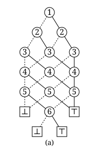](../../../assets/volume4a/figures/answer-7-1-4-41a-fibonacci-bdd.svg)

[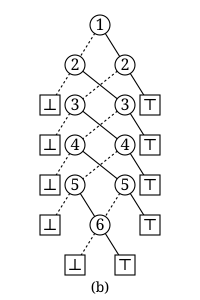](../../../assets/volume4a/figures/answer-7-1-4-41b-fibonacci-bdd.svg)

乔恩·巴特勒和笹尾勤 [*Fibonacci Quart.* **34** (1996), 413–422] 已经研究过函数 $[F_nx_1+\cdots+F_1x_n\ge t]$.

<a id="ans-7-1-4-42"></a>

**42.** [题目](../sec-7-1-4.md#ex-7-1-4-42) (同习题 2 比较)16 个根结点是下图中的 14 个变量 1 结点和 2 个汇结点:

[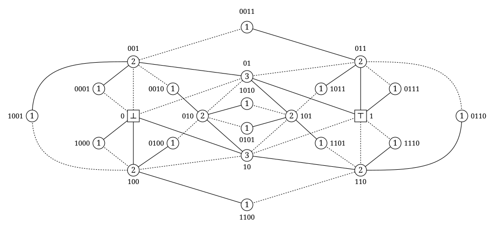](../../../assets/volume4a/figures/answer-7-1-4-42-symmetric-bdd-base.svg)

<a id="ans-7-1-4-43"></a>

**43.** [题目](../sec-7-1-4.md#ex-7-1-4-43) (a) 由于 $f(x_1,\ldots,x_{2n})$ 是对称函数 $S_n(x_1,\ldots,x_n,\bar x_{n+1},\ldots,\bar x_{2n})$, 我们有 $B(f)=1+2+\cdots+(n+1)+\cdots+3+2+2=n^2+2n+2$.

(b) 由对称性, $B(f)$ 等于函数 $[\sum\{x_i\mid i\in I\}=\sum\{x_i\mid i\notin I\}]$ 的 BDD 大小, 其中 $|I|=n$.

<a id="ans-7-1-4-44"></a>

**44.** [题目](../sec-7-1-4.md#ex-7-1-4-44) 对于 $1\le k\le n$, 最多有标记为 $k$ 的 $\min(k,2^{n+2-k}-2)$ 个结点, 因为存在 $2^{n+2-k}-2$ 个不是常值的 $(x_k,\ldots,x_n)$ 的对称函数. 因此 $\Sigma_n$ 最多是 $2+\sum_{k=1}^n\min(k,2^{n+2-k}-2)$, 它可以表示成闭合式

$$
(n+2-b_n)(n+1-b_n)/2+2(2^{b_n}-b_n),
$$

其中 $b_n=\lambda(n+4-\lambda(n+4))$, $\lambda n=\lfloor\lg n\rfloor$.

获取这种最坏情况上界的对称函数可以用下述方式构造 (同在习题 3.2.2-7 中构造的德布鲁因圈有关): 令 $p(x)=x^d+a_1x^{d-1}+\cdots+a_d$ 是模 2 本原多项式. 对 $0\le k<d$ 置 $t_k\leftarrow1$, 对 $d\le k<2^d+d-2$ 置 $t_k\leftarrow(a_1t_{k-1}+\cdots+a_dt_{k-d})\bmod2$, 对 $2^d+d-2\le k<2^{d+1}+d-3$ 置 $t_k\leftarrow(1+a_1t_{k-1}+\cdots+a_dt_{k-d})\bmod2$, 并且置 $t_{2^{d+1}+d-3}\leftarrow1$. 例如, 当 $p(x)=x^3+x+1$ 时, 我们得到 $t_0\ldots t_{16}=\texttt{11100101101000111}$.

于是 (i) 序列 $t_1\ldots t_{2^d+d-3}$ 包含除 $0^d$ 和 $1^d$ 之外的所有 $d$ 元组作为子串; (ii) 序列 $t_{2^d+d-2}\ldots t_{2^{d+1}+d-4}$ 是 $\bar t_0\ldots\bar t_{2^d-2}$ 的循环移位; (iii) 对于 $2^d-1\le k\le2^d+d-3$ 和 $2^{d+1}-2\le k\le2^{d+1}+d-3$, 我们有 $t_k=1$. 因此序列 $t_0\ldots t_{2^{d+1}+d-3}$ 包含除 $0^{d+1}$ 和 $1^{d+1}$ 之外的所有 $(d+1)$ 元组作为子串. 当 $2^d+d-4<n\le2^{d+1}+d-3$ 时置 $f(x)=t_{\nu x}$, 使 $B(f)$ 达到最大值.

渐近地, $\Sigma_n=\frac12n^2-n\lg n+O(n)$. [见英戈·韦格纳,*Information and Control* **62** (1984), 129–143; 马克·希普,*J. Electronic Testing* **4** (1993), 191–195.]


<a id="pdf-540"></a><a id="p-525"></a>

<a id="ans-7-1-4-45"></a>

**45.** [题目](../sec-7-1-4.md#ex-7-1-4-45) 模块 $M_1$ 只有 3 个输入 $(x_1,y_1,z_1)$, 并且只有 3 个输出 $u_2=x_1$, $v_2=y_1x_1$, $w_2=z_1x_1$. 模块 $M_{n-1}$ 几乎是标准的, 但是它没有对于 $z_{n-1}$ 的输入端口, 而且不输出 $u_n$, 它置 $z_{n-2}=x_{n-1}y_{n-1}$. 模块 $M_n$ 只有 3 个输入 $(v_n,w_n,x_n)$, 以及同主输出 $w_n\vee v_nx_n$ 一起的一个输出 $y_{n-1}=x_n$. 由于这些定义, 端口之间的依赖关系构成一个有向无圈图.

(模块可能是用所有 $b_k=0$ 和 $a_k\le5$ 甚至是 $a_k\le4$ 构造的, 如同我们将在习题 47 中看到的那样. 但是 (33) 和 (34) 是为了说明一个简单例子中的返回信号, 而不是显示最紧凑的可能构造.)

<a id="ans-7-1-4-46"></a>

**46.** [题目](../sec-7-1-4.md#ex-7-1-4-46) 对于 $6\le k\le n-3$ 存在 9 个标号为 $k$ 的分支结点, 对应于 3 种 $(\bar x_1,x_1\bar x_2,x_1x_2)$ 乘以 3 种 $(\bar x_{k-1},\bar x_{k-2}x_{k-1},\bar x_{k-3}x_{k-2}x_{k-1})$ 的 9 种情况. 如果 $n\ge6$, BDD 的总大小恰好是 $9n-38$.

<a id="ans-7-1-4-47"></a>

**47.** [题目](../sec-7-1-4.md#ex-7-1-4-47) 假定 $f$ 有 $q_k$ 个 $n-k$ 阶子表, 所以它的 QDD 有 $q_k$ 个在 $x_{k+1}$ 上分支的结点. 我们可以用 $a_k=\lceil\lg q_k\rceil$ 比特对它们编码, 并且构造一个具有 $b_k=b_{k+1}=0$ 的模块 $M_{k+1}$, 它模拟那 $q_k$ 个分支结点的特性. 因此由 (86),

$$
\sum_{k=0}^n2^{a_k2^{b_k}}=\sum_{k=0}^n2^{\lceil\lg q_k\rceil}\le\sum_{k=0}^n(2q_k-1)=2Q(f)-(n+1)\le(n+1)B(f).
$$

($2^m$ 路复用器表明附加因子 $(n+1)$ 是必须的. 其实, 定理 M 实际上对 $Q(f)$ 给出了一个上界.)

<a id="ans-7-1-4-48"></a>

**48.** [题目](../sec-7-1-4.md#ex-7-1-4-48) 和式 $u_k=x_1+\cdots+x_k$ 与 $v_k=x_{k+1}+\cdots+x_n$ 可以分别用 $1+\lambda k$ 和 $1+\lambda(n-k)$ 条网线表示. 令 $t_k=x_k\wedge[u_k+v_k=k]$, $w_k=t_1\vee\cdots\vee t_k$. 我们可以构造模块 $M_k$, 它有来自 $M_{k-1}$ 的输入 $u_{k-1}$ 和 $w_{k-1}$ 以及来自 $M_{k+1}$ 的输入 $v_k$. 模块 $M_k$ 对 $M_{k+1}$ 输出 $u_k=u_{k-1}+x_k$ 和 $w_k=w_{k-1}\vee t_k$, 对 $M_{k-1}$ 输出 $v_{k-1}=v_k+x_k$.

如果 $p$ 是多项式, $\sum_{k=0}^n2^{p(a_k,b_k)}=2^{(\log n)^{O(1)}}$ 渐近地小于 $2^{\Omega(n)}$. [见肯尼思·麦克米伦,*Symbolic Model Checking* (1993), §3.5, 其中引入了定理 M, 扩展到非线性布局. 查尔斯·伯曼先前已经注意到特例 $b_1=\cdots=b_n=0$,*IEEE Trans.* **CAD-10** (1991), 1059–1066.]

<a id="ans-7-1-4-49"></a>

**49.** [题目](../sec-7-1-4.md#ex-7-1-4-49) (a)

[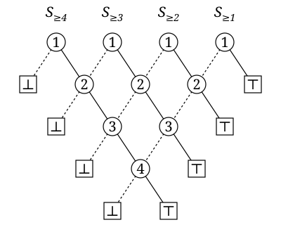](../../../assets/volume4a/figures/answer-7-1-4-49a-symmetric-base.svg)

(b)

[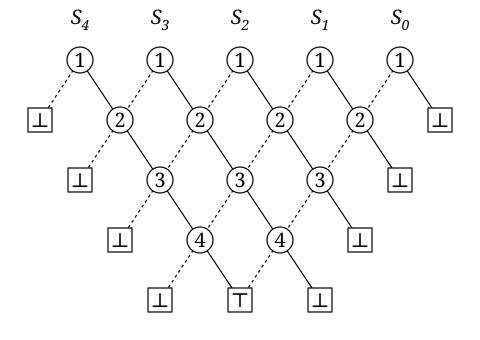](../../../assets/volume4a/figures/answer-7-1-4-49b-symmetric-base.svg)

[见仙波一郎和矢岛脩三,*Trans. Inf. Proc. Soc. Japan* **35** (1994), 1663–1665.]

<a id="ans-7-1-4-50"></a>

**50.** [题目](../sec-7-1-4.md#ex-7-1-4-50)

[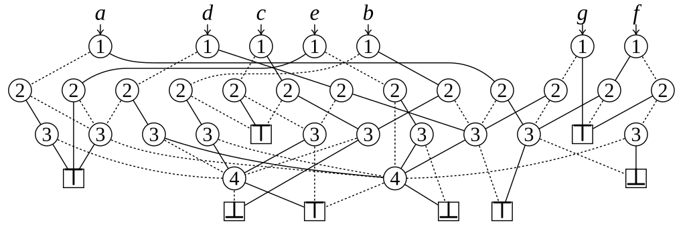](../../../assets/volume4a/figures/answer-7-1-4-50-seven-segment-base.svg)

<a id="ans-7-1-4-51"></a>

**51.** [题目](../sec-7-1-4.md#ex-7-1-4-51) 在这种情况下 $B(f_j)=3j+2$($1\le j\le n$), 并且 $B(f_{n+1})=3n+1$. 所以个别的 BDD 的大小只有它们在 (36) 的大小的 $1/3$ 左右. 但是几乎没有结点是共用的——只有汇结点和一个分支结点是共用的. 所以 BDD 的总大小达到 $(3n^2+9n)/2$.

<a id="ans-7-1-4-52"></a>

**52.** [题目](../sec-7-1-4.md#ex-7-1-4-52) 如果 $\{f_1,\ldots,f_m\}$ 的 BDD 基有 $s$ 个结点, 那么 $B(f)=s+m+1+[s=1]$.

<a id="ans-7-1-4-53"></a>

**53.** [题目](../sec-7-1-4.md#ex-7-1-4-53) 通过 $\mathtt{ROOT}=a$ 访问分支结点 $a,b,c,d,e,f,g$. 在步骤 R1 之后有 $\mathtt{HEAD}[1]=\mathord{\sim}a$, $\operatorname{AUX}(a)=\mathord{\sim}0$; $\mathtt{HEAD}[2]=\mathord{\sim}b$, $\operatorname{AUX}(b)=\mathord{\sim}c$, $\operatorname{AUX}(c)=\mathord{\sim}0$; $\mathtt{HEAD}[3]=\mathord{\sim}d$, $\operatorname{AUX}(d)=\mathord{\sim}e$, $\operatorname{AUX}(e)=\mathord{\sim}f$, $\operatorname{AUX}(f)=\mathord{\sim}g$, $\operatorname{AUX}(g)=\mathord{\sim}0$.


<a id="pdf-541"></a><a id="p-526"></a>

在步骤 R3($v=3$) 之后有 $s=\mathord{\sim}0$, $\operatorname{AUX}(0)=\mathord{\sim}e$, $\operatorname{AUX}(e)=f$, $\operatorname{AUX}(f)=0$; 也有 $\mathtt{AVAIL}=g$, $\operatorname{LO}(g)=\mathord{\sim}1$, $\operatorname{HI}(g)=d$, $\operatorname{LO}(d)=\mathord{\sim}0$, $\operatorname{HI}(d)=\alpha$, 其中 $\alpha$ 是 AVAIL 的初值. (结点 $g$ 和 $d$ 已被回收, 用于 1 和 0.) 然后步骤 R4 置 $s\leftarrow e$, $\operatorname{AUX}(0)\leftarrow0$. (通过 AUX 链接的带有 $\operatorname{V}=v$ 的剩余结点从 $s$ 开始.)

现在以 $p=q=e$ 和 $s=0$ 开始步骤 R7, 置 $\operatorname{AUX}(1)\leftarrow\mathord{\sim}e$, $\operatorname{LO}(f)\leftarrow\mathord{\sim}e$, $\operatorname{HI}(f)\leftarrow g$, $\mathtt{AVAIL}\leftarrow f$. 步骤 R8 重置 $\operatorname{AUX}(1)\leftarrow0$.

然后步骤 R3($v=2$) 置 $\operatorname{LO}(b)\leftarrow0$, $\operatorname{LO}(c)\leftarrow e$, $\operatorname{HI}(c)\leftarrow1$. 不再发生重要的变化, 虽然某些 AUX 字段暂时变成负值. 我们以图 21 结束.

<a id="ans-7-1-4-54"></a>

**54.** [题目](../sec-7-1-4.md#ex-7-1-4-54) 对于 $1<j\le2^{n-1}$, 通过置 $\operatorname{V}(j)\leftarrow\lceil\lg j\rceil$, $\operatorname{LO}(j)\leftarrow2j-1$, $\operatorname{HI}(j)\leftarrow2j$ 建立结点 $j$. 此外, 对于 $2^{n-1}<j\le2^n$, 置 $\operatorname{V}(j)\leftarrow n$, $\operatorname{LO}(j)\leftarrow f(x_1,\ldots,x_{n-1},0)$, 当 $j=(1x_1\ldots x_{n-1})_2+1$ 时置 $\operatorname{HI}(j)\leftarrow f(x_1,\ldots,x_{n-1},1)$. 然后以 $\mathtt{ROOT}=2$ 应用算法 R. (通过首先对 $4\le j\le2^n$ 置 $\operatorname{AUX}(j)\leftarrow-j$, 然后对 $1\le k\le n$ 置 $\mathtt{HEAD}[k]\leftarrow\mathord{\sim}(2^k)$, $\operatorname{AUX}(2^{k-1}+1)\leftarrow-1$, 我们可以跳过步骤 R1.)

<a id="ans-7-1-4-55"></a>

**55.** [题目](../sec-7-1-4.md#ex-7-1-4-55) 只需构造未约化的二元决策图即可, 因为算法 R 将完成约化. 按这样一种方式对顶点 $1,\ldots,n$ 编号, 除顶点 1 之外没有顶点出现在它的所有邻近顶点之前. 用弧 $a_1,\ldots,a_e$ 表示边, 其中 $a_k$ 是对于某个 $u_k<v_k$ 的 $u_k\longrightarrow v_k$, 并且其中满足 $s_j\le k<s_{j+1}$ 且 $1=s_1\le\cdots\le s_n=s_{n+1}=e+1$ 的 $u_k=j$ 的弧是连续的. 对于 $1\le k\le e$, 定义 “边界” $V_k=\{1,v_1,\ldots,v_k\}\cap\{u_k,\ldots,n\}$, 并且令 $V_0=\{1\}$. 未约化的决策图具有 $V_{k-1}$ 的所有分拆的弧 $a_k$ 上的分支结点, 对应于由于之前的分支结点而出现的连通性关系.

例如, 考虑 $P_3\mathbin\Box P_3$, 其中 $(s_1,\ldots,s_{10})=(1,3,5,7,8,10,11,12,13,13)$ 且 $V_0=\{1\}$, $V_1=\{1,2\}$, $V_2=\{1,2,3\}$, $V_3=\{2,3,4\}$, $\ldots$, $V_{12}=\{8,9\}$. 如果 $1\mathrel{\not-}2$, $a_1$ 上的分支结点从 $V_0$ 的平凡分拆 1 到 $V_1$ 的分拆 $1|2$, 或者如果 $1\mathrel{-}2$, 到分拆 12. (记号 $1|2$ 代表集合分拆 $\{1\}\cup\{2\}$, 像在 7.2.1.5 节那样.) 从 $1|2$ 出发, 如果 $1\mathrel{\not-}3$, $a_2$ 上的分支结点到 $V_2$ 的分拆 $1|2|3$, 否则到 $13|2$. 从 12 出发, 分支结点分别到分拆 $12|3$ 和 123. 然后, 从 $1|2|3$ 出发, $a_3$ 上的两个分支结点到 $\boxed\bot$, 因为顶点 1 不可能再连接到其他结点. 依此类推. 最后, $V_e=V_{12}$ 的分拆全部是用 $\boxed\bot$ 表示的, 仅含一个块的平凡分拆除外, 它对应于 $\boxed\top$.

<a id="ans-7-1-4-56"></a>

**56.** [题目](../sec-7-1-4.md#ex-7-1-4-56) 在步骤 R1 从置 $m\leftarrow2$ 开始, 然后像在 (8) 中那样, 置 $v_0\leftarrow v_1\leftarrow v_{\max}+1$, $l_0\leftarrow h_0\leftarrow0$, $l_1\leftarrow h_1\leftarrow1$. 假定 $\operatorname{HI}(0)=0$ 且 $\operatorname{HI}(1)=1$. 在步骤 R3 和 R7 省略有关 AVAIL 的赋值. 在步骤 R8 置 $\operatorname{AUX}(\operatorname{HI}(p))\leftarrow0$ 之后, 也置 $v_m\leftarrow v$, $l_m\leftarrow\operatorname{HI}(\operatorname{LO}(p))$, $h_m\leftarrow\operatorname{HI}(\operatorname{HI}(p))$, $\operatorname{HI}(p)\leftarrow m$, $m\leftarrow m+1$. 在步骤 R9 的最后, 置 $s\leftarrow m-[\mathtt{ROOT}=0]$.

<a id="ans-7-1-4-57"></a>

**57.** [题目](../sec-7-1-4.md#ex-7-1-4-57) 置 $\operatorname{LO}(\mathtt{ROOT})\leftarrow\mathord{\sim}\operatorname{LO}(\mathtt{ROOT})$. (我们简单地对在限制后仍然可达的结点的 LO 字段取补.) 然后对于 $v=\operatorname{V}(\mathtt{ROOT}),\ldots,v_{\max}$, 置 $p\leftarrow\mathord{\sim}\mathtt{HEAD}[v]$, $\mathtt{HEAD}[v]\leftarrow\mathord{\sim}0$, 当 $p\ne0$ 时重复执行下列操作: (i) 置 $p'\leftarrow\mathord{\sim}\operatorname{AUX}(p)$. (ii) 如果 $\operatorname{LO}(p)\ge0$, 置 $\operatorname{HI}(p)\leftarrow\mathtt{AVAIL}$, $\operatorname{AUX}(p)\leftarrow0$, $\mathtt{AVAIL}\leftarrow p$ (结点 $p$ 不再可达). 否则, 置 $\operatorname{LO}(p)\leftarrow\mathord{\sim}\operatorname{LO}(p)$. 如果 $\mathtt{FIX}[v]=0$, 置 $\operatorname{HI}(p)\leftarrow\operatorname{LO}(p)$, 如果 $\mathtt{FIX}[v]=1$, 置 $\operatorname{LO}(p)\leftarrow\operatorname{HI}(p)$, 如果 $\operatorname{LO}(\operatorname{LO}(p))\ge0$, 置 $\operatorname{LO}(\operatorname{LO}(p))\leftarrow\mathord{\sim}\operatorname{LO}(\operatorname{LO}(p))$, 如果 $\operatorname{LO}(\operatorname{HI}(p))\ge0$, 置 $\operatorname{LO}(\operatorname{HI}(p))\leftarrow\mathord{\sim}\operatorname{LO}(\operatorname{HI}(p))$. 并且置 $\operatorname{AUX}(p)\leftarrow\mathtt{HEAD}[v]$, $\mathtt{HEAD}[v]\leftarrow\mathord{\sim}p$. (iii) 置 $p\leftarrow p'$. 最后, 在完成对 $v$ 的循环后, 恢复 $\operatorname{LO}(0)\leftarrow0$, $\operatorname{LO}(1)\leftarrow1$.

<a id="ans-7-1-4-58"></a>

**58.** [题目](../sec-7-1-4.md#ex-7-1-4-58) 由于 $l\ne h$ 且 $l'\ne h'$, 我们有 $l\diamond l'\ne h\diamond h'$, $l\diamond\alpha'\ne h\diamond\alpha'$, $\alpha\diamond l'\ne\alpha\diamond h'$.

假设 $\alpha\diamond\alpha'=\beta\diamond\beta'$, 其中 $\beta=(v'',l'',h'')$ 且 $\beta'=(v''',l''',h''')$. 如果 $v''=v'''$, 我们有 $v=v''$, $l\diamond l'=l''\diamond l'''$, $h\diamond h'=h''\diamond h'''$. 如果 $v''<v'''$, 我们有 $v=v''$, $l\diamond\alpha'=l''\diamond\beta'$, $h\diamond\alpha'=h''\diamond\beta'$. 否则, 我们有 $v'=v'''$, $\alpha\diamond l'=\beta\diamond l'''$, $\alpha\diamond h'=\beta\diamond h'''$. 因此, 由归纳法, 在所有情况下有 $\alpha=\beta$ 且 $\alpha'=\beta'$.

<a id="ans-7-1-4-59"></a>

**59.** [题目](../sec-7-1-4.md#ex-7-1-4-59) (a) 如果 $h$ 不是常数, 我们有 $B(f\diamond g)=3B(h)-2$, 实际上通过取 $h$ 的 BDD 的一个拷贝并且用另外两个拷贝代替它的汇结点得到.

<a id="pdf-542"></a><a id="p-527"></a>

(b) 假定 $h$ 的分布和伪分布是 $(b_0,\ldots,b_n)$ 和 $(q_0,\ldots,q_n)$, 其中 $b_n=q_n=2$. 那么在 $f\diamond g$ 中存在 $x_{2k+1}$ 上的 $b_kq_k$ 个分支结点和 $x_{2k}$ 上的 $q_kb_{k-1}$ 个分支结点, 对应于 $h$ 的串珠和子表的序偶. 如果 $h$ 的 BDD 包含从 $\alpha$ 到 $\beta$ 和从 $\alpha'$ 到 $\beta'$ 的分支结点, 其中 $\operatorname{V}(\alpha)=j$, $\operatorname{V}(\beta)=k$, $\operatorname{V}(\alpha')=j'$, $\operatorname{V}(\beta')=k'$ 那么 $f\diamond g$ 的 BDD 包含当 $j\le j'<k$ 时从 $\alpha\diamond\alpha'$ 到 $\beta\diamond\alpha'$ 满足 $\operatorname{V}(\alpha\diamond\alpha')=2j-1$ 的以及当 $j'<j\le k'$ 时从 $\alpha\diamond\alpha'$ 到 $\alpha\diamond\beta'$ 满足 $\operatorname{V}(\alpha\diamond\alpha')=2j'$ 的对应的分支结点.

<a id="ans-7-1-4-60"></a>

**60.** [题目](../sec-7-1-4.md#ex-7-1-4-60) 序偶 $(f,g)$ 的每个 $n-j$ 阶串珠, 要么是 $f$ 和 $g$ 的串珠的 $b_jb'_j$ 个序偶之一, 要么是形式为 (串珠, 非串珠) 或 (非串珠, 串珠) 的 $b_j(q'_j-b'_j)+(q_j-b_j)b'_j$ 个序偶之一. [习题 59(b) 和 63 中的例子达到这个上界.]

<a id="ans-7-1-4-61"></a>

**61.** [题目](../sec-7-1-4.md#ex-7-1-4-61) 假定 $v=\operatorname{V}(\alpha)\le\operatorname{V}(\beta)$. 令 $\alpha_1,\ldots,\alpha_k$ 是指向 $\alpha$ 的结点, 并且令 $\beta_1,\ldots,\beta_l$ 是满足 $\operatorname{V}(\beta_j)<v$ 的指向 $\beta$ 的结点. 假定一个虚构的结点指向每个根. (因此 $k=\text{in-degree}(\alpha)$ 且 $l\le\text{in-degree}(\beta)$.) 那么指向 $\alpha\diamond\beta$ 的合并的结点有 3 种类型: (i) $\alpha_i\diamond\beta_j$, 其中 $\operatorname{V}(\alpha_i)=\operatorname{V}(\beta_j)$, 并且或者 $\operatorname{LO}(\alpha_i)=\alpha$ 且 $\operatorname{LO}(\beta_j)=\beta$, 或者 $\operatorname{HI}(\alpha_i)=\alpha$ 且 $\operatorname{HI}(\beta_j)=\beta$; (ii) $\alpha\diamond\beta_j$, 其中对于某些 $i$ 有 $\operatorname{V}(\alpha_i)<\operatorname{V}(\beta_j)$; (iii) $\alpha_i\diamond\beta$, 其中对于某些 $j$ 有 $\operatorname{V}(\alpha_i)>\operatorname{V}(\beta_j)$.

<a id="ans-7-1-4-62"></a>

**62.** [题目](../sec-7-1-4.md#ex-7-1-4-62) 除顶层与底层外的每一层, $f$ 的 BDD 有 1 个结点, $g$ 的 BDD 有 2 个结点. 由习题 14(a), $f\vee g$ 的 BDD 几乎在每一层都有 4 个结点. 当 $5\le j\le n-3$ 时, $f\diamond g$ 的 BDD 有 7 个结点 $\textcircled{j}$, 对应于当 $(x_1,\ldots,x_{j-1})$ 取固定值时依赖于 $x_j$ 的 $(f,g)$ 的子表的序偶. 因此 $B(f)=n+O(1)$, $B(g)=2n+O(1)$, $B(f\diamond g)=7n+O(1)$, $B(f\vee g)=4n+O(1)$. (还有 $B(f\wedge g)=7n+O(1)$, $B(f\oplus g)=7n+O(1)$, $B(f\wedge\bar g)=6n+O(1)$.)[^v4a527-editor1]

<a id="ans-7-1-4-63"></a>

**63.** [题目](../sec-7-1-4.md#ex-7-1-4-63) $f$ 和 $g$ 的分布分别是 $(1,2,2,\ldots,2^{m-1},2^{m-1},2^m,1,1,\ldots,1,2)$ 和 $(0,1,2,2,\ldots,2^{m-1},2^{m-1},1,1,\ldots,1,2)$. 于是 $B(f)=2^{m+2}-1\approx4n$ 且 $B(g)=2^{m+1}+2^m-1\approx3n$. $f\wedge g$ 的分布起始于 $(1,2,4,\ldots,2^{2m-2},2^{2m-1}-2^{m-1})$, 因为对于 $0\le p,q<2^m$ 方程组

$$
((x_1\oplus x_2)(x_3\oplus x_4)\ldots(x_{2m-1}\oplus x_{2m}))_2=p,\quad
((x_2\oplus x_3)\ldots(x_{2m-2}\oplus x_{2m-1})x_{2m})_2=q
$$

有唯一解 $x_1\ldots x_{2m}$, 并且 $p=q$ 当且仅当 $x_1=x_3=\cdots=x_{2m-1}=0$. 然后, $f\wedge g$ 的分布继之以 $(2^{m+1}-2,2^{m+1}-2,2^{m+1}-4,2^{m+1}-6,\ldots,4,2,2)$, 子函数是 $x_{2m+j}\wedge\bar x_{2m+k}$ 或 $\bar x_{2m+j}\wedge x_{2m+k}$($1\le j<k\le2^m$), 以及 $x_{2m+j}$ 和 $\bar x_{2m+j}$($2\le j\le2^m$). 总之, 我们有 $B(f\wedge g)=2^{2m+1}+2^{m-1}-1\approx2n^2$.

<a id="ans-7-1-4-64"></a>

**64.** [题目](../sec-7-1-4.md#ex-7-1-4-64) 对于 $f_1,f_2$ 和 $f_3$ 的任何布尔组合, BDD 是包含在合并 $f_1\diamond f_2\diamond f_3$ 中, 它的大小最多是 $B(f_1)B(f_2)B(f_3)$.

<a id="ans-7-1-4-65"></a>

**65.** [题目](../sec-7-1-4.md#ex-7-1-4-65) $h=g\mathbin?f_1:f_0$, 其中 $f_c$ 是通过置 $x_j\leftarrow c$ 获得的 $f$ 的限制. 第一个上界基于习题 64 的答案, 因为 $B(f_c)\le B(f)$. 第二个上界不成立, 例如, 当 $n=2^m+3m$, $h=M_m(x;y)\mathbin?M_m(x';y):M_m(x'';y)$ 时, 其中 $x=(x_1,\ldots,x_m)$, $x'=(x'_1,\ldots,x'_m)$, $x''=(x''_1,\ldots,x''_m)$, $y=(y_0,\ldots,y_{2^m-1})$. 但是这种失败似乎是罕见的. [见兰德尔·布赖恩特,*IEEE Trans.* **C-35** (1986), 685; 贾瓦哈拉尔·贾殷、卡尔蒂克·莫汉拉姆、康斯坦丁诺斯·蒙达诺斯、英戈·韦格纳和吕原,*ACM/IEEE Design Automation Conf.* **37** (2000), 681–686.]

<a id="ans-7-1-4-66"></a>

**66.** [题目](../sec-7-1-4.md#ex-7-1-4-66) 置 $\mathtt{NTOP}\leftarrow f_0+1-l$ 并且终止算法.

<a id="ans-7-1-4-67"></a>

**67.** [题目](../sec-7-1-4.md#ex-7-1-4-67) 令 $t_k$ 表示模板位置 $\mathtt{POOLSIZE}-2k$. 步骤 S1 置 $\operatorname{LEFT}(t_1)\leftarrow5$, $\operatorname{RIGHT}(t_1)\leftarrow7$, $l\leftarrow1$. 步骤 S2 对 $l=1$ 把 $t_1$ 同时放进 LLIST[2] 和 HLIST[2] 中. 步骤 S5 对 $l=2$ 置 $\operatorname{LEFT}(t_2)\leftarrow4$, $\operatorname{RIGHT}(t_2)\leftarrow5$, $\operatorname{L}(t_1)\leftarrow t_2$; $\operatorname{LEFT}(t_3)\leftarrow3$, $\operatorname{RIGHT}(t_3)\leftarrow6$, $\operatorname{H}(t_1)\leftarrow t_3$. 步骤 S2 对 $l=2$ 置 $\operatorname{L}(t_2)\leftarrow0$ 并且把 $t_2$ 放进 HLIST[3], 然后它把 $t_3$ 放进 LLIST[3] 和 HLIST[3]. 依此类推. 第 1 阶段结束时 $(\mathtt{LSTART}[0],\ldots,\mathtt{LSTART}[4])=(t_0,t_1,t_3,t_5,t_8)$, 并且

| $k$ | $\operatorname{LEFT}(t_k)$ | $\operatorname{RIGHT}(t_k)$ | $\operatorname{L}(t_k)$ | $\operatorname{H}(t_k)$ |
|---|---|---|---|---|
| 1 | $5\ [\alpha]$ | $7\ [\omega]$ | $t_2$ | $t_3$ |
| 2 | $4\ [\beta]$ | $5\ [\chi]$ | 0 | $t_4$ |
| 3 | $3\ [\gamma]$ | $6\ [\psi]$ | $t_4$ | $t_5$ |
| 4 | $3\ [\gamma]$ | $1\ [\top]$ | $t_7$ | 1 |
| 5 | $3\ [\gamma]$ | $4\ [\varphi]$ | $t_6$ | $t_8$ |
| 6 | $2\ [\delta]$ | $2\ [\tau]$ | 0 | 1 |
| 7 | $2\ [\delta]$ | $1\ [\top]$ | 0 | 1 |
| 8 | $1\ [\top]$ | $3\ [\nu]$ | 1 | 0 |

[^v4a527-editor1]: 最后一项是中文版新增的, 它以注释的形式出现在本书的 TEX 源文件中: “and $B(f\wedge\bar g)=6n+O(1)$, but I don't have room to mention it; these results verified by BDD1-2INROW[1234]”. 其中 “BDD1-2INROW[1234]” 是高德纳教授写的用来验证这些结果的程序. ——编者注


<a id="pdf-543"></a><a id="p-528"></a>

表示图 24 中的合并 $\alpha\diamond\omega$, 但是 $\bot\diamond x=x\diamond\bot=\bot$ 且 $\top\diamond\top=\top$.

令 $f_k=f_0+k$. 在第 2 阶段, 步骤 S7 对 $l=4$ 置 $\operatorname{LEFT}(t_6)\leftarrow\mathord{\sim}0$, $\operatorname{LEFT}(t_7)\leftarrow t_6$, $\operatorname{LEFT}(t_8)\leftarrow\mathord{\sim}1$, $\operatorname{RIGHT}(t_6)\leftarrow\operatorname{RIGHT}(t_7)\leftarrow\operatorname{RIGHT}(t_8)\leftarrow-1$. 步骤 S8 还原对 LEFT(0) 和 LEFT(1) 所做的改变. 步骤 S11 以 $s=t_8$ 置 $\operatorname{LEFT}(t_8)\leftarrow\mathord{\sim}2$, $\operatorname{RIGHT}(t_8)\leftarrow t_8$, $\operatorname{V}(f_2)\leftarrow4$, $\operatorname{LO}(f_2)\leftarrow1$, $\operatorname{HI}(f_2)\leftarrow0$. 该步骤以 $s=t_7$ 置 $\operatorname{LEFT}(t_7)\leftarrow\mathord{\sim}3$, $\operatorname{RIGHT}(t_7)\leftarrow t_7$, $\operatorname{V}(f_3)\leftarrow4$, $\operatorname{LO}(f_3)\leftarrow0$, $\operatorname{HI}(f_3)\leftarrow1$. 同时步骤 S10 置 $\operatorname{RIGHT}(t_6)\leftarrow t_7$. 最后, 模板转换为

| $k$ | $\operatorname{LEFT}(t_k)$ | $\operatorname{RIGHT}(t_k)$ | $\operatorname{L}(t_k)$ | $\operatorname{H}(t_k)$ |
|---|---|---|---|---|
| 1 | $\mathord{\sim}8$ | $t_1$ | $t_2$ | $t_3$ |
| 2 | $\mathord{\sim}7$ | $t_2$ | 0 | $t_4$ |
| 3 | $\mathord{\sim}6$ | $t_3$ | $t_4$ | $t_5$ |
| 4 | $\mathord{\sim}5$ | $t_4$ | $t_7$ | 1 |
| 5 | $\mathord{\sim}4$ | $t_5$ | $t_7$ | $t_8$ |
| 6 | $\mathord{\sim}0$ | $t_7$ | 0 | 1 |
| 7 | $\mathord{\sim}3$ | $t_7$ | 0 | 1 |
| 8 | $\mathord{\sim}2$ | $t_8$ | 1 | 0 |

(但是它们以后可能会被舍弃.) 作为结果的 $f\wedge g$ 的 BDD 是

| $k$ | $\operatorname{V}(f_k)$ | $\operatorname{LO}(f_k)$ | $\operatorname{HI}(f_k)$ |
|---|---|---|---|
| 2 | 4 | 1 | 0 |
| 3 | 4 | 0 | 1 |
| 4 | 3 | 3 | 2 |
| 5 | 3 | 3 | 1 |
| 6 | 2 | 5 | 4 |
| 7 | 2 | 0 | 5 |
| 8 | 1 | 7 | 6 |

<a id="ans-7-1-4-68"></a>

**68.** [题目](../sec-7-1-4.md#ex-7-1-4-68) 如果在步骤 S10 开头 $\operatorname{LEFT}(t)<0$, 置 $\operatorname{RIGHT}(t)\leftarrow t$, $q\leftarrow\mathtt{NTOP}$, $\mathtt{NTOP}\leftarrow q+1$, $\operatorname{LEFT}(t)\leftarrow\mathord{\sim}(q-f_0)$, $\operatorname{LO}(q)\leftarrow\mathord{\sim}\operatorname{LEFT}(\operatorname{L}(t))$, $\operatorname{HI}(q)\leftarrow\mathord{\sim}\operatorname{LEFT}(\operatorname{H}(t))$, $\operatorname{V}(q)\leftarrow l$, 并且返回到 S9.

<a id="ans-7-1-4-69"></a>

**69.** [题目](../sec-7-1-4.md#ex-7-1-4-69) 在步骤 S1 结束时, 以及当从步骤 S11 转到步骤 S9 时, 确保 $\mathtt{NTOP}\le\mathtt{TBOT}$. (在步骤 S11 的循环内不需要进行这个检验.) 另外, 恰好在步骤 S4 设置 HBASE 之后确保 $\mathtt{NTOP}\le\mathtt{HBASE}$.

<a id="ans-7-1-4-70"></a>

**70.** [题目](../sec-7-1-4.md#ex-7-1-4-70) 这种选择会使散列表更小一点, 因此以稍多一些的冲突为代价, 多半会使内存溢出稍少一些. 但是这样做也会降低执行速度, 因为每当 TBOT 减小时 *make_template* 必须检查 $\mathtt{NTOP}\le\mathtt{TBOT}$.

<a id="ans-7-1-4-71"></a>

**71.** [题目](../sec-7-1-4.md#ex-7-1-4-71) 对每个模板 $t$ 添加一个新字段 $\operatorname{EXTRA}(t)=\alpha''$ (见 (43)).

<a id="ans-7-1-4-72"></a>

**72.** [题目](../sec-7-1-4.md#ex-7-1-4-72) 用算法 R 的方法桶排序从 LLIST[$l$] 和 HLIST[$l$] 开始的链表元素, 替换步骤 S4 和 S5. 如果在指针内用额外一个提示二进制位区分 L 字段的链接与 H 字段的链接, 这是可能做到的, 因为我们接着可以确定 $t$ 的子孙结点的 LO 参数和 HI 参数作为 $t$ 及其 “奇偶性” 的函数.

<a id="ans-7-1-4-73"></a>

**73.** [题目](../sec-7-1-4.md#ex-7-1-4-73) 如果 BDD 的分布是 $(b_0,\ldots,b_n)$, 我们可以对 $x_j$ 上的分支结点分配 $p_j=\lceil b_{j-1}/2^e\rceil$ 个页面. $p_1+\cdots+p_{n+1}\le\lceil B(f)/2^e\rceil+n$ 个短整数的辅助表使得我们可以计算 $\operatorname{V}(p)=T[\pi(p)]$, $\operatorname{LO}(p)=\operatorname{LO}(M[\pi(p)]+\sigma(p))$, $\operatorname{HI}(p)=\operatorname{HI}(M[\pi(p)]+\sigma(p))$.

例如, 如果 $e=12$ 且 $n<2^{16}$, 我们可以用 32 比特的虚拟的 LO 与 HI 指针表示直至 $2^{32}-2^{28}+2^{16}+2^{12}$ 个结点的任意 BDD. 每个 BDD 需要其大小小于等于 $2^{20}$ 的从它的分布构造的相应辅助表 $T$ 和 $M$.

[这个方法可以显著改进缓存的性能. 它是由普拉纳夫·阿萨尔和张宙的论文 *IEEE/ACM Internat. Conf. Computer-Aided Design* **CAD-94** (1994), 622–627 所启发的, 这篇论文还介绍了类似于算法 S 的一些算法.]

<a id="ans-7-1-4-74"></a>

**74.** [题目](../sec-7-1-4.md#ex-7-1-4-74) 现在需要的条件是 $\mu_n(x_1,\ldots,x_{2^n})\wedge[\bar x_1=x_{2^n}]\wedge\cdots\wedge[\bar x_{2^{n-1}}=x_{2^{n-1}+1}]$. 如果我们置 $y_1=x_1$, $y_2=x_3$, $\ldots$, $y_{2^{n-2}}=x_{2^{n-1}-1}$, $y_{2^{n-2}+1}=\bar x_{2^{n-1}}$, $y_{2^{n-2}+2}=\bar x_{2^{n-1}-2}$, $\ldots$, $y_{2^{n-1}}=\bar x_2$, 则 (49) 产生等价的条件 $\mu_{n-1}(y_1,\ldots,y_{2^{n-1}})\wedge[y_{2^{n-2}}\le\bar y_{2^{n-2}+1}]\wedge[y_{2^{n-2}-1}\le\bar y_{2^{n-2}+2}]\wedge\cdots\wedge[y_1\le\bar y_{2^{n-1}}]$, 这个条件非常适合用算法 S 求值. (求值应从左至右进行, 从右至左求值将会产生许多中间结果.)

利用这个方法, 我们发现 1, 2, $\ldots$, 8 变量的单调自对偶函数分别有 1, 2, 4, 12, 81, 2646, 1422564, 229809982112 个. (见表 7.1.1-3 和习题 7.1.2-88 的答案.)8 变量函数是用 130305082 个结点的 BDD 表示的, 用算法 S 计算它大约需要 2040 亿次内存访问.

<a id="ans-7-1-4-75"></a>

**75.** [题目](../sec-7-1-4.md#ex-7-1-4-75) 从 $\rho_1(x_1,x_2)=[x_1\le x_2]$ 开始, 并在 (49) 中用函数 $H_{2^n}(x_1,\ldots,x_{2^n})=[x_1\le x_2\le x_3\le x_4]\wedge\cdots\wedge[x_{2^n-3}\le x_{2^n-2}\le x_{2^n-1}\le x_{2^n}]$ 代替 $G_{2^n}(x_1,\ldots,x_{2^n})$.


<a id="pdf-544"></a><a id="p-529"></a>

(结果是 $B(\rho_9)=3683424$, 大约 1.7 亿次内存访问足以计算这个 BDD, 而 $\rho_{10}$ 几乎是在可达范围内. 现在, 对于 $1\le n\le9$, 算法 C 快速产生 $n$ 变量正则布尔函数的确切数目, 即 3, 5, 10, 27, 119, 1173, 44315, 16175190, 284432730176. 同样, 我们可以像在习题 74 中那样对自对偶正则函数计数. 对于 $1\le n\le10$, 数目是 1, 1, 2, 3, 7, 21, 135, 2470, 319124, 1214554343, 它们的早期历史在习题 7.1.1-123 的答案中讨论.)

<a id="ans-7-1-4-76"></a>

**76.** [题目](../sec-7-1-4.md#ex-7-1-4-76) 对于某个 $i\subseteq j$($0\le i<j$), 如果 $x_i=1$, 就说 $x_0\ldots x_{j-1}$ 强制 $x_j$. 那么 $x_0x_1\ldots x_{2^n-1}$ 对应于一个簇, 当且仅当对于 $0\le j<2^n$ 只要 $x_0\ldots x_{j-1}$ 强制 $x_j$ 就有 $x_j=0$. 并且 $\mu_n(x_0,\ldots,x_{2^n-1})=1$, 当且仅当对于 $0\le j<2^n$ 只要 $x_0\ldots x_{j-1}$ 强制 $x_j$ 就有 $x_j=1$. 所以我们通过以下操作从 $\mu_n(x_1,\ldots,x_{2^n})$ 的 BDD 获得所求的 BDD: (i) 把每个分支结点 $\textcircled{j}$ 改变成 <span style="display:inline-block;border:1px solid currentColor;border-radius:50%;padding:0 .22em">$j-1$</span>, (ii) 在每个具有 $\operatorname{LO}=\boxed\bot$ 的分支结点交换 LO 与 HI 分支. (注意, 由推论 7.1.1Q, 每个单调布尔函数的素蕴涵元对应于簇.)

<a id="ans-7-1-4-77"></a>

**77.** [题目](../sec-7-1-4.md#ex-7-1-4-77) 继续上题答案, 对于 $0<j<k$, 如果每当 $x_0\ldots x_{j-1}$ 强制 $x_j$ 时我们有 $x_j=1$, 就说二进制位向量 $x_0\ldots x_{k-1}$ 是相容的. 令 $b_k$ 是长度为 $k$ 的相容向量的数目. 例如, 由于向量 $\{0000,0001,0011,0101,0111,1111\}$, 我们有 $b_4=6$. 注意, 恰好 $c_k=b_{k+1}-b_k$ 个簇 $S$ 具有以下性质: $k$ 代表它们的 “最大” 集合 $\max\{s\mid s\text{代表}S\text{中的一个集合}\}$. 我们有 $(c_0,c_1,c_2,\ldots)=(1,1,2,1,5,3,5,1,19,14,25,6,50,14,19,1,167,148,282,84,617,215,307,\ldots)$.

当 $1\le k\le2^{n-1}$ 时, $\mu_n(x_1,\ldots,x_{2^n})$ 的 BDD 有 $b_{k-1}$ 个分支结点 $\textcircled{k}$. 证明: 由 $x_1,\ldots,x_{k-1}$ 定义的每个子函数或者恒同于假, 或者定义一个相容向量 $x_1\ldots x_{k-1}$. 在后一种情况下子函数是一个串珠, 因为它对于 $x_{k+1},\ldots,x_{2^n}$ 的某些设置取不同的值. 实际上, 如果 $x_1\ldots x_{k-1}$ 强制 $x_k$, 我们置 $x_{k+1}\leftarrow\cdots\leftarrow x_{2^n}\leftarrow1$, 否则置 $x_j\leftarrow y_j$($k\le j\le2^n$), 其中 $y_{j+1}=[\text{对某个满足}i+1<k\text{的}i\subseteq j\text{有}x_{i+1}=1]$, 注意 $y_{2^{n-1}+k}=0$.

另一方面, 当 $k=2^n-k'$ 且 $0\le k'<2^{n-1}$ 时存在 $b_{k'}$ 个分支结点 $\textcircled{k}$. 此时, 由 $x_1,\ldots,x_{k-1}$ 产生的非常量子函数导致上面的 $y_j$ 值, 其中向量 $\bar y_{0'}\bar y_{1'}\ldots\bar y_{k'}$ 是相容的. (这里 $0'=2^n$, $1'=2^n-1$, 等等.) 反之, 每个这样的相容向量描述这样一个子函数. 例如, 当 $j<k-2^{n-1}$ 或 $2^{n-1}\le j<k$ 时, 我们可以置 $x_j\leftarrow0$, 否则置 $x_j\leftarrow y_{2^{n-1}+j}$. 这个子函数是串珠, 当且仅当 $y_{k'}=1$ 或 $\bar y_{0'}\ldots\bar y_{(k-1)'}$ 强制 $\bar y_{k'}$. 因此串珠对应于长度为 $k'$ 的相容向量, 而且不同的向量定义不同的串珠.

这个论证说明, 当 $1\le k\le2^{n-1}$ 时存在 $b_{k-1}-c_{k-1}$ 个带有 $\operatorname{LO}=\boxed\bot$ 的分支结点 $\textcircled{k}$, 而当 $2^{n-1}<k\le2^n$ 时有 $c_{2^n-k}$ 个这样的分支结点, 因此 $B(\mu_n)-2$ 个分支结点的恰好一半有 $\operatorname{LO}=\boxed\bot$.

<a id="ans-7-1-4-78"></a>

**78.** [题目](../sec-7-1-4.md#ex-7-1-4-78) 为了对最大度小于等于 $d$ 的 $n$ 个带标记的顶点上的图计数, 以它的邻接矩阵构造 $\binom n2$ 变量布尔函数, 即 $\bigwedge_{k=1}^n S_{\le d}(X_k)$, 其中 $X_k$ 是矩阵的第 $k$ 行变量的集合. 例如, 当时 $n=5$ 时有 10 个变量, 而函数是 $S_{\le d}(x_1,x_2,x_3,x_4)\wedge S_{\le d}(x_1,x_5,x_6,x_7)\wedge S_{\le d}(x_2,x_5,x_8,x_9)\wedge S_{\le d}(x_3,x_6,x_8,x_{10})\wedge S_{\le d}(x_4,x_7,x_9,x_{10})$. 当 $n=12$ 时, 对应于 $d=(1,2,\ldots,10)$ 的 BDD 分别有 $(5960,137477,1255813,5295204,10159484,11885884,9190884,4117151,771673,28666)$ 个结点, 所以它们是容易用算法 S 计算的. 为了对最大度为 $d$ 的解计数, 从度小于等于 $d$ 的解的数目减去度小于等于 $d-1$ 的解的数目. 对于 $0\le d\le11$, 答案是:

| $d$ | 图的数目 |
|---|---:|
| 0 | 1 |
| 1 | 140151 |
| 2 | 3568119351 |
| 3 | 8616774658305 |
| 4 | 3038643940889754 |
| 5 | 211677202624318662 |
| 6 | 3617003021179405538 |
| 7 | 17884378201906645374 |
| 8 | 29271277569846191555 |
| 9 | 17880057008325613629 |
| 10 | 4489497643961740521 |
| 11 | 430038382710483623 |

[一般说来, 最大度为 1 的 $n$ 个带标记的顶点上存在 $t_n-1$ 个图, 其中 $t_n$ 是式 5.1.4-(40) 的对合的数目.]

当 $n$ 很大时, 对于像这样的一些计数, 7.2.3 节的方法胜过这些 BDD 方法, 因为带标记的图具有 $n!$ 种对称性. 但是当 $n$ 具有适度的大小时, BDD 方法快速产生答案, 并且恰好表示全部解.

<a id="ans-7-1-4-79"></a>

**79.** [题目](../sec-7-1-4.md#ex-7-1-4-79) 在从上题答案的 BDD 获得的下述计数中, 每个带有 $k$ 条边的图是用 $2^{66-k}$ 加权的. 用 $3^{66}$ 除下述计数获得所需的概率:


<a id="pdf-545"></a><a id="p-530"></a>

| $d$ | 加权计数 |
|---|---:|
| 0 | 73786976294838206464 |
| 1 | 553156749930805290074112 |
| 2 | 598535502868315236548476928 |
| 3 | 68379835220584550117167595520 |
| 4 | 1380358927564577683479233298432 |
| 5 | 7024096376298397076969081536512 |
| 6 | 11646725483430295546484263747584 |
| 7 | 7767741687870924305547518803968 |
| 8 | 2514457534558975918608668688384 |
| 9 | 452733615636089939218193403904 |
| 10 | 45968637738881805341545676736 |
| 11 | 2093195580480313818292294985 |

<a id="ans-7-1-4-80"></a>

**80.** [题目](../sec-7-1-4.md#ex-7-1-4-80) 如果原来的函数 $f$ 和 $g$ 没有共同的 BDD 结点, 那么两个算法会遇到几乎完全相同的子问题: 算法 S 处理 $f\diamond g$ 的所有那些不是从 $\alpha\diamond\boxed\bot$ 或 $\boxed\bot\diamond\beta$ 形式传递下来的结点, 同时 (55) 也避开那些由 $\alpha\diamond\boxed\top$ 或 $\boxed\top\diamond\beta$ 形式传递下来的结点. 此外, 当 (55) 遇到具有 $f'=g'$ 的非平凡的子问题 $\operatorname{AND}(f',g')$ 时采用快捷方法, 算法 S 无法识别这种很容易处理的情形. 并且, 如果 (55) 刚好偶然发现由前次计算留下的一个相关备忘录缓存, 它同样能够取胜.

<a id="ans-7-1-4-81"></a>

**81.** [题目](../sec-7-1-4.md#ex-7-1-4-81) 直接把各处的 AND 改成 XOR、$\wedge$ 改成 $\oplus$. 简单的情形现在是 $f\oplus0=f$, $0\oplus g=g$, 以及当 $f=g$ 时 $f\oplus g=0$. 如果 $f>g\ne0$, 我们还应交换 $f\leftrightarrow g$.

注: 我凭经验进一步在底行插入备忘录缓存 $f\oplus r=g$ 和 $g\oplus r=f$, 但是, 这些附加的缓存看来弊大于利. 考虑其他二元运算符, 不需要同时实现 $\operatorname{BUTNOT}(f,g)=f\wedge\bar g$ 和 $\operatorname{NOTBUT}(f,g)=\bar f\wedge g$, 因为后者是 $\operatorname{BUTNOT}(g,f)$. 另外, 实现 $\operatorname{XOR}(1,\operatorname{OR}(f,g))$ 可能比实现 $\operatorname{NOR}(f,g)=\neg(f\vee g)$ 更好.

<a id="ans-7-1-4-82"></a>

**82.** [题目](../sec-7-1-4.md#ex-7-1-4-82) $F\leftarrow\operatorname{AND}(f,g)$ 的顶层计算从计算机寄存器内的 $f$ 和 $g$ 开始, 但是 REF($f$) 和 REF($g$) 不包含那样的 “引用”. (然而, 我们一定要假定 $f$ 和 $g$ 同时存在.)

如果 (55) 发现 $f\wedge g$ 显然就是 $r$, 对 REF($r$) 加 1.

如果 (55) 在备忘录缓存中找到 $f\wedge g=r$, 对 REF($r$) 加 1, 如果 $r$ 是死结点, 则按同样方式递归地对 REF(LO($r$)) 和 REF(HI($r$)) 加 1.

如果步骤 U1 发现 $p=q$, 对 REF($p$) 减 1 (信不信由你), 这不会消除 $p$.

如果步骤 U2 找到 $r$, 那么有两种情况: 如果 $r$ 依然存活, 置 $\operatorname{REF}(r)\leftarrow\operatorname{REF}(r)+1$, $\operatorname{REF}(p)\leftarrow\operatorname{REF}(p)-1$, $\operatorname{REF}(q)\leftarrow\operatorname{REF}(q)-1$. 否则简单地置 $\operatorname{REF}(r)\leftarrow1$.

当步骤 U3 创建一个新结点 $r$ 时, 置 $\operatorname{REF}(r)\leftarrow1$.

最后, 在顶层的 AND 后返回我们希望赋予 $F$ 的值 $r$ 之后, 如果 $F\ne\Lambda$, 必须首先解除对 $F$ 的引用. 这意味着置 $\operatorname{REF}(F)\leftarrow\operatorname{REF}(F)-1$, 而且如果 REF($F$) 已经变成 0, 递归地解除对 LO($F$) 和 HI($F$) 的引用. 然后置 $F\leftarrow r$ (不调整 REF($r$)).

[此外, 在像 (65) 那样的量化例程或在复合例程 (72) 中, 在 OR 或 MUX 已经计算 $r$ 后, 应该解除对 $r_l$ 和 $r_h$ 的引用.]

<a id="ans-7-1-4-83"></a>

**83.** [题目](../sec-7-1-4.md#ex-7-1-4-83) 习题 61 证明, 当 $\operatorname{REF}(f)=\operatorname{REF}(g)=1$ 时, 子问题 $f\wedge g$ 在每个顶层调用中最多出现一次. [这个想法是法比奥·索门齐提出的, 见习题 84 的答案中引述的论文. 许多结点有引用计数 1, 因为平均计数近似为 2, 还因为汇结点通常有很大的计数. 然而, 依我的经验, 这样避免缓存的方法不能改进总体性能, 这可能同考察的例子有关, 也可能由于在其他顶层操作中 “偶然的” 缓存命中会是有用的.]

<a id="ans-7-1-4-84"></a>

**84.** [题目](../sec-7-1-4.md#ex-7-1-4-84) 存在多种可能性, 而且看来没有简单的技术是明显的优胜者. 为了便于计算散列函数, 缓存的大小和表的大小都必须是 2 的乘方. $x_v$ 的唯一表的大小应大致同 $x_v$ 上当前分支结点 (存活的和死的) 的数目成正比. 当缩小或者扩大表的容量时必须重新散列所有表项.

按我写这一节的经验, 每当自最近顶层命令开始以来的插入次数超过当前缓存容量的 $\ln2$ 倍时, 缓存的大小就会加倍. (此时一个随机散列函数将会占用大约半数的位置.) 在进行垃圾回收后, 如果需要, 缩小缓存容量, 使它拥有 256 个位置, 或者至少填满 1/4.

跟踪死结点的当前数目很容易, 因此我们总是知道垃圾回收会回收多少内存. 我通过在步骤 U2 与 U3 之间插入一个新的步骤 $\mathrm{U}2^{1/2}$ 获得了满意的结果: “对 $C$ 加 1, 其中 $C$ 是一个全局计数器. 如果 $C\bmod1024=0$ 且当前所有结点至少有 1/8 是死结点, 就进行垃圾回收.”

[有关建立在广泛经验基础上的各种进一步建议, 见索门齐,*Software Tools for Technology Transfer* **3** (2001), 171–181.]


<a id="pdf-546"></a><a id="p-531"></a>

<a id="ans-7-1-4-85"></a>

**85.** [题目](../sec-7-1-4.md#ex-7-1-4-85) 完全表有每项 32 比特的 $2^{32}$ 项, 总数达 $2^{34}$ 字节 (约 17.2 吉字节). 在 (58) 后面讨论的 BDD 基大约有 1.36 亿个按二进制位拉链有序的结点, 可以存储在大约 1.1 吉字节内. 在推论 Y 中讨论的 BDD 基首先列出所有乘数的二进制位, 仅需大约 400 兆字节.

<a id="ans-7-1-4-86"></a>

**86.** [题目](../sec-7-1-4.md#ex-7-1-4-86) 如果 $f=0$ 或 $g=h$ 返回 $g$. 如果 $f=1$ 返回 $h$. 如果 $g=0$ 或 $f=g$ 返回 $\operatorname{AND}(f,h)$. 如果 $h=1$ 或 $f=h$ 返回 $\operatorname{OR}(f,g)$. 如果 $g=1$ 返回 $\operatorname{IMPLIES}(f,h)$; 如果 $h=0$ 返回 $\operatorname{BUTNOT}(g,f)$. (如果二元的 IMPLIES 和 (或)BUTNOT 不是直接实现的, 可以让对应的情形以三元的形式传播.)

<a id="ans-7-1-4-87"></a>

**87.** [题目](../sec-7-1-4.md#ex-7-1-4-87) 排序给定的指针值 $f,g,h$, 使得 $f\le g\le h$. 如果 $f=0$ 返回 $\operatorname{AND}(g,h)$. 如果 $f=1$ 返回 $\operatorname{OR}(g,h)$. 如果 $f=g$ 或 $g=h$ 返回 $g$.

<a id="ans-7-1-4-88"></a>

**88.** [题目](../sec-7-1-4.md#ex-7-1-4-88) 当

$$
R_a(x_1,\ldots,x_n)=[(x_n\ldots x_1)_2\bmod3\ne a]=R_{(2a+x_1)\bmod3}(x_2,\ldots,x_n)
$$

时, 函数 $(f,g,h)=(R_0,R_1,R_2)$ 的三元组是一个有趣的例子. 由于备忘录缓存, 三元递归公式通过仅在每层检验一种情形就找出 $f\wedge g\wedge h=0$. 二元计算, 比如说 $f\wedge g=\bar h$, 肯定需要更长时间.

更引人注目的是, 令 $f=x_1\wedge(x_2\mathbin?F:G)$, $g=x_2\wedge(x_1\mathbin?G:F)$, $h=x_1\mathbin?\bar x_2\wedge F:x_2\wedge G$, 其中 $F$ 和 $G$ 像在习题 63 中的 $B(F\wedge G)=\Theta(B(F)B(G))$ 那样是 $(x_3,\ldots,x_n)$ 的函数. 于是 $f\wedge g$、$g\wedge h$ 和 $h\wedge f$ 全部都具有很大的 BDD, 但是三元递归立即发现 $f\wedge g\wedge h=0$.

<a id="ans-7-1-4-89"></a>

**89.** [题目](../sec-7-1-4.md#ex-7-1-4-89) (a) 真. 左端是 $(f_{00}\vee f_{01})\vee(f_{10}\vee f_{11})$, 右端是 $(f_{00}\vee f_{10})\vee(f_{01}\vee f_{11})$.

(b) 同样是真. (并且差分量词化 ${\mathrlap{\subset}\mkern12mu\rule[-.04em]{.04em}{.58em}}$ 也是可交换的.)

(c) 通常是假. 见 (d) 部分.

(d) $\forall x_1\exists x_2 f=(f_{00}\vee f_{01})\wedge(f_{10}\vee f_{11})=(\exists x_2\forall x_1f)\vee(f_{00}\wedge f_{11})\vee(f_{01}\wedge f_{10})$.

<a id="ans-7-1-4-90"></a>

**90.** [题目](../sec-7-1-4.md#ex-7-1-4-90) 把 $\exists j_1\ldots\exists j_m$ 修改为 ${\mathrlap{\subset}\mkern12mu\rule[-.04em]{.04em}{.58em}}j_1\ldots{\mathrlap{\subset}\mkern12mu\rule[-.04em]{.04em}{.58em}}j_m$.

<a id="ans-7-1-4-91"></a>

**91.** [题目](../sec-7-1-4.md#ex-7-1-4-91) (a) 使用 (63) 的记号, $f\downarrow1=f$, $f\downarrow x_j=f_1$, $f\downarrow\bar x_j=f_0$.

(b) 由于 $\downarrow$ 的定义, 这个分配律是显然的. (对于 $\vee$、$\oplus$ 等也是真的.)

(c) 当且仅当 $g$ 不恒等于零时为真. [所以对于 $g\ne0$, $f(x_1,\ldots,x_n)\downarrow g$ 的值是由 $x_j\downarrow g$($1\le j\le n$) 的值完全确定的.]

(d) $f(x_1,1,0,x_4,0,1,x_7,\ldots,x_n)$. 这是 $f$ 关于 $x_2=1$, $x_3=0$, $x_5=0$, $x_6=1$ 的限制 (见习题 57), 也称为 $f$ 关于子立方 $g$ 的余子式. (当 $g$ 是任意字面值的乘积时存在类似的结果.)

(e) $f(x_1,\ldots,x_{n-1},x_1\oplus\cdots\oplus x_{n-1}\oplus1)$. [考虑 $f=x_j$($1\le j\le n$) 的情形.]

(f) $x_1\mathbin?f(1,\ldots,1):f(0,\ldots,0)$.

(g) $f(1,x_2,\ldots,x_n)\downarrow g(x_2,\ldots,x_n)$.

(h) 如果 $f=x_2$ 且 $g=x_1\vee x_2$ 我们有 $f\downarrow g=\bar x_1\vee x_2$.

(i) $\operatorname{CONSTRAIN}(f,g)=$“如果 $f\downarrow g$ 有明显的值, 返回它. 否则, 如果 $f\downarrow g=r$ 在备忘录缓存中, 返回 $r$. 否则, 像 (52) 那样表示 $f$ 和 $g$. 如果 $g_l=0$, 置 $r\leftarrow\operatorname{CONSTRAIN}(f_h,g_h)$, 如果 $g_h=0$, 置 $r\leftarrow\operatorname{CONSTRAIN}(f_l,g_l)$, 否则置 $r\leftarrow\operatorname{UNIQUE}(v,\operatorname{CONSTRAIN}(f_l,g_l),\operatorname{CONSTRAIN}(f_h,g_h))$. 把 $f\downarrow g=r$ 放入备忘录缓存, 并且返回 $r$.” 这里, 明显的值是 $f\downarrow0=0\downarrow g=0$, $f\downarrow1=f$; $1\downarrow g=g\downarrow g=[g\ne0]$.

[运算符 $f\downarrow g$ 是在 1989 年由奥利维耶·库代尔、克里斯蒂安·贝尔泰和让·马德尔引入的. 像 (h) 那样的例子促使他们还提出改进的运算符 $f\Downarrow g$, 即 “$f$ 限制 $g$”, 它有类似的递归公式, 不过当 $f_l=f_h$ 时用 $f\Downarrow(\exists x_vg)$ 代替 $(\bar x_v\mathbin?f_l\Downarrow g_l:f_h\Downarrow g_h)$. 见 *Lecture Notes in Computer Science* **407** (1989), 365–373.]

<a id="ans-7-1-4-92"></a>

**92.** [题目](../sec-7-1-4.md#ex-7-1-4-92) “当” 部分见习题 91(d) 的答案. 还要注意: (i) $x_1\downarrow g=x_1$ 当且仅当 $g_0\ne0$ 且 $g_1\ne0$, 其中 $g_c=g(c,x_2,\ldots,x_n)$; (ii) $x_n\downarrow g=x_n$ 当且仅当 ${\mathrlap{\subset}\mkern12mu\rule[-.04em]{.04em}{.58em}}x_ng=0$ 且 $g\ne0$.

对于所有的 $f$ 和 $\pi$ 假定 $f^\pi\downarrow g^\pi=(f\downarrow g)^\pi$. 如果 $g\ne0$ 不是子立方, 那么存在下标 $j$ 使得 $g_0\ne0$ 且 $g_1\ne0$ 且 ${\mathrlap{\subset}\mkern12mu\rule[-.04em]{.04em}{.58em}}x_jg\ne0$, 其中 $g_c=g(x_1,\ldots,x_{j-1},c,x_{j+1},\ldots,x_n)$. 由上面一段, 我们有 (i) $x_j\downarrow g=x_j$ 且 (ii) $x_j\downarrow g\ne x_j$, 导致矛盾.


<a id="pdf-547"></a><a id="p-532"></a>

<a id="ans-7-1-4-93"></a>

**93.** [题目](../sec-7-1-4.md#ex-7-1-4-93) 令 $f=J(x_1,\ldots,x_n;f_1,\ldots,f_n)$ 且 $g=J(x_1,\ldots,x_n;g_1,\ldots,g_n)$, 其中

$$
f_v=x_{n+1}\vee\cdots\vee x_{5n}\vee J(x_{5n+1},\ldots,x_{6n};[v\mathrel{-}1],\ldots,[v\mathrel{-}n]),
$$

$$
g_v=x_{n+1}\vee\cdots\vee x_{5n}\vee J(x_{5n+1},\ldots,x_{6n};[v=1]+[v\mathrel{-}1],\ldots,[v=n]+[v\mathrel{-}n]),
$$

并且 $J$ 是习题 52 中的联结函数.

如果 $G$ 是 3 可着色的, 令 $\hat f=J(x_1,\ldots,x_n;\hat f_1,\ldots,\hat f_n)$, 其中

$$
\hat f_v=x_{n+1}\vee\cdots\vee x_{5n}\vee J(x_{5n+1},\ldots,x_{6n};\hat f_{v1},\ldots,\hat f_{vn}),
$$

并且 $\hat f_{vw}=[v\text{和}w\text{具有不同颜色}]$. 于是 $B(\hat f)<n+3(5n)+2$.

反过来, 假定存在逼近函数 $\hat f$ 使得 $B(\hat f)<16n+2$, 并且令 $\hat f_v$ 是满足 $x_1=[v=1]$, $\ldots$, $x_n=[v=n]$ 的子函数. 这些子函数中最多有 3 个是不同的, 因为每个不同的 $\hat f_v$ 必须在 $x_{n+1},\ldots,x_{5n}$ 的每一个上分支. 着色顶点使得 $u$ 和 $v$ 获得同样颜色, 当且仅当 $\hat f_u=\hat f_v$. 这种情况仅当 $u\mathrel{\not-}v$ 时才会发生, 所以着色是合理的.

[马丁·索尔霍夫和英戈·韦格纳,*IEEE Transactions* **CAD-15** (1996), 1435–1437.]

<a id="ans-7-1-4-94"></a>

**94.** [题目](../sec-7-1-4.md#ex-7-1-4-94) 情形 1: $v\ne g_o$. 此时我们不在 $x_v$ 上量词化, 因此 $g=g_h$ 且 $f\mathrel{\mathrm E}g=\bar x_v\mathbin?f_l\mathrel{\mathrm E}g:f_h\mathrel{\mathrm E}g$.

情形 2: $v=g_o$. 此时 $g=x_v\wedge g_h$ 且 $f\mathrel{\mathrm E}g=(f_l\mathrel{\mathrm E}g_h)\vee(f_h\mathrel{\mathrm E}g_h)=r_l\vee r_h$. 在子情形 $v\ne f_o$, 我们有 $f_l=f_h=f$. 因此 $r_l=r_h$, 并且可以直接把 $f\mathrel{\mathrm E}g$ 约化为 $f\mathrel{\mathrm E}g_h$(“尾递归” 的一个实例).

[里卡德·鲁德尔注意到 (65) 中量词化的顺序对应于变量自底向上的顺序. 那种顺序是方便的, 但未必总是最佳的. 有时, 根据对涉及函数的了解按另外一种顺序一一消除 $\exists$ 是更好的.]

<a id="ans-7-1-4-95"></a>

**95.** [题目](../sec-7-1-4.md#ex-7-1-4-95) 如果 $r_l=1$ 且 $v=g_o$, 我们可以置 $r\leftarrow1$ 而不考虑 $r_h$. (在我的某些经验中, 这个改变导致了 100 倍加速.)

<a id="ans-7-1-4-96"></a>

**96.** [题目](../sec-7-1-4.md#ex-7-1-4-96) 对于 $\forall$, 只需把 E 改为 A 并且把 OR 改为 AND. 对于 ${\mathrlap{\subset}\mkern12mu\rule[-.04em]{.04em}{.58em}}$, 把 E 改为 D 并且把 OR 改为 XOR, 还有, 如果 $v\ne f_o$, 返回 0. [是／否量词 $\Lambda$ 和 $\mathrm N$ 的例程类似于 ${\mathrlap{\subset}\mkern12mu\rule[-.04em]{.04em}{.58em}}$. 只有当 $m=1$ 时才可以使用是／否量词, 否则没有多大意义.]

<a id="ans-7-1-4-97"></a>

**97.** [题目](../sec-7-1-4.md#ex-7-1-4-97) 自底向上进行, 在最坏情况下每层的工作量同那层的结点数成正比.

<a id="ans-7-1-4-98"></a>

**98.** [题目](../sec-7-1-4.md#ex-7-1-4-98) 函数 $\operatorname{NOTEND}(x)=\exists y\exists z(\operatorname{ADJ}(x,y)\wedge\operatorname{ADJ}(x,z)\wedge[y\ne z])$ 确定度大于等于 2 的全部顶点. 因此 $\operatorname{ENDPT}(x)=\operatorname{KER}(x)\wedge\neg\operatorname{NOTEND}(x)$. 同时, $\operatorname{PAIR}(x,y)=\operatorname{ENDPT}(x)\wedge\operatorname{ENDPT}(y)\wedge\operatorname{ADJ}(x,y)$.

[例如, 当 $G$ 是像 (104) 那样排序的美国接壤各州的图时, 我们有 $B(\operatorname{NOTEND})=992$, $B(\operatorname{ENDPT})=264$, $B(\operatorname{PAIR})=203$; 在应用 $\exists y\exists z$ 之前, BDD 的大小是 50511. 恰好有 49 个度为 1 的核. 大小为 2 的 9 个分图是通过结合下面 3 个解得到的:

<a href="../../../assets/volume4a/figures/answer-7-1-4-98-kernel-1.svg">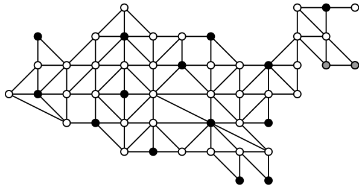</a>

<a href="../../../assets/volume4a/figures/answer-7-1-4-98-kernel-2.svg">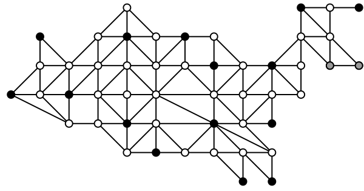</a>

<a href="../../../assets/volume4a/figures/answer-7-1-4-98-kernel-3.svg">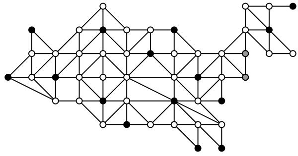</a>

这个计算用所述算法的总代价约为 1400 万次内存访问, 6.3 兆字节内存——每核仅大约 52 次内存引用.]

<a id="ans-7-1-4-99"></a>

**99.** [题目](../sec-7-1-4.md#ex-7-1-4-99) 寻找互相邻接州的三角形, 并且固定它们的颜色. 如果我们在 “中间” 层选择顶点度高的州, BDD 的大小还会大幅度下降. 例如, 通过设定 $a_{\mathtt{MO}}=b_{\mathtt{MO}}=a_{\mathtt{TN}}=\bar b_{\mathtt{TN}}=\bar a_{\mathtt{AR}}=b_{\mathtt{AR}}=1$, 我们把 25579 个结点减少到只有 4642 个 (而且总运行时间也降低到 200 万次内存访问以下).

[兰德尔·布赖恩特原来关于 BDD 的手稿具体讨论了图的着色, 但是当他的论文在 1986 年发表时他决定用其他材料代替.]

<a id="ans-7-1-4-100"></a>

**100.** [题目](../sec-7-1-4.md#ex-7-1-4-100) 用 $\operatorname{IND}(x_{\mathtt{ME}},\ldots,x_{\mathtt{CA}})\wedge S_{12}(x_{\mathtt{ME}},\ldots,x_{\mathtt{CA}})$ 代替 $\operatorname{IND}(x_{\mathtt{ME}},\ldots,x_{\mathtt{CA}})$, 得到 12 个结点的独立集, 这个 BDD 的大小是 1964. 然后像以前那样利用 (73) 以及习题 99 的答案的技巧, 得到 184260 个结点和 12554677864 个解的 COLOR 函数. (运行时间约为 2600 万次内存访问.)


<a id="pdf-548"></a><a id="p-533"></a>

<a id="ans-7-1-4-101"></a>

**101.** [题目](../sec-7-1-4.md#ex-7-1-4-101) 如果一个州的权值是 $w$, 分别指定 $2w$ 和 $w$ 为它的 $a$ 变量和 $b$ 变量的权值, 并且使用算法 B. (例如变量 $a_{\mathtt{WY}}$ 获得权值 $2(23+25)=96$.) 对于颜色代码①②③④, 解是唯一的, 如图所示.

<a href="../../../assets/volume4a/figures/answer-7-1-4-101-coloured-states.svg">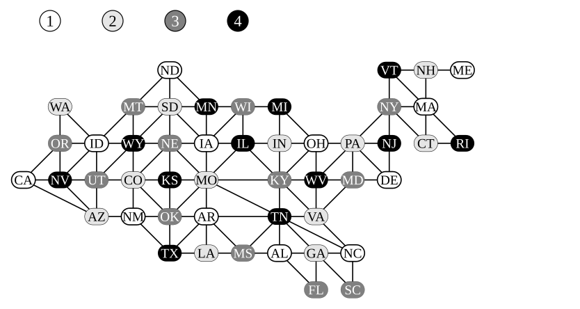</a>

<a id="ans-7-1-4-102"></a>

**102.** [题目](../sec-7-1-4.md#ex-7-1-4-102) 主要思想是, 当 $g_j$ 改变时缓存中的所有结果对于 $f_o>j$ 的函数仍然有效. 为了利用这个原理, 我们可以维持一系列 “时间戳” $G_1\ge G_2\ge\cdots\ge G_n\ge0$, 每个变量一个. 有一个主时钟时间 $G\ge G_1$, 表示完成的或准备的不同复合的数目. 另外一个变量 $G'$ 记录自从上次调用 COMPOSE 以来 $G$ 是否发生过变化. 最初 $G=G'=G_1=\cdots=G_n=0$, 子程序 NEWG($j,g$) 的实现如下所示.

**N1.** [是简单的情形吗?] 如果 $g_j=g$, 退出子程序. 否则置 $g_j\leftarrow g$.

**N2.** [我们能够重新设置时间戳吗?] 如果 $g\ne x_j$, 或者如果 $j<n$ 且 $G_{j+1}>0$, 转到 N4.

**N3.** [重新设置时间戳.] 当 $j>0$ 且 $g_j=x_j$ 时循环执行 $G_j\leftarrow0$, $j\leftarrow j-1$. 然后, 如果 $j=0$, 置 $G\leftarrow G-G'$, $G'\leftarrow0$, 并且退出.

**N4.** [更新 $G$ 吗?] 如果 $G'=0$, 置 $G\leftarrow G+1$, $G'\leftarrow1$.

**N5.** [新的时间戳.] 当 $j>0$ 且 $G_j\ne G$ 时循环执行 $G_j\leftarrow G$, $j\leftarrow j-1$. 退出. $\blacksquare$

(另外需要维持相应的引用计数.) 在进行顶层的 COMPOSE 调用之前, 置 $G'\leftarrow0$. 修改 COMPOSE 例程 (72): 使用 $f[G_v]$ 引用缓存, 其中 $v=f_o$, 检验 $v>m$ 改为检验 $G_v=0$.

<a id="ans-7-1-4-103"></a>

**103.** [题目](../sec-7-1-4.md#ex-7-1-4-103) 等价的公式 $g(f_1(x_1,\ldots,x_n),\ldots,f_m(x_1,\ldots,x_n))$ 可以用 COMPOSE 运算 (72) 实现. (然而, 阿呆被证明是正确的, 用他的公式进行求值比奎克快一百倍, 尽管事实上它使用了两倍多的变量! 在他的应用中, 对于 $g$ 的每个子函数 $g_j$, 计算 $(y_1=f_1(x_1,\ldots,x_n))\wedge\cdots\wedge(y_m=f_m(x_1,\ldots,x_n))\wedge g(y_1,\ldots,y_m)$ 比用 COMPOSE 计算 $g_j(f_1,\ldots,f_m)$ 容易得多. 例如, 见习题 162.)

<a id="ans-7-1-4-104"></a>

**104.** [题目](../sec-7-1-4.md#ex-7-1-4-104) 当使用备忘录缓存时, 以下递归算法 COMPARE($f,g$) 最多需要 $O(B(f)B(g))$ 步: 如果 $f=g$ 返回 “$=$”. 否则, 如果 $f=0$ 或 $g=1$ 返回 “$<$”, 如果 $f=1$ 或 $g=0$ 返回 “$>$”. 否则像 (52) 那样表示 $f$ 和 $g$, 计算 $r_l\leftarrow\operatorname{COMPARE}(f_l,g_l)$. 如果 $r_l$ 是 “$\parallel$” 返回 “$\parallel$”, 否则计算 $r_h\leftarrow\operatorname{COMPARE}(f_h,g_h)$. 如果 $r_h$ 是 “$\parallel$” 返回 “$\parallel$”. 否则, 如果 $r_l$ 是 “$=$” 返回 $r_h$, 如果 $r_h$ 是 “$=$” 返回 $r_l$, 如果 $r_l=r_h$ 返回 $r_l$. 否则返回 “$\parallel$”.

<a id="ans-7-1-4-105"></a>

**105.** [题目](../sec-7-1-4.md#ex-7-1-4-105) (a) 对于 $1\le j\le n$, 具有配极 $(y_1,\ldots,y_n)$ 的单边函数 $f$ 当 $y_j=1$ 时有 $\Lambda x_jf=0$, 当 $y_j=0$ 时有 $\mathrm N x_jf=0$. 反之, 如果这些条件对于所有 $j$ 成立, $f$ 是单边函数. (注意 $\Lambda x_jf=\mathrm N x_jf=0$, 当且仅当 ${\mathrlap{\subset}\mkern12mu\rule[-.04em]{.04em}{.58em}}x_jf=0$, 当且仅当 $f$ 不依赖于 $x_j$. 在这样两种情况下 $y_j$ 是无关的, 否则 $y_j$ 被唯一地确定.)

(b) 下面的算法维持初始值为 0 的全局变量 $(p_1,\ldots,p_n)$, 它们具有这样的性质: 当 $y_j$ 必须是 0 时 $p_j=+1$, 当 $y_j$ 必须是 1 时 $p_j=-1$; 如果 $f$ 不依赖于 $x_j$, $p_j$ 将保持为 0. 在这些条件下, UNATE($f$) 定义如下: 如果 $f$ 是常数, 返回真; 否则像 (50) 那样表示 $f$. 如果 UNATE($f_l$) 或者 UNATE($f_h$) 是假, 返回假; 否则利用习题 104 置 $r\leftarrow\operatorname{COMPARE}(f_l,f_h)$. 如果 $r$ 是 “$\parallel$” 返回假. 如果 $r$ 是 “$<$”, 当 $p_v<0$ 时返回假, 否则置 $p_v\leftarrow+1$ 并且返回真. 如果 $r$ 是 “$>$”, 当 $p_v>0$ 时返回假, 否则置 $p_v\leftarrow-1$ 并且返回真.

这个算法通常很快终结. 它依赖于以下事实: $f(x)\le g(x)$ 对于所有 $x$ 成立, 当且仅当在 $y$ 固定的条件下 $f(x\oplus y)\le g(x\oplus y)$ 对于所有 $x$ 成立. 如果我们只需检验 $f$ 是不是单调函数, 那些 $p$ 变量应该初始化为 $+1$ 而不是 0.

<a id="ans-7-1-4-106"></a>

**106.** [题目](../sec-7-1-4.md#ex-7-1-4-106) 这样定义 HORN($f,g,h$): 如果 $f>g$, 交换 $f\leftrightarrow g$. 然后, 如果 $f=0$ 或 $h=1$ 返回真. 否则如果 $g=1$ 或 $h=0$ 返回假. 否则像 (59) 那样表示 $f,g$ 和 $h$. 如果 $\operatorname{HORN}(f_l,g_l,h_l)$、$\operatorname{HORN}(f_l,g_h,h_l)$、$\operatorname{HORN}(f_h,g_l,h_l)$、$\operatorname{HORN}(f_h,g_h,h_h)$ 全部都是真返回真, 否则返回假. [这个算法是由堀山贵史和茨木俊秀在 *Artificial Intelligence* **136** (2002), 189–213 中提出的, 他们还介绍了一个类似于习题 105(b) 的答案的算法.]

<a id="pdf-549"></a><a id="p-534"></a>

<a id="ans-7-1-4-107"></a>

**107.** [题目](../sec-7-1-4.md#ex-7-1-4-107) 假定用 $e\mathrel{\$}f\mathrel{\$}g\mathrel{\$}h$ 表示 $e(x)=f(y)=g(z)=1$ 蕴涵 $h(\langle xyz\rangle)=1$. 那么 $f$ 是克罗姆函数, 当且仅当 $f\mathrel{\$}f\mathrel{\$}f\mathrel{\$}f$, 并且我们有以下递归算法 KROM($e,f,g,h$): 重新排列 $\{e,f,g\}$ 使得 $e\le f\le g$. 然后, 如果 $e=0$ 或 $h=1$ 返回真. 否则, 如果 $f=1$ 或 $h=0$ 返回假. 否则, 用类似于 (59) 的四元组表示 $e,f,g,h$. 如果 $\operatorname{KROM}(e_l,f_l,g_l,h_l)$、$\operatorname{KROM}(e_l,f_l,g_h,h_l)$、$\operatorname{KROM}(e_l,f_h,g_l,h_l)$、$\operatorname{KROM}(e_l,f_h,g_h,h_h)$、$\operatorname{KROM}(e_h,f_l,g_l,h_l)$、$\operatorname{KROM}(e_h,f_l,g_h,h_h)$、$\operatorname{KROM}(e_h,f_h,g_l,h_h)$、$\operatorname{KROM}(e_h,f_h,g_h,h_h)$ 全部都是真返回真, 否则返回假.

<a id="ans-7-1-4-108"></a>

**108.** [题目](../sec-7-1-4.md#ex-7-1-4-108) 用根结点 1 和汇结点 $\{s-1,s\}$ 标记结点 $\{1,\ldots,s\}$, 那么其他标记的 $(s-3)!$ 个排列给出同一个函数的不同的有向无圈图. 对于 $1\le k\le s-2$, 由于每条指令 $(\bar v_k\mathbin?l_k:h_k)$ 最多有 $n(s-1)^2$ 种可能性, 推出所述不等式. (事实上, 它对于任意分支程序, 也就是通常的二元决策图, 也是成立的, 不管它们是不是有序的和／或约化的.)

由于 $1/(s-3)!<(s-1)^3/s!$ 且 $s!>(s/e)^s$, 我们 (宽宏大量地) 有 $b(n,s)<(nse)^s$. 令 $s_n=2^n/(n+\theta)$, 其中 $\theta=\lg e=1/\ln2$. 则 $\lg b(n,s_n)<s_n\lg(ns_ne)=2^n(1-(\lg(1+\theta/n))/(n+\theta))=2^n-\Omega(2^n/n^2)$. 所以随机的 $n$ 变量布尔函数具有 $B(f)\le s_n$ 的概率最多是 $1/2^{\Omega(2^n/n^2)}$, 实际上它是很小的.

<a id="ans-7-1-4-109"></a>

**109.** [题目](../sec-7-1-4.md#ex-7-1-4-109) $1/2^{\Omega(2^n/n^2)}$ 即使用 $n!$ 相乘实际上也是很小的.

<a id="ans-7-1-4-110"></a>

**110.** [题目](../sec-7-1-4.md#ex-7-1-4-110) 当 $2^{m-1}+m-1<n<2^m+m$ 时, 令 $f_n=M_m(x_{n-m+1},\ldots,x_n;0,\ldots,0,x_1,\ldots,x_{n-m})\vee(\bar x_{n-m+1}\wedge\cdots\wedge\bar x_n\wedge[0\ldots0x_1\ldots x_{n-m}\text{是完全平方数}])$. 这个公式的每一项有 $2^m+m-n$ 个 0, 第二项消除所有的 $2^m$ 个二进制位的完全平方数. [见廖贺田和林庆祥,*IEEE Transactions* **C-41** (1992), 661–664; 尤里·布赖特巴特、哈里·亨特和丹尼尔·罗森克兰茨,*Theoretical Comp. Sci.* **145** (1995), 45–69.]

<a id="ans-7-1-4-111"></a>

**111.** [题目](../sec-7-1-4.md#ex-7-1-4-111) 令 $\mu n=\lambda(n-\lambda n)$, 注意 $\mu n=m$ 当且仅当 $2^m+m\le n<2^{m+1}+m+1$. 对于 $0\le k<n-\mu n$, 和是 $2^{n-\mu n}-1$. 其他项之和为 $2^{2^{\mu n}}$.

<a id="ans-7-1-4-112"></a>

**112.** [题目](../sec-7-1-4.md#ex-7-1-4-112) 假设 $k=n-\lg n+\lg\alpha$. 则

$$
\frac{(2^{2^{n-k}}-1)^{2^k}}{2^{2^n}}
=\exp\left(\frac{2^n\alpha}{n}\ln\left(1-\frac1{2^{n/\alpha}}\right)\right)
=\exp\left(-\frac{2^{n-n/\alpha}\alpha}{n}\left(1+O\left(\frac1{2^{n/\alpha}}\right)\right)\right).
$$

如果 $\alpha\le\frac12$, 我们有 $2^{n-n/\alpha}\alpha/n\le1/(n2^{n+1})$, 因此 $\hat b_k=(2^{n/\alpha}-2^{n/(2\alpha)})(2^{n-n/\alpha}\alpha/n)(1+O(2^{-n/\alpha}))=2^k(1-O(2^{-n/(2\alpha)}))$. 如果 $\alpha\ge2$, 我们有 $2^{n-n/\alpha}\alpha/n\ge2^{n/2+1}/n$, 因此 $\hat b_k=(2^{2^{n-k}}-2^{2^{n-k-1}})(1+O(\exp(-2^{n/2}/n)))$.

[关于 $b_k$ 的方差, 见英戈·韦格纳,*IEEE Trans.* **C-43** (1994), 1262–1269.]

<a id="ans-7-1-4-113"></a>

**113.** [题目](../sec-7-1-4.md#ex-7-1-4-113) 这种思想初看之下是有吸引力的, 但是仔细考察后失其光泽. 根据定理 U, BDD 基的较少结点出现在低层. 至于算法 S 那样的算法, 它们花费在处理低层的时间比较少. 此外, 非常量的汇结点将使若干算法更加复杂, 尤其是那些重新排序的算法.

<a id="ans-7-1-4-114"></a>

**114.** [题目](../sec-7-1-4.md#ex-7-1-4-114) 例如, 真值表可能是 01010101 00110011 00001111 00001111.

<a id="ans-7-1-4-115"></a>

**115.** [题目](../sec-7-1-4.md#ex-7-1-4-115) 令 $N_k=b_0+\cdots+b_{k-1}$ 是 BDD 的满足 $j\le k$ 的结点 $\textcircled{j}$ 的数目. 这些结点的入度之和至少是 $N_k$, 出度之和是 $2N_k$, 并且有一个指向根结点的外部指针. 因此最多有 $N_k+1$ 个分支结点能够从上面的 $k$ 层穿越到较低的层. 每个 $n-k$ 阶子表对应于某个这样的分支结点. 因此 $q_k\le N_k+1$.

此外, 我们必定有 $q_k\le b_k+\cdots+b_n$, 因为每个 $n-k$ 阶子表对应于唯一的阶 $\le n-k$ 的串珠. 对于 (124), 把 BDD 改为 ZDD, $b_k$ 改为 $z_k$, “串珠” 改为 “消零串珠”, $q_k$ 改为 $q'_k$.

<a id="ans-7-1-4-116"></a>

**116.** [题目](../sec-7-1-4.md#ex-7-1-4-116) (a) 令 $v_k=2^{2^k}+2^{2^{k-1}}+\cdots+2^{2^0}$. 则 $Q(f)\le\sum_{k=1}^{n+1}\min(2^{k-1},2^{2^{n+1-k}})=U_n+v_{\lambda(n-\lambda n)-1}$. 像 (78) 的例子说明这个上界是不能改进的.

(b) $\hat q_k/\hat b_k=2^{2^{n-k}}/(2^{2^{n-k}}-2^{2^{n-k-1}})$($0\le k<n$); $\hat q_n=\hat b_n$.

<a id="ans-7-1-4-117"></a>

**117.** [题目](../sec-7-1-4.md#ex-7-1-4-117) $q_k=2^k$($0\le k\le m$), $q_{m+k}=2^m+2-k$($1\le k\le2^m$). 因此 $Q(f)=2^{2m-1}+7\cdot2^{m-1}-1\approx B(f)^2/8$. (这样的 $f$ 实际上使 QDD 变成没有吸引力的.)

<a id="pdf-550"></a><a id="p-535"></a>

<a id="ans-7-1-4-118"></a>

**118.** [题目](../sec-7-1-4.md#ex-7-1-4-118) 如果 $n=2^m-1$, 我们有 $h_n(x_1,\ldots,x_n)=M_m(z_{m-1},\ldots,z_0;0,x_1,\ldots,x_n)$, 由习题 7.1.2-30 可知 $(z_{m-1}\ldots z_0)_2=x_1+\cdots+x_n$ 可以用 $5n-5m$ 步计算, 由习题 7.1.2-39 可知 $M_m$ 可以用另外的 $2n+O(\sqrt n)$ 步计算. 由于 $h_n(x_1,\ldots,x_n)=h_{n+k}(x_1,\ldots,x_n,0,\ldots,0)$, 我们对所有的 $n$ 有 $C(h_n)\le14n+O(\sqrt n)$. (稍加努力可使上界降低到 $7n+O(\sqrt n\log n)$. 读者能够做得更好吗?)

$h_4$ 的代价是 $6=L(h_4)$, 并且 $x_2\oplus((x_1\oplus(x_2\wedge\bar x_4))\wedge(\bar x_3\oplus(\bar x_2\wedge x_4)))$ 是长度最短的公式. (还有 $C(h_5)=10$, $L(h_5)=11$.)

<a id="ans-7-1-4-119"></a>

**119.** [题目](../sec-7-1-4.md#ex-7-1-4-119) 真. 例如, $S_{2,3,5}(x_1,\ldots,x_6)=h_{13}(x_1,x_2,0,0,1,1,0,1,0,x_3,x_4,x_5,x_6)$.

<a id="ans-7-1-4-120"></a>

**120.** [题目](../sec-7-1-4.md#ex-7-1-4-120) 我们有 $h_n^\pi(x_1,\ldots,x_n)=h_n(y_1,\ldots,y_n)$, 其中 $y_j=x_{j\pi}$($1\le j\le n$). 并且 $h_n(y_1,\ldots,y_n)=y_{y_1+\cdots+y_n}=y_{x_1+\cdots+x_n}=x_{(x_1+\cdots+x_n)\pi}$.

<a id="ans-7-1-4-121"></a>

**121.** [题目](../sec-7-1-4.md#ex-7-1-4-121) (a) 如果 $y_k=\bar x_{n+1-k}$, 我们有 $h_n(y_1,\ldots,y_n)=y_{\nu y}=y_{n-\nu x}=\bar x_{n+1-(n-\nu x)}=\bar x_{\nu x+1}$.

(b) 如果 $x=(x_1,\ldots,x_n)$ 且 $t\in\{0,1\}$, 我们有 $h_{n+1}(x,t)=(t\mathbin?x_{\nu x+1}:x_{\nu x})$.

(c) 不是. 例如 $\psi$ 使得 $0^k11\mapsto0^{k-1}101\mapsto0^{k-2}10^2 1\mapsto\cdots\mapsto10^k1\mapsto0^k11$. (尽管 $\psi$ 的定义简单, 但它具有值得注意的性质, 包括像 <code style="white-space:nowrap;display:inline-block;max-width:100%;overflow-x:auto;vertical-align:middle">10011010000101011000111001011</code> 和 <code style="white-space:nowrap;display:inline-block;max-width:100%;overflow-x:auto;vertical-align:middle">11101111011001011101111101111</code> 的不动点.)

(d) 事实上, 对递推公式 (b) 使用归纳法, 我们有 $\hat h_n(x_1\ldots x_n)=x_1$(!).

(如果 $f(x_1,\ldots,x_n)$ 是任意布尔函数, 而 $\tau$ 是二进制向量 $x_1\ldots x_n$ 的任意排列, 我们可以写 $f(x)=\hat f(x\tau)$, 而且变换函数 $\hat f$ 也可能是很容易处理的. 由于 $f(x)\wedge g(x)=\hat f(x\tau)\wedge\hat g(x\tau)$, 因此两个函数的 AND 的变换是它们的变换的 AND, 等等. 如正文中考虑的那样, 只变化下标的向量排列 $(x_1\ldots x_n)\pi=x_{1\pi}\ldots x_{n\pi}$ 是这个一般原则的简单特例. 但是, 这个原则在某种意义上过于一般, 因为每个函数 $f$ 显然至少有一个 $\tau$, 使得 $\hat f$ 在习题 170 的意义下是瘦的, 可以把 $f$ 的所有复杂性转移到 $\tau$. 即使像 $\psi$ 之类的简单变换也有有限的实用性, 因为它们不能很好地复合. 例如, $\psi\psi$ 不是同样类型的变换. 但是线性变换 (对某些非奇异二进制矩阵 $T$ 取 $x\mapsto xT$) 已被证明对简化 BDD 是有用的方法. [见塞缪尔·阿博伊,*IEEE Trans.* **C-37** (1988), 1461–1465; 约亨·贝恩、克里斯托夫·迈内尔和安娜·斯洛博多娃,*ACM/IEEE Design Automation Conf.* **32** (1995), 408–413; 克里斯托夫·迈内尔、法比奥·索门齐和索斯藤·西奥博尔德,*IEEE Trans.* **CAD-19** (2000), 521–533.])

<a id="ans-7-1-4-122"></a>

**122.** [题目](../sec-7-1-4.md#ex-7-1-4-122) 例如, 当 $n=7$ 时, 习题 121(b) 的答案中的递推公式给出

<a href="../../../assets/volume4a/figures/answer-7-1-4-122-FBDD.svg">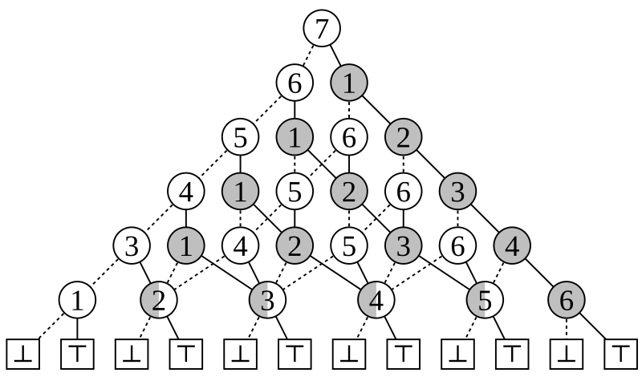</a>

其中带阴影的结点计算尚未被检验的变量上的子函数 $h^{DR}$. 简化出现在底部, 因为 $h_2(x_1,x_2)=x_1$ 且 $h_2^{DR}(x_1,x_2)=x_2$. [见德特勒夫·西林和英戈·韦格纳,*Theoretical Comp. Sci.* **141** (1995), 283–310.]

<a id="ans-7-1-4-123"></a>

**123.** [题目](../sec-7-1-4.md#ex-7-1-4-123) 令 $t=k-s=\bar x_1+\cdots+\bar x_k$. 对于 $s'+t'=w$, $s'\le s$, $t'\le t$ 的这样的 $s'$ 个 1 与 $t'$ 个 0 的每一种组合存在一项记录. 遍及这样的 $(s',t')$ 的 $\binom w{s'}=\binom w{t'}$ 之和是 (97). (还要注意, 它等于 $2^w$ 当且仅当 $w\le\min(s,t)$.)

<a id="ans-7-1-4-124"></a>

**124.** [题目](../sec-7-1-4.md#ex-7-1-4-124) 令 $m=n-k$. 每项记录 $[r_0,\ldots,r_m]$ 对应于 $(x_{k+1},\ldots,x_n)$ 的一个函数, 它的真值表除了下面四种情况之外是串珠: (i) $[0,\ldots,0]=0$; (ii) $[1,\ldots,1]=1$; (iii) $[0,x_n,1]=x_n$ (它不依赖于 $x_{n-1}$); (iv) $[1,\ldots,1,x_{k+1},0,\ldots,0]$, 其中 $p$ 个 1 使得 $x_{k+1}=r_p$, 是 $S_{<p}(x_{k+2},\ldots,x_n)$.

<a id="pdf-551"></a><a id="p-536"></a>

下面的多项式时间算法通过计数所有的记录项计算 $q_k=q$ 和 $b_k=q-q'$. 当 $[r_0,\ldots,r_m]$ 的记录项是全 0 或全 1 时出现一种难以捉摸的情况, 因为对于 $s$ 的不同值可能出现这样的记录项. 我们不想对它们计数两次. 解决方案是维持 4 个集合

$$
C_{ab}=\{r_1+\cdots+r_{m-1}\mid r_0=a\text{ 且在某个记录项中 }r_m=b\}.
$$

$0\pi$ 的值应该人为设置成 $n+1$ 而不是 0. 假定 $0\le k<n$.

**H1.** [初始化.] 置 $m\leftarrow n-k$, $q\leftarrow q'\leftarrow s\leftarrow0$, $C_{00}\leftarrow C_{01}\leftarrow C_{10}\leftarrow C_{11}\leftarrow\emptyset$.

**H2.** [寻找 $v$ 和 $w$.] 置 $v\leftarrow\sum_{j=1}^{m-1}[(s+j)\pi\le k]$, $w\leftarrow v+[s\pi\le k]+[(s+m)\pi\le k]$. 如果 $v=m-1$ 转到 H5.

**H3.** [检查非串珠.] 置 $p\leftarrow-1$. 如果 $v\ne m-2$ 转到 H4. 否则, 如果 $m=2$ 且 $(s+1)\pi=n$, 置 $p\leftarrow[(s+2)\pi\le k]$. 否则, 如果 $w=m$ 且对某个 $j\in[1\mathinner{.\,.}m-1]$ 有 $(s+j)\pi=k+1$, 置 $p\leftarrow j$.

**H4.** [加二项式.] 对于所有满足 $s'+t'=w$, $0\le s'\le s$, $0\le t'\le k-s$ 的 $s'$ 和 $t'$, 置 $q\leftarrow q+\binom w{s'}$, $q'\leftarrow q'+[s'=p]$. 然后转到 H6.

**H5.** [记录 0–1 记录项.] 像在 H4 那样对所有的 $s'$ 和 $t'$ 执行下面的操作: 如果 $(s+m)\pi\le k$, 置 $C_{00}\leftarrow C_{00}\cup s'$, $C_{01}\leftarrow C_{01}\cup(s'-1)$, 否则置 $C_{01}\leftarrow C_{01}\cup s'$. 如果 $s\pi\le k$ 且 $(s+m)\pi\le k$, 置 $C_{10}\leftarrow C_{10}\cup(s'-1)$, $C_{11}\leftarrow C_{11}\cup(s'-2)$. 如果 $s\pi\le k$ 且 $(s+m)\pi>k$, 置 $C_{11}\leftarrow C_{11}\cup(s'-1)$.

**H6.** [对 $s$ 循环.] 如果 $s<k$ 置 $s\leftarrow s+1$ 并返回 H2.

**H7.** [完成.] 对于 $ab=00,01,10,11$ 以及所有 $r\in C_{ab}$, 置 $q\leftarrow q+\binom{m-1}r$. 也置 $q'\leftarrow q'+[0\in C_{00}]+[m-1\in C_{11}]$. $\blacksquare$

<a id="ans-7-1-4-125"></a>

**125.** [题目](../sec-7-1-4.md#ex-7-1-4-125) 令 $S(n,m)=\binom n0+\cdots+\binom nm$. 当 $0<s\le k$ 且 $s\ge2k-n+2$ 时有 $S(k+1-s,s)-1$ 个非常量的记录项. 当 $s=0$ 且 $k<(n-1)/2$ 时出现其他仅有的非常量的记录项, 每个记录项一个. 常数值记录项的计数更复杂, 但是它们通常有 $S(n+1-k,2k+1-n)$ 个, 出现在 $s=2k-n$ 或者 $s=2k+1-n$ 的时候. 考虑到挑剔的边界条件和非串珠, 我们对于 $0\le k<n$ 求

$$
\begin{aligned}
b_k={}&S(n-k,2k-n)+\sum_{s=0}^{n-k}S(n-k-s,2k+1-n+s)\\
&{}-\min(k,n-k)-[n=2k]-[3k\ge2n-1]-1.
\end{aligned}
$$

虽然 $S(n,m)$ 没有简单的形式, 但是当 $n$ 是偶数时可以把 $\sum_{k=0}^{n-1}b_k$ 表示成 $B_{n/2}+\sum_{0\le m\le n-2k\le n}(n+3-m-2k)\binom km+$ (细小改变), 而且当 $n$ 是奇数时, 如果用 $A_{(n+1)/2}$ 代替 $B_{n/2}$, 则存在同样的表达式. 二重求和可以通过首先对 $k$ 求和予以简化, 因为 $(k+1)\binom km=(m+1)\binom{k+1}{m+1}$:

$$
\sum_{m=0}^n\left((n+5-m)\binom{\lfloor(n-m+2)/2\rfloor}{m+1}-(2m+2)\binom{\lfloor(n-m+4)/2\rfloor}{m+2}\right).
$$

至于其余的和可以分成四部分处理, 取决于 $m$ 和 (或)$n$ 是不是奇数. 生成函数有助于处理: 令 $A(z)=\sum_{k\le n}\binom{n-k}{2k}z^n$, $B(z)=\sum_{k\le n}\binom{n-k}{2k+1}z^n$, 则 $A(z)=1+\sum_{k<n}\binom{n-k-1}{2k}z^n+\sum_{k<n}\binom{n-k-1}{2k-1}z^n=1+\sum_{k\le n}\binom{n-k}{2k}z^{n+1}+\sum_{k\le n}\binom{n-k}{2k+1}z^{n+2}=1+zA(z)+z^2B(z)$. 类似的推导证明 $B(z)=zB(z)+zA(z)$. 所以

$$
A(z)=\frac{1-z}{1-2z+z^2-z^3}=\frac{1-z^2}{1-z-z^2-z^4},\qquad
B(z)=\frac z{1-2z+z^2-z^3}=\frac{z+z^2}{1-z-z^2-z^4}.
$$

因此对于 $n\ge4$, $A_n=2A_{n-1}-A_{n-2}+A_{n-3}=A_{n-1}+A_{n-2}+A_{n-4}$, $B_n$ 满足同样的递推公式. 事实上, 利用习题 15 的佩数列, 我们有 $A_n=(3P_{2n+1}+7P_{2n}-2P_{2n-1})/23$, $B_n=(3P_{2n+2}+7P_{2n+1}-2P_{2n})/23$.

此外, 令 $A^*(z)=\sum_{k\le n}k\binom{n-k}{2k}z^n$, $B^*(z)=\sum_{k\le n}k\binom{n-k}{2k+1}z^n$, 我们发现 $A^*(z)=z^2A(z)B(z)$, $B^*(z)=z^2B(z)^2$. 合起来现在得到非常精确的公式

$$
B(h_n)=\frac{56P_{n+2}+77P_{n+1}+47P_n}{23}-\left\lfloor\frac{n^2}4\right\rfloor-\left\lfloor\frac{7n+1}3\right\rfloor+(n\bmod2)-10.
$$


<a id="pdf-552"></a><a id="p-537"></a>

*历史注记:* 序列 $\langle A_n\rangle$ 由理查德·奥斯汀和理查德·盖伊在 *Fibonacci Quarterly* **16** (1978), 84–86 中首先研究. 它对每个 1 都与另一个 1 相邻的二进制数 $x_1\ldots x_{n-1}$ 计数. 卡尔·西格尔证明了塑性常数 $\chi$ 是最小的 “皮索数”, 即共轭数全部位于单位圆内的大于 1 的最小代数整数. 见 *Duke Math. J.* **11** (1944), 597–602.

<a id="ans-7-1-4-126"></a>

**126.** [题目](../sec-7-1-4.md#ex-7-1-4-126) 当 $n\ge6$ 时, 我们有 $b_k=F_{\lfloor(k+7)/2\rfloor}+F_{\lceil(k+7)/2\rceil}-4$($1\le k<2n/3$), $b_k=2^{n-k+2}-6-[k=n-2]$($4n/5\le k<n$). 但是对 $B(h_n^\pi)$ 的主要贡献来自这两个区域之间的 $2n/15$ 个分布元素, 而且可以推广习题 125 的答案的方法处理它们. 有趣的序列

$$
A_n=\sum_{k=0}^{\lfloor n/2\rfloor}\binom{n-2k}{3k},\qquad
B_n=\sum_{k=0}^{\lfloor n/2\rfloor}\binom{n-2k}{3k+1},\qquad
C_n=\sum_{k=0}^{\lfloor n/2\rfloor}\binom{n-2k}{3k+2}
$$

分别具有生成函数 $(1-z)^2/p(z)$, $(1-z)z/p(z)$, $z^2/p(z)$, 其中 $p(z)=(1-z)^3-z^5$. 这些序列出现在这个问题中是因为 $\sum_{k=0}^n\binom{\lfloor n-2k/3\rfloor}{k}=A_n+B_{n-1}+C_{n-2}$. 它们像 $\alpha^n$ 那样增长, 其中 $\alpha\approx1.7016$ 是 $(\alpha-1)^3\alpha^2=1$ 的实根.

BDD 的大小不能表示为闭合式, 但是有一个用 $A_{\lfloor n/3\rfloor}$ 到 $A_{\lfloor n/3\rfloor+4}$ 表示的闭合式, 精确度达到 $O(2^{n/4}/\sqrt n)$. 因此 $B(h_n^\pi)=\Theta(\alpha^{n/3})$.

<a id="ans-7-1-4-127"></a>

**127.** [题目](../sec-7-1-4.md#ex-7-1-4-127) [当 $12<n\le24$ 时, 排列 $\pi=(3,5,7,\ldots,2n'-1,n,n-1,n-2,\ldots,2n',2n'-2,\ldots,4,2,1)$ (其中 $n'=\lfloor2n/5\rfloor$) 对于 $h_n$ 是最优的. 但是它给出 $B(h_{100}^\pi)=1\,366\,282\,025$. 如习题 152 的答案所示, 移动变量的方法好得多, 但是几乎肯定存在更好的排列.]

<a id="ans-7-1-4-128"></a>

**128.** [题目](../sec-7-1-4.md#ex-7-1-4-128) 例如, 考虑 $M_3(x_4,x_2,x_7;x_6,x_1,x_8,x_3,x_9,x_{11},x_5,x_{10})$. 前面 $m$ 个变量 $\{x_4,x_2,x_7\}$ 称为 “地址位”, 其余 $2^m$ 个变量称为 “目标位”. 对应于 $x_1=c_1,\ldots,x_k=c_k$ 的子函数可以用类似于 (96) 的选择的记录项描述. 例如, 当 $k=2$ 时有 3 个记录项 $[x_6,0,x_9,x_{11}]$, $[x_6,1,x_9,x_{11}]$, $[x_8,x_3,x_5,x_{10}]$, 其中结果是用 $(x_4x_7)_2$ 选择相应分量获得的. 这些记录项中只有第三项依赖于 $x_3$, 因此 $q_2=3$ 且 $b_2=1$. 当 $k=6$ 时, 由 $x_7$ 选择分量的记录项是 $[0,0]$, $[0,1]$, $[1,0]$, $[1,1]$, $[x_8,0]$, $[x_8,1]$, $[x_9,x_{11}]$, $[0,x_{10}]$, $[1,x_{10}]$. 因此 $q_6=9$ 且 $b_6=7$.

一般情况下, 如果变量 $\{x_1,\ldots,x_k\}$ 包含 $a$ 个地址位和 $t$ 个目标位, 记录项将有 $A=2^{m-a}$ 个条目. 根据已知的地址位把所有 $2^m$ 个目标位的集合分成 $2^a$ 个子集, 并且假定其中有 $s_j$ 个子集包含 $j$ 个已知的目标位. (因此 $s_0+s_1+\cdots+s_A=2^a$ 且 $s_1+2s_2+\cdots+As_A=t$. 在上面例子中, 当 $k=2$ 且 $a=t=1$ 时我们有 $(s_0,\ldots,s_4)=(1,1,0,0,0)$, 并且当 $k=6$, $a=2$, $t=4$ 时 $(s_0,s_1,s_2)=(1,2,1)$.) 于是记录项的总数 $q_k$ 是 $2^0s_0+2^1s_1+\cdots+2^{A-1}s_{A-1}+2^A[s_A>0]$. 如果 $x_{k+1}$ 是一个地址位, 依赖于 $x_{k+1}$ 的记录项的数目 $b_k$ 是 $q_k-2^{A/2}[s_A>0]$; 否则 $b_k=2^c$, 其中 $c$ 是出现在包含目标位 $x_{k+1}$ 的记录项中的常数的数目.

<a id="ans-7-1-4-129"></a>

**129.** [题目](../sec-7-1-4.md#ex-7-1-4-129) (由马丁·索尔霍夫求解, 见英戈·韦格纳,*Branching Programs* (2000), 定理 6.2.13) 由于 $P_m(x_1,\ldots,x_{m^2})=Q_m(x_1,\ldots,x_{m^2})\wedge S_m(x_1,\ldots,x_{m^2})$ 和 $B(S_m)=m^3+2$, 我们有 $B(P_m^\pi)\le(m^3+2)B(Q_m^\pi)$. 应用定理 K.

(更强的下界应该是可能的, 因为 $Q_m$ 看来比 $P_m$ 有更大的 BDD. 例如, 当 $m=5$ 时排列 $(1\pi,\ldots,25\pi)=(3,1,5,7,9,2,4,6,8,10,11,12,13,14,15,16,20,23,17,21,19,18,22,24,25)$ 对于 $Q_5$ 是最优的, 但是 $B(Q_5^\pi)=535$, 而 $B(P_5)=229$.)

<a id="ans-7-1-4-130"></a>

**130.** [题目](../sec-7-1-4.md#ex-7-1-4-130) (a) 从 BDD 的根开始并且取 $s$ 个 HI 分支结点和 $t$ 个 LO 分支结点的每条路径定义一个子函数, 它所对应的图中, $s$ 个邻接关系是强制的, $t$ 个邻接关系是禁用的. 我们将证明这 $\binom{s+t}s$ 个子函数是不同的.

如果子函数 $g$ 和 $h$ 对应于不同的路径, 我们可以找出具有下述性质的 $k$ 个顶点 $W$: (i) $W$ 包含 $w\mathrel{-}w'$ 在 $g$ 中是强制的且在 $h$ 中是禁用的顶点 $w$ 和 $w'$; (ii) 在 $W$ 的顶点之间没有在 $h$ 中是强制的或在 $g$ 中是禁用的邻接关系; (iii) 如果 $u\in W$ 且 $v\notin W$ 且 $u\mathrel{-}v$ 在 $h$ 中是强制的, 那么 $u=w$ 或 $u=w'$. (这些条件使得最多 $2s+t=m-k$ 个顶点不在 $W$ 中.)

只要邻接关系既不是强制的也不是禁用的, 我们就可以安排其余变量使得当且仅当 $\{u,v\}\subseteq W$ 时 $u\mathrel{-}v$. 这种安排使得 $g=1$, $h=0$.


<a id="pdf-553"></a><a id="p-538"></a>

(b) 考虑 $C_{m,\lceil m/2\rceil}$ 的子函数, 其中要求顶点 $\{1,\ldots,k\}$ 是孤立的, 但是每当 $k<u\le\lceil m/2\rceil<v\le m$ 时有 $u\mathrel{-}v$. 那么 $\lfloor m/2\rfloor$ 个顶点 $\{\lceil m/2\rceil+1,\ldots,m\}$ 上的一个 $k$-团等价于顶点 $\{1,\ldots,m\}$ 上的一个 $\lceil m/2\rceil$-团. 换句话说, $C_{m,\lceil m/2\rceil}$ 的这个子函数是 $C_{\lfloor m/2\rfloor,k}$.

现在选择 $k\approx\sqrt{m/3}$ 并且应用 (a). [英戈·韦格纳,*JACM* **35** (1988), 461–471.]

<a id="ans-7-1-4-131"></a>

**131.** [题目](../sec-7-1-4.md#ex-7-1-4-131) (a) 可以证明分布是 $(1,1,2,4,\ldots,2^{q-1},(p-2)\times(2^q-1,q\times2^{q-1}),2^q-1,2^{q-1},\ldots,4,2,1,2)$, 其中 $r\times b$ 表示 $b$ 重复 $r$ 次. 因此 BDD 的总大小是 $(pq+2p-2q+2)2^{q-1}-p+2$.

(b) 在顺序 $x_1,x_2,\ldots,x_p,y_{11},y_{21},\ldots,y_{p1},\ldots,y_{1q},y_{2q},\ldots,y_{pq}$ 下, 分布变为 $(1,2,4,\ldots,2^{p-1},(q-1)p\times(2^{p-1}),2^{p-1},\ldots,4,2,1,2)$, 使 BDD 的总大小达到 $(pq-p+4)2^{p-1}$.

(c) 假定恰好有 $m=\lfloor\min(p,q)/2\rfloor$ 个 $x$ 以某种顺序出现在前 $k$ 个变量中间, 我们可以假定它们是 $\{x_1,\ldots,x_m\}$. 在 $C$ 的 QDD 中考虑 $2^m$ 条这样的路径, 使得 $x_j=\bar x_{m+j}$($1\le j\le p-m$) 且 $y_{ij}=[i=j\text{ 或 }i=j+m\text{ 或 }j>m]$. 这些路径必须经过第 $k$ 层上的所有不同结点. 因此 $q_k\ge2^m$; 使用 (85). [见玛丽亚·尼科利斯卡娅和卢德米拉·尼科利斯卡娅,*Theor. Comp. Sci.* **255** (2001), 615–625.]

通过习题 138 的算法, $(p,q)=(4,4),(4,5),(5,4)$ 的最优顺序是:

$$
x_1y_{11}x_2y_{21}x_3y_{31}y_{41}y_{12}y_{22}y_{32}y_{42}y_{13}y_{23}y_{33}y_{43}y_{14}y_{24}y_{34}y_{44}x_4\quad\text{(大小为108);}
$$

$$
x_1y_{11}x_2y_{21}x_3y_{31}y_{41}y_{12}y_{22}y_{32}y_{42}y_{13}y_{23}y_{33}y_{43}y_{14}y_{24}y_{34}y_{44}y_{15}y_{25}y_{35}y_{45}x_4\quad\text{(大小为140);}
$$

$$
x_1y_{11}x_2y_{21}y_{12}y_{22}y_{13}y_{23}y_{14}y_{24}x_3y_{31}y_{32}y_{33}y_{34}x_4y_{41}y_{42}y_{51}y_{52}y_{43}y_{53}y_{44}y_{54}x_5\quad\text{(大小为167).}
$$

<a id="ans-7-1-4-132"></a>

**132.** [题目](../sec-7-1-4.md#ex-7-1-4-132) 由表 7.1.1-5, 实际上存在 616126 个不同的 5 变量函数类. $B_{\min}(f)$ 的最大值 17 是从其中的 38 类获得的. 其中 3 类对所有排列 $\pi$ 都有 $B(f^\pi)=17$. 一个这样的例子是 $((x_2\oplus x_4\oplus(x_1\wedge(x_3\vee\bar x_4)))\wedge((x_2\oplus x_5)\vee(x_3\oplus x_4)))\oplus(x_5\wedge(x_3\oplus(x_1\vee\bar x_2)))$, 具有有趣的对称性 $f(x_1,x_2,x_3,x_4,x_5)=f(\bar x_2,\bar x_3,\bar x_4,\bar x_1,\bar x_5)=f(x_2,\bar x_5,x_1,x_3,\bar x_4)$.

顺便说一下, 最大差 $B_{\max}(f)-B_{\min}(f)=10$ 仅当 $B_{\min}=7$ 且 $B_{\max}=17$ 时出现在 “联结函数” 类 $x_1?x_2:x_3?x_4:x_5$ 中.

(当 $n=4$ 时有 222 类, 其中的 25 类有 $B_{\min}(f)=10$, 包括 $S_2$ 且 $S_{2,4}$. 以真值表 16ad 作为例子的类, 在 $B_{\min}(f)=10$ 和 24 个排列的大多数给出 $B(f^\pi)=11$ 的意义下是唯一最难的类.)

<a id="ans-7-1-4-133"></a>

**133.** [题目](../sec-7-1-4.md#ex-7-1-4-133) 用 $n$ 位二进制整数 $i(X)=\sum_{x\in X}2^{x-1}$ 表示每个子集 $X\subseteq\{1,\ldots,n\}$, 并且令 $b_{i(X),x}$ 是 $X$ 与 $X\cup x$ 之间的边的权值. 置 $c_0\leftarrow0$, 并且对于 $1\le i<2^n$ 置 $c_i\leftarrow\min\{c_{i\oplus j}+b_{i\oplus j,x}\mid1\le x\le n,\ j=2^{x-1},\ i\mathbin{\&}j\ne0\}$. 此时 $B_{\min}(f)=c_{2^n-1}+2$, 而且通过记住使每个 $c_i$ 达到最小值的 $x=x(i)$ 可以找到一个最优顺序. 对于 $B_{\max}$, 在这个方法中用 max 代替 min.

<a id="ans-7-1-4-134"></a>

**134.** [题目](../sec-7-1-4.md#ex-7-1-4-134)

<a href="../../../assets/volume4a/figures/answer-7-1-4-134-master-profile.svg">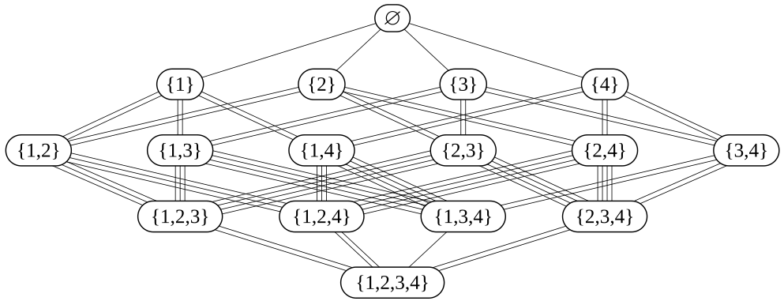</a>

最大分布 $(1,2,4,2,2)$ 出现在像 $\emptyset\to\{2\}\to\{2,3\}\to\{2,3,4\}\to\{1,2,3,4\}$ 这样的路径上. 最小分布 $(1,2,2,1,2)$ 仅出现在路径 $\emptyset\to(\{3\}\text{ 或 }\{4\})\to\{3,4\}\to\{1,3,4\}\to\{1,2,3,4\}$ 上. (24 条可能路径中的 6 条具有分布 $(1,2,3,2,2)$, 而且是无法通过移动任何变量改进的.)

<a id="pdf-554"></a><a id="p-539"></a>

<a id="ans-7-1-4-135"></a>

**135.** [题目](../sec-7-1-4.md#ex-7-1-4-135) 令 $\theta_0=1$, $\theta_1=x_1$, $\theta_2=x_1\wedge x_2$, 并且对于 $n\ge3$ 令 $\theta_n=x_n?\theta_{n-1}:\theta_{n-3}$. 可以证明当 $n\ge4$ 时 $B(\theta_n^\pi)=n+2$, 当且仅当 $(n\pi,\ldots,1\pi)=(1,\ldots,n)$. 主要论据是, 如果 $k<n$ 且 $n\ge5$, 通过置 $x_k\leftarrow0$ 或 $x_k\leftarrow1$ 获得的子函数是不同的, 而且除了 $x_{n-1}\leftarrow0$ 的子函数不依赖于 $x_{n-2}$ 之外, 它们都依赖于变量 $\{x_1,\ldots,x_{k-1},x_{k+1},\ldots,x_n\}$. 因此, 除了 $k=n$ 或 $(k,l)=(n-1,n-2)$ 的情况外, 主分布图中的权值 $\{x_k\}\to\{x_k,x_l\}$ 是 2. $\{x_{n-1},x_{n-2}\}$ 下面有 3 个子函数, 即 $x_n?\theta_{n-4}:\theta_{n-3}$, $x_n?\theta_{n-5}:\theta_{n-3}$, $\theta_{n-3}$, 它们全部依赖于 $\{x_1,\ldots,x_{n-3}\}$, 而且其中的两个依赖于 $x_n$.

<a id="ans-7-1-4-136"></a>

**136.** [题目](../sec-7-1-4.md#ex-7-1-4-136) 令 $n=2n'-1$, $m=2m'-1$. 输入构成一个 $m\times n$ 矩阵, 并且我们是计算 $m$ 行中位数的中位数. 令 $V_i$ 是第 $i$ 行的变量. 如果 $X$ 是 $mn$ 个变量的一个子集, 令 $X_i=X\cap V_i$, $r_i=|X_i|$. $(s_1,\ldots,s_m)$ 类型的子函数恰好当 $X_i$ 的 $s_i$ 个元素设置为 1 时出现, 这些子函数是

$$
\langle S_1S_2\cdots S_m\rangle,\qquad\text{其中 }S_i=S_{\ge n'-s_i}(V_i\setminus X_i)\text{ 且 }0\le s_i\le r_i,\quad1\le i\le m.
$$

当 $x\notin X$ 时, 我们需要计数这些子函数有多少依赖于 $x$. 由对称性我们可以假定 $x=x_{mn}$. 注意, 如果 $t>n$, 对称门限函数 $S_{\ge t}(x_1,\ldots,x_n)$ 等于 0, 或者如果 $t\le0$, 它等于 1. 如果 $1\le t\le n$, 它依赖于所有 $n$ 个变量. 特别是, $S_m$ 恰好对于 $s_m$ 的 $r_m\mathbin{\$}n=\min(r_m+1,n-r_m)$ 种选择依赖于 $x$.

对于 $0\le j\le n$, 令 $a_j=\sum_{i=1}^{m-1}[r_i=j]$. 那么函数 $\{S_1,\ldots,S_{m-1}\}$ 中有 $a_n$ 个是常数, 并且其中的 $a_{n-1}+\cdots+a_{n'}$ 个可能是常数也可能不是常数. 选择 $c_i$ 个不是常数给出 $(r_m\mathbin{\$}n)((a_n+a_{n-1}+\cdots+a_{n'}-c_{n-1}-\cdots-c_{n'})\mathbin{\$}m)$ 乘以

$$
\binom{a_{n-1}}{c_{n-1}}\cdots\binom{a_{n'}}{c_{n'}}1^{a_0}2^{a_1}\cdots(n')^{a_{n'-1}}(n'-1)^{c_{n'}}(n'-2)^{c_{n'+1}}\cdots1^{c_{n-1}}
$$

个依赖于 $x$ 的不同子函数. 遍及 $\{c_{n-1},\ldots,c_{n'}\}$ 求和给出答案.

当变量带有自然的逐行顺序时, 这些公式应用 $r_m=k\bmod n$, $a_n=\lfloor k/n\rfloor$, $a_0=m-1-a_n$. 所以对于 $0\le k<mn$ 的分布元素 $b_k$ 是 $(\lfloor k/n\rfloor\mathbin{\$}m)((k\bmod n)\mathbin{\$}n)$, 而且我们有 $\sum_{k=0}^{mn}b_k=(m'n')^2+2$. 这个顺序是最优的, 虽然没有简单的证明是显而易见的. 例如, 某些顺序可能把 $b_{n+2}$ 或 $b_{2n-2}$ 从 4 减少到 3, 而对于其他 $k$ 则增加 $b_k$.

主分布图的每条自顶到底的路径可以表示成 $\alpha_0\to\alpha_1\to\cdots\to\alpha_{mn}$, 其中每个 $\alpha_j$ 是满足 $0\le r_{j1}\le\cdots\le r_{jm}\le n$ 的串 $r_{j1}\ldots r_{jm}$, $r_{j1}+\cdots+r_{jm}=j$, 而且每一步有一个坐标递增. 例如, 当 $m=5$ 且 $n=3$ 时的一条路径是 $00000\to00001\to00011\to00111\to00112\to00122\to00123\to01123\to11123\to11223\to12223\to12233\to12333\to22333\to23333\to33333$. 我们可以通过一系列不增加总的边权值的步骤把这条路径转换成 “自然的” 路径, 如下: 在直到第一次 $r_{jm}=n$ 的最初阶段, 首先完成对最右坐标的全部转换. (于是示例路径的前几步变成 $00000\to00001\to00002\to00003\to00013\to00113\to00123$.) 然后, 在最后一次 $r_{j1}=0$ 之后的最终阶段, 完成对最左坐标的全部转换. (所以最后步骤变成 $01123\to01223\to02223\to02233\to02333\to03333\to13333\to23333\to33333$.) 然后, 在前 $n$ 步之后以同样方式规范倒数第二个坐标 ($00003\to00013\to00023\to00033\to00133\to01133\to01233\to02233$), 并且在后 $n$ 步之前规范第二个坐标 ($00133\to00233\to00333\to01333\to02333\to03333$). 等等.

[这种向后再向前的证明技术是由下面引用的贝亚特·博利希和英戈·韦格纳的论文所启发的. 仅靠移动能够改进每个非最优的顺序吗?]

<a id="ans-7-1-4-137"></a>

**137.** [题目](../sec-7-1-4.md#ex-7-1-4-137) 如果我们添加 $c$ 个新顶点和 $\binom c2$ 条新边的一个团, 最优排列的代价增加 $\binom{c+1}3$. 所以我们可以假定给出的图具有 $m$ 条边和 $n$ 个顶点 $\{1,\ldots,n\}$, 其中 $m$ 和 $n$ 是奇数且充分大. 对应的函数 $f$ 是 $J(s_0,s_1,\ldots,s_m;h,g_1,\ldots,g_m)$, 它依赖于 $mn+m+1$ 个变量 $x_{ij}$ 和 $s_k$($1\le i\le m$, $1\le j\le n$, $0\le k\le m$), 其中当第 $i$ 条边是 $u_i\mathrel{-}v_i$ 时 $g_i=(x_{iu_i}\oplus x_{iv_i})\wedge\bigwedge\{x_{iw}\mid w\notin\{u_i,v_i\}\}$, 并且 $h=\langle\langle x_{11}\cdots x_{m1}\rangle\cdots\langle x_{1n}\cdots x_{mn}\rangle\rangle$ 是习题 136 中的函数的转置.

可以证明 $B_{\min}(f)=\min_\pi\sum_{u\mathrel{-}v}|u\pi-v\pi|+\left(\frac{m+1}2\right)^2\left(\frac{n+1}2\right)^2+mn+m+2$. 最优顺序使用 $h$ 的 $\left(\frac{m+1}2\right)^2\left(\frac{n+1}2\right)^2$ 个结点, $g_i$ 的 $n+|u_i\pi-v_i\pi|$ 个结点, 每个 $s_k$ 的 1 个结点, 以及 2 个汇结点, 减去 $h$ 与某个 $g_i$ 之间共享的 1 个结点. [见贝亚特·博利希和英戈·韦格纳,*IEEE Trans.* **C-45** (1996), 993–1002.]

<a id="pdf-555"></a><a id="p-540"></a>

<a id="ans-7-1-4-138"></a>

**138.** [题目](../sec-7-1-4.md#ex-7-1-4-138) (a) 令 $X_k=\{x_1,\ldots,x_k\}$. 深度为 $k$ 的 QDD 结点表示当用常量代替 $X_k$ 的变量时可能出现的子函数. 我们可以对每个结点添加一个 $n$ 比特字段 DEP, 确切说明它依赖于 $X_n\setminus X_k$ 的哪些变量. 例如, (92) 中 $f$ 的 QDD 有下面的子函数和 DEP:

```text
深度0：0011001001110010 [1111]；
深度1：00110010 [0111]，01110010 [0111]；
深度2：0010 [0011]，0011 [0010]，0111 [0011]；
深度3：00 [0000]，01 [0001]，10 [0001]，11 [0000]。
```

对于 $0\le k<l\le n$, 对深度为 $k$ 的所有 DEP 字段的检查告诉我们 $X_k$ 与 $X_k\cup x_l$ 之间的主分布权值.

(b) 把深度为 $k$ 的结点表示成三元组 $N_{kp}=(l_{kp},h_{kp},d_{kp})$($0\le p<q_k$), 其中 $(l_{kp},h_{kp})$ 是 (LO, HI) 指针, 而 $d_{kp}$ 记录 DEP 位组. 如果 $k<n$, 这些结点在 $x_{k+1}$ 上分支, 所以我们有 $0\le l_{kp},h_{kp}<q_{k+1}$. 但是如果 $k=n$, 我们用 $l_{n0}=h_{n0}=0$ 和 $l_{n1}=h_{n1}=1$ 表示 $\boxed\bot$ 和 $\boxed\top$. 我们定义

$$
d_{kp}=\sum\{2^{t-k-1}\mid N_{kp}\text{ 依赖于 }x_t\}.
$$

因此 $0\le d_{kp}<2^{n-k}$. 例如, QDD(82) 等价于 $N_{00}=(0,1,7)$; $N_{10}=(0,1,3)$, $N_{11}=(1,2,3)$; $N_{20}=(0,0,0)$, $N_{21}=(0,1,1)$, $N_{22}=(1,1,0)$; $N_{30}=(0,0,0)$, $N_{31}=(1,1,0)$.

为了从深度 $b$ 上跳到深度 $a$, 实际上我们对深度为 $b-1,b-2,\ldots,a$ 的结点做了两份拷贝, 一份是 $x_{b+1}=0$ 的情形, 一份是 $x_{b+1}=1$ 的情形. 把两份拷贝下移到深度 $b,b-1,\ldots,a+1$, 并且约化为消除重复结点的 QDD. 然后用在 $x_{b+1}$ 上分支的一个结点代替深度为 $a$ 的每个原有结点, 它的 LO 字段和 HI 字段分别指向原有结点的 0-拷贝和 1-拷贝.

这个过程包含在桶排序中用于更新 DEP 的某些简单的 (但是巧妙的) 表处理: 把结点分拆到由辅助数组 $r,s,t,u,v$ 组成的初值为零的一个工作区. 我们不使用 LO 和 HI 的 $l_{kp}$ 和 $h_{kp}$, 而把 HI 存入工作区的 $u_p$ 单元, 并且让 $v_p$ 链接到具有同样 LO 字段的前一个结点 (如果存在的话). 此外把 $s_l$ 指向满足 $\mathrm{LO}=l$ 的最后一个结点 (如果存在的话). 下面的算法用 $\operatorname{UNPACK}(p,l,h)$ 作为 “$u_p\leftarrow h,\ v_p\leftarrow s_l,\ s_l\leftarrow p+1$” 的缩写.

当深度为 $k$ 的结点已经用这个方法分拆成数组 $s,u,v$ 时, 下面的子程序 $\operatorname{ELIM}(k)$ 把它们再组装到消除重复后的主 QDD 结构中. 它也把 $r_p$ 设置为结点 $p$ 的新地址.

**E1.** [对 $l$ 循环.] 对于 $0\le h<q_{k+1}$ 置 $q\leftarrow0$, $t_h\leftarrow0$. 对于 $0\le l<q_{k+1}$ 执行 E2. 然后置 $q_k\leftarrow q$ 并且终止.

**E2.** [对 $p$ 循环.] 置 $p\leftarrow s_l$, $s_l\leftarrow0$. 当 $p>0$ 时循环执行 E3 并且置 $p\leftarrow v_{p-1}$. 然后返回 E1.

**E3.** [组装结点 $p-1$.] 置 $h\leftarrow u_{p-1}$. (分拆的结点有 $(\mathrm{LO},\mathrm{HI})=(l,h)$.) 如果 $t_h\ne0$ 且 $l_{k(t_h-1)}=l$, 置 $r_{p-1}\leftarrow t_h-1$, 否则置 $l_{kq}\leftarrow l$, $h_{kq}\leftarrow h$, $d_{kq}\leftarrow((d_{(k+1)l}\mathbin{|}d_{(k+1)h})\ll1)+[l\ne h]$, $r_{p-1}\leftarrow q$, $q\leftarrow q+1$, $t_h\leftarrow q$. 返回 E2. $\blacksquare$

我们现在可以使用 ELIM 从 $b$ 上跳到 $a$. (i) 对于 $k=b-1,b-2,\ldots,a$ 执行下列操作: 对于 $0\le p<q_k$ 置 $l\leftarrow l_{kp}$, $h\leftarrow h_{kp}$. 如果 $k=b-1$, $\operatorname{UNPACK}(2p,l_{bl},h_{bl})$, $\operatorname{UNPACK}(2p+1,l_{bh},h_{bh})$, 否则 $\operatorname{UNPACK}(2p,r_{2l},r_{2h})$, $\operatorname{UNPACK}(2p+1,r_{2l+1},r_{2h+1})$ (因此在工作区内建立 $N_{kp}$ 的两个拷贝). 然后 $\operatorname{ELIM}(k+1)$. (ii) 对于 $0\le p<q_a$, $\operatorname{UNPACK}(p,r_{2p},r_{2p+1})$. 然后 $\operatorname{ELIM}(a)$. (iii) 当 $a>0$, 置 $l\leftarrow l_{(a-1)p}$, $h\leftarrow h_{(a-1)p}$, $l_{(a-1)p}\leftarrow r_l$, $h_{(a-1)p}\leftarrow r_h$($0\le p<q_{a-1}$).

这个上跳过程打乱了深度小于 $a$ 的 DEP 字段, 因为变量已经被重新排序. 但是仅当不再需要这些字段时我们才使用这个过程.

(c) 由归纳法, 前 $2^{n-2}$ 步对不包含 $n$ 的所有子集计数. 然后做一次从 $n-1$ 到 0 的上跳, 并且其余步骤对包含 $n$ 的所有子集计数.

(d) 通过对于 $0\le k<n$ 置 $y_k\leftarrow k$, $w_k\leftarrow2^k-1$ 开始. 在下面的算法中, $y$ 数组表示当前变量的顺序, 位映射 $w_k=\sum\{2^{y_j}\mid0\le j<k\}$ 表示顶部 $k$ 层上的变量的集合.

我们扩充子程序 $\operatorname{ELIM}(k)$, 使它也计算所需主分布的边权值: 把计数器 $c_j$($0\le j<n-k$) 初始化为 0, 在步骤 E3 设置 $d_{kq}$ 之后, 对于满足 $2^j\subseteq d_{kq}$ 的每个 $j$ 置 $c_j\leftarrow c_j+1$. 最后我们采用习题 133 的答案中的记号对于 $0\le j<n-k$ 置 $b_{w_k,y_{k+j}+1}\leftarrow c_j$. [为了加速这个过程, 我们可以用对 $0\le j<(n-k)/8$ 的 $c_{j,(d_{kq}\gg8j)\mathbin{\&}\#\mathrm{ff}}$ 递增 1 的方式对字节而不是二进制位计数.]

<a id="pdf-556"></a><a id="p-541"></a>

通过对 $k=n-1,n-2,\ldots,0$ 执行下列操作初始化 DEP 字段: $\operatorname{UNPACK}(p,l_{kp},h_{kp})$($0\le p<q_k$), $\operatorname{ELIM}(k)$, 如果 $k>0$ 置 $l\leftarrow l_{(k-1)p}$, $h\leftarrow h_{(k-1)p}$, $l_{(k-1)p}\leftarrow r_l$, $h_{(k-1)p}\leftarrow r_h$($0\le p<q_{k-1}$).

算法的主循环现在对 $1\le i<2^{n-1}$ 执行下列操作: 置 $a\leftarrow\nu i-1$, $b\leftarrow\nu i+\rho i$. 置 $(y_a,\ldots,y_b)\leftarrow(y_b,y_a,\ldots,y_{b-1})$, $(w_{a+1},\ldots,w_b)\leftarrow(2^{y_b}+w_a,\ldots,2^{y_b}+w_{b-1})$. 用 (b) 中的过程从 $b$ 上跳到 $a$. 但是对于步骤 (ii) 中的 $\operatorname{ELIM}(a)$ 使用原来 (未扩充) 的 ELIM 例程.

(e) 对于深度为 $k$ 的结点, 所需的空间最多是 $Q_k=\min(2^k,2^{2^{n-k}})$. 我们还需要用于数组 $r,u,v$ 中的 $2\max(Q_1,\ldots,Q_n)$ 个元素的空间, 加上数组 $s$ 和 $t$ 的 $\max(Q_1,\ldots,Q_n)$ 个元素的空间. 所以对于输出 $b_{w,x}$ 而言, 空间总量不超过 $O(2^nn)$.

对于 $0\le k<n$, 子程序 $\operatorname{ELIM}(k)$ 在算法的扩充形式中被调用 $\binom nk$ 次, 在非扩充形式中被调用 $\binom{n-1}{k+1}$ 次. 它的运行时间在两种情况下都是 $O(q_k(n-k))$. 因此总时间达到 $O\left(\sum_k\binom nk2^k(n-k)\right)=O(3^nn)$, 并且当 QDD 不是很大时它是相当小的. (例如, 对于函数 $h_n$, 它是 $O((1+\sqrt2)^nn)$.)

[确定 BDD 中最优变量顺序的第一个精确算法, 是史蒂文·弗里德曼和肯尼思·斯波维特在 *IEEE Trans.* **C-39** (1990), 710–713 中提出的. 他们使用扩充的真值表代替 QDD, 获得了需要 $\Theta(3^n/\sqrt n)$ 的空间和 $\Theta(3^nn^2)$ (可以改进为 $\Theta(3^nn)$) 的时间的方法.]

<a id="ans-7-1-4-139"></a>

**139.** [题目](../sec-7-1-4.md#ex-7-1-4-139) 几乎不加修改地应用同样的算法: 把所有在 $x_a$ 上分支的 QDD 结点视为第 0 层, 把所有在 $x_{b+1}$ 上分支的结点视为汇结点. 因此我们进行 $2^{b-a}$ 次上跳而非 $2^{n-1}$ 次. (除了在 (e) 的空间与时间分析中, 算法不依赖 $q_0=1$ 和 $q_n=2$ 的假设.)

<a id="ans-7-1-4-140"></a>

**140.** [题目](../sec-7-1-4.md#ex-7-1-4-140) 通过在需要时 “即时” 产生顶点与弧, 我们可以在事先不知道网络的情况下寻找网络中的最短路径. 7.3 节指出, 对于任何函数 $l(X)$, 在不改变最短路径的情况下可以把每段弧 $X\to Y$ 的距离 $d(X,Y)$ 改变为 $d'(X,Y)=d(X,Y)-l(X)+l(Y)$. 如果修改后的距离 $d'$ 是非负的, 则 $l(X)$ 是从 $X$ 到目标的距离的下界. 技巧是寻找一个仍然不难计算、又能有效聚焦搜索的下界.

如果 $|X|=l$, 而且如果 $f$ 的 QDD 在顶部 $l$ 层以 $X$ 开头、下一层有 $q$ 个非常量结点, 那么 $l(X)=\max(q,n-l)$ 对于 $B_{\min}$ 问题是一个合适的下界. [见罗尔夫·德雷克斯勒、妮科尔·德雷克斯勒和沃尔夫冈·金特,*ACM/IEEE Design Automation Conf.* **35** (1998), 200–205.] 然而, 为了使这个方法与习题 138 的算法不相上下, 需要一个更强的下界, 除非 $f$ 有一个相当短的不能从许多方法获得的 BDD.

<a id="ans-7-1-4-141"></a>

**141.** [题目](../sec-7-1-4.md#ex-7-1-4-141) 假. 考虑 $g(x_1\vee\cdots\vee x_6,x_7\vee\cdots\vee x_{12},(x_{13}\vee\cdots\vee x_{16})\oplus x_{18},x_{17},x_{19}\vee\cdots\vee x_{22})$, 其中 $g(y_1,\ldots,y_5)=((((y_1\vee y_5)\wedge y_4)\oplus y_3)\wedge((y_1\wedge y_2)\oplus y_4\oplus y_5))\oplus y_5$. 那么 $B(g)=40=B_{\min}(g)$ 不能用连续的 $\{x_{13},\ldots,x_{16},x_{18}\}$ 达到. [马克西姆·捷斯连科、安德烈斯·马丁内利和叶连娜·杜布罗瓦,*IEEE Trans.* **C-54** (2005), 236–237.]

<a id="ans-7-1-4-142"></a>

**142.** [题目](../sec-7-1-4.md#ex-7-1-4-142) (a) 假设 $m$ 是奇数. 已知出现在 $(x_1,\ldots,x_{m+1})$ 之后的子函数是 $[w_{m+2}x_{m+2}+\cdots+w_nx_n>2^{m-1}m-2^{m-2}-t]$, 其中 $0\le t\le2^m$. 子实例 $x_{m+2}+\cdots+x_n=(m-1)/2$ 表明这些子函数至少有 $\binom{m-1}{(m-1)/2}$ 个是不同的.

但是风琴管顺序 $\langle x_1x_2^{2^m-1}x_3^1x_4^{2^m-2}x_5^2\cdots x_{n-2}^{2^m-2^{m-2}}x_{n-1}^{2^{m-2}}x_n^{2^{m-1}}\rangle$ 要好得多: 对于 $1\le k<m-1$ 令 $t_k=x_1+(2^m-1)x_2+x_3+\cdots+(2^m-2^{k-1})x_{2k}+2^{k-1}x_{2k+1}$. 其余子函数最多依赖于 $2k+2$ 个不同的值 $\lceil t_k/2^k\rceil$.

(b) 令 $n=1+4m^2$. 变量是 $x_0$ 和 $x_{ij}$($0\le i,j<2m$), 权值是 $w_0=1$ 和 $w_{ij}=2^i+2^{2m+1+j}m$. 令 $X_l$ 是某种顺序中的前 $l$ 个变量, 并且假定 $X_l$ 包含矩阵 $(x_{ij})$ 的 $i_l$ 行和 $j_l$ 列中的元素. 如果 $\max(i_l,j_l)=m$, 我们将证明 $q_l\ge2^m$, 因此由 (85), $B(f)>2^m$.

令 $I$ 和 $J$ 是 $\{0,\ldots,2m-1\}$ 的子集, 满足条件 $|I|=|J|=m$ 和 $X_l\subseteq x_0\cup\{x_{ij}\mid i\in I,j\in J\}$. 令 $I'$ 和 $J'$ 是补子集. 在不同行中 (或者当 $i_l<m$ 时在不同列中), 选择 $m$ 个元素 $X'\subseteq X_l\setminus x_0$. 考虑 QDD 中定义如下的 $2^m$ 条路径: 置 $x_0=0$, 并且当 $x_{ij}\in X_l\setminus X'$ 时置 $x_{ij}=0$. 此外对于 $i\in I,j\in J$, $x_{i'j}=x_{ij'}=\bar x_{i'j'}=\bar x_{ij}$, 其中 $i\leftrightarrow i'$ 和 $j\leftrightarrow j'$ 是 $I\leftrightarrow I'$ 和 $J\leftrightarrow J'$ 之间的配对. 那么有 $2^m$ 个不同的值 $t=\sum_{i\in I,j\in J}w_{ij}x_{ij}$, 但是在每条路径上 $\sum_{0\le i,j<2m}w_{ij}x_{ij}=m(2^{2m}-1)(1+2^{2m+1}m)$. 路径必须通过第 $l$ 层的不同结点. 否则, 如果 $t\ne t'$, 低层子路径之一将导向 $\boxed\bot$, 另一子路径导向 $\boxed\top$.


<a id="pdf-557"></a><a id="p-542"></a>

[这些结果归功于保坂和寿、武永康彦、金田高幸和矢岛脩三,*Theoretical Comp. Sci.* **180** (1997), 47–60. 他们还证明了 $|Q(f)-Q(f^R)|<n$. 自对偶门限函数也始终满足 $|B(f)-B(f^R)|<n$ 吗?]

<a id="ans-7-1-4-143"></a>

**143.** [题目](../sec-7-1-4.md#ex-7-1-4-143) 事实上, 习题 133 和 138 的算法证明, 风琴管顺序对于这些权值是最佳的: $(1,1023,1,1022,2,1020,4,1016,8,1008,16,992,32,960,64,896,128,768,256,512)$ 给出分布 $(1,2,2,4,3,6,4,8,5,10,4,8,3,6,2,4,1,2,2,1,2)$ 和 $B(f)=80$. 最差顺序 $(1022,896,512,64,8,1,4,32,1008,1020,768,992,1016,1023,960,256,128,16,2,1)$ 使得 $B(f)=1913$.

(也许有人会认为二进制记号的性质对这个例子至关重要. 但是由习题 7.1.1-103, $\langle x_1x_2x_3^2x_4^4x_5^8x_6^{16}x_7^{31}x_8^{60}x_9^{116}x_{10}^{224}x_{11}^{224}x_{12}^{448}x_{13}^{564}x_{14}^{620}x_{15}^{649}x_{16}^{664}x_{17}^{672}x_{18}^{676}x_{19}^{678}x_{20}^{679}\rangle$ 实际上是同一个函数.)

<a id="ans-7-1-4-144"></a>

**144.** [题目](../sec-7-1-4.md#ex-7-1-4-144) $(5,7,7,10,6,9,5,4,2)$. QDD (非 BDD) 结点对应于 $f_1,f_2,f_3,0,1$.

<a id="ans-7-1-4-145"></a>

**145.** [题目](../sec-7-1-4.md#ex-7-1-4-145) 由 (36) 可得 $B_{\min}=31$. $(x_3x_2x_1x_0)_2+(y_3y_2y_1y_0)_2$ 的最差顺序是 $y_0,y_1,y_2,y_3,x_2,x_1,x_0,x_3$, 使得 $B_{\max}=107$. 附带说明, 12 位二进制加法 $(x_{11}\cdots x_0)_2+(y_{11}\cdots y_0)_2$ 的 24 个输入的最差顺序, 结果是 $y_0,y_1,\ldots,y_{11},x_{10},x_8,x_6,x_4,x_3,x_5,x_2,x_7,x_1,x_9,x_0,x_{11}$, 产生 $B_{\max}=39111$.

[贝亚特·博利希、尼科·朗格和英戈·韦格纳在 *Lecture Notes in Comp. Sci.* **4910** (2008), 174–185 中证明了, 对于两个 $n$ 位二进制数的加法, 当 $n>1$ 时 $B_{\min}=9n-5$; 并且还证明了, 对于 $2^m$ 路复用器, $B_{\min}(M_m)=2n-2m+1$.]

<a id="ans-7-1-4-146"></a>

**146.** [题目](../sec-7-1-4.md#ex-7-1-4-146) (a) 显然 $b_0\le q_0$, 并且如果 $q_0=b_0+a_0$ 则 $b_1\le2b_0+a_0=b_0+q_0$. 另外, $q_0-b_0=a_0\le b_1+q_2\le q_2^2$ 是 $q_2$ 个字母的字母表上长度为 2 的字符串的数目. 类似地, $b_0+b_1+q_2\le(b_1+q_2)^2$. ($q_k,q_{k+2},b_k,b_{k+1}$ 之间存在同样关系.)

(b) 令在第 2 层的子函数有真值表 $\alpha_j$($1\le j\le q_2$), 并且用它们构造第 1 层的串珠 $\beta_1,\ldots,\beta_{b_1}$. 令 $(\gamma_1,\ldots,\gamma_{q_2+b_1})$ 是真值表 $(\alpha_1\alpha_1,\ldots,\alpha_{q_2}\alpha_{q_2},\beta_1,\ldots,\beta_{b_1})$. 如果 $b_0\le b_1/2$, 令第 0 层的函数有真值表 $\{\beta_{2i-1}\beta_{2i}\mid1\le i\le b_0\}\cup\{\beta_j\beta_j\mid2b_0<j\le b_1\}\cup\{\gamma_j\gamma_j\mid1\le j\le b_0+q_0-b_1\}$. 否则不难定义包括所有 $\beta$ 的 $b_0$ 个串珠, 并且在第 0 层同非串珠 $\{\gamma_j\gamma_j\mid1\le j\le q_0-b_0\}$ 一起使用它们.

<a id="ans-7-1-4-147"></a>

**147.** [题目](../sec-7-1-4.md#ex-7-1-4-147) 在进行任何重新排序之前, 我们清除缓存并且进行全面垃圾回收. 下述算法在 $v=u+1$ 时交换两层 $\text{\textcircled{u}}\leftrightarrow\text{\textcircled{v}}$. 它通过建立由变量 $S,T,H$ (初始化为 $\Lambda$) 指向的孤立结点、纠缠结点、隐藏结点的链表进行处理, 这些链表使用辅助的 LINK 字段, 它们可以从唯一表在其被重建时的散列表算法临时借用.

**T1.** [建立 $S$ 和 $T$.] 对于每个 $\text{\textcircled{u}}$-结点 $p$, 置 $q\leftarrow\mathrm{LO}(p)$, $r\leftarrow\mathrm{HI}(p)$, 并且从它的散列表中删除 $p$. 如果 $\mathrm V(q)\ne v$ 且 $\mathrm V(r)\ne v$($p$ 是孤立的), 置 $\mathrm{LINK}(p)\leftarrow S$, $S\leftarrow p$. 否则 ($p$ 是纠缠的), 置 $\mathrm{REF}(q)\leftarrow\mathrm{REF}(q)-1$, $\mathrm{REF}(r)\leftarrow\mathrm{REF}(r)-1$, $\mathrm{LINK}(p)\leftarrow T$, $T\leftarrow p$.

**T2.** [建立 $H$ 并且移动可见结点.] 对于每个 $\text{\textcircled{v}}$-结点 $p$, 置 $q\leftarrow\mathrm{LO}(p)$, $r\leftarrow\mathrm{HI}(p)$, 并且从它的散列表中删除 $p$. 如果 $\mathrm{REF}(p)=0$($p$ 是隐藏的), 置 $\mathrm{REF}(q)\leftarrow\mathrm{REF}(q)-1$, $\mathrm{REF}(r)\leftarrow\mathrm{REF}(r)-1$, $\mathrm{LINK}(p)\leftarrow H$, $H\leftarrow p$. 否则 ($p$ 是可见的) 置 $\mathrm V(p)\leftarrow u$ 并且 $\operatorname{INSERT}(u,p)$.

**T3.** [移动孤立结点.] 当 $S\ne\Lambda$ 时循环执行: 置 $p\leftarrow S$, $S\leftarrow\mathrm{LINK}(p)$, $\mathrm V(p)\leftarrow v$ 并且 $\operatorname{INSERT}(v,p)$.

**T4.** [使纠缠结点变性.] 当 $T\ne\Lambda$ 时循环执行: 置 $p\leftarrow T$, $T\leftarrow\mathrm{LINK}(p)$, 并且执行下列操作: 置 $q\leftarrow\mathrm{LO}(p)$, $r\leftarrow\mathrm{HI}(p)$. 如果 $\mathrm V(q)>v$, 置 $q_0\leftarrow q_1\leftarrow q$; 否则, 置 $q_0\leftarrow\mathrm{LO}(q)$, $q_1\leftarrow\mathrm{HI}(q)$. 如果 $\mathrm V(r)>v$, 置 $r_0\leftarrow r_1\leftarrow r$; 否则, 置 $r_0\leftarrow\mathrm{LO}(r)$, $r_1\leftarrow\mathrm{HI}(r)$. 然后, 置 $\mathrm{LO}(p)\leftarrow\operatorname{UNIQUE}(v,q_0,r_0)$, $\mathrm{HI}(p)\leftarrow\operatorname{UNIQUE}(v,q_1,r_1)$, 并且 $\operatorname{INSERT}(u,p)$.

**T5.** [消除隐藏结点.] 当 $H\ne\Lambda$ 时循环执行: 置 $p\leftarrow H$, $H\leftarrow\mathrm{LINK}(p)$, 并且回收结点 $p$ 供重用. (剩余的全部结点都是存活的.)$\blacksquare$

子程序 $\operatorname{INSERT}(v,p)$ 用键码 $(\mathrm{LO}(p),\mathrm{HI}(p))$ 把结点 $p$ 直接放入 $x_v$ 的唯一表中, 表中尚不会有这个键码. 步骤 T4 中的子程序 UNIQUE 类似于算法 U, 但是它不用习题 82 的答案而用与步骤 U2 和 U1 完全不同的方法处理引用计数: 如果 U1 找到 $p=q$, 它对 $\mathrm{REF}(p)$ 加 1; 如果 U2 找到 $r$, 它直接置 $\mathrm{REF}(r)\leftarrow\mathrm{REF}(r)+1$.

<a id="pdf-558"></a><a id="p-543"></a>

在内部, 分支变量保持它们自顶到底的自然顺序 $1,2,\ldots,n$. 映射表 $\rho$ 和 $\pi$ 用 $\rho=\pi^{-1}$ 表示从外部用户观点的当前排列. 因此用户的变量 $x_v$ 出现在第 $v\pi-1$ 层, 并且第 $v-1$ 层的结点 $\operatorname{UNIQUE}(v,p,q)$ 表示用户的函数 $(\bar x_{v\rho}?p:q)$. 为了保持这些映射, 置 $j\leftarrow u\rho$, $k\leftarrow v\rho$, $u\rho\leftarrow k$, $v\rho\leftarrow j$, $j\pi\leftarrow v$, $k\pi\leftarrow u$.

<a id="ans-7-1-4-148"></a>

**148.** [题目](../sec-7-1-4.md#ex-7-1-4-148) 假. 例如, 考虑 6 个汇结点和具有扩充真值表 `1156`, `2256`, `3356`, `4456`, `5611`, `5622`, `5633`, `5644`, `5656` 的 9 个源函数. 结点中 8 个是纠缠的, 1 个是可见的, 但是没有隐藏的和孤立的结点. 有 16 个新生的结点: `15`, `16`, `25`, `26`, `35`, `36`, `45`, `46`, `51`, `61`, `52`, `62`, `53`, `63`, `54`, `64`. 所以交换使 15 个结点转变成 31 个结点. (我们可以用 $B(x_3\oplus x_4,x_3\oplus\bar x_4)$ 的结点表示汇结点.)

<a id="ans-7-1-4-149"></a>

**149.** [题目](../sec-7-1-4.md#ex-7-1-4-149) 相继的分布以 $(b_0,b_1,\ldots,b_n)$, $(b_0+b_1,2b_0,b_2,\ldots,b_n)$, $(b_0+b_1,2b_0+b_2,4b_0,b_3,\ldots,b_n)$, $\ldots$, $(2^0b_0+b_1,\ldots,2^{k-2}b_0+b_{k-1},2^{k-1}b_0,b_k,\ldots,b_n)$ 为界.

同样, 除了定理 J⁺之外, 我们还有 $B(f_1^\pi,\ldots,f_m^\pi)\le B(f_1,\ldots,f_m)+2(b_0+\cdots+b_{k-1})$, 因为交换最多贡献 $2b_{k-1},2b_{k-2},\ldots,2b_0$ 个新结点.

<a id="ans-7-1-4-150"></a>

**150.** [题目](../sec-7-1-4.md#ex-7-1-4-150) 像在习题 52 中那样, 我们可以假定 $m=1$. 假设在排序中我们需要让 $x_k$ 跳到第 $j$ 个位置, 其中 $j\ne k$. 首先计算 $f$ 当 $x_k=0$ 和 $x_k=1$ 时的限制 (见习题 57), 称它们为 $g$ 和 $h$. 然后对剩余的变量重新编号: 如果 $j<k$ 把 $(x_j,\ldots,x_{k-1})$ 改为 $(x_{j+1},\ldots,x_k)$, 否则把 $(x_{k+1},\ldots,x_j)$ 改为 $(x_k,\ldots,x_{j-1})$. 然后用习题 72 的算法 S 的线性时间变形计算 $f\leftarrow(\bar x_j\wedge g)\vee(x_j\wedge h)$.

为了证明这个方法具有想要的运行时间, 证明下面的结果就足够了: 令 $g(x_1,\ldots,x_n)$, $h(x_1,\ldots,x_n)$ 是这样两个函数, $g(x)=1$ 蕴涵 $x_j=0$ 和 $h(x)=1$ 蕴涵 $x_j=1$. 那么, 合并 $g\diamond h$ 具有的结点最多达到 $g\vee h$ 的结点的两倍. 但是, 当考察真值表时这几乎是显而易见的: 例如, 如果 $n=3$ 且 $j=2$, $g$ 和 $h$ 的真值表分别具有 `ab00cd00` 和 `00st00uv` 的形式. $g\vee h$ 在小于 $j$ 的层上的串珠 $\beta$ 唯一地对应于那些层上的 $g\diamond h$ 的串珠 $\beta'\diamond\beta''$, 因为通过把一些 0 置于相应的位置的仅有方式可以对 $\beta=\beta'\vee\beta''$“分解因子”. 至于在大于等于 $j$ 的层上, $g\vee h$ 的串珠 $\beta$ 最多对应于 $g\diamond h$ 的两个串珠, 即 $\beta\diamond\boxed\bot$ 和 (或)$\boxed\bot\diamond\beta$. [见彼得·萨维茨基和英戈·韦格纳,*Acta Informatica* **34** (1997), 245–256, 定理 1.]

<a id="ans-7-1-4-151"></a>

**151.** [题目](../sec-7-1-4.md#ex-7-1-4-151) 对于 $1\le k\le n$ 置 $t_k\leftarrow0$, 并且让交换操作 $x_{j-1}\leftrightarrow x_j$ 同时交换 $t_{j-1}\leftrightarrow t_j$. 然后置 $k\leftarrow1$, 并且执行下列操作直至 $k>n$: 如果 $t_k=1$ 置 $k\leftarrow k+1$, 否则置 $t_k\leftarrow1$ 并且移动 $x_k$.

(这个方法重复地移动最顶层上尚未移动的变量. 研究人员已经试验了更富有想象力的策略, 例如首先移动最大的层. 但是这些方法没有一种比这里提出的纯朴的方法更具有优势.)

<a id="ans-7-1-4-152"></a>

**152.** [题目](../sec-7-1-4.md#ex-7-1-4-152) 像在习题 151 的答案中那样应用算法 J 在 17179 次交换之后产生 $B(h_{100}^\pi)=1\,382\,685\,050$, 这同 “手工调整” 的排列 (95) 的结果几乎一样好. 再一次移动把 BDD 的大小降低到 300451396, 而且进一步的重复操作在总共 232951 次交换之后收敛到只有 231376264 个结点.

如果当 $S>1.05s$ 时中途停止步骤 J2 和 J5 的循环, 结果甚至更好, 虽然执行的交换次数更少: 一次移动后得到 1342191700 个结点, 最终在总共做 139245 次交换后下降到 208478228 个结点. 此外, 菲利普·斯塔普斯在 2010 年 9 月采用移动与随机交换结合的方法, 用下面 “当今最佳” 的排列 $\pi$ 取得了降低到只有 198961868 个结点的 $B(h_{100}^\pi)$ 值:

```text
  3   4   6   8  10  12  14  16  18  20  22  24  27  28  30  32  35  37  39  41
 43  45  47  49  51  53  54  83  85  98  99 100  79  77  81  75  73  95  71  97
 69  96  57  91  67  59  65  60  63  62  64  61  66  87  58  68  56  94  93  70
 92  72  90  74  76  78  80  89  88  86  84  82  55  52  50  48  46  44  42  40
 38  36  34  33  31  29  26  25  23  21  19  17  15  13  11   9   7   5   1   2
```

顺便说一下, 如果我们按分布大小的顺序移动 $h_{100}$ 的变量, 使得最先移动的是 $x_{60}$, 然后是 $x_{59},x_{61},x_{58},x_{57},x_{62},x_{56}$, 等等, (无论它们当前出现在哪里) 所得的 BDD 有 2196768534 个结点.

代替完全移动的简单的 “下坡交换” 对 $h_{100}$ 毫无用处: $\binom{100}2$ 次交换 $x_1\leftrightarrow x_2,x_3\leftrightarrow x_1,x_3\leftrightarrow x_2,\ldots,x_{100}\leftrightarrow x_1,\ldots,x_{100}\leftrightarrow x_{99}$ 完全颠倒所有变量的次序而在任何一步都不改变 BDD 的大小.

<a id="ans-7-1-4-153"></a>

**153.** [题目](../sec-7-1-4.md#ex-7-1-4-153) 每个门用像 (55) 的递推公式综合是容易的. 大约用 1 兆字节内存和 350 万次内存访问的计算足以构造 8242 个结点的整个 BDD 基. 利用习题 138 我们可以得出结论, 顺序 $x_7,x_3,x_9,x_1,o_9,o_1,o_3,o_7,x_4,x_6,o_6,o_4,o_2,o_8,x_2,x_8,o_5,x_5$ 是最优的, 并且 $B_{\min}(y_1,\ldots,y_9)=5308$.


<a id="pdf-559"></a><a id="p-544"></a>

对于像这样的问题对变量重新排序是不可取的, 因为只有 18 个变量. 例如, 每当 BDD 的大小翻倍时, 自动移动将需要超过 1 亿次内存访问的工作量, 只把 8242 个结点下降到 6400 个左右.

<a id="ans-7-1-4-154"></a>

**154.** [题目](../sec-7-1-4.md#ex-7-1-4-154) 是的. CA 在最后的移动步骤是在 ID 与 OR 之间移动, 而且我们自始至终可以反向处理, 推断第一次在 MA 和 RI 之间移动的 ME.

<a id="ans-7-1-4-155"></a>

**155.** [题目](../sec-7-1-4.md#ex-7-1-4-155) 我对于 (a) 的最好尝试是

```text
ME NH VT MA CT RI NY DE NJ MD PA DC VA OH WV KY NC SC GA FL AL IN MI IA
IL MO TN AR MS TX LA CO WI KS SD ND NE OK WY MN ID MT NM AZ OR CA WA UT NV
```

给出 $B(f_1^\pi)=403$, $B(f_2^\pi)=677$, $B(f_1^\pi,f_2^\pi)=1073$. 并且对于 (b), 顺序

```text
NH ME MA VT CT RI NY DE NJ MD PA VA DC OH WV KY TN NC SC GA FL AL IN MI
IL IA AR MO MS TX LA CO KS OK WI SD NE ND MN WY ID MT AZ NM UT OR CA WA NV
```

给出 $B(f_1^\pi)=352$, $B(f_2^\pi)=702$, $B(f_1^\pi,f_2^\pi)=1046$.

<a id="ans-7-1-4-156"></a>

**156.** [题目](../sec-7-1-4.md#ex-7-1-4-156) 有人可能料想两次 “向上移动” 至少同一次既向上又向下的移动过程一样好. 但是实际上, 由里卡德·鲁德尔做的基准检验表明, 单独向上移动注定是不能令人满意的. 为了补偿临时上跳的变量, 临时的下跳是需要的, 尽管它们最佳的最终位置位于下面.

<a id="ans-7-1-4-157"></a>

**157.** [题目](../sec-7-1-4.md#ex-7-1-4-157) 仔细考察习题 128 的答案表明, 当紧接一个目标位的第一个地址位向上跳过所有目标位时, 我们总是改进 BDD 的大小. [但是简单交换的作用太小. 例如, 对任何 $j$ 在 $x_{j-1}\leftrightarrow x_j$ 的交换下, $M_2(x_1,x_6;x_2,x_3,x_4,x_5)$ 和 $M_3(x_1,x_{10},x_{11};x_2,x_3,\ldots,x_9)$ 是局部最优的.]

<a id="ans-7-1-4-158"></a>

**158.** [题目](../sec-7-1-4.md#ex-7-1-4-158) 首先考虑 $m=1$ 且 $n=3t-1\ge5$ 的情形. 那么当 $n\pi=k$ 时, 如果 $j\pi<k$, 在 $j$ 上分支的结点数是 $a_j$, 如果 $j\pi=k$, 结点数是 $b_j$, 如果 $j\pi>k$, 结点数是 $a_{n+2-j}$, 其中

$$
a_j=j-3\max(j-2t,0),\qquad b_j=\min(j,t,n+1-j).
$$

在 $\{x_1,\ldots,x_{n-1}\}$ 连续的情况是 $k=1$ 和 $B(f^\pi)=3t^2+2$, 以及 $k=n$ 和 $B(f^\pi)=3t^2+1$. 但是当 $k=\lceil n/2\rceil$ 时我们有 $B(f^\pi)=\lfloor3t/2\rfloor(\lceil3t/2\rceil-1)+n-\lfloor t/2\rfloor+2$.

类似的计算当 $m>1$ 时适用: 当 $\pi$ 使得 $\{x_1,\ldots,x_p\}$ 连续时, 我们有 $B(f^\pi)>6\binom{p/3}2+B(g^\pi)$, 但是当 $\pi$ 把 $\{x_{p+1},\ldots,x_{p+m}\}$ 放入中间时

$$
B(f^\pi)\approx2\binom{p/2}2+\frac p3B(g^\pi).
$$

由于 $g$ 是固定的, 所以当 $n\to\infty$ 时 $pB(g^\pi)=O(n)$.

[如果 $g$ 是同类型的函数, 我们就获得对称变量在 $g$ 内是最佳分离的例子, 以此类推. 但是还不知道这样的布尔函数, 对它而言, 最优 $B(f^\pi)$ 小于在无对称变量块是分离的条件下可以获得的最佳 BDD 的 3/4. 见德特勒夫·西林,*Random Structures & Algorithms* **13** (1998), 49–70.]

<a id="ans-7-1-4-159"></a>

**159.** [题目](../sec-7-1-4.md#ex-7-1-4-159) 这个函数是殆对称的, 所以只有 9 种可能. 当中心元素 $x$ 位于从顶部起的位置 $(1,2,\ldots,9)$ 时, BDD 的大小分别是 $(43,43,42,39,36,33,30,28,28)$.

<a id="ans-7-1-4-160"></a>

**160.** [题目](../sec-7-1-4.md#ex-7-1-4-160) (a) 计算 64 个变量的布尔函数 $\bigwedge_{i=0}^9\bigwedge_{j=0}^9(\neg L_{ij}(X))$, 例如, 通过对习题 159 的比较简单的 $L$ 函数应用 COMPOSE100 次. 用我的实验程序, 求这个 BDD 大约需要 3.2 亿次内存访问和 35 兆字节, 它具有标准顺序的 251873 个结点. 然后算法 C 快速求出所需的答案: 21929490122. (可以用同样方法求出 $11\times11$ 的解的数目: 5530201631127973447.)

(b) 生成函数是 $1+64z+2016z^2+39740z^3+\cdots+80z^{45}+8z^{46}$, 并且算法 B 快速求出权值为 46 的 8 个解. 它们中的 3 个在国际象棋棋盘对称下是不同的, 最对称的解之一如下图的 (A0) 所示.

(c) $\bigwedge_{i=1}^8\bigwedge_{j=1}^8(\neg L_{ij}(X))$ 的 BDD 有 305507 个结点和 21942036750 个解. 所以必定有 12546628 个是野性的.

(d) 现在生成函数是 $40z^{14}+936z^{15}+10500z^{16}+\cdots+16z^{55}+z^{56}$. 权值为 14 和 56 的例子见下图的 (A1) 和 (A2).

(e) 权值 27 恰好有 28 个形态, 权值 28 有 54 个形态, 它们全部都是驯化的. 见 (A3).


<a id="pdf-560"></a><a id="p-545"></a>

(f) 分别有 $(26260,5,347,0,122216)$ 个解, 用大约 $(228,3,32,1,283)$ 百万次内存访问的计算求出. (1) 的最轻权值和最重权值的解是 (A4) 和 (A5), (2) 的最有趣的解是 (A6), (A7) 和 (A9) 是 (3) 的最轻权值和 (5) 的最重权值的解. (4) 是基于 $\pi$ 的二进制表示, 它没有 $8\times8$ 的前导, 但是它有如 (A8) 中的 $9\times10$ 的前导.

<a href="../../../assets/volume4a/figures/answer-7-1-4-160-life-A.svg" target="_blank" rel="noopener">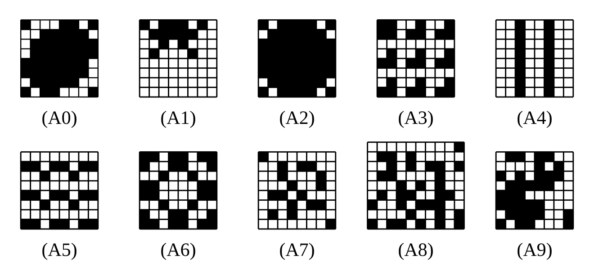</a>

(A0)　(A1)　(A2)　(A3)　(A4)　(A5)　(A6)　(A7)　(A8)　(A9)

<a id="ans-7-1-4-161"></a>

**161.** [题目](../sec-7-1-4.md#ex-7-1-4-161) (a) 按照一行接一行的正常顺序 $(x_{11},x_{12},\ldots,x_{n(n-1)},x_{nn})$, 这个 BDD 有 380727 个结点并且表征 4782725 个解. 计算的代价约为 20 亿次内存访问和 100 兆字节. (类似地, 可以用 14492923 个结点, 以不到 500 亿次内存访问的代价计算 $10\times10$ 大小的 29305144137 个静止生命.)

(b) 这个解实际上是唯一的, 见下图 (B1). 还有一个唯一的 (也是明显的) 权值为 36 的解.

(c) 现在 BDD 有 128 个变量, 顺序是 $(x_{11},y_{11},\ldots,x_{nn},y_{nn})$. 我们可以首先建立 $[L(X)=Y]$ 且 $[L(Y)=X]$ 的 BDD, 然后让它们相交. 但事实证明这是一个坏主意, 即便在 $7\times7$ 的情形也需要大约 3600 万个结点. 好得多的作法是首先一行接一行地应用约束条件 $L_{ij}(X)=y_{ij}$ 且 $L_{ij}(Y)=x_{ij}$, 此外附加字典序约束条件 $X<Y$ 使得静止生命早就被排除在外. 这样大约可以用 200 亿次内存访问和 1.6 吉字节完成计算, 有 978563 个结点和 582769 个解.

(d) 不计旋转, 解也是唯一的. 见 “火花塞”(B2) $\leftrightarrow$ (B3). ((B4) $\leftrightarrow$ (B5) 是常数权值 26 的唯一的 $7\times7$ 触发器. 生命是惊人的.)

<a href="../../../assets/volume4a/figures/answer-7-1-4-161-life-B.svg" target="_blank" rel="noopener">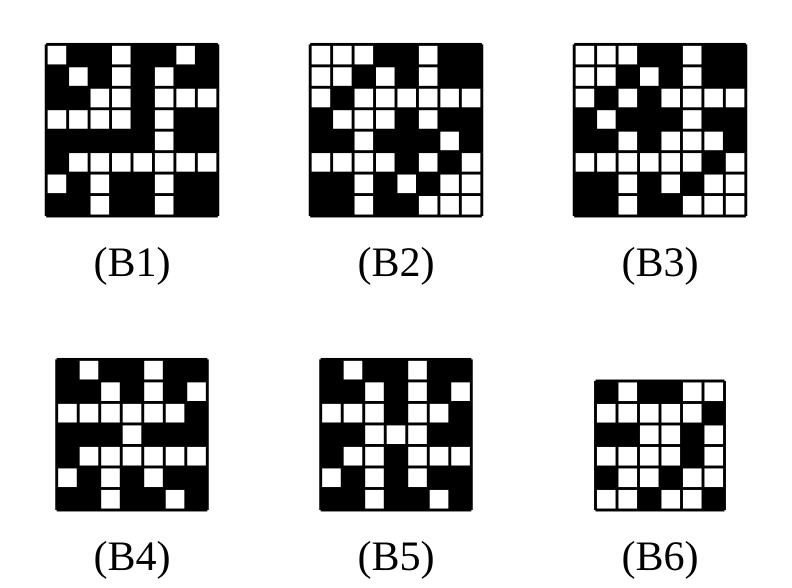</a>

(B1)　(B2)　(B3)　(B4)　(B5)　(B6)

<a id="ans-7-1-4-162"></a>

**162.** [题目](../sec-7-1-4.md#ex-7-1-4-162) 令 $T(X)=[X\text{是驯化的}]$ 且 $E_k(X)=[X\text{在}k\text{步后逃出}]$. 我们可以利用递推公式

$$
E_1(X)=\neg T(X);\qquad E_{k+1}(X)=\exists Y\bigl(T(X)\wedge[L(X)=Y]\wedge E_k(Y)\bigr)
$$

计算每个 $E_k$ 的 BDD. (这里的 $\exists Y$ 代表 $\exists y_{11}\exists y_{12}\cdots\exists y_{66}$. 正如习题 103 的答案中指出的那样, 这个递推公式结果比规则 $E_{k+1}=T(X)\wedge E_k(L_{11}(X),\ldots,L_{66}(X))$ 更有效, 虽然后者显得更 “优雅”.) 对于 $k=(1,2,\ldots,26)$, 求出的解的数量 $|E_k|$ 是 $(806544\cdot2^{16},657527179\cdot2^4,2105885159,763710262,331054880,201618308,126169394,86820176,63027572,41338572,30298840,17474640,9797472,5258660,3058696,1416132,523776,204192,176520,62456,13648,2776,2256,440,104,0)$. 因此在 $2^{36}=68719476736$ 个可能的形态中, 最终有 $\sum_{k=1}^{25}|E_k|=67166017379$ 个从 $6\times6$ 的笼子中逃出. ($E_{25}$ 中的 104 个拖延的逃出者之一如上题 (B6) 所示.)

对于这个问题, 当 $k$ 很小时 BDD 技巧是极好的. 例如, $B(E_1)=101$ 且 $B(E_2)=14441$. 但是 $E_k$ 最后变成复杂的 “非局部” 函数: BDD 的大小在 $B(E_6)=28696866$ 时达到峰值, 在此之后, 解的数目减小到足以降低 BDD 的大小. 超过 8000 万个结点出现在量词化前的公式 $T(X)\wedge[L(X)=Y]\wedge E_5(Y)$ 中, 这触及了内存限制. 实际上, $\bigvee_{k=1}^{25}E_k(X)$ 的 BDD 占用的空间超过了它的 $2^{33}$ 字节的真值表. 所以对于这个习题一种 “向前” 方法比用 BDD 更可取.

(无论用任何已知的方法, 大于 $6\times6$ 的笼子看来都难以处理.)

<a id="ans-7-1-4-163"></a>

**163.** [题目](../sec-7-1-4.md#ex-7-1-4-163) 首先假定 $\circ$ 是 $\wedge$. 通过取 $g$ 的 BDD, 并且用 $h$ 的 BDD 的根替换它的汇结点 $\boxed{\top}$, 我们得到 $f=g\wedge h$ 的 BDD. 为了同时也表示 $\bar f$, 对 $g$ 的 BDD 单独建立一个拷贝, 并且使用 $h$ 和 $\bar h$ 的 BDD 基. 在拷贝中用 $\boxed{\top}$ 代替 $\boxed{\bot}$, 并且在拷贝中用 $\bar h$ 的 BDD 的根代替 $\boxed{\top}$. 这个决策图是约化的, 因为 $h$ 不是常数.

同样, 如果 $\circ$ 是 $\oplus$, 在用 $h$ 和 $\bar h$ 的 BDD 的根代替 $\boxed{\bot}$ 和 $\boxed{\top}$ 后, 我们从 $g$ (和可能的 $\bar g$) 的 BDD 得到 $f=g\oplus h$ (和可能的 $\bar f$) 的 BDD.


<a id="pdf-561"></a><a id="p-546"></a>

其他二元运算 $\circ$ 本质上是相同的, 因为 $B(f)=B(\bar f)$. 例如, 如果 $f=g\supset h=\overline{g\wedge\bar h}$, 我们有 $B(f)=B(\bar f)=B(g)+B(\bar h)-2=B(g)+B(h)-2$.

<a id="ans-7-1-4-164"></a>

**164.** [题目](../sec-7-1-4.md#ex-7-1-4-164) 令 $U_1(x_1)=V_1(x_1)=x_1$, $U_{n+1}(x_1,\ldots,x_{n+1})=x_1\oplus V_n(x_2,\ldots,x_{n+1})$, $V_{n+1}(x_1,\ldots,x_{n+1})=\overline{U_n(x_1,\ldots,x_n)}\wedge x_{n+1}$. 那么对于所有单次读取函数 $f$ 可以用归纳法证明 $B(f)\le B(U_n)=2^{\lceil(n+1)/2\rceil}+2^{\lfloor(n+1)/2\rfloor}-1$, 此外, 我们总是有 $B(f,\bar f)\le B(V_n,\bar V_n)=2^{\lceil n/2\rceil+1}+2^{\lfloor n/2\rfloor+1}-2$. (但是最优顺序把这两个 BDD 的大小急剧降低到 $B(U_n^\pi)=\lfloor\frac32n+2\rfloor$ 和 $B(V_n^\pi,\bar V_n^\pi)=2n+2$.)

<a id="ans-7-1-4-165"></a>

**165.** [题目](../sec-7-1-4.md#ex-7-1-4-165) 由归纳法, 我们还证明 $B(u_{2m},\bar u_{2m})=2^mF_{2m+3}+2$, $B(u_{2m+1},\bar u_{2m+1})=2^{m+1}F_{2m+3}+2$, $B(v_{2m},\bar v_{2m})=2^{m+1}F_{2m+1}+2$, $B(v_{2m+1},\bar v_{2m+1})=2^{m+1}F_{2m+3}+2$.

<a id="ans-7-1-4-166"></a>

**166.** [题目](../sec-7-1-4.md#ex-7-1-4-166) 我们可以像在习题 163 的答案那样假定 $\circ$ 是 $\wedge$ 或 $\oplus$. 通过重新编号, 我们还可以假定 $j\sigma=j$($1\le j\le n$), 因此 $f^\sigma=f$. 令 $(b_0,\ldots,b_n)$ 是 $f$ 的分布, $(b'_0,\ldots,b'_n)$ 是 $(f,\bar f)$ 的分布. 令 $(c_{1\pi},\ldots,c_{(n+1)\pi})$ 和 $(c'_{1\pi},\ldots,c'_{(n+1)\pi})$ 是 $f^\pi$ 和 $(f^\pi,\bar f^\pi)$ 的分布, 其中 $(n+1)\pi=n+1$. 那么 $c_{j\pi}$ 是在变量 $\{x_{1\pi},\ldots,x_{(j-1)\pi}\}$ 设置为固定值后 $f^\pi=g^\pi\circ h^\pi$ 依赖于 $x_{j\pi}$ 的子函数的数目. 同样, $c'_{j\pi}$ 是 $f^\pi$ 或 $\bar f^\pi$ 的这种子函数的数目. 我们将试图对于所有 $j$ 证明 $b_{j\pi-1}\le c_{j\pi}$ 和 $b'_{j\pi-1}\le c'_{j\pi}$.

情形 1: $\circ$ 是 $\wedge$. 我们可以假定 $n\pi=n$, 因为 $\wedge$ 是交换的. 情形 1a: $1\le j\pi\le k$. 此时 $b_{j\pi-1}$ 和 $b'_{j\pi-1}$ 对其中只用 $1\le i<j$ 和 $1\le i\pi\le k$ 指定的变量 $x_{i\pi}$ 的子函数计数. 这些 $g\wedge h$ 或 $\bar g\vee\bar h$ 的子函数在 $c_{j\pi}$ 和 $c'_{j\pi}$ 的计数中有对等的子函数, 因为当 $n\pi=n$ 时 $h^\pi$ 在任何子函数中不是常数. 情形 1b: $k<j\pi\le n$. 此时 $b_{j\pi-1}$ 和 $b'_{j\pi-1}$ 对 $h$ 或 $\bar h$ 的子函数计数, 它们在 $c_{j\pi}$ 和 $c'_{j\pi}$ 的计数中有对等的子函数.

情形 2: $\circ$ 是 $\oplus$. 我们可以假定 $1\pi=1$, 因为 $\oplus$ 是交换的. 这时适用类似情形 1 的论证. [*Discrete Applied Math.* **103** (2000), 237–258.]

<a id="ans-7-1-4-167"></a>

**167.** [题目](../sec-7-1-4.md#ex-7-1-4-167) 令 $f=f_{1n}$. 对于每个子函数 $f_{ij}(x_i,\ldots,x_j)$, 递归地计算 $c_{ij}=B_{\min}(f_{ij})$, $c'_{ij}=B_{\min}(f_{ij},\bar f_{ij})$ 以及 $\{i,\ldots,j\}$ 的一个排列 $\pi_{ij}$, 如下: 如果 $i=j$, 我们有 $f_{ij}(x_i)=x_i$. 令 $c_{ij}=3$, $c'_{ij}=4$, $\pi_{ij}=i$. 否则 $i<j$, 并且对于某个 $k$ 和某个运算符 $\circ$ 有 $f_{ij}(x_i,\ldots,x_j)=f_{ik}(x_i,\ldots,x_k)\circ f_{(k+1)j}(x_{k+1},\ldots,x_j)$. 如果 $\circ$ 是像 $\wedge$ 的运算符, 令 $c_{ij}=c_{ik}+c_{(k+1)j}-2$, 并且 $(c'_{ij}=2c_{ik}+c'_{(k+1)j}-4,\pi_{ij}=\pi_{ik}\pi_{(k+1)j})$ 或 $(c'_{ij}=2c_{(k+1)j}+c'_{ik}-4,\pi_{ij}=\pi_{(k+1)j}\pi_{ik})$, 使得 $c'_{ij}$ 达到最小值. 如果 $\circ$ 是像 $\oplus$ 的运算符, 令 $c'_{ij}=c'_{ik}+c'_{(k+1)j}-2$, 并且 $(c_{ij}=c_{ik}+c'_{(k+1)j}-2,\pi_{ij}=\pi_{ik}\pi_{(k+1)j})$ 或 $(c_{ij}=c_{(k+1)j}+c'_{ik}-2,\pi_{ij}=\pi_{(k+1)j}\pi_{ik})$, 使得 $c_{ij}$ 达到最小值.

(在这个描述中表示成字符串的排列 $\pi_{ij}$, 在计算机内部表示成链表. 利用习题 163 的答案, 我们还可以用 $O(B_{\min}(f))$ 步递归地构造 $f$ 的最优 BDD.)

<a id="ans-7-1-4-168"></a>

**168.** [题目](../sec-7-1-4.md#ex-7-1-4-168) (a) 这个论断转换并且简化递推公式 (112) 和 (113).

(b) 由归纳法是真. 此外 $x\ge n$.

(c) 容易证明. 注意 $T$ 是关于 $22\frac12{}^\circ$ 直线 $y=(\sqrt2-1)x$ 的反射.

(d) 如果 $z\in S_k$ 且 $z'\in S_{n-k}$, 由归纳法我们有 $|z|=q^\beta$ 和 $|z'|=q'^\beta$, 其中 $q\le k$ 且 $q'\le n-k$. 由对称性我们可以令 $q=(1-\delta)t$, $q'=(1+\delta)t$, 其中 $t=\frac12(q+q')\le\frac12n$. 于是如果第一个提示为真, 我们有 $|z\bullet z'|\le(2t)^\beta\le n^\beta$. 并且由 (c) 我们还有 $|z\circ z'|\le n^\beta$, 因为 $|z^T|=|z|$.

为了证明第一个提示, 我们注意当 $y=y'$ 时 $|z\bullet z'|$ 出现最大值. 因为当 $y\ge y'$ 时我们有 $|z\bullet z'|^2=(x+x'+y')^2+y^2=r^2+2(x'+y')x+(x'+y')^2$; 在 $z'$ 给定时, 最大值在 $y=y'$ 时取得. 当 $y'\ge y$ 时, 运用类似的论证.

现在当 $y=y'$ 时, 我们对于某个 $\theta$ 有 $y=\sqrt{rr'}\sin\theta$, 并且可以证明 $x+x'\le(r+r')\cos\theta$. 因此 $z\bullet z'=(x+x'+y,y)$ 位于第二个提示的椭圆内. 对那个椭圆我们有 $(a\cos\theta+b\sin\theta)^2+(b\sin\theta)^2=a^2/2+b^2+u\sin2\theta+v\cos2\theta=a^2/2+b^2+w\sin(2\theta+\tau)$, 其中 $u=ab$, $v=\frac12a^2-b^2$, $w^2=u^2+v^2$, $\cos\tau=u/w$. 因此 $|z\bullet z'|^2\le\frac12a^2+b^2+w$. 并且 $4w^2=(r+r')^4+4(rr')^2\le\bigl(r^2+(2\sqrt5-2)rr'+r'^2\bigr)^2$, 于是

$$
|z\bullet z'|^2\le r^2+(\sqrt5+1)rr'+r'^2,\qquad r=(1-\delta)^\beta,\quad r'=(1+\delta)^\beta.
$$

<a id="pdf-562"></a><a id="p-547"></a>

剩下的任务是证明这个量最多是 $2^{2\beta}=2\phi^2$, 等价于 $f_t(2)\le f_t(2\beta)$, 其中 $f_t(\alpha)=(e^{t/\alpha}+e^{-t/\alpha})^\alpha-2^\alpha$ 且 $t=\beta\ln((1-\delta)/(1+\delta))$. 事实上可以证明, 当 $\alpha\ge2$ 时 $f_t$ 是 $\alpha$ 的增函数. [见格雷厄姆·本内特, *AMM* **117** (2010), 334–351. 关于 $S_n$ 的界 $O(n^\beta)$ 看来需要进行周密的分析. 马丁·索尔霍夫、英戈·韦格纳和拉尔夫·韦希纳所做的早期分析存在缺陷. 这里的证明是由章玄和瓦连京·斯皮特科夫斯基在 2007 年给出的.]

<a id="ans-7-1-4-169"></a>

**169.** [题目](../sec-7-1-4.md#ex-7-1-4-169) 这个猜测对于 $m\le7$ 已经得到证实. [许多其他奇异的特性尚未得到解释.]

<a id="ans-7-1-4-170"></a>

**170.** [题目](../sec-7-1-4.md#ex-7-1-4-170) (a) $2^{2n-1}$. 当 $1\le j<n$ 时存在结点 $j$ 的 4 种选择, 即 $\mathrm{LO}=\boxed{\bot}$ 或 $\mathrm{LO}=\boxed{\top}$ 或 $\mathrm{HI}=\boxed{\bot}$ 或 $\mathrm{HI}=\boxed{\top}$; 而对于结点 $n$ 有 2 种选择.

(b) $2^{n-1}$, 因为在每个分支的半数选择是被排除的.

(c) 实际上, 如果 $t=(t_1\ldots t_n)_2$, 当 $t_j=1$ 时我们在结点 $j$ 有 $\mathrm{LO}=\boxed{\bot}$, 当 $t_j=0$ 时我们在结点 $j$ 有 $\mathrm{HI}=\boxed{\top}$. (这个思想适用于习题 3.4.1-25 中的随机二进制位生成. 由于存在 $2^{n-1}$ 个这样的 $t$ 值, 我们已经证明了每个单调瘦函数是具有权值 $\{2^{n-1},\ldots,2,1\}$ 的门限函数. 其他瘦函数是通过个别的变量取补得到的.)

(d) $\bar f_t(\bar x)=[(\bar x)_2<t]=[(x)_2>\bar t]=[(x)_2>2^n-1-t]=f_{2^n-t}(x)$.

(e) 由定理 7.1.1Q, 最短的 DNF 是素蕴涵元的 OR, 而它的通用模式是通过实例 $n=10$ 和 $t=(1100010111)_2$ 展现的: $(x_1\wedge x_2\wedge x_3)\vee(x_1\wedge x_2\wedge x_4)\vee(x_1\wedge x_2\wedge x_5)\vee(x_1\wedge x_2\wedge x_6\wedge x_7)\vee(x_1\wedge x_2\wedge x_6\wedge x_8\wedge x_9\wedge x_{10})$. (对于 $t$ 中的每个 0 一项, 以及另外一项.) 最短的 CNF 是对应于 $2^n-t=(0011101001)_2$ 的对偶的最短 DNF 的对偶: $(x_1)\wedge(x_2)\wedge(x_3\vee x_4\vee x_5\vee x_6)\wedge(x_3\vee x_4\vee x_5\vee x_7\vee x_8)\wedge(x_3\vee x_4\vee x_5\vee x_7\vee x_9)\wedge(x_3\vee x_4\vee x_5\vee x_7\vee x_{10})$.

<a id="ans-7-1-4-171"></a>

**171.** [题目](../sec-7-1-4.md#ex-7-1-4-171) 注意单次读取函数、正则函数、瘦函数和单调函数这几个类, 在对偶和限制运算下各自封闭. 瘦函数显然是单次读取函数, 具有 $w_1\ge\cdots\ge w_n$ 权值的单调门限函数是正则函数, 而正则函数是单调函数. 我们必须证明正则的单次读取函数是瘦函数.

假设 $f(x_1,\ldots,x_n)=g(x_{i_1},\ldots,x_{i_k})\circ h(x_{j_1},\ldots,x_{j_l})$, 其中 $g$ 和 $h$ 是单次读取函数和正则函数, 并且 $\circ$ 是非平凡的二元运算符. 并且我们有 $i_1<\cdots<i_k$, $j_1<\cdots<j_l$, $k+l=n$, $\{i_1,\ldots,i_k,j_1,\ldots,j_l\}=\{1,\ldots,n\}$. (这个条件比成为 “单次读取” 更弱.) 我们可以假定 $i_1=1$. 通过取限制条件和使用归纳法, $g$ 和 $h$ 同时是瘦函数和单调函数. 因此它们的素蕴涵元具有习题 170(e) 中的特殊形式. 运算符 $\circ$ 必定是单调的, 所以它要么是 $\vee$ 要么是 $\wedge$. 由对偶性我们可以假定 $\circ$ 是 $\vee$.

情形 1: $f$ 有长度为 1 的素蕴涵元. 那么, 由正则性, $x_1$ 是 $f$ 的素蕴涵元. 因此 $f(x_1,\ldots,x_n)=x_1\vee f(0,x_2,\ldots,x_n)$, 并且我们可以用归纳法.

情形 2: $g$ 和 $h$ 的所有素蕴涵元都具有大于 1 的长度. 于是对于某个 $p\ge2$, $x_{j_1}\wedge\cdots\wedge x_{j_p}$ 是素蕴涵元, 但是 $x_{j_1-1}\wedge x_{j_2}\wedge\cdots\wedge x_{j_p}$ 不是素蕴涵元, 与正则性矛盾. [见托马斯·艾特、茨木俊秀和牧野和久,*Theor. Comp. Sci.* **270** (2002), 493–524.]

<a id="ans-7-1-4-172"></a>

**172.** [题目](../sec-7-1-4.md#ex-7-1-4-172) 在习题 170(e) 中通过检查 $f_t$ 的 CNF, 我们看出当 $t=(t_1\ldots t_n)_2$ 时通过变量取补可以获得的霍恩函数的数目, 比当 $t_1=0$ 时 $(t_2\ldots t_n)_2$ 的数目多 1, 但是两倍于当 $t_1=1$ 时的数目. 因此, 例如 $t=(1100010111)_2$ 对应于 $2\times(2\times(1+(1+(1+(2\times(1+(2\times(2\times2))))))))$ 个霍恩函数. 对所有 $t$ 求和给出 $s_n=(2^{n-2}+s_{n-1})+2s_{n-1}$, 其中 $s_1=2$, 并且这个递推公式的解是 $3^n-2^{n-1}$.

为使 $f$ 和 $\bar f$ 同时成为霍恩函数, 假定 (由对偶性)$t\bmod4=3$. 那么我们应当对 $x_j$ 取补, 当且仅当 $t_j=0$, 除了 $t$ 的右边的 1 的串. 例如, 当 $t=(1100010111)_2$ 时我们应当对 $x_3,x_4,x_5,x_7$ 取补, 然后最多对 $\{x_8,x_9,x_{10}\}$ 之一取补. 这给出与 $f_t$ 有关的 $\rho(t+1)+1\ge3$ 种选择. 对满足 $t\bmod4=3$ 的所有 $t$ 求和给出 $2^n-1$. 所以答案是 $2^{n+1}-2$.

<a id="ans-7-1-4-173"></a>

**173.** [题目](../sec-7-1-4.md#ex-7-1-4-173) 首先考虑单调函数. 当 $t\bmod4=3$ 时, 我们可以记 $t=(0^{a_1}1^{a_2}\ldots0^{a_{2k-1}}1^{a_{2k}})_2$, 其中 $a_1+\cdots+a_{2k}=n$, $a_1\ge0$, $a_j\ge1$($1<j<2k$), $a_{2k}\ge2$. 当 $t\bmod4=1$ 时, $2^n-t$ 具有这种形式. 于是 $f_t$ 有 $a_1!a_2!\ldots a_{2k}!$ 个自同构, 所以它等价于 $n!/(a_1!a_2!\ldots a_{2k}!)-1$ 个其他函数, 它们之中没有瘦函数. 当 $n\ge2$ 时对所有 $t$ 求和, 给出 $2(P_n-nP_{n-1})$ 个可以重新排序成瘦形式的单调布尔函数, 其中 $P_n$ 是弱序 (习题 5.3.1-3) 的数目. [见珍妮特·贝辛格和乌里·佩莱德,*Graphs and Combinatorics* **3** (1987), 213–219.]


<a id="pdf-563"></a><a id="p-548"></a>

当变量取补时, 每个这样的单调函数对应于 $2^n$ 个不同的单边函数 (它们也是瘦函数). (这些函数具有这样的性质, 它们的全部限制是定向的, 也称为 “单边级联”“1 决策表函数” 或 “广义单次读取门限函数”.)

<a id="ans-7-1-4-174"></a>

**174.** [题目](../sec-7-1-4.md#ex-7-1-4-174) (a) 对结点 $1,\ldots,n$、$\boxed{\top}$、$\boxed{\bot}$, 指定编号 $0,\ldots,n-1,n,n+1$. 并且对于 $0\le k<n$ 令出自结点 $k$ 的 $(\mathrm{LO},\mathrm{HI})$ 分支到达结点 $(a_{2k+1},a_{2k+2})$. 然后对于 $1\le k\le2n$ 定义 $p_k$ 如下: 令 $l=\lfloor(k-1)/2\rfloor$ 且 $P_l=\{p_1,\ldots,p_{2l}\}$. 如果 $a_k\notin P_l$, 置 $p_k\leftarrow a_k$; 否则, 如果 $a_k$ 是 $P_l\cap\{l+1,\ldots,n+1\}$ 的第 $m$ 小的元素, 置 $p_k$ 为 $\{n+2,\ldots,n+l+1\}\setminus P_l$ 的第 $m$ 小的元素. (这个构造是由索斯藤·达尔海姆尔设计的.)

(b) 德拉克排列的逆 $p_1^{-1}\ldots p_{2n}^{-1}$ 满足 $2(k-n)-1\le p_k^{-1}\le2k$. 它对应于当 $q_2=1$、$q_{2n+1}=2n+2$ 以及 $q_{2k+2}=1+p_k^{-1}$、$q_{2k-1}=1+p_{k+n}^{-1}$($1\le k\le n$) 时的杰诺其错位排列 $q_1\ldots q_{2n+2}$.

(c) 给出排列 $q_1\ldots q_{2n+2}$, 令 $r_k$ 是序列 $q_k^{-1},q_{q_k^{-1}}^{-1},\ldots$ 的第 1 个大于等于 $k$ 的元素. 这个变换使杰诺其排列变成迪蒙信号枪序列, 并且具有以下性质: $q_k=k$ 当且仅当 $r_k=k\notin\{r_1,\ldots,r_{k-1}\}$.

(d) 每个结点 $(j,k)$ 表示串 $r_1\ldots r_j$ 的一个集合, 其中 $(1,0)=\{1\}$ 并且其他集合由下列变换规则定义: 假定 $r_1\ldots r_j\in(j,k)$, 并且令 $l=2k$. 如果 $k=0$, 那么 $(j+1,k)$ 当 $j$ 为偶数时包含 $1r_1^+\ldots r_j^+$, 当 $j$ 为奇数时包含 $2r_1^+\ldots r_j^+$, 其中 $r^+$ 表示 $r+1$. 如果 $k>0$, 那么 $(j+1,k)$ 当 $j$ 为偶数时包含 $r_1^+\ldots r_l^+(l+1)r_{l+1}^+\ldots r_j^+$, 当 $j$ 为奇数时包含 $r_1^\pm\ldots r_{l-1}^\pm(l)r_l^\pm\ldots r_j^\pm$, 其中 $r^\pm$ 当 $r\ge l$ 时表示 $r+1$, 当 $r<l$ 时表示 $r-1$. 在垂直方向上, 如果 $l\le j-3$ 且 $j$ 为奇数, $(j,k+1)$ 包含 $r_1\ldots r_lr_{l+2}r_{l+3}(l+3)r_{l+4}\ldots r_j$. 另一方面如果 $k=1$ 且 $j$ 为偶数, $(j,0)$ 包含 $r_2r_1r_3\ldots r_j$. 最后, 如果 $k>1$ 且 $j$ 为偶数, $(j,k-1)$ 包含串 $r'_1\ldots r'_{l-3}(l-2)r'_{l-2}r'_{l-1}r'_{l+1}\ldots r'_j$, 其中 $r'$ 当 $r=l-2$ 时表示 $l$, 否则 $r'=r$. (可以证明, $(2j,k)$ 的元素是最大不动点是 $2k$ 的 $2j$ 阶杰诺其排列的迪蒙信号枪序列.)

这些结构全部是可逆的. 例如, 路径 $(1,0)\to(2,0)\to(3,0)\to(3,1)\to(4,1)\to(5,1)\to(6,1)\to(7,1)\to(7,2)\to(7,3)\to(8,3)\to(8,2)\to(8,1)\to(8,0)$ 对应于信号枪 $1\to22\to133\to333\to4244\to53355\to624466\to7335577\to7355577\to7355777\to82448688\to82646888\to82466888\to28466888$. 后面这个信号枪可以用图形 <a href="../../../assets/volume4a/figures/answer-7-1-4-174-pistol-28466888.svg">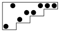</a> 表示, 对应于杰诺其错位排列 $q_1\ldots q_8=61537482$. 并且这个错位排列对应于 $p_1^{-1}\ldots p_6^{-1}=231546$ 和德拉克排列 $p_1\ldots p_6=312546$. 这个排列进而对应于 $a_1\ldots a_6=312343$, 它代表瘦 BDD

<a href="../../../assets/volume4a/figures/answer-7-1-4-174-thin-BDD.svg">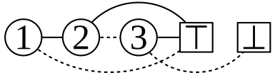</a>

令 $d_{jk}$ 是 $(j,k)$ 中信号枪序列的数目, 它也是从 $(1,0)$ 到 $(j,k)$ 的有向路径的数目. 这些数目很容易用加法求出, 从

<table aria-label="信号枪计数递推表">
<tr><td></td><td></td><td></td><td></td><td></td><td></td><td></td><td></td><td></td><td></td><td></td><td></td><td>38 227</td><td>38 227</td><td>…</td></tr>
<tr><td></td><td></td><td></td><td></td><td></td><td></td><td></td><td></td><td></td><td></td><td>2 073</td><td>2 073</td><td>38 227</td><td>76 454</td><td>…</td></tr>
<tr><td></td><td></td><td></td><td></td><td></td><td></td><td></td><td></td><td>155</td><td>155</td><td>2 073</td><td>4 146</td><td>36 154</td><td>112 608</td><td>…</td></tr>
<tr><td></td><td></td><td></td><td></td><td></td><td></td><td>17</td><td>17</td><td>155</td><td>310</td><td>1 918</td><td>6 064</td><td>32 008</td><td>144 616</td><td>…</td></tr>
<tr><td></td><td></td><td></td><td></td><td>3</td><td>3</td><td>17</td><td>34</td><td>138</td><td>448</td><td>1 608</td><td>7 672</td><td>25 944</td><td>170 560</td><td>…</td></tr>
<tr><td></td><td></td><td>1</td><td>1</td><td>3</td><td>6</td><td>14</td><td>48</td><td>104</td><td>552</td><td>1 160</td><td>8 832</td><td>18 272</td><td>188 832</td><td>…</td></tr>
<tr><td>1</td><td>1</td><td>1</td><td>2</td><td>2</td><td>8</td><td>8</td><td>56</td><td>56</td><td>608</td><td>608</td><td>9 440</td><td>9 440</td><td>198 272</td><td>…</td></tr>
</table>

开始, 并且按列汇总 $D_j=\sum_kd_{jk}$ 是 $(D_1,D_2,\ldots)=(1,1,2,3,8,17,56,155,608,2073,9440,38227,198272,929569,\ldots)$. 这个序列的偶数编号的元素 $D_{2n}$ 早以杰诺其数 $G_{2n+2}$ 著称. 奇数编号的元素 $D_{2n+1}$ 因此被称为数 “中位杰诺其数”. 瘦 BDD 的数目 $S_n$ 是 $d_{(2n+2)0}=D_{2n+1}$.

<a id="pdf-564"></a><a id="p-549"></a>

参考文献: 欧拉在他的 *Institutiones Calculi Differentialis* (1755) 第 2 卷第 7 章讨论了杰诺其数, 他证明了奇整数 $G_{2n}$ 可以用伯努利数表示. 实际上, $G_{2n}=(2^{2n+1}-2)|B_{2n}|$, [^fn7-1-4-genocchi-editor] 并且 $z\tan\frac z2=\sum_{n=1}^\infty G_{2n}z^{2n}/(2n)!$. 安杰洛·杰诺其在 *Annali di Scienze Matematiche e Fisiche* **3** (1852), 395–405 进一步考察了这些数. 菲利普·塞德尔在 *Sitzungsberichte math.-phys. Classe, Akademie* *Wissen. München* **7** (1877), 157–187 揭示了它们可以通过数 $d_{jk}$ 按加法计算. 它们的组合意义直到很久以后才被发现, 见多米尼克·迪蒙,*Duke Math. J.* **41** (1974), 305–318; 多米尼克·迪蒙和阿瑟·兰德里亚诺维尼,*Discrete Math.* **132** (1994), 37–49. 同时, 伊波利特·德拉克提出了一个表面上无关的问题, 等价于我们所说的德拉克排列计数, 见 *L’Intermédiaire des Math.* **7** (1900), 9–10, 328;*Annales de la Faculté sci. Marseille* **11** (1901), 141–164.

在瘦 BDD 与 (d) 的路径之间还有一种直接的联系, 是索斯藤·达尔海姆尔在 2007 年发现的. 首先注意, 无限制的 $2n+2$ 阶的迪蒙信号枪序列对应于有序的但不必是约化的瘦 BDD, 因为我们可以令 $r_1\ldots r_{2n}r_{2n+1}r_{2n+2}=(2a_1)\ldots(2a_{2n})(2n+2)(2n+2)$. 这种 $\min\{i\mid r_{2i-1}=r_{2i}\}=l$ 的信号枪序列的数目是 $d_{(2n+2)(n+1-l)}$.

为了证明这个结果, 我们可以用新的转换规则代替答案 (d) 中的那些规则: 假设 $r_1\ldots r_j\in(j,k)$, 并且令 $l=j-2k$. 那么 $(j+1,k)$ 当 $j$ 是奇数时包含 $r_1^+\ldots r_l^+r_l^+\ldots r_j^+$, 当 $j$ 是偶数时包含 $r_1^\pm\ldots r_{l-1}^\pm(l-1)r_l^\pm\ldots r_j^\pm$. 如果 $j$ 是奇数, $(j,k+1)$ 当 $l=3$ 时包含 $1r_1r_3\ldots r_j$, 当 $l>3$ 时包含 $r'_1\ldots r'_{l-4}(l-4)r'_{l-3}r'_{l-2}r'_l\ldots r'_j$, 其中 $r'=r+2[r=l-4]$. 最后, 如果 $j$ 是偶数且 $k>0$, $(j,k-1)$ 包含 $r_1\ldots r_{l-1}qr_{l+2}r_{l+2}\ldots r_j$, 其中如果 $r_l=r_{l+1}$ 则 $q=l$, 否则 $q=r_{l+1}$.

利用这些魔幻转换, 上面的路径对应于 $1\to22\to313\to133\to2244\to31355\to424466\to5153577\to5135577\to1535577\to22646688\to26446688\to26466688\to26466888$. 于是 $a_1\ldots a_6=132334$.

[^fn7-1-4-genocchi-editor]: 虽然 $2^{2n+1}-2$ 是偶数, 但是 $G_{2n}$ 是奇整数: $1,1,3,17,155,2073,38227,929569,28820619,\ldots$. ——编者注

<a id="ans-7-1-4-175"></a>

**175.** [题目](../sec-7-1-4.md#ex-7-1-4-175) 这个问题看来需要一种不同于处理 $b_0=\cdots=b_{n-1}=1$ 的方法. 假定我们有 $N$ 个结点的 BDD 基, 包含两个汇结点 ($\boxed{\bot}$ 和 $\boxed{\top}$) 以及带标记 $2,\ldots,n$ 的不同的分支结点, 并且假定恰好有 $s$ 个结点是源结点 (有入度 0). 令 $c(b,s,t,N)$ 是引进 $b$ 个标记为 1 的附加结点的方式的数目, 这种方式恰好保留 $s+b-t$ 个源结点. (因此 $0\le t\le2b$, 恰好旧源结点中的 $t$ 个现在是从标记为 1 的分支结点可达的.) 那么, 具有 BDD 分布 $(b_0,\ldots,b_n)$ 的非常量布尔函数 $f(x_1,\ldots,x_n)$ 的数目等于 $T(b_0,\ldots,b_{n-1};1)$, 其中

$$
T(b_0;s)=2[s=b_0=1]+[s=2][b_0=0]+[s=2][b_0=2];
$$

$$
T(b_0,\ldots,b_{n-1};s)=\sum_{t=\max(0,b_0-s)}^{2b_0}c(b_0,s+t-b_0,t,b_1+\cdots+b_{n-1}+2)T(b_1,\ldots,b_{n-1};s+t-b_0).
$$

可以证明 $c(b,s,t,N)=\sum_{r=0}^{2b}a_{rb}p_{tr}(s,N)/b!$, 其中我们有 $(N(N-1))^{\underline b}=\sum_{r=0}^{2b}a_{rb}N^r$ 且

$$
\begin{aligned}
p_{tr}(s,N)&=\sum_k\binom rk\left\{\begin{smallmatrix}k\\t\end{smallmatrix}\right\}s^{\underline t}(N-s)^{r-k}\\
&=\sum_k\left\{\begin{smallmatrix}r\\k\end{smallmatrix}\right\}\binom kt s^{\underline t}(N-s)^{\underline{k-t}}\\
&=r![w^tz^r]e^{(N-s)z}(we^z-w+1)^s.
\end{aligned}
$$

<a id="ans-7-1-4-176"></a>

**176.** [题目](../sec-7-1-4.md#ex-7-1-4-176) (a) 如果 $p\ne p'$, 由通用散列的定义我们有 $\sum_{a\in A,b\in B}[h_{a,b}(p)=h_{a,b}(p')]\le|A||B|/2^l$. 令 $r_i(a,b)$ 是使得 $h_{a,b}(p)=i$ 的 $p\in P$ 的数目. 于是

$$
\begin{aligned}
\sum_{a\in A,b\in B}\sum_{0\le i<2^l}r_i(a,b)^2
&=\sum_{a\in A,b\in B}\sum_{p\in P}\sum_{p'\in P}[h_{a,b}(p)=h_{a,b}(p')]\\
&\le|P||A||B|+\sum_{p\in P}\sum_{p'\in P}[p\ne p']\frac{|A||B|}{2^l}
=2^t|A||B|\left(1+\frac{2^t-1}{2^l}\right).
\end{aligned}
$$

另一方面, 对于任何 $a$ 和 $b$, $\sum_{i=0}^{2^l-1}r_i(a,b)^2=\sum_{i\in I}(r_i(a,b)-2^t/|I|)^2+2^{2t}/|I|\ge2^{2t}/|I|$. 类似的公式当 $h_{a,b}(q)=j$ 存在 $s_j(a,b)$ 个解时适用. 因此必定存在 $a\in A$ 和 $b\in B$ 使得

$$
\frac{2^{2t}}{|I|}+\frac{2^{2t}}{|J|}\le\sum_{i\in I}r_i(a,b)^2+\sum_{j\in J}s_j(a,b)^2
\le2^{t+1}\left(1+\frac{2^t-1}{2^l}\right)
\le\frac{2^{2t}}{2^l}+\frac{2^{2t}}{(1-\epsilon)2^l}.
$$

(b) 在 $aq_k+b$ 和 $aq_{k+2}+b$ 的中间 $l$ 位所表示的数至少相差 2, 所以 $aq_k$ 和 $aq_{k+2}$ 的中间 $l-1$ 个二进制位必定是不同的.

(c) 令 $q$ 和 $q'$ 是 $Q^*$ 的满足 $(g(q')-g(q))\bmod2^{l-1}\ge2^{l-2}$ 的不同元素. (否则我们可以交换 $q\leftrightarrow q'$.) 如果 $l\ge3$, 条件 $g(p)+g(q)=2^{l-1}$ 蕴涵 $f_q(p)=0$. 现在我们有 $(g(p)+g(q'))\bmod2^{l-1}=(g(q')-g(q))\bmod2^{l-1}$. 此外, $g(q')$ 和 $g(p)$ 都是偶数. 因此不可能有进位传播改变中间二进制位, 从而我们有 $f_{q'}(p)=1$.


<a id="pdf-565"></a><a id="p-550"></a>

(d) 集合 $Q''$ 至少有 $(1-\epsilon)2^{l-1}$ 个元素, 类似的集合 $P''$ 也是如此. $Q''$ 的元素中最多有 $2^{l-2}$ 个使得 $g(q)$ 是奇数, 并且最多有 $2^{l-1}+1-|P''|$ 个 $g(q)$ 为偶数的元素不在 $Q^*$ 中. 因此 $|Q^*|\ge(1-\epsilon)2^{l-1}-2^{l-2}-2^{l-1}-1+(1-\epsilon)2^{l-1}=(1-4\epsilon)2^{l-2}-1$, 并且由 (85) 我们有 $B_{\min}(Z_{n,a})\ge(1-4\epsilon)2^{l-1}-2$.

最后, 选择 $l=t-4$ 和 $\epsilon=1/9$. 定理当 $n<14$ 时显然成立.

<a id="ans-7-1-4-177"></a>

**177.** [题目](../sec-7-1-4.md#ex-7-1-4-177) 假设 $k\ge n/2$, $x=2^{k+1}x_h+x_l$, $y=2^ky_h+y_l$. 那么 $(xy\gg k)\bmod2^{n-k}$ 依赖于 $2x_hy_l,x_ly_h,x_ly_l\gg k$, modulo $2^{n-k}$, 于是 $q_{2k+1}\le2^{n-k-1+n-k+n-k}$.

累加各项, 我们得到 $\sum_{k=0}^{2n}q_k\le\sum_{0\le k\le6n/5}2^k+\sum_{6n/5<k\le2n}2^{3n-2\lfloor k/2\rfloor-\lceil k/2\rceil}$. 如果 $n=5t+(0,1,2,3,4)$, 总数恰好是 $(2^{\lceil6n/5\rceil}\cdot(19,10,12,13,17)-12)/7$. [马丁·索尔霍夫在 *Discrete Applied Math.* **158** (2010), 1195–1204 证明了这个顺序的下界是 $\Omega(2^{6n/5})$.]

<a id="ans-7-1-4-178"></a>

**178.** [题目](../sec-7-1-4.md#ex-7-1-4-178) 我们可以像在定理 A 的证明中那样写成 $x=2^kx_h+x_l$, 但是现在 $x_l=\hat x_l+(x\bmod2)$, 其中 $\hat x_l$ 是偶数而 $x\bmod2$ 还是未知的. 同样 $y=2^ky_h+y_l=2^ky_h+\hat y_l+(y\bmod2)$. 令 $\hat z_l=\hat x_l\hat y_l\bmod2^k$. 对于 $n/2\le k<n$, 在 $2k-2$ 层我们只需 “记住”3 个 $n-k$ 位二进制数 $\hat x_l\bmod2^{n-k}$, $\hat y_l\bmod2^{n-k}$, $(\hat x_l\hat y_l\gg k)\bmod2^{n-k}$, 以及 3 个 “进位” $c_1=(\hat x_l+\hat z_l)\gg k$, $c_2=(\hat y_l+\hat z_l)\gg k$, $c_3=(\hat x_l+\hat y_l+\hat z_l)\gg k$. 一旦知道 $x_h,y_h,x\bmod2,y\bmod2$, 这 6 个量就告诉我们中间二进制位.

进位有 6 种可能: $c_1c_2c_3=000,001,011,101,111,112$. 因此 $q_{2k-2}\le6\cdot2^{(n-k-1)+(n-k-1)+(n-k)}$. 类似地, 当 $n/2\le k<n-1$ 时, 我们有 $q_{2k-1}\le6\cdot2^{(n-k-2)+(n-k-1)+(n-k)}$. 利用这些估值, 同 $q_k\le2^k$ 一起, 当 $n=5t+(0,1,2,3,4)$ 时, 我们得到 $\sum_{k=0}^{2n-4}q_k\le(2^{6t}\cdot(37,86,184,464,1024)-268)/28$.

对于 $6\le n\le16$, 定理 A 中的函数 $f$ 和本习题中的函数 $g$ 的 BDD 的实际大小是 $B(f)=(169,381,928,2188,5248,12373,29400,68777,162768,377359,879709)$ 和 $B(g)=(165,352,806,1802,4195,9774,22454,52714,121198,278223,650188)$. 所以这种改变看来节省大约 25%. 一个略好一些的顺序是通过检验最后 4 层上的 $(\operatorname{lo-bit}(x),\operatorname{hi-bit}(y),\operatorname{hi-bit}(x),\operatorname{lo-bit}(y))$ 获得的, 对于 $n\ge6$ 给出 $B(h)=B(g)-20$. 于是对于 $6\le n\le12$, $B(h)/B_{\min}(f)\approx(1.07,1.05,1.04,1.04,1.04,1.01,1.02)$, 所以这个顺序当 $n\to\infty$ 时可能是接近是最优的.

<a id="ans-7-1-4-180"></a>

**180.** [题目](../sec-7-1-4.md#ex-7-1-4-180) 通过令 $a_{m+1}=a_{m+2}=\cdots=0$, 我们可以假定 $m\ge p$. 令 $a=(a_p\ldots a_1)_2$, 并且像在定理 A 的证明中那样记 $x=2^kx_h+x_l$. 如果 $p\le n$, 我们有 $q_k\le2^{p-k}$($0\le k<p$), 因为给出的函数 $f=Z_{m,n}^{(p)}(a;x)$ 仅依赖于 $a,x_h,(ax_l\gg k)\bmod2^{p-k}$. 所以我们可以假定 $p>n$.

考虑多重集 $A=\{2^kx_ha\bmod2^{p-1}\mid0\le x_h<2^{n-k}\}$. 记 $A=\{2^{p-1}-\alpha_1,\ldots,2^{p-1}-\alpha_s\}$, 其中 $s=2^{n-k}$ 且 $0<\alpha_1\le\cdots\le\alpha_s=2^{p-1}$, 并且对于 $0\le i\le s$ 令 $\alpha_{s+i}=\alpha_i+2^{p-1}$. 那么 $q_k\le2s$, 因为 $f$ 仅依赖于 $a,x_h$ 以及使得 $\alpha_i\le ax_l\bmod2^p<\alpha_{i+1}$ 的下标 $i\in[0\,\ldotp\ldotp\,2s)$.

所以 $\sum_{k=0}^nq_k\le\sum_{k=0}^n\min(2^k,2^{n+1-k})=2^{\lfloor n/2\rfloor+1}+2^{\lceil n/2\rceil+1}-3$.

<a id="ans-7-1-4-181"></a>

**181.** [题目](../sec-7-1-4.md#ex-7-1-4-181) 由习题 170, 对于每个 $(x_1,\ldots,x_m)$ 仅需 $O(n)$ 个额外的结点.

<a id="ans-7-1-4-182"></a>

**182.** [题目](../sec-7-1-4.md#ex-7-1-4-182) 是, 贝亚特·博利希 [*Lecture Notes in Comp. Sci.* **4978** (2008), 306–317] 已经证明它是 $\Omega(2^{n/432})$. 顺便说一下, $B_{\min}(L_{12,12})=1158$ 是用奇怪的顺序 $L_{12,12}(x_{18},x_{17},x_{16},x_{15},x_{14},x_{12},x_{10},x_8,x_6,x_4,x_2,x_1;x_{19},x_{20},x_{21},x_{22},x_{23},x_{13},x_{11},x_9,x_7,x_5,x_3,x_{24})$ 获得的. 并且 $B_{\max}(L_{12,12})=9302$ 产生于 $L_{12,12}(x_{24},x_{23},x_{20},x_{19},x_{22},x_{11},x_6,x_7,x_8,x_9,x_{10},x_{13};x_1,x_2,x_3,x_4,x_5,x_{21},x_{18},x_{17},x_{16},x_{15},x_{14},x_{12})$. 类似地, $B_{\min}(L_{8,16})=606$ 和 $B_{\max}(L_{8,16})=3415$ 相距并不太远. $B_{\min}(L_{m,n})$ 和 $B_{\max}(L_{m,n})$ 都可以想象为 $\Theta(2^{\min(m,n)})$ 吗?

<a id="ans-7-1-4-183"></a>

**183.** [题目](../sec-7-1-4.md#ex-7-1-4-183) 分布 $(b_0,b_1,\ldots)$ 开始于 $(1,1,1,2,3,5,7,11,15,23,31,47,63,95,\ldots)$. 当 $k>1$ 时, 对于满足 $2^{k-1}\le a,b<2^k$ 和 $ab<2^{2k-1}<(a+1)(b+1)$ 的每一对整数 $(a,b)$, 在第 $2k$ 层有一个结点, 这个结点代表函数 $[((a+x)/2^k)((b+y)/2^k)\ge\frac12]$. 当给定 $b$ 时, 在恰当的范围内存在 $a$ 的 $\lceil2^{2k-1}/b\rceil-\lfloor2^{2k-1}/(b+1)\rfloor$ 种选择. 因此, $b_{2k}=\sum_{2^{k-1}\le b<2^k}(\lceil2^{2k-1}/b\rceil-\lfloor2^{2k-1}/(b+1)\rfloor)$, 这个数目缩短到 $2^k-1$. 类似的论证证明 $b_{2k+1}=2^k+2^{k-1}-1$.

<a href="../../../assets/volume4a/figures/answer-7-1-4-183-limiting-leading-bit.svg">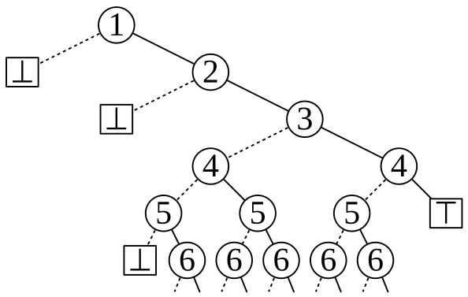</a>


<a id="pdf-566"></a><a id="p-551"></a>

<a id="ans-7-1-4-184"></a>

**184.** [题目](../sec-7-1-4.md#ex-7-1-4-184) 两类串珠贡献 $b_{m(i-1)+j-1}$: 一类是对于 $i$ 列的每一种选择至少有一种满足小于 $j$; 另一类是对于 $i-1$ 列的每一种选择至少失去一个大于等于 $j$ 的元素. 因此 $b_{m(i-1)+j-1}=\left(\binom mi-\binom{m+1-j}i\right)+\left(\binom m{i-1}-\binom{j-1}{m+1-i}\right)$. 对 $1\le i,j\le m$ 求和给出 $B(P_m)=(2m-3)2^m+5$. (顺便说一下, 对于 $2\le k<m^2$, $q_k=b_k+1$.)

对于 $1\le i,j\le m$, ZDD 仅仅有 $z_{m(i-1)+j-1}=\binom{m-1}{i-1}$, 对应于从不等于 $j$ 的列中选择 $i-1$ 列的每一种方式, 因此 $Z(P_m)=m2^{m-1}+2\approx\frac14B(P_m)$. (定理 K 的下界也适用于 ZDD 的结点, 因为只有这样的结点获选. 所以变量的自然顺序对于 ZDD 是最优的. 自然顺序对于 BDD 也可能是最优的, 这个猜测对于 $m\le5$ 已知是真的.)

<a id="ans-7-1-4-185"></a>

**185.** [题目](../sec-7-1-4.md#ex-7-1-4-185) 对于某个二进制向量 $t_0\ldots t_n$, 假定 $f(x)=t_{\nu x}$. 那么 $d>0$ 阶的子函数对应于不同的子串 $t_i\ldots t_{i+d}$. 这样的子串 $\tau$ 对应于串珠, 当且仅当 $\tau\ne0^{d+1}$ 且 $\tau\ne1^{d+1}$. 它们对应于消零串珠, 当且仅当 $\tau\ne0^{d+1}$ 且 $\tau\ne10^d$.

因此最大的 $Z(f)$ 是习题 44 的答案的函数 $\Sigma_n$. 为了得到这种最差情况, 我们需要一个长度为 $2^{d+1}+d-2$ 的二进制向量, 这个向量包含除了以 $0^{d+1}$ 和 $10^d$ 作为子串的所有 $(d+1)$ 元组. 这种向量可以表示成从 $0^d1$ 开始的周期为 $2^{d+1}$ 的任何德布鲁因圈的前 $2^{d+1}+d-2$ 个元素.

<a id="ans-7-1-4-186"></a>

**186.** [题目](../sec-7-1-4.md#ex-7-1-4-186) $\bar x_1\wedge\bar x_2\wedge x_3\wedge\bar x_4\wedge\bar x_5\wedge\bar x_6$.

<a id="ans-7-1-4-187"></a>

**187.** [题目](../sec-7-1-4.md#ex-7-1-4-187) (这些 ZDD 图应同习题 1 的答案比较.)

<a href="../../../assets/volume4a/figures/answer-7-1-4-187-sixteen-ZDDs.svg">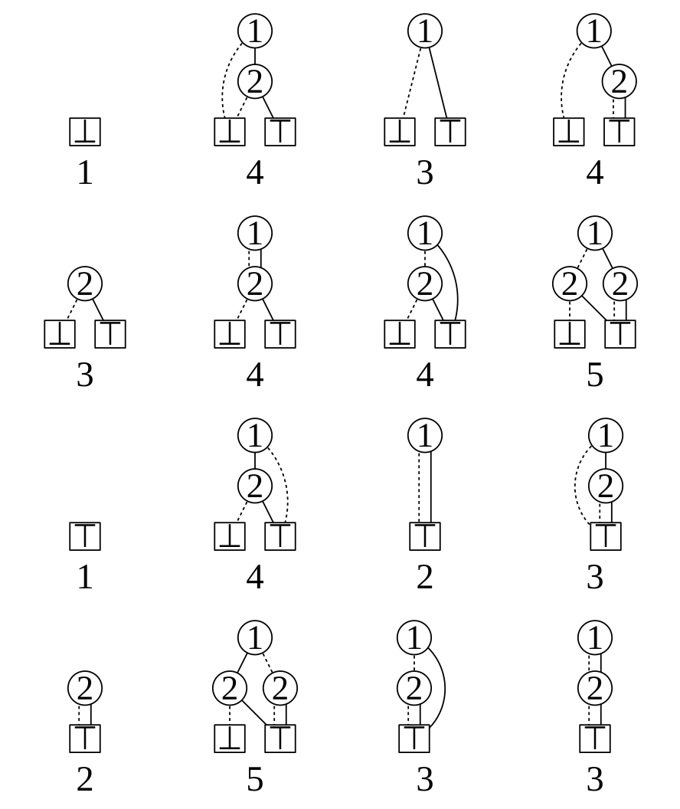</a>

<a id="ans-7-1-4-188"></a>

**188.** [题目](../sec-7-1-4.md#ex-7-1-4-188) 为避免嵌套括号, 令 $\epsilon,a,b,ab$ 代表子集 $\emptyset,\{1\},\{2\},\{1,2\}$. 于是按真值表顺序的子集族是 $\emptyset$, $\{ab\}$, $\{a\}$, $\{a,ab\}$, $\{b\}$, $\{b,ab\}$, $\{a,b\}$, $\{a,b,ab\}$, $\{\epsilon\}$, $\{\epsilon,ab\}$, $\{\epsilon,a\}$, $\{\epsilon,a,ab\}$, $\{\epsilon,b\}$, $\{\epsilon,b,ab\}$, $\{\epsilon,a,b\}$, $\{\epsilon,a,b,ab\}$.

<a id="ans-7-1-4-189"></a>

**189.** [题目](../sec-7-1-4.md#ex-7-1-4-189) 当 $n=0$ 时, 只有常值函数. 当 $n>0$ 时, 只有 0 和 $x_1\wedge\cdots\wedge x_n$. (但是有很多带有 $(b_0,\ldots,b_n)=(z_0,\ldots,z_n)$ 的函数, 例如 $x_2\wedge(x_1\vee\bar x_3)$.)

<a id="ans-7-1-4-190"></a>

**190.** [题目](../sec-7-1-4.md#ex-7-1-4-190) (a) 对于 $n\ge0$, 只有 $x_1\oplus\cdots\oplus x_n$ 和 $1\oplus x_1\oplus\cdots\oplus x_n$. (b) 这个条件成立, 当且仅当所有 1 阶子表是 01 或 11. 所以当 $n>0$ 时有 $2^{2^{n-1}}$ 个解, 即所有像 $f(x_1,\ldots,x_{n-1},1)=1$ 这样的函数.

<a id="ans-7-1-4-191"></a>

**191.** [题目](../sec-7-1-4.md#ex-7-1-4-191) 对于所有这样的函数, 真值表的语言 $L_n$ 有上下文无关文法 $L_0\to1$; $L_{n+1}\to L_nL_n\mid L_n0^{2^n}$. 所以欲求的数目 $l_n=|L_n|$ 满足 $l_0=1$, $l_{n+1}=l_n(l_n+1)$. 于是 $(l_0,l_1,l_2,\ldots)$ 是序列 $(1,2,6,42,1806,3263442,10650056950806,\ldots)$. 渐近地, $l_n=\theta^{2^n}-\frac12-\epsilon$, 其中 $0<\epsilon<\theta^{-2^n}/8$ 且

$$
\theta=1.5979102180318731783380701181574553123622+.
$$

[见《具体数学》习题 4.37 和 4.59, 其中 $l_n+1$ 称为 $e_{n+1}$ (一个 “欧几里得数”), $\theta$ 称为 $E^2$. 数 $l_n+1$ 是由詹姆斯·西尔维斯特引入的, 同他对埃及分数的研究有关, 见 *Amer. J. Math.* **3** (1880), 388. 注意单调递减函数, 比如表示独立集的函数, 总是有 $z_n=1$.]

<a id="ans-7-1-4-192"></a>

**192.** [题目](../sec-7-1-4.md#ex-7-1-4-192) (a) `10101101000010110`.

(b) 真. 由对 $|\tau|$ 的归纳法, 因为 $\alpha\ne\beta\ne0^n$ 当且仅当 $\alpha^Z\ne\beta^Z\ne0^n$.

(c) 对于 $0<k\le n$, $f$ 的 $k$ 阶串珠是 $f^Z$ 的 $k$ 阶消零串珠, 因此 $f^Z$ 的串珠也是 $(f^Z)^Z=f$ 的消零串珠. 所以, 如果 $(b_0,\ldots,b_n)$ 和 $(z_0,\ldots,z_n)$ 是 $f$ 的分布和 $z$ 分布, 而 $(b'_0,\ldots,b'_n)$ 和 $(z'_0,\ldots,z'_n)$ 是 $f^Z$ 的分布和 $z$ 分布, 对于 $0\le k<n$ 我们有 $b_k=z'_k$ 和 $z_k=b'_k$.

(我们还有 $z_n=z'_n$, 但是它们可能都是 1 而不是 2. $f$ 和 $f^Z$ 的伪分布可能是不同的, 但是由于全 0 子表, 每层最多只有 1 个不同.)

<a id="ans-7-1-4-193"></a>

**193.** [题目](../sec-7-1-4.md#ex-7-1-4-193) 由对 $n$ 的归纳法, 答案是 $S_{\ge k}(x_1,\ldots,x_n)$. (因此我们还有 $S_{\ge k}^Z(x_1,\ldots,x_n)=S_k(x_1,\ldots,x_n)$. 习题 249 给出类似的例子.)

<a id="ans-7-1-4-194"></a>

**194.** [题目](../sec-7-1-4.md#ex-7-1-4-194) 像在习题 174 的答案中那样定义 $a_1\ldots a_{2n}$, 但是用 ZDD 替代 BDD. 那么 $(1,\ldots,1)$ 是 $z$ 分布, 当且仅当 $(2a_1)\ldots(2a_{2n})$ 是无限制的 $2n$ 阶迪蒙信号枪序列. 所以答案是杰诺其数 $G_{2n+2}$.


<a id="pdf-567"></a><a id="p-552"></a>

<a id="ans-7-1-4-195"></a>

**195.** [题目](../sec-7-1-4.md#ex-7-1-4-195) $z$ 分布是 $(1,2,4,4,3,2,2)$. 我们从 $M_2(x_4,x_2;x_5,x_6,x_3,x_1)$ 获得最优 $z$ 分布 $(1,2,3,2,3,2,2)$, 以及像 (78) 中那样来自 $M_2(x_5,x_6;x_1,x_2,x_3,x_4)$ 的劣性 $z$ 分布 $(1,2,4,8,12,2,2)$. (顺便说一下, 可以用习题 197 的算法证明, $Z_{\min}(M_4)=116$ 是用引人注目的特殊顺序 $M_4(x_8,x_5,x_{17},x_2;x_{20},x_{19},x_{18},x_{16},x_{15},x_{13},x_{14},x_{12},x_{11},x_9,x_{10},x_4,x_7,x_6,x_3,x_1)$ 获得的!)

<a id="ans-7-1-4-196"></a>

**196.** [题目](../sec-7-1-4.md#ex-7-1-4-196) 例如, $M_m(x_1,\ldots,x_m;e_{m+1},\ldots,e_n)$, 其中 $n=m+2^m$ 且 $e_j$ 是习题 203 中的初等函数. 在这种情况下, 我们有 $Z(f)=2(n-m)+1$ 和 $Z(\bar f)=(n-m+7)(n-m)/2-2$.

<a id="ans-7-1-4-197"></a>

**197.** [题目](../sec-7-1-4.md#ex-7-1-4-197) 基本思想是改变 DEP 字段的含义, 使得 $d_{kp}$ 现在是 $\sum\{2^{t-k-1}\mid N_{kp}\text{ 支持 }x_t\}$, 其中说 $g(x_1,\ldots,x_m)$ 支持 $x_j$ 是指 $g(x_1,\ldots,x_m)=1$ 存在满足 $x_j=1$ 的解.

为了实现这种改变, 我们引入一个辅助数组 $(\zeta_0,\ldots,\zeta_n)$, 其中如果 $N_{kq}$ 表示子函数 0 则 $\zeta_k=q$, 如果那个子函数不出现在第 $k$ 层则 $\zeta_k=-1$. 最初置 $\zeta_n\leftarrow0$, 并且我们在步骤 E1 的开始置 $\zeta_k\leftarrow-1$. 在步骤 E3, 置 $d_{kq}$ 的操作应改变如下: “如果 $h\ne\zeta_{k+1}$, 置 $d_{kq}\leftarrow((d_{(k+1)l}\mathbin{|}d_{(k+1)h})\ll1)+1$, 否则置 $d_{kq}\leftarrow d_{(k+1)l}\ll1$. 另外, 如果 $l=h=\zeta_{k+1}$, 置 $\zeta_k\leftarrow q$.”

(可以像前面那样用主 $z$ 分布图使 $z_0+\cdots+z_{n-1}$ 达到最小值. 但是如果绝对最小值很重要, 还需要额外考虑 $z_n$.)

<a id="ans-7-1-4-198"></a>

**198.** [题目](../sec-7-1-4.md#ex-7-1-4-198) 重新解释 (50), 我们把任意的集族 $f$ 表示成 $(\bar x_v?f_l:f_h)$, 其中 $v=f_o$ 确定 $f$ 支持的第一个变量的下标, 见习题 197 的答案. 因此 $f_l$ 是 $f$ 不支持 $x_v$ 的子族, $f_h$ 是 $f$ 支持 $x_v$ 的子族 (但是删除 $x_v$). 另外, 如果 $f$ 没有支持的变量 (就是如果 $f$ 是 $\emptyset$ 或 $\{\emptyset\}$, 在内部用 $\boxed\bot$ 或 $\boxed\top$ 表示, 见习题 201 的答案), 我们也令 $f_o=\infty$. 在 (52) 中, 现在 $v=\min(f_o,g_o)$ 指向由 $f$ 或 $g$ 支持的第一个变量, 因此如果 $f_o>g_o$ 则 $f_h=\emptyset$, 如果 $f_o<g_o$ 则 $g_h=\emptyset$.

子程序 $\operatorname{AND}(f,g)$, 即 ZDD 结构, 现在是下面的形式而不是 (55): “像 (52) 那样表示 $f$ 和 $g$. 当 $f_o\ne g_o$ 时循环执行: 如果 $f=\emptyset$ 或 $g=\emptyset$ 返回 $\emptyset$, 否则, 如果 $f_o<g_o$ 置 $f\leftarrow f_l$, 如果 $f_o>g_o$ 置 $g\leftarrow g_l$. 如果 $f>g$ 交换 $f\leftrightarrow g$. 如果 $f=g$ 或 $f=\emptyset$ 返回 $f$. 否则, 如果 $f\wedge g=r$ 在备忘录缓存中, 返回 $r$. 否则计算 $r_l\leftarrow\operatorname{AND}(f_l,g_l)$ 和 $r_h\leftarrow\operatorname{AND}(f_h,g_h)$. 用一个类似算法 U 的算法置 $r\leftarrow\operatorname{ZUNIQUE}(v,r_l,r_h)$, 只是第一步当 $q=\emptyset$ 而不是 $q=p$ 时返回 $p$. 把 $f\wedge g=r$ 存入备忘录缓存, 并且返回 $r$.” (另见习题 201 的答案中的建议.)

像习题 82 那样更新引用计数, 但是略有变化. 例如, 当 $q=\emptyset$ 时, 步骤 U1 现在将减少 $\boxed\bot$ (而且仅限于这个结点) 的引用计数. 重要的事情是编写一个 “稳健检查” 程序, 对整个 BDD/ZDD 基中的所有引用计数以及其他冗余信息进行双重检查, 以便把那些难以捉摸的错误消灭在萌芽状态. 应当频繁调用稳健检查程序, 直到彻底检验完所有子程序.

<a id="ans-7-1-4-199"></a>

**199.** [题目](../sec-7-1-4.md#ex-7-1-4-199) (a) 如果 $f=g$ 返回 $f$. 如果 $f>g$ 交换 $f\leftrightarrow g$. 如果 $f=\emptyset$ 返回 $g$. 如果 $f\vee g=r$ 在备忘录缓存中, 返回 $r$. 否则

$$
\begin{aligned}
v&\leftarrow f_o,&r_l&\leftarrow\operatorname{OR}(f_l,g_l),&r_h&\leftarrow\operatorname{OR}(f_h,g_h),&&\text{如果 }f_o=g_o;\\
v&\leftarrow f_o,&r_l&\leftarrow\operatorname{OR}(f_l,g),&r_h&\leftarrow f_h,&&\text{将 }\operatorname{REF}(f_h)\text{ 增加1, 如果 }f_o<g_o;\\
v&\leftarrow g_o,&r_l&\leftarrow\operatorname{OR}(f,g_l),&r_h&\leftarrow g_h,&&\text{将 }\operatorname{REF}(g_h)\text{ 增加1, 如果 }f_o>g_o.
\end{aligned}
$$

然后置 $r\leftarrow\operatorname{ZUNIQUE}(v,r_l,r_h)$, 像习题 198 的答案一样, 把 $r$ 存入备忘录缓存并且返回 $r$.

(b) 如果 $f=g$ 返回 $\emptyset$. 否则像 (a) 那样继续进行, 但是使用 $(\oplus,\operatorname{XOR})$ 而不是 $(\vee,\operatorname{OR})$.

(c) 如果 $f=\emptyset$ 或 $f=g$ 返回 $\emptyset$. 如果 $g=\emptyset$ 返回 $f$. 否则, 如果 $g_o<f_o$ 置 $g\leftarrow g_l$ 并且重新开始. 否则

$$
\begin{aligned}
r_l&\leftarrow\operatorname{BUTNOT}(f_l,g_l),&r_h&\leftarrow\operatorname{BUTNOT}(f_h,g_h),&&\text{如果 }f_o=g_o;\\
r_l&\leftarrow\operatorname{BUTNOT}(f_l,g),&r_h&\leftarrow f_h,&&\text{将 }\operatorname{REF}(f_h)\text{ 增加1, 如果 }f_o<g_o.
\end{aligned}
$$

然后置 $r\leftarrow\operatorname{ZUNIQUE}(f_o,r_l,r_h)$ 并且像通常那样结束.

<a id="ans-7-1-4-200"></a>

**200.** [题目](../sec-7-1-4.md#ex-7-1-4-200) 如果 $f=\emptyset$ 返回 $g$. 如果 $f=h$ 返回 $\operatorname{OR}(f,g)$. 如果 $g=h$ 返回 $g$. 如果 $g=\emptyset$ 或 $f=g$ 返回 $\operatorname{AND}(f,h)$. 如果 $h=\emptyset$ 返回 $\operatorname{BUTNOT}(g,f)$. 如果 $f_o<g_o$ 且 $f_o<h_o$ 置 $f\leftarrow f_l$ 并且从头开始. 如果 $h_o<f_o$ 且 $h_o<g_o$ 置 $h\leftarrow h_l$ 并且从头开始. 否则, 检查缓存并且像通常那样递归地进行.


<a id="pdf-568"></a><a id="p-553"></a>

<a id="ans-7-1-4-201"></a>

**201.** [题目](../sec-7-1-4.md#ex-7-1-4-201) 在允许投影函数和 (或) 补运算的 ZDD 的应用中, 当一切处于初始化时最好在开始就固定布尔变量的集合. 否则, 每当引入新变量时, ZDD 基中的每个外部函数都必须改变.

所以假设我们已经确定处理 $(x_1,\ldots,x_N)$ 的函数, 其中 $N$ 是预先指定的. 在习题 198 的答案中, 当 $f=\emptyset$ 或 $f=\{\emptyset\}$ 时, 我们令 $f_o=N+1$ 而不是 $\infty$. 那么重言式函数 $1\equiv\wp$ 有 $N+1$ 个结点的 ZDD:

<a href="../../../assets/volume4a/figures/answer-7-1-4-201-tautology.svg">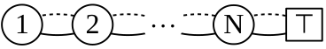</a>

只要知道 $N$ 我们就能构造它. 令 $t_j$ 是这个结构的结点

<a href="../../../assets/volume4a/figures/answer-7-1-4-201-node-j.svg"></a>

包括 $t_{N+1}=\boxed\top$. $x_j$ 的 ZDD 现在是

<a href="../../../assets/volume4a/figures/answer-7-1-4-201-projection.svg">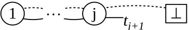</a>

因此, 所有 $x_j$ 的集合的 ZDD 基, 除了 $\emptyset$ 和 $\wp$ 的表示之外将占据 $\binom{N+1}2$ 个结点.

如果 $N$ 是很小的数, 所有 $N$ 个投影函数可以预先准备. 但是在 ZDD 的很多应用中, $N$ 是很大的数. 并且, 当 “族代数” 用于建立像习题 203–207 中那样的结构时, 很少需要投影函数. 所以, 通常最好是等到实际需要建立投影函数时再建立它.

顺便说一下, 可以把部分重言式函数 $t_j$ 用于加速习题 198–199 的综合运算: 如果 $v\equiv f_o\le g_o$ 且 $f=t_v$, 我们有 $\operatorname{AND}(f,g)=g$、$\operatorname{OR}(f,g)=f$, 而且 (如果 $v\le h_o$) 还有 $\operatorname{MUX}(f,g,h)=h$、$\operatorname{MUX}(g,h,f)=\operatorname{OR}(g,h)$.

<a id="ans-7-1-4-202"></a>

**202.** [题目](../sec-7-1-4.md#ex-7-1-4-202) 在变形步骤 T4, 改变 “$q_0\leftarrow q_1\leftarrow q$” 为 “$q_0\leftarrow q,\ q_1\leftarrow\emptyset$”, 改变 “$r_0\leftarrow r_1\leftarrow r$” 为 “$r_0\leftarrow r,\ r_1\leftarrow\emptyset$”. 此外用 ZUNIQUE 代替 UNIQUE. 在步骤 T4 内, 如果步骤 U1 找出 $q\equiv\emptyset$, 这个子程序把 $\operatorname{REF}(p)$ 增加 1.

为了使习题 201 的答案的部分重言式函数保持更新, 需要进行更仔细的改变, 因为它们带有特殊的含义. 正确做法是保持 $t_u$ 不变并且置 $t_v\leftarrow\operatorname{LO}(t_u)$.

<a id="ans-7-1-4-203"></a>

**203.** [题目](../sec-7-1-4.md#ex-7-1-4-203) (a) $f\sqcup g=\{\{1,2\},\{1,3\},\{1,2,3\},\{3\}\}=(e_1\sqcup((e_2\sqcup(e_3\cup\epsilon))\cup e_3))\cup e_3$. 另一个是 $(e_1\sqcup e_2)\cup\epsilon$, 因为 $f\sqcap g=(e_1\sqcup(e_2\cup\epsilon))\cup e_3\cup\epsilon$ 且 $f\boxplus e_1=e_1\cup e_2\cup e_3$.

(b) $(f\sqcup g)(z)=\exists x\,\exists y\,(f(x)\wedge g(y)\wedge(z\equiv x\vee y))$; $(f\sqcap g)(z)=\exists x\,\exists y\,(f(x)\wedge g(y)\wedge(z\equiv x\wedge y))$; $(f\boxplus g)(z)=\exists x\,\exists y\,(f(x)\wedge g(y)\wedge(z\equiv x\oplus y))$. 另一种公式是 $(f\boxplus g)(z)=\bigvee\{f(z\oplus y)\mid g(y)=1\}=\bigvee\{g(z\oplus x)\mid f(x)=1\}$.

(c) (i) 和 (ii) 都成立. 此外 $f\boxplus(g\cup h)=(f\boxplus g)\cup(f\boxplus h)$. 一般情况下公式 (iii) 不成立, 虽然我们有 $f\sqcup(g\sqcap h)\subseteq(f\sqcup g)\sqcap(f\sqcup h)$. 公式 (iv) 没有什么道理, 由 (i), 右端是 $(f\sqcup f)\cup(f\sqcup h)\cup(g\sqcup f)\cup(g\sqcup h)$. 公式 (v) 成立, 因为三部分全部为 $\emptyset$. 至于公式 (vi), 成立的充分必要条件是 $f\ne\emptyset$.

(d) 只有 (ii) 恒为真. 对于 (i), 为真的条件应是 $f\sqcap g\subseteq\epsilon$, 因为 $f\sqcap g\equiv\emptyset$ 蕴涵 $f\perp g$. 对于 (iii), 注意每当 $|f|=|g|=1$ 时 $|f\sqcup g|=|f\sqcap g|=|f\boxplus g|=1$. 最后, 在命题 (iv) 中我们的确有 $f\perp g\implies f\sqcup g=f\boxplus g$, 但是逆命题 (比方说) 当 $f=g=e_1\cup\epsilon$ 时不成立.

(e) 在 (i) 中 $f=\emptyset$, 在 (ii) 中 $f=\epsilon$. 对于所有 $g$, 还有 $\epsilon\boxplus g\equiv g$. (iii) 没有解, 因为 $f$ 必将是 $\{\{1,2,3,\ldots\}\}$, 而我们只考虑有限集. 但是在习题 201 的答案的有限全域内我们有 $f=\{\{1,\ldots,N\}\}$ (这个族 $U$ 具有性质 $(f\boxplus U)\sqcup(g\boxplus U)=(f\sqcap g)\boxplus U$). (iv) 的通解是 $f=e_1\sqcup e_2\sqcup f'$, 其中 $f'$ 是任意族. 类似地, (v) 的通解是 $f=(e_1\sqcup f')\cup(e_2\sqcup f'')\cup(e_1\sqcup e_2\sqcup(f'\cup f''\cup f'''))$, 其中 $f',f'',f'''$ 是任意的. 在 (vi) 中, $f=((((e_1\sqcup e_2)\cup\epsilon)\sqcup f')\cup((e_1\cup e_2)\sqcup f''))\sqcup(e_3\cup\epsilon)$, 其中 $f'\cup f''\perp e_1\cup e_2\cup e_3$. 这个表示从习题 204(f) 推出. 在 (vii) 中, $|f|=1$. 最后, (viii) 表示霍恩函数的特性 (定理 7.1.1H).

<a id="ans-7-1-4-204"></a>

**204.** [题目](../sec-7-1-4.md#ex-7-1-4-204) (a) 由定义这个关系是显然的. (还有 $(f\cup g)/h\supseteq(f/h)\cup(g/h)$.)

(b) $f/e_2=\{\{1\},\emptyset\}=e_1\cup\epsilon$, $f/e_1=e_2\cup e_3$, $f/\epsilon=f$, 因此 $f/(e_1\cup\epsilon)=e_2\cup e_3$.

(c) 除以 $\emptyset$ 陷入困境, 因为所有集合 $\alpha$ 属于 $f/\emptyset$. (但是如果我们限于考虑 $\{1,\ldots,N\}$ 的子集族, 则像在习题 201 和 207 中那样, 我们有 $f/\emptyset=\wp$. 另外 $\wp/\wp=\epsilon$, 并且当 $f\ne\wp$ 时 $f/\wp=\emptyset$.) 显然 $f/\epsilon=f$. 并且当 $f\ne\emptyset$ 时 $f/f=\epsilon$. 最后, 当 $g\ne\emptyset$ 时 $(f\bmod g)/g=\emptyset$, 因为 $\alpha\in(f\bmod g)/g$ 且 $\beta\in g$ 蕴涵 $\alpha\cup\beta\in f$、$\alpha\in f/g$、$\alpha\cup\beta\notin(f/g)\sqcup g$——矛盾.

(d) 如果 $\beta\in g$, 对于所有 $\alpha\in f/g$ 我们有 $\beta\cup\alpha\in f$ 且 $\beta\cap\alpha=\emptyset$, 这就证明了提示. 因此 $f/g\subseteq f/(f/(f/g))$. 另外由 (a), 当 $h\supseteq g$ 时 $f/h\subseteq f/g$. 令 $h=f/(f/g)$.

(e) 令 $f//g$ 是新的定义中的族. 那么 $f/g\subseteq f//g$, 因为 $g\sqcup(f/g)\subseteq f$ 且 $g\perp(f/g)$. 反过来, 如果 $\alpha\in f//g$ 且 $\beta\in g$, 对于某个满足 $g\sqcup h\subseteq f$ 且 $g\perp h$ 的 $h$ 我们有 $\alpha\in h$. 所以 $\alpha\cup\beta\in f$ 且 $\alpha\cap\beta=\emptyset$.


<a id="pdf-569"></a><a id="p-554"></a>

(f) 如果 $f$ 有这种表示, 我们必定有 $g=f/e_j$ 且 $h=f\bmod e_j$. 反过来, 那些族满足 $e_j\perp g\cup h$. (这个法则是构成 ZDD 的基础的基本递归原理——正如带有独立于 $x_j$ 的 $g$ 和 $h$ 的唯一表示 $f=(x_j?g:h)$ 构成 BDD 的基础一样.)

(g) 两者都是真. (为了证明它们, 像在 (f) 中那样表示 $f$ 和 $g$.)

[罗伯特·布雷顿和柯蒂斯·麦克马伦在 *Proc. Int. Symp. Circuits and Systems* (IEEE, 1982), 49–54 中引入了商运算和余数运算, 但是用了一种略微不同的表述方式: 他们讨论子立方的不可比集的集族的处理.]

<a id="ans-7-1-4-205"></a>

**205.** [题目](../sec-7-1-4.md#ex-7-1-4-205) 在所有情况下, 我们构造基于习题 204(f) 的递归. 例如, 如果 $f_o=g_o=v$, 我们有 $f\sqcup g=(\bar v?f_l\sqcup g_l:(f_l\sqcup g_h)\cup(f_h\sqcup g_l)\cup(f_h\sqcup g_h))$; $f\sqcap g=(\bar v?(f_l\sqcap g_l)\cup(f_l\sqcap g_h)\cup(f_h\sqcap g_l):f_h\sqcap g_h)$; $f\boxplus g=(\bar v?(f_l\boxplus g_l)\cup(f_h\boxplus g_h):(f_h\boxplus g_l)\cup(f_l\boxplus g_h))$.

(a) 如果 $f_o<g_o$ 或 $(f_o=g_o$ 且 $f>g)$, 交换 $f\leftrightarrow g$. 如果 $f=\emptyset$, 返回 $f$; 如果 $f=\epsilon$, 返回 $g$. 如果 $f\sqcup g=r$ 在备忘录缓存内, 返回 $r$. 如果 $f_o>g_o$, 置 $r_l\leftarrow\operatorname{JOIN}(f,g_l)$、$r_h\leftarrow\operatorname{JOIN}(f,g_h)$; 否则, 置 $r_l\leftarrow\operatorname{JOIN}(f_l,g_l)$、$r_{lh}\leftarrow\operatorname{JOIN}(f_l,g_h)$、$r_{hl}\leftarrow\operatorname{JOIN}(f_h,g_l)$、$r_{hh}\leftarrow\operatorname{JOIN}(f_h,g_h)$、$r_h\leftarrow\operatorname{OROR}(r_{lh},r_{hl},r_{hh})$, 并且解除对 $r_{lh},r_{hl},r_{hh}$ 的引用. 用 $r\leftarrow\operatorname{ZUNIQUE}(g_o,r_l,r_h)$ 结束. 像习题 198 那样, 把它存入缓存并且返回它.

(我们也可以通过公式 $\operatorname{OR}(r_{lh},\operatorname{JOIN}(f_h,\operatorname{OR}(g_l,g_h)))$ 或 $\operatorname{OR}(r_{hl},\operatorname{JOIN}(\operatorname{OR}(f_l,f_h),g_h))$ 计算 $r_h$. 有时一种方法比其他两种方法好得多.)

DISJOIN 运算是相似的, 但是省略 $r_{hh}$, 它产生不相交的并集的族 $\{\alpha\cup\beta\mid\alpha\in f,\ \beta\in g,\ \alpha\cap\beta=\emptyset\}$.

(b) 如果 $f_o<g_o$ 或 $(f_o=g_o$ 且 $f>g)$, 交换 $f\leftrightarrow g$. 如果 $f\le\epsilon$, 返回 $f$. (我们考虑 $\emptyset<\epsilon$ 且 $\epsilon<$ 所有其他值.) 否则, 如果 $\operatorname{MEET}(f,g)$ 不在缓存中, 那么有两种情况. 如果 $f_o>g_o$, 置 $r_h\leftarrow\operatorname{OR}(g_l,g_h)$、$r\leftarrow\operatorname{MEET}(f,r_h)$, 并且解除对 $r_h$ 的引用. 否则以类似于 (a) 的方式进行, 但是用 $l\leftrightarrow h$. 像通常那样把 $r$ 存入缓存并且返回它.

(c) 这个运算类似于 (a), 但是置 $r_l\leftarrow\operatorname{OR}(r_{ll},r_{hh})$、$r_h\leftarrow\operatorname{OR}(r_{lh},r_{hl})$.

(d) 首先我们完成重要的简单情形 $f/e_v$ 和 $f\bmod e_v$:

$$
\operatorname{EZDIV}(f,v)=\left\{
\begin{aligned}
&\text{如果 }f_o=v\text{, 返回 }f_h\text{; 如果 }f_o>v\text{, 返回 }\emptyset\text{。}\\
&\text{否则在缓存中寻找 }f/e_v=r\text{, 如果不在缓存中, 通过}\\
&r\leftarrow\operatorname{ZUNIQUE}(f_o,\operatorname{EZDIV}(f_l,v),\operatorname{EZDIV}(f_h,v))\text{ 计算它.}
\end{aligned}\right.
$$

$$
\operatorname{EZMOD}(f,v)=\left\{
\begin{aligned}
&\text{如果 }f_o=v\text{, 返回 }f_l\text{; 如果 }f_o>v\text{, 返回 }f\text{。}\\
&\text{否则在缓存中寻找 }f\bmod e_v=r\text{, 如果不在缓存中, 通过}\\
&r\leftarrow\operatorname{ZUNIQUE}(f_o,\operatorname{EZMOD}(f_l,v),\operatorname{EZMOD}(f_h,v))\text{ 计算它.}
\end{aligned}\right.
$$

现在 $\operatorname{DIV}(f,g)=$“如果 $g\equiv\emptyset$, 见下面; 如果 $g\equiv\epsilon$, 返回 $f$. 否则, 如果 $f\le\epsilon$, 返回 $\emptyset$; 如果 $f\equiv g$, 返回 $\epsilon$. 如果 $g_l\equiv\emptyset$ 且 $g_h\equiv\epsilon$, 返回 $\operatorname{EZDIV}(f,g_o)$. 否则, 如果 $f/g=r$ 在备忘录缓存内, 返回 $r$. 否则置 $r_l\leftarrow\operatorname{EZDIV}(f,g_o)$、$r\leftarrow\operatorname{DIV}(r_l,g_h)$, 并且解除对 $r_l$ 的引用. 如果 $r\ne\emptyset$ 且 $g_l\ne\emptyset$, 置 $r_h\leftarrow\operatorname{EZMOD}(f,g_o)$、$r_l\leftarrow\operatorname{DIV}(r_h,g_l)$, 解除对 $r_h$ 的引用, 置 $r_h\leftarrow r$、$r\leftarrow\operatorname{AND}(r_l,r_h)$, 解除对 $r_l$ 和 $r_h$ 的引用. 在备忘录缓存中插入 $f/g=r$ 并且返回 $r$.” 如果像习题 201 那样存在固定的全域 $\{1,\ldots,N\}$, 除以 $\emptyset$ 并且返回 $\wp$. 否则它是一个错误 (因为不存在全域族 $\wp$).

(e) 如果 $g\equiv\emptyset$, 返回 $f$. 如果 $g\equiv\epsilon$, 返回 $\emptyset$. 如果 $(g_l,g_h)=(\emptyset,\epsilon)$, 返回 $\operatorname{EZMOD}(f,g_o)$. 如果 $f\bmod g=r$ 在缓存中, 返回它. 否则置 $r\leftarrow\operatorname{DIV}(f,g)$、$r_h\leftarrow\operatorname{JOIN}(r,g)$, 解除对 $r$ 的引用, 置 $r\leftarrow\operatorname{BUTNOT}(f,r_h)$, 并且解除对 $r_h$ 的引用. 把 $r$ 存入缓存并且返回它.

[凑真一在他关于 ZDD 的原始论文中给出 $\operatorname{EZDIV}(f,v)$、$\operatorname{EZREM}(f,v)$、$\operatorname{DELTA}(f,e_v)$. 他的 $\operatorname{JOIN}(f,g)$ 和 $\operatorname{DIV}(f,g)$ 算法出现在续集中. 见 *ACM/IEEE Design Automation Conf.* **31** (1994), 420–424.]

<a id="ans-7-1-4-206"></a>

**206.** [题目](../sec-7-1-4.md#ex-7-1-4-206) 虽然所有 5 个例程在实践中看起来都相当快, 但在最坏情况下它们都可能呈指数级缓慢. 例如, MEET 和 JOIN 运算可以模拟隐藏重量位函数. [见 K. Nakamura、M. Nishino 和 S. Denzumi,*LIPIcs* **322** (2024), 52:1–52:17.]


<a id="pdf-570"></a><a id="p-555"></a>

<a id="ans-7-1-4-207"></a>

**207.** [题目](../sec-7-1-4.md#ex-7-1-4-207) 如果 $f=e_{i_1}\cup\cdots\cup e_{i_l}$ 且 $k\ge0$, 令 $\operatorname{SYM}(f,v,k)$ 是布尔函数, 它为真当且仅当变量 $\{x_{i_1},\ldots,x_{i_l}\}\cap\{x_v,x_{v+1},\ldots\}$ 中恰好有 $k$ 个是 1 且 $x_1=\cdots=x_{v-1}=0$. 通过调用 $\operatorname{SYM}(f,1,k)$ 计算 $(e_{i_1}\cup\cdots\cup e_{i_l})\mathbin{\S}k$.

$\operatorname{SYM}(f,v,k)=$“当 $f_o<v$ 时循环执行: 置 $f\leftarrow f_l$. 如果 $f_o=N+1$ 且 $k>0$, 返回 $\emptyset$. 如果 $f_o=N+1$ 且 $k=0$, 返回部分重言式函数 $t_v$ (见习题 201 的答案). 如果 $f\mathbin{\S}v\mathbin{\S}k=r$ 在缓存中, 返回 $r$. 否则置 $r\leftarrow\operatorname{SYM}(f,f_o+1,k)$. 如果 $k>0$, 置 $q\leftarrow\operatorname{SYM}(f_l,f_o+1,k-1)$、$r\leftarrow\operatorname{ZUNIQUE}(f_o,r,q)$. 当 $f_o>v$ 时循环执行: 置 $f_o\leftarrow f_o-1$, $\operatorname{REF}(r)$ 增加 1, 并且置 $r\leftarrow\operatorname{ZUNIQUE}(f_o,r,r)$. 把 ‘$f\mathbin{\S}v\mathbin{\S}k=r$’ 存入缓存, 并且返回 $r$.” 运行时间是 $O((k+1)N)$. 注意 $\emptyset\mathbin{\S}0=\wp$.

<a id="ans-7-1-4-208"></a>

**208.** [题目](../sec-7-1-4.md#ex-7-1-4-208) 仅从步骤 C1 和 C2 中省略因子 $2^{v_{s-1}-1}$、$2^{v_l-v_k-1}$、$2^{v_h-v_k-1}$. (并且我们通过在步骤 C2 中置 $c_k\leftarrow c_l+zc_h$ 获得生成函数, 见习题 25.) 解的数目等于 ZDD 中从根到 $\boxed\top$ 的路径的数目.

<a id="ans-7-1-4-209"></a>

**209.** [题目](../sec-7-1-4.md#ex-7-1-4-209) 首先对于 $n>j\ge1$ 计算 $\delta_n\leftarrow\bot$ 和 $\delta_j\leftarrow(\bar x_{j+1}\circ x_{j+1})\bullet\delta_{j+1}$. 然后, 把它改变成 $\alpha\leftarrow(\bar x_j\bullet\alpha)\circ(x_j\bullet\delta_j)$, 其中习题 31 的答案说明 $\alpha\leftarrow(\bar x_j\circ x_j)\bullet\alpha$. 此外, 用 $\beta$ 和 $\gamma$ 代替 $\alpha$ 做类似的改变.

<a id="ans-7-1-4-210"></a>

**210.** [题目](../sec-7-1-4.md#ex-7-1-4-210) 事实上, 当 $x=x_1\ldots x_n$ 时我们可以在 $g$ 的定义中用任何线性函数 $c(x)=c_1x_1+\cdots+c_nx_n$ 代替 $\nu x$, 以此表示由算法 B 处理的一般布尔规划问题的所有最优解的特性.

对于 ZDD 的每个具有字段 $\operatorname{V}(x)$、$\operatorname{LO}(x)$、$\operatorname{HI}(x)$ 的分支结点 $x$, 我们可以计算它的最优值 $\operatorname{M}(x)$ 和新的 $\operatorname{L}(x)$、$\operatorname{H}(x)$ 链, 如下: 令 $m_l=\operatorname{M}(\operatorname{LO}(x))$ 且 $m_h=c_{\operatorname{V}(x)}+\operatorname{M}(\operatorname{HI}(x))$, 其中 $\operatorname{M}(\boxed\bot)=-\infty$ 且 $\operatorname{M}(\boxed\top)=0$. 然后, 如果 $m_l\ge m_h$, 置 $\operatorname{L}(x)\leftarrow\operatorname{LO}(x)$, 否则置 $\operatorname{L}(x)\leftarrow\boxed\bot$. 如果 $m_l\le m_h$, 置 $\operatorname{H}(x)\leftarrow\operatorname{HI}(x)$, 否则置 $\operatorname{H}(x)\leftarrow\boxed\bot$. $g$ 的 ZDD 是通过简化从根可达的 L 和 H 链获得的. 注意 $Z(g)\le Z(f)$, 于是整个计算用 $O(Z(f))$ 步. (ZDD 这个良好性质是奥利维耶·库代尔指出的, 见习题 237 的答案.)

<a id="ans-7-1-4-211"></a>

**211.** [题目](../sec-7-1-4.md#ex-7-1-4-211) 成立, 除非矩阵有全零的行. 在不存在这样的行时, 事实上对于 $0\le k<n$, $f$ 的分布和 $z$ 分布满足 $b_k\ge q'_k\ge z_k$, 因为只有不依赖于 $x_{k+1}$ 的第 $k$ 层子函数是常数 0.

<a id="ans-7-1-4-212"></a>

**212.** [题目](../sec-7-1-4.md#ex-7-1-4-212) 依我的经验, 最佳选择是利用习题 207 的算法对 (129) 的每一项 $T_j=S_1(X_j)$ 建立 ZDD, 然后把它们 AND 在一起. 例如, 在问题 (128) 中我们有 $X_1=\{x_1,x_2\}$、$X_2=\{x_1,x_3,x_4\}$、$\ldots$、$X_{64}=\{x_{105},x_{112}\}$; 为了建立项 $S_1(X_2)=S_1(x_1,x_3,x_4)$ (它的 ZDD 有 115 个结点), 只需建立 $e_1\cup(e_3\cup e_4)$ 的 5 结点 ZDD, 并且计算 $T_2\leftarrow(e_1\cup e_3\cup e_4)\mathbin{\S}1$.

但是, 得到 (129) 的各项 $T_1,\ldots,T_n$ 后, 应该按什么顺序完成 AND 呢? 考虑问题 (128). 方法 1: $T_1\leftarrow T_1\wedge T_2$、$T_1\leftarrow T_1\wedge T_3$、$\ldots$、$T_1\leftarrow T_1\wedge T_{64}$. 这种 “自顶向下” 方法先填满上面几层, 需要大约 620 万次内存访问. 方法 2: $T_{64}\leftarrow T_{64}\wedge T_{63}$、$T_{64}\leftarrow T_{64}\wedge T_{62}$、$\ldots$、$T_{64}\leftarrow T_{64}\wedge T_1$. 通过先填满下面几层 (“自底向上”), 时间降低到大约 175 万次内存访问. 方法 3: $T_2\leftarrow T_2\wedge T_1$、$T_4\leftarrow T_4\wedge T_3$、$\ldots$、$T_{64}\leftarrow T_{64}\wedge T_{63}$; $T_4\leftarrow T_4\wedge T_2$、$T_8\leftarrow T_8\wedge T_6$、$\ldots$、$T_{64}\leftarrow T_{64}\wedge T_{62}$; $T_8\leftarrow T_8\wedge T_4$、$T_{16}\leftarrow T_{16}\wedge T_{12}$、$\ldots$、$T_{64}\leftarrow T_{64}\wedge T_{60}$; $\ldots$; $T_{64}\leftarrow T_{64}\wedge T_{32}$. 这种 “平衡的” 方法也需要大约 175 万次内存访问. 方法 4: $T_{33}\leftarrow T_{33}\wedge T_1$、$T_{34}\leftarrow T_{34}\wedge T_2$、$\ldots$、$T_{64}\leftarrow T_{64}\wedge T_{32}$; $T_{49}\leftarrow T_{49}\wedge T_{33}$、$T_{50}\leftarrow T_{50}\wedge T_{34}$、$\ldots$、$T_{64}\leftarrow T_{64}\wedge T_{48}$; $T_{57}\leftarrow T_{57}\wedge T_{49}$、$T_{58}\leftarrow T_{58}\wedge T_{50}$、$\ldots$、$T_{64}\leftarrow T_{64}\wedge T_{56}$; $\ldots$; $T_{64}\leftarrow T_{64}\wedge T_{63}$. 这是一种好得多的进行平衡处理的方法, 仅需大约 85 万次内存访问. 方法 5: 使用三元 ANDAND 运算的一种类似的平衡策略, 它的结果更好, 代价仅为 67.5 万次内存访问. (在所有 5 种情况中, 要加上为建立 64 个初始项 $T_j$ 的 19 万次内存访问时间.)

顺便说一下, 通过在 (128) 和 (129) 中要求 $x_1=0$ 和 $x_2=1$, 我们可以把 ZDD 的大小从 2300 减少到 1995, 因为每个覆盖的 “转置” 是另外一个覆盖. 然而, 这种想法并不能大幅减少运行时间.

(128) 的行按递减的字典序出现, 这也许不是理想的. 但是当有如此多的变量出现时, 动态变量排序是无益的. (移动变量使 ZDD 的大小从 2300 减少到 1887, 但是花费很长时间.)

对于形形色色的恰当覆盖问题做进一步研究显然是富有吸引力的.

<a id="ans-7-1-4-213"></a>

**213.** [题目](../sec-7-1-4.md#ex-7-1-4-213) 它是一个二部图, 在图的一部有 30 个顶点, 在另一部有 32 个顶点. (把棋盘设想成一块方格图案: 每张多米诺骨牌把一个白色方格连结到一个黑色方格, 而且我们已经移除了两个黑色方格.)$(1,\ldots,1,1,*,*)$ 的一行的和至少在 31 个 “白色” 位置带有 1, 所以它的最后两个坐标必定是 (2,1) 或 (3,2).


<a id="pdf-571"></a><a id="p-556"></a>

<a id="ans-7-1-4-214"></a>

**214.** [题目](../sec-7-1-4.md#ex-7-1-4-214) 对覆盖条件 (128) 进一步添加约束条件, 即 $\bigwedge_{j=1}^{14}S_{\ge1}(Y_j)$, 其中 $Y_j$ 是穿过第 $j$ 个潜在覆盖故障的直线的 $x_i$ 的集合. (例如, $Y_1=\{x_2,x_4,x_6,x_8,x_{10},x_{12},x_{14},x_{15}\}$ 是把一张多米诺骨牌垂直置于棋盘顶部两行的方式的集合, 每一个 $|Y_j|=8$.) 所得 ZDD 有 9812 个结点, 并且表示 25506 个解的特征. 附带说明, BDD 的大小是 26622. [存在 $m\times n$ 的无故障覆盖, 当且仅当 $mn$ 是偶数、$m\ge5$、$n\ge5$、$(m,n)\ne(6,6)$. 见葛立恒,*The Mathematical Gardner* (Wadsworth International, 1981), 120–126. (127) 中的解是仅有的在水平与垂直反射下都对称的 $8\times8$ 例子. 对于在 $90^\circ$ 旋转下对称的例子见图 29(b).]

<a id="ans-7-1-4-215"></a>

**215.** [题目](../sec-7-1-4.md#ex-7-1-4-215) 这次我们添加约束条件 $\bigwedge_{j=1}^{49}S_{\ge1}(Z_j)$, 其中 $Z_j$ 是围绕一个内部角点的四处 $x_i$ 的集合. (例如, $Z_1=\{x_1,x_2,x_4,x_{16}\}$.) 这些条件使得 ZDD 的大小减少到 66. 只有两个解, 一个是另外一个的转置, 而且很容易用手工方式求出它们. [见小谷善行,*Puzzlers’ Tribute* (A. K. Peters, 2002), 413–420. 迪安·希克森描述了所有榻榻米覆盖集合的特征. 对应的生成函数由弗兰克·拉斯基和珍妮弗·伍德科克求出,*Electronic J. Combinatorics* **16**, 1 (2009), #R126, 1–20.]

<a id="ans-7-1-4-216"></a>

**216.** [题目](../sec-7-1-4.md#ex-7-1-4-216) (a) 如果选择的是第 $i$ 行, 对 (128) 的每一行指定 3 个变量 $(a_i,b_i,c_i)$, 对应于多米诺骨牌的颜色. (129) 中的 $f$ 的 ZDD 的每个分支结点现在变成 3 个分支结点. 我们可以通过用 $f\wedge x_2$ 代替 $f$ 利用转置下的对称性, 这样使 ZDD 的大小从 2300 减少到 1995, 当每个分支结点是三重结点时, 这个大小变成 5981.

现在我们对于第 $i$ 行和第 $i'$ 行是邻接多米诺骨牌位置的所有 682 种情况 $\{i,i'\}$ 在邻接约束条件下进行 AND. 这样的约束条件具有 $\neg((a_i\wedge a_{i'})\vee(b_i\wedge b_{i'})\vee(c_i\wedge c_{i'}))$ 的形式, 并且我们像在习题 212 的答案的方法 2 中那样自底向上应用它们. 这个计算使 ZDD 膨胀直到超过 80 万个结点, 但是最终稳定下来终止于 584205 个结点.

所求的答案结果是 13343246232 (自然这是 $3!=6$ 的倍数, 因为 3 种颜色的每种排列都产生一个不同的解).

(b) 这个问题不同于 (a), 因为许多覆盖 (包括图 29(b)) 可以是按多种方式进行 3 着色的, 我们对它们仅计数一次.

假定 $f(a_1,b_1,c_1,\ldots,a_m,b_m,c_m)=f(x_1,\ldots,x_{3m})$ 是满足 $a_i=x_{3i-2}$、$b_i=x_{3i-1}$、$c_i=x_{3i}$ 的函数, 使得对于 $1\le i\le m$, $f(x_1,\ldots,x_{3m})=1$ 蕴涵 $a_i+b_i+c_i\le1$. 我们把 $f$ 的去色 $\mathord{\$}f$ 定义为

$$
\begin{aligned}
\mathord{\$}f(x_1,\ldots,x_m)={}&\exists y_1\cdots\exists y_{3m}\bigl(f(y_1,\ldots,y_{3m})\\
&\wedge(x_1=y_1+y_2+y_3)\wedge\cdots\wedge(x_m=y_{3m-2}+y_{3m-1}+y_{3m})\bigr).
\end{aligned}
$$

一个简单的递归子程序将从 $f$ 的 ZDD 计算 $\mathord{\$}f$ 的 ZDD. 这个过程把从 (a) 中得到的 584205 个结点的 ZDD 变换成 33731 个结点的 ZDD, 由此可以推出答案: 3272232.

(运行时间是, (a) 部分的 12 亿次内存访问, 加上去色的 13 亿次内存访问. 总共需要大约 44 兆字节的内存. 类似的基于 BDD 而非 ZDD 的计算以 $136+15$ 亿次内存访问和占用 185 兆字节的内存为代价.)

<a id="ans-7-1-4-217"></a>

**217.** [题目](../sec-7-1-4.md#ex-7-1-4-217) 分离条件添加形式为 $\neg(x_i\wedge x_{i'})$ 的 4198 个进一步的限制条件, 其中第 $i$ 行和第 $i'$ 行指定全同块的邻接位置. 依我的经验, 当同时对合取 $\bigwedge_{j=1}^{64}S_1(X_j)$ 求值时, 应用这些条件是一个坏主意, 试图单独为新的限制条件建立 ZDD 甚至更坏. 好得多的做法是像以前那样构建 512227 个结点的 ZDD, 然后依次添加新的限制条件, 首先限制最底层的变量. 在进行 2860 亿次内存访问的计算后最终得到大小为 31300699 的 ZDD, 证明恰好存在 7099053234102 个分离的解.

我们还可以寻求更强的分离解, 其中甚至不允许全同块接触它们的角点. 这个需求添加 1948 个限制条件. 有 554626216 个更强的分离覆盖, 可以用大小为 4785236 的 ZDD 在进行 2450 亿次内存访问的计算后求出. (但是用标准回溯方法求它们更快, 而且花费的内存是微不足道的.)

<a href="../../../assets/volume4a/figures/answer-7-1-4-217-strongly-separated-cover.svg">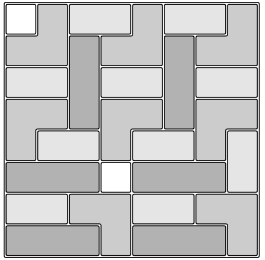</a>


<a id="pdf-572"></a><a id="p-557"></a>

<a id="ans-7-1-4-218"></a>

**218.** [题目](../sec-7-1-4.md#ex-7-1-4-218) 这是一个恰当覆盖问题. 例如, 当 $n=3$ 时关联矩阵是

<table><tbody>
<tr><td><code>001001010</code></td><td><code>(--2--2)</code></td></tr>
<tr><td><code>010001001</code></td><td><code>(-3---3)</code></td></tr>
<tr><td><code>010010010</code></td><td><code>(-2--2-)</code></td></tr>
<tr><td><code>010100100</code></td><td><code>(-1-1--)</code></td></tr>
<tr><td><code>100010001</code></td><td><code>(3---3-)</code></td></tr>
<tr><td><code>100100010</code></td><td><code>(2--2--)</code></td></tr>
<tr><td><code>101000100</code></td><td><code>(1-1---)</code></td></tr>
</tbody></table>

并且通常有 $3n$ 列和 $\binom{2n-1}2-\binom n2$ 行. 考虑 $n=12$ 的情形: 187 个变量的 ZDD 有 192636 个结点. 利用习题 212 的答案的方法 4 (二元平衡), 它可以用 3 亿次内存访问的代价求出. 在这种情况下, 方法 5 比方法 4 慢 25%. BDD 要大得多 (2198195 个结点), 而且它的代价超过 9 亿次内存访问.

因此, 对于这个问题 ZDD 显然比 BDD 更可取, 并且它以相当高的效率确定 $L_{12}=108144$ 个解. (然而, 7.2.2 节的 “舞蹈链” 方法约快四倍, 而且它需要少得多的内存空间.)

<a id="ans-7-1-4-219"></a>

**219.** [题目](../sec-7-1-4.md#ex-7-1-4-219) (a) 1267; (b) 2174; (c) 2958; (d) 3721; (e) 4502. (为了建立 $\operatorname{WORDS}(n)$ 的 ZDD, 我们对 $\mathsf w_1\sqcup\mathsf h_2\sqcup\mathsf i_3\sqcup\mathsf c_4\sqcup\mathsf h_5$、$\mathsf t_1\sqcup\mathsf h_2\sqcup\mathsf e_3\sqcup\mathsf r_4\sqcup\mathsf e_5$ 等的 7 结点 ZDD 实施 $n-1$ 个 OR 运算.)

<a id="ans-7-1-4-220"></a>

**220.** [题目](../sec-7-1-4.md#ex-7-1-4-220) (a) 对于在第二个位置可以后接 a 的每个首字母的后继, 有一个 $a_2$ 结点 (aargh、babel、$\ldots$、zappy). 除了 q、u、x 之外的所有 23 个字母符合条件. 并且对于可以后接 b 的每个首字母, 有一个 $b_2$ 结点 (abbey、ebony、oboes). 然而, 实际规则不是这样简单. 例如, 由于 czars 和 tzars 之间的共享, 存在 3 个 $z_2$ 结点而不是 4 个.

(b) 不存在 $v_5$ 结点, 因为没有以字母 v 结尾的 5 字母单词. (SGB 单词集合不包括 arxiv 或 webtv.) 出现 $w_5$ 的 3 个结点, 因为一个结点代表其中小于 $w_5$ 的字母必须后接 w 的情形 (aglo 以及其他多个单词). 另外一个结点代表其中 w 或 y 必须跟随其后的情形 (stra 或 resa, 或我们已经见到的 allo 但不是 allot). 还有一个 $w_5$ 结点代表 unse 不是后接 e 或 t 的情形, 因为它必须后接 w 或 x. 同样, 对于 $x_5$ 的 2 个结点代表 x 是被强制的情形, 或者最后字母必须是 x 或 y (跟随 rela). 只有一个 $y_5$ 结点, 因为没有 4 个字母后面可以同时后接 y 和 z. 当然恰好有一个 $z_5$ 结点以及两个汇结点.

<a id="ans-7-1-4-221"></a>

**221.** [题目](../sec-7-1-4.md#ex-7-1-4-221) 我们对于每个可能的消零串珠 $\zeta$ 计算 $\zeta$ 将出现的概率, 并且对所有 $\zeta$ 求和. 具体起见, 考虑与 $r_3$ 上的分支对应的消零串珠, 并且假定它代表 10 个 3 字母后缀的子族. 恰好有 $\binom{6084}{10}-\binom{5408}{10}\approx1.3\times10^{31}$ 个这样的消零串珠, 根据容斥原理, 它们每一个以概率 $\sum_{k\ge1}\binom{676}k(-1)^{k+1}\binom{11881376-6084k}{5757-10k}/\binom{11881376}{5757}\approx2.5\times10^{-32}$ 出现. [提示: $|\{r,s,t,u,v,w,x,y,z\}|=9$、$676=26^2$、$6084=9\times26^2$.] 因此这样的消零串珠对 ZDD 的大小总体的贡献约为 0.33. 按类似分析, 对于大小为 1、2、3、4、5、$\ldots$ 的子族的 $r_3$ 消零串珠贡献近似为 11.5、32.3、45.1、41.9、29.3、$\ldots$, 所以我们期望在 $r_3$ 上平均大约共有 188.8 个分支结点. 全部结点总计

$$
\begin{aligned}
\sum_{l=1}^{5}\sum_{j=1}^{26}\sum_{s=1}^{5757}
&\left(\binom{26^{5-l}(27-j)}s-\binom{26^{5-l}(26-j)}s\right)\\
&\quad\times\sum_{k=1}^{\infty}\binom{26^{l-1}}k(-1)^{k+1}
\binom{26^5-26^{5-l}(27-j)k}{5757-sk}\Big/\binom{26^5}{5757}.
\end{aligned}
$$

再加 2 个汇结点, 达到约 7151.986. 平均 $z$ 分布约 $(1.00,\ldots,1.00;\ 25.99,\ldots,25.99;\ 188.86,\ldots,171.43;\ 86.31,\ldots,27.32;\ 3.53,\ldots,1.00;\ 2.00)$.

<a id="ans-7-1-4-222"></a>

**222.** [题目](../sec-7-1-4.md#ex-7-1-4-222) (a) 它是 $F$ 的单词的所有子集的集合. (存在出自 $27^5=14348907$ 种可能性的 50569 个这样的子单词. 它们由一个大小为 18784 的 ZDD 描述, 这个 ZDD 是从 $F$ 和 $\wp$ 通过习题 205(b) 的答案花费约 1500 万次内存访问构造的.)

(b) 这个公式给出与 $F\sqcap\wp$ 同样的结果, 因为 $F$ 的每个成员恰好包含每个 $X_j$ 的一个元素. 但是计算要慢得多——约 3.7 亿次内存访问, 尽管事实是 $Z(X)=132$ 几乎同 $Z(\wp)=131$ 一样小. (注意 $|\wp|=2^{130}$ 而 $|X|=26^5\approx2^{23.5}$.)

<a id="pdf-573"></a><a id="p-558"></a>

(c) $(F/P)\sqcup P$, 其中 $P=\mathsf t_1\sqcup\mathsf u_3\sqcup\mathsf h_5$ 是匹配的模式. (单词是 touch、tough、truth. 这个计算用习题 205 的答案的算法花费大约 3000 次内存访问.) 简单公式的其他竞争者是 $F\cap Q$, 其中 $Q$ 描述允许的单词. 如果置 $Q=\mathsf t_1\sqcup X_2\sqcup\mathsf u_3\sqcup X_4\sqcup\mathsf h_5$, 我们有 $Z(Q)=57$, 而且花费再次约为 $3000\mu$. 另一方面, 用 $Q=(\mathsf t_1\cup\mathsf u_3\cup\mathsf h_5)\mathbin{\S}3$, 我们有 $Z(Q)=132$, 而且花费上升到大约 9000 次内存访问. (这里的 $|Q|$ 在第一种情况下是 $26^2$, 但是在第二种情况下是 $2^{127}$——与从 (a) 和 (b) 获得的任何直觉知识相反! 仔细想想.)

(d) $F\cap((V_1\cup\cdots\cup V_5)\mathbin{\S}k)$. 对于 $k=(0,\ldots,5)$, 这种单词的数目是 $(24,1974,3307,443,9,0)$, 分别来自大小为 $(70,1888,3048,686,34,1)$ 的 ZDD. (“对于单词 $F\bmod\mathsf y_1\bmod\mathsf y_2\bmod\cdots\bmod\mathsf y_5$ 见习题 7-34”, 作者挖苦地 (wryly) 说.)

(e) 所求的模式满足 $P=(F\sqcap\wp)\cap Q$, 其中 $Q=((X_1\cup\cdots\cup X_5)\mathbin{\S}3)$. 我们有 $Z(Q)=386$、$Z(P)=14221$、$|P|=19907$.

(f) 这种情况的公式更富技巧性. 首先, $P_2=F\sqcap F$ 给出 $F$ 连同由两个不同单词满足的所有模式. 我们有 $Z(P_2)=11289$、$|P_2|=21234$、$|P_2\cap Q|=7753$. 但是 $P_2\cap Q$ 不是答案. 例如, 它遗漏了模式 <code>&#42;atc&#42;</code>, 这个模式出现 8 次, 但是仅限于上下文 <code>&#42;atch</code> 中. 正确答案由 $P'_2\cap Q$ 给出, 其中 $P'_2=(P_2\setminus F)\sqcap\wp$. 于是 $Z(P'_2)=8947$、$Z(P'_2\cap Q)=7525$、$|P'_2\cap Q|=10472$.

(g) $G_1\cup\cdots\cup G_5$, 其中 $G_j=(F/(\mathsf b_j\cup\mathsf o_j))\sqcup\mathsf b_j$. 答案是 bared、bases、basis、baths、bobby、bring、busts、herbs、limbs、tribs.

(h) 在第二个位置允许所有元音的模式: <code>b&#42;lls</code>、<code>b&#42;nds</code>、<code>m&#42;tes</code>、<code>p&#42;cks</code>.

(i) 第一个给出中间 3 个字母是元音的全部单词. 第二个给出指定了第一个字母和最后一个字母的所有模式, 对于它们至少有一个同 3 个插入的元音匹配. 前者存在 30 个解, 但是后者只有 27 个解 (因为, 例如 louis 和 luaus 产生同一模式). 顺便说一下, 补族 $\wp\setminus F$ 有 $2^{130}-5757$ 个成员, 而且在它的 ZDD 中有 46316 个结点.

<a id="ans-7-1-4-223"></a>

**223.** [题目](../sec-7-1-4.md#ex-7-1-4-223) (a) $d(\alpha,\mu)+d(\beta,\mu)+d(\gamma,\mu)=5$, 因为 $d(\alpha,\mu)=[\alpha_1\ne\mu_1]+\cdots+[\alpha_5\ne\mu_5]$.

(b) 给定族 $f,g,h$, 如果我们考虑放松不等式限制后的子集的 8 种变形, 可以把族 $\{\mu\mid\mu=\langle\alpha\beta\gamma\rangle\text{ 对某些 }\alpha\in f,\beta\in g,\gamma\in h\text{ 满足 }\alpha\ne\mu,\beta\ne\mu,\gamma\ne\mu,\alpha\cap\beta\cap\gamma=\emptyset\}$ 递归地定义为允许 ZDD 计算. 在我的实验系统中, 对于 $n=(100,1000,5757)$ 的 $\operatorname{WORDS}(n)$ 的中位数, ZDD 分别有 $(595,14389,71261)$ 个结点和表示 $(47,7310,86153)$ 个 5 字母解的特征. 当 $n=5757$ 时, 86153 个中位数中包括以下 5 字母单词: chads、stent、blogs、ditzy、phish、bling、tetch. 事实上, 当 $n=1000$ 时 $\mathsf{tetch}=\langle\mathsf{fetch}\ \mathsf{teach}\ \mathsf{total}\rangle$ 已经出现. (运行时间分别约为 $(0.1,20,7000)$ 亿次内存访问, 不是特别引人注目. ZDD 对于这个问题可能不是最佳工具. 尽管如此, 编程还是有启发性的.)

(c) 当 $n=100$ 时, 恰好分别有 $(1,14,47)$ 个 $\operatorname{WORDS}(n)$ 的中位数属于 $\operatorname{WORDS}(100)$、$\operatorname{WORDS}(1000)$、$\operatorname{WORDS}(5757)$. 具有最常见单词的解是 $\mathsf{while}=\langle\mathsf{white}\ \mathsf{whole}\ \mathsf{still}\rangle$. 当 $n=1000$ 时, 对应的数目是 $(38,365,1276)$. 而当 $n=5757$ 时, 它们是 $(78,655,4480)$. 不是 3 个其他英文单词的中位数的最常见英文单词是 their、first、right.

<a id="ans-7-1-4-224"></a>

**224.** [题目](../sec-7-1-4.md#ex-7-1-4-224) 有向无圈图的每段弧 $u\to v$ 对应于森林的一个顶点 $v$. ZDD 对于每段弧恰好有一个分支结点. 那个结点的 LO 指针指向对应顶点 $v$ 的右兄弟结点, 或者当 $v$ 没有右兄弟时指向 $\boxed\bot$. HI 指针指向 $v$ 的左子结点, 或者当 $v$ 是叶结点时指向 $\boxed\top$. 弧可以按多种方式排序 (例如前序、后序和层序) 而不改变这个 ZDD.

<a id="ans-7-1-4-225"></a>

**225.** [题目](../sec-7-1-4.md#ex-7-1-4-225) 像习题 55 那样, 我们试图用这样一种方式对顶点编号, 使得在先前顶点与后来顶点之间保持非常小的 “边界”. 那样我们无须过多地记忆对先前顶点做过什么判定. 在当前情况我们还要用 1 作为源顶点 $s$ 的编号.

在习题 55 的答案中, 源于前面分支结点的相关状态对应于一个等价关系 (一个集合分拆), 但是我们现在用一个对于 $j\le i\le l$ 的表 $\mathit{mate}[i]$ 表示它, 其中 $j\equiv u_k$ 是当前边 $u_k-v_k$ 的较小编号的顶点, 并且 $l=\max\{v_1,\ldots,v_{k-1}\}$. 如果顶点 $i$ 是迄今尚未触动的顶点, 令 $\mathit{mate}[i]=i$. 如果顶点 $i$ 是已经触及两次的顶点, 令 $\mathit{mate}[i]=0$. 否则, 如果前面的边构成一条带有端点 $\{i,r\}$ 的简单路径, 那么 $\mathit{mate}[i]=r$ 且 $\mathit{mate}[r]=i$. 最初除了置 $\mathit{mate}[1]\leftarrow t$、$\mathit{mate}[t]\leftarrow1$ 外, 我们对于 $1\le i\le n$ 置 $\mathit{mate}[i]\leftarrow i$. [如果 $t>l$, 不需要保存 $\mathit{mate}[t]$ 的值, 因为它可以从 $\mathit{mate}[i]$($j\le i\le l$) 的值确定.]


<a id="pdf-574"></a><a id="p-559"></a>

令 $j'=u_{k+1}$ 和 $l'=\max\{v_1,\ldots,v_k\}$ 是在边 $k$ 已经考察后的 $j$ 和 $l$ 的值, 并且假定 $u_k=j$、$v_k=m$、$\mathit{mate}[j]=\hat j$、$\mathit{mate}[m]=\hat m$. 如果 $\hat j=0$ 或 $\hat m=0$, 我们不能选择边 $j-m$. 否则, 如果 $\hat j\ne m$, 新的 $\mathit{mate}$ 表在选择边 $j-m$ 后可以通过执行赋值 $\mathit{mate}[j]\leftarrow0$、$\mathit{mate}[m]\leftarrow0$、$\mathit{mate}[\hat j]\leftarrow\hat m$、$\mathit{mate}[\hat m]\leftarrow\hat j$ (按此顺序) 计算.

否则, 我们有 $\hat j=m$ 且 $\hat m=j$. 我们必须考虑到最终的结果. 令 $i$ 是这样的最小整数, $i>j$、$i\ne m$, 并且 $i>l'$ 或 $\mathit{mate}[i]\ne0$ 且 $\mathit{mate}[i]\ne i$. 如果 $i\le l'$, 在选择边 $j-m$ 后的新状态是 $\emptyset$, 否则是 $\epsilon$.

无论是否选择边, 对于区间 $j\le i<j'$ 内的某个 $i$, 如果 $\mathit{mate}[i]\ne0$ 且 $\mathit{mate}[i]\ne i$, 新状态将是 $\emptyset$.

例如, 下面是在一个 $3\times3$ 网格中从 1 到 9 的路径的前面几步 (见 (132)):

<table><thead><tr><th>$k$</th><th>$j$</th><th>$l$</th><th>$m$</th><th>$\mathit{mate}[1]\cdots\mathit{mate}[9]$</th><th>$\hat j$</th><th>$\hat m$</th><th>$\mathit{mate}'[1]\cdots\mathit{mate}'[9]$</th></tr></thead><tbody>
<tr><td>1</td><td>1</td><td>1</td><td>2</td><td><code>9 2 3 4 5 6 7 8 1</code></td><td>9</td><td>2</td><td><code>0 9 3 4 5 6 7 8 2</code></td></tr>
<tr><td>2</td><td>1</td><td>2</td><td>3</td><td><code>9 2 3 4 5 6 7 8 1</code></td><td>9</td><td>3</td><td><code>0 2 9 4 5 6 7 8 3</code></td></tr>
<tr><td>2</td><td>1</td><td>2</td><td>3</td><td><code>0 9 3 4 5 6 7 8 2</code></td><td>0</td><td>3</td><td>—</td></tr>
<tr><td>3</td><td>2</td><td>3</td><td>4</td><td><code>0 2 9 4 5 6 7 8 3</code></td><td>2</td><td>4</td><td><code>0 4 9 2 5 6 7 8 3</code></td></tr>
<tr><td>3</td><td>2</td><td>3</td><td>4</td><td><code>0 9 3 4 5 6 7 8 2</code></td><td>9</td><td>4</td><td><code>0 0 3 9 5 6 7 8 4</code></td></tr>
</tbody></table>

其中如果选择边 $j-m$, $\mathit{mate}'$ 描述下一个状态. 状态转换 $\mathit{mate}_{j..l}\mapsto\mathit{mate}'_{j'..l'}$ 是 $9\mapsto(\overline{12}?92:09)$; $92\mapsto(\overline{13}?\emptyset:29)$; $09\mapsto(\overline{13}?93:\emptyset)$; $29\mapsto(\overline{24}?294:492)$; $93\mapsto(\overline{24}?934:039)$.

在找出所有可达状态后, 可以通过使用类似算法 R 的过程减少等价状态获得 ZDD. (在 $3\times3$ 网格问题中, 分支结点从 57 个减少到 28 个, 附加两个汇结点. 在正文中说明的 22 分支 ZDD 是随后通过习题 197 进行优化而获得的.)

<a id="ans-7-1-4-226"></a>

**226.** [题目](../sec-7-1-4.md#ex-7-1-4-226) 仅仅删除初始设置 “$\mathit{mate}[1]\leftarrow t$、$\mathit{mate}[t]\leftarrow1$”.

<a id="ans-7-1-4-227"></a>

**227.** [题目](../sec-7-1-4.md#ex-7-1-4-227) 在两处把检验 “$\mathit{mate}[i]\ne0$ 且 $\mathit{mate}[i]\ne i$” 改为只检验 “$\mathit{mate}[i]\ne0$”. 还把 “$i\le l'$” 改为 “$i\le n$”.

<a id="ans-7-1-4-228"></a>

**228.** [题目](../sec-7-1-4.md#ex-7-1-4-228) 利用上题答案进一步修改如下: 添加一个虚顶点 $d=n+1$ 以及对于所有 $v\ne s$ 的新边 $v-d$. 接受这种新边将意味着 “终止在 $v$”. 用 $\mathit{mate}[1]\leftarrow d$、$\mathit{mate}[d]\leftarrow1$ 初始化 $\mathit{mate}$ 表. 在计算 $l$ 和 $l'$ 时不考虑 $d$ 的最大值. 当开始检验保存的 $\mathit{mate}$ 表时, 从 $\mathit{mate}[d]\leftarrow0$ 起步, 然后如果遇到 $\mathit{mate}[i]=d$, 置 $\mathit{mate}[d]\leftarrow i$.

<a id="ans-7-1-4-229"></a>

**229.** [题目](../sec-7-1-4.md#ex-7-1-4-229) 在后者的路径中, 149692648904 条是从 VA 到 MD 的. 图 (133) 删去了 DC. (然而图 (18) 比图 (133) 具有更少的哈密顿路径, 因为图 (133) 有 1782199 条从 CA 到 ME 而不是从 VA 到 MD 的哈密顿路径.)

<a id="ans-7-1-4-230"></a>

**230.** [题目](../sec-7-1-4.md#ex-7-1-4-230) 从 ME 开始的唯一的最小和最大路径都在 WA 终止:

<a href="../../../assets/volume4a/figures/answer-7-1-4-230-minimum-route.svg">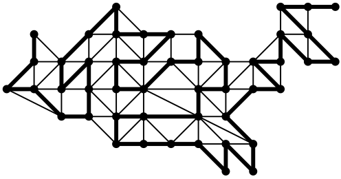</a>

11698 英里,

<a href="../../../assets/volume4a/figures/answer-7-1-4-230-maximum-route.svg">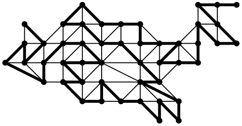</a>

18040 英里.

令 $g(z)=\sum z^{\operatorname{miles}(r)}$ 是对所有路径 $r$ 求和. 可以像习题 29 的答案中那样快速计算平均代价 $g'(1)/g(1)=1022014257375/68656026\approx14886.01$.

(同样, $g''(1)=15243164303013274$, 所以标准差 $\approx666.2$.)

<a id="ans-7-1-4-231"></a>

**231.** [题目](../sec-7-1-4.md#ex-7-1-4-231) 习题 225 的答案的算法给出具有 8062831 个分支结点的原始 ZDD, 它约化成具有 3024214 个分支结点的 ZDD. 通过习题 208 的答案, 解的数目是 50819542770311581606906543.

<a id="ans-7-1-4-232"></a>

<a id="pdf-575"></a><a id="p-560"></a>

**232.** [题目](../sec-7-1-4.md#ex-7-1-4-232) 利用习题 227 的答案, 我们求出从一个角到它的横向邻近棋格的 $h=721613446615109970767$ 条哈密顿路径, 以及从同一角到它的对角邻近棋格的 $d=480257285722344701834$ 条哈密顿路径. 在两种情况下相关的 ZDD 有大约 130 万个结点. 有向哈密顿圈的数目是 $2h+d=1923484178952564643368$. (除以 2 得到无向哈密顿圈的数量.)

王的漫游实质上只有两路达到最大长度 $8+56\sqrt2$，如右图所示。［尼古拉·贝卢霍夫证明了，当 $n$ 是偶数时，$n\times n$ 的王的漫游的最大长度是 $n+n(n-1)\sqrt2$。见保加利亚的期刊 *Matematika Plyus* **14**, 4 (2006年10至12月)，61–64。］

<a href="../../../assets/volume4a/figures/answer-7-1-4-232-kings-tour-a.svg">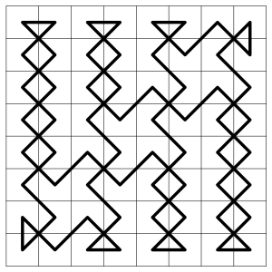</a>

<a href="../../../assets/volume4a/figures/answer-7-1-4-232-kings-tour-b.svg">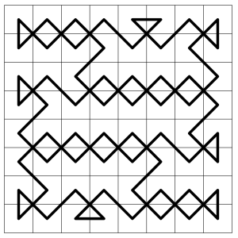</a>

<a id="ans-7-1-4-233"></a>

**233.** [题目](../sec-7-1-4.md#ex-7-1-4-233) 当前面的选择定义了一条从 $i$ 到 $r$ 的定向路径时, 可以用一个类似的过程但是带有 $\mathit{mate}[i]=r$ 且 $\mathit{mate}[r]=-i$. 当 $u_k=j<v_k=m$ 时, 连续地处理所有弧 $u_k\to v_k$ 和 $u_k\leftarrow v_k$. 如果 $\mathit{mate}[j]=j$, 定义 $\hat j=-j$, 否则定义 $\hat j=\mathit{mate}[j]$. 如果 $\hat j\ge0$ 或 $\hat m\le0$, 选择 $j\to m$ 是非法的. 当选择合法时, 对于那种选择的修改规则是: $\mathit{mate}[j]\leftarrow0$、$\mathit{mate}[m]\leftarrow0$、$\mathit{mate}[-\hat j]\leftarrow\hat m$、$\mathit{mate}[\hat m]\leftarrow\hat j$.

<a id="ans-7-1-4-234"></a>

**234.** [题目](../sec-7-1-4.md#ex-7-1-4-234) 可以用约 800 个结点的 ZDD 表示 437 个定向圈. 最短的圈自然是 $\mathrm{AL}\to\mathrm{LA}\to\mathrm{AL}$ 和 $\mathrm{MN}\to\mathrm{NM}\to\mathrm{MN}$. 有 37 个长度为 17 (最大长度) 的定向圈, 例如 $(\mathtt{ALARINVTNMIDCOKSC})$, 即 $\mathrm{AL}\to\mathrm{LA}\to\cdots\to\mathrm{SC}\to\mathrm{CA}\to\mathrm{AL}$.

顺便说一下, 问题中的有向图是 26 个顶点 $\{\mathrm A,\mathrm B,\ldots,\mathrm Z\}$ 上的有向图 $D$ 的弧有向图 $D^*$, 它的 49 段弧是 $\mathrm A\to\mathrm L$、$\mathrm A\to\mathrm R$、$\ldots$、$\mathrm W\to\mathrm Y$. $D^*$ 的每条有向通道是 $D$ 的一条有向通道, 反之亦然 (见习题 2.3.4.2-21). 但是 $D^*$ 的有向圈在 $D$ 中不一定是简单圈. 事实上, $D$ 只有 37 个定向圈, 它们中最长的圈是唯一的: $(\mathtt{ARINMOKSDC})$.

如果我们把考虑范围扩大到习题 7-54(c) 中的 62 个邮政编码, 定向圈的数目上升到 38336, 包括唯一的 1 圈 (A) 以及 192 个长度为 23 的圈图, 例如 $(\mathtt{APRIALASCTNMNVINCOKSDCA})$. 在这种情况下大约 17000 个 ZDD 结点足以表示定向圈的整个族的特征.

<a id="ans-7-1-4-235"></a>

**235.** [题目](../sec-7-1-4.md#ex-7-1-4-235) 这个有向图有 7912 段弧, 但是, 通过删除来自 0 入度顶点的弧或到达 0 出度顶点的弧, 可以大刀阔斧地修剪它们. 例如剪去 $\mathsf{owner}\to\mathsf{nerdy}$, 因为 $\mathsf{nerdy}$ 是一个失去作用的末端顶点. 事实上, $\mathsf{owner}$ 的所有后继顶点同样被删除, 所以 $\mathsf{crown}$ 也要剪去. 最后我们仅留下 85 个单词之间的 112 段弧, 而且问题基本上可以手工完成.

恰好有 74 个定向圈. 唯一的最短定向圈 $\mathsf{slant}\to\mathsf{antes}\to\mathsf{tesla}\to\mathsf{slant}$, 可以像上题答案那样缩写成 $(\mathtt{slante})$. 两个最长的定向圈是 $(\alpha\omega)$ 和 $(\beta\omega)$, 其中 $\alpha=\mathtt{picastepsomaso}$、$\beta=\mathtt{pointrotherema}$、$\omega=\mathtt{nicadrearedidoserumoreliciteslabsitaresetuplenactoricedarerunichesto}$.

<a id="ans-7-1-4-236"></a>

**236.** [题目](../sec-7-1-4.md#ex-7-1-4-236) (a) 假定 $\alpha\in f$ 且 $\beta\in g$, 如果 $\alpha\subseteq\beta$, 那么 $\alpha\in f\sqcap g$. 如果 $\alpha\cap\beta\in f$, 那么 $\alpha\cap\beta\notin f\nearrow g$. 类似的论证或者利用 (b) 部分, 证明 $f\searrow g=f\setminus(f\sqcup g)$.

注: 关于超集的补运算 “$f\nwarrow g=f\setminus(f\searrow g)=\{\alpha\in f\mid\alpha\supseteq\beta\text{ 对于某个 }\beta\in g\}$”, 以及关于子集的补运算 “$f\swarrow g=f\setminus(f\nearrow g)=\{\alpha\in f\mid\alpha\subseteq\beta\text{ 对于某个 }\beta\in g\}$”, 在应用中也是很重要的. 这道习题把它们排除在外, 仅仅因为 5 种运算已经颇为吓人了. 超集运算是由奥利维耶·库代尔、让·马德尔和亨利·弗雷斯 [*ACM/IEEE Design Automation Conference* **30** (1993), 625–630] 引入的. 恒等式 $f\nwarrow g=f\cap(f\sqcup g)$ 是由奥乃博、凑真一和矶崎秀树 [*Information Processing Letters* **66** (1998), 195–199] 提出的, 他们还列举了 (d) 中的几条定律.

(b) 用初等集合论足以证明. (前面 6 个等式成对出现, 它们中的每一个与其对偶是等价的. 严格地说, $f^C$ 包含无限集合, 而 $U$ 是无穷多变量的 AND. 但是这些公式在任何有限全域内成立. 请注意, 当用布尔函数的符号描述时, $f^C(x)=f(\bar x)$ 是布尔对偶 $f^D$ 的补. 见习题 7.1.1-2. $f^\sharp$ 的对偶函数, 即 $\{\alpha\mid\beta\in f\text{ 蕴涵 }\alpha\cup\beta\ne U\}^{\uparrow}$, 有任何用途吗? 要是有的话, 我们可以用 $f^\flat$ 表示它.)

(c) 除 (ii) 外全部是真, 应该说 $x_1^\uparrow=x_1^{C\downarrow C}=\bar x_1^{\downarrow C}=\epsilon^C=U$.

(d) 在这里划掉的 “恒等式” 是 (ii)、(viii)、(ix)、(xiv), 其余公式是值得记住的. 关于 (ii)–(vi), 注意 $f=f^\uparrow$ 当且仅当 $f=f^\downarrow$, 当且仅当 $f$ 是一个簇. 公式 (xiv) 应为 $f\searrow g^\downarrow=f\searrow g$, 即 (xiii) 的对偶公式. 公式 (xvi) 成立. 公式 (ix) 或许是最有趣的: 实际上我们有 $f^{\sharp\sharp}=f$, 当且仅当 $f$ 是一个簇.


<a id="pdf-576"></a><a id="p-561"></a>

(e) 假定所有顶点的全域是有限的, 我们有 (i) $f=\wp\searrow g$ 且 (ii) $g=(\wp\setminus f)^\downarrow$, 其中 $\wp$ 是习题 201 和 222 中的全域族, 因为 $g$ 是极小依赖集的集族. (纯粹主义者应该在这些公式中用 $\wp_V\equiv\bigsqcup_{v\in V}(\epsilon\cup e_v)$ 代替 $\wp$. 同样一些关系在任何这样的超图中成立: 其中没有一条边包含在另一条边中.)

<a id="ans-7-1-4-237"></a>

**237.** [题目](../sec-7-1-4.md#ex-7-1-4-237) $\mathrm{MAXMAL}(f)=$“如果 $f=\emptyset$ 或 $f=\epsilon$, 返回 $f$. 如果 $f^\uparrow=r$ 在缓存中, 返回 $r$. 否则, 置 $r\leftarrow\mathrm{MAXMAL}(f_l)$、$r_h\leftarrow\mathrm{MAXMAL}(f_h)$、$r_l\leftarrow\mathrm{NONSUB}(r,r_h)$, 解除对 $r$ 的引用, 并且置 $r\leftarrow\mathrm{ZUNIQUE}(f_o,r_l,r_h)$, 把 $r$ 存入缓存并且返回 $r$.”

$\mathrm{MINMAL}(f)=$“如果 $f=\emptyset$ 或 $f=\epsilon$, 返回 $f$. 如果 $f^\downarrow=r$ 在缓存中, 返回 $r$. 否则, 置 $r_l\leftarrow\mathrm{MINMAL}(f_l)$、$r\leftarrow\mathrm{MINMAL}(f_h)$、$r_h\leftarrow\mathrm{NONSUP}(r,r_l)$, 解除对 $r$ 的引用, 并且置 $r\leftarrow\mathrm{ZUNIQUE}(f_o,r_l,r_h)$, 把 $r$ 存入缓存并且返回 $r$.”

$\mathrm{NONSUB}(f,g)=$“如果 $g=\emptyset$, 返回 $f$. 如果 $f=\emptyset$ 或 $f=\epsilon$ 或 $f=g$, 返回 $\emptyset$. 如果 $f\nearrow g=r$ 在缓存中, 返回 $r$. 否则像习题 198 的答案中说明的那样表示 $f$ 和 $g$. 如果 $f_o>g_o$, 将 $\mathrm{AND}(\mathrm{NONSUB}(f,g_l),\mathrm{NONSUB}(f,g_h))$ 存入缓存并返回. 否则置 $v\leftarrow f_o$. 如果 $v<g_o$, 置 $r_l\leftarrow\mathrm{NONSUB}(f_l,g)$、$r_h\leftarrow f_h$, 并且 $\mathrm{REF}(f_h)$ 增加 1. 否则, 置 $r_h\leftarrow\mathrm{NONSUB}(f_l,g_l)$、$r\leftarrow\mathrm{NONSUB}(f_l,g_h)$、$r_l\leftarrow\mathrm{AND}(r,r_h)$, 解除对 $r$ 和 $r_h$ 的引用, 并且置 $r_h\leftarrow\mathrm{NONSUB}(f_h,g_h)$. 最后, 置 $r\leftarrow\mathrm{ZUNIQUE}(v,r_l,r_h)$, 把 $r$ 存入缓存并且返回 $r$.”

$\mathrm{NONSUP}(f,g)=$“如果 $g=\emptyset$, 返回 $f$. 如果 $f=\emptyset$ 或 $g=\epsilon$ 或 $f=g$, 返回 $\emptyset$. 如果 $f_o>g_o$, 返回 $\mathrm{NONSUP}(f,g_l)$. 如果 $f\searrow g=r$ 在缓存中, 返回 $r$. 否则置 $v\leftarrow f_o$. 如果 $v<g_o$, 置 $r_l\leftarrow\mathrm{NONSUP}(f_l,g)$、$r_h\leftarrow\mathrm{NONSUP}(f_h,g)$. 否则, 置 $r_l\leftarrow\mathrm{NONSUP}(f_h,g_h)$、$r\leftarrow\mathrm{NONSUP}(f_h,g_l)$、$r_h\leftarrow\mathrm{AND}(r,r_l)$, 解除对 $r$ 和 $r_l$ 的引用, 并且置 $r_l\leftarrow\mathrm{NONSUP}(f_l,g_l)$. 最后置 $r\leftarrow\mathrm{ZUNIQUE}(v,r_l,r_h)$, 把 $r$ 存入缓存并且返回 $r$.”

$\mathrm{MINHIT}(f)=$“如果 $f=\emptyset$, 返回 $\epsilon$. 如果 $f=\epsilon$, 返回 $\emptyset$. 如果 $f^\sharp=r$ 在缓存中, 返回 $r$. 否则, 置 $r\leftarrow\mathrm{OR}(f_l,f_h)$、$r_l\leftarrow\mathrm{MINHIT}(r)$, 解除对 $r$ 的引用, 置 $r\leftarrow\mathrm{MINHIT}(f_l)$、$r_h\leftarrow\mathrm{BUTNOT}(r,r_l)$, 解除对 $r$ 的引用, 并且置 $r\leftarrow\mathrm{ZUNIQUE}(f_o,r_l,r_h)$, 把 $r$ 存入缓存并且返回 $r$.”

像习题 206 那样, 这些例程的最差情况运行时间是指数级的. 尽管 NONSUB 和 NONSUP 可以通过习题 236(a) 经由 JOIN 或 MEET 和 BUTNOT 计算, 这种直接实现的方式趋向于更快. 更可取的作法或许是在 MINMAL 和 MINHIT 中用 $\epsilon\in f$ 代替 $f=\epsilon$, 此外在 NONSUP 中用 $\epsilon\in g$ 代替 $g=\epsilon$.

[奥利维耶·库代尔在 *Proc. Europ. Design and Test Conf.* (IEEE, 1997), 224–228 中引入和实现运算符 $f^\uparrow$、$f\nearrow g$、$f\searrow g$. 他还对有趣的运算符 $f\odot g=(f\sqcup g)^\uparrow$ 给出了一种递归实现. 然而在我的试验中, 不用它获得的结果好得多. 例如, 如果 $f$ 是美国接壤各州的独立集的 177 结点的 ZDD, 运算 $g\leftarrow\mathrm{JOIN}(f,f)$ 花费大约 35 万次内存访问, 运算 $h\leftarrow\mathrm{MAXMAL}(g)$ 花费大约 360 万次内存访问. 但是计算 $h\leftarrow\mathrm{MAXJOIN}(f,f)$ 一下子就需要超过 690 亿次内存访问. 自然, 改进缓存和垃圾回收策略可能会改变这种局面.]

<a id="ans-7-1-4-238"></a>

**238.** [题目](../sec-7-1-4.md#ex-7-1-4-238) 利用顺序 (104), 我们对于独立集的族 $f$ 可以按照两种方式计算 177 个结点 ZDD: 用布尔代数 (67), $f=\neg\bigvee_{u-v}(x_u\land x_v)$; 用习题 198–201 的答案的算法, 花费约为 110 万次内存访问. 另一方面, 按照族代数, 由 236(e) 我们有 $f=\wp\searrow\bigcup_{u-v}(e_u\sqcup e_v)$; 通过习题 237 的答案, 花费小于 17.5 万次内存访问.

给出可 2 着色和可 3 着色子图的子集分别是 $g=f\sqcup f$ 和 $h=g\sqcup f$, 极大子集是 $g^\uparrow$ 和 $h^\uparrow$. 我们有 $Z(g)=1009$、$Z(g^\uparrow)=3040$、$Z(h)=179$、$Z(h^\uparrow)=183$、$|g|=9028058789780$、$|g^\uparrow|=2949441$、$|h|=543871144820736$、$|h^\uparrow|=384$. 计算 $g$、$g^\uparrow$、$h$、$h^\uparrow$ 的花费依次约为 $350\,\mathrm{K}\mu$ (千次内存访问)、$3.6\,\mathrm{M}\mu$、$1.1\,\mathrm{M}\mu$、$230\,\mathrm{K}\mu$. (我们可以通过 (比方说)$(g^\uparrow\sqcup f)^\uparrow$ 计算 $h^\uparrow$. 但是, 那是一个坏主意.)

极大诱导二部和三部子图有各自的生成函数 $7654z^{25}+\cdots+9040z^{33}+689z^{34}$ 和 $128z^{43}+84z^{44}+112z^{45}+36z^{46}+24z^{47}$. 下面是最小和最大的典型例子:

<a href="../../../assets/volume4a/figures/answer-7-1-4-238-induced-colourable-extremes.svg">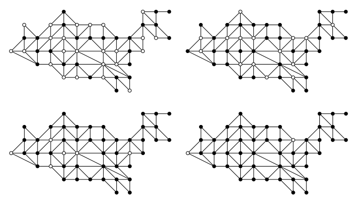</a>


<a id="pdf-577"></a><a id="p-562"></a>

(与 7-(61) 和 7-(62) 中的最小和最大诱导 “1 部子图” 比较.)

注意, 族 $g$ 和 $h$ 告诉我们恰好哪些诱导子图是可 2 着色和可 3 着色的, 但是不能告诉我们如何对它们着色.

<a id="ans-7-1-4-239"></a>

**239.** [题目](../sec-7-1-4.md#ex-7-1-4-239) 由于 $h=(((e_1\cup\cdots\cup e_{49})\mathbin{\S}2)\setminus g)$ 是 $G$ 的非边的集合, 团是 $f=\wp\searrow h$, 而极大团是 $f^\uparrow$. 例如, 对于 USA 图的 214 个团我们有 $Z(f)=144$, 而对于 60 个极大团, $Z(f^\uparrow)=130$. 在这种情况下, 极大团包含 57 个三角形 (它们在 (18) 中无疑是可见的), 以及不属于任何三角形的三条边 <code>AZ——NM</code>、<code>WI——MI</code>、<code>NH——ME</code>.

令 $f_k$ 表示可用 $k$ 个团覆盖的集合. 那么 $f_1=f$, 而对于 $k\ge1$, $f_{k+1}=f_k\sqcup f$. (把 $f_{16}$ 作为 $f_8\sqcup f_8$ 计算不是好主意, 快得多的做法是分别计算各个部分, 即使中间结果不是有用的.)

对于 $1\le k\le19$, USA 图中 $f_k$ 的最大元素具有大小 3、6、9、…、36、39、41、43、45、47、48、49. 在像这样的一个小图中, 这些最大值很容易用手工方式计算. 但是, 极大元素的问题更加难以捉摸, 因此 ZDD 或许是考察它们的最好工具. 对于 $f_1,\ldots,f_{19}$ 的 ZDD, 在进行大约 3000 万次内存访问的计算后快速地求出, 而且它们是不大的: $\max Z(f_k)=Z(f_{11})=9547$. 另外 4 亿次内存访问产生 $f_1^\uparrow,\ldots,f_{19}^\uparrow$ 的 ZDD, 它们同样是很小的: $\max Z(f_k^\uparrow)=Z(f_{11}^\uparrow)=9458$.

例如, 我们对于 $f_{18}^\uparrow$ 求出生成函数 $12z^{47}+13z^{48}$. 如果我们不考虑 CA、DC、FL、IL、LA、MI、MN、MT、SC、TN、UT、WA 或 WV, 用 18 个团就足以覆盖除了 49 个顶点之一以外的全部顶点. 还有 12 种情况, 其中我们可以极大地覆盖 47 个顶点. 例如, 如果用 18 个团覆盖除了 NE 和 NM 以外的所有顶点, 那么那些州没有一个被覆盖. 右图说明一个少有的极大覆盖的例子: 如果用 12 个团覆盖 29 个 “黑色的” 州, 那么没有 “白色的” 州也会被覆盖.

<a href="../../../assets/volume4a/figures/answer-7-1-4-239-maximal-clique-cover.svg">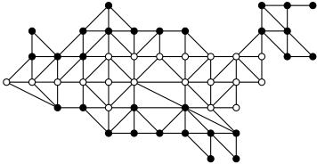</a>

<a id="ans-7-1-4-240"></a>

**240.** [题目](../sec-7-1-4.md#ex-7-1-4-240) (a) 事实上, (68) 的子公式 $f(x)=\bigwedge_v(x_v\lor\bigvee_{u-v}x_u)$ 确切地表示控制集 $x$ 的特征. 同时, 如果把一个核的任何元素删除, 它就不能由其他元素控制. [克劳德·伯奇,*Théorie des graphes et ses applications* (1958), 44.]

(b) (a) 部分的布尔公式在花费约 $1.5\,\mathrm{M}\mu$ 的计算后, 产生带有 $Z(f)=888$ 的 ZDD. 然后用习题 237 的答案的 MINMAL 算法再花费 $1.5\,\mathrm{M}\mu$ 给出具有 $Z(f^\downarrow)=2082$ 的极小元素集.

更明智的方法是从 $h=\bigcup_v(e_v\sqcup\bigsqcup_{u-v}e_u)$ 开始, 然后计算 $h^\sharp$, 因为 $h^\sharp=f^\downarrow$. 然而, 这种情况不值得采用明智的作法: 大约 $80\,\mathrm{K}\mu$ 就足以计算 $h$, 但是用 MINHIT 算法计算 $h^\sharp$ 花费约 $350\,\mathrm{M}\mu$.

无论用两种方法中的哪一种, 我们推断恰好有 7798658 个极小控制集. 更确切地说, 生成函数具有 $192z^{11}+58855z^{12}+\cdots+4170z^{18}+40z^{19}$ 的形式 (可以将它与核的生成函数 $80z^{11}+7851z^{12}+\cdots+441z^{18}+18z^{19}$ 进行比较).

(c) 像习题 239 的答案那样进行, 我们可以确定那些能由大小为 $k=1,2,3,\ldots$ 的子集控制的顶点集合 $d_k$, 因为 $d_{k+1}=d_k\sqcup d_1$. 这里用 $d_1=\wp\sqcap h$ 而不是 $d_1=h$ 开始要快得多, 尽管当 $Z(h)=213$ 时 $Z(\wp\sqcap h)=313$, 因为我们对于 $d_k$ 的小基数集合成员的细节不感兴趣. 利用 $d_7$ 的生成函数是 $\cdots+61z^{42}+z^{43}$ 这个事实, 我们可以证明右图所示的解是唯一的. (总花费约为 $300\,\mathrm{M}\mu$.)

<a href="../../../assets/volume4a/figures/answer-7-1-4-240-unique-seven-vertex-dominance.svg">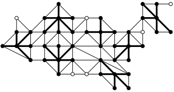</a>

<a id="ans-7-1-4-241"></a>

**241.** [题目](../sec-7-1-4.md#ex-7-1-4-241) 令 $g$ 是全部 728 条边的族. 那么, 像前面几道习题那样, $f=\wp\searrow g$ 是独立集的族, 团是 $c=\wp\searrow(((\bigcup_v e_v)\mathbin{\S}2)\setminus g)$. 我们有 $Z(g)=699$、$Z(f)=20244$、$Z(c)=1882$.

<a id="pdf-578"></a><a id="p-563"></a>

(a) 在 $|f|=118969$ 个独立集中间, 有 $|f^\uparrow|=10188$ 个核, 带有 $Z(f^\uparrow)=8577$ 和生成函数 $728z^5+6912z^6+2456z^7+92z^8$. 92 个最大独立集是经典的八皇后问题的著名解, 我们将在 7.2.2 节讨论它. 正如萨姆·劳埃德在 *Brooklyn Daily Eagle*(1896 年 12 月 20 日) 指出的那样, 示例 (C1) 是仅有的没有 3 个皇后在一条直线上的解. $728=91\times8$ 个最小核由卡尔·耶尼施首次列举在 *Traité des applications de l’analyse math. au jeu des échecs* **3** (1863), 255–259 中, 他把它们归入 “M” 的 R&#42;&#42;&#42;. (C0) 左上角的皇后可以用王、象或兵代替, 依然控制着棋盘上每个空着的方格 [亨利·迪德尼,*The Weekly Dispatch*(1899 年 12 月 3 日)].

<a href="../../../assets/volume4a/figures/answer-7-1-4-241-queen-examples-C0-C9.svg">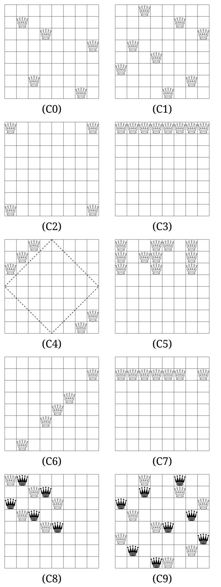</a>

(b) 这里 $Z(c^\uparrow)=866$. 310 个极大团在习题 7-129 中描述.

(c) 这些子集在计算上是更困难的: 所有控制集 $d$ 的 ZDD 具有 $Z(d)=12663505$、$|d|=18446595708474987957$. 极小控制集具有 $Z(d^\downarrow)=11363849$、$|d^\downarrow|=28281838$, 以及生成函数 $4860z^5+1075580z^6+14338028z^7+11978518z^8+873200z^9+11616z^{10}+36z^{11}$. 我们可以通过布尔代数用 $1.5\,\mathrm{G}\mu$ 计算 $d$ 的 ZDD, 然后再用 $680\,\mathrm{G}\mu$ 计算 $d^\downarrow$ 的 ZDD. 可以选择习题 240 的答案中的 “聪明” 方法用 $775\,\mathrm{G}\mu$ 获得 $d^\downarrow$ 而不用计算 $d$. (C5) 中的 11 皇后排列是仅有的限制在 3 行的这种极小控制集. 亨利·迪德尼在 *Tit-Bits* **33**(1898 年 1 月 1 日), 257 中提出 (C4) 这个仅有的避开中央菱形的 5 皇后解. 全部 4860 个最小解的集合由科洛曼·冯·西伊最先列举在 *Deutsche Schachzeitung* **57** (1902), 199 中. 他的完全表出现在威廉·阿伦斯,*Math. Unterhaltungen und Spiele* **1** (1910), 313–318 上.

(d) 如果我们还不知道 $d^\downarrow$, 这里只要计算 $(c\cap d)^\downarrow$ 而不是 $c\cap(d^\downarrow)$ 就足够了, 因为 $c\sqcap\wp=c$. 我们有 $Z(c\cap d^\downarrow)=342$、$|c\cap d^\downarrow|=92$, 以及生成函数 $20z^5+56z^6+16z^7$. 参见 (C6) 和 (C7). 亨利·迪德尼又一次率先找到全部 20 个五皇后问题的解 [*The Weekly Dispatch*(1899 年 7 月 30 日)].

(e) 我们以 $24\,\mathrm{G}\mu$ 的代价得到 $Z(f\sqcup f)=91780989$. 然后再以 $290\,\mathrm{G}\mu$ 的代价得到 $Z((f\sqcup f)^\uparrow)=11808436$. 存在 27567390 个极大诱导二部子图, 以及生成函数 $109894z^{10}+2561492z^{11}+13833474z^{12}+9162232z^{13}+1799264z^{14}+99408z^{15}+1626z^{16}$. 可以把任何 8 个独立的皇后同它们的镜像反射组合获得一个 16 皇后解, 如像 (C1) 产生 (C9) 那样. 但是最小核的不相交的并不会始终是一个极大的诱导二部子图. 例如, 考虑 (C0) 与它的反射的并:

<a href="../../../assets/volume4a/figures/answer-7-1-4-241-nonmaximal-kernel-union.svg">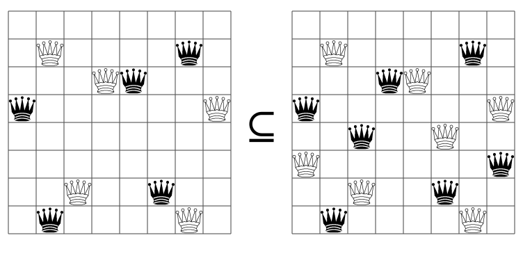</a>

对于小题 (a)、(b)、(d), 可能还有 (c), 同样可以完全不用 ZDD 求解. 例如对于 (a) 和 (b) 的求解见习题 7.1.3-132. 但是, ZDD 方法对于 (e) 看来是最佳选择. 至于 $Q_8$ 的极大三部子图的计算可能超出任何可行算法的所及范围.

[在更大的皇后图 $Q_n$ 中, 每个最小的核和最小的控制集已知具有大小 $\lceil n/2\rceil$ 或 $\lceil n/2\rceil+1$($12\le n\le120$). 见帕特里克·厄斯特高和威廉·威克利,*Electronic J. Combinatorics* **8**, 1 (2001), #R29, 1–19 及勘误; 德米特里·菲诺真克和威廉·威克利,*Australasian J. Combinatorics* **37** (2007), 295–300. 阿莱温·伯格、欧内斯特·科凯恩和克里斯蒂娜·米哈特研究过最大的极小控制集, 见 *Discrete Mathematics* **163** (1997), 47–66.]

<a id="ans-7-1-4-242"></a>

<a id="pdf-579"></a><a id="p-564"></a>

**242.** [题目](../sec-7-1-4.md#ex-7-1-4-242) 这些点是一个有趣的带有 1544 条边的 3 一致超图的核. 它的 4113975079 个独立子集 $f$ (就是它的不带 3 个共线点的子集) 有 $Z(f)=52322105$, 可以像习题 236(e) 的答案那样利用族代数花费约 120 亿次内存访问计算. 计算核 $f^\uparrow$ 将另外花费 $575\,\mathrm{G}\mu$, 我们有 $Z(f^\uparrow)=31438750$ 且 $|f^\uparrow|=66509584$. 生成函数是 $228z^8+8240z^9+728956z^{10}+9888900z^{11}+32215908z^{12}+20739920z^{13}+2853164z^{14}+73888z^{15}+380z^{16}$.

<a href="../../../assets/volume4a/figures/answer-7-1-4-242-no-three-collinear-patterns.svg">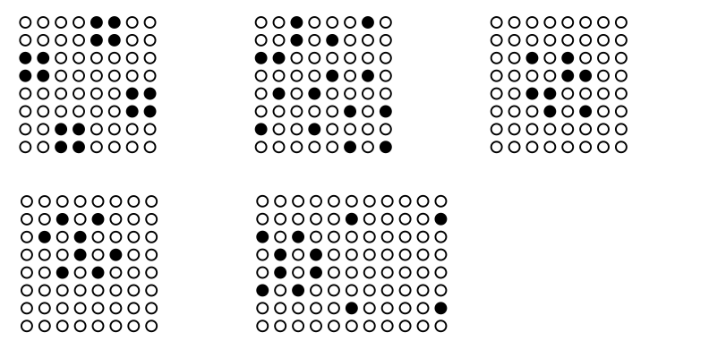</a>

[寻找大小为 16 的独立集的问题, 最初是由亨利·迪德尼在 *The Weekly Dispatch*(1900 年 4 月 29 日和 1900 年 5 月 13 日) 中提出的, 他给出了上图最左边的图案. 其后, 迪德尼在伦敦 *Tribune*(1906 年 11 月 7 日) 邀请出谜人找出上图第二个图案, 它的中心有两个点. 迈克尔·阿德南、德里克·霍尔顿和帕特里克·凯利找出了最大核的完全集合, 它包括在对称下是不同的 57 个核, 见 *Lecture Notes in Math.* **403** (1974), 6–17, 他们还指出了 8 点核的存在. 上图中间的图案是全部点在中央 $4\times4$ 区域内的仅有的图案. 其余两个图案产生的那些核, 对于 $n=(8,9,\ldots,14)$, 在 $n\times n$ 的网络中分别具有 (8,8,10,10,12,12,12) 个点. 它们是由斯蒂芬·安利找到的, 并且描述在 1976 年 10 月 27 日致马丁·加德纳的一封信中.]

<a id="ans-7-1-4-243"></a>

**243.** [题目](../sec-7-1-4.md#ex-7-1-4-243) (a) 即使对于无限集合, 这个结果也是容易证实的. (注意, 依据定理 7.1.1H, 作为一个布尔函数, $f^{\cap}$ 是 $\supseteq f$ 的最小霍恩函数.)

(b) 我们可以利用习题 205, 构成 $f^{(2)}=f\sqcap f$, 然后 $f^{(4)}=f^{(2)}\sqcap f^{(2)}$、…, 直到 $f^{(2^{k+1})}=f^{(2^k)}$. 但是更快的方法是设计一种迅速达到极限的递推公式. 如果 $f=f_0\cup(e_1\sqcup f_1)$, 我们有 $f^{\cap}=f'\cup(e_1\sqcup f_1^{\cap})$, 其中 $f'=f_0^{\cap}\cup(f_0^{\cap}\sqcap f_1^{\cap})$. [另一个公式是 $f'=(f_0\cup f_1)^{\cap}\setminus(f_1^{\cap}\nearrow f_0)$. 见湊真一和有村博纪,*Transactions of the Japanese Society for Artificial Intelligence* **22** (2007), 165–172.]

(c) 采用 (b) 的第一种建议, $F^{(2)}$、$F^{(4)}$、$F^{(8)}=F^{(4)}$ 的计算花费约 $(610+450+460)\,\mathrm{M}\mu$. 在这个例子中, 结果是 $F^{(4)}=F^{(3)}$, 并且恰好有 3 个模式属于 $F^{(3)}\setminus F^{(2)}$, 即 <code>c&#42;&#42;&#42;f</code>、<code>&#42;k&#42;t&#42;</code>、<code>&#42;&#42;&#42;sp</code>. (与 <code>&#42;&#42;&#42;sp</code> 匹配的单词是 clasp、crisp、grasp.) 利用基于 $f_0^{\cap}\sqcap f_1^{\cap}$ 的递推公式直接计算 $F^{\cap}$, 仅花费 $320\,\mathrm{M}\mu$. 在这个例子中, 基于 $(f_0\cup f_1)^{\cap}$ 的另一个递推公式花费 $470\,\mathrm{M}\mu$. 生成函数是 $1+124z+2782z^2+7753z^3+4820z^4+5757z^5$.

<a id="ans-7-1-4-244"></a>

**244.** [题目](../sec-7-1-4.md#ex-7-1-4-244) 为了把图 22 从 BDD 转变为 ZDD, 我们添加 $\mathrm{LO}=\mathrm{HI}$ 的相应结点, 其中左右链跨接结点层, 获得 $z$ 分布 (1,2,2,4,4,5,5,5,5,5,2,2,2). 为了把它从 ZDD 转变为 BDD, 我们在同样位置添加结点, 但是用 $\mathrm{HI}=\boxed\bot$, 获得分布 (1,2,2,4,4,5,5,5,5,5,2,2,2). (事实上, 连通性函数和生成树函数是彼此间的 $Z$ 变换. 见习题 192.)

<a id="ans-7-1-4-245"></a>

**245.** [题目](../sec-7-1-4.md#ex-7-1-4-245) 见习题 7.1.1-26. (对于各式各样的不同函数, 比较习题 7.1.1-27 中的弗雷德曼–哈奇扬算法与习题 237 的答案中基于 ZDD 的算法 MINHIT 的性能是有趣的.)

<a id="ans-7-1-4-246"></a>

**246.** [题目](../sec-7-1-4.md#ex-7-1-4-246) 如果非常量函数不依赖于 $x_1$, 我们可以在公式中用 $x_v$ 代替 $x_1$, 就像在 (50) 中那样. 令 $P$ 和 $Q$ 是函数 $p$ 和 $q$ 的素蕴涵元. (例如, 如果 $P=e_2\cup(e_3\sqcup e_4)$, 那么 $p=x_2\lor(x_3\land x_4)$.) 依据 (137) 和对于 $|f|$ 的归纳法, 定理中描述的函数 $f$ 是纯净的, 当且仅当 $p$ 和 $q$ 是纯净的并且 $\mathrm{PI}(f_0)\cap\mathrm{PI}(f_1)=\emptyset$. 后面这个等式成立, 当且仅当 $p\subseteq q$.

<a id="ans-7-1-4-247"></a>

**247.** [题目](../sec-7-1-4.md#ex-7-1-4-247) 我们可以像在 (49) 和习题 75 中那样用 BDD 表示它们的特征. 但是这一次

$$
\begin{aligned}
\sigma_n(x_1,\ldots,x_{2^n})={}&\sigma_{n-1}(x_1,\ldots,x_{2^n-1})\land\\
&\Bigl((\bar x_2\land\cdots\land\bar x_{2^n})\lor\Bigl(\sigma_{n-1}(x_2,\ldots,x_{2^n})\land\bigwedge_{j=0}^{2^{n-1}-1}\bigl(\bar x_{2j+1}\lor\bigvee_{i\subset j}x_{2i+2}\bigr)\Bigr)\Bigr).
\end{aligned}
$$

对于 $0\le n\le7$, 答案 $|\sigma_n|$ 是 (2,3,6,18,106,2102,456774,7108935325). (这个计算建立大小为 $B(\sigma_7)=7701683$ 的 BDD, 总共使用大约 9 亿次内存访问和 725 兆字节.)

<a id="ans-7-1-4-248"></a>

**248.** [题目](../sec-7-1-4.md#ex-7-1-4-248) 假. 例如, $(x_1\lor x_2)\land(x_2\lor x_3)$ 不是纯净的. (但是, 如果 $f$ 和 $g$ 依赖于变量的不相交集合, 或者 $x_1$ 是两个函数同时依赖的仅有变量, 那么合取是纯净的.)

<a id="ans-7-1-4-249"></a>

**249.** [题目](../sec-7-1-4.md#ex-7-1-4-249) (沙丁·杜格米和伊恩·波斯特给出的解) 非零的单调布尔函数是超纯净的, 当且仅当它的素蕴涵元是一个拟阵的基. 见 7.6.1 节. 通过扩充习题 247 的答案, 我们可以确定, 对于 $0\le n\le7$, 超纯净函数 $f(x_1,\ldots,x_n)$ 的数目是: (2,3,6,17,69,407,3808,75165).


<a id="pdf-580"></a><a id="p-565"></a>

<a id="ans-7-1-4-250"></a>

**250.** [题目](../sec-7-1-4.md#ex-7-1-4-250) 穷举分析证明, 平均值 $B(f)=76726/7581\approx10.1$; 平均值 $Z(\mathrm{PI}(f))=71513/7581\approx9.4$; $\Pr(Z(\mathrm{PI}(f))>B(f))=151/7581\approx0.02$. 并且当 $f$ 是 $(x_1\land x_4)\lor(x_1\land x_5)\lor(x_2\land x_3\land x_4)\lor(x_2\land x_5)$ 时出现唯一的最大值 $Z(\mathrm{PI}(f))/B(f)=8/7$.

<a id="ans-7-1-4-251"></a>

**251.** [题目](../sec-7-1-4.md#ex-7-1-4-251) 更强的命题 $\limsup Z(\mathrm{PI}(f))/B(f)=1$ 可能成立吗?

<a id="ans-7-1-4-252"></a>

**252.** [题目](../sec-7-1-4.md#ex-7-1-4-252) ZDD 应描述 $\{e_1,e'_1,\ldots,e_n,e'_n\}$ 上的所有单词, 对于数对 $(j,k)$ 的某个集合, 它们恰好含有的 $j$ 个不带撇号的字母和 $k-j$ 个带撇号的字母, 而且 $e_i$ 和 $e'_i$ 不同时出现在同一个单词中. 例如, 如果 $n=9$ 且 $f(x)=v_{\nu x}$, 其中 $v=110111011$, 数对是 (0,8)、(3,6)、(8,8). 与数对的集合无关, $z$ 分布的元素将全部是 $O(n^2)$, 因此 $Z(\mathrm{PI}(f))=O(n^3)$. (我们对变量排序使得 $x_i$ 和 $x'_i$ 是邻接的.) 因此 $f(x)=S_{\lfloor n/3\rfloor,\ldots,\lfloor2n/3\rfloor}(x)$ 有 $Z(\mathrm{PI}(f))=\Omega(n^3)$.

<a id="ans-7-1-4-253"></a>

**253.** [题目](../sec-7-1-4.md#ex-7-1-4-253) 令 $\mathrm I(f)$ 是 $f$ 的所有蕴涵元的族, 那么 $\mathrm{PI}(f)=\mathrm I(f)^\downarrow$. 公式 $\mathrm I(f)=\mathrm I(f_0\land f_1)\cup(e'_1\sqcup\mathrm I(f_0))\cup(e_1\sqcup\mathrm I(f_1))$ 是很容易证实的. 因此, 如在习题 237 中那样, $\mathrm I(f)^\downarrow=A\cup(e'_1\sqcup(\mathrm{PI}(f_0)\searrow A))\cup(e_1\sqcup(\mathrm{PI}(f_1)\searrow A))$. 但是由于 $A\subseteq\mathrm I(f)$, 我们有 $\mathrm{PI}(f_0)\searrow A=\mathrm{PI}(f_0)\setminus A$.

[素蕴涵元的这个递推公式是奥利维耶·库代尔和让·马德尔在 *ACM/IEEE Design Automation Conf.* **29** (1992), 36–39 中提出的. 部分结果此前已由贝恩德·罗伊施在 *IEEE Trans.* **C-24** (1975), 924–930 中推出.]

<a id="ans-7-1-4-254"></a>

**254.** [题目](../sec-7-1-4.md#ex-7-1-4-254) 由 (53) 和 (137), 我们须证明 $\mathrm{PI}(g_h)\setminus\mathrm{PI}(f_h\cup g_l)=(\mathrm{PI}(g_h)\setminus\mathrm{PI}(g_l))\setminus(\mathrm{PI}(f_h)\setminus\mathrm{PI}(f_l))$. 但是等式两端都等于 $\mathrm{PI}(g_h)\setminus(\mathrm{PI}(f_h)\cup\mathrm{PI}(g_l))$, 因为 $f_l\subseteq f_h\subseteq g_h$ 且 $f_l\subseteq g_l\subseteq g_h$.

[这个递推公式直接从 $f$ 和 $g$ 的 BDD 产生 ZDD, 并且当 $f=0$ 时产生 $\mathrm{PI}(g)$. 因此它比 (137) 更容易执行, 后者还需 ZDD 的集合差运算符. 于是它在实际运行中有时要快得多.]

<a id="ans-7-1-4-255"></a>

**255.** [题目](../sec-7-1-4.md#ex-7-1-4-255) (a) 像 $e_2\sqcup e_5\sqcup e_6$ 的典型项 $\alpha$ 有非常简单的 ZDD. 给出 $g$ 和 $\alpha$ 的 ZDD, 我们可以很容易地设计例程 BUMP, 它置 $g\leftarrow g\oplus\alpha$ 并且返回 $[\alpha\in g]$.

为了把 $\alpha$ 插入多重族 $f$, 从 $k\leftarrow c\leftarrow0$ 开始, 然后当 $c=0$ 时循环执行 $c\leftarrow\mathrm{BUMP}(f_k)$、$k\leftarrow k+1$. 为了删除 $\alpha$, 假定它是现存的, 从 $k\leftarrow0$、$c\leftarrow1$ 开始, 当 $c=1$ 时循环执行 $c\leftarrow\mathrm{BUMP}(f_k)$、$k\leftarrow k+1$.

(b) 对于 $k\ge m$, 假定 $f_k$ 和 $g_k$ 是 $\emptyset$. 置 $k\leftarrow0$、$t\leftarrow\emptyset$(ZDD $\boxed\bot$). 当 $k<m$ 时循环执行 $h_k\leftarrow f_k\oplus g_k\oplus t$、$t\leftarrow\langle f_k g_k t\rangle$、$k\leftarrow k+1$. 最后置 $h_m\leftarrow t$.

[这种表示和它的插入算法是湊真一和有村博纪在 *Proc. Workshop, Web Information Retrieval and Integration* (IEEE, 2005), 4–11 中提出的.]

<a id="ans-7-1-4-256"></a>

**256.** [题目](../sec-7-1-4.md#ex-7-1-4-256) (a) 从左到右反射 $x$ 的二进制表示, 并且添加 0 直到位数达到 $2^n$ (对于某个 $n$). 结果是对应的布尔函数 $f(x_1,\ldots,x_n)$ 的真值表, 其中 $x_k$ 对应于 $2^{2^{n-k}}\in U$. 例如, 当 $x=41$ 时, 10010100 是 $(x_1\land\bar x_2\land x_3)\lor(\bar x_1\land x_2\land x_3)\lor(\bar x_1\land\bar x_2\land\bar x_3)$ 的真值表.

(b) 如果 $x<2^{2^n}$, 由 (79) 和习题 192, 我们有 $Z(x)\le U_n=O(2^n/n)$.

(c) 有一个简单的递归例程 $\mathrm{ADD}(x,y,c)$, 它取得 “进位比特”$c$ 以及 $x$ 和 $y$ 的 ZDD 的指针, 并且返回 $x+y+c$ 的 ZDD 的指针. 这个例程最多调用 $4Z(x)Z(y)$ 次.

(d) 我们不能断言 $Z(x\mathbin{\dot{-}}y)=O(Z(x)Z(y))$, 因为当 $x=2^{2^n}$ 且 $y=1$ 时 $Z(x\mathbin{\dot{-}}y)=n+1$、$Z(x)=3$、$Z(y)=1$. 但是当 $y\le x<2^{2^n}$ 时通过计算 $x\mathbin{\dot{-}}y=(x+1+((2^{2^n}-1)\oplus y))-2^{2^n}$, 我们可以证明 $Z(x\mathbin{\dot{-}}y)=O(Z(x)Z(y)\log\log x)$. (见习题 201 的答案中的 ZDD 结点 $t_j$.) 所以答案为 “是”.

(e) 不是. 例如, 如果 $x=(2^{2^{2^k+k}}-1)/(2^{2^k}-1)$, 我们有 $Z(x)=2^k+1$, 但是 $Z(x^2)=3\cdot(2^{2^k}-1)=U_{2^k+k+1}-2$, 其中对于满足 $\lg\lg x^2<2^k+k+1$ 的数, $U_{2^k+k+1}$ 是最大可能的 ZDD 的大小 (见 (b) 部分).

[这道习题受到让·维耶曼的启发, 他在 1993 年前后开始试验这样的稀疏整数. 遗憾的是实际组合计算中最重要的一些数很少是稀疏的, 如斐波那契数、阶乘和二项式系数, 等等.]

<a id="ans-7-1-4-257"></a>

**257.** [题目](../sec-7-1-4.md#ex-7-1-4-257) 见 *Proc. Europ. Design and Test Conf.* (IEEE, 1995), 449–454. 在带符号的系数的情况下我们可以用 $\{-2,4,-8,\ldots\}$ 代替 $\{2,4,8,\ldots\}$, 像在负二进制算术中那样.


<a id="pdf-581"></a><a id="p-566"></a>

[在每个变量的次数最多是 1 并且按模 2 做加法的特殊情况, 本习题的多项式等价于布尔函数的多重线性表示 (见 7.1.1-(19)), 并且 ZDD 等价于 “二元矩图”(BMD). 见兰德尔·布赖恩特和陈盈安,*ACM/IEEE Design Automation Conf.* **32** (1995), 535–541.]

<a id="ans-7-1-4-258"></a>

**258.** [题目](../sec-7-1-4.md#ex-7-1-4-258) 如果 $n$ 是奇数, BDD 必定依赖于它的全部变量, 而且必定至少是它们中的 $\lceil\lg n\rceil$ 个. 因此当 $n>1$ 时 $B(f)\ge\lceil\lg n\rceil+2$, 并且习题 170(c) 中的瘦函数达到这个界. 如果 $n$ 是偶数, 对 $n/2$ 的解添加一个未使用的变量.

容易看出 ZDD 问题等价于像 4.6.3 节中那样寻找一条最短的加法链. 因此, 对于 $|f|=n$, 最小 $Z(f)$ 是 $l(n)+1$, 包括 $\boxed\top$ 在内.

<a id="ans-7-1-4-259"></a>

**259.** [题目](../sec-7-1-4.md#ex-7-1-4-259) 嵌套括号理论 (例如, 见习题 2.2.1-3) 告诉我们: $N_n(x)=1$ 当且仅当 $\bar x_1+\cdots+\bar x_k\ge x_1+\cdots+x_k$($0\le k\le2n$), 当 $k=2n$ 时取等号. 等价地, $k-n\le x_1+\cdots+x_k\le k/2$($0\le k\le2n$). 所以 $N_n$ 的 BDD 颇像 $S_n$ 的 BDD, 但是更简单. 事实上, 对于 $0\le k\le n$, 分布元素是 $b_k=\lfloor k/2\rfloor+1$, 对于 $n\le k<2n$ 是 $b_k=n+1-\lceil k/2\rceil$. 因此 $B(N_n)=b_0+\cdots+b_{2n-1}+2=\binom{n+2}2+1$. 对于 $0\le k<2n$, $z$ 分布有 $z_k=b_k-[k\text{ 是偶数}]$, 因为 HI 在偶数层分支到 $\boxed\bot$. 因此 $Z(N_n)=B(N_n)-n$.

[对于同 7.2.1.6-(21) 中的 $C_{nn}$、$C_{(n-1)(n+1)}$、…、$C_{0(2n)}$ 对应的 $n+1$ 个布尔函数, 可以用类似于习题 49 的方法构造一个有趣的 BDD 基.]

<a id="ans-7-1-4-260"></a>

**260.** [题目](../sec-7-1-4.md#ex-7-1-4-260) (a, b) 从顶到底排列变量 $x_{n,0},x_{n,1},\ldots,x_{n,n-1},x_{n-1,0},\ldots,x_{1,0}$. 那么出自 $R_n$ 的 ZDD 的根的 HI 分支结点是 $R_{n-1}$ 的 ZDD 的根. [这种顺序对于 $n\le6$ (也可能对于所有 $n$) 的实际结果是使 $Z(R_n)$ 达到最小值.]$z$ 分布是 $1,\ldots,1;\ n-2,\ldots,2,1,1;\ n-3,\ldots,2,1,1;\ \ldots$. 因此 $Z(R_n)=\binom n3+2n+1\approx\frac16n^3$ 且 $Z(R_{100})=161901$. 通常的分布是 $1,2,2,3,4,\ldots,n-1;\ n-1,2n-4,2n-5,\ldots,n-1;\ n-2,2n-6,\ldots,n-2;\ \ldots$. 总之, 对于 $n\ge2$, $B(R_n)=3\binom n3+\binom{n+1}2+3$, 并且 $B(R_{100})=490153$.

[见仙波一郎和矢岛脩三,*Trans. Inf. Proc. Soc. Japan* **35** (1994), 1666–1667. 顺便说一下, 习题 7.2.1.5-26 的方法导致对于只有 $\binom n2$ 个变量和 $\binom n2+1$ 个顶点的集合分拆的一个 ZDD. 但是那种表示与分拆本身之间的直接联系是较少的, 因此更难用一种自然的方式限制.]

(c) 现在, 当 $n=100$ 时有 573 个而不是 5050 个变量. 由等式 5.3.1-(3), 变量数目通常是 $nl-2^l+1$, 其中 $l=\lceil\lg n\rceil$. 我们考察最高有效位优先的 $a_n,a_{n-1},\ldots$ 的比特数. 那么 $B(R'_{100})=31861$, 而且可以证明, 对于 $n>2$, $B(R'_n)=\binom{n}{2}l-\frac{1}{6}4^l-\frac{1}{2}2^l-\nu(n-1)+l+\frac83$. ZDD 的大小更复杂, 并且看起来大约要大 60%. 我们有 $Z(R'_{100})=50154$.

<a id="ans-7-1-4-261"></a>

**261.** [题目](../sec-7-1-4.md#ex-7-1-4-261) 给定布尔函数 $f(x_1,\ldots,x_n)$, 使得满足 $f(x_1,\ldots,x_n)=1$ 的所有二进制串 $x_1\cdots x_n$ 的集合是有限语言, 所以它是正则语言. 这种语言的最小状态确定性自动机 $A$ 是 $f$ 的 QDD. (一般说来, 当 $L$ 是正则语言时, 在读取 $x_1\cdots x_k$ 后 $A$ 的状态接受语言 $\{\alpha\mid x_1\cdots x_k\alpha\in L\}$.)

[引述的定理是由戴维·哈夫曼在更一般的环境下发现的, 见 *Journal of the Franklin Institute* **257** (1954), 161–190, 并且由爱德华·穆尔独立发现, 见 *Annals of Mathematics Studies* **34** (1956), 129–153.]

这个理论与 BDD 理论之间的联系的一个有趣示例可以在尤里·布赖特巴特的早期工作中找到, 他的这些工作综述在 *Doklady Akad. Nauk SSSR* **180** (1968), 1053–1055. 布赖特巴特的论文中的引理 7 实质上阐明了 $B_{\min}(\psi)=\Omega(2^{n/4})$, 其中 $\psi$ 是由 $\psi(x,y)=x_{\nu y}\oplus y_{\nu x}$ 定义的 $2n$ 个变量 $x=(x_1,\ldots,x_n)$ 和 $y=(y_1,\ldots,y_n)$ 的函数, 满足 $x_0=y_0=0$. (注意 $\psi$ 是一类 “双端” 隐加权位函数.)

<a id="ans-7-1-4-262"></a>

**262.** [题目](../sec-7-1-4.md#ex-7-1-4-262) (a) 如果 $a$ 表示函数或子函数 $f$, 例如我们可以令 $C(a)=a\oplus1$ 表示 $\bar f$, 假定每个结点占用偶数个字节. 那么 $C(C(a))=a$, 并且当且仅当 $a$ 是奇数时 $a$ 的链表示非正规函数. <code>a &amp; -2</code> 总是指向始终表示正规函数的结点.

每个结点的 LO 指针是偶数, 因为正规函数在我们用 0 代替任何一个变量后仍然是正规的. 但是任何结点的 HI 指针可能是求补的, 并且指向正规化基的任何函数的外部根指针也可能是求补的. 注意, 现在不可能出现汇结点 $\boxed\top$.

(b) 由于与真值表相关, 唯一性是显然的: 串珠要么是正规的 (即从 0 开始), 要么是正规串珠的补.

(c) 在下图中, 每条补链都用一个点方便地表示:


<a id="pdf-582"></a><a id="p-567"></a>

[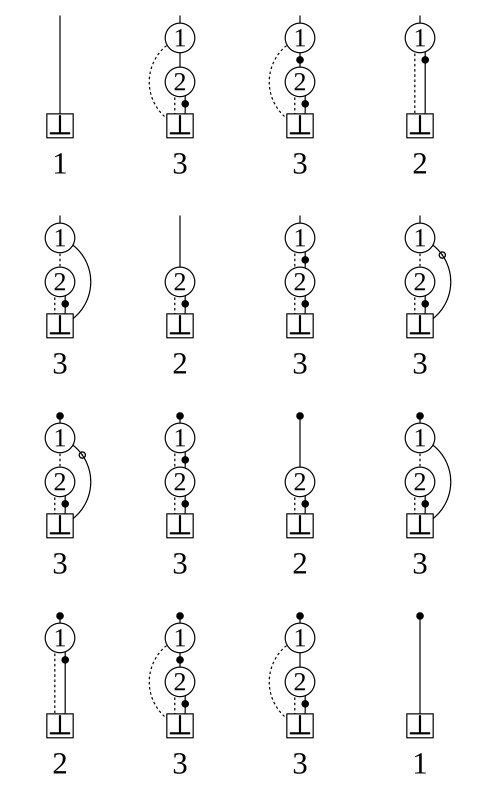](../../../assets/volume4a/figures/answer-7-1-4-262c-normalized-bdds.svg)

(d) 存在 $2^{2^m-1}-2^{2^{m-1}-1}$ 条 $m$ 阶的正规串珠. 最坏情况

$$
B^0(f)\le B^0(f_n)=1+\sum_{k=0}^{n-1}\min\bigl(2^k,\;2^{2^{n-k}-1}-2^{2^{n-k-1}-1}\bigr)=(U_{n+1}-1)/2
$$

出现在习题 110 的答案的函数. 对于平均正规分布, 把 (80) 中的 $2^{2^{n-k}}-1$ 改为 $2^{2^{n-k}}-2$, 并且用 2 除整个公式. 平均情况也是非常接近最坏情况的. 例如, 替代 (81) 我们有

$$
(1.0,\;2.0,\;4.0,\;8.0,\;16.0,\;32.0,\;64.0,\;127.3,\;103.9,\;6.0,\;1.0,\;1.0).
$$

(e) 我们省去 $\boxed\top$、一个⑥、两个⑤和三个④, 留下 45 个正规结点.

(f) 对于已知 $f$ 和 $g$ 是正规函数的情况, 或许最好用子程序 AND、OR、BUTNOT, 同时对于一般情况用子程序 GAND. 如果 $f$ 和 $g$ 都是偶数, 例程 GAND(f,g) 返回 AND(f,g), 如果 $f$ 是偶数但 $g$ 是奇数, 返回 BUTNOT(f,C(g)), 如果 $g$ 是偶数但是 $f$ 是奇数, 返回 BUTNOT(g,C(f)), 如果 $f$ 和 $g$ 都是奇数, 返回 C(OR(C(f), C(g))). 除了 $r_h\leftarrow\operatorname{GAND}(f_h,g_h)$, 例程 AND(f,g) 与 (55) 相似. 仅对 $f=0$、$g=0$、$f=g$ 的情况需要作为 “明显的” 值检验.

注: 补链是小谢尔登·埃克斯在 1978 年提出的, 让-保罗·比永在 1987 年独立提出, 虽然这样的链被所有主要的 BDD 程序包采用, 但是难以推荐使用它们, 因为计算机程序变得非常复杂. 内存的节省通常是微不足道的, 而且占用量不可能低于原来的一半. 此外, 作者的经验说明运行时间的改进甚小.

当用 ZDD 代替 BDD 时, 一个 “正规族” 是不包含空集的集合族. 湊真一曾经建议在 ZDD 处理中用 $C(f)$ 而不是 $\bar f$ 表示族 $f\oplus\epsilon$.

<a id="ans-7-1-4-263"></a>

**263.** [题目](../sec-7-1-4.md#ex-7-1-4-263) (a) 如果 $Hx=0$ 且 $x\ne0$, 我们不会有 $\nu x=1$ 或 2, 因为 $H$ 的列是非零且不同的. [理查德·汉明,*Bell System Tech. J.* **29** (1950), 147–160.]

(b) 令 $r_k$ 是 $H$ 的前 $k$ 列的秩, $s_k$ 是后 $k$ 列的秩. 那么 $b_k=2^{r_k+s_{n-k}-r_n}$($0\le k<n$), 因为这是由前 $k$ 列和后 $n-k$ 列生成的向量空间的交集中元素的数目. 在汉明码中, 当 $k>1$ 时 $r_k=1+\lambda k$ 且 $s_k=\min(m,2+\lambda(k-1))$. 因此我们求出 $B(f)=(n^2+5)/2$. [见小乔治·福尼,*IEEE Trans.* **IT-34** (1988), 1184–1187.]

(c) 令 $q_k=1-p_k$. 使 $\prod_{k=1}^n p_k^{[x_k=y_k]}q_k^{[x_k\ne y_k]}$ 取最大值与使 $\sum_{k=1}^n w_kx_k$ 取最大值是相同的, 其中 $w_k=(2y_k-1)\log(p_k/q_k)$, 所以我们可以用算法 B.

注: 编码理论家在 1967 年从福尼未发表的成果开始, 建立了一种称为格子图的编码思想. 在二进制的情况, 格子图如同 $f$ 的 QDD, 但是消除常值子函数 0 的全部结点. (有用的编码具有大于 1 的距离, 于是格子图也是 $f$ 的 BDD, 但是消除了 $\boxed\bot$.) 福尼的初衷是证明安德鲁·维泰尔比 [*IEEE Trans.* **IT-13** (1967), 260–269] 的解码算法对于卷积码是最优的. 几年后, 拉利特·巴尔、约翰·科克、弗雷德里克·杰利内克和约瑟夫·拉维夫 [*IEEE Trans.* **IT-20** (1974), 284–287] 把格子图结构扩展到线性分组码, 并且提出进一步的优化算法. 也见以下论文: 加文·霍恩和弗兰克·克什昌 [*IEEE Trans.* **IT-42** (1996), 2042–2048]; 约翰·拉弗蒂和亚历山大·瓦迪 [*IEEE Trans.* **C-48** (1999), 971–986].

<a id="ans-7-1-4-264"></a>

**264.** [题目](../sec-7-1-4.md#ex-7-1-4-264) 把算法 B 的 “自底向上” 方法与优化一个结点的前导的 “自顶向下” 方法结合的过程, 可能比严格从一个方向处理的方法更有效.

<a id="ans-7-1-4-265"></a>

**265.** [题目](../sec-7-1-4.md#ex-7-1-4-265) 像算法 C 那样用 $n$ 位二进制算术自底向上计算 $c_j$, 然后从 $k\leftarrow s-1$、$j\leftarrow1$、$m\leftarrow m-1$ 开始自顶向下进行, 并且重复下列操作步骤 (其间我们有 $0\le m<2^{v_k-j}c_k$): 如果 $v_k>j$, 置 $x_j\leftarrow\left\lfloor m/(2^{v_k-j-1}c_k)\right\rfloor$、$m\leftarrow m\bmod(2^{v_k-j-1}c_k)$、$j\leftarrow j+1$; 否则, 如果 $k=1$, 终止. 否则置 $l\leftarrow l_k$、$h\leftarrow h_k$, 并且如果 $m<2^{v_l-v_k-1}c_l$, 置 $x_j\leftarrow0$、$k\leftarrow l$、$j\leftarrow j+1$, 否则置 $x_j\leftarrow1$、$m\leftarrow m-2^{v_l-v_k-1}c_l$、$k\leftarrow h$、$j\leftarrow j+1$.

<a id="ans-7-1-4-266"></a>

**266.** [题目](../sec-7-1-4.md#ex-7-1-4-266) 事实上, 如果我们使用 HI 的左子链和 LO 的右兄弟链, ZDD 是直接从 $F$ 的标准的 “左子／右兄弟” 二叉树 (见 7.2.1.6-(4)) 获得的. 空链被改为指向 $\boxed\top$, 除非最右树的根 (后序中的最后结点) 的 LO 链指向 $\boxed\bot$.


<a id="pdf-583"></a><a id="p-568"></a>

<a id="ans-7-1-4-267"></a>

**267.** [题目](../sec-7-1-4.md#ex-7-1-4-267) $d(F)$ 的 ZDD 的大小可以用树上递归定义的辅助函数 $\zeta(T)$ 计算如下: 如果 $|T|=1$ (即 $T$ 只有一个结点), $\zeta(T)=1$. 否则 $T$ 包含根以及子树 $T_1,\ldots,T_k$($k\ge1$), 并且定义 $\zeta(T)=1+\zeta(T_1)+\cdots+\zeta(T_k)+|T|-|T_k|$. 然后如果 $F$ 包含树 $T_1,\ldots,T_k$($k\ge1$), 我们有 $Z(d(F))=1+\zeta(T_1)+\cdots+\zeta(T_k)+[|T_k|=1]$.

最小大小 $n+2$, 显然出现在 $F$ 包含 $n$ 棵单结点树的时候. 当 $n\ge2$ 时最大大小为 $\lfloor n^2/4\rfloor+n+1$($n=1$ 时为 3), 其中 $n=2m-1$ 的情形出现在一棵树中, 它的结点 $k$ 具有两个子结点 $k+1$ 和 $k+m$($1\le k<m$). $n=2m$ 的情形是类似的.

对于平均大小, 考虑对所有树 $T$ 求和的生成函数 $Z(w,z)=\sum w^{\zeta(T)}z^{|T|}$. $\zeta$ 的定义产生函数方程 $Z(w,z)=wz+w^2zZ(w,z)/(1-Z(w,wz))$. 对 $w$ 和 $z$ 微分, 然后置 $w=1$, 告诉我们 $Z(1,z)=(1-s)/2$、$Z_w(1,z)=z/s+z/(4s^2)-z/4$、$Z_z(1,z)=1/s$, 其中 $s=\sqrt{1-4z}$. 对所有非空森林 $F$ 求和的生成函数 $\sum_F w^{Z(d(F))}z^{|F|}$ 是 $(wZ(w,z)+w^3z-w^2z)/(1-Z(w,z))$. 对 $w$ 微分并且置 $w=1$, 我们得到 $z/(1-4z)+2z/\sqrt{1-4z}$. 因此 $Z(d(F))$ 的平均值是

$$
(4^{n-1}+2nC_{n-1})/C_n=\tfrac14\sqrt\pi\,n^{3/2}+\tfrac n2+O(n^{1/2}),
$$

其中 $C_n$ 是卡塔兰数 7.2.1.6-(15).

<a id="answers-sec-7-2-1-1"></a>
