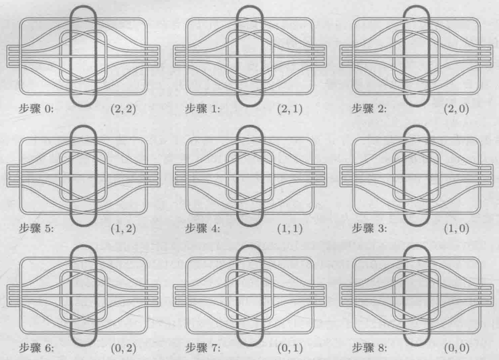

<a id="answers-7-2-1-1"></a>


## 7.2.1.1节

<a id="ans-7-2-1-1-1"></a>

**1.** [题目](../sec-7-2-1-1.md#ex-7-2-1-1-1) 令 $m_j=u_j-l_j+1$, 并在算法 M 中访问 $(a_1+l_1,\ldots,a_n+l_n)$ 而不是 $(a_1,\ldots,a_n)$. 或者, 在这个算法中把 “$a_j\leftarrow0$” 改为 “$a_j\leftarrow l_j$” 且把 “$a_j=m_j-1$” 改为 “$a_j=u_j$”, 并且在步骤 M1 置 $l_0\leftarrow0$、$u_0\leftarrow1$.

<a id="ans-7-2-1-1-2"></a>

**2.** [题目](../sec-7-2-1-1.md#ex-7-2-1-1-2) (0,0,1,2,3,0,2,7,0,9).

<a id="ans-7-2-1-1-3"></a>

**3.** [题目](../sec-7-2-1-1.md#ex-7-2-1-1-3) 当 $j=k$ 时执行步骤 M4 $m_1m_2\cdots m_k$ 次. 因此总次数是 $\sum_{k=0}^n\prod_{j=1}^k m_j=m_1\cdots m_n(1+1/m_n+1/(m_nm_{n-1})+\cdots+1/(m_n\cdots m_1))$. 如果所有 $m_k$ 是 2 或者更大的数, 这小于 $2m_1\cdots m_n$. [因此, 我们应当考虑那些巧妙的格雷码方法, 它们在每次访问中仅改变一个数字, 实际最多减少数字改变总数的一半.]

<a id="ans-7-2-1-1-4"></a>

**4.** [题目](../sec-7-2-1-1.md#ex-7-2-1-1-4) **N1.[初始化.]** 对于 $0\le j\le n$ 置 $a_j\leftarrow m_j-1$, 其中 $m_0=2$.

**N2.[访问.]** 访问 $n$ 元组 $(a_1,\ldots,a_n)$.

**N3.[准备减 1.]** 置 $j\leftarrow n$.

**N4.[在需要时借位.]** 如果 $a_j=0$, 置 $a_j\leftarrow m_j-1$、$j\leftarrow j-1$, 并且重复这一步骤.

**N5.[减 1, 直到结束.]** 如果 $j=0$, 终止算法. 否则置 $a_j\leftarrow a_j-1$ 并且返回 N2. ■

<a id="ans-7-2-1-1-5"></a>

**5.** [题目](../sec-7-2-1-1.md#ex-7-2-1-1-5) 在一台像 MMIX 的计算机上二进制位反射是容易的, 但是在其他计算机上我们可以处理如下:

**Z1.[初始化.]** 置 $j\leftarrow k\leftarrow0$.

**Z2.[交换.]** 交换 $A[j+1]\leftrightarrow A[k+2^{n-1}]$. 而且, 如果 $j<k$, 交换 $A[j]\leftrightarrow A[k]$、$A[j+2^{n-1}+1]\leftrightarrow A[k+2^{n-1}+1]$.

**Z3.[推进 $k$.]** 置 $k\leftarrow k+2$, 并且当 $k\ge2^{n-1}$ 时终止.

**Z4.[推进 $j$.]** 置 $h\leftarrow2^{n-2}$. 如果 $j\ge h$, 重复置 $j\leftarrow j-h$、$h\leftarrow h/2$ 直到 $j<h$. 然后置 $j\leftarrow j+h$. (现在如果 $k=(b_{n-1}\cdots b_0)_2$, 则 $j=(b_0\cdots b_{n-1})_2$.) 返回 Z2. ■

<a id="ans-7-2-1-1-6"></a>

**6.** [题目](../sec-7-2-1-1.md#ex-7-2-1-1-6) 如果 $g((0b_{n-1}\cdots b_1b_0)_2)=(0(b_{n-1})\cdots(b_2\oplus b_1)(b_1\oplus b_0))_2$, 则 $g((1b_{n-1}\cdots b_1b_0)_2)=2^n+g((0\bar b_{n-1}\cdots\bar b_1\bar b_0)_2)=(1(\bar b_{n-1})\cdots(\bar b_2\oplus\bar b_1)(\bar b_1\oplus\bar b_0))_2$, 其中 $\bar b=b\oplus1$.

<a id="ans-7-2-1-1-7"></a>

**7.** [题目](../sec-7-2-1-1.md#ex-7-2-1-1-7) 为了适合 $2r$ 个扇区, 我们可以使用对于 $2^n-r\le k<2^n+r$ 的 $g(k)$, 其中 $n=\lceil\lg r\rceil$, 因为根据 (5), $g(2^n-r)\oplus g(2^n+r-1)=2^n$. [杰弗里·图蒂尔,*Proc. IEE* **103**, Part B Supplement (1956), 434.] 也见习题 26.

<a id="ans-7-2-1-1-8"></a>

**8.** [题目](../sec-7-2-1-1.md#ex-7-2-1-1-8) 使用算法 G, 取 $n\leftarrow n-1$, 并且在右端加入奇偶检验位 $a_{-1}$. (这产生 $g(0),g(2),g(4),\ldots$.)

<a id="ans-7-2-1-1-9"></a>

**9.** [题目](../sec-7-2-1-1.md#ex-7-2-1-1-9) 由于 $\nu(1011000)$ 是奇数, 所以是把最右边的环放回原处.


<a id="pdf-584"></a><a id="p-569"></a>

<a id="ans-7-2-1-1-10"></a>

**10.** [题目](../sec-7-2-1-1.md#ex-7-2-1-1-10) $A_n+B_n=g^{[-1]}(2^n-1)=\lfloor2^{n+1}/3\rfloor$, $A_n=B_n+n$. 因此 $A_n=\lfloor2^n/3+n/2\rfloor$, $B_n=\lfloor2^n/3-n/2\rfloor$.

历史注记: 早期的日本数学家有马赖徸 (1714—1783) 在他的书 *Shūki Sanpō* (1769) 的问题 44 中讨论了这个问题, 说明 $n$ 环谜题在一定数量的移动步骤之后简化为 $n-1$ 环谜题. 令 $C_n=A_n-A_{n-1}=B_n-B_{n-1}+1$ 是在这个简化过程中取下的环的数目. 有马赖徸指出 $C_n=2C_{n-1}-[n\text{ 是偶数}]$. 因此他能够对 $n=9$ 计算 $A_n=C_1+C_2+\cdots+C_n$ 而无须真正知道公式 $C_n=\lceil2^{n-1}/3\rceil$. 安德烈亚斯·欣茨发现德国物理学家格奥尔格·利希滕贝格在 *Göttingische Anzeigen von gemeinnützigen Sachen* **1** (1769), 637–640 中发表了类似的结果.

两个多世纪以前, 吉罗拉莫·卡尔达诺在他的 *De Subtilitate Libri XXI* (Nuremberg: 1550) 第 15 卷已经提到 “复杂的环”. 他写到, 它们是 “无用的然而是极为奇妙的”, 并错误地指出, 取下 7 个环需要 95 次移动, 而使它们复原还需要另外 95 次移动. 约翰·沃利斯在他的拉丁文版的 *Algebra* **2** (Oxford: 1693) 的第 111 章用了 7 页篇幅讨论这个谜题, 对于 9 环的情形提出了详尽但非最优的解法. 他包括了使一个环通过杆滑动以及把它置于杆上或者从杆上取下的操作, 而且提示有捷径可寻, 但是他没有尝试找出一个最短的解.

<a id="ans-7-2-1-1-11"></a>

**11.** [题目](../sec-7-2-1-1.md#ex-7-2-1-1-11) 当 $S_1=S_2=1$ 时 $S_n=S_{n-2}+1+S_{n-2}+S_{n-1}$ 的解是 $S_n=2^{n-1}-[n\text{ 是偶数}]$. [*Math. Quest. Educational Times* **3** (1865), 66–67.]

<a id="ans-7-2-1-1-12"></a>

**12.** [题目](../sec-7-2-1-1.md#ex-7-2-1-1-12) (a) $n-1$ 个中国环的理论证明, 格雷二进制码以方便的顺序 (4, 31, 211, 22, 112, 1111, 121, 13) 产生组分:

**C1.[初始化.]** 置 $t\leftarrow1$、$s_1\leftarrow n$. (假定 $n>1$.)

**C2.[访问.]** 访问 $s_1\cdots s_t$. 然后如果 $t$ 是偶数转到 C4.

**C3.[奇数步.]** 如果 $s_t>1$, 置 $s_t\leftarrow s_t-1$、$s_{t+1}\leftarrow1$、$t\leftarrow t+1$, 否则置 $t\leftarrow t-1$、$s_t\leftarrow s_t+1$. 返回 C2.

**C4.[偶数步.]** 如果 $s_{t-1}>1$, 置 $s_{t-1}\leftarrow s_{t-1}-1$、$s_{t+1}\leftarrow s_t$、$s_t\leftarrow1$、$t\leftarrow t+1$, 否则置 $t\leftarrow t-1$、$s_t\leftarrow s_{t+1}$、$s_{t-1}\leftarrow s_{t-1}+1$ (但是如果 $t$ 变为 1 则终止). 返回 C2. ■

(b) 现在 $q_1,\ldots,q_{t-1}$ 表示杆上的环:

**B1.[初始化.]** 置 $t\leftarrow1$、$q_0\leftarrow n$. (假定 $n>1$.)

**B2.[访问.]** 置 $q_t\leftarrow0$ 并且访问 $(q_0-q_1)\cdots(q_{t-1}-q_t)$. 如果 $t$ 是偶数, 转到 B4.

**B3.[奇数步.]** 如果 $q_{t-1}>1$, 置 $q_t\leftarrow1$、$t\leftarrow t+1$, 否则置 $t\leftarrow t-1$. 返回 B2.

**B4.[偶数步.]** 如果 $q_{t-2}>q_{t-1}+1$, 置 $q_t\leftarrow q_{t-1}$、$q_{t-1}\leftarrow q_t+1$、$t\leftarrow t+1$, 否则置 $q_{t-2}\leftarrow q_{t-1}$、$t\leftarrow t-1$ (但是如果 $t$ 变为 1 则终止). 返回 B2. ■

这两个算法 [见贾亚德瓦·米斯拉,*ACM Trans. Math. Software* **1** (1975), 285.] 即使在它们的初始化步骤也是无循环的.

<a id="ans-7-2-1-1-13"></a>

**13.** [题目](../sec-7-2-1-1.md#ex-7-2-1-1-13) 在步骤 C1, 还要置 $C\leftarrow1$. 在步骤 C3, 如果 $s_t>1$, 置 $C\leftarrow s_tC$, 否则置 $C\leftarrow C/(s_{t-1}+1)$. 在步骤 C4, 如果 $s_{t-1}>1$, 置 $C\leftarrow s_{t-1}C$, 否则置 $C\leftarrow C/(s_{t-2}+1)$. 类似的修改适用于步骤 B1、B3、B4. 为了容纳组分 $1\cdots1$ 对应的值 $C=n!$, 需要足够的精度. 通过假定算术运算花费单位时间, 我们延伸了无循环算法的定义.

<a id="ans-7-2-1-1-14"></a>

**14.** [题目](../sec-7-2-1-1.md#ex-7-2-1-1-14) **V1.[初始化.]** 置 $j\leftarrow0$.

**V2.[访问.]** 访问串 $a_1\cdots a_j$.

**V3.[延长.]** 如果 $j<n$, 置 $j\leftarrow j+1$、$a_j\leftarrow0$, 并且返回 V2.

**V4.[前进.]** 如果 $a_j<m_j-1$, 置 $a_j\leftarrow a_j+1$, 并且返回 V2.

**V5.[缩短.]** 置 $j\leftarrow j-1$, 并且如果 $j>0$ 返回 V4. ■

<a id="ans-7-2-1-1-15"></a>

**15.** [题目](../sec-7-2-1-1.md#ex-7-2-1-1-15) **J1.[初始化.]** 置 $j\leftarrow0$.

**J2.[偶访问.]** 如果 $j$ 是偶数, 访问串 $a_1\cdots a_j$.


<a id="pdf-585"></a><a id="p-570"></a>

**J3.[延长.]** 如果 $j<n$, 置 $j\leftarrow j+1$、$a_j\leftarrow0$, 并且返回 J2.

**J4.[奇访问.]** 如果 $j$ 是奇数, 访问串 $a_1\cdots a_j$.

**J5.[前进.]** 如果 $a_j<m_j-1$, 置 $a_j\leftarrow a_j+1$, 并且返回 J2.

**J6.[缩短.]** 置 $j\leftarrow j-1$, 并且如果 $j>0$ 返回 J4. ■

这个算法是无循环的, 虽然乍看之下它可能带有循环. 最多 4 个步骤区分相继的访问. 基本思想与习题 2.3.1-5 以及 “前后序” 遍历 (算法 7.2.1.6Q) 有关.

<a id="ans-7-2-1-1-16"></a>

**16.** [题目](../sec-7-2-1-1.md#ex-7-2-1-1-16) 假定 $\operatorname{LINK}(j-1)=j+nb_j$($1\le j\le n$), $\operatorname{LINK}(j-1+n)=j+n(1-b_j)$($1<j\le n$). 当且仅当 $g(a_1\cdots a_n)=b_1\cdots b_n$ 这些链表示 $(a_1,\ldots,a_n)$, 所以我们可以用无循环格雷二进制生成程序达到想要的结果.

<a id="ans-7-2-1-1-17"></a>

**17.** [题目](../sec-7-2-1-1.md#ex-7-2-1-1-17) 对于 $0\le j,k<8$, 把两个 3 位二进制码的串联 $(g(j),g(k))$ 置于第 $j$ 行第 $k$ 列. [不难证明这实际上是唯一的解, 除了排列和 (或) 取补坐标位置和 (或) 旋转行, 因为当向北或向南移动时坐标的改变仅取决于行, 类似的断言也适用于列. 4 立方与 $4\times4$ 环面之间的卡诺同构可以追溯到威廉·基斯特、阿利斯泰尔·里奇和塞思·沃什伯恩所著的 *The Design of Switching Circuits* (1951) 的第 174 页. 顺便说一下, 基斯特进而设计了一个称为回旋 (SpinOut) 的中国环的精巧的变形, 以及称为十六进制谜题的一个推广, 见美国专利第 3637215–3637216 号 (1972).]

<a id="ans-7-2-1-1-18"></a>

**18.** [题目](../sec-7-2-1-1.md#ex-7-2-1-1-18) 使用 2 比特格雷码把数字 $u_j=(0,1,2,3)$ 分别表示成二进制位偶 $u'_{2j-1}u'_{2j}=(00,01,11,10)$. [李始元在 *IRE Trans.* **IT-4** (1958), 77–82 介绍了他的度量. 一种类似的 $m/2$ 位二进制码适用于 $m$ 的偶数值. 例如, 当 $m=8$ 时, 我们可以用 (0000,0001,0011,0111,1111,1110,1100,1000) 表示 (0,1,2,3,4,5,6,7). 但是, 当 $m>4$ 时, 这样一种方案没有考虑某些二进制模式.]

<a id="ans-7-2-1-1-19"></a>

**19.** [题目](../sec-7-2-1-1.md#ex-7-2-1-1-19) (a) 一种取模格雷四进制算法需要的计算比算法 M 略少一些, 但是这无关紧要, 因为 256 是如此之小. 结果是

$$
z_0^8+z_1^8+z_2^8+z_3^8+14(z_0^4z_2^4+z_1^4z_3^4)+56z_0z_1z_2z_3(z_0^2+z_2^2)(z_1^2+z_3^2).
$$

(b) 用 $(1,z,z^2,z)$ 代替 $(z_0,z_1,z_2,z_3)$ 给出 $1+112z^6+30z^8+112z^{10}+z^{16}$. 因此所有非零的李权大于等于 6. 现在利用上题的结构把每个 $(u_0,u_1,u_2,u_3,u_4,u_5,u_6,u_\infty)$ 转换成 16 位二进制数.

<a id="ans-7-2-1-1-20"></a>

**20.** [题目](../sec-7-2-1-1.md#ex-7-2-1-1-20) 从 $u'$ 恢复四进制向量 $(u_0,u_1,u_2,u_3,u_4,u_5,u_6,u_\infty)$, 并且用算法 4.6.1D 求 $u_0+u_1x+\cdots+u_6x^6$ 除以 $g(x)\bmod4$ 的余数. 因为 $g(x)$ 是首一多项式, 尽管存在系数不属于一个域的事实, 还是可以使用该算法. 把余数表示成 $x^j+2x^k$(mod $g(x)$ 和 4), 并且令 $d=(k-j)\bmod7$、$s=(u_0+\cdots+u_6+u_\infty)\bmod4$.

情形 1: $s=1$. 如果 $k=\infty$, 错误是 $x^j$ (换句话说, 正确的向量有 $u_j\leftarrow(u_j-1)\bmod4$). 否则存在 3 个或者更多的错误.

情形 2: $s=3$. 如果 $j=k$, 错误是 $-x^j$. 否则, 出现大于等于 3 个错误.

情形 3: $s=0$. 如果 $j=k=\infty$, 没有造成错误; 如果 $j=\infty$ 且 $k<\infty$, 至少产生 4 个错误. 否则错误是 $x^a-x^b$, 其中, 按照 $d=(0,1,2,3,4,5,6,\infty)$ 有 $a=(j+(\infty,6,5,2,3,1,4,0))\bmod7$, 以及 $b=(j+2d)\bmod7$.

情形 4: $s=2$. 如果 $j=\infty$, 错误是 $2x^k$. 否则错误是

$$
\begin{aligned}
x^j+x^\infty,&\quad\text{如果 }k=\infty;\\
-x^j-x^\infty,&\quad\text{如果 }d=0;\\
x^a+x^b,&\quad\text{如果 }d\in\{1,2,4\},\quad a=(j-3d)\bmod7,\quad b=(j-2d)\bmod7;\\
-x^a-x^b,&\quad\text{如果 }d\in\{3,5,6\},\quad a=(j-3d)\bmod7,\quad b=(j-d)\bmod7.
\end{aligned}
$$

给定 $u'=(1100100100001111)_2$, 我们有 $u=(2,0,3,1,0,0,2,2)$ 和 $2+3x^2+x^3+2x^6\equiv1+3x+3x^2\equiv x^5+2x^6$, 也有 $s=2$. 因此, 错误是 $x^2+x^3$, 并且最接近的无错误的码字是 (2,0,2,0,0,0,2,2). 算法 4.6.1D 告诉我们 $2+2x^2+2x^6\equiv(2+2x+2x^3)g(x)\ (\text{modulo }4)$, 所以 8 位二进制信息对应于 $(v_0,v_1,v_2,v_3)=(2,2,0,2)$. [一个更智能的算法还会宣告: “啊哈, 这是 $\pi$ 的前 16 个二进制位.”]

关于基于四进制向量的其他有效编码方案的推广, 见小阿瑟·哈蒙斯、邦加纳马拉·库马尔、阿瑟·考尔德邦克、尼尔·斯隆和帕特里克·索莱的经典论文 *IEEE Trans.* **IT-40** (1994), 301–319.


<a id="pdf-586"></a><a id="p-571"></a>

<a id="ans-7-2-1-1-21"></a>

**21.** [题目](../sec-7-2-1-1.md#ex-7-2-1-1-21) (a) $C(\epsilon)=1$, $C(0\alpha)=C(1\alpha)=C(\alpha)$, $C(\ast\alpha)=2C(\alpha)-[10\cdots0\in\alpha]$. 迭代这个递推公式给出 $C(\alpha)=2^t-2^{t-1}e_t-2^{t-2}e_{t-1}-\cdots-2^0e_1$, 其中 $e_j=[10\cdots0\in\alpha_j]$ 且 $\alpha_j$ 是第 $j$ 个星号之后的 $\alpha$ 的后缀. 在这个例子中, 我们有 $\alpha_1=\ast10\ast\ast0\ast$、$\alpha_2=10\ast\ast0\ast$、$\ldots$、$\alpha_5=\epsilon$, 所以 $e_1=0$、$e_2=1$、$e_3=1$、$e_4=0$、$e_5=1$ (根据约定), 因此 $C(\ast\ast10\ast\ast0\ast)=2^5-2^4-2^2-2^1=10$.

(b) 我们可以消除尾部星号使得 $t=t'$. 那么 $e_t=1$ 蕴涵 $e_{t-1}=\cdots=e_1=0$. [当且仅当 $\alpha$ 以 $\ast10^j\ast^k$ 结束时出现情形 $C(\alpha)=2^{t'-1}$.]

(c) 为了计算所有 $t$ 子立方上 $C(\alpha)$ 的和, 注意 $\binom nt$ 个簇在 $n$ 元组 $0\cdots0$ 开始, 并且 $\binom{n-1}t$ 个簇在每个接着的 $n$ 元组开始 (即包含该 $n$ 元组并且确定改变的二进制位的每个 $t$ 子立方的簇). 因此平均值是

$$
\frac{\binom nt+(2^n-1)\binom{n-1}t}{2^{n-t}\binom nt}=2^t(1-t/n)+2^{t-n}(t/n).
$$

[(c) 中的公式对于任何 $n$ 比特格雷路径成立, 但是 (a) 和 (b) 中的公式是针对反射格雷二进制码的. 这些结果应归功于赫里斯托斯·法劳特索斯,*IEEE Trans.* **SE-14** (1988), 1381–1393.]

<a id="ans-7-2-1-1-22"></a>

**22.** [题目](../sec-7-2-1-1.md#ex-7-2-1-1-22) 令 $\alpha\ast^j$ 和 $\beta\ast^k$ 是格雷二叉检索树连续的叶, 其中 $\alpha$ 和 $\beta$ 是二进制串且 $j\le k$. 那么 $\alpha$ 的最后 $k-j$ 个二进制位是一个串 $\alpha'$, 使得 $\alpha$ 和 $\beta\alpha'$ 是格雷二进制码的连续的元素, 因此是邻接的. [威廉·达利所著的 *A VLSI Architecture for Concurrent Data Structures* (Kluwer, 1987) 第 3 章讨论了这一性质在立体连通的消息传递并行计算机上的有趣应用.]

<a id="ans-7-2-1-1-23"></a>

**23.** [题目](../sec-7-2-1-1.md#ex-7-2-1-1-23) $2^j=g(k)\oplus g(l)=g(k\oplus l)$ 蕴涵 $l=k\oplus g^{[-1]}(2^j)=k\oplus(2^{j+1}-1)$. 换句话说, 如果 $k=(b_{n-1}\cdots b_0)_2$, 我们有 $l=(b_{n-1}\cdots b_{j+1}\bar b_j\cdots\bar b_0)_2$.

<a id="ans-7-2-1-1-24"></a>

**24.** [题目](../sec-7-2-1-1.md#ex-7-2-1-1-24) 照例定义 $g(k)=k\oplus\lfloor k/2\rfloor$, 我们发现 $g(k)=g(-1-k)$. 因此有两个 2 基整数 $k$, 使得 $g(k)$ 具有给定的 2 基值 $l$. 它们中的一个是偶数, 另一个是奇数, 我们可以方便地把 $g^{[-1]}$ 定义为偶数的解, 然后用 $b_j=a_{j-1}\oplus\cdots\oplus a_0$($j\ge0$) 代替 (8). 例如, 按这个定义 $g^{[-1]}(1)=-2$. 当 $l$ 是通常的整数时, $g^{[-1]}(l)$ 的 “符号” 是 $l$ 的二进制位中 1 的个数的奇偶性.

<a id="ans-7-2-1-1-25"></a>

**25.** [题目](../sec-7-2-1-1.md#ex-7-2-1-1-25) 令 $p=k\oplus l$. 习题 7.1.3-3 告诉我们 $2^{\lfloor\lg p\rfloor+1}-p\le|k-l|\le p$. 当且仅当存在正整数 $j_1,\ldots,j_t$ 使得 $p=(1^{j_1}0^{j_2}1^{j_3}\cdots(0\text{ 或 }1)^{j_t})_2$ 时, 我们有 $\nu(g(p))=\nu(g(k)\oplus g(l))=t$. 当 $j_1=n+1-t$ 且 $j_2=\cdots=j_t=1$ 时出现最大的可能的 $p<2^n$, 给出 $p=2^n-\lceil2^t/3\rceil$. 当 $j_2=\cdots=j_t=1$ 时出现最小的可能的 $q=2^{\lfloor\lg p\rfloor+1}-p=(1^{j_2}0^{j_3}\cdots(1\text{ 或 }0)^{j_t})_2+1$, 给出 $q=\lceil2^t/3\rceil$. [阮宗光,*IEEE Trans.* **IT-20** (1974), 668; 斯蒂芬·卡威欧,*IEEE Trans.* **IT-21** (1975), 596. 取模格雷 $m$ 进制码的类似的界是 $\lceil m^t/(m^2-1)\rceil$, 当 $m$ 是偶数时, 这个公式对反射 $m$ 进制格雷码也成立. 见阿伦德·范赞滕和似·苏帕托,*IEEE Trans.* **IT-49** (2003), 485–487;*Proc. South East Asian Math. Soc. Conf.* (Yogyakarta: Gadjah Mada University, 2003), 98–105.]

<a id="ans-7-2-1-1-26"></a>

**26.** [题目](../sec-7-2-1-1.md#ex-7-2-1-1-26) 令 $N=2^{n_t}+\cdots+2^{n_1}$, 其中 $n_t>\cdots>n_1\ge0$. 此外, 令 $\Gamma_n$ 是 $\{0,1,\ldots,2^n-1\}$ 的以 0 开始且以 1 结束的任意格雷码, 除了 $\Gamma_0$ 就是 0. 使用

$$
\begin{aligned}
&\Gamma_{n_t}^R,\;2^{n_t}+\Gamma_{n_{t-1}},\;\ldots,\;2^{n_t}+\cdots+2^{n_3}+\Gamma_{n_2}^R,\;2^{n_t}+\cdots+2^{n_2}+\Gamma_{n_1},&&\text{如果 }t\text{ 是偶数};\\
&\Gamma_{n_t},\;2^{n_t}+\Gamma_{n_{t-1}}^R,\;\ldots,\;2^{n_t}+\cdots+2^{n_3}+\Gamma_{n_2}^R,\;2^{n_t}+\cdots+2^{n_2}+\Gamma_{n_1},&&\text{如果 }t\text{ 是奇数}.
\end{aligned}
$$

<a id="ans-7-2-1-1-27"></a>

**27.** [题目](../sec-7-2-1-1.md#ex-7-2-1-1-27) 一般说来, 如果 $k=(b_{n-1}\cdots b_0)_2$, $S_n$ 的第 $k+1$ 个最大元素等于

$$
1/(2-(-1)^{a_{n-1}}/(2-\cdots/(2-(-1)^{a_1}/(2-(-1)^{a_0}))\cdots)),
$$

对应于符号模式 $g(k)=(a_{n-1}\cdots a_0)_2$. 因此, 只要给出排名, 我们可以用 $O(n)$ 步计算 $S_n$ 的任何元素. 置 $k=2^{100}-10^{10}$ 且 $n=100$, 给出答案 $373065177/1113604409$. [正如赫伯特·萨尔泽在 *CACM* **16** (1973), 180 中指出的那样, 每当 $f(x)$ 是正的单调函数时, $2^n$ 个元素 $f(\pm f(\ldots\pm f(\pm x)\ldots))$ 是按格雷二进制码排序的. 然而, 在这种特殊情况下, 存在另外一种获得答案的方法, 因为使用 4.5.3 节的记号, 我们还有 $S_n=//2,\pm2,\ldots,\pm2,\pm1//$. 这种形式的连分数是按 $k$ 的交替的二进制位的补排序的.]

<a id="ans-7-2-1-1-28"></a>

**28.** [题目](../sec-7-2-1-1.md#ex-7-2-1-1-28) (a) 当 $t=1,2,\ldots$ 时, $G_t$ 的中位数的二进制位 $a_j$ 遍历在每 $2^{1+j}$ 步出现一个星号的周期序列

$$
0,\ldots,0,\ast,1,\ldots,1,\ast,0,\ldots,0,\ast,\ldots
$$


<a id="pdf-587"></a><a id="p-572"></a>

因此对应于 $\lfloor(t-1)/2\rfloor$ 和 $\lfloor t/2\rfloor$ 的二进制表示的两个串是中位数. 而且, 在所有中位数与 $\lfloor(t-1)/2\rfloor$ 和 $\lfloor t/2\rfloor$ 的公共二进制位相一致的意义下, 这些串实际上是 “极端” 情况, 因此星号出现在它们不一致的地方. 例如, 当 $t=100=(01100100)_2$ 且 $n=8$ 时, 我们有 $G_{100}$ 的中位数是 `001100**`.

(b) 由于 $G_{2t}=2G_t\cup(2G_t+1)$, 我们可以假定 $t=(a_{n-2}\cdots a_1a_01)_2$ 是奇数. 如果在格雷二进制码中 $\alpha$ 是 $g(p)$ 且 $\beta$ 是 $g(q)$, 我们有 $p=(p_{n-1}\cdots p_0)_2$ 和 $q=(p_{n-1}\cdots p_{j+1}\bar p_j\cdots\bar p_0)_2$, 并且 $a_{n-1}a_{n-2}=01=p_{n-1}\bar p_{n-2}$. 我们不可能有 $p<t\le q$, 因为这意味着 $j=n-1$ 和 $p_{n-3}=p_{n-4}=\cdots=p_0=1$. [见阿瑟·伯恩斯坦、肯尼思·斯泰格利茨和约翰·霍普克罗夫特,*IEEE Trans.* **IT-12** (1966), 425–430.]

<a id="ans-7-2-1-1-29"></a>

**29.** [题目](../sec-7-2-1-1.md#ex-7-2-1-1-29) 假定 $p\ne0$, 令 $l=\lfloor\lg p\rfloor$ 且 $S_a=\{s\mid2^la\le s<2^l(a+1)\}$($0\le a<2^{n-l}$). 于是对于所有 $k\in S_a$, $(k\oplus p)-k$ 有恒定的符号, 并且

$$
\sum_{k\in S_a}|(k\oplus p)-k|=2^l|S_a|=2^{2l}.
$$

我们还有 $g^{[-1]}(g(k)\oplus p)=k\oplus g^{[-1]}(p)$ 且 $\lfloor\lg g^{[-1]}(p)\rfloor=\lfloor\lg p\rfloor$. 因此

$$
\begin{aligned}
\frac1{2^n}\sum_{k=0}^{2^n-1}|g^{[-1]}(g(k)\oplus p)-k|
&=\frac1{2^n}\sum_{a=0}^{2^{n-l}-1}\sum_{k\in S_a}|(k\oplus g^{[-1]}(p))-k|\\
&=\frac1{2^n}\sum_{a=0}^{2^{n-l}-1}2^{2l}=2^l.
\end{aligned}
$$

[见小摩根·巴克纳,*Bell System Tech. J.* **48** (1969), 3113–3130.]

<a id="ans-7-2-1-1-30"></a>

**30.** [题目](../sec-7-2-1-1.md#ex-7-2-1-1-30) 包含 $k>1$ 的圈具有长度 $2^{\lfloor\lg\lg k\rfloor+1}$, 因为由等式 (7) 容易证明, 如果 $k=(b_{n-1}\cdots b_0)_2$, 我们有

$$
g^{[2^l]}(k)=(c_{n-1}\cdots c_0)_2,\qquad\text{其中 }c_j=b_j\oplus b_{j+2^l}.
$$

为了排列满足 $\lfloor\lg k\rfloor=t$ 的所有元素 $k$, 存在两种情况: 如果 $t$ 是 2 的乘方, 包含 $2\lfloor k/2\rfloor$ 的圈也包含 $2\lfloor k/2\rfloor+1$, 所以对于 $t-1$ 我们必须加倍圈前导; 否则, 包含 $2\lfloor k/2\rfloor$ 的圈同包含 $2\lfloor k/2\rfloor+1$ 的圈是不相交的, 所以 $L_t=(2L_{t-1})\cup(2L_{t-1}+1)=(L_{t-1}\ast)_2$. 由约尔格·阿恩特于 2001 年发现的这个论断, 确立了习题中的提示, 并且产生下述算法.

**P1.[初始化.]** 置 $t\leftarrow1$、$m\leftarrow0$. (我们可以假定 $n\ge2$.)

**P2.[通过前导循环.]** 置 $r\leftarrow m$. 以 $k=2^t+r$ 执行算法 Q. 然后, 如果 $r>0$, 置 $r\leftarrow(r-1)\mathbin{\&}m$ 并且重复执行到 $r=0$. [见习题 7.1.3-79.]

**P3.[推进 $\lg k$.]** 置 $t\leftarrow t+1$. 如果 $t$ 现在等于 $n$ 则终止, 否则置 $m\leftarrow2m+[t\mathbin{\&}(t-1)\ne0]$ 并且返回 P2. ■

**Q1.[开始一个圈.]** 置 $s\leftarrow X_k$、$l\leftarrow k$、$j\leftarrow l\oplus\lfloor l/2\rfloor$.

**Q2.[跟随这个圈.]** 当 $j\ne k$ 时循环执行 $X_l\leftarrow X_j$、$l\leftarrow j$、$j\leftarrow l\oplus\lfloor l/2\rfloor$. 然后置 $X_l\leftarrow s$. ■

<a id="ans-7-2-1-1-31"></a>

**31.** [题目](../sec-7-2-1-1.md#ex-7-2-1-1-31) 我们从 $f_n$ 获得一个域当且仅当从 $f_n^{[2]}$ 获得一个域, 它把 $(a_{n-1}\cdots a_0)_2$ 变为 $((a_{n-1}\oplus a_{n-2})(a_{n-1}\oplus a_{n-3})(a_{n-2}\oplus a_{n-4})\cdots(a_2\oplus a_0)(a_1))_2$. 令 $c_n(x)$ 是定义这个变换的矩阵 $A$ 的特征多项式 $(\text{mod }2)$, 那么 $c_1(x)=x+1$、$c_2(x)=x^2+x+1$、$c_{j+1}(x)=xc_j(x)+c_{j-1}(x)$. 由于 $c_n(A)$ 是零矩阵, 由凯莱–哈密顿定理, 获得一个域当且仅当 $c_n(x)$ 是本原多项式, 并且这个条件可以像在 3.2.2 节中那样检验. $n$ 最初的这样的值是 1, 2, 3, 5, 6, 9, 11, 14, 23, 26, 29, 30, 33, 35, 39, 41, 51, 53, 65, 69, 74, 81, 83, 86, 89, 90, 95.

[逆向执行递推表明 $c_{-j-1}(x)=c_j(x)$, 因此 $c_j(x)$ 整除 $c_{(2j+1)k+j}(x)$. 例如, $c_{3k+1}(x)$ 总是 $x+1$ 的倍数. 所以当 $j>0$ 且 $k>0$ 时, $2jk+j+k$ 形式的所有数 $n$ 被排除在外. 多项式 $c_{18}(x)$、$c_{50}(x)$、$c_{98}(x)$、$c_{99}(x)$ 是不可约的, 但不是本原的.]

<a id="ans-7-2-1-1-32"></a>

**32.** [题目](../sec-7-2-1-1.md#ex-7-2-1-1-32) 几乎为真, 但是在 $w_k(x)$ 改变符号的那些点为假. (沃尔什最初认为 $w_k(x)$ 在这样的点应是零. 但是这里采用的约定更好, 因为它使像 (15)–(19) 这样的简单公式对于所有 $x$ 成立.)

<a id="ans-7-2-1-1-33"></a>

**33.** [题目](../sec-7-2-1-1.md#ex-7-2-1-1-33) 由对 $k$ 的归纳法, 我们对于 $0\le x<\tfrac12$ 有

$$
w_k(x)=w_{\lfloor k/2\rfloor}(2x)=r_1(2x)^{b_1+b_2}r_2(2x)^{b_2+b_3}\cdots=r_1(x)^{b_0+b_1}r_2(x)^{b_1+b_2}r_3(x)^{b_2+b_3}\cdots
$$


<a id="pdf-588"></a><a id="p-573"></a>

因为在此区间 $r_1(x)=1$ 并且对于所有 $x$ 有 $r_j(2x)=r_{j+1}(x)$. 另一方面, 当 $\tfrac12\le x<1$ 时, 有

$$
\begin{aligned}
w_k(x)&=(-1)^{\lceil k/2\rceil}w_{\lfloor k/2\rfloor}(2x)=(-1)^{\lceil k/2\rceil}r_1(2x)^{b_1+b_2}r_2(2x)^{b_2+b_3}\cdots\\
&=r_1(x)^{b_0+b_1}r_2(x)^{b_1+b_2}r_3(x)^{b_2+b_3}\cdots
\end{aligned}
$$

因为 $\lceil k/2\rceil\equiv b_0+b_1\ (\text{modulo }2)$ 并且在此区间 $r_1(x)=-1$. (顺便说一下, 费利克斯·豪斯多夫在 1915 年独立地发现了拉德马赫函数, 但没有发表. 见他的 *Gesammelte Werke* **5** (2006), 757–758.)

<a id="ans-7-2-1-1-34"></a>

**34.** [题目](../sec-7-2-1-1.md#ex-7-2-1-1-34) $p_k(x)=\prod_{j\ge0}r_{j+1}^{b_j}(x)$, 因此 $w_k(x)=p_k(x)p_{\lfloor k/2\rfloor}(x)=p_{g(k)}(x)$. [雷蒙德·佩利,*Proc. London Math. Soc.* (2) **34** (1932), 241–279.]

<a id="ans-7-2-1-1-35"></a>

**35.** [题目](../sec-7-2-1-1.md#ex-7-2-1-1-35) 如果 $j=(a_{n-1}\cdots a_0)_2$ 且 $k=(b_{n-1}\cdots b_0)_2$, 第 $j$ 行第 $k$ 列的元素是 $(-1)^{f(j,k)}$, 其中 $f(j,k)$ 是所有这样的 $a_rb_s$ 的和: $r=s$ (阿达马), $r+s=n-1$ (佩利), $r+s=n$ 或 $n-1$ (沃尔什).

令 $R_n,F_n,G_n$ 是分别把 $j=(a_{n-1}\cdots a_0)_2$ 排列为 $k=(a_0\cdots a_{n-1})_2$、$k=2^n-1-j=(\bar a_{n-1}\cdots\bar a_0)_2$、$k=g^{[-1]}(j)=((a_{n-1})\cdots(a_{n-1}\oplus\cdots\oplus a_0))_2$ 的置换矩阵. 然后, 利用矩阵的直积, 我们有递归公式

$$
\begin{aligned}
R_{n+1}&=\begin{pmatrix}R_n\otimes(1\quad0)\\R_n\otimes(0\quad1)\end{pmatrix},\\[8pt]
F_{n+1}&=F_n\otimes\begin{pmatrix}0&1\\1&0\end{pmatrix},\\[8pt]
G_{n+1}&=\begin{pmatrix}G_n&0\\0&G_nF_n\end{pmatrix},
\end{aligned}
$$

$$
\begin{aligned}
H_{n+1}&=H_n\otimes\begin{pmatrix}1&1\\1&\bar1\end{pmatrix},\\[8pt]
P_{n+1}&=\begin{pmatrix}P_n\otimes(1\quad1)\\P_n\otimes(1\quad\bar1)\end{pmatrix},\\[8pt]
W_{n+1}&=\begin{pmatrix}W_n\otimes(1\quad1)\\F_nW_n\otimes(1\quad\bar1)\end{pmatrix}.
\end{aligned}
$$

所以 $W_n=G_n^TP_n=P_nG_n$、$H_n=P_nR_n=R_nP_n$、$P_n=W_nG_n^T=G_nW_n=H_nR_n=R_nH_n$.

<a id="ans-7-2-1-1-36"></a>

**36.** [题目](../sec-7-2-1-1.md#ex-7-2-1-1-36) **T1.[阿达马变换.]** 对于 $k=0,1,\ldots,n-1$, 对 $\lfloor j/2^k\rfloor$ 是偶数且 $0\le j<2^n$ 的所有 $j$ 用 $(X_j+X_{j+2^k},X_j-X_{j+2^k})$ 代替 $(X_j,X_{j+2^k})$. (这些操作实际上置 $X^T\leftarrow H_nX^T$.)

**T2.[位颠倒.]** 对向量 $X$ 应用习题 5 的算法. (用习题 35 的记号, 这些操作实际上置 $X^T\leftarrow R_nX^T$.)

**T3.[格雷二进制排列.]** 对向量 $X$ 应用习题 30 的算法. (这些操作实际上置 $X^T\leftarrow G_n^TX^T$.)■

如果 $n$ 具有习题 31 的特殊值之一, 把步骤 T2 和 T3 组合成单一排列步骤可能更快.

<a id="ans-7-2-1-1-37"></a>

**37.** [题目](../sec-7-2-1-1.md#ex-7-2-1-1-37) 如果 $k=2^{e_1}+\cdots+2^{e_t}$ 且 $e_1>\cdots>e_t\ge0$, 符号改变出现在 $S_{e_1}\cup\cdots\cup S_{e_t}$ 的位置, 其中

$$
S_0=\{\tfrac12\},\qquad S_1=\{\tfrac14,\tfrac34\},\qquad\ldots,\qquad S_e=\left\{\frac{2j+1}{2^{e+1}}\;\middle|\;0\le j<2^e\right\}.
$$

因此 $(0\ldots x)$ 内符号改变的次数是 $\sum_{j=1}^t\lfloor2^{e_j}x+\tfrac12\rfloor$. 置 $x=l/(k+1)$ 给出 $l+O(t)$ 次改变, 所以第 $l$ 次符号改变在距离 $l/(k+1)$ 最多为 $O(\nu(k)/2^{\lfloor\lg k\rfloor})$ 的位置.

[这个论断看似可能存在无限多满足 $|z_{kl}-l/(k+1)|=\Omega((\log k)/k)$ 的数对 $(k,l)$, 但是却没有这样的 “坏” 数对的显式构造立即显现出来.]

<a id="ans-7-2-1-1-38"></a>

**38.** [题目](../sec-7-2-1-1.md#ex-7-2-1-1-38) 令 $t_0(x)=1$ 且 $t_k(x)=\omega^{\lfloor3x\rfloor\lceil2k/3\rceil}t_{\lfloor k/3\rfloor}(3x)$, 其中 $\omega=e^{2\pi i/3}$. 那么当 $x$ 从 0 增加到 1 时, $t_k(x)$ 环绕原点 $\tfrac23k$ 次. 如果 $s_k(x)=\omega^{\lfloor3^kx\rfloor}$ 是类似于拉德马赫函数 $r_k(x)$ 的三进制函数, 像在取模格雷三进制码中那样, 当 $k=(b_{n-1}\cdots b_0)_3$ 时, 我们有 $t_k(x)=\prod_{j\ge0}s_{j+1}(x)^{b_j-b_{j+1}}$.

<a id="ans-7-2-1-1-39"></a>

**39.** [题目](../sec-7-2-1-1.md#ex-7-2-1-1-39) (a) 让我们把符号叫作 $\{x_0,x_1,\ldots,x_7\}$ 而不是 $\{a,b,c,d,e,f,g,h\}$. 我们想要寻找 $\{0,1,\ldots,7\}$ 的一个排列 $p$, 使得第 $j$ 行第 $k$ 列为 $(-1)^{j\cdot k}x_{p(j)\oplus k}$ 的矩阵具有正交的行. 这个条件等价于要求

$$
(j\oplus j')\cdot(p(j)\oplus p(j'))\equiv1\pmod2,\qquad0\le j<j'<8.
$$


<a id="pdf-589"></a><a id="p-574"></a>

一个解是 $p(0)\cdots p(7)=01725634$, 给出恒等式

$$
(a^2+b^2+c^2+d^2+e^2+f^2+g^2+h^2)(A^2+B^2+C^2+D^2+E^2+F^2+G^2+H^2)=\mathcal A^2+\mathcal B^2+\mathcal C^2+\mathcal D^2+\mathcal E^2+\mathcal F^2+\mathcal G^2+\mathcal H^2,
$$

其中

$$
\begin{pmatrix}\mathcal A\\\mathcal B\\\mathcal C\\\mathcal D\\\mathcal E\\\mathcal F\\\mathcal G\\\mathcal H\end{pmatrix}
=\begin{pmatrix}
a&b&c&d&e&f&g&h\\
b&-a&d&-c&f&-e&h&-g\\
h&g&-f&-e&d&c&-b&-a\\
c&-d&-a&b&g&-h&-e&f\\
f&e&h&g&-b&-a&-d&-c\\
g&-h&e&-f&-c&d&-a&b\\
d&c&-b&-a&-h&-g&f&e\\
e&-f&-g&h&-a&b&c&-d
\end{pmatrix}
\begin{pmatrix}A\\B\\C\\D\\E\\F\\G\\H\end{pmatrix}.
$$

[这个恒等式是卡尔·德根发现的, 见 *Mémoires de l’Acad. Sci. St. Petersbourg* (5) **8** (1818), 207–219. 相关的八元数由约翰·贝兹在一篇有趣的综述中讨论, 见 *Bull. Amer. Math. Soc.* **39** (2002), 145–205;**42** (2005), 213, 229–243. 也见约翰·康威和德里克·史密斯,*On Quaternions and Octonions* (2003).]

(b) 没有 $16\times16$ 的解. 可能最接近的一个是

$$
p(0)\cdots p(15)=0\;1\;11\;2\;14\;15\;13\;4\;9\;10\;7\;12\;5\;6\;3\;8,
$$

当且仅当 $j\oplus j'=5$ 时它不成立. (见 *Philos. Mag.* (4) **34** (1867), 461–475. 在这篇论文的§9、§10、§11、§13, 詹姆斯·西尔维斯特阐述和证明了一些基本结果, 这些结果不知为什么被称为阿达马变换——尽管阿达马本人将它们归功于西尔维斯特 [*Bull. des Sciences Mathématiques* (2) **17** (1893), 240–246]. 此外, 西尔维斯特利用第 $m$ 个单位根, 在§14 中引入了 $m^n$ 个元素的变换.)

<a id="ans-7-2-1-1-40"></a>

**40.** [题目](../sec-7-2-1-1.md#ex-7-2-1-1-40) 是的. 这个改变实际上将按字典式二进制码而不是格雷二进制码的顺序遍历交换的子集. (对于任何 0 和 1 的 $5\times5$ 阶非奇异矩阵 $(\text{mod }2)$, 当我们遍历它的行的所有线性组合时将产生全部 32 种可能性.) 在像这种任意数目的 $a_j$ 可以用同样代价同时改变的情况下, 最重要的事情在于出现直尺函数或其他某个 $\delta$ 序列, 而不是每步仅有一个 $a_j$ 改变的事实.

<a id="ans-7-2-1-1-41"></a>

**41.** [题目](../sec-7-2-1-1.md#ex-7-2-1-1-41) 最多 16 个. 例如, `fired`, `fires`, `finds`, `fines`, `fined`, `fares`, `fared`, `wares`, `wards`, `wands`, `wanes`, `waned`, `wines`, `winds`, `wires`, `wired`. 我们还可以从 `paced/links` 和 `paled/mints` 获得 16 个单词. 或许还可以从一个单词与对映的非单词混合获得 16 个单词.

<a id="ans-7-2-1-1-42"></a>

**42.** [题目](../sec-7-2-1-1.md#ex-7-2-1-1-42) 假定 $n\le2^{2^r}+r+1$, 并且令 $s=2^r$. 我们用 $2^{r+s}$ 个二进制位的辅助表 $f_{jk}$($0\le j<2^s$, $0\le k<s$) 表示像算法 L 中那样的中心点指针, 以及 $s$ 个二进制位的辅助 “寄存器” $j=(j_{s-1}\cdots j_0)_2$ 和 $(r+2)$ 个二进制位的 “程序计数器” $p=(p_{r+1}\cdots p_0)_2$. 我们在每一步检查程序计数器, 还可能检查 $j$ 寄存器和 $f$ 的二进制位中的一位. 然后根据所见的二进制位, 我们对格雷码的一个二进制位取补, 对程序计数器的一个二进制位取补, 并且可能改变一个 $j$ 或 $f$ 的二进制位, 由此对于 $n-r-2$ 个最高有效位模拟步骤 L3.

例如, 下面是当 $r=1$ 时的结构:

<table>
<thead><tr><th>$p_2p_1p_0$</th><th>改变</th><th>置值</th><th aria-label="分组赋值"></th></tr></thead>
<tbody>
<tr><td><code>000</code></td><td>$a_0,p_0$</td><td>$j_0\leftarrow f_{00}$</td><td rowspan="2">$j\leftarrow f_0$</td></tr>
<tr><td><code>001</code></td><td>$a_1,p_1$</td><td>$j_1\leftarrow f_{01}$</td></tr>
<tr><td><code>011</code></td><td>$a_0,p_0$</td><td>$f_{00}\leftarrow0$</td><td rowspan="2">$f_0\leftarrow0$</td></tr>
<tr><td><code>010</code></td><td>$a_2,p_2$</td><td>$f_{01}\leftarrow0$</td></tr>
<tr><td><code>110</code></td><td>$a_0,p_0$</td><td>$f_{j0}\leftarrow f_{(j+1)0}$</td><td rowspan="2">$f_j\leftarrow f_{j+1}$</td></tr>
<tr><td><code>111</code></td><td>$a_1,p_1$</td><td>$f_{j1}\leftarrow f_{(j+1)1}$</td></tr>
<tr><td><code>101</code></td><td>$a_0,p_0$</td><td>$f_{(j+1)0}\leftarrow(j+1)_0$</td><td rowspan="2">$f_{j+1}\leftarrow j+1$</td></tr>
<tr><td><code>100</code></td><td>$a_{j+3},p_2$</td><td>$f_{(j+1)1}\leftarrow(j+1)_1$</td></tr>
</tbody>
</table>

处理过程在其试图改变二进制位 $a_n$ 时停止.

[实际上, 如果允许我们自己检查某些格雷二进制位以及辅助二进制位, 我们在每一步仅需改变一个辅助二进制位, 因为 $p_r\cdots p_0=a_r\cdots a_0$, 并且当 $j$ 不具有它最后的值 $2^s-1$ 时, 我们可以用更灵巧的方法置 $f_0\leftarrow0$. 这个由迈克尔·弗雷德曼在 2001 年提出的结构, 是对他发表在 *SICOMP* **7** (1978), 134–146 的另一个结构的改进. 采用一种更周密的结构可能把辅助二进制位的数目降低到 $O(n)$.]

<a id="ans-7-2-1-1-43"></a>

**43.** [题目](../sec-7-2-1-1.md#ex-7-2-1-1-43) 杰里·西尔弗曼、弗吉尔·维克斯和约翰·桑普森 [*IEEE Trans.* **IT-29** (1983), 894–901] 估计的数目约为 $7\times10^{22}$.

<a id="pdf-590"></a><a id="p-575"></a>

实际上, 哈里·汉佩和帕特里克·厄斯特高使用对称性和 “粘合在一起” 的不相交路径, 其端点 $x$ 有 $\nu x=3$ 且内部顶点有 $\nu x\le3$, 2011 年发现了精确值 $d(6)=71\,676\,427\,445\,141\,767\,741\,440$. [*Math. Comp.* **83** (2014), 979–995.]

<a id="ans-7-2-1-1-44"></a>

**44.** [题目](../sec-7-2-1-1.md#ex-7-2-1-1-44) 每个 $n$ 比特格雷圈定义一对有序的完全匹配 (见习题 55).

<a id="ans-7-2-1-1-45"></a>

**45.** [题目](../sec-7-2-1-1.md#ex-7-2-1-1-45) (a) 以十六进制表示的圈 `(000 002 012 010 090 094 0b4 ... 112 102 100)`, 共计 32 个元素. 注意在每个圈内的元素的签名遍历格雷码 $\Gamma_4$.

(b) 基本顶点 $v$ 在它的圈中以它的兄弟 $v\oplus2$ 为前导. 如果基本顶点 $v$ 在不同于它的兄弟 $u=v\oplus1$ 的圈内, 我们可以通过删除 $\{u\oplus2—u,\ v\oplus2—v\}$ 并且插入 $\{u—v,\ u\oplus2—v\oplus2\}$ 来连接这两个圈. 对于所有基本顶点 $v$ 重复这一步骤.

(c) 考虑多重图 $G'$, 它的顶点是圈, 并且对于所有偶数基本顶点 $v$, 它的边是从 $v$ 的圈到 $v+1$ 的圈. $G'$ 的每个顶点都具有偶数的度, 所以边是 $G'$ 中圈的并. 因此可以删除 $G'$ 的任何边而不改变连通分量.

(d) 不难在 $G$ 中满足 $v_0=v_{-1}=0$ 的顶点间构造一条路径 $P=v^{(0)}—v^{(1)}—v^{(2)}—\cdots$. 这条路径穿越所有满足 $\sigma(v)\le1$ 的 $v$, 并且对于所有 $i$, 满足 $\sigma(v^{(i)})\in\{0,1,2,4,8\}$. 从 (b) 取得包含 $v^{(0)}$ 的圈, 并且称它为 “工作圈” $W$. 然后对于 $i=1,2,\ldots$ 执行以下步骤, 直到 $W$ 包含所有顶点: 如果 $v=v^{(i)}\notin W$, 假定 $u=v^{(i-1)}$ 有 $u_l\ne v_l$. 情形 1: 对于 $c=1$ 或 $c=2$, $u\oplus c—u$ 是 $W$ 的一条边. 在 $v$ 的等价类中取一个带有边 $v\oplus c—v$ 的圈. 删除那些边并且插入 $\{u—v,\ u\oplus c—v\oplus c\}$. 情形 2: 否则情形 1 必定适用于前一步的 $w=v^{(i-2)}$ 和 $u$. 如果 $c=1$, 那么 $W$ 包含边 $u\oplus2—u\oplus3$. 我们可以找出一个带 $v\oplus2—v\oplus3$ 的圈, 并且用 $\{u\oplus2—v\oplus2,\ u\oplus3—v\oplus3\}$ 代替那些边. 类似的边交换工作适用于 $c=2$ 的情形.

(e) 最后的圈 $W$ 使我们可以重新构造 $\mathcal M_{l(v)}(v)$. 当 $l(v)\ne0$ 时, 函数 $\mathcal M_{l(v)}$ 等价于 $r$ 立方的 $t=2^{3r-1}$ 个独立匹配, 因为对于 $i\ne l$ 有 $t$ 种方式选择拥有正确签名的 $v_i$. 所以不同圈的数目至少是 $M(r)^{12t}$ (见习题 44).

<a id="ans-7-2-1-1-46"></a>

**46.** [题目](../sec-7-2-1-1.md#ex-7-2-1-1-46) 有 $k$ 个二进制位的签名 $\sigma(v)$. 当 $\sigma(v)=g(j)$ 时, 在格雷二进制码中, $l(v)=(\rho(j+1)+[j\ne2^k-1])[j+2\text{ 不是2的乘方}]$. 至少出现 $M(r)^{(2^k-k)t}$ 个圈, 其中 $t=2^{(k-1)(r-1)+2}$. [*Information Processing Letters* **109** (2009), 267–272.]

<a id="ans-7-2-1-1-47"></a>

**47.** [题目](../sec-7-2-1-1.md#ex-7-2-1-1-47) 7.5.1 节证明了界

$$
\left(\frac re\right)^{2^{r-1}}
<\frac{(2^{r-1})!}{(2^{r-1}/r)^{2^{r-1}}}
\le M(r)\le(r!)^{2^{r-1}/r}
=\left(\frac re+O(\log r)\right)^{2^{r-1}}.
$$

因此, 由习题 44, $d(n)^{1/2^n}\le n/e+O(\log n)$.

如果我们令 $G_j$ 是 $r_j$ 立方, 从习题 46 得到的下界是

$$
\begin{aligned}
&\left(M(r_1)^{2^{n-r_1-k+1}}\right)^{2^{k-1}-k}
\cdot\left(M(r_2)^{2^{n-r_2-k+1}}\right)^{2^{k-2}}
\cdot\left(M(r_3)^{2^{n-r_3-k+1}}\right)^{2^{k-3}}\\
&\qquad\cdots\cdot\left(M(r_{k-1})^{2^{n-r_{k-1}-k+1}}\right)^2
\cdot\left(M(r_k)^{2^{n-r_k-k+1}}\right)^2;
\end{aligned}
$$

并且对于 $1\le j\le k$, 更好的选择是 $r_j\approx(n-2)/2^{j-[j=k]}$, 而不是使用大致相同大小的立方. 令 $\alpha_j=r_j/e$ 是 $M(r_j)^{2^{1-r_j}}$ 的一个下界. $d(n)^{1/2^n}$ 的下界简化成

$$
\alpha_1^{1/2-k/2^k}\alpha_2^{1/4}\alpha_3^{1/8}\cdots
\alpha_{k-1}^{1/2^{k-1}}\alpha_k^{1/2^{k-1}}
=2^{-2+(k+4)/2^k}\left(\frac{n-2}{e}\right)^{1-k/2^k}
\left(1+O\left(\frac kn\right)\right),
$$

当 $k=\lg n+O(1)$ 时这个值是 $n/(4e)+O(\log n)^2$.

<a id="ans-7-2-1-1-49"></a>

**49.** [题目](../sec-7-2-1-1.md#ex-7-2-1-1-49) 在 $(2n-1)$ 立方中取从 $0\cdots0$ 到 $1\cdots1$ 的任意哈密顿路径 $P$, 例如像萨维奇–温克勒码, 并且使用 $0P,1\overline P$. (当 $n=1$ 或 $n=2$ 时, 所有这样的圈都是通过这个结构获得的, 但是当 $n>2$ 时存在许多其他的可能性.)

<a id="ans-7-2-1-1-50"></a>

**50.** [题目](../sec-7-2-1-1.md#ex-7-2-1-1-50)

$$
\alpha_1(n+1)\alpha_1^Rn\alpha_1j_1
\alpha_2n\alpha_2^R(n+1)\alpha_2\cdots
j_{l-1}\alpha_ln\alpha_l^R(n+1)\alpha_ln\alpha_l^R
j_{l-1}\cdots j_1\alpha_1^Rn.
$$

<a id="ans-7-2-1-1-51"></a>

**51.** [题目](../sec-7-2-1-1.md#ex-7-2-1-1-51) 令 $c_j=2\lfloor(2^{n-1}+j)/n\rfloor$, $c'_j=2\lfloor(2^{n+1}+j)/(n+2)\rfloor$. 如果 $n\ne3$, 对于 $0\le j<n$ 和 $0\le k<n+2$ 不难验证 $4c_j\ge8\lfloor2^{n-1}/n\rfloor>2\lceil2^{n+1}/(n+2)\rceil\ge c'_k$. 因此可以应用定理 D 到任何带有转变计数 $c_j$ 的 $n$ 比特格雷圈, 对 $j$ 的 $b_j$ 个拷贝画下划线, 并且把一个带下划线的数字 0 置于最后, 其中

$$
b_j=2c_j-\tfrac12c'_{(j+2+d)\bmod(n+2)}-[j=0],
$$

并且选择 $d$ 使得 $c'_d=c'_{d+1}$. 这个结构是可行的, 因为

$$
\begin{aligned}
l=b_0+\cdots+b_{n-1}
&=2(c_0+\cdots+c_{n-1})-\tfrac12(c'_0+\cdots+c'_{n+1}-c'_d-c'_{d+1})-1\\
&=c'_d-1
\end{aligned}
$$

是奇数.

<a id="pdf-591"></a><a id="p-576"></a>

[推论 B 是蒂博尔·鲍科什在 20 世纪 50 年代发现的, 并且由安德拉斯·亚当在 *Truth Functions* (Budapest: 1968), 28–37 中给出详细证明. 亚当的书中还介绍了由哲尔吉·波拉克给出的一个证明, 对于所有的 $n$, 实际上 $c'_0=c'_1$. 因此我们可以取 $d=0$. 也见约翰·保罗·鲁宾逊和马丁·科恩,*IEEE Trans.* **C-30** (1981), 17–23.]

<a id="ans-7-2-1-1-52"></a>

**52.** [题目](../sec-7-2-1-1.md#ex-7-2-1-1-52) 在最小 $j$ 坐标位置不同代码模式的数目最多是 $c_0+\cdots+c_{j-1}$.

<a id="ans-7-2-1-1-53"></a>

**53.** [题目](../sec-7-2-1-1.md#ex-7-2-1-1-53) 定理 D 对于某些 $j$ 仅产生带有 $c_j=c_{j+1}$ 的圈, 所以它不能产生计数 $(2,4,6,8,12)$. 习题 50 中的扩张另外给出 $c_j=c_{j+1}-2$, 但是它不能产生 $(6,10,14,18,22,26,32)$. 满足习题 52 条件的计数的集合恰好是那样一些集合, 它们是可以从 $\{2,2,4,\ldots,2^{n-1}\}$ 开始并且重复用数对 $\{c_j+2,c_k-2\}$ 代替某个满足 $c_j<c_k$ 的数对 $\{c_j,c_k\}$ 获得的.

<a id="ans-7-2-1-1-54"></a>

**54.** [题目](../sec-7-2-1-1.md#ex-7-2-1-1-54) 假定不同的值是 $\{p_1,\ldots,p_n\}$, 并且令 $x_{jk}$ 是 $p_j$ 在 $(a_1,\ldots,a_k)$ 中出现的次数. 对于某个 $k<l$ 我们必定有 $(x_{1k},\ldots,x_{nk})\equiv(x_{1l},\ldots,x_{nl})\ (\text{modulo }2)$. 但是如果那些 $p$ 是像 $n$ 比特格雷圈的 $\delta$ 序列那样变化的素数, 仅有的解是 $k=0$ 且 $l=2^n$. [*AMM* **60** (1953), 418;**83** (1976), 54.]

<a id="ans-7-2-1-1-55"></a>

**55.** [题目](../sec-7-2-1-1.md#ex-7-2-1-1-55) 实际上, 给出 $K_{2^n}$ 的任何完全匹配 $Q$, 我们可以用 $O(2^n)$ 步找出 $n$ 立方的这样一个完全匹配 $R$, 使得 $Q\cup R$ 是 $K_{2^n}$ 的一个哈密顿圈. [见伊日·芬克,*J. Comb. Theory* **B97** (2007), 1074–1076;*Elect. Notes Disc. Math.* **29** (2007), 345–351.]

<a id="ans-7-2-1-1-56"></a>

**56.** [题目](../sec-7-2-1-1.md#ex-7-2-1-1-56) [*Bell System Tech. J.* **37** (1958), 815–826.]112 个规范 $\delta$ 序列给出

| 类 | 例子 | $t$ |
|---|---|---|
| $A$ | `0102101302012023` | 2 |
| $B$ | `0102303132101232` | 2 |
| $C$ | `0102030130321013` | 2 |
| $D$ | `0102013201020132` | 4 |
| $E$ | `0102032021202302` | 4 |
| $F$ | `0102013102010232` | 4 |
| $G$ | `0102030201020302` | 8 |
| $H$ | `0102101301021013` | 8 |
| $I$ | `0102013121012132` | 1 |

其中的 $B$ 是平衡码 (图 33(b)), $G$ 是标准格雷二进制码 (图 30(b)), $H$ 是互补码 (图 33(a)). 类 $H$ 在习题 18 的对应之下还与取模 $(4,4)$ 格雷码等价. 具有 $t$ 个自同构的类对应于 2688 个不同 $\delta$ 序列 $\delta_0\delta_1\cdots\delta_{15}$ 的 $32\times24/t$ 个序列.

类似地 (见习题 7.2.3–00), 5 比特格雷圈归入 237675 个不同的等价类.

<a id="ans-7-2-1-1-57"></a>

**57.** [题目](../sec-7-2-1-1.md#ex-7-2-1-1-57) 仅用类型 1, 有 480 个顶点是孤立顶点, 也就是上题答案中类 $D,F,G$ 的那些顶点. 仅用类型 2, 图具有 384 个连通分量, 其中 288 个连通分量是类 $F$ 和 $G$ 的孤立顶点. 有 64 个大小为 9 的连通分量, 每个连通分量包含 3 个来自 $E$ 和 6 个来自 $A$ 的顶点. 有 16 个大小为 30 的连通分量, 每个连通分量包含 6 个来自 $H$ 和 24 个来自 $C$ 的顶点. 还有 16 个大小为 84 的连通分量, 每个连通分量包含 12 个来自 $D$、24 个来自 $B$ 和 48 个来自 $I$ 的顶点. 仅用类型 3 (或类型 4), 整个图是连通的. [同样, 如果我们考虑的路径 $\alpha\beta$ 与路径 $\alpha^R\beta$ 是邻接的, 所有 4 比特格雷路径的 91392 条路径是连通的. 弗吉尔·维克斯和杰里·西尔弗曼猜测, 对于所有 $n\ge3$, 类型 3 的变换足以连通 $n$ 比特格雷圈的图, 见 *IEEE Trans.* **C-29** (1980), 329–331.]

<a id="ans-7-2-1-1-58"></a>

**58.** [题目](../sec-7-2-1-1.md#ex-7-2-1-1-58) 如果 $\beta\beta$ 的某个非空子串包含每个坐标偶数次, 该子串的长度不可能是 $|\beta|$, 因此 $\beta$ 的某个循环移位有具有同样偶性性质的前缀 $\gamma$. 但那么一来 $\alpha$ 不定义一个格雷圈, 因为我们可以把 $\gamma$ 的每个 $n$ 改回 0.

<a id="ans-7-2-1-1-59"></a>

**59.** [题目](../sec-7-2-1-1.md#ex-7-2-1-1-59) 如果习题 58 中的 $\alpha$ 是非局部的, 那么 $\beta\beta$ 也是非局部的, 条件是 $q>1$ 且 0 在 $\alpha$ 中出现 $q+1$ 次以上. 所以, 从 (30) 的 $\alpha$ 开始但是交换 0 与 1, 我们得到 $n\ge5$ 的非局部的圈, 其中坐标 0 恰好改变 6 次. [马克·拉姆拉斯,*Discrete Math.* **85** (1990), 329–331.] 另一方面, 4 比特格雷圈不可能是非局部的, 因为它总是带有一个长度为 2 的游程. 如果 $\delta_k=\delta_{k+2}$, 元素 $\{v_k,v_{k+1},v_{k+2},v_{k+3}\}$ 构成一个 2 子立方.

<a id="ans-7-2-1-1-60"></a>

**60.** [题目](../sec-7-2-1-1.md#ex-7-2-1-1-60) 对 $q=1$ 使用习题 58 的结构.

<a id="ans-7-2-1-1-61"></a>

**61.** [题目](../sec-7-2-1-1.md#ex-7-2-1-1-61) 其思想是通过构建串联

$$
W=(u_{i_0}v_{j_0},\ u_{i_1}v_{j_1},\ u_{i_2}v_{j_2},\ldots),
\qquad i_k=\bar a_0+\cdots+\bar a_{k-1},
\qquad j_k=a_0+\cdots+a_{k-1},
$$

把 $m$ 比特圈 $U=(u_0,u_1,u_2,\ldots)$ 与 $n$ 比特圈 $V=(v_0,v_1,v_2,\ldots)$ 交织在一起, 其中 $a_0a_1a_2\cdots$ 是控制二进制位组 $\alpha\alpha\alpha\cdots$ 的周期串. 当 $a_k=0$ 时推进到 $U$ 的下一个元素, 否则推进到 $V$ 的下一个元素.

<a id="pdf-592"></a><a id="p-577"></a>

如果 $\alpha$ 是长度为 $2^m\le2^n$ 的任何串, 包含 $s$ 个二进制位 0 和 $t=2^m-s$ 个二进制位 1, 如果 $s$ 和 $t$ 是奇数, $W$ 将是 $(m+n)$ 比特格雷圈. 这是由于, 既然 $i_k+j_k=k$, 仅当 $l$ 是 $2^m$ 的倍数时我们有 $i_{k+l}\equiv i_k\ (\text{modulo }2^m)$ 且 $j_{k+l}\equiv j_k\ (\text{modulo }2^n)$. 假定 $l=2^mc$, 那么 $j_{k+l}=j_k+tc$, 所以 $c$ 是 $2^n$ 的倍数.

(a) 令 $\alpha=0111$, 那么长度为 8 的游程出现在左边 2 个二进制位中, 而长度大于等于 $\lfloor\tfrac43r(n)\rfloor$ 的游程出现在右边 $n$ 个二进制位中.

(b) 令 $s$ 是小于等于 $2^mr(m)/(r(m)+r(n))$ 的最大奇数. 也令

$$
t=2^m-s,\qquad
a_k=\lfloor(k+1)t/2^m\rfloor-\lfloor kt/2^m\rfloor,
$$

使得 $i_k=\lceil ks/2^m\rceil$, $j_k=\lfloor kt/2^m\rfloor$. 如果一个长度为 $l$ 的游程出现在左边 $m$ 个二进制位中, 我们有 $i_{k+l+1}\ge i_k+r(m)+1$, 因此 $l+1>2^mr(m)/s\ge r(m)+r(n)$. 如果它出现在右边 $n$ 个二进制位中, 我们有 $j_{k+l+1}\ge j_k+r(n)+1$, 因此

$$
\begin{aligned}
l+1>2^mr(n)/t
&>\frac{2^mr(n)}{2^mr(n)/(r(m)+r(n))+2}\\
&=r(m)+r(n)-\frac{2(r(m)+r(n))^2}{2^mr(n)+2(r(m)+r(n))}\\
&>r(m)+r(n)-1,
\end{aligned}
$$

因为 $r(m)\le r(n)$.

在限制条件较少的情况下, 这个结构经常也适用. 见介绍格雷码游程的研究论文: 路易斯·戈德丁、乔治·劳伦斯和伊夫林·内梅特,*Utilitas Math.* **34** (1988), 179–192.

<a id="ans-7-2-1-1-63"></a>

**63.** [题目](../sec-7-2-1-1.md#ex-7-2-1-1-63) 对于 $0\le k<2^{10}$, 置 $a_k\leftarrow k\bmod4$, 除非当 $k\bmod16=15$ 或 $k\bmod64=42$ 或 $k\bmod256=133$ 时 $a_k=4$. 也置 $(j_0,j_1,j_2,j_3,j_4)\leftarrow(0,2,4,6,8)$. 然后对于 $k=0,1,\ldots,1023$, 置 $\delta_k\leftarrow j_{a_k}$, $j_{a_k}\leftarrow1+4a_k-j_{a_k}$. (这个结构推广了习题 61 的方法.)

<a id="ans-7-2-1-1-64"></a>

**64.** [题目](../sec-7-2-1-1.md#ex-7-2-1-1-64) (a) 每个元素 $u_k$ 同

$$
\{v_k,v_{k+2^m},\ldots,v_{k+2^m(2^{n-1}-1)}\}
$$

以及

$$
\{v_{k+1},v_{k+1+2^m},\ldots,v_{k+1+2^m(2^{n-1}-1)}\}
$$

一起出现. 因此排列 $\sigma_0\cdots\sigma_{2^m-1}$ 必定是一个 $2^{n-1}$ 圈, 包含偶检验的 $n$ 比特顶点, 乘以其他顶点的一个任意排列. 这个条件也是充分的.

(b) 令 $\tau_j$ 是使得 $v\mapsto v\oplus2^j$ 的排列, 并且令 $\pi_j(u,w)$ 是排列 $(u\ w)\tau_j$. 如果 $u\oplus w=2^i+2^j$, 那么 $\pi_j(u,w)$ 使得 $u\mapsto u\oplus2^i$, $w\mapsto w\oplus2^i$, 同时对于所有其他顶点 $v$ 使得 $v\mapsto v\oplus2^j$, 所以它把每个顶点换成一个邻近顶点.

如果 $S$ 是 $\subseteq\{0,\ldots,n-1\}$ 的任意集合, 令 $\sigma(S)$ 是对于所有 $j\in\{0,\ldots,n-1\}\setminus S$ 的排列 $\tau_j$ 按 $j$ 的增序重复两次的流. 例如, 如果 $n=5$, 我们有 $\sigma(\{1,2\})=\tau_0\tau_3\tau_4\tau_0\tau_3\tau_4$. 则格雷流

$$
\Sigma(i,j,u)=\sigma(\{i,j\})\pi_j(u,u\oplus2^i\oplus2^j)
\sigma(\{i,j\})\tau_j\sigma(\{j\})
$$

由乘积是转置 $(u\ u\oplus2^i\oplus2^j)$ 的 $6n-8$ 个排列组成. 此外, 当把这个流应用于任意 $n$ 比特顶点 $v$ 时, 它的游程全部有 $n-2$ 或更大的长度.

我们可以假定 $n\ge5$. 令 $\delta_0\cdots\delta_{2^n-1}$ 是所有游程的长度为 3 或更大的 $n$ 比特格雷圈 $(v_0,v_1,\ldots,v_{2^n-1})$ 的 $\delta$ 序列. 那么

$$
\Sigma=\prod_{k=1}^{2^{n-1}-1}
\left(\Sigma(\delta_{2k-1},\delta_{2k},v_{2k-1})\,
\Sigma(\delta_{2k},\delta_{2k+1},v_{2k})\right)
$$

中所有排列的乘积是

$$
\begin{aligned}
&(v_1\ v_3)(v_2\ v_4)\cdots
(v_{2^n-3}\ v_{2^n-1})(v_{2^n-2}\ v_0)\\
&\qquad=(v_{2^n-1}\cdots v_1)(v_{2^n-2}\cdots v_0),
\end{aligned}
$$

所以它满足 (a) 的圈条件.

此外, 当应用到任意顶点 $v$ 时, 所有乘幂 $(\sigma(\emptyset)\Sigma)^t$ 产生长度大于等于 $n-2$ 的游程. 通过在 $\Sigma$ 中对单独的因子 $\sigma(\{i,j\})$ 或 $\sigma(\{j\})$ 重复希望的次数, 我们可以调整 $\sigma(\emptyset)\Sigma$ 的长度, 对于任意整数 $a,b\ge0$ 得到

$$
2n+(2^{n-1}-1)(12n-16)+2(n-2)a+2(n-1)b.
$$

因此由习题 5.2.1–21, 只要

$$
2^m\ge2n+(2^{n-1}-1)(12n-16)+2(n^2-5n+6),
$$

我们可以把它的长度恰好增加到 $2^m$.

(c) 对于 $n\ge5$ 可以证明界 $r(n)\ge n-4\lg n+8$ 如下. 首先, 我们注意到, 由习题 60–63 的方法它对 $5\le n<33$ 成立. 然后, 我们注意到, 对于某个 $m\ge20$, 每个整数 $N\ge33$ 可以写成 $N=m+n$ 或 $N=m+n+1$, 其中

$$
n=m-\lfloor4\lg m\rfloor+10.
$$

<a id="pdf-593"></a><a id="p-578"></a>

如果 $m\ge20$, $2^m$ 对于 (b) 中的结构的有效性而言是足够大了, 因此

$$
\begin{aligned}
r(N)\ge r(m+n)\ge2\min(r(m),n-2)
&\ge2(m-\lfloor4\lg m\rfloor+8)\\
&=m+n+1-\lfloor4\lg N-1+\epsilon\rfloor+8\\
&\ge N-4\lg N+8,
\end{aligned}
$$

其中 $\epsilon=4\lg(2m/N)<1+[N=m+n]$. [*Electronic Journal of Combinatorics* **10** (2003), #R27, 1–10.] 实际上, 递归地使用 (b) 给出 $r(1024)\ge1000$.

<a id="ans-7-2-1-1-65"></a>

**65.** [题目](../sec-7-2-1-1.md#ex-7-2-1-1-65) 一项计算机搜索揭示, 可能有 8 种实质上不同的模式 (以及它们的逆模式). 它们之一具有 $\delta$ 序列 `01020314203024041234214103234103`, 并且接近于其他模式中的两种.

<a id="ans-7-2-1-1-66"></a>

**66.** [题目](../sec-7-2-1-1.md#ex-7-2-1-1-66) (雷蒙德·库克给出的解) 一个合适的 $\delta$ 序列是

```text
01234560701213243565760710213534
62670153741236256701731426206570
13421465605731024645375710204353
76140736304642737035640271327505
41210275641502403654250136025416
15604312576032572043157624321760
45204175163547670356475706254372
42132624161523417514367143164314
```

(对于 $n>8$ 的解答仍然是未知的.)

<a id="ans-7-2-1-1-67"></a>

**67.** [题目](../sec-7-2-1-1.md#ex-7-2-1-1-67) 令 $v_{2k+1}=\bar v_{2k}$, $v_{2k}=0u_k$, 其中 $(u_0,u_1,\ldots,u_{2^{n-1}-1})$ 是任何 $(n-1)$ 比特格雷圈. [见约翰·保罗·鲁宾逊和马丁·科恩,*IEEE Trans.* **C-30** (1981), 17–23.]

<a id="ans-7-2-1-1-68"></a>

**68.** [题目](../sec-7-2-1-1.md#ex-7-2-1-1-68) 是的. 最简单的方法或许是取 $(n-1)$ 个三进制位的取模格雷三进制码, 并且对每个串加 $0\cdots0$, $1\cdots1$, $2\cdots2\ (\text{modulo }3)$. 例如, 当 $n=3$ 时这个码是 `000`, `111`, `222`, `001`, `112`, `220`, `002`, `110`, `221`, `012`, `120`, `201`, ……, `020`, `101`, `212`.

<a id="ans-7-2-1-1-69"></a>

**69.** [题目](../sec-7-2-1-1.md#ex-7-2-1-1-69) (a) 对于 $j=1,2,\ldots$, 当对二进制位组 $b_{j-1}\cdots b_0$ 同时取补时, 我们只需验证在 $h$ 中的改变. 并且这些改变分别是 $(1110)_2$, $(1101)_2$, $(0111)_2$, $(1011)_2$, $(10011)_2$, $(100011)_2$, ……. 为了证明每个 $n$ 元组出现, 注意当 $0\le k<2^n$ 且 $n>3$ 时, $0\le h(k)<2^n$. 此外 $h^{[-1]}((a_{n-1}\cdots a_0)_2)=(b_{n-1}\cdots b_0)_2$, 其中

$$
\begin{aligned}
b_0&=a_0\oplus a_1\oplus a_2\oplus\cdots,\qquad b_1=a_0,\\
b_2&=a_2\oplus a_3\oplus a_4\oplus\cdots,\\
b_3&=a_0\oplus a_1\oplus a_3\oplus\cdots,\\
b_j&=a_j\oplus a_{j+1}\oplus\cdots\qquad(j\ge4).
\end{aligned}
$$

(b) 令 $h(k)=(\cdots a_2a_1a_0)_2$, 其中 $a_j=b_j\oplus b_{j+1}\oplus b_0[j\le t]\oplus b_{t-1}[t-1\le j\le t]$.

<a id="ans-7-2-1-1-70"></a>

**70.** [题目](../sec-7-2-1-1.md#ex-7-2-1-1-70) 像在 (32) 和 (33) 中那样, 通过假定权值为 1 的串依次出现, 我们可以消除一个 $n!$ 的因子. 于是对于 $n=5$, 存在以 `00000` 开始的 14 个解和以 `00001` 开始的 21 个解. 当 $n=6$ 时, 每个类型有 46935 个解 (通过取逆和求补相关联). 当 $n=7$ 时这个数目要大得多, 不过与 7 比特格雷码的总数相比仍然是很小的.

<a id="ans-7-2-1-1-71"></a>

**71.** [题目](../sec-7-2-1-1.md#ex-7-2-1-1-71) 对于 $0\le j<n-1$, 假定 $\alpha_{n(j+1)}$ 与 $\alpha_{nj}$ 在坐标位置 $t_j$ 是不同的. 那么由 (44) 和 (38), $t_j=j\pi_n$. 现在等式 (34) 告诉我们 $t_0=n-1$. 并且如果 $0<j<n-1$, 由 (40) 我们有 $t_j=((j-1)\pi_{n-1})\pi_{n-1}$. 因此 $t_j=j\sigma_n\pi_{n-1}^2$($0\le j<n-1$), 并且 $(n-1)\pi_n$ 的值就是剩下的无论什么值. (排列的符号是众所周知的混淆, 所以仔细检查一些小的情况总是明智的.)

<a id="ans-7-2-1-1-72"></a>

**72.** [题目](../sec-7-2-1-1.md#ex-7-2-1-1-72) $\delta$ 序列是 `0102132430201234012313041021323`.

<a id="ans-7-2-1-1-73"></a>

**73.** [题目](../sec-7-2-1-1.md#ex-7-2-1-1-73) 令 $Q_{nj}=P_{nj}^R$, 并且用 $S_n$ 和 $T_n$ 表示序列 (41) 和 (42). 因此, 如果省略逗号, $S_n=P_{n0}Q_{n1}P_{n2}\cdots$ 且 $T_n=Q_{n0}P_{n1}Q_{n2}\cdots$, 并且我们有

$$
S_{n+1}=0P_{n0}\;0Q_{n1}\;1Q_{n0}^{\pi}\;1P_{n1}^{\pi}\;
0P_{n2}\;0Q_{n3}\;1Q_{n2}^{\pi}\;1P_{n3}^{\pi}\;0P_{n4}\cdots,
$$

$$
T_{n+1}=0Q_{n0}\;1P_{n0}^{\pi}\;0P_{n1}\;0Q_{n2}\;
1Q_{n1}^{\pi}\;1P_{n2}^{\pi}\;0P_{n3}\;0Q_{n4}\;1Q_{n3}^{\pi}\cdots,
$$

其中 $\pi=\pi_n$, 揭示 $S_n$ 和 $T_n$ 的 $\delta$ 序列 $\Delta_n$ 和 $E_n$ 之间相当简单的联合递归. 就是说, 如果我们写

$$
\Delta_n=\phi_1\;a_1\;\phi_2\;a_2\cdots\phi_{n-1}\;a_{n-1}\;\phi_n,
\qquad E_n=\psi_1\;b_1\;\psi_2\;b_2\cdots\psi_{n-1}\;b_{n-1}\;\psi_n,
$$

其中每个 $\phi_j$ 和 $\psi_j$ 是长度为 $2\binom{n-1}{j-1}-1$ 的串, 则下一个序列是

$$
\Delta_{n+1}=\phi_1\;a_1\;\phi_2\;n\;\psi_1\pi\;b_1\pi\;\psi_2\pi\;n\;
\phi_3\;a_3\;\phi_4\;n\;\psi_3\pi\;b_3\pi\;\psi_4\pi\;n\;\cdots,
$$

$$
E_{n+1}=\psi_1\;n\;\phi_1\pi\;n\;\psi_2\;b_2\;\psi_3\;n\;
\phi_2\pi\;a_2\pi\;\phi_3\pi\;n\;\psi_4\;b_4\;\psi_5\;n\;
\phi_4\pi\;a_4\pi\;\phi_5\pi\;n\;\cdots.
$$

<a id="pdf-594"></a><a id="p-579"></a>

例如, 如果我们对各个 $a$ 和 $b$ 画下划线使它们与各个 $\phi$ 和 $\psi$ 区别开来, 我们有 $\Delta_3=0\underline1\,021\underline0\,1$ 和 $E_3=0\underline2\,120\underline2\,1$, 并且

$$
\Delta_4=0102130\pi\;2\pi\;1\pi\;2\pi\;0\pi\;3131\pi
=0\underline1\,02132\underline1\,01231\underline3\,0,
$$

$$
E_4=030\pi\;31202130\pi\;2\pi\;1\pi\;0\pi\;1\pi
=0\underline3\,23120\underline2\,13210\underline2\,0;
$$

此处 $a_3\phi_4$ 和 $b_3\psi_4$ 是空串. 对下一步的元素已经画了下划线.

因此我们可以在内存中计算 $\delta$ 序列如下. 这里 $p[j]=j\pi_n$($1\le j<n$), $s_k=\delta_k$, $t_k=\varepsilon_k$, 并且 $u_k=[\delta_k\text{ 和 }\varepsilon_k\text{ 是带下划线的}]$($0\le k<2^n-1$).

**X1.[初始化.]** 置 $n\leftarrow1$, $p[0]\leftarrow0$, $s_0\leftarrow t_0\leftarrow u_0\leftarrow0$.

**X2.[推进 $n$.]** 执行下面的算法 Y, 它对于 $n$ 的下一个值计算数组 $s',t',u'$. 然后置 $n\leftarrow n+1$.

**X3.[准备好了吗?]** 如果 $n$ 充分大, 欲求的 $\delta$ 序列 $\Delta_n$ 在数组 $s'$ 中, 终止. 否则继续进行.

**X4.[计算 $\pi_n$.]** 置 $p'[0]\leftarrow n-1$, 并且对于 $1\le j<n$ 置 $p'[j]\leftarrow p[p[j-1]]$.

**X5.[准备推进.]** 对于 $0\le j<n$ 置 $p[j]\leftarrow p'[j]$. 对于 $0\le k<2^n-1$ 置 $s_k\leftarrow s'_k$, $t_k\leftarrow t'_k$, $u_k\leftarrow u'_k$. 返回 X2. ■

在下面的步骤中, “当 $u_j=0$ 时传送关于 $(l,j)$ 的操作” 是 “如果 $u_j=0$, 重复关于 $(l,j)$ 的操作以及 $l\leftarrow l+1$, $j\leftarrow j+1$, 直到 $u_j\ne0$” 的缩写.

**Y1.[准备计算 $\Delta_{n+1}$.]** 置 $j\leftarrow k\leftarrow l\leftarrow0$, $u_{2^n-1}\leftarrow-1$.

**Y2.[推进 $j$.]** 当 $u_j=0$ 时传送 $s'_l\leftarrow s_j$, $u'_l\leftarrow0$. 然后如果 $u_j<0$, 转到 Y5.

**Y3.[推进 $j$ 和 $k$.]** 置 $s'_l\leftarrow s_j$, $u'_l\leftarrow1$, $l\leftarrow l+1$, $j\leftarrow j+1$. 然后当 $u_j=0$ 时传送 $s'_l\leftarrow s_j$, $u'_l\leftarrow0$. 然后置 $s'_l\leftarrow n$, $u'_l\leftarrow0$, $l\leftarrow l+1$. 然后当 $u_k=0$ 时传送 $s'_l\leftarrow p[t_k]$, $u'_l\leftarrow0$. 然后, 置 $s'_l\leftarrow p[t_k]$, $u'_l\leftarrow1$, $l\leftarrow l+1$, $k\leftarrow k+1$. 并且当 $u_k=0$ 时再次传送 $s'_l\leftarrow p[t_k]$, $u'_l\leftarrow0$.

**Y4.[处理完 $\Delta_{n+1}$ 了吗?]** 如果 $u_k<0$, 转到 Y6. 否则置 $s'_l\leftarrow n$, $u'_l\leftarrow0$, $l\leftarrow l+1$, $j\leftarrow j+1$, $k\leftarrow k+1$, 并且返回 Y2.

**Y5.[完成 $\Delta_{n+1}$.]** 置 $s'_l\leftarrow n$, $u'_l\leftarrow1$, $l\leftarrow l+1$. 然后当 $u_k=0$ 时传送 $s'_l\leftarrow p[t[k]]$, $u'_l\leftarrow0$.

**Y6.[准备计算 $E_{n+1}$.]** 置 $j\leftarrow k\leftarrow l\leftarrow0$. 当 $u_k=0$ 时传送 $t'_l\leftarrow t_k$. 然后置 $t'_l\leftarrow n$, $l\leftarrow l+1$.

**Y7.[推进 $j$.]** 当 $u_j=0$ 时传送 $t'_l\leftarrow p[s_j]$. 然后如果 $u_j<0$, 终止. 否则置 $t'_l\leftarrow n$, $l\leftarrow l+1$, $j\leftarrow j+1$, $k\leftarrow k+1$.

**Y8.[推进 $k$.]** 当 $u_k=0$ 时传送 $t'_l\leftarrow t_k$. 然后如果 $u_k<0$, 转到 Y10.

**Y9.[推进 $k$ 和 $j$.]** 置 $t'_l\leftarrow t_k$, $l\leftarrow l+1$, $k\leftarrow k+1$. 然后当 $u_k=0$ 时传送 $t'_l\leftarrow t_k$. 然后置 $t'_l\leftarrow n$, $l\leftarrow l+1$. 然后当 $u_j=0$ 时传送 $t'_l\leftarrow p[s_j]$. 然后置 $t'_l\leftarrow p[s_j]$, $l\leftarrow l+1$, $j\leftarrow j+1$. 返回 Y7.

**Y10.[完成 $E_{n+1}$.]** 置 $t'_l\leftarrow n$, $l\leftarrow l+1$. 然后当 $u_j=0$ 时传送 $t'_l\leftarrow p[s_j]$. ■

为了对非常大的 $n$ 生成单调的萨维奇–温克勒码, 我们可以首先生成 $\Delta_{10}$ 和 $E_{10}$, 或者甚至 $\Delta_{20}$ 和 $E_{20}$. 然后一个合适的递归过程将用这些表以平均每步很小的计算开销达到更高的 $n$ 值.

<a id="ans-7-2-1-1-74"></a>

**74.** [题目](../sec-7-2-1-1.md#ex-7-2-1-1-74) 如果单调的路径是 $v_0,\ldots,v_{2^n-1}$, 并且如果 $v_k$ 具有权值 $j$, 我们有

$$
2\sum_{t>0}\binom n{j-2t}+((j+\nu(v_0))\bmod2)
\le k\le
2\sum_{t\ge0}\binom n{j-2t}+((j+\nu(v_0))\bmod2)-2.
$$

因此权值为 $j$ 和 $j+1$ 的顶点之间的最大距离小于等于 $2\left(\binom{n-1}{j-1}+\binom{n-1}j+\binom{n-1}{j+1}\right)-1$. 当 $j$ 接近 $n/2$ 时出现最大值, 约等于 $3\cdot2^{n+1}/\sqrt{2\pi n}$. [这个值仅为顶点的任何顺序中可能达到的最小值的大约 3 倍, 由习题 7.5.6–00, 最小值是 $\sum_{j=0}^{n-1}\binom j{\lfloor j/2\rfloor}$.]


<a id="pdf-595"></a><a id="p-580"></a>

<a id="ans-7-2-1-1-75"></a>

**75.** [题目](../sec-7-2-1-1.md#ex-7-2-1-1-75) 无趋势的规范 $\delta$ 序列都会产生格雷圈:

```text
0123012421032101210321040123012 (1)
0123012421032101301230141032103 (1)
0123012421032102032103242301230 (2)
0123012421032102123012343210321 (2)
0123012423012302012301242301230 (2)
0123410121030143210301410123410 (3)
```

(其中第二个和第四个是循环等价的.)

<a id="ans-7-2-1-1-76"></a>

**76.** [题目](../sec-7-2-1-1.md#ex-7-2-1-1-76) 如果 $v_0,\ldots,v_{2^n-1}$ 是无趋势的, 那么下列 $(n+1)$ 比特圈也是无趋势的:

$$
0v_0,\;1v_0,\;1v_1,\;0v_1,\;0v_2,\;1v_2,\;\ldots,\;1v_{2^n-1},\;0v_{2^n-1}.
$$

图 34(g) 显示稍微更有趣的一种结构, 把习题 75 的第一个解推广到一个 $(n+2)$ 比特圈

$$
00\Gamma^{\prime\prime R},\;01\Gamma^{\prime R},\;11\Gamma',\;10\Gamma'',\;
10\Gamma,\;11\Gamma''',\;01\Gamma^{\prime\prime\prime R},\;00\Gamma^R,
$$

其中 $\Gamma$ 是 $n$ 位二进制序列 $g(1),\ldots,g(2^{n-1})$, 并且 $\Gamma'=\Gamma\oplus g(1)$, $\Gamma''=\Gamma\oplus g(2^{n-1})$, $\Gamma'''=\Gamma\oplus g(2^{n-1}+1)$. [对于所有 $n\ge3$, 郑清水发现了一种几乎是格雷码的 $n$ 比特无趋势设计, 它恰好有四步, 其中 $\nu(v_k\oplus v_{k+1})=2$, 见 *Proc. Berkeley Conf. Neyman and Kiefer* **2** (Hayward, Calif.: Inst. of Math. Statistics, 1985), 619–633.]

<a id="ans-7-2-1-1-77"></a>

**77.** [题目](../sec-7-2-1-1.md#ex-7-2-1-1-77) 在步骤 H1 置 $s_j\leftarrow m_j-1$, 用哨兵值数组 $(s_{n-1},\ldots,s_0)$ 代替数组 $(o_{n-1},\ldots,o_0)$. 在步骤 H4 置 $a_j\leftarrow(a_j+1)\bmod m_j$. 如果在步骤 H5 有 $a_j=s_j$, 则置 $s_j\leftarrow(s_j-1)\bmod m_j$, $f_j\leftarrow f_{j+1}$, $f_{j+1}\leftarrow j+1$.

<a id="ans-7-2-1-1-78"></a>

**78.** [题目](../sec-7-2-1-1.md#ex-7-2-1-1-78) 对于 (50), 注意 $B_{j+1}$ 是在坐标 $j$ 中已经出现的反射次数, 因为我们在 $m_j\cdots m_0$ 的倍数的步骤越过坐标 $j$. 因此, 如果 $b_j<m_j-1$, $b_j$ 增加 1 就引起 $a_j$ 相应地增加 1 或减少 1. 此外, 如果 $b_i=m_i-1$($0\le i<j$), 当增加 $b_j$ 使所有这些 $b_i$ 变为 0 时将使 $B_0,\ldots,B_j$ 中的每一个都增加 1, 从而 (50) 中的 $a_0,\ldots,a_{j-1}$ 的值保持不变.

对于 (51), 注意

$$
B_j=m_jB_{j+1}+b_j\equiv m_jB_{j+1}+a_j+(m_j-1)B_{j+1}
\equiv a_j+B_{j+1}\pmod2.
$$

因此 $B_j\equiv a_j+a_{j+1}+\cdots$, 从而 (51) 显然等价于 (50).

在一般的 $(m_{n-1},\ldots,m_0)$ 进制取模格雷码中, 当 $k$ 由 (46) 给出时令

$$
\bar g(k)=\begin{bmatrix}
a_{n-1},\ldots,a_2,a_1,a_0\\
m_{n-1},\ldots,m_2,m_1,m_0
\end{bmatrix}.
$$

那么 $a_j=(b_j-B_{j+1})\bmod m_j$, 因为如果我们从 $(0,\ldots,0)$ 开始, 坐标 $j$ 恰好模 $m_j$ 增加了 $B_j-B_{j+1}$ 次. 在每个 $m_j$ 是 $m_{j+1}$ 的因数的特殊情况下 (例如, 如果所有 $m_j$ 相等), 由取模格雷码 $a$ 分量确定 $b$ 分量的反函数是 $b_j=(a_j+a_{j+1}+a_{j+2}+\cdots)\bmod m_j$. 但是这个反函数通常没有简单的形式. 它可以通过从 $B_n=0$ 开始, 对于 $j=n-1,\ldots,0$, 使用递推公式 $b_j=(a_j+B_{j+1})\bmod m_j$, $B_j=m_jB_{j+1}+b_j$ 计算.

[$m>2$ 进制的反射格雷码是伊万·弗洛里斯在 *IRE Trans.* **EC-5** (1956), 79–82 中引入的, 他在所有 $m_j$ 都相等的情况下推导了 (50) 和 (51). 一般的混合进制取模格雷码是约瑟夫·罗森鲍姆在 *AMM* **45** (1938), 694–696 中隐式讨论的, 但是没有给出转换公式. 当所有 $m_j$ 具有共同的 $m$ 值时的转换公式由马丁·科恩发表在 *Information and Control* **6** (1963), 70–78 上.]

<a id="ans-7-2-1-1-79"></a>

**79.** [题目](../sec-7-2-1-1.md#ex-7-2-1-1-79) (a) 最后一个 $n$ 元组总是有 $a_{n-1}=m_{n-1}-1$, 所以仅当 $m_{n-1}=2$ 时它距离 $(0,\ldots,0)$ 一步. 并且这个条件足以构成最后的 $n$ 元组 $(1,0,\ldots,0)$. [同样, 算法 K 输出的最后子森林同最初的子森林是邻接的, 当且仅当最左树是一个孤立顶点.]

(b) 最后一个 $n$ 元组是 $(m_{n-1}-1,0,\ldots,0)$, 当且仅当 $m_{n-1}\cdots m_{j+1}\bmod m_j=0$($0\le j<n-1$), 因为 $b_j=m_j-1$ 且 $B_j=m_{n-1}\cdots m_j-1$.

<a id="ans-7-2-1-1-80"></a>

**80.** [题目](../sec-7-2-1-1.md#ex-7-2-1-1-80) 用 $m_j=e_j+1$ 进制反射格雷码遍历 $p_1^{a_1}\cdots p_t^{a_t}$.


<a id="pdf-596"></a><a id="p-581"></a>

<a id="ans-7-2-1-1-81"></a>

**81.** [题目](../sec-7-2-1-1.md#ex-7-2-1-1-81) 第一个圈包含从 $(x,y)$ 到 $(x,(y+1)\bmod m)$ 的边, 当且仅当 $(x+y)\bmod m\ne m-1$, 当且仅当第二个圈包含从 $(x,y)$ 到 $((x+1)\bmod m,y)$ 的边.

<a id="ans-7-2-1-1-82"></a>

**82.** [题目](../sec-7-2-1-1.md#ex-7-2-1-1-82) 存在覆盖 4 立方的所有边的两个 4 比特格雷圈 $(u_0,\ldots,u_{15})$ 和 $(v_0,\ldots,v_{15})$. (实际上, 习题 56 中类 $A,B,D,H,I$ 的非边构成格雷圈, 以同样的类作为它们的补.) 所以, 用十六进制取模格雷码可以构成 4 个想要的圈

$$
\begin{gathered}
(u_0u_0,u_0u_1,\ldots,u_0u_{15},u_1u_{15},\ldots,u_{15}u_0),\\
(u_0u_0,u_1u_0,\ldots,u_{15}u_0,u_{15}u_1,\ldots,u_0u_{15}),\\
(v_0v_0,\ldots,v_{15}v_0),\qquad(v_0v_0,\ldots,v_0v_{15}).
\end{gathered}
$$

用类似的方法可以证明, 当 $n$ 是 16, 32, 64, ……时存在 $n/2$ 个边不相交的 $n$ 比特格雷圈. [*Abhandlungen Math. Sem. Hamburg* **20** (1956), 13–16.] 雅克·奥伯特和贝尔纳黛特·施奈德 [*Discrete Math.* **38** (1982), 7–16] 证明了同样性质对于 $n\ge4$ 的所有偶数值成立, 但是没有简单的结构是已知的.

<a id="ans-7-2-1-1-83"></a>

**83.** [题目](../sec-7-2-1-1.md#ex-7-2-1-1-83) 雷蒙德·库克于 2002 年 12 月找到了下面完全非对称的解:

(1)

```text
27374650573202656123165467436105
25106052042416314372145101421737
25062460641732131073516071031562
05713172463452102434643207054702
41473561467376250473507451306206
56415073123731427376432561240264
30167354675324025246374752176402
70736065105215106073575463253105
```

(2)

```text
06167134172321751716715404602471
64742473202531621673531632736052
67101415030473135706154536276232
41426465272021632075363710750740
31576747615456527565104510240231
07353424651230406545306213710537
26205017524534067034373435315026
02463045627674152752406021610434
```

(3)

```text
37010637515071312362437657351030
12042353747207410473621617247324
65051325650571215650245704732474
21427640231034362703262764130574
05606203417456131517563147027217
25205613212604053506260460173642
67176417435134012453602417306365
45061563027414535676432625745051
```

(4)

```text
67065464356721472362104054320545
10737405170532145431636430504673
45606212064162013207423736272045
06473140171020514126107452343672
13204527523534105154263706013635
67307105420163151210535061731236
42725371656172175425107602154623
75452674257037346403647376271657
```

(这些 $\delta$ 序列中的每一个应从立方的同一顶点开始.) 存在完成这项任务的对称方法吗?

<a id="ans-7-2-1-1-84"></a>

**84.** [题目](../sec-7-2-1-1.md#ex-7-2-1-1-84) 称呼初始位置为 $(2,2)$, 图 A-1 中的 8 步解决方案显示序列如何进展到位置 $(0,0)$. 例如, 在第一次移动中, 软带前半部分绕到右梳环的后面, 然后穿过大右环. 中间一行应当从右往左看. 与此相似, 推广到 $n$ 对环需要 $3^n-1$ 步.

［这个令人愉快的谜题的起源是模糊不清的。杰拉尔德·斯洛克姆和雅各布斯·博特曼斯的 *The Book of Ingenious & Diabolical Puzzles* (1994)展示了一个用角质雕成的2环造型（第101页），可能是1850年前后在中国制作的，以及一个现代的6环造型（第93页），是1988年前后在马来西亚制作的。斯洛克姆还拥有一个4环造型，是1884年前后在英格兰用竹片制作的。他发现，它已收录到亨利·诺夫拉的 *Catalogue of Conjuring Tricks and Puzzles* (1858或1859)和小威廉·克里默的 *Games, Amusements, Pastimes and Magic* (1867)，以及威廉·哈姆利的1895年的目录中，命名为“神奇的独木舟谜题”。也见美国专利2091191 (1937)，D172310 (1954)，3758114 (1973)，D406866 (1999)。霍华德·迪克曼在致马丁·加德纳的一封日期为1972年8月2日的信中，指出它与反射格雷三进制码之间的联系。］

<a id="pdf-597"></a><a id="p-582"></a>

[](../../../assets/volume4a/figures/7-2-1-1-answer84-loony-loop-cn.png)

图 A-1 解开怪异环

<a id="ans-7-2-1-1-85"></a>

**85.** [题目](../sec-7-2-1-1.md#ex-7-2-1-1-85) 由 (50), 在 $(t,t')$ 进制反射格雷码中如果

$$
\hat g\!\left(\begin{bmatrix}b,b'\\t,t'\end{bmatrix}\right)
=\begin{bmatrix}a,a'\\t,t'\end{bmatrix},
$$

$\Gamma\wr\Gamma'$ 的元素 $\begin{bmatrix}b,b'\\t,t'\end{bmatrix}$ 是 $\alpha_a\alpha'_{a'}$. 现在我们可以证明, 在 $(t,t',t'')$ 进制反射格雷码中如果

$$
\hat g\!\left(\begin{bmatrix}b,b',b''\\t,t',t''\end{bmatrix}\right)
=\begin{bmatrix}a,a',a''\\t,t',t''\end{bmatrix},
$$

则 $(\Gamma\wr\Gamma')\wr\Gamma''$ 和 $\Gamma\wr(\Gamma'\wr\Gamma'')$ 两者的元素 $\begin{bmatrix}b,b',b''\\t,t',t''\end{bmatrix}$ 都是 $\alpha_a\alpha'_{a'}\alpha''_{a''}$. 见习题 4.1–10, 并且也注意混合进制定律

$$
m_1\cdots m_n-1-\begin{bmatrix}x_1,\ldots,x_n\\m_1,\ldots,m_n\end{bmatrix}
=\begin{bmatrix}m_1-1-x_1,\ldots,m_n-1-x_n\\m_1,\ldots,m_n\end{bmatrix}.
$$

一般说来, $(m_1,\ldots,m_n)$ 进制反射格雷码是 $(0,\ldots,m_1-1)\wr\cdots\wr(0,\ldots,m_n-1)$. [*Information Processing Letters* **22** (1986), 201–205.]

<a id="ans-7-2-1-1-86"></a>

**86.** [题目](../sec-7-2-1-1.md#ex-7-2-1-1-86) 令 $\Gamma_{mn}$ 是反射 $m$ 进制格雷码, 它可以用 $\Gamma_{m0}=\epsilon$ 和

$$
\Gamma_{m(n+1)}=(0,1,\ldots,m-1)\wr\Gamma_{mn},\qquad n\ge0,
$$

定义. 当 $m$ 是偶数时这条路径从 $(0,0,\ldots,0)$ 伸展到 $(m-1,0,\ldots,0)$. 考虑由 $\Pi_{m0}=\emptyset$ 和

$$
\Pi_{m(n+1)}=
\begin{cases}
(0,1,\ldots,m-1)\wr\Pi_{mn},\quad m\Gamma_{(m+1)n}^{R},&\text{如果 }m\text{ 是奇数};\\
(0,1,\ldots,m)\wr\Pi_{mn},\quad m\Gamma_{mn}^{R},&\text{如果 }m\text{ 是偶数}
\end{cases}
$$

定义的格雷路径 $\Pi_{mn}$. 这条路径通过从 $(0,\ldots,0,m)$ 开始到 $(m,0,\ldots,0)$ 结束且 $\max(a_1,\ldots,a_n)=m$ 的所有 $(m+1)^n-m^n$ 个非负整数的 $n$ 元组. 所求的无限格雷路径是 $\Pi_{0n},\Pi_{1n}^{R},\Pi_{2n},\Pi_{3n}^{R},\ldots$.

<a id="ans-7-2-1-1-87"></a>

**87.** [题目](../sec-7-2-1-1.md#ex-7-2-1-1-87) 当 $n$ 为奇数时这是不可能的, 因为满足 $\max(|a_1|,\ldots,|a_n|)=1$ 的 $n$ 元组包含带奇检验的 $\frac12(3^n+1)$ 和带偶检验的 $\frac12(3^n-3)$. 当 $n=2$ 时我们可以使用一个螺旋 $\Sigma_0,\Sigma_1,\Sigma_2,\ldots$, 其中 $\Sigma_m$ 当 $m>0$ 时依逆时针方向从 $(m,1-m)$ 绕到 $(m,-m)$. 对于 $n\ge2$ 的偶数值, 如果 $T_m$ 是一条从 $(m,1-m,m-1,1-m,\ldots,m-1,1-m)$ 到 $(m,-m,m,-m,\ldots,m,-m)$ 的 $n$ 元组的路径, 对于具有同样性质的 $(n+2)$ 元组, 可以使用 $\Sigma_m\wr(T_0,\ldots,T_{m-1})^{R},\;(\Sigma_0,\ldots,\Sigma_m)^{R}\mathbin{\widetilde{\wr}}T_m$, 其中 $\mathbin{\widetilde{\wr}}$ 是对偶操作

$$
\Gamma\mathbin{\widetilde{\wr}}\Gamma'
=(\alpha_0\alpha'_0,\ldots,\alpha_{t-1}\alpha'_0,
\alpha_{t-1}\alpha'_1,\ldots,\alpha_0\alpha'_1,
\alpha_0\alpha'_2,\ldots,\alpha_{t-1}\alpha'_2,
\alpha_{t-1}\alpha'_3,\ldots).
$$

[没有大小限制的无限 $n$ 维格雷码最先是由安德烈·瓦若尼构造的, 见 *Acta Litterarum ac Scientiarum, sectio Scientiarum Mathematicarum* **9** (Szeged: 1938), 163–173.]

<a id="ans-7-2-1-1-88"></a>

**88.** [题目](../sec-7-2-1-1.md#ex-7-2-1-1-88) 它将再次访问所有子森林, 但是按相反的顺序, 以 $(0,\ldots,0)$ 结束, 并且返回到它在初始化步骤 K1 后具有的状态. (事实上, 这个反射原理是了解算法 K 如何工作的关键.)

<a id="ans-7-2-1-1-89"></a>

**89.** [题目](../sec-7-2-1-1.md#ex-7-2-1-1-89) (a) 令 $M_0=\epsilon$, $M_1=\bullet$, $M_{n+2}=\bullet M_{n+1}^{R},\;-M_n^{R}$. 这个构造是有效的, 因为 $M_{n+1}^{R}$ 的最后一个元素是 $M_{n+1}$ 的第一个元素, 也就是一个点后面接着 $M_n^{R}$ 的第一个元素.

(b) 给定一个串 $d_1\ldots d_l$, 其中每个 $d_j$ 是 $\bullet$ 或 $-$, 我们可以令 $k=l-[d_l=\bullet]$ 并且进行下述处理找出它的后继: 如果 $k$ 是奇数且 $d_k=\bullet$, 改变 $d_kd_{k+1}$ 为 $-$; 如果 $k$ 是偶数且 $d_k=-$, 改变 $d_k$ 为 $\bullet\bullet$; 否则 $k$ 减 1 并且重复直到发生一个改变或者达到 $k=0$. 给定码字的后继是 $\bullet--\bullet\bullet\bullet\bullet-\bullet-\bullet$.


<a id="pdf-598"></a><a id="p-583"></a>

<a id="ans-7-2-1-1-90"></a>

**90.** [题目](../sec-7-2-1-1.md#ex-7-2-1-1-90) 仅当码字的数目为偶数时才可能存在一个圈, 因为在每一步划的数目改变 $\pm1$. 因此我们必定有 $n\bmod3=2$. 习题 89 中的格雷路径 $M_n$ 是不合适的, 它们开始于 $(\bullet-)^{\lfloor n/3\rfloor}\bullet^{n\bmod3}$ 且结束于 $(-\bullet)^{\lfloor n/3\rfloor}\bullet^{[n\bmod3=1]}-^{[n\bmod3=2]}$. 但是, 当 $n=3k+2$ 时, $M_{3k+1}\bullet,\;M_{3k}^{R}-$ 是摩尔斯码图中的一个哈密顿圈.

<a id="ans-7-2-1-1-91"></a>

**91.** [题目](../sec-7-2-1-1.md#ex-7-2-1-1-91) 等价地, $n$ 元组 $a_1\bar a_2a_3\bar a_4\ldots$ 没有两个相继的 1. 如果我们附加 0 然后分别用 0 和 10 表示 $\bullet$ 和 $-$, 这样的 $n$ 元组对应于长度为 $n+1$ 的摩尔斯码序列. 在这种对应下, 我们可以把习题 89 中的路径 $M_{n+1}$ 转换为类似算法 K 的一个过程, 带着包含每个点或划 (除了最后的点) 开始处的下标的边缘.

<a id="alg-7-2-1-1-U"></a>

**U1.** [初始化.] 置 $a_j\leftarrow\lfloor((j-1)\bmod6)/3\rfloor$, $f_j\leftarrow j$($1\le j\le n$). 也置 $f_0\leftarrow0$, $r_0\leftarrow1$, $l_1\leftarrow0$, $r_j\leftarrow j+(j\bmod3)$, $l_{j+(j\bmod3)}\leftarrow j$($1\le j\le n$), 除非如果 $j+(j\bmod3)>n$ 置 $r_j\leftarrow0$, $l_0\leftarrow j$. (“边缘” 现在包含 1, 2, 4, 5, 7, 8, …….)

**U2.** [访问.] 访问 $n$ 元组 $(a_1,\ldots,a_n)$.

**U3.** [选择 $p$.] 置 $q\leftarrow l_0$, $p\leftarrow f_q$, $f_q\leftarrow q$.

**U4.** [检查 $a_p$.] 如果 $p=0$ 终止算法. 否则置 $a_p\leftarrow1-a_p$ 并且如果 $a_p+p$ 现在是偶数, 转到 U6.

**U5.** [插入 $p+1$.] 如果 $p<n$, 置 $q\leftarrow r_p$, $l_q\leftarrow p+1$, $r_{p+1}\leftarrow q$, $r_p\leftarrow p+1$, $l_{p+1}\leftarrow p$. 转到 U7.

**U6.** [删除 $p+1$.] 如果 $p<n$, 置 $q\leftarrow r_{p+1}$, $r_p\leftarrow q$, $l_q\leftarrow p$.

**U7.** [使 $p$ 成为不活动的.] 置 $f_p\leftarrow f_{l_p}$, $f_{l_p}\leftarrow l_p$, 返回 U2. ▮

这个算法还可以作为李钢、弗兰克·拉斯基和高德纳提出的一个非常一般的方法的特例导出, 那个方法通过允许用户对于每个 (父, 子) 对 $(p,q)$ 指定 $a_p\ge a_q$ 或 $a_p\le a_q$ 推广算法 K. [见高德纳和拉斯基,*Lecture Notes in Computer Science* **2635** (2004), 183–204.] 马修·斯夸尔发现了另一个方向的推广, 产生不含特定子串的所有长度为 $n$ 的串, 见 *Electronic J. Combinatorics* **3**, no. **1** (1996), #R17, 1–29.

顺便说一下, 有趣的是, 映射 $k\mapsto g(2k)$ 是没有连续的 1 的所有二进制 $n$ 元组和没有奇数长度游程的所有二进制 $(n+1)$ 元组之间的一一对应关系.

<a id="ans-7-2-1-1-92"></a>

**92.** [题目](../sec-7-2-1-1.md#ex-7-2-1-1-92) 是的, 因为每当 $\max(x_1,\ldots,x_n)=m$ 时, 满足 $x_1,\ldots,x_{n-1}\le m$ 且具有弧 $(x_1,\ldots,x_{n-1})\to(x_2,\ldots,x_n)$ 的所有 $(n-1)$ 元组 $(x_1,\ldots,x_{n-1})$ 的有向图是连通且平衡的, 见定理 2.3.4.2G. 实际上, 我们从算法 F 获得这样一个序列, 如果注意到长度整除 $n$ 的素串的最后 $k^n$ 个元素, 当从 $m-1$ 中扣除时, 对于所有 $m\ge k$ 是相同的. 例如, 当 $n=4$ 时, 序列 $\Phi_4$ 的前 81 个数字是 $2-\alpha^{R}=0\;0001\;01\;0011\ldots$, 其中 $\alpha$ 是串 $(62)$. [给定任意固定的 $m\ge3$, 对于所有 $n$ 还存在 $m$ 进制的无穷序列, 它们的前 $m^n$ 个元素是德布鲁因圈. 见拉里·卡明斯和道格拉斯·威德曼,*Cong. Numerantium* **53** (1986), 155–160.]

<a id="ans-7-2-1-1-93"></a>

**93.** [题目](../sec-7-2-1-1.md#ex-7-2-1-1-93) 由 $f()$ 生成的圈是 $\alpha1$ 的一个循环排列, 其中 $\alpha$ 具有长度 $m^n-1$ 并且以 $1^{n-1}$ 结束. 由算法 R 生成的圈是 $\gamma=c_0\ldots c_{m^{n+1}-1}$ 的一个循环排列, 其中 $c_k=(c_0+b_0+\cdots+b_{k-1})\bmod m$ 且 $b_0\ldots b_{m^{n+1}-1}=\beta=\alpha^m1^m$.

如果 $x_0\ldots x_n$ 出现在 $\gamma$ 中, 比如说 $x_j=c_{k+j}$($0\le j\le n$), 那么 $y_j=b_{k+j}$($0\le j<n$), 其中 $y_j=(x_{j+1}-x_j)\bmod m$. [这是同取模格雷 $m$ 进制码的联系, 见习题 78.] 现在如果 $y_0\ldots y_{n-1}=1^n$, 我们有 $m^{n+1}-m-n<k\le m^{n+1}-n$. 否则存在下标 $k'$ 使得 $-n<k'<m^n-n$ 并且 $y_0\ldots y_{n-1}$ 出现在 $\beta$ 中的位置 $k=(k'+r(m^n-1))\bmod m^{n+1}$($0\le r<m$). 在两种情况下, $k$ 的 $m$ 种选择具有不同的 $x_0$ 值, 因为当 $n\ge2$ 时 $\alpha$ 中所有元素的和是 $m-1\ (\text{modulo }m)$. [如果 $m\bmod4\ne2$, 算法 R 对于 $n=1$ 也是有效的, 因为在那种情况下有 $m\perp\sum\alpha$.]

<a id="ans-7-2-1-1-94"></a>

**94.** [题目](../sec-7-2-1-1.md#ex-7-2-1-1-94) $0\underline{01020}3041\underline{121}3142\underline2 3243344$. (带下划线的数字实际上插入到 00112234 与 34 的交织中. 当 $n=1$ 且 $r=m-2\ge0$ 时, 通常可以使用算法 D, 但是, 从 $(54)$ 的角度来看, 这样做毫无意义.)

<a id="ans-7-2-1-1-95"></a>

**95.** [题目](../sec-7-2-1-1.md#ex-7-2-1-1-95) (a) 令 $c_0c_1c_2\ldots$ 具有周期 $r$. 如果 $r$ 是奇数, 我们有 $p=q=r$, 所以仅在平凡的情形 $p=q=1$ 且 $a_0=b_0$ 有 $r=pq$. 否则, 由 4.5.2–$(10)$ 有 $r/2=\operatorname{lcm}(p,q)=pq/\gcd(p,q)$, 因此 $\gcd(p,q)=2$. 在<a id="pdf-599"></a><a id="p-584"></a>后面这种情形, 出现的 $2n$ 元组 $c_lc_{l+1}\ldots c_{l+2n-1}$ 是 $a_jb_k\ldots a_{j+n-1}b_{k+n-1}$, 其中 $0\le j<p$, $0\le k<q$, $j\equiv k\ (\text{modulo }2)$, 以及 $b_ka_j\ldots b_{k+n-1}a_{j+n-1}$, 其中 $0\le j<p$, $0\le k<q$, $j\not\equiv k\ (\text{modulo }2)$.

(b) 输出把周期分别是 $m^n+r$ 和 $m^n-r$ 的两个序列 $a_0a_1\ldots$ 和 $b_0b_1\ldots$ 交织在一起. 对于 $0\le x<r$, 序列 $a$ 是把 $x^n$ 改变为 $x^{n+1}$ 的 $f()$ 和 $f'()$ 的圈, 序列 $b$ 是把 $x^n$ 改变为 $x^{n-1}$ 的同样的圈. 因此, 对于所有 $k$, 我们有 $b_k\ldots b_{k+n-1}=a_{k+\delta_k}\ldots a_{k+n-1+\delta_k}$, 其中 $\delta_k$ 是偶数. 由 $(58)$ 和答案的 (a) 部分, 周期长度是 $m^{2n}-r^2$, 并且除了 $(xy)^n$($0\le x,y<r$) 之外的每个 $2n$ 元组都出现了.

(c) 当 $t\ge n$, $t'=n$, $0\le x'=x<r$ 时, 实际的步骤 D6 通过转到 D3 改变 (b) 的行为. 在 $x^{2n-1}$ 恰好已经输出并且接近发送 $b$ 时, 这个改变发送一个额外的 $x$, 其中 $b$ 是圈中跟随 $x^n$ 的数字. 在 $t\ge n$ 且 $x<x'<r$ 的情况下, 步骤 D6 还允许以 $t'=n$ 把控制转到 D7, 再转到 D3. 在 $(xx')^{n-1}x$ 恰好已经输出并且 $b$ 将是下一个输出时, 这个行为发送一个额外的 $x'x$. 这 $r^2$ 个额外的数字提供了 (b) 的 $r^2$ 个缺失的 $2n$ 元组.

<a id="ans-7-2-1-1-96"></a>

**96.** [题目](../sec-7-2-1-1.md#ex-7-2-1-1-96) (a) 例如, 当 $n=5$ 时, R 类型的顶层协同程序以 $n=4$ 调用一个 D 类型的协同程序, 它以 $n=2$ 调用两个 S 类型的协同程序. 因此 $R_5=D_5=1$ 且 $S_5=2$. 递推公式

$$
\begin{gathered}
R_2=0,\quad R_{2n+1}=1+R_{2n},\quad R_{2n}=2R_n,\\
D_2=0,\quad D_{2n+1}=D_{2n}=1+2D_n,\\
S_2=1,\quad S_{2n+1}=S_{2n}=2S_n
\end{gathered}
$$

有解 $R_n=n-2S_n$, $D_n=S_n-1$, $S_n=2^{\lfloor\lg n\rfloor-1}$. 因此 $R_n+D_n+S_n=n-1$.

(b) 每个顶层输出通常包含 $\lfloor\lg n\rfloor-1$ 次 D 启动和 $\nu(n)-1$ 次 R 启动, 加一次在底层的基本启动. 但是存在例外情况: 如果第一次启动完成序列 $1^n$, 算法 R 可能调用它的 $f()$ 两次, 并且算法 R 有时完全无须调用 $f()$. 如果第一次启动完成序列 $(x')^n$($x'<r$), 算法 D 可能调用它的 $f'()$ 两次. 但是有时算法 D 无须调用 $f()$ 或 $f'()$.

算法 R 完成序列 $x^{n+1}$, 当且仅当它的子协同程序 $f()$ 刚好完成序列 $0^n$. 算法 D 完成序列 $x^{2n}$($x<r$), 当且仅当它恰好从步骤 D6 跳到 D3 而不调用任何子协同程序.

从这些观察结果可以得出结论, 当对于一个 $m^n$ 圈的协同程序产生游程 $x^n$ 的最后数字, 或者跟随这样一个游程的第一个数字时, 没有例外发生在任何一层. 因此, 当顶层协同程序启动一个子协同程序两次, 共产生 $2\lfloor\lg n\rfloor+2\nu(n)-3$ 次启动时, 出现最坏情况.

<a id="ans-7-2-1-1-97"></a>

**97.** [题目](../sec-7-2-1-1.md#ex-7-2-1-1-97) (a) $(0011)$, $(00011101)$, $(0000101001111011)$, $(00000110001011011111001110101001)$. 因此 $j_2=2$, $j_3=3$, $j_4=9$, $j_5=15$.

(b) 我们显然有 $f_{n+1}(k)=\Sigma f_n(k)\bmod2$($0\le k<j_n+n$). 下一个值 $f_{n+1}(j_n+n)$ 依赖于计算 $y=f_n(j_n+n-1)$ 后是否从步骤 R4 转到 R2. 如果是 (就是说, 如果 $f_{n+1}(j_n+n-1)\ne0$), 我们有 $f_{n+1}(k)\equiv1+\Sigma f_n(k+1)$($j_n+n\le k<2^n+j_n+n$). 否则, 对于 $k$ 的这些值我们有 $f_{n+1}(k)\equiv1+\Sigma f_n(k-1)$. 特别是, 当 $2^n\le k+\delta_n\le2^n+n$ 时 $f_{n+1}(k)=1$. 因为当 $j_n<k<j_n+n$ 或 $2^n+j_n<k<2^n+j_n+n$ 时 $1+\Sigma f_n(k\pm1)\equiv\Sigma f_n(k)$, 所述公式 (对于下标 $k$ 它有更简单的值域) 成立.

(c) 交织的圈有 $c_n(2k)=f_n^+(k)$ 和 $c_n(2k+1)=f_n^-(k)$, 其中

$$
f_n^+(k)=
\begin{cases}
f_n(k-1),&\text{如果 }0<k\le j_n+1;\\
f_n(k-2),&\text{如果 }j_n+1<k\le2^n+2;
\end{cases}
\qquad
f_n^-(k)=
\begin{cases}
f_n(k+1),&\text{如果 }0\le k<j_n;\\
f_n(k+2),&\text{如果 }j_n\le k<2^n-2;
\end{cases}
$$

$f_n^+(k)=f_n^+(k\bmod(2^n+2))$, $f_n^-(k)=f_n^-(k\bmod(2^n-2))$. 因此, 子序列 $1^{2n-1}$ 在 $c_n$ 圈中从位置 $k_n=(2^{n-1}-2)(2^n+2)+2j_n+2$ 开始, 这将使 $j_{2n}$ 为奇数. 如果 $j_n\bmod4=1$, 子序列 $(01)^{n-1}0$ 从位置 $l_n=(2^{n-1}+1)(j_n-1)$ 开始, 如果 $j_n\bmod4=3$, 从位置 $l_n=(2^{n-1}+1)(2^n+j_n-3)$ 开始. 另外 $k_2=6$, $l_2=2$.

(d) 算法 D 插入 4 个元素到 $c_n$ 圈, 因此

当 $j_n\bmod4<3$($l_n<k_n$) 时:

$$
f_{2n}(k)=
\begin{cases}
c_n(k-1),&\text{如果 }0<k\le l_n+2;\\
c_n(k-3),&\text{如果 }l_n+2<k\le k_n+3;\\
c_n(k-4),&\text{如果 }k_n+3<k\le2^{2n};
\end{cases}
$$

当 $j_n\bmod4=3$($k_n<l_n$) 时:

$$
f_{2n}(k)=
\begin{cases}
c_n(k-1),&\text{如果 }0<k\le k_n+1;\\
c_n(k-2),&\text{如果 }k_n+1<k\le l_n+3;\\
c_n(k-4),&\text{如果 }l_n+3<k\le2^{2n}.
\end{cases}
$$


<a id="pdf-600"></a><a id="p-585"></a>

(e) 因此 $j_{2n}=k_n+1+2[j_n\bmod4<3]$. 实际上, 位于 $1^{2n}$ 前面的元素包含 $2^{n-2}-1$ 个 $f_n^+()$ 的完整周期, 交织着 $2^{n-2}$ 个 $f_n^-()$ 的完整周期, 一个插入的 0, 并且如果 $l_n<k_n$, 还有一个插入的 10, 后面跟着 $f_n(1)f_n(1)f_n(2)f_n(2)\ldots f_n(j_n-1)f_n(j_n-1)$. 所有这些元素的和是奇数, 除非 $l_n<k_n$. 因此 $\delta_{2n}=1-2[j_n\bmod4=3]$.

令 $n=2^tq$, 其中 $q$ 是奇数且 $n>2$. 递推公式意味着, 如果 $q=1$, 我们有 $j_n=2^{n-1}+b_t$, 其中 $b_t=2^t/3-(-1)^t/3$. 并且如果 $q>1$, 我们有 $j_n=2^{n-1}\pm b_{t+2}$, 其中当且仅当 $\lfloor\lg q\rfloor+[\lfloor4q/2^{\lfloor\lg q\rfloor}\rfloor=5]$ 是偶数时选择 $+$ 号.

<a id="ans-7-2-1-1-98"></a>

**98.** [题目](../sec-7-2-1-1.md#ex-7-2-1-1-98) 如果当 $k$ 位于某个区间时 $f(k)=g(k)$, 那么存在一个常数 $C$, 使得对于那个区间内的 $k$ 有 $\Sigma f(k)=C+\Sigma g(k)$. 所以我们几乎不用思考就能继续推导附加的递推公式: 如果 $n>1$, 我们有

$\Sigma f_{2n}(k)$, 当 $j_n\bmod4<3$($l_n<k_n$) 时:

$$
\equiv
\begin{cases}
\Sigma c_n(k-1),&\text{如果 }0<k\le l_n+2;\\
1+\Sigma c_n(k-3),&\text{如果 }l_n+2<k\le k_n+3;\\
\Sigma c_n(k-4),&\text{如果 }k_n+3<k\le2^{2n};
\end{cases}
$$

当 $j_n\bmod4=3$($k_n<l_n$) 时:

$$
\equiv
\begin{cases}
\Sigma c_n(k-1),&\text{如果 }0<k\le k_n+1;\\
1+\Sigma c_n(k-2),&\text{如果 }k_n+1<k\le l_n+3;\\
\Sigma c_n(k-4),&\text{如果 }l_n+3<k\le2^{2n}.
\end{cases}
$$

$$
\Sigma c_n(k)\equiv\Sigma f_n^+(\lceil k/2\rceil)+\Sigma f_n^-(\lfloor k/2\rfloor).
$$

$$
\Sigma f_n^+(k)=
\begin{cases}
\Sigma f_n(k-1),&\text{如果 }0<k\le j_n+1;\\
1+\Sigma f_n(k-2),&\text{如果 }j_n+1<k\le2^n+2;
\end{cases}
\qquad
\Sigma f_n^-(k)=
\begin{cases}
\Sigma f_n(k+1),&\text{如果 }0\le k<j_n;\\
1+\Sigma f_n(k+2),&\text{如果 }j_n\le k<2^n-2;
\end{cases}
$$

$$
\Sigma f_n^{\pm}(k)\equiv\lfloor k/(2^n\pm2)\rfloor+\Sigma f_n^{\pm}(k\bmod(2^n\pm2));\qquad
\Sigma f_n(k)\equiv\Sigma f_n(k\bmod2^n).
$$

$$
\Sigma f_{2n+1}(k)\equiv
\begin{cases}
\Sigma\Sigma f_{2n}(k),&\text{如果 }0<k\le j_{2n}\text{ 或 }2^{2n}+j_{2n}<k\le2^{2n+1};\\
1+k+\Sigma\Sigma f_{2n}(k+\delta_{2n}),&\text{如果 }j_{2n}<k\le2^{2n}+j_{2n}.
\end{cases}
$$

$\Sigma\Sigma f_{2n}(k)$, 当 $j_n\bmod4<3$($l_n<k_n$) 时:

$$
\equiv
\begin{cases}
\Sigma\Sigma c_n(k-1),&\text{如果 }0<k\le l_n+2;\\
1+k+\Sigma\Sigma c_n(k-3),&\text{如果 }l_n+2<k\le k_n+3;\\
\Sigma\Sigma c_n(k-4),&\text{如果 }k_n+3<k\le2^{2n};
\end{cases}
$$

当 $j_n\bmod4=3$($k_n<l_n$) 时:

$$
\equiv
\begin{cases}
\Sigma\Sigma c_n(k-1),&\text{如果 }0<k\le k_n+1;\\
1+k+\Sigma\Sigma c_n(k-2),&\text{如果 }k_n+1<k\le l_n+3;\\
1+\Sigma\Sigma c_n(k-4),&\text{如果 }l_n+3<k\le2^{2n}.
\end{cases}
$$

$$
\Sigma\Sigma f_{2n}(k)\equiv[j_n\bmod4<3]\lfloor k/2^{2n}\rfloor+\Sigma\Sigma f_{2n}(k\bmod2^{2n}).
$$

而在这种情况竟然有闭包:

$$
\Sigma\Sigma c_n(2k)=\Sigma f_n^+(k),\qquad
\Sigma\Sigma c_n(2k+1)=\Sigma f_n^-(k).
$$

如果 $n=2^tq$, 其中 $q$ 是奇数, 通过这组递推公式计算 $f_n(k)$ 的运行时间是 $O(t+S(q))$, 其中 $S(1)=1$, $S(2k)=1+2S(k)$, $S(2k+1)=1+S(k)$. 显然 $S(k)<2k$, 所以计算最多包含对 $n$ 位二进制数的 $O(n)$ 次简单运算. 实际上, 这个方法通常要快得多: 如果对满足 $\lfloor\lg k\rfloor=s$ 的所有 $k$ 取 $S(k)$ 的平均值, 我们得到 $(3^{s+1}-2^{s+1})/2^s$, 这个值小于 $3k^{\lg(3/2)}<3k^{0.59}$. (顺便说明, 如果 $k=2^{s+1}-1-(2^{s-e_1}+2^{s-e_2}+\cdots+2^{s-e_t})$, 其中 $0<e_1<\cdots<e_t$, 我们有 $S(k)=s+1+e_t+2e_{t-1}+4e_{t-2}+\cdots+2^{t-1}e_1$.)

<a id="ans-7-2-1-1-99"></a>

**99.** [题目](../sec-7-2-1-1.md#ex-7-2-1-1-99) 在 $f_n()$ 中从位置 $k$ 开始的一个串, 在 $f_n^+()$ 中从位置 $k^+=k+1+[k>j_n]$ 开始, 而在 $f_n^-()$ 中从位置 $k^-=k-1-[k>j_n]$ 开始, 除非 $0^n$ 和 $1^n$ 在 $f_n^+()$ 中出现两次但是完全不出现在 $f_n^-()$ 中.

为了找出圈 $f_{2n}()$ 中的 $\gamma=a_0b_0\ldots a_{n-1}b_{n-1}$, 令 $\alpha=a_0\ldots a_{n-1}$, $\beta=b_0\ldots b_{n-1}$. 假定在 $f_n()$ 中 $\alpha$ 从位置 $j$ 开始而 $\beta$ 从位置 $k$ 开始, 并且假定无论 $\alpha$ 或 $\beta$ 都不是 $0^n$ 或 $1^n$. 如果 $j^+\equiv k^-\ (\text{modulo }2)$, 令 $l/2$ 是方程 $j^++(2^n+2)x=k^-+(2^n-2)y$ 的一个解. 如果 $j^+\ge k^-$, 我们可以取 $l/2=k^-+(2^n-2)(2^{n-3}(j^+-k^-)\bmod(2^{n-1}+1))$, 否则 $l/2=j^++(2^n+2)(2^{n-3}(k^--j^+)\bmod(2^{n-1}-1))$. 否则, 以类似的方式, 令 $(l+1)/2=k^++(2^n+2)x=j^-+1+(2^n-2)y$. 那么 $\gamma$ 在圈 $c_n()$ 内从位置 $l$ 开始, 因此它在圈 $f_{2n}()$ 内从位置 $l+1+[l\ge k_n]+2[l\ge l_n]$ 开始. 类似的公式当 $\alpha\in\{0^n,1^n\}$ 或 $\beta\in\{0^n,1^n\}$ 时 (但非同时) 成立. 最终, $0^{2n}$, $1^{2n}$, $(01)^n$, $(10)^n$ 分别从位置 $0$, $j_{2n}$, $l_n+1+[k_n<l_n]$, $l_n+2+[k_n<l_n]$ 开始.


<a id="pdf-601"></a><a id="p-586"></a>

当 $n$ 为偶数时, 为了找出 $f_{n+1}(\,)$ 中的 $\beta=b_0b_1\ldots b_n$, 假定 $n$ 位二进制串 $(b_0\oplus b_1)\ldots(b_{n-1}\oplus b_n)$ 在 $f_n(\,)$ 中从位置 $j$ 开始. 那么, 如果 $f_{n+1}(k)=b_0$, $\beta$ 从位置 $k=j-\delta_n[j\ge j_n]+2^n[j=j_n][\delta_n=1]$ 开始. 否则, 依 $j<j_n$、$j=j_n$ 或 $j>j_n$, 分别从位置 $k+(2^n-\delta_n,\delta_n,2^n+\delta_n)$ 开始.

这个递归公式的运行时间满足 $T(n)=O(n)+2T(\lfloor n/2\rfloor)$, 因此它是 $O(n\log n)$. [习题 97–99 基于乔纳森·图利亚尼的工作. 他还研究了适用于某些较大的 $m$ 值的方法, 见 *Discrete Math.* **226** (2001), 313–336.]

<a id="ans-7-2-1-1-100"></a>

**100.** [题目](../sec-7-2-1-1.md#ex-7-2-1-1-100) 看来没有明显的缺陷, 但是在推荐任何序列之前应该对它进行广泛测试. 相反, 算法 F 隐式产生的德布鲁因圈是很差的随机二进制位来源, 即使它在定义 3.5D 的意义下是 $n$ 分布的, 因为 0 在开头占主导. 实际上, 当 $n$ 是素数时, 对于 $0\le t<(2^n-2)/n$, 那个序列的二进制位 $tn+1$ 是 0.

<a id="ans-7-2-1-1-101"></a>

**101.** [题目](../sec-7-2-1-1.md#ex-7-2-1-1-101) (a) 令 $\beta$ 是 $\lambda\lambda'$ 的真后缀, 其中 $\beta\le\lambda\lambda'$. 那么 $\beta$ 或者是 $\lambda'$ 的后缀, 由此 $\lambda<\lambda'\le\beta$, 或者 $\beta=\alpha\lambda'$, 而我们有 $\lambda<\alpha<\beta$.

现在 $\lambda<\beta\le\lambda\lambda'$ 蕴涵对某个 $\gamma\le\lambda'$ 有 $\beta=\lambda\gamma$. 但是 $\gamma$ 是 $\beta$ 的后缀, 且 $1\le\lvert\gamma\rvert=\lvert\beta\rvert-\lvert\lambda\rvert<\lvert\lambda'\rvert$. 所以 $\gamma$ 是 $\lambda'$ 的真后缀, 并且 $\lambda'<\gamma$. 矛盾.

(b) 长度为 1 的任何串都是素串. 按任意顺序利用 (a) 合并相邻素串, 直到不能进一步合并. [更一般的结果见保罗·舒岑贝热,*Proc. Amer. Math. Soc.* **16** (1965), 21–24.]

(c) 如果 $t\ne0$, 令 $\lambda$ 是 $\lambda_1\ldots\lambda_t$ 的最小后缀. 那么, $\lambda$ 按定义是素串, 并且具有 $\beta\gamma$ 的形式, 其中 $\beta$ 是某个 $\lambda_j$ 的非空后缀. 因此 $\lambda_t\le\lambda_j\le\beta\le\beta\gamma=\lambda\le\lambda_t$, 所以我们必定有 $\lambda=\lambda_t$. 去掉 $\lambda_t$ 并重复, 直到 $t=0$.

(d) 真. 因为若对某个满足 $\lvert\lambda\rvert>\lvert\lambda_1\rvert$ 的素串 $\lambda$ 有 $\alpha=\lambda\beta$, 我们可以附加 $\beta$ 的因子而得到 $\alpha$ 的另一个因子分解.

(e) <code>3 · 1415926535897932384626433832795 · 02884197</code>. [习题 106 展示了一个有效的算法. 知道 $\pi$ 的更多数字不会改变前两个因子. 在博雷尔意义下是 “正规的” 任何数 (见 3.5 节) 的无穷十进制展开, 分解为有限长度的素串.]

<a id="ans-7-2-1-1-102"></a>

**102.** [题目](../sec-7-2-1-1.md#ex-7-2-1-1-102) 我们必定有 $1/(1-mz)=1/\prod_{n=1}^\infty(1-z^n)^{L_m(n)}$. 这个结果像在习题 4.6.2-4 中那样蕴涵 (60).

<a id="ans-7-2-1-1-103"></a>

**103.** [题目](../sec-7-2-1-1.md#ex-7-2-1-1-103) 当 $n=p$ 是素数时, (59) 告诉我们 $L_m(1)+pL_m(p)=m^p$, 并且我们还有 $L_m(1)=m$. [这个组合证明与定理 1.2.4F 的传统代数证明形成有趣的对照.]

<a id="ans-7-2-1-1-104"></a>

**104.** [题目](../sec-7-2-1-1.md#ex-7-2-1-1-104) 4483 个非素串是 <code>abaca</code>、<code>agora</code>、<code>ahead</code>、……, 1274 个素串是……、<code>rusts</code>、<code>rusty</code>、<code>rutty</code>. [由于 <code>prime</code> 不是素串 (prime), 我们或许应该把素串称为低下的 (lowly).]

<a id="ans-7-2-1-1-105"></a>

**105.** [题目](../sec-7-2-1-1.md#ex-7-2-1-1-105) (a) 令 $\alpha'$ 是把 $\alpha$ 的末字母增大所得的串, 并且假定 $\alpha'=\beta\gamma'$, 其中 $\alpha=\beta\gamma$ 且 $\beta\ne\epsilon,\gamma\ne\epsilon$. 令 $\theta$ 是 $\alpha$ 的前缀且 $\lvert\theta\rvert=\lvert\gamma\rvert$. 由假设, 存在串 $\omega$ 使得 $\alpha\omega$ 是素串. 因此 $\theta\le\alpha\omega<\gamma\omega$, 所以我们必有 $\theta\le\gamma$. 因而 $\theta<\gamma'$, 并且 $\alpha'<\gamma'$.

(b) 令 $\alpha=\lambda_1\beta=a_1\ldots a_n$, 其中 $\lambda_1\beta\omega$ 是素串且 $\lvert\lambda_1\rvert=r$. 如果对某个 $1\le j\le n-r$ 有 $a_j\ne a_{j+r}$, 那么对最小的这样的 $j$, 必有 $a_j<a_{j+r}$, 因为 $\lambda_1\beta\omega<\beta\omega$. 但这样 $\alpha$ 将以一个比 $\lambda_1$ 长的素串开始, 与习题 101(d) 矛盾.

(c) 如果 $\alpha$ 是 $\lambda$ 和 $\lambda'$ 两者的 $n$ 扩张, 其中 $\lvert\lambda\rvert>\lvert\lambda'\rvert$, 我们必有 $\lambda=(\lambda')^q\theta$, 其中 $\theta$ 是 $\lambda'$ 的非空前缀. 但那样便有 $\theta\le\lambda'<\lambda<\theta$.

<a id="ans-7-2-1-1-106"></a>

**106. E1.** [题目](../sec-7-2-1-1.md#ex-7-2-1-1-106) [初始化.] 置 $a_1\leftarrow\cdots\leftarrow a_n\leftarrow m-1$、$a_{n+1}\leftarrow-1$、$j\leftarrow1$.

**E2.** [访问.] 以下标 $j$ 访问 $(a_1,\ldots,a_n)$.

**E3.** [减 1.] 如果 $a_j=0$ 就终止. 否则置 $a_j\leftarrow a_j-1$, 并对 $j<k\le n$ 置 $a_k\leftarrow m-1$.

**E4.** [准备分解因子.] (按照习题 105(b), 现在需要找出 $a_1\ldots a_n$ 的第一个素因子 $\lambda_1$.) 置 $j\leftarrow1$、$k\leftarrow2$.

**E5.** [寻找新的 $j$.] (现在 $a_1\ldots a_{k-1}$ 是素串 $a_1\ldots a_j$ 的 $(k-1)$ 扩张.) 如果 $a_{k-j}>a_k$, 返回 E2. 否则, 如果 $a_{k-j}<a_k$, 置 $j\leftarrow k$. 然后 $k$ 加 1 并重复这一步骤. ▮


<a id="pdf-602"></a><a id="p-587"></a>

步骤 E4 和 E5 中有效的因子分解算法是让-皮埃尔·杜瓦尔提出的, 见 *J. Algorithms* **4** (1983), 363–381. 进一步的信息见凯文·卡特尔、弗兰克·拉斯基、约瑟夫·泽田、米卡埃拉·塞拉和查尔斯·迈尔斯,*J. Algorithms* **37** (2000), 267–282.

<a id="ans-7-2-1-1-107"></a>

**107.** [题目](../sec-7-2-1-1.md#ex-7-2-1-1-107) 所访问的 $n$ 元组数是 $P_m(n)=\sum_{j=1}^nL_m(j)$. 由于 $L_m(n)=\tfrac1n m^n+O(m^{n/2}/n)$, 我们有 $P_m(n)=Q(m,n)+O(Q(\sqrt m,n))$, 其中

$$
Q(m,n)=\sum_{k=1}^n\frac{m^k}{k}=\frac{m^n}{n}R(m,n);
$$

$$
\begin{aligned}
R(m,n)&=\sum_{k=0}^{n-1}\frac{m^{-k}}{1-k/n}
=\sum_{k=0}^{n/2}\frac{m^{-k}}{1-k/n}+O(nm^{-n/2})\\
&=\frac{m}{m-1}\sum_{j=0}^{t-1}\frac1{n^j}\sum_l
\left\{\begin{matrix}j\\l\end{matrix}\right\}\frac{l!}{(m-1)^l}
+O(n^{-t}),\qquad\text{对所有 }t.
\end{aligned}
$$

因此 $P_m(n)\sim m^{n+1}/((m-1)n)$. 对运行时间的主要贡献来自步骤 F3 和 F5 中的循环. 它们对长度为 $j$ 的每个素串花费 $n-j$, 因此总时间是 $nP_m(n)-\sum_{j=1}^n jL_m(j)=m^{n+1}\bigl(1/((m-1)^2 n)+O(1/(mn^2))\bigr)$. 这少于输出德布鲁因圈的 $m^n$ 个单独数字所需的时间.

<a id="ans-7-2-1-1-108"></a>

**108.** [题目](../sec-7-2-1-1.md#ex-7-2-1-1-108) (a) 如果 $\alpha\ne9\ldots9$, 有 $\beta\alpha<\lambda_{k+1}\le\beta9^{\lvert\alpha\rvert}$, 因为后者是素串.

(b) 因为 $9^j0^{n-j}$ 是 $\lambda_{t-1}\lambda_t\lambda_1\lambda_2=89^n0^n1$ 的子串, 我们可以假定 $\beta$ 不全为 0. 令 $k$ 是满足 $\beta\le\lambda_k$ 的最小值, 那么 $\lambda_k\le\beta\alpha$, 所以 $\beta$ 是 $\lambda_k$ 的前缀. 由于 $\beta$ 是前素串, 它是某个素串 $\beta'\le\beta$ 的 $\lvert\beta\rvert$ 扩张. 由习题 106, 算法 F 在 $\beta'$ 之前访问的前素串恰好是 $(\beta'-1)9^{n-\lvert\beta'\rvert}$, 其中 $\beta'-1$ 表示比 $\beta'$ 小 1 的十进制数. 因此, 如果 $\beta'$ 不是 $\lambda_{k-1}$, 提示 (也从习题 106 得出) 蕴涵 $\lambda_{k-1}$ 以至少 $n-\lvert\beta'\rvert\ge n-\lvert\beta\rvert$ 个 9 结尾, 并且 $\alpha$ 是 $\lambda_{k-1}$ 的后缀. 另一方面, 如果 $\beta'=\lambda_{k-1}$, 则 $\alpha$ 是 $\lambda_{k-2}$ 的后缀, 因为 $\lvert\beta'\rvert\le n/2$, 且 $\beta$ 是 $\lambda_{k-1}\lambda_k$ 的前缀.

(c) 如果 $\alpha\ne9\ldots9$, 则 $\lambda_{k+1}\le(\beta\alpha)^{d-1}\beta9^{\lvert\alpha\rvert}$, 因为后者是素串. 否则, $\lambda_{k-1}$ 以至少 $(d-1)\lvert\beta\alpha\rvert$ 个 9 结尾, 且 $\lambda_{k+1}\le(\beta\alpha)^{d-1}9^{\lvert\beta\alpha\rvert}$, 所以 $(\alpha\beta)^d$ 是 $\lambda_{k-1}\lambda_k\lambda_{k+1}$ 的子串.

(d) 在素串 <code>135899135914</code>、<code>787899787979</code>、<code>12999913131314</code>、<code>09090911</code>、<code>08999909090911</code>、<code>118999119119122</code> 内.

(e) 是. 在所有的情形, 如果 $0\le a_n<9$ (并且如果假定像 $9^j0^{n-j}$ 那样的串出现在开头), 则 $a_1\ldots a_n$ 的位置在子串 $a_1\ldots a_{n-1}(a_n+1)$ 的位置之前. 此外, $9^j0^{n-j-1}$ 仅在 $9^{j-1}0^{n-j}a$($1\le a\le9$) 已出现之后出现, 因此不必把 0 置于 $9^j0^{n-j-1}$ 之后. [见爱德华多·莫雷诺和多米尼克·佩兰,*Advances in Applied Mathematics* **33** (2004), 413–415;**62** (2015), 184–187.]

<a id="ans-7-2-1-1-109"></a>

**109.** [题目](../sec-7-2-1-1.md#ex-7-2-1-1-109) 假定要定位子矩阵

$$
\begin{pmatrix}
(w_{n-1}\ldots w_1w_0)_2 &(x_{n-1}\ldots x_1x_0)_2\\
(y_{n-1}\ldots y_1y_0)_2 &(z_{n-1}\ldots z_1z_0)_2
\end{pmatrix}.
$$

$n=1$ 的二进制情形已由例子给出. 如果 $n>1$, 由归纳可以假定只需确定领先的二进制位 $a_{2n-1}$、$a_{2n-2}$、$b_{2n-1}$、$b_{2n-2}$. 典型的情形是 $n=3$, 必须求解

$$
\begin{array}{lllll}
b_5=w_2,&b_4=x_2,&a_5\oplus b_5=y_2,&a_4\oplus b_4=z_2,&\text{如果 }a_0=0,\ b_0=0;\\
b_4=w_2,&b'_5=x_2,&a_4\oplus b_4=y_2,&a_5\oplus b'_5=z_2,&\text{如果 }a_0=0,\ b_0=1;\\
a_5\oplus b_5=w_2,&a_4\oplus b_4=x_2,&b_5=y_2,&b_4=z_2,&\text{如果 }a_0=1,\ b_0=0;\\
a_4\oplus b_4=w_2,&a_5\oplus b'_5=x_2,&b_4=y_2,&b'_5=z_2,&\text{如果 }a_0=1,\ b_0=1.
\end{array}
$$

这里 $b'_5=b_5\oplus b_4b_3b_2b_1$, 计入了 $j$ 变为 $j+1$ 时的进位.

<a id="ans-7-2-1-1-110"></a>

**110.** [题目](../sec-7-2-1-1.md#ex-7-2-1-1-110) 令 $a_0a_1\ldots a_{m^2-1}$ 是 $m$ 进制德布鲁因圈, 例如 (54) 的前 $m^2$ 个元素. 若 $m$ 为奇数, 当 $i$ 为偶数时令 $d_{ij}=a_j$, 当 $i$ 为奇数时令 $d_{ij}=a_{(j+(i+1)/2)\bmod m^2}$. [在许多发现这种构造的人当中, 约翰·科克看来是第一人. 他在 *Discrete Math.* **70** (1988), 209–210 还构造了其他形状和大小的德布鲁因环面.]


<a id="pdf-603"></a><a id="p-588"></a>

如果 $m=m'm''$, 其中 $m'\perp m''$, 借助于分别求解 $m'$ 和 $m''$ 的问题所得矩阵, 用中国剩余算法来定义

$$
d_{ij}\equiv d'_{ij}\pmod{m'}
\qquad\text{且}\qquad
d_{ij}\equiv d''_{ij}\pmod{m''}.
$$

因此上一题给出任意 $m$ 的一个解.

安塔尔·伊万尼和佐尔坦·托特为偶数 $m$ 找到了另一个有趣的解 [*2nd Conf. Automata, Languages, and Programming Systems* (1988), 165–172, 亦见格伦·赫尔伯特和加思·伊萨克,*Contemp. Math.* **178** (1994), 153–160]. 无穷序列

<code>0011 021331203223 04152435534251405445 0617263746577564 … 07667 08 …</code>

的前 $m^2$ 个元素 $a_j$ 定义了一个德布鲁因圈, 其中 $ab$ 和 $ba$ 的出现位置之间的距离总是偶数. 于是当 $i+j$ 为偶数时, 令 $d_{ij}=a_j$. 当 $i+j$ 为奇数时, 令 $d_{ij}=a_i$. 例如, 当 $m=4$ 时, 有下列两种构造.

$$
\begin{pmatrix}
\mathtt{0010021220302232}\\
\mathtt{0001020320212223}\\
\mathtt{0111031321312333}\\
\mathtt{1011121330313233}\\
\mathtt{0010021220302232}\\
\mathtt{0203000122232021}\\
\mathtt{0111031321312333}\\
\mathtt{1213101132333031}\\
\mathtt{0010021220302232}\\
\mathtt{2021222300010203}\\
\mathtt{0111031321312333}\\
\mathtt{3031323310111213}\\
\mathtt{0010021220302232}\\
\mathtt{2223202102030001}\\
\mathtt{0111031321312333}\\
\mathtt{3233303112131011}
\end{pmatrix}
$$

[习题 109]

$$
\begin{pmatrix}
\mathtt{0010001030203020}\\
\mathtt{0001020301000203}\\
\mathtt{0111011131213121}\\
\mathtt{1011121311101213}\\
\mathtt{0010001030203020}\\
\mathtt{2021222321202223}\\
\mathtt{0111011131213121}\\
\mathtt{3031323331303233}\\
\mathtt{0313031333233323}\\
\mathtt{1011121311101213}\\
\mathtt{0212021232223222}\\
\mathtt{0001020301000203}\\
\mathtt{0313031333233323}\\
\mathtt{2021222321202223}\\
\mathtt{0212021232223222}\\
\mathtt{3031323331303233}
\end{pmatrix}
$$

[托特]

<a id="ans-7-2-1-1-111"></a>

**111.** [题目](../sec-7-2-1-1.md#ex-7-2-1-1-111) (a) 令 $d_j=j$, 且 $0\le a_j<3$($1\le j\le9$, $a_9\ne0$). 按以下规则构造序列 $s_j,t_j$:

$$
\begin{aligned}
s_1&=0,\qquad t_1=d_1,\\
t_{j+1}&=d_{j+1}+10t_j[a_j=0],\qquad 1\le j<9,\\
s_{j+1}&=s_j+(0,t_j,-t_j),\qquad
      \text{分别对应 }a_j=(0,1,2),\quad1\le j\le9.
\end{aligned}
$$

那么 $s_{10}$ 是一个可能的结果. 只须记下出现的较小数值. 所以不允许在 $s_k=0$ 时取 $a_k=2$, 然后用 $\lvert s_{10}\rvert$ 代替 $s_{10}$, 便可节省一半以上的工作. 由于需要检验的可能性少于 $3^8=6561$, 通过算法 M 的三进制版本穷举就很合适. 要导出小于 211 的所有正整数都可以表示, 而 211 不能表示, 所需内存访问不到 24 000 次、乘法不到 1600 次.

另一种方法用 $2^8$ 种方式将数字分块后, 再利用格雷码改变符号, 将乘法次数减少到 255, 但约多花 500 次内存访问. 因此格雷码在这个应用中没有优势.

(b) 现在 (用 73 000 次内存访问和 4900 次乘法) 可以得到小于 241 的所有正整数, 但不能得到 241. 有 46 种表示 100 的方式, 包括著名的 $9-87+6+5-43+210$.

[亨利·迪德尼在 *The Weekly Dispatch*(1899 年 6 月 4 日和 18 日) 中介绍了他的 “世纪” 问题. 亦见马丁·加德纳,*The Numerology of Dr. Matrix*, 第 6 章, 史蒂文·卡亨,*J. Recreational Math.* **23** (1991), 19–25, 以及习题 7.2.1.6-122.]

<a id="ans-7-2-1-1-112"></a>

**112.** [题目](../sec-7-2-1-1.md#ex-7-2-1-1-112) 因为 $3^{16}$ 比 $3^8$ 大得多, 习题 111 的方法现在需要超过 1.67 亿次内存访问和 1000 万次乘法. 先对 $1\le k<9$, 把从前 $k$ 个数字和后 $k$ 个数字可以得到的结果造表, 再考虑含数字 9 的所有数字块, 可以做得更好 (1040 万次内存访问和 1100 次乘法). 有 60 318 种方式表示 100, 第一个不能达到的正整数是 16 040.
