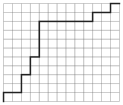

<a id="answers-7-2-1-3"></a>


### 7.2.1.3节

<a id="ans-7-2-1-3-1"></a>

**1.** [题目](../sec-7-2-1-3.md#ex-7-2-1-3-1) 给定一个多重集, 从右到左构成序列 $e_t\ldots e_2e_1$. 先按升序把每个不同元素列一次, 接着按同一顺序列出出现至少两次的元素的第二份、出现至少三次的元素的第三份, 依此类推. 对 $0\le j\le s=n-t$ 置 $e_{-j}\leftarrow s-j$, 这样对于 $1\le j\le t$, 每个 $e_j$ 都等于序列 $e_t\ldots e_1e_0\ldots e_{-s}$ 中它右侧的某个元素. 若第一个这样的元素是 $e_{c_j-s}$, 便得到 (3) 的一个解. 反过来, (3) 的每个解给出唯一的多重集 $\{e_1,\ldots,e_t\}$, 因为对于 $1\le j\le t$ 有 $c_j<s+j$.

[欧仁·卡塔兰给出一种类似的对应. 如果 $0\le e_1\le\cdots\le e_t\le s$, 令

$$
\{c_1,\ldots,c_t\}=\{e_1,\ldots,e_t\}\cup\{s+j\mid1\le j<t\text{ 且 }e_j=e_{j+1}\}.
$$


<a id="pdf-622"></a><a id="p-607"></a>

见 *Mémoires de la Soc. roy. des Sciences de Liège* (2) **12** (1885), *Mélanges Math.*, 3.]

<a id="ans-7-2-1-3-2"></a>

**2.** [题目](../sec-7-2-1-3.md#ex-7-2-1-3-2) 对应的路径从左下角出发. (13) 中的每个 0 对应向上一步, 每个 1 对应向右一步, 得到下图. 反过来, 从任意一条 $(0,0)$ 到 $(s,t)$ 的路径中, 很容易读出 (2)–(11) 中 $a_i,b_i,c_i,d_i,p_i,q_i$ 的表示.

[](../../../assets/volume4a/figures/7-2-1-3-answer-002-grid.svg)

<a id="ans-7-2-1-3-3"></a>

**3.** [题目](../sec-7-2-1-3.md#ex-7-2-1-3-3) 在这个算法中, $r$ 是使 $q_r>0$ 的最小正下标.

**N1.** [初始化.] 对 $1\le j\le t$ 置 $q_j\leftarrow0$, 置 $q_0\leftarrow s$. (假定 $st>0$.)

**N2.** [访问.] 访问组分 $q_t\ldots q_0$. 若 $q_0=0$, 转到 N4.

**N3.** [简单情形.] 置 $q_0\leftarrow q_0-1$、$r\leftarrow1$, 转到 N5.

**N4.** [复杂情形.] 若 $r=t$ 则终止. 否则置 $q_0\leftarrow q_r-1$、$q_r\leftarrow0$、$r\leftarrow r+1$.

**N5.** [增大 $q_r$.] 置 $q_r\leftarrow q_r+1$, 返回 N2. ▮

[见 *CACM* **11** (1968), 430,**12** (1969), 187. 按递减的字典序生成这种组分更难.]

<a id="ans-7-2-1-3-4"></a>

**4.** [题目](../sec-7-2-1-3.md#ex-7-2-1-3-4) 可以互换 (14) 中 0 和 1 的作用, 使

$$
0^{q_t}1\,0^{q_{t-1}}1\ldots1\,0^{q_1}1\,0^{q_0}
=1^{r_s}0\,1^{r_{s-1}}0\ldots0\,1^{r_1}0\,1^{r_0}.
$$

于是

$$
\begin{aligned}
&0^{1}10^{0}10^{2}10^{2}10^{4}10^{0}10^{0}10^{0}10^{0}10^{0}10^{1}10^{0}10^{1}10^{0}\\
&=1^{0}01^{2}01^{0}01^{1}01^{0}01^{1}01^{0}01^{0}01^{0}01^{6}01^{2}01^{1}.
\end{aligned}
$$

$a_{n-1}\ldots a_1a_0$ 的字典序对应于 $r_s\ldots r_1r_0$ 的字典序.

顺便说一下, 还有一个多重集对应关系: $\{d_t,\ldots,d_1\}=\{r_s\cdot s,\ldots,r_0\cdot0\}$. 例如,

$$
\begin{aligned}
\{10,10,8,6,2,2,2,2,2,2,1,1,0\}
={}&\{0\cdot11,2\cdot10,0\cdot9,1\cdot8,0\cdot7,1\cdot6,\\
&0\cdot5,0\cdot4,0\cdot3,6\cdot2,2\cdot1,1\cdot0\}.
\end{aligned}
$$

<a id="ans-7-2-1-3-5"></a>

**5.** [题目](../sec-7-2-1-3.md#ex-7-2-1-3-5) (a) 在 $n+\lfloor t/2\rfloor$ 的每个 $t$ 组合中, 置 $x_j=c_j-\lfloor(j-1)/2\rfloor$. (b) 在 $n-t-2$ 的每个 $t$ 组合中, 置 $x_j=c_j+j+1$.

(给定 $x_{t+1}$、$(\delta_t,\ldots,\delta_0)$ 和 $x_0$, 用类似方法可求出 $0\le j\le t$ 时不等式 $x_{j+1}\ge x_j+\delta_j$ 的全部解 $(x_t,\ldots,x_1)$.)

<a id="ans-7-2-1-3-6"></a>

**6.** [题目](../sec-7-2-1-3.md#ex-7-2-1-3-6) 假定 $t>0$. 当 $c_1>0$ 时到 T3, 当 $c_2=c_1+1>1$ 时到 T5. 当 $c_j=c_1+j-1\ge j$ 时, 对 $2\le j\le t+1$ 到 T4. 因此各步骤的次数为

$$
\begin{aligned}
\mathrm{T1}:&\ 1,\qquad \mathrm{T2}:\ \binom nt,\qquad \mathrm{T3}:\ \binom{n-1}t,\\
\mathrm{T4}:&\ \binom{n-2}{t-1}+\binom{n-3}{t-2}+\cdots+\binom{n-t-1}{0}=\binom{n-1}{t-1},\\
\mathrm{T5}:&\ \binom{n-2}{t-1},\qquad
\mathrm{T6}:\ \binom{n-1}{t-1}+\binom{n-2}{t-1}-1.
\end{aligned}
$$

<a id="ans-7-2-1-3-7"></a>

**7.** [题目](../sec-7-2-1-3.md#ex-7-2-1-3-7) 以下比算法 T 稍简单的过程已足够. 假定 $s<n$.

**S1.** [初始化.] 对 $1\le j\le s$ 置 $b_j\leftarrow j+n-s-1$, 再置 $j\leftarrow1$.

**S2.** [访问.] 访问组合 $b_s\ldots b_2b_1$. 若 $j>s$, 终止.

**S3.** [减小 $b_j$.] 置 $b_j\leftarrow b_j-1$. 若 $b_j<j$, 置 $j\leftarrow j+1$, 返回 S2.

**S4.** [重置 $b_{j-1}\ldots b_1$.] 当 $j>1$ 时, 反复置 $b_{j-1}\leftarrow b_j-1$、$j\leftarrow j-1$. 转到 S2. ▮

(见斯坦尼斯拉夫·德沃拉克,*Comp. J.* **33** (1990), 188. 若对 $1\le k\le s$ 置 $x_k=n-b_k$, 这个算法按递增的字典序遍历 $\{1,2,\ldots,n\}$ 中满足 $1\le x_s<\cdots<x_2<x_1\le n$ 的所有组合 $x_s\ldots x_2x_1$.)

<a id="ans-7-2-1-3-8"></a>

**8. A1.** [题目](../sec-7-2-1-3.md#ex-7-2-1-3-8) [初始化.] 置 $a_n\ldots a_0\leftarrow0^{s+1}1^t$、$q\leftarrow t$、$r\leftarrow0$. (假定 $0<t<n$.)

**A2.** [访问.] 访问组合 $a_{n-1}\ldots a_1a_0$. 若 $q=0$, 转到 A4.

**A3.** [用 $\ldots101^{q-1}$ 替换 $\ldots01^q$.] 置 $a_q\leftarrow1$、$a_{q-1}\leftarrow0$、$q\leftarrow q-1$. 此后若 $q=0$, 置 $r\leftarrow1$. 返回 A2.

**A4.** [移动 1 的区段.] 置 $a_r\leftarrow0$、$r\leftarrow r+1$. 若 $a_r=1$, 再置 $a_q\leftarrow1$、$q\leftarrow q+1$, 重复 A4.

**A5.** [向左进位.] 若 $r=n$, 终止. 否则置 $a_r\leftarrow1$.

**A6.** [奇数?] 若 $q>0$, 置 $r\leftarrow0$. 返回 A2. ▮

步骤 A2 中的 $q$、$r$ 分别指向 $a_{n-1}\ldots a_1a_0$ 中最右的 0 和 1. A1 至 A6 分别执行

$$
1,\quad\binom nt,\quad\binom{n-1}{t-1},\quad\binom nt-1,\quad\binom{n-1}{t},\quad\binom{n-1}{t}-1
$$

次.


<a id="pdf-623"></a><a id="p-608"></a>

<a id="ans-7-2-1-3-9"></a>

**9.** [题目](../sec-7-2-1-3.md#ex-7-2-1-3-9) (a) 前 $\binom{n-1}t$ 个串以 0 开头, 发生 $2A_{(s-1)t}$ 次位改变. 其余 $\binom{n-1}{t-1}$ 个串以 1 开头, 发生 $2A_{s(t-1)}$ 次位改变. 而两组交界处 $\nu(01^t0^{s-1}\oplus10^s1^{t-1})=2\min(s,t)$.

(b) 解法 1 (直接解). 令 $B_{st}=A_{st}+\min(s,t)+1$. 则

$$
B_{st}=
\begin{cases}
B_{(s-1)t}+B_{s(t-1)}+[s=t],&st>0,\\
1,&st=0.
\end{cases}
$$

因此 $B_{st}=\sum_{k=0}^{\min(s,t)}\binom{s+t-2k}{s-k}$. 若 $s\le t$, 它满足

$$
B_{st}\le\sum_{k=0}^s\binom{s+t-k}{s-k}
=\binom{s+t+1}s
=\binom{s+t}s\frac{s+t+1}{t+1}
<2\binom{s+t}t.
$$

解法 2 (间接解). 在习题 8 答案的算法中, 如果步骤 A3、A4 分别执行 $x$、$y$ 次, 共改变 $2(x+y)$ 个二进制位. 因此 $A_{st}\le\binom{n-1}{t-1}+\binom nt-1<2\binom nt$.

[所以, 习题 7.2.1.1-3 答案中的注解也适用于组合.]

<a id="ans-7-2-1-3-10"></a>

**10.** [题目](../sec-7-2-1-3.md#ex-7-2-1-3-10) 每种赛果对应一个 $(4,4)$ 组合 $b_4b_3b_2b_1$ 或 $c_4c_3c_2c_1$. A 胜出的比赛为 $\{8-b_4,8-b_3,8-b_2,8-b_1\}$, N 胜出的比赛为 $\{8-c_4,8-c_3,8-c_2,8-c_1\}$, 因为可以假定落败一方赢得 8 场中剩下的比赛. (也可生成 $\{\mathtt{A,A,A,A,N,N,N,N}\}$ 的所有排列, 略去末尾连续的同一字母.) 美国联盟冠军 (A) 最终获胜当且仅当 $b_1\ne0$, 也即 $c_1=0$. 算式 $\binom{c_4}4+\binom{c_3}3+\binom{c_2}2+\binom{c_1}1$ 给每种赛果赋予一个从 0 到 69 的唯一整数.

例如, $\mathtt{ANANAA}\iff a_7\ldots a_0=\mathtt{01010011}\iff b_4b_3b_2b_1=\mathtt{7532}\iff c_4c_3c_2c_1=\mathtt{6410}$, 它按字典序的排名为 $\binom64+\binom43+\binom12+\binom01=19$. (项 $\binom{c_j}j$ 为 0 当且仅当它对应于末尾的 N.)

<a id="ans-7-2-1-3-11"></a>

**11.** [题目](../sec-7-2-1-3.md#ex-7-2-1-3-11) <code>AAAA</code>(9 次)、<code>NNNN</code>(8 次) 和 <code>ANAAA</code>(7 次) 最常见. 70 种赛果恰有 27 种未出现, 包括以 <code>NNNA</code> 开头的所有四种赛果. (这里不计 1907、1912 和 1922 年因天黑中止而打成平局的比赛. 或许也应排除 <code>ANNAAA</code>, 因为它仅在 1920 年九场五胜制系列赛的 <code>ANNAAAA</code> 中作为一部分出现. <code>NNAAANN</code> 最早发生于 2001 年.)

<a id="ans-7-2-1-3-12"></a>

**12.** [题目](../sec-7-2-1-3.md#ex-7-2-1-3-12) (a) 令 $V_j$ 为子空间 $\{a_{n-1}\ldots a_0\in V\mid a_k=0\text{ 对所有 }0\le k<j\}$, 所以 $\{0\ldots0\}=V_n\subseteq V_{n-1}\subseteq\cdots\subseteq V_0=V$. 于是 $\{c_1,\ldots,c_t\}=\{c\mid V_c\ne V_{c+1}\}$, 且 $\alpha_k$ 是 $V$ 中满足 $a_{c_j}=[j=k]$($1\le j\le t$) 的唯一元素 $a_{n-1}\ldots a_0$.

顺便说一下, 与典范基对应的 $t\times n$ 矩阵称为简化行阶梯形, 可用标准的 “三角化” 算法得到 (见习题 4.6.1-19 和算法 4.6.2N).

(b) 习题 1.2.6-58 的 2 项式系数满足

$$
{n\brack t}_2=2^t{n-1\brack t}_2+{n-1\brack t-1}_2.
$$

它具有所需性质, 因为有 $2^t{n-1\brack t}_2$ 个二进制向量空间满足 $c_t<n-1$, 有 $\displaystyle{n-1\brack t-1}_2$ 个满足 $c_t=n-1$. [一般而言, 有 $r$ 个星号的典范基数等于将 $r$ 分拆为最多 $t$ 个且每个不超过 $n-t$ 的部分的方案数; 按 7.2.1.4-(51), 它是 $[z^r]{n\brack t}_z$. 见高德纳,*J. Combinatorial Theory A* **10** (1971), 178–180.]

(c) 以下算法假定 $n>t>0$, 且当 $t\le j\le n$ 时 $a_{(t+1)j}=0$.

**V1.** [初始化.] 对 $1\le k\le t$、$0\le j<n$, 置 $a_{kj}\leftarrow[j=k-1]$. 另置 $q\leftarrow t$、$r\leftarrow0$.

**V2.** [访问.] (此时对 $1\le k\le q$ 有 $a_{k(k-1)}=1$, 且 $a_{(q+1)q}=0$、$a_{1r}=1$.) 访问典范基 $(a_{1(n-1)}\ldots a_{11}a_{10},\ldots,a_{t(n-1)}\ldots a_{t1}a_{t0})$. 若 $q>0$, 转到 V4.

**V3.** [寻找 1 的区段.] 依次置 $q\leftarrow1,2,\ldots$, 直到 $a_{(q+1)(q+r)}=0$. 若 $q+r=n$, 终止.

**V4.** [第 $q+r$ 列加 1.] 置 $k\leftarrow1$. 当 $a_{k(q+r)}=1$ 时, 反复置 $a_{k(q+r)}\leftarrow0$、$k\leftarrow k+1$. 若 $k\le q$, 置 $a_{k(q+r)}\leftarrow1$. 否则置 $a_{q(q+r)}\leftarrow1$、$a_{q(q+r-1)}\leftarrow0$、$q\leftarrow q-1$.

**V5.** [右移区段.] 若 $q=0$, 置 $r\leftarrow r+1$. 否则, 若 $r>0$, 对 $1\le k\le q$ 置 $a_{k(k-1)}\leftarrow1$、$a_{k(r+k-1)}\leftarrow0$, 再置 $r\leftarrow0$. 转到 V2. ▮

步骤 V2 中 $q>0$ 的概率为 $1-(2^{n-t}-1)/(2^n-1)\approx1-2^{-t}$. 可通过单独处理这种情形来节省时间.


<a id="pdf-624"></a><a id="p-609"></a>

(d) 因为

$$
\begin{aligned}
999999={}&4{8\brack4}_2+16{7\brack4}_2+5{6\brack3}_2+5{5\brack3}_2+8{4\brack3}_2\\
         &+0{3\brack2}_2+4{2\brack2}_2+1{1\brack1}_2+2{0\brack1}_2,
\end{aligned}
$$

第 100 万个输出的二进制列是 $4,16/2,5,5,8/2,0,4/2,1,2/2$, 即

$$
\begin{aligned}
\alpha_1&=\mathtt{001100011},\\
\alpha_2&=\mathtt{000000100},\\
\alpha_3&=\mathtt{101110000},\\
\alpha_4&=\mathtt{010000000}.
\end{aligned}
$$

[参考文献: 欧金尼奥·卡拉比和赫伯特·威尔夫,*J. Combinatorial Theory A* **22** (1977), 107–109.]

<a id="ans-7-2-1-3-13"></a>

**13.** [题目](../sec-7-2-1-3.md#ex-7-2-1-3-13) 令 $n=s+t$. 以 0 开头的构形有 $\binom{s-1}{\lceil(r-1)/2\rceil}\binom{t-1}{\lfloor(r-1)/2\rfloor}$ 个, 以 1 开头的构形有 $\binom{s-1}{\lfloor(r-1)/2\rfloor}\binom{t-1}{\lceil(r-1)/2\rceil}$ 个. 因为每个以 0 开头的伊辛构形对应于把 $s$ 个 0 分为 $\lceil(r+1)/2\rceil$ 个部分、把 $t$ 个 1 分为 $\lfloor(r+1)/2\rfloor$ 个部分. 可以生成所有这样的组分对, 再交织成构形. [见尼恩斯特·伊辛,*Zeitschrift für Physik* **31** (1925), 253–258, 若泽·西蒙斯·佩雷拉,*CACM* **12** (1969), 562.]

<a id="ans-7-2-1-3-14"></a>

**14.** [题目](../sec-7-2-1-3.md#ex-7-2-1-3-14) 初始时对 $1\le j\le n$ 置 $l[j]\leftarrow j-1$、$r[j-1]\leftarrow j$, 并置 $l[0]\leftarrow n$、$r[n]\leftarrow0$. 要取得下一个组合, 假定 $t>0$. 若 $l[0]>s$, 置 $p\leftarrow s$, 否则置 $p\leftarrow r[n]-1$. 若 $p\le0$, 终止. 否则置 $q\leftarrow r[p]$、$l[q]\leftarrow l[p]$、$r[l[p]]\leftarrow q$. 若 $r[q]>s$ 且 $p<s$, 置 $r[p]\leftarrow r[n]$、$l[r[n]]\leftarrow p$、$r[s]\leftarrow r[q]$、$l[r[q]]\leftarrow s$、$r[n]\leftarrow0$、$l[0]\leftarrow n$. 否则置 $r[p]\leftarrow r[q]$、$l[r[q]]\leftarrow p$. 最后置 $r[q]\leftarrow p$、$l[p]\leftarrow q$.

[见詹姆斯·科尔什和西摩·利普舒茨,*J. Algorithms* **25** (1997), 321–335, 其中把这个想法推广到多重集排列的无循环算法. 警告: 和习题 7.2.1.1-16 一样, 本题更偏理论, 因为访问链表的例程可能需要一个循环, 抵消无循环生成的优势.]

<a id="ans-7-2-1-3-15"></a>

**15.** [题目](../sec-7-2-1-3.md#ex-7-2-1-3-15) (所述事实成立, 因为 $c_t\ldots c_1$ 的字典序对应于 $a_{n-1}\ldots a_0$ 的字典序, 而后者是补串 $1\ldots1\oplus a_{n-1}\ldots a_0$ 的逆字典序.) 由定理 L, 在恰好还有 $\binom{b_s}s+\cdots+\binom{b_2}2+\binom{b_1}1$ 个组合尚未访问时访问 $c_t\ldots c_1$. 所以

$$
\binom{b_s}s+\cdots+\binom{b_1}1+\binom{c_t}t+\cdots+\binom{c_1}1
=\binom{s+t}t-1.
$$

当每个 $x_j$ 是 0 或 1 且 $\bar x_j=1-x_j$ 时, 可把一般恒等式写为

$$
\sum_{j=0}^{n-1}x_j\binom{j}{x_0+\cdots+x_j}
+\sum_{j=0}^{n-1}\bar x_j\binom{j}{\bar x_0+\cdots+\bar x_j}
=\binom{n}{x_0+\cdots+x_{n-1}}-1.
$$

它也可由下式推出:

$$
x_n\binom{n}{x_0+\cdots+x_n}
+\bar x_n\binom{n}{\bar x_0+\cdots+\bar x_n}
=\binom{n+1}{x_0+\cdots+x_n}-\binom{n}{x_0+\cdots+x_{n-1}}.
$$

<a id="ans-7-2-1-3-16"></a>

**16.** [题目](../sec-7-2-1-3.md#ex-7-2-1-3-16) 因为

$$
\begin{aligned}
999999&=\binom{1414}2+\binom{1008}1\\
&=\binom{182}3+\binom{153}2+\binom{111}1\\
&=\binom{71}4+\binom{56}3+\binom{36}2+\binom{14}1\\
&=\binom{43}5+\binom{32}4+\binom{21}3+\binom{15}2+\binom61,
\end{aligned}
$$

答案为 (a) $1414\ 1008$, (b) $182\ 153\ 111$, (c) $71\ 56\ 36\ 14$, (d) $43\ 32\ 21\ 15\ 6$, (e) $1000000\ 999999\ \ldots\ 2\ 0$.

<a id="ans-7-2-1-3-17"></a>

**17.** [题目](../sec-7-2-1-3.md#ex-7-2-1-3-17) 由定理 L, $n_t$ 是使 $N\ge\binom{n_t}t$ 的最大整数. 其余项是 $N-\binom{n_t}t$ 的 $(t-1)$ 次表示.

当 $t>1$ 时, 可用一个简单的顺序方法. 起初令 $x=1$、$c=t$, 置 $c\leftarrow c+1$、$x\leftarrow xc/(c-t)$ 零次或多次, 直到 $x>N$. 再置 $x\leftarrow x(c-t)/c$、$c\leftarrow c-1$ 完成第一阶段, 此时 $x=\binom ct\le N<\binom{c+1}t$. 置 $n_t\leftarrow c$、$N\leftarrow N-x$. 若 $t=2$, 置 $n_1\leftarrow N$ 后终止. 否则置 $x\leftarrow xt/c$、$t\leftarrow t-1$、$c\leftarrow c-1$. 当 $x>N$ 时, 循环置 $x\leftarrow x(c-t)/c$、$c\leftarrow c-1$, 然后重复上述步骤. 若 $N<\binom nt$, 需要 $O(n)$ 次算术运算. 除非 $t$ 很小而 $N$ 很大, 否则这个方法是适用的.

当 $t=2$ 时, 习题 1.2.4-41 给出 $n_2=\lfloor\sqrt{2N+2}+\frac12\rfloor$. 一般而言, $n_t=\lfloor x\rfloor$, 其中 $x$ 是 $x^{\underline t}=t!N$ 的最大根. 求下列级数的逆可近似求根:

$$
y=(x^{\underline t})^{1/t}
=x-\tfrac12(t-1)-\tfrac1{24}(t^2-1)x^{-1}+\cdots.
$$

结果是 $x=y+\frac12(t-1)+\frac1{24}(t^2-1)/y+O(y^{-3})$. 令 $y=(t!N)^{1/t}$ 即可得到良好的近似值, 再验证 $\binom{\lfloor x\rfloor}t\le N<\binom{\lfloor x\rfloor+1}t$ 或作最后调整. [见阿维泽里·弗伦克尔和摩西·莫尔,*Comp. J.* **26** (1983), 336–343.]


<a id="pdf-625"></a><a id="p-610"></a>

<a id="ans-7-2-1-3-18"></a>

**18.** [题目](../sec-7-2-1-3.md#ex-7-2-1-3-18) 得到一棵含 $2^n-1$ 个结点的完全二叉树, 顶端另加一个结点, 如置换选择排序中的 “失败者之树”(5.4.1 节图 63). 因此不需要显式链. 对于 $1\le k<2^{n-1}$, 结点 $k$ 的右子结点是 $2k+1$, 左兄弟结点是 $2k$.

这种二项式树的表示有个有趣性质. 结点 $k=(0^a1\alpha)_2$ 对应于二进制串为 $0^a1\alpha^R$ 的组合.

<a id="ans-7-2-1-3-19"></a>

**19.** [题目](../sec-7-2-1-3.md#ex-7-2-1-3-19) 第 100 万个结点的后序二进制表示为 $\operatorname{post}(1000000)=\mathtt{11110100001001000100}$. 对 $k\ge0$, $\operatorname{post}(2^{k+1}-1)=2^k$. 当 $2^k\le n<2^{k+1}-1$ 时, $\operatorname{post}(n)=2^k+\operatorname{post}(n-2^k+1)$. [顺便说一下, $T_\infty$ 的左子结点／右兄弟结点表示是横向堆.]

<a id="ans-7-2-1-3-20"></a>

**20.** [题目](../sec-7-2-1-3.md#ex-7-2-1-3-20) $f(z)=(1+z^{w_{n-1}})\ldots(1+z^{w_1})/(1-z)$, $g(z)=(1+z^{w_0})f(z)$, $h(z)=z^{w_0}f(z)$.

<a id="ans-7-2-1-3-21"></a>

**21.** [题目](../sec-7-2-1-3.md#ex-7-2-1-3-21) $c_t\ldots c_2c_1$ 的排名是 $\binom{c_t+1}t-1$ 减去 $c_{t-1}\ldots c_1$ 的排名. [见琼·米勒的论文第 40 页, 另见海因茨·吕内堡,*Abh. Math. Sem. Hamburg* **52** (1982), 208–227.]

<a id="ans-7-2-1-3-22"></a>

**22.** [题目](../sec-7-2-1-3.md#ex-7-2-1-3-22) 因为

$$
\begin{aligned}
999999&=\binom{1415}2-\binom{406}1\\
&=\binom{183}3-\binom{98}2+\binom{21}1\\
&=\binom{72}4-\binom{57}3+\binom{32}2-\binom{27}1\\
&=\binom{44}5-\binom{40}4+\binom{33}3-\binom{13}2+\binom31,
\end{aligned}
$$

答案为 (a) $1414\ 405$, (b) $182\ 97\ 21$, (c) $71\ 56\ 31\ 26$, (d) $43\ 39\ 32\ 12\ 3$, (e) $1000000\ 999999\ 999998\ 999996\ \ldots\ 0$.

<a id="ans-7-2-1-3-23"></a>

**23.** [题目](../sec-7-2-1-3.md#ex-7-2-1-3-23) 对 $r=1,2,\ldots,t$, 有 $\binom{n-r}{t-r}$ 个组合满足 $j>r$. (若 $t-r$ 为偶数, 则 $j>r\iff c_r=r-1$. 否则 $j>r\iff c_{r+1}=c_r+1$ 且 $c_{r-1}=r-2$, 其中假定 $c_0=-1$.) 所以平均值为

$$
\left(\binom nt+\binom{n-1}{t-1}+\cdots+\binom{n-t}0\right)\Big/\binom nt
=\binom{n+1}t\Big/\binom nt
=\frac{n+1}{n+1-t}.
$$

每步的平均运行时间大约与这个值成正比. 所以当 $t$ 小时算法很快, 当 $t$ 接近 $n$ 时则慢.

<a id="ans-7-2-1-3-24"></a>

**24.** [题目](../sec-7-2-1-3.md#ex-7-2-1-3-24) 实际上, 当 $j_k\equiv t\pmod2$ 时有 $j_k-2\le j_{k+1}\le j_k+1$, 当 $j_k\not\equiv t\pmod2$ 时有 $j_k-1\le j_{k+1}\le j_k+2$. 因为仅当 $1\le i<j$ 时均有 $c_i=i-1$, 才执行步骤 R5.

因此, 若 $t$ 为奇数, 可在步骤 R2 的末尾加 “若 $j\ge4$, 置 $j\leftarrow j-1-[j\text{ 为奇数}]$, 转到 R5”. 若 $t$ 为偶数, 则加 “若 $j\ge3$, 置 $j\leftarrow j-1-[j\text{ 为偶数}]$, 转到 R5”. 于是算法就无循环了, 因为每次访问至多执行两次 R4 和 R5.

<a id="ans-7-2-1-3-25"></a>

**25.** [题目](../sec-7-2-1-3.md#ex-7-2-1-3-25) 假定 $N>N'$, 且 $N-N'$ 最小. 在这些假定下再取最小的 $t$ 和 $c_t$. 则 $c_t>c'_t$.

若存在满足 $0\le x<c_t$ 的 $x\notin C\cup C'$, 对 $j>x$ 作变换 $j\mapsto j-1$, 映射 $C\cup C'$ 的每个 $t$ 组合. 若存在 $x\in C\cap C'$, 则删去 $x$, 对 $j<x$ 作变换 $j\mapsto x-j$, 把每个含 $x$ 的 $t$ 组合映射为一个 $(t-1)$ 组合. 两种映射都保持交错字典序, 因此 $N-N'$ 必定超过 $C$ 与 $C'$ 的像之间的组合数. 但 $c_t$ 最小, 不可能有这样的 $x$. 所以 $t=m$, 且 $c_t=2m-1$.

现在若 $c'_m<c_m-1$, 可增大 $c'_m$ 以减小 $N-N'$. 因此 $c'_m=2m-2$, 而问题归结为计算 $\operatorname{rank}(c_{m-1}\ldots c_1)-\operatorname{rank}(c'_{m-1}\ldots c'_1)$ 的最大值. 组合排名 $\operatorname{rank}$ 按 (30) 计算.

令 $f(s,t)=\max(\operatorname{rank}(b_s\ldots b_1)-\operatorname{rank}(c_t\ldots c_1))$, 遍历满足 $\{b_s,\ldots,b_1,c_t,\ldots,c_1\}=\{0,\ldots,s+t-1\}$ 的情形. 则 $f(s,t)$ 满足递推

$$
\begin{aligned}
f(s,0)&=f(0,t)=0,\qquad f(1,t)=t,\\
f(s,t)&=\binom{s+t-1}s+\max\bigl(f(t-1,s-1),f(s-2,t)\bigr),\quad st>0,\ s>1.
\end{aligned}
$$

当 $s+t=2u+2$ 时, 解为

$$
f(s,t)=\binom{2u+1}{t-1}+\sum_{j=1}^{u-r}\binom{2u+1-2j}{r}+\sum_{j=0}^{r-1}\binom{2j+1}j,\qquad r=\min(s-2,t-1).
$$

当 $s\le t$ 时最大值出现在 $f(t-1,s-1)$, 当 $s\ge t+2$ 时则在 $f(s-2,t)$.

因此最小的 $N-N'$ 出现在

$$
\begin{aligned}
C&=\{2m-1\}\cup\{2m-2-x\mid1\le x\le2m-2,\ x\bmod4\le1\},\\
C'&=\{2m-2\}\cup\{2m-2-x\mid1\le x\le2m-2,\ x\bmod4\ge2\},
\end{aligned}
$$

其值为 $\binom{2m-1}{m-1}-\sum_{k=0}^{m-2}\binom{2k+1}k=1+\sum_{k=1}^{m-1}\binom{2k}{k-1}$. [见阿伦德·范赞滕,*IEEE Trans. IT* **37** (1991), 1229–1233.]


<a id="pdf-626"></a><a id="p-611"></a>

<a id="ans-7-2-1-3-26"></a>

**26.** [题目](../sec-7-2-1-3.md#ex-7-2-1-3-26) (a) 是. 首项为 $0^{n-\lceil t/2\rceil}1^{t\bmod2}2^{\lfloor t/2\rfloor}$, 末项为 $2^{\lfloor t/2\rfloor}1^{t\bmod2}0^{n-\lceil t/2\rceil}$. 转换发生在下列形状的子串上:

$$
\begin{aligned}
02^a1&\leftrightarrow12^a0,\qquad 02^a2\leftrightarrow12^a1,\\
10^a1&\leftrightarrow20^a0,\qquad 10^a2\leftrightarrow20^a1.
\end{aligned}
$$

(b) 否. 若 $s=0$, 会有从 $02^t0^{r-1}$ 到 $20^r2^{t-1}$ 的大跳变.

<a id="ans-7-2-1-3-27"></a>

**27.** [题目](../sec-7-2-1-3.md#ex-7-2-1-3-27) 下述过程从 $\Gamma_n$ 提取出权值至多为 $t$ 的所有组合 $c_1\ldots c_k$. 若 $t=0$, 只访问空组合. 对于 $t>0$, 起初置 $k\leftarrow0$、$c_0\leftarrow n$. 访问 $c_1\ldots c_k$. 若 $k$ 为偶数且 $c_k=0$, 置 $k\leftarrow k-1$. 若 $k$ 为偶数且 $c_k>0$, 当 $k=t$ 时置 $c_k\leftarrow c_k-1$, 否则置 $k\leftarrow k+1$、$c_k\leftarrow0$. 若 $k$ 为奇数且 $c_k+1=c_{k-1}$, 置 $k\leftarrow k-1$, 若此时 $k=0$ 则终止, 否则置 $c_k\leftarrow c_{k+1}$. 若 $k$ 为奇数且 $c_k+1<c_{k-1}$, 当 $k=t$ 时置 $c_k\leftarrow c_k+1$, 否则置 $k\leftarrow k+1$、$c_k\leftarrow c_{k-1}$、$c_{k-1}\leftarrow c_k+1$. 重复上述过程.

(当 $t=n$ 时, 这个无循环算法简化为习题 7.2.1.1-12(b) 的算法, 记号略有变化.)

<a id="ans-7-2-1-3-28"></a>

**28.** [题目](../sec-7-2-1-3.md#ex-7-2-1-3-28) 真. 位串 $a_{n-1}\ldots a_0=\alpha\beta$ 和 $a'_{n-1}\ldots a'_0=\alpha\beta'$ 对应下标表 $(b_s\ldots b_1=\theta\chi,\ c_t\ldots c_1=\phi\psi)$ 与 $(b'_s\ldots b'_1=\theta\chi',\ c'_t\ldots c'_1=\phi\psi')$. 在 $\alpha\beta$ 与 $\alpha\beta'$ 之间的所有串都以 $\alpha$ 开头, 当且仅当 $\theta\chi$ 与 $\theta\chi'$ 之间的所有串都以 $\theta$ 开头, 且 $\phi\psi$ 与 $\phi\psi'$ 之间的所有串都以 $\phi$ 开头. 例如, 若 $n=10$, 前缀 $\alpha=\mathtt{01101}$ 对应前缀 $\theta=\mathtt{96}$、$\phi=\mathtt{875}$.

(但是, 仅要求 $c_t\ldots c_1$ 为通用字典序, 是更弱的条件. 例如, 当 $t=1$ 时, 每个这样的序列都是通用字典序.)

<a id="ans-7-2-1-3-29"></a>

**29.** [题目](../sec-7-2-1-3.md#ex-7-2-1-3-29) (a) 对于 $k,l,m\ge0$, 串 $-^k0^{l+1}$、$-^k0^{l+1}+\pm^m$ 或 $\pm^k$ 不包含区段.

(b) 不可能. 在平衡三进制记号中, 后继总是更小.

(c) 对所有 $\alpha$ 和 $k,l,m\ge0$, 有

$$
\begin{aligned}
\alpha0-^{k+1}0^l+\pm^m&\to\alpha-+^k0^{l+1}-\pm^m,\\
\alpha+-^k0^{l+1}+\pm^m&\to\alpha0+^{k+1}0^l-\pm^m,\\
\alpha0-^{k+1}0^l&\to\alpha-+^k0^{l+1},\\
\alpha+-^k0^{l+1}&\to\alpha0+^{k+1}0^l.
\end{aligned}
$$

(d) 令 $\alpha_i$ 的第 $j$ 个符号为 $(-1)^{a_{ij}}$, 其位置为 $b_{ij}$. 若置 $b_{i0}=0$, 则对 $0\le i<k$、$1\le j\le s$, 有

$$
(-1)^{a_{ij}+b_{i(j-1)}}=(-1)^{a_{(i+1)j}+b_{(i+1)(j-1)}}.
$$

(e) 由 (a)、(b)、(c), $\alpha$ 属于一条链 $\alpha_0\to\cdots\to\alpha_k$, 其中 $\alpha_k$ 为末串 (无后继), $\alpha_0$ 为首串 (无前驱). 由 (d), 每条链最多有 $\binom{s+t}t$ 个元素. 但根据 (a), 有 $2^s$ 个末串, 含 $s$ 个正负号和 $t$ 个零的串共 $2^s\binom{s+t}t$ 个. 所以 $k$ 必为 $\binom{s+t}t-1$.

参考文献:*SICOMP* **2** (1973), 128–133.

<a id="ans-7-2-1-3-30"></a>

**30.** [题目](../sec-7-2-1-3.md#ex-7-2-1-3-30) 假定 $t>0$. 首串是末串取反的结果. 对于 $0\le j<2^{s-1}$, 令 $\sigma_j$ 是首串 $0^t-\tau_j$. 当 $j$ 为二进制数 $(a_{s-1}\ldots a_1)_2$ 时, $\tau_j$ 的第 $k$ 个字符为 $(-1)^{a_k}$ 的符号 ($1\le k<s$). 因此 $\sigma_0=0^t-++\ldots+$、$\sigma_1=0^t--+\ldots+$、……、$\sigma_{2^{s-1}-1}=0^t---\ldots-$. 令 $\rho_j$ 为在 $\tau_j$ 的第一个连续负号区段 (可能为空) 之后插入 $-0^t$ 得到的末串. 因此 $\rho_0=-0^t++\ldots+$、$\rho_1=--0^t+\ldots+$、……、$\rho_{2^{s-1}-1}=--\ldots-0^t$. 再令 $\sigma_{2^{s-1}}=\sigma_0$、$\rho_{2^{s-1}}=\rho_0$. 可对 $1\le j\le2^{s-1}$ 用归纳证明, 以 $\sigma_j$ 开头的链在 $t$ 为偶数时以 $\rho_j$ 结束, 在 $t$ 为奇数时以 $\rho_{j-1}$ 结束. 因此从 $-\rho_j$ 开头的链以 $-\sigma_j$ 或 $-\sigma_{j+1}$ 结束.

令 $A_j(s,t)$ 为对以 $\sigma_j$ 开头的链作映射得到的 $(s,t)$ 组合序列, $B_j(s,t)$ 为从 $-\rho_j$ 得到的类似序列. 对 $1\le j\le2^{s-1}$, 若 $t$ 为偶数, 则 $A_j(s,t)^R=B_j(s,t)$, 若 $t$ 为奇数, 则 $A_j(s,t)^R=B_{j-1}(s,t)$. 当 $st>0$ 时, 对应的递推式为

$$
A_j(s,t)=
\begin{cases}
1A_j(s,t-1),\ 0A_{\lfloor(2^{s-1}-1-j)/2\rfloor}(s-1,t)^R,&j+t\text{ 为偶数},\\
1A_j(s,t-1),\ 0A_{\lfloor j/2\rfloor}(s-1,t),&j+t\text{ 为奇数}.
\end{cases}
$$

当 $st>0$ 时, 这 $2^{s-1}$ 个序列彼此不同.

蔡斯序列 $C_{st}$ 为 $A_{\lfloor2^s/3\rfloor}(s,t)$, $\widehat C_{st}$ 为 $A_{\lfloor2^{s-1}/3\rfloor}(s,t)^R$. 顺便说一下, (31) 中的齐次序列 $K_{st}$ 是 $A_{2^{s-1}-[t\text{ 为偶数}]}(s,t)^R$.

<a id="ans-7-2-1-3-31"></a>

**31.** [题目](../sec-7-2-1-3.md#ex-7-2-1-3-31) (a) $2^{\binom{s+t}t-1}$ 满足 $f(s,0)=f(0,t)=1$ 时的递推式 $f(s,t)=2f(s-1,t)f(s,t-1)$.

(b) 递推式 $f(s,t)=(s+1)!\,f(s,t-1)\ldots f(0,t-1)$ 的解为

$$
(s+1)!^t\,s!^{\binom t2}(s-1)!^{\binom{t+1}3}\ldots2!^{\binom{s+t-2}s}
=\prod_{r=1}^s(r+1)!^{\binom{s+t-1-r}{t-2}+[r=s]}.
$$


<a id="pdf-627"></a><a id="p-612"></a>

<a id="ans-7-2-1-3-32"></a>

**32.** [题目](../sec-7-2-1-3.md#ex-7-2-1-3-32) (a) 似乎没有简单公式. 但在 $s$、$t$ 较小时, 可以系统计算从给定起点通过旋转门移动遍历所有权为 $t$ 的串并抵达给定终点的通用字典序路径数. 对 $s+t\le6$, 总数如下:

$$
\begin{array}{c}
1\\
1\quad1\\
1\quad2\quad1\\
1\quad4\quad4\quad1\\
1\quad8\quad20\quad8\quad1\\
1\quad16\quad160\quad160\quad16\quad1\\
1\quad32\quad2264\quad17152\quad2264\quad32\quad1
\end{array}
$$

此外 $f(4,4)=95\,304\,112\,865\,280$, $f(5,5)\approx5.92646\times10^{48}$. [吉德翁·埃尔利希在 *JACM* **20** (1973), 500–513 最早研究了这类组合生成器, 但未尝试枚举.]

(b) 推广定理 N 的证明可知, 对某个 $a$($1\le a\le s$), 所有这样的列表或其逆序都必从 $1^t0^s$ 到 $0^a1^t0^{s-a}$. 此外, 当 $st>0$ 时, 给定 $s,t,a$ 的列表数 $n_{sta}$ 满足 $n_{1t1}=1$, 以及

$$
n_{sta}=
\begin{cases}
n_{s(t-1)1}\,n_{(s-1)t(a-1)},&a>1,\\
n_{s(t-1)2}\,n_{(s-1)t1}+\cdots+n_{s(t-1)s}\,n_{(s-1)t(s-1)},&a=1<s.
\end{cases}
$$

递推的一个解为 $n_{sta}=2^{m(s,t,a)}$, 其中

$$
m(s,t,a)=
\begin{cases}
\binom{s+t-3}t+\binom{s+t-5}{t-2}+\cdots+\binom{s-1}2,&t\text{ 为偶数},\\
\binom{s+t-3}t+\binom{s+t-5}{t-2}+\cdots+\binom s3+s-a-[a<s],&t\text{ 为奇数}.
\end{cases}
$$

<a id="ans-7-2-1-3-33"></a>

**33.** [题目](../sec-7-2-1-3.md#ex-7-2-1-3-33) 先考虑 $t=1$. 从 $i$ 到 $j>i$ 的接近完备路径有 $f(j-i-[i>0]-[j<n-1])$ 条, 其中 $\sum_j f(j)z^j=1/(1-z-z^3)$. (同一个 $f(j)$ 序列也见于卡龙关于六磁带多相归并的表 5.4.2-2.) 遍及 $0\le i<j<n$ 的和是 $3f(n)+f(n-1)+f(n-2)-2-n$. 再将这个数翻倍, 以计入 $j<i$ 的情况.

当 $t>1$ 时, 可构造 $\binom nt\times\binom nt$ 矩阵, 记录以指定组合开始和结束的通用字典序列表数. 矩阵各元素是对 $t=1$ 情形中的所有路径, 将 $t-1$ 情形的矩阵相乘后求和所得. 对 $s+t\le6$, 结果如下:

$$
\begin{array}{c}
1\\
1\quad1\\
1\quad2\quad1\\
1\quad6\quad2\quad1\\
1\quad12\quad10\quad2\quad1\\
1\quad20\quad44\quad10\quad2\quad1\\
1\quad34\quad238\quad68\quad10\quad2\quad1
\end{array}
\qquad
\begin{array}{c}
1\\
1\quad1\\
1\quad2\quad1\\
1\quad2\quad0\quad1\\
1\quad2\quad2\quad0\quad1\\
1\quad2\quad0\quad0\quad0\quad1\\
1\quad2\quad6\quad0\quad0\quad0\quad1
\end{array}
$$

右边三角形显示圈数 $g(s,t)$. 另有 $f(4,4)=17\,736$、$f(5,5)=9\,900\,888\,879\,984$、$g(4,4)=96$、$g(5,5)=30\,961\,456\,320$.

当 $s=2$、$n\ge4$ 时, 恰有 10 种这类方案. 例如 $n=7$ 时, 从 <code>43210</code> 到 <code>65431</code> 或 <code>65432</code>, 或者从 <code>54321</code> 到 <code>65420</code>、<code>65430</code> 或 <code>65432</code>, 也可以反向.

<a id="ans-7-2-1-3-34"></a>

**34.** [题目](../sec-7-2-1-3.md#ex-7-2-1-3-34) 可按上一答的方法求最小值, 但用最小加法矩阵乘法 $c_{ij}=\min_k(a_{ik}+b_{kj})$ 代替通常的矩阵乘法 $c_{ij}=\sum_k a_{ik}b_{kj}$. (当 $s=t=5$ 时, 图 46(e) 中只需 49 次非完备转换的通用字典序路径实质上唯一. $s=t=5$ 时, 也有一个仅需 55 次非完备转换的通用字典序圈.)

<a id="ans-7-2-1-3-35"></a>

**35.** [题目](../sec-7-2-1-3.md#ex-7-2-1-3-35) 由递推式 (35), 有 $a_{st}=b_{s(t-1)}+[s>1][t>0]+a_{(s-1)t}$ 及 $b_{st}=a_{s(t-1)}+a_{(s-1)t}$. 因此 $a_{st}=b_{st}+[s>1][t\text{ 为奇数}]$, 并且 $a_{st}=a_{s(t-1)}+a_{(s-1)t}+[s>1][t\text{ 为奇数}]$. 其解为

$$
a_{st}=\sum_{k=0}^{t/2}\binom{s+t-2-2k}{s-2}-[s>1][t\text{ 为偶数}],
$$


<a id="pdf-628"></a><a id="p-613"></a>

这个和约为 $\binom{s+t}t$ 的 $s/(s+2t)$ 倍.

<a id="ans-7-2-1-3-36"></a>

**36.** [题目](../sec-7-2-1-3.md#ex-7-2-1-3-36) 考虑一棵根结点为 $(s,t)$ 的二叉树. 当 $st>0$ 时, 其两个子树分别以 $(s-1,t)$ 和 $(s,t-1)$ 为根. 若 $st=0$, 结点 $(s,t)$ 就是叶结点. 根为 $(s,t)$ 的子树有 $\binom{s+t}t$ 个叶结点, 对应全部 $(s,t)$ 组合 $a_{n-1}\ldots a_1a_0$. 第 $l$ 层的结点对应前缀 $a_{n-1}\ldots a_{n-l}$, 而该层的叶结点是 $r=n-l$ 的组合.

在给 $\binom{s+t}t-1$ 个分支结点的子结点各自选择次序之后, 组合 $a_{n-1}\ldots a_1a_0$ 的每个通用字典序算法都对应于这棵树的前序遍历. 事实上, 这便是有 $2^{\binom{s+t}t-1}$ 个通用字典序方案的原因 (习题 31(a)). 操作 $j\leftarrow j+1$ 恰在每个分支结点执行一次, 即在它的两个子结点都处理之后.

顺便说一下, 习题 7.2.1.2-6(a) 说明 $r$ 的均值是 $s/(t+1)+t/(s+1)$, 可达 $\Omega(n)$. 因此值得花额外时间记录 $r$.

<a id="ans-7-2-1-3-37"></a>

**37.** [题目](../sec-7-2-1-3.md#ex-7-2-1-3-37) (a) 在字典序情形下不必维护 $w_j$ 表, 因为对 $j\ge r$, $a_j$ 活动当且仅当 $a_j=0$. 置 $a_j\leftarrow1$、$a_{j-1}\leftarrow0$ 后, 若 $j>1$ 则有两种情况. 若 $r=j$, 置 $r\leftarrow j-1$. 否则置 $a_{j-2}\ldots a_0\leftarrow0^r1^{j-1-r}$, 再置 $r\leftarrow j-1-r$ (若原 $r=j-1$, 则置 $r\leftarrow j$).

(b) 当 $j>1$ 时, 要处理的转换对 $a_j\ldots a_0$ 作如下改变:

$$
\begin{aligned}
01^r&\to1101^{r-2},&010^r&\to10^{r+1},&
010^a1^r&\to110^{a+1}1^{r-1},\\
10^r&\to010^{r-1},&110^r&\to010^{r-1}1,&
10^a1^r&\to0^a1^{r+1}.
\end{aligned}
$$

容易区分这六种情形, 并相应地改变 $r$.

(c) $j=1$ 仍是平凡情形. 否则有

$$
\begin{aligned}
01^a0^r&\to101^{a-1}0^r,&0^a1^r&\to10^a1^{r-1},\\
101^a0^r&\to01^{a+1}0^r,&10^a1^r&\to0^a1^{r+1}.
\end{aligned}
$$

另外有一种不确定的情形, 只有在 $a_{n-1}\ldots a_{j+1}$ 至少有一个 0 时才会出现. 令 $k>j$ 是使 $a_k=0$ 的最小下标. 若 $k$ 为奇数, $10^r\to010^{r-1}$. 若 $k$ 为偶数, $10^r\to0^r1$.

<a id="ans-7-2-1-3-38"></a>

**38.** [题目](../sec-7-2-1-3.md#ex-7-2-1-3-38) 仍用同一算法, 但作以下改动. (i) 在步骤 C1, 用合适的 $r$ 值. 当 $n$ 为奇数或 $s=1$ 时置 $a_{n-1}\ldots a_0\leftarrow01^t0^{s-1}$. 当 $n$ 为偶数且 $s>1$ 时置 $a_{n-1}\ldots a_0\leftarrow001^t0^{s-2}$. (ii) 在步骤 C3 对调奇偶的作用. (iii) 在步骤 C5, 当 $j=1$ 时也转到 C4.

<a id="ans-7-2-1-3-39"></a>

**39.** [题目](../sec-7-2-1-3.md#ex-7-2-1-3-39) 一般而言, 先置 $r\leftarrow0$、$j\leftarrow s+t-1$, 重复下列更新直到 $st=0$:

$$
r\leftarrow r+[w_j=0]\binom j{s-a_j},\qquad
s\leftarrow s-[a_j=0],\qquad t\leftarrow t-[a_j=1],\qquad j\leftarrow j-1.
$$

此时 $r$ 是 $a_{n-1}\ldots a_1a_0$ 的排名. 所以二进制串 $\mathtt{11001001000011111101101010}$ 的排名为

$$
\begin{aligned}
&\binom{23}{12}+\binom{22}{11}+\binom{21}{9}+\binom{17}{8}
+\binom{16}{7}+\binom{14}{5}+\binom{13}{3}\\
&\quad+\binom{12}{3}+\binom{11}{3}+\binom{10}{3}+\binom93+\binom83+\binom43+\binom31+\binom10
=2390131.
\end{aligned}
$$

<a id="ans-7-2-1-3-40"></a>

**40.** [题目](../sec-7-2-1-3.md#ex-7-2-1-3-40) 从 $N\leftarrow999999$、$v\leftarrow0$ 开始, 重复以下步骤直到 $st=0$.

- 若 $v=0$, 先比较 $N$ 与 $\binom{s+t-1}s$. 若较小, 置 $t\leftarrow t-1$、$a_{s+t}\leftarrow1$. 否则依次置 $N\leftarrow N-\binom{s+t-1}s$、$v\leftarrow(s+t)\bmod2$、$s\leftarrow s-1$、$a_{s+t}\leftarrow0$.
- 若 $v=1$, 先比较 $N$ 与 $\binom{s+t-1}t$. 若较小, 依次置 $v\leftarrow(s+t)\bmod2$、$s\leftarrow s-1$、$a_{s+t}\leftarrow0$. 否则依次置 $N\leftarrow N-\binom{s+t-1}t$、$t\leftarrow t-1$、$a_{s+t}\leftarrow1$.

最后, 若 $s=0$, 置 $a_{t-1}\ldots a_0\leftarrow1^t$. 若 $t=0$, 置 $a_{s-1}\ldots a_0\leftarrow0^s$. 答案为 $a_{25}\ldots a_0=\mathtt{11101001111110101001000001}$.

<a id="ans-7-2-1-3-41"></a>

**41.** [题目](../sec-7-2-1-3.md#ex-7-2-1-3-41) 令 $c(0),\ldots,c(2^n-1)=C_n$, 其中

$$
\begin{aligned}
C_{2n}&=0C_{2n-1},\ 1C_{2n-1},&
C_{2n+1}&=0C_{2n},\ 1\widehat C_{2n},\\
\widehat C_{2n}&=1C_{2n-1},\ 0\widehat C_{2n-1},&
\widehat C_{2n+1}&=1\widehat C_{2n},\ 0\widehat C_{2n},\\
C_0&=\widehat C_0=\epsilon.
\end{aligned}
$$

若 $j$ 为偶数, 则 $a_j\oplus b_j=b_{j+1}\mathbin{\&}(b_{j+2}\mathbin{|}(b_{j+3}\mathbin{\&}(b_{j+4}\mathbin{|}\cdots)))$. 若 $j$ 为奇数, 则 $a_j\oplus b_j=b_{j+1}\mathbin{|}(b_{j+2}\mathbin{\&}(b_{j+3}\mathbin{|}(b_{j+4}\mathbin{\&}\cdots)))$. 还有一个出人意料的反向关系:

$$
c((\ldots a_4\bar a_3a_2\bar a_1a_0)_2)=(\ldots b_4\bar b_3b_2\bar b_1b_0)_2.
$$

<a id="ans-7-2-1-3-42"></a>

**42.** [题目](../sec-7-2-1-3.md#ex-7-2-1-3-42) 式 (40) 表明, 若 $a_l=0$ 且 $l>r$, 则左侧的上下文 $a_{n-1}\ldots a_{l+1}$ 不影响算法对 $a_{l-1}\ldots a_0$ 的操作. 因此可通过统计以特定位模式结尾的组合来分析算法 C. 对适当的多项式 $p(w,z)$, 每种操作的执行次数可写为

$$
[w^sz^t]\frac{p(w,z)}{(1-w^2)^2(1-z^2)^2(1-w-z)}.
$$

例如, 对整数 $a,b\ge0$, 每个以 $01^{2a+1}01^{2b+1}$ 结尾的组合, 或形如 $1^{a+1}01^{2b+1}$ 的组合, 都使算法从 C5 转到 C4 一次. 相应的生成函数为 $w^2z^2/((1-z^2)^2(1-w-z))$ 和 $w(z^2+z^3)/(1-z^2)^2$.


<a id="pdf-629"></a><a id="p-614"></a>

主要操作的多项式 $p(w,z)$ 如下. 令 $W=1-w^2$、$Z=1-z^2$.

$$
\begin{array}{rl}
\mathrm{C3}\to\mathrm{C4}&wzW(1+wz)(1-wz-z^2)\\
\mathrm{C3}\to\mathrm{C5}&wzW(w+z)(1-wz-z^2)\\
\mathrm{C3}\to\mathrm{C6}&w^2z^2W(w+z)\\
\mathrm{C3}\to\mathrm{C7}&w^2zW(1+wz)\\
\mathrm{C4}(j=1)&wzW^2Z(1-wz-z^2)\\
\mathrm{C4}(r\leftarrow j-1)&w^3zWZ(1-wz-z^2)\\
\mathrm{C4}(r\leftarrow j)&wz^2W^2(1+z-2wz-z^2-z^3)\\
\mathrm{C5}\to\mathrm{C4}&wz^2W^2(1-wz-z^2)\\
\mathrm{C5}(r\leftarrow j-2)&w^4zWZ(1-wz-z^2)\\
\mathrm{C5}(r\leftarrow1)&w^2zW^2Z(1-wz-z^2)\\
\mathrm{C5}(r\leftarrow j-1)&w^2z^3W^2(1-wz-z^2)\\
\mathrm{C6}(j=1)&w^2zW^2Z\\
\mathrm{C6}(r\leftarrow j-1)&w^2z^3W^2\\
\mathrm{C6}(r\leftarrow j)&w^3z^2WZ\\
\mathrm{C7}\to\mathrm{C6}&w^2zW^2\\
\mathrm{C7}(r\leftarrow j)&w^4zWZ\\
\mathrm{C7}(r\leftarrow j-2)&w^3z^2W^2
\end{array}
$$

若 $0<x<1$ 固定, 且 $n\to\infty$ 时 $t=xn+O(1)$, 渐近值为

$$
\binom{s+t}t\left(\frac{p(1-x,x)}{(2x-x^2)^2(1-x^2)^2}+O(n^{-1})\right).
$$

例如, 步骤 C3 的四种转移的相对频数是 $x+x^2-x^3:1:x:1+x-x^2$.

顺便指出, 使用 (39) 的任意通用字典序方案中, $j$ 为奇数时的操作步数比 $j$ 为偶数时多

$$
\sum_{k,l\ge1}\binom{s+t-2k-2l}{s-2k}[2k+2l\le s+t]+[s\text{ 为奇数}][t\text{ 为奇数}].
$$

这个数量的生成函数是 $wz/((1+w)(1+z)(1-w-z))$.

<a id="ans-7-2-1-3-43"></a>

**43.** [题目](../sec-7-2-1-3.md#ex-7-2-1-3-43) 除 $x=1$ 外, 恒等式对所有非负整数 $x$ 成立. (顺便指出, $s(x)=f(x)\oplus1$、$p(x)=f(x\oplus1)$, 其中 $f(x)=(x-1)+((x\mathbin{\&}1)\ll1)$.)

<a id="ans-7-2-1-3-44"></a>

**44.** [题目](../sec-7-2-1-3.md#ex-7-2-1-3-44) 实际上, $C_t(n)-1=\widehat C_t(n-1)^R$、$\widehat C_t(n)-1=C_t(n-1)^R$. (所以 $C_t(n)-2=C_t(n-2)$, 等等.)

<a id="ans-7-2-1-3-45"></a>

**45.** [题目](../sec-7-2-1-3.md#ex-7-2-1-3-45) 在下列算法中, $r$ 是满足 $c_r\ge r$ 的最小下标.

**CC1.** [初始化.] 对 $1\le j\le t+1$ 置 $c_j\leftarrow n-t-1+j$、$z_j\leftarrow0$, 另置 $r\leftarrow1$. (假定 $0<t<n$.)

**CC2.** [访问.] 访问组合 $c_t\ldots c_2c_1$, 再置 $j\leftarrow r$.

**CC3.** [转移.] 若 $z_j\ne0$, 转到 CC5.

**CC4.** [尝试减小 $c_j$.] 置 $x\leftarrow c_j+(c_j\bmod2)-2$. 若 $x\ge j$, 置 $c_j\leftarrow x$、$r\leftarrow1$. 否则, 若 $c_j=j$, 置 $c_j\leftarrow j-1$、$z_j\leftarrow c_{j+1}-((c_{j+1}+1)\bmod2)$、$r\leftarrow j$. 若 $c_j<j$, 置 $c_j\leftarrow j$、$z_j\leftarrow c_{j+1}-((c_{j+1}+1)\bmod2)$、$r\leftarrow\max(1,j-1)$. 其余情况置 $c_j\leftarrow x$、$r\leftarrow j$. 返回 CC2.

**CC5.** [尝试增大 $c_j$.] 置 $x\leftarrow c_j+2$. 若 $x<z_j$, 置 $c_j\leftarrow x$. 否则, 若 $x=z_j$ 且 $z_{j+1}\ne0$, 置 $c_j\leftarrow x-(c_{j+1}\bmod2)$. 其余情况置 $z_j\leftarrow0$、$j\leftarrow j+1$, 转到 CC3 (但若 $j>t$, 则终止). 若 $c_1>0$, 置 $r\leftarrow1$. 否则置 $r\leftarrow j-1$. 返回 CC2. ▮

<a id="ans-7-2-1-3-46"></a>

**46.** [题目](../sec-7-2-1-3.md#ex-7-2-1-3-46) 式 (40) 蕴含 $u_k=(b_j+k+1)\bmod2$, 其中 $j$ 是满足 $b_j>k$ 的最小下标. 因此 (37) 和 (38) 给出以下算法. 为方便起见, 假定 $3\le s<n$.

**CB1.** [初始化.] 对 $1\le j\le s$ 置 $b_j\leftarrow j-1$, 另置 $z\leftarrow s+1$、$b_z\leftarrow1$. (以后检查 $z$ 时, 它是满足 $b_z\ne z-1$ 的最小下标.)

**CB2.** [访问.] 访问对偶组合 $b_s\ldots b_2b_1$.

**CB3.** [转移.] 若 $b_2$ 为奇数, 则 $b_2\ne b_1+1$ 时转到 CB4, 否则若 $b_1>0$ 则转到 CB5, 再否则若 $b_z$ 为奇数则转到 CB6. 若 $b_2$ 为偶数且 $b_1>0$, 转到 CB9. 其余情况, 若 $b_{z+1}=b_z+1$ 则转到 CB8, 否则转到 CB7.

**CB4.** [增大 $b_1$.] 置 $b_1\leftarrow b_1+1$, 返回 CB2.

**CB5.** [滑动 $b_1$ 和 $b_2$.] 若 $b_3$ 为奇数, 置 $b_1\leftarrow b_1+1$、$b_2\leftarrow b_2+1$. 否则置 $b_1\leftarrow b_1-1$、$b_2\leftarrow b_2-1$、$z\leftarrow3$. 返回 CB2.


<a id="pdf-630"></a><a id="p-615"></a>

**CB6.** [向左滑动.] 若 $z$ 为奇数, 置 $z\leftarrow z-2$、$b_{z+1}\leftarrow z+1$、$b_z\leftarrow z$. 否则置 $z\leftarrow z-1$、$b_z\leftarrow z$. 返回 CB2.

**CB7.** [滑动 $b_z$.] 若 $b_{z+1}$ 为奇数, 置 $b_z\leftarrow b_z+1$, 若 $b_z\ge n$ 则终止. 否则置 $b_z\leftarrow b_z-1$, 然后若 $b_z<z$ 则置 $z\leftarrow z+1$. 返回 CB2.

**CB8.** [滑动 $b_z$ 和 $b_{z+1}$.] 若 $b_{z+2}$ 为奇数, 置 $b_z\leftarrow b_{z+1}$、$b_{z+1}\leftarrow b_z+1$, 若 $b_{z+1}\ge n$ 则终止. 否则置 $b_{z+1}\leftarrow b_z$、$b_z\leftarrow b_z-1$, 再在 $b_z<z$ 时置 $z\leftarrow z+2$. 返回 CB2.

**CB9.** [减小 $b_1$.] 置 $b_1\leftarrow b_1-1$、$z\leftarrow2$, 返回 CB2. ▮

注意这个算法是无循环的. 蔡斯在 *Cong. Num.* **69** (1989), 233–237 给出一个用于 $\widehat C_{st}^R$ 的类似过程. 有趣的是, 这个算法恰给出上题算法所得下标 $c_t\ldots c_1$ 的补集.

<a id="ans-7-2-1-3-47"></a>

**47.** [题目](../sec-7-2-1-3.md#ex-7-2-1-3-47) 例如, 可用算法 C 及其逆 (习题 38), 把 $w_j$ 换成 $d$ 位二进制数, 它的各位代表递归的不同层次的活动状态. 需要各自独立的指针 $r_0,r_1,\ldots,r_{d-1}$ 来记录各层的 $r$ 值. (还可有许多其他解法.)

<a id="ans-7-2-1-3-48"></a>

**48.** [题目](../sec-7-2-1-3.md#ex-7-2-1-3-48) 存在排列 $\pi_1,\ldots,\pi_M$, 使 $\Lambda_j$ 的第 $k$ 个元素为 $\pi_k\alpha_j\uparrow\beta_{k-1}$. 当 $j$ 从 0 到 $N-1$ 时, $\pi_k\alpha_j$ 遍历 $\{s_1\cdot1,\ldots,s_d\cdot d\}$ 的全部排列.

历史注记: 埃娃·特勒克在 *Matematikai Lapok* **19** (1968), 143–146 首次发表 $(s,t)$ 组合的一种齐次旋转门方案, 受多重集排列生成的启发. 后来的不少作者在构造类似方案时用到了齐次条件, 但本题说明不必要求齐次.

<a id="ans-7-2-1-3-49"></a>

**49.** [题目](../sec-7-2-1-3.md#ex-7-2-1-3-49) 当 $0<r<m$ 时,

$$
\lim_{z\to q}\frac{z^{km+r}-1}{z^{lm+r}-1}=1.
$$

当 $r=0$ 时, 极限是 $\lim_{z\to q}(kmz^{km-1})/(lmz^{lm-1})=k/l$. 所以 $a\equiv b\pmod m$ 时, 可把分子 $\prod_{n-k<a\le n}(z^a-1)$ 的因子与分母 $\prod_{0<b\le k}(z^b-1)$ 的因子配对.

注意: 此式由格洛丽亚·奥利夫发现, 见 *AMM* **72** (1965), 619. 特例 $m=2,q=-1$ 中, 仅当 $n$ 为偶数且 $k$ 为奇数时第二因子为 0.

恒等式 $\binom nk_q=\binom n{n-k}_q$ 对 $n\ge0$ 都成立, 但 $\binom{\lfloor n/m\rfloor}{\lfloor k/m\rfloor}$ 不总是等于 $\binom{\lfloor n/m\rfloor}{\lfloor(n-k)/m\rfloor}$. 原因是除非 $n\bmod m\ge k\bmod m$, 第二因子为 0, 而在该条件成立时有 $\lfloor k/m\rfloor+\lfloor(n-k)/m\rfloor=\lfloor n/m\rfloor$.

<a id="ans-7-2-1-3-50"></a>

**50.** [题目](../sec-7-2-1-3.md#ex-7-2-1-3-50) 当 $n_1\bmod m+\cdots+n_t\bmod m\ge m$ 时, 所述系数为 0. 否则, 根据式 1.2.6-(43), 它等于

$$
\genfrac{(}{)}{0pt}{}{\lfloor(n_1+\cdots+n_t)/m\rfloor}{\lfloor n_1/m\rfloor,\ldots,\lfloor n_t/m\rfloor}
\genfrac{(}{)}{0pt}{}{(n_1+\cdots+n_t)\bmod m}{n_1\bmod m,\ldots,n_t\bmod m}_{q}.
$$

两因式的上标项都是各下标项之和.

<a id="ans-7-2-1-3-51"></a>

**51.** [题目](../sec-7-2-1-3.md#ex-7-2-1-3-51) 所有路径显然都从 <code>000111</code> 到 <code>111000</code> 或反向, 因为这两个顶点的度为 1. 14 条路径按题中的等价关系归为 4 类. (50) 中的路径 (在反射后再取逆序时与自身等价) 由 $\delta$ 序列 $A=\mathtt{3452132523414354123}$ 描述, 其余 3 类为 $B=\mathtt{3452541453414512543}$、$C=\mathtt{3452541453252154123}$、$D=\mathtt{3452134145341432543}$. 德里克·莱默发现了路径 $C$[*AMM* **72** (1965), Part II, 36–46]. 彼得·伊兹、希基和里德的构造实质上给出路径 $D$.

(顺便说, 完备模式其实并不稀少, 虽然似乎很难系统构造. $(s,t)=(3,5)$ 时有 4 050 046 个.)

<a id="ans-7-2-1-3-52"></a>

**52.** [题目](../sec-7-2-1-3.md#ex-7-2-1-3-52) 可假定每个 $s_j$ 都非零且 $d>1$. 除非至少两个重数 $s_j$ 为奇数, 否则由习题 50, 有偶数个反序的排列和有奇数个反序的排列的数目之差为

$$
\genfrac{(}{)}{0pt}{}{\lfloor(s_0+\cdots+s_d)/2\rfloor}{\lfloor s_0/2\rfloor,\ldots,\lfloor s_d/2\rfloor}\ge2.
$$

反过来, 若至少两个重数为奇数, 格热戈日·斯塔维涅茨基的一般构造说明完备模式存在 [*SIAM J. Discrete Math.* **5** (1992), 199–206]. 它适用于许多拓扑排序问题. 对于多重集, 当 $d>1$ 且 $s_0s_1$ 为奇数时, 除 $d=2$、$s_0=s_1=1$ 且 $s_2$ 为偶数的情形外, 它都给出哈密顿圈.

<a id="ans-7-2-1-3-53"></a>

**53.** [题目](../sec-7-2-1-3.md#ex-7-2-1-3-53) 小数值的解见 *AMM* **72** (1965), Part II, 36–46. 汤姆·费尔赫夫 [*Designs, Codes and Cryptography* **84** (2017), 295–310] 获得了构造 $d=1$ (也可能是任意 $d$) 情形一般解所需的重要结构信息.


<a id="pdf-631"></a><a id="p-616"></a>

<a id="ans-7-2-1-3-54"></a>

**54.** [题目](../sec-7-2-1-3.md#ex-7-2-1-3-54) 假定 $st\ne0$. 存在哈密顿路径当且仅当 $s$ 和 $t$ 不全为偶数. 存在哈密顿圈还要求 $(s\ne2\text{ 且 }t\ne2)$ 或 $n=5$. [西奥多·恩斯,*Discrete Math.* **122** (1993), 153–165.]

<a id="ans-7-2-1-3-55"></a>

**55.** [题目](../sec-7-2-1-3.md#ex-7-2-1-3-55) (a) [阿龙·威廉斯的解法.] 若

$$
W_{st}=0W_{(s-1)t},\ 1W_{s(t-1)},\ 10^s1^{t-1}\quad(st>0),
\qquad W_{0t}=W_{s0}=\emptyset,
$$

序列 $0^s1^t,W_{st}$ 具有所需性质. 以下是一个很高效的无循环实现, 假定 $t>0$.

**W1.** [初始化.] 置 $n\leftarrow s+t$. 对 $0\le j<t$ 置 $a_j\leftarrow1$, 对 $t\le j\le n$ 置 $a_j\leftarrow0$. 然后置 $j\leftarrow k\leftarrow t-1$. (这个技巧可行.)

**W2.** [访问.] 访问 $(s,t)$ 组合 $a_{n-1}\ldots a_1a_0$.

**W3.** [清空 $a_j$.] 置 $a_j\leftarrow0$、$j\leftarrow j+1$.

**W4.** [简单情形?] 若 $a_j=1$, 置 $a_k\leftarrow1$、$k\leftarrow k+1$, 返回 W2.

**W5.** [回绕.] 若 $j=n$, 终止. 否则置 $a_j\leftarrow1$. 若 $k>0$, 置 $a_k\leftarrow1$、$a_0\leftarrow0$、$j\leftarrow1$、$k\leftarrow0$. 返回 W2. ▮

第二次访问后, $j$ 是使 $a_ja_{j-1}=10$ 的最小下标, $k$ 是使 $a_k=0$ 的最小下标. 简单情形恰出现 $\binom{s+t-1}t-1$ 次. 步骤 W5 中 $k=0$ 恰出现 $\binom{s+t-2}s+\delta_{t1}$ 次. 有趣的是, 若 $N$ 有组合表示 (57), 在算法 L 中排名为 $N$ 的组合, 在算法 W 中排名为 $N-t+\binom{n_v}{v-1}+v-1$. [*Lecture Notes in Comp. Sci.* **3595** (2005), 570–576. 另见阿龙·威廉斯,*SODA* **20** (2009), 987–996, 其中有一个重要推广, 通过前缀旋转无循环地生成任意多重集的排列.]

(b) 以下程序假定 $s>0$、$0<t\le16$.

```text
     SET    bits,(1<<t)-1
1H   PUSHJ  $0,Visit                 访问 bits = (a_(s+t−1)...a_1a_0)_2。
     ADDU   $0,bits,1; AND $0,$0,bits    $0 ← bits & (bits + 1)。
     SUBU   $1,$0,1; XOR $1,$0,$1        $1 ← $0 ⊕ ($0 − 1)。
     ADDU   $0,$1,1; AND $1,$1,bits      $0 ← $1 + 1，$1 ← $1 & bits。
     AND    $0,$0,bits; ODIF $0,$0,1     $0 ← ($0 & bits) ∸ 1。
     SUBU   $1,$1,$0; ADDU bits,bits,$1  bits ← bits + $1 − $0。
     SRU    $0,bits,s+t; PBZ $0,1B       重复，直到 a_(s+t) = 1。  ▮
```
<a id="ans-7-2-1-3-56"></a>

**56.** [题目](../sec-7-2-1-3.md#ex-7-2-1-3-56) [*Discrete Math.* **48** (1984), 163–171.] 这个问题等价于 “中间层猜想”[伊万·哈韦尔,*Teubner-Texte zur Mathematik* **59** (1983), 101–108. 托尔斯滕·穆策已证明该猜想, 见 arXiv:1404.4442 [math.CO] (2014), 42 页.] 该猜想断言存在一条格雷路径, 遍历长度为 $2t-1$、权值为 $t-1$ 或 $t$ 的所有二进制串. 这样的串很可能还能由特殊形式的 $\delta$ 序列 $\alpha_0\alpha_1\ldots\alpha_{2t-2}$ 生成, 其中 $\alpha_k$ 的元素由 $\alpha_0$ 的元素平移 $k$ (模 $2t-1$) 得到. 例如 $t=3$ 时, 可从 $a_5a_4a_3a_2a_1a_0=\mathtt{000111}$ 出发, 反复交换 $a_0\leftrightarrow a_\delta$, 其中 $\delta$ 遍历圈 <code>(4134 5245 1351 2412 3523)</code>. 已有结果证明在 $t\le15$ 时这个更强形式成立. [见伊恩·希尔兹和卡拉·萨维奇,*Cong. Num.* **140** (1999), 161–178.]

<a id="ans-7-2-1-3-57"></a>

**57.** [题目](../sec-7-2-1-3.md#ex-7-2-1-3-57) 是. 只要 $n\ge m>t$, 就有接近完备的通用字典序解. 用 (35) 的序列 $A_{st}$, 位串形式的一个方案是

$$
\begin{aligned}
&1A_{(m-t)(t-1)}0^{n-m},\ 01A_{(m-t)(t-1)}0^{n-m-1},\ \ldots,\ 0^{n-m}1A_{(m-t)(t-1)},\\
&0^{n-m+1}1A_{(m-1-t)(t-1)},\ \ldots,\ 0^{n-t}1A_{0(t-1)}.
\end{aligned}
$$

<a id="ans-7-2-1-3-58"></a>

**58.** [题目](../sec-7-2-1-3.md#ex-7-2-1-3-58) 用上题的方法, 但把 $m$ 和 $n$ 都减去 $t-1$, 再给每个 $c_j$ 加 $j-1$. (情形 (a) 尤其简单, 卡尔·切尔尼可能已知道.)

<a id="ans-7-2-1-3-59"></a>

**59.** [题目](../sec-7-2-1-3.md#ex-7-2-1-3-59) 令生成函数 $G_{mnt}(z)=\sum_k g_{mntk}z^k$, 其中 $g_{mntk}$ 是从 $0^{n-t}1^t$ 相距 $k$ 步的和弦数. 它满足

$$
G_{mmt}(z)=\binom mt_z,\qquad
G_{m(n+1)t}(z)=G_{mnt}(z)+z^{tn-(t-1)m}\binom{m-1}{t-1}_z,
$$

因为后一项计的是 $c_t=n$ 且 $c_1>n-m$ 的情形. 只有 $|G_{mnt}(-1)|\le1$ 才可能有完备模式. 但 $n\ge m>t\ge2$ 时, 由 (49), 只有 $m=t+1$ 或 $(n-t)t$ 为奇数才满足这个条件. 因此 $t=4$ 且 $m>5$ 时没有完备解. ($n=t+2$ 时, 许多和弦只有两个邻居, 容易排除这一情形. 当 $n$ 为偶数时, 所有 $n\ge m>5$ 且 $t=3$ 的情形看来都有完备路径.)


<a id="pdf-632"></a><a id="p-617"></a>

<a id="ans-7-2-1-3-60"></a>

**60.** [题目](../sec-7-2-1-3.md#ex-7-2-1-3-60) 下列算法用字典序, 并使每次访问的平均计算量有界. 可假定 $st\,m_s\ldots m_0\ne0$, 且 $t\le m_s+\cdots+m_1+m_0$.

**Q1.** [初始化.] 对 $s\ge j\ge1$ 置 $q_j\leftarrow0$, 再置 $x\leftarrow t$.

**Q2.** [分配.] 置 $j\leftarrow0$. 当 $x>m_j$ 时, 反复置 $q_j\leftarrow m_j$、$x\leftarrow x-m_j$、$j\leftarrow j+1$. 最后置 $q_j\leftarrow x$.

**Q3.** [访问.] 访问有界组分 $q_s+\cdots+q_1+q_0$.

**Q4.** [取出最右单位.] 若 $j=0$, 置 $x\leftarrow q_0-1$、$j\leftarrow1$. 否则, 若 $q_0=0$, 置 $x\leftarrow q_j-1$、$q_j\leftarrow0$、$j\leftarrow j+1$. 其余情况转到 Q7.

**Q5.** [已满?] 若 $j>s$, 终止. 否则, 若 $q_j=m_j$, 置 $x\leftarrow x+m_j$、$q_j\leftarrow0$、$j\leftarrow j+1$, 重复这一步.

**Q6.** [增大 $q_j$.] 置 $q_j\leftarrow q_j+1$. 若 $x=0$, 置 $q_0\leftarrow0$ 并返回 Q3 (此时 $q_{j-1}=\cdots=q_0=0$). 否则返回 Q2.

**Q7.** [先增后减.] (此时对于 $j>i\ge0$, 有 $q_i=m_i$.) 当 $q_j=m_j$ 时反复置 $j\leftarrow j+1$, 直到 $q_j<m_j$ (但若 $j>s$ 则终止). 置 $q_j\leftarrow q_j+1$、$j\leftarrow j-1$、$q_j\leftarrow q_j-1$. 若 $q_0=0$ 则置 $j\leftarrow1$. 返回 Q3. ▮

例如, 若 $m_s=\cdots=m_0=9$, 组分 $3+9+9+7+0+0$ 之后依次是 $4+0+0+6+9+9$、$4+0+0+7+8+9$、$4+0+0+7+9+8$、$4+0+0+8+7+9$、…….

<a id="ans-7-2-1-3-61"></a>

**61.** [题目](../sec-7-2-1-3.md#ex-7-2-1-3-61) 若 $t<0$ 或 $t>m_s+\cdots+m_0$, 令 $F_s(t)=\emptyset$. 否则令 $F_0(t)=t$, 并在 $s>0$ 时令

$$
F_s(t)=0+F_{s-1}(t),\ 1+F_{s-1}(t-1)^R,\ 2+F_{s-1}(t-2),\
\ldots,\ m_s+F_{s-1}(t-m_s)^{R^{m_s}}.
$$

可证明这个序列具备所需性质. 事实上, 在习题 4 的对应关系下, 它等价于 (31) 的齐次序列 $K_{st}$ 定义的组分在界 $m_s,\ldots,m_0$ 下所形成的子序列. [蒂莫西·沃尔什在 *J. Combinatorial Math. and Combinatorial Computing* **33** (2000), 323–345 用无循环方式实现它.]

<a id="ans-7-2-1-3-62"></a>

**62.** [题目](../sec-7-2-1-3.md#ex-7-2-1-3-62) (a) 行和为 $r$ 与 $c_1+\cdots+c_n-r$ 的 $2\times n$ 列联表, 等价于在 $0\le a_1\le c_1,\ldots,0\le a_n\le c_n$ 的约束下求解 $r=a_1+\cdots+a_n$.

(b) 对 $i=1,\ldots,m$ 依次计算, 每行对 $j=1,\ldots,n$ 置

$$
a_{ij}\leftarrow
\min(r_i-a_{i1}-\cdots-a_{i(j-1)},\ c_j-a_{1j}-\cdots-a_{(i-1)j}).
$$

或者, 若 $r_1\le c_1$, 置 $a_{11}\leftarrow r_1$、$a_{12}\leftarrow\cdots\leftarrow a_{1n}\leftarrow0$, 把 $c_1$ 减去 $r_1$ 后处理其余行. 若 $r_1>c_1$, 置 $a_{11}\leftarrow c_1$、$a_{21}\leftarrow\cdots\leftarrow a_{m1}\leftarrow0$, 把 $r_1$ 减去 $c_1$ 后处理其余列. 后一种方法显示, 最多有 $m+n-1$ 个元素非零. 还可写出显式公式:

$$
a_{ij}=\max\bigl(0,\min(r_i,c_j,\ r_1+\cdots+r_i-c_1-\cdots-c_{j-1},\
c_1+\cdots+c_j-r_1-\cdots-r_{i-1})\bigr).
$$

(c) 与 (b) 得到同一矩阵.

(d) 将 (b)、(c) 中的左右互换, 两种情形都给出

$$
a_{ij}=\max\bigl(0,\min(r_i,c_j,\ r_1+\cdots+r_i-c_{j+1}-\cdots-c_n,\
c_j+\cdots+c_n-r_1-\cdots-r_{i-1})\bigr).
$$

(e) 可以选择按行读取. 先按 $r_1$ 的有界组分生成首行, 界为 $(c_1,\ldots,c_n)$. 对首行的每个取值 $(a_{11},\ldots,a_{1n})$, 以新列和 $(c_1-a_{11},\ldots,c_n-a_{1n})$ 用同样方法递归生成其余各行. 大多数操作发生在最下面两行. 当靠上的一行改变时, 须重新初始化后续各行.

<a id="ans-7-2-1-3-63"></a>

**63.** [题目](../sec-7-2-1-3.md#ex-7-2-1-3-63) 若 $a_{ij}$、$a_{kl}$ 都为正, 置 $a_{ij}\leftarrow a_{ij}-1$、$a_{il}\leftarrow a_{il}+1$、$a_{kj}\leftarrow a_{kj}+1$、$a_{kl}\leftarrow a_{kl}-1$, 得到另一张列联表. 给定 $(r_1,\ldots,r_m;c_1,\ldots,c_n)$, 令图 $G$ 的顶点为这些列联表. 两表若可由这样的变换互得, 就相邻. 要求证明 $G$ 有哈密顿路径.

当 $m=n=2$ 时, $G$ 是一条简单路径. $m=2,n=3$ 时, $G$ 有二维结构, 可看出每个顶点至少是两条不同终点的哈密顿路径的起点. 当 $m=2,n\ge4$ 时, 可用归纳法证明 $G$ 中从任一顶点到任一其他顶点都有哈密顿路径.


<a id="pdf-633"></a><a id="p-618"></a>

当 $m\ge3$、$n\ge3$ 时, 可以像答 62(e) 那样把 $m$ 降为 $m-1$, 但须避免陷入困境. 具体来说, 若底部两行的非零元素形如 $\begin{pmatrix}1&a&0\\0&b&c\end{pmatrix}$($a,b,c>0$), 对第 $m-2$ 行的改变又迫使它成为 $\begin{pmatrix}0&a&1\\0&b&c\end{pmatrix}$, 就会遇到问题. 通常可通过第 $m-1$、$m$ 行上轮的调整避免它, 除非 $c=1$ 且那轮的起点为 $\begin{pmatrix}0&a+1&0\\1&b-1&1\end{pmatrix}$ 或 $\begin{pmatrix}1&a-1&1\\0&b+1&0\end{pmatrix}$. 不过, 这种情况也可避免.

(基于习题 61 的通用字典序方法会简单许多, 几乎总是每步只改四项, 但偶尔须一次改 $2\min(m,n)$ 项.)

<a id="ans-7-2-1-3-64"></a>

**64.** [题目](../sec-7-2-1-3.md#ex-7-2-1-3-64) 设 $x_1\ldots x_s$ 是二进制位串, $A$ 是子立方列表. 记 $A\oplus x_1\ldots x_s$ 为把 $A$ 的每个子立方中从左到右的数字 $(a_1,\ldots,a_s)$ 换成 $(a_1\oplus x_1,\ldots,a_s\oplus x_s)$. 例如, $0\ast1\ast\ast10\oplus1010=1\ast1\ast\ast00$. 下列相互递推定义一个格雷圈, 因为 $st>0$ 时 $A_{st}$ 是从 $0^s\ast^t$ 到 $10^{s-1}\ast^t$ 的格雷路径, 而 $B_{st}$ 是从 $0^s\ast^t$ 到 $\ast01^{s-1}\ast^{t-1}$ 的格雷路径:

$$
\begin{aligned}
A_{st}&=0B_{(s-1)t},\ \ast A_{s(t-1)}\oplus001^{s-2},\ 1B_{(s-1)t}^R,\\
B_{st}&=0A_{(s-1)t},\ 1B_{(s-1)t}\oplus010^{s-2},\ \ast A_{s(t-1)}\oplus1^s.
\end{aligned}
$$

$s<2$ 时, $001^{s-2}$ 和 $010^{s-2}$ 都取 $0^s$. $A_{s0}$ 是格雷二进制码, $A_{0t}=B_{0t}=\ast^t$. (稍简单的构造

$$
G_{st}=\ast G_{s(t-1)},\ a_tG_{(s-1)t},\ a_{t-1}G_{(s-1)t}^R,
\qquad a_t=t\bmod2,
$$

定义一条从 $\ast^t0^s$ 到 $a_{t-1}\ast^t0^{s-1}$ 的格雷路径.)

<a id="ans-7-2-1-3-65"></a>

**65.** [题目](../sec-7-2-1-3.md#ex-7-2-1-3-65) 若路径 $P$ 与 $P^R$ 及 $P\oplus x_1\ldots x_s$ 视为等价, 可像习题 33 那样系统计算总数. 以下是 $s+t\le6$ 的结果:

$$
\begin{array}{c}
\text{格雷路径数}\\
1\\
1\quad1\\
1\quad2\quad1\\
1\quad3\quad3\quad1\\
1\quad5\quad10\quad4\quad1\\
1\quad6\quad36\quad35\quad5\quad1\\
1\quad9\quad310\quad4630\quad218\quad6\quad1
\end{array}
\qquad
\begin{array}{c}
\text{格雷圈数}\\
1\\
1\quad1\\
1\quad1\quad1\\
1\quad1\quad1\quad1\\
1\quad2\quad1\quad1\quad1\\
1\quad2\quad3\quad1\quad1\quad1\\
1\quad3\quad46\quad4\quad1\quad1\quad1
\end{array}
$$

一般而言, $s=1$ 时有 $t+1$ 条格雷路径, $t=1$ 时有 $\binom{\lfloor s/2\rfloor+2}{2}-(s\bmod2)$ 条. $s\le2$ 时格雷圈唯一. $s=t=5$ 时, 有约 $6.869\times10^{170}$ 条格雷路径和约 $2.495\times10^{70}$ 个格雷圈.

<a id="ans-7-2-1-3-66"></a>

**66.** [题目](../sec-7-2-1-3.md#ex-7-2-1-3-66) 令 $G(n,0)=\epsilon$. $n<t$ 时令 $G(n,t)=\emptyset$. 对 $1\le t\le n$, 令 $G(n,t)$ 为

$$
\widehat g(0)G(n-1,t),\ \widehat g(1)G(n-1,t)^R,\ \ldots,\
\widehat g(2^t-1)G(n-1,t)^R,\ \widehat g(2^t-1)G(n-1,t-1),
$$

其中 $\widehat g(k)$ 是包含格雷二进制数 $g(k)$ 的 $t$ 位列, 最低有效位在顶端. 这个一般公式隐含在 $G(n-1,t-1)$ 的基下方加一行 0.

$t=1$ 时, 此规则给出普通格雷二进制码, 略去 $0\ldots00$. 由于 $\displaystyle {n\brack t}_2$ 为奇数, 不存在循环格雷码.

<a id="ans-7-2-1-3-67"></a>

**67.** [题目](../sec-7-2-1-3.md#ex-7-2-1-3-67) 算法 C 所对应组分的格雷路径蕴含存在这样一条路径, 其中所有转换都是满足 $\min(k,l)\le2$ 的 $0^k1^l\leftrightarrow1^l0^k$. 或许还存在一个每次转换均满足 $\min(k,l)=1$ 的圈.

<a id="ans-7-2-1-3-68"></a>

**68.** [题目](../sec-7-2-1-3.md#ex-7-2-1-3-68) (a) $\{\emptyset\}$. (b) $\emptyset$.

<a id="ans-7-2-1-3-69"></a>

**69.** [题目](../sec-7-2-1-3.md#ex-7-2-1-3-69) 满足 $\kappa_tN<N$ 的最小 $N$ 是

$$
\binom{2t-1}t+\binom{2t-3}{t-1}+\cdots+\binom11+1
=\tfrac12\left(\binom{2t}t+\binom{2t-2}{t-1}+\cdots+\binom00+1\right),
$$

因为 $\binom n{t-1}\le\binom nt$ 当且仅当 $n\ge2t-1$.


<a id="pdf-634"></a><a id="p-619"></a>

<a id="ans-7-2-1-3-70"></a>

**70.** [题目](../sec-7-2-1-3.md#ex-7-2-1-3-70) 若 $t\ge3$ 且 $N'<\binom{2t-3}t$, 有

$$
\begin{aligned}
\kappa_t\!\left(\binom{2t-3}t+N'\right)-\left(\binom{2t-3}t+N'\right)
&=\kappa_t\!\left(\binom{2t-2}t+N'\right)-\left(\binom{2t-2}t+N'\right)\\
&=\binom{2t-2}t\frac1{t-1}+\kappa_{t-1}N'-N'.
\end{aligned}
$$

由此知最大值为 $\binom{2t-2}t\frac1{t-1}+\binom{2t-4}{t-1}\frac1{t-2}+\cdots+\binom22\frac11$, 且 $t>1$ 时它在 $N$ 的 $2^{t-1}$ 个值上达到.

<a id="ans-7-2-1-3-71"></a>

**71.** [题目](../sec-7-2-1-3.md#ex-7-2-1-3-71) 令 $C_t$ 为 $t$ 团的集合. 算法 L 访问的前 $\binom{1414}t+\binom{1009}{t-1}$ 个 $t$ 组合给出 1415 个顶点、1000000 条边的图. 若 $|C_t|$ 更大, $|\partial^{t-2}C_t|$ 就会超过 1000000. 因此, 对于所有 $t\ge2$, 定理 K 中定义的图 $P_{(1000000)2}$ 都具有最大数目的 $t$ 团.

<a id="ans-7-2-1-3-72"></a>

**72.** [题目](../sec-7-2-1-3.md#ex-7-2-1-3-72) 令 $M=\binom{m_s}s+\cdots+\binom{m_u}u$, 其中 $m_s>\cdots>m_u\ge u\ge1$, 且 $\{m_s,\ldots,m_u\}=\{s+t-1,\ldots,n_v\}\setminus\{n_t,\ldots,n_{v+1}\}$. (相比之下, 习题 15 给出 $\binom{s+t}t-1-N$.)

若 $\alpha=a_{n-1}\ldots a_0$ 是组合 $n_t\ldots n_1$ 对应的二进制位串, 则 $v$ 是 $\alpha$ 中末尾的 1 的数目加 1, $u$ 是 $\alpha$ 中最右一段 0 的长度. 例如 $\alpha=\mathtt{1010001111}$ 时, $s=4,t=6$, $M=\binom84+\binom73$, $u=3$, $N=\binom96+\binom75$, $v=5$.

<a id="ans-7-2-1-3-73"></a>

**73.** [题目](../sec-7-2-1-3.md#ex-7-2-1-3-73) $A$ 与 $B$ 交叉相交, 当且仅当对所有 $\alpha\in A$、$\beta\in B$ 有 $\alpha\nsubseteq U\setminus\beta$, 也即 $A\cap\partial^{n-s-t}B^-=\emptyset$. 其中 $B^-=\{U\setminus\beta\mid\beta\in B\}$ 是一族 $(n-t)$ 组合. 由于 $Q_{Nnt}^-=P_{N(n-t)}$, 所以 $|\partial^{n-s-t}B^-|\ge|\partial^{n-s-t}P_{N(n-t)}|$, 且 $\partial^{n-s-t}P_{N(n-t)}=P_{N's}$, 其中 $N'=\kappa_{s+1}\ldots\kappa_{n-t}N$. 因此若 $A$ 与 $B$ 交叉相交, 就有

$$
M+N'\le |A|+|\partial^{n-s-t}B^-|\le\binom ns,\qquad
Q_{Mns}\cap P_{N's}=\emptyset.
$$

反过来, 若 $Q_{Mns}\cap P_{N's}\ne\emptyset$, 就有 $\binom ns<M+N'\le|A|+|\partial^{n-s-t}B^-|$, 所以 $A$ 与 $B$ 不可能交叉相交.

<a id="ans-7-2-1-3-74"></a>

**74.** [题目](../sec-7-2-1-3.md#ex-7-2-1-3-74) $|\rho Q_{Nnt}|=\kappa_{n-t}N$ (见习题 94). 仿照 (58)、(59) 的论证, 特例给出

$$
\rho P_{N5}=(n-1)P_{N5}\cup\cdots\cup(10)P_{N5}\cup\{543210,\ldots,987654\}.
$$

一般而言, $|\rho P_{Nt}|=(n-1-n_t)N+\binom{n_t+1}{t+1}$.

<a id="ans-7-2-1-3-75"></a>

**75.** [题目](../sec-7-2-1-3.md#ex-7-2-1-3-75) 若 $n_v>v$, 恒等式 $\binom{n+1}k=\binom nk+\binom{n-1}{k-1}+\cdots+\binom{n-k}0$ (即式 1.2.6-(10)) 给出另一种表示. 但 (60) 不受影响, 因为 $\binom{n+1}{k-1}=\binom n{k-1}+\binom{n-1}{k-2}+\cdots+\binom{n-k+1}0$.

<a id="ans-7-2-1-3-76"></a>

**76.** [题目](../sec-7-2-1-3.md#ex-7-2-1-3-76) 给 (57) 加 $\binom{v-1}{v-1}$, 便得到 $N+1$ 的表示. 再用上题推出 $\kappa_t(N+1)-\kappa_tN=\binom{v-1}{v-2}=v-1$.

<a id="ans-7-2-1-3-77"></a>

**77.** [题目](../sec-7-2-1-3.md#ex-7-2-1-3-77) [戴维·戴金,*Nanta Math.* **8**, 2 (1975), 78–83.] 如答 75, 使用扩展表示 $M=\binom{m_t}t+\cdots+\binom{m_u}u$ 与 $N=\binom{n_t}t+\cdots+\binom{n_v}v$. 末项下标 $u$ 或 $v$ 为 0 时, 称其为非正常表示. 若 $N$ 同时有正常和非正常表示, 即 $n_v>v>0$, 则称 $N$ 为灵活的.

(a) 给定整数 $S$, 求 $M$ 和 $N$, 使 $M+N=S$ 且 $\kappa_tM+\kappa_tN$ 最小, 并在此条件下令 $M$ 最大. 若 $N=0$, 证明完成. 否则, 最大最小运算同时保持 $M+N$ 和 $\kappa_tM+\kappa_tN$, 故可假定 $M$、$N$ 的正常表示满足 $v\ge u\ge1$. 若 $N$ 不灵活, 依答 76 有

$$
\kappa_t(M+1)+\kappa_t(N-1)=(\kappa_tM+u-1)+(\kappa_tN-v)<\kappa_tM+\kappa_tN.
$$

故 $N$ 必灵活. 但这样又可对 $M$ 和 $N$ 的非正常表示应用最大最小运算, 增大 $M$, 得出矛盾.

该证明说明, 等号当且仅当 $MN=0$ 时成立. 弗朗西斯·麦考利于 1927 年指出了这一点.

(b) 令 $M+N=S$, 现在要使 $\max(\kappa_tM,N)+\kappa_{t-1}N$ 最小, 并把 $N$ 表示为 $\binom{n_{t-1}}{t-1}+\cdots+\binom{n_v}v$. 若 $n_{t-1}<m_t$, 仍可用最大最小运算. 它保持 $m_t$、$M+N$、$\kappa_tM+\kappa_{t-1}N$ 及关系 $\kappa_tM>N$. 若 $N\ne0$, 就会如 (a) 那样得到矛盾, 故可假定 $n_{t-1}\ge m_t$.

若 $n_{t-1}>m_t$, 有 $N>\kappa_tM$, 也有 $\lambda_tN>M$. 因此

$$
\begin{aligned}
M+N&<\lambda_tN+N=\binom{n_{t-1}+1}t+\cdots+\binom{n_v+1}{v+1},\\
\kappa_t(M+N)&\le\kappa_t(\lambda_tN+N)=N+\kappa_{t-1}N.
\end{aligned}
$$

若 $n_{t-1}=m_t=a$, 令 $M=\binom at+M'$、$N=\binom a{t-1}+N'$. 则

$$
\begin{aligned}
\kappa_t(M+N)&=\binom{a+1}{t-1}+\kappa_{t-1}(M'+N'),\\
\kappa_tM&=\binom a{t-1}+\kappa_{t-1}M',\\
\kappa_{t-1}N&=\binom a{t-2}+\kappa_{t-2}N'.
\end{aligned}
$$

对 $t$ 归纳即得结论.

<a id="ans-7-2-1-3-78"></a>

**78.** [题目](../sec-7-2-1-3.md#ex-7-2-1-3-78) [于尔根·埃克霍夫和格尔德·韦格纳,*Periodica Math. Hung.* **6** (1975), 137–142. 安东尼·希尔顿,*Periodica Math. Hung.* **10** (1979), 25–30.] 令 $M=|A_1|$、$N=|A_0|$. 可假定 $t>0$、$N>0$. 按 $m+n+t$ 归纳, 有

$$
\begin{aligned}
|\partial A|&=|\partial A_1\cup A_0|+|\partial A_0|\\
&\ge\max(|\partial A_1|,|A_0|)+|\partial A_0|\\
&\ge\max(\kappa_tM,N)+\kappa_{t-1}N\\
&\ge\kappa_t(M+N)=|\partial P_{|A|t}|.
\end{aligned}
$$


<a id="pdf-635"></a><a id="p-620"></a>

反过来, 令 $A_1=P_{Mt}+1$、$A_0=P_{N(t-1)}+1$. 例如, 此记号下 $\{210,320\}+1=\{321,431\}$. 于是

$$
\begin{aligned}
\kappa_t(M+N)&\le|\partial A|
=|\partial A_1\cup A_0|+|(\partial A_0)0|\\
&=\max(\kappa_tM,N)+\kappa_{t-1}N,
\end{aligned}
$$

因为 $\partial A_1=P_{(\kappa_tM)(t-1)}+1$. [马塞尔–保罗·舒岑贝格于 1959 年指出, $\kappa_t(M+N)\le\kappa_tM+\kappa_{t-1}N$ 当且仅当 $\kappa_tM\ge N$.]

对于第一个不等式, 令 $A,B$ 为不相交的 $t$ 组合族, 且 $|A|=M$、$|\partial A|=\kappa_tM$、$|B|=N$、$|\partial B|=\kappa_tN$. 于是

$$
\begin{aligned}
\kappa_t(M+N)&=\kappa_t|A\cup B|\le|\partial(A\cup B)|\\
&=|\partial A\cup\partial B|\le|\partial A|+|\partial B|=\kappa_tM+\kappa_tN.
\end{aligned}
$$

<a id="ans-7-2-1-3-79"></a>

**79.** [题目](../sec-7-2-1-3.md#ex-7-2-1-3-79) 实际上, 当 $N$ 由 (57) 给出时, 有 $\mu_t(M+\lambda_{t-1}M)=M$, 以及 $\mu_tN+\lambda_{t-1}\mu_tN=N+(n_2-n_1)[v=1]$.

<a id="ans-7-2-1-3-80"></a>

**80.** [题目](../sec-7-2-1-3.md#ex-7-2-1-3-80) 若 $N>0$ 且 $t>1$, 按 (57) 表示 $N$, 并令 $N=N_0+N_1$, 其中

$$
N_0=\binom{n_t-1}t+\cdots+\binom{n_v-1}v,\qquad
N_1=\binom{n_t-1}{t-1}+\cdots+\binom{n_v-1}{v-1}.
$$

令 $N_0=\binom yt$、$N_1=\binom z{t-1}$. 若 $N_0=0$, 取 $y=t-1$, 则 $\binom xt=N\ge\binom{y+1}t$. 若 $N_0>0$, 按 $t$ 与 $\lfloor x\rfloor$ 归纳, 有

$$
\binom xt=N_0+N_1\ge N_0+\kappa_tN_0\ge\binom yt+\binom y{t-1}=\binom{y+1}t.
$$

因此 $N_1=\binom xt-\binom yt\ge\binom xt-\binom{x-1}t=\binom{x-1}{t-1}$, 且

$$
\kappa_tN=N_1+\kappa_{t-1}N_1\ge\binom z{t-1}+\binom z{t-2}
=\binom{z+1}{t-1}\ge\binom x{t-1}.
$$

[拉斯洛·洛瓦斯实际证明了更强的结果, 见习题 1.2.6-66. 类似地, 有 $\mu_tN\ge\binom{x-1}{t-1}$, 见安德斯·比约纳、彼得·弗兰克尔和理查德·斯坦利,*Combinatorica* **7** (1987), 27–28.]

<a id="ans-7-2-1-3-81"></a>

**81.** [题目](../sec-7-2-1-3.md#ex-7-2-1-3-81) 例如, 若 $\widehat P_{N5}$ 的最大元素为 66433, 则

$$
\begin{aligned}
\widehat P_{N5}={}&\{00000,\ldots,55555\}\cup\{60000,\ldots,65555\}\\
&\cup\{66000,\ldots,66333\}\cup\{66400,\ldots,66433\},
\end{aligned}
$$

所以 $N=\binom{10}5+\binom94+\binom63+\binom52$. 其下影子为

$$
\begin{aligned}
\partial\widehat P_{N5}={}&\{0000,\ldots,5555\}\cup\{6000,\ldots,6555\}\\
&\cup\{6600,\ldots,6633\}\cup\{6640,\ldots,6643\},
\end{aligned}
$$

大小为 $\binom94+\binom83+\binom52+\binom41$.

若 $\widehat Q_{N95}$ 的最小元素为 66433, 则

$$
\begin{aligned}
\widehat Q_{N95}={}&\{99999,\ldots,70000\}\cup\{66666,\ldots,66500\}\\
&\cup\{66444,\ldots,66440\}\cup\{66433\},
\end{aligned}
$$

所以 $N=(\binom{13}9+\binom{12}8+\binom{11}7)+(\binom86+\binom75)+\binom54+\binom33$. 其上影子为

$$
\begin{aligned}
\rho\widehat Q_{N95}={}&\{999999,\ldots,700000\}\cup\{666666,\ldots,665000\}\\
&\cup\{664444,\ldots,664400\}\cup\{664333,\ldots,664330\},
\end{aligned}
$$

大小为 $(\binom{14}9+\binom{13}8+\binom{12}7)+(\binom96+\binom85)+\binom64+\binom43=N+\kappa_9N$. 只要 $N\le\binom{s+t}t$, 每个组合的大小 $t$ 实质上无关. 例如, 在这里的情形中, $\widehat Q_{N98}$ 的最小元素为 99966433.

<a id="ans-7-2-1-3-82"></a>

**82.** [题目](../sec-7-2-1-3.md#ex-7-2-1-3-82) (a) $\tau(x)$ 的导数本应为 $\sum_{k>0}r_k(x)$, 但这个级数发散. [非正式地说, $\tau(x)$ 的图像在 $2^{-k}$ 的所有奇数倍处显示相对量级为 $2^{-k}$ 的 “凹点”. 高木贞治最初的论文见 *Proc. Physico-Math. Soc. Japan* (2) **1** (1903), 176–177, 英译载于他的 *Collected Papers*(岩波书店, 1973).]

(b) 因为 $k>0$ 时 $r_k(1-t)=(-1)^{\lceil2^kt\rceil}$, 所以

$$
\int_0^{1-x}r_k(t)\,dt
=\int_x^1r_k(1-u)\,du
=-\int_x^1r_k(u)\,du
=\int_0^x r_k(u)\,du.
$$

题中的第二个等式可用 $r_k(\tfrac12t)=r_{k-1}(t)$ 推出. 由 (d) 可知, 在 $x$ 为有理数时, 这两个等式足以定义 $\tau(x)$.

(c) 因为 $0\le x\le1$ 时 $\tau(2^{-a}x)=a2^{-a}x+2^{-a}\tau(x)$, 所以 $2^{-a-1}\le\epsilon\le2^{-a}$ 时, $\tau(\epsilon)=a\epsilon+O(\epsilon)$. 于是 $0<\epsilon\le1$ 时, $\tau(\epsilon)=\epsilon\lg(1/\epsilon)+O(\epsilon)$.

(d) 假定 $0\le p/q\le1$. 若 $p/q\le1/2$, 则 $\tau(p/q)=p/q+\tau(2p/q)/2$. 否则 $\tau(p/q)=(q-p)/q+\tau(2(q-p)/q)/2$. 于是可假定 $q$ 为奇数. 此时若 $p$ 为偶数, 令 $p'=p/2$, 若 $p$ 为奇数, 令 $p'=(q-p)/2$. 对于 $0<p<q$, 有 $\tau(p/q)=2\tau(p'/q)-2p'/q$. 这组 $q-1$ 个方程有唯一解. 例如, $q=3,4,5,6,7$ 时, 各值分别为

$$
\begin{array}{l}
2/3,\ 2/3\\
1/2,\ 1/2,\ 1/2\\
8/15,\ 2/3,\ 2/3,\ 8/15\\
1/2,\ 2/3,\ 1/2,\ 2/3,\ 1/2\\
22/49,\ 30/49,\ 32/49,\ 32/49,\ 30/49,\ 22/49 .
\end{array}
$$

(e) 小于 $1/2$ 的解是 $\frac14,\ \frac14-\frac1{16},\ \frac14-\frac1{16}-\frac1{64},\ \frac14-\frac1{16}-\frac1{64}-\frac1{256},\ldots,\frac16$.

(f) 对 $0\le x\le1$, $\tau(x)$ 的最大值为 $2/3$, 可在 $x=\frac12\pm\frac18\pm\frac1{32}\pm\frac1{128}\pm\cdots$ 的不可数集中达到.


<a id="pdf-636"></a><a id="p-621"></a>

<a id="ans-7-2-1-3-83"></a>

**83.** [题目](../sec-7-2-1-3.md#ex-7-2-1-3-83) 给定整数 $q>p>0$, 考虑下列有向图中从 0 出发的路径:

$$
\begin{array}{ccccccccccccc}
0&\leftarrow&1&\leftarrow&2&\leftarrow&3&\leftarrow&4&\leftarrow&5&\leftarrow&\cdots\\
\updownarrow&&\updownarrow&&\updownarrow&&\updownarrow&&\updownarrow&&\updownarrow\\
1&\to&2&\to&3&\to&4&\to&5&\to&6&\to&\cdots
\end{array}
$$

从 $v\leftarrow-p$ 开始计算关联值 $v$. 横移置 $v\leftarrow2v$, 从结点 $a$ 纵移置 $v\leftarrow2(qa-v)$. 若以同一个 $v$ 两次到达同一结点, 则路径终止. 当上行结点 $a$ 有 $v\le-q$ 或 $v\ge qa$ 时, 禁止到达该结点. 当下行结点 $a$ 有 $v\le0$ 或 $v\ge q(a+1)$ 时, 也禁止到达. 这些限制迫使路径的大多数步法是确定的. (上行结点 $a$ 表示 “解 $\tau(x)=ax-v/q$”, 下行结点 $a$ 表示 “解 $\tau(x)=v/q-ax$”.)

经验检验表明, 这种路径似乎都是有限的. 方程 $\tau(x)=p/q$ 的解是 $x=x_0$, 由序列 $x_0,x_1,x_2,\ldots$ 定义. 横移时 $x_k=\frac12x_{k+1}$, 纵移时 $x_k=1-\frac12x_{k+1}$. 最终 $x_k=x_j$, 其中 $j<k$. 若 $j>0$ 且 $q$ 不是 2 的幂, 这些就是 $\tau(x)=p/q$ 在 $x>1/2$ 时的全部解.

例如, 此过程表明, $x>1/2$ 且 $\tau(x)=1/5$ 仅在 $x=83581/87040$ 时成立. 唯一的路径给出 $x_0=1-\frac12x_1$、$x_1=\frac12x_2$、……、$x_{18}=\frac12x_{19}$、$x_{19}=x_{11}$. 类似地, $\tau(x)=3/5$ 恰有两个 $x>1/2$ 的解, 分母均为 $2^{46}(2^{56}-1)/3$.

此外, 求解过程表明, 有向图中所有经过结点 0 的圈似乎都定义了这样的 $p,q$, 使 $\tau(x)=p/q$ 有不可数多个解. 例如, 圈 <code>(01)</code>、<code>(0121)</code>、<code>(012321)</code> 分别对应 $2/3,8/15,8/21$. 值 $32/63$ 对应 <code>(012121)</code> 和 <code>(012101234545454321)</code>, 还对应另外两条不返回 0 的路径.

<a id="ans-7-2-1-3-84"></a>

**84.** [题目](../sec-7-2-1-3.md#ex-7-2-1-3-84) [彼得·弗兰克尔、松本真、伊姆雷·鲁兹和德重典英,*J. Combinatorial Theory A* **69** (1995), 125–148.] 若 $a\le b$, 则

$$
\binom{2t-1-b}{t-a}/T
=\frac{t^{\underline a}(t-1)^{\underline{b-a}}}{(2t-1)^{\underline b}}
=2^{-b}\left(1+f(a,b)t^{-1}+O(b^4/t^2)\right),
$$

其中 $f(a,b)=a(1+b)-a^2-b(1+b)/4=f(a+1,b)-b+2a$. 若 $N$ 有组合表示 (57), 置 $n_j=2t-1-b_j$, 则

$$
\frac tT(\kappa_tN-N)
=\frac{b_t}{2^{b_t}}+\frac{b_{t-1}-2}{2^{b_{t-1}}}+\frac{b_{t-2}-4}{2^{b_{t-2}}}
+\cdots+\frac{O((\log t)^3)}t,
$$

其中 $b_j$ 超过 $2\lg t$ 的项可以忽略. 还可证明

$$
\tau\left(\sum_{j=0}^l2^{-e_j}\right)=\sum_{j=0}^l(e_j-2j)2^{-e_j}.
$$

<a id="ans-7-2-1-3-85"></a>

**85.** [题目](../sec-7-2-1-3.md#ex-7-2-1-3-85) 由于 $\tau(x)=\tau(1-x)$, 由 (63) 可知 $N-\lambda_{t-1}N$ 与 $\kappa_tN-N$ 具有相同的渐近形式. $2\mu_tN-N$ 也是如此, 误差可达 $O(T(\log t)^3/t^2)$, 因为 $b<2\lg t$ 时

$$
\binom{2t-1-b}{t-a}=2\binom{2t-2-b}{t-a}\left(1+O((\log t)/t)\right).
$$

<a id="ans-7-2-1-3-86"></a>

**86.** [题目](../sec-7-2-1-3.md#ex-7-2-1-3-86)

$$
\begin{aligned}
x\in X^{\circ\sim}
&\iff\bar x\notin X^\circ\\
&\iff\bar x\notin X\text{ 或 }\bar x\notin X-e_1\text{ 或 }\cdots\text{ 或 }\bar x\notin X-e_n\\
&\iff x\in X^\sim\text{ 或 }x\in X^\sim+e_1\text{ 或 }\cdots\text{ 或 }x\in X^\sim+e_n\\
&\iff x\in X^{\sim+}.
\end{aligned}
$$

<a id="ans-7-2-1-3-87"></a>

**87.** [题目](../sec-7-2-1-3.md#ex-7-2-1-3-87) 利用 $X\subseteq Y^\circ$ 当且仅当 $X^+\subseteq Y$, 可知三式均成立.

(a) $X\subseteq Y^\circ\iff X^\sim\supseteq Y^{\circ\sim}=Y^{\sim+}\iff Y^\sim\subseteq X^{\sim\circ}$.

(b) $X^+\subseteq X^+\implies X\subseteq X^{+\circ}$, 故 $X^\circ\subseteq X^{\circ+\circ}$. 另外, $X^\circ\subseteq X^\circ\implies X^{\circ+}\subseteq X$, 故 $X^{\circ+\circ}\subseteq X^\circ$.

(c) $\alpha M\le N\iff S_M^+\subseteq S_N\iff S_M\subseteq S_N^\circ\iff M\le\beta N$.

<a id="ans-7-2-1-3-88"></a>

**88.** [题目](../sec-7-2-1-3.md#ex-7-2-1-3-88) 若 $\nu x<\nu y$, 则 $\nu(x-e_k)<\nu(y-e_j)$, 所以可假定 $\nu x=\nu y$, 且按字典序 $x>y$. 必有 $y_j>0$, 否则 $\nu(y-e_j)$ 将超过 $\nu(x-e_k)$. 若对 $1\le i\le j$ 均有 $x_i=y_i$, 显然 $k>j$ 且 $x-e_k\prec y-e_j$. 否则, 对某个 $i\le j$ 有 $x_i>y_i$. 仍有 $x-e_k\prec y-e_j$, 除非两者相等.

<a id="ans-7-2-1-3-89"></a>

**89.** [题目](../sec-7-2-1-3.md#ex-7-2-1-3-89) 观察下表:

$$
\begin{array}{c|cccccccccccc}
j&0&1&2&3&4&5&6&7&8&9&10&11\\
e_j+e_1&e_1&e_0&e_4&e_5&e_2&e_3&e_8&e_9&e_6&e_7&e_{11}&e_{10}\\
e_j+e_2&e_2&e_4&e_0&e_6&e_1&e_8&e_3&e_{10}&e_5&e_{11}&e_7&e_9\\
e_j+e_3&e_3&e_5&e_6&e_7&e_8&e_9&e_{10}&e_0&e_{11}&e_1&e_2&e_4
\end{array}
$$


<a id="pdf-637"></a><a id="p-622"></a>

得出

$$
\begin{aligned}
(\alpha_0,\alpha_1,\ldots,\alpha_{12})&=(0,4,6,7,8,9,10,11,11,12,12,12,12),\\
(\beta_0,\beta_1,\ldots,\beta_{12})&=(0,0,0,0,1,1,2,3,4,5,6,8,12).
\end{aligned}
$$

<a id="ans-7-2-1-3-90"></a>

**90.** [题目](../sec-7-2-1-3.md#ex-7-2-1-3-90) 令 $Y=X^+$、$Z=C_kX$, 以及 $N_a=|X_k(a)|$($0\le a<m_k$). 则

$$
\begin{aligned}
|Y|&=\sum_{a=0}^{m_k-1}|Y_k(a)|\\
&=\sum_{a=0}^{m_k-1}|(X_k(a-1)+e_k)\cup(X_k(a)+E_k(0))|\\
&\ge\sum_{a=0}^{m_k-1}\max(N_{a-1},\alpha N_a),
\end{aligned}
$$

其中 $a-1$ 表示 $(a-1)\bmod m_k$, $\alpha$ 是 $(n-1)$ 维环面的函数, 因为由归纳法 $|X_k(a)+E_k(0)|\ge\alpha N_a$. 此外,

$$
\begin{aligned}
|Z^+|&=\sum_{a=0}^{m_k-1}|Z_k^+(a)|\\
&=\sum_{a=0}^{m_k-1}|(Z_k(a-1)+e_k)\cup(Z_k(a)+E_k(0))|\\
&=\sum_{a=0}^{m_k-1}\max(N_{a-1},\alpha N_a),
\end{aligned}
$$

因为 $Z_k(a-1)+e_k$ 与 $Z_k(a)+E_k(0)$ 在 $n-1$ 维中都是标准集.

<a id="ans-7-2-1-3-91"></a>

**91.** [题目](../sec-7-2-1-3.md#ex-7-2-1-3-91) 设完全压缩的阵列第 $a$ 行有 $N_a$ 个点, 第 0 行在底部. 于是 $l=N_{-1}\ge N_0\ge\cdots\ge N_{m-1}\ge N_m=0$. 先证存在一个最优 $X$, 其中 “坏” 条件 $N_a=N_{a+1}$ 只会在 $N_a=0$ 或 $N_a=l$ 时出现.

若 $a$ 是最小的坏下标, 设 $N_{a-1}>N_a=N_{a+1}=\cdots=N_{a+k}>N_{a+k+1}$. 可以把 $N_{a+k}$ 减 1 并将某个 $b\le a$ 的 $N_b$ 加 1, 而不增大 $|X^+|$, 除非 $k=1$、$N_{a+2}=N_{a+1}-1$, 且对 $0\le b\le a$ 有 $N_b=N_a+a-b<l$.

进一步考虑这种情形. 若对某个 $c>a+1$ 有 $N_{c+1}<N_c=N_{c-1}$, 可置 $N_c\leftarrow N_c-1$、$N_a\leftarrow N_a+1$, 从而减小 $a$ 或增大 $N_0$. 否则可找一个下标 $d$, 使 $a<c<d$ 时 $N_c=N_{a+1}+a+1-c>0$, 且 $N_d=0$ 或 $N_d<N_{d-1}-1$. 于是对 $a<c<d$ 将 $N_c$ 各减 1, 再对 $0\le b<d-a-1$ 将 $N_b$ 各加 1. (要注意, 若 $N_d=0$, 则 $N_0\ge d-1$, 所以 $d=m$ 蕴含 $l=m$.)

重复这样的变换, 直到在 $N_a\ne l$ 且 $N_{a+1}\ne0$ 时均有 $N_a>N_{a+1}$, 便得到正文 (86) 的情形, 从而按正文完成证明.

<a id="ans-7-2-1-3-92"></a>

**92.** [题目](../sec-7-2-1-3.md#ex-7-2-1-3-92) 用 $x+k$ 表示 $T(m_1,\ldots,m_{n-1})$ 中按字典序大于 $x$ 且权为 $\nu x+k$ 的最小元素 (若存在). 例如, $m_1=m_2=m_3=4$、$x=211$ 时, 有 $x+1=212$、$x+2=213$、$x+3=223$、$x+4=233$、$x+5=333$, 而 $x+6$ 不存在. 一般地, $x+k+1$ 由 $x+k$ 最右一个还可增加的分量加 1 得到. 若 $x+k=(m_1-1,\ldots,m_{n-1}-1)$, 则令 $x+k+1=x+k$. 若 $S(k)$ 是 $T(m_1,\ldots,m_{n-1})$ 中所有 $\preceq x+k$ 的元素组成的集合, 则 $S(k+1)=S(k)^+$. 此外, $S$ 中以 $a$ 结尾的元素, 恰是其前 $n-1$ 个分量属于 $S(m-1-a)$ 的那些元素.

还可更直观地说, 生成 $n$ 维标准集 $S_1,S_2,\ldots$ 时, 各层上的 $(n-1)$ 维标准集恰在往第 $m-1$ 层加一个点后变为彼此的扩展集. 同样, 它们恰在往第 0 层加一个点之前变为彼此的核心集.

<a id="ans-7-2-1-3-93"></a>

**93.** [题目](../sec-7-2-1-3.md#ex-7-2-1-3-93) (a) 适当排序后的参数记为 $2\le m'_1\le m'_2\le\cdots\le m'_n$, 令 $k$ 是使 $m_k\ne m'_k$ 的最小下标. 取 $N=1+\operatorname{rank}(0,\ldots,0,m'_k-1,0,\ldots,0)$. (等于 1 的参数可放在任意位置, 因此须假定 $\min(m_1,\ldots,m_n)\ge2$.)

(b) 仅在 $n=2$ 的证明中用到这个假设, 见习题 91 的答案. $n$ 较大时, 定理 W 的证明由归纳法纳入这一情形.

<a id="ans-7-2-1-3-94"></a>

**94.** [题目](../sec-7-2-1-3.md#ex-7-2-1-3-94) 取补会颠倒字典序, 并将 $\rho$ 变为 $\partial$.

<a id="ans-7-2-1-3-95"></a>

**95.** [题目](../sec-7-2-1-3.md#ex-7-2-1-3-95) 对定理 K, 令 $d=n-1$、$s_0=\cdots=s_d=1$. 对定理 M, 令 $d=s$、$s_0=\cdots=s_d=t+1$.

<a id="ans-7-2-1-3-96"></a>

**96.** [题目](../sec-7-2-1-3.md#ex-7-2-1-3-96) 在这种表示中, $N$ 是 $\{s_0\cdot0,s_1\cdot1,s_2\cdot2,\ldots\}$ 的 $t$ 重组合中按字典序在 $n_tn_{t-1}\ldots n_1$ 之前的个数, 因为广义系数 $\binom{S^{(n)}}t$ 计数的是最左分量小于 $n$ 的重组合.


<a id="pdf-638"></a><a id="p-623"></a>

如果把表示截断在最右的非零项 $\binom{S^{(n_v)}}v$, 就得到 (60) 的一个推广:

$$
|\partial P_{Nt}|=\binom{S^{(n_t)}}{t-1}+\binom{S^{(n_{t-1})}}{t-2}+\cdots+\binom{S^{(n_v)}}{v-1}.
$$

[见乔治·克莱门茨,*J. Combinatorial Theory A* **37** (1984), 91–97. 推论 C 的正确性需要 $s_0\ge s_1\ge\cdots\ge s_d$, 计算 $|\partial P_{Nt}|$ 则无须此条件. $t\ge k>v$ 时, 有些 $\binom{S^{(n_k)}}k$ 项可能为 0. 例如 $N=1,t=4,s_0=3,s_1=2$ 时, $N=\binom{S^{(1)}}4+\binom{S^{(1)}}3=0+1$.]

<a id="ans-7-2-1-3-97"></a>

**97.** [题目](../sec-7-2-1-3.md#ex-7-2-1-3-97) (a) 四面体有 4 个顶点、6 条边、4 个面, 大小向量为 $(N_0,\ldots,N_4)=(1,4,6,4,1)$. 类似地, 八面体有 $(N_0,\ldots,N_6)=(1,6,12,8,0,0,0)$, 二十面体有 $(N_0,\ldots,N_{12})=(1,12,30,20,0,\ldots,0)$. 六面体 (即三维立方体) 有 8 个顶点、12 条边和 6 个正方形面. 微扰把每个正方形面分成两个三角形, 并给它加一条边, 所以 $(N_0,\ldots,N_8)=(1,8,18,12,0,\ldots,0)$. 最后, 微扰十二面体的五边形面, 得到 $(N_0,\ldots,N_{20})=(1,20,54,36,0,\ldots,0)$.

(b) $\{210,310\}\cup\{10,20,21,30,31\}\cup\{0,1,2,3\}\cup\{\epsilon\}$.

(c) $0\le t\le n$ 时, $0\le N_t\le\binom nt$. $1\le t\le n$ 时, $N_{t-1}\ge\kappa_tN_t$. 若定义 $\lambda_01=\infty$, 第二条件等价于 $\lambda_{t-1}N_{t-1}\ge N_t$($1\le t\le n$). 由定理 K 知这些条件必要. 若取 $A=\bigcup_tP_{N_tt}$, 这些条件也充分.

(d) 不在单纯复形中的元素的补集, 即 $\{\{0,\ldots,n-1\}\setminus\alpha\mid\alpha\notin C\}$, 构成一个单纯复形. (也可验证充要条件: $N_{t-1}\ge\kappa_tN_t\iff\lambda_{t-1}N_{t-1}\ge N_t\iff\kappa_{n-t+1}\overline N_{n-t+1}\le\overline N_{n-t}$, 因为由习题 94 有 $\kappa_{n-t+1}\overline N_{n-t+1}=\binom nt-\lambda_{t-1}N_{t-1}$.)

(e) <code>00000 ↔ 14641</code>, <code>10000 ↔ 14640</code>, <code>11000 ↔ 14630</code>, <code>12000 ↔ 14620</code>, <code>13000 ↔ 14610</code>, <code>14000 ↔ 14600</code>, <code>12100 ↔ 14520</code>, <code>13100 ↔ 14510</code>, <code>14100 ↔ 14500</code>, <code>13200 ↔ 14410</code>, <code>14200 ↔ 14400</code>, <code>13300 ↔ 14310</code>, 以及自对偶情形 <code>14300</code> 和 <code>13310</code>.

<a id="ans-7-2-1-3-98"></a>

**98.** [题目](../sec-7-2-1-3.md#ex-7-2-1-3-98) 斯万特·利努松 [*Combinatorica* **19** (1999), 255–266] 提出了下列过程, 比一个较显然的方法快得多. (他还考虑了关于多重集的推广.) 令 $L(n,h,l)$ 数出如下可行向量: $0\le t\le l$ 时 $N_t=\binom nt$, $N_{l+1}<\binom n{l+1}$, 且 $t>h$ 时 $N_t=0$. 除非 $-1\le l\le h\le n$, 否则 $L(n,h,l)=0$. 还有 $L(n,h,h)=L(n,h,-1)=1$, 且 $l<n$ 时 $L(n,n,l)=L(n,n-1,l)$. 当 $n>h\ge l\ge0$ 时,

$$
L(n,h,l)=\sum_{j=l}^h L(n-1,h,j)L(n-1,j-1,l-1).
$$

递推来自定理 K. 每个大小向量对应于复形 $\bigcup_t P_{N_tt}$, 其中 $L(n-1,h,j)$ 表示不含最大元素 $n-1$ 的组合, $L(n-1,j-1,l-1)$ 表示含它的组合. 总计 $L(n)=\sum_{l=-1}^n L(n,n,l)$.

由此得到 $L(0),L(1),L(2),\ldots=2,3,5,10,26,96,553,5461,100709,3718354,289725509,\ldots$, 且 $L(100)\approx3.2299\times10^{1842}$.

<a id="ans-7-2-1-3-99"></a>

**99.** [题目](../sec-7-2-1-3.md#ex-7-2-1-3-99) 单纯复形的极大元素构成簇. 反过来, 簇的各元素所含的组合构成单纯复形. 所以这两个概念实质上等价.

(a) 若 $(M_0,M_1,\ldots,M_n)$ 是簇的大小向量, 则 $(N_0,N_1,\ldots,N_n)$ 是单纯复形的大小向量, 其中 $N_n=M_n$, 且 $0\le t<n$ 时 $N_t=M_t+\kappa_{t+1}N_{t+1}$. 反过来, 如果使用按字典序最前的 $N_t$ 个 $t$ 组合, 每个这样的 $(N_0,\ldots,N_n)$ 都给出一个 $(M_0,\ldots,M_n)$. [乔治·克莱门茨在 *Discrete Math.* **4** (1973), 123–128 将此推广到一般多重集.]

(b) 按答 97(e) 的次序, 它们是 <code>00000, 00001, 10000, 00040, 01000, 00030, 02000, 00120, 03000, 00310, 04000, 00600, 00100, 00020, 01100, 00210, 02100, 00500, 00200, 00110, 01200, 00400, 00300, 01010, 01300, 00010</code>. 注意, 按这种解释, $(M_0,\ldots,M_n)$ 可行当且仅当 $(M_n,\ldots,M_0)$ 可行, 所以这里还有一种不同的对偶性.

<a id="ans-7-2-1-3-100"></a>

**100.** [题目](../sec-7-2-1-3.md#ex-7-2-1-3-100) 如推论 C 的证明, 把 $A$ 表为 $T(m_1,\ldots,m_n)$ 的一个子集. 那么 $A$ 包含按字典序最小的 $N$ 个点 $x_1\ldots x_n$ 时, $\nu A$ 达到最大值.

先设 $A$ 已压缩, 即其 $t$ 重组合为 $P_{|A\cap T_t|t}$. 若 $y$ 是 $A$ 的最大元素, $x$ 是不在 $A$ 中的最小元素, 则 $x<y$ 蕴含 $\nu x>\nu y$, 从而 $\nu((A\setminus y)\cup x)>\nu A$. 因为若 $\nu x=\nu y-k$, 便能在 $\partial^k y$ 中找到一个大于 $x$ 的元素, 与 $A$ 已压缩矛盾.


<a id="pdf-639"></a><a id="p-624"></a>

<a id="ans-7-2-1-3-101"></a>

**101.** [题目](../sec-7-2-1-3.md#ex-7-2-1-3-101) (a) 一般地, 恰有 $N_t$ 个含 $t$ 个 0 (权为 $n-t$) 的二进制串 $x_1\ldots x_n$ 满足布尔公式 $f(x_1,\ldots,x_n)$ 时,

$$
F(p)=N_0p^n+N_1p^{n-1}(1-p)+\cdots+N_n(1-p)^n.
$$

所以 $G(p)=p^4+3p^3(1-p)+p^2(1-p)^2$, $H(p)=p^4+p^3(1-p)+p^2(1-p)^2$.

(b) 单调布尔公式 $f$ 对应于一个单纯复形 $C$, 其对应关系是 $f(x_1,\ldots,x_n)=1\iff\{j-1\mid x_j=0\}\in C$. 所以, 单调布尔公式对应的函数 $f(p)$ 满足答 97(c) 的条件. 按字典序选最后 $N_{n-t}$ 个 $t$ 组合 (它们是最前 $N_s$ 个 $s$ 组合的补), 便得到合适的公式. $\{3210\}$、$\{321,320,310\}$、$\{32\}$ 给出 $f(w,x,y,z)=wxyz\lor xyz\lor wyz\lor wxz\lor yz=wxz\lor yz$.

马塞尔–保罗·舒岑贝格指出, 由于 $f(1/(1+u))=(N_0+N_1u+\cdots+N_nu^n)/(1+u)^n$, 易于从 $f(p)$ 得出 $N_t$. 可以证明 $H(p)$ 不对应任何变量个数的单调公式, 因为

$$
\frac{1+u+u^2}{(1+u)^4}=\frac{N_0+N_1u+\cdots+N_nu^n}{(1+u)^n}
$$

蕴含 $N_1=n-3$、$N_2=\binom{n-3}2+1$、$\kappa_2N_2=n-2$.

但一般而言, 判定并不如此简单. 例如, $(1+5u+5u^2+5u^3)/(1+u)^5$ 不对应任何 5 变量的单调公式, 因为 $\kappa_35=7$. 但它等于 $(1+6u+10u^2+10u^3+5u^4)/(1+u)^6$, 可对应于 6 变量的公式.

<a id="ans-7-2-1-3-102"></a>

**102.** [题目](../sec-7-2-1-3.md#ex-7-2-1-3-102) (a) 在 $I$ 中选 $N_t$ 个线性无关的 $t$ 次多项式, 按字典序排列其项, 并作线性组合, 使按字典序最小的项为各不相同的单项式. 令 $I'$ 包含这些单项式的全部倍数.

(b) $I'$ 的每个 $t$ 次单项式实质上是 $t$ 重组合. 例如 $x_1^3x_2x_5^4$ 对应 <code>55552111</code>. 若 $M_t$ 为 $t$ 次独立单项式的集合, 则理想的性质等价于 $M_{t+1}\supseteq\rho M_t$.

在给定例中, $M_3=\{x_0x_1^2\}$、$M_4=\rho M_3\cup\{x_0x_1x_2^2\}$、$M_5=\rho M_4\cup\{x_1x_2^4\}$, 因为 $x_2^2(x_0x_1^2-2x_1x_2^2)-x_1(x_0x_1x_2^2)=-2x_1x_2^4$. 此后 $M_{t+1}=\rho M_t$.

(c) 由定理 M, 可假定 $M_t=\widehat Q_{Mst}$. 令 $N_t=\binom{n_{ts}}s+\cdots+\binom{n_{t2}}2+\binom{n_{t1}}1$, 其中 $s+t\ge n_{ts}>\cdots>n_{t2}>n_{t1}\ge0$. 则 $n_{ts}=s+t$ 当且仅当 $n_{t(s-1)}=s-2,\ldots,n_{t1}=0$. 此外,

$$
N_{t+1}\ge N_t+\kappa_sN_t=
\binom{n_{ts}+[n_{ts}\ge s]}s+\cdots+\binom{n_{t2}+[n_{t2}\ge2]}2+\binom{n_{t1}+[n_{t1}\ge1]}1.
$$

所以 $t$ 递增时, 序列 $(n_{ts}-t-\infty[n_{ts}<s],\ldots,n_{t2}-t-\infty[n_{t2}<2],n_{t1}-t-\infty[n_{t1}<1])$ 按字典序不减, 其中 $n_{tj}=j-1$ 的分量用 $-\infty$ 表示. 这样的序列不能无限次递增而不超过最大值 $(s,-\infty,\ldots,-\infty)$, 见习题 1.2.1-15(d).

<a id="ans-7-2-1-3-103"></a>

**103.** [题目](../sec-7-2-1-3.md#ex-7-2-1-3-103) 令 $P_{Nst}$ 为下述序列的前 $N$ 个元素. 按字典序遍历二进制串 $x=x_{s+t-1}\ldots x_0$. 把其中 $t$ 个 1 换成 $\ast$, 按字典序 (设 $1<\ast$) 写出每个 $x$ 的 $\binom{\nu x}t$ 个子立方. 例如 $x=\mathtt{0101101}$、$t=2$ 时, 生成子立方 `0101*0*, 010*10*, 010**01, 0*0110*, 0*01*01, 0*0*101`.

[见贝伯恩特·林德斯特伦,*Arkiv för Mat.* **8** (1971), 245–257. 一个类似于推论 C 的推广见康拉德·恩格尔的 *Sperner Theory*(Cambridge Univ. Press, 1997) 定理 8.1.1.]

<a id="ans-7-2-1-3-104"></a>

**104.** [题目](../sec-7-2-1-3.md#ex-7-2-1-3-104) 按交叉序的前 $N$ 个串具有所需性质. [名镇玉和戴维·戴金,*J. London Math. Soc.* (2) **55** (1997), 417–426.]

注: 按字典序排在最前面的 $N$ 个权为 $t$ 的串, 其 “1-影子” (只删除一个二进制位 1 所得到的串) 恰是最前面的 $\mu_tN$ 个权为 $t-1$ 的串. 由此, 鲁道夫·阿尔斯韦德和蔡宁将名镇玉–戴金定理推广到允许位的插入、删除和 (或) 对换 [*Combinatorica* **17** (1997), 11–29,*Applied Math. Letters* **11**, 5 (1998), 121–126]. 尤韦·莱克已证明, 三进制串上没有全序具备类似的最小影子性质 [Preprint 98/6(Univ. Rostock, 1998), 共 6 页].

<a id="ans-7-2-1-3-105"></a>

**105.** [题目](../sec-7-2-1-3.md#ex-7-2-1-3-105) 圈中的每个数必定出现相同次数, 也即 $\binom{n-1}{t-1}$ 必为 $t$ 的倍数. 若相对于 $t$ 来说 $n$ 不太小, 这个必要条件似乎也是充分的. 但这个结果可能为真而无法证明. [见钟芳蓉、葛立恒和佩尔西·迪亚科尼斯,*Discrete Math.* **110** (1992), 55–57.]

接下来几题考虑已有简洁结果的 $t=2$、$t=3$ 情形. $t=4$、$t=5$ 时已有类似但更复杂的结果, $t=6$ 时已有部分结果. $(n,t)=(12,6)$ 是本版列出的通用圈存在性未确定的最小情形.


<a id="pdf-640"></a><a id="p-625"></a>

<a id="ans-7-2-1-3-106"></a>

**106.** [题目](../sec-7-2-1-3.md#ex-7-2-1-3-106) 令相邻元素之差模 $2m+1$ 为 $1,2,\ldots,m,1,2,\ldots,m,\ldots$, 重复 $2m+1$ 次. 例如 $m=3$ 时的圈为 <code>(013602561450346235124)</code>. 这个构造可行, 因为 $1+\cdots+m=\binom{m+1}2$ 与 $2m+1$ 互素. [*J. École Polytechnique* **4**, Cahier 10 (1810), 16–48.]

<a id="ans-7-2-1-3-107"></a>

**107.** [题目](../sec-7-2-1-3.md#ex-7-2-1-3-107) 7 张 “双点” 多米诺骨牌 [](../../../assets/volume4a/figures/7-2-1-3-answer-107-doubles.svg) 可按 $3^7$ 种方式插入 $\{0,1,2,3,4,5,6\}$ 的任意二组合通用圈. 这种通用圈的数目就是完全图 $K_7$ 的欧拉迹数. 若把 $(a_0a_1\ldots a_{20})$ 与 $(a_1\ldots a_{20}a_0)$ 视为等价, 而与反向圈 $(a_{20}\ldots a_1a_0)$ 视为不等价, 则这个数是 129 976 320. 因此答案为 284 258 211 840.

[米歇尔·赖斯于 1859 年首先解决了这个问题. 他的方法复杂得让人怀疑结果. 见 *Nouvelles Annales de Mathématiques* **8** (1849), 74,**11** (1852), 115,*Annali di Matematica Pura ed Applicata* (2) **5** (1871–1873), 63–120. 菲利普·若利瓦和加斯顿·塔里找到了简单得多的解法, 证实赖斯的结果, 并枚举了 $K_9$ 的欧拉迹. 见 *Comptes Rendus Association Française pour l’Avancement des Sciences* **15**, part 2 (1886), 49–53, 爱德华·卢卡斯,*Récréations Mathématiques* **4** (1894), 123–151. 布兰登·麦凯和罗伯特·鲁宾逊找到了更好的方法, 利用欧拉迹数等于

$$
(m-1)!^{2m+1}[z_0^{2m}z_1^{2m-2}\ldots z_{2m}^{2m-2}]
\det(a_{jk})\prod_{1\le j<k\le2m}(z_j^2+z_k^2)
$$

这一事实, 把枚举推进到 $K_{21}$. 其中 $a_{jj}=-1/(2z_j^2)+\sum_{0\le k\le2m}1/(z_j^2+z_k^2)$, $j\ne k$ 时 $a_{jk}=-1/(z_j^2+z_k^2)$. 见 *Combinatorics, Probability, and Computing* **7** (1998), 437–449.]

卡尔·圣玛丽在 *L’Intermédiaire des Mathématiciens* **1** (1894), 164–165 提到, $K_7$ 的欧拉迹在置换 $\{0,1,\ldots,6\}$ 时, 有 $2\times720$ 个具 7 重对称 (即普安索圈及其逆圈)、$32\times1680$ 个具 3 重对称, 另有 $25778\times5040$ 个不对称.

<a id="ans-7-2-1-3-108"></a>

**108.** [题目](../sec-7-2-1-3.md#ex-7-2-1-3-108) $n<7$ 时无解, 除了 $n=4$ 的平凡情形. $n=7$ 时有 $12\,255\,208\times7!$ 个通用圈, 把 $(a_0a_1\ldots a_{34})$ 与 $(a_1\ldots a_{34}a_0)$ 视为不等价, 其中包括如习题 105 的例子那样有 5 重对称的通用圈.

$n\ge8$ 时可按布拉德利·杰克逊在 *Discrete Math.* **117** (1993), 141–150 提出的方法系统处理, 另见格伦·赫尔伯特,*SIAM J. Discrete Math.* **7** (1994), 598–604. 把每个三组合排成 “标准循环次序” $c_1c_2c_3$, 其中 $c_2=(c_1+\delta)\bmod n$、$c_3=(c_2+\delta')\bmod n$, $0<\delta,\delta'<n/2$, 并且下列至少一项成立:

- $\delta=\delta'$.
- $\max(\delta,\delta')<n-\delta-\delta'$, 且 $n-\delta-\delta'\ne(n-1)/2$.
- $1<\delta<n/4$ 且 $\delta'=(n-1)/2$, 或 $\delta=(n-1)/2$ 且 $1<\delta'<n/4$.

例如, $n=8$ 时, 允许的 $(\delta,\delta')$ 是

$$
(1,1),(1,2),(1,3),(2,1),(2,2),(3,1),(3,3).
$$

$n=11$ 时是

$$
\begin{aligned}
&(1,1),(1,2),(1,3),(1,4),(2,1),(2,2),(2,3),(2,5),\\
&(3,1),(3,2),(3,3),(4,1),(4,4),(5,2),(5,5).
\end{aligned}
$$

然后取顶点 $(c,\delta)$, 其中 $0\le c<n$、$1\le\delta<n/2$, 每个标准循环次序的 $c_1c_2c_3$ 给出弧 $(c_1,\delta)\to(c_2,\delta')$. 这个有向图连通且平衡, 所以由定理 2.3.4.2D, 它有欧拉迹. ($n$ 为奇数时, 关于 $(n-1)/2$ 的特殊规则使有向图连通. $n=8$ 时可取具有 $n$ 重对称的欧拉迹, 而 $n=12$ 时不可.)

<a id="ans-7-2-1-3-109"></a>

**109.** [题目](../sec-7-2-1-3.md#ex-7-2-1-3-109) $n=1$ 时圈 <code>(000)</code> 是平凡的. $n=2$ 时无通用圈. $n=4$ 时, 本质上只有两个通用圈:

<code>(00011122233302021313)</code> 和 <code>(00011120203332221313)</code>.

$n\ge5$ 时, 设三重组合 $d_1d_2d_3$ 的标准循环次序满足 $d_2=(d_1+\delta-1)\bmod n$、$d_3=(d_2+\delta'-1)\bmod n$, 其中 $(\delta,\delta')$ 是上题 $n+3$ 的允许值. 取顶点 $(d,\delta)$, 其中 $0\le d<n$、$1\le\delta<(n+3)/2$, 每个标准循环次序的重组合 $d_1d_2d_3$ 给出弧 $(d_1,\delta)\to(d_2,\delta')$, 构成有向图, 再求出欧拉迹.

也许 $\{0,1,\ldots,n-1\}$ 的 $t$ 重组合通用圈存在, 当且仅当 $\{0,1,\ldots,n+t-1\}$ 的 $t$ 组合有通用圈.

<a id="ans-7-2-1-3-110"></a>

**110.** [题目](../sec-7-2-1-3.md#ex-7-2-1-3-110) 共有 $5\binom{52}5=52\binom{51}4=12\,994\,800$ 种情形, 因为五牌组合 $C$ 中每张牌都可作为起始牌. 检查顺子长度的一个好办法是计算

$$
b(S)=\sum_{c\in S}2^{p(c)},
$$


<a id="pdf-641"></a><a id="p-626"></a>

其中 $(p(\mathtt A),\ldots,p(\mathtt K))=(1,\ldots,13)$. 置 $l\leftarrow b(S)\mathbin{\&}(-b(S))$, 检查 $b(S)+l=l\ll s$, 再检查 $((l\ll s)\mathbin{|}(l\gg1))\mathbin{\&}a=0$, 其中 $a=2^{p(c_1)}\mathbin{|}\cdots\mathbin{|}2^{p(c_5)}$. 当 $S$ 按格雷码顺序遍历全部 31 个非空子集时, 容易维持 $b(S)$ 和 $\sum\{v(c)\mid c\in S\}$ 的值. 对于 $x=(0,\ldots,29)$, 答案是

$$
\begin{aligned}
\bigl(&1\,009\,008, 99\,792, 2\,813\,796, 505\,008, 2\,855\,676, 697\,508, 1\,800\,268,\\
&751\,324, 1\,137\,236, 361\,224, 388\,740, 51\,680, 317\,340, 19\,656,\\
&90\,100, 9\,168, 58\,248, 11\,196, 2\,708, 0, 8\,068,\\
&2\,496, 444, 356, 3\,680, 0, 0, 0,\\
&76, 4\bigr).
\end{aligned}
$$

所以平均分值约为 4.769, 方差约为 9.768.

> 我们有时把一手不计分的牌戏称为十九点牌, 因为十九点是这副牌无法组成的分数.  
> ——乔治·戴维森,*Dee’s Hand-Book of Cribbage*(1839)

*注记.* 在所谓底牌 (crib hand) 中, 四点同花不计分. 此时分布稍容易计算, 结果为

$$
\begin{aligned}
\bigl(&1\,022\,208, 99\,792, 2\,839\,800, 508\,908, 2\,868\,960, 703\,496, 1\,787\,176,\\
&755\,320, 1\,118\,336, 358\,368, 378\,240, 43\,880, 310\,956, 16\,548,\\
&88\,132, 9\,072, 57\,288, 11\,196, 2\,264, 0, 7\,828,\\
&2\,472, 444, 356, 3\,680, 0, 0, 0,\\
&76, 4\bigr).
\end{aligned}
$$

均值和方差分别减少到约 4.735 和 9.667.

<a id="ans-7-2-1-3-111"></a>

**111.** [习题](../sec-7-2-1-3.md#ex-7-2-1-3-111) $\partial^{n-2r}B$ 是 $B$ 各成员的所有 $r$ 元子集组成的集合, 这些 $r$ 元子集都不属于 $A$. 如果对于某个实数 $x>n-1$ 有 $|A|=|B|=\binom{x}{n-r}$, 根据习题 80, 我们有

$$
\binom nr\geq |A|+|\partial^{n-2r}B|\geq\binom{x}{n-r}+\binom xr
>\binom{n-1}{n-r}+\binom{n-1}{r}=\binom nr.
$$

[见 *Quart. J. Math. Oxford* **12**(1961), 313–320.]

<a id="answers-sec-7-2-1-4"></a>
