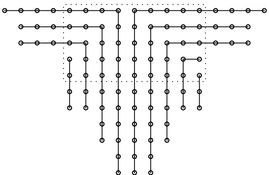

# 7.2.1.4节

**1.** [习题](../sec-7-2-1-4.md#ex-7-2-1-4-1)

<table aria-label="习题1的十二个计数式">
<tbody>
<tr><td>$m^n$</td><td>$m^{\underline n}$</td><td>$m!\left\{{n\atop m}\right\}$</td></tr>
<tr><td>$\binom{m+n-1}{n}$</td><td>$\binom mn$</td><td>$\binom{n-1}{n-m}$</td></tr>
<tr><td>$\left\{{n\atop0}\right\}+\cdots+\left\{{n\atop m}\right\}$</td><td>$[m\geq n]$</td><td>$\left\{{n\atop m}\right\}$</td></tr>
<tr><td>$\left\vert{m+n\atop m}\right\vert$</td><td>$[m\geq n]$</td><td>$\left\vert{n\atop m}\right\vert$</td></tr>
</tbody>
</table>

**2.** [习题](../sec-7-2-1-4.md#ex-7-2-1-4-2) 一般地, 给定任意整数 $x_1\geq\cdots\geq x_m$, 初始化 $a_1\cdots a_m\leftarrow x_1\cdots x_m$ 及 $a_{m+1}\leftarrow x_m-2$, 即可得到满足 $a_1\geq\cdots\geq a_m$、$a_1+\cdots+a_m=x_1+\cdots+x_m$ 及 $a_m\cdots a_1\geq x_m\cdots x_1$ 的所有整数 $m$ 元组 $a_1\cdots a_m$. 特别地, 如果 $c$ 是任意整数常数, 且 $n\geq cm$, 初始化 $a_1\leftarrow n-mc+c$、$a_j\leftarrow c$($1<j\leq m$) 及 $a_{m+1}\leftarrow c-2$, 即可得到满足 $a_1\geq\cdots\geq a_m\geq c$ 及 $a_1+\cdots+a_m=n$ 的所有整数 $m$ 元组.

**3.** [习题](../sec-7-2-1-4.md#ex-7-2-1-4-3) $a_j=\lfloor(n+m-j)/m\rfloor=\lceil(n+1-j)/m\rceil$($1\leq j\leq m$). 见 *CMath* §3.4.

**4.** [习题](../sec-7-2-1-4.md#ex-7-2-1-4-4) 假设 $1\leq r\leq n$. 必有 $a_m\geq a_1-1$. 因此 $a_j=\lfloor(n+m-j)/m\rfloor$($1\leq j\leq m$), 其中 $m$ 是满足 $\lfloor n/m\rfloor\geq r$ 的最大整数, 即 $m=\lfloor n/r\rfloor$.

**5.** [习题](../sec-7-2-1-4.md#ex-7-2-1-4-5) [见尤金·克利姆科,*BIT* **13**(1973), 38–49.]

**C1. [初始化.]** 置 $c_0\leftarrow1$, $c_1\leftarrow n$, $c_2\cdots c_n\leftarrow0\cdots0$, $l_0\leftarrow1$, $l_1\leftarrow0$. (假定 $n>0$.)

**C2. [访问.]** 访问由部分计数 $c_1\cdots c_n$ 和链接 $l_0l_1\cdots l_n$ 表示的分划.

**C3. [分支.]** 置 $j\leftarrow l_0$ 和 $k\leftarrow l_j$. 如果 $c_j=1$, 转到 C6. 否则, 如果 $j>1$, 转到 C5.

**C4. [将 $1+1$ 改为 2.]** 置 $c_1\leftarrow c_1-2$, $c_2\leftarrow c_2+1$, $l_{[c_1>0]}\leftarrow2$. 如果 $k\ne2$, 也置 $l_2\leftarrow k$. 返回 C2.

**C5. [将 $j\cdot c_j$ 改为 $(j+1)+1+\cdots+1$.]** 置 $c_1\leftarrow j(c_j-1)-1$, 转到 C7.

**C6. [将 $k\cdot c_k+j$ 改为 $(k+1)+1+\cdots+1$.]** 如果 $k=0$, 终止. 否则置 $c_j\leftarrow0$, 再置 $c_1\leftarrow k(c_k-1)+j-1$, $j\leftarrow k$, $k\leftarrow l_k$.

**C7. [调整链接.]** 如果 $c_1>0$, 置 $l_0\leftarrow1$, $l_1\leftarrow j+1$. 否则置 $l_0\leftarrow j+1$. 然后置 $c_j\leftarrow0$, $c_{j+1}\leftarrow c_{j+1}+1$. 如果 $k\ne j+1$, 则置 $l_{j+1}\leftarrow k$. 返回 C2.　∎

注意, 这个算法是无循环的, 不过它实际上并不比算法 P 快. 步骤 C4、C5、C6 分别执行 $p(n-2)$、$2p(n)-p(n+1)-p(n-2)$、$p(n+1)-p(n)$ 次. 因此, 当 $n$ 很大时, C4 最重要. (见习题 45 及特雷弗·芬纳和乔治希奥斯·洛伊索在 *Acta Inf.* **16**(1981), 237–252 的详尽分析.)

**6.** [习题](../sec-7-2-1-4.md#ex-7-2-1-4-6) 假定每个分划后面都有 0. 置 $j\leftarrow0$、$k\leftarrow a_1$、$b_{k+1}\leftarrow0$. 然后, 当 $k>0$ 时循环: 置 $j\leftarrow j+1$, 再在 $k>a_{j+1}$ 时反复置 $b_k\leftarrow j$、$k\leftarrow k-1$. (我们用了式 (11) 的对偶形式 $a_j-a_{j+1}=d_j$, 其中 $d_1\cdots d_n$ 是 $b_1b_2\cdots$ 的部分计数表示. 这一算法基本上沿费勒斯图的边缘前进, 所以运行时间大体与 $a_1+b_1$ 成正比, 即输入和输出的部分数之和.)

**7.** [习题](../sec-7-2-1-4.md#ex-7-2-1-4-7) 采用 (11) 的对偶形式, 有 $b_1\cdots b_n=n^{a_n}(n-1)^{a_{n-1}-a_n}\cdots1^{a_1-a_2}0^{n-a_1}$.

**8.** [习题](../sec-7-2-1-4.md#ex-7-2-1-4-8) 费勒斯图的转置对应二进制串 (15) 的反转与取补. 因此只需交换和颠倒 $p$ 和 $q$, 得到分划 $(a_1a_2\cdots)^T=(q_t+\cdots+q_1)^{p_1}(q_t+\cdots+q_2)^{p_2}\cdots(q_t)^{p_t}$.

**9.** [习题](../sec-7-2-1-4.md#ex-7-2-1-4-9) 用归纳法证明. 若 $a_k=l-1$、$b_l=k-1$, 递增 $a_k$ 和 $b_l$ 保持相等关系.

**10.** [习题](../sec-7-2-1-4.md#ex-7-2-1-4-10) (a) 附加 “1” 得到每个结点的左子结点. 递增最右侧数字得到右子结点, 当且仅当父结点以不相等的数字结尾时, 才存在这个子结点. $n$ 的所有分划都按字典序出现在第 $n$ 层.

(b) 将 “11” 改为 “2” 得到左子结点, 当且仅当父结点至少含两个 1 时才存在. 删除一个 1 并将大于 1 的最小部分加 1, 得到右子结点. 当且仅当至少有一个 1, 而且大于 1 的最小部分只出现一次时, 右子结点才存在. $n$ 分成 $m$ 个部分的所有分划, 都按字典序出现在第 $n-m$ 层. 整棵树的前序给出全体分划的字典序. [特雷弗·芬纳和乔治希奥斯·洛伊索,*Comp. J.* **23**(1980), 332–337.]

**11.** [习题](../sec-7-2-1-4.md#ex-7-2-1-4-11) 两个系数为

$$
\begin{aligned}
[z^{100}]\,\frac1{(1-z)(1-z^2)(1-z^5)(1-z^{10})(1-z^{20})(1-z^{50})(1-z^{100})}&=4563,\\
[z^{100}]\,(1+z+z^2)(1+z^2+z^4)\cdots(1+z^{100}+z^{200})&=7.
\end{aligned}
$$

[见波利亚,*AMM* **63**(1956), 689–697.] 在无限乘积 $\prod_{k\geq0}\prod_{r\in\{10^k,2\cdot10^k,5\cdot10^k\}}(1+z^r+z^{2r})$ 中, $z^{10^n}$ 的系数为 $2^{n+1}-1$, $z^{10^n-1}$ 的系数为 $2^n$.

**12.** [习题](../sec-7-2-1-4.md#ex-7-2-1-4-12) 为了证明 $(1+z)(1+z^2)(1+z^3)\cdots=1/((1-z)(1-z^3)(1-z^5)\cdots)$, 把左边写成

$$
\frac{1-z^2}{1-z}\frac{1-z^4}{1-z^2}\frac{1-z^6}{1-z^3}\cdots
$$

并消去分子和分母的公因式. 或者用 $z^1,z^3,z^5,\ldots$ 替代恒等式 $(1+z)(1+z^2)(1+z^4)(1+z^8)\cdots=1/(1-z)$ 中的 $z$, 再把结果相乘. [*Novi Comment. Acad. Sci. Pet.* **3**(1750), 125–169, §47.]

**13.** [习题](../sec-7-2-1-4.md#ex-7-2-1-4-13) 将分划 $c_1\cdot1+c_2\cdot2+c_3\cdot3+\cdots$ 映射到 $r_1\cdot1+\lfloor c_1/2\rfloor\cdot2+r_3\cdot3+\lfloor c_2/2\rfloor\cdot4+r_5\cdot5+\lfloor c_3/2\rfloor\cdot6+\cdots$, 其中 $r_m=(c_m\bmod2)+2(c_{2m}\bmod2)+4(c_{4m}\bmod2)+8(c_{8m}\bmod2)+\cdots$. 例如 $433222211\mapsto64421111\mapsto8332211$. [*Johns Hopkins Univ. Circular* **2**(1882), 72.]

**14.** [习题](../sec-7-2-1-4.md#ex-7-2-1-4-14) 西尔维斯特的对应关系最好用图来理解. 奇数部分的点居中排列, 并分成互不相交的钩子. 例如, 分划 $17+15+15+9+9+9+9+5+5+3+3$ 有 5 个不同的奇数部分, 由下图得到有 4 个间隙的互异部分分划 $19+18+16+13+12+9+5+4+3$.

  

一般地, 当 “德菲矩形” (如图所示) 有 $t$ 行时, 假定右侧多出 $a_1,\ldots,a_t$ 个点, 下方多出 $b_t,\ldots,b_1,\ldots,b_t$ 个点, 其中 $a_1\geq\cdots\geq a_t\geq0$、$b_1\geq\cdots\geq b_t\geq0$. 于是, 所得到的不同部分为 $2t-1+a_1+b_1$, $2t-2+a_1+b_2$, $\ldots$, $2+a_{t-1}+b_t$, $1+a_t+b_t$, 以及 (如果非零)$0+a_t$. 反过来, 任何一个有 $2t$ 个不同非负部分的分划, 都能唯一地写成这一形式.

当 $n=10$ 时, 相关奇数部分的分划为 $9+1$、$7+3$、$7+1+1+1$、$5+5$、$5+3+1+1$、$5+1+1+1+1+1$、$3+3+3+1$、$3+3+1+1+1+1$、$3+1+\cdots+1$、$1+\cdots+1$, 分别对应各部分不同的分划 $6+4$、$5+4+1$、$7+3$、$4+3+2+1$、$6+3+1$、$8+2$、$5+3+2$、$7+2+1$、$9+1$、$10$. [见西尔维斯特的著名论文,*Amer. J. Math.* **5**(1882), 251–330;**6**(1883), 334–336.]

**15.** [习题](../sec-7-2-1-4.md#ex-7-2-1-4-15) 每个迹为 $k$ 的自共轭分划都对应把 $n$ 分成 $k$ 个互不相同的奇数部分 (“钩子”) 的分划. 因此生成函数既可写成乘积 $(1+z)(1+z^3)(1+z^5)\cdots$, 也可写成和 $1+z^1/(1-z^2)+z^4/((1-z^2)(1-z^4))+z^9/((1-z^2)(1-z^4)(1-z^6))+\cdots$. [*Johns Hopkins Univ. Circular* **3**(1883), 42–43.]

**16.** [习题](../sec-7-2-1-4.md#ex-7-2-1-4-16) 德菲方块有 $k^2$ 个点, 余下的点对应最大部分不超过 $k$ 的两个独立分划. 因此, 用 $w$ 计部分数、$z$ 计点数, 得到

$$
\prod_{m=1}^{\infty}\frac1{1-wz^m}
=\sum_{k=0}^{\infty}\frac{w^kz^{k^2}}{(1-z)(1-z^2)\cdots(1-z^k)(1-wz)(1-wz^2)\cdots(1-wz^k)}.
$$

[这个看起来不寻常的公式实际上正是习题 19 的恒等式在 $x=y=0$ 时的特例.]

**17.** [习题](../sec-7-2-1-4.md#ex-7-2-1-4-17) (a) $((1+uvz)(1+uvz^2)(1+uvz^3)\cdots)/((1-uz)(1-uz^2)(1-uz^3)\cdots)$.

(b) 联合分划可用广义费勒斯图表示, 所有部分合在一起. 如果 $a_i\geq b_j$, 则将 $a_i$ 放在 $b_j$ 之上, 并在每个 $b_j$ 最右侧的点上作标记. 例如, 联合分划 $(8,8,5;9,7,5,2)$ 由下图表示, 标记点画成 “✦”.

标记只出现在角落, 所以转置后的图对应另一个联合分划, 本例为 $(7,6,6,4,3;7,6,4,1)$. [见城东明和丹尼斯·斯坦顿,*Pacific J. Math.* **127**(1987), 103–120; 西尔维·科特尔和杰里米·洛夫乔伊,*Trans. Amer. Math. Soc.* **356**(2004), 1623–1635; 伊戈尔·帕克,*The Ramanujan Journal* **12**(2006), 5–75.]

这样, 每个有 $t>0$ 个部分的联合分划, 都对应一个最大部分为 $t$ 的 “共轭”. 联合分划的生成函数为 $((1+vz)\cdots(1+vz^{t-1}))/((1-z)\cdots(1-z^t))$ 乘以 $(vz^t+z^t)$. 其中 $vz^t$ 对应 $b_1=t$ 的情形, $z^t$ 对应 $s=0$ 或 $b_1<t$ 的情形.

(c) 因而得到习题 1.2.6–58 答案中一般 $z$ 项式定理的一种形式:

$$
\frac{1+uvz}{1-uz}\frac{1+uvz^2}{1-uz^2}\frac{1+uvz^3}{1-uz^3}\cdots
=\sum_{t=0}^{\infty}\frac{1+v}{1-z}\frac{1+vz}{1-z^2}\cdots\frac{1+vz^{t-1}}{1-z^t}u^tz^t.
$$

**18.** [习题](../sec-7-2-1-4.md#ex-7-2-1-4-18) 给定 $c$ 和 $d$ 时, 等式显然确定 $a$ 和 $b$. 我们希望说明 $c$ 和 $d$ 也由 $a$ 和 $b$ 唯一确定. 下面的算法从右向左确定 $c$ 和 $d$.

**A1. [初始化.]** 置 $i\leftarrow r$, $j\leftarrow s$, $k\leftarrow0$, $a_0\leftarrow b_0\leftarrow\infty$.

**A2. [分支.]** 若 $i+j=0$, 停止. 否则, 若 $a_i\geq b_j-k$, 转到 A4.

**A3. [吸收 $a_i$.]** 置 $c_{i+j}\leftarrow a_i$, $d_{i+j}\leftarrow0$, $i\leftarrow i-1$, $k\leftarrow k+1$, 返回 A2.

**A4. [吸收 $b_j$.]** 置 $c_{i+j}\leftarrow b_j-k$, $d_{i+j}\leftarrow1$, $j\leftarrow j-1$, $k\leftarrow k+1$, 返回 A2.　∎

还有一种从左向右的方法:

**B1. [初始化.]** 置 $i\leftarrow1$, $j\leftarrow1$, $k\leftarrow r+s$, $a_{r+1}\leftarrow b_{s+1}\leftarrow-\infty$.

**B2. [分支.]** 若 $k=0$, 停止. 否则置 $k\leftarrow k-1$, 再在 $a_i\leq b_j-k$ 时转到 B4.

**B3. [吸收 $a_i$.]** 置 $c_{i+j-1}\leftarrow a_i$, $d_{i+j-1}\leftarrow0$, $i\leftarrow i+1$, 返回 B2.

**B4. [吸收 $b_j$.]** 置 $c_{i+j-1}\leftarrow b_j-k$, $d_{i+j-1}\leftarrow1$, $j\leftarrow j+1$, 返回 B2.　∎

在两种方法中, 分支选择都是唯一的, 所得序列满足 $c_1\geq\cdots\geq c_{r+s}$. 注意 $c_{r+s}=\min(a_r,b_s)$, $c_1=\max(a_1,b_1-r-s+1)$.

这样我们又证明了一次习题 17(c) 的恒等式. 这个思想的推广给出了拉马努金 “带有许多参数的著名公式” 的组合证明:

$$
\sum_{n=-\infty}^{\infty}w^n\prod_{k=0}^{\infty}\frac{1-bz^{k+n}}{1-az^{k+n}}
=\prod_{k=0}^{\infty}
\frac{(1-a^{-1}bz^k)(1-a^{-1}w^{-1}z^{k+1})(1-awz^k)(1-z^{k+1})}
{(1-a^{-1}bw^{-1}z^k)(1-a^{-1}z^{k+1})(1-az^k)(1-wz^k)}.
$$

[参考文献: 哈代,*Ramanujan*(1940), 式 (12.12.2); 多伦·泽尔伯格,*Europ. J. Combinatorics* **8**(1987), 461–463; 爱子,*J. Comb. Theory* **A105**(2004), 63–77.]

**19.** [习题](../sec-7-2-1-4.md#ex-7-2-1-4-19) [*Crelle* **34**(1847), 285–328.] 根据习题 17(c), 将本题提示中的式子对 $k$ 求和, 得到

$$
\left(\sum_{l\geq0}v^l
\frac{(z-bz)\cdots(z-bz^l)}{(1-z)\cdots(1-z^l)}
\frac{(1-uz)\cdots(1-uz^l)}{(1-auz)\cdots(1-auz^l)}\right)
\prod_{m=1}^{\infty}\frac{1-auz^m}{1-uz^m}.
$$

对 $l$ 求和的结果类似, 但交换 $u\leftrightarrow v$、$a\leftrightarrow b$、$k\leftrightarrow l$. 此外, 当 $b=auz$ 时, 对 $k$ 和 $l$ 的求和结果简化为

$$
\prod_{m=1}^{\infty}\frac{(1-uvz^{m+1})(1-auz^m)}{(1-uz^m)(1-vz^m)}.
$$

令 $u=wxy$, $v=1/(yz)$, $a=1/x$, $b=wyz$, 将此无限积与对 $l$ 求和的结果相等.

**20.** [习题](../sec-7-2-1-4.md#ex-7-2-1-4-20) 要得到 $p(n)$, 需要加上或减去约 $\sqrt{8n/3}$ 个先前得到的项, 其中大多数有 $\Theta(\sqrt n)$ 个二进制位. 因此可用 $\Theta(n)$ 步算出 $p(n)$, 总时间为 $\Theta(n^2)$.

(直接使用 (17) 将需要 $\Theta(n^{5/2})$ 步.)

**21.** [习题](../sec-7-2-1-4.md#ex-7-2-1-4-21) 由于 $\sum_{n=0}^{\infty}q(n)z^n=(1+z)(1+z^2)\cdots$ 等于 $(1-z^2)(1-z^4)\cdots P(z)=(1-z^2-z^4+z^{10}+z^{14}-z^{24}-\cdots)P(z)$, 所以

$$
q(n)=p(n)-p(n-2)-p(n-4)+p(n-10)+p(n-14)-p(n-24)-\cdots.
$$

[还有一个只涉及 $q$ 的 “纯递推关系”, 类似下一题中 $\sigma(n)$ 的递推式.]

**22.** [习题](../sec-7-2-1-4.md#ex-7-2-1-4-22) 由式 (21) 可得

$$
\sum_{n=1}^{\infty}\sigma(n)z^n=\sum_{m,n\geq1}m z^{mn}
=z\frac{d}{dz}\ln P(z)
=\frac{z+2z^2-5z^5-7z^7+\cdots}{1-z-z^2+z^5+z^7+\cdots}.
$$

[*Bibliothèque Impartiale* **3**(1751), 10–31.]

**23.** [习题](../sec-7-2-1-4.md#ex-7-2-1-4-23) (马库斯·范莱文给出的解.) 将式 (19) 除以 $1-v$, 得

$$
\begin{aligned}
\prod_{k=1}^{\infty}(1-u^kv^{k-1})(1-u^kv^k)(1-u^kv^{k+1})
&=\sum_{n=0}^{\infty}(-1)^n u^{\binom{n+1}{2}}
\left(\frac{v^{\binom n2}-v^{\binom{n+2}{2}}}{1-v}\right)\\
&=\sum_{n=0}^{\infty}(-1)^n u^{\binom{n+1}{2}}v^{\binom n2}\sum_{k=0}^{2n}v^k;
\end{aligned}
$$

现在设 $u=z$、$v=1$.

[见习题 14 的答案所引詹姆斯·西尔维斯特论文第 57 节. 卡尔·雅可比的证明在 *Fundamenta Nova Theoriæ Functionum Ellipticarum*(1829) 第 66 节.]

**24.** [习题](../sec-7-2-1-4.md#ex-7-2-1-4-24) (a) 根据 (18) 与习题 23,

$$
[z^n]A(z)=\sum_{j\in\mathbb{Z},\ k\geq0}(-1)^{j+k}(2k+1)[3j^2+j+k^2+k=2n].
$$

当 $n\bmod5=4$ 时, 所有贡献均有 $j\bmod5=4$、$k\bmod5=2$, 而这时 $(2k+1)\bmod5=0$.

(b) 根据式 4.6.2–(5), 当 $p$ 为素数时, $B(z)^p\equiv B(z^p)\pmod p$.

(c) 因为 $A(z)=P(z)^{-4}$, 取 $B(z)=P(z)$. [*Proc. Cambridge Philos. Soc.* **19**(1919), 207–210. 类似方法可证明, 当 $n\bmod7=5$ 时, $p(n)$ 是 7 的倍数. 拉马努金进一步得到优美公式

$$
\begin{aligned}
p(5n+4)/5&=[z^n]\,P(z)^6/P(z^5)^5,\\
p(7n+5)/7&=[z^n]\bigl(P(z)^4/P(z^7)^3+7zP(z)^8/P(z^7)^7\bigr).
\end{aligned}
$$

阿瑟·阿特金和亨利·斯温纳顿—戴尔在 *Proc. London Math. Soc.* (3) **4**(1954), 84–106 中证明, 按照秩 (最大部分减去部分数) 模 5 或模 7 的各个取值, 可以把 $5n+4$ 或 $7n+5$ 的分划分成等大的若干类, 与弗里曼·戴森的猜想一致. 采用稍复杂的组合统计还可证明, 当 $n\bmod11=6$ 时, $p(n)\bmod11=0$. 见弗朗西斯·加文,*Trans. Amer. Math. Soc.* **305**(1988), 47–77.]

**25.** [习题](../sec-7-2-1-4.md#ex-7-2-1-4-25) [对所述恒等式两边微分, 可以证明提示中的内容. 它是阿贝尔 1826 年发现的以下优美公式在 $y=1-x$ 时的特例:

$$
\operatorname{Li}_2(x)+\operatorname{Li}_2(y)
=\operatorname{Li}_2\left(\frac{x}{1-y}\right)+\operatorname{Li}_2\left(\frac{y}{1-x}\right)
-\operatorname{Li}_2\left(\frac{xy}{(1-x)(1-y)}\right)-\ln(1-x)\ln(1-y).
$$

见阿贝尔的 *Œuvres Complètes* **2**(Christiania: Grøndahl, 1881), 189–193.]

(a) 对 $t>0$、$x\geq1$, 令 $f(x)=\ln(1/(1-e^{-xt}))$. 则

$$
\int_1^x f(y)\,dy=\frac{\operatorname{Li}_2(e^{-t})-\operatorname{Li}_2(e^{-tx})}{t},\qquad
f^{(n)}(x)=\frac{(-t)^n e^{tx}\sum_k\left\langle{n-1\atop k}\right\rangle e^{ktx}}{(e^{tx}-1)^n}.
$$

所以欧拉求和公式给出, 当 $t\to0$ 时,

$$
\begin{aligned}
&\operatorname{Li}_2(e^{-t})/t+\tfrac12\ln(1/(1-e^{-t}))+O(1)\\
&=(\zeta(2)+t\ln(1-e^{-t})-\operatorname{Li}_2(1-e^{-t}))/t-\tfrac12\ln t+O(1)\\
&=\zeta(2)/t+\tfrac12\ln t+O(1).
\end{aligned}
$$

(b) 设 $t>0$, 取 $c>1$, 我们有

$$
\begin{aligned}
\sum_{m,n\geq1}e^{-mnt}/n
&=\frac1{2\pi i}\sum_{m,n\geq1}\frac1n\int_{c-i\infty}^{c+i\infty}(mnt)^{-z}\Gamma(z)\,dz\\
&=\frac1{2\pi i}\int_{c-i\infty}^{c+i\infty}\zeta(z+1)\zeta(z)t^{-z}\Gamma(z)\,dz.
\end{aligned}
$$

在 $z=1$ 处的极点给出 $\zeta(2)/t$. 在 $z=0$ 处的双极点给出 $-\zeta(0)\ln t+\zeta'(0)=\tfrac12\ln t-\tfrac12\ln2\pi$. 在 $z=-1$ 处的极点给出 $-\zeta(-1)\zeta(0)t=-t/24$. $\zeta(z+1)\zeta(z)$ 的零点抵消了 $\Gamma(z)$ 的其他极点, 所以对于任意大的 $M$, 结果为 $\ln P(e^{-t})=\zeta(2)/t+\tfrac12\ln(t/2\pi)-t/24+O(t^M)$.

**26.** [习题](../sec-7-2-1-4.md#ex-7-2-1-4-26) 设 $F(n)=\sum_{k=1}^{\infty}e^{-k^2/n}$. 我们可以使用 (25), 取 $f(x)=e^{-x^2/n}[x>0]+\frac12\delta_{x0}$, 或取对所有 $x$ 成立的 $f(x)=e^{-x^2/n}$, 这是因为 $2F(n)+1=\sum_{k=-\infty}^{\infty}e^{-k^2/n}$. 选择后一种设定, 在 $\theta=0$ 时用 $u=y+\pi mni$ 代入, 则 (25) 的右边是快速收敛的

$$
\lim_{M\to\infty}\sum_{m=-M}^{M}\int_{-\infty}^{\infty}e^{-2\pi miy-y^2/n}\,dy
=\sum_{m=-\infty}^{\infty}e^{-\pi^2m^2n}\int_{-\infty}^{\infty}e^{-u^2/n}\,du.
$$

积分结果为 $\sqrt{\pi n}$. [此即泊松原论文第 420 页的公式 (15).]

**27.** [习题](../sec-7-2-1-4.md#ex-7-2-1-4-27) 先代入 $u=y+b-ci/a$, 有

$$
\int_{-\infty}^{\infty}e^{-a(y+b)^2+2ciy}\,dy
=e^{-c^2/a-2bci}\int_{-\infty}^{\infty}e^{-au^2}\,du.
$$

再代入 $t=au^2$, 并根据习题 1.2.5–20 和 1.2.6–43, 得到

$$
\int_{-\infty}^{\infty}e^{-au^2}\,du=\int_0^{\infty}e^{-t}\,dt/\sqrt{at}=\Gamma(\tfrac12)/\sqrt a=\sqrt{\pi/a}.
$$

由 (29) 可得 (30), 因为对于所有整数 $m$,

$$
g(3m+1)+g(-3m)=\sqrt{2\pi/t}\,(-1)^m e^{-6\pi^2(m+\frac16)^2/t};\qquad
g(3m+2)+g(-3m-1)=0.
$$

[见马尔温·诺普,*Modular Functions in Analytic Number Theory*(1970), 第 3 章.]

**28.** [习题](../sec-7-2-1-4.md#ex-7-2-1-4-28) (a, b, c, d) 见 *Trans. Amer. Math. Soc.* **43**(1938), 271–295. 事实上, 德里克·莱默发现了 $A_{p^e}(n)$ 的显式公式, 以习题 4.5.4–23 中的雅可比符号表示为

$$
\begin{aligned}
A_{2^e}(n)&=(-1)^e\left(\frac{-1}{m}\right)2^{e/2}\sin\frac{4\pi m}{2^{e+3}},
& &\text{若 }(3m)^2\equiv1-24n\pmod{2^{e+3}};\\
A_{3^e}(n)&=(-1)^{e+1}\left(\frac{m}{3}\right)\frac{2}{\sqrt3}3^{e/2}\sin\frac{4\pi m}{3^{e+1}},
& &\text{若 }(8m)^2\equiv1-24n\pmod{3^{e+1}}.
\end{aligned}
$$

$$
A_{p^e}(n)=
\begin{cases}
2\left(\dfrac{3}{p^e}\right)p^{e/2}\cos\dfrac{4\pi m}{p^e},&
\begin{aligned}
&\text{若 }(24m)^2\equiv1-24n\pmod{p^e},\ p\geq5,\\
&\text{且 }24n\bmod p\ne1;
\end{aligned}\\[3pt]
\left(\dfrac{3}{p^e}\right)p^{e/2}[e=1],
&\text{若 }24n\bmod p=1,\ \text{且 }p\geq5.
\end{cases}
$$

(e) 如果 $k=2^a3^b p_1^{e_1}\cdots p_t^{e_t}$, 其中 $3<p_1<\cdots<p_t$, $e_1\cdots e_t\ne0$, 则 $A_k(n)\ne0$ 的概率为

$$
2^{-t}\bigl(1+(-1)^{[e_1>1]}/p_1\bigr)\cdots\bigl(1+(-1)^{[e_t>1]}/p_t\bigr).
$$

**29.** [习题](../sec-7-2-1-4.md#ex-7-2-1-4-29) $z_1z_2\cdots z_m/((1-z_1)(1-z_1z_2)\cdots(1-z_1z_2\cdots z_m))$.

**30.** [习题](../sec-7-2-1-4.md#ex-7-2-1-4-30) 根据 (39), (a) $\left\vert{n+1\atop m}\right\vert$, (b) $\left\vert{m+n\atop m}\right\vert$.

**31.** [习题](../sec-7-2-1-4.md#ex-7-2-1-4-31) *解法 1*[小马歇尔·霍尔,*Combinatorial Theory*(1967), §4.1]. 由递推式 (39) 可以直接证明, 对于 $0\leq r<k!$, 存在多项式 $f_{k,r}(n)=n^{k-1}/(k!(k-1)!)+O(n^{k-2})$, 使得 $\left\vert{n\atop k}\right\vert=f_{k,n\bmod k!}(n)$.

*解法 2*. 由于 $(1-z)\cdots(1-z^m)=\prod_{p\perp q}(1-e^{2\pi ip/q}z)^{\lfloor m/q\rfloor}$, 其中乘积遍及所有既约分数 $p/q$($0\leq p<q$), (41) 中 $z^n$ 的系数可表示为单位根乘以 $n$ 的多项式后求和, 即 $\sum_{p\perp q}e^{2\pi ipn/q}f_{p,q}(n)$, 其中 $f_{p,q}(n)$ 的次数低于 $\lfloor m/q\rfloor$. 因此存在常数, 使得 $\left\vert{n\atop2}\right\vert=a_1n+a_2+(-1)^na_3$, $\left\vert{n\atop3}\right\vert=b_1n^2+b_2n+b_3+(-1)^nb_4+\omega^nb_5+\omega^{-n}b_6$, 其中 $\omega=e^{2\pi i/3}$, 等等. 这些常数由较小 $n$ 时的值确定, 前两例为

$$
\left\vert{n\atop2}\right\vert=\tfrac12n-\tfrac14+\tfrac14(-1)^n;\qquad
\left\vert{n\atop3}\right\vert=\tfrac1{12}n^2-\tfrac7{72}-\tfrac18(-1)^n+\tfrac19\omega^n+\tfrac19\omega^{-n}.
$$

所以 $\left\vert{n\atop3}\right\vert$ 是最接近 $n^2/12$ 的整数. 类似地, $\left\vert{n\atop4}\right\vert$ 是最接近 $(n^3+3n^2-9n[n\text{ 为奇数}])/144$ 的整数.

[$\left\vert{n\atop2}\right\vert$、$\left\vert{n\atop3}\right\vert$、$\left\vert{n\atop4}\right\vert$ 的精确公式在尚未用下取整函数简化时, 最早由乔瓦尼·马尔法蒂发现. 见 *Memorie di Mat. e Fis. Società Italiana* **3**(1786), 571–663. 沃尔特·科尔曼在 *Fibonacci Quarterly* **21**(1983), 272–284 中证明, $\left\vert{n\atop5}\right\vert$ 是最接近 $(n^4+10n^3+10n^2-75n-45n(-1)^n)/2880$ 的整数, 并为 $\left\vert{n\atop6}\right\vert$、$\left\vert{n\atop7}\right\vert$ 给出类似公式.]

**32.** [习题](../sec-7-2-1-4.md#ex-7-2-1-4-32) 由于 $\left\vert{m+n\atop m}\right\vert\leq p(n)$, 当且仅当 $m\geq n$ 时等号成立, 所以 $\left\vert{n\atop m}\right\vert\leq p(n-m)$, 当且仅当 $2m\geq n$ 时等号成立.

**33.** [习题](../sec-7-2-1-4.md#ex-7-2-1-4-33) 分为 $m$ 个部分的一个分划至多对应 $m!$ 个组分, 所以 $\binom{n-1}{m-1}\leq m!\left\vert{n\atop m}\right\vert$. 因此 $p(n)\geq(n-1)!/((n-m)!\,m!\,(m-1)!)$, 当 $m=\lfloor\sqrt n\rfloor$ 时, 斯特林近似证明了 $\ln p(n)\geq2\sqrt n-\ln n-\tfrac12-\ln2\pi$.

**34.** [习题](../sec-7-2-1-4.md#ex-7-2-1-4-34) $a_1>a_2>\cdots>a_m>0$ 当且仅当 $a_1-m+1\geq a_2-m+2\geq\cdots\geq a_m\geq1$. 分为 $m$ 个互异部分的分划对应 $m!$ 个组分. 因此根据上题答案,

$$
\frac1{m!}\binom{n-1}{m-1}\leq\left\vert{n\atop m}\right\vert
\leq\frac1{m!}\binom{n+m(m-1)/2}{m-1}.
$$

[见汉斯拉杰·古普塔,*Proc. Indian Acad. Sci.* **A16**(1942), 101–102. 习题 3.3.2–30 给出了 $\left\vert{n\atop m}\right\vert$ 在 $n=\Theta(m^3)$ 时的详细渐近公式.]

**35.** [习题](../sec-7-2-1-4.md#ex-7-2-1-4-35) (a) $x=\frac1C\ln\frac1C\approx-0.194$.

(b) $x=\frac1C\ln\frac1C-\frac1C\ln\ln2\approx0.092$. 一般地 $x=\frac1C(\ln\frac1C-\ln\ln\frac1{F(x)})$.

(c)
$$
\begin{aligned}
\int_{-\infty}^{\infty}x\,dF(x)
&=\int_0^{\infty}(Cu)^{-2}(\ln u)e^{-1/(Cu)}\,du\\
&=-\frac1C\int_0^\infty(\ln C+\ln v)e^{-v}\,dv=(\gamma-\ln C)/C\approx0.256.
\end{aligned}
$$

(d) 类似地,

$$
\int_{-\infty}^{\infty}x^2e^{-Cx}\exp(-e^{-Cx}/C)\,dx
=(\gamma^2+\zeta(2)-2\gamma\ln C+(\ln C)^2)/C^2\approx1.0655.
$$

所以方差恰好是 $\zeta(2)/C^2=1$. [概率分布 $e^{-e^{(a-x)/b}}$ 通常称为费希尔—蒂皮特分布, 见 *Proc. Cambridge Phil. Soc.* **24**(1928), 180–190.]

**36.** [习题](../sec-7-2-1-4.md#ex-7-2-1-4-36) 对 $j_r-(m+r-1)\geq\cdots\geq j_2-(m+1)\geq j_1-m\geq1$ 求和, 得到

$$
\begin{aligned}
\Sigma_r&=\sum_t\left\vert{t-rm-r(r-1)/2\atop r}\right\vert\frac{p(n-t)}{p(n)}\\
&=\frac{\alpha}{1-\alpha}\frac{\alpha^2}{1-\alpha^2}\cdots
\frac{\alpha^r}{1-\alpha^r}\alpha^{rm}\bigl(1+O(n^{-1/2+2\epsilon})\bigr)+E\\
&=\frac{n^{-1/2}}{\alpha^{-1}-1}\frac{n^{-1/2}}{\alpha^{-2}-1}\cdots
\frac{n^{-1/2}}{\alpha^{-r}-1}\exp\bigl(-Crx+O(rn^{-1/2+2\epsilon})\bigr)+E.
\end{aligned}
$$

其中, 误差项 $E$ 考虑 $t>n^{1/2+\epsilon}$ 的情形. 前导因式 $n^{-1/2}/(\alpha^{-j}-1)$ 为 $(1+O(jn^{-1/2}))/(jC)$. 即使用粗糙的上界 $\left\vert{t-rm-r(r-1)/2\atop r}\right\vert\leq t^r$, 也容易验证 $E=O(n^{\log n}e^{-Cn^\epsilon})$, 因为

$$
\sum_{t\geq xN}t^re^{-t/N}=O\left(\int_{xN}^{\infty}t^re^{-t/N}\,dt\right)=O(N^{r+1}x^re^{-x}/(1-r/x)),
$$

其中 $N=\Theta(\sqrt n)$, $x=\Theta(n^\epsilon)$, $r=O(\log n)$.

**37.** [习题](../sec-7-2-1-4.md#ex-7-2-1-4-37) 这样一个分划在 $\Sigma_0$ 中计一次, 在 $\Sigma_1$ 中计 $q$ 次, 在 $\Sigma_2$ 中计 $\binom q2$ 次, 等等. 所以, 在以 $(-1)^r\Sigma_r$ 结尾的部分和中, 恰好计 $\sum_{j=0}^r(-1)^j\binom qj=(-1)^r\binom{q-1}r$ 次. $r$ 为奇数时, 此数至多为 $\delta_{q0}$, $r$ 为偶数时至少为 $\delta_{q0}$. [用类似论证可知, 习题 1.3.3–26 中的推广原理也有这一夹逼性质. 参考文献: 卡洛·邦费罗尼,*Pubblicazioni del Reale Istituto Superiore di Scienze Economiche e Commerciali di Firenze* **8**(1936), 3–62.]

**38.** [习题](../sec-7-2-1-4.md#ex-7-2-1-4-38) $z^{l+m-1}\binom{l+m-2}{m-1}_z=z^{l+m-1}(1-z^l)\cdots(1-z^{l+m-2})/((1-z)\cdots(1-z^{m-1}))$.

**39.** [习题](../sec-7-2-1-4.md#ex-7-2-1-4-39) 由习题 1.2.6–58, $[x^m](1+zx)(1+z^2x)\cdots(1+z^{l-1}x)=z^{m(m+1)/2}\binom{l-1}m_z$, 即 $(z-z^l)(z^2-z^l)\cdots(z^m-z^l)/((1-z)(1-z^2)\cdots(1-z^m))$. 由定理 C 也可得到答案. 用 $(a_1-m)\cdots(a_m-1)$ 替代 $a_1\cdots a_m$, 得到 $n-m(m+1)/2$ 的一个等价分划, 至多有 $m$ 个部分, 各部分不超过 $l-1-m$.

**40.** [习题](../sec-7-2-1-4.md#ex-7-2-1-4-40) 如果 $\alpha=a_1\cdots a_m$ 是一个至多有 $m$ 个部分的分划, 在 $a_1\leq l$ 时设 $f(\alpha)=\infty$, 否则设 $f(\alpha)=\min\{j\mid a_1>l+a_{j+1}\}$. 令 $g_k$ 是满足 $f(\alpha)>k$ 的分划的生成函数. 满足 $f(\alpha)=k<\infty$ 的分划由不等式

$$
a_1\geq a_2\geq\cdots\geq a_k\geq a_1-l>a_{k+1}\geq\cdots\geq a_{m+1}=0
$$

描述. 因此 $a_1a_2\cdots a_m=(b_k+l+1)(b_1+1)\cdots(b_{k-1}+1)b_{k+1}\cdots b_m$, 其中 $f(b_1\cdots b_m)\geq k$, 反之亦然. 于是 $g_k=g_{k-1}-z^{l+k}g_{k-1}$.

[见 *American J. Math.* **5**(1882), 254–257.]

**41.** [习题](../sec-7-2-1-4.md#ex-7-2-1-4-41) 见耶特·阿尔姆奎斯特和乔治·安德鲁斯,*J. Number Theory* **38**(1991), 135–144.

**42.** [习题](../sec-7-2-1-4.md#ex-7-2-1-4-42) 阿纳托利·韦尔申斯科 [*Functional Anal. Applic.* **30**(1996), 90–105, 定理 4.7] 给出了公式

$$
\frac{1-e^{-c\varphi}}{1-e^{-c(\theta+\varphi)}}e^{-ck/\sqrt n}
+\frac{1-e^{-c\theta}}{1-e^{-c(\theta+\varphi)}}e^{-ca_k/\sqrt n}\approx1,
$$

其中, 须按 $\theta$ 和 $\varphi$ 选择 $c$, 使图形的面积为 $n$. 若 $\theta\varphi<2$, 则 $c<0$; 若 $\theta\varphi>2$, 则 $c>0$; 若 $\theta\varphi=2$, 图形化为直线

$$
\frac{k}{\theta\sqrt n}+\frac{a_k}{\varphi\sqrt n}\approx1.
$$

若 $\varphi=\infty$, 则 $c=\sqrt{\operatorname{Li}_2(t)}$, 其中 $t$ 满足 $\theta=(\ln\frac1{1-t})/\sqrt{\operatorname{Li}_2(t)}$.

**43.** [习题](../sec-7-2-1-4.md#ex-7-2-1-4-43) $p(n-k(k-1)/2)$. (将 $a_1a_2\cdots a_k$ 改为 $(a_1-k+1)(a_2-k+2)\cdots a_k$, 得到 $n-k(k-1)/2$ 的一个等价分划.)

**44.** [习题](../sec-7-2-1-4.md#ex-7-2-1-4-44) 设 $n>0$. 最小的两个部分不相等 (或只有一个部分) 的分划数为 $p(n+1)-p(n)$, 即 $n+1$ 的分划中不以 1 结尾的数目. 这是因为只要改变最小部分, 便从后者得到前者. 因此答案为 $2p(n)-p(n+1)$. [见鲁杰尔·博斯科维奇,*Giornale de’ Letterati*(Rome, 1748), 15. 最小三部分全相等的分划数为 $3p(n)-p(n+1)-2p(n+2)+p(n+3)$. 对最小部分施加其他约束, 可以推出类似公式.]

**45.** [习题](../sec-7-2-1-4.md#ex-7-2-1-4-45) 根据式 (37),

$$
\frac{p(n-j)}{p(n)}
=1-Cjn^{-1/2}+\frac{C^2j^2+2j}{2n}
-\frac{8C^3j^3+60Cj^2+Cj+12C^{-1}j}{48n^{3/2}}+O(j^4n^{-2}).
$$

**46.** [习题](../sec-7-2-1-4.md#ex-7-2-1-4-46) 若 $n>1$, 则 $T'_2(n)=p(n-1)-p(n-2)\leq p(n)-p(n-1)=T''_2(n)$. 这是因为 $p(n)-p(n-1)$ 是 $n$ 的分划中不以 1 结尾的数目, 而对 $n-1$ 的每个这种分划增大其最大部分, 就得到一个 $n$ 的相应分划. 不过差别相当小, $(T''_2(n)-T'_2(n))/p(n)=C^2/n+O(n^{-3/2})$.

**47.** [习题](../sec-7-2-1-4.md#ex-7-2-1-4-47) 对式 (21) 微分, 得到提示中的恒等式, 见习题 22. 当 $c_1+2c_2+\cdots+nc_n=n$ 时, 对 $n$ 应用归纳法, 得到部分计数 $c_1\cdots c_n$ 的概率

$$
\begin{aligned}
\Pr(c_1\cdots c_n)
&=\sum_{k=1}^n\sum_{j=1}^{c_k}\frac{kp(n-jk)}{np(n)}\Pr(c_1\cdots c_{k-1}(c_k-j)c_{k+1}\cdots c_n)\\
&=\sum_{k=1}^n\sum_{j=1}^{c_k}\frac{k}{np(n)}=\frac1{p(n)}.
\end{aligned}
$$

[*Combinatorial Algorithms*(Academic Press, 1975), 第 10 章.]

**48.** [习题](../sec-7-2-1-4.md#ex-7-2-1-4-48) 步骤 N5 中 $j$ 取某个固定值的概率为 $6/(\pi^2j^2)+O(n^{-1/2})$, 而 $jk$ 的均值为 $\sqrt n$ 量级. 步骤 N4 花费的平均时间是 $\Theta(n)$, 所以平均运行时间为 $n^{3/2}$ 量级. (更精确的分析仍有待进行.)

**49.** [习题](../sec-7-2-1-4.md#ex-7-2-1-4-49) (a) 有 $F(z)=\sum_{k=1}^{\infty}F_k(z)$, 其中 $F_k(z)$ 是最小部分至少为 $k$ 的所有分划的生成函数, 即 $1/((1-z^k)(1-z^{k+1})\cdots)-1$.

(b) 令 $f_k(n)=[z^n]F_k(z)/p(n)$. 于是 $f_1(n)=1$; $f_2(n)=1-p(n-1)/p(n)=Cn^{-1/2}+O(n^{-1})$; $f_3(n)=(p(n)-p(n-1)-p(n-2)+p(n-3))/p(n)=2C^2n^{-1}+O(n^{-3/2})$; $f_4(n)=6C^3n^{-3/2}+O(n^{-2})$. (见习题 45.) 其结果为 $f_{k+1}(n)=k!C^kn^{-k/2}+O(n^{-(k+1)/2})$, 特别是 $f_5(n)=O(n^{-2})$. 于是 $f_5(n)+\cdots+f_n(n)=O(n^{-1})$, 因为 $f_{k+1}(n)\leq f_k(n)$.

将各项相加得到 $[z^n]F(z)=p(n)(1+C/\sqrt n+O(n^{-1}))$.

**50.** [习题](../sec-7-2-1-4.md#ex-7-2-1-4-50) (a) 根据归纳法, 当 $0\leq k<m$ 时, $c_m(m+k)=c_{m-1}(m-1+k)+c_m(k)=m-1-k+c(k)+1$.

(b) 因为对于 $0\leq k\leq m$ 有 $\left\vert{m+k\atop m}\right\vert=p(k)$.

(c) 当 $n=2m$ 时, 算法 H 实际上生成 $m$ 的分划. $j-1$ 是刚生成的分划的共轭分划的第二小部分, 但 $j-1=m$ 是特例, 紧接在 $1\cdots1$ 的共轭只有一个部分的情形之后.

(d) 若 $\alpha$ 的所有部分均大于 $k$, 让 $\alpha k^{q+1}j$ 对应 $\alpha(k+1)$.

(e) 继续上题及其答案, 根据 (d), 第二小部分至少为 $k$ 的所有分划的生成函数 $G_k(z)$ 是 $F_{k+1}(z)/(1-z)$. 因此 $C(z)=(F(z)-F_1(z))/(1-z)+z/(1-z)^2$.

(f) 如上题, 可证明对 $k\leq5$, 有 $[z^n]G_k(z)/p(n)=O(n^{-k/2})$. 因此 $c(m)/p(m)=1+O(m^{-1/2})$. 对很小的 $m$ 容易算出 $(c(m)+1)/p(m)$, 该比值在 $m=7$ 时达到最大 2.6, 随后稳定降低. 严格控制渐近误差界即可完成证明.

*注.* 伯特·弗里斯泰特 [*Trans. Amer. Math. Soc.* **337**(1993), 703–735] 还证明了, 在 $n$ 的随机分划中, 大小为 $k$ 的部分数目超过 $Cx\sqrt n$ 的渐近概率为 $e^{-x}$.

**52.** [习题](../sec-7-2-1-4.md#ex-7-2-1-4-52) 按字典序, 64 的分划中, 有 $\left\vert{64+13\atop13}\right\vert$ 个满足 $a_1\leq13$, 另有 $\left\vert{50+10\atop10}\right\vert$ 个满足 $a_1=14$ 且 $a_2\leq10$, 等等. 因此, 根据提示, 按字典序排在分划 $14\ 11\ 9\ 6\ 4\ 3\ 2\ 1^{15}$ 之前的, 恰有 $p(64)-1\,000\,000$ 个分划, 所以它是逆字典序的第 100 万个.

**53.** [习题](../sec-7-2-1-4.md#ex-7-2-1-4-53) 和上题一样, 100 的分划中, 有 $\left\vert{80\atop12}\right\vert$ 个满足 $a_1=32$ 且 $a_2\leq12$, 等等. 因此, 在 $a_1=32$ 的分划中, 字典序第 100 万个是 $32\ 13\ 12\ 8\ 7\ 6\ 5\ 5\ 1^{12}$. 算法 H 生成其共轭, 即 $20\ 8\ 8\ 8\ 8\ 6\ 5\ 4\ 3\ 3\ 3\ 3\ 2\ 1^{19}$.

**54.** [习题](../sec-7-2-1-4.md#ex-7-2-1-4-54) (a) 显然正确. 这一问只是热身.

(b) 正确, 但不那么显然. 费勒斯图表明

$$
a'_1+\cdots+a'_k=\sum_{j=1}^{\infty}\min(k,a_j).
$$

因此希望证明, $\alpha\succeq\beta$ 蕴含对所有 $k\geq0$, 都有 $\sum_{j=1}^{\infty}\min(k,a_j)\leq\sum_{j=1}^{\infty}\min(k,b_j)$. 当 $k\geq b_1$ 时显然. 若 $b_l\geq k\geq b_{l+1}$, 则

$$
\sum_{j=1}^{\infty}\min(k,a_j)\leq\sum_{j=1}^l k+\sum_{j=l+1}^{\infty}a_j
\leq kl+\sum_{j=l+1}^{\infty}b_j=\sum_{j=1}^{\infty}\min(k,b_j).
$$

(c) 若 $c_1c_2\cdots$ 是一个分划, 则递推式 $c_k=\min(a_1+\cdots+a_k,b_1+\cdots+b_k)-(c_1+\cdots+c_{k-1})$ 显然定义最大下限. 它确实是一个分划. 若 $c_1+\cdots+c_k=a_1+\cdots+a_k$, 则

$$
\begin{aligned}
0\leq\min(a_{k+1},b_{k+1})
&\leq\min(a_{k+1},b_{k+1}+b_1+\cdots+b_k-a_1-\cdots-a_k)\\
&=c_{k+1}\leq a_{k+1}\leq a_k\\
&=c_k+(c_1+\cdots+c_{k-1})-(a_1+\cdots+a_{k-1})\leq c_k.
\end{aligned}
$$

(d) $\alpha\vee\beta=(\alpha^T\wedge\beta^T)^T$. (须取两次共轭, 因为用与 (c) 类似的取最大值递推可能失败.)

(e) $\alpha\wedge\beta$ 有 $\max(l,m)$ 个部分, $\alpha\vee\beta$ 有 $\min(l,m)$ 个部分. (考虑共轭的第一分量.)

(f) 由 (c) 可推出关于 $\alpha\wedge\beta$ 的说法正确. 关于 $\alpha\vee\beta$ 则错误, 例如图 52 中的 $6321\vee543=633$.

参考文献: 托马斯·布赖劳斯基,*Discrete Mathematics* **6**(1973), 201–219.

**55.** [习题](../sec-7-2-1-4.md#ex-7-2-1-4-55) (a) 如果 $\alpha\mathrel{\triangleright}\beta$、$\alpha\succeq\gamma\succeq\beta$, 其中 $\gamma=c_1c_2\cdots$, 则对于所有 $k\ne l$, 有 $a_1+\cdots+a_k=c_1+\cdots+c_k=b_1+\cdots+b_k$. 所以 $\alpha$ 覆盖 $\beta$, 且 $\beta^T$ 覆盖 $\alpha^T$.

反之, 若 $\alpha\succeq\beta$ 且 $\alpha\ne\beta$, 可找出 $\gamma\succeq\beta$, 使得 $\alpha\mathrel{\triangleright}\gamma$ 或 $\gamma^T\mathrel{\triangleright}\alpha^T$, 如下. 找出满足 $a_k>b_k$ 的最小 $k$、满足 $a_k>a_{l+1}$ 的最小 $l$、满足 $a_k-1>a_{m+1}$ 的最小 $m$. (注意 $b_k>0$.) 若 $a_m>a_{m+1}+1$, 用 $c_k=a_k-[k=m]+[k=m+1]$ 定义 $\gamma=c_1c_2\cdots$. 否则令 $c_k=a_k-[k=l]+[k=m+1]$.

(b) 如式 (15), 把 $\alpha$ 和 $\beta$ 看成由 $n$ 个 0 和 $n$ 个 1 构成的串. 于是, $\alpha\mathrel{\triangleright}\beta$ 当且仅当 $\alpha\to\beta$, $\beta^T\mathrel{\triangleright}\alpha^T$ 当且仅当 $\alpha\Rightarrow\beta$. 其中对某个 $q\geq0$, $\to$ 表示以 $101^q01$ 替换子串 $011^q10$, $\Rightarrow$ 表示以 $100^q01$ 替换子串 $010^q10$.

(c) 一个分划至多覆盖 $[a_1>a_2]+\cdots+[a_{m-1}>a_m]+[a_m\geq2]$ 个其他分划. 当 $a_m=1$ 时, $\alpha=(n_2+n_1-1)(n_2-2)(n_2-3)\cdots21$ 使该量取最大. $a_m\geq2$ 的情形也没有改进. (共轭分划 $(n_2-1)(n_2-2)\cdots21^{n_1+1}$ 同样好. 因此, $\alpha$ 和 $\alpha^T$ 各自被最多数量的其他分划覆盖.)

(d) 等价地, $\mu$ 的相邻部分至多相差 1, 最小部分为 1. 边缘表示中没有相邻的两个 1.

(e) 使用边缘表示, 并以关系 $\to$ 代替 $\mathrel{\triangleright}$. 若 $\alpha\to\alpha_1$ 且 $\alpha\to\alpha'_1$, 容易证明有一串 $\beta$, 使 $\alpha_1\to\beta$ 且 $\alpha'_1\to\beta$. 例如,

$$
\begin{array}{ccccc}
&&101^q0111^r10&&\\
&\nearrow&&\searrow&\\
011^q1011^r10&&&&101^q1011^r01.\\
&\searrow&&\nearrow&\\
&&011^q1101^r01&&
\end{array}
$$

设 $\beta=\beta_2$, 沿 $\beta_2\mathrel{\triangleright}\cdots\mathrel{\triangleright}\beta_m$ 到达最小的 $\beta_m$. 于是, 对 $\max(k,k')$ 归纳可得 $k=m$ 且 $\alpha_k=\beta_m$, 也可得 $k'=m$ 且 $\alpha'_{k'}=\beta_m$.

(f) 置 $\beta\leftarrow\alpha^T$, 重复置 $\beta\leftarrow\beta'$ 直到 $\beta$ 最小, 每次可用满足 $\beta\mathrel{\triangleright}\beta'$ 的任何方便的分划 $\beta'$. 所需分划为 $\beta^T$.

*证明.* 令 $\mu(\alpha)$ 为 (e) 中的公共值 $\alpha_k=\alpha'_{k'}$. 须证明 $\alpha\succeq\beta$ 蕴含 $\mu(\alpha)\succeq\mu(\beta)$. 有序列 $\alpha=\alpha_0,\ldots,\alpha_k=\beta$, 对 $0\leq j<k$ 有 $\alpha_j\to\alpha_{j+1}$ 或 $\alpha_j\Rightarrow\alpha_{j+1}$. 若 $\alpha_0\to\alpha_1$, 则 $\mu(\alpha)=\mu(\alpha_1)$. 所以只需证明 $\alpha\Rightarrow\beta$ 且 $\alpha\to\alpha'$ 蕴含 $\alpha'\succeq\mu(\beta)$. 例如,

$$
\begin{array}{ccccc}
&&100^q0111^r10&&\\
&\text{⇗}&&\searrow&\\
010^q1011^r10&&&&100^q1011^r01,\\
&\searrow&&\text{⇗}&\\
&&010^q1101^r01\to010^{q-1}10011^r01&&
\end{array}
$$

因为可假定 $q>0$, 其他情况类似.

(g) 对 $1\leq k<n_2$, $\lambda_n$ 的部分为 $a_k=n_2+[k\leq n_1]-k$. 对 $1\leq k\leq n_2$, $\lambda_n^T$ 的部分为 $b_k=n_2-k+[n_2-k<n_1]$. 在 $\binom{n_2+1}{3}-\binom{n_2-n_1}{2}$ 步后, (f) 中的算法由 $n^1$ 达到 $\lambda_n^T$, 因为每一步使 $\sum kb_k=\sum\binom{a_k+1}{2}$ 增 1.

(h) 当 $n\geq3$ 时, 路径 $n,(n-1)1,(n-2)2,(n-2)11,(n-3)21,\ldots,321^{n-5},31^{n-3},221^{n-4},21^{n-2},1^n$ 为最短, 长 $2n-4$.

可证明最长路径有 $m=2\binom{n_2}3+n_1(n_2-1)$ 步. 这样的路径形如 $\alpha_0,\ldots,\alpha_k,\ldots,\alpha_l,\ldots,\alpha_m$, 其中 $\alpha_0=n^1$、$\alpha_k=\lambda_n$、$\alpha_l=\lambda_n^T$; 对 $0\leq j<l$ 有 $\alpha_j\mathrel{\triangleright}\alpha_{j+1}$, 对 $k\leq j<m$ 有 $\alpha_{j+1}^T\mathrel{\triangleright}\alpha_j^T$.

参考文献: 柯蒂斯·格林和丹尼尔·克莱特曼,*Europ. J. Combinatorics* **7**(1986), 1–10.

**56.** [习题](../sec-7-2-1-4.md#ex-7-2-1-4-56) 设 $\lambda=u_1\cdots u_m$、$\mu=v_1\cdots v_m$. 以下未优化的算法应用了习题 54 的理论, 按反向字典序生成这些分划, 并维持 $\alpha=a_1a_2\cdots a_m\preceq\mu$ 及 $\alpha^T=b_1b_2\cdots b_l\preceq\lambda^T$. 为找出 $\alpha$ 的后继, 先找出可使 $b_j$ 增大的最大 $j$. 于是 $\beta=b_1\cdots b_{j-1}(b_j+1)1\cdots1\preceq\lambda^T$, 所需后继即 $\beta^T\wedge\mu$. 算法维持辅助表 $r_j=b_j+\cdots+b_l$、$s_j=v_1+\cdots+v_j$ 和 $t_j=w_j+w_{j+1}+\cdots$, 其中 $\lambda^T=w_1w_2\cdots$.

**M1. [初始化.]** 置 $q\leftarrow0$、$k\leftarrow u_1$. 对于 $j=1,\ldots,m$, 当 $u_{j+1}<k$ 时, 反复置 $t_k\leftarrow q\leftarrow q+j$、$k\leftarrow k-1$. 再次置 $q\leftarrow0$, 对于 $j=1,\ldots,m$, 置 $a_j\leftarrow v_j$、$s_j\leftarrow q\leftarrow q+a_j$. 又置 $q\leftarrow0$、$k\leftarrow l\leftarrow a_1$. 对于 $j=1,\ldots,m$, 当 $a_{j+1}<k$ 时, 反复置 $b_k\leftarrow j$、$r_k\leftarrow q\leftarrow q+j$、$k\leftarrow k-1$. 最后置 $t_1\leftarrow0$、$b_0\leftarrow0$、$b_{-1}\leftarrow-1$.

**M2. [访问.]** 访问分划 $a_1\cdots a_m$ 和 (或) 其共轭 $b_1\cdots b_l$.

**M3. [寻找 $j$.]** 令 $j$ 为满足 $r_{j+1}>t_{j+1}$ 和 $b_j\ne b_{j-1}$ 的最大整数 $<l$. 若 $j=0$, 终止.

**M4. [增大 $b_j$.]** 置 $x\leftarrow r_{j+1}-1$、$k\leftarrow b_j$、$b_j\leftarrow k+1$、$a_{k+1}\leftarrow j$. ($a_{k+1}$ 的前值是 $j-1$. 接下来基本用习题 54(c) 中的方法更新 $a_1\cdots a_k$, 把 $x$ 个点分布到列 $j+1,j+2,\ldots$.)

**M5. [优超.]** 置 $z\leftarrow0$. 对于 $i=1,\ldots,k$ 执行: 置 $x\leftarrow x+j$、$y\leftarrow\min(x,s_i)$、$a_i\leftarrow y-z$、$z\leftarrow y$. 若 $i=1$, 置 $l\leftarrow p\leftarrow a_1$ 和 $q\leftarrow0$; 若 $i>1$, 当 $p>a_i$ 时反复置 $b_p\leftarrow i-1$、$r_p\leftarrow q\leftarrow q+i-1$、$p\leftarrow p-1$. 最后, 当 $p>j$ 时, 反复置 $b_p\leftarrow k$、$r_p\leftarrow q\leftarrow q+k$、$p\leftarrow p-1$. 返回 M2.　∎

**57.** [习题](../sec-7-2-1-4.md#ex-7-2-1-4-57) 若 $\lambda=\mu^T$, 显然只有一个这样的矩阵, 本质上就是 $\lambda$ 的费勒斯图. 条件 $\lambda\preceq\mu^T$ 是必要的. 若 $\mu^T=b_1b_2\cdots$, 则 $b_1+\cdots+b_k=\min(c_1,k)+\min(c_2,k)+\cdots$, 而这一数量不少于前 $k$ 行中 1 的个数. 最后, 若已知 $\lambda$ 和 $\mu$ 有一个矩阵, 而且 $\lambda$ 覆盖 $\alpha$, 则也容易为 $\alpha$ 和 $\mu$ 构造矩阵. 只须把指定行中的一个 1 移到另一个含较少 1 的行.

*注.* 结果通常称为盖尔—赖瑟定理, 见戴维·盖尔 [*Pacific J. Math.* **7**(1957), 1073–1082] 及赫伯特·赖瑟 [*Canadian J. Math.* **9**(1957), 371–377] 的著名论文. 然而, 行和为 $\lambda$、列和为 $\mu$ 的 0–1 矩阵数目, 等于单项式对称函数 $\sum x_{i_1}^{c_1}x_{i_2}^{c_2}\cdots$ 在初等对称函数乘积 $e_{r_1}e_{r_2}\cdots$ 中的系数, 其中

$$
e_r=[z^r](1+x_1z)(1+x_2z)(1+x_3z)\cdots.
$$

在这个语境下, 至少 20 世纪 30 年代人们已知这一结果. 参见 *Proc. London Math. Soc.* (2) **40**(1936), 49–70 中利特尔伍德关于 $\prod_{m,n\geq0}(1+x_my_n)$ 的公式. [凯莱早在 *Philosophical Trans.* **147**(1857), 489–499 中证明, 字典序条件 $\lambda\leq\mu^T$ 是必要的.] 另见习题 7–108 的算法.

**58.** [习题](../sec-7-2-1-4.md#ex-7-2-1-4-58) [罗伯特·缪尔黑德,*Proc. Edinburgh Math. Soc.* **21**(1903), 144–157.] 条件 $\alpha\succeq\beta$ 是必要的, 因为可以置 $x_1=\cdots=x_k=x$、$x_{k+1}=\cdots=x_n=1$, 并令 $x\to\infty$. 它也是充分的. 只须在 $\alpha$ 覆盖 $\beta$ 时证明. 因此, 比如部分 $(a_1,a_2)$ 变为 $(a_1-1,a_2+1)$ 时, 左侧等于右侧加上非负量

$$
\frac1{2m!}\sum x_{p_1}^{a_2}x_{p_2}^{a_2}\cdots x_{p_m}^{a_m}
\bigl(x_{p_1}^{a_1-a_2-1}-x_{p_2}^{a_1-a_2-1}\bigr)(x_{p_1}-x_{p_2}).
$$

[历史注记. 已知最早出现现在称为优超的概念的是缪尔黑德的论文. 不久, 马克斯·洛伦茨在 *Quarterly Publ. Amer. Stat. Assoc.* **9**(1905), 209–219 中给出等价定义, 他关注财富分配不均. 舒尔在 *Sitzungsberichte Berliner Math. Gesellschaft* **22**(1923), 9–20 中又提出一个等价概念. “优超” 是由哈代、李特尔伍德和波利亚命名的. 他们在 *Messenger of Math.* **58**(1929), 145–152 中确定其最基本性质, 见习题 2.3.4.5–17. 艾伯特·马歇尔和英格拉姆·奥尔金的 *Inequalities*(Academic Press, 1979) 是专门讨论此主题的优秀著作.]

**59.** [习题](../sec-7-2-1-4.md#ex-7-2-1-4-59) 当 $n=0,1,2,3,4,6$ 时, 相应的唯一路径必有题述的对称性. 当 $n=5$ 时, 只有一条这样的路径, 即 $11111,2111,221,311,32,41,5$. 当 $n=7$ 时有四条:

$$
\small\begin{aligned}
&1111111,\,211111,\,22111,\,2221,\,322,\,3211,\,31111,\,4111,\,511,\,421,\,331,\,43,\,52,\,61,\,7;\\
&1111111,\,211111,\,22111,\,2221,\,322,\,421,\,511,\,4111,\,31111,\,3211,\,331,\,43,\,52,\,61,\,7;\\
&1111111,\,211111,\,31111,\,22111,\,2221,\,322,\,3211,\,4111,\,421,\,331,\,43,\,52,\,511,\,61,\,7;\\
&1111111,\,211111,\,31111,\,22111,\,2221,\,322,\,421,\,4111,\,3211,\,331,\,43,\,52,\,511,\,61,\,7.
\end{aligned}
$$

没有别的这类路径, 因为对所有 $n\geq8$, 至少存在两个自共轭分划 (见习题 15).

**60.** [习题](../sec-7-2-1-4.md#ex-7-2-1-4-60) 对 $L(6,6)$, 用 (59). 对所有其他情形, 用 $L'(4,6)$ 和 $L'(3,5)$.

在 $M(4,18)$ 中, 在 $443322$ 和 $4432221$ 之间插入 $444222$、$4442211$.

在 $M(5,11)$ 中, 在 $62111$ 和 $6221$ 之间插入 $52211$、$5222$.

在 $M(5,20)$ 中, 在 $5552111$ 和 $555221$ 之间插入 $5542211$、$554222$.

在 $M(6,13)$ 中, 在 $62221$ 和 $6322$ 之间插入 $72211$、$7222$.

在 $L(4,14)$ 中, 在 $43322$ 和 $432221$ 之间插入 $44222$、$442211$.

在 $L(5,15)$ 中, 在 $552111$ 和 $55221$ 之间插入 $542211$、$54222$.

在 $L(7,12)$ 中, 在 $72111$ 和 $7221$ 之间插入 $62211$、$6222$.

**62.** [习题](../sec-7-2-1-4.md#ex-7-2-1-4-62) 命题在 $n=7,8,9$ 时成立, 但有两个例外: $n=8,m=3,\alpha=3221$; $n=9,m=4,\alpha=432$.

**64.** [习题](../sec-7-2-1-4.md#ex-7-2-1-4-64) 如果 $n=2^kq$, 其中 $q$ 为奇数, 则令 $\omega_n$ 表示分划 $(2^k)^q$, 即 $q$ 个等于 $2^k$ 的部分. 如果令 $B(0)$ 为 0 的唯一分划, 当 $n>0$ 时, 用 $2\times B(n/2)$ 表示将 $B(n/2)$ 的所有部分均加倍 (如果 $n$ 为奇数则用空序列), 则递推规则

$$
B(n)=B(n-1)^R1,\ 2\times B(n/2)
$$

定义了一个令人愉快的格雷路径, 以 $\omega_{n-1}1$ 开头, 以 $\omega_n$ 结尾. 因此,

$$
B(1)=1;\quad B(2)=11,2;\quad B(3)=21,111;\quad B(4)=1111,211,22,4.
$$

这一序列具有许多重要性质. 其中一条是, 当 $n$ 为偶数时,

$$
B(n)=(2\times B(0))1^n,\ (2\times B(1))1^{n-2},\ (2\times B(2))1^{n-4},\ \ldots,\ (2\times B(n/2))1^0.
$$

例如,

$$
B(8)=11111111,\ 2111111,\ 221111,\ 41111,\ 4211,\ 22211,\ 2222,\ 422,\ 44,\ 8.
$$

当 $n\geq2$ 时, 以下算法可无循环地生成 $B(n)$.

**K1. [初始化.]** 置 $c_0\leftarrow p_0\leftarrow0$、$p_1\leftarrow1$. 如果 $n$ 为偶数, 置 $c_1\leftarrow n$、$t\leftarrow1$. 否则写出 $n-1=2^kq$, 其中 $q$ 为奇数, 并置 $c_1\leftarrow1$、$c_2\leftarrow q$、$p_2\leftarrow2^k$、$t\leftarrow2$.

**K2. [偶数访问.]** 访问分划 $p_t^{c_t}\cdots p_1^{c_1}$. (现在 $c_t+\cdots+c_1$ 为偶数.)

**K3. [改变最大部分.]** 如果 $c_t=1$, 分割最大部分. 如果 $p_t\ne2p_{t-1}$, 置 $c_t\leftarrow2$、$p_t\leftarrow p_t/2$, 否则置 $c_{t-1}\leftarrow c_{t-1}+2$、$t\leftarrow t-1$. 如果 $c_t>1$, 则合并两个最大部分. 如果 $c_t=2$, 置 $c_t\leftarrow1$、$p_t\leftarrow2p_t$, 否则置 $c_t\leftarrow c_t-2$、$c_{t+1}\leftarrow1$、$p_{t+1}\leftarrow2p_t$、$t\leftarrow t+1$.

**K4. [奇数访问.]** 访问分划 $p_t^{c_t}\cdots p_1^{c_1}$. (现在 $c_t+\cdots+c_1$ 为奇数.)

**K5. [改变下一个最大部分.]** 现在我们希望应用以下变换: “暂时删除 $c_t-[c_t\text{ 为偶数}]$ 个最大部分, 然后应用 K3, 再恢复被删除的部分.” 更准确地说, 共有 9 种情况.

(1a) 如果 $c_t$ 为奇数且 $t=1$, 终止.

(1b1) 如果 $c_t$ 为奇数、$c_{t-1}=1$ 且 $p_{t-1}=2p_{t-2}$, 置 $c_{t-2}\leftarrow c_{t-2}+2$、$c_{t-1}\leftarrow c_t$、$p_{t-1}\leftarrow p_t$、$t\leftarrow t-1$.

(1b2) 如果 $c_t$ 为奇数、$c_{t-1}=1$ 且 $p_{t-1}\ne2p_{t-2}$, 置 $c_{t-1}\leftarrow2$、$p_{t-1}\leftarrow p_{t-1}/2$.

(1c1) 如果 $c_t$ 为奇数、$c_{t-1}=2$ 且 $p_t=2p_{t-1}$, 置 $c_{t-1}\leftarrow c_t+1$、$p_{t-1}\leftarrow p_t$、$t\leftarrow t-1$.

(1c2) 如果 $c_t$ 为奇数、$c_{t-1}=2$ 且 $p_t\ne2p_{t-1}$, 置 $c_{t-1}\leftarrow1$、$p_{t-1}\leftarrow2p_{t-1}$.

(1d1) 如果 $c_t$ 为奇数、$c_{t-1}>2$ 且 $p_t=2p_{t-1}$, 置 $c_{t-1}\leftarrow c_{t-1}-2$、$c_t\leftarrow c_t+1$.

(1d2) 如果 $c_t$ 为奇数、$c_{t-1}>2$ 且 $p_t\ne2p_{t-1}$, 置 $c_{t+1}\leftarrow c_t$、$p_{t+1}\leftarrow p_t$、$c_t\leftarrow1$、$p_t\leftarrow2p_{t-1}$、$c_{t-1}\leftarrow c_{t-1}-2$、$t\leftarrow t+1$.

(2a) 如果 $c_t$ 为偶数且 $p_t=2p_{t-1}$, 置 $c_t\leftarrow c_t-1$、$c_{t-1}\leftarrow c_{t-1}+2$.

(2b) 如果 $c_t$ 为偶数且 $p_t\ne2p_{t-1}$, 置 $c_{t+1}\leftarrow c_t-1$、$p_{t+1}\leftarrow p_t$、$c_t\leftarrow2$、$p_t\leftarrow p_t/2$、$t\leftarrow t+1$.

返回 K2.　∎

[连续应用同一个变换两次, K3 和 K5 中的变换各会撤销自身. 托马斯·科尔特斯特和迈克尔·克勒贝尔在 “A Gray path on binary partitions”([arXiv:0907.3873](https://arxiv.org/abs/0907.3873)) 中提出了这一构造. 欧拉在 1750 年的论文§50 中研究了这种分划的数目.]

**65.** [习题](../sec-7-2-1-4.md#ex-7-2-1-4-65) 如果 $p_1^{e_1}\cdots p_r^{e_r}$ 是 $m$ 的素因数分解, 则这种分解的数目为 $p(e_1)\cdots p(e_r)$, 而且可以令 $n=\max(e_1,\ldots,e_r)$. 实际上, 对于每个满足 $0\leq x_k<p(e_k)$ 的 $r$ 元组 $(x_1,\ldots,x_r)$, 可以令 $m_j=p_1^{a_{1j}}\cdots p_r^{a_{rj}}$, 其中 $a_{k1}\cdots a_{kn}$ 是 $e_k$ 的第 $(x_k+1)$ 个分划. 因此可以将 $r$ 元组的反射格雷码与分划的格雷码一起使用.

**66.** [习题](../sec-7-2-1-4.md#ex-7-2-1-4-66) 设 $a_1\cdots a_m$ 是满足指定不等式的 $m$ 元组. 可以将其排列为非递增次序 $a_{x_1}\geq\cdots\geq a_{x_m}$. 如果要求排序稳定, 排列 $x_1\cdots x_m$ 将唯一确定, 见式 5–(2).

如果 $j\prec k$, 则 $a_j\geq a_k$, 于是, 在排列 $x_1\cdots x_m$ 中, $j$ 出现在 $k$ 的左边. 因此, $x_1\cdots x_m$ 是算法 7.2.1.2V 输出的排列之一. 而且根据稳定性, 当 $a_j=a_k$ 且 $j<k$ 时, $j$ 也将在 $k$ 左边. 因此, 当 $x_i>x_{i+1}$ 是一个 “下降” 时, $a_{x_i}$ 严格大于 $a_{x_{i+1}}$.

为生成 $n$ 的所有相关分划, 取每个拓扑排列 $x_1\cdots x_m$, 并生成 $n-t$ 的分划 $y_1\cdots y_m$, 其中 $t$ 是 $x_1\cdots x_m$ 的索引 (见 5.1.1 节). 对 $1\leq j\leq m$, 置 $a_{x_j}\leftarrow y_j+t_j$, 其中 $t_j$ 是从 $x_j$ 开始向右数的下降数, 即满足 $i\geq j$ 和 $x_i>x_{i+1}$ 的下标 $i$ 的个数.

例如, 如果 $x_1\cdots x_m=314592687$, 希望生成所有满足 $a_3>a_1\geq a_4\geq a_5\geq a_9>a_2\geq a_6\geq a_8>a_7$ 的情形. 在本例中, $t=1+5+8=14$, 所以置 $a_1\leftarrow y_2+2$、$a_2\leftarrow y_6+1$、$a_3\leftarrow y_1+3$、$a_4\leftarrow y_3+2$、$a_5\leftarrow y_4+2$、$a_6\leftarrow y_7+1$、$a_7\leftarrow y_9$、$a_8\leftarrow y_8+1$、$a_9\leftarrow y_5+2$. 按习题 29 中的含义, 广义生成函数 $\sum z_1^{a_1}\cdots z_9^{a_9}$ 为

$$
\frac{z_1^2z_2z_3^3z_4^2z_5^2z_6z_8z_9^2}
{(1-z_3)(1-z_3z_1)(1-z_3z_1z_4)(1-z_3z_1z_4z_5)\cdots(1-z_3z_1z_4z_5z_9z_2z_6z_8z_7)}.
$$

当 $\prec$ 是任意给定偏序时, $n$ 的所有此类分划数目的普通生成函数为 $\sum z^{\operatorname{ind}\alpha}/((1-z)(1-z^2)\cdots(1-z^m))$, 求和遍及算法 7.2.1.2V 的所有输出 $\alpha$.

[见理查德·斯坦利,*Memoirs Amer. Math. Soc.* **119**(1972), 其中给出了这些思想的重要扩展和应用. 另见伦纳德·卡利茨,*Studies in Foundations and Combinatorics*(New York: Academic Press, 1978), 101–129 中有关上下分划的讨论.]

**67.** [习题](../sec-7-2-1-4.md#ex-7-2-1-4-67) 如果 $n+1=q_1\cdots q_r$, 其中因数 $q_1,\ldots,q_r$ 均至少为 2, 则得到一个完美分划 $\{(q_1-1)\cdot1,(q_2-1)\cdot q_1,(q_3-1)\cdot q_1q_2,\ldots,(q_r-1)\cdot q_1\cdots q_{r-1}\}$, 它以明显的方式对应于混合进制表示法. (因数 $q_j$ 的次序很重要.)

反过来, 所有完美分划都以这种方式出现. 假设多重集 $M=\{k_1\cdot p_1,\ldots,k_m\cdot p_m\}$ 是一个完美分划, 其中 $p_1<\cdots<p_m$. 则对于 $1\leq j\leq m$, 必有 $p_j=(k_1+1)\cdots(k_{j-1}+1)$, 因为在 $M$ 中, 超出 $\{k_1\cdot p_1,\ldots,k_{j-1}\cdot p_{j-1}\}$ 的子多重集的最小和为 $p_j$.

当且仅当各 $q_j$ 都是素数时, 才可得到 $n$ 的元素数最少的完美分划, 因为只要 $p>1$、$q>1$, 就有 $pq-1>(p-1)+(q-1)$. 例如, 11 的最小完美分划对应于有序分解 $2\cdot2\cdot3$、$2\cdot3\cdot2$、$3\cdot2\cdot2$. 参考文献为 *Quarterly Journal of Mathematics* **21**(1886), 367–373.

**68.** [习题](../sec-7-2-1-4.md#ex-7-2-1-4-68) (a) 如果某对 $i,j$ 满足 $a_i+1\leq a_j-1$, 可将 $\{a_i,a_j\}$ 改为 $\{a_i+1,a_j-1\}$, 从而使乘积增大 $a_j-a_i-1>0$. 因此最优只出现在习题 3 的最佳平衡分划中. [路德维格·奥廷格和约瑟夫·德布斯,*Nouv. Ann. Math.* **18**(1859), 442;**19**(1860), 117–118.]

(b) 假设 $n>1$. 则所有部分均不为 1. 如果 $a_j\geq4$, 可将它改为 $2+(a_j-2)$, 而不使乘积下降. 因此可假定所有部分均为 2 或 3. 以 $3+3$ 取代 $2+2+2$ 可改进乘积, 所以至多有两个 2. 于是, 若 $n\bmod3=0$, 最大乘积为 $3^{n/3}$; 若 $n\bmod3=1$, 为 $4\cdot3^{(n-4)/3}=3^{(n-4)/3}\cdot2\cdot2=(4/3^{4/3})3^{n/3}$; 若 $n\bmod3=2$, 为 $3^{(n-2)/3}\cdot2=(2/3^{2/3})3^{n/3}$. [奥托·迈斯纳,*Mathematisch-naturwissenschaftliche Blätter* **4**(1907), 85.]

**69.** [习题](../sec-7-2-1-4.md#ex-7-2-1-4-69) 对于所有大于 2 的 $n$, 均有解 $(n,2,1,\ldots,1)$. 可如下筛除其他小于或等于 $N$ 的情形. 首先置 $s_2\cdots s_N\leftarrow1\cdots1$, 然后只要 $ak-b\leq N$ 就置 $s_{ak-b}\leftarrow0$, 其中 $a=x_1\cdots x_t-1$、$b=x_1+\cdots+x_t-t-1$、$k\geq x_1\geq\cdots\geq x_t$、$a>1$. 这是因为 $k+x_1+\cdots+x_t+(ak-b-t-1)=kx_1\cdots x_t$. 只有当 $(x_1\cdots x_t-1)x_1-(x_1+\cdots+x_t)<N-t$ 时, 才需要考虑序列 $(x_1,\ldots,x_t)$. 也可以持续减小 $N$, 直到 $s_N=1$. 这样, 当 $N$ 的初始值为 $2^{30}$ 时, 只需要尝试 $(32766,1486539,254887,1511,937,478,4)$ 个序列 $(x_1,\ldots,x_t)$. 幸存的只有 2、3、4、6、24、114、174、444. [见厄恩斯特·特罗斯特,*Elemente der Math.* **11**(1956), 135; 米哈乌·米西乌维茨,*Elemente der Math.* **21**(1966), 90.]

*注.* 当 $N\to\infty$ 时, 不太可能出现新的幸存数, 但需要新思路才能排除它们. 最简单的序列 $(x_1,\ldots,x_t)=(3)$ 和 $(2,2)$ 已排除所有 $n>5$ 且 $n\bmod6\ne0$ 的 $n$, 这一事实可使计算加快 6 倍. 序列 $(6)$ 和 $(3,2)$ 排除剩余部分的 40%(即所有形如 $5k-4$ 和 $5k-2$ 的 $n$). 序列 $(8)$、$(4,2)$ 和 $(2,2,2)$ 排除剩余部分的 $3/7$. $t=1$ 的序列意味着 $n-1$ 必为素数. 满足 $x_1\cdots x_t=2^r$ 的序列约排除 $n\bmod(2^r-1)$ 的 $p(r)$ 个剩余类. 乘积 $x_1\cdots x_t$ 为 $r$ 个不同素数之积的序列约排除 $n\bmod(x_1\cdots x_t-1)$ 的 $\varpi_r$ 个剩余类.

**70.** [习题](../sec-7-2-1-4.md#ex-7-2-1-4-70) 每一步都将 $n$ 的一个分划变为另一个分划, 因此最终必然到达一个重复的循环. 许多分划的变化, 只需将费勒斯图的每条东北—西南对角线上各位置循环移位, 得到

$$
\text{由}\quad\begin{array}{ccccccc}
x_{1}&x_{2}&x_{4}&x_{7}&x_{11}&x_{16}&\cdots\\
x_{3}&x_{5}&x_{8}&x_{12}&x_{17}&x_{23}&\cdots\\
x_{6}&x_{9}&x_{13}&x_{18}&x_{24}&x_{31}&\cdots\\
x_{10}&x_{14}&x_{19}&x_{25}&x_{32}&x_{40}&\cdots\\
x_{15}&x_{20}&x_{26}&x_{33}&x_{41}&x_{50}&\cdots\\
x_{21}&x_{27}&x_{34}&x_{42}&x_{51}&x_{61}&\cdots\\
\vdots&\vdots&\vdots&\vdots&\vdots&\vdots&\end{array}
\quad\text{改为}\quad
\begin{array}{ccccccc}
x_{1}&x_{3}&x_{6}&x_{10}&x_{15}&x_{21}&\cdots\\
x_{2}&x_{4}&x_{7}&x_{11}&x_{16}&x_{22}&\cdots\\
x_{5}&x_{8}&x_{12}&x_{17}&x_{23}&x_{30}&\cdots\\
x_{9}&x_{13}&x_{18}&x_{24}&x_{31}&x_{39}&\cdots\\
x_{14}&x_{19}&x_{25}&x_{32}&x_{40}&x_{49}&\cdots\\
x_{20}&x_{26}&x_{33}&x_{41}&x_{50}&x_{60}&\cdots\\
\vdots&\vdots&\vdots&\vdots&\vdots&\vdots&\end{array}
\quad;
$$

换句话说, 对各格点应用了排列 $\rho=(1)(2\,3)(4\,5\,6)(7\,8\,9\,10)\cdots$. 只有当 $\rho$ 使一个点的上方出现空格时, 才有例外. 例如, 当 $x_{11}$ 非空时, $x_{10}$ 可能为空. 但对这些情形应用 $\rho$ 后, 仍可通过将顶行下移、排到正确位置来得到正确的新图. 这种移动总会减少已占据的对角线数, 所以不可能是循环的一部分. 因此每个循环完全由 $\rho$ 的排列组成.

如果循环分划的一条对角线上有任一元素为空, 则下一条对角线上的所有元素都必然为空. 比如, 假设 $x_5$ 为空, 反复应用 $\rho$ 可使 $x_5$ 逐一与下一条对角线中的 $x_7,x_8,x_9,x_{10}$ 相邻. 于是, 如果 $n=\binom{n_2}{2}+\binom{n_1}{1}$, 其中 $n_2>n_1\geq0$, 则循环状态恰有 $n_2-1$ 条完全填充的对角线和下一条对角线上的 $n_1$ 个点. [此结果由约根·勃兰特给出, 见 *Proc. Amer. Math. Soc.* **85**(1982), 483–486. 据报道, 此问题源于俄国, 经保加利亚和瑞典传播. 另见马丁·加德纳,*The Last Recreations*(1997), 第 2 章.]

**71.** [习题](../sec-7-2-1-4.md#ex-7-2-1-4-71) 当 $n=1+\cdots+m>1$ 时, 起始分划 $(m-1)(m-1)(m-2)\cdots211$ 到循环状态的距离为 $m(m-1)$, 这就是最大距离. [井草洁,*Math. Magazine* **58**(1985), 259–271; 格威恩·艾蒂安,*J. Combin. Theory* **A58**(1991), 181–197.] 一般来说, 杰罗尔德·格里格斯和何志昌 [*Advances in Appl. Math.* **21**(1998), 205–227] 猜测, 对于任意 $n>1$, 到循环状态的最大距离为

$$
\max(2n+2-n_1(n_2+1),\,n+n_2+1,\,n_1(n_2+1))-2n_2.
$$

他们的猜测对 $n\leq100$ 已验证. 此外, 当 $n_2=2n_1+\{-1,0,2\}$ 时, 最坏情形的起始分划似乎唯一.

**72.** [习题](../sec-7-2-1-4.md#ex-7-2-1-4-72) 等价地, $a_1<m-1$. [布赖恩·霍普金斯和詹姆斯·塞勒斯,*Integers* **7**, 2(2007), A19:1–A19:5.]

**73.** [习题](../sec-7-2-1-4.md#ex-7-2-1-4-73) (a) [理查德·斯坦利, 1972 (未发表).] 对于 $n-jk$ 的每个分划 $\alpha$, 把分划 $n=j\cdot k+\alpha$ 中第 $j$ 次出现的 $k$ 与 $k\cdot j+\alpha$ 中第 $k$ 次出现的 $j$ 交换. 例如, 当 $n=6$ 时, 交换如下.

$$
\begin{array}{ccccccccccc}
6,&51,&42,&411,&33,&321,&3111,&222,&2211,&21111,&111111.\\
\mathtt a&\mathtt{b1}&\mathtt{fg}&\mathtt{c1g}&\mathtt{hi}&\mathtt{jk1}&\mathtt{d1kh}&\mathtt{n2i}&\mathtt{m21n}&\mathtt{e1mjf}&\mathtt{1edcba}
\end{array}
$$

(b) $p(n-k)+p(n-2k)+p(n-3k)+\cdots$. [阿瑟·霍尔,*AMM* **93**(1986), 475–476. 这是内森·法恩于 1959 年证明的一个很普遍的结果的特例, 见丽贝卡·吉尔伯特,*AMM* **122**(2015), 322–331.]

