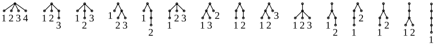
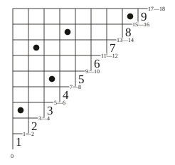
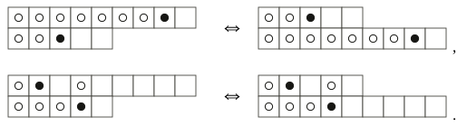
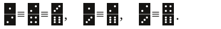

### 7.2.1.5节

**1.** [习题](../sec-7-2-1-5.md#ex-7-2-1-5-1) 在步骤 H6 中, 凡是把 $m$ 设为 $r$ 的地方, 改回 $r-1$ 即可.

**2.** [习题](../sec-7-2-1-5.md#ex-7-2-1-5-2) **L1. [初始化.]** 对 $1\leq j\leq n$, 置 $l_j\leftarrow j-1$、$a_j\leftarrow0$. 另置 $h_1\leftarrow n$、$t\leftarrow1$, 并将 $l_0$ 设为任一方便的非零值.

**L2. [访问.]** 访问用 $l_1\cdots l_n$ 和 $h_1\cdots h_t$ 表示的 $t$ 块分划. (相应的限制增长串是 $a_1\cdots a_n$.)

**L3. [寻找 $j$.]** 置 $j\leftarrow n$. 然后当 $l_j=0$ 时, 置 $j\leftarrow j-1$、$t\leftarrow t-1$.

**L4. [将 $j$ 移至下一个块.]** 如果 $j=0$, 终止. 否则置 $k\leftarrow a_j+1$、$h_k\leftarrow l_j$、$a_j\leftarrow k$. 如果 $k=t$, 置 $t\leftarrow t+1$ 和 $l_j\leftarrow0$, 否则置 $l_j\leftarrow h_{k+1}$. 最后置 $h_{k+1}\leftarrow j$.

**L5. [将 $j+1,\ldots,n$ 移至块 1.]** 当 $j<n$ 时, 反复执行 $j\leftarrow j+1$、$l_j\leftarrow h_1$、$a_j\leftarrow0$、$h_1\leftarrow j$. 返回 L2.　∎

**3.** [习题](../sec-7-2-1-5.md#ex-7-2-1-5-3) 设 $\tau(k,n)$ 为满足条件 $0\leq a_j\leq1+\max(k-1,a_1,\ldots,a_{j-1})$($1\leq j\leq n$) 的串 $a_1\cdots a_n$ 的个数. 于是 $\tau(k,0)=1$、$\tau(0,n)=\varpi_n$、$\tau(k,n)=k\tau(k,n-1)+\tau(k+1,n-1)$. [斯坦利·威廉森把 $\tau(k,n)$ 称为 “尾系数”, 见 *SICOMP* **5**(1976), 602–617.] 给定限制增长串 $a_1\cdots a_n$, 算法 H 生成的串中, 排在给定串之前的共有 $\sum_{j=1}^n a_j\tau(b_j,n-j)$ 个, 其中 $b_j=1+\max(a_1,\ldots,a_{j-1})$. 借助预先计算的尾系数表逆推, 发现当 $a_1\cdots a_{12}=010220345041$ 时, 这个公式给出 999999.

**4.** [习题](../sec-7-2-1-5.md#ex-7-2-1-5-4) 每种类型的最常见代表列在下面, 下标为它们在 GraphBase 中相应的出现次数.

$\mathtt{zzzzz}_{0}$、$\mathtt{ooooh}_{0}$、$\mathtt{xxxix}_{0}$、$\mathtt{xxxii}_{0}$、$\mathtt{ooops}_{0}$、$\mathtt{llull}_{0}$、$\mathtt{llala}_{0}$、$\mathtt{eeler}_{0}$、$\mathtt{iitti}_{0}$、$\mathtt{xxiii}_{0}$、$\mathtt{ccxxv}_{0}$、$\mathtt{eerie}_{1}$、$\mathtt{llama}_{1}$、$\mathtt{xxvii}_{0}$、$\mathtt{oozed}_{5}$、$\mathtt{uhuuu}_{0}$、$\mathtt{mamma}_{1}$、$\mathtt{puppy}_{28}$、$\mathtt{anana}_{0}$、$\mathtt{hehee}_{0}$、$\mathtt{vivid}_{15}$、$\mathtt{rarer}_{3}$、$\mathtt{etext}_{1}$、$\mathtt{amass}_{2}$、$\mathtt{again}_{137}$、$\mathtt{ahhaa}_{0}$、$\mathtt{esses}_{1}$、$\mathtt{teeth}_{25}$、$\mathtt{yaaay}_{0}$、$\mathtt{ahhhh}_{2}$、$\mathtt{pssst}_{2}$、$\mathtt{seems}_{7}$、$\mathtt{added}_{6}$、$\mathtt{lxxii}_{0}$、$\mathtt{books}_{184}$、$\mathtt{swiss}_{3}$、$\mathtt{sense}_{10}$、$\mathtt{ended}_{3}$、$\mathtt{check}_{160}$、$\mathtt{level}_{18}$、$\mathtt{tepee}_{4}$、$\mathtt{slyly}_{5}$、$\mathtt{never}_{154}$、$\mathtt{sells}_{6}$、$\mathtt{motto}_{21}$、$\mathtt{whooo}_{2}$、$\mathtt{trees}_{384}$、$\mathtt{going}_{307}$、$\mathtt{which}_{151}$、$\mathtt{there}_{174}$、$\mathtt{three}_{100}$、$\mathtt{their}_{3834}$.

[见所罗门·戈洛姆,*Math. Mag.* **53**(1980), 219–221. 当然, 只有两个不同字母的单词很少见. 这里列出的 18 个下标为 0 的串, 可在较大型词典或互联网上的英文页面中找到.]

**5.** [习题](../sec-7-2-1-5.md#ex-7-2-1-5-5) (a) $112=\rho(0225)$. 序列为 $r(0),r(1),r(4),r(9),r(16),\ldots$, 其中 $r(n)$ 由以下方式得到. 将 $n$ 表示为十进制数, 前面加一个或多个 0, 应用习题 4 中的 $\rho$, 再删去前导 0. 注意 $n/9\leq r(n)\leq n$.

(b) $1012=r(45^2)$. 序列与 (a) 相同, 但已排序并删去重复项. (谁想到过 $88^2=7744$、$212^2=44944$ 和 $264^2=69696$ 呢?)

**6.** [习题](../sec-7-2-1-5.md#ex-7-2-1-5-6) 采用算法 7.2.1.2V 的拓扑排序方法, 并取一个适当的偏序. 让它包含 $c_j$ 条长为 $j$ 的链, 并给同长度链的最小元素排序. 例如, 如果 $n=20$、$c_2=3$、$c_3=c_4=2$, 用算法找出 $\{1,\ldots,20\}$ 的所有排列 $a_1\cdots a_{20}$, 满足

$$
\begin{aligned}
&1\prec2,\quad3\prec4,\quad5\prec6,\quad1\prec3\prec5,\\
&7\prec8\prec9,\quad10\prec11\prec12,\quad7\prec10,\\
&13\prec14\prec15\prec16,\quad17\prec18\prec19\prec20,\quad13\prec17.
\end{aligned}
$$

由此构成限制增长串 $\rho(f(a_1)\cdots f(a_{20}))$, 其中 $\rho$ 在习题 4 中定义, 且

$$
(f(1),\ldots,f(20))=(1,1,2,2,3,3,4,4,4,5,5,5,6,6,6,6,7,7,7,7).
$$

输出总数由式 (48) 给出.

**7.** [习题](../sec-7-2-1-5.md#ex-7-2-1-5-7) 恰有 $\varpi_n$ 个. 它们由 (2) 中各块的左右次序倒转后删去竖线而得, 即 $1234,4123,3124,3412,\ldots,4321$. [见安德斯·克拉松,*European J. Combinatorics* **22**(2001), 961–971. 谢尔盖·基塔耶夫在 *Discrete Math.* **298**(2005), 212–229 中发现了一项深远的推广. 设 $\pi$ 是 $\{0,\ldots,r\}$ 的排列, 令 $g_n$ 为满足下列条件的 $\{1,\ldots,n\}$ 的排列 $a_1\cdots a_n$ 的数目: 由 $a_{k-0\pi}>a_{k-1\pi}>\cdots>a_{k-r\pi}>a_j$ 可推出 $j>k$. 令 $f_n$ 为对每个 $r<k\leq n$ 都避开模式 $a_{k-0\pi}>a_{k-1\pi}>\cdots>a_{k-r\pi}$ 的排列 $a_1\cdots a_n$ 的数目. 那么 $\sum_{n\geq0}g_nz^n/n!=\exp(\sum_{n\geq1}f_{n-1}z^n/n!)$.]

**8.** [习题](../sec-7-2-1-5.md#ex-7-2-1-5-8) 对将 $\{1,\ldots,n\}$ 分成 $m$ 个块的每个分划, 按块的最小元素递减排列各块, 并以所有可能方式排列每块中除最小元素以外的元素. 例如, 当 $n=9$、$m=3$ 时, 分划 $126|38|4579$ 生成 $457938126$, 还有将 $\{5,7,9\}$ 和 $\{2,6\}$ 各自排列所得的其他 11 种情形. (用基本相同的方法可生成所有恰有 $m$ 个循环的排列, 见 1.3.3 节的 “不寻常的对应”.)

**9.** [习题](../sec-7-2-1-5.md#ex-7-2-1-5-9) 在多重集 $\{k_0\cdot0,k_1\cdot1,\ldots,k_{n-1}\cdot(n-1)\}$ 的排列中, 恰有

$$
\binom{k_0+k_1+\cdots+k_{n-1}}{k_0,k_1,\ldots,k_{n-1}}
\frac{k_0}{k_0+k_1+\cdots+k_{n-1}}
\frac{k_1}{k_1+\cdots+k_{n-1}}\cdots\frac{k_{n-1}}{k_{n-1}}
$$

个是限制增长的, 因为 $j$ 先于 $\{j+1,\ldots,n-1\}$ 中所有元素出现的概率是 $k_j/(k_j+\cdots+k_{n-1})$.

如果 $n>0$, 则 0 的平均数目为 $1+(n-1)\varpi_{n-1}/\varpi_n=\Theta(\log n)$, 因为在所有 $\varpi_n$ 种情形中, 0 的总数为

$$
\sum_{k=1}^n k\binom{n-1}{k-1}\varpi_{n-k}=\varpi_n+(n-1)\varpi_{n-1}.
$$

**10.** [习题](../sec-7-2-1-5.md#ex-7-2-1-5-10) 给定 $\{1,\ldots,n\}$ 的一个分划, 在 $\{0,1,\ldots,n\}$ 上构造一棵有向树. 如果一个块的最小元素为 $j$, 则 $j-1$ 是该块所有成员的父结点. 然后重新标记叶结点, 保持其顺序, 并删去其他标号.

例如, (2) 中的 15 个分划分别对应于下面的树.

  

颠倒上述过程: 取一棵半标记树, 对结点重新编号. 先考虑在从根到最小叶结点的路径上首次遇到的结点, 然后考虑从根到第二小叶结点的路径, 依此类推. 叶结点的数目是 $n+1$ 减去块数. [这个构造与习题 2.3.4.4–18 及该小节中的许多计数密切相关. 见彼得·埃尔德什和拉斯洛·塞凯伊,*Advances in Applied Math.* **10**(1989), 488–496.]

**11.** [习题](../sec-7-2-1-5.md#ex-7-2-1-5-11) 在满足 $\rho(a_1\cdots a_{13})=\rho(a_5\cdots a_8a_1\cdots a_4a_9\cdots a_{13})$ 的 64855 个至多 10 块的集合分划中, 有 900 个给出纯字母算术题. 在满足 $\rho(a_1\cdots a_{13})<\rho(a_5\cdots a_8a_1\cdots a_4a_9\cdots a_{13})$ 的 13788536 个至多 10 块的集合分划中, 有 563527 个给出这样的题. 最前面的例子是 aaaa + aaaa = baaac、aaaa + aaaa = bbbbc 与 aaaa + aaab = baaac; 最后的是 abcd + efgd = dceab(goat + newt = tango) 与 abcd + efgd = dceaf(clad + nerd = dance). [将分划生成器接到字母算术求解器上的想法由艾伦·萨克利夫提出.]

**12.** [习题](../sec-7-2-1-5.md#ex-7-2-1-5-12) (a) 构造 $\rho((a_1a'_1)\cdots(a_na'_n))$, 其中 $\rho$ 在习题 4 中定义. 这是因为当且仅当 $x\equiv y\pmod\Pi$ 且 $x\equiv y\pmod{\Pi'}$ 时, 有 $x\equiv y\pmod{\Pi\vee\Pi'}$.

(b) 如习题 2 那样用链接表示 $\Pi$, 如算法 2.3.3E 那样表示 $\Pi'$. 利用该算法, 只要 $l_j\ne0$, 就令 $j\equiv l_j$. (为提高效率, 可假定 $\Pi$ 的块数至少和 $\Pi'$ 一样多.)

(c) 当 $\Pi$ 的一个块已被分为两部分时, 也就是当 $\Pi'$ 的两个块已被合并时.

(d) $\binom t2$.

(e) $(2^{s_1-1}-1)+\cdots+(2^{s_t-1}-1)$.

(f) 正确. 设 $\Pi\vee\Pi'$ 有块 $B_1|B_2|\cdots|B_t$, 其中 $\Pi=B_1B_2|B_3|\cdots|B_t$. 于是 $\Pi'$ 实质上就是 $\{B_1,\ldots,B_t\}$ 的一个分划, 其中 $B_1$ 和 $B_2$ 属于不同的块. 将 $\Pi'$ 中包含 $B_1$ 的块和包含 $B_2$ 的块合并, 得到 $\Pi\wedge\Pi'$. [满足这个条件的有限格称为下半模格, 见加勒特·伯克霍夫,*Lattice Theory*(1940), §I.8. 习题 7.2.1.4–54 的优超格没有这个性质, 例如 $\alpha=4111$ 且 $\alpha'=331$ 时.]

(g) 错误. 例如, 取 $\Pi=0011$、$\Pi'=0101$.

(h) $\Pi$ 和 $\Pi'$ 的块都是 $\Pi\vee\Pi'$ 的块的并集, 所以可假定 $\Pi\vee\Pi'=\{1,\ldots,t\}$. 如 (b), 当 $\Pi$ 有 $t-r$ 个块时, 在 $r$ 步中合并 $j$ 与 $l_j$ 来得到 $\Pi$. 把这些合并应用到 $\Pi'$, 每次使块数减少 0 或 1. 因此 $b(\Pi')-b(\Pi\wedge\Pi')\leq r=b(\Pi\vee\Pi')-b(\Pi)$.

[帕维尔·普德拉克与伊日·图马在 *Algebra Universalis* **10**(1980), 74–95 中证明, 对充分大的 $n$, 每个有限格都是 $\{1,\ldots,n\}$ 的分划格的一个子格.]

**13.** [习题](../sec-7-2-1-5.md#ex-7-2-1-5-13) [见 *Advances in Math.* **26**(1977), 290–305.] 如果一个 $t$ 块分划的最大的 $j$ 个元素各在单元素块中, 而下一个元素 $n-j$ 不在单元素块中, 就称该分划的阶数为 $t-j$. 定义 “斯特林串” $\Sigma_{nt}$ 为 $t$ 块分划 $\Pi_1,\Pi_2,\ldots$ 的阶数序列, 例如 $\Sigma_{43}=122333$. 于是 $\Sigma_{tt}=0$, 而 $\Sigma_{(n+1)t}$ 可从 $\Sigma_{nt}$ 得到, 只须把其中每个数字 $d$ 替换为长 $\binom{t+1}{2}-\binom d2$ 的串 $d^d(d+1)^{d+1}\cdots t^t$. 例如,

$$
\Sigma_{53}=122333\mathop{\vphantom{3}}\limits_{\wedge}22333\mathop{\vphantom{3}}\limits_{\wedge}22333\mathop{\vphantom{3}}\limits_{\wedge}333\mathop{\vphantom{3}}\limits_{\wedge}333\mathop{\vphantom{3}}\limits_{\wedge}333.
$$

基本思路是考虑算法 H 的字典序生成过程. 设 $\Pi=a_1\cdots a_n$ 是一个 $j$ 阶的 $t$ 块分划, 则在限制增长串以 $a_1\cdots a_{n-t+j}$ 开头的 $t$ 块分划中, $\Pi$ 按字典序最小. $\Pi$ 所覆盖的分划按字典序为 $\Pi_{12},\Pi_{13},\Pi_{23},\Pi_{14},\Pi_{24},\Pi_{34},\ldots,\Pi_{(t-1)t}$, 其中 $\Pi_{rs}$ 表示 “合并 $\Pi$ 的块 $r$ 和块 $s$” (即把每个 $s-1$ 改为 $r-1$, 再应用 $\rho$ 得到限制增长串). 如果 $\Pi'$ 是从 $\Pi_{1(j+1)}$ 起的最后 $\binom t2-\binom j2$ 个分划中的任一个, 那么 $\Pi$ 就是排在 $\Pi'$ 之后的最小 $t$ 块分划. 例如, 如果 $\Pi=001012034$, 则 $n=9,t=5,j=3$, 相应的 $\Pi'$ 为 $\rho(001012004)$、$\rho(001012014)$、$\rho(001012024)$、$\rho(001012030)$、$\rho(001012031)$、$\rho(001012032)$、$\rho(001012033)$.

于是, $f_{nt}(N)=f_{nt}(N-1)+\binom t2-\binom j2$, 其中 $j$ 是 $\Sigma_{nt}$ 的第 $N$ 个数字.

**14.** [习题](../sec-7-2-1-5.md#ex-7-2-1-5-14) **E1. [初始化.]** 对 $1\leq j\leq n$, 置 $a_j\leftarrow0$、$b_j\leftarrow d_j\leftarrow1$.

**E2. [访问.]** 访问限制增长串 $a_1\cdots a_n$.

**E3. [寻找 $j$.]** 置 $j\leftarrow n$, 然后当 $a_j=d_j$ 时, 置 $d_j\leftarrow1-d_j$、$j\leftarrow j-1$.

**E4. [完成?]** 如果 $j=1$, 终止. 否则, 如果 $d_j=0$, 转到 E6.

**E5. [下移.]** 如果 $a_j=0$, 置 $a_j\leftarrow b_j$、$m\leftarrow a_j+1$, 转到 E7. 否则, 如果 $a_j=b_j$, 置 $a_j\leftarrow b_j-1$、$m\leftarrow b_j$, 转到 E7. 否则置 $a_j\leftarrow a_j-1$, 返回 E2.

**E6. [上移.]** 如果 $a_j=b_j-1$, 置 $a_j\leftarrow b_j$、$m\leftarrow a_j+1$, 转到 E7. 否则, 如果 $a_j=b_j$, 置 $a_j\leftarrow0$、$m\leftarrow b_j$, 转到 E7. 否则置 $a_j\leftarrow a_j+1$, 返回 E2.

**E7. [固定 $b_{j+1}\cdots b_n$.]** 对 $k=j+1,\ldots,n$, 置 $b_k\leftarrow m$. 返回 E2.　∎

[像算法 H 一样, $j$ 几乎总等于 $n$, 所以此算法可以充分优化.]

**15.** [习题](../sec-7-2-1-5.md#ex-7-2-1-5-15) 它对应于无穷二进制串 $01011011011\ldots$ 的前 $n$ 位, 因为 $\varpi_{n-1}$ 为偶数当且仅当 $n\bmod3=0$ (见习题 23).

**16.** [习题](../sec-7-2-1-5.md#ex-7-2-1-5-16) $00012$、$01012$、$01112$、$00112$、$00102$、$01102$、$01002$、$01202$、$01212$、$01222$、$01022$、$01122$、$00122$、$00121$、$01121$、$01021$、$01221$、$01211$、$01201$、$01200$、$01210$、$01220$、$01020$、$01120$、$00120$.

**17.** [习题](../sec-7-2-1-5.md#ex-7-2-1-5-17) 下面的解使用两个互相递归的过程 $f(\mu,\nu,\sigma)$ 和 $b(\mu,\nu,\sigma)$, 在 $\sigma=0$ 时分别正向和反向生成 $A_{\mu\nu}$, 在 $\sigma=1$ 时分别正向和反向生成 $A'_{\mu\nu}$. 要启动过程, 假定 $1<m<n$. 先对 $1\leq j\leq n-m$ 置 $a_j\leftarrow0$, 对 $1\leq j\leq m$ 置 $a_{n-m+j}\leftarrow j-1$, 再调用 $f(m,n,0)$.

*过程* $f(\mu,\nu,\sigma)$. 如果 $\mu=2$, 访问 $a_1\cdots a_n$, 否则调用 $f(\mu-1,\nu-1,(\mu+\sigma)\bmod2)$. 随后, 如果 $\nu=\mu+1$, 把 $a_\mu$ 从 0 改为 $\mu-1$, 访问 $a_1\cdots a_n$. 反复置 $a_\nu\leftarrow a_\nu-1$ 并访问 $a_1\cdots a_n$, 直到 $a_\nu=0$. 如果 $\nu>\mu+1$, 当 $\mu+\sigma$ 为奇数时把 $a_{\nu-1}$ 从 0 改为 $\mu-1$, 为偶数时则如此改变 $a_\mu$. 随后, 若 $a_\nu+\sigma$ 为奇数则调用 $b(\mu,\nu-1,0)$, 若为偶数则调用 $f(\mu,\nu-1,0)$. 当 $a_\nu>0$ 时, 置 $a_\nu\leftarrow a_\nu-1$ 并以相同方式再次调用 $b(\mu,\nu-1,0)$ 或 $f(\mu,\nu-1,0)$, 直到 $a_\nu=0$.

*过程* $b(\mu,\nu,\sigma)$. 如果 $\nu=\mu+1$, 先反复访问 $a_1\cdots a_n$ 并置 $a_\nu\leftarrow a_\nu+1$, 直到 $a_\nu=\mu-1$. 随后访问 $a_1\cdots a_n$, 把 $a_\mu$ 从 $\mu-1$ 改为 0. 如果 $\nu>\mu+1$, 若 $a_\nu+\sigma$ 为奇数则调用 $f(\mu,\nu-1,0)$, 若为偶数则调用 $b(\mu,\nu-1,0)$. 当 $a_\nu<\mu-1$ 时, 置 $a_\nu\leftarrow a_\nu+1$ 并以同样方式再次调用 $f(\mu,\nu-1,0)$ 或 $b(\mu,\nu-1,0)$, 直到 $a_\nu=\mu-1$. 最后, 当 $\mu+\sigma$ 为奇数时把 $a_{\nu-1}$ 从 $\mu-1$ 改为 0, 为偶数时则如此改变 $a_\mu$. 最后在两种情形下, 如果 $\mu=2$ 就访问 $a_1\cdots a_n$, 否则调用 $b(\mu-1,\nu-1,(\mu+\sigma)\bmod2)$.

实际运行时间大多用来处理 $\mu=2$ 的情形. 此时可换成基于格雷二进制码的更快例程, 但会偏离拉斯基原有的序列. 当 $\mu=\nu-1$ 时也可用精简的过程.

**18.** [习题](../sec-7-2-1-5.md#ex-7-2-1-5-18) 序列必须以 $01\cdots(n-1)$ 开头或结尾. 根据习题 32, 当 $0\ne\delta_n\ne(-1)^{0+1+\cdots+(n-1)}$ 时, 不存在这样的格雷码, 即 $n\bmod12$ 为 4、6、7 或 9 时.

$n=1,2,3$ 的情形容易解决, $n=5$ 时有 1 927 683 326 个解. 因此, 除前面排除的情形外, 所有 $n\geq8$ 的解可能数量极大. 实际上, 除 $n\equiv2k+(2,4,5,7)\pmod{12}$ 外, 可能存在这样的格雷路径, 经过答 28(e) 所考虑的全部 $\varpi_{nk}$ 个串.

*注.* 当 $2<m<n$ 时, 习题 30 中的广义斯特林数 $\left\{{n\atop m}\right\}_{-1}$ 大于 1, 所以将 $\{1,\ldots,n\}$ 分成 $m$ 块的分划不存在这样的格雷码.

**19.** [习题](../sec-7-2-1-5.md#ex-7-2-1-5-19) (a) 将 (6) 改为模式 $0,2,\ldots,m,\ldots,3,1$ 或其逆序, 如 7.2.1.3–(45) 的内在次序. [见约瑟夫·屈尔夏克,*Matematikai versenytételek*(Szeged: 1929), 1928 年厄特沃什数学竞赛第 2 题.]

(b) 推广 (8) 和 (9), 可得到序列 $A_{mn\alpha}$ 和 $A'_{mna}$, 它们都以 $0^{n-m}01\cdots(m-1)$ 开始, 分别以 $01\cdots(m-1)\alpha$ 和 $0^{n-m-1}01\cdots(m-1)a$ 结束. 其中 $0\leq a\leq m-2$, $\alpha$ 是满足 $0\leq a_j\leq m-2$ 的任意串 $a_1\cdots a_{n-m}$. 当 $2<m<n$ 时, 新规则为

$$
A_{m(n+1)(\alpha a)}=
\begin{cases}
A_{(m-1)n(b\beta)}x_1,\ A^R_{mn\beta}x_1,\ A_{mn\alpha}x_2,\ldots,A_{mn\alpha}x_m,&m\text{ 为偶数};\\
A'_{(m-1)nb}x_1,\ A_{mn\alpha}x_1,\ A^R_{mn\alpha}x_2,\ldots,A_{mn\alpha}x_m,&m\text{ 为奇数};
\end{cases}
$$

$$
A'_{m(n+1)a}=
\begin{cases}
A'_{(m-1)nb}x_1,\ A_{mn\beta}x_1,\ A^R_{mn\beta}x_2,\ldots,A^R_{mn\beta}x_m,&m\text{ 为偶数};\\
A_{(m-1)n(b\beta)}x_1,\ A^R_{mn\beta}x_1,\ A_{mn\beta}x_2,\ldots,A^R_{mn\beta}x_m,&m\text{ 为奇数};
\end{cases}
$$

其中 $b=m-3$、$\beta=b^{n-m}$, 而 $(x_1,\ldots,x_m)$ 是从 $x_1=m-1$ 到 $x_m=a$ 的一条路径.

**20.** [习题](../sec-7-2-1-5.md#ex-7-2-1-5-20) $012323212122$. 一般地, 用习题 4 的记号, $(a_1\cdots a_n)^T=\rho(a_n\cdots a_1)$.

**21.** [习题](../sec-7-2-1-5.md#ex-7-2-1-5-21) 数列 $\langle s_0,s_1,s_2,\ldots\rangle=\langle1,1,2,3,7,12,31,59,164,339,999,\ldots\rangle$ 满足递推式

$$
s_{2n+1}=\sum_k\binom nk s_{2n-2k},\qquad
s_{2n+2}=\sum_k\binom nk(2^k+1)s_{2n-2k},
$$

原因在于中间元素与其他元素的关联方式. 因此,

$$
\begin{aligned}
s_{2n}&=n![z^n]\exp\bigl((e^{2z}-1)/2+e^z-1\bigr),\\
s_{2n+1}&=n![z^n]\exp\bigl((e^{2z}-1)/2+e^z+z-1\bigr).
\end{aligned}
$$

考虑前半部分的集合分划, 还可得 $s_{2n}=\sum_k\binom nk x_k$ 和 $s_{2n+1}=\sum_k\binom{n+1}k x_{k-1}$, 其中 $x_n=2x_{n-1}+(n-1)x_{n-2}=n![z^n]\exp(2z+z^2/2)$. [西奥多·莫茨金在 *Proc. Symp. Pure Math.* **19**(1971), 173 中考虑了序列 $\langle s_{2n}\rangle$.]

**22.** [习题](../sec-7-2-1-5.md#ex-7-2-1-5-22) (a) 根据式 (16), $\sum_{k=0}^\infty k^n\Pr(X=k)=e^{-1}\sum_{k=0}^\infty k^n/k!=\varpi_n$.

(b) 有

$$
\sum_{k=0}^\infty k^n\Pr(X=k)=\sum_{k=0}^\infty k^n\sum_{j=0}^{m}\binom jk(-1)^{j-k}/j!.
$$

由于当 $j>n$ 时 $\sum_k\binom jk(-1)^kk^n=0$, 可以将内层求和延伸到 $j=\infty$, 于是得到 $\sum_{k=0}^\infty(k^n/k!)\sum_{l=0}^\infty(-1)^l/l!=\varpi_n$. [见约瑟夫·欧文,*J. Royal Stat. Soc.* **A118**(1955), 389–404; 詹姆斯·皮特曼,*AMM* **104**(1997), 201–209.]

**23.** [习题](../sec-7-2-1-5.md#ex-7-2-1-5-23) (a) 根据式 (14), 公式对每个单项式 $f(x)=x^n$ 成立, 故一般也成立. (因此根据式 (16), 还有 $\sum_{k=0}^\infty f(k)/k!=ef(\varpi)$.)

(b) 假定已对 $k$ 证明这一关系, 令 $h(x)=(x-1)^{\underline k}f(x)$、$g(x)=f(x+1)$. 于是

$$
f(\varpi+k+1)=g(\varpi+k)=\varpi^{\underline k}g(\varpi)
=h(\varpi+1)=\varpi h(\varpi)=\varpi^{\underline{k+1}}f(\varpi).
$$

[见雅克·图沙尔,*Ann. Soc. Sci. Bruxelles* **53**(1933), 21–31. 这个符号化的 “阴影演算” 是约翰·布莱萨德在 *Quart. J. Pure and Applied Math.* **4**(1861), 279–305 中发明的. 它很有用, 但须仔细处理, 因为 $f(\varpi)=g(\varpi)$ 并不推出 $f(\varpi)h(\varpi)=g(\varpi)h(\varpi)$.]

(c) 提示是习题 4.6.2–16(c) 的一个特例. 在 (b) 中取 $f(x)=x^n$、$k=p$, 得到 $\varpi_n\equiv\varpi_{p+n}-\varpi_{1+n}\pmod p$.

(d) 对 $p$ 取模时, 多项式 $x^N-1$ 可被 $g(x)=x^p-x-1$ 整除, 因为 $x^{p^k}\equiv x+k$, 且 $x^N\equiv x^{\overline p}\equiv x^{\underline p}\equiv x^p-x\equiv1$ (模 $g(x)$ 和 $p$). 所以如果 $h(x)=(x^N-1)x^n/g(x)$, 则 $h(\varpi)\equiv h(\varpi+p)=\varpi^{\underline p}h(\varpi)\equiv(\varpi^p-\varpi)h(\varpi)$, 以及 $0\equiv g(\varpi)h(\varpi)=\varpi^{N+n}-\varpi^n\pmod p$.

**24.** [习题](../sec-7-2-1-5.md#ex-7-2-1-5-24) 对 $e$ 归纳可证明提示, 因为

$$
x^{\underline{p^e}}=\prod_{k=0}^{p-1}(x-kp^{e-1})^{\underline{p^{e-1}}}.
$$

还可对 $n$ 归纳证明, 由 $x^n\equiv r_n(x)$ (模 $g_1(x)$ 和 $p$) 可推出

$$
x^{p^{e-1}n}\equiv r_n(x)^{p^{e-1}}
\pmod{g_e(x),pg_{e-1}(x),\ldots,p^{e-1}g_1(x),p^e}.
$$

因此, 对某些整系数多项式 $h_k(x)$, 有

$$
x^{p^{e-1}N}
=1+h_0(x)g_e(x)+ph_1(x)g_{e-1}(x)+\cdots+p^{e-1}h_{e-1}(x)g_1(x)+p^eh_e(x).
$$

模 $p^e$ 有

$$
\begin{aligned}
h_0(\varpi)\varpi^n&\equiv h_0(\varpi+p^e)(\varpi+p^e)^n\\
&=\varpi^{\underline{p^e}}h_0(\varpi)\varpi^n
\equiv(g_e(\varpi)+1)h_0(\varpi)\varpi^n.
\end{aligned}
$$

由此,

$$
\varpi^{p^{e-1}N+n}=\varpi^n+h_0(\varpi)g_e(\varpi)\varpi^n+ph_1(\varpi)g_{e-1}(\varpi)\varpi^n+\cdots\equiv\varpi^n.
$$

[当 $p=2$ 时也可作类似推导, 但令 $g_{j+1}(x)=g_j(x)^2+2[j=2]$, 便得到 $\varpi_n\equiv\varpi_{n+3\cdot2^e}\pmod{2^e}$. 这些结果由小马歇尔·霍尔给出, 见 *Bull. Amer. Math. Soc.* **40**(1934), 387;*Amer. J. Math.* **70**(1948), 387–388. 更多信息见威廉·伦农、彼得·普莱曾茨和纳尔逊·斯蒂芬斯,*Acta Arith.* **35**(1979), 1–16.]

**25.** [习题](../sec-7-2-1-5.md#ex-7-2-1-5-25) 要证明第一个不等式, 可向限制增长串的树应用一个更一般的原理. 在任意树中, 只要所有非根结点 $p$ 满足 $\deg(p)\geq\deg(\operatorname{parent}(p))$, 就有 $w_k/w_{k-1}\leq w_{k+1}/w_k$, 其中 $w_k$ 是第 $k$ 层的结点总数. 如果第 $k-1$ 层的 $m=w_{k-1}$ 个结点分别有 $a_1,\ldots,a_m$ 个子结点, 它们至少有 $a_1^2+\cdots+a_m^2$ 个孙结点, 所以

$$
w_{k-1}w_{k+1}\geq m(a_1^2+\cdots+a_m^2)\geq(a_1+\cdots+a_m)^2=w_k^2.
$$

对于第二个不等式, 注意 $\varpi_{n+1}-\varpi_n=\sum_{k=0}^n\bigl(\binom nk-\binom{n-1}{k-1}\bigr)\varpi_{n-k}$, 所以

$$
\frac{\varpi_{n+1}}{\varpi_n}-1
=\sum_{k=0}^{n-1}\binom{n-1}k\frac{\varpi_{n-k}}{\varpi_n}
\leq\sum_{k=0}^{n-1}\binom{n-1}k\frac{\varpi_{n-k-1}}{\varpi_{n-1}}
=\frac{\varpi_n}{\varpi_{n-1}}.
$$

这是因为, 例如 $\varpi_{n-3}/\varpi_n=(\varpi_{n-3}/\varpi_{n-2})(\varpi_{n-2}/\varpi_{n-1})(\varpi_{n-1}/\varpi_n)$ 小于或等于 $(\varpi_{n-4}/\varpi_{n-3})(\varpi_{n-3}/\varpi_{n-2})(\varpi_{n-2}/\varpi_{n-1})=\varpi_{n-4}/\varpi_{n-1}$.

**26.** [习题](../sec-7-2-1-5.md#ex-7-2-1-5-26) 共有 $\binom{n-1}{n-t}$ 条从 $n1$ 到 $tt$ 的向右路径. 可以用 0 和 1 表示路径, 其中 0 为 “向右”、1 为 “向上”. 1 的位置指出有哪 $n-t$ 个元素和 1 同块. 如果 $t>1$, 下一步是走向远在左侧的另一个顶点, 再沿一条路径前进, 所得路径规定了其余 $t-1$ 个元素的分划. 例如, 按此约定, 分划 $14|2|3$ 对应路径 $0010$, 各位分别表示 $1\not\equiv2$、$1\not\equiv3$、$1\equiv4$、$2\not\equiv3$. [也可作许多其他解释. 这里的约定说明 $\varpi_{nk}$ 枚举了满足 $1\not\equiv2,\ldots,1\not\equiv k$ 的分划. 这一组合性质由哈罗德·贝克尔发现, 见 *AMM* **51**(1944), 47 及 *Mathematics Magazine* **22**(1948), 23–26.]

**27.** [习题](../sec-7-2-1-5.md#ex-7-2-1-5-27) (a) 一般地, $\lambda_0=\lambda_1=\lambda_{2n-1}=\lambda_{2n}=0$. 下表也列出了用 (b) 中的算法得到的与每个循环对应的限制增长串.

| 图表循环 | 限制增长串 | 图表循环 | 限制增长串 | 图表循环 | 限制增长串 |
|---|:---:|---|:---:|---|:---:|
| 0,0,0,0,0,0,0,0,0 | 0123 | 0,0,1,0,0,0,0,0,0 | 0012 | 0,0,1,1,1,0,0,0,0 | 0102 |
| 0,0,0,0,0,0,1,0,0 | 0122 | 0,0,1,0,0,0,1,0,0 | 0011 | 0,0,1,1,1,0,1,0,0 | 0100 |
| 0,0,0,0,1,0,0,0,0 | 0112 | 0,0,1,0,1,0,0,0,0 | 0001 | 0,0,1,1,1,1,1,0,0 | 0120 |
| 0,0,0,0,1,0,1,0,0 | 0111 | 0,0,1,0,1,0,1,0,0 | 0000 | 0,0,1,1,11,1,1,0,0 | 0101 |
| 0,0,0,0,1,1,1,0,0 | 0121 | 0,0,1,0,1,1,1,0,0 | 0010 | 0,0,1,1,2,1,1,0,0 | 0110 |

(b) “图表” 这个名称暗示了与 5.1.4 节的联系. 确实, 该节建立的理论导出了一个有趣的一一对应关系. 可以在三角形棋盘上表示集合分划. 在习题 2 的链表表示中, 当 $l_j\ne0$ 时, 在棋盘第 $n+1-j$ 行的第 $l_j$ 列放一个车. (见习题 5.1.3–19 的答案.) 例如, 图中给出了 $135|27|489|6$ 的置车表示.

  

等价地, 非零链接可用两行数组表示, 如 $\left(\begin{smallmatrix}1&2&3&4&8\\3&7&5&8&9\end{smallmatrix}\right)$, 见 5.1.4–(11).

考虑长为 $2n$ 的一条路径, 它从这个三角形的左下角出发, 沿右边缘前进, 到达右上角. 路径的各点为 $z_k=(\lfloor k/2\rfloor,\lceil k/2\rceil)$($0\leq k\leq2n$). 而且, $z_k$ 左上方的矩形恰包含那些在两行数组中提供坐标对 $\left(\begin{smallmatrix}i\\j\end{smallmatrix}\right)$ 的车, 其中 $i\leq\lfloor k/2\rfloor$ 且 $j>\lceil k/2\rceil$. 本例中, 对 $9\leq k\leq12$, 恰有两个这样的车, 即 $\left(\begin{smallmatrix}2&4\\7&8\end{smallmatrix}\right)$. 定理 5.1.4A 告诉我们, 这样的两行数组等价于图表 $(P_k,Q_k)$, 其中 $P_k$ 的元素来自下一行, $Q_k$ 的元素来自上一行, 且 $P_k$ 与 $Q_k$ 形状相同. 方便的做法是让图表 $P$ 采用递减次序, 让图表 $Q$ 采用递增次序. 因此在本例中分别为

| $k$ | $P_k$ | $Q_k$ | $k$ | $P_k$ | $Q_k$ | $k$ | $P_k$ | $Q_k$ |
|---:|:---:|:---:|---:|:---:|:---:|---:|:---:|:---:|
| 2 | $\begin{array}{l}\boxed{3}\end{array}$ | $\begin{array}{l}\boxed{1}\end{array}$ | 7 | $\begin{array}{l}\boxed{7}\boxed{5}\end{array}$ | $\begin{array}{l}\boxed{2}\boxed{3}\end{array}$ | 12 | $\begin{array}{l}\boxed{8}\\[-.24em]\boxed{7}\end{array}$ | $\begin{array}{l}\boxed{2}\\[-.24em]\boxed{4}\end{array}$ |
| 3 | $\begin{array}{l}\boxed{3}\end{array}$ | $\begin{array}{l}\boxed{1}\end{array}$ | 8 | $\begin{array}{l}\boxed{8}\boxed{5}\\[-.24em]\boxed{7}\end{array}$ | $\begin{array}{l}\boxed{2}\boxed{3}\\[-.24em]\boxed{4}\end{array}$ | 13 | $\begin{array}{l}\boxed{8}\end{array}$ | $\begin{array}{l}\boxed{4}\end{array}$ |
| 4 | $\begin{array}{l}\boxed{7}\\[-.24em]\boxed{3}\end{array}$ | $\begin{array}{l}\boxed{1}\\[-.24em]\boxed{2}\end{array}$ | 9 | $\begin{array}{l}\boxed{8}\\[-.24em]\boxed{7}\end{array}$ | $\begin{array}{l}\boxed{2}\\[-.24em]\boxed{4}\end{array}$ | 14 | $\begin{array}{l}\boxed{8}\end{array}$ | $\begin{array}{l}\boxed{4}\end{array}$ |
| 5 | $\begin{array}{l}\boxed{7}\end{array}$ | $\begin{array}{l}\boxed{2}\end{array}$ | 10 | $\begin{array}{l}\boxed{8}\\[-.24em]\boxed{7}\end{array}$ | $\begin{array}{l}\boxed{2}\\[-.24em]\boxed{4}\end{array}$ | 15 | $\cdot$ | $\cdot$ |
| 6 | $\begin{array}{l}\boxed{7}\boxed{5}\end{array}$ | $\begin{array}{l}\boxed{2}\boxed{3}\end{array}$ | 11 | $\begin{array}{l}\boxed{8}\\[-.24em]\boxed{7}\end{array}$ | $\begin{array}{l}\boxed{2}\\[-.24em]\boxed{4}\end{array}$ | 16 | $\begin{array}{l}\boxed{9}\end{array}$ | $\begin{array}{l}\boxed{8}\end{array}$ |

当 $k=0,1,17,18$ 时, $P_k$ 和 $Q_k$ 为空.

若 $\lambda_k$ 是给出 $P_k$ 与 $Q_k$ 公共形状的整数分划, 则每个集合分划都导出一个摇摆图表循环 $\lambda_0,\lambda_1,\ldots,\lambda_{2n}$. (本例的循环为 $0,0,1,1,11,1,2,2,21,11,11,11,11,1,1,0,1,0,0$.) 此外, $t_{2k-1}=0$ 等价于第 $n+1-k$ 行不含车, 也等价于 $k$ 为所在块中最小的元素.

反过来, 形状序列 $\lambda_k$ 唯一确定 $P_k$ 与 $Q_k$ 的元素. 若 $t_k=0$, 则 $Q_k=Q_{k-1}$. 否则, 若 $k$ 为偶数, 则 $Q_k$ 由 $Q_{k-1}$ 在第 $t_k$ 行右端新增一格并填入 $k/2$ 而得. 若 $k$ 为奇数, 则从 $Q_{k-1}$ 运用算法 5.1.4D 删除第 $t_k$ 行最右项, 得到 $Q_k$. 类似地, 可由 $P_{k+1}$ 和 $t_{k+1}$ 确定 $P_k$, 所以可以从 $P_{2n}$ 倒推到 $P_0$. 因此, 仅凭形状序列 $\lambda_k$ 就能确定各车的位置.

陈永川、邓玉平、杜若霞、理查德·斯坦利和颜华菲在 *Transactions of the Amer. Math. Soc.* **359**(2007), 1555–1575 的论文中提出摇摆图表循环, 证明了这一构造有重要而令人惊讶的结果. 例如, 若集合分划 $\Pi$ 对应摇摆图表循环 $\lambda_0,\lambda_1,\ldots,\lambda_{2n}$, 定义它的对偶 $\Pi^D$ 为对应转置形状序列 $\lambda_0^T,\lambda_1^T,\ldots,\lambda_{2n}^T$ 的集合分划. 由习题 5.1.4–7, $\Pi$ 含有 “在 $l$ 处的 $k$ 交叉”, 即满足 $i_1<\cdots<i_k\leq l<j_1<\cdots<j_k$ 且 $i_1\equiv j_1,\ldots,i_k\equiv j_k\pmod\Pi$ 的下标序列, 当且仅当 $\Pi^D$ 含有 “在 $l$ 处的 $k$ 嵌套”, 即满足 $i'_1<\cdots<i'_k\leq l<j'_k<\cdots<j'_1$ 且 $i'_1\equiv j'_1,\ldots,i'_k\equiv j'_k\pmod{\Pi^D}$ 的下标序列. 再注意, 对合本质上是各块大小均为 1 或 2 的集合分划. 对合的对偶是具有相同单元素块的对合, 特别地, 完全匹配 (没有单元素块) 的对偶也是完全匹配.

类似构造也适用于在任意费勒斯图上放置车, 包括与集合分划对应的楼梯形. 给定最多 $m$ 部分、各部分至多为 $n$ 的费勒斯图, 只需考虑紧贴图形右边缘的路径 $z_0=(0,0),z_1,\ldots,z_{m+n}=(n,m)$, 并规定, 当 $z_k=z_{k-1}+(1,0)$ 时, $\lambda_k=\lambda_{k-1}+e_{t_k}$, 而当 $z_k=z_{k-1}+(0,1)$ 时, $\lambda_k=\lambda_{k-1}-e_{t_k}$. 对楼梯形的证明也说明, 费勒斯图的每种置车方式 (每行每列至多各一个车) 都对应唯一一个这样的图表循环.

[其他许多结论也成立! 见艾伦·贝雷勒,*J. Combinatorial Theory* **A43**(1986), 320–328; 谢尔盖·福明,*J. Combinatorial Theory* **A72**(1995), 277–292; 马库斯·范莱文,*Electronic J. Combinatorics* **3**, 2(1996), 论文 #R15, 1–32.]

**28.** [习题](../sec-7-2-1-5.md#ex-7-2-1-5-28) (a) 建立两种置车方式之间的一一对应. 当且仅当较长一行的 “锅柄” 中有一个车时, 互换第 $j$ 行和第 $j+1$ 行中车的位置.

  

(b) 将所有车转置, 可直接由定义看出这个关系.

(c) 假定 $a_1\geq a_2\geq\cdots$ 且 $a_k>a_{k+1}$. 于是

$$
\begin{aligned}
R(a_1,a_2,\ldots)={}&xR(a_1-1,\ldots,a_{k-1}-1,a_{k+1},\ldots)\\
 &+yR(a_1,\ldots,a_{k-1},a_k-1,a_{k+1},\ldots),
\end{aligned}
$$

因为第一项计算第 $k$ 行第 $a_k$ 列有车的情形. 另外, 空置只有一种, 所以 $R(0)=1$. 由递推式可得

$$
\begin{aligned}
&R(1)=x+y;\quad R(2)=R(1,1)=x+xy+y^2;\\
&R(3)=R(1,1,1)=x+xy+xy^2+y^3;\\
&R(2,1)=x^2+2xy+xy^2+y^3;\\
&R(3,1)=R(2,2)=R(2,1,1)=x^2+x^2y+xy+2xy^2+xy^3+y^4;\\
&R(3,1,1)=R(3,2)=R(2,2,1)=x^2+2x^2y+x^2y^2+2xy^2+2xy^3+xy^4+y^5;\\
&R(3,2,1)=x^3+3x^2y+3x^2y^2+x^2y^3+3xy^3+2xy^4+xy^5+y^6.
\end{aligned}
$$

(d) 例如, 公式 $\varpi_{73}(x,y)=x\varpi_{63}(x,y)+y\varpi_{74}(x,y)$ 等价于 $R(5,4,4,3,2,1)=xR(4,3,3,2,1)+yR(5,4,3,3,2,1)$, 这是 (c) 的一个特例. $\varpi_{nn}(x,y)=R(n-2,\ldots,0)$ 显然等于 $\varpi_{(n-1)1}(x,y)=R(n-2,\ldots,1)$.

(e) 实际上, $y^{k-1}\varpi_{nk}(x,y)$ 是按题中所说, 对所有满足 $a_2>0,\ldots,a_k>0$ 的限制增长串 $a_1\cdots a_n$ 求和.

**29.** [习题](../sec-7-2-1-5.md#ex-7-2-1-5-29) (a) 如果各车分别在列 $c_1,\ldots,c_n$ 中, 则自由格的数目是排列 $(n+1-c_1)\cdots(n+1-c_n)$ 的反序数. [将图 56 的右例旋转 180°, 与式 5.1.1–(5) 之后的图比较.]

(b) 每个 $r\times r$ 置车格局可以放在行 $i_1<\cdots<i_r$、列 $j_1<\cdots<j_r$. 未选行与未选列的交集有 $(m-r)(n-r)$ 个自由格. 未选行与选中列的交集有 $(i_2-i_1-1)+2(i_3-i_2-1)+\cdots+(r-1)(i_r-i_{r-1}-1)+r(m-i_r)$ 个自由格. 选中行与未选列的交集也有类似计数. 此外,

$$
\sum_{1\leq i_1<\cdots<i_r\leq m}
 y^{(i_2-i_1-1)+2(i_3-i_2-1)+\cdots+(r-1)(i_r-i_{r-1}-1)+r(m-i_r)}
$$

可看作对所有分划 $r\geq a_1\geq\cdots\geq a_{m-r}\geq0$ 的 $y^{a_1+\cdots+a_{m-r}}$ 求和. 因此, 由定理 C, 它等于 $\binom mr_{\!y}$. 根据 (a), 多项式 $r!_y$ 枚举选中行与选中列交集内的自由格. 因此, 答案是

$$
y^{(m-r)(n-r)}\binom mr_{\!y}\binom nr_{\!y}r!_y
=\frac{y^{(m-r)(n-r)}m!_y n!_y}{(m-r)!_y(n-r)!_y r!_y}.
$$

(c) 左边是费勒斯图的生成函数 $R_m(t+a_1,\ldots,t+a_m)$, 该图另有 $t$ 列, 高度均为 $m$. 在第 $m$ 行放车有 $t+a_m$ 种办法, 各办法对应的自由格生成函数为 $1+y+\cdots+y^{t+a_m-1}=(1-y^{t+a_m})/(1-y)$. 于是, 第 $m-1$ 行有 $t+a_{m-1}-1$ 个可用格, 依此类推.

右边同样等于 $R_m(t+a_1,\ldots,t+a_m)$. 如果有 $m-k$ 个车放在第 $t$ 列以右, 就要用其余 $k$ 行在编号至多为 $t$ 的列内放置 $k$ 个车. 前面已知, 在 $k\times t$ 棋盘上放 $k$ 个车时, 自由格的生成函数是 $t!_y/(t-k)!_y$.

*注.* 此公式可看作关于 $y$ 与 $y^t$ 的多项式恒等式, 因此它适用于任意 $t$, 尽管证明中设 $t$ 为非负整数. 杰伊·戈德曼、城地东明和丹尼斯·怀特 [*Proc. Amer. Math. Soc.* **52**(1975), 485–492] 在 $y=1$ 时发现了这一结果. 一般情形由阿德里亚诺·加西亚和杰弗里·雷梅尔 [*J. Combinatorial Theory* **A41**(1986), 246–275] 确立. 他们用类似的论证证明了另一公式

$$
(1-z)\sum_{t=0}^\infty z^t\prod_{j=1}^m\frac{1-y^{a_j+j-m+t}}{1-y}
=\sum_{k=0}^m k!_y\left(\frac{z}{1-yz}\right)\cdots\left(\frac{z}{1-y^kz}\right)R_{m-k}(a_1,\ldots,a_m).
$$

(d) 此结论由 (c) 立即得到. 要判定多项式 $R(a_1,\ldots,a_m)$ 与 $R(a'_1,\ldots,a'_m)$ 是否相等, 可以任选一个正实数 $y$, 核对等式对所有 $x$ 是否成立. 习题 28(d) 的皮尔斯多项式 $\varpi_{nk}(x,y)$ 是 $\binom{n-1}{k-1}$ 个不同费勒斯图的车多项式. 例如, $\varpi_{63}(x,y)$ 枚举形状 $43321,44221,44311,4432,53221,53311,5332,54211,5422,5431$ 上的置车方式.

**30.** [习题](../sec-7-2-1-5.md#ex-7-2-1-5-30) (a) 有 $\varpi_n(x,y)=\sum_m x^{n-m}A_{mn}$, 其中 $A_{mn}=R_{n-m}(n-1,\ldots,1)$ 满足一个简单规律. 如果不在形状 $(n-1,\ldots,1)$ 的第一行放车, 其他行的 $n-m$ 个车使第一行保有 $m-1$ 个自由格. 如果在第一行放车, 该行留下 $0,1,\ldots,m-1$ 个自由格中的一种. 因此,

$$
A_{mn}=y^{m-1}A_{(m-1)(n-1)}+(1+y+\cdots+y^{m-1})A_{m(n-1)}.
$$

归纳即得 $A_{mn}=y^{m(m-1)/2}\begin{Bmatrix}n\\m\end{Bmatrix}_{\!y}$.

(b) 由 $\varpi_{n+1}(x,y)=\sum_k\binom nkx^{n-k}y^k\varpi_k(x,y)$ 得

$$
A_{m(n+1)}=\sum_k\binom nky^k A_{(m-1)k}.
$$

(c) 由 (a) 和 (b) 得

$$
\frac{z^n}{(1-z)(1-(1+q)z)\cdots(1-(1+q+\cdots+q^{n-1})z)}
=\sum_k\begin{Bmatrix}k\\n\end{Bmatrix}_{\!q}z^k;
$$

$$
\sum_k\binom nk_{\!q}(-1)^k q^{\binom k2}e^{(1+q+\cdots+q^{n-k-1})z}
=q^{\binom n2} n!_q\sum_k\begin{Bmatrix}k\\n\end{Bmatrix}_{\!q}\frac{z^k}{k!}.
$$

[对 $n$ 归纳可证第二式, 因为等式两边均满足微分方程 $G_{n+1}'(z)=(1+q+\cdots+q^n)e^zG_n(qz)$. 习题 1.2.6–58 证明当 $z=0$ 时等式成立, 答 1.2.6–62 定义了 $n!_q$.]

*历史注记.* 伦纳德·卡利茨在 *Transactions of the Amer. Math. Soc.* **33**(1933), 127–129 中引入了 $q$–斯特林数. 之后, 他在 *Duke Math. J.* **15**(1948), 987–1000 中导出了式 1.2.6–(45) 的恰当推广 (该文还有其他结果).

$$
(1+q+\cdots+q^{m-1})^n
=\sum_k\begin{Bmatrix}n\\k\end{Bmatrix}_{\!q}q^{\binom k2}\frac{m!_q}{(m-k)!_q}.
$$

**31.** [习题](../sec-7-2-1-5.md#ex-7-2-1-5-31) $\exp(e^{w+z}+w-1)$. 因此, 在习题 23 的阴影记号中, $\varpi_{nk}=(\varpi+1)^{n-k}\varpi^{k-1}=\varpi^{n+1-k}(\varpi-1)^{k-1}$. [利奥·莫泽和马克斯·怀曼,*Trans. Royal Soc. Canada* (3) **43**(1954), 第 3 节, 31–37.] 实际上, 习题 28(d) 中 $\varpi_{nk}(x,1)$ 的生成函数是 $\exp((e^{xw+xz}-1)/x+xw)$.

**32.** [习题](../sec-7-2-1-5.md#ex-7-2-1-5-32) 有 $\delta_n=\varpi_n(1,-1)$. 当 $x=1,y=-1$ 时, 习题 28(d) 推广的皮尔斯三角形有一个简单模式. 对 $1\leq k<n$, 有 $|\varpi_{nk}(1,-1)|\leq1$ 且 $\varpi_{n(k+1)}(1,-1)\equiv\varpi_{nk}(1,-1)+(-1)^n\pmod3$. [吉德翁·埃尔利希在 *JACM* **20**(1973), 512–513 给出了一项等价结果的组合证明.]

**33.** [习题](../sec-7-2-1-5.md#ex-7-2-1-5-33) 如答 27 那样用置车方式表示集合分划, 在习题 28(d) 中置 $x=y=1$ 即得到答案 $\varpi_{nk}$. [$k=n$ 的情形由赫尔穆特·普罗丁格发现, 见 *Fibonacci Quarterly* **19**(1981), 463–465.]

**34.** [习题](../sec-7-2-1-5.md#ex-7-2-1-5-34) (a) 圭托内的 *Sonetti* 中, 149 首采用格式 $01010101232323$, 64 首用 $01010101234234$, 2 首用 $01010101234342$, 7 首各用只出现一次的格式 (如 $01100110234432$). 另有 29 首诗因无 14 行, 按今义已不再算作十四行诗.

(b) 彼特拉克的 *Canzoniere* 中, 115 首采用格式 $01100110234234$, 109 首用 $01100110232323$, 66 首用 $01100110234324$, 7 首用 $01100110232232$, 另有 20 种格式 (如 $01010101232323$) 每种至多用 4 次.

(c) 斯宾塞的 *Amoretti* 中, 89 首十四行诗有 88 首用 $01011212232344$, 唯一例外 (第 8 首) 采用莎士比亚体.

(d) 莎士比亚的 154 首十四行诗, 除了两首 (第 99 及 126 首) 没有 14 行外, 均采用由基本格式 $01012323454566$ 合并韵脚所得的格式.

(e) 勃朗宁的 44 首 *Sonnets From the Portuguese*[^v4a-answer-34-portuguese] 遵循彼特拉克体 $01100110232323$.

有时一些诗句无需押韵也押了韵, 或许是巧合. 例如, 勃朗宁的最后一首实际采用 $01100110121212$.

顺便一提, 但丁《神曲》的长篇诗章用了相互连锁的韵式, 其中 $1\equiv3$, 且对于 $n=1,2,\ldots$ 有 $3n-1\equiv3n+1\equiv3n+3$.

**35.** [习题](../sec-7-2-1-5.md#ex-7-2-1-5-35) 每个不完整的 $n$ 行韵式 $\Pi$ 都对应于 $\{1,\ldots,n+1\}$ 的一个无单元素块的分划, 其中 $n+1$ 和 $\Pi$ 的所有单元素块的元素放在同一块中. [哈罗德·贝克尔在 *AMM* **48**(1941), 702 给出代数证明. 注意, 由容斥原理, 有 $\varpi'_n=\sum_k\binom nk(-1)^{n-k}\varpi_k$ 和 $\varpi_n=\sum_k\binom nk\varpi'_k$. 采用习题 23 的阴影记号, 可写为 $\varpi'=\varpi-1$. 杰弗里·沙历特建议令 $\varpi_{n(n+1)}=\varpi'_n$ 来扩展皮尔斯三角形, 见习题 38(e) 和习题 33. 实际上, $\varpi_{nk}$ 是 $\{1,\ldots,n\}$ 的分划中满足 $1,\ldots,k-1$ 都不单独成块的分划数, 见哈罗德·贝克尔,*Bull. Amer. Math. Soc.* **58**(1952), 63.]

**36.** [习题](../sec-7-2-1-5.md#ex-7-2-1-5-36) $\exp(e^z-1-z)$. (一般地, 设 $\vartheta_n$ 为 $\{1,\ldots,n\}$ 的分划数, 各块的许可大小为 $s_1<s_2<\cdots$, 则指数生成函数 $\sum_n\vartheta_nz^n/n!$ 是 $\exp(z^{s_1}/s_1!+z^{s_2}/s_2!+\cdots)$, 因为 $(z^{s_1}/s_1!+z^{s_2}/s_2!+\cdots)^k/k!$ 是恰分成 $k$ 块的分划的指数生成函数.)

**37.** [习题](../sec-7-2-1-5.md#ex-7-2-1-5-37) 长度 $n$ 时有 $\sum_k\binom nk\varpi'_k\varpi'_{n-k}$ 种可能. 因此 $n=14$ 时共有 784 071 966 种. (但普希金的韵式很难超越.)

[^v4a-answer-34-portuguese]: 中文版: 《勃朗宁夫人十四行诗》, 毛喻原译, 译林出版社, 2016 年 3 月第 1 版. ——编者注

**38.** [习题](../sec-7-2-1-5.md#ex-7-2-1-5-38) (a) 设想从 $x_1x_2\cdots x_n=01\cdots(n-1)$ 开始, 然后对 $j=1,2,\ldots,n$ 依次移出元素 $b_j$, 将其放到最左边. 对于 $1\leq k\leq|\{b_1,\ldots,b_n\}|$, $x_k$ 将是倒数第 $k$ 个最近移过的不同元素, 见习题 5.2.3–36. 因此, 当且仅当 $b_n\cdots b_1$ 是限制增长串时, 数组 $x_1\cdots x_n$ 回到初态. [戴维·罗宾斯和伊桑·博尔克,*Aequat. Math.* **22**(1981), 281–282.]

换句话说, 设 $a_1\cdots a_n$ 是限制增长串. 对 $0\leq j<n$, 置 $b_{-j}\leftarrow j$ 以及 $b_{j+1}\leftarrow a_{n-j}$. 对 $1\leq j\leq n$ 定义 $k_j$, 使 $b_j$ 是序列 $b_{j-1},b_{j-2},\ldots$ 中第 $k_j$ 个不同元素. 例如, $a_1\cdots a_{16}=0123032303456745$ 对应 $\sigma$ 循环 $6688448628232384$.

(b) 所求路径对应满足 $\max(a_1,\ldots,a_n)\leq m-1$ 的限制增长串, 故答案为 $\begin{Bmatrix}n\\0\end{Bmatrix}+\begin{Bmatrix}n\\1\end{Bmatrix}+\cdots+\begin{Bmatrix}n\\m\end{Bmatrix}$.

(c) 可假定 $i=1$. 只要 $k_1k_2\cdots k_n$ 是 $\sigma$ 循环, $k_2\cdots k_nk_1$ 也是这样的循环. 因此答案是满足 $a_n=j-1$ 的限制增长串数, 即 $\begin{Bmatrix}n-1\\j-1\end{Bmatrix}+\begin{Bmatrix}n-1\\j\end{Bmatrix}+\begin{Bmatrix}n-1\\j+1\end{Bmatrix}+\cdots$.

(d) 若答案为 $f_n$, 必有 $\sum_k\binom nk f_k=\varpi_n$, 因为 $\sigma_1$ 是恒等排列. 因此 $f_n=\varpi'_n$, 即无单元素块的集合分划数 (习题 35).

(e) 根据 (a) 和 (d), 仍为 $\varpi'_n$. [因此, $p$ 为素数时, $\varpi'_p\bmod p=1$.]

**39.** [习题](../sec-7-2-1-5.md#ex-7-2-1-5-39) 置 $u=t^{p+1}$, 得到 $\frac1{p+1}\int_0^\infty e^{-u}u^{(q-p)/(p+1)}\,du=\frac1{p+1}\Gamma((q+1)/(p+1))$.

**40.** [习题](../sec-7-2-1-5.md#ex-7-2-1-5-40) 有 $g(z)=cz-n\ln z$, 所以鞍点在 $n/c$. 矩形路径的各角为 $\pm n/c\pm mi/c$, 并且

$$
\exp g(n/c+it)=(e^nc^n/n^n)\exp\bigl(-t^2c^2/(2n)+it^3c^3/(3n^2)+\cdots\bigr).
$$

最终结果为

$$
\frac{e^n(c/n)^{n-1}}{\sqrt{2\pi n}}\left(1-\frac{1}{12n}+O(n^{-2})\right).
$$

(当然, 在积分中令 $w=cz$ 更快就能得到这一结果. 上面的解答直接采用了鞍点方法.)

**41.** [习题](../sec-7-2-1-5.md#ex-7-2-1-5-41) 同样, 最后只须将式 (21) 乘以 $c^{n-1}$. 不过, 这时有主要贡献的是矩形路径的左边缘. (当 $c=-1$、$x$ 为正实数时, 不能沿汉克尔周线推出式 (22) 的对应式, 因为积分沿此路径发散. 但按 $z^x$ 的通常定义, 选择适当积分路径, 可在 $n=x>0$ 时得到 $-(\cos\pi x)/\Gamma(x)$.)

**42.** [习题](../sec-7-2-1-5.md#ex-7-2-1-5-42) 当 $n$ 为偶数时, $\oint e^{z^2}\,dz/z^n=0$. 否则, 当 $n$ 很大时, 四角为 $\pm\sqrt{n/2}\pm in$ 的矩形路径的左右两缘近似贡献

$$
\frac{e^{n/2}}{2\pi(n/2)^{n/2}}\int_{-\infty}^{\infty}
\exp\left(-2t^2-\frac{(-it)^3}{3}\frac{2^{3/2}}{n^{1/2}}+\frac{(it)^4}{n}-\cdots\right)\,dt.
$$

将 $|t|$ 限制到 $|t|\leq n^\epsilon$, 可证明这个积分为 $I_0+(I_4-\frac49I_6)/n$, 相对误差为 $O(n^{9\epsilon-3/2})$, 其中 $I_k=\int_{-\infty}^\infty e^{-2t^2}t^k\,dt$. 同前, 相对误差实际上为 $O(n^{-2})$. 由此得到

$$
\frac1{((n-1)/2)!}
=\frac{e^{n/2}}{\sqrt{2\pi}(n/2)^{n/2}}\left(1+\frac1{12n}+O\left(\frac1{n^2}\right)\right),
\qquad n\text{ 为奇数}.
$$

(当 $n=x>0$ 时, 式 (22) 的对应式为 $(\sin(\pi x/2))^2/\Gamma((x+1)/2)$.)

**43.** [习题](../sec-7-2-1-5.md#ex-7-2-1-5-43) 令 $f(z)=e^{e^z}/z^n$. 当 $z=-n+it$ 时, $|f(z)|<en^{-n}$. 当 $z=t+2\pi in+i\pi/2$ 时, $|f(z)|=|z|^{-n}<(2\pi n)^{-n}$. 所以除路径 $z=\xi+it$ 外, 积分可以忽略. 在这条路径上, 随 $|t|$ 从 0 增到 $\pi$, $|f|$ 下降. 当 $t=n^{\epsilon-1/2}$ 时, 已有 $|f(z)|/f(\xi)=O(\exp(-n^{2\epsilon}/(\log n)^2))$. 当 $|t|\geq\pi$ 时, 有 $|f(z)|/f(\xi)<1/|1+i\pi/\xi|^n=\exp(-\frac n2\ln(1+\pi^2/\xi^2))$.

**44.** [习题](../sec-7-2-1-5.md#ex-7-2-1-5-44) 在式 (25) 中置 $u=na_2t^2$, 得到

$$
\Re\int_0^\infty e^{-u}\exp\bigl(n^{-1/2}c_3(-u)^{3/2}+n^{-1}c_4(-u)^2+n^{-3/2}c_5(-u)^{5/2}+\cdots\bigr)\frac{du}{\sqrt{na_2u}},
$$

其中 $c_k=(2/(\xi+1))^{k/2}(\xi^{k-1}+(-1)^k(k-1)!)/k!=a_k/a_2^{k/2}$. 由此得到

$$
b_l=\sum_{\substack{k_1+2k_2+3k_3+\cdots=2l\\k_1+k_2+k_3+\cdots=m\\k_1,k_2,k_3,\ldots\geq0}}
\left(-\frac12\right)^{\underline{l+m}}\frac{c_3^{k_1}}{k_1!}\frac{c_4^{k_2}}{k_2!}\frac{c_5^{k_3}}{k_3!}\cdots,
$$

即对 $2l$ 的分划求和. 例如, $b_1=\frac34c_4-\frac{15}{16}c_3^2$.

**45.** [习题](../sec-7-2-1-5.md#ex-7-2-1-5-45) 为求 $\varpi_n/n!$, 在推导式 (26) 时, 用 $e^z-(n+1)\ln z$ 代替 $g(z)$. 如此修改相当于把上一答案的被积函数乘以 $1/(1+it/\xi)=1/(1-n^{-1/2}a(-u)^{1/2})$, 其中 $a=-\sqrt{2/(\xi+1)}$. 因此得到

$$
b'_l=\sum_{\substack{k+k_1+2k_2+3k_3+\cdots=2l\\k_1+k_2+k_3+\cdots=m\\k,k_1,k_2,k_3,\ldots\geq0}}
\left(-\frac12\right)^{\underline{l+m}} a^k\frac{c_3^{k_1}}{k_1!}\frac{c_4^{k_2}}{k_2!}\frac{c_5^{k_3}}{k_3!}\cdots.
$$

这是 $p(2l)+p(2l-1)+\cdots+p(0)$ 项之和. $b'_1=\frac34c_4-\frac{15}{16}c_3^2+\frac34ac_3-\frac12a^2$. [利奥·莫泽和马克斯·怀曼在 *Trans. Royal Soc. Canada* (3) **49**, 第 3 节 (1955), 49–54 中用另一种方法求得系数 $b'_1$, 他们最早导出了 $\varpi_n$ 的渐近级数. 他们的近似略逊于式 (26) 中把 $n$ 换为 $n+1$ 所得的结果, 因为前者的路径未准确经过鞍点. 式 (26) 由欧文·古德在 *Iranian J. Science and Tech.* **4**(1975), 77–83 中给出.]

**46.** [习题](../sec-7-2-1-5.md#ex-7-2-1-5-46) 式 (13) 和 (31) 表明, 对固定的 $k$, 当 $n\to\infty$ 时, $\varpi_{nk}=(1-\xi/n)^k\varpi_n(1+O(n^{-1}))$. 当 $k=n$ 时, 近似式也成立, 不过相对误差为 $O((\log n)^2/n)$.

**47.** [习题](../sec-7-2-1-5.md#ex-7-2-1-5-47) 步骤 $(\mathrm{H1},\mathrm{H2},\ldots,\mathrm{H6})$ 分别执行 $(1,\varpi_n,\varpi_n-\varpi_{n-1},\varpi_{n-1},\varpi_{n-1},\varpi_{n-1}-1)$ 次. H4 的循环总共置 $j\leftarrow j-1$ 达 $\varpi_{n-2}+\varpi_{n-3}+\cdots+\varpi_1$ 次. H6 的循环总共置 $b_j\leftarrow m$ 达 $(\varpi_{n-2}-1)+\cdots+(\varpi_1-1)$ 次. 比值 $\varpi_{n-1}/\varpi_n$ 约为 $(\ln n)/n$, 而 $(\varpi_{n-2}+\cdots+\varpi_1)/\varpi_n\approx(\ln n)^2/n^2$.

**48.** [习题](../sec-7-2-1-5.md#ex-7-2-1-5-48) 容易验证, 下式可交换求和与积分.

$$
\begin{aligned}
\frac{e\varpi_x}{\Gamma(x+1)}
&=\frac1{2\pi i}\oint\frac{e^{e^z}}{z^{x+1}}\,dz
=\frac1{2\pi i}\oint\sum_{k=0}^\infty\frac{e^{kz}}{k!\,z^{x+1}}\,dz\\
&=\sum_{k=0}^\infty\frac1{k!}\frac1{2\pi i}\oint\frac{e^{kz}}{z^{x+1}}\,dz
=\sum_{k=0}^\infty\frac1{k!}\frac{k^x}{\Gamma(x+1)}.
\end{aligned}
$$

**49.** [习题](../sec-7-2-1-5.md#ex-7-2-1-5-49) 若 $\xi=\ln n-\ln\ln n+x$, 则 $\beta=1-e^{-x}-\alpha x$. 由拉格朗日反演 (习题 4.7–8),

$$
\begin{aligned}
x
&=\sum_{k=1}^\infty\frac{\beta^k}{k}[t^{k-1}]
\left(\frac{f(t)}{1-\alpha f(t)}\right)^k\\
&=\sum_{k=1}^\infty\sum_{j=0}^\infty \frac{\beta^k}{k}\alpha^j
 \binom{k+j-1}{j}[t^{k-1}]f(t)^{j+k},
\end{aligned}
$$

其中 $f(t)=t/(1-e^{-t})$. 所以结果由下面的恒等式得出.

$$
\left(\frac z{1-e^{-z}}\right)^m
=\sum_{n=0}^\infty\begin{bmatrix}m\\m-n\end{bmatrix}
\frac{z^n}{(m-1)(m-2)\cdots(m-n)}.
$$

(当 $n\geq m$ 时须仔细解释此恒等式. $z^n$ 的系数是关于 $m$ 的 $n$ 次多项式, 见《具体数学》式 (7.59).)

本题公式由路易·孔泰在 *Comptes Rendus Acad. Sci.* (A) **270**(Paris, 1970), 1085–1088 中给出, 他发现这些系数与尼古拉斯·德布鲁因在 *Asymptotic Methods in Analysis*(1958), 25–28 所计算的一致. 戴维·杰弗里、罗伯特·科利斯、戴维·黑尔和高德纳在 *Comptes Rendus Acad. Sci.* (I) **320**(1995), 1449–1452 中证明 $n\geq e$ 时的收敛性, 并导出了收敛略快的公式.

(方程 $\xi e^\xi=n$ 也有复根. 将本题公式中的 $\ln n$ 换为 $\ln n+2\pi im$, 就可求出所有复根. 当 $m\ne0$ 时, 该和收敛很快. 见罗伯特·科利斯、加斯东·戈内、戴维·黑尔、戴维·杰弗里和高德纳,*Advances in Computational Math.* **5**(1996), 347–350.)

**50.** [习题](../sec-7-2-1-5.md#ex-7-2-1-5-50) 令 $\xi=\xi(n)$, 则 $\xi'(n)=\xi/((\xi+1)n)$, 并可证明泰勒级数

$$
\xi(n+k)=\xi+k\xi'(n)+\frac{k^2}{2}\xi''(n)+\cdots
$$

在 $|k|<n+1/e$ 时收敛.

实际上, 成立的结论要多得多. 把树函数 $T(z)$ 解析延拓到负实轴, 可得 $\xi(n)=-T(-n)$. (树函数在 $z=e^{-1}$ 处有二次分支点. 绕过该点后会在 $z=0$ 遇到对数奇点. 这是一个多层黎曼曲面的一部分, 二次分支点只出现在第 0 层.) 这个树函数的导数满足 $z^kT^{(k)}(z)=R(z)^kp_k(R(z))$, 其中 $R(z)=T(z)/(1-T(z))$, 而 $p_k(x)$ 是 $k-1$ 次多项式, 定义为 $p_{k+1}(x)=(1+x)^2p'_k(x)+k(2+x)p_k(x)$. 例如,

$$
p_1(x)=1,\quad p_2(x)=2+x,\quad p_3(x)=9+10x+3x^2,\quad p_4(x)=64+113x+70x^2+15x^3.
$$

($p_k(x)$ 的系数还枚举了一种称作格雷格树的系统发生树. $[x^j]p_k(x)$ 是具有 $j$ 个未标记结点与 $k$ 个标记结点的有向树数, 其中叶必须有标记, 未标记结点至少有两个孩子. 见约瑟夫·费尔森施泰因,*Systematic Zoology* **27**(1978), 27–33; 莱斯利·福尔兹与罗伯特·鲁宾逊,*Lecture Notes in Math.* **829**(1980), 110–126; 科林·弗莱特,*Manuscripta* **34**(1990), 122–128.) 若 $q_k(x)=p_k(-x)$, 可归纳证明当 $0\leq x\leq1$ 时, $(-1)^mq_k^{(m)}(x)\geq0$. 因此, 对所有 $k,m\geq1$, 当 $x$ 从 0 增至 1 时, $q_k(x)$ 从 $k^{k-1}$ 单调降至 $(k-1)!$. 由此推出

$$
\xi(n+k)=\xi+\frac{kx}{n}-\left(\frac{kx}{n}\right)^2\frac{q_2(x)}{2!}
+\left(\frac{kx}{n}\right)^3\frac{q_3(x)}{3!}-\cdots,\qquad x=\frac{\xi}{\xi+1},
$$

其中若 $k>0$, 部分和交替高估与低估正确值.

**51.** [习题](../sec-7-2-1-5.md#ex-7-2-1-5-51) 有两个鞍点, $\sigma=\sqrt{n+5/4}-1/2$ 和 $\sigma'=-1-\sigma$. 沿四角为 $\sigma\pm im$、$\sigma'\pm im$ 的矩形路径积分可知, 当 $n\to\infty$ 时, 只有 $\sigma$ 是主要的鞍点 ($\sigma'$ 也贡献约 $e^{-2\sqrt n}$ 的相对误差, 当 $n$ 小时误差可能显著). 沿用与式 (25) 相近的论证, 但取 $g(z)=z+z^2/2-(n+1)\ln z$, 得到 $t_n$ 的近似式

$$
\frac{n!}{2\pi}\int_{-n^\epsilon}^{n^\epsilon}
e^{g(\sigma)-a_2t^2+a_3it^3+\cdots+a_l(-it)^l+O(n^{(l+1)\epsilon-(l-1)/2})}\,dt,
\qquad a_k=\frac{\sigma+1}{k\sigma^{k-1}}+\frac{[k=2]}2.
$$

如习题 44, 展开积分得到

$$
\frac{n!e^{(n+1+\sigma)/2}}{2\sigma^{n+1}\sqrt{\pi a_2}}\bigl(1+b_1+b_2+\cdots+b_m+O(n^{-m-1})\bigr).
$$

这一次, 对于 $k\geq3$, 有 $c_k=(\sigma+1)\sigma^{1-k}(1+1/(2\sigma))^{-k/2}/k$. 因此 $(2\sigma+1)^{3k}\sigma^kb_k$ 是关于 $\sigma$ 的 $2k$ 次多项式. 例如,

$$
b_1=\frac34c_4-\frac{15}{16}c_3^2=\frac{8\sigma^2+7\sigma-1}{12\sigma(2\sigma+1)^3}.
$$

特别地, 代入 $\sigma$ 后, 斯特林近似与 $b_1$ 项给出

$$
t_n=\frac1{\sqrt2}n^{n/2}e^{-n/2+\sqrt n-1/4}
\left(1+\frac7{24}n^{-1/2}-\frac{119}{1152}n^{-1}
-\frac{7933}{414720}n^{-3/2}+O(n^{-2})\right).
$$

此结果比式 5.1.4–(53) 准确得多, 所需计算也少得多.

**52.** [习题](../sec-7-2-1-5.md#ex-7-2-1-5-52) 令 $G(z)=\sum_k\Pr(X=k)z^k$, 则第 $j$ 个累积量 $\kappa_j$ 为 $j![t^j]\ln G(e^t)$. 情形 (a) 中, 有 $G(z)=e^{e^{\xi z}-e^\xi}$, 故

$$
\begin{aligned}
\ln G(e^t)
&=e^{\xi e^t}-e^\xi=e^\xi(e^{\xi(e^t-1)}-1)=e^\xi\sum_{k=1}^\infty(e^t-1)^k\frac{\xi^k}{k!},\\
\kappa_j&=e^\xi\sum_k\begin{Bmatrix}j\\k\end{Bmatrix}\xi^k[j\ne0].
\end{aligned}
$$

情形 (b) 可视为一种对偶. 这时 $\kappa_j=\varpi_j[j\ne0]$, 因为

$$
G(z)=e^{e^{-1}-1}\sum_{j,k}\begin{Bmatrix}k\\j\end{Bmatrix}e^{-j}\frac{z^k}{k!}
=e^{e^{-1}-1}\sum_j\frac{(e^{z-1}-e^{-1})^j}{j!}
=e^{e^{z-1}-1}.
$$

[如果情形 (a) 中 $\xi=1$, 则 $\kappa_j=e\varpi_j[j\ne0]$. 而如果 $\xi e^\xi=n$, 则均值为 $\kappa_1=n$, 方差 $\sigma^2$ 为 $(\xi+1)n$. 于是, 习题 45 中的公式表明, 取到均值 $n$ 的近似概率为 $1/(\sqrt{2\pi}\,\sigma)$, 相对误差为 $O(1/n)$. 这提供了证明该公式的另一途径.]

**53.** [习题](../sec-7-2-1-5.md#ex-7-2-1-5-53) 如式 1.2.10–(23), 可写 $\ln G(e^t)=\mu t+\sigma^2t^2/2+\kappa_3t^3/3!+\cdots$. 有正常数 $\delta$, 使当 $0<|t|\leq\delta$ 时, $\sum_{j=3}^{\infty}|\kappa_j||t|^j/j!<\sigma^2t^2/6$. 因此, 若 $0<\epsilon<1/2$, 可证当 $n\to\infty$ 时, 对某个 $c>0$ 有

$$
\begin{aligned}
[z^{\mu n+r}]G(z)^n
&=\frac1{2\pi}\int_{-\pi}^\pi \frac{G(e^{it})^n\,dt}{e^{it(\mu n+r)}}\\
&=\frac1{2\pi}\int_{-n^{\epsilon-1/2}}^{n^{\epsilon-1/2}}
\exp\left(-irt-\frac{\sigma^2t^2n}{2}+O(n^{3\epsilon-1/2})\right)dt
+O(e^{-cn^{2\epsilon}}).
\end{aligned}
$$

在 $n^{\epsilon-1/2}\leq|t|\leq\delta$ 内, 被积函数的绝对值不超过 $\exp(-\sigma^2n^{2\epsilon}/3)$; 在 $\delta\leq|t|\leq\pi$ 内, 不超过 $\alpha^n$, 其中 $\alpha=\max|G(e^{it})|<1$, 因为按假设, 各非零项 $p_ke^{kit}$ 不可能全指向同一方向. 因此,

$$
\begin{aligned}
[z^{\mu n+r}]G(z)^n
&=\frac1{2\pi}\int_{-\infty}^\infty
\exp\left(-irt-\frac{\sigma^2t^2n}2+O(n^{3\epsilon-1/2})\right)dt+O(e^{-cn^{2\epsilon}})\\
&=\frac1{2\pi}\int_{-\infty}^\infty
\exp\left(-\frac{\sigma^2 n}2\left(t+\frac{ir}{\sigma^2n}\right)^2-\frac{r^2}{2\sigma^2n}
+O(n^{3\epsilon-1/2})\right)dt+O(e^{-cn^{2\epsilon}})\\
&=\frac{e^{-r^2/(2\sigma^2n)}}{\sigma\sqrt{2\pi n}}+O(n^{3\epsilon-1}).
\end{aligned}
$$

以同样方式计入 $\kappa_3,\kappa_4,\ldots$, 凡多取若干项即可把误差改进至 $O(n^{-m})$, 其中 $m$ 可任意大. 因此, 对 $\epsilon=0$, 结果也成立. [这些改进给出 “埃奇沃思展开式”, 其中 $[z^{\mu n+r}]G(z)^n$ 渐近为

$$
\frac{e^{-r^2/(2\sigma^2n)}}{\sigma\sqrt{2\pi n}}
\sum_{\substack{k_1+2k_2+3k_3+\cdots=m\\ k_1+k_2+k_3+\cdots=l\\ k_1,k_2,k_3,\ldots\geq0\\0\leq s\leq l+m/2}}
\frac{(-1)^s(2l+m)^{\underline{2s}}}{\sigma^{4l+2m-2s}2^s s!}
\frac{r^{2l+m-2s}}{n^{l+m-s}}
\frac{1}{k_1!k_2!\cdots}
\left(\frac{\kappa_3}{3!}\right)^{k_1}
\left(\frac{\kappa_4}{4!}\right)^{k_2}\cdots;
$$

若只对 $m<p-1$ 求和, 则绝对误差为 $O(n^{-p/2})$, 其中常数只依赖 $p$ 与 $G$, 与 $r,n$ 无关. 例如, $p=3$ 时得

$$
[z^{\mu n+r}]G(z)^n
=\frac{e^{-r^2/(2\sigma^2n)}}{\sigma\sqrt{2\pi n}}
\left(1-\frac{\kappa_3}{2\sigma^4}\frac r n+\frac{\kappa_3}{6\sigma^6}\frac{r^3}{n^2}\right)
+O(n^{-3/2}),
$$

而 $p=4$ 时再多七项. 见切比雪夫,*Zapiski Imp. Akad. Nauk* **55**(1887), No. 6, 1–16;*Acta Math.* **14**(1890), 305–315; 弗朗西斯·埃奇沃思,*Trans. Cambridge Phil. Soc.* **20**(1905), 36–65、113–141; 卡尔·克拉默,*Skandinavisk Aktuarietidskrift* **11**(1928), 13–74、141–180.]

**54.** [习题](../sec-7-2-1-5.md#ex-7-2-1-5-54) 式 (40) 等价于 $\alpha=s\coth s+s$、$\beta=s\coth s-s$.

**55.** [习题](../sec-7-2-1-5.md#ex-7-2-1-5-55) 令 $c=\alpha e^{-\alpha}$. 牛顿迭代 $\beta_0=c$,

$$
\beta_{k+1}=\frac{(1-\beta_k)ce^{\beta_k}}{1-ce^{\beta_k}},
$$

迅速从下方收敛到正确值, 除非 $\alpha$ 极接近 1. 例如, $\alpha=\ln4$ 时, $\beta_7$ 与 $\ln2$ 的差小于 $10^{-75}$.

**56.** [习题](../sec-7-2-1-5.md#ex-7-2-1-5-56) (a) 对 $n$ 归纳得

$$
g^{(n+1)}(z)=(-1)^n\left(\frac{\displaystyle\sum_{k=0}^n
\left\langle{n\atop k}\right\rangle e^{(n-k)z}}{\alpha(e^z-1)^{n+1}}-\frac{n!}{z^{n+1}}\right).
$$

(b) 有

$$
\begin{aligned}
\sum_{k=0}^n\left\langle{n\atop k}\right\rangle e^{k\sigma}/n!
&=\int_0^1\cdots\int_0^1\exp(\lfloor u_1+\cdots+u_n\rfloor\sigma)\,du_1\cdots du_n\\
&<\int_0^1\cdots\int_0^1\exp((u_1+\cdots+u_n)\sigma)\,du_1\cdots du_n
=(e^\sigma-1)^n/\sigma^n.
\end{aligned}
$$

因为 $\lfloor u_1+\cdots+u_n\rfloor>u_1+\cdots+u_n-1$, 故下界类似.

(c) 于是 $0<(-\sigma)^{n+1}g^{(n+1)}(\sigma)<n!(1-\beta/\alpha)$. 只须验证 $1-\beta/\alpha<2(1-\beta)$, 也就是 $2\alpha\beta<\alpha+\beta$. 根据习题 54, $\alpha\beta<1$ 且 $\alpha+\beta>2$.

**57.** [习题](../sec-7-2-1-5.md#ex-7-2-1-5-57) (a) 如答 56(c), $n+1-m=(n+1)(1-1/\alpha)<(n+1)(1-\beta/\alpha)=(n+1)\sigma/\alpha\leq2N$.

(b) 量 $\alpha+\alpha\beta$ 随 $\alpha$ 增大, 因为它对 $\alpha$ 的导数是 $1+\beta+\beta(1-\alpha)/(1-\beta)=(1-\alpha\beta)/(1-\beta)+\beta>0$. 因此 $1-\beta<2(1-1/\alpha)$.

**58.** [习题](../sec-7-2-1-5.md#ex-7-2-1-5-58) (a) $\lvert e^{\sigma+it}-1\rvert^2/\lvert\sigma+it\rvert^2=(e^{\sigma+it}-1)(e^{\sigma-it}-1)/(\sigma^2+t^2)$ 对 $t$ 的导数是

$$
(\sigma^2+t^2)\sin t-t(2\sin(t/2))^2-(2\sinh(\sigma/2))^2t
$$

乘以一个正函数. 这个导数在 $0<t\leq2\pi$ 时全为负, 因为它小于 $t^2\sin t-t(2\sin(t/2))^2=8u\sin u(u\cos u-\sin u)$ 乘以同一个正函数, 其中 $t=2u$.

令 $s=2\sinh(\sigma/2)$. 当 $\sigma\geq\pi$ 且 $2\pi\leq t\leq4\pi$ 时, 导数仍为负, 因为 $t\leq4\pi\leq s^2-\sigma^2/(2\pi)\leq s^2-\sigma^2/t$. 类似地, 当 $\sigma\geq2\pi$ 时, 导数在 $4\pi\leq t\leq168\pi$ 内仍为负. 后面的证明越来越容易.

(b) 置 $t=u\sigma/\sqrt N$, 由 (41) 和 (42) 可证

$$
\begin{aligned}
\int_{-\tau}^\tau e^{(n+1)g(\sigma+it)}\,dt
&=\frac{(e^\sigma-1)^m}{\sigma^n\sqrt N}\int_{-N^\epsilon}^{N^\epsilon}
\exp\left(-\frac{u^2}2+\frac{(-iu)^3a_3}{N^{1/2}}+\cdots\right.\\[-.2em]
&\hspace{8em}\left.{}+\frac{(-iu)^la_l}{N^{l/2-1}}+O(N^{(l+1)\epsilon-(l-1)/2})\right)\,du,
\end{aligned}
$$

其中 $(1-\beta)a_k$ 是关于 $\alpha,\beta$ 的 $k-1$ 次多项式, 且 $0\leq a_k\leq2/k$. (例如, $6a_3=(2-\beta(\alpha+\beta))/(1-\beta)$, $24a_4=(6-\beta(\alpha^2+4\alpha\beta+\beta^2))/(1-\beta)$.) 被积函数的单调性说明, 余下区间的积分可忽略. 再更换尾部, 把积分扩展到 $-\infty<u<\infty$, 并取 $c_k=2^{k/2}a_k$, 用答 44 的公式定义 $b_1,b_2,\ldots$.

(c) 将证明 $\lvert e^z-1\rvert^m\sigma^{n+1}/((e^\sigma-1)^m\lvert z\rvert^{n+1})$ 在这三条路径上均小到指数级. 如果 $\sigma\leq1$, 此量小于 $1/(2\pi)^{n+1}$ (例如 $e^\sigma-1>\sigma$). 如果 $\sigma>1$, 则 $\sigma<2\lvert z\rvert$ 且 $\lvert e^z-1\rvert\leq e^\sigma-1$.

**59.** [习题](../sec-7-2-1-5.md#ex-7-2-1-5-59) 在这一极端情形中, $\alpha=1+n^{-1}$, $\beta=1-n^{-1}+\frac23 n^{-2}+O(n^{-3})$, 故 $N=1+\frac13 n^{-1}+O(n^{-2})$. 前导项 $\beta^{-n}/\sqrt{2\pi N}$ 等于 $e/\sqrt{2\pi}$ 乘以 $1-\frac13 n^{-1}+O(n^{-2})$. (注意 $e/\sqrt{2\pi}\approx1.0844$.) 答 58(b) 中的量 $a_k$ 成为 $1/k+O(n^{-1})$. 因此校正项一阶近似为

$$
\frac{b_j}{N^j}=[z^j]\exp\left(-\sum_{k=1}^\infty\frac{B_{2k}z^{2k-1}}{2k(2k-1)}\right)+O\left(\frac1n\right),
$$

即斯特林近似所对应的发散级数中的各项

$$
\frac1{1!}\sim\frac e{\sqrt{2\pi}}\left(1-\frac1{12}+\frac1{288}+\frac{139}{51840}-\frac{571}{2488320}-\cdots\right).
$$

**60.** [习题](../sec-7-2-1-5.md#ex-7-2-1-5-60) (a) 在长度 $n$ 的 $m$ 进制串中, 所有 $m$ 个数字都出现的串有 $m!\begin{Bmatrix}n\\m\end{Bmatrix}$ 个. 由容斥原理, 这一数量是 $\binom m0m^n-\binom m1(m-1)^n+\cdots$. 见习题 7.2.1.4–37.

(b) 有 $(m-1)^n/(m-1)!=(m^n/m!)m\exp(n\ln(1-1/m))$, 且 $\ln(1-1/m)<-n^{\epsilon-1}$.

(c) 此时 $\alpha>n^\epsilon$, $\beta=\alpha e^{-\alpha}e^\beta<\alpha e^{1-\alpha}$. 所以 $1<(1-\beta/\alpha)^{m-n}<\exp(nO(e^{-\alpha}))$, 且 $1>e^{-\beta m}=e^{-(n+1)\beta/\alpha}>\exp(-nO(e^{-\alpha}))$. 于是式 (45) 成为 $(m^n/m!)(1+O(n^{-1})+O(ne^{-n^\epsilon}))$.

**61.** [习题](../sec-7-2-1-5.md#ex-7-2-1-5-61) 现在 $\alpha=1+r/n+O(n^{2\epsilon-2})$, $\beta=1-r/n+O(n^{2\epsilon-2})$. 因此 $N=r+O(n^{2\epsilon-1})$, 式 (43) 中 $l=0$ 的情形简化为

$$
n^r\left(\frac n2\right)^r\frac{e^r}{r^r\sqrt{2\pi r}}
\left(1+O(n^{2\epsilon-1})+O\left(\frac1r\right)\right).
$$

(这与 $\begin{Bmatrix}n\\n-1\end{Bmatrix}=\binom n2$ 和 $\begin{Bmatrix}n\\n-2\end{Bmatrix}=2\binom n4+\binom{n+1}4$ 等恒等式相符. 事实上, 根据《具体数学》式 (6.42) 和 (6.43), 固定 $r$ 时,

$$
\text{当 }n\to\infty\text{ 时}\qquad
\begin{Bmatrix}n\\n-r\end{Bmatrix}=\frac{n^{2r}}{2^r r!}\left(1+O\left(\frac1n\right)\right).
$$

)

**62.** [习题](../sec-7-2-1-5.md#ex-7-2-1-5-62) 此断言对于 $1\leq n\leq10\,000$ 均成立 (其中 5648 种情形有 $m=\lfloor e^\xi-1\rfloor$). 厄尔·坎菲尔德和卡尔·波默朗斯在一篇充分回顾相关研究的论文中证明了该断言对充分大的 $n$ 成立, 而且仅当 $e^\xi\bmod1$ 极接近 $1/2$ 时, 两个候选值才能同时达到最大. [*Integers* **2**(2002), A1:1–A1:13;**5**(2005), A9:1.]

**63.** [习题](../sec-7-2-1-5.md#ex-7-2-1-5-63) (a) 当 $p_1=\cdots=p_n=p$ 时, 结果成立, 因为 $a_{k-1}/a_k=(k/(n+1-k))((n-\mu)/\mu)\leq(n-\mu)/(n+1-\mu)<1$. 据归纳法, 当 $p_n=0$ 或 1 时, 结果也成立. 一般地, 在满足 $p_1+\cdots+p_n=\mu$ 的所有选择 $(p_1,\ldots,p_n)$ 中, 考虑 $a_k-a_{k-1}$ 的最小值. 如果 $0<p_1<p_2<1$, 令 $p'_1=p_1-\delta$、$p'_2=p_2+\delta$. 注意, 对某个仅依赖 $p_3,\ldots,p_n$ 的 $\alpha$, 有

$$
a'_k-a'_{k-1}=a_k-a_{k-1}+\delta(p_1-p_2-\delta)\alpha.
$$

在最小点必有 $\alpha=0$, 所以可选 $\delta$ 使 $p'_1=0$ 或 $p'_2=1$. 因此, 当每个 $p_j$ 取值于 $\{0,1,p\}$ 时, 可达到这个最小值. 但我们已证明这时 $a_k-a_{k-1}>0$.

(b) 将每个 $p_j$ 改为 $1-p_j$, $\mu$ 变为 $n-\mu$, $a_k$ 变为 $a_{n-k}$.

(c) $f(x)$ 没有正根, 所以 $f(z)/f(1)$ 具有 (a) 和 (b) 的形式.

(d) 设 $C(f)$ 为 $f$ 的系数序列的符号变化次数. 要证 $C((1-x)^2f)=2$. 实际上, 对一切 $m\geq0$, 有 $C((1-x)^m f)=m$. 因为 $C((1-x)^m)=m$, 且 $a,b>0$ 时 $C((a+bx)f)\leq C(f)$, 所以 $C((1-x)^m f)\leq m$. 又任意非零多项式 $f$ 都满足 $C((1-x)f)>C(f)$, 所以 $C((1-x)^m f)\geq m$.

(e) 由于 $\sum_k\begin{bmatrix}n\\k\end{bmatrix}x^k=x(x+1)\cdots(x+n-1)$, 可直接用 $\mu=H_n$ 应用 (c). 而对于 $f_n(x)=\sum_k\begin{Bmatrix}n\\k\end{Bmatrix}x^k$, 若 $f_n(x)$ 有 $n$ 个实根, 可用 $\mu=\varpi_{n+1}/\varpi_n-1$ 应用 (c). 后一条件可归纳证明, 因为 $f_{n+1}(x)=x(f_n(x)+f'_n(x))$. 若 $a>0$, 且 $f(x)$ 有 $n$ 个实根, 则 $g(x)=e^{ax}f(x)$ 也有 $n$ 个实根. 又因 $x\to-\infty$ 时 $g(x)\to0$, 所以 $g'(x)=e^{ax}(af(x)+f'(x))$ 也有 $n$ 个实根, 即一个在最左侧、$n-1$ 个在 $g(x)$ 的根之间.

[见埃德蒙·拉盖尔,*J. de Math.* (3) **9**(1883), 99–146; 瓦西里·霍夫丁,*Annals Math. Stat.* **27**(1956), 713–721; 约翰·达罗克,*Annals Math. Stat.* **35**(1964), 1317–1321; 詹姆斯·皮特曼,*J. Combinatorial Theory* **A77**(1997), 279–303.]

**64.** [习题](../sec-7-2-1-5.md#ex-7-2-1-5-64) 只须用计算机代数从 $\ln\varpi_{n-k}$ 中减去 $\ln\varpi_n$.

**65.** [习题](../sec-7-2-1-5.md#ex-7-2-1-5-65) 把所有集合分划中大小为 $k$ 的块出现的次数及这类块的有序对出现的次数相加, 再乘 $\varpi_n^{-1}$, 即

$$
\left(\binom nk\varpi_{n-k}+\binom nk\binom{n-k}k\varpi_{n-2k}\right)/\varpi_n,
$$

然后减去式 (49) 的平方. 其渐近值为 $(\xi^k/k!)(1+O(n^{4\epsilon-1}))$.

**66.** [习题](../sec-7-2-1-5.md#ex-7-2-1-5-66) (当 $n=100$ 时, 式 (48) 的最大值只对以下三个分划取得:

$$
7^1 6^2 5^4 4^6 3^7 2^6 1^4,\qquad
7^1 6^2 5^4 4^6 3^8 2^5 1^3,\qquad
7^1 6^2 5^4 4^7 3^6 2^6 1^3.
$$

)

**67.** [习题](../sec-7-2-1-5.md#ex-7-2-1-5-67) $M^k$ 的期望为 $\varpi_{n+k}/\varpi_n$. 由式 (50), 均值为 $\varpi_{n+1}/\varpi_n=n/\xi+\xi/(2(\xi+1)^2)+O(n^{-1})$, 方差为

$$
\frac{\varpi_{n+2}}{\varpi_n}-\frac{\varpi_{n+1}^2}{\varpi_n^2}
=\left(\frac n\xi\right)^2\left(1+\frac{\xi(2\xi+1)}{(\xi+1)^2n}-1-\frac{\xi^2}{(\xi+1)^2n}
+O\left(\frac1{n^2}\right)\right)=\frac n{\xi(\xi+1)}+O(1).
$$

**68.** [习题](../sec-7-2-1-5.md#ex-7-2-1-5-68) 一个分划的全部部分中, 非零分量最多有 $n=n_1+\cdots+n_m$ 个, 当且仅当所有分量为 0 或 1 时取到. 于是 $l+1=n$ 和 $b=mn_1+(m-1)n_2+\cdots+n_m$ 取到最大. [因此最好为多重集元素选取使 $n_1\leq n_2\leq\cdots\leq n_m$ 的名称.]

**69.** [习题](../sec-7-2-1-5.md#ex-7-2-1-5-69) 在步骤 M3 的开头, 如果 $k>b$ 且 $l=r-1$, 转到 M5. 在步骤 M5, 如果 $j=a$ 且 $(v_j-1)(r-l)<u_j$, 转到 M6, 省去减小 $v_j$ 的操作.

**70.** [习题](../sec-7-2-1-5.md#ex-7-2-1-5-70) (a) $\left\lvert{n-1\atop r-1}\right\rvert+\left\lvert{n-2\atop r-1}\right\rvert+\cdots+\left\lvert{r-1\atop r-1}\right\rvert$, 因为 $\left\lvert{n-k\atop r-1}\right\rvert$ 计有含 $k$ 个 0 的块 $\{0,\ldots,0,1\}$ 的情形. 此总数亦记为 $p(n-1,1)$, 等于 $p(n-1)+\cdots+p(1)+p(0)$.

(b) 交换 $n-1\leftrightarrow n$ 时, $\{1,\ldots,n-1,n\}$ 的 $r$ 块分划中, 恰有 $N=\begin{Bmatrix}n-1\\r\end{Bmatrix}+\begin{Bmatrix}n-2\\r-2\end{Bmatrix}$ 个不变. 所以答案是 $N+\frac12(\begin{Bmatrix}n\\r\end{Bmatrix}-N)=\frac12(\begin{Bmatrix}n\\r\end{Bmatrix}+N)$. 这也是满足 $\max(a_1,\ldots,a_n)=r-1$ 且 $a_{n-1}\leq a_n$ 的限制增长串数. 总数为 $\frac12(\varpi_n+\varpi_{n-1}+\varpi_{n-2})$.

**71.** [习题](../sec-7-2-1-5.md#ex-7-2-1-5-71) $\lfloor\frac12(n_1+1)\cdots(n_m+1)-\frac12\rfloor$, 因为有 $(n_1+1)\cdots(n_m+1)-2$ 个双部组成, 若并非所有 $n_j$ 都为偶数, 恰有一半不按字典序排列. (见习题 7.2.1.4–31. 爱德华·赖特在 *Proc. London Math. Soc.* (3) **11**(1961), 499–510 给出了多至 5 部分的公式.)

**72.** [习题](../sec-7-2-1-5.md#ex-7-2-1-5-72) 能. 以下算法用 $\Theta(n^4)$ 步计算 $0\leq j,k\leq n$ 时的 $a_{jk}=p(j,k)$. 先对所有 $j,k$ 置 $a_{jk}\leftarrow1$. 然后以任意次序对 $l=0,1,\ldots,n$ 与 $m=0,1,\ldots,n$ 执行: 若 $l+m>1$, 则对 $j=l,\ldots,n$ 与 $k=m,\ldots,n$ (以递增次序) 置 $a_{jk}\leftarrow a_{jk}+a_{(j-l)(k-m)}$.

(见表 A–1. 类似方法用 $O((n_1\cdots n_m)^2)$ 步计算 $p(n_1,\ldots,n_m)$. 莫欣达尔·奇马和西奥多·莫茨金在前引论文中导出了递推式

$$
n_1p(n_1,\ldots,n_m)=\sum_{l=1}^\infty\sum_{k_1,\ldots,k_m\geq0}
k_1p(n_1-k_1l,\ldots,n_m-k_ml),
$$

但这个有趣的式子只在某些情形下能帮助计算.)

**表 A–1　多重分划数**

| $n$ | 0 | 1 | 2 | 3 | 4 | 5 | 6 |
|---:|---:|---:|---:|---:|---:|---:|---:|
| $p(0,n)$ | 1 | 1 | 2 | 3 | 5 | 7 | 11 |
| $p(1,n)$ | 1 | 2 | 4 | 7 | 12 | 19 | 30 |
| $p(2,n)$ | 2 | 4 | 9 | 16 | 29 | 47 | 77 |
| $p(3,n)$ | 3 | 7 | 16 | 31 | 57 | 97 | 162 |
| $p(4,n)$ | 5 | 12 | 29 | 57 | 109 | 189 | 323 |
| $p(5,n)$ | 7 | 19 | 47 | 97 | 189 | 339 | 589 |

| $n$ | 0 | 1 | 2 | 3 | 4 | 5 |
|---:|---:|---:|---:|---:|---:|---:|
| $P(0,n)$ | 1 | 2 | 9 | 66 | 712 | 10 457 |
| $P(1,n)$ | 1 | 4 | 26 | 249 | 3 274 | 56 135 |
| $P(2,n)$ | 2 | 11 | 92 | 1 075 | 16 601 | 325 269 |
| $P(3,n)$ | 5 | 36 | 371 | 5 133 | 91 226 | 2 014 321 |
| $P(4,n)$ | 15 | 135 | 1 663 | 26 683 | 537 813 | 13 241 402 |
| $P(5,n)$ | 52 | 566 | 8 155 | 149 410 | 3 376 696 | 91 914 202 |

**73.** [习题](../sec-7-2-1-5.md#ex-7-2-1-5-73) 能. 有 $m$ 个 1 和 $n$ 个 2 时, 令 $P(m,n)=p(1,\ldots,1,2,\ldots,2)$. 于是 $P(m,0)=\varpi_m$, 可以用递推式

$$
2P(m,n+1)=P(m+2,n)+P(m+1,n)+\sum_k\binom nkP(m,k).
$$

要证明这一递推式, 考虑在 $P(m,n+1)$ 所指多重集中, 将一对 $x$ 换为两个不同元素 $x,x'$ 后的结果. 所得的 $2P(m,n+1)$ 个分划代表 $P(m+2,n)$, 但有两类特例: $x$ 和 $x'$ 属于同一块时有 $P(m+1,n)$ 个; 含 $x$ 和 $x'$ 的两块具有同样的其他元素, 且各有 $k$ 个其他元素时有 $\binom nkP(m,n-k)$ 个.

*注.* 见表 A–1. 另有一个计算价值较小的递推式

$$
P(m+1,n)=\sum_{j,k}\binom nk\binom{n-k+m}jP(j,k).
$$

序列 $P(0,n)$ 最早由爱德华·劳埃德 [*Proc. Cambridge Philos. Soc.* **103**(1988), 277–284] 与吉尔贝·拉贝勒 [*Discrete Math.* **217**(2000), 237–248] 研究, 两人采用了完全不同的计算方法. 习题 70(b) 给出 $P(m,1)=(\varpi_m+\varpi_{m+1}+\varpi_{m+2})/2$. 一般地, $P(m,n)$ 可写成阴影记号 $\varpi^m q_n(\varpi)$, 其中 $q_n(x)$ 是 $2n$ 次多项式, 由生成函数 $\sum_{n=0}^\infty q_n(x)z^n/n!=\exp((e^z+(x+x^2)z-1)/2)$ 定义. 因此, 由习题 31,

$$
\sum_{n=0}^\infty P(m,n)\frac{z^n}{n!}
=e^{(e^z-1)/2}\sum_{k=0}^\infty
\frac{\varpi_{(2k+m+1)(k+m+1)}}{2^k}\frac{z^k}{k!}.
$$

拉贝勒证明了更一般的结果. 其中作为特例, 将 $\{1,1,\ldots,n,n\}$ 划分为恰好 $r$ 块的分划数为

$$
n![x^rz^n]e^{-x+x^2(e^z-1)/2}\sum_{k=0}^\infty e^{zk(k+1)/2}\frac{x^k}{k!}.
$$

**75.** [习题](../sec-7-2-1-5.md#ex-7-2-1-5-75) 鞍点方法给出 $Ce^{An^{2/3}+Bn^{1/3}}/n^{55/36}$, 其中 $A=3\zeta(3)^{1/3}$, $B=\pi^2\zeta(3)^{-1/3}/2$, 而

$$
C=\zeta(3)^{19/36}(2\pi)^{-5/6}3^{-1/2}\exp(1/3+B^2/4+\zeta'(2)/(2\pi^2)-\gamma/12).
$$

[奥尔克,*Proc. Cambridge Philos. Soc.* **49**(1953), 72–83; 爱德华·赖特,*American J. Math.* **80**(1958), 643–658.]

**76.** [习题](../sec-7-2-1-5.md#ex-7-2-1-5-76) 因为 $p(n_1,n_2,n_3,\ldots)\geq p(n_1+n_2,n_3,\ldots)$, 故 $P(m+2,n)\geq P(m,n+1)$. 可用归纳法证明 $P(m,n+1)\geq(m+n+1)P(m,n)$. 因此

$$
2P(m,n)\leq P(m+2,n-1)+P(m+1,n-1)+eP(m,n-1).
$$

反复应用这个不等式, 可得

$$
\begin{aligned}
2^nP(0,n)&=(\varpi^2+\varpi)^n+O(n(\varpi^2+\varpi)^{n-1})\\
&=(n\varpi_{2n-1}+\varpi_{2n})(1+O((\log n)^3/n)).
\end{aligned}
$$

(用答 73 的生成函数可得到更精确的渐近式.)

**78.** [习题](../sec-7-2-1-5.md#ex-7-2-1-5-78) 有

$$
\begin{array}{ccccccccc}
3&3&3&3&2&1&0&0&0\\
1&0&0&0&2&2&3&2&0\\
2&2&1&0&0&2&1&0&2\\
2&1&0&2&2&0&0&1&3
\end{array}
$$

(因为编码后的分划都必须是 $(000000000)$.)

**79.** [习题](../sec-7-2-1-5.md#ex-7-2-1-5-79) 有 432 个这样的循环. 但只给出集合分划的 304 个不同循环, 因为不同循环可能表示同一分划序列. 例如, $(000012022332321)$ 与 $(000012022112123)$ 所表示的分划循环等价.

**80.** [习题](../sec-7-2-1-5.md#ex-7-2-1-5-80) [见钟金芳蓉、佩尔西·迪亚科尼斯和葛立恒,*Discrete Mathematics* **110**(1992), 52–55.] 构造一个有 $\varpi_{n-1}$ 个顶点和 $\varpi_n$ 条弧的有向图. 每个限制增长串 $a_1\cdots a_n$ 定义一条从顶点 $a_1\cdots a_{n-1}$ 到顶点 $\rho(a_2\cdots a_n)$ 的弧, 其中 $\rho$ 是习题 4 的函数. (例如, 弧 $01001213$ 从 $0100121$ 到 $0110203$.) 每个通用循环定义了该有向图上的一条欧拉迹. 反过来, 每条欧拉迹可用来在元素 $\{0,1,\ldots,n-1\}$ 上定义一个或多个限制增长通用序列.

按 2.3.4.2 节的方法, 只要把从每个非零顶点 $a_1\cdots a_{n-1}$ 出发的最后一条弧定为 $a_1\cdots a_{n-1}a_{n-1}$, 就存在欧拉迹. 不过, 所得到的序列未必是循环的. 例如, 当 $n<4$ 时不存在通用循环. 当 $n=4$ 时, 通用序列 $000012030110100222$ 定义了一个集合分划的循环, 但它不对应任何通用循环.

对某些互异元素 $\{u,v,x,y\}$, 如果从一条以 $0^nxyx^{n-3}u(uv)^{\lfloor(n-2)/2\rfloor}u^{[n\text{ 为奇数}]}$ 开头的欧拉迹出发, 可以证明 $n\geq6$ 时存在通用循环. 为得到这种模式, 把 $0^k121^{n-3-k}$ 的最后一条出弧由 $0^{k-1}121^{n-2-k}$ 改为 $0^{k-1}121^{n-3-k}2$($2\leq k\leq n-4$), 并令 $0121^{n-4}$ 与 $01^{n-3}2$ 的最后一条出弧分别为 $010^{n-4}1$ 与 $0^{n-3}10$. 现反向选取循环各位置的数值, 由此确定 $u,v$, 再可令 $x,y$ 为不同于 $\{0,u,v\}$ 的最小元素.

事实上, 具有这一特殊形式的通用循环极多. 当 $n\geq6$ 时, 至少有

$$
\frac{\displaystyle\prod_{k=2}^{n-1}\bigl(k!(n-k)\bigr)^{\left\{{n-1\atop k}\right\}}}
{(n-1)!(n-2)^3\,3^{2n-5}\,2^2}.
$$

不过目前还不知道其中是否有容易解码的循环. 见下题 $n=5$ 的情形.

**81.** [习题](../sec-7-2-1-5.md#ex-7-2-1-5-81) 注意 $\varpi_5=52$. 我们使用 $\{1,2,3,4,5\}$ 的一个通用循环, 其中有 13 张梅花、13 张方块、13 张红心、12 张黑桃和一张小丑牌. 利用上题的欧拉迹试验, 可得这样的循环

$$
(\spadesuit\spadesuit\spadesuit\spadesuit\spadesuit\clubsuit\diamondsuit\heartsuit\mathtt{J}\clubsuit\heartsuit\diamondsuit\heartsuit\spadesuit\clubsuit\clubsuit\diamondsuit\heartsuit\clubsuit\diamondsuit\clubsuit\heartsuit\diamondsuit\diamondsuit\clubsuit\heartsuit\clubsuit\heartsuit\clubsuit\spadesuit\clubsuit\clubsuit\diamondsuit\clubsuit\diamondsuit\diamondsuit\clubsuit\diamondsuit\spadesuit\spadesuit\diamondsuit\heartsuit\heartsuit\heartsuit\spadesuit\heartsuit\heartsuit\heartsuit\spadesuit\spadesuit\diamondsuit\diamondsuit).
$$

(事实上, 如果把分支 $a_k=a_{k-1}$ 作为最后一个选择, 并尽早引入小丑牌, 就有 114 056 个本质不同的循环.) 如果把小丑牌称作黑桃, 这个戏法仍有至少 $\frac{47}{52}$ 的成功概率.

**82.** [习题](../sec-7-2-1-5.md#ex-7-2-1-5-82) 有 13 644 种解. 如果把下面各组中的骨牌看作等值,

  

则这个数降到 1981. 最小的公共和是 $5/2$, 最大是 $25/2$. 得到公共和 $118/15$ 只有两种本质不同的方法, 下面这个引人注目的解是其中之一.

  

[这道题见鲍里斯·科尔德夫斯基的 *Matematicheskaia Smekalka*(1954), 即英译本 *The Moscow Puzzles*(1972) 中的题 78. 亨利·迪德尼早已注意到公共和为 $5/2$ 或 10 的特殊情形, 见 *Strand* **68**(1924), 422、530.]

