

### 7.2.1.6节

**1.** [习题](../sec-7-2-1-6.md#ex-7-2-1-6-1) 它可以在每个内部结点的左侧 “看到” 一个左括号, 在每个内部结点的底部 “看到” 一个右括号. 也可把右括号与它遇到的外部结点相连, 最后遇到的一个 $\square$ 除外, 见习题 20.

**2.** [习题](../sec-7-2-1-6.md#ex-7-2-1-6-2) **Z1. [初始化.]** 对 $0\leq k\leq n$, 置 $z_k\leftarrow2k-1$. (假定 $n\geq2$.)

**Z2. [访问.]** 访问树组合 $z_1z_2\cdots z_n$.

**Z3. [简单情形?]** 如果 $z_{n-1}<z_n-1$, 置 $z_n\leftarrow z_n-1$, 返回 Z2.

**Z4. [寻找 $j$.]** 置 $j\leftarrow n-1$、$z_n\leftarrow2n-1$. 当 $z_{j-1}=z_j-1$ 时, 置 $z_j\leftarrow2j-1$、$j\leftarrow j-1$.

**Z5. [减小 $z_j$.]** 如果 $j=1$, 终止. 否则置 $z_j\leftarrow z_j-1$, 返回 Z2.　∎

**3.** [习题](../sec-7-2-1-6.md#ex-7-2-1-6-3) 按前序给森林的结点编号. $a_1\cdots a_{2n}$ 的前 $z_k-1$ 项含 $k-1$ 个左括号与 $z_k-k$ 个右括号. 因此当 “蠕虫” 首次到达结点 $k$ 时, 左括号比右括号多 $2k-1-z_k$, 即该结点的层级 (深度).

令 $q_1\cdots q_n$ 为 $p_1\cdots p_n$ 的逆排列, 则结点 $k$ 是后序的第 $q_k$ 个. 因为在 $p_1\cdots p_n$ 中, $k$ 位于 $j$ 左侧当且仅当 $q_k<q_j$, 可知 $c_k$ 计算前序在 $k$ 之前而后序在 $k$ 之后的结点 $j$, 即 $k$ 的真祖先数. 这仍是 $k$ 的层级.

*另证.* 也可证明序列 $z_1\cdots z_n$ 与 $c_1\cdots c_n$ 有与 (5) 基本相同的递推结构. 当 $0\leq p\leq q$ 时, $Z_{pq}=(Z_{p(q-1)}+1^p),\,1(Z_{(p-1)q}+1^{p-1})$, 而 $C_{pq}=C_{p(q-1)},\,(q-p)C_{(p-1)q}$. (考虑最后一个左括号、倒数第二个左括号等的配对.)

顺便说, 公式 $c_{k+1}+d_k=c_k+1$ 等价于 (11).

**4.** [习题](../sec-7-2-1-6.md#ex-7-2-1-6-4) 基本正确. 但 $d_1\cdots d_n$ 和 $z_1\cdots z_n$ 按递减次序出现, 而 $p_1\cdots p_n$ 和 $c_1\cdots c_n$ 按递增次序出现. (排列序列 $p_1\cdots p_n$ 的这一字典序性质不会自动由相应反序表 $c_1\cdots c_n$ 的字典序继承, 但对这种特定类型的 $p_1\cdots p_n$, 该性质确实成立.)

**5.** [习题](../sec-7-2-1-6.md#ex-7-2-1-6-5)

$$
\begin{aligned}
d_1\cdots d_{15}&=0\ 2\ 0\ 0\ 2\ 0\ 0\ 1\ 0\ 3\ 2\ 0\ 1\ 0\ 4;\\z_1\cdots z_{15}&=1\ 2\ 5\ 6\ 7\ 10\ 11\ 12\ 14\ 15\ 19\ 22\ 23\ 25\ 26;\\p_1\cdots p_{15}&=2\ 1\ 5\ 4\ 8\ 10\ 9\ 7\ 11\ 6\ 13\ 15\ 14\ 12\ 3;\\c_1\cdots c_{15}&=0\ 1\ 0\ 1\ 2\ 1\ 2\ 3\ 3\ 4\ 2\ 1\ 2\ 2\ 3.
\end{aligned}
$$

**6.** [习题](../sec-7-2-1-6.md#ex-7-2-1-6-6) 照常配对括号, 将串向上弯曲并卷成一圈, 使 $a_{2n}$ 与 $a_1$ 相邻. 注意, 可由上下文重建左右括号的区别. 使 $a_1$ 对应圆的底部, 如表 1, 就得到下图.

  <a href="../../../assets/volume4a/figures/7-2-1-6-answer6-circular-parentheses.svg" target="_blank" rel="noopener">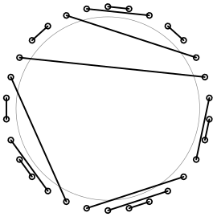</a>

[阿尔弗雷德·埃雷拉,*Mémoires de la Classe Sci. 8°*, *Acad. Royale de Belgique* (2) **11**, 6(1931), 26 页.]

**7.** [习题](../sec-7-2-1-6.md#ex-7-2-1-6-7) (a) 它等于 $\text{))()}\cdots\text{()}$. 置 $a_1\leftarrow\text{‘(’}$ 即恢复初始串.

(b) 初始二叉树 (步骤 B1) 得到恢复, 唯有 $l_n=n+1$.

**8.** [习题](../sec-7-2-1-6.md#ex-7-2-1-6-8)

$$
\begin{aligned}
l_1\cdots l_{15}&=2\ 0\ 4\ 5\ 0\ 7\ 8\ 0\ 10\ 0\ 0\ 13\ 0\ 15\ 0;\\r_1\cdots r_{15}&=3\ 0\ 0\ 6\ 0\ 12\ 11\ 9\ 0\ 0\ 0\ 0\ 14\ 0\ 0;\\e_1\cdots e_{15}&=1\ 0\ 3\ 1\ 0\ 2\ 2\ 0\ 1\ 0\ 0\ 2\ 0\ 1\ 0;\\s_1\cdots s_{15}&=1\ 0\ 12\ 1\ 0\ 5\ 3\ 0\ 1\ 0\ 0\ 3\ 0\ 1\ 0.
\end{aligned}
$$

**9.** [习题](../sec-7-2-1-6.md#ex-7-2-1-6-9) 结点 $j$ 为结点 $k$ 的真祖先, 当且仅当 $j<k$ 且 $s_j+j\geq k$. (因此 $c_1+\cdots+c_n=s_1+\cdots+s_n$.)

**10.** [习题](../sec-7-2-1-6.md#ex-7-2-1-6-10) 若 $j$ 是第 $k$ 个左括号的下标 $z_k$, 则 $w_j=c_k+1$、$w_{j'}=c_k$, 其中 $j'$ 是匹配的右括号的下标.

**11.** [习题](../sec-7-2-1-6.md#ex-7-2-1-6-11) 交换 $a_{2n}\cdots a_1$ 的左右括号, 得到 $a_1\cdots a_{2n}$ 的镜像.

**12.** [习题](../sec-7-2-1-6.md#ex-7-2-1-6-12) 式 (4) 的镜像对应于下面的森林.

  <a href="../../../assets/volume4a/figures/7-2-1-6-answer12-mirror-forest.svg" target="_blank" rel="noopener">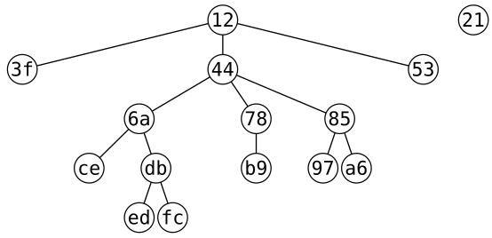</a>

但是, 如果我们水平画出右兄弟结点链接, 垂直画出左子结点链接, 然后进行一个类似于矩阵转置的操作, 将更清晰地看出转置对于森林的意义:

[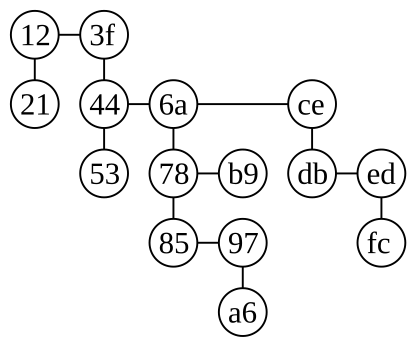](../../../assets/volume4a/figures/7-2-1-6-answer12-original-grid.svg)

[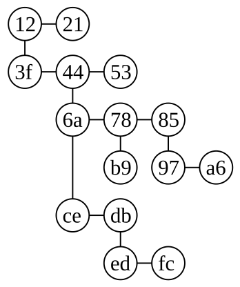](../../../assets/volume4a/figures/7-2-1-6-answer12-transpose-grid.svg)

**13.** [题目](../sec-7-2-1-6.md#ex-7-2-1-6-13) (a) 通过对结点数量应用归纳法, 我们可以得到 $\operatorname{preorder}(F^R)=\operatorname{postorder}(F)^R$ 和 $\operatorname{postorder}(F^R)=\operatorname{preorder}(F)^R$.

(b) 令 $F$ 对应于二叉树 $B$, 我们有 $\operatorname{preorder}(F)=\operatorname{preorder}(B)$ 和 $\operatorname{postorder}(F)=\operatorname{inorder}(B)$. 见 2.3.2–$(6)$ 之后的注释. 因此, $\operatorname{preorder}(F^T)=\operatorname{preorder}(B^R)=\operatorname{postorder}(B)^R$, 与 $\operatorname{preorder}(F)$ 或 $\operatorname{postorder}(F)$ 没有简单的关系. 但是, $\operatorname{postorder}(F^T)=\operatorname{inorder}(B^R)=\operatorname{inorder}(B)^R=\operatorname{postorder}(F)^R$.

**14.** [题目](../sec-7-2-1-6.md#ex-7-2-1-6-14) 根据习题 13 的答案, 当 $F$ 自然对应于 $B$ 时, $\operatorname{postorder}(F^{RT})=\operatorname{preorder}(F)=\operatorname{preorder}(B)$, 并且 $\operatorname{postorder}(F^{TR})=\operatorname{preorder}(F^T)^R=\operatorname{postorder}(B)$. 因此, 式 $F^{RT}=F^{TR}$ 成立当且仅当 $F$ 最多有一个结点.

**15.** [题目](../sec-7-2-1-6.md#ex-7-2-1-6-15) 如果 $F^R$ 自然对应于二叉树 $B'$, 则 $B'$ 的根结点是 $F$ 的最右树的根结点. $B'$ 中结点 $x$ 的左链接指向 $F^R$ 中 $x$ 的最左子结点, 它是 $F$ 中 $x$ 的最右子结点. 类似地, 右链接指向 $F$ 中的左兄弟结点.

注记: 由于 $B$ 自然对应于 $F^{RT}$, 习题 13 的答案告诉我们: $\operatorname{inorder}(B)=\operatorname{postorder}(F^{RT})=\operatorname{postorder}(F^R)^R=\operatorname{preorder}(F)$.

**16.** [题目](../sec-7-2-1-6.md#ex-7-2-1-6-16) 森林 $F\mid G$ 是将 $F$ 的树放在 $G$ 的按后序的第一个结点下方得到的. 因为 $F\mid(G\mid H)=(H^T G^T F^T)^T=(F\mid G)\mid H$, 所以满足组合律. 顺便提一下, $\operatorname{postorder}(F\mid G)=\operatorname{postorder}(F)\operatorname{postorder}(G)$, 而且, 当 $G$ 非空时有 $F\mid(GH)=(F\mid G)H$.

**17.** [题目](../sec-7-2-1-6.md#ex-7-2-1-6-17) 任意非空森林都可以记为 $F=(G\mid\bullet)H$, 其中 $\bullet$ 表示 1 结点森林. 我们有 $F^R=H^R(G^R\mid\bullet)$, $F^T=(H^T\mid\bullet)G^T$. 特别地, 除非 $H$ 为空森林 $\Lambda$, 否则不会有 $F^R=F^T$, 因为 $H^R$ 的第一棵树不能是 $H^T\mid\bullet$, 并且 $G$ 还必然为 $\Lambda$. 此外, $F=F^T$ 当且仅当 $G=H^T$; 在此情形, 除非 $G=\Lambda$, 否则不会有 $F^R=F^{RT}$; 在其他情形, $G^{TR}$ 的第一棵树不可能拥有超过 $G$ 本身的结点数量.

以下结论应当是正确的: 除非 $F=F^R$, 否则不会有 $F^{RT}=F^{TR}$. 在此假设下, $F^{RT}=F^{TR}$ 当且仅当 $F$ 和 $F^T$ 都是自共轭的. 科拉姆西尔·卡伦发现了这种森林的两个无穷家族, 其中参数 $i,j,k\ge0$:

$F=$

[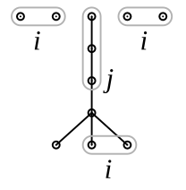](../../../assets/volume4a/figures/7-2-1-6-answer17-family1-F.svg)

$F^T=$

[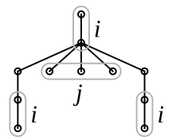](../../../assets/volume4a/figures/7-2-1-6-answer17-family1-transpose.svg)

和 $F=$

[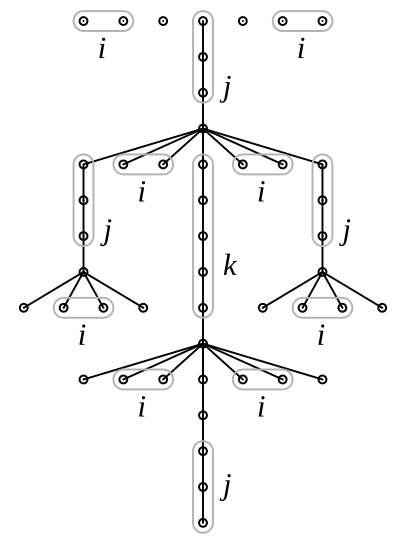](../../../assets/volume4a/figures/7-2-1-6-answer17-family2-F.svg)

$F^T=$

[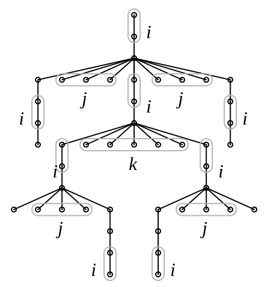](../../../assets/volume4a/figures/7-2-1-6-answer17-family2-transpose.svg)

(在以上示例中, $i=2$, $j=3$, $k=5$.) 是否还有任何其他情形?

**18.** [题目](../sec-7-2-1-6.md#ex-7-2-1-6-18) $C_{15}=9\,694\,845$ 个森林被分为 20 980 个同源类. 最大的类是长为 58 968 的圈, 它的元素之一是 `((()(()))())()((()(())())())()`. 最短的是 6 个二元素类 (对应于习题 17), 它包括

`()()()()()()()()()()()()()()()`,

`()()()()((()()()()()))()()()()`,

`()()()(((((()()()())))))()()()`,

`()()((((((((()()()))))))))()()`,

`()((()())((()(())()))(()()))()`,

`()(((((((((((()())))))))))))()`,

及其转置. 多少有些奇怪的串 `(((((((())))))))()()()()()()()`, `()()()()()()()(((((((())))))))`, `(((((((()()()()()()()())))))))`, 每一个都有楔形二叉树, 构成唯一的大小为 3 的类. 从 `()((()(()()))(())((()())()))()` 到 `((()())(()())(())(()())(()()))` 的路径有 3120 个元素, 其中之一是 $(2)$. 按照习题 17 答案中的猜想, 可能出现的最短圈的长度为 6, 当 $n=15$ 时共有 66 个这种圈. (次短的圈是唯一的, 它的长度为 10, 包括 `()(()()())()((((())()))((())))`.)

**19.** [题目](../sec-7-2-1-6.md#ex-7-2-1-6-19) 算法 P 中从 $F_j$ 到 $F_{j+1}$ 的转化可解释如下: “找出按照前序的最后一个结点, 记作 $x$, 它有一个左兄弟结点, 记作 $y$. 将 $x$ 从其家族中移除, 使它成为 $y$ 的新的最右子结点. 如果 $x<n$, 将 $x$ 的所有后代 $x+1,\ldots,n$ 都转换为平凡的单结点树.”

如果我们回想起 $F_j$ 中按照前序的第 $k$ 个结点是 $F_j^R$ 中按照后序的倒数第 $k$ 个结点, 那么, 将 $F_j^R$ 转换为 $F_{j+1}^R$ 的操作可表述如下: “找出按照后序的第一个结点, 记作 $x$, 它有一个右兄弟结点, 记作 $y$. 将 $x$ 从其家族中移除, 使它成为 $y$ 的新的最左子结点. 如果 $x>1$, 将 $x$ 的所有后代 $x-1,\ldots,1$ 都转换为平凡的单结点树.”

类似地, 算法 B 中将 $G_j$ 转化为 $G_{j+1}$ 的操作可解释如下: “找出最左非平凡树的根结点 $j$, 然后找出它的最右子结点 $k$. 将 $k$ 及其后代从 $j$ 的家族中移除, 并将它们插在 $j$ 和 $j$ 的右兄弟结点之间. 最后, 如果 $j>1$, 使 $j$ 及其右兄弟结点都成为 $j-1$ 的子结点, 使 $j-1$ 成为 $j-2$ 的子结点, 以此类推.”

当这一转换在左兄弟结点／右子结点表示中将 $G_j^{RT}$ 变为 $G_{j+1}^{RT}$ 时 (见习题 15), 它等同于在左子结点／右兄弟结点表示法中将 $F_j^R$ 变为 $F_{j+1}^R$ 的转换操作. 因为当 $j=1$ 时这两种操作显然相同, 所以我们有 $G_j^{RT}=F_j^R$.

(由此推出, 由算法 B 生成的二叉树的表序列 $e_1\ldots e_{n-1}$ 就是由算法 P 生成的括号串的表序列 $d_{n-1}\ldots d_1$. 表 1 和 2 说明了这一现象.)

余明昭在 *Comp. J.* **32** (1989), 76–85 中探索了森林列表之间的几种对称性.

**20.** [题目](../sec-7-2-1-6.md#ex-7-2-1-6-20) (a) 这一断言是引理 2.3.1P 的推广, 由归纳法容易证得.

(b) 实际上, 以下过程几乎与算法 P 相同:

**T1.** [初始化.] 对于 $1\le k\le n$, 置 $b_{3k-2}\leftarrow3$, $b_{3k-1}\leftarrow b_{3k}\leftarrow0$; 置 $b_0\leftarrow b_N\leftarrow0$, $m\leftarrow N-3$, 其中 $N=3n+1$.

**T2.** [访问.] 访问 $b_1\cdots b_N$. (现在 $b_m=3$, $b_{m+1}\ldots b_N=0\ldots0$.)

**T3.** [简单情形?] 置 $b_m\leftarrow0$. 如果 $b_{m-1}=0$, 置 $b_{m-1}\leftarrow3$, $m\leftarrow m-1$, 返回 T2.

**T4.** [寻找 $j$.] 置 $j\leftarrow m-1$, $k\leftarrow N-3$. 当 $b_j=3$ 时循环执行 $b_j\leftarrow0$, $b_k\leftarrow3$, $j\leftarrow j-1$, $k\leftarrow k-3$.

**T5.** [递增 $b_j$.] 如果 $j=0$ 则终止算法. 否则, 置 $b_j\leftarrow3$, $m\leftarrow N-3$, 返回 T2. ▮

[见什穆埃尔·扎克斯,*Theoretical Comp. Sci.* **10** (1980), 63–82. 扎克斯在此文中指出, 利用一种几乎与习题 2 的答案相同的算法, 甚至可以更轻松地生成满足 $b_j=3$ 的下标 $j$ 的序列 $z_1\ldots z_n$, 因为一个有效的三叉树组合 $z_1\ldots z_n$ 可以由不等式 $z_{k-1}<z_k\le3k-2$ 来描述其特性.]

**21.** [题目](../sec-7-2-1-6.md#ex-7-2-1-6-21) 为解决这一问题, 大体上可将算法 P 与算法 7.2.1.2L 结合在一起. 为方便起见, 假定 $n_t>0$, $n_1+\cdots+n_t>1$.

**G1.** [初始化.] 置 $l\leftarrow N$. 然后, 对于 $j=t,\ldots,2,1$ (按照这一顺序) 执行以下操作 $n_j$ 次: 置 $b_{l-j}\leftarrow j$, $b_{l-j+1}\leftarrow\cdots\leftarrow b_{l-1}\leftarrow0$, $l\leftarrow l-j$. 最后, 置 $b_0\leftarrow b_N\leftarrow c_0\leftarrow0$, $m\leftarrow N-t$.

**G2.** [访问.] 访问 $b_1\ldots b_N$. (此时, $b_m>0$, $b_{m+1}=\cdots=b_N=0$.)

**G3.** [简单情形?] 如果 $b_{m-1}=0$, 置 $b_{m-1}\leftarrow b_m$, $b_m\leftarrow0$, $m\leftarrow m-1$, 返回 G2.

**G4.** [寻找 $j$.] 置 $c_1\leftarrow b_m$, $b_m\leftarrow0$, $j\leftarrow m-1$, $k\leftarrow1$. 当 $b_j\ge c_k$ 时循环执行 $k\leftarrow k+1$, $c_k\leftarrow b_j$, $b_j\leftarrow0$, $j\leftarrow j-1$.

**G5.** [递增 $b_j$.] 如果 $b_j>0$, 求出满足 $b_j<c_l$ 的最小 $l\ge1$, 然后交换 $b_j\leftrightarrow c_l$. 否则, 如果 $j>0$, 置 $b_j\leftarrow c_1$, $c_1\leftarrow0$. 否则, 终止算法.

**G6.** [颠倒并展开.] 置 $j\leftarrow k$, $l\leftarrow N$. 当 $c_j>0$ 时循环执行 $b_{l-c_j}\leftarrow c_j$, $l\leftarrow l-c_j$, $j\leftarrow j-1$. 然后, 置 $m\leftarrow N-c_k$, 返回 G2. ▮

算法假设 $N>n_1+2n_2+\cdots+tn_t$. [见 *SICOMP* **8** (1979), 73–81.]

**22.** [题目](../sec-7-2-1-6.md#ex-7-2-1-6-22) 首先注意到, 可以增大 $d_1$ 当且仅当在链接表示法中 $r_1=0$. 否则, 可以通过以下方式得到 $d_1\ldots d_{n-1}$ 的后继: 找出满足 $d_j>0$ 的最小 $j$ 值, 置 $d_j\leftarrow0$, $d_{j+1}\leftarrow d_{j+1}+1$. 我们可以假设 $n>2$.

**K1.** [初始化.] 对于 $1\le k<n$, 置 $l_k\leftarrow k+1$, $r_k\leftarrow0$. 置 $l_n\leftarrow r_n\leftarrow0$.

**K2.** [访问.] 访问用 $l_1l_2\ldots l_n$ 和 $r_1r_2\ldots r_n$ 表示的二叉树.

**K3.** [简单情形?] 置 $y\leftarrow r_1$. 如果 $y=0$, 置 $r_1\leftarrow2$, $l_1\leftarrow0$, 返回 K2. 否则, 如果 $l_1=0$, 置 $l_1\leftarrow2$, $r_1\leftarrow r_2$, $r_2\leftarrow l_2$, $l_2\leftarrow0$, 返回 K2. 否则, 置 $j\leftarrow2$, $k\leftarrow1$.

**K4.** [寻找 $j$ 和 $k$.] 如果 $r_j>0$, 置 $k\leftarrow j$, $y\leftarrow r_j$. 然后, 如果 $j\ne y-1$, 置 $j\leftarrow j+1$, 重复本步骤.

**K5.** [混洗子树.] 置 $l_j\leftarrow y$, $r_j\leftarrow r_y$, $r_y\leftarrow l_y$, $l_y\leftarrow0$. 如果 $j=k$, 返回 K2.

**K6.** [移动子树.] 如果 $y=n$, 终止算法. 否则, 当 $k>1$ 时循环执行 $k\leftarrow k-1$, $j\leftarrow j-1$, $r_j\leftarrow r_k$. 然后, 当 $j>1$ 时循环执行 $j\leftarrow j-1$, $r_j\leftarrow0$. 返回 K2. ▮

(见习题 45 中的分析. 科尔什 [*Comp. J.* **48** (2005), 488–497;**49** (2006), 351–357;**54** (2011), 776–785] 已经证明: 本算法、算法 P 和算法 B 都能以一些很有意义的方式推广至 $t$ 叉树.)

**23.** [题目](../sec-7-2-1-6.md#ex-7-2-1-6-23) (a) 当 $n>1$ 时, 因为 $z_n$ 开始于 $2n-1$, 并来回反复 $C_{n-1}$ 次, 所以它终止于 $2n-1-(C_{n-1}\bmod2)$. 此外, 对于所有 $n\ge j$, $z_j$ 的最终值都是常数. 因此, 最终串 $z_1z_2\ldots$ 为 1 2 5 6 9 11 13 14 17 19 ……, 其中包含除 3, 7, 15, 31, ……外的所有小于 $2n$ 的奇数.

(b) 类似地, 用于描述最终树的前序排列为 $2^k\;2^{k-1}\;\cdots\;1\;3\;5\;6\;7\;9\;10\ldots$, 其中 $k=\lfloor\lg n\rfloor$. 从森林的角度来看, 对于 $1\le j\le k$, 结点 $2^j$ 是 $2^{j-1}$ 个结点 $\{2^{j-1},2^{j-1}+1,\ldots,2^j-1\}$ 的父结点, 树 $\{2^k+1,\ldots,n\}$ 是平凡的.

注记: 如果算法 N 在已经终止之后又在步骤 N2 重新启动, 则它会生成同一序列, 但是反向的. 算法 L 具有相同性质.

**24.** [题目](../sec-7-2-1-6.md#ex-7-2-1-6-24)

$$
\begin{aligned}
l_0l_1\ldots l_{15}&=(2,0,1,0,3,0,0,6,5,0,8,0,0,12,11,4);\\
r_1\ldots r_{15}&=(0,15,0,10,7,0,0,9,0,14,13,0,0,0,0);\\
k_1\ldots k_{15}&=(0,0,2,2,4,5,5,4,8,4,10,11,11,10,2);\\
q_1\ldots q_{15}&=(2,1,15,4,3,10,8,5,7,6,9,14,11,13,12);\\
u_1\ldots u_{15}&=(12,3,1,0,0,5,0,3,1,0,0,1,0,1,0).
\end{aligned}
$$

(如果森林 $F$ 的结点按照后序编号, 则 $k_j$ 是 $j$ 的左兄弟结点; 或者, 如果 $j$ 是 $p$ 的最左子结点, 则 $k_j=k_p$. 换种说法, $k_j$ 是 $F^{TR}$ 中 $j$ 的父结点. 而且, $k_j$ 还是 $j-1-u_{n+1-j}$, 也就是 $q_1\ldots q_n$ 中位于 $j$ 左侧小于 $j$ 的元素数量.)

**25.** [题目](../sec-7-2-1-6.md#ex-7-2-1-6-25) 从算法 N 和 L 中得到一些提示, 我们希望将每个 $(n-1)$ 结点树扩展为一个包含两个或多个 $n$ 结点树的列表. 在这一情况下, 思路是在每个这种列表的开头和结尾处, 在二叉树中使 $n$ 成为 $n-1$ 的子结点. 下面的算法使用附加的链接字段 $p_j$ 和 $s_j$, 其中 $p_j$ 指向森林中 $j$ 的父结点, $s_j$ 指向 $j$ 的左兄弟结点, 如果 $j$ 是其家族中的最左结点, 则指向 $j$ 的最右兄弟结点. (当然, 这些指针 $p_j$ 和 $s_j$ 与表 1 中的排列 $p_1\ldots p_n$ 和表 2 中的范围坐标 $s_1\ldots s_n$ 都不一样. 事实上, $s_1\ldots s_n$ 是下面习题 33 的排列 $\lambda$.)

**M1.** [初始化.] 对 $1\le j\le n$, 置 $l_j\leftarrow j+1$, $r_j\leftarrow0$, $s_j\leftarrow j$, $p_j\leftarrow j-1$, $o_j\leftarrow-1$, 除了 $l_n\leftarrow0$.

**M2.** [访问.] 访问 $l_1\ldots l_n$ 和 $r_1\ldots r_n$, 然后置 $j\leftarrow n$.

**M3.** [寻找 $j$.] 如果 $o_j>0$, 置 $k\leftarrow p_j$, 如果 $k\ne j-1$, 转到 M5. 如果 $o_j<0$, 置 $k\leftarrow s_j$, 如果 $k\ne j-1$, 转到 M4. 在任一情形, 如果 $k=j-1$, 置 $o_j\leftarrow-o_j$, $j\leftarrow j-1$, 重复本步骤.

**M4. [向下转换.]** (此时 $k$ 是 $j$ 的左兄弟, 或是 $j$ 所在家族的最右成员.) 若 $k\ge j$, 在 $j=1$ 时终止. 否则置 $x\leftarrow p_j$、$l_x\leftarrow0$、$z\leftarrow k$、$k\leftarrow0$ (将结点 $j$ 从父结点脱离, 移向顶层). 若 $k<j$, 置 $x\leftarrow p_j+1$、$z\leftarrow s_x$、$r_k\leftarrow0$、$s_x\leftarrow k$ (将结点 $j$ 从 $k$ 脱离, 并下移一层). 然后置 $x\leftarrow k+1$、$y\leftarrow s_x$、$s_x\leftarrow z$、$s_j\leftarrow y$、$r_y\leftarrow j$、$x\leftarrow j$. 当 $x\ne0$ 时, 循环置 $p_x\leftarrow k$、$x\leftarrow r_x$. 返回 M2.

**M5. [向上转换.]** (此时 $k$ 是 $j$ 的父结点.) 置 $x\leftarrow k+1$、$y\leftarrow s_j$、$z\leftarrow s_x$、$s_x\leftarrow y$、$r_y\leftarrow0$. 若 $k\ne0$, 置 $y\leftarrow p_k$、$r_k\leftarrow j$、$s_j\leftarrow k$、$s_{y+1}\leftarrow z$、$x\leftarrow j$. 否则置 $y\leftarrow j-1$、$l_y\leftarrow j$、$s_j\leftarrow z$、$x\leftarrow j$. 当 $x\ne0$ 时, 循环置 $p_x\leftarrow y$、$x\leftarrow r_x$. 返回 M2.　∎

*关于运行时间.* 如习题 44 那样, 可论证 M3 消耗 $2C_n+3(C_{n-1}+\cdots+C_1)$ 次内存访问, M4 和 M5 合计消耗 $8C_n-2(C_{n-1}+\cdots+C_1)$ 次, 再加上 $x\leftarrow r_x$ 执行次数的两倍. 后一量难以精确分析. 例如, $n=15$、$j=6$ 时, $x\leftarrow r_x$ 恰执行 1、2、3、4、5、6 次的情况分别有 45、23、7、9、2、4 种. 从启发式上看, 给定 $j$ 时, $x\leftarrow r_x$ 平均执行次数应近似为 $2-2^{j-n}$, 从而总平均约为

$$
\bigl(2C_n-(C_n-C_{n-1})-(C_{n-1}-C_{n-2})/2-(C_{n-2}-C_{n-3})/4-\cdots\bigr)/C_n\approx8/7.
$$

试验印证了这一预测特性, 表明 $n\to\infty$ 时每棵树的总成本接近 $265/21\approx12.6$ 次内存访问.

**26.** [题目](../sec-7-2-1-6.md#ex-7-2-1-6-26) (a) 这个条件显然必要. 如果它成立, 就可以唯一地构造 $F$: 结点 1 及其兄弟是森林的根, 其后代由非交叉分划递归确定. (事实上, 可直接由 $\Pi$ 的限制增长串 $a_1\ldots a_n$ 计算深度坐标 $c_1\ldots c_n$: 置 $c_1\leftarrow0$、$i_0\leftarrow0$. 对 $2\le j\le n$, 若 $a_j>\max(a_1,\ldots,a_{j-1})$, 置 $c_j\leftarrow c_{j-1}+1$、$i_{a_j}\leftarrow c_j$; 否则置 $c_j\leftarrow i_{a_j}$.)

(b) 如果 $\Pi$ 和 $\Pi'$ 都满足非交叉条件, 那么它们的最大公共细化 $\Pi\vee\Pi'$ 也满足, 因此可像在习题 7.2.1.5–12(a) 中那样进行.

(c) 设 $x_1,\ldots,x_m$ 是 $F$ 中某结点的孩子, 且 $1\le j<k\le m$. 构造 $F'$ 时, 将 $x_{j+1},\ldots,x_k$ 从家族中移出, 再将它们嫁接为 $x_{j+1}-1$ 的孩子. 结点 $x_{j+1}-1$ 是 $x_j$ 的最右后代.

(d) 由 (c) 显然可知. 因此, 这些森林按所含非叶结点数从底到顶分层, 该数比分划 $\Pi$ 的分块数少 1.

(e) 恰有 $\sum_{k=0}^n e_k(e_k-1)/2$ 个, 其中 $e_0=n-e_1-\cdots-e_n$ 是根结点数.

(f) 对偶类似于习题 12 的转置, 但用左兄弟与右孩子链接, 代替左孩子与右兄弟链接, 并关于次对角线转置:

[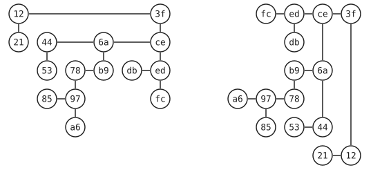](../../../assets/volume4a/figures/7-2-1-6-answer-026-dual-forests.svg)

(“右” 链接现在向下. 注意, 在 $F$ 中 $j$ 是 $k$ 的最右孩子, 当且仅当在 $F^D$ 中 $j$ 是 $k$ 的左兄弟. $F^D$ 的前序与 $F$ 的前序互为反序, 就像 $F^T$ 的后序与 $F$ 的后序互为反序一样.)

(g) 从 (f) 可知, $F'$ 覆盖 $F$ 当且仅当 $F^D$ 覆盖 $F'^{D}$. (所以, 若 $F$ 有 $k$ 个叶结点, 则 $F^D$ 有 $n+1-k$ 个叶结点.)

(h) $F\barwedge F'=(F^D\veebar F'^{D})^D$.

(i) 不满足. 如果满足, 由对偶性可知, 相应的等式必须成立. 然而, 例如 $0101\barwedge0121=0000$ 且 $0101\veebar0121=0123$, 而 $\operatorname{leaves}(0101)+\operatorname{leaves}(0121)\ne\operatorname{leaves}(0000)+\operatorname{leaves}(0123)$.

[哈罗德·贝克尔最早在 *Math. Mag.* **22** (1948), 23–26 中考察非交叉分划. 杰曼·克雷韦拉斯于 1971 年证明它们构成一个栅格, 见习题 2.3.4.6–3 答案所引文献.]

**27.** [题目](../sec-7-2-1-6.md#ex-7-2-1-6-27) (a) 这一断言等价于习题 2.3.3–19.

(b) 若用右孩子和左兄弟链接表示森林, 森林的前序对应于二叉树的对称序 (见习题 2.3.2–5), 并且 $s_j$ 是结点 $j$ 的右子树大小. 在这棵二叉树的任一具有非空右子树的结点处向左旋转, 恰好减少一个范围坐标, 且减幅是使 $s_1\ldots s_n$ 仍有效的最小量. 因而, $F'$ 覆盖 $F$ 当且仅当 $F$ 可由 $F'$ 经过这样一次旋转得到. (在左孩子／右兄弟表示中, 旋转类似, 但相应采用后序.)

(c) 对偶保留覆盖关系, 但交换左右方向.

(d) $F\top F'=(F^D\perp F'^{D})^D$. 等价地, 如习题 6.2.3–32 的注记所说, 可独立地把左子树大小降到最小.

(e) 习题 26(c) 答案中的覆盖变换显然使所有 $j$ 都有 $s_j\le s'_j$.

(f) 正确, 因为

$$
F\barwedge F'\mathrel{\vert\mkern-4mu\mathord{<}}F\dashv F\perp F',
\qquad
F\barwedge F'\mathrel{\vert\mkern-4mu\mathord{<}}F'\dashv F\perp F'.
$$

(g) 错误. 例如 $0121\veebar0122=0123$, 而 $0121\top0122=0122$. (由 (f) 取对偶, 确实有 $F\top F'\dashv F\veebar F'$.)

(h) 最长路径长 $\binom n2$, 每次把最右端的非零 $s_j$ 减 1. 最短路径长 $n-1$, 每次把最左端的非零 $s_j$ 置 0.

习题 6.2.3–32 的答案提供了塔迈里栅格的许多参考文献.

**28.** [题目](../sec-7-2-1-6.md#ex-7-2-1-6-28) (a) 只需计算 $\min(c_1,c'_1)\ldots\min(c_n,c'_n)$ 和 $\max(c_1,c'_1)\ldots\max(c_n,c'_n)$. 这是因为 $c_1\ldots c_n$ 是一个有效序列, 当且仅当 $c_1=0$, 且对 $1<j\le n$ 有 $c_j\le c_{j-1}+1$.

(b) 由 (a) 显然可知.*注记.* 任何分配栅格的元素都可表示为某个偏序的序理想. 图 62 所对应的偏序见下图. 边长为 $n-2$ 的类似三角网格生成 $n$ 阶斯坦利栅格.

[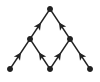](../../../assets/volume4a/figures/7-2-1-6-answer-028-triangular-order.svg)

(c) 取 $F$ 的一个有左兄弟 $j$ 的结点 $k$. 将 $k$ 从其家族中移出, 接在 $j$ 原有孩子的右端, 再把 $k$ 原有的孩子依次接在 $k$ 之后, 也作为 $j$ 的孩子. $k$ 原有的孩子保留各自的后代. (这一操作相当于在嵌套括号串中把 “)(” 变为 “()”. 所以, 括号串的 “完美” 格雷码对应于斯坦利栅格覆盖图中的哈密顿路径. $n=4$ 时恰有 38 条这种路径. 它们从 0123 分别通往 $(0001,0010,0012,0100,0111,0120)$, 条数依次为 $(8,6,6,8,4,6)$.)

(d) 正确, 因为 (c) 中的覆盖关系左右对称. ($F\subseteq F'$ 当且仅当对 $0\le j\le 2n$ 有 $w_j\le w'_j$, 其中蠕虫深度 $w_j$ 在习题 10 中定义. 如果 $w_0\ldots w_{2n}$ 是 $F$ 的蠕虫路径, 那么它的反序 $w_{2n}\ldots w_0$ 就是 $F^R$ 的蠕虫路径. 覆盖关系只改变一个坐标 $w_j$. 也可以对 $w$ 而非 $c$ 取最小值和最大值, 以计算 $F\cap F'$ 与 $F\cup F'$.)

(e) 见习题 9. (因此 $F\perp F'\subseteq F\cap F'$, 等等, 如习题 27(f) 所示.)

*注记.* 理查德·斯坦利在 *Fibonacci Quarterly* **13** (1975), 222–223 中介绍这种栅格. 由于三个重要的栅格定义在相同的元素上, 需要三个记号表示不同的序. 采用 $\mathrel{\vert\mkern-4mu\mathord{<}}$、$\dashv$、$\subseteq$, 是为了让人联想到克雷韦拉斯 (Kreweras)、塔迈里 (Tamari) 和斯坦利 (Stanley, 俄文作Стенли) 的姓名.

**29.** [题目](../sec-7-2-1-6.md#ex-7-2-1-6-29) 粘合 6 个正五边形会得到 14 个顶点. 经适当旋转和缩放后, 它们的坐标分别是[^v4a-p660-1]

$$
\begin{aligned}
p_{1010}=p_{0000}^{-}=p_{3000}^{*}=p_{2100}^{*-}&=(-1,\sqrt3,2/\phi);\\
p_{0010}=p_{3100}^{*}&=(\phi^{-2},\sqrt3\,\phi,0);\\
p_{3010}=p_{0100}^{-}&=(0,0,2);\\
p_{3210}=p_{0200}^{-}&=(2,0,2/\phi);\\
p_{0210}=p_{3200}^{*}&=(\sqrt5,\sqrt3,0);\\
p_{1000}=p_{2000}^{*}&=(-\phi^2,\sqrt3/\phi,0);
\end{aligned}
$$

其中 $(x,y,z)^*$ 表示 $(x,-y,z)$, $(x,y,z)^{-}$ 表示 $(x,y,-z)$. 但 3 个四边 “面” 不是正方形, 事实上, 每个这样的 “面” 的四个顶点都不共面.

(不过, 粘合两个适当的四面体并削去粘合处的 3 个角, 可以得到形状类似的立体, 它有真正的正方形与不规则的五边形. 金特·齐格勒在 *Lectures on Polytopes*(New York: Springer, 1995) 例 9.11 中讨论了结合几何体的另一组坐标, 其数学意义很重要, 但外观没有这样醒目.)

[^v4a-p660-1]: 在下面的式子中, $\phi$ 为黄金分割比 $\frac12(1+\sqrt5)$, 见附录 B 以及式 1.2.8–(3). ——编者注

**30.** [题目](../sec-7-2-1-6.md#ex-7-2-1-6-30) (a) $\overline{f_{n-1}}\ldots\overline{f_1}$, 因为按对称序的内部结点 $j$ 有非空右子树, 当且仅当按对称序的内部结点 $j+1$ 的左子树为空.

(b) 由习题 26(f) 的答案, 一般的树冠 $1^{p_1}0^{q_1+1}1^{p_2+1}0^{q_2+1}\ldots1^{p_k+1}0^{q_k}$ 来自于结点按对称序具有下列形式的二叉树:

$$
R^{p_1}NL^{q_1}BR^{p_2}NL^{q_2}B\ldots R^{p_k}NL^{q_k}.
$$

其中 $B$ 表示两个子树均非空, $R$ 表示仅右子树非空, $L$ 表示仅左子树非空, $N$ 表示两个子树均空.

$k=1$ 时, 这种树的数目 $f(p_1,q_1;\ldots;p_k,q_k)$ 为 $\binom{p_1+q_1}{p_1}$. 否则为

$$
\begin{aligned}
&[p_1>0]f(p_1-1,q_1;\ldots;p_k,q_k)\\
&\quad+\sum_{j=1}^{k-1}f(p_1,q_1;\ldots;p_j,q_j)f(p_{j+1},q_{j+1};\ldots;p_k,q_k)\\
&\quad+[q_k>0]f(p_1,q_1;\ldots;p_k,q_k-1).
\end{aligned}
$$

特别地,

$$
f(1,0;0,0;1,0;5,3;0,0;0,0;0,2;0,0;1,2)=114\,044\,694.
$$

(c) 由习题 3, $d_j=0$ 当且仅当 $c_{j+1}>c_j$.

(d) 一般来说, 由习题 27(a), $F\perp F'$ 的树冠为 $f_1\ldots f_{n-1}\mathbin{\&}f'_1\ldots f'_{n-1}$. 由 (a) 及习题 27(d), $F\top F'$ 的树冠为 $f_1\ldots f_{n-1}\mathbin{|}f'_1\ldots f'_{n-1}$.

[塔迈里栅格总存在互补元素, 这一事实归功于哈里·拉克瑟, 见捷尔吉·格雷策 *General Lattice Theory* (1978) 中的习题 I.6.30. X. G. 维耶诺创造了 “树冠” 这个贴切的术语, 见 arXiv:0905.3081 [math.CO] (2009), 全 12 页.]

**31.** [题目](../sec-7-2-1-6.md#ex-7-2-1-6-31) (a) $2^{n-1}$, 见习题 6.2.2–5.

(b) $c_1\le\cdots\le c_n$; $d_1,\ldots,d_{n-1}\le1$; $e_j>0$ 蕴涵 $e_j+\cdots+e_n=n-j$; $k_{j+1}\le k_j+1$; 对某个 $j$ 有 $p_1\le\cdots\le p_j\ge\cdots\ge p_n$; $s_j>0$ 蕴涵 $s_j=n-j$; $u_1\ge\cdots\ge u_n$; $z_{j+1}\le z_j+2$. (在各种情形中, 普遍成立的其他约束使可能性减少为 $2^{n-1}$ 种. 例如, $u_1\ldots u_n$ 必须是有效的范围坐标序列.)

(c) 在 $2^{n-1}$ 种情况中仅有 $n$ 种成立. (但 $F^T$ 是退化的.)

(d) 树冠为 $f_1\ldots f_{n-1}$ 的退化森林满足 $c_{j+1}=c_j+f_j$. 元素 $j<k$ 互为兄弟, 当且仅当 $f_j=f_{j+1}=\cdots=f_{k-1}=0$. 所以, 令 $F''$ 为树冠 $f_1\ldots f_{n-1}\mathbin{\&}f'_1\ldots f'_{n-1}$ 所对应的退化森林, 则 $F''\mathrel{\vert\mkern-4mu\mathord{<}}F$ 且 $F''\mathrel{\vert\mkern-4mu\mathord{<}}F'$, 从而

$$
F''\mathrel{\vert\mkern-4mu\mathord{<}}F\barwedge F'\dashv F\perp F'.
$$

由 (b) 还有 $F\perp F'\dashv F''$. 类似地可以证明, $F\veebar F'=F\top F'$ 是树冠为 $f_1\ldots f_{n-1}\mathbin{|}f'_1\ldots f'_{n-1}$ 的退化森林.

因此, 克雷韦拉斯栅格和塔迈里栅格限制在退化森林上时, 与 $\{1,\ldots,n-1\}$ 的子集构成的布尔栅格相同. [塔迈里栅格情形的这一结论归功于乔治·马可夫斯基,*Order* **9** (1992), 265–290. 其论文还说明塔迈里栅格有许多其他性质.]

**32.** [题目](../sec-7-2-1-6.md#ex-7-2-1-6-32) 设 $F$、$F'$ 的范围坐标分别为 $s_1\ldots s_n$、$s'_1\ldots s'_n$. 若 $s_j<s'_j$ 或 $j=0$, 称下标 $j$ 冻结. 固定冻结坐标的值, 并使其他坐标最大. 令 $s_0=n$, 对 $0\le k\le n$, 置

$$
s''_k=s_j-k+j,\qquad
j=\max\{i\mid0\le i\le k,\ i\text{ 冻结, 且 }i+s_i\ge k\}.
$$

只要 $0\le k-j\le s_j$, 就有 $s_k\le s_j-(k-j)$, 因此 $s''_k\ge s_k$, 而 $k$ 冻结时等号成立.

按习题 27(a) 的条件, 范围 $s''_0s''_1\ldots s''_n$ 对应一个有效森林. 事实上, 若 $k\ge0$、$0\le l\le s''_k=s_j-k+j$ 且 $s''_{k+l}=s_{j'}-k-l+j'$, 当 $0\le j'-j\le s_j$ 时就有 $s''_{k+l}+l\le s''_k$, 因为此时 $s_{j'}+j'-j\le s_j$. 由于 $j+s_j\ge k+l\ge j'$, 不可能有 $j>j'$ 或 $j'>j+s_j$.

设森林 $F'''$ 的范围满足 $s_k\le s'''_k\le s''_k$. 那么 $\min(s'_k,s'''_k)=s_k$, 因为 $k$ 冻结时有 $s_k=s''_k$, 否则 $s_k=s'_k$.

反之, 若森林 $F'''$ 满足 $F'\perp F'''=F$, 则必须有 $s_k\le s'''_k\le s''_k$. 若 $s'''_k<s_k$, 就会有 $s'''_k<s'_k$. 若 $k$ 为满足 $s'''_k>s''_k$ 的最小下标, 则对某个冻结的 $j$ 有 $0\le j\le k$、$j+s_j\ge k$, 且 $s''_k=s_j-k+j$. 于是 $s'''_j\ge s_j$ 蕴涵 $k-j\le s'''_j$, 从而 $s'''_k+k-j\le s'''_j$. 若 $j<k$, 则有 $s'''_j\le s''_j=s_j$, 产生矛盾. 若 $j=k$, 则有 $\min(s'''_k,s'_k)>s_k$, 也产生矛盾.

应用这个原理, 以 $F\perp G$ 和 $F$ 分别代替其中的 $F$ 和 $F'$, 可得第一条半分配律: $F\dashv G\dashv F''$ 和 $F\dashv H\dashv F''$ 蕴涵 $F\dashv G\top H\dashv F''$. 对第一条半分配律取对偶, 就得到第二条半分配律.

(拉尔夫·弗里兹建议把 $F''$ 称为 $F'$ 关于 $F$ 的伪补.)

**33.** [习题](../sec-7-2-1-6.md#ex-7-2-1-6-33) (a) 若 $\mathtt{LLINK}[k]\ne0$, 令 $k\lambda=\mathtt{LLINK}[k]$; 否则若 $k\ne1$, 令 $k\lambda=\mathtt{RLINK}[k-1]$; 其余情况下令 $k\lambda$ 为二叉树的根结点. 此规则定义了一个排列, 因为 $k\lambda=j$ 当且仅当 $k=\operatorname{parent}(j)+[j\text{ 为右子结点}]$, 或 $k=1$ 且 $j$ 为根. 此外, 当 $\mathtt{LLINK}[k]=0$ 时有 $k\lambda\geq k$, 当 $\mathtt{RLINK}[k]=0$ 时有 $k\sigma\lambda\leq k$. [保罗·埃德尔曼在 *Discrete Math.* **40**(1982), 171–179 中给出了向 $t$ 叉树的推广.]

(b) 用答 26(f) 中 (2) 的表示法, 可见此例 $\lambda(F)$ 为 $(3\,1)(2)(12\,6\,4)(5)(11\,7)(14\,13)(9\,8)(15)(10)$. 一般地, 圈是森林中的各个家族, 各圈内按降序排列, 结点按前序编号. [见纳楚姆·德肖维茨和什穆埃尔·扎克斯,*Discrete Math.* **62**(1986), 215–218.]

(c) $\lambda(F^D)=\rho\sigma\lambda(F)\rho$, 其中 $\rho$ 是 “翻转” 排列 $(1\,n)(2\,n-1)\cdots$, 因为对偶森林交换 $\mathtt{LLINK}\leftrightarrow\mathtt{RLINK}$, 并翻转前序编号.

(d) 圈分解 $(x_j\,x_k)(x_1\cdots x_m)=(x_1\cdots x_jx_{k+1}\cdots x_m)(x_{j+1}\cdots x_k)$ 对应于答 26(c).

(e) 由 (d), 每条覆盖路径对应于 $(n\cdots2\,1)$ 的一个因式分解. 令 $q_n$ 为这种分解的数目, 则

$$
q_1=1,\qquad q_n=\sum_{l=1}^{n-1}(n-l)\binom{n-2}{l-1}q_lq_{n-l},
$$

因为有 $n-l$ 种 $k-j=l$ 的选择, 第一次转置把圈分成大小为 $l$ 与 $n-l$ 的两部分, 再有 $\binom{n-2}{l-1}$ 种交错放置后续因子的方式. 解为 $q_n=n^{n-2}$, 因为

$$
\begin{aligned}
\sum_{l=1}^{n-1}\binom{n-1}l l^{l-1}(y-l)^{n-1-l}
&=\lim_{x\to0}\sum_{l=1}^{n-1}\binom{n-1}l (x+l)^{l-1}(y-l)^{n-1-l}\\
&=\lim_{x\to0}\frac{(x+y)^{n-1}-y^{n-1}}{x}
=(n-1)y^{n-2}.
\end{aligned}
$$

[见约瑟夫·德奈什,*Magyar Tudományos Akadémia Matematikai Kutató Intézetének Közleményei* **4**(1959), 63–70. 寻找这些因式分解与有标记自由树的对应关系很自然, 因为后者恰也有 $n^{n-2}$ 个. 给定 $(1\,2\cdots n)=(x_1\,y_1)\cdots(x_{n-1}\,y_{n-1})$, 其中 $x_j<y_j$. 最简单的对应关系或许如下. 设 $(x_j\,y_j)\cdots(x_{n-1}\,y_{n-1})$ 中含 $x_j,y_j$ 的圈为 $(z_1\cdots z_m)$, 其中 $z_1<\cdots<z_m$. 若 $y_j=z_m$, 令 $a_j=z_1$; 否则令 $a_j=\min\{z_i\mid z_i>x_j\}$. 于是可以证明, $a_1\cdots a_{n-1}$ 是停车问题中 $n-1$ 辆车的 “唤醒序列”, 习题 6.4–31 把它与自由树联系起来.]

**34.** [习题](../sec-7-2-1-6.md#ex-7-2-1-6-34) 每条从底到顶的覆盖路径等价于一个形状为 $(n-1,n-2,\ldots,1)$ 的扬氏图表, 因此可用定理 5.1.4H. (见习题 5.3.4–38.)

[如何枚举塔迈里栅格中这些路径仍是个谜. 相关序列是 $1,1,2,9,98,2981,340549,\ldots$.]

**35.** [习题](../sec-7-2-1-6.md#ex-7-2-1-6-35) 乘以 $n+1$, 再见 *AMM* **97**(1990), 626–630.

**36.** [习题](../sec-7-2-1-6.md#ex-7-2-1-6-36) 对步骤 T1–T5 作显而易见的修改, 即可推广到任意 $t\geq1$ 的 $t$ 叉树. 设 $C_n^{(t)}$ 为有 $n$ 个内部结点的 $t$ 叉树数, 则 $C_n=C_n^{(2)}$ 且 $C_n^{(t)}=((t-1)n+1)^{-1}\binom{tn}n$. 若两次访问间改变了 $h$ 个度数 $b_j$, 则有 $C_{n-x}^{(t)}$ 种情形满足 $h\geq x$. 所以简单情形的概率为 $1-C_{n-1}^{(t)}/C_n^{(t)}\approx1-(t-1)^{t-1}/t^t$. 步骤 T4 中 $b_j\leftarrow0$ 的平均执行次数为

$$
\frac{C_{n-1}^{(t)}+\cdots+C_1^{(t)}}{C_n^{(t)}}
\approx\frac{(t-1)^{t-1}}{t^t-(t-1)^{t-1}},\qquad t\geq2.
$$

$t=3$ 时此近似为 $4/23$. $t=1$ 时, 各 $C_i^{(1)}=1$, 所列平均值为 $n-1$.

还可以在 $0\leq(t-1)p\leq q\ne0$ 时, 通过推广 (5) 研究 $t$ 叉递归结构 $A_{pq}^{(t)}=0A_{p(q-1)}^{(t)},\,tA_{(p-1)q}^{(t)}$. 这样的度数串数目 $C_{pq}^{(t)}$ 满足递推式 (21), 只是当 $p<0$ 或 $(t-1)p>q$ 时 $C_{pq}^{(t)}=0$. 一般解为

$$
C_{pq}^{(t)}=\frac{q-(t-1)p+1}{q+1}\binom{p+q}{p}
=\binom{p+q}{p}-(t-1)\binom{p+q}{p-1}.
$$

而 $C_n^{(t)}=C_{n((t-1)n)}^{(t)}$. 下面是 $t=3$ 时的前十行三角表.

| $q$ | $p=0$ | $p=1$ | $p=2$ | $p=3$ | $p=4$ |
|---:|---:|---:|---:|---:|---:|
| 0 | 1 |  |  |  |  |
| 1 | 1 |  |  |  |  |
| 2 | 1 | 1 |  |  |  |
| 3 | 1 | 2 |  |  |  |
| 4 | 1 | 3 | 3 |  |  |
| 5 | 1 | 4 | 7 |  |  |
| 6 | 1 | 5 | 12 | 12 |  |
| 7 | 1 | 6 | 18 | 30 |  |
| 8 | 1 | 7 | 25 | 55 | 55 |
| 9 | 1 | 8 | 33 | 88 | 143 |

[尼古拉·富什在 *Nova acta acad. scient. imp. Pet.* **9**(1791), 243–251 中最早研究了 “富什–卡塔兰数” $C_n^{(t)}$.]

**37.** [习题](../sec-7-2-1-6.md#ex-7-2-1-6-37) 这些森林的基本字典序递推如下. 当 $n_0>n_2+2n_3+\cdots+(t-1)n_t$ 且 $n_1,\ldots,n_t\geq0$ 时, 有

$$
\begin{aligned}
A(n_0,n_1,\ldots,n_t)
={}&0A(n_0-1,n_1,\ldots,n_t),\\
&1A(n_0,n_1-1,\ldots,n_t),\ \ldots,\ tA(n_0,n_1,\ldots,n_t-1).
\end{aligned}
$$

否则 $A(n_0,n_1,\ldots,n_t)$ 为空, 但 $A(0,\ldots,0)=\epsilon$ 例外, 它是只含空串的序列. 步骤 G1 计算 $A(n_0,\ldots,n_t)$ 的第一项. 要分析以下五个量.

- $C$, 执行 G2 的次数, 即森林总数.
- $E$, G3 直接转到 G2 的次数, 即简单情形数.
- $K$, G4 把某个 $b_i$ 移入表 $c$ 的次数.
- $L$, G5 比较 $b_j$ 与表中某个 $c_i$ 的次数.
- $Z$, G5 置 $c_1\leftarrow0$ 的次数.

因此, 步骤 G6 的循环共置 $b_{l-c_j}\leftarrow c_j$ 达 $K-Z-n_1-\cdots-n_t$ 次.

令 $\boldsymbol n=(n_0,n_1,\ldots,n_t)$, 令 $\boldsymbol e_j$ 为第 $j$ 个坐标是 1 的单位向量. 置 $|\boldsymbol n|=n_0+n_1+\cdots+n_t$、$\|\boldsymbol n\|=n_1+2n_2+\cdots+tn_t$. 可以用这种记法重写基本递推

$$
A(\boldsymbol n)=0A(\boldsymbol n-\boldsymbol e_0),\ 1A(\boldsymbol n-\boldsymbol e_1),\
\ldots,\ tA(\boldsymbol n-\boldsymbol e_t),\qquad |\boldsymbol n|>\|\boldsymbol n\|.
$$

考虑一般递推式

$$
F(\boldsymbol n)=f(\boldsymbol n)+
\left(\sum_{j=0}^t F(\boldsymbol n-\boldsymbol e_j)\right)[|\boldsymbol n|>\|\boldsymbol n\|],
$$

只要 $\boldsymbol n$ 有负分量, $F(\boldsymbol n)=0$. 若 $f(\boldsymbol n)=[|\boldsymbol n|=0]$, 则 $F(\boldsymbol n)=C(\boldsymbol n)$ 是森林总数. 由答 2.3.4.4–32,

$$
\begin{aligned}
C(\boldsymbol n)&=\frac{(|\boldsymbol n|-1)!(|\boldsymbol n|-\|\boldsymbol n\|)}{n_0!n_1!\cdots n_t!}\\
&=\sum_{j=0}^t(1-j)\binom{|\boldsymbol n|-1}{n_0,\ldots,n_{j-1},n_j-1,n_{j+1},\ldots,n_t}.
\end{aligned}
$$

这推广了答 36 中的 $C_{pq}^{(t)}$, 即 $n_0=q+1$、$n_t=p$, 其他分量均为 0 的情形.

同样, 通过选择不同的核函数 $f(\boldsymbol n)$, 得到分析所需的其他量 $E(\boldsymbol n),K(\boldsymbol n),L(\boldsymbol n),Z(\boldsymbol n)$ 的递推:

$$
\begin{aligned}
f(\boldsymbol n)&=[|\boldsymbol n|=n_0+1\text{ 且 }n_0>\|\boldsymbol n\|]
&\Longrightarrow\quad F(\boldsymbol n)&=E(\boldsymbol n);\\
f(\boldsymbol n)&=[|\boldsymbol n|>n_0]
&\Longrightarrow\quad F(\boldsymbol n)&=E(\boldsymbol n)+K(\boldsymbol n);\\
f(\boldsymbol n)&=[|\boldsymbol n|=\|\boldsymbol n\|+1]
&\Longrightarrow\quad F(\boldsymbol n)&=C(\boldsymbol n)+K(\boldsymbol n)-Z(\boldsymbol n);\\
f(\boldsymbol n)&=\sum_{1\leq j<k\leq t}n_j[n_k>0]
&\Longrightarrow\quad F(\boldsymbol n)&=L(\boldsymbol n).
\end{aligned}
$$

习题 2.3.4.4–32 的符号方法似乎不能迅速求出这些一般递推式的解. 不过, G2 中 $b_m+m<N$ 当且仅当前一步是 G3, 由此可求 $C-E$, 即

$$
C(\boldsymbol n)-E(\boldsymbol n)=\sum_{j=1}^t C(\boldsymbol n-\boldsymbol f_j),
\qquad \boldsymbol f_j=\boldsymbol e_j+(j-1)\boldsymbol e_0.
$$

此和计数将内部结点 (非叶结点) 数 $n_1+\cdots+n_t$ 减少 1 后得到的子森林. 同样地, 令

$$
C^{(x)}(\boldsymbol n)=\sum\{C(\boldsymbol n-i_1\boldsymbol f_1-\cdots-i_t\boldsymbol f_t)\mid i_1+\cdots+i_t=x\}
$$

为含 $n_1+\cdots+n_t-x$ 个内部结点的子森林数. 于是

$$
K(\boldsymbol n)-Z(\boldsymbol n)=\sum_{x=1}^{|\boldsymbol n|} C^{(x)}(\boldsymbol n).
$$

此式类似 (20), 因为 G5 中 $k-[b_j=0]\geq x\geq1$ 当且仅当 $b_{m-x}>0$ 且 $b_{m-x+1}\geq\cdots\geq b_m$. 从串 $b_1\cdots b_N$ 中删去 $b_{m-x+1}\cdots b_m$ 及适当数目的末尾 0, 这样的前序度数串便与 $C^{(x)}(\boldsymbol n)$ 所计森林一一对应.

这些公式表明, 只要 $n_1=n_2+\cdots+n_t+O(1)$, 扎克斯–理查兹算法每访问一个森林只需 $O(1)$ 次操作, 因为 $j>1$ 时

$$
C(\boldsymbol n-\boldsymbol f_j)/C(\boldsymbol n)
=n_j n_0^{\underline{j-1}}/(|\boldsymbol n|-1)^{\underline j}
\leq1/4+O(|\boldsymbol n|^{-1}).
$$

事实上, 在实际所关心的几乎所有情形中, $K$ 都很小. 但当 $n_1$ 很大时, 算法可能很慢. 例如 $t=1$、$n_0=m+r+1$、$n_1=m$ 时, 算法几乎要计算 $m+r$ 个东西的所有 $r$ 组合. 因此, 对固定 $r$, $C(\boldsymbol n)=\binom{m+r}r$ 且 $K(\boldsymbol n)-Z(\boldsymbol n)=\binom{m+r}{r+1}=\Omega(mC(\boldsymbol n))$. [为在所有情形保持效率, 可跟踪末尾的 1. 见弗兰克·拉斯基和多米尼克·鲁兰茨·范鲍罗瑙伊吉安,*Congressus Numerantium* **41**(1984), 53–62.]

$K,Z$ 和 $L$ (尤其是 $L$) 的精确公式看来并不简单, 不过可用下面的方法求出. 称森林度数串最右边的非零连续子串为 “活动块”. 例如, $302102021230000000$ 的活动块是 $2123$. 活动块的所有排列等频出现. 令 $D(\boldsymbol n)$ 为对度数规格 $\boldsymbol n$ 的所有森林的前序度数串 $\beta$ 求 “$\beta$ 的末尾 0 的数量减 1” 之和. 于是对 $1\leq j\leq t$, 含 $n'_j$ 个 $j$ 的一个块, 在恰好

$$
D(\boldsymbol n-n'_1\boldsymbol f_1-\cdots-n'_t\boldsymbol f_t)
+[n'_1+\cdots+n'_t=n_1+\cdots+n_t]
$$

种情形是活动的. 例如, 给定串 $3021020000$, 可在三个位置插入 $21230000$, 得到活动块为 $2123$ 的森林. 活动块靠左且前面没有 0 时, 可用答 7.2.1.2–6 的方法计算对 $K,L$ 的贡献. 借用该答的记法,

$$
\begin{aligned}
k(\boldsymbol n)&=w(e_{n_1}(z)\cdots e_{n_t}(z)),\\
l(\boldsymbol n)&=w\left(e_{n_1}(z)\cdots e_{n_t}(z)
\sum_{1\leq i<j\leq t}(n_i-zr_i(z))r_j(z)\right).
\end{aligned}
$$

一般情形的贡献类似, 故

$$
\begin{aligned}
K(\boldsymbol n)&=k(\boldsymbol n)+\sum D(\boldsymbol n-\boldsymbol n')k(\boldsymbol n'),\\
L(\boldsymbol n)&=l(\boldsymbol n)+\sum D(\boldsymbol n-\boldsymbol n')l(\boldsymbol n'),\\
Z(\boldsymbol n)&=\sum D(\boldsymbol n-\boldsymbol n'),
\end{aligned}
$$

求和取遍满足 $n'_j\leq n_j$($1\leq j\leq t$)、$|\boldsymbol n'|-\|\boldsymbol n'\|=|\boldsymbol n|-\|\boldsymbol n\|$ 和 $n'_1+\cdots+n'_t\leq n_1+\cdots+n_t-2$ 的向量 $\boldsymbol n'$.

还需确定 $D(\boldsymbol n)$. 令 $C(\boldsymbol n;j)$ 为规格 $\boldsymbol n=(n_0,\ldots,n_t)$ 的森林中, 按前序最后一个内部结点的度数为 $j$ 的森林数. 若至少有一个内部结点, 便有 $C(\boldsymbol n)=\sum_{j=1}^t C(\boldsymbol n;j)$. 另有

$$
C(\boldsymbol n+\boldsymbol e_1;1)
=C(\boldsymbol n+\boldsymbol f_2;2)=\cdots
=C(\boldsymbol n+\boldsymbol f_t;t)=C(\boldsymbol n)+D(\boldsymbol n).
$$

由这一无穷线性方程组可推出, $C(\boldsymbol n)+D(\boldsymbol n)$ 等于

$$
\sum_{i_2=0}^{n_2}\cdots\sum_{i_t=0}^{n_t}
(-1)^{i_2+\cdots+i_t}\binom{i_2+\cdots+i_t}{i_2,\ldots,i_t}
C\bigl(\boldsymbol n+(1+i_2+\cdots+i_t)\boldsymbol e_1-i_2\boldsymbol f_2-\cdots-i_t\boldsymbol f_t\bigr).
$$

如果有更简单的公式, 当然更好.

**38.** [习题](../sec-7-2-1-6.md#ex-7-2-1-6-38) 步骤 L1 显然用了 $4n+2$ 次内存访问. 给定 $j$ 时, L3 转往 L4 或 L5 恰有 $C_j-C_{j-1}$ 次. 因此开销是 $2C_n+3\sum_{j=0}^n(n-j)(C_j-C_{j-1})=2C_n+3(C_{n-1}+\cdots+C_1+C_0)$ 次内存访问. L4 与 L5 合计 $6C_n-6$ 次. 因此全过程每次访问平均要用 $9+O(n^{-1/2})$ 次内存访问.

**39.** [习题](../sec-7-2-1-6.md#ex-7-2-1-6-39) 形状为 $(q,p)$、元素为 $y_{ij}$ 的扬氏图表对应于 $A_{pq}$ 的一个元素, 其左括号在位置 $p+q+1-y_{21},\ldots,p+q+1-y_{2p}$, 右括号在 $p+q+1-y_{11},\ldots,p+q+1-y_{1q}$. 钩长为 $\{q+1,q,\ldots,1,p,p-1,\ldots,1\}\setminus\{q-p+1\}$. 由定理 5.1.4H, $C_{pq}=(p+q)!(q-p+1)/(p!(q+1)!)$.

**40.** [习题](../sec-7-2-1-6.md#ex-7-2-1-6-40) (a) $C_{pq}=\binom{p+q}p-\binom{p+q}{p-1}\equiv\binom{p+q}p+\binom{p+q}{p-1}=\binom{p+q+1}p\pmod2$, 再用习题 1.2.6–11.

(b) 由式 7.1.3–(36), $\nu(n\mathbin{\&}(n+1))=\nu(n+1)-1$.

**41.** [习题](../sec-7-2-1-6.md#ex-7-2-1-6-41) 等于 $C(wz)/(1-zC(wz))=1/(1-z-wzC(wz))=(1-wC(wz))/(1-w-z)$, 其中 $C(z)$ 是卡塔兰生成函数 (18). 将第一式展开为 $C(wz)+zC(wz)^2+z^2C(wz)^3+\cdots$, 容易看出它等价于 (24). [见珀西·麦克马洪,*Combinatory Analysis* **1**(Cambridge Univ. Press, 1915), 128–130.]

**42.** [习题](../sec-7-2-1-6.md#ex-7-2-1-6-42) (a) 元素 $a_1\cdots a_n$ 确定整个自共轭嵌套串 $a_1\cdots a_{2n}$, 而恰有 $q$ 个右括号的 $a_1\cdots a_n$ 有 $C_{q(n-q)}$ 种可能. 故答案为

$$
\sum_{q=0}^{\lfloor n/2\rfloor}C_{q(n-q)}
=\sum_{q=0}^{\lfloor n/2\rfloor}\left(\binom nq-\binom n{q-1}\right)
=\binom n{\lfloor n/2\rfloor}.
$$

(b) 为 $C_{(n-1)/2}[n\text{ 为奇数}]$, 因为自转置二叉树由它的左子树确定.

(c) 与 (b) 相同, 因为 $F$ 自对偶当且仅当 $F^R$ 自转置.

**43.** [习题](../sec-7-2-1-6.md#ex-7-2-1-6-43) $C_{pq}=C_q-\binom{q-p-1}1C_{q-1}+\cdots=\sum_{r=0}^{q-p}(-1)^r\binom{q-p-r}rC_{q-r}$, 对 $q-p$ 归纳即得.

**44.** [习题](../sec-7-2-1-6.md#ex-7-2-1-6-44) 两次访问间, 步骤 B3 作 $3j-2$ 次内存访问, B4 作 $h+1$ 次, B5 作 4 次, 其中 $h$ 是 $y\leftarrow r_y$ 的执行次数. 当 $j<n$ 时, 给定 $j,x$, 使 $h\geq x$ 的二叉树数是 $[z^{n-j-x-1}]C(z)^{x+3}$, 因为可在 $j+x+1$ 个内部结点之下加 $x+3$ 棵子树得到这些树. 置 $x=0$ 后, 由 (24) 和习题 43 可得, 每个给定的 $j$ 出现 $C_{(n-j-1)(n-j+1)}=C_{n+1-j}-C_{n-j}$ 次. 因此, 对所有二叉树求和,

$$
\sum j=n+\sum_{j=1}^n(C_{n+1-j}-C_{n-j})j=C_n+C_{n-1}+\cdots+C_1.
$$

类似地,

$$
\begin{aligned}
\sum(h+1)
&=\sum_{j=1}^{n-1}\sum_{x=0}^{n-j-1}C_{(n-j-x-1)(n-j+1)}
=\sum_{j=1}^{n-1}C_{(n-j-1)(n-j+2)}\\
&=\sum_{j=1}^{n}(C_{n-j+2}-2C_{n-j+1})=C_{n+1}-(C_n+C_{n-1}+\cdots+C_0).
\end{aligned}
$$

因此算法总成本为 $C_{n+1}+4C_n+2(C_{n-1}+\cdots+C_1)+O(n)=(26/3-10/(3n)+O(n^{-2}))C_n$ 次内存访问.

**45.** [习题](../sec-7-2-1-6.md#ex-7-2-1-6-45) K3 中每种简单情形发生 $C_{n-1}$ 次, 故该步总成本为 $3C_{n-1}+8C_{n-1}+2(C_n-2C_{n-1})$ 次内存访问. K4 读取 $r_i$ 共 $[z^{n-i-1}]C(z)^{i+2}=C_{(n-i-1)n}$ 次. 对 $i\geq2$ 求和, 整个循环共进行 $C_{(n-3)(n+1)}=C_{n+1}-3C_n+C_{n-1}$ 次访问. K5 用了 $6C_n-12C_{n-1}$ 次. K6 稍复杂, 但当 $n>2$ 时, 操作 $r_j\leftarrow r_k$ 执行 $C_n-3C_{n-1}+1$ 次, 而 $r_j\leftarrow0$ 执行 $C_{n-1}-n+1$ 次. 因此总访问数为

$$
C_{n+1}+7C_n-9C_{n-1}+n+3=(8.75-9.375/n+O(n^{-2}))C_n.
$$

尽管这在渐近意义上比答 44 的算法 B 略差, $n^{-1}$ 的系数很大的负值意味着算法 B 实际只在 $n\geq58$ 时占优, 而 $n$ 从来不会那么大.

然而, 瓦迪斯瓦夫·斯卡尔贝克把算法 B 改进为以下的 B*. 它以反序生成树, 并用辅助表 $c_1\cdots c_n$.

**B1\*. [初始化.]** 对 $1\leq k<n$, 置 $l_k\leftarrow c_k\leftarrow0$、$r_k\leftarrow k+1$. 也置 $l_n\leftarrow r_n\leftarrow0$、$r_{n+1}\leftarrow1$ (便于步骤 B3*).

**B2\*. [访问.]** 访问用 $l_1l_2\cdots l_n$ 和 $r_1r_2\cdots r_n$ 表示的二叉树.

**B3\*. [寻找 $j$.]** 置 $j\leftarrow1$. 当 $r_j=0$ 时, 反复置 $l_j\leftarrow c_j\leftarrow0$、$r_j\leftarrow j+1$、$j\leftarrow j+1$. 此后若 $j>n$, 终止.

**B4\*. [使 $r_j$ 降级.]** 置 $x\leftarrow r_j$、$r_j\leftarrow r_x$、$r_x\leftarrow0$、$z\leftarrow c_j$、$c_j\leftarrow x$. 若 $z>0$, 置 $r_z\leftarrow x$; 否则置 $l_j\leftarrow x$. 返回 B2*.　∎

若把 $r_1,c_1$ 保存在寄存器中, 算法只需 $4C_n+C_{n-1}+4(C_{n-1}+C_{n-2}+\cdots+C_0)+3n-6=(67/12+73/(24n)+O(n^{-2}))C_n$ 次内存访问, 即可生成全部 $C_n$ 棵树. [见瓦迪斯瓦夫·斯卡尔贝克,*Fundamenta Informaticae* **75**(2007), 505–536.]

**46.** [习题](../sec-7-2-1-6.md#ex-7-2-1-6-46) (a) 从 $pq$ 往左走, 面积增 $q-p$.

(b) 从 $nn$ 到 $00$ 的路径中, 向左的一步对应于 $a_1\cdots a_{2n}$ 中的左括号, 第 $k$ 次此类移动有 $q-p=c_k$.

(c) 等价地, $C_{n+1}(x)=\sum_{k=0}^nx^kC_k(x)C_{n-k}(x)$. 这个递推成立, 因为有 $n+1$ 个结点的森林 $F$ 包含最左树的根、由这个根的后代所成的 $k$ 结点森林 $F_l$, 以及由余下各树所成的 $n-k$ 结点森林 $F_r$. 又有

$$
\text{内部路径长度}(F)=k+\text{内部路径长度}(F_l)+\text{内部路径长度}(F_r).
$$

(d) $A_{p(p+r)}$ 中的串有形式 $\alpha_0\mathtt{)}\alpha_1\mathtt{)}\cdots\alpha_{r-1}\mathtt{)}\alpha_r$, 其中每个 $\alpha_j$ 都正确嵌套. 这样的串的面积是对所有 $j$ 求和, 每项为 $\alpha_j$ 的面积, 加上 $\alpha_j$ 内左括号数乘以 $r-j$.

*注.* 伦纳德·卡利茨和约翰·赖尔登在 *Duke Math. J.* **31**(1964), 371–388 中引入了多项式 $C_{pq}(x)$; (d) 中的恒等式等价于他们的式 (10.12). 他们还证明

$$
C_{pq}(x)=\sum_r(-1)^r x^{r(r-1)-\binom{q-p}{2}}\binom{q-p-r}{r}_{\!x} C_{q-r}(x),
$$

从而推广了习题 43 的结果. 根据部分 (c), 可以得到无穷连分数 $C(x,z)=1/(1-z/(1-xz/(1-x^2z/(1-\cdots))))$, 乔治·内维尔·沃森证明它等于 $F(x,z)/F(x,z/x)$, 其中

$$
F(x,z)=\sum_{n=0}^{\infty}\frac{(-1)^n x^{n^2}z^n}{(1-x)(1-x^2)\cdots(1-x^n)}，
$$

见 *J. London Math. Soc.* **4** (1929), 39–48. 我们在习题 5.2.1–15 中见过这个生成函数, 不过稍有变化.

森林的内部路径长度是相应二叉树的 “左路径长度”. 也就是, 针对所有内部结点, 对源自根结点的路径上的左分支数量求和. 更一般的多项式

$$
C_n(x,y)=\sum_T x^{\text{左路径长度}(T)}y^{\text{右路径长度}(T)}
$$

(针对所有 $n$ 结点二叉树 $T$ 求和), 似乎不像本题研究的 $C_{nn}(x)=C_n(x,1)$ 那样遵从简单的加性递归, 但我们确实有 $C_{n+1}(x,y)=\sum_k x^k C_k(x,y)y^{n-k}C_{n-k}(x,y)$. 因此, 超生成函数 $C(x,y,z)=\sum_n C_n(x,y)z^n$ 满足函数方程 $C(x,y,z)=1+zC(x,y,xz)C(x,y,yz)$. (习题 2.3.4.5–5 研究了 $x=y$ 的情形.)

**47.** [习题](../sec-7-2-1-6.md#ex-7-2-1-6-47) 对于 $0\le p<n$, 我们有 $C_n(x)=\sum_q x^{\binom{q-p}{2}}C_{pq}(x)C_{(n-q)(n-1-p)}(x)$.

**48.** [习题](../sec-7-2-1-6.md#ex-7-2-1-6-48) 采用习题 46 的表示法, 令 $\bar C(z)=C(-1,z)$, 并令 $\bar C(z)\bar C(-z)=F(z^2)$. 那么, $\bar C(z)=1+zF(z^2)$, $\bar C(-z)=1-zF(z^2)$, 所以 $F(z)=1-zF(z)^2$, $F(z)=C(-z)$. 从而可以推出

$$
C_{pq}(-1)=[z^p]C(-z^2)^{\lceil(q-p)/2\rceil}(1+zC(-z^2))^{[q-p\text{ 是偶数}]}。
$$

当 $q$ 为偶数时它等于 $(-1)^{p/2}C_{(p/2)(q/2-1)}[p\text{ 是偶数}]$, 当 $q$ 为奇数时它等于 $(-1)^{\lfloor p/2\rfloor}C_{\lfloor p/2\rfloor\lfloor q/2\rfloor}$. 遍历 $A_{pq}$ 串的 “完美” 格雷码只在 $|C_{pq}(-1)|\le1$ 的情形存在, 因为相关图是二部图 (见图 62). $|C_{pq}(-1)|$ 是两部分的大小之差, 因为每次完美转置仅将 $c_1+\cdots+c_n$ 改变 $\pm1$.

**49.** [习题](../sec-7-2-1-6.md#ex-7-2-1-6-49) 取 $n=15$、$N=10^6$, 由算法 U 可得这个串是 `()(()())(((()())))((((())())))`.

**50.** [习题](../sec-7-2-1-6.md#ex-7-2-1-6-50) 对算法 U 做以下修改. 在步骤 U1 中, 也置 $r\gets0$. 在步骤 U3 中, 判断是否有 $a_m=\mathtt{)}$, 而不是判断是否有 $N\le c'$. 在步骤 U4 中, 置 $r\gets r+c'$, 而不是置 $N\gets N-c'$. 在步骤 U3 和 U4 中省略对 $a_m$ 的赋值.

嵌套括号串 (1) 的秩是 3 141 592. (哪位读者猜到了?)

**51.** [习题](../sec-7-2-1-6.md#ex-7-2-1-6-51) 根据定理 7.2.1.3L, $N=\binom{\bar z_1}{n}+\binom{\bar z_2}{n-1}+\cdots+\binom{\bar z_n}{1}$. 因此, $\kappa_n N=\binom{\bar z_1}{n-1}+\binom{\bar z_2}{n-2}+\cdots+\binom{\bar z_n}{0}$, 因为 $\bar z_n\ge1$. 现在注意到, 根据 (23) 和习题 50, $N-\kappa_n N$ 是 $z_1z_2\ldots z_n$ 的秩. (例如, 令 $z_1\ldots z_4=1256$, 它在表 1 中的秩为 6. 那么, $\bar z_1\ldots\bar z_4=7632$, $N=60$, $\kappa_4 60=54$. 注意, $N$ 是相当大的, 因为 $\bar z_1=2n-1$. 图 47 表明, 当 $N$ 较小时, $\kappa_n N$ 通常超过 $N$.)

**52.** [习题](../sec-7-2-1-6.md#ex-7-2-1-6-52) 尾部右括号的数量与前导左括号的数量具有相同分布特性. 以 “$\mathtt{(}^k$” 开头的嵌套括号串的序列为 $\mathtt{(}^k A_{(n-k)(n-1)}$. 因此, $d_n=k$ 的概率是 $C_{(n-k)(n-1)}/C_n$. 利用式 1.2.6–(25) 求得

$$
\begin{aligned}
\sum_{k=0}^{n}\binom{k}{t}C_{(n-k)(n-1)}
&=\sum_{k=0}^{n}\left(\binom{2n-1-k}{n-1}-\binom{2n-1-k}{n}\right)\binom{k}{t}\\
&=\binom{2n}{n+t}-\binom{2n}{n+t+1}=C_{(n-t)(n+t)}，
\end{aligned}
$$

进而得出均值是 $3n/(n+2)=3-6/(n+2)$, 方差是 $2n(2n^2-n-1)/((n+2)^2(n+3))=4+O(n^{-1})$. [雷纳·肯普在 *Acta Informatica* **35** (1998), 17–89 的定理 9 中最早计算了这个分布的矩. 注意, $c_n=d_n-1$ 具有基本相同的特性.]

**53.** [习题](../sec-7-2-1-6.md#ex-7-2-1-6-53) (a) $3n/(n+2)$, 根据习题 52.

(b) $H_n$, 根据习题 6.2.2–7.

(c) $2-2^{-n}$, 根据归纳法.

(d) 任意指定并固定一个由左、右分支组成的序列, 沿它走到叶结点所需的步数具有相同分布. (换言之, 一个杜威二叉表示为 01101 的结点, 其出现概率与 00000 的出现概率相同.) 因此, 如果 $X=k$ 的概率为 $p_k$, 则对于第 $k$ 级上的 $2^k$ 个潜在结点, 其中每一个结点作为外部结点的概率都是 $p_k$. 因此, 对于所有 3 种情形, 期望值 $\sum_k2^k p_k$ 就是外部结点数的期望值, 即 $n+1$. (当然也可以直接验证这一结果, 在情形 (a) 中 $p_k=C_{(n-k)(n-1)}/C_n$, 在情形 (b) 中 $p_k=\genfrac{[}{]}{0pt}{}{n}{k}/n!$, 在情形 (c) 中 $p_k=2^{-k+[k=n]}$.)

*注记.* 在这 3 种情形中, 叶结点的平均级别分别是 $\Theta(\sqrt n)$、$\Theta(\log n)$、$\Theta(n)$. 因此, 到达最左端叶结点的期望时间越短, 叶结点的平均级别反而越大! 其原因在于, 在根结点附近随处可见的 “洞” 迫使其他路径变长. 采用习题 36 答案中的表示法, 当 $p_k=C^{(t)}_{(n-k)((t-1)n-1)}/C_n^{(t)}$ 时, 情形 (a) 有一个有趣的推广, 即推广到 $t$ 叉树. 于是, 到最左端叶结点的平均距离是 $(t+1)n/((t-1)n+2)$, 通过叠缩级数 (telescoping series) 证明下式很有启发性.

$$
\sum_k t^k C^{(t)}_{(n-k)((t-1)n-1)}=\binom{tn}{n}。
$$

**54.** [习题](../sec-7-2-1-6.md#ex-7-2-1-6-54) 关于 $x$ 求导可得

$$
C'(x,z)=zC'(x,z)C(x,xz)+zC(x,z)\bigl(C'(x,xz)+zC_{,}(x,xz)\bigr)，
$$

其中, $C_{,}(x,z)$ 表示 $C(x,z)$ 关于 $z$ 的导数. 于是, $C'(1,z)=2zC'(1,z)C(z)+z^2 C(z)C'(z)$. 此外, 因为 $C'(z)=C(z)^2+2zC(z)C'(z)$, 我们可以解出 $C'(1,z)$, 得到 $z^2C(z)^3/(1-2zC(z))^2$. 因此, $\sum(c_1+\cdots+c_n)=[z^n]C'(1,z)=2^{2n-1}-\tfrac12(3n+1)C_n$, 与习题 2.3.4.5–5 一致. 类似地, 我们可以求得

$$
\sum(c_1+\cdots+c_n)(c_1+\cdots+c_n-1)=[z^n]C''(1,z)=
\left(\frac{5n^2+19n+6}{6}\right)\binom{2n}{n}-\left(1+\frac{3n}{2}\right)4^n。
$$

因此, 均值是 $\frac12\sqrt\pi\,n^{3/2}+O(n)$, 方差是 $(\frac56-\frac\pi4)n^3+O(n^2)$.

**55.** [习题](../sec-7-2-1-6.md#ex-7-2-1-6-55) 像习题 54 答案中那样求导, 并利用习题 46(d) 的公式以及习题 5.2.1–14, 结合 $[z^n]C(z)^r/(1-4z)=2^{2n+r}-\sum_{j=1}^{r}2^{r-j}\binom{2n+j}{n}$, 得到

$$
\begin{aligned}
C'_{p(p+r)}(1)&=[z^p]\left((r+1)\frac{z^2C(z)^{r+3}}{1-4z}+\binom{r+1}{2}\frac{zC(z)^{r+2}}{\sqrt{1-4z}}\right)\\
&=[z^p]\left((r+1)\frac{C(z)^{r+1}-2C(z)^r+C(z)^{r-1}}{1-4z}
+\binom{r+1}{2}\frac{C(z)^{r+1}-C(z)^r}{\sqrt{1-4z}}\right)\\
&=(r+1)\left(2^{2p+r-1}-\binom{2p+r+1}{p}
-\sum_{j=1}^{r-1}2^{r-1-j}\binom{2p+j}{p}\right)+\binom{r+1}{2}\binom{2p+r}{p-1}。
\end{aligned}
$$

**56.** [习题](../sec-7-2-1-6.md#ex-7-2-1-6-56) 利用 1.2.6–53(b). [见 *BIT* **30** (1990), 67–68.]

**57.** [习题](../sec-7-2-1-6.md#ex-7-2-1-6-57) 根据 1.2.6–(21), 我们有 $2S_0(a,b)=\binom{2a}{a}\binom{2b}{b}+\binom{2a+2b}{a+b}$. 习题 1.2.6–53 告诉我们

$$
\sum_{k=a-m}^{a}\binom{2a}{a-k}\binom{2b}{b-k}k
=(m+1)(a+b-m)\binom{2a}{m+1}\binom{2b}{a+b-m}，
$$

因此, $2S_1(a,b)=\binom{2a}{a}\binom{2b}{b}ab/(a+b)$. 因为 $b^2S_p(a,b)-S_{p+2}(a,b)=2b(2b-1)S_p(a,b-1)$, 我们得到 $2S_2(a,b)=\binom{2a+2b}{a+b}ab/(2a+2b-1)$, $2S_3(a,b)=\binom{2a}{a}\binom{2b}{b}a^2b^2/(a+b)^2$. 令 $a=m$、$b=n-m$, 我们还有 $C_{(x-k)(x+k)}=\binom{2x}{x-k}-\binom{2x}{x-k-1}$, 可以得到公式 (30).

类似地, $w_{2m-1}$ 的平均值等于 $\sum_{k\ge0}(2k-1)C_{(m-k)(m+k-1)}C_{(n-m-k+1)(n-m+k)}$ 除以 $C_n$, 即

$$
\frac{2S_3(m,n+1-m)-S_2(m,n+1-m)}{m(n+1-m)C_n}
=\frac{m(n+1-m)}{n}\binom{2m}{m}\binom{2n+2-2m}{n+1-m}\bigg/\binom{2n}{n}-1。
$$

[雷纳·肯普,*BIT* **20** (1980), 157–163. 赫尔穆特·普罗丁格,*Soochow J. Math.* **9** (1983), 193–196.]

**58.** [习题](../sec-7-2-1-6.md#ex-7-2-1-6-58) 针对左子树拥有 $k$ 个内部结点的情形求和, 可得

$$
t_{lmn}=[l=m=n=0]+\sum_{k=0}^{m-1}C_k t_{(l-1)(m-k-1)(n-k-1)}
+\sum_{k=m}^{n-1}C_{n-1-k}t_{(l-1)mk}。
$$

因此, 三元组生成函数 $t(v,w,z)=\sum_{l,m,n}t_{lmn}v^lw^mz^n$ 满足

$$
t(v,w,z)=1+vwzC(wz)t(v,w,z)+vzC(z)t(v,w,z)。
$$

可以为 $t(w,z)=\partial t(v,w,z)/\partial v\big|_{v=1}$ 得出类似的线性关系, 因为 $t(1,w,z)=\sum_{n=0}^{\infty}\sum_{m=0}^n C_nw^mz^n=(C(z)-wC(wz))/(1-w)$ 以及 $zC(z)^2=C(z)-1$. 通过代数运算可以得到

$$
t(w,z)=\frac{C(z)+wC(wz)-(1+w)}{(1-w)^2z}
-\frac{2wC(z)C(wz)}{(1-w)^2}-\frac{C(z)-wC(wz)}{1-w}，
$$

于是得到公式 $t_{mn}=(m+1)C_{n+1}-2\sum_{k=0}^m(m-k)C_kC_{n-k}-C_n$. 现在, 我们可以像在习题 56 中那样证明

$$
\sum_{k=0}^{m-1}(k+1)C_kC_{n-1-k}=\frac{m}{2n}\binom{2m}{m}\binom{2n-2m}{n-m}，
$$

由此推出

$$
t_{mn}=2\binom{2m}{m}\binom{2n-2m}{n-m}\frac{(2m+1)(2n-2m+1)}{(n+1)(n+2)}-C_n，
\qquad 0\le m\le n。
$$

[彼得·基尔申霍费尔,*J. Combinatorics, Information and System Sciences* **8** (1983), 44–60. 关于更高的矩及其他推广, 见瓦尔特·古特雅尔,*Random Structures & Algorithms* **3** (1992), 361–374. 阿洛伊斯·潘霍尔策和赫尔穆特·普罗丁格,*J. Statistical Planning and Inference* **101** (2002), 267–279. 注意, 在下面两式的系数提取中, 取 $C_{0,-1}=1$ (即 $[z^0]C(z)^0$). 生成函数 $t(v,w,z)$ 得出

$$
t_{lmn}=\sum_k\binom{l}{k}C_{(m-k)(m-1)}C_{(n-m-l+k)(n-m-1)}。
$$

当 $m\ge1$ 且 $0\le n\le m$ 时, 我们有 $\sum_k\binom{k}{r}C_{(n-k)(m-1)}=C_{(n-r)(m+r)}$. 利用这一事实, 得到公式 $t_{mn}+C_n=\sum_k(k+1)C_{(m-k)(m-1)}C_{(n-m)(n-m+k+1)}$, 这是可以用闭合式表达的和式 (很令人惊讶).]

**59.** [习题](../sec-7-2-1-6.md#ex-7-2-1-6-59)

$$
\begin{aligned}
T(w,z)&=\frac{w(C(z)-C(wz))}{1-w}-wzC(z)C(wz)
+zC(z)T(w,z)+wzC(wz)T(w,z)\\
&=\frac{w\bigl((C(z)+C(wz)-2)/z-(1+w)C(z)C(wz)-(1-w)(C(z)-C(wz))\bigr)}{(1-w)^2}。
\end{aligned}
$$

因此, $T_{mn}=t_{mn}-\sum_{k=m}^n C_kC_{n-k}$. [是否存在组合证明?] 从而我们有

$$
T_{mn}=\binom{2m}{m}\binom{2n+2-2m}{n+1-m}
\frac{4m(n+1-m)+n+1}{2(n+1)(n+2)}-\frac12C_{n+1}-C_n，
\qquad 1\le m\le n。
$$

**60.** [习题](../sec-7-2-1-6.md#ex-7-2-1-6-60) (a) 它是反向原子中右括号的数量. (因此, 它还是在相关 “蠕虫路径” 中满足 $w_{2k-1}<0$ 的 $k$ 的数量.)

(b) 为方便起见, 令 $d(\mathtt{(})=+1$, $d(\mathtt{)})=-1$.

**A1.** [初始化.] 置 $i\gets j\gets1$, $k\gets2n$.

**A2.** [完成?] 如果 $j>k$, 终止算法. 否则, 置 $a_j\gets\mathtt{(}$、$j\gets j+1$.

**A3.** [原子?] 如果 $b_i=\mathtt{)}$, 置 $s\gets-1$、$i\gets i+1$, 转到 A4. 否则, 置 $s\gets1$、$i\gets i+1$, 当 $s>0$ 时循环执行 $a_j\gets b_i$、$j\gets j+1$、$s\gets s+d(b_i)$、$i\gets i+1$. 返回 A2.

**A4.** [反向原子.] 置 $s\gets s+d(b_i)$. 然后, 如果 $s<0$, 置 $a_k\gets b_i$、$k\gets k-1$、$i\gets i+1$, 重复本步骤. 否则, 置 $a_k\gets\mathtt{)}$、$k\gets k-1$、$i\gets i+1$, 返回 A2. ∎

(c) (1) 的瑕疵数 11 的逆为 `(()))((())))))(()((())(()))(((`. 一般地, 可以通过以下方式求出它. 找到恰好在倒数第 $l$ 个右括号之前的下标 $m$, 以及满足 $u_j\le m<v_j$ 的匹配括号的下标 $(u_0,v_0),\ldots,(u_{s-1},v_{s-1})$.

**I1.** [初始化.] 置 $c\gets j\gets s\gets0$、$k\gets m\gets2n$、$u_0\gets2n+1$.

**I2.** [从右向左扫描.] 如果 $k=0$, 转到 I5. 如果 $a_k=\mathtt{)}$, 转到 I3. 如果 $a_k=\mathtt{(}$, 转到 I4.

**I3.** [处理“)”.] 置 $r_j\gets k$、$j\gets j+1$、$c\gets c+1$. 如果 $c=l$, 置 $m\gets k-1$、$s\gets j$、$u_s\gets k$. 然后将 $k$ 减 1, 返回 I2.

**I4.** [处理“(”.] (此时, 左括号 $a_k$ 与右括号 $a_{r_{j-1}}$ 匹配.) 置 $j\gets j-1$. 如果 $r_j>m$, 置 $u_j\gets k$、$v_j\gets r_j$. 然后将 $k$ 减 1, 返回 I2.

**I5.** [准备排列.] 置 $i\gets j\gets1$、$k\gets2n$、$c\gets0$.

**I6.** [排列.] 当 $j\ne u_c$ 时循环执行 $b_i\gets a_j$、$i\gets i+1$、$j\gets j+1$. 然后, 如果 $c=s$, 终止算法. 否则, 置 $b_i\gets\mathtt{)}$、$i\gets i+1$、$j\gets j+1$. 当 $k\ne v_c$ 时循环执行 $b_i\gets a_k$、$i\gets i+1$、$k\gets k-1$. 然后, 置 $b_i\gets\mathtt{(}$、$i\gets i+1$、$k\gets k-1$、$c\gets c+1$, 重复本步骤. ∎

*注记.* 对于 $0\le l\le n$, 恰有 $C_n$ 个长度为 $2n$ 的平衡串具有瑕疵数 $l$. 珀西·麦克马洪 [*Philosophical Transactions* **209** (1909), 153–175, §20] 发现了这一事实, 钟开莱和威利鲍尔德·费勒 [*Proc. Nat. Acad. Sci.* **35** (1949), 605–608] 又利用生成函数再次发现这一事实. 后来, 约瑟夫·霍奇斯 [*Biometrika* **42** (1955), 261–262] 找到一种简单的组合解释. 他观察到, 如果 $\beta_1\ldots\beta_r$ 具有瑕疵数 $l>0$, 而且 $\beta_k=\alpha_k^R$ 是它的最右反向原子, 则平衡串 $\beta_1\ldots\beta_{k-1}\mathtt{(}\beta_{k+1}\ldots\beta_r\mathtt{)}\alpha_k^{\prime R}$ 具有瑕疵数 $l-1$ (这一转化是可逆的). 本题中的高效映射类似于米夏埃尔·阿特金森和约尔格-吕迪格·扎克 [*Information Processing Letters* **41** (1992), 21–23] 的一种构造.

**61.** [习题](../sec-7-2-1-6.md#ex-7-2-1-6-61) (a) 令 $c_j=1-b_j$. 于是 $c_j\le1$、$c_1+\cdots+c_N=f$, 我们必须证明

$$
c_1+c_2+\cdots+c_k<f\quad\Longleftrightarrow\quad k<N
$$

对于恰好 $f$ 个循环移位成立. 我们可以令 $c_{j\pm N}=c_j$, 从而为所有整数 $j$ 定义 $c_j$. 我们还可以为所有 $j$ 定义 $\Sigma_j$: 令 $\Sigma_0=0$, $\Sigma_j=\Sigma_{j-1}+c_j$. 那么我们有 $\Sigma_{j+Nt}=\Sigma_j+ft$, $\Sigma_{j+1}\le\Sigma_j+1$. 由此推出, 对于每个整数 $x$, 都存在一个最小整数 $j=j(x)$ 满足 $\Sigma_j=x$. 此外, $j(x)<j(x+1)$, $j(x+f)=j(x)+N$. 因此, 所需条件成立当且仅当对于 $x=1,2,\ldots,f$ 中的某个 $x$ 移位 $j(x)\bmod N$. (在习题 2.3.4.4–32 答案中讨论了这个重要引理的历史.)

(b) 从 $l\gets m\gets s\gets0$ 入手. 然后, 对于 $k=1,2,\ldots,N$ (按照这个顺序) 执行以下操作. 置 $s\gets s+1-b_k$; 如果 $s>m$, 置 $m\gets s$、$j_l\gets k$、$l\gets(l+1)\bmod f$. 根据 (a) 部分的证明, 答案为 $j_0,\ldots,j_{f-1}$.

(c) 从任意串 $b_1b_2\ldots b_N$ 入手, 其中对于每个 $0\le j\le t$ 都恰有 $n_j$ 个 $j$. 向这个串应用一个随机排列操作, 然后应用 (b) 部分的算法. 在 $(j_0,\ldots,j_{f-1})$ 之间随机选择, 将得到的循环移位用作前序序列来定义森林.

[见劳伦特·阿朗索、让-吕克·雷米和勒内·肖特,*Algorithmica* **17** (1997), 162–182, 他们给出了更具一般性的算法.]

**62.** [习题](../sec-7-2-1-6.md#ex-7-2-1-6-62) 二进制位串 $(l_1\ldots l_n,r_1\ldots r_n)$ 有效, 当且仅当习题 20 中的 $b_1\ldots b_n$ 有效, 其中 $b_j=l_j+r_j$. 于是, 我们可以利用习题 61. [见詹姆斯·科尔什,*Information Processing Letters* **45** (1993), 291–294.]

**63.** [习题](../sec-7-2-1-6.md#ex-7-2-1-6-63)

<a href="../../../assets/volume4a/figures/7-2-1-6-ans63-labelled-trees.svg" target="_blank" rel="noopener">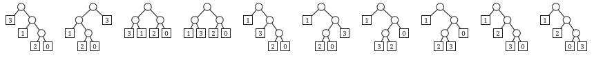</a>

**64.** [习题](../sec-7-2-1-6.md#ex-7-2-1-6-64) $X=2k+b$, 其中 $(k,b)=(0,1),(2,1),(0,0),(5,1),(6,0),(1,1)$. 最终 $L_0L_1\ldots L_{12}=5,11,3,4,0,7,9,8,1,6,10,12,2$.

**65.** [习题](../sec-7-2-1-6.md#ex-7-2-1-6-65) 见阿洛伊斯·潘霍尔策和赫尔穆特·普罗丁格,*Discrete Mathematics* **250** (2002), 181–195. 马尔维纳·卢察克和彼得·温克勒,*Random Structures & Algorithms* **24** (2004), 420–443.

**66.** [习题](../sec-7-2-1-6.md#ex-7-2-1-6-66) (a) “收缩” 白色边, 合并它们连接的结点. 例如,

<a href="../../../assets/volume4a/figures/7-2-1-6-ans66-schroeder-contractions.svg" target="_blank" rel="noopener">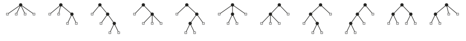</a>

是与 $n=3$ 时的 11 个施罗德树对应的普通树. 根据这一对应关系, 一个左链接意味着 “这有一个子结点”, 一个白色右链接意味着 “看, 这儿有更多子结点”, 一个黑色右链接意味着 “这是最后一个子结点”.

(b) 模仿算法 L, 但在旋转之间使用普通格雷二进制码来遍历右链接呈现的所有颜色模式. (事实上, 示例中已经给出了 $n=3$ 时的情形.)

注意, 施罗德树也对应于像 (53) 中的串行–并行图. 然而, 它们确实为并联的边和 (或) 超边规定了顺序. 所以, 它们更准确地对应于嵌入在平面内的串行–并行图 (除了 $s$ 和 $t$, 边和顶点均未标记).

**67.** [习题](../sec-7-2-1-6.md#ex-7-2-1-6-67) $S(z)=1+zS(z)(1+2(S(z)-1))$, 因为 $1+2(S(z)-1)$ 枚举了右子树. 因此, $S(z)=(1+z-\sqrt{1-6z+z^2})/(4z)$.

*注记.* 我们在习题 2.3.4.4–31 中已经见过施罗德数, 其中 $G(z)=zS(z)$. 在习题 2.2.1–11 中也是这样, 其中当 $n\ge2$ 时有 $b_n=2S_{n-1}$, 当时还发现了递推公式 $(n-1)S_n=(6n-3)S_{n-1}-(n-2)S_{n-2}$. 我们在习题 2.2.1–12 中研究过它们的渐近增长. 一个类似于 (22) 的数 $S_{pq}$ 的三角阵列可用于生成随机施罗德树. 这些数满足

$$
\begin{aligned}
S_{pq}&=S_{p(q-1)}+S_{(p-1)q}+S_{(p-2)q}+\cdots+S_{0q}
=S_{p(q-1)}+2S_{(p-1)q}-S_{(p-1)(q-1)}\\
&=\frac{q-p+1}{q+1}\sum_{k=0}^p\binom{q+1}{p-k}\binom{p-1}{k}2^k\\
&=\sum_{k=0}^p\left(\binom{q}{p-k}\binom{p-1}{k}
-\binom{q}{p-k-1}\binom{p-1}{k-1}\right)2^k\\
&=[w^p z^q]S(wz)/(1-zS(wz))。
\end{aligned}
$$

最后一行的双生成函数由埃默里克·多伊奇给出. 理查德·斯坦利在 *Enumerative Combinatorics* **2** (1999) 的习题 6.39 中讨论了施罗德树的其他许多性质.

**68.** [习题](../sec-7-2-1-6.md#ex-7-2-1-6-68) 只有一行, 仅包含空串 $\epsilon$. (从 $n-1$ 到 $n$ 的一般规则 (36) 将这一行转换为 “0 1”, 也就是 1 阶模式.)

**69.** [习题](../sec-7-2-1-6.md#ex-7-2-1-6-69) 如果忽略每个串开头的 “10”, 那么前 $\binom63=20$ 行是 6 阶圣诞树模式. 要看出 7 阶模式更困难一些. 共有 $\binom73=35$ 行的最左项以 0 开头, 忽略所有这种行中的最右串, 并忽略每个剩余串开头的 0. (也可能有其他答案.)

**70.** [习题](../sec-7-2-1-6.md#ex-7-2-1-6-70) 如果 $\sigma$ 出现在圣诞树模式的第 $k$ 列, 令 $\sigma'$ 是同一行第 $n-k$ 列的串. (如果我们考虑括号, 而不是二进制位, 那么根据 (39), 这一规则就是取得自由括号的镜像反射, 其含义见习题 11 的答案.)

**71.** [习题](../sec-7-2-1-6.md#ex-7-2-1-6-71) $M_{t,n}$ 是 $t$ 个最大的二项式系数 $\binom nk$ 之和, 因为圣诞树模式中的每一行最多可以包含 $S$ 中的 $t$ 个元素, 而且通过选择满足 $(n-t)/2\le\nu(\sigma)\le(n+t-1)/2$ 的所有二进制位串 $\sigma$, 的确可以得到这样一个集合 $S$. (公式

$$
M_{t,n}=\sum_{n-t\le2k\le n+t-1}\binom nk
$$

是尽可能简单的. 然而, 像 $M_{2,n}=M_{n+1}$ 这样的特殊公式对于较小的 $t$ 是成立的, 而且对于 $t>n$, 我们还有 $M_{t,n}=2^n$.)

**72.** [习题](../sec-7-2-1-6.md#ex-7-2-1-6-72) 将会得到 $M_{s,n}$ 行, 与上题中的数量相同. 事实上, 根据归纳法可以证明, 恰有 $\binom{n}{n-k}-\binom{n}{k-s}$ 个长度为 $s+n-2k\ge0$ 的行.

**73.** [习题](../sec-7-2-1-6.md#ex-7-2-1-6-73) `011001001000000000100101001100`, `111001011011111111101101011100`. 见 (38).

**74.** [习题](../sec-7-2-1-6.md#ex-7-2-1-6-74) 根据字典序性质, 我们希望计算其最右端元素分别具有以下形式的行的个数: $\mathtt0*^{29}$, $\mathtt{10}*^{28}$, $\mathtt{110}*^{27}$, $\mathtt{111000}*^{24}$, $\mathtt{11100100}*^{22}$, $\mathtt{111001010}*^{21}$, $\mathtt{11100101100}*^{19}$, $\mathtt{111001011010}*^{18}$, $\mathtt{1110010110110}*^{17}$, ……即所有位于 $\tau=\mathtt{111001011011111111101101011100}$ 之前的 30 位串.

如果 $\theta$ 中的 1 比 0 多 $p$ 个, 则圣诞树模式中以 $\theta*^n$ 结尾的行的数量与以 $\mathtt1^p*^n$ 结尾的行的数量相同. 根据习题 71, 这个数量是 $M_{p+1,n}$, 因为所有这些行都是起始行 “$\mathtt0^p\ \mathtt0^{p-1}\mathtt1\ \ldots\ \mathtt1^p$” 的 $n$ 步后代.

因此, 答案是

$$
\begin{aligned}
&M_{0,29}+M_{1,28}+M_{2,27}+M_{1,24}+\cdots+M_{12,3}+M_{13,2}\\
&\qquad=\sum_{k=1}^{21}M_{2k-1-z_k,n-z_k}\\
&\qquad=0+\binom{28}{14}+\binom{27}{14}+\binom{27}{13}+\binom{24}{12}+\cdots+8+4=84\,867\,708，
\end{aligned}
$$

其中序列 $(z_1,\ldots,z_{21})=(1,2,3,6,\ldots,27,28)$ 给出了 1 在 $\tau$ 中的出现位置.

**75.** [习题](../sec-7-2-1-6.md#ex-7-2-1-6-75) 因为 $r_1^{(n)}$ 是 (33) 中第一行的底部后代, 所以有 $r_1^{(n)}=M_{n-2}$. 根据习题 74 答案中的公式, 我们还有

$$
r_{j+1}^{(n)}-r_j^{(n)}=M_{j,n-1-j}-M_{j-1,n-2-j}=M_{j+1,n-2-j}，
$$

因为 $r_j^{(n)}$ 的相关序列 $z_1,\ldots,z_{n-1}$ 给出了位串 $\mathtt1^j\mathtt0\mathtt1^{n-1-j}$ 中 1 的位置. 对于固定的 $j$, 当 $n\to\infty$ 时有 $M_{j,n}/M_n\to j$, 所以

$$
\lim_{n\to\infty}\frac{r_j^{(n)}}{M_n}=\sum_{k=1}^{j}\frac{k}{2^{k+1}}=1-\frac{j+2}{2^{j+1}}。
$$

另外, 我们还隐含证明了 $\sum_{k=0}^n M_{k,n-k}=M_{n+1}-1$.

**76.** [习题](../sec-7-2-1-6.md#ex-7-2-1-6-76) 无穷序列

$$
Q=\mathtt{1313351313351335355713133513133513353557131335133535571335355735575779}\ldots
$$

的前 $\binom{2n}{n}$ 个元素是 $2n$ 阶模式中各行的大小. 这个序列 $Q=q_1q_2q_3\ldots$ 是以下转换过程的唯一固定点: $1\mapsto13$, 以及对于奇数 $n>1$ 的映射 $n\mapsto(n-2)nn(n+2)$. 它们分别表示 (36) 中的两个步骤.

对于 $0<x\le1$, 令 $f(x)=\limsup_{n\to\infty}s(\lceil xM_n\rceil)/n$. 这个函数看起来几乎处处为零. 然而, 由习题 72 的答案可知, 当 $x$ 具有 $(q_1+\cdots+q_j)/2^n$ 的形式时, 这个函数等于 1. 另一方面, 若定义 $g(x)=\lim_{n\to\infty}s(\lceil xM_n\rceil)/\sqrt n$, 则函数 $g(x)$ 看起来是可测的, 且 $\int_0^1g(x)\,dx=\sqrt\pi$, 尽管当 $f(x)>0$ 时 $g(x)$ 是无穷的. (对这些猜想的严格证明或证伪仍待完成.)

**77.** [习题](../sec-7-2-1-6.md#ex-7-2-1-6-77) 通过考虑蠕虫路径, 可由 (39) 得出提示的结论. 因此, 我们可以进行如下处理.

**X1.** [初始化.] 对于 $0\le j\le n$, 置 $a_j\gets0$. 置 $x\gets1$. (在下面的步骤中, 我们将有 $x=1+2(a_1+\cdots+a_n)$.)

**X2.** [纠正尾部.] 当 $x\le n$ 时, 置 $a_x\gets1$、$x\gets x+2$.

**X3.** [访问.] 访问二进制位串 $a_1\ldots a_n$.

**X4.** [简单情形?] 如果 $a_n=0$, 置 $a_n\gets1$、$x\gets x+2$, 返回 X3.

**X5.** [查找并推进 $a_j$.] 置 $a_n\gets0$、$j\gets n-1$. 然后, 当 $a_j=1$ 时循环执行 $a_j\gets0$、$x\gets x-2$、$j\gets j-1$. 如果 $j=0$, 终止算法. 否则, 置 $a_j\gets1$, 返回 X2. ∎

**78.** [习题](../sec-7-2-1-6.md#ex-7-2-1-6-78) 正确, 根据 (39) 和习题 11 可知.

**79.** [习题](../sec-7-2-1-6.md#ex-7-2-1-6-79) (a) 列出 0 的下标, 然后列出 1 的下标. 例如, 习题 73 中的二进制位串对应于排列

$$
1,4,5,7,8,10,11,12,13,20,23,25,29,30,2,3,6,9,14,15,16,17,18,19,21,22,24,26,27,28。
$$

(b) 采用 (39) 中的约定, $P$ 图表在第一行放左括号和自由括号的下标, 其他下标出现在第二行. 于是, 对于 (38) 有 $P$:

<table aria-label="第79题答案的 P 图表">
<tbody>
<tr><td>1</td><td>2</td><td>3</td><td>6</td><td>8</td><td>9</td><td>11</td><td>12</td><td>13</td><td>14</td><td>15</td><td>16</td><td>17</td><td>18</td><td>19</td><td>21</td><td>22</td><td>24</td><td>26</td><td>27</td><td>28</td></tr>
<tr><td>4</td><td>5</td><td>7</td><td>10</td><td>20</td><td>23</td><td>25</td><td>29</td><td>30</td></tr>
</tbody>
</table>

[见武剑锋,*SIAM J. Algebraic and Discrete Methods* **2** (1981), 324–332, 他推广了子多重集链.]

**80.** [习题](../sec-7-2-1-6.md#ex-7-2-1-6-80) 这一奇特的事实可由习题 79 结合我在一篇关于图表的论文中的定理 6 得出, 见 *Pacific J. Math.* **34** (1970), 709–727.

**81.** [习题](../sec-7-2-1-6.md#ex-7-2-1-6-81) 设 $\sigma$ 属于 $n$ 阶圣诞树模式中长度为 $s$ 的链, $\sigma'$ 属于 $n'$ 阶圣诞树模式中长度为 $s'$ 的链. 在这些链中, $ss'$ 个串对中的至多 $\min(s,s')$ 个可以在双杂乱集中. 此外, 根据 (39) 可知, 如果将这 $ss'$ 个串对拼接起来, 它们实际上恰好构成了 $n+n'$ 阶圣诞树模式中的 $\min(s,s')$ 个链. 因此, 对所有链对求得的 $\min(s,s')$ 之和是 $M_{n+n'}$, 这就证明了所需结论. 我们还证明了一个不太明显的恒等式:

$$
\sum_{j,k}\min(m+1-2j,n+1-2k)C_{j(m-j)}C_{k(n-k)}=M_{m+n}。
$$

*注记.* 久洛·考托瑙 [*Studia Sci. Math. Hungar.* **1** (1966), 59–63] 和丹尼尔·克莱特曼 [*Math. Zeitschrift* **90** (1965), 251–259] 各自独立证明了施佩纳定理的这一扩展. 柯蒂斯·格林和丹尼尔·克莱特曼在 *J. Combinatorial Theory A* **20** (1976), 80–88 中给出了此处的证明和其他一些结果.

**82.** [习题](../sec-7-2-1-6.md#ex-7-2-1-6-82) (a) 在每一行 $m$, 至少有一次求值. 当且仅当 $s(m)>1$ 且第一次求值的结果为 0 时, 有两次求值. 因此, 如果 $f$ 恒等于 1, 则得到最小值 $M_n$; 如果 $f$ 恒等于 0, 则得到最大值 $M_n+\sum_m[s(m)>1]=M_{n+1}$.

(b) 在 $C_{n/2}$ 种 $s(m)=1$ 的情形, 令 $f(\chi(m,n/2))=0$; 在其他情形, 令 $f(\chi(m,a))=1$, 其中 $a$ 由算法确定. 当 $n$ 为奇数时, 此规则意味着 $f(\sigma)$ 总是 1; 但当 $n$ 为偶数时, $f(\sigma)=0$ 当且仅当 $\sigma$ 是其所在行的第一项. (要知道原因, 可以利用以下事实: 包含 (41) 中 $\sigma'_j$ 的行, 其大小总是 $s-2$.) 这个函数 $f$ 实际上是单调的, 因为如果 $\sigma\le\tau$ 且 $\sigma$ 有一个自由左括号, 则 $\tau$ 也有. 例如, 在 $n=8$ 的情形, 我们有

$$
f(x_1,\ldots,x_8)=x_8\vee x_6x_7\vee x_4x_5(x_6\vee x_7)
\vee x_2x_3\bigl(x_4(x_5\vee x_6\vee x_7)\vee x_5(x_6\vee x_7)\bigr)。
$$

(c) 在这些情形, (45) 是对于所有 $n$ 值的解.

**83.** [习题](../sec-7-2-1-6.md#ex-7-2-1-6-83) 在步骤 H4 中最多可能有 3 种结果. 事实上, 当 $s(m)=1$ 时最多有 2 种结果. [见习题 5.3.4–31, 其中给出了更严格的界限. 采用该题中的表示法, 恰好有 $\delta_n+2$ 个 $n$ 变量单调布尔函数.]

**84.** [习题](../sec-7-2-1-6.md#ex-7-2-1-6-84) 为解决这一问题, 我们将 $2^n$ 个二进制位串划分为 $M_n$ 个块, 而不是链, 其中每个块的二进制位串 $\{\sigma_1,\ldots,\sigma_s\}$ 满足 $\lVert A\sigma_i^T-A\sigma_j^T\rVert\ge1$($i\ne j$). 那么, 每个块最多有一个二进制位串满足 $\lVert A\sigma^T-b\rVert<\tfrac12$.

用 $A'$ 表示 $A$ 的前 $n-1$ 列, 令 $v$ 是第 $n$ 列. 设 $\{\sigma_1,\ldots,\sigma_s\}$ 是 $A'$ 的一个块, 对下标编号, 使得 $v^TA'\sigma_1^T$ 是 $v^TA'\sigma_j^T$ 中的最小者. 那么, 规则 (36) 为 $A$ 定义了适当的块, 因为我们有 $\lVert A(\sigma_i0)^T-A(\sigma_j0)^T\rVert=\lVert A(\sigma_i1)^T-A(\sigma_j1)^T\rVert=\lVert A'\sigma_i^T-A'\sigma_j^T\rVert$, 以及

$$
\begin{aligned}
\lVert A(\sigma_j1)^T-A(\sigma_10)^T\rVert^2
&=\lVert A'\sigma_j^T+v-A'\sigma_1^T\rVert^2\\
&=\lVert A'(\sigma_j-\sigma_1)^T\rVert^2+\lVert v\rVert^2+2v^TA'(\sigma_j-\sigma_1)^T
\ge\lVert v\rVert^2\ge1。
\end{aligned}
$$

[更多结论见 *Advances in Math.* **5** (1970), 155–157. 这一结果扩展了约翰·利特尔伍德和艾伯特·奥福德 [*Mat. Sbornik* **54** (1943), 277–285] 的定理, 他们考虑了 $m=2$ 的情形.]

**85.** [习题](../sec-7-2-1-6.md#ex-7-2-1-6-85) (金特·罗特提供解法) 对于某个 $m\times n$ 矩阵 $A$, 向量空间 $V$ 可以表示为 $\{x\mid Ax=0\}$. 令 $v_j$ 是 $A$ 的第 $j$ 列. 因为 $V$ 不包含单位向量, $v_j$ 非零. 因此, 用一个适当的常数乘以 $A$, 我们可以假定 $\min(\lVert v_1\rVert,\ldots,\lVert v_n\rVert)=1$. 现在可以利用习题 84 得出结论.

反之, 取 $m=1$, 以 $\bigl(e_j+(-1)^{j-1}e_n\bigr)_{1\le j<n}$ 为基, 其中 $e_j$ 为第 $j$ 个单位向量, 可得 $M_n$ 个解. [这一结果已经应用于电子投票. 见菲利普·戈勒的博士论文 (斯坦福大学, 2004).]

**86.** [习题](../sec-7-2-1-6.md#ex-7-2-1-6-86) 首先, 对 4 结点子树重新排序, 使得它的层级代码为 0121 (加上一个常数). 然后, 对越来越大的子树排序, 直到一切都变为规范的. 所得到的层级代码为 $0,1,2,3,4,3,2,1,2,3,2,1,2,0,1$, 父指针为 $0,1,2,3,4,3,2,1,8,9,8,1,12,0,14$.

**87.** [习题](../sec-7-2-1-6.md#ex-7-2-1-6-87) (a) 该条件成立当且仅当对于某个 $k$ 有 $c_1<\cdots<c_k\ge c_{k+1}\ge\cdots\ge c_n$, 因此总情形数为 $\sum_k\binom{n-1}{n-k}=2^{n-1}$.

(b) 注意, $c_1\ldots c_k=c'_1\ldots c'_k$ 当且仅当 $p_1\ldots p_k=p'_1\ldots p'_k$, 而且, 在这种情形, $c_{k+1}<c'_{k+1}$ 当且仅当 $p_{k+1}<p'_{k+1}$.

**88.** [习题](../sec-7-2-1-6.md#ex-7-2-1-6-88) 算法 O 恰好访问了 $A_{n+1}$ 个森林, 其中的 $A_k$ 个具有 $p_k=\cdots=p_n=0$. 因此, 步骤 O4 执行了 $A_n$ 次. 对于 $1\le k<n$, 步骤 O5 改变 $p_k$ 总共 $A_{k+1}-1$ 次. 此外, 步骤 O5 改变 $p_n$ 总共 $A_n-1$ 次. 因此, 如果把 $p_n$ 保存在寄存器中, 每次访问的平均访存数仅为 $2+3/(\alpha-1)+O(1/n)\approx3.534$. [见埃娃·库比卡,*Combinatorics, Probability and Computing* **5** (1996), 403–417.]

**89.** [习题](../sec-7-2-1-6.md#ex-7-2-1-6-89) 如果步骤 O5 执行操作 $p_n\gets p_j$ 恰好 $Q_n$ 次, 则它执行操作 $p_k\gets p_j$ 恰好 $Q_k+A_{k+1}-A_k$ 次 (其中 $1<k<n$), 因为规范 $p_1\ldots p_n$ 的每个前缀都是规范的. 我们有 $(Q_1,Q_2,\ldots)=(0,0,1,2,5,9,22,48,118,288,\ldots)$. 还可以证明 $Q_n=\sum_{d\ge1}\sum_{1\le c<n/d-1}a_{(n-cd)(n-cd-d)}$, 其中 $a_{nk}$ 是满足 $p_n=k$ 的规范父序列 $p_1\ldots p_n$ 的数量. 不过这些数值 $a_{nk}$ 仍然很神秘.

**90.** [习题](../sec-7-2-1-6.md#ex-7-2-1-6-90) (a) 这一性质等价于 2.3.4.4–(7), 顶点 0 即为形心.

(b) 令 $m=\lfloor n/2\rfloor$. 在步骤 O1 结束时, 置 $p_{m+1}\gets0$, 如果 $n$ 为奇数, 也置 $p_{2m+1}\gets0$. 在步骤 O4 结束时, 置 $i\gets j$, 当 $p_i\ne0$ 时循环执行 $i\gets p_i$. (于是, $i$ 是包含 $j$ 和 $k$ 的树的根结点.) 在步骤 O5 的开头, 如果 $k=i+m$ 且 $i<j$, 置 $j\gets i$、$d\gets m$.

(c) 如果 $n$ 是偶数, 则不存在 $n+1$ 顶点的双形心树. 否则, 找出 $m=\lfloor n/2\rfloor$ 个结点上的所有规范森林对 $(p'_1\ldots p'_m,p''_1\ldots p''_m)$, 其中 $p'_1\ldots p'_m\ge p''_1\ldots p''_m$. 对于 $1\le j\le m$, 令 $p_1=0$、$p_{j+1}=p'_j+1$、$p_{m+j+1}=(p''_j+m+1)[p''_j>0]$. 如果 $p''_j=0$, 则 $p_{j+m+1}=0'$ 是第二个形心. (算法 O 的两个实例将生成所有这些序列. 用于自由树的这一算法是弗兰克·拉斯基和李钢给出的, 见 *SODA* **10** (1999), S939–S940.)

**91.** [习题](../sec-7-2-1-6.md#ex-7-2-1-6-91) 使用如下递归过程 $W(n)$: 如果 $n\le2$, 返回唯一的 $n$ 结点定向树. 否则, 选择正整数 $j$ 和 $d$, 使获得给定对 $(j,d)$ 的概率为 $dA_dA_{n-jd}/((n-1)A_n)$. 计算随机定向树 $T'\gets W(n-jd)$ 和 $T''\gets W(d)$. 将 $T''$ 的 $j$ 个克隆链接到 $T'$ 的根结点, 返回得到的树 $T$. [*Combinatorial Algorithms*(Academic Press, 1975), 第 25 章. 关于随机自由树, 见赫伯特·威尔夫,*Journal of Algorithms* **2** (1981), 204–207.]

**92.** [习题](../sec-7-2-1-6.md#ex-7-2-1-6-92) 并非总是如此. [理查德·卡明斯在 *IEEE Trans.* **CT-13** (1966), 82–90 中证明了: $S(G)$ 的图总是包含一个圈. 也见卡洛斯·奥尔茨曼和弗兰克·哈拉里,*SIAM J. Applied Math.* **22** (1972), 187–193. 但他们的构造不适于高效计算, 因为它们要求提前知道中间结果大小的奇偶性.]

**93.** [习题](../sec-7-2-1-6.md#ex-7-2-1-6-93) 是的. 步骤 S7 撤销了步骤 S3, 步骤 S9 撤销了步骤 S8 的删除.

**94.** [习题](../sec-7-2-1-6.md#ex-7-2-1-6-94) 例如, 我们可以借助辅助表 $b_1\ldots b_n$ 进行深度优先搜索.

(i) 置 $b_1\ldots b_n\gets0\ldots0$, 然后置 $v\gets1$、$w\gets1$、$b_1\gets1$、$k\gets n-1$.

(ii) 置 $e\gets n_{v-1}$. 当 $t_e\ne0$ 时循环执行以下子步骤.

- (a) 置 $u\gets t_e$. 如果 $b_u\ne0$, 转到 (c).
- (b) 置 $b_u\gets w$、$w\gets u$、$a_k\gets e$、$k\gets k-1$. 如果 $k=0$, 终止算法.
- (c) 置 $e\gets n_e$.

(iii) 如果 $w\ne1$, 置 $v\gets w$、$w\gets b_w$, 返回 (ii). 否则, 报告错误: 给定图不连通.

实际上, 只要子步骤 (b) 将 $k$ 减小到 1, 就可以终止算法, 因为算法 S 从来不查看 $a_1$ 的初始值. 不过, 我们不妨检查连通性.

**95.** [习题](../sec-7-2-1-6.md#ex-7-2-1-6-95) 以下步骤执行广度优先搜索, 查看能否在不使用边 $e$ 的情况下从 $u$ 到达 $v$. 使用保存顶点指针的辅助表 $b_1\ldots b_n$, 它应当在步骤 S1 的末尾被初始化为 $0\ldots0$, 搜索完毕后再重置为 $0\ldots0$.

(i) 置 $w\gets u$、$b_w\gets v$.

(ii) 置 $f\gets n_{u-1}$. 当 $t_f\ne0$ 时循环执行以下子步骤.

- (a) 置 $v'\gets t_f$. 如果 $b_{v'}\ne0$, 转到 (d).
- (b) 如果 $v'\ne v$, 置 $b_{v'}\gets v$、$b_w\gets v'$、$w\gets v'$, 转到 (d).
- (c) 如果 $f\ne e\oplus1$, 转到 (v).
- (d) 置 $f\gets n_f$.

(iii) 置 $u\gets b_u$. 如果 $u\ne v$, 返回 (ii).

(iv) 置 $u\gets t_e$. 当 $u\ne v$ 时循环执行 $w\gets b_u$、$b_u\gets0$、$u\gets w$. 转到 S9($e$ 是桥).

(v) 置 $u\gets t_e$. 当 $u\ne v$ 时循环执行 $w\gets b_u$、$b_u\gets0$、$u\gets w$. 然后再置 $u\gets t_e$, 继续执行 S8($e$ 不是桥).

在开始这一计算之前, 可以使用两个快速推断. 如果 $d_u=1$, $e$ 显然是桥; 如果 $l_{l_e}\ne0$, $e$ 显然不是桥 (因为 $u$ 和 $v$ 之间还有另一条边). 这些特殊情形也可利用广度优先搜索轻松检测出来, 但我做的试验表明这两种推断都值得使用. 例如, 对 $l_{l_e}$ 的判断通常可以使总运行时间节省 3%左右.

**96.** [习题](../sec-7-2-1-6.md#ex-7-2-1-6-96) (a) 令 $e_k$ 是弧 $k-1\to k$. 对于 $n>k\ge1$, 习题 94 答案中的步骤进行赋值 $a_k\gets e_{n+1-k}$. 然后, 在第 $k$ 级, 对于 $1\le k<n-1$, 我们收缩 $e_{n-k}$. 在访问唯一的生成树 $e_{n-1}\ldots e_2e_n$ 之后, 对于 $n-1>k\ge1$, 撤销对 $e_{n-k}$ 的收缩, 并快速发现它是一座桥. 于是, 运行时间关于 $n$ 呈线性. 在本书作者的实现中, 当 $n\ge3$ 时, 结果恰好是 $102n-226$ 次内存访问.

然而, 这一结果严重依赖于初始生成树中边的顺序. 如果当 $n$ 是偶数时步骤 S1 已经在 $a_2\ldots a_{n-1}$ 的位置生成了 “风琴管顺序”, 比如

$$
e_{n/2+1}e_{n/2}e_{n/2+2}e_{n/2-1}\ldots e_{n-1}e_2，
$$

那么运行时间将会是 $\Omega(n^2)$, 因为 $\Omega(n)$ 次桥检测各需要 $\Omega(n)$ 个步骤.

(b) 现在, 对于 $n>k\ge1$, $a_k$ 初始化为 $e_{n-k}$, 其中 $e_1$ 是弧 $n\to1$. 当 $n\ge4$ 时, 被访问的生成树分别为 $e_{n-2}\ldots e_1e_n$、$e_{n-2}\ldots e_1e_{n-1}$、$e_{n-2}\ldots e_2e_{n-1}e_n$、$e_{n-2}\ldots e_3e_{n-1}e_ne_1$、……、$e_{n-1}e_ne_1\ldots e_{n-3}$. 对于 $0\le k\le n-4$, 计算过程沿着树 $e_{n-2}\ldots e_{k+2}e_{n-1}e_ne_1\ldots e_k$ 向下进行到层级 $n-k-3$, 然后再回头向上. 这些桥检测操作都很高效. 因此, 总运行时间是二次的 (在我的版本中, 当 $n\ge5$ 时, 恰好为 $35.5n^2+7.5n-145$ 次内存访问).

顺便说一下, 采用斯坦福图库表示法, $P_n$ 是 $\operatorname{board}(n,0,0,0,1,0,0)$, $C_n$ 是 $\operatorname{board}(n,0,0,0,1,1,0)$. SGB 顶点被命名为 0 至 $n-1$.

**97.** [习题](../sec-7-2-1-6.md#ex-7-2-1-6-97) 当 $\{s,t\}$ 是 $\{1,2\}$、$\{1,3\}$、$\{2,3\}$、$\{2,4\}$ 或 $\{3,4\}$ 时, 答案是肯定的; 当 $\{s,t\}$ 是 $\{1,4\}$ 时, 答案是否定的.

**98.** [习题](../sec-7-2-1-6.md#ex-7-2-1-6-98) 图 $A'$ 如下, 这是平面图 $A$ 的 “对偶平面图”.

<a href="../../../assets/volume4a/figures/7-2-1-6-ans98-dual-planar-graph.svg" target="_blank" rel="noopener">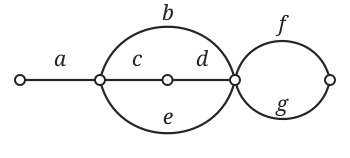</a>

($A'$ 的准树是 $A$ 的生成树的补, 反之亦然.)

**99.** [习题](../sec-7-2-1-6.md#ex-7-2-1-6-99) 所述方法是有效的, 通过对树的大小应用归纳法即知. 其原因大体与§7.2.1.1 中它对 $n$ 元组有效的原因相同, 但要增加一个限制条件, 那就是必须接连指定一个非简单结点的每个子结点.

叶结点总是被动的, 它们既不是简单的也不是非简单的. 因此假定按照前序将分支结点编号为 1 至 $m$. 对所有分支结点令 $f_p=p$, 但当 $p$ 是被动非简单结点且其右侧最接近的非简单结点为主动时除外. 在后一情形, $f_p$ 应当指向其左侧最接近的主动非简单结点. (为此定义, 设想在左右两侧分别存在虚拟结点 0 和 $m+1$, 两者都是非简单且主动的.)

**F1.** [初始化.] 对于 $0\le p\le m$, 置 $f_p\gets p$. 置 $t_0\gets1$、$v_0\gets0$, 置每个 $z_p$ 使得 $r_{z_p}=d_p$.

**F2.** [选择结点 $p$.] 置 $q\gets m$. 然后, 当 $t_q=v_q$ 时循环执行 $q\gets q-1$. 置 $p\gets f_q$、$f_q\gets q$. 如果 $p=0$, 则终止算法.

**F3.** [改变 $d_p$.] 置 $s\gets d_p$、$s'\gets r_s$、$k\gets v_p$、$d_p\gets s'$. (现在 $k=v_s\ne v_{s'}$.)

**F4.** [更新.] 置 $q\gets s$、$v_q\gets k\oplus1$. 当 $d_q\ne0$ 时循环执行 $q\gets d_q$、$v_q\gets k\oplus1$. (现在 $q$ 是叶结点, 当 $k=0$ 时进入配置, 当 $k=1$ 时离开配置.) 类似地, 置 $q\gets s'$、$v_q\gets k$. 当 $d_q\ne0$ 时循环执行 $q\gets d_q$、$v_q\gets k$. (现在 $q$ 是叶结点, 当 $k=0$ 时离开配置, 当 $k=1$ 时进入配置.)

**F5.** [访问.] 访问当前配置, 用所有叶结点的值表示.

**F6.** [置 $p$ 为被动?] (现在 $p$ 右边的所有非简单结点都是主动的.) 如果 $d_p\ne z_p$, 返回 F2. 否则, 置 $z_p\gets s$、$q\gets p-1$, 当 $t_q=v_q$ 时循环执行 $q\gets q-1$. (现在 $q$ 是 $p$ 左边第一个非简单结点, 我们将置 $p$ 为被动.) 置 $f_p\gets f_q$、$f_q\gets q$, 返回 F2. ∎

尽管步骤 F4 可以将非简单结点转换为简单结点, 或进行反向转换, 但中心点指针并不需要更新, 因为它们仍然正确.

**100.** [习题](../sec-7-2-1-6.md#ex-7-2-1-6-100) 我的站点上有一个名为 GRAYSPSPAN 的完整程序. 利用下面习题 110 的结果, 可以证明它的渐近效率.

**102.** [习题](../sec-7-2-1-6.md#ex-7-2-1-6-102) 如果可以, 普通生成树可以采用一种强旋转门顺序列出, 其中在每一步中进入和离开的边是相邻的.

哈罗德·加保和小尤金·迈尔斯,*SICOMP* **7** (1978), 280–287; 桑吉夫·卡普尔和哈里哈兰·拉梅什,*Algorithmica* **27** (2000), 120–130, 开发了一些有意义的算法, 用于生成所有具有给定根结点的定向生成树.

**103.** [习题](../sec-7-2-1-6.md#ex-7-2-1-6-103) (a) 倾斜操作会使 $(x_0,x_1,\ldots,x_n)$ 按照字典序增大, 但不会改变 $x_0+\cdots+x_n$. 如果 $V_i$ 和 $V_j$ 这两个顶点都可以倾斜, 那么两种顺序会给出相同结果.

(b) 增加一粒沙会使 16 个稳定状态变化如下.

<table aria-label="沙堆加入一粒后的十六种稳定状态">
<tbody>
<tr><th scope="row">给定</th><th><code>0000</code></th><th><code>0001</code></th><th><code>0010</code></th><th><code>0011</code></th><th><code>0100</code></th><th><code>0101</code></th><th><code>0110</code></th><th><code>0111</code></th><th><code>1000</code></th><th><code>1001</code></th><th><code>1010</code></th><th><code>1011</code></th><th><code>1100</code></th><th><code>1101</code></th><th><code>1110</code></th><th><code>1111</code></th></tr>
<tr><th scope="row">+ 0001</th><td><code>0001</code></td><td><code>0010</code></td><td><code>0011</code></td><td><code>0001</code></td><td><code>0101</code></td><td><code>0110</code></td><td><code>0111</code></td><td><code>0101</code></td><td><code>1001</code></td><td><code>1010</code></td><td><code>1011</code></td><td><code>1001</code></td><td><code>1101</code></td><td><code>1110</code></td><td><code>1111</code></td><td><code>1101</code></td></tr>
<tr><th scope="row">+ 0010</th><td><code>0010</code></td><td><code>0011</code></td><td><code>0001</code></td><td><code>0010</code></td><td><code>0110</code></td><td><code>0111</code></td><td><code>0101</code></td><td><code>0110</code></td><td><code>1010</code></td><td><code>1011</code></td><td><code>1001</code></td><td><code>1010</code></td><td><code>1110</code></td><td><code>1111</code></td><td><code>1101</code></td><td><code>1110</code></td></tr>
<tr><th scope="row">+ 0100</th><td><code>0100</code></td><td><code>0101</code></td><td><code>0110</code></td><td><code>0111</code></td><td><code>1000</code></td><td><code>1001</code></td><td><code>1010</code></td><td><code>1011</code></td><td><code>1100</code></td><td><code>1101</code></td><td><code>1110</code></td><td><code>1111</code></td><td><code>0100</code></td><td><code>0101</code></td><td><code>0110</code></td><td><code>0111</code></td></tr>
<tr><th scope="row">+ 1000</th><td><code>1000</code></td><td><code>1001</code></td><td><code>1010</code></td><td><code>1011</code></td><td><code>1100</code></td><td><code>1101</code></td><td><code>1110</code></td><td><code>1111</code></td><td><code>0100</code></td><td><code>0101</code></td><td><code>0110</code></td><td><code>0111</code></td><td><code>1000</code></td><td><code>1001</code></td><td><code>1010</code></td><td><code>1011</code></td></tr>
</tbody>
</table>

常返状态是满足 $x_1+x_2>0$ 且 $x_3+x_4>0$ 的 9 种情形. 注意, 重复增加 0001 会导致无限循环 `0000` → `0001` → `0010` → `0011` → `0001` → `0010` → …, 但状态 `0001`、`0010`、`0011` 并非常返.

(c) 如果 $x=\sigma(x+t)$, 那么对于所有 $k\ge0$ 也有 $x=\sigma(x+kt)$. 因为 $t$ 的所有分量为正数, 所以 $x=\sigma(x+\max(d_1,\ldots,d_n)t)$ 是常返的. 反之, 假设 $x=\sigma(d+y)$, 其中所有 $y_i\ge0$, 那么 $d+y+t$ 经过倾斜变为 $x+t$, 它也可经过倾斜变为 $\sigma(d)+y+t=d+y$. 因此, $\sigma(x+t)=\sigma(d+y)=x$.

(d) 存在 $N=\det(a_{ij})$ 个等价类, 因为初等行操作 (习题 4.6.1–19) 使矩阵三角化, 同时保持同余.

(e) 比如说, 存在非负整数 $m_1,\ldots,m_n,m'_1,\ldots,m'_n$, 使得

$$
x+m_1a_1+\cdots+m_na_n=x'+m'_1a_1+\cdots+m'_na_n=y。
$$

对于足够大的 $k$, 向量 $y+kt$ 在 $m_1+\cdots+m_n$ 步中倾斜为 $x+kt$, 在 $m'_1+\cdots+m'_n$ 步中倾斜为 $x'+kt$. 因此, $x=\sigma(x+kt)=\sigma(x'+kt)=x'$.

(f) (d) 中的三角化表明, 对于任意向量 $y$, 有 $x\equiv x+Ny$. 而且倾斜操作保持同余性质. 因此, 每个类都包含一种常返状态.

(g) 因为在平衡有向图中有 $a=a_1+\cdots+a_n$, 所以 $x\equiv x+a$. 如果 $x$ 常返, 实际上, 每个顶点在 $x+a$ 化简为 $x$ 时恰好倾斜一次, 因为向量 $\{a_1,\ldots,a_n\}$ 是线性无关的.

反之, 如果 $\sigma(x+a)=x$, 我们必须证明 $x$ 是常返的. 令 $z_m=\sigma(ma)$, 则必然存在正整数 $k$ 和 $m$ 满足 $z_{m+k}=z_m$. 于是, 每个顶点在 $z_m+ka$ 化简为 $z_m$ 时倾斜 $k$ 次. 因此, 存在向量 $y_j=(y_{j1},\ldots,y_{jn})$ (其中 $y_{jj}\ge d_j$), 使得 $(m+k)a$ 倾斜为 $y_j$. 由此可推得, $x+n(m+k)a$ 倾斜为 $x+y_1+\cdots+y_n$, 且 $\sigma(x+y_1+\cdots+y_n)=\sigma(x+n(m+k)a)=x$.

(h) 循环处理下标. 对于 $j=i_1,\ldots,i_k$, 拥有弧 $V_j\to V_0$ 的生成树还有其他 $n-k$ 条弧: 对于 $i_l<j\le i_l+q_l$ 为 $V_j\to V_{j-1}$, 对于 $i_l+q_l<j<i_{l+1}$ 为 $V_j\to V_{j+1}$. 类似地, 常返状态对于 $j=i_1,\ldots,i_k$ 有 $x_j=2$, 对于 $i_l<j<i_{l+1}$ 有 $x_j=1$, 例外是当 $j=i_l+q_l$ 且 $q_l>0$ 时 $x_j=0$.

(i) 在这种情形, 状态 $x=(x_1,\ldots,x_n)$ 是常返的, 当且仅当 $(n-x_1,\ldots,n-x_n)$ 解决了提示中的停车问题. 因为 $t=(1,\ldots,1)$, 没能 “停车” 的序列会留下一个 “洞”, 阻止 $x+t$ 倾斜至 $x$.

*注记.* 这个沙堆模型是迪帕克·达尔 [*Phys. Review Letters* **64** (1990), 1613–1616] 引入的, 它引出了物理学中的许多论文. 达尔注意到, 如果随机加入 $M$ 粒沙, 那么当 $M\to\infty$ 时, 每个常返状态的概率相等. 本题受到罗伯特·科里和多米尼克·罗森 [*European J. Combinatorics* **21** (2000), 447–459] 工作的启发.

沙堆理论证明了, 每个有向图 $D$ 都会产生一个阿贝尔群, 它的元素对应于 $D$ 中以 $V_0$ 为根结点的定向生成树. 特别地, 如果 $D$ 是普通图, 当 $u$ 和 $v$ 相邻时图中就有弧 $u\to v$ 和 $v\to u$, 那么上面的结论同样成立. 因此, 举例来说, 我们可以把两棵生成树 “相加”, 某棵生成树可以被看作是 “零”. 在 $D$ 为普通图的特定情形, 罗伯特·科里和伊万·勒博尔涅 [*Advances in Applied Math.* **30** (2003), 44–52] 找出了生成树和常返状态之间的优美对应关系. 但对于一般有向图 $D$, 还没有找到简单的对应关系. 例如, 假设 $n=2$ 且 $(e_{10},e_{12},e_{20},e_{21})=(p,q,r,s)$, 于是存在 $pr+ps+qr$ 棵定向树, 常返状态对应于如习题 7–137 中的广义二维环面. 甚至在 $p+q\ge s$ 且 $r+s\ge q$ 的 “平衡” 情形, 生成树与常返状态之间也看不出简单的对应关系.

**104.** [习题](../sec-7-2-1-6.md#ex-7-2-1-6-104) (a) 如果 $\det(\alpha I-C)=0$, 那么存在向量 $x=(x_1,\ldots,x_n)^T$, 使得 $Cx=\alpha x$, 且对于某个 $m$ 有 $\max(|x_1|,\ldots,|x_n|)=x_m=1$. 因此, $\alpha=\alpha x_m=c_{mm}-\sum_{j\ne m}e_{mj}x_j\ge c_{mm}-\sum_{j\ne m}e_{mj}=0$. (顺便说一下, 特征值非负的实对称矩阵称为半正定矩阵. 我们的证明过程确定了一个著名的事实: 对于 $1\le m\le n$, 满足 $c_{mm}\ge\sum_{j\ne m}|c_{mj}|$ 的任何实对称矩阵都有这一性质.) 由此可得 $\alpha_0\ge0$, 从而有 $\alpha_0=0$, 因为 $C(1,\ldots,1)^T=(0,\ldots,0)^T$.

(b) $\det(xI-C(G))=x(x-\alpha_1)\cdots(x-\alpha_{n-1})$, 而且根据矩阵树定理, $x$ 的系数等于 $(-1)^{n-1}n$ 乘以生成树的数量.

(c) 根据习题 1.2.3–36, $\det(\alpha I-C(K_n))=\det((\alpha-n)I+J)=(\alpha-n)^{n-1}\alpha$, 其中 $J$ 是元素全为 1 的矩阵. 因此投影是 $0,n,\ldots,n$.

**105.** [习题](../sec-7-2-1-6.md#ex-7-2-1-6-105) (a) 如果 $e_{ij}=a+be'_{ij}$, 我们有 $C(G)=naI-aJ+bC(G')$. 而且如果 $C$ 是行和为 0 的任意矩阵, 则有恒等式

$$
\det(xI+yJ-zC)=\frac{x+ny}{x}\,z^n\det((x/z)I-C)。
$$

证明如下. 将第 2 至 $n$ 列加至第 1 列, 提出公因式 $(x+ny)/x$, 从第 2 至 $n$ 列减去第 1 列的 $y/x$ 倍, 然后从第 1 列减去第 2 至 $n$ 列. 因此, 通过置 $x=\alpha-na$、$y=a$、$z=b$、$a=1$、$b=-1$, 可求得 $G$ 的投影为 $0,n-\alpha_{n-1},\ldots,n-\alpha_1$. (特别地, 当 $G'$ 为空图 $\overline{K_n}$ 时, 此结果与习题 104(c) 一致.)

(b) 排序 $\{\alpha'_0,\ldots,\alpha'_{n'-1},\alpha''_0,\ldots,\alpha''_{n''-1}\}$. (出于多样性考虑, 这是一种简单情形.)

(c) 这里有 $\overline G=\overline{G'}\oplus\overline{G''}$, 因此, 根据 (a) 和 (b) 可得 $G$ 的投影是 $\{0,n'+n'',n''+\alpha'_1,\ldots,n''+\alpha'_{n'-1},n'+\alpha''_1,\ldots,n'+\alpha''_{n''-1}\}$. (特别地, 当 $G'=\overline{K_m}$ 且 $G''=\overline{K_n}$ 时, $G$ 是 $K_{m,n}$, 所以 $K_{m,n}$ 的投影是 $\{0,(n-1)\cdot m,(m-1)\cdot n,m+n\}$.)

(d) $C(G)=I_{n'}\otimes C(G'')+C(G')\otimes I_{n''}$, 其中 $I_n$ 表示 $n\times n$ 单位矩阵, $\otimes$ 表示矩阵的直积. $C(G)$ 的投影是 $\{\alpha'_j+\alpha''_k\mid 0\le j<n',\ 0\le k<n''\}$, 因为, 如果 $A$ 和 $B$ 是任意矩阵, 特征值分别为 $\{\lambda_1,\ldots,\lambda_m\}$ 和 $\{\mu_1,\ldots,\mu_n\}$, 则 $A\otimes I_n+I_m\otimes B$ 的特征值是 $mn$ 个和 $\lambda_j+\mu_k$. 证明: 选择 $S$ 和 $T$, 使得 $S^{-1}AS$ 和 $T^{-1}BT$ 为三角矩阵. 然后利用矩阵恒等式 $(A\otimes B)(C\otimes D)=AC\otimes BD$ 证明

$$
(S\otimes T)^{-1}(A\otimes I_n+I_m\otimes B)(S\otimes T)
=(S^{-1}AS)\otimes I_n+I_m\otimes(T^{-1}BT)。
$$

(特别地, 重复使用这个公式可证明 $n$ 立方的投影为 $\{\binom n0\cdot0,\binom n1\cdot2,\ldots,\binom nn\cdot2n\}$. 此外, 式 (57) 可由习题 104(b) 得出.)

(e) 如果 $G$ 是度数为 $d$ 的正则图, 那么它的投影是 $\alpha_j=d-\lambda_{j+1}$, 其中 $\lambda_1\ge\cdots\ge\lambda_n$ 是邻接矩阵 $A=(a_{ij})$ 的特征值. $G'$ 的邻接矩阵是 $A'=B^TB-d'I_{n'}$, 其中 $B=(b_{ij})$ 是 $n\times n'$ 关联矩阵, 元素 $b_{ij}=[\text{边 }i\text{ 与顶点 }j\text{ 接触}]$, $n=n'd'/2$ 是边的数量. $G$ 的邻接矩阵是 $A=BB^T-2I_n$. 现在我们有

$$
x^n\det(xI_{n'}-B^TB)=x^{n'}\det(xI_n-BB^T)。
$$

这个恒等式可由以下事实得出: $\det(xI-A)$ 的系数可以通过牛顿恒等式 (见习题 1.2.9–10) 用 $\operatorname{tr}(A^k)$ 表示, 其中 $k=1,2,\ldots$. 因此, $G$ 的投影与 $G'$ 的投影相同, 加上 $n-n'$ 个等于 $2d'$ 的投影. [叶夫根尼·瓦霍夫斯基在 *Sibirskiĭ Mat. Zhurnal* **6** (1965), 44–49 中给出了这个结果. 也见霍斯特·萨克斯,*Wissenschaftliche Zeitschrift der Technischen Hochschule Ilmenau* **13** (1967), 405–412.]

(f) $A=A'\otimes A''$, 所以投影是 $\{d''\alpha'_j+d'\alpha''_k-\alpha'_j\alpha''_k\mid 0\le j<n',\ 0\le k<n''\}$.

(g) $A(G)=I_{n'}\otimes A''+A'\otimes I_{n''}+A'\otimes A''=(I_{n'}+A')\otimes(I_{n''}+A'')-I_n$, 所以投影是 $\{(d''+1)\alpha'_j+(d'+1)\alpha''_k-\alpha'_j\alpha''_k\mid 0\le j<n',\ 0\le k<n''\}$.

(h) 如果 $G'$ 是正则图, 我们可以使 $S^{-1}A'S$ 成为元素为 $d'-\alpha'_j$ 的对角矩阵, 同时 $S^{-1}J_{n'}S$ 是元素为 $(n',0,\ldots,0)$ 的对角矩阵, 因为 $(1,\ldots,1)^T$ 是 $A'$ 和 $J_{n'}$ 的特征向量. 因此, 利用习题 7–96(c) 答案中的公式, 可得 $G$ 的投影为

$$
\left\{
\begin{aligned}
d&+(d'-\alpha'_j-n'[j=0])(d''-\alpha''_k)\\
 &+(d'-\alpha'_j)(d''-\alpha''_k-n''[k=0])
\end{aligned}
\ \middle|\ 0\le j<n',\ 0\le k<n''
\right\}，
$$

其中 $d=d'(n''-d'')+(n'-d')d''$.

(i) 通过类似论证可以得到 $G$ 的投影, 即 $G'$ 缩放后的投影 $\{n''\alpha'_j\mid 0\le j<n'\}$, 加上 $G''$ 平移后的投影 $\{d'n''+\alpha''_k\mid 1\le k<n''\}$ 的 $n'$ 个副本.

**106.** [习题](../sec-7-2-1-6.md#ex-7-2-1-6-106) (a) 如果 $\alpha$ 是路径 $P_n$ 的投影, 对于 $1\le k\le n$, 方程 $\alpha x_k=2x_k-x_{k-1}-x_{k+1}$ 有一个非零解 $(x_0,x_1,\ldots,x_{n+1})$, 满足 $x_0=x_1$、$x_n=x_{n+1}$. 如果置 $x_k=\cos(2k-1)\theta$, 可以求得 $x_0=x_1$, $2x_k-x_{k-1}-x_{k+1}=2x_k-(2\cos 2\theta)x_k$. 因此, 如果选择 $\theta$ 使得 $x_n=x_{n+1}$, 且 $x$ 不全为零, 那么 $2-2\cos 2\theta=4\sin^2\theta$ 是一个投影. 于是, $P_n$ 的投影是 $\sigma_{0n},\ldots,\sigma_{(n-1)n}$.

根据习题 104(b), 因为 $c(P_n)=1$, 我们必定有 $\alpha_1\ldots\alpha_{n-1}=n$. 因此

$$
c(P_m\square P_n)=\prod_{j=1}^{m-1}\prod_{k=1}^{n-1}(\sigma_{jm}+\sigma_{kn})。
$$

(b)、(c) 类似地, 如果 $\alpha$ 是圈 $C_n$ 的投影, 那么前述方程有一个满足 $x_n=x_0$、$x_{n+1}=x_1$ 的非零解. 在这种情形, 令 $\theta=j\pi/n$. 对于 $0\le j\le\lfloor n/2\rfloor$, 可取 $x_k=\cos 2k\theta$; 对于 $\lfloor n/2\rfloor<j<n$, 可用 $x_k=\sin 2k\theta$ 得到其余线性无关的解. 因此, $C_n$ 的投影是 $\sigma_{0n},\sigma_{2n},\ldots,\sigma_{(2n-2)n}$. 从而

$$
\begin{aligned}
c(P_m\square C_n)&=n\prod_{j=1}^{m-1}\prod_{k=1}^{n-1}(\sigma_{jm}+\sigma_{(2k)n})，\\
c(C_m\square C_n)&=mn\prod_{j=1}^{m-1}\prod_{k=1}^{n-1}(\sigma_{(2j)m}+\sigma_{(2k)n})。
\end{aligned}
$$

令 $f_n(x)=(x+\sigma_{1n})\cdots(x+\sigma_{(n-1)n})$、$g_n(x)=(x+\sigma_{2n})\cdots(x+\sigma_{(2n-2)n})$. 这些多项式具有整数系数. 实际上, $f_n(x)=U_{n-1}(x/2+1)$, $g_n(x)=2(T_n(x/2+1)-1)/x$, 其中 $T_n(x)$ 和 $U_n(x)$ 是由 $T_n(\cos\theta)=\cos n\theta$ 和 $U_n(\cos\theta)=\sin((n+1)\theta)/\sin\theta$ 定义的切比雪夫多项式. $c(P_m\square P_n)$ 的计算可以简化为对一个 $m\times m$ 行列式求值, 因为它是 $f_m(x)$ 与 $f_n(-x)$ 的结式, 见习题 4.6.1–12. 类似地, $\frac1n c(P_m\square C_n)$ 是 $f_m(x)$ 与 $g_n(-x)$ 的结式, $\frac1{mn}c(C_m\square C_n)$ 是 $g_m(x)$ 与 $g_n(-x)$ 的结式.

令 $\alpha_n(x)=\prod_{d\mid n}f_d(x)^{\mu(n/d)}$. 于是 $\alpha_1(x)=1$、$\alpha_2(x)=x+2$、$\alpha_3(x)=(x+3)(x+1)$、$\alpha_4(x)=x^2+4x+2$、$\alpha_5(x)=(x^2+5x+5)(x^2+3x+1)$、$\alpha_6(x)=x^2+4x+1$, 以此类推. 通过考虑所谓的域多项式可以证明, 当 $n$ 为偶数时, $\alpha_n(x)$ 在整数上不可约; 否则, 它是两个同次不可约因式的乘积. 类似地, 如果 $\beta_n(x)=\prod_{d\mid n}g_d(x)^{\mu(n/d)}$, 那么当 $n\ge3$ 时, $\beta_n(x)$ 是一个不可约多项式的平方. 这些事实说明结果中为何会有相当小的素因数. 例如, 对于 $1\le m\le n\le10$, $c(P_m\square P_n)$ 中的最大素因数是 $9\,131\,809$, 只出现于 $(m,n)=(7,8)$, 来自 $\alpha_7(x)$ 与 $\alpha_8(-x)$ 的结式 $3\,969\,204\,704\,513=97\cdot4481\cdot9\,131\,809$. 另一个例子是 $\alpha_6(x)$ 与 $\alpha_9(-x)$ 的结式 $662\,913=3^2\cdot73\cdot1009$.

**107.** [习题](../sec-7-2-1-6.md#ex-7-2-1-6-107) 对于 $n=1,\ldots,5$ 共有 $(1,1,2,6,21)$ 种非同构连通图. 但由习题 105(a) 可知, 我们只需要考虑边数小于等于 $\tfrac12\binom n2$ 的情形. $n=4$ 时保留的情形是自由树. 星形是 $K_1\oplus K_3$ 的补, 投影为 $0,1,1,4$. 根据习题 106, $P_4$ 的投影为 $0,2-\sqrt2,2,2+\sqrt2$. $n=5$ 时共有 3 种自由树. 星形的投影为 $0,1,1,1,5$. $P_5$ 的投影为 $0,2-\phi,3-\phi,1+\phi,2+\phi$. <a href="../../../assets/volume4a/figures/7-2-1-6-ans107-tree-fork.svg" target="_blank" rel="noopener">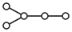</a> 的投影为 $0,r_1,1,r_2,r_3$, 其中 $(r_1,r_2,r_3)\approx(0.52,2.31,4.17)$ 是方程 $r^3-7r^2+13r-5=0$ 的根.

最后, 有 5 种情形只含一个圈. <a href="../../../assets/volume4a/figures/7-2-1-6-ans107-triangle-two-leaves.svg" target="_blank" rel="noopener">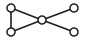</a> 是 $K_1\mathbin{-}(K_2\oplus\overline{K_2})$, 所以它的投影是 $0,1,1,3,5$. $C_5$ 的投影是 $0,3-\phi,3-\phi,2+\phi,2+\phi$. <a href="../../../assets/volume4a/figures/7-2-1-6-ans107-triangle-length2-path.svg" target="_blank" rel="noopener">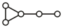</a> 的投影是 $0,r_1,r_2,3,r_3$, 它的补 <a href="../../../assets/volume4a/figures/7-2-1-6-ans107-four-cycle-leaf.svg" target="_blank" rel="noopener">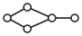</a> 的投影为 $0,5-r_3,2,5-r_2,5-r_1$. <a href="../../../assets/volume4a/figures/7-2-1-6-ans107-triangle-separated-leaves.svg" target="_blank" rel="noopener">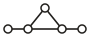</a> 的投影为 $0,(5-\sqrt{13})/2,3-\phi,2+\phi,(5+\sqrt{13})/2$.

**108.** [习题](../sec-7-2-1-6.md#ex-7-2-1-6-108) 给定顶点 $\{V_1,\ldots,V_n\}$ 上的有向图 $D$, 令 $e_{ij}$ 表示从 $V_i$ 到 $V_j$ 的弧数. $C(D)$ 及其投影的定义与前面相同. 因为 $C(D)$ 不一定对称, 所以它的投影不一定为实数. 然而, 如果 $\alpha$ 是一个投影, 那么它的复共轭 $\bar\alpha$ 也是一个投影. 如果按投影的实部排序, 仍得 $\alpha_0=0$. 现在, 如果将 $c(D)$ 解释为定向生成树的平均数 (对所有 $n$ 个可能的根 $V_j$ 取平均), 那么公式 $c(D)=\alpha_1\ldots\alpha_{n-1}/n$ 仍有效. 可迁竞赛图 $\vec K_n$ 的弧为 $V_i\to V_j$($1\le i<j\le n$), 它的投影显然是 $0,1,\ldots,n-1$. 它的子图的投影也同样显而易见.

习题 105 答案中 (a)–(d) 部分的推导原样适用. 例如, 考虑 $K_1\mathbin{-}\vec K_3$, 它的投影是 $0,2,3,4$. 这个有向图 $D$ 对应四个可能的根分别有 $(2,4,6,12)$ 棵定向生成树, $c(D)$ 确实等于 $2\cdot3\cdot4/4$. 还需注意, 有向图 <a href="../../../assets/volume4a/figures/7-2-1-6-ans108-self-complementary-digraph.svg" target="_blank" rel="noopener">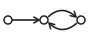</a> 是它自己的补, 并且它拥有与 $\vec K_3$ 相同的投影.

有向图还允许另一组有趣的操作. 设 $D'$ 和 $D''$ 是不相交的顶点集合 $V'$ 和 $V''$ 上的有向图. 每当 $v'\in V'$ 且 $v''\in V''$, 就添加 $a$ 条弧 $v'\to v''$ 和 $b$ 条弧 $v''\to v'$. 像在习题 105(a) 答案中那样处理行列式, 可以证明所得的有向图的投影是 $\{0,an''+bn',an''+\alpha'_1,\ldots,an''+\alpha'_{n'-1},bn'+\alpha''_1,\ldots,bn'+\alpha''_{n''-1}\}$. 在 $a=1$、$b=0$ 的特例中, 可方便地将这个新图表示为 $D'\to D''$. 例如, $\vec K_n=K_1\to\vec K_{n-1}$. 此外, $n_1+\cdots+n_m$ 个顶点上的有向图 $K_{n_1}\to K_{n_2}\to\cdots\to K_{n_m}$ 的投影是 $\{0,n_m\cdot s_m,\ldots,n_2\cdot s_2,(n_1-1)\cdot s_1\}$, 其中 $s_k=n_k+\cdots+n_m$.

从 $V_1$ 到 $V_n$ 的定向路径 $\vec P_n$ 的投影显然是 $0,1,\ldots,1$. 定向圈 $\vec C_n$ 的投影是 $\{0,1-\omega,\ldots,1-\omega^{n-1}\}$, 其中 $\omega=e^{2\pi i/n}$.

关于弧有向图也有一个很好的结果. $D^*$ 的投影是从 $D$ 的投影获得的, 只需对 $1\le k\le n$ 添加 $\tau_k-1$ 个数 $\sigma_k$, 其中 $\tau_k$ 是 $V_k$ 的内向度数, $\sigma_k$ 是它的外向度数. (如果 $\tau_k=0$, 我们删除一个等于 $\sigma_k$ 的投影.) 这个证明类似于习题 2.3.4.2–21 答案中的推导, 但更简单.

*历史注记.* 习题 104(b) 和 105(a) 中的结果归功于亚历山大·克尔曼斯,*Avtomatika i Telemekhanika* **26** (1965), 2194–2204;**27**, 2(1966 年 2 月), 56–65. 英文译本见 *Automation and Remote Control* **26** (1965), 2118–2129;**27** (1966), 233–241. 米罗斯拉夫·菲德勒在 *Czech. Math. J.* **23** (1973), 298–305 中提出习题 105(d), 并证明了有关投影 $\alpha_1$ 的一些有趣结果. 他称 $\alpha_1$ 为 $G$ 的 “代数连接”. 杰曼·克雷韦拉特在 *J. Combinatorial Theory* **B24** (1978), 202–212 中枚举了栅格、圆柱和环面上的生成树, 以及有向环面 (例如 $\vec C_m\square\vec C_n$) 上的定向生成树. 博扬·莫豪尔在 *Graph Theory, Combinatorics and Applications*(Wiley, 1991), 871–898 以及 *Discrete Math.* **109** (1992), 171–183 中发表了关于图投影的优良综述. 德拉戈什·茨韦特科维奇、迈克尔·杜布和霍斯特·萨克斯在 *Spectra of Graphs*(第 3 版, 1995) 中详述了许多重要图族的特征值及其性质, 并给出了全面的参考书目.

**109.** [习题](../sec-7-2-1-6.md#ex-7-2-1-6-109) 可能还有一个与沙堆有关的原因, 见习题 103.

**110.** [习题](../sec-7-2-1-6.md#ex-7-2-1-6-110) 根据归纳法, 假设 $u$ 与 $v$ 之间有 $k\ge1$ 条平行边. 于是 $c(G)=kc(G_1)+c(G_2)$, 其中 $G_1$ 由 $G$ 合并顶点 $u$ 和 $v$ 得到, $G_2$ 由 $G$ 删除这 $k$ 条边得到. 令 $d_u=k+a$ 和 $d_v=k+b$.

*情形 1.* $G_2$ 连通. 于是 $ab>0$, 所以可记 $a=x+1$ 和 $b=y+1$. 我们有 $c(G_1)>\alpha\sqrt{x+y+1}$ 和 $c(G_2)>\alpha\sqrt{xy}$, 其中 $\alpha$ 是针对其他 $n-2$ 个顶点的乘积. 容易验证

$$
k\sqrt{x+y+1}+\sqrt{xy}\ge\sqrt{(x+k)(y+k)}。
$$

*情形 2.* 不存在使 $G_2$ 连通的 $u$ 和 $v$. 于是, $G$ 中每组平行边合起来是一座桥. 换言之, 除平行边外, $G$ 是一棵自由树. 在这种情形, 如果有一个度数为 1 的顶点, 结果就是显然的. 否则, 设 $u$ 是一个端点, 它与 $v$ 之间有 $d_u=k$ 条边. 如果 $d_v>k+1$, 我们有 $c(G)=kc(G_1)>\alpha k\sqrt x$, 其中 $d_v=k+1+x$. 容易检验, 当 $x>0$ 时, $k\sqrt x>\sqrt{(k-1)(k+x)}$. 如果 $d_v=k$, 我们有 $c(G)=k>\sqrt{(k-1)^2}$. 最后, 如果 $d_v=k+1$, 令 $v_0=u$、$v_1=v$, 考虑唯一路径 $v_1\mathbin{-}v_2\mathbin{-}\cdots\mathbin{-}v_r$, 其中 $r>1$ 且 $v_r$ 的度数大于 2. 对于 $1\le j<r$, 只有一条边将 $v_j$ 连接到 $v_{j+1}$. 我们可再次应用归纳法.

[亚历山大·科斯托奇卡在 *Random Structures & Algorithms* **6** (1995), 269–274 中推导了关于生成树数量的其他下界.]

**111.** [习题](../sec-7-2-1-6.md#ex-7-2-1-6-111) $2,1,5,4,11,7,9,8,6,10,15,12,14,13,3$.

**112.** [习题](../sec-7-2-1-6.md#ex-7-2-1-6-112) 要么 $p$ 出现在偶数层级, 并且是 $q$ 的先辈; 要么 $q$ 出现在奇数层级, 并且是 $p$ 的先辈.

**113.** [习题](../sec-7-2-1-6.md#ex-7-2-1-6-113) $\operatorname{前后序}(F^R)=\operatorname{后前序}(F)^R$, $\operatorname{后前序}(F^R)=\operatorname{前后序}(F)^R$.

**114.** [习题](../sec-7-2-1-6.md#ex-7-2-1-6-114) 考虑到森林可能为空, 最简洁的方法是先使 $\mathrm{CHILD}(\Lambda)$ 指向最左树的根结点 (如果有的话), 然后启动第一次访问. 置 $\mathrm Q\gets\Lambda$、$\mathrm L\gets-1$, 转到 Q6.

**115.** [习题](../sec-7-2-1-6.md#ex-7-2-1-6-115) 假设在偶数层级上有 $n_e$ 个结点, 在奇数层级上有 $n_o$ 个结点, 偶数层级的结点中有 $n'_e$ 个不是叶结点. 那么, 步骤 (Q1,…,Q7) 分别执行 $(n_e+n_o,n_o,n'_e,n_e,n'_e,n_o+1,n_e)$ 次, 包括由于习题 114 答案中的安排而对步骤 Q6 的一次执行.

**116.** [习题](../sec-7-2-1-6.md#ex-7-2-1-6-116) (a) 这一结果可由算法 Q 给出.

(b) 实际上, 非普通结点严格地在幸运与不幸运之间交替, 开始和结束时都是幸运结点. 证明: 考虑通过删除 $F$ 的最左端叶结点而得到的森林 $F'$, 并对 $n$ 应用归纳法.

**117.** [习题](../sec-7-2-1-6.md#ex-7-2-1-6-117) 这种森林恰好是那些左子结点／右兄弟结点表示为退化二叉树的森林 (见习题 31). 所以答案为 $2^{n-1}$.

**118.** [习题](../sec-7-2-1-6.md#ex-7-2-1-6-118) (a) 对于 $k>1$, 结果是 $t^{k-2}$, 幸运结点只出现在极端叶结点附近.

(b) 由一个有趣的递推式得到解 $(F_k+1-(k+1)\bmod3)/2$.

**119.** [习题](../sec-7-2-1-6.md#ex-7-2-1-6-119) 为每个结点 $x$ 标记以下值: $v(x)=\sum\{2^k\mid k\text{ 是从根结点到 }x\text{ 的路径上的一个弧标记}\}$. 于是, 这些结点按前后序排列的值就是格雷二进制码 $\Gamma_n$, 因为习题 113 表明它们满足递推式 7.2.1.1–(5).

(如果将上述值标记方法应用于普通二项式树 $T_n$, 按前序遍历 $T_n$ 就会得到整数序列 $0,1,\ldots,2^n-1$.)

**120.** [习题](../sec-7-2-1-6.md#ex-7-2-1-6-120) 错. 在哈密顿圈中, 图示的 “中空” 顶点中只有四个可以紧邻两个 “方形” 顶点. 因此, 有一对 “中空” 顶点不能与它们相邻. [见赫伯特·弗莱施纳和赫德森·克朗克,*Monatshefte für Mathematik* **76** (1972), 112–117.]

<a href="../../../assets/volume4a/figures/7-2-1-6-ans120-bridge-free-counterexample.svg" target="_blank" rel="noopener">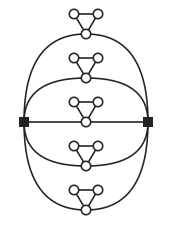</a>

**121.** [习题](../sec-7-2-1-6.md#ex-7-2-1-6-121) 进一步说, $T^2$ 中有一条从 $u$ 到 $v$ 的哈密顿路径, 当且仅当类似条件成立. 但是, 如果 $u$ 和 (或)$v$ 的度数为 1, 则将它们保留在 $T^{(\prime)}$ 中, 而且要求 (i) 中的路径位于从 $u$ 到 $v$ 的路径内部 (不包括 $u$ 和 $v$ 本身). 条件 (ii) 亦需加强, 把 “度数为 4 的顶点” 改为 “危险顶点”. 如果 $T^{(\prime)}$ 中的顶点度数为 4, 或其度数为 2 且是 $u$ 或 $v$, 就称它是 “危险顶点”. 最小的不可能情形是 $T=P_4$, 其中 $u$ 和 $v$ 都选为非端点. [*Časopis pro Pěstování Matematiky* **89** (1964), 323–338.]

因此, $T^2$ 包含哈密顿圈, 当且仅当 $T$ 是一条毛虫, 也就是其导数为一条路径的自由树. [见弗兰克·哈拉里和艾伦·施文克,*Mathematika* **18** (1971), 138–140.]

**122.** [习题](../sec-7-2-1-6.md#ex-7-2-1-6-122) (a) 我们可以用二叉树表示表达式, 运算符放在内部结点, 数字放在外部结点. 像算法 B 那样实现二叉树时, 给定语法施加的基本约束如下: 如果 $r_j=k>0$, 那么结点 $j$ 处的运算符是 $+$ 或 $-$, 当且仅当结点 $k$ 处的运算符是 $\times$ 或 $/$. 因此, 具有 $n$ 个叶结点的这种树的可能总数是 $2^nS_{n-1}$, 其中 $S_n$ 是施罗德数. 当 $n=9$ 时, 它等于 10 646 016. (见习题 66, 但交换了左右.) 我们可以很快生成所有这些树, 恰好遇到 1641 个解. 只有一个表达式在未使用乘法的情况下完成了任务, 即 $1+2/((3-4)/(5+6)-(7-8)/9)$. 其中有 20 个表达式需要五对括号, 例如 $(((1-2)/((3/4)\times5-6))\times7+8)\times9$. 只有 15 个表达式不需要括号.

(b) 现在共有 $1+\sum_{k=1}^8\binom8k 2^{k+1}S_k=23\,463\,169$ 种情形和 3366 个解. 亨利·迪德尼 [*The Weekly Dispatch*(1899 年 6 月 18 日)] 找到了最短的解, 长度为 12, 即 $123-45-67+89$, 但当时不能确认它是最短的. 最长的解长 27, 如前所述, 共有 20 个.

(c) 情形数大幅上升到 $9\,875\,514\,240$, 现在共有 137 375 个解. 最长的解只有一个, 长度为 40:

$$
((((.1/(.2+.3))/.4)/.5)/(.6-.7))/(.8-.9)。
$$

还有一些有趣的例子. 有 5 个解用了 7 个加号, 例如 $.1+(2+3+4+5)\times6+7+8+.9$. 有 10 个解用了 7 个减号, 例如 $(1-.2-.3-4-.5-6)\times(7-8-9)$.

> 事实上, 这件事里面没有什么原则,  
> 也没有什么特定的方式可以说明,  
> 我们已经获得了最佳可能解.  
> ——亨利·迪德尼 (1899)

*注记.* 玛丽·莱斯克的 *Illustriertes Spielbuch für Mädchen*(首次出版于 1864 年) 包含了这个问题, 就目前所知, 这是它首次出现. 在该书 1889 年第 11 版中, $100=1+2+3+4+5+6+7+8\times9$ 是 553 节谜题 16 的解. 另见习题 7.2.1.1–111 中的参考文献.

理查德·贝尔曼在 *AMM* **69** (1962), 640–643 中解释了如何处理 (a) 部分的特例, 即运算符仅限于 $+$ 和 $\times$, 且不得使用括号. 他的动态规划技巧也可用于这个更一般的问题, 以减少需要考虑的情形数量. 其思路是确定可以从数字 $\{1,\ldots,n\}$ 的每个子区间获得的有理数, 在树的根结点放置一个给定的运算符. 通过放弃子区间 $\{1,\ldots,8\}$ 和 $\{2,\ldots,9\}$ 中不可能给出整数解的情形, 还可以节省大量计算. 采用这种方式, 实际需要考虑的本质不同的树减少为 (a) 2 735 136 种, (b) 6 813 760 种, (c) 586 220 150 种.

在这个应用中, 浮点运算并不可靠. 然而, 在不需要处理绝对值大于 $10^9$ 的整数的情形, §4.5.1 的有理数运算例程能够很好地完成任务.

**123.** [习题](../sec-7-2-1-6.md#ex-7-2-1-6-123) (a) 2284, 但 $2284=(1+2\times3)\times(4+5\times67)-89$.

(b) 6964, 但 $6964=(1/.2)\times34+5+6789$.

(c) 14786, 但 $14786=-1+2\times(.3+4+5)\times(6+789)$.

[如果还允许在表达式左侧使用减号, 就像迪德尼所做的那样, 那么问题 122(a)、(b)、(c) 分别有 1362、2759、116222 个额外的解. 其中 (a) 有 19 个更长的表达式, 例如 $-(1-2)\times((3+4)\times(5-(6-7)\times8)+9)$. 采用这种扩展后, 无法表示的最小正整数分别是 (a) 3802, (b) 8312, (c) 19768.]

实际上, 可以表示的整数 (正整数、负整数和零) 的总数分别是 (a) 27 666, (b) 136 607, (c) 218 439.

**124.** [习题](../sec-7-2-1-6.md#ex-7-2-1-6-124) 霍顿–斯特勒数源于对河流的研究. 参见罗伯特·霍顿,*Bull. Geol. Soc. Amer.* **56** (1945), 275–370, 以及阿瑟·斯特勒,*Bull. Geol. Soc. Amer.* **63** (1952), 1117–1142. 热拉尔·维耶诺、乔治·埃罗勒、尼古拉·珍妮和迪迪埃·阿凯斯在经典论文 *Computer Graphics* **23**, 3(1989 年 7 月), 31–40 中研究和说明了绘制树的许多思路.

