<a id="answers-7-2-1-7"></a>


### 7.2.1.7节

<a id="ans-7-2-1-7-1"></a>

**1.** [习题](../sec-7-2-1-7.md#ex-7-2-1-7-1) 也许第 21 号六爻符号 “噬嗑”(<a href="../../../assets/volume4a/figures/7-2-1-7-ans-hexagram-21.svg" target="_blank" rel="noopener"></a>) 之下有这种概念, 但是古代的注释者更多地将它与法律的实施联系起来, 而非电子的相互作用.

<a id="ans-7-2-1-7-2"></a>

**2.** [习题](../sec-7-2-1-7.md#ex-7-2-1-7-2) (a) 对于密码子中的第一个核苷酸, 令 $\mathtt{(T,C,A,G)}$ 分别用 (<a href="../../../assets/volume4a/figures/7-2-1-7-ans2-base-position-1.svg" target="_blank" rel="noopener">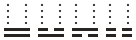</a>) 表示. 类似地, 第二个核苷酸用 (<a href="../../../assets/volume4a/figures/7-2-1-7-ans2-base-position-2.svg" target="_blank" rel="noopener">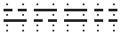</a>) 表示, 第三个用 (<a href="../../../assets/volume4a/figures/7-2-1-7-ans2-base-position-3.svg" target="_blank" rel="noopener">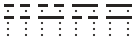</a>) 表示. 将这三个表示叠加. 例如, 第 34 号六爻符号为<a href="../../../assets/volume4a/figures/7-2-1-7-ans2-hexagram34-overlay.svg" target="_blank" rel="noopener">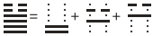</a>, 表示密码子 TTC, 映射到氨基酸 F. 根据这一对应关系, 第 34–54 号 (含) 六爻符号分别映射到 $(\mathrm{F,G,L,Q,W,D,S},-,\mathrm{P,Y,K,A,I,T,N,H,M,R,V,E,C})$. 而且, 映射到 “−” 的三个六爻符号为第 1、9 和 41 号, 即 <a href="../../../assets/volume4a/figures/7-2-1-7-ans-hexagram-1.svg" target="_blank" rel="noopener"></a>、<a href="../../../assets/volume4a/figures/7-2-1-7-ans-hexagram-9.svg" target="_blank" rel="noopener"></a> 和 <a href="../../../assets/volume4a/figures/7-2-1-7-ans-hexagram-41.svg" target="_blank" rel="noopener"></a>, 它们在《易经》中分别意指 “创造 (乾)”“驯养 (小畜)” 和 “消除多余 (损)”, 都合乎完成蛋白质的想法.

(b) 对 $4\times4\times4$ 遗传密码阵列的所有元素, 共有 $\binom{64}{6,6,6,4,4,4,4,4,3,3,2,2,2,2,2,2,2,2,2,1,1}\approx2.3\times10^{69}$ 种排列方法. 其中有

$$
2\,402\,880\,402\,175\,789\,790\,003\,993\,681\,964\,551\,328\,451\,668\,718\,750\,185\,553\,920\,000\,000
\approx 2.4\times10^{63}
$$

种至少包含一组 21 个各不相同的连续元素. [利用容斥原理可以证明, 任何一个具有 $r$ 个不同元素且 $n_r=0$ 的多重集 $\{(n_1+1)\cdot x_1,\ldots,(n_r+1)\cdot x_r\}$ 都恰有

$$
(n+1)\binom{n}{n_1,\ldots,n_r}r!-\sum_{k=1}^{r}(n+1-k)k!(r-k)!\,a_k
\sum_{\substack{0\le d_1,\ldots,d_r\le1\\d_1+\cdots+d_r=k}}\binom{n-k}{n_1-d_1,\ldots,n_r-d_r}
$$

个此种排列, 其中 $n=n_1+\cdots+n_r$, $a_k$ 是具有 $k$ 个元素的不可分解排列数 (习题 7.2.1.2–100).] 因此, 大约每 100 万个排列中只有一个具备所述性质.

不过, 有 $4!^3\binom6{2,2,2}=1\,244\,160$ 种方式可以像 (a) 那样表示密码子, 而且其中绝大多数对应于氨基酸的不同排列 (在第三个位置交换 T 和 C 的表示除外).

实际上, 由经验可知, 在 64 个六爻符号的所有排列中, 约 31%具有合适的密码子映射. 因此, (a) 的构造并未给我们理由相信《易经》作者以任何方式预见了遗传密码.

<a id="ans-7-2-1-7-3"></a>

**3.** [习题](../sec-7-2-1-7.md#ex-7-2-1-7-3) 由于 $F_{31}-10^6=F_{28}+F_{22}+F_{20}+F_{18}+F_{16}+F_{14}+F_9$, 所以第 100 万个是

<a href="../../../assets/volume4a/figures/7-2-1-7-ans3-millionth-prosody.svg" target="_blank" rel="noopener"></a>

反过来做要容易一些: $F_{31}-(F_5+F_8+F_{10}+F_{16}+F_{18}+F_{27}+F_{30})=314159$.

<a id="ans-7-2-1-7-4"></a>

**4.** [习题](../sec-7-2-1-7.md#ex-7-2-1-7-4) <a href="../../../assets/volume4a/figures/7-2-1-7-ans4-hebrew-1.svg" target="_blank" rel="noopener">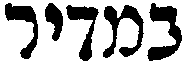</a> 在第 4 行出现的两次中有一次应当是 <a href="../../../assets/volume4a/figures/7-2-1-7-ans4-hebrew-2.svg" target="_blank" rel="noopener">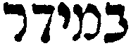</a>. 类似地, 第 8 行中的一个 <a href="../../../assets/volume4a/figures/7-2-1-7-ans4-hebrew-3.svg" target="_blank" rel="noopener">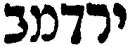</a> 应当为 <a href="../../../assets/volume4a/figures/7-2-1-7-ans4-hebrew-4.svg" target="_blank" rel="noopener">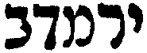</a>. 另外, 最右字母为 <a href="../../../assets/volume4a/figures/7-2-1-7-ans4-hebrew-5.svg" target="_blank" rel="noopener">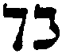</a> 的六种情形在第 3 行和第 4 行出现了两次, 而具有最右字母 <a href="../../../assets/volume4a/figures/7-2-1-7-ans4-hebrew-6.svg" target="_blank" rel="noopener">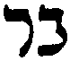</a> 的情形漏掉了. 这些小问题可能是印刷和 (或) 抄写错误, 不一定是唐诺洛本人犯的错误.

<a id="ans-7-2-1-7-5"></a>

**5.** [习题](../sec-7-2-1-7.md#ex-7-2-1-7-5) 最后一个应当是 <a href="../../../assets/volume4a/figures/7-2-1-7-ans5-musical-notes-1.svg" target="_blank" rel="noopener">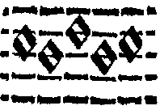</a>, 而不是 <a href="../../../assets/volume4a/figures/7-2-1-7-ans5-musical-notes-2.svg" target="_blank" rel="noopener">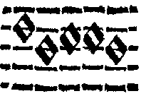</a>.

<a id="pdf-696"></a><a id="p-681"></a>

<a id="ans-7-2-1-7-6"></a>

**6.** [习题](../sec-7-2-1-7.md#ex-7-2-1-7-6) 只有当 $1\le n\le13$ 或 $15\le n\le38$ 时, 梅森列表中的第 $n$ 个值 $m_n$ 与 $n!$ 一致. 梅森知道 $14!=87\,178\,291\,200\ne m_{14}=8\,778\,291\,200$, 因为在他个人保存的该书副本中, 他插入了原本漏掉的 “1” (现在该副本归法国国家图书馆所有, 1963 年曾出版其影印本). 但他表格中的其他错误并不仅仅是印刷错误, 因为它们传播到了后续各项, $m_{50}$ 的情形是个例外. $m_{39}=39!+10^{26}-10^{10}$, $m_{40}=40m_{39}$, $m_{41}=41m_{40}-4\cdot10^{25}-14\cdot10^{11}$. 对于 $n=42,43,44,46,47,48,49,55,60,62$, 有 $m_n=nm_{n-1}$. $m_{50}=50m_{49}+10^{66}$, $m_{51}=51\cdot50\cdot m_{49}$. 计算 $m_{45}=9\cdot45\cdot m_{44}-10^{40}+10^{29}$ 时, 他显然决定走一条捷径, 因为乘以 5 或 9 很容易, 但他乘了两次 9. 他的大多数错误表明他采用了一种不可靠的乘法方法, 这种方法可能依赖于一种算盘:

$$
\begin{aligned}
m_{52}&=52m_{51}+5\cdot10^{56}-2\cdot10^{47}+10^{34}，\\
m_{53}&=53m_{52}-4\cdot10^{29}，&
m_{54}&=54m_{53}+10^{16}，\\
m_{57}&=57m_{56}+10^{33}+10^{24}，&
m_{58}&=58m_{57}+10^{67}-10^{35}+10^{32}+11\cdot10^{26}，\\
m_{59}&=59m_{58}+10^{66}+10^{49}-10^{28}，&
m_{61}&=61m_{60}-5\cdot10^{81}，\\
m_{63}&=63m_{62}+10^{82}-10^{74}，&
m_{64}&=64m_{63}+3\cdot10^{81}+10^{67}+2\cdot10^{38}-2\cdot10^{33}-10^{23}。
\end{aligned}
$$

剩下的情形 $m_{56}\approx10.912m_{55}$ 有点莫名其妙. 它满足 $m_{56}\equiv56m_{55}\pmod{10^{17}}$, 但其他数字似乎既不合律, 也不合理. 能轻松地解释它们吗?

*注记.* 阿塔纳修斯·基歇尔在其 *Ars Magna Sciendi* (1669) 第 157 页给出 $n!$ 在 $1\le n\le50$ 时的表格, 一定是从梅森那里复制来的, 因为他重复了梅森的所有错误. 不过, 基歇尔确实列出的是 $10m_{14}$、$m_{45}/10$ 和 $10m_{49}$ 的值, 而不是 $m_{14}$、$m_{45}$ 和 $m_{49}$. 他可能是想让数列增长得更平稳一些. 谁最先算出了 39! 的正确值并不清楚. 习题 1.2.5–4 讲述了 1000! 的故事.

<a id="ans-7-2-1-7-7"></a>

**7.** [习题](../sec-7-2-1-7.md#ex-7-2-1-7-7) 基本排列为 $12345,13254,14523,15432,12453,14235,15324,13542,12534,15243,13425,14352$. 但随后我们发现, 所有 60 个偶排列既是活的也是死的, 因为 (9) 与 (8) 相差一个偶排列. (而且, 如果用某种方法修正 $n=5$ 的情形, $n=6$ 时的一半活排列会成为奇排列.)

<a id="ans-7-2-1-7-8"></a>

**8.** [习题](../sec-7-2-1-7.md#ex-7-2-1-7-8) 例如, 可以将 (9) 换成

$$
a_na_3\ldots a_{n-1}a_2a_1,\quad a_1a_4\ldots a_na_3a_2,\quad\ldots,\quad
a_{n-1}a_2\ldots a_{n-2}a_1a_n，
$$

即交换 (8) 中各排列的首尾, 并循环移动其他元素. 这一修改有效, 因为所有排列都有正确的奇偶性, 而且活排列和死排列在每个可能位置都有 $a_1$. (如式 7.2.1.2–(32), 我们实际上得到交替群的一个对偶西姆斯表, 不过这里的元素记为 $(n,n-1,\ldots,1)$ 而非 $(0,1,\ldots,n-1)$.)

艾蒂安·伯祖 [*Mémoires Acad. Royale des Sciences*(Paris, 1764), 292] 发表了一种更简单的生成具有正确符号的排列的方法. $\{1,\ldots,n-1\}$ 的每个排列 $\pm a_1\ldots a_{n-1}$ 都会生成 $n$ 个排列 $\pm a_1\ldots a_{n-1}a_n$, $\mp a_1\ldots a_{n-2}a_na_{n-1}$, $\pm\cdots$. 莱布尼茨其实已在 1684 年 1 月 12 日的未发表手稿中发现了这一规则. 见埃伯哈德·克诺布洛赫,*Archive for Hist. Exact Sciences* **12** (1974), 142–173.

<a id="ans-7-2-1-7-9"></a>

**9.** [习题](../sec-7-2-1-7.md#ex-7-2-1-7-9) <bdi dir="ltr" lang="ar">(٠،١،٢،٣،٤،٥،٦،٧،٨،٩)</bdi>. 或许应该说 <bdi dir="ltr" lang="ar">(٩،٨،٧،٦،٥،٤،٣،٢،١،٠)</bdi>.*注记.* 方程组的下标数字采用了另一种系统, 例如 <bdi dir="rtl" lang="ar">ر</bdi> 表示 200. 另外, (11) 实际上是将阿萨马尔的著作转写为现代阿拉伯文. 萨拉赫·艾哈迈德和罗什迪·拉希德以 14 世纪的一个副本为基础, 它采用了类似但更古老的数字形式: <a href="../../../assets/volume4a/figures/7-2-1-7-ans9-historical-arabic-digits.svg" target="_blank" rel="noopener">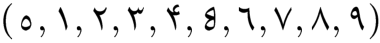</a>. 阿萨马尔本人可能还使用过更古老的数字形式.

<a id="ans-7-2-1-7-10"></a>

**10.** [习题](../sec-7-2-1-7.md#ex-7-2-1-7-10) 如果 56 种情形的概率相同, 像集券问题 (习题 3.3.2–8) 中那样, 答案应为 $56H_{56}\approx258.2$. 但这里有 $(6,30,20)$ 种情形分别以概率 $(1/216,1/72,1/36)$ 发生, 所以正确答案应为

$$
\int_0^\infty\bigl(1-(1-e^{-t/216})^6(1-e^{-t/72})^{30}(1-e^{-t/36})^{20}\bigr)\,dt
\approx546.6，
$$

约为上限 $216H_{216}$ 的 42%. [见菲利普·弗拉若莱、达妮埃尔·加迪和路易·蒂莫尼耶,*Discrete Applied Math.* **39** (1992), 207–229.]

<a id="ans-7-2-1-7-11"></a>

**11.** [习题](../sec-7-2-1-7.md#ex-7-2-1-7-11) 它绘制了从 $(b,c,d,B,C,D)$ 中每次取三个的 $\binom63=20$ 个组合. 如果取 $b<c<d<B<C<D$, 则它们是按字典序出现的. 字符 $t$(<a href="../../../assets/volume4a/figures/7-2-1-7-ans11-case-glyph.svg" target="_blank" rel="noopener"></a>) 表示 “从小写变为大写”. [见安东尼·邦纳,*Selected Works of Ramon Llull*(Princeton, 1985), 596–597.] 共有两个排印错误: 第 6 行开头的 “d” 应当是 “b”, 第 18 行末尾的 “c” 应当是 “d”. 如果柳利将第 1 行表示为

<a href="../../../assets/volume4a/figures/7-2-1-7-ans11-first-row.svg" target="_blank" rel="noopener">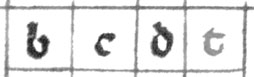</a>

那么该行就会与其他各行更一致, 但这一行当然不需要变换大小写.

<a id="ans-7-2-1-7-12"></a>

**12.** [习题](../sec-7-2-1-7.md#ex-7-2-1-7-12) 将普安索的圈乘以 5, 再加上 2 (模 7).

<a id="ans-7-2-1-7-13"></a>

**13.** [习题](../sec-7-2-1-7.md#ex-7-2-1-7-13) 当有 $n$ 个不同字母时, 最好写成恰好 $n$ 行:

$$
\begin{array}{c}
a.\ aa.\ aaa\\\hline
b.\ ab.\ aab.\ aaab.\ bb.\ abb.\ aabb.\ aaabb
\end{array}
$$

<a id="pdf-697"></a><a id="p-682"></a>

于是, 像 (18) 那样, 指定权重 $(a,b)=(1,4)$ 会得到数 1 至 11. ((16) 的第一行也应省略.) 类似地, 对于 $\{a,a,a,b,b,c\}$, 我们将隐含地为 $c$ 赋以权重 12, 再增加一行

$$
c.\ ac.\ aac.\ aaac.\ bc.\ abc.\ aabc.\ aaabc.\ bbc.\ abbc.\ aabbc.\ aaabbc。
$$

[詹姆斯·伯努利在 *Ars Conjectandi* 的第 2 部分第 6 章几乎正确地做了类似处理.]

<a id="ans-7-2-1-7-14"></a>

**14.** [习题](../sec-7-2-1-7.md#ex-7-2-1-7-14)

```text
ABC ABD ABE ACD ACE ACB ADE ADB ADC AEB AEC AED
BCD BCE BCA BDE BDA BDC BEA BEC BED BAC BAD BAE
CDE CDA CDB CEA CEB CED CAB CAD CAE CBD CBE CBA
DEA DEB DEC DAB DAC DAE DBC DBE DBA DCE DCA DCB
EAB EAC EAD EBC EBD EBA ECD ECA ECB EDA EDB EDC
```

这是一种广义字典序 (见算法 7.2.1.3R), 依次循环使用尚未用到的字母.

[在一本题为 *Sha‘ari Tzedeq* 的犹太神秘哲学著作中, 已经采用类似次序列出了 5 个字符的所有 120 个排列. 该书被认为是由 13 世纪西西里墨西拿的纳坦·本·撒阿迪亚·哈拉尔所作. 见 *Le Porte della Giustizia*(Milan, Adelphi, 2001).]

<a id="ans-7-2-1-7-15"></a>

**15.** [习题](../sec-7-2-1-7.md#ex-7-2-1-7-15) 在 $j$ 之后放入从 $\{j,\ldots,m\}$ 中选出的允许重复的 $(n-1)$ 组合, 所以答案为 $\binom{(m+1-j)+(n-1)-1}{n-1}=\binom{m+n-j-1}{n-1}$. [让·博雷尔, 也称约安尼斯·比托奥尼斯, 在早期著作 *Logistica*(Lyon, 1560) 的第 305–309 页指出了这一点. 他以表格列出了 $1\le n\le4$ 时投掷 $n$ 颗骰子的所有结果, 然后对 $j$ 求和, 得到 $n=5$ 时共有 $126+70+35+15+5+1=252$ 种不同的投掷结果, $n=6$ 时有 462 种.]

<a id="ans-7-2-1-7-16"></a>

**16.** [习题](../sec-7-2-1-7.md#ex-7-2-1-7-16)

**N1.** [初始化.] 置 $r\gets n$、$t\gets0$ 和 $a_0\gets0$.

**N2.** [推进.] 当 $r\ge q$ 时, 反复置 $t\gets t+1$、$a_t\gets q$ 和 $r\gets r-q$. 然后, 如果 $r>0$, 置 $t\gets t+1$ 和 $a_t\gets r$.

**N3.** [访问.] 访问组分 $a_1\ldots a_t$.

**N4.** [寻找 $j$.] 依次置 $j\gets t,t-1,\ldots$, 直到 $a_j\ne1$. 如果 $j=0$, 终止算法.

**N5.** [减小 $a_j$.] 置 $a_j\gets a_j-1$、$r\gets t-j+1$、$t\gets j$, 返回 N2. ∎

例如, 当 $n=7$ 且 $q=3$ 时, 组分为:

```text
331 322 3211 313 3121 3112 31111 232 2311 223 2221
2212 22111 2131 2122 21211 2113 21121 21112 211111
133 1321 1312 13111 1231 1222 12211 1213 12121 12112
121111 1132 11311 1123 11221 11212 112111 11131 11122
111211 11113 111121 111112 1111111
```

纳拉亚纳的经文 79 和 80 大体给出了这一过程, 但串的顺序颠倒为 $133,223,1123,\ldots$, 因为他偏好降序的反向字典序. [萨尔加德瓦之前已在 *Saṅgītaratnākara* §5.316–375 中详述一套理论, 用以描述可由基本部分 $\{1,2,4,6\}$ 构成的所有组分 (韵律) 的集合.]

<a id="ans-7-2-1-7-17"></a>

**17.** [习题](../sec-7-2-1-7.md#ex-7-2-1-7-17) 访问次数 $V_n$ 为 $F_{n+q-1}^{(q)}=\Theta(\alpha_q^n)$, 见习题 5.4.2–7. 步骤 N4 检查 $a_j=1$ 的次数 $X_n$ 满足 $X_n=X_{n-1}+\cdots+X_{n-q}+1$, 于是

$$
X_n=V_0+\cdots+V_n=\frac{qV_n+(q-1)V_{n-1}+\cdots+V_{n-q+1}-1}{q-1}=\Theta(V_n)。
$$

步骤 N2 置 $a_t\gets q$ 的次数 $Y_n$ 满足同一递推式, 所以 $Y_n=X_{n-q}$. 步骤 N2 发现 $r=0$ 的次数是 $V_{n-q}$.

<a id="ans-7-2-1-7-18"></a>

**18.** [习题](../sec-7-2-1-7.md#ex-7-2-1-7-18) 因为它用罗马数字表示为 MDCLXVI, 而 $\mathrm M>\mathrm D>\mathrm C>\mathrm L>\mathrm X>\mathrm V>\mathrm I$.

<a id="ans-7-2-1-7-19"></a>

**19.** [习题](../sec-7-2-1-7.md#ex-7-2-1-7-19) 第 329 行和第 1022 行. (普特亚努斯在他一共 1022 首诗的列表中包含了 139 首这样的诗.)

<a id="ans-7-2-1-7-20"></a>

**20.** [习题](../sec-7-2-1-7.md#ex-7-2-1-7-20) 当 *tria* 在 *lumina* 之前时, 分别有 $5!\times2!\times(11,12,12,16)$ 种方式使扬抑抑格在第 (1,2,3,4) 诗步. 当 *lumina* 在 *tria* 之前时, 则分别有 $5!\times2!\times(16,12,12,11)$ 种方式. 所以总数为 24 480. [莱布尼茨在 *Dissertatio de Arte Combinatoria* 的末尾考虑了这一问题, 并给出了答案 45 870, 但他的论证中有许多错误.]

<a id="ans-7-2-1-7-21"></a>

**21.** [习题](../sec-7-2-1-7.md#ex-7-2-1-7-21) (a) 生成函数 $1/((1-zu-yu^2)(1-zv-yv^2)(1-zw-yw^2))$ 显然等于

$$
\sum_{p,q,r,s,t\ge0}f(p,q,r;s,t)u^pv^qw^rz^sy^t。
$$

<a id="pdf-698"></a><a id="p-683"></a>

(b) 如果 *tibi* 为 $\smile\smile$、*Virgo* 为 $-\,-$, 则该数为 $3!3!$ 乘以

$$
\sum_{k=0}^3\bigl(f(2k+1,6-2k,2;3,3)+f(2k,6-2k,2;2,3)\bigr)，
$$

即 $36((7+7)+(9+5)+(10+5)+(14+7))=2304$. 否则 *tibi* 为 $\smile\,-$,*Virgo* 为 $-\,\smile$, 该数为 $2!3!$ 乘以

$$
\sum_{k=0}^3\bigl(f(2k,5-2k,2;3,2)+f(2k,6-2k,1;3,2)\bigr)，
$$

即 $12((7+6)+(5+4)+(4+4)+(0+6))=432$.

(c) 第 5 个诗步以 *cælo*、*dotes* 或 *Virgo* 的第二个音节开始. 因此增加了 $3!3!\sum_{k=0}^2 f(2k,5-2k,2;3,2)=36(7+5+4)=576$ 种, 总数为 $2304+432+576=3312$.

<a id="ans-7-2-1-7-22"></a>

**22.** [习题](../sec-7-2-1-7.md#ex-7-2-1-7-22) 令 $\alpha\in\{\mathrm{quot,sunt,tot}\}$、$\beta\in\{\text{cælo},\mathrm{dotes,Virgo}\}$、$\sigma=\mathrm{sidera}$ 以及 $\tau=\mathrm{tibi}$. 普雷斯提特的分析基本与伯努利的相同, 但他忘了包括 $\alpha\alpha\alpha\tau\beta\beta\sigma\beta$ 这 36 种情形. (为他说句公道话, 这些情形在诗歌上缺乏想象力, 普特亚努斯也没有发现它们的用途.) 普雷斯提特的书 (1675 年版本) 还省略了所有以 $\tau\beta$ 结尾的排列.

沃利斯将可能性分为 23 类 $T_1\cup T_2\cup\cdots\cup T_{23}$. 他认为第 6 类和第 7 类分别生成 324 首诗. 但实际上 $|T_6|=|T_7|=252$, 因为他的变量 $i$ 应当是 7, 而不是 9. 他还将许多解计算了两次:

$$
\begin{aligned}
|T_3\cap T_5|&=72，\\
|T_2\cap T_7|=|T_5\cap T_7|=|T_3\cap T_6|=|T_6\cap T_{10}|&=36，\\
|T_{11}\cap T_{12}|=|T_{12}\cap T_{13}|=|T_{14}\cap T_{15}|&=12。
\end{aligned}
$$

他漏掉了 36 种可能性 $\alpha\beta\beta\alpha\sigma\alpha\tau\beta$ (普特亚努斯使用了其中 19 种), 还漏掉习题 21(c) 中的所有排列. 普特亚努斯使用了这 576 种中的 250 种. 沃利斯著作的拉丁版 (1693 年出版) 纠正了这一节的一些印刷错误, 数学错误依旧.

惠特沃思和哈特利省略了所有满足 $\mathrm{tibi}=\smile\,-$ 的情形 (见习题 19), 可能是因为人们对古典六步格的知识开始衰退了.

[说到错误, 普特亚努斯实际上只发表了 1020 种不同排列. 他列表中的第 592 行和第 593 行与第 601 行和第 602 行相同. 不过他要再找出两种情形并不难, 例如可以将第 252、345、511、548、659、663、678、693 或 797 行的 *tot sunt* 改为 *sunt tot*.]

<a id="ans-7-2-1-7-23"></a>

**23.** [习题](../sec-7-2-1-7.md#ex-7-2-1-7-23) 自左向右读取每张图, 使得 $12\mid345\leftrightarrow$ <a href="../../../assets/volume4a/figures/7-2-1-7-ans23-12-345.svg" target="_blank" rel="noopener">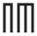</a>, 我们得到

<div class="book-math-display"><a href="../../../assets/volume4a/figures/7-2-1-7-ans23-genji-patterns.svg" target="_blank" rel="noopener">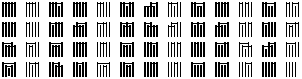</a></div>

<a id="ans-7-2-1-7-24"></a>

**24.** [习题](../sec-7-2-1-7.md#ex-7-2-1-7-24) 他的规则如下. 对于 $k=0,1,\ldots,n-1$, 以及从 $n-1$ 个事物每次取 $k$ 个时的每种组合 $0<j_1<\cdots<j_k<n$, 访问 $\{1,\ldots,n-1\}\setminus\{j_1,\ldots,j_k\}$ 的所有分划, 再附上块 $\{j_1,\ldots,j_k,n\}$. 当 $n=5$ 时, 他的次序为

<div class="book-math-display"><a href="../../../assets/volume4a/figures/7-2-1-7-ans24-genji-patterns.svg" target="_blank" rel="noopener">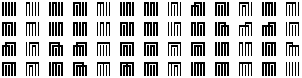</a></div>

但严格来说, 这个习题的答案是否定的, 因为本田利明的规则要指定组合次序之后才完整. 他按照反向字典序 ($j_t\ldots j_1$ 上的字典序) 生成组合. $j_1\ldots j_t$ 上的字典序也与 $n=4$ 时的列表一致, 但它会将 <a href="../../../assets/volume4a/figures/7-2-1-7-ans24-first-compared-pair.svg" target="_blank" rel="noopener"></a> 放在 <a href="../../../assets/volume4a/figures/7-2-1-7-ans24-second-compared-pair.svg" target="_blank" rel="noopener"></a> 之前. 参考资料为林鹤一,*Tōhoku Math. J.* **33** (1931), 332–337.

<a id="ans-7-2-1-7-25"></a>

**25.** [习题](../sec-7-2-1-7.md#ex-7-2-1-7-25) 不是. (28) 漏掉了 $14\mid235$ (也就是它的第二种图形上下颠倒后的版本).

<a id="ans-7-2-1-7-26"></a>

**26.** [习题](../sec-7-2-1-7.md#ex-7-2-1-7-26) 令 $a_n$ 为 $\{1,\ldots,n\}$ 的不可分解分划数, 令 $a'_n$ 为既不可分解又完全押韵的分划数. 这些序列始于 $\langle a_1,a_2,\ldots\rangle=\langle1,1,2,6,22,92,426,\ldots\rangle$、$\langle a'_1,a'_2,\ldots\rangle=\langle0,1,1,3,9,33,135,\ldots\rangle$. 所以这道习题的答案是 $a'_n-1$($n\ge2$). $a_n$ 也是不可交换变量的 $n$ 次对称多项式的数量. [见玛格丽特·沃尔夫,*Duke Math. J.* **2** (1936), 626–637. 她还给出了分为 $k$ 个部分的不可分解分划表.]

<a id="pdf-699"></a><a id="p-684"></a>

如果 $A(z)=\sum_na_nz^n$, 且 $B(z)=\sum_n\varpi_nz^n$ 是贝尔数的非指数生成函数, 则 $A(z)B(z)=B(z)-1$, 于是 $A(z)=1-1/B(z)$. 习题 7.2.1.5–35 的结果意味着

$$
\sum_n a'_nz^n=zA(z)/(1+z-A(z))=z(B(z)-1)/(1+zB(z))。
$$

遗憾的是, $B(z)$ 没有特别好的闭合式, 尽管它确实满足有趣的函数关系 $1+zB(z)=B(z/(1+z))$. 注意, $n>1$ 的不可分解集合分划对应于没有三个连续 $\lambda$ 等于零的摇摆图表循环 (见习题 7.2.1.5–27).

<a id="ans-7-2-1-7-27"></a>

**27.** [习题](../sec-7-2-1-7.md#ex-7-2-1-7-27) 这个问题本身有点模糊, 因为源氏香图形的定义不明确. 我们要求同一个块的所有竖线等高. 这样, 例如 $145\mid236$ 没有单交叉点的对应图形, 因为 <a href="../../../assets/volume4a/figures/7-2-1-7-ans27-excluded-pattern.svg" target="_blank" rel="noopener">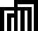</a> 不在允许范围内.

无交叉点的分划数为 $C_n$ (见习题 7.2.1.6–26). 只有一个交叉时, 相互交叉的两个块的元素在限制增长串中必为 $x^iyx^jy^k$、$x^iy^{j+1}xy^k$ 或 $x^iy^jxy^kx^l$, 其中 $i,j,k,l>0$.

假设模式为 $x^iyx^jy^k$. 这 $i+1+j+k$ 个元素之间有 $t=i+j+k+2$ 个 “缝隙”, 以非交叉分划填充这些缝隙的方法数为 $\sum_{i_1+\cdots+i_t=n-i-j-k-1}C_{i_1}\cdots C_{i_t}$. 根据式 7.2.1.6–(24), 可以将此数表示为

$$
[z^{n-i-j-k-1}]C(z)^{i+j+k+2}=C_{(n-i-j-k-1)n}。
$$

针对 $k$ 求和得 $C_{(n-i-j-2)(n+1)}$, 再对 $j$ 和 $i$ 求和得 $C_{(n-4)(n+3)}$.

类似地, 其他两种模式分别贡献 $C_{(n-5)(n+3)}$ 和 $C_{(n-5)(n+4)}$. 所以, 单交叉点分划总数为 $C_{(n-5)(n+3)}+C_{(n-4)(n+4)}$.

<a id="ans-7-2-1-7-28"></a>

**28.** [习题](../sec-7-2-1-7.md#ex-7-2-1-7-28) 先根据素因数的数目, 再按反向字典序, 对 $cbbaaa$ 的因数排序:

$$
\begin{gathered}
1\prec a\prec b\prec c\prec aa\prec ba\prec ca\prec bb\prec cb\prec aaa\prec baa\prec caa\\
{}\prec bba\prec cba\prec cbb\prec baaa\prec caaa\prec bbaa\prec cbaa\prec cbba\prec bbaaa\\
{}\prec cbaaa\prec cbbaa\prec cbbaaa。
\end{gathered}
$$

按上述顺序从大到小取因数 $d$, 令 $d$ 为第一个因数, 再递归附加 $cbbaaa/d$ 的所有首因数 $\preceq d$ 的因数分解.

如果已经按字典序对因数排序 (即 $1<a<aa<aaa<b<ba<\cdots<cbbaa<cbbaaa$), 则沃利斯的算法等价于算法 7.2.1.5M, 其中 $(n_1,n_2,n_3)=(1,2,3)$. 他可能选择较复杂的因数排序方法, 是因为当 $a\approx b\approx c$ 时, 它通常更接近普通数值次序. 例如, 当 $(a,b,c)=(7,11,13)$ 时, 他的顺序就是准确的数值顺序. 沃利斯根据自己的方法生成这些因数, 基本上也就生成了多重集组合. 我们在§7.2.1.3 中已指出, 它等价于有界组分. [参考资料为 *A Discourse of Combinations* (1685), 126–128, 此处纠正了其中两个印刷错误.]

<a id="ans-7-2-1-7-29"></a>

**29.** [习题](../sec-7-2-1-7.md#ex-7-2-1-7-29) 因数分解 $edcba,\ edcb\cdot a,\ edca\cdot b,\ldots,e\cdot d\cdot c\cdot b\cdot a$ 分别对应于

<div class="book-math-display"><a href="../../../assets/volume4a/figures/7-2-1-7-ans29-genji-patterns.svg" target="_blank" rel="noopener">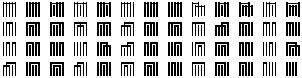</a></div>

<a id="ans-7-2-1-7-30"></a>

**30.** [习题](../sec-7-2-1-7.md#ex-7-2-1-7-30) 除非 $i_1+2i_2+\cdots=n$, 否则系数为 0. 如果成立, 系数为 $\binom mk a_0^{m-k}\binom{k}{i_1,i_2,\ldots}$, 其中 $k=i_1+i_2+\cdots$. (考虑 $(a_0z)^m$ 乘以 $(1+(a_1/a_0)z+(a_2/a_0)z^2+\cdots)^m$.)

<a id="ans-7-2-1-7-31"></a>

**31.** [习题](../sec-7-2-1-7.md#ex-7-2-1-7-31) 如果假设分划 $a_1\ldots a_k$ 满足 $a_1\ge\cdots\ge a_k$, 则这个算法生成的顺序是字典序的降序, 也是 (31) 的逆序. 棣莫弗的顺序为反向字典序的升序.

<a id="ans-7-2-1-7-32"></a>

**32.** [习题](../sec-7-2-1-7.md#ex-7-2-1-7-32)

$$
20\cdot1=1\cdot7+13\cdot1=2\cdot7+6\cdot1=1\cdot10+10\cdot1
=1\cdot10+1\cdot7+3\cdot1=2\cdot10。
$$

一般地, 博斯科维奇提出从 $n\cdot1$ 开始, 然后计算分划 $a\cdot10+b\cdot7+c\cdot1$ 的后继. 当 $c\ge7$ 时, 后继为 $a\cdot10+(b+1)\cdot7+(c-7)\cdot1$. 否则, 如果 $c+7b\ge10$, 则后继为 $(a+1)\cdot10+(c+7b-10)\cdot1$. 否则停止.

(部件取自某个给定整数集合的分划称为受限分划,*denumerants*.)

> “我可能,” 波洛用一种完全不能让人信服的语调说, “是错的.”  
> ——阿加莎·克里斯蒂,*After the Funeral*(1953 年)

<a id="pdf-700"></a><a id="p-685"></a>

<div style="display:flex;flex-direction:column;justify-content:flex-end;min-height:76vh;text-align:right">
<p>——阿道夫·马克思, <i>The Cocoanuts</i>(1925)<br>
——马塞尔·马索, <i>Baptiste</i>(1946)</p>
</div>
