<a id="answers-7"></a>


# 7节

<a id="ans-7-1"></a>

**1.** [题目](../sec-7.md#ex-7-1) 按照提示, 我们要求第二个 “$4m-4$” 之后直接跟着第一个 “$2m-1$”. 想要的排列以十六进制记号从前 4 个例子导出: <code>231213</code>, <code>46171435623725</code>, <code>86a31b1368597a425b2479</code>, <code>ca8e531f1358ac7db9e6427f2469bd</code>. [戴维斯,*Math. Gazette* **43** (1959), 253–255.]

<a id="ans-7-2"></a>

**2.** [题目](../sec-7.md#ex-7-2) 当且仅当 $n\bmod4=0$ 或 1 时存在这样的排列. 这个条件是必要的, 因为奇数项的数量必定为偶数. 同时它也是充分的, 因为我们可以把 “00” 置于上题之解的前面.

*注记:* 小马歇尔·霍尔在 1951 年首先提出这个问题; 次年, 小弗朗西斯·莱希在未发表的文献 [Armed Forces Security Agency report 343 (28 January 1952)] 中解出该问题. 另外, 托拉尔夫·斯科伦和索格·班在 *Math. Scandinavica* **5** (1957), 57–58 中独立提出并求解了该问题. 对于其他数值区间, 詹姆斯·辛普森在 *Discrete Math.* **44** (1983), 97–104 中取得了完全解.

<a id="ans-7-3"></a>

**3.** [题目](../sec-7.md#ex-7-3) 能. 例如, 圈 <code>(0072362435714165)</code> 是不能分裂的.

<a id="ans-7-4"></a>

**4.** [题目](../sec-7.md#ex-7-4) $b$ 的第 $k$ 次出现是在左起 $\lfloor k\phi\rfloor$ 的位置, 而 $a$ 的第 $k$ 次出现是在 $\lfloor k\phi^2\rfloor$ 的位置. 显然 $\lfloor k\phi^2\rfloor-\lfloor k\phi\rfloor=k$, 因为 $\phi^2=\phi+1$. (这些整数 $\lfloor k\phi\rfloor$ 构成 $\phi$ 的 “谱”, 见《具体数学》[^v4a-p427-1] 习题 3.13.)

<a id="ans-7-5"></a>

**5.** [题目](../sec-7.md#ex-7-5) 在 $\binom{2n}{2}$ 个等可能的位置对中有 $2n-k-1$ 个位置对满足所述条件. 如果这些概率是独立的 (但它们不是), $2L_n$ 的值应该是

$$
\begin{aligned}
\binom{2n}{2,2,\ldots,2}\prod_{k=1}^{n}
\left((2n-1-k)/\binom{2n}{2}\right)
&=\frac{((2n)!)^2n(n-1)}
{n!(2n)^{n+1}(2n-1)^{n+1}}\\
&=\exp\left(n\ln\frac{4n}{e^3}
+\ln\sqrt{\frac{\pi en}{2}}+O(n^{-1})\right).
\end{aligned}
$$

<a id="ans-7-6"></a>

**6.** [题目](../sec-7.md#ex-7-6) (a) 当展开乘积时, 我们得到一个 $(2n-2)!/(n-2)!$ 项的多项式, 每项的次数为 $4n$. 每个兰福德配对都有一项 $x_1^2\cdots x_{2n}^2$, 其他每项至少有一个 1 次的变量. 针对 $x_1,\ldots,x_{2n}\in\{-1,+1\}$ 求和, 由此消除所有坏项, 对于好项给出 $2^{2n}$. 产生额外的因子 2 是因为存在 $2L_n$ 个兰福德配对 (包括左右颠倒).

(b) 令 $f_k=\sum_{j=1}^{2n-k-1}x_jx_{j+k+1}$ 是第 $k$ 个因式的主要部分. 我们可以按格雷码次序遍历全部 $4^n$ 种情形 $x_1,\ldots,x_{2n}\in\{-1,+1\}$ (算法 7.2.1.1L), 每次仅对一个 $x_j$ 取相反数. $x_j$ 的一次改变最多引起对每个 $f_k$ 的两次调整, 所以每个格雷码操作步骤的花费为 $O(n)$.


<a id="pdf-443"></a><a id="p-428"></a>

我们不需要精确计算这个和, 按模 $2^N$ 处理就足够了, 其中 $2^N$ 很容易超过 $2^{2n+1}L_n$. 当 $n=24$ 时甚至更胜一筹, 将进行按模 $2^{60}-1$ 的计算, 或者同时进行按模 $2^{30}-1$ 和 $2^{30}+1$ 计算, 因为 $2^{49}\perp 2^{60}-1$. 利用 $f_k\equiv k+1\pmod2$ 这个事实, 我们还可以将所需的二进制精度减少 $\lceil n/2\rceil$ 位.

(c) 实际上, 第三个等式仅当 $n\bmod4=0$ 或 3 时成立, 但我们感兴趣的就是这些 $n$ 值. 求和可以分 $n$ 阶段完成, 满足 $p<n$ 的阶段 $p$ 包含 $x_{n-1}=x_{n+2}$, $x_{n-2}=x_{n+3}$, $\ldots$, $x_{n-p+1}=x_{n+p}$, $x_{n-p}=x_n=x_{n+1}=+1$, $x_{n+p+1}=-1$ 这些情形. 具体计算方法如下: 外循环以全部 $2^{p-1}$ 种方式选择 $(x_{n-p+1},\ldots,x_{n-1})$, 内循环以全部 $2^{2n-2p-2}$ 种方式选择 $(x_1,\ldots,x_{n-p-1},x_{n+p+2},\ldots,x_{2n})$. (内循环使用格雷二进制码, 更好的方法是用 “风琴管顺序” 优先处理下标使得 $x_1$ 和 $x_{2n}$ 变化最快. 外循环不需要特别高的效率.) 阶段 $n$ 覆盖 $2^{n-1}$ 种回文情形 $x_j=x_{2n+1-j}$ (其中 $1\le j<n$) 和 $x_n=x_{n+1}=+1$. 如果我们用 $s_p$ 表示阶段 $p$ 中的和, 那么 $s_1+\cdots+s_{n-1}+\frac12s_n=2^{2n-2}L_n$.

各项的大部分结果为零. 例如, 当 $n=16$ 时, 约有 76%的结果为零 (在 $2^{29}+2^{14}$ 种情形中占 408 838 754 种). 可以利用这一事实避免内循环中的许多乘法. (仅 $f_1,f_3,\ldots$ 可能为零.)

<a id="ans-7-7"></a>

**7.** [题目](../sec-7.md#ex-7-7) 令 $d_k$ 为读出 $k$ 个字符后未完成配对的数量, 于是 $d_0=d_{2n}=0$, $d_k=d_{k-1}\pm1$($1\le k\le2n$). 假定 $d_k$ 不超过 6, 最大序列是 $(d_0,d_1,\ldots,d_{2n})=(0,1,2,3,4,5,6,5,6,\ldots,5,6,5,4,3,2,1,0)$, 它们的和 $\sum_{k=1}^{2n}d_k=11n-30$. 但在任何兰福德配对中 $\sum_{k=1}^{2n}d_k=\sum_{k=1}^{n}(k+1)=\binom{n+1}{2}+n$. 因此 $\binom{n+1}{2}+n\le11n-30$ 且 $n\le15$. (事实上, 当 $n=15$ 时宽度 6 也是不够的. 一般情况下, 最大和最小的可能宽度是未知的.)

<a id="ans-7-8"></a>

**8.** [题目](../sec-7.md#ex-7-8) 当 $n=4$ 或 $n=7$ 时无解. 当 $n=8$ 时有 4 个解:

<code>1317538642572468</code>:

[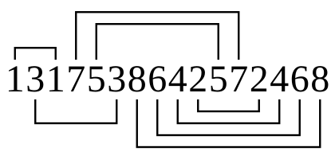](../../../assets/volume4a/figures/answer-7-8-a.svg)

<code>1418634753268257</code>:

[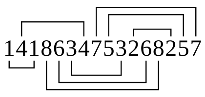](../../../assets/volume4a/figures/answer-7-8-b.svg)

<code>4275248635713168</code>:

[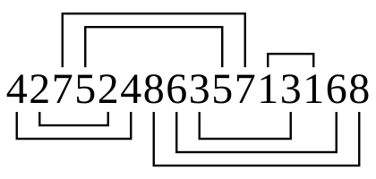](../../../assets/volume4a/figures/answer-7-8-c.svg)

<code>5286235743681417</code>:

[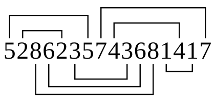](../../../assets/volume4a/figures/answer-7-8-d.svg)

(这个问题引起一个有趣的小器件谜题, 其中第 $k$ 个部件的宽和高分别是 $k+1$ 和 $\lceil k/2\rceil$. 在查尔斯·兰福德的原注 [*Math. Gazette* **42** (1958), 228] 中, 他举出一些相似的部件, 展示了对于 $n=12$ 的平面解. 这个问题可以转变为恰当覆盖问题, 其中非原始项代表不允许两个部件交叉的位置, 见习题 7.2.2.1-27. 让·布雷特在习题 2 的基础上设计了一个有些相似的谜题, 其中用宽度替代平面表示. 他在 1992 年把一个副本给了戴维·辛马斯特.)

<a id="ans-7-9"></a>

**9.** [题目](../sec-7.md#ex-7-9) 只有 3 种方式: <code>181915267285296475384639743</code>, <code>191218246279458634753968357</code>, <code>191618257269258476354938743</code> (以及它们的逆排列). [格尔德·巴伦在 1969 年首先得出这个解, 见 *Combinatorial Theory and Its Applications* (Budapest: 1970), 81–92. 7.2.2.1 节的 “舞蹈链” 方法通过遍历一棵仅有 360 个结点的查找树求解这个问题, 给出具有 132 个选项的恰当覆盖问题.]

<a id="ans-7-10"></a>

**10.** [题目](../sec-7.md#ex-7-10) 例如, 令 $\mathrm A=12$, $\mathrm K=8$, $\mathrm Q=4$, $\mathrm J=0$, $\spadesuit=4$, $\heartsuit=3$, $\diamondsuit=2$, $\clubsuit=1$, 然后把每张牌的面值和花色对应的数值各自加在一起. 举例来说, $\mathrm J\diamondsuit=0+2=2$, $\mathrm A\heartsuit=12+3=15$.

[关于这一点, 与图 1 等价的正交拉丁方已经隐现在伊本·哈吉的 *Kitab Shumus al-Anwar* (Cairo: 1322) 所列举的中世纪伊斯兰教符咒中, 他还给出一个 $5\times5$ 拉丁方的例子. 见埃德蒙·杜泰,*Magie et Religion dans l’Afrique du Nord* (Algiers: 1909), 193–194, 214, 247; 威廉·阿伦斯,*Der Islam* **7** (1917), 228–238. 也见拉斯·安德森在 *Combinatorics: Ancient and Modern* (Oxford University Press, 2013) 第 11 章阐述的拉丁方辉煌历史.]

<a id="ans-7-11"></a>

**11.** [题目](../sec-7.md#ex-7-11)

$$
\begin{pmatrix}
d\gamma\aleph & a\delta\beth & b\beta\gimel & c\alpha\daleth\\
c\beta\beth & b\alpha\aleph & a\gamma\daleth & d\delta\gimel\\
a\alpha\gimel & d\beta\daleth & c\delta\aleph & b\gamma\beth\\
b\delta\daleth & c\gamma\gimel & d\alpha\beth & a\beta\aleph
\end{pmatrix}.
$$

[在 *Mémoires de l’Académie Royale des Sciences* (Paris, 1710), 92–138, §83 中, 约瑟夫·索弗尔提出了这种幻方最早的著名例子.]

<a id="ans-7-12"></a>

**12.** [题目](../sec-7.md#ex-7-12) 如果 $n$ 是奇数, 我们可以令 $M_{ij}=(i-j)\bmod n$. 但如果 $n$ 是偶数, 那么不存在横截: 因为如果 $\{(t_0+0)\bmod n,\ldots,(t_{n-1}+n-1)\bmod n\}$ 是一个横截, 我们有 $\sum_{k=0}^{n-1}t_k\equiv\sum_{k=0}^{n-1}(t_k+k)\pmod n$, 因此 $\sum_{k=0}^{n-1}k=\frac12n(n-1)$ 是 $n$ 的倍数.

<a id="pdf-444"></a><a id="p-429"></a>

<a id="ans-7-13"></a>

**13.** [题目](../sec-7.md#ex-7-13) 用 $\lfloor l/5\rfloor$ 代替每个元素 $l$ 得到以 0 和 1 为元素的矩阵. 我们用 $\bigl(\begin{smallmatrix}A&B\\C&D\end{smallmatrix}\bigr)$ 命名 4 个四等分, 于是 $A$ 和 $D$ 各自恰好包含 $k$ 个 1, 而 $B$ 和 $C$ 各自恰好包含 $k$ 个 0. 假定原矩阵有 10 个不相交的横截. 如果 $k\le2$, 其中最多 4 个横截通过 $A$ 或 $D$ 中的一个 1, 而且最多 4 个横截通过 $B$ 或 $C$ 中的一个 0. 这样, 它们中至少有两个横截仅遇到 $A$ 和 $D$ 中的 0 以及 $B$ 和 $C$ 中的 1. 但这样一个横截含有偶数个 0 (而不是 5 个 0), 因为它与 $A$ 和 $D$ 相交的次数相同.

同样, 在重新命名全部元素的情况下, 一个具有正交配对的 $4m+2$ 阶拉丁方在它的每个 $(2m+1)\times(2m+1)$ 子矩阵中, 必定有多于 $m$ 个闯入者. [见亨利·曼,*Bull. Amer. Math. Soc.* **50** (1944), 249–257.]

<a id="ans-7-14"></a>

**14.** [题目](../sec-7.md#ex-7-14) 情形 (b) 和 (d) 不存在正交配对. 情形 (a)、(c)、(e) 分别有 2、6 和 12 265 168 个正交配对, 按字典序, 它们中的第一个和最后一个为

<table>
<thead><tr><th>(a)</th><th>(a)</th><th>(c)</th><th>(c)</th><th>(e)</th><th>(e)</th></tr></thead>
<tbody>
<tr><td><code>0456987213</code></td><td><code>0691534782</code></td><td><code>0362498571</code></td><td><code>0986271435</code></td><td><code>0214365897</code></td><td><code>0987645321</code></td></tr>
<tr><td><code>1305629847</code></td><td><code>1308257964</code></td><td><code>1408327695</code></td><td><code>1354068792</code></td><td><code>1025973468</code></td><td><code>1795402638</code></td></tr>
<tr><td><code>2043798165</code></td><td><code>2169340578</code></td><td><code>2673519408</code></td><td><code>2741853960</code></td><td><code>2690587143</code></td><td><code>2506913874</code></td></tr>
<tr><td><code>3289176504</code></td><td><code>3250879416</code></td><td><code>3521970846</code></td><td><code>3572690814</code></td><td><code>3857694201</code></td><td><code>3154067289</code></td></tr>
<tr><td><code>4518263790</code></td><td><code>4587902631</code></td><td><code>4890253167</code></td><td><code>4630789251</code></td><td><code>4168730925</code></td><td><code>4231850967</code></td></tr>
<tr><td><code>5167432089</code></td><td><code>5412763890</code></td><td><code>5736841920</code></td><td><code>5218947306</code></td><td><code>5473829016</code></td><td><code>5348276190</code></td></tr>
<tr><td><code>6894015372</code></td><td><code>6945081327</code></td><td><code>6259784013</code></td><td><code>6095324178</code></td><td><code>6942158730</code></td><td><code>6820394715</code></td></tr>
<tr><td><code>7920341658</code></td><td><code>7836425109</code></td><td><code>7915602384</code></td><td><code>7869512043</code></td><td><code>7309216584</code></td><td><code>7069128543</code></td></tr>
<tr><td><code>8731504926</code></td><td><code>8723196045</code></td><td><code>8147036259</code></td><td><code>8407136529</code></td><td><code>8531402679</code></td><td><code>8412739056</code></td></tr>
<tr><td><code>9672850431</code></td><td><code>9074618253</code></td><td><code>9084165732</code></td><td><code>9123405687</code></td><td><code>9786041352</code></td><td><code>9673581402</code></td></tr>
</tbody>
</table>

*注记:* 拉丁方 (a)、(b)、(c)、(d) 是从 $\pi$、$e$、$\gamma$、$\phi$ 的十进制数字中丢弃同完全拉丁方不相容的数字获得的. 虽然它们不是真正随机的, 但通常是典型的 $10\times10$ 拉丁方, 似乎大约半数存在正交配对. 欧内斯特·帕克为了获得异常大量的横截构造了拉丁方 (e), 它有 5504 个横截. (欧拉曾研究过 6 阶拉丁方的类似例子, 因此 “正好错失” 发现一个 $10\times10$ 配对.)

<a id="ans-7-15"></a>

**15.** [题目](../sec-7.md#ex-7-15) 欧内斯特·帕克曾经沮丧地发现拉丁方 14(e) 没有彼此正交的配对. 后来他同约翰·布朗和阿卜杜萨马德·希达亚特 [*J. Combinatorics, Inf. and System Sci.* **18** (1993), 113–115] 一起找到两个 $10\times10$ 的拉丁方, 具有 4 个 (但不是 10 个) 不相交的公共横截. [也见伯恩哈德·甘特尔、鲁道夫·马东和亚历山大·罗萨,*Congressus Numerantium* **20** (1978), 383–398;**22** (1979), 181–204.] 与此同时, 我追寻了路易斯·韦斯纳 [*Canadian Math. Bull.* **6** (1963), 61–63] 的思想, 意外发现某些拉丁方甚至更接近于彼此三重正交. 下面的拉丁方同它的转置正交, 而且它在单元 $(0,p_0),\ldots,(9,p_9)$ 有 5 个对角对称的横截, 其中 $p_0\ldots p_9$ 的 5 个值分别是 <code>0132674598</code>、<code>2301457689</code>、<code>3210896745</code>、<code>4897065312</code>、<code>6528410937</code>, 它们几乎是不相交的: 它们覆盖 49 个单元.

$$
L=
\begin{pmatrix}
0&2&3&4&5&6&7&8&9&1\\
3&1&9&2&7&0&8&5&4&6\\
6&5&2&8&1&3&9&4&0&7\\
8&7&5&3&2&4&1&9&6&0\\
1&6&8&9&4&7&3&0&2&5\\
4&9&7&0&8&5&2&6&1&3\\
5&0&4&7&9&8&6&1&3&2\\
9&4&1&6&3&2&0&7&5&8\\
7&3&6&1&0&9&5&2&8&4\\
2&8&0&5&6&1&4&3&7&9
\end{pmatrix}
\quad\perp\quad
\begin{pmatrix}
0&3&6&8&1&4&5&9&7&2\\
2&1&5&7&6&9&0&4&3&8\\
3&9&2&5&8&7&4&1&6&0\\
4&2&8&3&9&0&7&6&1&5\\
5&7&1&2&4&8&9&3&0&6\\
6&0&3&4&7&5&8&2&9&1\\
7&8&9&1&3&2&6&0&5&4\\
8&5&4&9&0&6&1&7&2&3\\
9&4&0&6&2&1&3&5&8&7\\
1&6&7&0&5&3&2&8&4&9
\end{pmatrix}
=L^T.
$$

布兰登·麦凯、艾利森·迈纳特和温迪·墨沃尔德 [*J. Comb. Designs* **15** (2007), 98–119] 所做的广泛计算证明: 具有非平凡对称性的 $10\times10$ 拉丁方不存在两个彼此正交的配对. 我们已经知道, 对于 $n>10$ 的所有阶, 存在 3 个相互正交的拉丁方. [见王新民和理查德·威尔逊,*Congressus Numerantium* **21** (1978), 688; 多布罗米尔·托多罗夫,*Ars Combinatoria* **20** (1985), 45–47.]

<a id="ans-7-16"></a>

**16.** [题目](../sec-7.md#ex-7-16) 见理查德·布鲁迪和赫伯特·赖瑟,*Combinatorial Matrix Theory* (Cambridge University Press, 1991), §8.2.

<a id="ans-7-17"></a>

**17.** [题目](../sec-7.md#ex-7-17) (a) 假定对于 $0\le j<n$ 有 $3n$ 个顶点 $r_j,c_j,v_j$ 和 $n^2$ 条超边. 超边 $(i,j)$ 包含 3 个顶点 $\{r_i,c_j,v_l\}$, 其中 $l=L_{ij}$, $0\le i,j<n$.

<a id="pdf-445"></a><a id="p-430"></a>

(b) 假定对于 $0\le i,j<n$ 有 $4n^2$ 个顶点 $r_{ij},c_{ij},x_{ij},y_{ij}$ 和 $n^3-n^2+n$ 条超边. 超边 $(i,j,k)$ 包含 4 个顶点 $\{r_{ik},c_{jk},x_{ij},y_{lk}\}$, 其中 $l=L_{ij}$, $0\le i,j,k<n$ 且 ($i=k$ 或 $j>0$).

<a id="ans-7-18"></a>

**18.** [题目](../sec-7.md#ex-7-18) 给定正交阵列 $A$, 对于 $1\le i\le m$, 它的各行是 $A_i$. 对于 $0\le j,k<n$, 通过下列方式定义对于 $1\le i\le m-2$ 的拉丁方 $L_i=(L_{ijk})$: 当 $A_{(m-1)q}=j$ 且 $A_{mq}=k$ 时置 $L_{ijk}=A_{iq}$. ($q$ 的值由 $j$ 和 $k$ 的值唯一确定.) 置换阵列的列不会改变对应的拉丁方.

这个构造过程也可以颠倒过来, 从相互正交的 $n$ 阶拉丁方产生 $n$ 阶正交阵列. 例如, 在习题 11 中我们可以令 $a=\alpha=\aleph=0$, $b=\beta=\beth=1$, $c=\gamma=\gimel=2$, $d=\delta=\daleth=3$, 从而得到

$$
A=\begin{pmatrix}
3&0&1&2&2&1&0&3&0&3&2&1&1&2&3&0\\
2&3&1&0&1&0&2&3&0&1&3&2&3&2&0&1\\
0&1&2&3&1&0&3&2&2&3&0&1&3&2&1&0\\
0&0&0&0&1&1&1&1&2&2&2&2&3&3&3&3\\
0&1&2&3&0&1&2&3&0&1&2&3&0&1&2&3
\end{pmatrix}.
$$

(在数学上, 正交阵列的概念比正交拉丁方的概念 “更彻底”, 因为它更好地考虑基本对称性. 举例来说, 具有元素 $\{1,2,\ldots,n\}$ 的 $n\times n$ 矩阵 $L$ 是拉丁方, 当且仅当它同两个特定的非拉丁方正交, 也就是说

$$
L\perp\begin{pmatrix}
1&1&\cdots&1\\
2&2&\cdots&2\\
\vdots&\vdots&\ddots&\vdots\\
n&n&\cdots&n
\end{pmatrix}
\qquad\text{且}\qquad
L\perp\begin{pmatrix}
1&2&\cdots&n\\
1&2&\cdots&n\\
\vdots&\vdots&\ddots&\vdots\\
1&2&\cdots&n
\end{pmatrix}.
$$

所以, 拉丁方、希腊-拉丁方和希伯来-希腊-拉丁方等矩阵与深度为 $3,4,5,\ldots$ 的正交阵列是等价的. 此外, 这里考虑的正交阵列只是卡利安普迪·拉奥在 *Proc. Edinburgh Math. Soc.* **8** (1949), 119–125 中引入的一个更加普遍的具有 “强度 $t$” 和 “指标 $\lambda$” 的 $n$ 进制 $m\times\lambda n^t$ 阵列的概念在 $t=2$、$\lambda=1$ 时的特例, 见阿卜杜萨马德·希达亚特、尼尔·斯隆和约翰·施图夫肯的 *Orthogonal Arrays* (Springer, 1999).)

<a id="ans-7-19"></a>

**19.** [题目](../sec-7.md#ex-7-19) 我们可以重排阵列的各列, 使得它的第一行是 $0^n1^n\cdots(n-1)^n$. 然后, 我们可以对其他行的元素重新编号, 使它们从 $01\cdots(n-1)$ 开始. 在除第一行外所有各行中, 剩余的每一列的元素必定是不同的.

为了达到在 $n=p$ 时的上界, 让每一列以两个数 $x$ 和 $y$ 为下标, 其中 $0\le x,y<p$, 并且把数 $y$、$x$、$(x+y)\bmod p$、$(x+2y)\bmod p$、$\ldots$、$(x+(p-1)y)\bmod p$ 放进那一列. 例如, 当 $p=5$ 时, 我们得到下面的正交阵列, 它等价于 4 个相互正交的拉丁方:

$$
\begin{pmatrix}
0&0&0&0&0&1&1&1&1&1&2&2&2&2&2&3&3&3&3&3&4&4&4&4&4\\
0&1&2&3&4&0&1&2&3&4&0&1&2&3&4&0&1&2&3&4&0&1&2&3&4\\
0&1&2&3&4&1&2&3&4&0&2&3&4&0&1&3&4&0&1&2&4&0&1&2&3\\
0&1&2&3&4&2&3&4&0&1&4&0&1&2&3&1&2&3&4&0&3&4&0&1&2\\
0&1&2&3&4&3&4&0&1&2&1&2&3&4&0&4&0&1&2&3&2&3&4&0&1\\
0&1&2&3&4&4&0&1&2&3&3&4&0&1&2&2&3&4&0&1&1&2&3&4&0
\end{pmatrix}.
$$

[其实, 当 $n$ 是一个素数幂时, 利用有限域 $\mathrm{GF}(p^e)$, 同样的思想也适用. 见伊莱基姆·穆尔,*American Journal of Mathematics* **18** (1896), 264–303, §15(1). 这些阵列等价于有限射影平面, 见小马歇尔·霍尔,*Combinatorial Theory* (Blaisdell, 1967), 第 12 章和第 13 章.]

<a id="ans-7-20"></a>

**20.** [题目](../sec-7.md#ex-7-20) 令 $\omega=e^{2\pi i/n}$, 并假定 $a_1\cdots a_{n^2}$ 和 $b_1\cdots b_{n^2}$ 是不同行中的向量. 那么 $a_1b_1+\cdots+a_{n^2}b_{n^2}=\sum_{0\le j,k<n}\omega^{j+k}=0$, 因为 $\sum_{k=0}^{n-1}\omega^k=0$.

<a id="ans-7-21"></a>

**21.** [题目](../sec-7.md#ex-7-21) (a) 为了证明 “等同或平行” 性质是一种等价关系, 我们需要证明传递律: 如果 $L\parallel M$ 且 $M\parallel N$ 且 $L\ne N$, 那么, 必定有 $L\parallel N$. 否则, 根据 (ii) 将有一点 $p$ 使得 $L\cap N=\{p\}$, 于是, $p$ 将属于同 $M$ 平行的两条不同直线, 与 (iii) 矛盾.

(b) 令 $\{L_1,\ldots,L_n\}$ 是平行直线的一个类, 并假定 $M$ 是另外一个类的直线. 那么, 每条直线 $L_j$ 在唯一的点 $p_j$ 同 $M$ 相交, 而且 $M$ 的每个点都遇到这种情况, 因为几何网格上的每个点恰好位于每个类的一条直线上 (根据 (iii)). 这样, $M$ 恰好包含 $n$ 个点.

<a id="pdf-446"></a><a id="p-431"></a>

(c) 我们已经观察到, 当存在 $m$ 个类时每个点属于 $m$ 条直线. 如果直线 $L,M,N$ 属于 3 个不同的类, 那么, $M$ 和 $N$ 的点的数量与 $L$ 类的直线的数量相同. 所以各条直线具有共同的点数 $n$, 而事实上总的点数为 $n^2$. (当然, $n$ 可能是无穷大.)

<a id="ans-7-22"></a>

**22.** [题目](../sec-7.md#ex-7-22) 给定深度 $m$ 的 $n$ 阶正交阵列 $A$, 把 $A$ 的列当成点, 定义一个具有 $n^2$ 个点和 $m$ 个平行直线类的几何网格. 类 $k$ 的直线 $j$ 是符号 $j$ 出现在 $A$ 的第 $k$ 行的列的集合.

对于 $m\ge3$, 所有具有 $m$ 个类的有限几何网格都以这种方式呈现. 但是, 仅包含一个类的几何网格是把点分成不相交子集的一种平凡划分. 包含两个类的几何网格有 $nn'$ 个点 $(x,x')$, 其中在一个类有 $n$ 条 “$x=\text{常数}$” 的直线, 而在另一个类有 $n'$ 条 “$x'=\text{常数}$” 的直线. [更多资料见理查德·布鲁克,*Canadian J. Math.* **3** (1951), 94–107;*Pacific J. Math.* **13** (1963), 421–457.]

<a id="ans-7-23"></a>

**23.** [题目](../sec-7.md#ex-7-23) (a) 如果 $d(x,y)\le t$ 且 $d(x',y)\le t$ 且 $x\ne x'$, 那么 $d(x,x')\le2t$. 因此, 码字之间的距离大于 $2t$ 的码允许纠正多达 $t$ 个差错——至少在原则上是这样, 尽管计算可能会很复杂. 反过来, 如果 $d(x,x')\le2t$ 且 $x\ne x'$, 那么, 存在一个元素 $y$ 满足 $d(x,y)\le t$ 且 $d(x',y)\le t$. 因此, 当我们接收到 $y$ 时却不能唯一地重构 $x$.

(b,c) 令 $m=r+2$, 并注意到, $b^2$ 个 $b$ 进制 $m$ 元组构成的集合的所有元素对之间的汉明距离大于等于 $m-1$, 当且仅当它构成一个深度 $m$ 的 $b$ 进制正交阵列的各个列. [见所罗门·戈洛姆和爱德华·波斯纳,*IEEE Trans.* **IT-10** (1964), 196–208. 编码理论的文献通常用记号 $(n+r,b^n,d)_b$ 表示距离为 $d$ 的码 $C(b,n,r)$. 因此, 一个深度 $m$ 的 $b$ 进制正交阵列实质上是一个 $(m,b^2,m-1)_b$ 码.]

<a id="ans-7-24"></a>

**24.** [题目](../sec-7.md#ex-7-24) (a) 假定对于 $1\le j\le l$ 有 $x_j\ne x'_j$, 对于 $l<j\le N$ 有 $x_j=x'_j$. 如果 $l=0$, 我们有 $x=x'$. 否则, 考虑对应于经过点 1 的 $m$ 条直线的奇偶校验位. 那些二进制位中最多有 $l-1$ 位对应于触及点 $\{2,\ldots,l\}$ 的直线. 因此, $x'$ 至少有 $m-(l-1)$ 次奇偶校验改变, 从而 $d(x,x')\ge l+(m-(l-1))=m+1$.

(b) 令 $l_{p1},\ldots,l_{pm}$ 是经过点 $p$ 的那些直线的编号. 在接收到消息 $y_1\cdots y_{N+R}$ 后, 通过取 $m+1$ 个 “证据位”$\{y_{p0},\ldots,y_{pm}\}$ 的过半数值, 对于 $1\le p\le N$ 计算 $x_p$, 其中 $y_{p0}=y_p$ 且

$$
y_{pk}=\left(y_{N+l_{pk}}+
\sum\{y_j\mid j\ne p\text{ 且点 }j\text{ 位于直线 }l_{pk}\text{ 上}\}\right)\bmod2,
\qquad\text{对于 }1\le k\le m.
$$

因为每个接收到的二进制位 $y_j$ 影响证据位至多 1 位, 所以这个方法是可行的.

例如在习题 19 的 25 点几何网格中, 对于 $0\le i\le5$ 和 $0\le j<5$, 假定每个码字的奇偶校验位 $x_{26+5i+j}$ 对应于第 $i$ 行的直线 $j$, 于是 $x_{26}=x_1\oplus x_2\oplus x_3\oplus x_4\oplus x_5$, $x_{27}=x_6\oplus x_7\oplus x_8\oplus x_9\oplus x_{10}$, $\ldots$, $x_{55}=x_5\oplus x_6\oplus x_{12}\oplus x_{18}\oplus x_{24}$. 给定消息 $y_1\ldots y_{55}$, 比如说, 我们通过计算 7 个二进制位 $y_1$, $y_{26}\oplus y_2\oplus y_3\oplus y_4\oplus y_5$, $y_{31}\oplus y_6\oplus y_{11}\oplus y_{16}\oplus y_{21}$, $y_{36}\oplus y_{10}\oplus y_{14}\oplus y_{18}\oplus y_{22}$, $y_{41}\oplus y_9\oplus y_{12}\oplus y_{20}\oplus y_{23}$, $y_{46}\oplus y_8\oplus y_{15}\oplus y_{17}\oplus y_{24}$, $y_{51}\oplus y_7\oplus y_{13}\oplus y_{19}\oplus y_{25}$ 的过半数值译码二进制位 $x_1$. [7.1.2 节说明如何有效地计算过半数函数. 注意, 如果只希望纠正至多两个差错, 我们可以消除最后 10 个二进制位, 如果只希望纠正一个差错, 我们可以消除最后 20 个二进制位. 见萧慕岳、道格拉斯·博森和钱天闻,*IBM J. Research and Development* **14** (1970), 390–394.]

<a id="ans-7-25"></a>

**25.** [题目](../sec-7.md#ex-7-25) 考虑由字母 $\{\mathrm l,\mathrm e,\mathrm a,\mathrm s,\mathrm t\}$ 组成的变位词 (见习题 5-21), 我们得到拉丁方

<pre><code>stela
telas
elast
laste
astel</code></pre>

以及它的行的循环轮换. 上面的 <code>telas</code> 是西班牙语的 “织物” (复数); <code>elast</code> 是一个前缀, 意为 “灵活的”(flexible); <code>laste</code> 是英国 14 世纪诗人乔叟所用的祈使语气的动词. (当然, 几乎每一个可发音的五字母组合在历史的某个时刻都曾用于拼写或错误拼写某个单词.)

<a id="ans-7-26"></a>

**26.** [题目](../sec-7.md#ex-7-26) “<code>every night, young video buffs catch rerun fever forty years after those great shows first aired.</code>”[罗伯特·莱顿,*GAMES* **16**, 6 (December 1992), 34, 47.]

<a id="ans-7-27"></a>

**27.** [题目](../sec-7.md#ex-7-27) 对于 $k=(1,2,3,4,5)$, 单词数 $=(0,4,163,1756,3834)$. <code>mamma</code> 和 <code>esses</code> 给出 “满堂红”[^v4a-p431-1].


<a id="pdf-447"></a><a id="p-432"></a>

<a id="ans-7-28"></a>

**28.** [题目](../sec-7.md#ex-7-28) 是的, 共有 38 种配对. “最常见的” 单词配对是 <code>needs</code> (排在 180 位) 和 <code>offer</code> (排在 384 位). 仅有 3 种情形固定相差 $+1$(<code>adder beefs</code>、<code>sheer tiffs</code>、<code>sneer toffs</code>). 其他值得注意的例子有 <code>ghost hints</code> 和 <code>strut rusts</code>. 在这 38 种配对中, 除 4 种情况外, 都有一个单词以字母 <code>s</code> 结束; 例外如 <code>robed spade</code>. [见伦纳德·戈登,*Word Ways* **23** (1990), 59–61.]

<a id="ans-7-29"></a>

**29.** [题目](../sec-7.md#ex-7-29) 有 18 个回文单词, 从 <code>level</code> (排在 184 位) 到 <code>dewed</code> (排在 5688 位). 有 34 对镜像配对单词, 其中的几对是 <code>devil lived</code>、<code>knits stink</code>、<code>smart trams</code>、<code>faced decaf</code>.

<a id="ans-7-30"></a>

**30.** [题目](../sec-7.md#ex-7-30) 在 SGB 的 105 个这样的 5 字母单词中, <code>first</code>、<code>below</code>、<code>floor</code>、<code>begin</code>、<code>cells</code>、<code>empty</code>、<code>hills</code> 是最常见的, <code>abbey</code> 和 <code>pssst</code> 是按字典序的第一个和最后一个单词. (如果你不喜欢 <code>pssst</code>, 倒数第二个单词是 <code>mossy</code>.) 有些单词, 其从左到右的各个字母是按字母顺序逆序排列的, 它们是从 <code>mecca</code> 到 <code>zoned</code> 的仅有的 37 个单词. 当然, 它们是错误 (<code>wrong</code>[^v4a-p432-1]) 的答案.

<a id="ans-7-31"></a>

**31.** [题目](../sec-7.md#ex-7-31) 中间的单词是首尾两个单词的平均值, 所以首尾两个单词必定是模 2 同余的. 这个观察结果使得字典查找量减少到原来的 $1/32$ 左右. 在 <code>WORDS(5757)</code> 中有 119 个这样的三单词集合, 但在 <code>WORDS(2000)</code> 中仅有两个这样的三单词集合: <code>marry, photo, solve</code>; <code>risky, tempo, vague</code>. [*Word Ways* **25** (1992), 13–15.]

<a id="ans-7-32"></a>

**32.** [题目](../sec-7.md#ex-7-32) 比较常见的例子似乎只有 <code>peopleless</code>.

<a id="ans-7-33"></a>

**33.** [题目](../sec-7.md#ex-7-33) <code>about</code>、<code>bacon</code>、<code>faced</code>、<code>under</code>、<code>chief</code>、<code>fight</code>、<code>right</code>、<code>which</code>、<code>ouija</code>、<code>jokes</code>、<code>ankle</code>、<code>films</code>、<code>hymns</code>、<code>known</code>、<code>crops</code>、<code>pique</code>、<code>quart</code>、<code>first</code>、<code>first</code>、<code>study</code>、<code>mauve</code>、<code>vowel</code>、<code>waxes</code>、<code>proxy</code>、<code>crazy</code>、<code>pizza</code>. (我们的思路是, 对于 $x=\mathrm a(0)$、$x=\mathrm b(1)$、$\ldots$、$x=\mathrm z(25)$, 寻找字母 $x$ 后面接着字母 $(x+1)\bmod26$ 的最常见单词. 在单词中, 这两个字母不一定是紧接着的, 但要求它们的相隔距离最小. 因此, 对于字母 <code>b,c</code>, 我们宁要单词 <code>bacon</code> 而不要更常见的单词 <code>black</code>. 对于字母 <code>y,z</code>, 不存在这样单词, <code>crazy</code> 似乎是最合理的[^v4a-p432-2]. 见 *OMNI* **16**, 8 (May 1994), 94.)

<a id="ans-7-34"></a>

**34.** [题目](../sec-7.md#ex-7-34) 每一种单词的头两个 (括号里是这一种单词的总数) 是: <code>pssst</code> 和 <code>pffft</code> (2), <code>schwa</code> 和 <code>schmo</code> (2), <code>threw</code> 和 <code>throw</code> (36), <code>three</code> 和 <code>spree</code> (5), <code>which</code> 和 <code>think</code> (709), <code>there</code> 和 <code>these</code> (234), <code>their</code> 和 <code>great</code> (291), <code>whooo</code> 和 <code>wheee</code> (3), <code>words</code> 和 <code>first</code> (628), <code>large</code> 和 <code>since</code> (376), <code>water</code> 和 <code>never</code> (1313), <code>value</code> 和 <code>radio</code> (84), <code>would</code> 和 <code>could</code> (460), <code>house</code> 和 <code>voice</code> (101), <code>quiet</code> 和 <code>queen</code> (25), <code>queue</code> (1), <code>ahhhh</code> 和 <code>ankhs</code> (4), <code>angle</code> 和 <code>extra</code> (20), <code>other</code> 和 <code>after</code> (227), <code>agree</code> 和 <code>issue</code> (20), <code>along</code> 和 <code>using</code> (124), <code>above</code> 和 <code>alone</code> (92), <code>about</code> 和 <code>again</code> (58), <code>adieu</code> 和 <code>aquae</code> (2), <code>earth</code> 和 <code>eight</code> (16), <code>eagle</code> 和 <code>ounce</code> (8), <code>outer</code> 和 <code>eaten</code> (42), <code>eerie</code> 和 <code>audio</code> (4), (0), <code>ouija</code> 和 <code>aioli</code> (2), (0), (0). 上面省略了 868 个单词, 其中最常见的两个是 <code>years</code> 和 <code>every</code>. [为了填补上面 3 个空缺, 搜索互联网得到 <code>ooops</code>、<code>ooooh</code>、<code>ooooo</code>. 见菲利普·科恩,*Word Ways* **10** (1977), 221–223.]

<a id="ans-7-35"></a>

**35.** [题目](../sec-7.md#ex-7-35) 考虑对于 $n=1,2,\ldots,5757$ 的单词集合 <code>WORDS(n)</code>. 当 $n$ 达到 978 (单词 <code>stalk</code> 的排位) 时, 题目中的根在 <code>s</code> 的检索树首先变成可能. 支持这样一个检索树的下一个根字母是 <code>c</code>, 当 $n=2503$ (单词 <code>craze</code> 的排位) 时, 它在子孙结点中获得足够的分支. 其后惊人的突破出现在当 $n=2730$ (<code>bulks</code>)、3999 (<code>ducky</code>)、4230 (<code>panty</code>)、4459 (<code>minis</code>)、4709 (<code>whooo</code>)、4782 (<code>lardy</code>)、4824 (<code>herem</code>)、4840 (<code>firma</code>)、4924 (<code>ridgy</code>)、5343 (<code>taxol</code>) 时.

(当顶层检索树获得霍顿-斯特勒数 4 时出现突破, 见习题 7.2.1.6-124. 另外, 当分支是从右到左而不是从左到右时, 出现一种有趣的单词集, 让人联想到新诗: <code>black</code>、<code>slack</code>、<code>crack</code>、<code>track</code>、<code>click</code>、<code>slick</code>、<code>brick</code>、<code>trick</code>、<code>blank</code>、<code>plank</code>、<code>crank</code>、<code>drank</code>、<code>blink</code>、<code>clink</code>、<code>brink</code>、<code>drink</code>. 事实上, 从右到左的分支产生一棵带有 81 个叶结点的完全三叉检索树: <code>males</code>、<code>sales</code>、<code>tales</code>、<code>files</code>、<code>miles</code>、<code>piles</code>、<code>holes</code>、$\ldots$、<code>tests</code>、<code>costs</code>、<code>hosts</code>、<code>posts</code>.)


<a id="pdf-448"></a><a id="p-433"></a>

<a id="ans-7-36"></a>

**36.** [题目](../sec-7.md#ex-7-36) 对于 $1\le i,j,k\le5$, 用 $a_{ijk}$ 表示词立方的元素, 对称性条件是 $a_{ijk}=a_{ikj}=a_{jik}=a_{jki}=a_{kij}=a_{kji}$. 一般情况下, 一个 $n\times n\times n$ 的词立方有 $3n^2$ 个单词, 通过固定两个坐标而让第三个坐标从 1 变化到 $n$ 可以得到它们. 对称性条件意味着我们仅需 $\binom{n+1}{2}$ 个单词. 因此, 当 $n=5$ 时所需单词数量从 75 减少到 15. [杰弗里·格兰特能够从《牛津英语词典》(*Oxford English Dictionary*) 找到 75 个合适的单词, 见 *Word Ways* **11** (1978), 156–157.]

把 (<code>stove</code>, <code>event</code>) 改变为 (<code>store</code>, <code>erect</code>) 或 (<code>stole</code>, <code>elect</code>) 给出另外两个词立方.

<a id="ans-7-37"></a>

**37.** [题目](../sec-7.md#ex-7-37) 图中最密集的部分包含名为 <code>bares</code> 和 <code>cores</code> 的度数各为 25 的顶点, 我们可以把这个部分称为图的 “裸心”.

<a id="ans-7-38"></a>

**38.** [题目](../sec-7.md#ex-7-38) $\mathtt{tears}\to\mathtt{raise}\to\mathtt{aisle}\to\mathtt{smile}$; 第二个单词也可以是 <code>reals</code>. [像在 (11) 中那样从 <code>tears</code> 到达 <code>smile</code> 是刘易斯·卡罗尔的第一批 5 字母单词的例子之一. 他会很高兴知道, 有向图规则使得更难从 <code>smile</code> 到达 <code>tears</code>, 因为在这个方向需要四步而不是三步.]

<a id="ans-7-39"></a>

**39.** [题目](../sec-7.md#ex-7-39) 它始终是 $G$ 的生成子图而不是诱导子图.

<a id="ans-7-40"></a>

**40.** [题目](../sec-7.md#ex-7-40) (a) $2^e$, (b) $2^n$, $E$ 或 $V$ 的每个子集有一个子图.

<a id="ans-7-41"></a>

**41.** [题目](../sec-7.md#ex-7-41) (a) $n=1$ 和 $n=2$, $P_0$ 无定义. (b) $n=0$ 和 $n=3$.

<a id="ans-7-42"></a>

**42.** [题目](../sec-7.md#ex-7-42) $G$ 有 $65/2$ 条边 (因此它并不存在).

<a id="ans-7-43"></a>

**43.** [题目](../sec-7.md#ex-7-43) 有: 前面 3 个图与图 2(e) 是同构的. [事实上, 最左边的图同最早所知的以印刷形式出现的佩特森图是一样的: 见艾尔弗雷德·肯普,*Philosophical Transactions* **177** (1886), 1–70, 特别是§59 中的图 13.] 但最右边的图确实是不同的, 它是平面的哈密顿图, 围长为 3.

<a id="ans-7-44"></a>

**44.** [题目](../sec-7.md#ex-7-44) 任何自同构必须把角点映射为角点, 因为只可能在非角点的某些配对之间找到长度为 2 的 3 条不同路径. 所以, 这种图只有 $C_4$ 的 8 种对称性.

<a id="ans-7-45"></a>

**45.** [题目](../sec-7.md#ex-7-45) 这个图的所有边连接同一行或邻接行的顶点. 所以, 我们可以在偶数编号行中交替使用颜色 0 和 2, 在奇数编号行中交替使用颜色 1 和 3. <code>NV</code> 的邻近构成一个 5 圈, 因此 4 种颜色是必需的.

<a id="ans-7-46"></a>

**46.** [题目](../sec-7.md#ex-7-46) (a) 每个顶点的度大于等于 2, 而且它的邻点按与该点相接的边确定一个明确的循环次序. 如果 $u\mathrel{\text{—}}v$ 且 $u\mathrel{\text{—}}w$, 其中 $v$ 和 $w$ 是 $u$ 的邻点并在此循环次序中相邻, 我们必定有 $v\mathrel{\text{—}}w$. 因此, 和任何顶点 $u$ 邻近的所有点属于一个唯一的三角形区域.

(b) 当 $n=3$ 时公式成立. 如果 $n>3$, 任何边缩为一点, 这个变换消除一个顶点和三条边. (如果 $u\mathrel{\text{—}}v$ 收缩, 假定它是三角形 $x\mathrel{\text{—}}u\mathrel{\text{—}}v\mathrel{\text{—}}x$ 和 $y\mathrel{\text{—}}u\mathrel{\text{—}}v\mathrel{\text{—}}y$ 的一部分. 我们失去顶点 $v$ 和边 $\{x\mathrel{\text{—}}v,u\mathrel{\text{—}}v,y\mathrel{\text{—}}v\}$, 所有 $w\mathrel{\text{—}}v$ 形式的其他边变成 $w\mathrel{\text{—}}u$.)

<a id="ans-7-47"></a>

**47.** [题目](../sec-7.md#ex-7-47) 一个平面图把平面划分成一些区域, 在每个区域的边界上有 4 个或 6 个顶点 (因为 $K_{3,3}$ 没有奇数圈). 如果这两种区域分别有 $f_4$ 和 $f_6$ 个, 我们必定有 $4f_4+6f_6=18$, 因为有 9 条边. 因此 $(f_4,f_6)=(3,1)$ 或 $(0,3)$. 我们还可以通过添加其他 $f_4+3f_6$ 条边把图划分成三角形区域, 但是这样一来它至少有 15 条边, 与习题 46 矛盾.

[事实上, $K_{3,3}$ 不是平面图, 这可以回朔到关于把三间屋子与三种公用设施 (水、气、电) 连接而不出现交叉管线的谜题. 它的起源不得而知, 亨利·迪德尼在 *Strand* **46** (1913), 110 中称它是 “古代的” 谜题.]

<a id="ans-7-48"></a>

**48.** [题目](../sec-7.md#ex-7-48) 如果 $u,v,w$ 是顶点而且有 $u\mathrel{\text{—}}v$, 则我们必定有 $d(w,u)\not\equiv d(w,v)\pmod2$. 否则, 从 $w$ 到 $u$ 和从 $w$ 到 $v$ 的最短路径将产生一个长度为奇数的圈. 所以, 这个过程在 $w$ 着 0 色之后, 对同已着色顶点 $u$ 邻接的每个未着色的新顶点 $v$ 指定颜色 $d(w,v)\bmod2$, 每个满足 $d(w,v)<\infty$ 的顶点 $v$ 是在选择一个新顶点 $w$ 之前着色的.

<a id="ans-7-49"></a>

**49.** [题目](../sec-7.md#ex-7-49) 仅有 3 个: $K_4$、$K_{3,3}$ 和下图 (这是 $\overline{C_6}$ 和 $K_2\mathbin{\square}K_3$).

[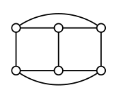](../../../assets/volume4a/figures/answer-7-49-prism.svg)

<a id="ans-7-50"></a>

**50.** [题目](../sec-7.md#ex-7-50) 此图必定是连通的, 因为当存在 $r$ 个分图时, 着三色的数量能被 $3^r$ 整除. 同时它必须包含在某个完全二部图 $K_{m,n}$ 中, 这个完全二部图可以用 $3(2^m+2^n-2)$ 种方式着 3 色. 从 $K_{m,n}$ 删除边不会减少着色的数量, 因此 $2^m+2^n-2\le8$, 从而我们有 $\{m,n\}=\{1,1\}$、$\{1,2\}$、$\{1,3\}$ 或 $\{2,2\}$. 所以, 仅有的可能性是爪形图 $K_{1,3}$ 和路径 $P_4$.

<a id="pdf-449"></a><a id="p-434"></a>

<a id="ans-7-51"></a>

**51.** [题目](../sec-7.md#ex-7-51) 一个 4 圈 $p_1\mathrel{\text{—}}L_1\mathrel{\text{—}}p_2\mathrel{\text{—}}L_2\mathrel{\text{—}}p_1$ 将对应于带有两个公共点 $\{p_1,p_2\}$ 的两条不同直线 $\{L_1,L_2\}$, 同公理 (ii) 矛盾. 所以图的围长至少是 6.

如果仅有一类平行线, 围长是 $\infty$; 如果有两类平行线, 它们的成员数量 $n\le n'$, 那么围长是 8, 或者, 如果 $n=1$, 则围长是 $\infty$. (见习题 22 的答案.) 否则, 通过从不同类的平行线中选择 3 条直线构成三角形, 我们可以找到一个 6 圈.

<a id="ans-7-52"></a>

**52.** [题目](../sec-7.md#ex-7-52) 如果直径是 $d$ 且围长是 $g$, 那么 $d\ge\lfloor g/2\rfloor$, 除非 $g=\infty$.

<a id="ans-7-53"></a>

**53.** [题目](../sec-7.md#ex-7-53) <code>happy</code> (它与 <code>tears</code> 和 <code>sweat</code> 连接, 但不与 <code>world</code> 连接).

<a id="ans-7-54"></a>

**54.** [题目](../sec-7.md#ex-7-54) (a) 它只有一个高度连通的分图. (顺便指出, 这个图是一个二部图的线图, 其中一部分对应于邮政编码首字母 $\{\mathrm A,\mathrm C,\mathrm D,\mathrm F,\mathrm G,\ldots,\mathrm W\}$, 另一部分对应于末端字母 $\{\mathrm A,\mathrm C,\mathrm D,\mathrm E,\mathrm H,\ldots,\mathrm Z\}$.)

(b) 顶点 <code>WY</code> 是孤立点. 其他入度为 0 的顶点 (即 <code>FL, GA, PA, UT, WA, WI, WV</code>) 单独构成强分图. 它们全部居于一个巨大的强分图之前, 这个巨大的强分图后面接着剩下的各个出度为 0 的单顶点强分图: <code>AZ, DE, KY, ME, NE, NH, NJ, NY, OH, TX</code>.

(c) 现在强分图 $\{\mathtt{GU}\}$ 居于 $\{\mathtt{UT}\}$ 前面; <code>NH, OH, PA, WA, WI, WV</code> 连接巨大的强分图; $\{\mathtt{FM}\}$ 居于它的前面; $\{\mathtt{AE}\}$ 和 $\{\mathtt{WY}\}$ 跟在它后面.

[达里尔·弗朗西斯和菲利普·科恩在 *Word Ways* **9** (1976), 241;**10** (1977), 46–47 中首先考虑了这种有向图.]

<a id="ans-7-55"></a>

**55.** [题目](../sec-7.md#ex-7-55) $\binom N2-\binom{n_1}2-\cdots-\binom{n_k}2$, 其中 $N=n_1+\cdots+n_k$.

<a id="ans-7-56"></a>

**56.** [题目](../sec-7.md#ex-7-56) 真. 注意: $J_n$ 是简单有向图, 但它不对应于任何多重图.

<a id="ans-7-57"></a>

**57.** [题目](../sec-7.md#ex-7-57) 假, 在连通有向图 $u\to w\leftarrow v$ 中. (但是, $u$ 和 $v$ 在同一个强连通分图中, 当且仅当 $d(u,v)<\infty$ 且 $d(v,u)<\infty$. 见 2.3.4.2 节.)

<a id="ans-7-58"></a>

**58.** [题目](../sec-7.md#ex-7-58) 每个分图是一个圈, 它的阶在 (a) 至少是 3, 在 (b) 至少是 1.

<a id="ans-7-59"></a>

**59.** [题目](../sec-7.md#ex-7-59) (a) 根据对 $n$ 的归纳法, 我们可以采用直接插入排序: 假定 $v_1\to\cdots\to v_{n-1}$. 那么, 我们有 $v_n\to v_1$ 或 $v_{n-1}\to v_n$ 或 $v_{k-1}\to v_n\to v_k$, 其中 $k$ 是使得 $v_n\to v_k$ 的最小值. [拉斯洛·雷代伊,*Acta litterarum ac scientiarum* **7** (Szeged, 1934), 39–43.]

(b) 15 条: <code>01234</code>、<code>02341</code>、<code>02413</code>, 以及它们的循环移位. [这样的定向路径的数量总是奇数. 见蒂博尔·塞莱,*Matematikai és Fizikai Lapok* **50** (1943), 223–256.]

(c) 在同构意义下, 是. (根据归纳法: 如果仅在一个位置像本题 (a) 部分中那样插入 $v_n$, 竞赛图是可迁有向图.)

<a id="ans-7-60"></a>

**60.** [题目](../sec-7.md#ex-7-60) 令 $A=\{x\mid u\to x\}$, $B=\{x\mid x\to v\}$, $C=\{x\mid v\to x\}$. 如果 $v\notin A$ 且 $A\cap B=\varnothing$, 我们有 $|A|+|B|=|A\cup B|\le n-2$, 因为 $u\notin A\cup B$ 且 $v\notin A\cup B$. 但 $|B|+|C|=n-1$, 因此 $|A|<|C|$. [海曼·兰多,*Bull. Math. Biophysics* **15** (1953), 148.]

<a id="ans-7-61"></a>

**61.** [题目](../sec-7.md#ex-7-61) $1\to1$, $1\to2$, $2\to2$. 于是 $A=\bigl(\begin{smallmatrix}1&1\\0&1\end{smallmatrix}\bigr)$, 对于所有整数 $k$ 有 $A^k=\bigl(\begin{smallmatrix}1&k\\0&1\end{smallmatrix}\bigr)$.

<a id="ans-7-62"></a>

**62.** [题目](../sec-7.md#ex-7-62) (a) 假定顶点是 $\{1,\ldots,n\}$. 在积和式的展开中, $n!$ 的每一项 $a_{1p_1}\cdots a_{np_n}$ 是带有弧 $j\to p_j$ 的生成置换有向图的数量. (b) 同样的论据证明 $\det A$ 是偶生成置换有向图的数量减去奇生成置换有向图的数量. [见弗兰克·哈拉里,*SIAM Review* **4** (1962), 202–210, 其中置换有向图被称为 “线性子图”.]

<a id="ans-7-63"></a>

**63.** [题目](../sec-7.md#ex-7-63) 令 $v$ 是任意顶点. 如果 $g=2t+1$, 对于 $1\le k\le t$ 至少有 $d(d-1)^{k-1}$ 个顶点 $x$ 满足 $d(v,x)=k$. 如果 $g=2t+2$ 且 $v'$ 是 $v$ 的任意邻近, 至少还有 $(d-1)^t$ 个顶点 $x$ 满足 $d(v,x)=t+1$ 且 $d(v',x)=t$.

<a id="ans-7-64"></a>

**64.** [题目](../sec-7.md#ex-7-64) 为了达到习题 63 答案中的下界, 每个顶点 $v$ 必须有度 $d$, 而且 $v$ 的 $d$ 个邻近必须全部同剩余的 $d-1$ 个顶点邻接. 实际上, 这个图是 $K_{d,d}$.

<a id="ans-7-65"></a>

**65.** [题目](../sec-7.md#ex-7-65) (a) 根据习题 63 的答案, $G$ 必定是度为 $d$ 的正则图, 在任何两个不同的顶点之间必定恰好有一条长度小于等于 2 的路径.

(b) 我们可以取 $\lambda_1=d$ 以及 $x_1=(1\ldots1)^T$. 所有其他特征向量满足 $Jx_j=(0\ldots0)^T$, 因此, 对于 $1<j\le N$ 有 $\lambda_j^2+\lambda_j=d-1$.

(c) 如果 $\lambda_2=\cdots=\lambda_m=(-1+\sqrt{4d-3})/2$ 且 $\lambda_{m+1}=\cdots=\lambda_N=(-1-\sqrt{4d-3})/2$, 我们必定有 $m-1=N-m$. 用这个值我们求出 $\lambda_1+\cdots+\lambda_N=d-d^2/2$.

<a id="pdf-450"></a><a id="p-435"></a>

(d) 如果 $4d-3=s^2$, 而且 $m$ 的值像 (c) 中那样, 则特征值之和是

$$
\frac{s^2+3}{4}+(m-1)\frac{s-1}{2}
-\left(\frac{(s^2+3)^2}{16}+1-m\right)\frac{s+1}{2},
$$

其值为 $15/32$ 加上 $s$ 的一个倍数. 因此 $s$ 必定是 15 的一个因数.

[这些结果属于艾伦·霍夫曼和理查德·辛格尔顿,*IBM J. Research and Development* **4** (1960), 497–504, 他们还证明了对于 $d=7$ 图 $G$ 是唯一的.]

<a id="ans-7-66"></a>

**66.** [题目](../sec-7.md#ex-7-66) 对于 $0\le a,b<5$, 用 $[a,b]$ 和 $(a,b)$ 表示 50 个顶点. 对于 $0\le a,b,c<5$, 用模 5 运算定义 3 种边:

$$
[a,b]\mathrel{\text{—}}[a+1,b];
\qquad(a,b)\mathrel{\text{—}}(a+2,b);
\qquad(a,b)\mathrel{\text{—}}[a+bc,c].
$$

[见威廉·布朗,*Canadian J. Math.* **19** (1967), 644–648;*J. London Math. Soc.* **42** (1967), 514–520. 不取前两种边, 采用习题 19 答案中的正交阵列, 这个图的围长为 6, 对应于习题 51 中那样的几何网格.]

<a id="ans-7-67"></a>

**67.** [题目](../sec-7.md#ex-7-67) 米夏埃尔·阿施巴赫尔 [*Journal of Algebra* **19** (1971), 538–540] 排除了某些可能性.

<a id="ans-7-68"></a>

**68.** [题目](../sec-7.md#ex-7-68) 如果 $G$ 有 $s$ 个自同构, 则它有 $n!/s$ 个邻接矩阵, 因为存在 $s$ 个满足 $P^{-}AP=A$ 的置换矩阵 $P$.

<a id="ans-7-69"></a>

**69.** [题目](../sec-7.md#ex-7-69) 首先对所有顶点 $v$ 置 $\mathtt{IDEG}(v)\gets0$. 然后对所有 $v$ 执行 (31), 另外, 在那个小型算法的第二行置 $u\gets\mathtt{TIP}(a)$ 和 $\mathtt{IDEG}(u)\gets\mathtt{IDEG}(u)+1$.

为了用 SGB 格式执行 “对于所有 $v$” 的某种运算, 首先置 $v\gets\mathtt{VERTICES}(g)$, 然后当 $v<\mathtt{VERTICES}(g)+\mathtt N(g)$ 时, 循环 “执行某种运算, 置 $v\gets v+1$”.

<a id="ans-7-70"></a>

**70.** [题目](../sec-7.md#ex-7-70) 步骤 B1 执行 1 次 (但花费 $O(n)$ 个单位时间). 步骤 (B2, B3, $\ldots$, B8) 分别执行 $(n+1,n,n,m+n,m,m,n)$ 次, 每次花费 $O(1)$ 个单位时间.

<a id="ans-7-71"></a>

**71.** [题目](../sec-7.md#ex-7-71) 有多种可能的选择. 这里我们采用 32 位指针, 所有数据相对于位于 <code>Data_Segment</code> 的符号地址 <code>Pool</code>. 下面的说明提供了一种方法用来建立处理基本 SGB 数据结构的约定.

<a id="pdf-451"></a><a id="p-436"></a>

```text
VSIZE IS 32 ;ASIZE IS 20                                     以字节表示的结点大小
ARCS IS 0 ;COLOR IS 8 ;LINK IS 12                             顶点字段的偏移量
TIP IS 0 ;NEXT IS 4                                         弧字段的偏移量

arcs GREG Pool+ARCS ;color GREG Pool+COLOR ;link GREG Pool+LINK
tip GREG Pool+TIP ;next GREG Pool+NEXT
u GREG ;v GREG ;w GREG ;s GREG ;a GREG ;mone GREG -1

AlgB    BZ      n,Success                                   如果图为空，则退出。
        MUL     $0,n,VSIZE                                   B1. 初始化。
        ADDU    v,v0,$0                                     v ← v0+n。
        SET     w,v0                                        w ← v0。
1H      STT     mone,color,w                                 COLOR(w) ← -1。
        ADDU    w,w,VSIZE                                   w ← w+1。
        CMP     $0,w,v
        PBNZ    $0,1B                                       重复，直到w=v。
0H      SUBU    w,w,VSIZE                                   w ← w-1。
3H      LDT     $0,color,w                                  B3. 当需要时着色w。
        PBNN    $0,2F                                       如果COLOR(w) ≥ 0，转到B2。
        STCO    0,link,w                                    COLOR(w) ← 0，LINK(w) ← Λ。
        SET     s,w                                         s ← w。
4H      SET     u,s                                         B4. 栈 ⇒ u。置u ← s。
        LDTU    s,link,s                                    s ← LINK(s)。
        LDT     $1,color,u
        NEG     $1,1,$1                                     $1 ← 1-COLOR(u)。
        LDTU    a,arcs,u                                    a ← ARCS(u)。
5H      BZ      a,8F                                        B5. 处理完u了吗？如果a=Λ，转到B8。
5H      LDTU    v,tip,a                                     v ← TIP(a)。
6H      LDT     $0,color,v                                  B6. 处理v。
        CMP     $2,$0,$1                                    （此处程序显得有点机灵。）
        PBZ     $2,7F                                       如果COLOR(v)=1-COLOR(u)，转到B7。
        BNN     $0,Failure                                  如果COLOR(v)=COLOR(u)，算法以失败终止。
        STT     $1,color,v                                  COLOR(v) ← 1-COLOR(u)。
        STTU    s,link,v                                    LINK(v) ← s。
        SET     s,v                                         s ← v。
7H      LDTU    a,next,a                                    B7. 对a循环。置a ← NEXT(a)。
        PBNZ    a,5B                                        如果a≠Λ，转到B5。
8H      PBNZ    s,4B                                        B8. 栈非空吗？如果s≠Λ，转到B4。
2H      CMP     $0,w,v0                                     B2. 完成？
        PBNZ    $0,0B                                       如果w≠v0，那么w减一，转到B3。
Success LOC     @                                           （算法以成功终止。）
```

<a id="ans-7-72"></a>

**72.** [题目](../sec-7.md#ex-7-72) (a) 当顶点进入或者退出栈时, 这个条件显然保持不变.

(b) 顶点 $v$ 已着色但尚未考察, 因为每个考察过的顶点的邻近顶点有适当的颜色.

(c) 恰在步骤 B6 置 $s\gets v$ 之前置 $\mathtt{PARENT}(v)\gets u$, 其中 <code>PARENT</code> 是一个新的应用字段. 恰在步骤 B6 以失败终止之前执行以下操作: “重复输出 $\mathtt{NAME}(u)$ 并且置 $u\gets\mathtt{PARENT}(u)$, 直到 $u=\mathtt{PARENT}(v)$; 然后输出 $\mathtt{NAME}(u)$ 和 $\mathtt{NAME}(v)$.”

<a id="ans-7-73"></a>

**73.** [题目](../sec-7.md#ex-7-73) $K_{10}$. (<code>random_graph(10,100,0,1,1,0,0,0,0,0)</code> 的另一名称是 $J_{10}$.)

<a id="ans-7-74"></a>

**74.** [题目](../sec-7.md#ex-7-74) 顶点 <code>badness</code> 有出度 22. 其他顶点的出度都不大于 20.

<a id="ans-7-75"></a>

**75.** [题目](../sec-7.md#ex-7-75) 参数 $(n_1,n_2,n_3,n_4,p,w,o)$ 分别是: (a) $(n,0,0,0,-1,0,0)$; (b) $(n,0,0,0,1,0,0)$; (c) $(n,0,0,0,1,1,0)$; (d) $(n,0,0,0,-1,0,1)$; (e) $(n,0,0,0,1,0,1)$; (f) $(n,0,0,0,1,1,1)$; (g) $(m,n,0,0,1,0,0)$; (h) $(m,n,0,0,1,2,0)$; (i) $(m,n,0,0,1,3,0)$; (j) $(m,n,0,0,-1,0,0)$; (k) $(m,n,0,0,1,3,1)$; (l) $(n,0,0,0,2,0,0)$; (m) $(2,-n,0,0,1,0,0)$.

<a id="ans-7-76"></a>

**76.** [题目](../sec-7.md#ex-7-76) 可以. 例如, 从习题 75(c) 答案中的 $C_1$ 和 $C_2$ 产生. (但是, 当 $p<0$ 时不可能出现自环, 因为弧 $x\to y=x+k\delta$ 是对于 $k=1,2,\ldots$ 直到 $y$ 超出范围或 $y=x$ 生成的.)

<a id="ans-7-77"></a>

**77.** [题目](../sec-7.md#ex-7-77) 假定 $x$ 和 $y$ 是 $d(x,y)>2$ 的两个顶点. 因此我们有 $x\mathrel{\not\text{—}}y$. 同时, 如果 $v$ 是任何其他顶点, 我们必定有 $v\mathrel{\not\text{—}}x$ 或 $v\mathrel{\not\text{—}}y$. 这些结论在 $\overline G$ 的任何两个顶点 $u$ 和 $v$ 之间产生一条长度最多是 3 的路径.

<a id="ans-7-78"></a>

**78.** [题目](../sec-7.md#ex-7-78) (a) 边的数量 $\binom n2/2$ 必定是一个整数. 最小的例子是 $K_0$、$K_1$、$P_4$、$C_5$ 和下图 (称为 “公牛”).

[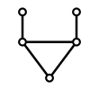](../../../assets/volume4a/figures/answer-7-78-bull.svg)

(b) 如果 $q$ 是任意奇数, 则 $u\mathrel{\text{—}}v$ 当且仅当 $\varphi^q(u)\mathrel{\not\text{—}}\varphi^q(v)$. 所以, $\varphi^q$ 不可能有两个固定点, 它也不可能包含一个 2 圈.

(c) $V$ 的这样一个置换也定义了 $K_n$ 的边的一个置换 $\widehat\varphi$. 取 $\{u,v\}\mapsto\widehat\varphi(\{u,v\})=\{\varphi(u),\varphi(v)\}$, 容易看出, $\widehat\varphi$ 的圈长度全部都是偶数. 如果 $\widehat\varphi$ 有 $t$ 个圈, 我们对每个圈的边用交替的颜色着色, 获得 $2^t$ 个自补图.

(d) 在这种情况, $\varphi$ 有唯一的固定点 $v$, 而且 $G'=G\setminus v$ 是自补图. 假定除 $(v)$ 之外 $\varphi$ 有 $r$ 个圈, 那么, $\widehat\varphi$ 具有包含接触顶点 $v$ 的边的 $r$ 个圈, 并且存在 $2^r$ 种方式把图 $G'$ 扩展为图 $G$.

[参考文献: 霍斯特·萨克斯,*Publicationes Mathematicae* **9** (Debrecen, 1962), 270–288; 格哈德·林格尔,*Archiv der Mathematik* **14** (1963), 354–358.]

<a id="ans-7-79"></a>

**79.** [题目](../sec-7.md#ex-7-79) 解法 1, 霍斯特·萨克斯给出的解, 假定 $\varphi=(1\,2\,\cdots\,4k)$: 当 $u>v>0$ 且 $(u+v)\bmod4\le1$ 时令 $u\mathrel{\text{—}}v$, 此外, 当 $v\bmod2=0$ 时令 $0\mathrel{\text{—}}v$.

<a id="pdf-452"></a><a id="p-437"></a>

解法 2, 假定 $\varphi=(a_1b_1c_1d_1)\cdots(a_kb_kc_kd_k)$, 其中 $a_j=4j-3$, $b_j=4j-2$, $c_j=4j-1$, $d_j=4j$: 对于 $1\le j\le k$ 令 $0\mathrel{\text{—}}b_j\mathrel{\text{—}}a_j\mathrel{\text{—}}c_j\mathrel{\text{—}}d_j\mathrel{\text{—}}0$, 对于 $1\le i<j\le k$ 令 $a_i\mathrel{\text{—}}a_j\mathrel{\text{—}}b_i\mathrel{\text{—}}d_j\mathrel{\text{—}}c_i\mathrel{\text{—}}c_j\mathrel{\text{—}}d_i\mathrel{\text{—}}b_j\mathrel{\text{—}}a_i$.

<a id="ans-7-80"></a>

**80.** [题目](../sec-7.md#ex-7-80) (格哈德·林格尔给出的解) 令 $\varphi$ 像习题 79 的解法 2 中那样定义. 令 $E_0$ 是对于 $1\le j\le k$ 的 $3k$ 条边 $b_j\mathrel{\text{—}}a_j\mathrel{\text{—}}c_j\mathrel{\text{—}}d_j$; 令 $E_1$ 是对于 $1\le i<j\le k$ 的 $\{a_i,b_i,c_i,d_i\}$ 和 $\{b_j,d_j\}$ 之间的 $8\binom k2$ 条边; 令 $E_2$ 是对于 $1\le i<j\le k$ 的 $\{a_i,b_i,c_i,d_i\}$ 和 $\{a_j,c_j\}$ 之间的 $8\binom k2$ 条边. 在 (a) 小题, $E_0\cup E_1$ 给出直径 2, $E_0\cup E_2$ 给出直径 3. (b) 小题是类似的情形, 但我们添加从 $b_j\mathrel{\text{—}}0\mathrel{\text{—}}d_j$ 到 $E_1$ 和从 $a_j\mathrel{\text{—}}0\mathrel{\text{—}}c_j$ 到 $E_2$ 的 $2k$ 条边.

<a id="ans-7-81"></a>

**81.** [题目](../sec-7.md#ex-7-81) $\vec C_3$、$\vec K_3$, 以及下图的 $D$ 和 $D^T$.

[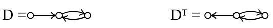](../../../assets/volume4a/figures/answer-7-81-digraphs.svg)

(有向图 $D$ 的反向图 $D^T$ 是通过颠倒图中弧的方向得到的. 存在 16 个 3 阶无环非同构简单有向图, 它们当中有 10 个是自反向的, 其中包括 $\vec C_3$ 和 $\vec K_3$.)

<a id="ans-7-82"></a>

**82.** [题目](../sec-7.md#ex-7-82) (a) 根据定义, 命题为真. (b) 真: 如果每个顶点有 $d$ 个邻近顶点, 每条边 $u\mathrel{\text{—}}v$ 有 $d-1$ 条邻近边 $u\mathrel{\text{—}}w$ 和 $d-1$ 条邻近边 $w\mathrel{\text{—}}v$. (c) 真: 对于 $0\le i<m$, $0\le j<n$, 顶点 $\{a_i,b_j\}$ 有 $m+n-2$ 个邻近顶点. (d) 假: $L(K_{1,1,2})$ 有 5 个顶点和 8 条边. (e) 真. (f) 真: 仅有的非邻近边是 $\{0,1\}\mathrel{\not\text{—}}\{2,3\}$, $\{0,2\}\mathrel{\not\text{—}}\{1,3\}$, $\{0,3\}\mathrel{\not\text{—}}\{1,2\}$. (g) 命题对于所有 $n>0$ 为真. (h) 假, 除非 $G$ 没有孤立顶点.

<a id="ans-7-83"></a>

**83.** [题目](../sec-7.md#ex-7-83) 它是佩特森图. [阿诺尔德·科瓦莱夫斯基,*Sitzungsberichte der Akademie der Wissenschaften in Wien*, Mathematisch-Nat. Klasse, Abteilung IIa, **126** (1917), 67–90.]

<a id="ans-7-84"></a>

**84.** [题目](../sec-7.md#ex-7-84) 是: 对于 $0\le u,v<3$, 令 $\varphi(\{a_u,b_v\})=\{a_{(u+v)\bmod3},b_{(u-v)\bmod3}\}$.

<a id="ans-7-85"></a>

**85.** [题目](../sec-7.md#ex-7-85) 令图的顶点度是 $\{d_1,\ldots,d_n\}$. 那么, $G$ 有 $\frac12(d_1+\cdots+d_n)$ 条边, 而 $L(G)$ 有 $\frac12(d_1(d_1-1)+\cdots+d_n(d_n-1))$ 条边. 因此, $G$ 和 $L(G)$ 恰好都有 $n$ 条边当且仅当 $(d_1-2)^2+\cdots+(d_n-2)^2=0$. 所以, 习题 58 给出了答案. [见瓦伊雷利勒·梅农,*Canadian Math. Bull.* **8** (1965), 7–15.]

<a id="ans-7-86"></a>

**86.** [题目](../sec-7.md#ex-7-86) 如果 $G$ 为下图左图, 则右图给出 $\overline G=L(G)$.

[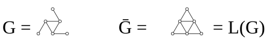](../../../assets/volume4a/figures/answer-7-86-graph-and-line-graph.svg)

<a id="ans-7-87"></a>

**87.** [题目](../sec-7.md#ex-7-87) (a) 容易看出, 是的. [事实上, 罗兰·布鲁克斯已经证明, 除完全图 $K_{d+1}$ 外, 最大顶点度 $d>2$ 的每个连通图都是 $d$ 可着色的; 见 *Proc. Cambridge Phil. Soc.* **37** (1941), 194–197.] (b) 不是. 实际上, 对图 2(e) 中的外层五圈的边仅有一种方式着三色. 这必将与对内层五圈的着色产生冲突. [1898 年, 朱利叶斯·佩特森证明了这个结论.]

<a id="ans-7-88"></a>

**88.** [题目](../sec-7.md#ex-7-88) 有一个不通过中央顶点的圈, 另有 $n(n-1)$ 个通过中央顶点的圈 (就是说, 车轮图边缘上每个不同顶点的序偶都有一个圈). 其中仅有 $n+1$ 个是诱导子图.

<a id="ans-7-89"></a>

**89.** [题目](../sec-7.md#ex-7-89) 两端分别等于

$$
\begin{pmatrix}A&O&O\\O&B&O\\O&O&C\end{pmatrix},
\quad\begin{pmatrix}A&J&J\\J&B&J\\J&J&C\end{pmatrix},
\quad\begin{pmatrix}A&J&J\\O&B&J\\O&O&C\end{pmatrix},
\quad\begin{pmatrix}A&O&O\\J&B&O\\J&J&C\end{pmatrix}.
$$

<a id="ans-7-90"></a>

**90.** [题目](../sec-7.md#ex-7-90) $K_4$ 和 $\overline{K_4}$; $K_{1,1,2}$ 和 $\overline{K_{1,1,2}}$; $K_{2,2}=C_4$ 和 $\overline{K_{2,2}}$; $K_{1,3}$ 和 $\overline{K_{1,3}}$; $K_1\oplus K_{1,2}$ 及其补图; 根据 (39), 所有 $K_\alpha$ 是余图. $P_4=\overline{P_4}$ 不是余图. (余图的全部连通诱导子图的直径都小于等于 2. $W_4$ 是余图, 但 $W_5$ 不是余图.)

<a id="ans-7-91"></a>

**91.** [题目](../sec-7.md#ex-7-91)

[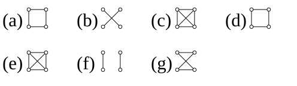](../../../assets/volume4a/figures/answer-7-91-products.svg)

(一般来说, 我们有 $K_2\mathbin{\triangle}H=(K_2\mathbin{\square}H)\cup(K_2\otimes\overline H)$ 和 $K_2\circ H=H\mathbin{\text{—}}H$. 因此, $K_2\mathbin{\triangle}H=K_2\mathbin{\square}H$ 和 $K_2\circ H=K_2\boxtimes H$ 并存当且仅当 $H$ 是完全图.)

*助记方法:* 正如雅罗斯拉夫·内谢特日尔在 *Lecture Notes in Comp. Sci.* **118** (1981), 94–102 中提出的那样, 我们的记号 $G\mathbin{\square}H$ 和 $G\boxtimes H$ 与示意图 (a) 和 (c) 完全匹配. 类似地, 他建议把 (b) 写成 $G\times H$, 同样富有吸引力, 但无法在这里采用, 因为许许多多作者已经用 $G\times H$ 表示 $G\mathbin{\square}H$.

<a id="ans-7-92"></a>

**92.** [题目](../sec-7.md#ex-7-92)

[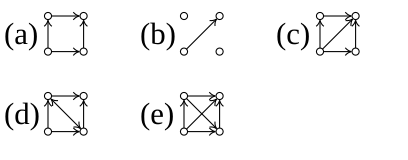](../../../assets/volume4a/figures/answer-7-92-directed-products.svg)

<a id="ans-7-93"></a>

**93.** [题目](../sec-7.md#ex-7-93) $K_m\boxtimes K_n=K_m\circ K_n\cong K_{mn}$.

<a id="ans-7-94"></a>

**94.** [题目](../sec-7.md#ex-7-94) 不是. 它们是 $K_{26}\mathbin{\square}K_{26}\mathbin{\square}K_{26}\mathbin{\square}K_{26}\mathbin{\square}K_{26}$ 的诱导子图.

<a id="ans-7-95"></a>

**95.** [题目](../sec-7.md#ex-7-95) (a) $d_u+d_v$, (b) $d_ud_v$, (c) $d_ud_v+d_u+d_v$, (d) $d_u(n-d_v)+(m-d_u)d_v$, (e) $d_un+d_v$.

<a id="pdf-453"></a><a id="p-438"></a>

<a id="ans-7-96"></a>

**96.** [题目](../sec-7.md#ex-7-96) (a) $A\mathbin{\square}B=A\otimes I+I\otimes B$; (b) $A\boxtimes B=A\mathbin{\square}B+A\otimes B$; (c) $A\mathbin{\triangle}B=A\otimes J+J\otimes B-2A\otimes B$; (d) $A\circ B=A\otimes J+I\otimes B$. (公式 (a)、(b)、(d) 定义了任意有向图与多重图的图积. 公式 (c) 通常对于简单有向图成立, 但当 $A$ 和 $B$ 包含大于 1 的值时可能出现负值项.)

*历史注记:* 矩阵的直积通常称为克罗内克积, 因为库尔特·亨泽尔 [*Crelle* **105** (1889), 329–344] 说他在克罗内克的讲演中听到过它. 然而, 实际上克罗内克没有发表过关于矩阵直积的任何文章. 矩阵的直积首次公诸于世是在约翰·泽富斯的文章 [*Zeitschrift für Math. und Physik* **3** (1858), 298–301] 中, 他证明了当 $m=m'$ 且 $n=n'$ 时 $\det(A\otimes B)=(\det A)^n(\det B)^m$. 基本公式 $(A\otimes B)^T=A^T\otimes B^T$, $(A\otimes B)(A'\otimes B')=AA'\otimes BB'$, $(A\otimes B)^{-1}=A^{-1}\otimes B^{-1}$ 归功于阿道夫·赫维茨 [*Math. Annalen* **45** (1894), 381–404].

<a id="ans-7-97"></a>

**97.** [题目](../sec-7.md#ex-7-97) 对邻接矩阵的运算表明 $(G\oplus G')\mathbin{\square}H=(G\mathbin{\square}H)\oplus(G'\mathbin{\square}H)$; $(G\oplus G')\boxtimes H=(G\boxtimes H)\oplus(G'\boxtimes H)$; $(G\oplus G')\circ H=(G\circ H)\oplus(G'\circ H)$. 因为 $G\mathbin{\square}H\cong H\mathbin{\square}G$, $G\otimes H\cong H\otimes G$, $G\boxtimes H\cong H\boxtimes G$, 我们还有右分配律 $G\mathbin{\square}(H\oplus H')\cong(G\mathbin{\square}H)\oplus(G\mathbin{\square}H')$; $G\otimes(H\oplus H')\cong(G\otimes H)\oplus(G\otimes H')$; $G\boxtimes(H\oplus H')\cong(G\boxtimes H)\oplus(G\boxtimes H')$. 字典积满足 $\overline{G\circ H}=\overline G\circ\overline H$, 我们还有 $K_m\circ H=H\mathbin{\text{—}}\cdots\mathbin{\text{—}}H$, 因此 $K_m\circ\overline{K_n}=K_{n,\ldots,n}$. 此外, 我们有 $G\circ K_n=G\boxtimes K_n$; $K_m\mathbin{\square}K_n=\overline{K_m\otimes K_n}=L(K_{m,n})$.

<a id="ans-7-98"></a>

**98.** [题目](../sec-7.md#ex-7-98) 有 $kl$ 个分图 (因为上题中的分配律, 以及当 $G$ 和 $H$ 是连通图时 $G\mathbin{\square}H$ 和 $G\boxtimes H$ 都是连通的这一事实).

<a id="ans-7-99"></a>

**99.** [题目](../sec-7.md#ex-7-99) $G\mathbin{\square}H$ 中每条从顶点 $(u,v)$ 到 $(u',v')$ 的路径必须用至少 $d_G(u,u')$ 个 “$G$ 步” 和至少 $d_H(v,v')$ 个 “$H$ 步”, 最小值是可达的. 同理可证, $d_{G\boxtimes H}((u,v),(u',v'))=\max(d_G(u,u'),d_H(v,v'))$.

<a id="ans-7-100"></a>

**100.** [题目](../sec-7.md#ex-7-100) 如果 $G$ 和 $H$ 是连通图, 而且它们中的每个至少有两个顶点, $G\otimes H$ 不是连通图的充分必要条件是 $G$ 和 $H$ 都是二部图. 充分性容易证明. 反之, 如果 $G$ 中存在一个奇数圈, 我们可以按以下步骤从 $(u,v)$ 到达 $(u',v')$: 首先前往 $(u'',v')$, 其中 $u''$ 是 $G$ 中任意一个恰好合适的顶点; 然后, 在 $G$ 中移动偶数步从 $u''$ 到达 $u'$; 同时, 在 $H$ 的顶点 $v'$ 及其一个邻近顶点之间交替进行这样的移动. [保罗·韦克塞尔,*Proc. Amer. Math. Soc.* **13** (1962), 47–52.]

<a id="ans-7-101"></a>

**101.** [题目](../sec-7.md#ex-7-101) 选择具有最大度数的顶点 $u$ 和 $v$. 那么, 根据习题 95, 我们有 $d_u+d_v=d_ud_v$. 所以, 要么 $G=H=K_1$, 要么 $d_u=d_v=2$. 在后一种情形, 我们有 $G=P_m$ 或 $C_m$, $H=P_n$ 或 $C_n$. 但 $G\mathbin{\square}H$ 是连通图, 所以, $G$ 和 $H$ 中必定有一个不是二部图, 我们不妨假定 $G$ 不是二部图. 因此, $G\mathbin{\square}H$ 不是二部图, 从而 $H$ 也必定不是二部图. 于是, $G=C_m$, $H=C_n$, 其中 $m$ 和 $n$ 都是奇数. 在 $C_m\mathbin{\square}C_n$ 中最短奇数圈的长度是 $\min(m,n)$, 在 $C_m\otimes C_n$ 中最短奇数圈的长度是 $\max(m,n)$, 因此 $m=n$. 反过来, 如果 $n\ge3$ 是奇数, 在对 $(u,v)\mapsto((u+v)\bmod n,(u-v)\bmod n)$ 的同构下, 我们有 $C_n\mathbin{\square}C_n\cong C_n\otimes C_n$. [唐纳德·米勒,*Canadian J. Math.* **20** (1968), 1511–1521.]

<a id="ans-7-102"></a>

**102.** [题目](../sec-7.md#ex-7-102) $P_m\boxtimes P_n$. (仅当 $\min(m,n)\le2$ 或 $m=n=3$ 时它是平面图.)

<a id="ans-7-103"></a>

**103.** [题目](../sec-7.md#ex-7-103)

<table class="book-tableau">
<tbody>
<tr><th scope="row" style="border:0;background:none">1</th><td>2</td><td>3</td><td>4</td><td>5</td><td>7</td></tr>
<tr><th scope="row" style="border:0;background:none">2</th><td>1</td><td>3</td><td>4</td><td>6</td><td>8</td></tr>
<tr><th scope="row" style="border:0;background:none">3</th><td>1</td><td>2</td><td>5</td><td>6</td><td>8</td></tr>
<tr><th scope="row" style="border:0;background:none">4</th><td>1</td><td>2</td><td>5</td><td>6</td></tr>
<tr><th scope="row" style="border:0;background:none">5</th><td>3</td><td>4</td><td>1</td><td>7</td></tr>
<tr><th scope="row" style="border:0;background:none">6</th><td>2</td><td>3</td><td>4</td></tr>
<tr><th scope="row" style="border:0;background:none">7</th><td>5</td><td>1</td></tr>
<tr><th scope="row" style="border:0;background:none">8</th><td>2</td><td>3</td></tr>
</tbody>
</table>

<table class="book-tableau">
<tbody>
<tr><th scope="row" style="border:0;background:none">1</th><td>2</td><td>3</td><td>4</td><td>5</td><td>6</td><td>7</td><td>8</td><td>9</td></tr>
<tr><th scope="row" style="border:0;background:none">2</th><td>1</td><td>3</td><td>4</td><td>6</td><td>8</td><td>9</td></tr>
<tr><th scope="row" style="border:0;background:none">3</th><td>1</td><td>2</td><td>5</td><td>6</td><td>8</td><td>9</td></tr>
<tr><th scope="row" style="border:0;background:none">4</th><td>1</td><td>2</td><td>5</td><td>7</td></tr>
<tr><th scope="row" style="border:0;background:none">5</th><td>3</td><td>4</td><td>1</td><td>7</td></tr>
<tr><th scope="row" style="border:0;background:none">6</th><td>2</td><td>3</td><td>1</td><td>7</td></tr>
<tr><th scope="row" style="border:0;background:none">7</th><td>4</td><td>5</td><td>6</td><td>1</td></tr>
<tr><th scope="row" style="border:0;background:none">8</th><td>2</td><td>3</td><td>1</td><td>9</td></tr>
<tr><th scope="row" style="border:0;background:none">9</th><td>8</td><td>2</td><td>3</td><td>1</td></tr>
</tbody>
</table>

<a id="ans-7-104"></a>

**104.** [题目](../sec-7.md#ex-7-104) 为了保持表的形状, 必须按某种巡回顺序建立边. 变量 $i$ 和 $r$ 限定 $t$ 列中可用的行. 例如, 习题 103 的第二部分从 $i\gets1,t\gets8,r\gets1$ 开始; 然后 $9\mathrel{\text{—}}1,i\gets2,t\gets6,r\gets3$; 然后 $9\mathrel{\text{—}}3,9\mathrel{\text{—}}2,i\gets4,t\gets4,r\gets8$; 然后 $9\mathrel{\text{—}}8$.

<a id="ans-7-105"></a>

**105.** [题目](../sec-7.md#ex-7-105) 注意到 $d_k\ge k$ 当且仅当 $c_k\ge k$. 当 $d_k\ge k$ 时我们有

$$
c_1+\cdots+c_k=k^2+\min(k,d_{k+1})+\min(k,d_{k+2})+\cdots+\min(k,d_n);
$$

<a id="pdf-454"></a><a id="p-439"></a>

所以, 条件 $d_1+\cdots+d_k\le c_1+\cdots+c_k-k$ 等价于

$$
d_1+\cdots+d_k\le f(k),\qquad
\text{其中 }f(k)=k(k-1)+\min(k,d_{k+1})+\cdots+\min(k,d_n).
\tag{*}
$$

如果 $k\ge s$, 我们有 $f(k+1)-f(k)=2k-d_{k+1}\ge d_{k+1}$. 因此, (\*) 对于 $1\le k\le n$ 成立当且仅当它对于 $1\le k\le s$ 成立. 条件 (\*) 是彼得·爱尔特希和蒂博尔·高洛伊发现的 [*Matematikai Lapok* **11** (1960), 264–274]. 如果我们考查 $\{1,\ldots,k\}$ 和 $\{k+1,\ldots,n\}$ 之间的边, 它显然是必要条件.

令 $a_k=d_1+\cdots+d_k-c_1-\cdots-c_k+k$, 并假定对于某个 $k\le s$ 我们在步骤 H2 达到 $a_k>0$. 令 $A_j,C_j,D_j,N,S$ 分别是在步骤 H3 和 H4 之前对应于 $a_j,c_j,d_j,n,s$ 的数. 于是, $N=n+1$, $D_j=d_j+(0\text{ 或 }1)$, 等等. 我们需要证明对于某个 $K\le S$ 有 $A_K>0$.

步骤 H3 和 H4 对于某些 $t\ge S$ 和 $q>0$ 消去了 $N$ 行, 以及 $t$ 列中最底部剩余的 $q$ 个单元, 还有 1 至 $p$ 行中最右端的单元. 如果 $p>0$, 我们有 $C_{t+1}=p$. 令 $r=D_N=p+q,u=C_t$. 注意到对于 $p<j\le u$ 有 $D_j=t$, 对于 $1\le j\le r$ 有 $C_j=N$, 此外, 对于 $1\le j\le p$ 有 $A_j=a_j$.

如果 $k$ 是最小的, 我们有 $1\le a_k\le d_k-c_k+1$, 因此 $c_k\le d_k$. 如果 $D_k>t$, 则我们有 $k\le p,A_k=a_k$. 如果 $D_k<t$, 我们可以推出 $A_k=a_k+r-\min(k,r)\ge a_k$, 因为 $k\le D_k$. 于是, 我们可以假设 $D_k=t$.

假定 $t>S$, 因此 $u\le S$. 对于 $k<j\le u$, 我们有 $d_j\ge D_j-1=t-1\ge d_k-1\ge c_k-1\ge c_j-1$. 于是 $a_u\ge a_k>0$. 但 $A_u=a_u$, 因为 $r\le u\le S<t$. 所以, 我们可以假设 $t=S$. 假定 $k<t$, 那么 $c_k=d_k=t$, 因为 $S\le c_k\le d_k\le t$. 但 $r=t$ 导致 $c_k=N-1$, 矛盾. 此外, $r<t$ 导致 $u=t$, 由此推出 $A_t>A_{t-1}=a_{t-1}-1\ge0$.

(深呼吸.) 好, 我们已经把问题简化成 $k=t=S$ 的情形. 因此 $t=s\le c_t\le d_t\le D_t=t$, 而且我们有 $a_t=a_{t-1}+1$. 所以 $a_{t-1}=0$.

事实上, 根据对 $t-j$ 的归纳法, 对于 $p\le j<t$ 我们可以证明 $a_j=0$. 如果 $a_{j+1}=0$, 那么 $0\ge a_j=c_{j+1}-t-1\ge q-1\ge0$, 因为当 $p\le j<t-1$ 时 $c_{j+1}\ge t+q$.

如果 $p<t-1$, 这个论证证明了 $q=1,c_r=N-1=t+1$. 我们推断, 无论 $p$ 取什么值, 必定有 $q=1,N=t+2,D_j=t+1$ (对于 $1\le j\le p$), $D_j=t$ (对于 $p<j\le t+1$), $D_N=p+1$. 实际上, 算法 H 把这个 “好” 序列变成了 “坏” 序列, 但 $D_1+\cdots+D_N=2p+t(t+1)+1$ 是奇数.

<a id="ans-7-106"></a>

**106.** [题目](../sec-7.md#ex-7-106) 在 $d\le1$ 和 $n\ge d+2$ 这种平凡情形是假. 在其他情形是真: 事实上, 步骤 H4 生成的前 $n-1$ 条边不包含圈, 所以它们构成一棵生成树.

<a id="ans-7-107"></a>

**107.** [题目](../sec-7.md#ex-7-107) 习题 78 的置换 $\varphi$ 把度数为 $d$ 的顶点变成度数为 $n-1-d$ 的顶点. $\varphi^2$ 是自同构, 它使度数相等的两个顶点配对, 除了一个度数为 $(n-1)/2$ 的固定点 (如果有的话).

(反过来, 假定当 $n$ 是奇数时有 $d_{(n-1)/2}=(n-1)/2$, 算法 H 的某个有些复杂的扩展将从满足这些条件的每个图序列中构造一个自补图. 见克里斯托弗·克拉彭和丹尼尔·克莱特曼,*J. Combinatorial Theory* **B20** (1976), 67–74.)

<a id="ans-7-108"></a>

**108.** [题目](../sec-7.md#ex-7-108) 我们可以假定 $d_1^+\ge\cdots\ge d_n^+$. 入度 $d_k^-$ 不需要任何特定的顺序. 对序列 $d_1\ldots d_n=d_1^+\ldots d_n^+$ 应用算法 H, 但作如下改变: 步骤 H2 改为 “[完成?] 如果 $d_1=n=0$, 算法以成功终止; 如果 $d_1>n$, 算法以失败终止.” 在步骤 H3, 把 “$j\gets d_n$” 改为 “$j\gets d_n^-$”, 加上 “如果 $j>c_1$, 算法以失败终止.” 在步骤 H4, 把 “置 $c_j\gets c_j-1,m\gets c_t$, 建立边 $n\mathrel{\text{—}}m$” 改为 “如果 $j>0$, 置 $m\gets c_t$, 建立弧 $m\to n$”, 在 “返回 H2” 之前加上 “置 $n\gets n-1$”. 类似引理 M 和推论 H 的论证表明这个方法是正确的.

(习题 7.2.1.4-57 表明, 存在这样的有向图的充分必要条件是: $d_1^-+\cdots+d_n^-=d_1^++\cdots+d_n^+$ 且 $d_1^-\ldots d_n^-=\{d'_1,\ldots,d'_n\}$, 其中 $d'_1\ge\cdots\ge d'_n$, 同时 $d'_1\ldots d'_n$ 是由共轭分划 $c_1\ldots c_n=(d_1^+\ldots d_n^+)^T$ 优化的. 禁止出现 $v\to v$ 环的变形是更难的. 见德尔伯特·富尔克森,*Pacific J. Math.* **10** (1960), 831–836.)

<a id="ans-7-109"></a>

**109.** [题目](../sec-7.md#ex-7-109) 置 $d_k^+=d_k[k\le m],d_k^-=d_k[k>m]$, 其余与习题 108 的算法相同.

<a id="ans-7-110"></a>

**110.** [题目](../sec-7.md#ex-7-110) 存在度数为 $d=d_1$ 的 $p$ 个顶点和度数为 $d-1$ 的 $q$ 个顶点, 其中 $p+q=n$.

<a id="pdf-455"></a><a id="p-440"></a>

情形 1, $d=2k+1$. 每当 $(u-v)\bmod n\in\{2,3,\ldots,k+1,n-k-1,\ldots,n-3,n-2\}$ 时产生 $u\mathrel{\text{—}}v$. 另外增加 $p/2$ 条边 $1\mathrel{\text{—}}2,3\mathrel{\text{—}}4,\ldots,(p-1)\mathrel{\text{—}}p$.

情形 2, $d=2k>0$. 每当 $(u-v)\bmod n\in\{2,3,\ldots,k,n-k,\ldots,n-3,n-2\}$ 时产生 $u\mathrel{\text{—}}v$, 另外增加边 $1\mathrel{\text{—}}2,\ldots,(q-1)\mathrel{\text{—}}q$, 以及路径或圈 $(q=0\mathbin{?}n\mathbin{:}q)\mathrel{\text{—}}(q+1)\mathrel{\text{—}}\cdots\mathrel{\text{—}}(n-1)\mathrel{\text{—}}n$. [王大伦和丹尼尔·克莱特曼在 *Networks* **3** (1973), 225–239 中证明了这样的图是高度连通的.]

<a id="ans-7-111"></a>

**111.** [题目](../sec-7.md#ex-7-111) 假定 $N=n+n',\quad V'=\{n+1,\ldots,N\}$. 我们需要构造 $k$ 和 $V'$ 之间的 $e_k=d-d_k$ 条边和 $V'$ 内部附加的边, 使得 $V'$ 的每个顶点的度为 $d$. 令 $s=e_1+\cdots+e_n$, 这项任务仅在下列条件下可以完成: (i) $n'\ge\max(e_1,\ldots,e_n)$; (ii) $n'd\ge s$; (iii) $n'd\le s+n'(n'-1)$; (iv) $(n+n')d$ 是偶数.

每当 $n'$ 满足条件 (i)–(iv) 时存在这样的边: 首先, 根据 (i), 通过循环选择端点 $(n+1,n+2,\ldots,n+n',n+1,\ldots)$, 我们可以在 $V$ 与 $V'$ 之间建立 $s$ 条符合条件的边. 这个过程对 $V'$ 的每个顶点确定 $\lfloor s/n'\rfloor$ 或 $\lceil s/n'\rceil$ 条边. 根据条件 (ii) 我们有 $\lceil s/n'\rceil\le d$, 根据条件 (iii) 我们有 $d-\lfloor s/n'\rfloor\le n'-1$. 因此, 根据习题 110 和条件 (iv), 所需的 $V'$ 内部附加的边是可以建立的.

选择 $n'=n$ 始终是可行的. 反之, 如果 $G=K_n(V)\setminus\{1\mathrel{\text{—}}2\}$, 当 $n\ge4$ 时, 条件 (iii) 要求 $n'\ge n$. [保罗·爱尔特希和保罗·凯利,*AMM* **70** (1963), 1074–1075.]

<a id="ans-7-112"></a>

**112.** [题目](../sec-7.md#ex-7-112) 在网络 `miles` 的数据中, 唯一最好的三角形是

$$
\mathtt{Saint\ Louis,\ MO}\mathrel{\overset{748}{\text{—}}}\mathtt{Toronto,\ ON}\mathrel{\overset{746}{\text{—}}}\mathtt{Winston\text{-}Salem,\ NC}\mathrel{\overset{748}{\text{—}}}\mathtt{Saint\ Louis,\ MO}.
$$

<a id="ans-7-113"></a>

**113.** [题目](../sec-7.md#ex-7-113) 由墨菲定律它有 $n$ 行 $m$ 列, 所以它是 $n\times m$ 矩阵而不是 $m\times n$ 矩阵.

<a id="ans-7-114"></a>

**114.** [题目](../sec-7.md#ex-7-114) 多重图中的环是指顶点重复的一条边 $\{a,a\}$, 而且多重图是 2 一致超图. 因此, 当一般超图的一条边包含的某个顶点超过一次时, 我们应当允许它的关联矩阵有大于 1 的元素. (学究或许会把这种图称为 “多重超图”.) 考虑这些因素, 对应于 (26) 的关联矩阵和二部多重图是

$$
\begin{pmatrix}
2&1&0&0&0&0\\
0&1&1&1&0&0\\
0&0&1&1&2&2
\end{pmatrix};
$$

[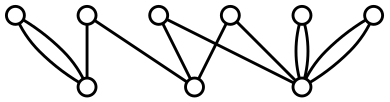](../../../assets/volume4a/figures/answer-7-114-incidence-multigraph.svg)

<a id="ans-7-115"></a>

**115.** [题目](../sec-7.md#ex-7-115) $B^TB$ 的 $e$ 行 $f$ 列的元素是 $\sum_v b_{ve}b_{vf}$, 所以, $B^TB$ 是 $2I$ 加上 $L(G)$ 的邻接矩阵. 同样, $BB^T$ 是 $D$ 加上 $G$ 的邻接矩阵, 其中 $D$ 是具有 “$d_{vv}=v$ 的度” 的对角矩阵. (见习题 2.3.4.2-18, 19, 20.)

<a id="ans-7-116"></a>

**116.** [题目](../sec-7.md#ex-7-116) 对于所有 $r\ge1$, 推广 (38), $\overline{K_{m,n}^{(r)}}=K_m^{(r)}\oplus K_n^{(r)}$.

<a id="ans-7-117"></a>

**117.** [题目](../sec-7.md#ex-7-117) 关于 $m=4,V=\{0,1,2\}$ 的单边非同构多重集是 $\{\{0\},\{0\},\{0\},\{0\}\}$, $\{\{0\},\{0\},\{0\},\{1\}\}$, $\{\{0\},\{0\},\{1\},\{1\}\}$, $\{\{0\},\{0\},\{1\},\{2\}\}$. 答案通常是 $m$ 最多分拆成 $n$ 部分的数量, 用 7.2.1.4 节的记号就是 $\left|\genfrac{}{}{0pt}{}{m+n}{n}\right|$. (当然, 没有什么理由考虑 1 一致超图的分拆, 除非解答奇怪的习题.)

<a id="ans-7-118"></a>

**118.** [题目](../sec-7.md#ex-7-118) 令顶点度数之和为 $d$. 对应的二部图是具有 $m+n$ 个顶点、$d$ 条边和 $p$ 个分图的森林. 因此, 根据定理 2.3.4.1A, 我们有 $d=m+n-p$.

<a id="ans-7-119"></a>

**119.** [题目](../sec-7.md#ex-7-119) 它有一条包含所有 7 个顶点的额外的边.

<a id="ans-7-120"></a>

**120.** [题目](../sec-7.md#ex-7-120) 我们可以说 (超) 弧是顶点的任意序列, 或者说是不同顶点的序列. 但是, 似乎多数作者把超弧定义为 $A\to v$, 其中 $A$ 是顶点的无序集. 如果能找到最佳定义, 它也许是具有最重要实用价值的一个定义.

<a id="ans-7-121"></a>

**121.** [题目](../sec-7.md#ex-7-121) $\chi(H)=|F|-\alpha(I(H)^T)$ 是用 $F$ 的集合的 $V$ 的最小覆盖的大小.

<a id="ans-7-122"></a>

**122.** [题目](../sec-7.md#ex-7-122) (a) 不难验证恰好有 7 个三元素覆盖 (即一条边的顶点), 所以有 7 个四元素独立集 (即一条边的补). 我们不能对超图着双色, 因为一种颜色需要使用 4 次而其他 3 个顶点是一条边. (超图 (56) 实际上是具有 7 个点和 7 条线的射影平面.)

(b) 由于我们是求对偶图, 不妨把佩特森图的顶点和边分别称为 “点” 和 “线”. 于是, 对偶的顶点和边分别是线和点. 对连接外部点和内部点的 5 条线着红色. 其他 10 条线是独立的 (它们不包含接触任何点的所有 3 条线), 所以它们可以着绿色. 任何包含 11 条线的集合都不可能是独立的, 因为 4 条线不可能接触所有 10 个点. (因此佩特森对偶图是二部超图, 尽管存在它包含长度为 5 的圈这一事实.)

<a id="ans-7-123"></a>

**123.** [题目](../sec-7.md#ex-7-123) 它们对应于 $n\times n$ 的拉丁方, 其中的元素是顶点的颜色.

<a id="pdf-456"></a><a id="p-441"></a>

<a id="ans-7-124"></a>

**124.** [题目](../sec-7.md#ex-7-124) 无疑, 4 种颜色足够了. 如果它是可 3 着色的, 每种颜色必定有 4 个顶点, 因为没有 5 个顶点是独立的. 于是两个对角必定有相同的颜色, 立即产生矛盾.

<a id="ans-7-125"></a>

**125.** [题目](../sec-7.md#ex-7-125) 当 $g=4$ 时, 赫瓦塔尔图是最小的这种图. 当 $g=5$ 时, 冈纳·布林克曼找到最小的这种图: 它有 21 个顶点 $a_j,b_j,c_j$, 其中 $0\le j<7$, 以及下标按模 7 取值的边 $a_j\mathrel{\text{—}}a_{j+2},a_j\mathrel{\text{—}}b_j,a_j\mathrel{\text{—}}b_{j+1},b_j\mathrel{\text{—}}c_j,b_j\mathrel{\text{—}}c_{j+2},c_j\mathrel{\text{—}}c_{j+3}$; 马库斯·梅林格证明, 如果 $g>5$ 这种图必定至少有 35 个顶点. 布兰科·格兰巴姆猜测 $g$ 可以任意大, 但不知道进一步的结构. [见 *AMM* **77** (1970), 1088–1092; *Graph Theory Notes of New York* **32** (1997), 40–41.]

<a id="ans-7-126"></a>

**126.** [题目](../sec-7.md#ex-7-126) 当 $m$ 和 $n$ 是偶数时, $C_m$ 和 $C_n$ 都是二部图, 容易 4 着色. 其他情形都不可能 4 着色. 当 $m=n=3$ 时, 根据习题 93, 9 着色是最优着色. 当 $m=3$ 且 $n=4$ 或 5 时, 最多有两个顶点是独立的, 容易找到最优的 6 着色或 8 着色. 否则, 通过对 $(a_j+2b_k)\bmod5$ 情形的顶点 $(j,k)$ 着色, 我们得到一个 5 着色, 其中, 存在周期长度分别为 $m$ 和 $n$ 的周期序列 $\langle a_j\rangle$ 和 $\langle b_k\rangle$, 使得 $a_j-a_{j+1}\equiv\pm1$ 和 $b_k-b_{k+1}\equiv\pm1$ 对所有 $j$ 和 $k$ 成立. [卡塔林·韦斯泰尔戈姆比,*Acta Cybernetica* **4** (1979), 207–212.]

<a id="ans-7-127"></a>

**127.** [题目](../sec-7.md#ex-7-127) (a) 当 $n=1$ 时, 结果是正确的. 在其他情形, 令 $H=G\setminus v$, 其中 $v$ 是任意顶点. 于是 $\overline H=\overline G\setminus v$, 根据归纳法, 我们有 $\chi(H)+\chi(\overline H)\le n$. 显然 $\chi(G)\le\chi(H)+1$ 且 $\chi(\overline G)\le\chi(\overline H)+1$, 所以这不成问题, 除非在上述 3 个式子中等号都成立. 但它不可能发生. 这蕴涵 $\chi(H)\le d$ 且 $\chi(\overline H)\le n-1-d$, 其中 $d$ 是 $G$ 中 $v$ 的度数. [爱德华·诺德豪斯和杰里·加德姆,*AMM* **63** (1956), 175–177.]

为使等号成立, 令 $G=K_a\oplus\overline{K_b}$, 其中 $ab>0$ 且 $a+b=n$. 于是我们有 $\overline G=\overline{K_a}\mathrel{\text{—}}K_b,\chi(G)=a,\chi(\overline G)=b+1$. [汉斯-约阿希姆·芬克在 *Wiss. Zeit. der Tech. Hochschule Ilmenau* **12** (1966), 243–246 中求出了使等号成立的所有图.]

(b) $G$ 的一个 $k$ 着色至少对某种颜色有 $\lceil n/k\rceil$ 个顶点, 这些顶点构成 $\overline G$ 中的团. 因此 $\chi(G)\chi(\overline G)\ge\chi(G)\lceil n/\chi(G)\rceil\ge n$. 当 $G=K_n$ 时等号成立.

(根据 (a) 和 (b), 我们推出 $\chi(G)+\chi(\overline G)\ge2\sqrt n$ 且 $\chi(G)\chi(\overline G)\le\tfrac14(n+1)^2$.)

<a id="ans-7-128"></a>

**128.** [题目](../sec-7.md#ex-7-128) $\chi(G\mathbin{\square}H)=\max(\chi(G),\chi(H))$. 显然需要这么多颜色. 如果函数 $a(u)$ 和 $b(v)$ 用颜色 $\{0,1,\ldots,k-1\}$ 着色 $G$ 和 $H$, 我们可以用 $c(u,v)=(a(u)+b(v))\bmod k$ 着色 $G\mathbin{\square}H$.

<a id="ans-7-129"></a>

**129.** [题目](../sec-7.md#ex-7-129) 一个完整的行或列的图形 (16 种); 一个完整的长度为 4 或更大的对角线图形 (18 种); 一个五格图形 $\{(x,y),(x-a,y-a),(x-a,y+a),(x+a,y-a),(x+a,y+a)\}$, 其中 $a\in\{1,2,3\}$($36+16+4$ 种); 一个五格图形 $\{(x,y),(x-a,y),(x+a,y),(x,y-a),(x,y+a)\}$, 其中 $a\in\{1,2,3\}$($36+16+4$ 种); 一个包含五格中的四格的图形, 其中第五格落在棋盘外 ($24+32+24$ 种); 一个四格图形 $\{(x,y),(x+a,y),(x,y+a),(x+a,y+a)\}$, 其中 $a\in\{1,3,5,7\}$($49+25+9+1$ 种). 共有 310 个极大团, 大小为 $(4,5,6,7,8)$ 的团分别有 $(168,116,4,4,18)$ 个.

<a id="ans-7-130"></a>

**130.** [题目](../sec-7.md#ex-7-130) 如果图 $G$ 有 $p$ 个极大团, 图 $H$ 有 $q$ 个极大团, 那么联合图 $G\mathrel{\text{—}}H$ 有 $pq$ 个极大团, 因为 $G\mathrel{\text{—}}H$ 的团就是 $G$ 的团和 $H$ 的团的并集. 此外, 空图 $\overline{K_n}$ 具有 $n$ 个极大团 (就是它的单顶点集).

因此, 各部大小为 $\{n_1,\ldots,n_k\}$ 的完全 $k$ 部图作为上述大小的空图的联合图, 具有 $n_1\cdots n_k$ 个极大团.

<a id="ans-7-131"></a>

**131.** [题目](../sec-7.md#ex-7-131) 假设 $n>1$. 在一个完全 $k$ 部图中, 当各部大小为 3 时, 数 $n_1\cdots n_k$ 达到极大值, 或许大小为 2 的一部或两部除外. (见习题 7.2.1.4-68(b).) 所以, 我们必须证明在任何图中 $N(n)$ 不会大于这个数.

令 $m(v)$ 是包含顶点 $v$ 的极大团的数量. 如果 $u\mathrel{\not\text{—}}v$ 且 $m(u)\le m(v)$, 构造与图 $G$ 相似的图 $G'$, 除了 $u$ 是邻接于 $v$ 现在的所有邻近顶点而不是它过去的邻近顶点. 每个极大团 $U$ 在两个图的任何一个中属于以下 3 种类型之一.

(i) $u\in U$; 这种团在 $G$ 中有 $m(u)$ 个, 在 $G'$ 中有 $m(v)$ 个.

(ii) $v\in U$; 这种团在 $G$ 中有 $m(v)$ 个, 在 $G'$ 中也有 $m(v)$ 个.

(iii) $u\notin U$ 且 $v\notin U$; 这种 $G$ 中的极大团也是 $G'$ 中的极大团.

所以, $G'$ 拥有至少同 $G$ 一样多的极大团. 相应地重复这个过程, 我们可以获得一个完全 $k$ 部图.

[这个由保罗·爱尔特希给出的证明, 曾经由约翰·穆恩和利奥·莫泽在 *Israel J. Math.* **3** (1965), 23–25 中提出.]

<a id="pdf-457"></a><a id="p-442"></a>

<a id="ans-7-132"></a>

**132.** [题目](../sec-7.md#ex-7-132) 根据习题 93, $G$ 和 $H$ 中团的强积是 $G\boxtimes H$ 中的团, 因此 $\omega(G\boxtimes H)\ge\omega(G)\omega(H)=\chi(G)\chi(H)$. 另一方面, $G$ 和 $H$ 的着色 $a(u)$ 和 $b(v)$ 导致 $G\boxtimes H$ 的着色 $c(u,v)=(a(u),b(v))$, 因此 $\chi(G\boxtimes H)\le\chi(G)\chi(H)$. 同时我们有 $\omega(G\boxtimes H)\le\chi(G\boxtimes H)$.

<a id="ans-7-133"></a>

**133.** [题目](../sec-7.md#ex-7-133) (a) 24; (b) 60; (c) 3; (d) 6; (e) 6; (f) 4; (g) 5; (h) 4; (i) $K_2\boxtimes C_{12}$; (j) 18; (k) 12. (l) 是, 它是度数为 5 的正则图. (m) 不是. [事实上, 马库斯·基马尼在 2009 年用分支切割方法证明, 无法以少于 12 个交叉点画出它.] (n) 是, 事实上, 它是四连通的 (见 7.4.1 节). (o) 是, 用两条弧表示每条边, 就可以把每个图看成有向图. (p) 自然不是. (q) 无疑是.

[音乐图表示主音调之间的简单变调. 它出现在罗宾·威尔逊和约翰·沃特金斯的 *Graphs* (1990) 的 73 页上.]

<a id="ans-7-134"></a>

**134.** [题目](../sec-7.md#ex-7-134) 通过旋转和 (或) 交换内部顶点与外部顶点, 我们可以找到把任何顶点转变为顶点 C 的一个自同构. 如果固定 C, 我们可以交换其余 11 对顶点的任何子集的内部顶点与外部顶点, 和 (或) 做一次左右的反射. 所以, 共有 $24\times2^{11}\times2=98304$ 个自同构.

<a id="ans-7-135"></a>

**135.** [题目](../sec-7.md#ex-7-135) 令 $\omega=e^{2\pi i/12}$, 定义矩阵 $Q=(q_{ij}),S=(s_{ij})$, 其中 $q_{ij}=[j=(i+1)\bmod12],s_{ij}=\omega^{ij}$($0\le i,j<12$). 根据习题 96(b), 音乐图 $K_2\boxtimes C_{12}$ 的邻接矩阵是 $A=\begin{pmatrix}1&1\\1&1\end{pmatrix}\otimes(I+Q+Q^{-})-I$. 令 $T$ 表示矩阵 $\begin{pmatrix}1&1\\1&-1\end{pmatrix}\otimes S$, 那么, $T^{-}AT$ 是对角矩阵 $D$, 它的前 12 个元素是 $1+4\cos\frac{j\pi}{6}$($0\le j<12$), 其余 12 个元素是 $-1$. 所以 $A^{2m}=TD^{2m}T^{-}$, 由此推出, 从 C 到 $(\mathrm C,\mathrm G,\mathrm D,\mathrm A,\mathrm E,\mathrm B,\mathrm F^\sharp)$ 的 $2m$ 步游动的步数分别是

$$
\begin{aligned}
\mathrm C_m&=\tfrac1{24}\bigl(25^m+2(13+4\sqrt3)^m+3^{2m+1}+2(13-4\sqrt3)^m+16\bigr);\\
\mathrm G_m&=\tfrac1{24}\bigl(25^m+\sqrt3(13+4\sqrt3)^m-\sqrt3(13-4\sqrt3)^m-1\bigr);\\
\mathrm D_m&=\tfrac1{24}\bigl(25^m+(13+4\sqrt3)^m+(13-4\sqrt3)^m-3\bigr);\\
\mathrm A_m&=\tfrac1{24}\bigl(25^m-3^{2m+1}+2\bigr);\\
\mathrm E_m&=\tfrac1{24}\bigl(25^m-(13+4\sqrt3)^m-(13-4\sqrt3)^m+1\bigr);\\
\mathrm B_m&=\tfrac1{24}\bigl(25^m-\sqrt3(13+4\sqrt3)^m+\sqrt3(13-4\sqrt3)^m-1\bigr);\\
\mathrm F_m^\sharp&=\tfrac1{24}\bigl(25^m-2(13+4\sqrt3)^m+3^{2m+1}-2(13-4\sqrt3)^m\bigr);
\end{aligned}
$$

此外, $\mathrm a_m=\mathrm C_m-1,\mathrm d_m=\mathrm F_m=\mathrm e_m=\mathrm G_m$, 等等. 特别地, $(\mathrm C_6,\mathrm G_6,\mathrm D_6,\mathrm A_6,\mathrm E_6,\mathrm B_6,\mathrm F_6^\sharp)=(15462617,14689116,12784356,10106096,7560696,5655936,5015296)$, 因此, 所求概率是 $15462617/5^{12}\approx6.33\%$. 当 $m\to\infty$ 时, 这些概率都是 $\frac1{24}+O(0.8^m)$.

<a id="ans-7-136"></a>

**136.** [题目](../sec-7.md#ex-7-136) 不是. 仅有两个 10 阶凯莱图是 3 次图, 即 $K_2\mathbin{\square}C_5$ (它的顶点可以写成 $\{e,\alpha,\alpha^2,\alpha^3,\alpha^4,\beta,\beta\alpha,\beta\alpha^2,\beta\alpha^3,\beta\alpha^4\}$, 其中 $\alpha^5=\beta^2=(\alpha\beta)^2=e$), 以及具有顶点 $\{0,1,\ldots,9\}$ 和弧 $v\to(v\pm1)\bmod10,v\to(v+5)\bmod10$ 的图. [见德里克·霍尔顿和约翰·希恩,*The Petersen Graph* (1993), 习题 9.10. 顺便指出, SGB 图 `raman(p,q,t,0)` 是凯莱图.]

<a id="ans-7-137"></a>

**137.** [题目](../sec-7.md#ex-7-137) 用 $[x,y]$ 表示 $(x,y)$ 的标记, 我们要求 $[x,y]=[x+a,y+b]=[x+c,y+d]$ 对于所有 $x$ 和 $y$ 成立. 如果 $A$ 是矩阵 $\begin{pmatrix}a&b\\c&d\end{pmatrix}$, 把 $A$ 的底行的 $t$ 倍加到顶行的运算把 $A$ 变为矩阵 $A'=\begin{pmatrix}1&t\\0&1\end{pmatrix}A=\begin{pmatrix}a'&b'\\c'&d'\end{pmatrix}$, 其中 $a'=a+tc,b'=b+td,c'=c,d'=d$. 新条件 $[x,y]=[x+a',y+b']=[x+c',y+d']$ 与旧条件等价, 并且 $\gcd(a',b',c',d')=\gcd(a,b,c,d)$. 同样, 我们可以用 $\begin{pmatrix}1&0\\t&1\end{pmatrix}$ 左乘 $A$ 而不真正改变问题.

我们也可以对矩阵的列进行运算, 把 $A$ 变为矩阵 $A''=A\begin{pmatrix}1&t\\0&1\end{pmatrix}=\begin{pmatrix}a''&b''\\c''&d''\end{pmatrix}$, 其中 $a''=a,b''=ta+b,c''=c,d''=tc+d$. 这个运算反倒改变问题, 不过只是轻微改变: 如果我们对所有 $x$ 和 $y$ 找到一种满足 $\left[\!\left[x,y\right]\!\right]=\left[\!\left[x+a'',y+b''\right]\!\right]=\left[\!\left[x+c'',y+d''\right]\!\right]$ 的标记, 那么, 如果 $[x,y]=\left[\!\left[x,y+tx\right]\!\right]$, 则我们有 $[x,y]=[x+a,y+b]=[x+c,y+d]$. 同样, 我们可以用 $\begin{pmatrix}1&0\\t&1\end{pmatrix}$ 右乘 $A$, 问题几乎保持原样.

这种行与列的一连串运算将把 $A$ 变成简单形式 $UAV=\begin{pmatrix}1&0\\0&n\end{pmatrix}$, 其中 $U$ 和 $V$ 是满足 $\det U=\det V=1$ 的整数矩阵. 此外, 如果我们有 $V=\begin{pmatrix}\alpha&\beta\\\gamma&\delta\end{pmatrix}$, 并定义 $[x,y]=\left[\!\left[\alpha x+\gamma y,\beta x+\delta y\right]\!\right]$, 一个对于满足简单条件 $\left[\!\left[x,y\right]\!\right]=\left[\!\left[x+1,y\right]\!\right]=\left[\!\left[x,y+n\right]\!\right]$ 的简化问题的标记将对原来的标记问题提供一个解.

最后, 我们不难解出简化的标记问题: 令 $\left[\!\left[x,y\right]\!\right]=y\bmod n$. 因此, 所求的答案是置 $p=\beta,q=\delta$.

<a id="pdf-458"></a><a id="p-443"></a>

<a id="ans-7-138"></a>

**138.** [题目](../sec-7.md#ex-7-138) 如上题那样进行, 但使用 $k\times k$ 矩阵 $A$, 行与列的运算将使问题简化为对角矩阵 $UAV$. 对角线元素 $(d_1,\ldots,d_k)$ 具有这样的特点, $d_1\cdots d_j$ 是 $A$ 的所有 $j\times j$ 子矩阵的行列式的最大公因数. [这是 “史密斯范式”, 见亨利·史密斯,*Philosophical Transactions* **151** (1861), 293–326, §14.] 如果标记 $\left[\!\left[x\right]\!\right]$ 满足简化问题的条件, 那么, $[x]=\left[\!\left[xV\right]\!\right]$ 满足原来问题的条件. 广义环面中的元素数量是 $n=\det A=d_1\cdots d_k$.

如果 $d_1=\cdots=d_{k-1}=1$, 简化问题像上题那样有简单解. 但一般而言, 简化标记将是维数 $(d_{k-r+1},\ldots,d_k)$ 中的 $r$ 维普通环面, 其中 $d_{k-r+1}>d_{k-r}=1$. (这里 $d_0=1$, 我们可能有 $r=k$.)

在题目所示的例子中, 我们求出 $d_1=1,d_2=2,d_3=10,n=20$. 实际上,

$$
UAV=
\begin{pmatrix}1&-2&0\\0&1&-1\\-1&-1&4\end{pmatrix}
\begin{pmatrix}3&1&1\\1&3&1\\1&1&3\end{pmatrix}
\begin{pmatrix}1&5&6\\0&1&1\\0&0&1\end{pmatrix}
=\begin{pmatrix}1&0&0\\0&2&0\\0&0&10\end{pmatrix}.
$$

现在, 每个点 $(x,y,z)$ 接收一个二维标记 $(u,v)=((5x+y)\bmod2,(6x+y+z)\bmod10)$. 那么, $(u,v)$ 的 6 个邻近是 $((u\pm1)\bmod2,(v\pm6)\bmod10),((u\pm1)\bmod2,(v\pm1)\bmod10),(u,(v\pm1)\bmod10)$. 一个推论是: 三维空间能够被 $3\times3\times3$ 立方体的有趣的 20 元素子集 “铺满”.

[实际上, 广义环面是阿贝尔群的凯莱图, 见习题 136. 它们被推荐为便利的互联网络, 当给定 $k$ 和 $n$ 时, 它们有希望取最小直径. 见黄泽权和唐·科珀史密斯,*JACM* **21** (1974), 392–402; 查尔斯·菲杜恰、罗德尼·福尔卡德和珍妮弗·齐托,*SIAM J. Discrete Math.* **11** (1998), 157–167.]

<a id="ans-7-139"></a>

**139.** [题目](../sec-7.md#ex-7-139) (本题有助于厘清带标记图 $G$ 与无标记图 $H$ 之间的差别, 带标记图中的顶点有确定的名称, 而无标记图是像图 2 的那种图.) 如果 $N_H$ 是 $\{1,2,\ldots,h\}$ 上与 $H$ 同构的带标记图的数量, 而且 $U$ 是 $V$ 的任意 $h$ 元素子集, 那么, $G\mid U$ 与 $H$ 同构的概率是 $N_H/2^{h(h-1)/2}$. 所以, 答案是 $\binom nh N_H/2^{h(h-1)/2}$. 我们只需求出 $N_H$ 的值, 它的值是 (a) 1; (b) $h!/2$; (c) $(h-1)!/2$; (d) $h!/a$, 其中 $H$ 有 $a$ 个自同构.

<a id="ans-7-140"></a>

**140.** [题目](../sec-7.md#ex-7-140) (a) 对于 $n\ge4$ 我们有 $\#(K_3:W_n)=n,\quad\#(P_3:W_n)=\binom n2$, 此外还有 $\#(\overline{K_3}:W_7)=7$.

(b) $G$ 是比例图, 当且仅当 $\#(K_3:G)=\#(\overline{K_3}:G)=\tfrac18\binom n3$ 且 $\#(P_3:G)=\#(\overline{P_3}:G)=\tfrac38\binom n3$. 如果 $G$ 有 $e$ 条边, 我们有 $(n-2)e=3\#(K_3:G)+2\#(P_3:G)+\#(\overline{P_3}:G)$, 因为每对顶点出现在 $n-2$ 个诱导子图中. 如果 $G$ 具有度序列 $d_1\cdots d_n$, 我们有 $d_1+\cdots+d_n=2e$, $\binom{d_1}2+\cdots+\binom{d_n}2=3\#(K_3:G)+\#(P_3:G)$, $d_1(n-1-d_1)+\cdots+d_n(n-1-d_n)=2\#(P_3:G)+2\#(\overline{P_3}:G)$. 所以, 比例图满足 (\*), 除非 $n=2$. (本题应已排除这种情形.)

反过来, 如果 $G$ 满足 (\*) 且有正确的 $\#(K_3:G)$, 那么它也有正确的 $\#(P_3:G),\#(\overline{P_3}:G),\#(\overline{K_3}:G)$. [参考文献: 卡尔·斯万特·詹森和扬·克拉托赫维尔,*Random Structures & Algorithms* **2** (1991), 209–224. 在 *J. Combinatorial Theory* **B47** (1989), 125–145 中, 安德鲁·巴伯、米哈乌·卡龙斯基和安杰伊·鲁钦斯基证明了, $\#(H:G)$ 的方差同 $n^{2h-2},n^{2h-3}$ 或 $n^{2h-4}$ 成正比, 其中, 当 $H$ 的边的数量不是 $\tfrac12\binom h2$ 时出现第一种情形, 当 $H$ 是比例图时出现第三种情形.]

<a id="ans-7-141"></a>

**141.** [题目](../sec-7.md#ex-7-141) 仅有 8 个度序列 $d_1\cdots d_8$ 满足 (\*):

| 度序列 | $N_1/N$ |
|---|---|
| 73333333 | $1/2$ |
| 65433322 | $26/64$ |
| 64444222 | $2/10$ |
| 64443331 | $8/22$ |
| 55543222 | $8/20$ |
| 55533331 | $2/10$ |
| 55444321 | $26/64$ |
| 44444440 | $1/2$ |

这里给出的每个度序列带有统计量 $(N_1/N)$, 其中, 满足度序列的非同构图有 $N$ 个, 它们中的 $N_1$ 个是比例图. 后三种情形是前三种情形的补图. 不存在既是比例图又是自补图的 8 阶图. 前五种情形的极大对称图的例子是 $W_7$ 和下列各图:

[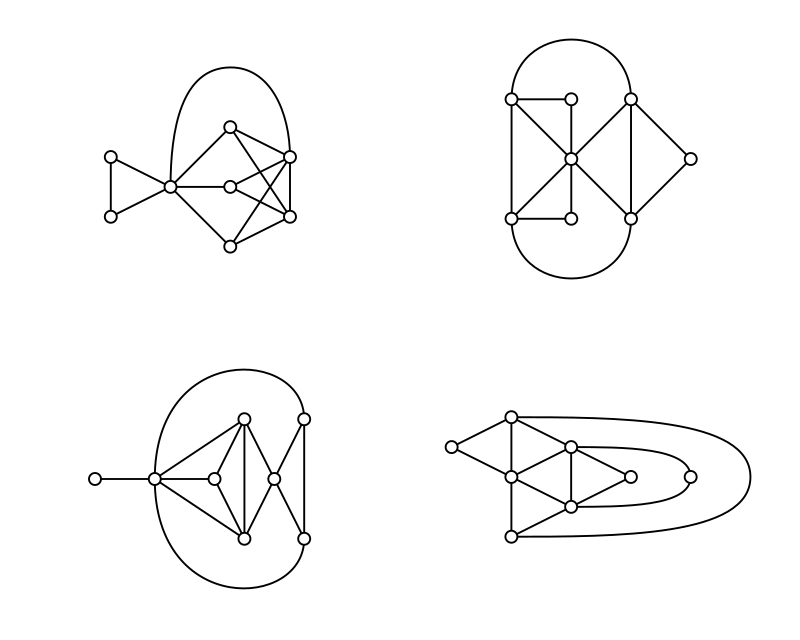](../../../assets/volume4a/figures/answer-7-141-proportional-graphs.svg)

<a id="ans-7-142"></a>

**142.** [题目](../sec-7.md#ex-7-142) 提示归结为习题 140 的答案. $(n-3)\#(\overline{K_3}:G)$ 和 $(n-3)\#(\overline{P_3}:G)$ 也可以通过四顶点子图计数表示. 此外, 一个包含 $e$ 条边的图有 $\binom e2=\#(P_3\subseteq G)+\#(K_2\oplus K_2\subseteq G)$ 个子图, 因为任何两条边构成 $P_3$ 或 $K_2\oplus K_2$. 在上述公式中, $\#(P_3\subseteq G)$ 计数 “非必然诱导子图”.

<a id="pdf-459"></a><a id="p-444"></a>

我们有 $\#(P_3\subseteq G)=\#(P_3:G)+3\#(K_3:G)$, 一个类似的公式通过诱导子图计数表示 $\#(K_2\oplus K_2\subseteq G)$. 因此, 超比例图必定是比例图, 而且满足 $e=\tfrac12\binom n2,\quad\#(P_3\subseteq G)=\tfrac34\binom n3,\quad\#(K_2\oplus K_2\subseteq G)=\tfrac34\binom n4$. 但这些值同 $\binom e2$ 的公式矛盾.

<a id="ans-7-143"></a>

**143.** [题目](../sec-7.md#ex-7-143) 考虑以 $A$ 的行为顶点的图, 而且它的边 $u\mathrel{\text{—}}v$ 表示第 $u$ 行与第 $v$ 行除在某一列外是相同的, 假设这一列为第 $j$ 列. 我们把这条边标记为 $j$.

如果图包含一个圈, 删除圈的任意一条边, 重复这个过程直到不再有圈. 注意到删除的每条边上的标记出现在它的圈的别处地方, 因此, 删除圈的边不会影响边标记的集合. 但是, 根据定理 2.3.4.1A, 我们留下的边的数量少于 $m\le n$, 所以存在的不同标记少于 $n$ 个. [见约翰·邦迪,*J. Combinatorial Theory* **B12** (1972), 201–202.]

<a id="ans-7-144"></a>

**144.** [题目](../sec-7.md#ex-7-144) 令 $G$ 是顶点 $\{1,\ldots,m\}$ 上的图, 图中存在边 $i\mathrel{\text{—}}j$ 当且仅当对于某个 $l$ 有 $*\ne x_{il}\ne x_{jl}\ne *$. 这个图是 $k$ 可着色的, 当且仅当存在一个最多有 $k$ 个不同行的完备化. 反过来, 如果 $G$ 是顶点 $\{1,\ldots,n\}$ 上具有邻接矩阵 $A$ 的一个图, 那么, $n\times n$ 矩阵 $X=A+*(J-I-A)$ 具有以下性质: 图中存在边 $i\mathrel{\text{—}}j$ 当且仅当对于某个 $l$ 有 $*\ne x_{il}\ne x_{jl}\ne *$. [见马丁·索尔霍夫和英戈·韦格纳,*IEEE Trans. CAD-15* (1996), 1435–1437.]

<a id="ans-7-145"></a>

**145.** [题目](../sec-7.md#ex-7-145) 置 $c\gets0$, 对 $1\le j\le n$ 重复下述操作: 如果 $c=0$, 置 $x\gets a_j,c\gets1$; 否则, 如果 $x=a_j$, 置 $c\gets c+1$; 否则, 置 $c\gets c-1$. 此时, $x$ 就是所求答案. 算法的思想是记录一个可能的过半数元素 $x$, 它在非舍弃的元素中出现 $c$ 次, 每当发现 $x\ne a_j$ 时我们舍弃 $a_j$ 和一个 $x$. [见 *Automated Reasoning* (Kluwer, 1991), 105–117. 贾亚德瓦·米斯拉和戴维·格里斯在 *Science of Computer Programming* **2** (1982), 143–152 中讨论了以 $O(n\log k)$ 步寻找出现 $n/k$ 次以上所有元素的扩展算法. 劳伦特·阿朗索和爱德华·莱因戈尔德在 *Information Processing Letters* **113** (2013), 495–497 中也分析了这个问题.]

[^v4a-p427-1]: *Concrete Mathematics: A Foundation for Computer Science*, second edition (Reading, Mass.: Addison-Wesley, 1994), 葛立恒、高德纳和奥伦·帕塔许尼克合著, 中文版为《具体数学: 计算机科学基础 (第 2 版)》, 人民邮电出版社 2013 年 4 月出版. 提到这本书时, 我们会把它简称为《具体数学》. ——编者注


[^v4a-p431-1]: 满堂红 (full house), 又称葫芦, 扑克术语, 是指一手五张牌中有三张同面值另加一个对子. 此处指三个相同字母加上另外两个相同字母构成的五字母单词. ——编者注


[^v4a-p432-1]: 此处属于作者的调侃. 一方面, <code>wrong</code> 是按字母顺序逆序排列的单词, 是附加问题的答案. 另一方面, 附加问题不是本题的正确答案, 因为题目问的是按字母顺序排列的单词. ——编者注


[^v4a-p432-2]: crazy seems most rational, 此处双关, 作为形容词, rational 有 “理性的, 合理的” 等含义. 这句话的字面意思是: 疯狂的似乎是最理性的. 结合上文, 作者表达的意思是: <code>crazy</code> 这个单词似乎是最合理的选择. ——编者注
