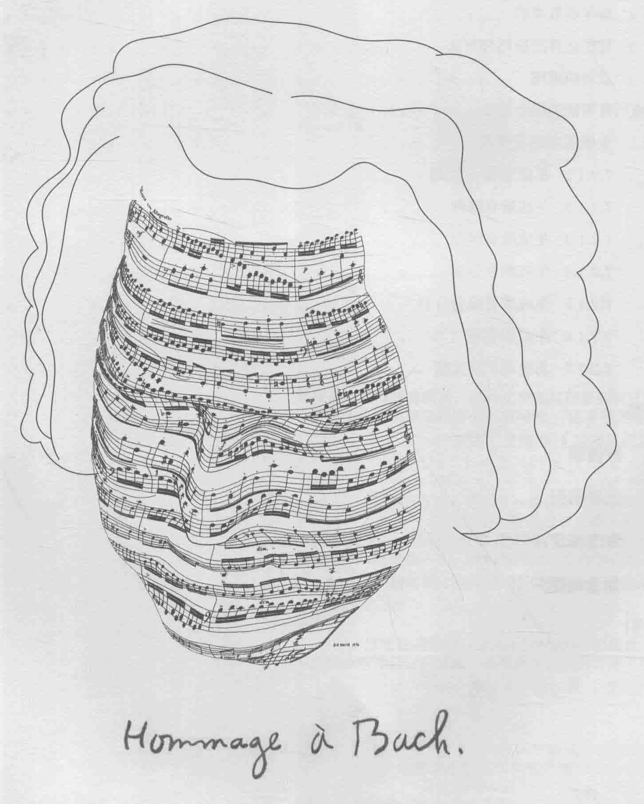

# 计算机程序设计艺术　卷 4A：组合算法（一）

[目录](#contents)　·　[习题答案](./sec-answers.md#sec-answers)　·　[索引](./sec-index.md#sec-index)

## 前言

> 欲把一切好的内容都装进一本书中, 显然是不可能的, 哪怕只是想比较全面地涉猎主题的某些方面, 多半也会导致篇幅急剧增长.
>
> ——杰拉尔德·弗兰德, “编者之角”(2005)

卷 4 的书名是组合算法, 我在拟书名时特别想给它加个副标题: 我最喜爱的程序设计类型. 但是, 编辑决定淡化这种个人感情色彩, 因此没有这么做. 不过事实上, 具有组合风格的程序始终是我所偏爱的.

另一方面, 我经常惊奇地发现, “组合” 一词在许多人的头脑中意味着计算有难度. 其实, 词典学家塞缪尔·约翰逊在其著名的英语词典 (1755) 中已经说明, “组合” 的名词之意 “现在普遍用法不当”. 同事们对我讲述种种不利事件时, 总会说 “事态的组合使我们无功而返”. 对我而言, 组合唤起的是纯粹喜悦之情, 它却给其他许多人带来一片惊恐, 原因何在?

的确, 组合问题经常同非常巨大的数字联系在一起. 约翰逊的英语词典中还引述了百科全书编撰者伊弗雷姆·钱伯斯的一段话: 用 24 个字母的字母表构成长度小于等于 24 的词, 其总数高达 $1\,391\,724\,288\,887\,252\,999\,425\,128\,493\,402\,200$. 在钱伯斯的叙述中用 10 代替 24, 相应的数量减少到 $11\,111\,111\,110$; 当这个参数减少到 5 时, 相应的数量仅有 3905. 所以, 如果问题的规模从 5 增加到 10, 再增加到 24 甚至更大, 就必然出现 “组合爆炸”.

在我这一生中, 计算机一直以惊人的速度变成越来越强大的工具. 及至我写下这些字句时, 我知道所用笔记本电脑的运算速度, 比我当初着手编写这套书使用的 IBM Type 650 计算机快 10 万倍以上, 而且现在这台电脑的存储容量也比那时的计算机大 10 万倍以上. 至于明天的计算机, 运算速度还会更快, 存储容量也会更大. 然而, 这些惊人的进步并没有降低人们对于解答组合问题的渴望, 情况恰好相反. 我们从前无法想象的如此快速的计算能力, 如今提高了人们的期待, 并且激起了我们更强的欲望——事实上, 因为只要组合元素的数量 $n$ 增加 1, 组合问题的规模就可能增加 10 万倍以上.

可以把组合算法非正式地定义为诸如对排列或图这些对象进行组合计算的高速处理方法. 一直以来, 我们都在试图寻找特定约束条件下的组合模式或排列的最佳方案. 这类问题的数量十分巨大, 编写这种程序的技巧也特别重要, 而且富有吸引力, 因为只要有一个好主意, 有时就可能节省几年乃至几百年的计算机时间.

毫无疑问, 组合问题的优异算法可以带来巨大回报, 这个事实引领技术水平突飞猛进. 以往认为很难处理的问题, 而今可以迎刃而解; 过去许多以精巧著称的算法, 现在锦上添花. 大约从 1970 年开始, 计算机科学家们经历了所谓的 “Floyd 引理” 现象: 看似需用 $n^3$ 次运算处理的问题, 实际上用 $O(n^2)$ 次运算就能求解; 看似需用 $n^2$ 次运算处理的问题, 实际上用 $O(n\log n)$ 次运算就能求解, 而且通常 $n\log n$ 还可以减少到 $O(n)$. 至于那些难度更大的问题, 求解时间则可以从 $O(2^n)$ 减少到 $O(1.5^n)$, 进而减少到 $O(1.3^n)$, 等等. 一般说来, 剩下的问题依然是很难的, 但是我们已发现它们有一些非常简单的重要特例. 有许多组合问题, 我曾经以为在我有生之年不会看到它们的答案, 如今却已经得到解决, 而且那些突破主要归功于算法的改进, 而不是计算机处理器速度的提高.

截至 1975 年, 这方面的研究工作进展神速, 在主要计算机学术期刊上发表的大量论文竟然都是有关组合算法的. 同时, 这些进展不仅是由计算机核心领域的研究人员取得的, 而且大量成果也来自电子工程、人工智能、运筹学、数学、物理学、统计学等其他学科的研究人员. 我曾想尽快完成《计算机程序设计艺术, 卷 4》的写作, 但是我仿佛是坐在沸腾的冒着气泡的水壶盖上, 不得不面对另一类组合爆炸——层出不穷的新主意的大爆炸!

这几卷书诞生于 1962 年之初, 当时我天真地拟好一共 12 章的提纲. 未经深思熟虑, 我便决定用简短的一章来讨论组合算法, 心想: “嘿, 看看! 大多数人在利用计算机处理数字, 而我能够编写处理模式的程序!” 当时, 对于已知的每个组合算法都能很容易给出一个非常完备的描述. 即使到了 1966 年, 当我把这本已经过度膨胀的书写就约 3000 页初稿的时候, 第 7 章的内容还不到 100 页. 我绝对不会想到, 当初预计作为 “沙拉” 的小菜最终竟然升格成了一道主菜.

自 1975 年兴起的组合学热潮, 在越来越多人的推动下一浪高过一浪. 新思想不断改善着旧思想, 但是很少取而代之, 或者使之过时. 所以, 我自然不得不抛弃昔日怀抱的希望, 我已经不可能围绕这个领域撰写一部一劳永逸的书, 把一切题材组织得井然有序, 让它成为每个需要解决组合问题的人手中的 “灵丹妙药”, 而今, 各种各样可用的技术如雨后春笋般层出不穷, 以致对于任何的支节问题, 我几乎都不能宣称 “这是最后的解决方案: 故事终结了”. 相反, 我必须把自己严格限制在仅仅阐明一些最重要的原理上, 而这些原理大体是迄今我见过的所有有效组合方法的基础. 现在, 我为卷 4 积累的原始资料已经超过卷 1 至卷 3 全部资料的两倍.

面对这些堆积如山的资料, 不言而喻, 我必须把计划编写的 “卷 4” 变成若干卷. 现在呈现在读者面前的是卷 4A. 倘若我的健康状况能够保持下去, 日后陆续会有卷 4B 和卷 4C, 或许还会有卷 4D、卷 4E……; (天知道?) 当然肯定不会出现卷 4Z.

现在的计划是尽我所能, 通过自 1962 年以来积累的文档, 系统地讲述我深信仍然有待进一步讨论的组合方法, 我无意追求完美, 但是一定要把应有的荣誉归于所有那些提出种种关键思想的先驱们; 所以关于历史情节, 我不吝惜笔墨. 除此之外, 凡是我认为在今后 50 年内仍然具有重要性的材料, 以及某些能够用一两段文字简要叙述的内容, 我都不会割爱. 反过来, 我没有把那些需要长篇累牍证明的艰深话题收录书中, 除非它们确实是基础性的.

诚然, 组合算法这个领域非常广阔, 我无法顾及它的所有方面. 那么, 我忽视了什么最重要的东西? 我以为自己最大的盲点是在几何学方面, 因为我所擅长的始终是表现和推演代数公式而非处理空间对象. 所以, 我在这几本书中不准备讨论同计算几何有关的组合问题, 如球的密堆积, 或者 $n$ 维欧几里得空间中数据点的聚类, 甚至也不讨论涉及平面斯泰纳树的问题. 更重要的是, 我力求避开多面体组合学, 以及主要基于线性规划、整数规划或半定规划的各种方法. 对于那些题目, 在有关这个主题的很多其他书籍中已有充分论述, 而且它们依赖于几何直观知识, 对我而言, 单纯从组合问题展开讨论更容易理解.

我还必须承认, 对于仅在渐近意义下有效的那些组合算法, 以及算法的优异性能在问题规模超乎想象时才开始显现的组合算法, 我是不太以为然的. 现在有讨论这类算法的大量出版物. 有些人喜欢思考极限问题, 认为它是一种智力挑战并且能够带来学术声誉, 这是我能理解的, 但是对于我自己在实际程序中不予考虑的任何方法, 这本书一般只作轻描淡写. (这条规则的运用自然也有例外, 特别是对于那些处在主题核心的基本概念, 就另当别论. 某些实用价值虽说不大, 但是确实非常优美或者包含深刻见解的方法, 令我难以割舍; 另外还有一些方法, 我则把它们作为反例引用.)

此外, 在这套书的前几卷中, 我特意几乎完全专注于顺序算法, 尽管计算机的并行计算能力日益增强. 关于并行计算, 我无法断定哪些思想可能在今后 5 年或者 10 年内会很有用, 更不用说今后 50 年内了, 所以我乐于把这样的问题留给那些比我聪颖的人. 来日, 具有才华的程序员们究竟应该掌握怎样的顺序算法知识, 单是弄清这个问题就足以检验我自身的能力了.

在安排如何陈述这些材料时, 我需要做个重要决定: 是按问题还是按方法组织它们. 例如, 卷 3 的第 5 章专门讨论了一个问题, 即数据排序; 对于这个问题, 我从不同方面应用了二十几种方法. 相比之下, 组合算法涉及许多不同的问题, 而解决问题的方法则少之又少, 我最终决定, 采用混合策略能够比任何一种单纯的方法更好地组织材料. 于是, 这几本书中就采纳了兼收并蓄的原则, 例如, 7.3 节处理求最短路径问题, 7.4.1.3 节处理连通性问题. 其他很多节则专门讨论基本方法, 如布尔代数的应用 (7.1 节)、回溯 (7.2.2 节)、拟阵理论 (7.6 节) 或者动态规划 (7.7 节). 至于著名的流动推销员问题, 以及同着色和填充有关的其他经典组合问题, 没有单辟小节讨论, 但是当用不同方法处理这些问题时, 它们多次出现在书中不同的地方.

我已经提到过组合计算技术的巨大进步, 但是我并非暗示人们已经解决了所有的组合问题. 正值计算机程序的运行时间不断攀升之际, 程序员们不能指望从本书中找到无坚不摧的 “银弹”. 这里描述的方法通常会比一个程序员早先尝试的方法快得多, 但是, 我们不得不面对这样一个现实: 组合问题正在迅速演变成为巨大的问题. 我们甚至可以严格证明, 就连一个自然的细小问题也不存在一种现实的可行解, 尽管原则上它是可解的 (见 7.1.2 节的拉里·斯托克迈尔和阿尔伯特·迈耶定理). 在另外一些情况下, 我们甚至不能证明一个给定问题不存在适合的算法, 知道的只是可能没有这样的算法, 因为任何有效的算法将产生一种令人满意的方法, 足以解决一大堆难倒世上无数杰出专家的问题 (见 7.9 节关于 NP 完全性的讨论).

经验表明, 新的组合算法将会不断涌现, 用以解决组合学中新出现的问题以及处理老问题的变形或特例; 同时, 人们对于这种算法的期望也会与日俱增. 当程序员们面对这样一些挑战时, 计算机程序设计艺术将会达到一个又一个新高度, 不过, 今天的方法多半仍旧是不可或缺的.

本书中大部分内容是相对独立的, 但是时常同卷 1 至卷 3 讨论的主题关联. 在前面几卷中, 对机器语言程序设计的底层细节作过广泛深入的讨论, 所以本卷介绍的算法通常是在抽象级别上说明, 与任何具体机器无关. 然而, 组合程序设计的某些方面的确同过去从未出现过的底层指令有着密切联系. 在出现这种情况的地方, 书中相应的所有例子都是基于 MMIX 计算机的, 这款计算机取代了卷 1 前几版中定义的 MIX 计算机. 关于 MMIX 的详细材料在《计算机程序设计艺术: MMIX 的增补》(The Art of Computer Programming, Volume 1, Fascicle 1) 中介绍, 其中包含 1.3.1 节, 1.3.2 节, 等等. 此外, 这些材料也可以从互联网上获取, 配套的汇编程序和模拟程序同样可以从网上下载.

另外一种可以从网上下载的资源是称为《斯坦福图库》(Stanford GraphBase) 的一套程序和数据, 它在本书的例子中经常被引用, 我鼓励读者多利用它, 对于学习组合算法, 我以为这不失为一种非常有效和愉快的途径.

顺便说一句, 我很高兴在写这篇前言时能说明一下, 书中自然提到了我的博士论文导师小马歇尔·霍尔 (1910—1990) 的一些成果, 以及霍尔的论文导师奥斯丁·欧尔 (1899—1968) 的一些成果, 还有欧尔的论文导师托拉尔夫·斯科伦 (1887—1963) 的一些成果. 至于斯科伦的论文导师阿克塞尔·图厄 (1863—1922) 的一些成果, 我在第 6 章已经介绍过了.

有几百位读者帮助我查出这卷书几份初稿 (它们原先公布在互联网上, 后来又印成几册平装书) 中遗留的大量错误, 谨对他们表示衷心的感谢, 特别是索斯藤·达尔海姆尔、马库斯·范莱文和乌多·维尔穆特三人提出的大量建议, 对本书具有特殊的影响. 但是在汇集成书后的字里行间, 我担心仍然隐藏着其他错误, 而且希望能够尽快予以更正. 因此, 我很乐意向首先发现任一处技术性错误、印刷错误或历史知识错误的人支付 2.56 美元. 下面的网页上列出了所有已反馈给我的最新勘误: <https://www-cs-faculty.stanford.edu/~knuth/taocp.html>.

高德纳, 加利福尼亚州斯坦福市, 2010 年 10 月

> 在第 1 版的前言中, 我曾经请求读者不要专门注意辞典中的错误. 如今, 我反倒希望自己未曾这样说过, 而且还要感谢对我的请求置之不理的那些读者.
>
> ——诺尔曼·萨瑟兰, 《国际心理学辞典》(1996)

> 诚然, 我应该对遗留的错误负责. 不过在我看来, 我的朋友们理应发现更多一些错误.
>
> ——赫里斯托斯·帕帕季米特里乌, 《计算复杂性》(1994)

> 我愿意从事种种不同领域的工作, 以便使我的错误更稀疏地分散开来.
>
> ——小维克多·克利 (1999)

**关于参考文献的注释.** 经常引用的若干学术期刊和会议刊物有特别的代码名称, 它们出现在书后的索引中. 但是, 在各种 IEEE 会刊的引用中包含一个代表会刊类别的字母代码, 置于卷号前面, 用粗体表示. 例如 “*IEEE Trans.* **C-35**” 是指 *IEEE Transactions on Computers*, Volume 35(《IEEE 计算机会刊》, 第 35 卷). IEEE 现在不再使用原来那些简便的字母代码, 其实它们并不难辨认: “EC” 曾经代表 “电子计算机”, “IT” 代表 “信息论”, “SE” 代表 “软件工程”, “SP” 代表 “信号处理”, 等等; “CAD” 是指 “集成电路和系统的计算机辅助设计”.

如 “习题 7.10-00” 这样的写法, 表示 7.10 节中一道还不知道题号的习题.

**关于记号的注释.** 对于数学概念的代数表示, 简单而直观的约定始终有利于促进科学的发展, 尤其是当世界上多数研究人员都使用一种共同符号语言的时候. 可惜在这方面, 组合数学当前的事态多少有些混乱, 因为同样一些符号在不同的人群中有时完全代表不同的意义; 在比较狭窄的分支领域从事研究工作的某些专家, 他们也会在无意中引入彼此冲突的符号表示. 计算机科学——它与数学中的许多主题相互影响——应当尽可能地采用内部一致的记号来避开这种危险. 所以, 我经常不得不在若干对立的方案中做出选择, 虽然明知结果不会令人人满意. 凭借多年的经验以及与同事之间的讨论, 以及经常在不同方案之间反复试验, 我尽力找出适用的记号, 我相信这些将是未来最好的记号. 在其他人尚未认同对立方案时, 通常有可能找到可以接受的共同约定.

附录 B 给出了本书使用的所有主要记号, 其中不可避免地会包含一些还不够标准的记号. 读者如果偶然遇见一个有些奇怪或者不好理解的公式, 通过附录 B 大体可以找到说明我的意图的章节和段落. 不过, 我仍然应该在这里举出几个例子, 以期引起初次阅读本书的读者的注意.

- 十六进制常数前面冠有一个 $\#$ 符号. 例如, $\#123$ 是指 $(123)_{16}$.
- “非亏减” 运算 $x\mathbin{\dot{-}}y$ 有时称为点减或饱和减, 结果是 $\max(0,x-y)$.
- 三个数 $\{x,y,z\}$ 的中位数用 $\langle xyz\rangle$ 表示.
- 像 $\{x\}$ 这样含单个元素的集合, 在书中通常简单地用 $x$ 表示, 例如 $X\cup x$ 或 $X\setminus x$.
- 如果 $n$ 是一个非负整数, 在 $n$ 的二进制表示中, 取 1 的位数记为 $\nu n$. 此外, 如果 $n>0$, $n$ 最左边的 1 和最右边的 1 分别用 $2^{\lambda n}$ 和 $2^{\rho n}$ 表示. 例如, $\nu10=2$, $\lambda10=3$, $\rho10=1$.
- 图 $G$ 和图 $H$ 的笛卡儿积用 $G\square H$ 表示. 例如, $C_m\square C_n$ 表示一个 $m\times n$ 环面, 因为 $C_n$ 表示 $n$ 个顶点的一个环.

## 习题说明

这套书的习题既可用于自学, 也可用于课堂练习. 任何人单凭阅读而不运用获得的知识解决具体问题, 进而激励自己思考所阅读的内容, 就想学会一门学科, 即便可能, 也很困难. 再者, 人们大凡对亲身发现的事物才有透彻的了解. 因此, 习题是这套书的一个重要组成部分. 我力求习题的信息尽可能丰富, 并且兼具趣味性和启发性.

很多书会把容易的题和很难的题随意混杂在一起. 这样做有些不合适, 因为读者在做题前想知道需要花多少时间, 不然他们可能会跳过所有习题. 理查德·贝尔曼的《动态规划》(Dynamic Programming) 一书就是个典型的例子. 这是一本很重要的开创性著作, 在书中某些章后 “习题和研究题” 的标题下, 极为平常的问题与深奥的未解难题掺杂在一起. 据说有人问过贝尔曼博士, 如何区分习题和研究题, 他回答说: “若你能求解, 它就是一道习题; 否则, 它就是一道研究题.”

在我们这种类型的书中, 有足够理由同时收录研究题和非常容易的习题, 因此, 为了避免读者陷入区分的困境, 我用等级编号来说明习题的难易程度. 这些编号的意义如下所示.

| 等级 | 说明 |
|---|---|
| 00 | 极为容易的习题, 只要理解了文中内容就能立即解答. 这样的习题差不多都可以 “在脑子中” 形成答案. |
| 10 | 简单问题, 它让你思考刚阅读的材料, 决非难题, 你至多花一分钟就能做完, 可考虑借助笔和纸求解. |
| 20 | 普通问题, 检验你对正文内容的基本理解, 完全解答可能需要 15 到 20 分钟. 也许 25 分钟. |
| 30 | 具有中等难度的较复杂问题. 为了找到满意的答案, 可能需要两小时以上. 要是开着电视机, 时间甚至更长. |
| 40 | 非常困难或者耗时很长的问题, 适合作为课堂教学中一个学期的设计项目. 学生应当有能力在一段相当长的时间内解决这个问题, 但解答不简单. |
| 50 | 研究题, 尽管有许多人尝试, 但直到我写书时尚未有满意的解答. 你若找到这类问题的答案, 应该写文章发表. 而且, 我乐于尽快获知这个问题的解答 (只要它是正确的). |

依据上述尺度, 其他等级的意义便清楚了. 例如, 一道等级为 17 的习题就比普通问题略微简单点. 等级为 50 的问题, 若是将来被某个读者解决了, 可能会在本书以后的版本中标记为 40, 并发布在互联网上的本书勘误表 (网址见第 vi 页) 中.

等级编号除以 5 得到的余数, 表示完成这道习题的具体工作量. 因此, 等级为 24 的习题, 比等级为 25 的习题可能花更长的时间, 不过做后一种习题需要更多的创造性, 等级为 46 及以上的习题是开放式问题, 有待进一步研究, 其难度等级由迄今未能奏效的不同求解途径的数量而定.

我力求为习题指定精确的等级编号, 但这很困难, 因为出题人无法确切知道别人在求解时会有多大难度; 同时, 每个人都会更擅长解决某些类型的问题. 希望等级编号能合理地反映习题的难度, 读者应把它们看成一般的指导而非绝对的指标.

本书的读者具有不同程度数学教育和素养, 因此某些习题仅供喜欢数学的读者使用. 如果习题涉及的数学背景大大超过了仅对算法编程感兴趣的读者的接受能力, 那么等级编号前会有一个字母 $M$. 如果习题的求解必须用到本书中没有详细讨论的微积分等高等数学知识, 那么用两个字母 $HM$ 标记. $HM$ 记号并不一定意味着习题很难.

某些习题前有个箭头▶, 这表示问题极具启示性, 特别向读者推荐. 当然, 不能期待读者或者学生做全部习题, 所以我挑选出了看起来最有价值的习题. (这并非要贬低其他习题!) 读者至少应该试着解答等级 10 以下的所有习题, 再去优先考虑箭头标出的那些较高等级的习题.

书后给出了多数习题的答案. 请读者慎用答案, 还未认真求解之前不要求助于答案, 除非你确实没有时间做某道习题. 在你得出自己的答案或者做了应有的尝试之后, 再看习题答案是有教益和帮助的. 书中给出的解答通常非常简短, 因为我假定你已经用自己的方法做了认真的尝试, 所以只概述其细节. 有时解答给出的信息比较少, 不过通常会给较多信息. 很可能你得出的答案比书后答案更好, 你也可能发现书中答案的错误, 对此, 我愿闻其详. 本书的后续版本会给出改进后的答案, 在适当情况下也会列出解答者的姓名.

你做一道习题时, 可以利用前面习题的答案, 除非明确禁止这样做. 我在标注习题等级时已经考虑到了这一点, 因此, 习题 $n+1$ 的等级可能低于习题 $n$ 的等级, 尽管习题 $n$ 的结果只是它的特例.

<table>
<tbody>
<tr><td colspan="2">编号摘要: </td><td>00</td><td>立即回答</td></tr>
<tr><td colspan="2"></td><td>10</td><td>简单 (一分钟)</td></tr>
<tr><td colspan="2"></td><td>20</td><td>普通 (一刻钟)</td></tr>
<tr><td>▶</td><td>推荐的</td><td>30</td><td>中等难度</td></tr>
<tr><td>$M$</td><td>面向数学的</td><td>40</td><td>学期设计</td></tr>
<tr><td>$HM$</td><td>需要 “高等数学”</td><td>50</td><td>研究题</td></tr>
</tbody>
</table>

### 习题

▶ **1.** [00] [答案](./answers/intro.md#ans-intro-1) 等级 “$M15$” 的含义是什么?

**2.** [10] [答案](./answers/intro.md#ans-intro-2) 教科书中的习题对于读者具有什么价值?

**3.** [HM45] [答案](./answers/intro.md#ans-intro-3) 证明每个简单联通的闭合三维流形都拓扑等价于一个三维球面.

> 相当一部分有益的艺术尝试来自于对成见的挑战.
>
> ——亨利·詹姆斯, “小说的艺术”(1884)

> 我要感谢我所有的朋友, 此时此刻尤其对那些朋友深表谢忱, 他们在经年累月之后终于不再问我: “这本书的进展如何?”
>
> ——彼得·戈梅斯, 《拜读圣经》(1996)

> 我终于向世人交付了一直以来许诺要写的一本书. 关于此书, 我担心读者寄予的期望太高.
>
> 它的推迟出版, 在很大程度上不得不归咎于那些对它表现出异乎寻常热忱的杰出人士, 他们从四面八方向我提供补充资料.
>
> ——詹姆斯·鲍斯威尔, 《约翰逊博士传》(1791)

> 作者特别感谢 Addison-Wesley 出版公司的忍耐, 从约稿合同签订之日算起, 公司对这份手稿等待了整整十年.
>
> ——弗兰克·哈拉里, 《图论》(1969)

> 厌恶平方根或者代数的普通孩子从包含相似数学原理的智力游戏中寻找乐趣, 也许可以由此被引导去学习, 从而培养出足以让家族骨相学家多少感到惊奇的数学天赋和创造能力.
>
> ——萨姆·劳埃德, 《谜题的世界》(1896)

> 来一杯 “碧特伯格”!
>
> ——碧特伯格啤酒的广告语 (1951)

Hommage à Bach.

## ASCII字符表

<table>
<thead><tr><th></th><th><code>#0</code></th><th><code>#1</code></th><th><code>#2</code></th><th><code>#3</code></th><th><code>#4</code></th><th><code>#5</code></th><th><code>#6</code></th><th><code>#7</code></th><th><code>#8</code></th><th><code>#9</code></th><th><code>#a</code></th><th><code>#b</code></th><th><code>#c</code></th><th><code>#d</code></th><th><code>#e</code></th><th><code>#f</code></th><th></th></tr></thead>
<tbody>
<tr><th><code>#2x</code></th><td data-ascii="32">&#32;</td><td data-ascii="33">&#33;</td><td data-ascii="34">&#34;</td><td data-ascii="35">&#35;</td><td data-ascii="36">&#36;</td><td data-ascii="37">&#37;</td><td data-ascii="38">&#38;</td><td data-ascii="39">&#39;</td><td data-ascii="40">&#40;</td><td data-ascii="41">&#41;</td><td data-ascii="42">&#42;</td><td data-ascii="43">&#43;</td><td data-ascii="44">&#44;</td><td data-ascii="45">&#45;</td><td data-ascii="46">&#46;</td><td data-ascii="47">&#47;</td><th><code>#2x</code></th></tr>
<tr><th><code>#3x</code></th><td data-ascii="48">&#48;</td><td data-ascii="49">&#49;</td><td data-ascii="50">&#50;</td><td data-ascii="51">&#51;</td><td data-ascii="52">&#52;</td><td data-ascii="53">&#53;</td><td data-ascii="54">&#54;</td><td data-ascii="55">&#55;</td><td data-ascii="56">&#56;</td><td data-ascii="57">&#57;</td><td data-ascii="58">&#58;</td><td data-ascii="59">&#59;</td><td data-ascii="60">&#60;</td><td data-ascii="61">&#61;</td><td data-ascii="62">&#62;</td><td data-ascii="63">&#63;</td><th><code>#3x</code></th></tr>
<tr><th><code>#4x</code></th><td data-ascii="64">&#64;</td><td data-ascii="65">&#65;</td><td data-ascii="66">&#66;</td><td data-ascii="67">&#67;</td><td data-ascii="68">&#68;</td><td data-ascii="69">&#69;</td><td data-ascii="70">&#70;</td><td data-ascii="71">&#71;</td><td data-ascii="72">&#72;</td><td data-ascii="73">&#73;</td><td data-ascii="74">&#74;</td><td data-ascii="75">&#75;</td><td data-ascii="76">&#76;</td><td data-ascii="77">&#77;</td><td data-ascii="78">&#78;</td><td data-ascii="79">&#79;</td><th><code>#4x</code></th></tr>
<tr><th><code>#5x</code></th><td data-ascii="80">&#80;</td><td data-ascii="81">&#81;</td><td data-ascii="82">&#82;</td><td data-ascii="83">&#83;</td><td data-ascii="84">&#84;</td><td data-ascii="85">&#85;</td><td data-ascii="86">&#86;</td><td data-ascii="87">&#87;</td><td data-ascii="88">&#88;</td><td data-ascii="89">&#89;</td><td data-ascii="90">&#90;</td><td data-ascii="91">&#91;</td><td data-ascii="92">&#92;</td><td data-ascii="93">&#93;</td><td data-ascii="94">&#94;</td><td data-ascii="95">&#95;</td><th><code>#5x</code></th></tr>
<tr><th><code>#6x</code></th><td data-ascii="96">&#96;</td><td data-ascii="97">&#97;</td><td data-ascii="98">&#98;</td><td data-ascii="99">&#99;</td><td data-ascii="100">&#100;</td><td data-ascii="101">&#101;</td><td data-ascii="102">&#102;</td><td data-ascii="103">&#103;</td><td data-ascii="104">&#104;</td><td data-ascii="105">&#105;</td><td data-ascii="106">&#106;</td><td data-ascii="107">&#107;</td><td data-ascii="108">&#108;</td><td data-ascii="109">&#109;</td><td data-ascii="110">&#110;</td><td data-ascii="111">&#111;</td><th><code>#6x</code></th></tr>
<tr><th><code>#7x</code></th><td data-ascii="112">&#112;</td><td data-ascii="113">&#113;</td><td data-ascii="114">&#114;</td><td data-ascii="115">&#115;</td><td data-ascii="116">&#116;</td><td data-ascii="117">&#117;</td><td data-ascii="118">&#118;</td><td data-ascii="119">&#119;</td><td data-ascii="120">&#120;</td><td data-ascii="121">&#121;</td><td data-ascii="122">&#122;</td><td data-ascii="123">&#123;</td><td data-ascii="124">&#124;</td><td data-ascii="125">&#125;</td><td data-ascii="126">&#126;</td><td data-ascii="127"></td><th><code>#7x</code></th></tr>
</tbody><tfoot><tr><th></th><th><code>#0</code></th><th><code>#1</code></th><th><code>#2</code></th><th><code>#3</code></th><th><code>#4</code></th><th><code>#5</code></th><th><code>#6</code></th><th><code>#7</code></th><th><code>#8</code></th><th><code>#9</code></th><th><code>#a</code></th><th><code>#b</code></th><th><code>#c</code></th><th><code>#d</code></th><th><code>#e</code></th><th><code>#f</code></th><th></th></tr></tfoot>
</table>

## MMIX操作码表

<table>
<thead><tr><th></th><th><code>#0</code></th><th><code>#1</code></th><th><code>#2</code></th><th><code>#3</code></th><th><code>#4</code></th><th><code>#5</code></th><th><code>#6</code></th><th><code>#7</code></th><th></th></tr></thead>
<tbody>
<tr><th rowspan="2"><code>#0x</code></th><td data-opcode-start="00" data-opcode-span="1" style="white-space:nowrap"><code>TRAP</code> $5\upsilon$</td><td data-opcode-start="01" data-opcode-span="1" style="white-space:nowrap"><code>FCMP</code> $\upsilon$</td><td data-opcode-start="02" data-opcode-span="1" style="white-space:nowrap"><code>FUN</code> $\upsilon$</td><td data-opcode-start="03" data-opcode-span="1" style="white-space:nowrap"><code>FEQL</code> $\upsilon$</td><td data-opcode-start="04" data-opcode-span="1" style="white-space:nowrap"><code>FADD</code> $4\upsilon$</td><td data-opcode-start="05" data-opcode-span="1" style="white-space:nowrap"><code>FIX</code> $4\upsilon$</td><td data-opcode-start="06" data-opcode-span="1" style="white-space:nowrap"><code>FSUB</code> $4\upsilon$</td><td data-opcode-start="07" data-opcode-span="1" style="white-space:nowrap"><code>FIXU</code> $4\upsilon$</td><th rowspan="2"><code>#0x</code></th></tr>
<tr><td colspan="2" data-opcode-start="08" data-opcode-span="2" style="white-space:nowrap"><code>FLOT[I]</code> $4\upsilon$</td><td colspan="2" data-opcode-start="0A" data-opcode-span="2" style="white-space:nowrap"><code>FLOTU[I]</code> $4\upsilon$</td><td colspan="2" data-opcode-start="0C" data-opcode-span="2" style="white-space:nowrap"><code>SFLOT[I]</code> $4\upsilon$</td><td colspan="2" data-opcode-start="0E" data-opcode-span="2" style="white-space:nowrap"><code>SFLOTU[I]</code> $4\upsilon$</td></tr>
<tr><th rowspan="2"><code>#1x</code></th><td data-opcode-start="10" data-opcode-span="1" style="white-space:nowrap"><code>FMUL</code> $4\upsilon$</td><td data-opcode-start="11" data-opcode-span="1" style="white-space:nowrap"><code>FCMPE</code> $4\upsilon$</td><td data-opcode-start="12" data-opcode-span="1" style="white-space:nowrap"><code>FUNE</code> $\upsilon$</td><td data-opcode-start="13" data-opcode-span="1" style="white-space:nowrap"><code>FEQLE</code> $4\upsilon$</td><td data-opcode-start="14" data-opcode-span="1" style="white-space:nowrap"><code>FDIV</code> $40\upsilon$</td><td data-opcode-start="15" data-opcode-span="1" style="white-space:nowrap"><code>FSQRT</code> $40\upsilon$</td><td data-opcode-start="16" data-opcode-span="1" style="white-space:nowrap"><code>FREM</code> $4\upsilon$</td><td data-opcode-start="17" data-opcode-span="1" style="white-space:nowrap"><code>FINT</code> $4\upsilon$</td><th rowspan="2"><code>#1x</code></th></tr>
<tr><td colspan="2" data-opcode-start="18" data-opcode-span="2" style="white-space:nowrap"><code>MUL[I]</code> $10\upsilon$</td><td colspan="2" data-opcode-start="1A" data-opcode-span="2" style="white-space:nowrap"><code>MULU[I]</code> $10\upsilon$</td><td colspan="2" data-opcode-start="1C" data-opcode-span="2" style="white-space:nowrap"><code>DIV[I]</code> $60\upsilon$</td><td colspan="2" data-opcode-start="1E" data-opcode-span="2" style="white-space:nowrap"><code>DIVU[I]</code> $60\upsilon$</td></tr>
<tr><th rowspan="2"><code>#2x</code></th><td colspan="2" data-opcode-start="20" data-opcode-span="2" style="white-space:nowrap"><code>ADD[I]</code> $\upsilon$</td><td colspan="2" data-opcode-start="22" data-opcode-span="2" style="white-space:nowrap"><code>ADDU[I]</code> $\upsilon$</td><td colspan="2" data-opcode-start="24" data-opcode-span="2" style="white-space:nowrap"><code>SUB[I]</code> $\upsilon$</td><td colspan="2" data-opcode-start="26" data-opcode-span="2" style="white-space:nowrap"><code>SUBU[I]</code> $\upsilon$</td><th rowspan="2"><code>#2x</code></th></tr>
<tr><td colspan="2" data-opcode-start="28" data-opcode-span="2" style="white-space:nowrap"><code>2ADDU[I]</code> $\upsilon$</td><td colspan="2" data-opcode-start="2A" data-opcode-span="2" style="white-space:nowrap"><code>4ADDU[I]</code> $\upsilon$</td><td colspan="2" data-opcode-start="2C" data-opcode-span="2" style="white-space:nowrap"><code>8ADDU[I]</code> $\upsilon$</td><td colspan="2" data-opcode-start="2E" data-opcode-span="2" style="white-space:nowrap"><code>16ADDU[I]</code> $\upsilon$</td></tr>
<tr><th rowspan="2"><code>#3x</code></th><td colspan="2" data-opcode-start="30" data-opcode-span="2" style="white-space:nowrap"><code>CMP[I]</code> $\upsilon$</td><td colspan="2" data-opcode-start="32" data-opcode-span="2" style="white-space:nowrap"><code>CMPU[I]</code> $\upsilon$</td><td colspan="2" data-opcode-start="34" data-opcode-span="2" style="white-space:nowrap"><code>NEG[I]</code> $\upsilon$</td><td colspan="2" data-opcode-start="36" data-opcode-span="2" style="white-space:nowrap"><code>NEGU[I]</code> $\upsilon$</td><th rowspan="2"><code>#3x</code></th></tr>
<tr><td colspan="2" data-opcode-start="38" data-opcode-span="2" style="white-space:nowrap"><code>SL[I]</code> $\upsilon$</td><td colspan="2" data-opcode-start="3A" data-opcode-span="2" style="white-space:nowrap"><code>SLU[I]</code> $\upsilon$</td><td colspan="2" data-opcode-start="3C" data-opcode-span="2" style="white-space:nowrap"><code>SR[I]</code> $\upsilon$</td><td colspan="2" data-opcode-start="3E" data-opcode-span="2" style="white-space:nowrap"><code>SRU[I]</code> $\upsilon$</td></tr>
<tr><th rowspan="2"><code>#4x</code></th><td colspan="2" data-opcode-start="40" data-opcode-span="2" style="white-space:nowrap"><code>BN[B]</code> $\upsilon+\pi$</td><td colspan="2" data-opcode-start="42" data-opcode-span="2" style="white-space:nowrap"><code>BZ[B]</code> $\upsilon+\pi$</td><td colspan="2" data-opcode-start="44" data-opcode-span="2" style="white-space:nowrap"><code>BP[B]</code> $\upsilon+\pi$</td><td colspan="2" data-opcode-start="46" data-opcode-span="2" style="white-space:nowrap"><code>BOD[B]</code> $\upsilon+\pi$</td><th rowspan="2"><code>#4x</code></th></tr>
<tr><td colspan="2" data-opcode-start="48" data-opcode-span="2" style="white-space:nowrap"><code>BNN[B]</code> $\upsilon+\pi$</td><td colspan="2" data-opcode-start="4A" data-opcode-span="2" style="white-space:nowrap"><code>BNZ[B]</code> $\upsilon+\pi$</td><td colspan="2" data-opcode-start="4C" data-opcode-span="2" style="white-space:nowrap"><code>BNP[B]</code> $\upsilon+\pi$</td><td colspan="2" data-opcode-start="4E" data-opcode-span="2" style="white-space:nowrap"><code>BEV[B]</code> $\upsilon+\pi$</td></tr>
<tr><th rowspan="2"><code>#5x</code></th><td colspan="2" data-opcode-start="50" data-opcode-span="2" style="white-space:nowrap"><code>PBN[B]</code> $3\upsilon-\pi$</td><td colspan="2" data-opcode-start="52" data-opcode-span="2" style="white-space:nowrap"><code>PBZ[B]</code> $3\upsilon-\pi$</td><td colspan="2" data-opcode-start="54" data-opcode-span="2" style="white-space:nowrap"><code>PBP[B]</code> $3\upsilon-\pi$</td><td colspan="2" data-opcode-start="56" data-opcode-span="2" style="white-space:nowrap"><code>PBOD[B]</code> $3\upsilon-\pi$</td><th rowspan="2"><code>#5x</code></th></tr>
<tr><td colspan="2" data-opcode-start="58" data-opcode-span="2" style="white-space:nowrap"><code>PBNN[B]</code> $3\upsilon-\pi$</td><td colspan="2" data-opcode-start="5A" data-opcode-span="2" style="white-space:nowrap"><code>PBNZ[B]</code> $3\upsilon-\pi$</td><td colspan="2" data-opcode-start="5C" data-opcode-span="2" style="white-space:nowrap"><code>PBNP[B]</code> $3\upsilon-\pi$</td><td colspan="2" data-opcode-start="5E" data-opcode-span="2" style="white-space:nowrap"><code>PBEV[B]</code> $3\upsilon-\pi$</td></tr>
<tr><th rowspan="2"><code>#6x</code></th><td colspan="2" data-opcode-start="60" data-opcode-span="2" style="white-space:nowrap"><code>CSN[I]</code> $\upsilon$</td><td colspan="2" data-opcode-start="62" data-opcode-span="2" style="white-space:nowrap"><code>CSZ[I]</code> $\upsilon$</td><td colspan="2" data-opcode-start="64" data-opcode-span="2" style="white-space:nowrap"><code>CSP[I]</code> $\upsilon$</td><td colspan="2" data-opcode-start="66" data-opcode-span="2" style="white-space:nowrap"><code>CSOD[I]</code> $\upsilon$</td><th rowspan="2"><code>#6x</code></th></tr>
<tr><td colspan="2" data-opcode-start="68" data-opcode-span="2" style="white-space:nowrap"><code>CSNN[I]</code> $\upsilon$</td><td colspan="2" data-opcode-start="6A" data-opcode-span="2" style="white-space:nowrap"><code>CSNZ[I]</code> $\upsilon$</td><td colspan="2" data-opcode-start="6C" data-opcode-span="2" style="white-space:nowrap"><code>CSNP[I]</code> $\upsilon$</td><td colspan="2" data-opcode-start="6E" data-opcode-span="2" style="white-space:nowrap"><code>CSEV[I]</code> $\upsilon$</td></tr>
<tr><th rowspan="2"><code>#7x</code></th><td colspan="2" data-opcode-start="70" data-opcode-span="2" style="white-space:nowrap"><code>ZSN[I]</code> $\upsilon$</td><td colspan="2" data-opcode-start="72" data-opcode-span="2" style="white-space:nowrap"><code>ZSZ[I]</code> $\upsilon$</td><td colspan="2" data-opcode-start="74" data-opcode-span="2" style="white-space:nowrap"><code>ZSP[I]</code> $\upsilon$</td><td colspan="2" data-opcode-start="76" data-opcode-span="2" style="white-space:nowrap"><code>ZSOD[I]</code> $\upsilon$</td><th rowspan="2"><code>#7x</code></th></tr>
<tr><td colspan="2" data-opcode-start="78" data-opcode-span="2" style="white-space:nowrap"><code>ZSNN[I]</code> $\upsilon$</td><td colspan="2" data-opcode-start="7A" data-opcode-span="2" style="white-space:nowrap"><code>ZSNZ[I]</code> $\upsilon$</td><td colspan="2" data-opcode-start="7C" data-opcode-span="2" style="white-space:nowrap"><code>ZSNP[I]</code> $\upsilon$</td><td colspan="2" data-opcode-start="7E" data-opcode-span="2" style="white-space:nowrap"><code>ZSEV[I]</code> $\upsilon$</td></tr>
<tr><th rowspan="2"><code>#8x</code></th><td colspan="2" data-opcode-start="80" data-opcode-span="2" style="white-space:nowrap"><code>LDB[I]</code> $\mu+\upsilon$</td><td colspan="2" data-opcode-start="82" data-opcode-span="2" style="white-space:nowrap"><code>LDBU[I]</code> $\mu+\upsilon$</td><td colspan="2" data-opcode-start="84" data-opcode-span="2" style="white-space:nowrap"><code>LDW[I]</code> $\mu+\upsilon$</td><td colspan="2" data-opcode-start="86" data-opcode-span="2" style="white-space:nowrap"><code>LDWU[I]</code> $\mu+\upsilon$</td><th rowspan="2"><code>#8x</code></th></tr>
<tr><td colspan="2" data-opcode-start="88" data-opcode-span="2" style="white-space:nowrap"><code>LDT[I]</code> $\mu+\upsilon$</td><td colspan="2" data-opcode-start="8A" data-opcode-span="2" style="white-space:nowrap"><code>LDTU[I]</code> $\mu+\upsilon$</td><td colspan="2" data-opcode-start="8C" data-opcode-span="2" style="white-space:nowrap"><code>LDO[I]</code> $\mu+\upsilon$</td><td colspan="2" data-opcode-start="8E" data-opcode-span="2" style="white-space:nowrap"><code>LDOU[I]</code> $\mu+\upsilon$</td></tr>
<tr><th rowspan="2"><code>#9x</code></th><td colspan="2" data-opcode-start="90" data-opcode-span="2" style="white-space:nowrap"><code>LDSF[I]</code> $\mu+\upsilon$</td><td colspan="2" data-opcode-start="92" data-opcode-span="2" style="white-space:nowrap"><code>LDHT[I]</code> $\mu+\upsilon$</td><td colspan="2" data-opcode-start="94" data-opcode-span="2" style="white-space:nowrap"><code>CSWAP[I]</code> $2\mu+2\upsilon$</td><td colspan="2" data-opcode-start="96" data-opcode-span="2" style="white-space:nowrap"><code>LDUNC[I]</code> $\mu+\upsilon$</td><th rowspan="2"><code>#9x</code></th></tr>
<tr><td colspan="2" data-opcode-start="98" data-opcode-span="2" style="white-space:nowrap"><code>LDVTS[I]</code> $\upsilon$</td><td colspan="2" data-opcode-start="9A" data-opcode-span="2" style="white-space:nowrap"><code>PRELD[I]</code> $\upsilon$</td><td colspan="2" data-opcode-start="9C" data-opcode-span="2" style="white-space:nowrap"><code>PREGO[I]</code> $\upsilon$</td><td colspan="2" data-opcode-start="9E" data-opcode-span="2" style="white-space:nowrap"><code>GO[I]</code> $3\upsilon$</td></tr>
<tr><th rowspan="2"><code>#Ax</code></th><td colspan="2" data-opcode-start="A0" data-opcode-span="2" style="white-space:nowrap"><code>STB[I]</code> $\mu+\upsilon$</td><td colspan="2" data-opcode-start="A2" data-opcode-span="2" style="white-space:nowrap"><code>STBU[I]</code> $\mu+\upsilon$</td><td colspan="2" data-opcode-start="A4" data-opcode-span="2" style="white-space:nowrap"><code>STW[I]</code> $\mu+\upsilon$</td><td colspan="2" data-opcode-start="A6" data-opcode-span="2" style="white-space:nowrap"><code>STWU[I]</code> $\mu+\upsilon$</td><th rowspan="2"><code>#Ax</code></th></tr>
<tr><td colspan="2" data-opcode-start="A8" data-opcode-span="2" style="white-space:nowrap"><code>STT[I]</code> $\mu+\upsilon$</td><td colspan="2" data-opcode-start="AA" data-opcode-span="2" style="white-space:nowrap"><code>STTU[I]</code> $\mu+\upsilon$</td><td colspan="2" data-opcode-start="AC" data-opcode-span="2" style="white-space:nowrap"><code>STO[I]</code> $\mu+\upsilon$</td><td colspan="2" data-opcode-start="AE" data-opcode-span="2" style="white-space:nowrap"><code>STOU[I]</code> $\mu+\upsilon$</td></tr>
<tr><th rowspan="2"><code>#Bx</code></th><td colspan="2" data-opcode-start="B0" data-opcode-span="2" style="white-space:nowrap"><code>STSF[I]</code> $\mu+\upsilon$</td><td colspan="2" data-opcode-start="B2" data-opcode-span="2" style="white-space:nowrap"><code>STHT[I]</code> $\mu+\upsilon$</td><td colspan="2" data-opcode-start="B4" data-opcode-span="2" style="white-space:nowrap"><code>STCO[I]</code> $\mu+\upsilon$</td><td colspan="2" data-opcode-start="B6" data-opcode-span="2" style="white-space:nowrap"><code>STUNC[I]</code> $\mu+\upsilon$</td><th rowspan="2"><code>#Bx</code></th></tr>
<tr><td colspan="2" data-opcode-start="B8" data-opcode-span="2" style="white-space:nowrap"><code>SYNCD[I]</code> $\upsilon$</td><td colspan="2" data-opcode-start="BA" data-opcode-span="2" style="white-space:nowrap"><code>PREST[I]</code> $\upsilon$</td><td colspan="2" data-opcode-start="BC" data-opcode-span="2" style="white-space:nowrap"><code>SYNCID[I]</code> $\upsilon$</td><td colspan="2" data-opcode-start="BE" data-opcode-span="2" style="white-space:nowrap"><code>PUSHGO[I]</code> $3\upsilon$</td></tr>
<tr><th rowspan="2"><code>#Cx</code></th><td colspan="2" data-opcode-start="C0" data-opcode-span="2" style="white-space:nowrap"><code>OR[I]</code> $\upsilon$</td><td colspan="2" data-opcode-start="C2" data-opcode-span="2" style="white-space:nowrap"><code>ORN[I]</code> $\upsilon$</td><td colspan="2" data-opcode-start="C4" data-opcode-span="2" style="white-space:nowrap"><code>NOR[I]</code> $\upsilon$</td><td colspan="2" data-opcode-start="C6" data-opcode-span="2" style="white-space:nowrap"><code>XOR[I]</code> $\upsilon$</td><th rowspan="2"><code>#Cx</code></th></tr>
<tr><td colspan="2" data-opcode-start="C8" data-opcode-span="2" style="white-space:nowrap"><code>AND[I]</code> $\upsilon$</td><td colspan="2" data-opcode-start="CA" data-opcode-span="2" style="white-space:nowrap"><code>ANDN[I]</code> $\upsilon$</td><td colspan="2" data-opcode-start="CC" data-opcode-span="2" style="white-space:nowrap"><code>NAND[I]</code> $\upsilon$</td><td colspan="2" data-opcode-start="CE" data-opcode-span="2" style="white-space:nowrap"><code>NXOR[I]</code> $\upsilon$</td></tr>
<tr><th rowspan="2"><code>#Dx</code></th><td colspan="2" data-opcode-start="D0" data-opcode-span="2" style="white-space:nowrap"><code>BDIF[I]</code> $\upsilon$</td><td colspan="2" data-opcode-start="D2" data-opcode-span="2" style="white-space:nowrap"><code>WDIF[I]</code> $\upsilon$</td><td colspan="2" data-opcode-start="D4" data-opcode-span="2" style="white-space:nowrap"><code>TDIF[I]</code> $\upsilon$</td><td colspan="2" data-opcode-start="D6" data-opcode-span="2" style="white-space:nowrap"><code>ODIF[I]</code> $\upsilon$</td><th rowspan="2"><code>#Dx</code></th></tr>
<tr><td colspan="2" data-opcode-start="D8" data-opcode-span="2" style="white-space:nowrap"><code>MUX[I]</code> $\upsilon$</td><td colspan="2" data-opcode-start="DA" data-opcode-span="2" style="white-space:nowrap"><code>SADD[I]</code> $\upsilon$</td><td colspan="2" data-opcode-start="DC" data-opcode-span="2" style="white-space:nowrap"><code>MOR[I]</code> $\upsilon$</td><td colspan="2" data-opcode-start="DE" data-opcode-span="2" style="white-space:nowrap"><code>MXOR[I]</code> $\upsilon$</td></tr>
<tr><th rowspan="2"><code>#Ex</code></th><td data-opcode-start="E0" data-opcode-span="1" style="white-space:nowrap"><code>SETH</code> $\upsilon$</td><td data-opcode-start="E1" data-opcode-span="1" style="white-space:nowrap"><code>SETMH</code> $\upsilon$</td><td data-opcode-start="E2" data-opcode-span="1" style="white-space:nowrap"><code>SETML</code> $\upsilon$</td><td data-opcode-start="E3" data-opcode-span="1" style="white-space:nowrap"><code>SETL</code> $\upsilon$</td><td data-opcode-start="E4" data-opcode-span="1" style="white-space:nowrap"><code>INCH</code> $\upsilon$</td><td data-opcode-start="E5" data-opcode-span="1" style="white-space:nowrap"><code>INCMH</code> $\upsilon$</td><td data-opcode-start="E6" data-opcode-span="1" style="white-space:nowrap"><code>INCML</code> $\upsilon$</td><td data-opcode-start="E7" data-opcode-span="1" style="white-space:nowrap"><code>INCL</code> $\upsilon$</td><th rowspan="2"><code>#Ex</code></th></tr>
<tr><td data-opcode-start="E8" data-opcode-span="1" style="white-space:nowrap"><code>ORH</code> $\upsilon$</td><td data-opcode-start="E9" data-opcode-span="1" style="white-space:nowrap"><code>ORMH</code> $\upsilon$</td><td data-opcode-start="EA" data-opcode-span="1" style="white-space:nowrap"><code>ORML</code> $\upsilon$</td><td data-opcode-start="EB" data-opcode-span="1" style="white-space:nowrap"><code>ORL</code> $\upsilon$</td><td data-opcode-start="EC" data-opcode-span="1" style="white-space:nowrap"><code>ANDNH</code> $\upsilon$</td><td data-opcode-start="ED" data-opcode-span="1" style="white-space:nowrap"><code>ANDNMH</code> $\upsilon$</td><td data-opcode-start="EE" data-opcode-span="1" style="white-space:nowrap"><code>ANDNML</code> $\upsilon$</td><td data-opcode-start="EF" data-opcode-span="1" style="white-space:nowrap"><code>ANDNL</code> $\upsilon$</td></tr>
<tr><th rowspan="2"><code>#Fx</code></th><td colspan="2" data-opcode-start="F0" data-opcode-span="2" style="white-space:nowrap"><code>JMP[B]</code> $\upsilon$</td><td colspan="2" data-opcode-start="F2" data-opcode-span="2" style="white-space:nowrap"><code>PUSHJ[B]</code> $\upsilon$</td><td colspan="2" data-opcode-start="F4" data-opcode-span="2" style="white-space:nowrap"><code>GETA[B]</code> $\upsilon$</td><td colspan="2" data-opcode-start="F6" data-opcode-span="2" style="white-space:nowrap"><code>PUT[I]</code> $\upsilon$</td><th rowspan="2"><code>#Fx</code></th></tr>
<tr><td data-opcode-start="F8" data-opcode-span="1" style="white-space:nowrap"><code>POP</code> $3\upsilon$</td><td data-opcode-start="F9" data-opcode-span="1" style="white-space:nowrap"><code>RESUME</code> $5\upsilon$</td><td colspan="2" data-opcode-start="FA" data-opcode-span="2" style="white-space:nowrap"><code>[UN]SAVE</code> $20\mu+\upsilon$</td><td data-opcode-start="FC" data-opcode-span="1" style="white-space:nowrap"><code>SYNC</code> $\upsilon$</td><td data-opcode-start="FD" data-opcode-span="1" style="white-space:nowrap"><code>SWYM</code> $\upsilon$</td><td data-opcode-start="FE" data-opcode-span="1" style="white-space:nowrap"><code>GET</code> $\upsilon$</td><td data-opcode-start="FF" data-opcode-span="1" style="white-space:nowrap"><code>TRIP</code> $5\upsilon$</td></tr>
</tbody><tfoot><tr><th></th><th><code>#8</code></th><th><code>#9</code></th><th><code>#A</code></th><th><code>#B</code></th><th><code>#C</code></th><th><code>#D</code></th><th><code>#E</code></th><th><code>#F</code></th><th></th></tr></tfoot>
</table>

如果发生转移则 $\pi=2\upsilon$; 如果没有发生转移则 $\pi=0$.

## 目录

- [<samp>第 7 章</samp>　组合查找　1](./sec-7.md#p-1)
  - [<samp>7.1</samp>　0 与 1　38](./sec-7-1.md#p-38)
    - [<samp>7.1.1</samp>　布尔代数基础　38](./sec-7-1.md#p-38)
    - [<samp>7.1.2</samp>　布尔函数求值　78](./sec-7-1-1.md#p-78)
    - [<samp>7.1.3</samp>　按位运算的技巧与方法　109](./sec-7-1-2.md#p-109)
    - [<samp>7.1.4</samp>　二元决策图　168](./sec-7-1-3.md#p-168)
  - [<samp>7.2</samp>　生成所有可能的组合对象　234](./sec-7-2.md#p-234)
    - [<samp>7.2.1</samp>　生成基本组合模式　234](./sec-7-2.md#p-234)
      - [<samp>7.2.1.1</samp>　生成所有 $n$ 元组　234](./sec-7-2.md#p-234)
      - [<samp>7.2.1.2</samp>　生成所有排列　265](./sec-7-2-1-1.md#p-265)
      - [<samp>7.2.1.3</samp>　生成所有组合　294](./sec-7-2-1-2.md#p-294)
      - [<samp>7.2.1.4</samp>　生成所有分划　323](./sec-7-2-1-3.md#p-323)
      - [<samp>7.2.1.5</samp>　生成所有集合分划　345](./sec-7-2-1-4.md#p-345)
      - [<samp>7.2.1.6</samp>　生成所有树　366](./sec-7-2-1-5.md#p-366)
      - [<samp>7.2.1.7</samp>　历史与扩展文献　404](./sec-7-2-1-6.md#p-404)
- [习题答案　427](./sec-answers.md#p-427)
- [<samp>附录 A</samp>　数值表　686](./sec-app-a.md#p-686)
- [<samp>附录 B</samp>　记号索引　690](./sec-app-b.md#p-690)
- [<samp>附录 C</samp>　算法和定理索引　695](./sec-app-c.md#p-695)
- [<samp>附录 D</samp>　组合问题索引　697](./sec-app-d.md#p-697)
- [人名索引　700](./sec-names.md#p-700)
- [索引　712](./sec-index.md#p-712)
