

### 7.1.1　布尔代数基础

存在 $16$ 种可能的函数 $f(x,y)$, 它们把两个给定的二进制位 $x$ 和 $y$ 变换成第三个二进制位 $z=f(x,y)$, 因为对于每个 $f(0,0),f(0,1),f(1,0),f(1,1)$ 有两种选择. 表 1 简要说明了传统上这些函数在形式逻辑研究中的名称和记号, 假定 $1$ 对应于 “真”, $0$ 对应于 “假”. $f(0,0)f(0,1)f(1,0)f(1,1)$ 的四值序列习惯上称为函数 $f$ 的真值表.

为纪念乔治·布尔, 通常把这样的函数称为 “布尔运算”, 布尔最先发现可以把 $0$ 和 $1$ 的代数运算用来构造逻辑推理的演算 [*The Mathematical Analysis of Logic* (Cambridge: 1847); *An Investigation of the Laws of Thought* (London: 1854)]. 但是, 布尔其实从未讨论过 “逻辑或” 这个运算 $\vee$, 他把范围严格限定于处理 $0$ 和 $1$ 的普通算术运算. 因此, 他用 $x+y$ 的写法代表析取, 但是力求不用这个记号, 除非 $x$ 和 $y$ 是互斥的 (不同时为 $1$). 如果需要, 他会把 $x+y$ 写成 $x+(1-x)y$, 确保析取的结果不会等于 $2$.

当用英语表达 $+$ 运算时, 布尔有时把它称为 “and” (与), 有时称为 “or” (或). 在现代数学家看来这种用法似乎有些奇怪, 后来人们才认识到, 他其实是对不相交的集合使用普通英语. 例如, 我们说 “boys and girls are children” (男孩和女孩都是孩子), 而不是说 “children are boys or girls” (孩子是男孩或女孩).

威廉·杰文斯 [*Pure Logic* (London: Edward Stanford, 1864), §69] 扩充了布尔的演算, 把非传统的规则 $x+x=x$ 包括在内. 他指出, 利用他的新 $+$ 运算, $(x+y)z$ 等于 $xz+yz$.

表 1　两个变量的 16 种逻辑运算

<table>
<thead><tr><th>真值表</th><th>新记号与旧记号</th><th>运算符符号 $\circ$</th><th>名称</th></tr></thead>
<tbody>
<tr><td><code>0000</code></td><td>$0$</td><td>$\bot$</td><td>永假式; 假值; 自相矛盾; 常数 $0$</td></tr>
<tr><td><code>0001</code></td><td>$xy,\ x\wedge y,\ x\mathbin{\&}y$</td><td>$\wedge$</td><td>合取; 与</td></tr>
<tr><td><code>0010</code></td><td>$x\wedge\overline y,\ x\mathrel{\mathrlap{\supset}\mkern5mu\vert\mkern5mu}y,\ [x>y],\ x\mathbin{\dot{-}}y$</td><td>$\overline{\supset}$</td><td>非蕴涵; 差; 与非; 但非</td></tr>
<tr><td><code>0011</code></td><td>$x$</td><td>$\mathsf L$</td><td>左投影; 第一指示符</td></tr>
<tr><td><code>0100</code></td><td>$\overline x\wedge y,\ x\mathrel{\mathrlap{\subset}\mkern5mu\vert\mkern5mu}y,\ [x\lt y],\ y\mathbin{\dot{-}}x$</td><td>$\overline{\subset}$</td><td>逆非蕴涵; 非……但</td></tr>
<tr><td><code>0101</code></td><td>$y$</td><td>$\mathsf R$</td><td>右投影; 第二指示符</td></tr>
<tr><td><code>0110</code></td><td>$x\oplus y,\ x\mathrel{\mathrlap{\equiv}\mkern5mu\vert\mkern5mu}y,\ x\mathbin{\text{\textasciicircum}}y$</td><td>$\oplus$</td><td>互斥析取; 非等价; “xor”</td></tr>
<tr><td><code>0111</code></td><td>$x\vee y,\ x\mathbin{\|}y$</td><td>$\vee$</td><td>(可兼) 析取; 或; 与/或</td></tr>
<tr><td><code>1000</code></td><td>$\overline x\wedge\overline y,\ \overline{x\vee y},\ x\mathbin{\overline{\vee}}y,\ x\downarrow y$</td><td>$\overline{\vee}$</td><td>非析取; 联合否定; 既非……也非</td></tr>
<tr><td><code>1001</code></td><td>$x\equiv y,\ x\leftrightarrow y,\ x\Leftrightarrow y$</td><td>$\equiv$</td><td>等价; 当且仅当; “iff”</td></tr>
<tr><td><code>1010</code></td><td>$\overline y,\ \neg y,\ !y,\ \sim y$</td><td>$\overline{\mathsf R}$</td><td>右补</td></tr>
<tr><td><code>1011</code></td><td>$x\vee\overline y,\ x\subset y,\ x\Leftarrow y,\ [x\geq y],\ x^y$</td><td>$\subset$</td><td>逆蕴涵; 若</td></tr>
<tr><td><code>1100</code></td><td>$\overline x,\ \neg x,\ !x,\ \sim x$</td><td>$\overline{\mathsf L}$</td><td>左补</td></tr>
<tr><td><code>1101</code></td><td>$\overline x\vee y,\ x\supset y,\ x\Rightarrow y,\ [x\leq y],\ y^x$</td><td>$\supset$</td><td>蕴涵; 仅当; 若……则</td></tr>
<tr><td><code>1110</code></td><td>$\overline x\vee\overline y,\ \overline{x\wedge y},\ x\mathbin{\overline{\wedge}}y,\ x\mathbin{|}y$</td><td>$\overline{\wedge}$</td><td>非合取; 非两者……与; “nand”</td></tr>
<tr><td><code>1111</code></td><td>$1$</td><td>$\top$</td><td>肯定式; 永真式; 重言式; 常数 $1$</td></tr>
</tbody>
</table>

但是杰文斯不知道另外一个分配律 $xy+z=(x+z)(y+z)$. 大概由于他采用的记号, 因而没有看出这一点, 因为在算术运算中没有类似第二个分配律的对等定律. 表 1 中更加对称的记号 $x\wedge y$ 和 $x\vee y$, 使得我们更容易记住这两个分配律:

$$
(x\vee y)\wedge z=(x\wedge z)\vee(y\wedge z);\tag{1}
$$

$$
(x\wedge y)\vee z=(x\vee z)\wedge(y\vee z).\tag{2}
$$

定律 $(2)$ 是由查尔斯·皮尔斯引入的, 他曾独立发现如何推广布尔演算 [*Proc. Amer. Acad. Arts and Sciences* **7** (1867), 250–261]. 顺便指出, 当皮尔斯若干年后讨论这些早期研究工作时 [*Amer. J. Math.* **3** (1880), 32], 提到 “使用杰文斯加法的布尔 (Boolian) 代数”; 这种如今已不常见的拼写 “Boolian” 曾沿用多年, 迟至 1963 年仍出现在艾萨克·芬克和亚当·瓦格纳利斯所编的非节略本字典中.

真假值组合的概念远比布尔代数古老. 事实上, 早在公元前四世纪, 希腊的哲学家们已经发展了命题逻辑. 在那时, 当 $x$ 和 $y$ 均为命题时, 他们就命题 “若 $x$ 则 $y$” 如何赋予恰当的真或假值进行了大量的讨论. 大约在公元前 300 年, 希腊古城墨伽拉的菲洛用表 1 中所示的真值表定义了它的值, 其中特别说明当 $x$ 和 $y$ 都是假时这个蕴涵命题为真. 这本早期的著作大部分已经遗失, 但是在克劳迪厄斯·盖伦 (公元 2 世纪) 的著作中有一些涉及命题的可兼析取和互斥析取的段落. [见因诺琴蒂·博亨斯基的 *Formale Logik* (1956), 该书对于从古代直到 20 世纪的逻辑学发展作了精彩评述, 1961 年伊沃·托马斯把它译成英文.]

使用某种专用运算符 $\circ$, 两个变量的函数通常写成 $x\circ y$ 而不是 $f(x,y)$. 表 1 给出了我们对于两个变量的布尔函数将要采用的 $16$ 种运算符符号. 例如, $\bot$ 是真值表为 $0000$ 的函数的符号, $\wedge$ 是真值表为 $0001$ 的函数的符号, $\overline{\supset}$ 是真值表为 $0010$ 的函数的符号, 等等. 我们有 $x\bot y=0$, $x\wedge y=xy$, $x\mathbin{\overline{\supset}}y=x\mathbin{\dot{-}}y$, $x\mathbin{\mathsf L}y=x$, ……, $x\mathbin{\overline{\wedge}}y=\overline x\vee\overline y$, $x\top y=1$.

> 于是, 让我们想象一种代数,  
> 其中允许符号 $x,y,z$, &c. 无差异地 
> 取值 $0$ 和 $1$, 而且只允许取这两种值.  
> ——乔治·布尔, 《思维法则研究》(1854)

> “正相反,” 特维德地接着说, “如果它曾是真的, 它就可能是真的;  
> 如果它是真的, 它就会是真的;  
> 既然现在它不是真的, 那么它就不是真的.  
> 这是逻辑.” 
> ——刘易斯·卡罗尔, 《爱丽丝镜中奇遇记》(1871)

当然, 表 1 中那些运算的重要性是不同的. 例如, 第一个运算和最后一个运算就无足轻重, 因为它们取与 $x$ 和 $y$ 无关的常数值. 表 1 中有四个运算仅仅是 $x$ 或 $y$ 的函数. 我们把 $1-x$ 写成 $\overline x$ 这种 $x$ 的补的形式.

真值表仅包含一个 $1$ 的四种运算很容易用 AND 运算符 $\wedge$ 表示, 即 $x\wedge y,x\wedge\overline y,\overline x\wedge y,\overline x\wedge\overline y$. 真值表包含三个 $1$ 的四种运算很容易用 OR 运算符 $\vee$ 表示, 即 $x\vee y,x\vee\overline y,\overline x\vee y,\overline x\vee\overline y$. 实践证明, 基本函数 $x\wedge y$ 和 $x\vee y$ 比它们带补的或一半带补的同类函数更为有用, 尽管 NOR 运算 $x\mathbin{\overline{\vee}}y=\overline x\wedge\overline y$ 和 NAND 运算 $x\mathbin{\overline{\wedge}}y=\overline x\vee\overline y$ 也很重要, 因为这两个函数很容易用晶体管电路实现.

亨利·谢佛在 1913 年证明, 从把 $\overline{\vee}$ 或 $\overline{\wedge}$ 作为已知运算符开始, 这 $16$ 种函数全部可以仅用 $\overline{\vee}$ 或 $\overline{\wedge}$ 中的一个来表示 (见习题 4). 其实, 查尔斯·皮尔斯大约在 1880 年就发现了同一结果, 但是, 关于这个题目的著作在他去世之后才发表 [*Collected Papers of Charles Sanders Peirce* **4** (1933), §§12–20, 264]. 表 1 表明, 偶尔会把 NAND 和 NOR 写成 $x\mathbin{|}y$ 和 $x\downarrow y$, 有时把 $|$ 和 $\downarrow$ 称为 “谢佛竖杠” 和 “皮尔斯箭头”. 现在最好不要用谢佛竖杠表示 NAND, 因为在 C 这样的程序设计语言中, `x|y` 表示按位或 $x\vee y$.

至此, 我们讨论了表 1 中的大多数函数, 余下的两种函数是 $x\equiv y$ 和 $x\oplus y$, 即 “等价” 和 “异或”, 它们之间的关系由下面的恒等式表示:

$$
x\equiv y=\overline x\oplus y=x\oplus\overline y=1\oplus x\oplus y;\tag{3}
$$

$$
x\oplus y=\overline x\equiv y=x\equiv\overline y=0\equiv x\equiv y.\tag{4}
$$

这两种运算都是可结合的 (见习题 6). 在命题逻辑中, 等价的概念比异或的概念更为重要, 异或意味着不等价. 但是, 当我们考虑对计算机整字的按位运算时, 在 7.1.3 节将会看到相反的情形: 在典型的程序中, 异或比等价更为有用. $x\oplus y$ 之所以具有重要应用价值 (即使是在 $1$ 个二进制位的情形), 主要原因在于

$$
x\oplus y=(x+y)\bmod2.\tag{5}
$$

因此, 在含两个元素的域中, $x\oplus y$ 和 $x\wedge y$ 表示加法和乘法 (见 4.6 节), 而且, $x\oplus y$ 自然地继承了许多 “纯粹的” 数学性质.

**基本恒等式.** 现在, 我们来考查一下运算符 $\wedge,\vee,\oplus,\overline{\phantom{x}}$ 之间的相互作用, 因为其他运算符很容易通过这四种运算符表示. 运算符 $\wedge,\vee,\oplus$ 中的每一个都是可结合和可交换的. 除了分配律 $(1)$ 和 $(2)$, 我们还有分配律

$$
(x\oplus y)\wedge z=(x\wedge z)\oplus(y\wedge z),\tag{6}
$$

以及吸收律

$$
(x\wedge y)\vee x=(x\vee y)\wedge x=x.\tag{7}
$$

一个最简单也最有用的恒等式是

$$
x\oplus x=0,\tag{8}
$$

因为它特别蕴涵

$$
(x\oplus y)\oplus x=y,\qquad(x\oplus y)\oplus y=x,\tag{9}
$$

只要利用 $x\oplus0=x$ 这个明显的事实, 即可看出上述推导成立. 换句话说, 如果已知 $x\oplus y$ 以及 $x$ 和 $y$ 二者之一, 那么很容易确定另外一个. 同时, 我们不要忽略简单的补定律

$$
\overline x=x\oplus1.\tag{10}
$$

另外一对重要的恒等式称为德摩根定律, 起这个名字是为了纪念奥古斯塔斯·德摩根, 他阐明了 “一个聚合命题的反命题是其成员反命题的复合; 一个复合命题的反命题是其成员反命题的聚合. 因此, $(A,B)$ 和 $AB$ 具有对于反命题的 $ab$ 和 $(a,b)$.”[*Trans. Cambridge Philos. Soc.* **10** (1858), 208.] 利用更现代的记号, 这就是我们联系表 1 中的运算 NAND 和 NOR 的真值表隐式导出的规则, 即

$$
\overline{x\wedge y}=\overline x\vee\overline y;\tag{11}
$$

$$
\overline{x\vee y}=\overline x\wedge\overline y.\tag{12}
$$

附带说明, 威廉·杰文斯知道式 (12), 但不知道式 (11), 他一直把 $AB$ 的补写成 $\overline A B+\overline B A+\overline A\,\overline B$ 而不是 $\overline A+\overline B$. 然而, 德摩根并非阐明上述法则的第一位英国人. 式 (11) 和 $(12)$ 可以从 14 世纪早期两位经院哲学家的著作中找到, 他们是奥卡姆的威廉 [*Summa Logicæ* **2** (1323)] 和沃尔特·伯利 [*De Puritate Artis Logicæ* (c. 1330)].

德摩根定律以及其他几个恒等式可以用 $\wedge,\vee,\oplus$ 互相表示:

$$
x\wedge y=\overline{\overline x\vee\overline y}=x\oplus y\oplus(x\vee y);\tag{13}
$$

$$
x\vee y=\overline{\overline x\wedge\overline y}=x\oplus y\oplus(x\wedge y);\tag{14}
$$

$$
x\oplus y=(x\vee y)\wedge\overline{x\wedge y}=(x\wedge\overline y)\vee(\overline x\wedge y).\tag{15}
$$

按照习题 7.1.2–77, 仅使用 $\wedge,\vee,\overline{\phantom{x}}$ 计算 $x_1\oplus x_2\oplus\cdots\oplus x_n$ 至少需要 $4(n-1)$ 步. 因此, 用这三种运算代替 $\oplus$ 运算不是特别有效.

**$n$ 变量函数.** $3$ 个布尔变量 $x,y,z$ 的布尔函数 $f(x,y,z)$ 可以用它的 $8$ 位真值表 $f(0,0,0)f(0,0,1)\ldots f(1,1,1)$ 定义. 一般来说, 每个 $n$ 元布尔函数 $f(x_1,\ldots,x_n)$ 对应于依次取值 $f(0,\ldots,0,0),f(0,\ldots,0,1),f(0,\ldots,1,0),\ldots,f(1,\ldots,1,1)$ 的 $2^n$ 位真值表.

对于所有这些函数, 我们不需要设计特殊的名称和记号, 因为它们全部可以用我们学习过的二元函数表示. 例如, 正如伊万·热加尔金 [*Matematicheskiĭ Sbornik* **35** (1928), 311–369] 观察到的那样, 当 $n>0$ 时, 我们总是可以写出

$$
f(x_1,\ldots,x_n)=g(x_1,\ldots,x_{n-1})\oplus h(x_1,\ldots,x_{n-1})\wedge x_n,\tag{16}
$$

其中, 相应的函数 $g$ 和 $h$ 定义如下:

$$
\begin{aligned}
g(x_1,\ldots,x_{n-1})&=f(x_1,\ldots,x_{n-1},0);\\
h(x_1,\ldots,x_{n-1})&=f(x_1,\ldots,x_{n-1},0)\oplus f(x_1,\ldots,x_{n-1},1).
\end{aligned}\tag{17}
$$

(按照惯例, 运算 $\wedge$ 优先于 $\oplus$, 所以我们无须对式 (16) 右端的子式 $h(x_1,\ldots,x_{n-1})\wedge x_n$ 加括号.) 对于 $g$ 和 $h$ 递归地重复这个过程, 直到降至 $0$ 元函数, 给我们留下仅包含变量 $\{x_1,\ldots,x_n\}$ 和运算符 $\oplus$ 和 $\wedge$ 以及一串 $2^n$ 个常数的表达式. 而且, 那些常数时常可以简化掉, 因为我们有

$$
x\wedge0=0\qquad\text{和}\qquad x\wedge1=x\oplus0=x.\tag{18}
$$

应用结合律和分配律后, 最终, 仅当 $f(x_1,\ldots,x_n)$ 恒等于 $0$ 时需要常数 $0$, 仅当 $f(0,\ldots,0)=1$ 时需要常数 $1$.

例如, 我们可能有

$$
\begin{aligned}
f(x,y,z)={}&\bigl((1\oplus0\wedge x)\oplus(0\oplus1\wedge x)\wedge y\bigr)\oplus\bigl((0\oplus1\wedge x)\oplus(1\oplus1\wedge x)\wedge y\bigr)\wedge z\\
={}&(1\oplus x\wedge y)\oplus(x\oplus y\oplus x\wedge y)\wedge z\\
={}&1\oplus x\wedge y\oplus x\wedge z\oplus y\wedge z\oplus x\wedge y\wedge z.
\end{aligned}
$$

此外, 因为 $x\wedge y=xy$, 根据规则 (5), 我们只剩下多项式

$$
f(x,y,z)=(1+xy+xz+yz+xyz)\bmod2.\tag{19}
$$

请注意, 在这个多项式中, 它的每个变量是线性的 (次数 $\leq1$). 一般情况下, 一种类似的计算表明, 任何布尔函数 $f(x_1,\ldots,x_n)$ 都有唯一一个这样的表达式, 称为多重线性表达式或互斥范式, 它是下列 $2^n$ 个可能的项 $1,x_1,x_2,x_1x_2,x_3,x_1x_3,x_2x_3,x_1x_2x_3,\ldots,x_1x_2\cdots x_n$ 中零个或多个项的模 $2$ 之和.

乔治·布尔采用一种不同的方式分解布尔函数, 对于实际应用中出现的各种函数, 用这种方式分解通常更加简单. 实际上, 他不用式 (16), 而是把函数写成

$$
f(x_1,\ldots,x_n)=\bigl(g(x_1,\ldots,x_{n-1})\wedge\overline x_n\bigr)\vee\bigl(h(x_1,\ldots,x_{n-1})\wedge x_n\bigr),\tag{20}
$$

并把它称为 “展开定律”. 现在, 我们用更为简单的

$$
\begin{aligned}
g(x_1,\ldots,x_{n-1})&=f(x_1,\ldots,x_{n-1},0),\\
h(x_1,\ldots,x_{n-1})&=f(x_1,\ldots,x_{n-1},1)
\end{aligned}\tag{21}
$$

代替式 (17). 重复迭代布尔的过程, 利用分配律 $(1)$, 并消除常数, 留给我们一个由零个或多个小项组成的析取公式, 其中每个小项是 $x_1\wedge\overline x_2\wedge\overline x_3\wedge x_4\wedge x_5$ 这样的合取, 每个变量或它的补都在小项中出现. 注意, 一个小项是恰好在一点为真的布尔函数.

例如, 让我们考虑或多或少是随机的函数 $f(w,x,y,z)$, 它的真值表是

$$
\mathtt{1100\ 1001\ 0000\ 1111}.\tag{22}
$$

当重复应用布尔定律 $(20)$ 展开这个函数时, 我们获得 $8$ 个小项的析取, 真值表中的每个 $1$ 都有一个对应的小项:

$$
\begin{aligned}
f(w,x,y,z)={}&(\overline w\wedge\overline x\wedge\overline y\wedge\overline z)\vee(\overline w\wedge\overline x\wedge\overline y\wedge z)\vee(\overline w\wedge x\wedge\overline y\wedge\overline z)\vee(\overline w\wedge x\wedge y\wedge z)\\
&\vee(w\wedge x\wedge\overline y\wedge\overline z)\vee(w\wedge x\wedge\overline y\wedge z)\vee(w\wedge x\wedge y\wedge\overline z)\vee(w\wedge x\wedge y\wedge z).
\end{aligned}\tag{23}
$$

小项的析取通常称为全析取范式. 每个布尔函数都可以用这种方式表示, 而且结果是唯一的——当然, 不计小项的顺序. 细节问题: 当 $f(x_1,\ldots,x_n)$ 恒等于 $0$ 时会出现一种特殊情况. 由于 1.2.3 节中定义 $\sum_{k=1}^0a_k=0$ 和 $\prod_{k=1}^0a_k=1$ 的同样原因, 我们把 “$0$” 看成不包含项的空析取, 把 “$1$” 看成不包含项的空合取.

查尔斯·皮尔斯 [*Amer. J. Math.* **3** (1880), 37–39] 注意到, 每个布尔函数还有一个全合取范式, 它是类似 $\overline x_1\vee x_2\vee\overline x_3\vee\overline x_4\vee x_5$ 的 “最小子句” 的合取. 最小子句仅在一点为 $0$, 所以在这样的合取中, 每个子句在真值表为 $0$ 的地方占有一个位置. 例如, 式 (22) 和 $(23)$ 中的函数的全合取范式是

$$
\begin{aligned}
f(w,x,y,z)={}&(w\vee x\vee\overline y\vee z)\wedge(w\vee x\vee\overline y\vee\overline z)\wedge(w\vee\overline x\vee y\vee\overline z)\wedge(w\vee\overline x\vee\overline y\vee z)\\
&\wedge(\overline w\vee x\vee y\vee z)\wedge(\overline w\vee x\vee y\vee\overline z)\wedge(\overline w\vee x\vee\overline y\vee z)\wedge(\overline w\vee x\vee\overline y\vee\overline z).
\end{aligned}\tag{24}
$$

然而毫不奇怪, 我们经常需要处理未必包含全部小项或全部最小子句的析取或合取. 所以, 保罗·伯奈斯在他的 *Habilitationsschrift* (1918) 中引入了下面的命名规则, 我们一般说的析取范式 (disjunctive normal form, 简称 DNF) 是指合取的任意析取

$$
\bigvee_{j=1}^{m}\bigwedge_{k=1}^{s_j}u_{jk}=(u_{11}\wedge\cdots\wedge u_{1s_1})\vee\cdots\vee(u_{m1}\wedge\cdots\wedge u_{ms_m}),\tag{25}
$$

其中每个 $u_{jk}$ 是字面值, 也就是变量 $x_i$ 或它的补. 同样, 合取范式 (conjunctive normal form, 简称 CNF) 是指字面值的析取的任意合取

$$
\bigwedge_{j=1}^{m}\bigvee_{k=1}^{s_j}u_{jk}=(u_{11}\vee\cdots\vee u_{1s_1})\wedge\cdots\wedge(u_{m1}\vee\cdots\vee u_{ms_m}).\tag{26}
$$

当今计算机芯片内的大量内嵌电路是由 “可编程逻辑阵列”(PLA) 构成的, 它们是对可能取补的输入信号取 AND (与) 再取 OR (或). 换句话说, PLA 基本上计算一个或多个析取范式. 这样的构件是快速和通用的, 也是相对廉价的. 而且, 自 20 世纪 50 年代以来, DNF 事实上在电气工程中扮演了显著的角色, 那个时期开关电路是用像继电器或真空管这些相对老式的器件实现的. 所以, 人们对于寻找一些类型的布尔函数的最简单 DNF 有着持久的兴趣. 同时, 我们可以预期, 随着技术的继续进步, 理解析取范式依然是重要的.

通常把 DNF 中的项称为蕴涵元, 因为析取的任何一项的真值蕴涵整个公式的真值. 例如, 在像

$$
f(x,y,z)=(x\wedge\overline y\wedge z)\vee(y\wedge z)\vee(\overline x\wedge y\wedge\overline z)
$$

这样的公式中, 我们知道当 $x\wedge\overline y\wedge z$ 为真时 $f$ 为真, 就是说当 $(x,y,z)=(1,0,1)$ 时 $f$ 为真. 但请注意, 在这个例子中更短的项 $x\wedge z$ 也是 $f$ 的蕴涵元 (尽管它没有显式写出), 因为每当 $x=z=1$ 时, 不管 $y$ 取何值, 第一项和 $y\wedge z$ 共同使函数为真. 同样, $\overline x\wedge y$ 也是这个特定函数的蕴涵元. 所以, 我们可以用更简单的公式

$$
f(x,y,z)=(x\wedge z)\vee(y\wedge z)\vee(\overline x\wedge y)\tag{27}
$$

进行演算. 至此, 在这几个蕴涵元中不可能再做其他删除了, 因为在 $x,y,z,\overline x$ 中, 无论哪一个都不是蕴涵 $f$ 的真值的足够强的条件.

对于一个蕴涵元, 如果通过消除它的字面值作进一步分解时导致其弱化到不再是蕴涵元, 那么, 遵循威拉德·奎因在 *AMM* **59** (1952), 521–531 中的说法, 称其为素蕴涵元.

如果我们简化记号并采纳一种更具几何学的观点, 那么这些基本概念或许是非常容易理解的. 我们可以把 $f(x_1,\ldots,x_n)$ 直接写成 $f(x)$, 把 $x$ 看成向量, 或者长度为 $n$ 的二进制串 $x_1\ldots x_n$. 例如, 使式 (22) 的函数为真的二进制串 $wxyz$ 是

$$
\{\mathtt{0000},\mathtt{0001},\mathtt{0100},\mathtt{0111},\mathtt{1100},\mathtt{1101},\mathtt{1110},\mathtt{1111}\},\tag{28}
$$

而且可以把它们想象成四维超立方 $2\times2\times2\times2$ 中的 $8$ 个点. 式 (28) 中的这 $8$ 个点对应于全析取范式 (23) 中显式表示的小项蕴涵元, 但那些蕴涵元中实际上没有一个是素蕴涵元. 例如, 如果我们像在 6.5 节讨论数据库查询时那样用星号表示通配符, 那么, 式 (28) 的前两个点构成子立方 `000*`, 后四个点构成子立方 `11**`. 所以, $\overline w\wedge\overline x\wedge\overline y$ 是 $f$ 的蕴涵元, $w\wedge x$ 也是 $f$ 的蕴涵元. 同样可以看出, 式 (28) 中的第一个点和第三个点构成子立方 `0*00`, 使 $\overline w\wedge\overline y\wedge\overline z$ 成为蕴涵元.

一般说来, 每个素蕴涵元以这种方式对应于一个最大子立方, 这个子立方停留在使 $f$ 为真的点集内. (这个子立方在下述意义下是最大的: 它不包含在具有同样性质的任何更大的子立方内, 它的任何显式二进制位都无法用星号代替. 最大子立方有最大数量的星号, 因此有最小数量的约束坐标, 因此在对应蕴涵元中有最小数量的变量.) 在式 (28) 的 $8$ 个点中, 最大子立方是

$$
\texttt{000*},\texttt{0*00},\texttt{*100},\texttt{*111},\texttt{11**},\tag{29}
$$

所以, 式 (23) 中的函数 $f(w,x,y,z)$ 的全部素蕴涵元的析取是

$$
(\overline w\wedge\overline x\wedge\overline y)\vee(\overline w\wedge\overline y\wedge\overline z)\vee(x\wedge\overline y\wedge\overline z)\vee(x\wedge y\wedge z)\vee(w\wedge x).\tag{30}
$$

布尔函数的析取素式是它的全部素蕴涵元的析取. 习题 30 包含求给定函数的所有素蕴涵元的算法, 该算法基于使函数值为真的那些点.

我们可以用完全类似的方法定义素子句: 它是由 $f$ 蕴涵的析取子句, 其中不包含具有同样性质的子子句. $f$ 的合取素式是它的全部素子句的合取. (习题 19 是一个例子.)

在许多简单示例中, 析取素式是函数所能具有的析取范式中的最短可能范式. 但是, 通常可以获得更好的结果, 因为我们有可能仅用少数几个最大子立方覆盖全部所需的点. 例如, 式 (27) 中不需要素蕴涵元 $(y\wedge z)$. 此外, 在表达式 (30) 中, 我们不同时需要 $(\overline w\wedge\overline y\wedge\overline z)$ 和 $(x\wedge\overline y\wedge\overline z)$, 在出现其他项的情况下, 只要其中一项就够了.

在 7.9 节我们将不无遗憾地看到, 寻求最短析取范式的任务是一个 NP 难题, 因此通常是极端困难的. 不过对于规模足够小的问题, 已经建立了许多有用的简便方法, 在小爱德华·麦克拉斯基的 *Introduction to the Theory of Switching Circuits* (New York: McGraw-Hill, 1965) 中, 对这些方法做了很好的阐述. 关于求最短析取范式方法的研究, 见彼得·菲泽和扬·赫拉维奇卡的 *Computing and Informatics* **22** (2003), 19–51.

然而, 有一个重要的析取范式特例, 它的最短 DNF 的特征很容易表述. 如果一个布尔函数在任何一个变量由 $0$ 变成 $1$ 时函数值不会由 $1$ 变成 $0$, 那就说它是单调函数或正函数. 换句话说, $f$ 是单调的充分必要条件是每当 $x\subseteq y$ 时有 $f(x)\leq f(y)$, 其中, 二进制位串 $x=x_1\ldots x_n$ 被视为包含于二进制位串 $y=y_1\ldots y_n$ 或等于二进制位串 $y$, 当且仅当对于所有 $j$ 有 $x_j\leq y_j$. 一个等价的条件 (见习题 21) 是, 函数 $f$ 为常数, 或者可以完全通过 $\wedge$ 和 $\vee$ 不用补运算表示.

**定理 Q.** 单调布尔函数的最短析取范式是它的析取素式.

**证明.** [威拉德·奎因,*Boletín de la Sociedad Matemática Mexicana* **10** (1953), 64–70.] 令 $f(x_1,\ldots,x_n)$ 是单调函数, $u_1\wedge\cdots\wedge u_s$ 是它的一个素蕴涵元. 举例来说, 我们不可能有 $u_1=\overline x_i$, 因为在那种情形下, 由于单调性, 更短的项 $u_2\wedge\cdots\wedge u_s$ 也将是一个蕴涵元. 所以, 不存在具有带补的字面值的素蕴涵元.

现在, 如果置 $u_1\leftarrow\cdots\leftarrow u_s\leftarrow1$, 而且对所有其他变量置 $0$, 那么 $f$ 的值将是 $1$, 但是 $f$ 的所有其他素蕴涵元将变为 $0$. 因此, $u_1\wedge\cdots\wedge u_s$ 必定在每个最短析取范式中, 因为最短析取范式的每个蕴涵元显然是素蕴涵元. $\quad\blacksquare$

**推论 Q.** 单调布尔函数的析取范式是析取素式, 当且仅当它没有带补的字面值, 而且它的蕴涵元没有一个包含在另外一个中. $\quad\blacksquare$

**可满足性.** 如果布尔函数不恒等于 $0$, 即至少有一个蕴涵元, 就说它是可满足的. 在计算机科学的所有尚未解决的问题中, 最著名的问题就是寻求有效的方法来判定某个布尔函数是可满足的还是不可满足的. 更确切地说, 我们提问: 对于输入的长度为 $N$ 的布尔公式, 是否存在检验它可满足性的算法, 在至多执行 $N^{O(1)}$ 步后总是给出正确答案?

当你第一次听到这个问题的陈述时, 或许禁不住接着对自己提出这样一个问题: “有这种事吗? 你们真的以为计算机科学家们仍然没有找到解决这样一个简单问题的方法吗?”

很好, 假如你认为可满足性的检验是很平常的, 那么请把你的方法告诉我们. 我们赞同, 这个问题并非总是难解的. 例如, 如果给出的布尔公式仅包含 $30$ 个布尔变量, 那么, 进行 $2^{30}$ (约等于 $10$ 亿) 个事例的强行检验无疑会解决问题. 但是, 可以表示成 (比如说 $100$ 个变量的) 布尔函数的大量实际问题仍然有待求解, 因为数理逻辑是表示各种概念的非常有力的手段. 于是, 这些问题的解对应于满足 $f(x)=1$ 的向量 $x=x_1\ldots x_{100}$. 所以, 对于可满足性问题, 找到确实有效的解法将是令人惊叹的成就.

可满足性检验至少在一种意义下是简单的: 如果函数 $f(x_1,\ldots,x_n)$ 是随机选择的, 因此所有 $2^n$ 位真值表是等可能的, 于是 $f$ 几乎注定是可满足的, 平均来说, 做少于 $2$ 次的试验可以求出一个满足 $f(x)=1$ 的 $x$. 这就如同掷一枚硬币直到它的正面朝上, 我们很少需要长时间等待. 但是, 难点当然是实际问题不具有随机的真值表.

好啦, 我们姑且承认可满足性检验通常是很棘手的. 事实上, 可满足性问题确实不容易, 即使我们试图把布尔函数表示成 “3CNF 范式”, 也就是表示成每个子句中仅有 $3$ 个字面值的合取范式, 以此来简化它:

$$
f(x_1,\ldots,x_n)=(t_1\vee u_1\vee v_1)\wedge(t_2\vee u_2\vee v_2)\wedge\cdots\wedge(t_m\vee u_m\vee v_m).\tag{31}
$$

此处每个 $t_j,u_j,v_j$ 是对于某个 $k$ 的 $x_k$ 或 $\overline x_k$. 判定 3CNF 范式的可满足性问题称为 3SAT 问题, 习题 39 说明为什么 3SAT 问题不会比一般情形的可满足性问题更容易.

我们将会见到很多难以解开的 3SAT 问题, 例如在 7.2.2.2 节, 我们将非常仔细地讨论 3SAT 问题. 不过, 情况有点特殊, 因为在我们需要认真考虑其可满足性之前, 公式必定是相当长的. 例如, 用 3CNF 表示的不可满足的最短公式是 $(x\vee x\vee x)\wedge(\overline x\vee\overline x\vee\overline x)$, 显然, 这不足以挑战我们的智力. 我们不会贸然陷入困境, 除非一个子句的 $3$ 个字面值 $t_j,u_j,v_j$ 对应于 $3$ 个不同的变量. 此时, 每个子句恰好消除 $1/8$ 的可能性, 因为 $(t_j,u_j,v_j)$ 的 $7$ 种不同取值将使它为真. 因此, 每个这样的至多具有 $7$ 个子句的 3CNF 是自动可满足的, 而且其变量的一组随机值将以 $\geq1-7/8=1/8$ 的概率取得成功.

因此, 在 3CNF 中最短的有趣公式至少有 $8$ 个子句. 事实上, 根据我们在 6.5–$(13)$ 中考察的由罗纳德·李维斯特提出的结合区组设计, 的确存在一个有趣的八子句公式:

$$
\begin{aligned}
{}&(x_1\vee x_2\vee\overline x_3)\wedge(x_2\vee x_3\vee\overline x_4)\wedge(x_3\vee x_4\vee x_1)\wedge(x_4\vee\overline x_1\vee x_2)\\
{}&\quad\wedge(\overline x_1\vee\overline x_2\vee x_3)\wedge(\overline x_2\vee\overline x_3\vee x_4)\wedge(\overline x_3\vee\overline x_4\vee\overline x_1)\wedge(\overline x_4\vee x_1\vee\overline x_2).
\end{aligned}\tag{32}
$$

这 $8$ 个子句中的任何 $7$ 个子句恰好以两种方式可满足, 而且它们强行决定了 $3$ 个变量的值. 例如, 最后七子句意味着我们有 $x_1x_2x_3=\mathtt{001}$. 但是, 八子句的完整集合不可能同时可满足.

**简单特例.** 有两类重要的布尔公式, 它们的可满足性问题已被证明是很容易判定的. 这些特例出现在被检验的合取范式完全由 “霍恩子句”(Horn clause) 或者完全由 “克罗姆子句”(Krom clause) 组成的时候. 霍恩子句是包含一些字面值的 OR, 其中全部字面值或者几乎全部字面值是带补的变量——至多它的一个字面值是纯粹不带横杠的变量. 克罗姆子句是恰好两个字面值的 OR. 因此, 例如,

$$
\overline x\vee\overline y,\qquad w\vee\overline y\vee\overline z,\qquad\overline u\vee\overline v\vee\overline w\vee\overline x\vee\overline y\vee z,\qquad x
$$

是霍恩子句的例子, 而

$$
x\vee x,\qquad\overline x\vee\overline x,\qquad\overline x\vee\overline y,\qquad x\vee\overline y,\qquad\overline x\vee y,\qquad x\vee y
$$

是克罗姆子句的例子, 其中只有最后的子句不同时为霍恩子句. (克罗姆子句的第一个例子也属于霍恩子句, 因为 $x\vee x=x$.) 请注意, 霍恩子句允许包含任意数量的字面值, 但是, 当局限于克罗姆子句时, 我们其实是在考虑 2SAT 问题. 在这两种情形下我们都将看到, 可以在线性时间内判定可满足性问题; 也就是说, 给定长度为 $N$ 的公式能够在 $O(N)$ 个简单步骤内求解.

我们首先考察霍恩子句. 为什么它们如此容易处理? 主要原因在于, 像 $\overline u\vee\overline v\vee\overline w\vee\overline x\vee\overline y\vee z$ 这样的子句, 我们可以把它转换成 $\neg(u\wedge v\wedge w\wedge x\wedge y)\vee z$ 的形式, 这同

$$
u\wedge v\wedge w\wedge x\wedge y\Rightarrow z
$$

是一样的. 换句话说, 如果 $u,v,w,x,y$ 全部为真, 那么 $z$ 也必定为真. 由于这个原因, 在名为 Prolog 的逻辑程序设计语言中, 选用了参数化的霍恩子句作为它的基本结构. 此外, 还有一种确切表征哪些布尔函数完全可以用霍恩子句表示的简单方法:

**定理 H.** 布尔函数 $f(x_1,\ldots,x_n)$ 可以表示成若干霍恩子句的合取, 当且仅当对于所有布尔值 $x_j$ 和 $y_j$ 有

$$
f(x_1,\ldots,x_n)=f(y_1,\ldots,y_n)=1\quad\text{蕴涵}\quad f(x_1\wedge y_1,\ldots,x_n\wedge y_n)=1.\tag{33}
$$

**证明.** [艾尔弗雷德·霍恩,*J. Symbolic Logic* **16** (1951), 14–21, 引理 7.] 如果我们有 $x_0\vee\overline x_1\vee\cdots\vee\overline x_k=1$ 和 $y_0\vee\overline y_1\vee\cdots\vee\overline y_k=1$, 那么

$$
\begin{aligned}
{}&(x_0\wedge y_0)\vee\overline{x_1\wedge y_1}\vee\cdots\vee\overline{x_k\wedge y_k}\\
{}&\quad=(x_0\vee\overline x_1\vee\overline y_1\vee\cdots\vee\overline x_k\vee\overline y_k)\wedge(y_0\vee\overline x_1\vee\overline y_1\vee\cdots\vee\overline x_k\vee\overline y_k)\\
{}&\quad\geq(x_0\vee\overline x_1\vee\cdots\vee\overline x_k)\wedge(y_0\vee\overline y_1\vee\cdots\vee\overline y_k)=1;
\end{aligned}
$$

并且, 如果不带横杠的字面值 $x_0$ 和 $y_0$ 不出现, 有一个类似 (但更简单) 的计算公式适用. 因此, 霍恩子句的每个合取满足条件 $(33)$.

反过来, 条件 $(33)$ 蕴涵 $f$ 的每个素子句都是霍恩子句 (见习题 44). $\quad\blacksquare$

我们不妨说, 霍恩函数是满足条件 $(33)$ 的函数, 而且, 如果霍恩函数满足进一步的条件 $f(1,\ldots,1)=1$, 就称它为确定的. 容易看出, 若干霍恩子句的合取是确定的, 当且仅当每子句恰好有一个不带横杠的字面值, 因为如果所有的变量为真, 那么仅有一个像 $\overline x\vee\overline y$ 这样完全由否定字面值构成的子句不为真. 处理确定的霍恩函数比处理一般霍恩函数简单一些, 因为它们显然总是可满足的. 因此, 根据定理 H, 它们有唯一一个使 $f(x)=1$ 的最小向量 $x$, 就是满足所有子句的全部向量的按位 AND. 确定的霍恩函数的核心是在这个最小向量 $x$ 中为真的所有变量 $x_j$ 的集合. 请注意, 每当 $f$ 是真时核心中的变量必定为真, 所以, 实质上我们可以不把它们作为考虑的因素.

确定的霍恩函数出现在许多地方, 例如在对策分析中 (见习题 51 和 52). 另一个有趣的例子来自编译器技术. 对于程序设计语言中的代数表达式, 考虑下述典型的 (但是简化的) 语法:

$$
\begin{aligned}
\langle\text{表达式}\rangle&\longrightarrow\langle\text{项}\rangle\mid\langle\text{表达式}\rangle\texttt{+}\langle\text{项}\rangle\mid\langle\text{表达式}\rangle\texttt{-}\langle\text{项}\rangle\\
\langle\text{项}\rangle&\longrightarrow\langle\text{因式}\rangle\mid\texttt{-}\langle\text{因式}\rangle\mid\langle\text{项}\rangle\texttt{*}\langle\text{因式}\rangle\mid\langle\text{项}\rangle\texttt{/}\langle\text{因式}\rangle\\
\langle\text{因式}\rangle&\longrightarrow\langle\text{变量}\rangle\mid\langle\text{常数}\rangle\mid\texttt{(}\langle\text{表达式}\rangle\texttt{)}\\
\langle\text{变量}\rangle&\longrightarrow\langle\text{字母}\rangle\mid\langle\text{变量}\rangle\langle\text{字母}\rangle\mid\langle\text{变量}\rangle\langle\text{数字}\rangle\\
\langle\text{字母}\rangle&\longrightarrow\texttt{a}\mid\texttt{b}\mid\texttt{c}\\
\langle\text{常数}\rangle&\longrightarrow\langle\text{数字}\rangle\mid\langle\text{常数}\rangle\langle\text{数字}\rangle\\
\langle\text{数字}\rangle&\longrightarrow\texttt{0}\mid\texttt{1}
\end{aligned}\tag{34}
$$

例如, 字符串 `a/(-b0-10)+cc*cc` 符合〈表达式〉的语法, 而且每条语法规则至少用到一次.

假定我们想知道什么字符配对可能彼此相继出现在这样的表达式中. 确定的霍恩子句提供了答案, 因为我们可以把问题表述如下: 假设 `Xx`、`xX`、`xy` 表示布尔 “命题”, 其中 $X$ 是符号 $\{\mathtt E,\mathtt T,\mathtt F,\mathtt V,\mathtt L,\mathtt C,\mathtt D\}$ 之一, 分别代表〈表达式〉、〈项〉、……、〈数字〉, 而 $x$ 和 $y$ 是集合 $\{\texttt{+},\texttt{-},\texttt{*},\texttt{/},\texttt{(},\texttt{)},\texttt{a},\texttt{b},\texttt{c},\texttt{0},\texttt{1}\}$ 中的符号. 命题 `Xx` 表示 “$X$ 可以以 $x$ 结束”; 同样, `xX` 表示 “$X$ 可以以 $x$ 开始”; 同时, `xy` 表示 “在表达式中字符 $x$ 之后可以直接跟着字符 $y$”. (总共有 $7\times11+11\times7+11\times11=275$ 个命题.) 于是, 我们可以写出

$$
\begin{array}{lllll}
\texttt{xT}\Rightarrow\texttt{xE}&\Rightarrow\texttt{-T}&\texttt{xC}\Rightarrow\texttt{xF}&\texttt{Vx}\wedge\texttt{yL}\Rightarrow\texttt{xy}&\Rightarrow\texttt{Lc}\\
\texttt{Tx}\Rightarrow\texttt{Ex}&\texttt{xF}\Rightarrow\texttt{-x}&\texttt{Cx}\Rightarrow\texttt{Fx}&\texttt{Vx}\wedge\texttt{yD}\Rightarrow\texttt{xy}&\texttt{xD}\Rightarrow\texttt{xC}\\
\texttt{Ex}\Rightarrow\texttt{x+}&\texttt{Tx}\Rightarrow\texttt{x*}&\Rightarrow\texttt{(F}&\texttt{Dx}\Rightarrow\texttt{Vx}&\texttt{Dx}\Rightarrow\texttt{Cx}\\
\texttt{xT}\Rightarrow\texttt{+x}&\texttt{xF}\Rightarrow\texttt{*x}&\texttt{xE}\Rightarrow\texttt{(x}&\Rightarrow\texttt{aL}&\texttt{Cx}\wedge\texttt{yD}\Rightarrow\texttt{xy}\\
\texttt{Ex}\Rightarrow\texttt{x-}&\texttt{Tx}\Rightarrow\texttt{x/}&\texttt{Ex}\Rightarrow\texttt{x)}&\Rightarrow\texttt{La}&\Rightarrow\texttt{0D}\\
\texttt{xT}\Rightarrow\texttt{-x}&\texttt{xF}\Rightarrow\texttt{/x}&\Rightarrow\texttt{F)}&\Rightarrow\texttt{bL}&\Rightarrow\texttt{D0}\\
\texttt{xF}\Rightarrow\texttt{xT}&\texttt{xV}\Rightarrow\texttt{xF}&\texttt{xL}\Rightarrow\texttt{xV}&\Rightarrow\texttt{Lb}&\Rightarrow\texttt{1D}\\
\texttt{Fx}\Rightarrow\texttt{Tx}&\texttt{Vx}\Rightarrow\texttt{Fx}&\texttt{Lx}\Rightarrow\texttt{Vx}&\Rightarrow\texttt{cL}&\Rightarrow\texttt{D1}
\end{array}\tag{35}
$$

其中 $x$ 和 $y$ 取遍 $11$ 个终结符号 $\{\texttt{+},\texttt{-},\texttt{*},\texttt{/},\texttt{(},\texttt{)},\texttt{a},\texttt{b},\texttt{c},\texttt{0},\texttt{1}\}$. 这个图解式的说明给予我们总共 $24\times11+3\times11\times11+13\times1=640$ 个确定的霍恩子句, 如果喜欢布尔代数的神秘记号而不用 $(35)$ 中的惯用符号 $\Rightarrow$, 可以从形式上把它们写成

$$
(\overline{\texttt{+T}}\vee\texttt{+E})\wedge(\overline{\texttt{-T}}\vee\texttt{-E})\wedge\cdots\wedge(\overline{\texttt{V+}}\vee\overline{\texttt{0L}}\vee\texttt{+0})\wedge\cdots\wedge(\texttt{D1}).
$$

我们为什么要进行这种处理? 因为所有这些子句的核心是这个特定语法中为真的全部命题的集合. 例如, 我们可以证实 `-E` 为真, 因此, 在表达式中符号 `(-` 可以彼此相继出现. 但是 `++` 和 `*-` 这两对符号不能这样 (见习题 46).

此外, 对于一组任意给定的霍恩子句, 找出它们的核心并不是难事. 当 $\Rightarrow$ 的左端为空时, 我们就从 $\Rightarrow$ 右端单独出现的命题开始, 式 (35) 中出现了 $13$ 个这种类型的子句. 同时, 一旦确定这些命题的真值, 就可以找到一个或多个左端已知为真的子句. 因此, 它们的右端也属于核心, 而且可以用同样的方法继续进行. 整个过程就如同水流向低处直到流至其固有水平面一样. 实际上, 当我们选择恰当的数据结构时, 这个下坡过程是很快的, 如果用 $N$ 表示子句的总长度, $n$ 表示命题变元的数量, 那么, 仅仅需要 $O(N+n)$ 步即可完成. (在此, 我们假定所有的子句都已经展开, 而不是像上面那样用参数 $x$ 和 $y$ 表示的缩简形式. 更复杂的定理证明方法可以处理带参数的子句, 不过那些内容超出了我们当前讨论的范围.)

**算法 C (计算确定霍恩子句的核心).** 给定命题变元的集合 $P$ 和子句的集合 $C$, 每个子句的形式为

$$
u_1\wedge\cdots\wedge u_k\Rightarrow v,\qquad\text{其中 }k\geq0\text{ 且 }\{u_1,\ldots,u_k,v\}\subseteq P,\tag{36}
$$

算法求出每当全部子句为真时必定为真的所有命题变元的集合 $Q\subseteq P$.

对于子句 $c$ 和命题 $p$, 我们使用以下数据结构:

- $\mathtt{CONCLUSION}(c)$ 是子句 $c$ 右端的命题;
- $\mathtt{COUNT}(c)$ 是尚未断定的 $c$ 的假设数量;
- $\mathtt{TRUTH}(p)$ 当 $p$ 已知为真时是 $1$, 否则是 $0$;
- $\mathtt{LAST}(p)$ 是其中 $p$ 有待推断的最后一个子句;
- $\mathtt{PREV}(c)$ 是等待同 $c$ 一样的假设的前一个子句;
- $\mathtt{START}(c)$ 指出 $c$ 的假设出现在 $\mathtt{MEM}$ 的什么位置.

(“假设” 是在子句左端出现的命题.) 数组 $\mathtt{MEM}$ 保存所有子句的左端. 如果 $\mathtt{START}(c)=l$ 且 $\mathtt{COUNT}(c)=k$, 子句 $c$ 的尚未断定的假设是 $\mathtt{MEM}[l+1],\ldots,\mathtt{MEM}[l+k]$. 我们还要维持一个栈 $S_0,S_1,\ldots,S_{s-1}$, 保存已知是真但尚未推断的所有命题.

**C1. [初始化.]** 对于每个命题 $p$, 置 $\mathtt{LAST}(p)\leftarrow\Lambda$, $\mathtt{TRUTH}(p)\leftarrow0$. 置 $l\leftarrow s\leftarrow0$, 使得 $\mathtt{MEM}$ 和栈初始化为空. 然后, 对于具有形式 (36) 的每个子句 $c$, 置 $\mathtt{CONCLUSION}(c)\leftarrow v$. 如果 $k=0$ 且 $\mathtt{TRUTH}(v)=0$, 仅置 $\mathtt{TRUTH}(v)\leftarrow1$, $S_s\leftarrow v$, $s\leftarrow s+1$. 但是, 如果 $k>0$, 对于 $1\leq j\leq k$ 置 $\mathtt{MEM}[l+j]\leftarrow u_j$, 置 $\mathtt{COUNT}(c)\leftarrow k$, $\mathtt{START}(c)\leftarrow l$, $l\leftarrow l+k$, $\mathtt{PREV}(c)\leftarrow\mathtt{LAST}(u_k)$, $\mathtt{LAST}(u_k)\leftarrow c$.

**C2. [准备循环.]** 如果 $s=0$, 算法终止. 现在, 所求的核心由那些 $\mathtt{TRUTH}$ 已经设置为 $1$ 的所有命题组成. 否则, 置 $s\leftarrow s-1$, $p\leftarrow S_s$, $c\leftarrow\mathtt{LAST}(p)$. (我们将更新等待 $p$ 的子句.)

**C3. [循环结束?]** 如果 $c=\Lambda$, 返回 C2. 否则, 置 $k\leftarrow\mathtt{COUNT}(c)-1$, $l\leftarrow\mathtt{START}(c)$, $c'\leftarrow\mathtt{PREV}(c)$.

**C4. [处理完 $c$?]** 如果 $k=0$, 转到 C5. 否则置 $p\leftarrow\mathtt{MEM}[l+k]$. 如果 $\mathtt{TRUTH}(p)=1$, 置 $k\leftarrow k-1$, 重复本步骤. 否则, 置 $\mathtt{COUNT}(c)\leftarrow k$, $\mathtt{PREV}(c)\leftarrow\mathtt{LAST}(p)$, $\mathtt{LAST}(p)\leftarrow c$, 转到 C6.

**C5. [推断 $\mathtt{CONCLUSION}(c)$.]** 置 $p\leftarrow\mathtt{CONCLUSION}(c)$. 如果 $\mathtt{TRUTH}(p)=0$, 置 $\mathtt{TRUTH}(p)\leftarrow1$, $S_s\leftarrow p$, $s\leftarrow s+1$.

**C6. [对 $c$ 循环.]** 置 $c\leftarrow c'$, 返回 C3. $\quad\blacksquare$

要注意如何流畅地处理这些序列和链接的数据结构, 避免在计算中出现寻找位置的任何需求. 我们正在做绝对最少的工作! 算法 C 在许多方面同算法 2.2.3T (拓扑排序) 相似, 那个算法是很早以前我们在第 2 章讨论多重链接数据结构的第一个例子. 实际上, 可以把算法 2.2.3T 看成算法 C 的特例, 其中每个命题恰好出现在一个子句的右端 (见习题 47).

习题 48 表明, 算法 C 稍作修改, 可以求解一般情形的霍恩子句的可满足性问题. 进一步的讨论见于威廉·道林和让·加利尔的论文 [*J. Logic Programming* **1** (1984), 267–284], 以及玛丽亚·斯库泰拉的论文 [*J. Logic Programming* **8** (1990), 265–273].

现在我们转到克罗姆函数和 2SAT 问题. 又有一个线性时间的算法. 但是, 如果我们首先考察一个简化而实际的应用, 或许可以更好地理解这个算法. 假定有七位喜剧演员, 他们每个人都同意在三天节日期间到五家宾馆中的两家做一夜独白诙谐表演:

$$
\begin{aligned}
\text{Tomlin}&\text{ 应于第 }1\text{ 天和第 }2\text{ 天在 Aladdin 和 Caesars 表演;}\\
\text{Unwin}&\text{ 应于第 }1\text{ 天和第 }2\text{ 天在 Bellagio 和 Excalibur 表演;}\\
\text{Vegas}&\text{ 应于第 }2\text{ 天和第 }3\text{ 天在 Desert 和 Excalibur 表演;}\\
\text{Williams}&\text{ 应于第 }1\text{ 天和第 }3\text{ 天在 Aladdin 和 Desert 表演;}\\
\text{Xie}&\text{ 应于第 }1\text{ 天和第 }3\text{ 天在 Caesars 和 Excalibur 表演;}\\
\text{Yankovic}&\text{ 应于第 }2\text{ 天和第 }3\text{ 天在 Bellagio 和 Desert 表演;}\\
\text{Zany}&\text{ 应于第 }1\text{ 天和第 }2\text{ 天在 Bellagio 和 Caesars 表演.}
\end{aligned}\tag{37}
$$

但是由于其他承诺, 他们每个人在那三天中只有两天可以参演. 有可能安排全部无冲突的表演日程吗?

为了求解这个问题, 我们可以引入 $7$ 个布尔变量 $\{t,u,v,w,x,y,z\}$, 例如, $t$ 表示 Tomlin 第 $1$ 天在 Aladdin 表演第 $2$ 天在 Caesars 表演, 而 $\overline t$ 表示那两家宾馆这两天的预约出现相反次序. 我们可以设置约束条件, 以保证不出现两位演员在同一天接到同一家宾馆的预约:

$$
\begin{array}{llll}
\neg(t\wedge w)\quad\text{[A1]}&\neg(y\wedge\overline z)\quad\text{[B2]}&\neg(t\wedge z)\quad\text{[C2]}&\neg(w\wedge y)\quad\text{[D3]}\\
\neg(u\wedge z)\quad\text{[B1]}&\neg(\overline t\wedge x)\quad\text{[C1]}&\neg(v\wedge\overline y)\quad\text{[D2]}&\neg(\overline u\wedge\overline x)\quad\text{[E1]}\\
\neg(\overline u\wedge y)\quad\text{[B2]}&\neg(\overline t\wedge\overline z)\quad\text{[C1]}&\neg(\overline v\wedge w)\quad\text{[D3]}&\neg(u\wedge\overline v)\quad\text{[E2]}\\
\neg(\overline u\wedge\overline z)\quad\text{[B2]}&\neg(x\wedge\overline z)\quad\text{[C1]}&\neg(\overline v\wedge y)\quad\text{[D3]}&\neg(v\wedge x)\quad\text{[E3]}
\end{array}\tag{38}
$$

当然, 这些约束条件中的每一个都是克罗姆子句. 我们必须满足

$$
\begin{aligned}
{}&(\overline t\vee\overline w)\wedge(\overline u\vee\overline z)\wedge(u\vee\overline y)\wedge(u\vee z)\wedge(\overline y\vee z)\wedge(t\vee\overline x)\wedge(t\vee z)\wedge(\overline x\vee z)\\
{}&\quad\wedge(\overline t\vee\overline z)\wedge(\overline v\vee y)\wedge(v\vee\overline w)\wedge(v\vee\overline y)\wedge(\overline w\vee\overline y)\wedge(u\vee x)\wedge(\overline u\vee v)\wedge(\overline v\vee\overline x).
\end{aligned}\tag{39}
$$

此外, 可以把这些克罗姆子句 (像霍恩子句那样) 表示成蕴涵:

$$
\begin{aligned}
{}&t\Rightarrow\overline w,\quad u\Rightarrow\overline z,\quad\overline u\Rightarrow\overline y,\quad\overline u\Rightarrow z,\quad y\Rightarrow z,\quad\overline t\Rightarrow\overline x,\quad\overline t\Rightarrow z,\quad x\Rightarrow z,\\
{}&t\Rightarrow\overline z,\quad v\Rightarrow y,\quad\overline v\Rightarrow\overline w,\quad\overline v\Rightarrow\overline y,\quad w\Rightarrow\overline y,\quad\overline u\Rightarrow x,\quad u\Rightarrow v,\quad v\Rightarrow\overline x.
\end{aligned}\tag{40}
$$

同时, 每个蕴涵还有一种可供选择的 “对置” 形式:

$$
\begin{aligned}
{}&w\Rightarrow\overline t,\quad z\Rightarrow\overline u,\quad y\Rightarrow u,\quad\overline z\Rightarrow u,\quad\overline z\Rightarrow\overline y,\quad x\Rightarrow t,\quad\overline z\Rightarrow t,\quad\overline z\Rightarrow\overline x,\\
{}&z\Rightarrow\overline t,\quad\overline y\Rightarrow\overline v,\quad w\Rightarrow v,\quad y\Rightarrow v,\quad y\Rightarrow\overline w,\quad\overline x\Rightarrow u,\quad\overline v\Rightarrow\overline u,\quad x\Rightarrow\overline v.
\end{aligned}\tag{41}
$$

但是, 很遗憾, 存在无法满足的圈:

$$
\underset{\text{[B1]}}{u}\Rightarrow\underset{\text{[B2]}}{\overline z}\Rightarrow\underset{\text{[D2]}}{\overline y}\Rightarrow\underset{\text{[E2]}}{\overline v}\Rightarrow\underset{\text{[B2]}}{\overline u}\Rightarrow\underset{\text{[C2]}}{z}\Rightarrow\underset{\text{[C1]}}{\overline t}\Rightarrow\underset{\text{[E1]}}{\overline x}\Rightarrow u.\tag{42}
$$

这个圈表明 $u$ 和 $\overline u$ 必定具有相同的值, 所以无法使式 (37) 中的所有条件相容. 为了达成可行的日程安排, 节日活动的组织者必须同六位喜剧演员 $\{t,u,v,x,y,z\}$ 中的至少一位重新商讨他们的协议. (见习题 53.)

例如, 组织者可以尝试暂时把 $v$ 排除在表演场次之外. 这时, 式 (38) 中的 $16$ 个约束条件就有 $5$ 个随之消除, 在 $(40)$ 和 $(41)$ 中仅有 $22$ 个蕴涵保留下来, 最后剩下图 6 中的有向图. 这个有向图包含像 $z\Rightarrow\overline u\Rightarrow x\Rightarrow z$ 和 $t\Rightarrow\overline z\Rightarrow t$ 这样的圈, 但不存在同时含有一个变量和它的补的圈. 其实, 从图 6 可以看出, 值 $\mathtt{tuwxyz}=\mathtt{110000}$ 满足式 (39) 中不包含 $v$ 或 $\overline v$ 的每个子句. 这些值给我们提供一个日程安排, 满足式 (37) 中从 (Tomlin, Unwin, Zany, Williams, Xie) 第 $1$ 天在 (Aladdin, Bellagio, Caesars, Desert, Excalibur) 表演开始的原有七项协议中的六项.

[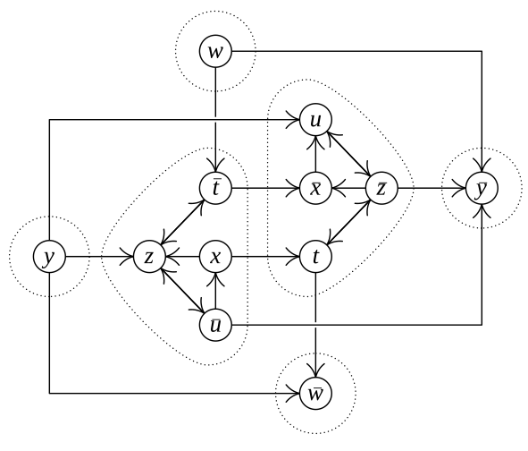](../../assets/volume4a/figures/fig-7-6-two-sat-components.svg)

图 6　对应于既不包含 $v$ 也不包含 $\overline v$ 的 $(40)$ 和 $(41)$ 的全部蕴涵的有向图. 为每个强分图中的字面值赋予适当的值, 将求解二元日程安排问题, 这个问题是 2SAT 问题的一个实例.

一般说来, 给定包含 $n$ 个布尔变量的 $m$ 个克罗姆子句的任何 2SAT 问题, 我们可以采用同样的方法构建一个有向图. 图中有 $2n$ 个顶点 $\{x_1,\overline x_1,\ldots,x_n,\overline x_n\}$, 对于每个可能的字面值存在一个顶点. 同时, 存在形如 $\overline u\longrightarrow v$ 和 $\overline v\longrightarrow u$ 的 $2m$ 段弧, 对于每个子句 $u\vee v$ 有两段弧. 两个字面值 $u$ 和 $v$ 属于这个有向图的同一个强分图, 当且仅当存在从 $u$ 到 $v$ 以及从 $v$ 到 $u$ 的定向路径. 例如, 在图 6 的有向图中, $6$ 个强分图由虚轮廓线标示. 在对应 2SAT 问题的任何解中, 强分图内的所有字面值必须具有相同的布尔值.

**定理 K.** 每个子句带有两个字面值的合取范式是可满足的, 当且仅当相关联的有向图的强分图不会同时包含一个变量和它的补.

**证明.** [梅尔文·克罗姆,*Zeitschrift für mathematische Logik und Grundlagen der Mathematik* **13** (1967), 15–20, 推论 2.2.] 如果存在从 $x$ 到 $\overline x$ 以及从 $\overline x$ 到 $x$ 的路径, 公式肯定是不可满足的.

反之, 假定不存在这样的路径. 任何有向图至少有一个强分图 $S$, 它是不包含来自其他任何强分图顶点的引入弧的 “源点”. 而且, 我们的有向图总是具有图 6 中那种富有吸引力的反对称性: 存在 $u\longrightarrow v$ 当且仅当存在 $\overline v\longrightarrow\overline u$. 所以, $S$ 中的字面值的补构成另一个强分图 $\overline S\ne S$, 它是不包含到达其他强分图的引出弧的 “汇点”. 因此, 我们可以对 $S$ 中的所有字面值赋予 $0$ 值, 对 $\overline S$ 中的所有字面值赋予 $1$ 值, 然后从有向图中消除它们, 再用同样方式处理, 直到所有的字面值都得到赋值. 当有向图中存在 $u\longrightarrow v$ 时, 所得到的值满足 $u\leq v$. 因此, 只要 $\overline u\vee v$ 是公式中的子句, 它们就满足 $\overline u\vee v$. $\quad\blacksquare$

罗伯特·塔扬建立了以线性时间寻找强分图的算法, 从而由定理 K 立即得出 2SAT 问题的一个有效解. [见 *SICOMP* **1** (1972), 146–160; 高德纳,*The Stanford GraphBase* (1994), 512–519.] 我们将会在 7.4.1.2 节详细讨论塔扬的算法. 习题 54 表明, 当用这个算法寻找一个新的强分图时, 容易检验定理 K 的条件. 而且, 算法首先寻找 “汇点”, 因此, 作为塔扬过程的一个简单附带结果, 对于强分图中出现在补之前的每个字面值, 我们可以通过选择赋值 $1$ 证实可满足性.

**中位数.** 我们重点讨论了 $x\vee y$ 和 $x\oplus y$ 这样的二元布尔运算. 还有一种重要的三元运算 $\langle xyz\rangle$, 称为 $x,y,z$ 的中位数:

$$
\langle xyz\rangle=(x\wedge y)\vee(y\wedge z)\vee(x\wedge z)=(x\vee y)\wedge(y\vee z)\wedge(x\vee z).\tag{43}
$$

事实上, $\langle xyz\rangle$ 或许是这整个领域中最重要的三元运算, 因为它存在正在不断发现和重新发现的惊人性质.

首先, 容易看出, 关于 $\langle xyz\rangle$ 的这个公式描述了任何三个布尔量 $x,y,z$ 的过半数: $\langle000\rangle=\langle001\rangle=0$, $\langle011\rangle=\langle111\rangle=1$. 我们称 $\langle xyz\rangle$ 为 “中位数” 而不说 “过半数”, 原因在于, 如果 $x,y,z$ 是任意实数, 而且式 (43) 中的运算 $\wedge$ 和 $\vee$ 分别表示 $\min$ (最小) 和 $\max$ (最大), 那么

$$
\langle xyz\rangle=y,\qquad\text{如果 }x\leq y\leq z.\tag{44}
$$

其次, 基本二元运算 $\wedge$ 和 $\vee$ 是中位数的特例:

$$
x\wedge y=\langle x0y\rangle;\qquad x\vee y=\langle x1y\rangle.\tag{45}
$$

因此, 任何单调布尔函数完全可以用三元中位数运算符以及常数 $0$ 和 $1$ 表示. 事实上, 如果我们仅限于中位数的范围, 那么可以用 $\wedge$ 代表假, 而用 $\vee$ 代表真. 于是, $x\wedge y=\langle x\wedge y\rangle$ 和 $x\vee y=\langle x\vee y\rangle$ 完全是自然的表达式. 而且, 如果我们愿意的话, 甚至可以采用波兰表示法[^v4a-p51-1], 如 $\langle\wedge xy\rangle$ 和 $\langle\vee xy\rangle$. 如果我们取关于常数 $\wedge=-\infty$ 和 $\vee=+\infty$ 的中位数, 那么, 同样的思想在 $\wedge$ 和 $\vee$ 的 min-max 解释下适用于广义实数[^v4a-p51-2].

如果布尔函数 $f(x_1,x_2,\ldots,x_n)$ 满足

$$
\overline{f(x_1,x_2,\ldots,x_n)}=f(\overline x_1,\overline x_2,\ldots,\overline x_n),\tag{46}
$$

那么称它为自对偶的. 我们已经指出, 布尔函数是单调的, 当且仅当它可以用 $\wedge$ 和 $\vee$ 表示. 根据德摩根定律 $(11)$ 和 $(12)$, 单调公式是自对偶的, 当且仅当可以交换符号 $\wedge$ 和 $\vee$ 而不改变公式的值. 因此, 式 (43) 中定义的中位数运算不仅是单调的而且是自对偶的. 实际上, 它是该类型的最简单非平凡函数, 因为除投影运算 $\mathsf L$ 和 $\mathsf R$ 外, 在表 1 中没有其他二元运算既是单调的又是自对偶的.

此外, 完全用中位数运算符构成并且不带常数的任何表达式, 不仅是单调的, 而且是自对偶的. 例如, 函数 $\langle w\langle xyz\rangle\langle w\langle uvw\rangle x\rangle\rangle$ 是自对偶的, 因为

$$
\begin{aligned}
\overline{\langle w\langle xyz\rangle\langle w\langle uvw\rangle x\rangle\rangle}
&=\langle\overline w\,\overline{\langle xyz\rangle}\,\overline{\langle w\langle uvw\rangle x\rangle}\rangle\\
&=\langle\overline w\langle\overline x\,\overline y\,\overline z\rangle\langle\overline w\,\overline{\langle uvw\rangle}\,\overline x\rangle\rangle\\
&=\langle\overline w\langle\overline x\,\overline y\,\overline z\rangle\langle\overline w\langle\overline u\,\overline v\,\overline w\rangle\overline x\rangle\rangle.
\end{aligned}
$$

埃米尔·波斯特在其博士论文 (哥伦比亚大学, 1920) 中证明了逆命题也成立.

**定理 P.** 每个单调自对偶布尔函数 $f(x_1,\ldots,x_n)$ 完全可以用中位数运算 $\langle xyz\rangle$ 表示.

**证明.** [*Annals of Mathematics Studies* **5** (1941), 74–75.] 首先注意到

$$
\begin{aligned}
{}&\langle x_1y\langle x_2y\cdots y\langle x_{s-1}yx_s\rangle\cdots\rangle\rangle\\
{}&\quad=\bigl((x_1\vee x_2\vee\cdots\vee x_{s-1}\vee x_s)\wedge y\bigr)\vee(x_1\wedge x_2\wedge\cdots\wedge x_{s-1}\wedge x_s);\tag{47}
\end{aligned}
$$

通过对 $s$ 的归纳法, 容易证实这个重复取中位数的公式.

现在假定 $f(x_1,\ldots,x_n)$ 是单调自对偶函数, 并且具有析取素式

$$
f(x_1,\ldots,x_n)=t_1\vee\cdots\vee t_m,\qquad t_j=x_{j1}\wedge\cdots\wedge x_{js_j},
$$

其中没有素蕴涵元 $t_j$ 包含在另一个素蕴涵元中 (推论 Q). 任何两个素蕴涵元必定至少有一个公共变量. 因为, 比如说, 如果我们有 $t_1=x\wedge y$ 和 $t_2=u\wedge v\wedge w$, 那么, 当 $x=y=1$ 且 $u=v=w=0$ 时, 或者, 当 $x=y=0$ 且 $u=v=w=1$ 时, $f$ 的值将是 $1$, 同函数的自对偶性矛盾. 因此, 如果任何 $t_j$ 包含单个变量 $x$, 它必定是唯一的素蕴涵元——此时 $f$ 是平凡函数 $f(x_1,\ldots,x_n)=x=\langle xxx\rangle$.

通过构建中位数, 定义函数 $g_0,g_1,\ldots,g_m$ 如下:

$$
\begin{aligned}
g_0(x_1,\ldots,x_n)&=x_1;\\
g_j(x_1,\ldots,x_n)&=h(x_{j1},\ldots,x_{js_j};g_{j-1}(x_1,\ldots,x_n)),\qquad1\leq j\leq m;
\end{aligned}\tag{48}
$$

其中 $h(x_1,\ldots,x_s;y)$ 是 $(47)$ 第一行的函数. 根据对 $j$ 的归纳法, 从 $(47)$ 和 $(48)$ 可以证明, 每当 $t_1\vee\cdots\vee t_j=1$ 时有 $g_j(x_1,\ldots,x_n)=1$, 因为当 $k<j$ 时有 $(x_{j1}\vee\cdots\vee x_{js_j})\wedge t_k=t_k$.

最后, $f(x_1,\ldots,x_n)$ 必定等于 $g_m(x_1,\ldots,x_n)$, 因为这两个函数都是单调自对偶函数, 而且我们已经证明, 对于 $0$ 和 $1$ 的所有组合有 $f(x_1,\ldots,x_n)\leq g_m(x_1,\ldots,x_n)$. 这个不等式足以证明等式成立, 因为自对偶函数在 $2^n$ 种可能的情形中恰好有半数等于 $1$. $\quad\blacksquare$

定理 P 的一个推论是, 我们可以通过三元素中位数表示五元素中位数, 因为任何奇数数量的布尔变量的中位数显然是单调自对偶函数. 我们把这样的一个中位数记为 $\langle x_1\ldots x_{2k-1}\rangle$, 于是 $\langle vwxyz\rangle$ 的析取素式是

$$
\begin{aligned}
{}&(v\wedge w\wedge x)\vee(v\wedge w\wedge y)\vee(v\wedge w\wedge z)\vee(v\wedge x\wedge y)\vee(v\wedge x\wedge z)\\
{}&\quad\vee(v\wedge y\wedge z)\vee(w\wedge x\wedge y)\vee(w\wedge x\wedge z)\vee(w\wedge y\wedge z)\vee(x\wedge y\wedge z);
\end{aligned}
$$

所以, 定理 P 的证明中把 $\langle vwxyz\rangle$ 构造成一个包含 $2046$ 个三元素中位数运算的很长的公式 $g_{10}(v,w,x,y,z)$. 当然, 这个表达式不是可能的公式中最短的一个. 实际上我们有

$$
\langle vwxyz\rangle=\langle v\langle xyz\rangle\langle wx\langle wyz\rangle\rangle\rangle.\tag{49}
$$

[见亨利·米勒和罗伯特·温德,*IRE Transactions* **EC-11** (1962), 89–90.]

**\*中位数代数与中位数图.** 前面我们曾指出, 如果把 $\wedge$ 和 $\vee$ 看成 $\min$ (最小) 和 $\max$ (最大) 运算符, 那么, 当 $x,y,z$ 属于实数集之类的任何有序集时, 三元运算 $\langle xyz\rangle$ 是很有用的. 实际上, 运算 $\langle xyz\rangle$ 在更为普遍的环境中也起着有益的作用. 中位数代数是指任意的集合 $M$, 在其上定义了三元运算 $\langle xyz\rangle$, 把 $M$ 的元素变成 $M$ 的元素, 并且遵守下面三条公理:

$$
\langle xxy\rangle=x\qquad\text{(过半数定律)};\tag{50}
$$

$$
\langle xyz\rangle=\langle xzy\rangle=\langle yxz\rangle=\langle yzx\rangle=\langle zxy\rangle=\langle zyx\rangle\qquad\text{(交换律)};\tag{51}
$$

$$
\langle xw\langle ywz\rangle\rangle=\langle\langle xwy\rangle wz\rangle\qquad\text{(结合律)}.\tag{52}
$$

在布尔代数的情形, 例如, 结合律 $(52)$ 对于 $w=0$ 和 $w=1$ 成立, 因为 $\wedge$ 和 $\vee$ 是结合的. 习题 75 和 76 证明, 这 $3$ 条公理还蕴涵中位数的分配律, 它具有短形式

$$
\langle\langle xyz\rangle uv\rangle=\langle x\langle yuv\rangle\langle zuv\rangle\rangle\tag{53}
$$

和更对称的长形式

$$
\langle\langle xyz\rangle uv\rangle=\langle\langle xuv\rangle\langle yuv\rangle\langle zuv\rangle\rangle.\tag{54}
$$

这个事实没有已知的简单证明, 但我们至少可以证实 $(53)$ 和 $(54)$ 当 $y=u$ 且 $z=v$ 时的特例: 我们有

$$
\langle\langle xyz\rangle yz\rangle=\langle xyz\rangle,\tag{55}
$$

因为两端都等于 $\langle xy\langle zyz\rangle\rangle$. 事实上, 结合律 $(52)$ 恰好是 $(53)$ $y=u$ 时的特例. 同时, 我们还可以用 $(55)$ 和 $(52)$ 证实 $x=u$ 时的特例:

$$
\begin{aligned}
\langle\langle uyz\rangle uv\rangle
&=\langle vu\langle yuz\rangle\rangle
=\langle\langle vuy\rangle uz\rangle
=\langle\langle yuv\rangle uz\rangle\\
&=\langle\langle\langle yuv\rangle uv\rangle uz\rangle
=\langle\langle yuv\rangle u\langle vuz\rangle\rangle
=\langle u\langle yuv\rangle\langle zuv\rangle\rangle.
\end{aligned}
$$

中位数代数 $M$ 的理想是集合 $C\subseteq M$, 满足

$$
\langle xyz\rangle\in C,\qquad\text{当 }x\in C,\ y\in C,\ z\in M.\tag{56}
$$

如果 $u$ 和 $v$ 是 $M$ 的任意元素, 则区间 $[u\mathinner{.\,.}v]$ 定义为

$$
[u\mathinner{.\,.}v]=\{\langle xuv\rangle\mid x\in M\}.\tag{57}
$$

我们说 “$x$ 在 $u$ 和 $v$ 之间” 当且仅当 $x\in[u\mathinner{.\,.}v]$. 按照这些定义, $u$ 和 $v$ 本身总是属于区间 $[u\mathinner{.\,.}v]$.

**引理 M.** 每个区间 $[u\mathinner{.\,.}v]$ 都是一个理想, 而且 $x\in[u\mathinner{.\,.}v]\Longleftrightarrow x=\langle uxv\rangle$.

**证明.** 令 $\langle xuv\rangle$ 和 $\langle yuv\rangle$ 是 $[u\mathinner{.\,.}v]$ 的任意元素. 那么, 根据 $(51)$ 和 $(53)$, 对于所有 $z\in M$ 有

$$
\langle\langle xuv\rangle\langle yuv\rangle z\rangle=\langle\langle xyz\rangle uv\rangle\in[u\mathinner{.\,.}v],
$$

所以 $[u\mathinner{.\,.}v]$ 是一个理想. 此外, 根据 $(51)$ 和 $(55)$, 每个元素 $\langle xuv\rangle\in[u\mathinner{.\,.}v]$ 满足 $\langle xuv\rangle=\langle u\langle xuv\rangle v\rangle$. $\quad\blacksquare$

根据前述中位数定律, 区间 $[u\mathinner{.\,.}v]$ 具备良好的性质:

$$
v\in[u\mathinner{.\,.}u]\Longrightarrow u=v;\tag{58}
$$

$$
x\in[u\mathinner{.\,.}v]\text{ 且 }y\in[u\mathinner{.\,.}x]\Longrightarrow y\in[u\mathinner{.\,.}v];\tag{59}
$$

$$
x\in[u\mathinner{.\,.}v]\text{ 且 }y\in[u\mathinner{.\,.}z]\text{ 且 }y\in[v\mathinner{.\,.}z]\Longrightarrow y\in[x\mathinner{.\,.}z].\tag{60}
$$

这些性质相当于: $[u\mathinner{.\,.}u]=\{u\}$; 如果 $x\in[u\mathinner{.\,.}v]$, 那么 $[u\mathinner{.\,.}x]\subseteq[u\mathinner{.\,.}v]$; 对于所有的 $z$, $x\in[u\mathinner{.\,.}v]$ 蕴涵 $[u\mathinner{.\,.}z]\cap[v\mathinner{.\,.}z]\subseteq[x\mathinner{.\,.}z]$. (见习题 72.)

现在, 让我们在顶点集 $M$ 上定义一个具有下述边的图:

$$
u\mathrel{\text{—}}v\quad\Longleftrightarrow\quad u\ne v\text{ 且对于所有 }x\in M\text{ 有 }\langle xuv\rangle\in\{u,v\}.\tag{61}
$$

换句话说, 顶点 $u$ 和 $v$ 是邻接的, 当且仅当区间 $[u\mathinner{.\,.}v]$ 恰好仅由 $u$ 和 $v$ 这两个点组成.

**定理 G.** 如果 $M$ 是任意有限的中位数代数, 那么由 $(61)$ 定义的图是连通的. 此外, 顶点 $x$ 属于区间 $[u\mathinner{.\,.}v]$, 当且仅当 $x$ 位于从 $u$ 到 $v$ 的最短路径上.

**证明.** 如果 $M$ 不是连通的, 那么选择 $u$ 和 $v$, 使得不存在从 $u$ 到 $v$ 的路径, 且区间 $[u\mathinner{.\,.}v]$ 具有尽可能少的元素. 令 $x\in[u\mathinner{.\,.}v]$ 是不同于 $u$ 和 $v$ 的元素. 那么 $\langle xuv\rangle=x\ne v$, 所以 $v\notin[u\mathinner{.\,.}x]$; 同理, $u\notin[x\mathinner{.\,.}v]$. 但是由 $(59)$ 可知, $[u\mathinner{.\,.}x]$ 和 $[x\mathinner{.\,.}v]$ 是包含在 $[u\mathinner{.\,.}v]$ 内的区间, 所以它们是更小的区间, 因此必定有一条从 $u$ 到 $x$ 以及从 $x$ 到 $v$ 的路径. 导致矛盾.

定理另一半的证明见习题 73. $\quad\blacksquare$

我们对区间的定义蕴涵 $\langle xyz\rangle\in[x\mathinner{.\,.}y]\cap[x\mathinner{.\,.}z]\cap[y\mathinner{.\,.}z]$, 因为根据 $(55)$ 我们有 $\langle xyz\rangle=\langle\langle xyz\rangle xy\rangle=\langle\langle xyz\rangle xz\rangle=\langle\langle xyz\rangle yz\rangle$. 反过来, 如果 $w\in[x\mathinner{.\,.}y]\cap[x\mathinner{.\,.}z]\cap[y\mathinner{.\,.}z]$, 习题 74 证明了 $w=\langle xyz\rangle$. 换句话说, 当 $x,y,z$ 是 $M$ 的点时, 交集 $[x\mathinner{.\,.}y]\cap[x\mathinner{.\,.}z]\cap[y\mathinner{.\,.}z]$ 总是恰好包含一个点.

图 7 说明了在 $4\times4\times4$ 立方体中的这个原理, 其中每个点 $x$ 的坐标 $(x_1,x_2,x_3)$ 满足 $0\leq x_1,x_2,x_3<4$. 立方体的顶点构成中位数代数, 因为 $\langle xyz\rangle=(\langle x_1y_1z_1\rangle,\langle x_2y_2z_2\rangle,\langle x_3y_3z_3\rangle)$.

[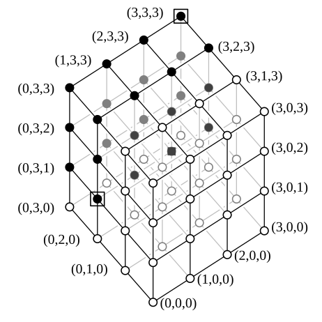](../../assets/volume4a/figures/fig-7-7-a-grid-interval.svg)

(a) 区间 $[x\mathinner{.\,.}y]$

[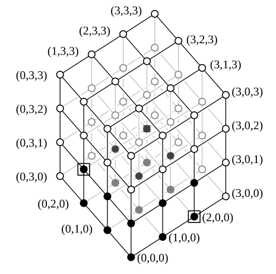](../../assets/volume4a/figures/fig-7-7-b-grid-interval.svg)

(b) 区间 $[x\mathinner{.\,.}z]$

[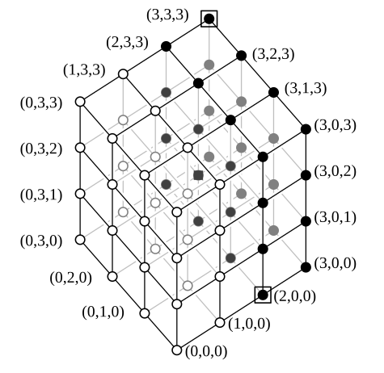](../../assets/volume4a/figures/fig-7-7-c-grid-interval.svg)

(c) 区间 $[y\mathinner{.\,.}z]$

图 7　$4\times4\times4$ 立方体中, 顶点 $x=(0,2,1)$, $y=(3,3,3)$, $z=(2,0,0)$ 之间的区间

此外, 图 7 中的边是在 $(61)$ 中定义的, 它们穿越在一些顶点之间, 除了其中某个分量有 $\pm1$ 的改变之外, 这些顶点的坐标是相同的. 图中显示三个典型的区间 $[x\mathinner{.\,.}y]$, $[x\mathinner{.\,.}z]$, $[y\mathinner{.\,.}z]$, 所有三个区间仅有的公共点是顶点 $\langle xyz\rangle=(2,2,1)$.

目前, 我们从中位数代数开始, 利用它定义带有某些性质的图. 然而, 我们也可以从具备这些性质的图开始, 利用它定义中位数代数. 如果 $u$ 和 $v$ 是任意图的顶点, 那么, 我们把区间 $[u\mathinner{.\,.}v]$ 定义为 $u$ 和 $v$ 之间那些最短路径上的所有点的集合. 如果一个有限图只有一个顶点位于连接任何三个给定顶点 $x,y,z$ 的三个区间的交集 $[x\mathinner{.\,.}y]\cap[x\mathinner{.\,.}z]\cap[y\mathinner{.\,.}z]$ 上, 那么, 这个有限图称为中位数图, 而且, 我们用 $\langle xyz\rangle$ 表示这个顶点. 习题 75 表明, 所产生的三元运算满足中位数代数公理.

按照这个定义, 很多重要的图是中位数图. 例如, 容易看出, 任何自由树都是中位数图. 另一个简单例子是像 $n_1\times n_2\times\cdots\times n_m$ 这样的超矩形图. 任意中位数图的笛卡儿积也满足所需条件.

**\*中位数标记.** 如果 $u$ 和 $v$ 是中位数代数的任意元素, 取 $x\mapsto\langle xuv\rangle$ 的映射 $f(x)$ 是一个同态. 根据长分配律 $(54)$, 它满足

$$
f(\langle xyz\rangle)=\langle f(x)f(y)f(z)\rangle.\tag{62}
$$

根据 $(57)$, 这个函数 $\langle xuv\rangle$ 把任何给定的点 $x$“投影” 到区间 $[u\mathinner{.\,.}v]$ 上. 当 $u\mathrel{\text{—}}v$ 是相应图的一条边时它特别有趣, 因为此时 $f(x)$ 是二值函数, 实质上是一个布尔映射.

例如, 考虑如下所示的具有 8 个顶点和 7 条边的典型自由树. 通过判定 $x$ 是更接近 $u$ 还是更接近 $v$, 我们可以把每个顶点 $x$ 投影到每个边区间 $[u\mathinner{.\,.}v]$ 上:

[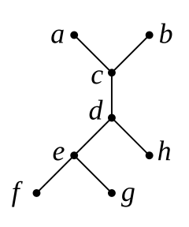](../../assets/volume4a/figures/diagram-7-1-1-63-tree.svg)

<table>
<thead><tr><th></th><th>$ac$</th><th>$bc$</th><th>$cd$</th><th>$de$</th><th>$ef$</th><th>$eg$</th><th>$dh$</th><th></th></tr></thead>
<tbody>
<tr><td>$a\mapsto$</td><td>$a$</td><td>$c$</td><td>$c$</td><td>$d$</td><td>$e$</td><td>$e$</td><td>$d$</td><td><code>0000000</code></td></tr>
<tr><td>$b\mapsto$</td><td>$c$</td><td>$b$</td><td>$c$</td><td>$d$</td><td>$e$</td><td>$e$</td><td>$d$</td><td><code>1100000</code></td></tr>
<tr><td>$c\mapsto$</td><td>$c$</td><td>$c$</td><td>$c$</td><td>$d$</td><td>$e$</td><td>$e$</td><td>$d$</td><td><code>1000000</code></td></tr>
<tr><td>$d\mapsto$</td><td>$c$</td><td>$c$</td><td>$d$</td><td>$d$</td><td>$e$</td><td>$e$</td><td>$d$</td><td><code>1010000</code></td></tr>
<tr><td>$e\mapsto$</td><td>$c$</td><td>$c$</td><td>$d$</td><td>$e$</td><td>$e$</td><td>$e$</td><td>$d$</td><td><code>1011000</code></td></tr>
<tr><td>$f\mapsto$</td><td>$c$</td><td>$c$</td><td>$d$</td><td>$e$</td><td>$f$</td><td>$e$</td><td>$d$</td><td><code>1011100</code></td></tr>
<tr><td>$g\mapsto$</td><td>$c$</td><td>$c$</td><td>$d$</td><td>$e$</td><td>$e$</td><td>$g$</td><td>$d$</td><td><code>1011010</code></td></tr>
<tr><td>$h\mapsto$</td><td>$c$</td><td>$c$</td><td>$d$</td><td>$d$</td><td>$e$</td><td>$e$</td><td>$h$</td><td><code>1010001</code></td></tr>
</tbody>
</table>

$(63)$

在其右端, 我们随意选定 $a\mapsto0000000$, 把这个函数转换成到 0 和 1 的投影. 所得的二进制位串称为顶点的标记, 例如, 我们把结果写成 $l(b)=1100000$. 由于每个投影是一个同态, 因而只需要在它们标记的每个分量中取布尔中位数, 就可以计算任意三点的中位数. 例如, 为了计算 $\langle bgh\rangle$, 我们计算 $l(b)=1100000$, $l(g)=1011010$, $l(h)=1010001$ 的按位中位数, 即 $1010000=l(d)$.

当对一个中位数图的所有边进行投影时, 我们可能发现二进制标记的两列是完全相同的. 对于自由树不会出现这种情形, 不过我们可以考虑一下, 在 $(63)$ 的树中增加一条边 $g\mathrel{\text{—}}h$ 会发生什么: 获得的图依然是中位数图, 但是, 列 $eg$ 和列 $dh$ 会变成完全相同 (除非交换 $e\leftrightarrow d$ 以及交换 $g\leftrightarrow h$). 此外, 新列 $gh$ 将与列 $de$ 相等. 对于这种情形, 应从标记中删除多余的分量. 因此, 扩展图的顶点标记不是 8 个二进制位, 而是 6 个二进制位, 如 $l(g)=101101$ 和 $l(h)=101001$.

任何中位数代数的元素总是可以用标记通过这种方法表示. 所以, 在布尔代数中成立的任何恒等式在所有中位数代数中也是正确的. 有了这个 “0-1 原则”, 就能检验任意两个由三元运算 $\langle xyz\rangle$ 构造的表达式是否可以根据公理 $(50)(51)(52)$ 证明相等——尽管我们用这个方法检验 $n$ 变量表达式时需要检验 $2^{n-1}-1$ 种情形.

例如, 结合律 $\langle xw\langle ywz\rangle\rangle=\langle\langle xwy\rangle wz\rangle$ 表明, 应该有一种两端不包含嵌套尖括号的对称解释. 而且, 确实有这样的公式:

$$
\langle xw\langle ywz\rangle\rangle=\langle\langle xwy\rangle wz\rangle=\langle xwywz\rangle,\tag{64}
$$

其中 $\langle xwywz\rangle$ 表示五元素多重集 $\{x,w,y,w,z\}=\{w,w,x,y,z\}$ 的中位数. 我们可以用 0-1 原则证明这个公式, 请注意, 在布尔代数的情形, 中位数与过半数是一样的. 用类似的方法可以证明 $(49)$, 同时能够证明, 埃米尔·波斯特在 $(47)$ 中使用的函数可以简化为

$$
\langle x_1y\langle x_2y\ldots y\langle x_{s-1}yx_s\rangle\ldots\rangle\rangle
=\langle x_1yx_2y\ldots yx_{s-1}yx_s\rangle;\tag{65}
$$

这是 $2s-1$ 个量的中位数, 它们中近半数的量等于 $y$.

如果当 $u\in C$ 且 $v\in C$ 时有 $[u\mathinner{.\,.}v]\subseteq C$, 则图中的顶点集合 $C$ 称为凸集. 换句话说, 当一条最短路径的两个端点属于 $C$ 时, 这条路径上的所有顶点必定也出现在 $C$ 中. (因此, 凸集同我们前面所说的 “理想” 是相同的, 现在, 我们使用几何语言而不是代数语言.) 我们把 $\{v_1,\ldots,v_m\}$ 的凸包定义为包含每一个顶点 $v_1,\ldots,v_m$ 的最小凸集. 前述理论结果已经证明, 每个区间 $[u\mathinner{.\,.}v]$ 都是凸集. 因此, $[u\mathinner{.\,.}v]$ 是两点集合 $\{u,v\}$ 的凸包. 不过, 事实上存在更为普遍的结论:

**定理 C.** 中位数图中 $\{v_1,v_2,\ldots,v_m\}$ 的凸包是所有点的集合

$$
C=\{\langle v_1xv_2x\ldots xv_m\rangle\mid x\in M\}.\tag{66}
$$

此外, $x\in C$ 当且仅当 $x=\langle v_1xv_2x\ldots xv_m\rangle$.

**证明.** 显然, 对于 $1\leq j\leq m$ 有 $v_j\in C$. 因为点 $x'=\langle v_2x\ldots xv_m\rangle$ 在凸包中 (根据对 $m$ 归纳法), 而且 $\langle v_1x\ldots xv_m\rangle\in[v_1\mathinner{.\,.}x']$, 所以 $C$ 的每个点必定属于凸包. 0-1 原则证明

$$
\langle x\langle v_1yv_2y\ldots yv_m\rangle\langle v_1zv_2z\ldots zv_m\rangle\rangle
=\langle v_1\langle xyz\rangle v_2\langle xyz\rangle\ldots\langle xyz\rangle v_m\rangle,\tag{67}
$$

因此 $C$ 是凸集. 在这个公式中设 $y=x$, 证明 $\langle v_1xv_2x\ldots xv_m\rangle$ 是 $C$ 中离 $x$ 最近的点, 而且对于所有 $z\in C$ 有 $\langle v_1xv_2x\ldots xv_m\rangle\in[x\mathinner{.\,.}z]$. $\quad\blacksquare$

**推论 C.** 对于 $1\leq j\leq m$, 令 $v_j$ 的标记是 $v_{j1}\ldots v_{jt}$. 那么, $\{v_1,\ldots,v_m\}$ 的凸包是所有这样的 $x\in M$ 的集合, 当 $v_{1j}=v_{2j}=\cdots=v_{mj}=c_j$ 时 $x$ 的标记 $x_1\ldots x_t$ 满足 $x_j=c_j$. $\quad\blacksquare$

例如, $(63)$ 中 $\{c,g,h\}$ 的凸包包含所有其标记与模式 $\texttt{10**0**}$ 匹配的元素, 即 $\{c,d,e,g,h\}$.

如果中位数图包含一个 4 圈 $u\mathrel{\text{—}}x\mathrel{\text{—}}v\mathrel{\text{—}}y\mathrel{\text{—}}u$, 那么, 边 $u\mathrel{\text{—}}x$ 和 $v\mathrel{\text{—}}y$ 在下述意义下是等价的: 投影到 $[u\mathinner{.\,.}x]$ 上与投影到 $[v\mathinner{.\,.}y]$ 上均产生相同的标记坐标. 原因在于, 对于任何满足 $\langle zux\rangle=u$ 的 $z$, 我们有

$$
\begin{aligned}
y&=\langle uvy\rangle=\langle\langle zux\rangle vy\rangle\\
&=\langle\langle zvy\rangle\langle uvy\rangle\langle xvy\rangle\rangle
=\langle\langle zvy\rangle yv\rangle,
\end{aligned}
$$

因此 $\langle zvy\rangle=y$; 同样, $\langle zux\rangle=x$ 蕴涵 $\langle zvy\rangle=v$. 由于同样理由, 边 $x\mathrel{\text{—}}v$ 和 $y\mathrel{\text{—}}u$ 是等价的. 习题 77 表明, 两条边产生等价的投影, 当且仅当可以用这个方法从 4 圈得到一条等价的链. 因此, 每个顶点标记的二进制位的数量, 是由 4 圈导出的边的等价类的数量. 该题还表明, 一旦我们指定某个顶点的标记为 $00\ldots0$, 就能唯一确定其他各个顶点的标记.

普拉纳瓦·杰哈和焦拉·斯卢茨基 [*Ars Combin.* **34** (1992), 75–92] 发现一个求解任意中位数图顶点标记的出色方法, 约翰·哈高尔、威尔弗里德·伊姆里奇和桑迪·克拉夫扎 [*Theor. Comp. Sci.* **215** (1999), 123–136] 改进了该方法:

**算法 H (中位数标记).** 给定中位数图 $G$ 和源顶点 $a$, 算法确定由 $G$ 的 4 圈定义的等价类, 计算每个顶点的标记 $l(v)=v_1\ldots v_t$; 其中 $t$ 是等价类的数量, 而且 $l(a)=0\ldots0$.

**H1.[初始化.]** 对 $G$ 作预处理, 依照从 $a$ 到所有顶点的距离的顺序访问它们. 对于每条边 $u\mathrel{\text{—}}v$, 如果 $a$ 离 $u$ 比 $v$ 更近, 我们就说 $u$ 是 $v$ 的先邻近, 否则 $u$ 是 $v$ 的后邻近. 换句话说, 当遇到 $v$ 时 $v$ 的先邻近已经被访问过了, 而 $v$ 的后邻近仍在等待对它们的访问. 预处理重新排列全部邻接表, 使得先邻近排列在前面. 从把每条边置于自己的等价类开始, 当算法认识到那些边类是等价类时, 就用算法 2.3.3E 那样的 “求并算法” 合并它们.

**H2.[调用子程序.]** 置 $j\leftarrow0$, 用参数 $a$ 调用子程序 I. (子程序 I 见下. 它将用全局变量 $j$ 建立边 $r_j\mathrel{\text{—}}s_j$ 的一个主表, 其中 $1\leq j<n$, $n$ 是顶点的总数. 对于每个顶点 $v\ne a$, 表中有一个 $s_j=v$ 的项.)

**H3.[计算标记.]** 从 1 到 $t$ 对等价类编号. 然后, 置 $l(a)$ 为 $t$ 位二进制位串 $0\ldots0$. 对于 $j=1,2,\ldots,n-1$ (按照这个顺序), 把 $l(s_j)$ 置为第 $k$ 个二进制位从 0 改变成 1 的 $l(r_j)$, 其中 $k$ 是边 $r_j\mathrel{\text{—}}s_j$ 的等价类. $\quad\blacksquare$

**子程序 I (处理 $r$ 的子孙顶点).** 这是一个带参数 $r$ 和全局变量 $j$ 的递归子程序, 它执行算法 H 的主要工作, 对当前从顶点 $r$ 可达的所有顶点的图进行处理. 在处理过程中, 把 $r$ 自身之外的所有这种顶点记录到主表上, 并从当前图中删除它们之间的边. 每个顶点有四个字段 `LINK`, `MARK`, `RANK`, `MATE`, 初始化为空 ($\Lambda$).

**I1.[对 $s$ 循环.]** 选择一个具有边 $r\mathrel{\text{—}}s$ 的顶点 $s$. 如果不存在这样的顶点, 从子程序返回.

**I2.[记录该边.]** 置 $j\leftarrow j+1$, $r_j\leftarrow r$, $s_j\leftarrow s$.

**I3.[开始广度优先搜索.]** (现在我们要寻找并删除当前图中与 $r\mathrel{\text{—}}s$ 等价的所有边.) 置 $\mathrm{MARK}(s)\leftarrow s$, $\mathrm{RANK}(s)\leftarrow1$, $\mathrm{LINK}(s)\leftarrow\Lambda$, $v\leftarrow q\leftarrow s$.

**I4.[求 $v$ 的配对.]** 求 $v$ 的先邻近 $u$, 对它而言, $\mathrm{MARK}(u)\ne s$ 或 $\mathrm{RANK}(u)\ne1$. (恰好有这样一个顶点 $u$. 回忆在算法 H 的步骤 H1 中已经把先邻近放在前面.) 置 $\mathrm{MATE}(v)\leftarrow u$.

**I5.[删除 $u\mathrel{\text{—}}v$.]** 合并边 $u\mathrel{\text{—}}v$ 和 $r\mathrel{\text{—}}s$ 的等价类, 使它们等价. 从 $v$ 的邻接表中删除 $u$, 并从 $u$ 的邻接表中删除 $v$.

**I6.[对 $v$ 的邻近分类.]** 对于 $v$ 的每个先邻近 $u$, 执行 I7; 对于 $v$ 的每个后邻近 $u$, 执行 I8. 转到 I9.

**I7.[记录一个可能的等价.]** 如果 $\mathrm{MARK}(u)=s$ 且 $\mathrm{RANK}(u)=1$, 使边 $u\mathrel{\text{—}}v$ 与边 $\mathrm{MATE}(u)\mathrel{\text{—}}\mathrm{MATE}(v)$ 等价. 返回 I6.

**I8.[确定 $u$ 的秩.]** 如果 $\mathrm{MARK}(u)=s$ 且 $\mathrm{RANK}(u)=1$, 返回 I6. 否则, 置 $\mathrm{MARK}(u)\leftarrow s$, $\mathrm{RANK}(u)\leftarrow2$. 置 $w$ 为 $u$ 的第一个邻近 (它将是先邻近). 如果 $w=v$, 重置 $w$ 为 $u$ 的第二个先邻近; 但是, 如果 $u$ 仅有一个先邻近, 返回 I6. 如果 $\mathrm{MARK}(w)\ne s$ 或 $\mathrm{RANK}(w)\ne2$, 置 $\mathrm{RANK}(u)\leftarrow1$, $\mathrm{LINK}(u)\leftarrow\Lambda$, $\mathrm{LINK}(q)\leftarrow u$, $q\leftarrow u$. 返回 I6.

**I9.[继续广度优先搜索.]** 置 $v\leftarrow\mathrm{LINK}(v)$. 如果 $v\ne\Lambda$, 返回 I4.

**I10.[处理子图 $s$.]** 用参数 $s$ 递归调用子程序 I. 返回 I1. $\quad\blacksquare$

算法 H 和子程序 I 用了相对高层的数据结构描述, 进一步的细节留待读者补充. 例如, 邻接表应是双向链接的, 这样在步骤 I5 中就能便捷地删除边, 也可以采用任何方便的方法合并等价类.

习题 77 阐明了这个算法行之有效的原理, 习题 78 证明每个顶点在步骤 I4 最多遇到 $\lg n$ 次. 此外, 习题 79 证明一个中位数图最多有 $O(n\log n)$ 条边. 所以, 算法 H 的总运行时间为 $O(n(\log n)^2)$, 其中不计步骤 H3 中设置标记位串的时间.

读者或许想对表 2 中的中位数图动手演示一遍算法 H, 它的顶点代表 4 个变量 $\{w,x,y,z\}$ 的 12 个单调自对偶布尔函数. 所有这样实际包含全部 4 个变量的函数, 可以像式 (64) 那样表示成 5 个对象的中位数. 算法从顶点 $a=w$ 开始, 计算边 $r_j\mathrel{\text{—}}s_j$ 的主表以及表 2 中所示的二进制位标记. (实际处理顺序取决于顶点在邻接表中出现的顺序. 但是, 在任意排序下标记最终将是相同的, 只要不计列的排列.)

表 2　4 个生成元的自由中位数代数的标记

[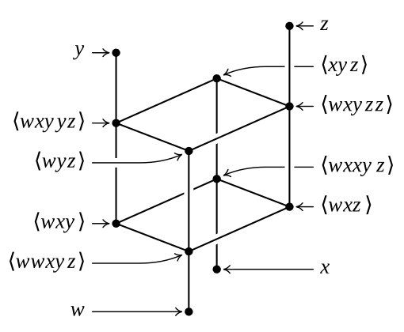](../../assets/volume4a/figures/table-7-1-1-2-free-median-graph.svg)

<table>
<thead><tr><th>$j$</th><th>$r_j$</th><th>$s_j$</th><th>$l(s_j)$</th></tr></thead>
<tbody>
<tr><td></td><td></td><td>$w$</td><td><code>0000000</code></td></tr>
<tr><td>1</td><td>$w$</td><td>$\langle wwxyz\rangle$</td><td><code>0000001</code></td></tr>
<tr><td>2</td><td>$\langle wwxyz\rangle$</td><td>$\langle wyz\rangle$</td><td><code>0010001</code></td></tr>
<tr><td>3</td><td>$\langle wyz\rangle$</td><td>$\langle wxyzz\rangle$</td><td><code>0010101</code></td></tr>
<tr><td>4</td><td>$\langle wxyzz\rangle$</td><td>$\langle xyz\rangle$</td><td><code>0010111</code></td></tr>
<tr><td>5</td><td>$\langle wxyzz\rangle$</td><td>$z$</td><td><code>1010101</code></td></tr>
<tr><td>6</td><td>$\langle wyz\rangle$</td><td>$\langle wxyyz\rangle$</td><td><code>0010011</code></td></tr>
<tr><td>7</td><td>$\langle wxyyz\rangle$</td><td>$y$</td><td><code>0110011</code></td></tr>
<tr><td>8</td><td>$\langle wwxyz\rangle$</td><td>$\langle wxz\rangle$</td><td><code>0000101</code></td></tr>
<tr><td>9</td><td>$\langle wxz\rangle$</td><td>$\langle wxxyz\rangle$</td><td><code>0000111</code></td></tr>
<tr><td>10</td><td>$\langle wxxyz\rangle$</td><td>$x$</td><td><code>0001111</code></td></tr>
<tr><td>11</td><td>$\langle wwxyz\rangle$</td><td>$\langle wxy\rangle$</td><td><code>0000011</code></td></tr>
</tbody>
</table>

请注意, 在每个标记 $l(v)$ 中, 二进制位 1 的数量是从起始顶点 $a$ 到 $v$ 的距离. 事实上, 标记的唯一性表明, 任意两个顶点之间的距离是在它们的标记中存在差别的二进制位位置的数量, 因为我们可以从任意特定的顶点开始.

对于表 2 中的特殊中位数图, 实际上可以用一种截然不同的方法处理, 完全不用算法 H, 因为这种情形的标记与对应函数的真值表本质上是相同的. 原因在于: 我们可以假定简单的函数 $w,x,y,z$ 有各自的真值表 $t(w)=0000000011111111$, $t(x)=0000111100001111$, $t(y)=0011001100110011$, $t(z)=0101010101010101$. 于是, $\langle wwxyz\rangle$ 的真值表是按位运算的过半数函数 $\langle t(w)t(w)t(x)t(y)t(z)\rangle$, 亦即二进制位串 <code>0000000101111111</code>. 同样, 类似的计算给出所有其他顶点的真值表.

任何自对偶函数的真值表的后半部分与前半部分相同, 不过是互补和反向的, 所以我们可以消去它. 此外, 每个真值表的最左边一位总是 0. 我们保留 7 位标记显示在表 2 中. 如果把这个特殊的图作为输入, 算法 H 将产生相同的结果, 只是列的排列可能不同.

这个推理过程告诉我们, 表 2 中图的边对应于真值表几乎相同的函数对. 仅仅交换真值表的两个互补二进制位就可在邻近顶点之间移动. 事实上, 每个顶点的度恰好是那个顶点代表的单调自对偶函数的析取素式中素蕴涵元的数量 (见习题 70 和 84).

**\*中位数集合.** 中位数集合是具有下述特性的二进制向量的集合 $X$: 每当 $x\in X$, $y\in X$, $z\in X$ 时有 $\langle xyz\rangle\in X$, 其中中位数是像我们处理中位数标记那样按分量计算的. 托马斯·舍费尔在 1978 年注意到, 对于定理 H 中的霍恩函数的表征, 中位数集合提供了富有吸引力的对照.

**定理 S.** 布尔函数 $f(x_1,\ldots,x_n)$ 可以表示成克罗姆子句的合取, 当且仅当对于所有的布尔值 $x_j,y_j,z_j$ 有

$$
\begin{aligned}
f(x_1,\ldots,x_n)=f(y_1,\ldots,y_n)=f(z_1,\ldots,z_n)=1\\
\Longrightarrow\quad f(\langle x_1y_1z_1\rangle,\ldots,\langle x_ny_nz_n\rangle)=1.
\end{aligned}\tag{68}
$$

**证明.** [*STOC* **10** (1978), 216–226, 引理 3.1B.] 如果我们有 $x_1\vee x_2=y_1\vee y_2=z_1\vee z_2=1$, 同时 $x_1\leq y_1\leq z_1$, 那么 $\langle x_1y_1z_1\rangle\vee\langle x_2y_2z_2\rangle=y_1\vee\langle x_2y_2z_2\rangle=1$, 因为 $y_1=0$ 蕴涵 $x_2=y_2=1$. 因此 $(68)$ 是必要条件.

反之, 如果 $(68)$ 成立, 假定 $u_1\vee\cdots\vee u_k$ 是 $f$ 的素子句, 其中每个 $u_j$ 都是字面值. 那么, 对于 $1\leq j\leq k$, 子句 $u_1\vee\cdots\vee u_{j-1}\vee u_{j+1}\vee\cdots\vee u_k$ 不是 $f$ 的子句. 所以, 存在一个向量 $x^{(j)}$ 满足 $f(x^{(j)})=1$, 但对于所有 $i\ne j$ 有 $u_i^{(j)}=0$. 如果 $k\geq3$, 则中位数 $\langle x^{(1)}x^{(2)}x^{(3)}\rangle$ 对于 $1\leq i\leq k$ 有 $u_i=0$. 但这是不可能的, 因为已假定 $u_1\vee\cdots\vee u_k$ 是子句. 因此 $k\leq2$. $\quad\blacksquare$

这样, 中位数集合与 “2SAT 范例” 相同, 是满足用 2CNF 表示的某个公式 $f$ 的点的集合.

如果中位数集合的向量 $x=x_1\ldots x_t$ 不包含冗余分量, 就说它是缩减的. 换句话说, 对于每个坐标位置 $k$, 缩减的中位数集合至少有两个向量 $x^{(k)}$ 和 $y^{(k)}$ 满足以下条件: $x_k^{(k)}=0$ 且 $y_k^{(k)}=1$, 但对于所有 $i\ne k$ 有 $x_i^{(k)}=y_i^{(k)}$. 我们已经看到中位数图的标记满足这个条件. 事实上, 如果坐标 $k$ 对应于图中的边 $u\mathrel{\text{—}}v$, 则可以让 $x^{(k)}$ 和 $y^{(k)}$ 作为 $u$ 和 $v$ 的标记. 反过来, 任何缩减的中位数集合 $X$ 定义一个中位数图, 这个图带有对于 $X$ 的每个元素的一个顶点, 并且带有由除一个分量外的全部相等坐标确定的邻近. 这些顶点的中位数标记必定与 $X$ 中原来的向量完全相同, 因为我们知道中位数标记实际上是唯一的.

我们还可以用另一种指导性方式来描述中位数标记以及缩减的中位数集合的特征, 就是回到 5.3.4 节讨论的比较器模块的网络. 我们在 5.3.4 节指出, 这种网络对于数的 “不在意排序” 是有用的, 定理 5.3.4Z 表明, 比较器网络能够排序全部 $n!$ 种可能的输入排列, 当且仅当它能正确排序 0 和 1 的全部 $2^n$ 种组合. 如果我们把一个比较器模块连接到两条横向直线, 从左边输入 $x$ 和 $y$, 它将在右边输出同样的两个值, 只是在上方直线输出 $\min(x,y)=x\wedge y$, 在下方直线输出 $\max(x,y)=x\vee y$. 现在我们对这个概念略加延伸, 也允许使用把 0 变为 1 和把 1 变为 0 的反相器模块. 例如, 下面是一个比较器-反相器网络 (简称 CI 网络), 它把二进制值 <code>0010</code> 变为 <code>0111</code>:

[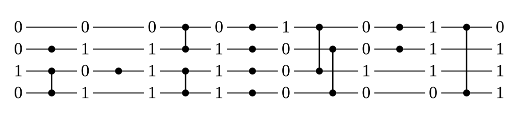](../../assets/volume4a/figures/diagram-7-1-1-69-ci-network.svg)

$(69)$

(一个点表示一个反相器.) 实际上, 这个网络产生下列变换:

<table>
<tbody>
<tr><td>$\texttt{0000}\mapsto\texttt{0110};$</td><td>$\texttt{0100}\mapsto\texttt{0111};$</td><td>$\texttt{1000}\mapsto\texttt{0111};$</td><td>$\texttt{1100}\mapsto\texttt{0110};$</td></tr>
<tr><td>$\texttt{0001}\mapsto\texttt{0111};$</td><td>$\texttt{0101}\mapsto\texttt{1111};$</td><td>$\texttt{1001}\mapsto\texttt{0101};$</td><td>$\texttt{1101}\mapsto\texttt{0111};$</td></tr>
<tr><td>$\texttt{0010}\mapsto\texttt{0111};$</td><td>$\texttt{0110}\mapsto\texttt{1111};$</td><td>$\texttt{1010}\mapsto\texttt{0101};$</td><td>$\texttt{1110}\mapsto\texttt{0111};$</td></tr>
<tr><td>$\texttt{0011}\mapsto\texttt{0110};$</td><td>$\texttt{0111}\mapsto\texttt{0111};$</td><td>$\texttt{1011}\mapsto\texttt{0111};$</td><td>$\texttt{1111}\mapsto\texttt{0110}.$</td></tr>
</tbody>
</table>

$(70)$

假定一个 CI 网络把位串 $x=x_1\ldots x_t$ 变换成位串 $x_1'\ldots x_t'=f(x)$. 这个把 $t$ 立方映射到自身的函数 $f$ 实际是一个图同态. 换句话说, 每当 $t$ 立方中有 $x\mathrel{\text{—}}y$ 时, 我们就有 $f(x)\mathrel{\text{—}}f(y)$: 改变 $x$ 的一个二进制位总是引起 $f(x)$ 恰好改变一个二进制位, 因为网络中的每个模块都具有这种特性. 此外, CI 网络同中位数标记有着引人注目的联系:

**定理 F.** 每个 $t$ 个二进制位的中位数标记的集合 $X$ 都可以用 CI 网络表示, 这个网络计算具有如下性质的布尔函数 $f(x)$: 对于所有二进制位向量 $x=x_1\ldots x_t$ 有 $f(x)\in X$, 而且对于所有 $x\in X$ 有 $f(x)=x$.

**证明.** [托马斯·费德尔,*Memoirs Amer. Math. Soc.* **555** (1995), 1–223, 引理 3.37; 也见道格拉斯·威德曼的博士论文 (滑铁卢大学, 1986).] 考虑中位数标记的第 $i$ 列和第 $j$ 列, 其中 $1\leq i<j\leq t$. 如果我们浏览整个标记的集合, 会发现任何这样成对的列至少包含 4 种可能性 $\{00,01,10,11\}$ 中的 3 种, 因为中位数标记没有冗余的列. 如果第 $i$ 列和第 $j$ 列不出现值 $(00,01,10,11)$ 之一, 我们就分别书写为 $(\bar j\to i,\ j\to i,\ i\to j,\ i\to\bar j)$. 还可以记下相应的等价关系 $(\bar i\to j,\ \bar i\to\bar j,\ \bar j\to\bar i,\ j\to\bar i)$, 其中包含 $\bar i$ 而没有 $i$. 例如, 表 2 中的标记给出关系

$$
\begin{aligned}
1&\to\bar2,3,\bar4,5,\bar6,7&2,\bar3,4,\bar5,6,\bar7&\to\bar1;\\
2&\to3,\bar4,\bar5,6,7&\bar3,4,5,\bar6,\bar7&\to\bar2;\\
3&\to\bar4,7&4,\bar7&\to\bar3;\\
4&\to5,6,7&\bar5,\bar6,\bar7&\to\bar4;\\
5&\to7&\bar7&\to\bar5;\\
6&\to7&\bar7&\to\bar6.
\end{aligned}\tag{71}
$$

(不存在第 3 列与第 5 列之间的关系, 因为那两列中出现了所有 4 种可能性. 但我们有 $3\to\bar4$, 因为第 3 列和第 4 列不出现 11. 在表 2 中, 第 3 列的标记带有一个 1 的那些顶点, 是离 $\langle wyz\rangle$ 比离 $\langle wwxyz\rangle$ 更近的顶点, 它们构成一个凸集, 其中标记的第 4 列总是 0, 因为它们也是离 $\langle wxxyz\rangle$ 比离 $x$ 更近的顶点.)

字面值 $\{1,\bar1,2,\bar2,\ldots,t,\bar t\}$ 之间的关系不包含圈, 所以总是可以把它们拓扑排序成一个反对称序列 $u_1u_2\ldots u_{2t}$, 其中 $u_j$ 是 $u_{2t+1-j}$ 的补. 例如

$$
1\ \bar7\ 4\ 2\ 3\ \bar5\ \bar6\ 6\ 5\ \bar3\ \bar2\ \bar4\ 7\ \bar1\tag{72}
$$

是对 $(71)$ 中的关系进行拓扑排序的一种方式.

现在着手构建网络, 从 $t$ 条空横线开始, 对于 $d=2t-2,2t-3,\ldots,1$ (按照这个顺序), 以及对于 $k=1,2,\ldots,t-\lceil d/2\rceil$, 依次检查拓扑序列中的元素 $u_k$ 和 $u_{k+d}$. 如果 $u_k\to u_{k+d}$ 是第 $i$ 列和第 $j$ 列 ($i<j$) 之间的关系, 我们就在网络的横线 $i$ 和 $j$ 上增加新的模块如下:

<table>
<thead><tr><th>如果 $i\to j$</th><th>如果 $i\to\bar j$</th><th>如果 $\bar i\to j$</th><th>如果 $\bar i\to\bar j$</th></tr></thead>
<tbody><tr><td><a href="../../assets/volume4a/figures/diagram-7-1-1-73-1-module.svg" target="_blank" rel="noopener" data-book-original-image="true">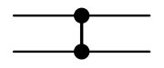</a></td><td><a href="../../assets/volume4a/figures/diagram-7-1-1-73-2-module.svg" target="_blank" rel="noopener" data-book-original-image="true">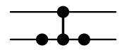</a></td><td><a href="../../assets/volume4a/figures/diagram-7-1-1-73-3-module.svg" target="_blank" rel="noopener" data-book-original-image="true">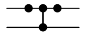</a></td><td><a href="../../assets/volume4a/figures/diagram-7-1-1-73-4-module.svg" target="_blank" rel="noopener" data-book-original-image="true">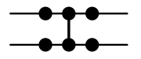</a></td></tr></tbody>
</table>

$(73)$

例如, 我们首先从式 (71) 和 $(72)$ 实施 $1\to7$, 然后 $1\to\bar4$, 再后 $1\to\bar2$, 再后 $\bar7\to\bar4$ (即 $4\to7$), 等等, 得到下面的网络:

[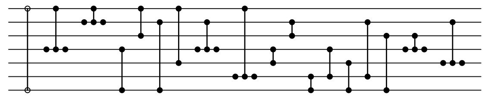](../../assets/volume4a/figures/diagram-7-1-1-74-median-label-network.svg)

$(74)$

(回到图上, 比如说, 没有对应 $u_k=\bar7$ 且 $u_{k+d}=3$ 的模块, 因为 $(71)$ 中没有关系 $\bar3\to7$.)

习题 89 表明, 每个新的模块簇 $(73)$ 都保留了过去的所有关系, 并且实施一个新的关系. 因此, 如果 $x$ 是任意一个输入向量, $f(x)$ 就满足所有关系. 所以, 根据定理 S, 我们有 $f(x)\in X$. 反之, 如果 $x\in X$, 网络中的每个模块簇使 $x$ 保持不变. $\quad\blacksquare$

**推论 F.** 假设定理 F 中的中位数标记在按位 AND 和按位 OR 运算下是封闭的, 使得每当 $x\in X$ 且 $y\in X$ 时有 $x\mathbin{\&}y\in X$ 且 $x\mathbin{|}y\in X$. 那么, 存在坐标的一个排列, 在这个排列下, 标记可以仅通过比较器模块的网络表示.

**证明.** 所有标记的按位 AND 是 $0\ldots0$, 按位 OR 是 $1\ldots1$, 所以列之间可能的关系只有 $i\to j$ 和 $j\to i$. 通过拓扑排序和重新命名这些列, 可以保证当 $i<j$ 时只出现 $i\to j$. 在这种情形, 证明中的结构没有使用反相器. $\quad\blacksquare$

一般说来, 假定 $G$ 是任意图, $f$ 是把 $G$ 的顶点映上这些顶点的子集 $X$ 的一个同态, 如果对于所有 $x\in X$ 有 $f(x)=x$, 则称 $f$ 为收缩. 当存在这样的 $f$ 时, 称 $X$ 为 $G$ 的收缩核. 帕沃尔·赫尔最早注意到这个概念在图论中的重要性 [见 *Lecture Notes in Math.* **406** (1974), 291–301]. 例如, 一个推论是, $X$ 中顶点之间的距离 (最短路径上的边数) 是相同的, 即使我们限于考虑完全位于 $X$ 内的路径. (见习题 93.)

定理 F 表明, 中位数标记的每个 $t$ 维集合都是 $t$ 维超立方的收缩核. 反之, 习题 94 证明, 超立方收缩核总是中位数图.

**门限函数.** 一类特别有吸引力的重要布尔函数 $f(x_1,x_2,\ldots,x_n)$ 出现在 $f$ 可以用公式

$$
f(x_1,x_2,\ldots,x_n)=[w_1x_1+w_2x_2+\cdots+w_nx_n\geq t]\tag{75}
$$

定义的时候, 其中常数 $w_1,w_2,\ldots,w_n$ 是整数 “权值”, $t$ 是整数 “门限”. 甚至当所有权值都是 1 时, 门限函数也很重要: 我们有

$$
x_1\wedge x_2\wedge\cdots\wedge x_n=[x_1+x_2+\cdots+x_n\geq n];\tag{76}
$$

$$
x_1\vee x_2\vee\cdots\vee x_n=[x_1+x_2+\cdots+x_n\geq1];\tag{77}
$$

$$
\langle x_1x_2\ldots x_{2t-1}\rangle=[x_1+x_2+\cdots+x_{2t-1}\geq t],\tag{78}
$$

其中 $\langle x_1x_2\ldots x_{2t-1}\rangle$ 代表由任意奇数布尔值 $\{x_1,x_2,\ldots,x_{2t-1}\}$ 组成的多重集的中位数 (或过半数) 值. 特别是, 基本映射 $x\wedge y$, $x\vee y$, $\langle xyz\rangle$ 全都是门限函数, 所以

$$
\bar x=[-x\geq0]\tag{79}
$$

也是门限函数.

使用更一般的权值, 我们得到许多其他有趣的函数, 如

$$
[2^{n-1}x_1+2^{n-2}x_2+\cdots+x_n\geq(t_1t_2\ldots t_n)_2],\tag{80}
$$

这个门限函数为真, 当且仅当二进制串 $x_1x_2\ldots x_n$ 按字典序大于等于给定的二进制串 $t_1t_2\ldots t_n$. 给定大小分别为 $w_1,w_2,\ldots,w_n$ 的 $n$ 个对象的集合, 这些对象的一个子集能够装进大小为 $t-1$ 的背包, 当且仅当 $f(x_1,x_2,\ldots,x_n)=0$, 其中 $x_j=1$ 表示对象 $j$ 出现在子集中. 沃伦·麦卡洛克和小沃尔特·皮茨在 *Bull. Math. Biophysics* **5** (1943), 115–133 中最初提出的简单神经元模型, 已经引出数以千计研究有关从门限函数构建 “神经网络” 的论文.

通过置 $x_j\leftarrow\bar x_j$, $w_j\leftarrow-w_j$, $t\leftarrow t+|w_j|$, 我们可以消除任何负权值 $w_j$. 这样, 一般的门限函数可以约化成正门限函数, 其中所有权值都是非负的. 此外, 可以把任何正门限函数 $(75)$ 表示成奇数个变量的中位数/过半数的函数, 因为我们有

$$
\langle0^a1^bx_1^{w_1}x_2^{w_2}\cdots x_n^{w_n}\rangle
=[b+w_1x_1+w_2x_2+\cdots+w_nx_n\geq b+t],\tag{81}
$$

其中 $x^m$ 代表 $x$ 的 $m$ 个副本, 而 $a$ 和 $b$ 是由规则

$$
a=\max(0,2t-1-w),\qquad b=\max(0,w+1-2t),\qquad w=w_1+w_2+\cdots+w_n\tag{82}
$$

定义的. 例如, 当所有权值都是 1 时, 我们有

$$
\langle0^{n-1}x_1\cdots x_n\rangle=x_1\wedge\cdots\wedge x_n
\quad\text{和}\quad
\langle1^{n-1}x_1\cdots x_n\rangle=x_1\vee\cdots\vee x_n.\tag{83}
$$

当 $n=2$ 时, 我们已经在式 (45) 中见过这两个公式. 一般情况下, 不是 $a$ 为 0 就是 $b$ 为 0, 式 (81) 的左端代表 $2T-1$ 个元素的中位数, 其中

$$
T=b+t=\max(t,w_1+w_2+\cdots+w_n+1-t).\tag{84}
$$

令 $a$ 和 $b$ 都大于 0 毫无意义, 因为过半数函数显然满足消去律

$$
\langle01x_1x_2\ldots x_{2t-1}\rangle=\langle x_1x_2\ldots x_{2t-1}\rangle.\tag{85}
$$

式 (81) 有一个重要推论: 通过置 $x_0=0$ 或 $x_0=1$, 每一个正门限函数来源于纯过半数函数

$$
g(x_0,x_1,x_2,\ldots,x_n)=\langle x_0^{a+b}x_1^{w_1}x_2^{w_2}\ldots x_n^{w_n}\rangle.\tag{86}
$$

换句话说, 我们知道 $n$ 个变量的所有门限函数, 当且仅当我们知道 $n+1$ 个或者更少变量 (不包含常数) 的所有不同的奇数个变量的中位数函数. 每个纯过半数函数都是单调自对偶函数. 我们在第 57 页表 2 的 $s_j$ 列已经遇见 4 个变量 $\{w,x,y,z\}$ 的纯过半数函数, 即 $\langle w\rangle$, $\langle wwxyz\rangle$, $\langle wyz\rangle$, $\langle wxyzz\rangle$, $\langle xyz\rangle$, $\langle z\rangle$, $\langle wxyyz\rangle$, $\langle y\rangle$, $\langle wxz\rangle$, $\langle wxxyz\rangle$, $\langle x\rangle$, $\langle wxy\rangle$. 通过置 $w=0$ 或 $w=1$, 我们获得 3 个变量的所有正门限函数 $f(x,y,z)$:

$$
\begin{gathered}
\langle0\rangle,\langle1\rangle,\langle00xyz\rangle,\langle11xyz\rangle,\langle0yz\rangle,\langle1yz\rangle,\langle0xyzz\rangle,\langle1xyzz\rangle,\langle xyz\rangle,\langle z\rangle,\\
\langle0xyyz\rangle,\langle1xyyz\rangle,\langle y\rangle,\langle0xz\rangle,\langle1xz\rangle,\langle0xxyz\rangle,\langle1xxyz\rangle,\langle x\rangle,\langle0xy\rangle,\langle1xy\rangle.
\end{gathered}\tag{87}
$$

至于 4 个变量的所有 150 个正门限函数, 可以用同样方式从习题 84 答案中的自对偶过半数函数获得.

存在权值 $(w_1,w_2,\ldots,w_n)$ 的无限数量的序列, 但是, 对于任意给定的 $n$ 值, 仅有为数有限的门限函数. 所以, 许多不同的权值序列显然是等价的. 例如, 考虑纯过半数函数

$$
\langle x_1^2x_2^3x_3^5x_4^7x_5^{11}x_6^{13}\rangle,
$$

其中用素数作为权值. 暴力检验 $2^6$ 种情形, 我们可以证明

$$
\langle x_1^2x_2^3x_3^5x_4^7x_5^{11}x_6^{13}\rangle
=\langle x_1x_2^2x_3^2x_4^3x_5^4x_6^5\rangle.\tag{88}
$$

因此, 我们可以用数量少得多的权值表示同一个函数. 同样, 作为式 (80) 的一个特例, 门限函数

$$
[(x_1x_2\ldots x_{20})_2\geq(01100100100001111110)_2]
=\langle1^{225028}x_1^{524288}x_2^{262144}\ldots x_{20}\rangle
$$

可以简化为

$$
\langle1^{323}x_1^{764}x_2^{323}x_3^{323}x_4^{118}x_5^{118}x_6^{87}x_7^{31}x_8^{31}x_9^{25}x_{10}^6x_{11}^6x_{12}^6x_{13}^6x_{14}x_{15}x_{16}x_{17}x_{18}x_{19}\rangle.\tag{89}
$$

习题 103 说明如何利用线性规划不借助巨量的暴力搜索求权值的最小集合.

周绍康 [*FOCS* **2** (1961), 34–38] 发现标识门限函数的一个好方案, 可以把唯一的标识符赋予任何一个门限函数. 给定任意布尔函数 $f(x_1,\ldots,x_n)$, 令 $N(f)$ 是使 $f(x)=1$ 的向量 $x=(x_1,\ldots,x_n)$ 的数量, $\Sigma(f)$ 是所有这些向量的和. 例如, 如果 $f(x_1,x_2)=x_1\vee x_2$, 我们有 $N(f)=3$ 以及 $\Sigma(f)=(0,1)+(1,0)+(1,1)=(2,2)$.

**定理 T.** 令 $f(x_1,\ldots,x_n)$ 和 $g(x_1,\ldots,x_n)$ 是满足条件 $N(f)=N(g)$ 和 $\Sigma(f)=\Sigma(g)$ 的布尔函数, 其中 $f$ 为门限函数. 那么 $f=g$.

**证明.** 假定恰有 $k$ 个向量 $x^{(1)},\ldots,x^{(k)}$ 使得 $f(x^{(j)})=1$ 且 $g(x^{(j)})=0$. 由于 $N(f)=N(g)$, 必定恰有 $k$ 个向量 $y^{(1)},\ldots,y^{(k)}$ 使得 $f(y^{(j)})=0$ 且 $g(y^{(j)})=1$. 同时, 由于 $\Sigma(f)=\Sigma(g)$, 必定还有 $x^{(1)}+\cdots+x^{(k)}=y^{(1)}+\cdots+y^{(k)}$.

现在假定 $f$ 是门限函数 $(75)$. 那么, 对于 $1\leq j\leq k$ 我们有 $w\cdot x^{(j)}\geq t$ 且 $w\cdot y^{(j)}<t$. 但是, 如果 $f\ne g$, 我们有 $k>0$, 而且 $w\cdot(x^{(1)}+\cdots+x^{(k)})\geq kt>w\cdot(y^{(1)}+\cdots+y^{(k)})$, 出现矛盾. $\quad\blacksquare$

门限函数有不少奇特性质, 其中的一些性质会在下面的习题中探讨. 室贺三郎在 *Threshold Logic and its Applications* (Wiley, 1971) 一书中对门限函数的经典理论做了全面总结.

**对称布尔函数.** 如果对于 $\{1,\ldots,n\}$ 的所有排列 $p(1)\ldots p(n)$, 函数 $f(x_1,\ldots,x_n)$ 等于 $f(x_{p(1)},\ldots,x_{p(n)})$, 就称 $f(x_1,\ldots,x_n)$ 是对称的. 当所有的 $x_j$ 为 0 或 1 时, 这个条件意味着 $f$ 仅依赖于自变量中出现的 1 的数量, 也就是 “位叠加和” $\nu x=\nu(x_1,\ldots,x_n)=x_1+\cdots+x_n$. 记号 $S_{k_1,k_2,\ldots,k_r}(x_1,\ldots,x_n)$ 常用于表示这样的布尔函数: 它为真, 当且仅当 $\nu x$ 或者是 $k_1$, 或者是 $k_2$, ……, 或者是 $k_r$. 例如, $S_{1,3,5}(v,w,x,y,z)=v\oplus w\oplus x\oplus y\oplus z$, $S_{3,4,5}(v,w,x,y,z)=\langle vwxyz\rangle$, $S_{4,5}(v,w,x,y,z)=\langle00vwxyz\rangle$.

对称性的许多应用同仅当 $\nu x=k$ 时为真的基本函数 $S_k(x_1,\ldots,x_n)$ 有关. 例如, $S_3(x_1,x_2,x_3,x_4,x_5,x_6)$ 为真, 当且仅当变量 $\{x_1,\ldots,x_6\}$ 恰有一半为真, 另一半为假. 此时我们显然有

$$
S_k(x_1,\ldots,x_n)=S_{\geq k}(x_1,\ldots,x_n)\wedge\overline{S_{\geq k+1}(x_1,\ldots,x_n)},\tag{90}
$$

其中 $S_{\geq k}(x_1,\ldots,x_n)$ 是 $S_{k,k+1,\ldots,n}(x_1,\ldots,x_n)$ 的缩写. 当然, 函数 $S_{\geq k}(x_1,\ldots,x_n)$ 是我们探讨过的门限函数 $[x_1+\cdots+x_n\geq k]$.

更复杂的情形可以作为门限函数的门限函数处理. 例如, 我们有

$$
\begin{aligned}
S_{2,3,6,8,9}(x_1,\ldots,x_{12})
&=[\nu x\geq2+4[\nu x\geq4]+2[\nu x\geq7]+5[\nu x\geq10]]\\
&=\big\langle00x_1\ldots x_{12}\langle0^5\bar x_1\ldots\bar x_{12}\rangle^4\langle1\bar x_1\ldots\bar x_{12}\rangle^2\langle1^7\bar x_1\ldots\bar x_{12}\rangle^5\big\rangle,
\end{aligned}\tag{91}
$$

因为当 $x_1+\cdots+x_{12}=(0,1,\ldots,12)$ 时, 在最外层的 25 的过半数中, 二进制位 1 的数量分别为 $(11,12,13,14,11,12,13,12,13,14,10,11,12)$. 一种类似的两层结构在一般情形是适用的 [罗伯特·明尼克,*IRE Trans.* **EC-10** (1961), 6–16]. 对三层或更多层逻辑, 我们甚至可以进一步减少门限运算的数量. (见习题 113.)

业已发现各种各样的巧妙方法用于计算对称布尔函数. 例如, 室贺三郎把下面著名的算式序列归功于佐佐木不可止:

$$
\begin{aligned}
x_0\oplus x_1\oplus\cdots\oplus x_{2m}
&=\langle\bar x_0s_1s_2\ldots s_{2m}\rangle,\\
\text{其中}\quad s_j
&=\langle x_0x_jx_{j+1}\ldots x_{j+m-1}\bar x_{j+m}\bar x_{j+m+1}\ldots\bar x_{j+2m-1}\rangle,
\end{aligned}\tag{92}
$$

条件是 $m>0$, 而且, 当 $k\geq1$ 时我们把 $x_{2m+k}$ 和 $x_k$ 看成是相同的. 特别地, 当 $m=1$ 和 $m=2$ 时, 我们有恒等式

$$
x_0\oplus x_1\oplus x_2=\langle\bar x_0\langle x_0x_1\bar x_2\rangle\langle x_0x_2\bar x_1\rangle\rangle;\tag{93}
$$

$$
x_0\oplus\cdots\oplus x_4
=\langle\bar x_0\langle x_0x_1x_2\bar x_3\bar x_4\rangle\langle x_0x_2x_3\bar x_4\bar x_1\rangle\langle x_0x_3x_4\bar x_1\bar x_2\rangle\langle x_0x_4x_1\bar x_2\bar x_3\rangle\rangle.\tag{94}
$$

两式右端完全是对称的, 不过不那么明显! (见习题 115.)

**定向函数.** 如果通过检查布尔函数 $f(x_1,\ldots,x_n)$ 的至多一个变量就可能推断出它的值, 就称它为定向函数或者 “强制函数”. 更确切地说, 如果 $n=0$, 或者存在一个下标 $j$, 使得 $f(x)$ 要么当置 $x_j=0$ 时取常数值, 要么当置 $x_j=1$ 时取常数值, 那么 $f$ 是定向函数. 例如, $f(x,y,z)=(x\oplus z)\vee\bar y$ 是定向函数, 因为当 $y=0$ 时它恒等于 1. ($y=1$ 时, 要是不检查 $x$ 和 $z$, 我们无法知道 $f$ 的值; 但是知道一个值总比什么都不知道好.) 斯图亚特·考夫曼 [*Lectures on Mathematics in the Life Sciences* **3** (1972), 63–116; *J. Theoretical Biology* **44** (1974), 167–190] 引入的这类函数, 在许多应用 (特别是化学和生物学) 中已被证实是很重要的. 习题 125–129 会考察它们的某些性质.

**数量考虑因素.** 我们已探讨过许多不同类型的布尔函数, 于是自然要问: 每种类型的 $n$ 变量函数实际有多少个? 表 3、表 4 和表 5 给出了对于小的 $n$ 值的答案.

表 3 对所有函数计数. 对于每个 $n$ 有 $2^{2^n}$ 种可能性, 因为存在 $2^{2^n}$ 个可能的真值表. 在这些函数中, 有些是自对偶函数; 有些是单调函数; 有些既是自对偶函数又是单调函数, 如定理 P 所示; 有些是霍恩函数, 如定理 H 所示; 有些是克罗姆函数, 如定理 S 所示; 诸如此类.

但是, 在表 4 中, 如果两个函数的差别仅仅在于变量名称有所改变, 那么它们被视为相同的. 因此, 当 $n=2$ 时只有 12 种不同情形, 因为 (例如)$x\vee\bar y$ 和 $\bar x\vee y$ 实际上是相同的.

表 5 更进一步, 它允许我们对单独的变量取补, 甚至对整个函数取补, 这实际上没有改变它. 按照这种观点, $(x,y,z)$ 的 256 个布尔函数仅分成 14 个不同的等价类:

<table>
<thead><tr><th>表示式</th><th>类大小</th><th>表示式</th><th>类大小</th></tr></thead>
<tbody>
<tr><td>$0$</td><td>2</td><td>$x\wedge(y\oplus z)$</td><td>24</td></tr>
<tr><td>$x$</td><td>6</td><td>$x\oplus(y\wedge z)$</td><td>24</td></tr>
<tr><td>$x\wedge y$</td><td>24</td><td>$(x\wedge y)\vee(\bar x\wedge z)$</td><td>24</td></tr>
<tr><td>$x\oplus y$</td><td>6</td><td>$(x\vee y)\wedge(x\oplus z)$</td><td>48</td></tr>
<tr><td>$x\wedge y\wedge z$</td><td>16</td><td>$(x\oplus y)\vee(x\oplus z)$</td><td>8</td></tr>
<tr><td>$x\oplus y\oplus z$</td><td>2</td><td>$\langle xyz\rangle$</td><td>8</td></tr>
<tr><td>$x\wedge(y\vee z)$</td><td>48</td><td>$S_1(x,y,z)$</td><td>16</td></tr>
</tbody>
</table>

$(95)$

我们将在 7.2.3 节探讨计数和列举不等价的组合对象的方法.

表 3　$n$ 变量布尔函数

<table>
<thead><tr><th></th><th>$n=0$</th><th>$n=1$</th><th>$n=2$</th><th>$n=3$</th><th>$n=4$</th><th>$n=5$</th><th>$n=6$</th></tr></thead>
<tbody>
<tr><td style="white-space:nowrap">任意函数</td><td>2</td><td>4</td><td>16</td><td>256</td><td>65 536</td><td>4 294 967 296</td><td>18 446 744 073 709 551 616</td></tr>
<tr><td style="white-space:nowrap">自对偶函数</td><td>0</td><td>2</td><td>4</td><td>16</td><td>256</td><td>65 536</td><td>4 294 967 296</td></tr>
<tr><td style="white-space:nowrap">单调函数</td><td>2</td><td>3</td><td>6</td><td>20</td><td>168</td><td>7 581</td><td>7 828 354</td></tr>
<tr><td style="white-space:nowrap">单调自对偶函数</td><td>0</td><td>1</td><td>2</td><td>4</td><td>12</td><td>81</td><td>2 646</td></tr>
<tr><td style="white-space:nowrap">霍恩函数</td><td>2</td><td>4</td><td>14</td><td>122</td><td>4 960</td><td>2 771 104</td><td>151 947 502 948</td></tr>
<tr><td style="white-space:nowrap">克罗姆函数</td><td>2</td><td>4</td><td>16</td><td>166</td><td>4 170</td><td>224 716</td><td>24 445 368</td></tr>
<tr><td style="white-space:nowrap">门限函数</td><td>2</td><td>4</td><td>14</td><td>104</td><td>1 882</td><td>94 572</td><td>15 028 134</td></tr>
<tr><td style="white-space:nowrap">对称函数</td><td>2</td><td>4</td><td>8</td><td>16</td><td>32</td><td>64</td><td>128</td></tr>
<tr><td style="white-space:nowrap">定向函数</td><td>2</td><td>4</td><td>14</td><td>120</td><td>3 514</td><td>1 292 276</td><td>103 071 426 294</td></tr>
</tbody>
</table>

表 4　变量置换下的不同布尔函数

<table>
<thead><tr><th></th><th>$n=0$</th><th>$n=1$</th><th>$n=2$</th><th>$n=3$</th><th>$n=4$</th><th>$n=5$</th><th>$n=6$</th></tr></thead>
<tbody>
<tr><td style="white-space:nowrap">任意函数</td><td>2</td><td>4</td><td>12</td><td>80</td><td>3 984</td><td>37 333 248</td><td>25 626 412 338 274 304</td></tr>
<tr><td style="white-space:nowrap">自对偶函数</td><td>0</td><td>2</td><td>2</td><td>8</td><td>32</td><td>1 088</td><td>6 385 408</td></tr>
<tr><td style="white-space:nowrap">单调函数</td><td>2</td><td>3</td><td>5</td><td>10</td><td>30</td><td>210</td><td>16 353</td></tr>
<tr><td style="white-space:nowrap">单调自对偶函数</td><td>0</td><td>1</td><td>1</td><td>2</td><td>3</td><td>7</td><td>30</td></tr>
<tr><td style="white-space:nowrap">霍恩函数</td><td>2</td><td>4</td><td>10</td><td>38</td><td>368</td><td>29 328</td><td>216 591 692</td></tr>
<tr><td style="white-space:nowrap">克罗姆函数</td><td>2</td><td>4</td><td>12</td><td>48</td><td>308</td><td>3 028</td><td>49 490</td></tr>
<tr><td style="white-space:nowrap">门限函数</td><td>2</td><td>4</td><td>10</td><td>34</td><td>178</td><td>1 720</td><td>590 440</td></tr>
<tr><td style="white-space:nowrap">定向函数</td><td>2</td><td>4</td><td>10</td><td>38</td><td>294</td><td>15 774</td><td>149 325 022</td></tr>
</tbody>
</table>

表 5　变量取补或置换下的不同布尔函数

<table>
<thead><tr><th></th><th>$n=0$</th><th>$n=1$</th><th>$n=2$</th><th>$n=3$</th><th>$n=4$</th><th>$n=5$</th><th>$n=6$</th></tr></thead>
<tbody>
<tr><td style="white-space:nowrap">任意函数</td><td>1</td><td>2</td><td>4</td><td>14</td><td>222</td><td>616 126</td><td>200 253 952 527 184</td></tr>
<tr><td style="white-space:nowrap">自对偶函数</td><td>0</td><td>1</td><td>1</td><td>3</td><td>7</td><td>83</td><td>109 950</td></tr>
<tr><td style="white-space:nowrap">门限函数</td><td>1</td><td>2</td><td>3</td><td>6</td><td>15</td><td>63</td><td>567</td></tr>
<tr><td style="white-space:nowrap">自对偶门限函数</td><td>0</td><td>1</td><td>1</td><td>2</td><td>3</td><td>7</td><td>21</td></tr>
<tr><td style="white-space:nowrap">定向函数</td><td>1</td><td>2</td><td>3</td><td>6</td><td>22</td><td>402</td><td>1 228 158</td></tr>
</tbody>
</table>

#### 习题

**1.** [*15*][答案](./answers/7-1-1.md#ans-7-1-1-1) (刘易斯·卡罗尔) 说明本节开头引述的特维德地的话是合乎情理的. [提示: 见表 1.]

**2.** [*17*][答案](./answers/7-1-1.md#ans-7-1-1-2) 设想遥远的平卡斯行星上的逻辑学家们用符号 1 代表 “假” 而用 0 代表 “真”. 于是, 例如他们有了一个称为 “or” 的二进制运算, 它的性质是

$$
1\mathbin{\mathrm{or}}1=1,\qquad1\mathbin{\mathrm{or}}0=0,\qquad0\mathbin{\mathrm{or}}1=0,\qquad0\mathbin{\mathrm{or}}0=0.
$$

我们用 $\wedge$ 与 “or” 关联. 那么, 平卡斯星球人分别称为 “falsehood” (假值), “and” (与), ……, “nand” (非合取), “validity” (永真) 的 16 种逻辑运算 (见表 1), 我们用什么运算与它们关联呢?

▶ **3.** [*13*][答案](./answers/7-1-1.md#ans-7-1-1-3) 假定 “假” 与 “真” 的逻辑值分别为 $-1$ 与 $+1$ 而不是 0 与 1. 表 1 中对应于 (a) $\max(x,y)$, (b) $\min(x,y)$, (c) $-x$ 和 (d) $x\cdot y$ 的运算符 $\circ$ 是什么?

**4.** [*24*][答案](./answers/7-1-1.md#ans-7-1-1-4) (谢佛) 本题的目的是证明表 1 中的所有运算都可以通过 NAND 表示. (a) 对于表中 16 种运算符 $\circ$ 的每一种, 求与 $x\circ y$ 等价的公式, 其中仅用 $\mathbin{\overline\wedge}$ 作为运算符. 你的公式应尽可能地短. 例如, 运算 $\mathsf L$ 的答案就是简单的 “$x$”, 而运算 $\overline{\mathsf L}$ 的答案是 “$x\mathbin{\overline\wedge}x$”. 在你的公式中不允许使用常数 0 和 1. (b) 如果允许使用常数 0 和 1, 求这 16 个短公式. 例如, 此时也可以把 $x\mathbin{\overline{\mathsf L}}y$ 表示成 $x\mathbin{\overline\wedge}1$.

**5.** [*24*][答案](./answers/7-1-1.md#ans-7-1-1-5) 考虑习题 4, 用 $\overline\subset$ 代替 $\overline\wedge$ 作为基本运算.

**6.** [*21*][答案](./answers/7-1-1.md#ans-7-1-1-6) (恩斯特·施罗德)(a) 表 1 的 16 种运算中哪些是可结合的? 换句话说, 它们中的哪些运算满足 $x\circ(y\circ z)=(x\circ y)\circ z$? (b) 它们中的哪些运算满足恒等式 $(x\circ y)\circ(y\circ z)=x\circ z$?

**7.** [*20*][答案](./answers/7-1-1.md#ans-7-1-1-7) 表 1 中的哪些运算具有以下性质: $x\circ y=z$ 当且仅当 $y\circ z=x$?

**8.** [*24*][答案](./answers/7-1-1.md#ans-7-1-1-8) $16^2$ 种配对运算 $(\circ,\square)$ 中, 哪些满足左分配律 $x\circ(y\mathbin{\square}z)=(x\circ y)\mathbin{\square}(x\circ z)$?

**9.** [*16*][答案](./answers/7-1-1.md#ans-7-1-1-9) 判别真假: (a) $(x\oplus y)\vee z=(x\vee z)\oplus(y\vee z)$; (b) $(w\oplus x\oplus y)\vee z=(w\vee z)\oplus(x\vee z)\oplus(y\vee z)$; (c) $(x\oplus y)\vee(y\oplus z)=(x\oplus z)\vee(y\oplus z)$.

**10.** [*17*][答案](./answers/7-1-1.md#ans-7-1-1-10) “随机” 函数 $(22)$ 的多重线性表示是什么?

**11.** [*M25*][答案](./answers/7-1-1.md#ans-7-1-1-11) 当 $f(x_1,\ldots,x_n)$ 的多重线性表示包含 (比如说) 项 $x_2x_3x_6x_8$ 时, 是否存在一种能确切理解它的直观方法? (见式 (19).)

▶ **12.** [*M23*][答案](./answers/7-1-1.md#ans-7-1-1-12) 布尔函数的整数多重线性表示把式 (19) 那样的表示扩充到整系数多项式 $f(x_1,\ldots,x_n)$, 其中 $f(x_1,\ldots,x_n)$ 对于全部 $2^n$ 个可能的 0-1 向量 $(x_1,\ldots,x_n)$ 具有不取模 2 余数的正确值 (0 或 1). 例如, 对应于式 (19) 的整数多重线性表示是 $1-xy-xz-yz+3xyz$.

(a) “随机” 函数 $(22)$ 的整数多重线性表示是什么?

(b) 这样一种表示 $f(x_1,\ldots,x_n)$ 的系数可能取多大的值?

(c) 证明: 在每一种整数多重线性表示中, 当 $x_1,\ldots,x_n$ 是满足条件 $0\leq x_1,\ldots,x_n\leq1$ 的实数时, 我们有 $0\leq f(x_1,\ldots,x_n)\leq1$.

(d) 同样, 请证明: 如果当 $\{x_1,\ldots,x_n\}\subseteq\{0,1\}$ 时有 $f(x_1,\ldots,x_n)\leq g(x_1,\ldots,x_n)$, 那么, 当 $\{x_1,\ldots,x_n\}\subseteq[0\mathinner{.\,.}1]$ 时有 $f(x_1,\ldots,x_n)\leq g(x_1,\ldots,x_n)$.

(e) 如果 $f$ 是单调函数, 而且对于 $1\leq j\leq n$ 有 $0\leq x_j\leq y_j\leq1$, 证明: $f(x)\leq f(y)$.

▶ **13.** [*20*][答案](./answers/7-1-1.md#ans-7-1-1-13) 考虑一个由 $n$ 个部件构成的系统, 其中的每个部件可能是 “运转” 的, 也可能是 “失灵” 的. 如果 $x_j$ 表示 “部件 $j$ 是在运转” 状态, 那么像 $x_1\wedge(\bar x_2\vee\bar x_3)$ 的布尔函数表示 “部件 1 是运转的, 但是部件 2 或部件 3 是失灵的”. 同时, $S_3(x_1,\ldots,x_n)$ 意味着 “恰好 3 个部件是运转的”.

假定每个部件 $j$ 处在运转状态的概率是 $p_j$, 而与其他部件无关. 证明: 布尔函数 $f(x_1,\ldots,x_n)$ 为真的概率是 $F(p_1,\ldots,p_n)$, 其中 $F$ 是变量 $p_1,\ldots,p_n$ 的一个多项式.

**14.** [*20*][答案](./answers/7-1-1.md#ans-7-1-1-14) 习题 13 中的概率函数 $F(p_1,\ldots,p_n)$ 通常称为系统的可用性. 当概率 $(p_1,p_2,p_3)$ 分别取下列值时, 求最大可用性的自对偶函数 $f(x_1,x_2,x_3)$: (a) $(.9,.8,.7)$; (b) $(.8,.6,.4)$; (c) $(.8,.6,.1)$.

▶ **15.** [*M20*][答案](./answers/7-1-1.md#ans-7-1-1-15) 假定 $f(x_1,\ldots,x_n)$ 是任意布尔函数. 证明存在一个具有如下性质的多项式 $F(x)$: 当 $x$ 是整数时, $F(x)$ 取整数值, 并且 $f(x_1,\ldots,x_n)=F((x_n\ldots x_1)_2)\bmod2$. 提示: 考虑 $\binom{x}{k}\bmod2$.

**16.** [*13*][答案](./answers/7-1-1.md#ans-7-1-1-16) 在全析取范式中, 我们能用 $\oplus$ 替代每个 $\vee$ 吗?

**17.** [*10*][答案](./answers/7-1-1.md#ans-7-1-1-17) 由德摩根定律, 像式 (25) 那样的一般析取范式不仅是对若干 AND 取 OR, 也是对若干 NAND 取 NAND:

$$
\overline{\overline{(u_{11}\wedge\cdots\wedge u_{1s_1})}\wedge\cdots\wedge\overline{(u_{m1}\wedge\cdots\wedge u_{ms_m})}}.
$$

因此可以把逻辑式的两层求补看成恒等运算.

一位名叫乔纳森·奎克的学生把这个表达式重写为

$$
(u_{11}\mathbin{\overline\wedge}\cdots\mathbin{\overline\wedge}u_{1s_1})
\mathbin{\overline\wedge}\cdots\mathbin{\overline\wedge}
(u_{m1}\mathbin{\overline\wedge}\cdots\mathbin{\overline\wedge}u_{ms_m}).
$$

这样做是个好主意吗?

▶ **18.** [*20*][答案](./answers/7-1-1.md#ans-7-1-1-18) 令 $u_1\wedge\cdots\wedge u_s$ 是布尔函数 $f$ 的析取范式中的一个蕴涵元, $v_1\vee\cdots\vee v_t$ 是同一函数的合取范式中的一个子句. 证明: 对于某些 $i$ 和 $j$ 有 $u_i=v_j$.

**19.** [*20*][答案](./answers/7-1-1.md#ans-7-1-1-19) 真值 $(22)$ 表中的 “随机” 函数的合取素式是什么?

**20.** [*M21*][答案](./answers/7-1-1.md#ans-7-1-1-20) 判别真假: $f\wedge g$ 的每个素蕴涵元可以写成 $f'\wedge g'$, 其中 $f'$ 是 $f$ 的素蕴涵元, $g'$ 是 $g$ 的素蕴涵元.

**21.** [*M20*][答案](./answers/7-1-1.md#ans-7-1-1-21) 证明: 一个非常数的布尔函数是单调的, 当且仅当它可以完全通过 $\wedge$ 和 $\vee$ 运算表示.

**22.** [*20*][答案](./answers/7-1-1.md#ans-7-1-1-22) 像在式 (16) 中那样假定 $f(x_1,\ldots,x_n)=g(x_1,\ldots,x_{n-1})\oplus h(x_1,\ldots,x_{n-1})\wedge x_n$. 关于函数 $g$ 和 $h$ 的什么条件是 $f$ 为单调函数的充分必要条件?

**23.** [*15*][答案](./answers/7-1-1.md#ans-7-1-1-23) $(v\wedge w\wedge x)\vee(\bar v\wedge x\wedge z)\vee(x\wedge y\wedge z)$ 的合取素式是什么?

**24.** [*M20*][答案](./answers/7-1-1.md#ans-7-1-1-24) 考虑具有 $2^k$ 个叶结点的完全二叉树, 下图是 $k=3$ 时的例子. 在根结点使用 $\wedge$ 运算, 在各层结点上交替使用 $\wedge$ 和 $\vee$ 运算. 在此例中, 我们得到 $((x_0\wedge x_1)\vee(x_2\wedge x_3))\wedge((x_4\wedge x_5)\vee(x_6\wedge x_7))$. 所得函数包含多少素蕴涵元?

[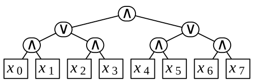](../../assets/volume4a/figures/exercise-7-1-1-24-alternating-binary-tree.svg)

**25.** [*M21*][答案](./answers/7-1-1.md#ans-7-1-1-25) $(x_1\vee x_2)\wedge(x_2\vee x_3)\wedge\cdots\wedge(x_{n-1}\vee x_n)$ 具有多少素蕴涵元?

**26.** [*M23*][答案](./answers/7-1-1.md#ans-7-1-1-26) 令 $\mathcal F$ 和 $\mathcal G$ 分别是一个单调 CNF 和一个单调 DNF 的素子句和素蕴涵元的指标集族:

$$
f(x)=\bigwedge_{I\in\mathcal F}\bigvee_{i\in I}x_i;\qquad
 g(x)=\bigvee_{J\in\mathcal G}\bigwedge_{j\in J}x_j.
$$

如果下列任何条件成立, 有效展现一个满足 $f(x)\ne g(x)$ 的 $x$:

(a) 存在一个 $I\in\mathcal F$ 和一个 $J\in\mathcal G$ 满足 $I\cap J=\emptyset$.

(b) $\bigcup_{I\in\mathcal F}I\ne\bigcup_{J\in\mathcal G}J$.

(c) 存在一个 $I\in\mathcal F$ 满足 $|I|>|\mathcal G|$, 或者一个 $J\in\mathcal G$ 满足 $|J|>|\mathcal F|$.

(d) $\sum_{I\in\mathcal F}2^{n-|I|}+\sum_{J\in\mathcal G}2^{n-|J|}<2^n$, 其中 $n=|\bigcup_{I\in\mathcal F}I|$.

**27.** [*M31*][答案](./answers/7-1-1.md#ans-7-1-1-27) 续上题, 考虑下面的算法 $X(\mathcal F,\mathcal G)$, 它或者返回一个满足 $f(x)\ne g(x)$ 的向量 $x$, 或者当 $f=g$ 时返回 $\Lambda$:

**X1.[检查必要条件.]** 如果习题 26 中的条件 (a)、(b)、(c) 或 (d) 成立, 返回一个相应的 $x$ 值.

**X2.[终结?]** 如果 $|\mathcal F||\mathcal G|\leq1$, 返回 $\Lambda$.

**X3.[递归.]** 对于一个 “最佳” 的指标 $k$, 计算下列约化族:

$$
\begin{aligned}
\mathcal F_1&=\{I\mid I\in\mathcal F,\ k\notin I\},&
\mathcal F_0&=\mathcal F_1\cup\{I\mid k\notin I,\ I\cup\{k\}\in\mathcal F\};\\
\mathcal G_0&=\{J\mid J\in\mathcal G,\ k\notin J\},&
\mathcal G_1&=\mathcal G_0\cup\{J\mid k\notin J,\ J\cup\{k\}\in\mathcal G\}.
\end{aligned}
$$

从族 $\mathcal F_0$ 或 $\mathcal G_1$ 中删除任何一个包含同族中另一个成员的成员. 应选择指标 $k$ 使比值 $\rho=\min(|\mathcal F_1|/|\mathcal F|,|\mathcal G_0|/|\mathcal G|)$ 尽可能地小. 如果 $X(\mathcal F_0,\mathcal G_0)$ 返回一个向量 $x$, 那么返回扩充到 $x_k=0$ 的同一向量. 否则, 如果 $X(\mathcal F_1,\mathcal G_1)$ 返回一个向量 $x$, 那么返回扩充到 $x_k=1$ 的同一个向量. 否则, 返回 $\Lambda$. $\quad\blacksquare$

如果 $N=|\mathcal F|+|\mathcal G|$, 证明: 步骤 X1 最多执行 $N^{O(\log N)^2}$ 次. 提示: 证明我们在步骤 X3 总是有 $\rho\leq1-1/\lg N$.

**28.** [*21*][答案](./answers/7-1-1.md#ans-7-1-1-28) (威拉德·奎因, 1952) 如果 $f(x_1,\ldots,x_n)$ 是带有素蕴涵元 $p_1,\ldots,p_q$ 的布尔函数, 令 $g(y_1,\ldots,y_q)=\bigwedge_{f(x)=1}\bigvee\{y_j\mid p_j(x)=1\}$. 例如, “随机” 函数 $(22)$ 在式 (28) 的 8 个点为真, 而且它有由式 (29) 和 $(30)$ 给出的 5 个素蕴涵元. 所以, 在这种情况 $g(y_1,\ldots,y_5)$ 是

$$
\begin{aligned}
&(y_1\vee y_2)\wedge(y_1)\wedge(y_2\vee y_3)\wedge(y_4)\wedge(y_3\vee y_5)\wedge(y_5)\wedge(y_5)\wedge(y_4\vee y_5)\\
&\qquad=(y_1\wedge y_2\wedge y_4\wedge y_5)\vee(y_1\wedge y_3\wedge y_4\wedge y_5).
\end{aligned}
$$

证明: $f$ 的每个最短析取范式表达式对应于单调函数 $g$ 的一个素蕴涵元.

**29.** [*22*][答案](./answers/7-1-1.md#ans-7-1-1-29) (下面几道习题专门讨论处理布尔函数的蕴涵元的算法, 它们把 $n$ 立方的点表示成 $n$ 位二进制数 $(b_{n-1}\ldots b_1b_0)_2$, 而不是二进制串 $x_1\ldots x_n$.) 给定一个二进制位的位置 $j$, 并给定 $n$ 位二进制数 $v_0<v_1<\cdots<v_{m-1}$, 说明如何求出按 $k$ 的增序的所有数对 $(k,k')$, 它们满足 $0\leq k<k'<m$ 且 $v_{k'}=v_k\oplus2^j$. 如果对 $n$ 位二进制字的按位运算需要常数时间, 你的算法的运行时间应是 $O(m)$.

**30.** [*27*][答案](./answers/7-1-1.md#ans-7-1-1-30) 正文指出, 可以把布尔函数的蕴涵元看成 `01*0*` 这样的包含在使函数为真的所有点集 $V$ 内的子立方. 每个子立方可以表示成一对二进制数 $a=(a_{n-1}\ldots a_0)_2$ 和 $b=(b_{n-1}\ldots b_0)_2$, 其中 $a$ 记载星号的位置, $b$ 记载非星号的二进制位 1 的位置. 例如, 数 $a=(00101)_2$ 和 $b=(01000)_2$ 代表子立方 $c=\texttt{01*0*}$. 我们总有 $a\mathbin{\&}b=0$.

一个子立方的 “$j$-伙伴” 定义如下: 当 $a_j=0$ 时, 把 $b$ 改成 $b\oplus2^j$. 例如, $\texttt{01*0*}$ 有三个伙伴, 即它的 4-伙伴 $\texttt{11*0*}$、3-伙伴 $\texttt{00*0*}$ 和 1-伙伴 $\texttt{01*1*}$. 对于每个子立方 $c\subseteq V$, 可以赋予一个标记值 $(t_{n-1}\ldots t_0)_2$, 其中, $t_j=1$ 当且仅当 $c$ 的 $j$-伙伴是确定的并且包含在 $V$ 内. 按照这个定义, $c$ 代表一个最大子立方 (因此是一个素蕴涵元), 当且仅当它的标记为 0.

利用这些概念设计一个算法, 求给定集合 $V$ 的全部最大子立方 $(a,b)$, 其中 $V$ 是用 $m$ 个 $n$ 位二进制数 $v_0<v_1<\cdots<v_{m-1}$ 表示的.

▶ **31.** [*28*][答案](./answers/7-1-1.md#ans-7-1-1-31) 习题 30 中的算法需要一个布尔函数为真的所有点的完整表, 而且那张表可能相当长. 所以, 我们宁愿直接处理子立方而不降至显式 $n$ 元组的层次, 除非确实需要. 这种高层处理方法的核心是子立方 $c$ 和 $c'$ 之间的合意方的概念, 合意方用 $c\sqcup c'$ 表示, 定义为满足

$$
c''\subseteq c\cup c',\qquad c''\nsubseteq c,\qquad c''\nsubseteq c'
$$

的最大子立方 $c''$. 这样的 $c''$ 不是始终存在的. 例如, 如果 $c=\texttt{000*}$ 且 $c'=\texttt{*111}$, 那么包含在 $c\cup c'$ 中的每个子立方不是包含在 $c$ 中就是包含在 $c'$ 中.

(a) 证明: 当存在合意方时, 可以在每个坐标位置用下述公式逐个分量计算它:

$$
x\sqcup x=x\sqcup*=*\sqcup x=x\quad\text{和}\quad x\sqcup\bar x=*\sqcup*=*,\quad\text{对于 }x=0\text{ 和 }x=1.
$$

此外, 存在 $c\sqcup c'$, 当且仅当刚好在一个分量的计算中使用了规则 $x\sqcup\bar x=*$.

(b) 一个带 $k$ 个星号的子立方称为 $k$ 立方. 证明: 如果 $c$ 是 $k$ 立方, $c'$ 是 $k'$ 立方, 而且存在合意方 $c''=c\sqcup c'$, 那么 $c''$ 是 $k''$ 立方, 其中 $1\leq k''\leq\min(k,k')+1$.

(c) 如果 $C$ 和 $C'$ 是子立方族, 令

$$
C\sqcup C'=\{c\sqcup c'\mid c\in C,\ c'\in C',\ \text{而且存在 }c\sqcup c'\}.
$$

说明下面的算法是行之有效的.

**算法 E (求最大子立方).** 给定 $n$ 立方的子立方族 $C$, 算法输出 $V=\bigcup_{c\in C}c$ 的最大子立方, 而不实际计算集合 $V$ 本身.

**E1.[初始化.]** 置 $j\leftarrow0$. 删除 $C$ 中任何一个包含在另一个子立方中的子立方 $c$.

**E2.[终结?]** (此时, 每个 $\subseteq V$ 的 $j$ 立方包含在 $C$ 的某个元素中, 而且 $C$ 不包含满足 $k<j$ 的 $k$ 立方.) 如果 $C$ 是空族, 终止算法.

**E3.[取合意方.]** 置 $C'\leftarrow C\sqcup C$, 并且从 $C'$ 中删除那些 $k\leq j$ 的 $k$ 立方的所有子立方. 当执行这项计算时, 还要输出任何这样的 $j$ 立方 $c\in C$: 对它而言 $c\sqcup C$ 不产生 $C'$ 的 $(j+1)$ 立方.

**E4.[前进.]** 置 $C\leftarrow C\cup C'$, 但从这个并族删除全部 $j$ 立方. 然后删除任何一个包含在另一个子立方中的子立方 $c\in C$. 置 $j\leftarrow j+1$, 转到 E2. $\quad\blacksquare$

(执行这些计算的有效方法见习题 7.1.3-142.)

▶ **32.** [*M29*][答案](./answers/7-1-1.md#ans-7-1-1-32) 令 $c_1,\ldots,c_m$ 是 $n$ 立方的子立方.

(a) 证明: $c_1\cup\cdots\cup c_m$ 最多包含一个最大子立方 $c$, 对于任何的 $j\in\{1,\ldots,m\}$, 它不包含在 $c_1\cup\cdots\cup c_{j-1}\cup c_{j+1}\cup\cdots\cup c_m$ 中. (如果 $c$ 存在, 我们称它为 $c_1,\ldots,c_m$ 的广义合意方, 因为在习题 31 的记号中当 $m=2$ 时有 $c=c_1\sqcup c_2$.)

(b) 求一组 $m$ 个子立方, 对它们而言, $\{c_1,\ldots,c_m\}$ 的 $2^m-1$ 个非空子集的每一个都有广义合意方.

(c) 证明: 具有 $m$ 个蕴涵元的析取范式最多有 $2^m-1$ 个素蕴涵元.

(d) 求具有 $m$ 个蕴涵元和 $2^m-1$ 个素蕴涵元的析取范式.

**33.** [*M21*][答案](./answers/7-1-1.md#ans-7-1-1-33) 假定 $f(x_1,\ldots,x_n)$ 恰好是在 $m$ 个点为真的 $\binom{2^n}{m}$ 个布尔函数之一. 如果 $f$ 是随机选择的, 那么, (a) 小项 $x_1\wedge\cdots\wedge x_k$ 是 $f$ 的蕴涵元的概率有多大? (b) 它也是 $f$ 的素蕴涵元的概率有多大? [用和的形式给出 (b) 的答案, 但是当 $k=n$ 时用闭合式计算它.]

▶ **34.** [*HM37*][答案](./answers/7-1-1.md#ans-7-1-1-34) 续习题 33, 令 $c(m,n)$ 是蕴涵元的平均总数, 令 $p(m,n)$ 是素蕴涵元的平均总数.

(a) 如果 $0\leq m\leq2^n/n$, 证明: $m\leq c(m,n)\leq\frac32m+O(m/n)$, $p(m,n)\geq me^{-1}+O(m/n)$. 因此, 在这个值域内 $p(m,n)=\Theta(c(m,n))$.

(b) 现在令 $2^n/n\leq m\leq(1-\epsilon)2^n$, 其中 $\epsilon$ 是一个固定的正常数. 数 $t$ 和 $\alpha_{mn}$ 由关系式

$$
n^{-4/3}\leq\left(\frac m{2^n}\right)^{2^t}=\alpha_{mn}<n^{-2/3},\qquad t\text{ 为整数}
$$

定义. 用 $n,t,\alpha_{mn}$ 表示 $c(m,n)$ 和 $p(m,n)$ 的渐近值. [提示: 证明几乎所有蕴涵元恰好带有 $n-t$ 或 $n-t-1$ 个字面值.]

(c) 估计当 $m=2^{n-1}$, $n=\lfloor(\ln t-\ln\ln t)2^{2^t}\rfloor$($t$ 为整数) 时 $c(m,n)/p(m,n)$ 的值.

(d) 证明: 当 $m\leq(1-\epsilon)2^n$ 时, $c(m,n)/p(m,n)=O(\log\log n/\log\log\log n)$.

▶ **35.** [*M25*][答案](./answers/7-1-1.md#ans-7-1-1-35) 如果析取范式的蕴涵元对应于不相交的子立方, 就称它是正交的. 当对习题 13 的可靠性多项式进行计算或者估值时, 正交析取范式特别有用.

每个函数的全析取范式显然是正交的, 因为它的子立方是单个点的子立方. 但我们经常能够找到具有很少蕴涵元的正交析取范式, 尤其当布尔函数是单调函数时. 例如, 函数 $(x_1\wedge x_2)\vee(x_2\wedge x_3)\vee(x_3\wedge x_4)$ 在 8 个点为真, 而且它有正交析取范式

$$
(x_1\wedge x_2)\vee(\bar x_1\wedge x_2\wedge x_3)\vee(\bar x_2\wedge x_3\wedge x_4),
$$

换句话说, 交叠子立方 $\texttt{11**}$, $\texttt{*11*}$, $\texttt{**11}$ 可以用不相交的子立方 $\texttt{11**}$, $\texttt{011*}$, $\texttt{*011}$ 代替. 用习题 30 中子立方的二进制记号, 这几个子立方具有星号码 $\texttt{0011}$, $\texttt{0001}$, $\texttt{1000}$ 和位码 $\texttt{1100}$, $\texttt{0110}$, $\texttt{0011}$.

当星号码分别是 $\bar B_1,\ldots,\bar B_p$ 时, 每个单调函数可以用一个位码表 $B_1,\ldots,B_p$ 定义. 给定这样一个表, 对于位叠加和 $\nu(B_j\mathbin{\&}\bar B_k)=1$ 的所有 $1\leq j<k$, 令 $B_k$ 的 “影子” $S_k$ 是 $B_j\mathbin{\&}\bar B_k$ 的按位 OR:

$$
S_k=\beta_{1k}\mathbin{|}\cdots\mathbin{|}\beta_{(k-1)k},\qquad
\beta_{jk}=\bigl((B_j\mathbin{\&}\bar B_k)\oplus((B_j\mathbin{\&}\bar B_k)-1)\bigr)\mathbin{\dot{-}}((B_j\mathbin{\&}\bar B_k)-1).
$$

例如, 当位码为 $(B_1,B_2,B_3)=(\texttt{1100},\texttt{0110},\texttt{0011})$ 时, 按照这个顺序, 我们得到影子码 $(S_1,S_2,S_3)=(\texttt{0000},\texttt{1000},\texttt{0100})$.

(a) 证明: 星号码 $A'_j=\bar B_j-S_j$ 和位码 $B_j$ 定义的子立方, 覆盖带星号码 $A_j=\bar B_j$ 的子立方的同样点集.

(b) 如果对于所有的 $1\leq j<k\leq p$, $B_j\mathbin{\&}S_k$ 是非零的, 则称位码表 $B_1,\ldots,B_p$ 为一个剥壳. 例如, $(\texttt{1100},\texttt{0110},\texttt{0011})$ 是一个剥壳; 但是如果按照 $(\texttt{1100},\texttt{0011},\texttt{0110})$ 的顺序排列这三个位码, 那么当 $j=1$ 和 $k=2$ 时丧失剥壳条件, 尽管我们的确有 $S_3=\texttt{1001}$. 证明: 当且仅当位码表是一个剥壳时, (a) 中定义的子立方是不相交的.

(c) 按照定理 Q, 当我们用这种方式表示一个单调布尔函数时, 每个素蕴涵元必定出现在这些位码 $B$ 中间. 但是, 如果我们想要子立方是不相交的, 那么有时需要添加额外的蕴涵元. 例如, 不存在位码 $\texttt{1100}$ 和 $\texttt{0011}$ 的剥壳. 然而, 请证明: 通过添加一个或多个位码, 我们可以得到 $(x_1\wedge x_2)\vee(x_3\wedge x_4)$ 这个函数的剥壳. 得到的正交析取范式是什么?

(d) 排列位码 $\{\texttt{11000},\texttt{01100},\texttt{00110},\texttt{00011},\texttt{11010}\}$, 获得一个剥壳.

(e) 对位码集 $\{\texttt{110000},\texttt{011000},\texttt{001100},\texttt{000110},\texttt{000011}\}$ 添加两个位码, 使之成为可剥壳的位码表.

**36.** [*M21*][答案](./answers/7-1-1.md#ans-7-1-1-36) 续习题 35, 令 $f$ 为任意不恒等于 1 的单调布尔函数. 证明: 当按递减的字典序排列时, 位向量的集合

$$
B=\{x\mid f(x)=1\text{ 且 }f(x')=0\},\qquad x'=x\mathbin{\&}(x-1)
$$

是可剥壳的. (向量 $x'$ 是从 $x$ 中把最右边的 1 改成 0 得到的.) 例如, 对于函数 $(x_1\wedge x_2)\vee(x_3\wedge x_4)$, 这个方法从位码表 $(\texttt{1100},\texttt{1011},\texttt{0111},\texttt{0011})$ 产生一个正交析取范式.

▶ **37.** [*M31*][答案](./answers/7-1-1.md#ans-7-1-1-37) 求布尔函数 $(x_1\wedge x_2)\vee(x_3\wedge x_4)\vee\cdots\vee(x_{2n-1}\wedge x_{2n})$ 的一个具有 $2^n-1$ 个蕴涵元的可剥壳析取范式, 并证明这个函数不存在更少蕴涵元的正交析取范式.

**38.** [*05*][答案](./answers/7-1-1.md#ans-7-1-1-38) 检验析取范式表示的函数的可满足性困难吗?

▶ **39.** [*25*][答案](./answers/7-1-1.md#ans-7-1-1-39) 假定 $f(x_1,\ldots,x_n)$ 是一棵表示成具有 $N$ 个内部结点和 $N+1$ 个叶结点的扩展二叉树的布尔公式, 其中 $N>0$. 每个叶结点用一个变量 $x_k$ 标记, 每个内部结点用表 1 中的 16 个二元运算符之一标记. 运用从底到顶的算符产生作为根的值的 $f(x_1,\ldots,x_n)$.

说明如何构造用 3CNF 表示的恰好有 $4N+1$ 个子句的公式 $F(x_1,\ldots,x_n,y_1,\ldots,y_N)$, 它满足 $f(x_1,\ldots,x_n)=\exists y_1\ldots\exists y_NF(x_1,\ldots,x_n,y_1,\ldots,y_N)$. (因此, $f$ 是可满足的当且仅当 $F$ 是可满足的.)

**40.** [*23*][答案](./answers/7-1-1.md#ans-7-1-1-40) 给定一个无向图 $G$, 构造关于布尔变量 $\{p_{uv}\mid u\ne v\}\cup\{q_{uvw}\mid u\ne v,\ u\ne w,\ v\ne w,\ u\mathrel{\not\text{—}}w\}$ 的下列子句, 其中 $u,v,w$ 表示 $G$ 的顶点:

$$
\begin{aligned}
A&=\bigwedge\{(p_{uv}\vee p_{vu})\wedge(\bar p_{uv}\vee\bar p_{vu})\mid u\ne v\};\\
B&=\bigwedge\{(\bar p_{uv}\vee\bar p_{vw}\vee p_{uw})\mid u\ne v,\ u\ne w,\ v\ne w\};\\
C&=\bigwedge\{(\bar q_{uvw}\vee p_{uv})\wedge(\bar q_{uvw}\vee p_{vw})\wedge(q_{uvw}\vee\bar p_{uv}\vee\bar p_{vw})\mid u\ne v,\ u\ne w,\ v\ne w,\ u\mathrel{\not\text{—}}w\};\\
D&=\bigwedge\bigl\{\bigl(\bigvee_{v\notin\{u,w\}}(q_{uvw}\vee q_{wvu})\bigr)\mid u\ne w,\ u\mathrel{\not\text{—}}w\bigr\}.
\end{aligned}
$$

证明: 公式 $A\wedge B\wedge C\wedge D$ 是可满足的, 当且仅当 $G$ 有一条哈密顿路径. 提示: 把 $p_{uv}$ 看作命题 $u<v$.

**41.** [*20*][答案](./answers/7-1-1.md#ans-7-1-1-41) (鸽巢原理) 设想圣塞里夫岛[^v4a-p69-1] 上栖息着 $m$ 只鸽子, 并有 $n$ 个鸽巢. 求一个合取范式: 它是可满足的, 当且仅当每只鸽子能独占至少一个鸽巢.

**42.** [*20*][答案](./answers/7-1-1.md#ans-7-1-1-42) 求一个不可满足的短合取范式, 它不完全是平凡的, 全部由也是克罗姆子句的霍恩子句组成.

**43.** [*20*][答案](./answers/7-1-1.md#ans-7-1-1-43) 对于一个全部由霍恩子句或克罗姆子句或两者混合组成的合取范式, 是否存在判定可满足性的有效方法?

**44.** [*M23*][答案](./answers/7-1-1.md#ans-7-1-1-44) 仔细观察式 (33) 中的蕴涵元, 完成定理 H 的证明.

**45.** [*M20*][答案](./answers/7-1-1.md#ans-7-1-1-45) (a) 证明 $n$ 变量霍恩函数恰好有半数是确定的. (b) 证明 $n$ 变量霍恩函数多于 $n$ 变量单调函数 (除非 $n=0$).

**46.** [*20*][答案](./answers/7-1-1.md#ans-7-1-1-46) 在上下文无关文法 $(34)$ 的 $11\times11$ 个字符配对 $xy$ 中, 哪些配对可能彼此紧挨着出现?

**47.** [*20*][答案](./answers/7-1-1.md#ans-7-1-1-47) 像在算法 2.2.3T (拓扑排序) 中那样给出满足 $1\leq j,k\leq n$ 的关系序列 $j\prec k$, 考虑子句

$$
x_{j_1}\wedge\cdots\wedge x_{j_t}\Rightarrow x_k,\qquad1\leq k\leq n,
$$

其中 $\{j_1,\ldots,j_t\}$ 是满足 $j_i\prec k$ 的元素的集合. 比较算法 C 与算法 2.2.3T 关于这些子句的特性.

▶ **48.** [*21*][答案](./answers/7-1-1.md#ans-7-1-1-48) 检验一组霍恩子句可满足性的理想方法是什么?

**49.** [*22*][答案](./answers/7-1-1.md#ans-7-1-1-49) 如果 $f(x_1,\ldots,x_n)$ 和 $g(x_1,\ldots,x_n)$ 这两个函数都是用合取范式的霍恩子句定义的, 证明: 对于所有的 $x_1,\ldots,x_n$ 存在一种检验 $f(x_1,\ldots,x_n)\leq g(x_1,\ldots,x_n)$ 是否成立的简易方法.

**50.** [*HM42*][答案](./answers/7-1-1.md#ans-7-1-1-50) 可能的 $n$ 变量霍恩子句有 $(n+2)2^{n-1}$ 个. 用允许重复的方式随机选择它们中的 $c\cdot2^n$ 个, 其中 $c>0$. 令 $P_n(c)$ 为选出的所有霍恩子句都是可满足的概率. 证明

$$
\lim_{n\to\infty}P_n(c)=1-(1-e^{-c})(1-e^{-2c})(1-e^{-4c})(1-e^{-8c})\cdots.
$$

▶ **51.** [*22*][答案](./answers/7-1-1.md#ans-7-1-1-51) 大量的双人竞技游戏可以通过设定一个有向图来定义, 其中的每个顶点表示一个游戏状态. 游戏的两位参赛者是 Alice 和 Bob. 他们从某个特定顶点开始并且轮流一次画一段弧延伸路径, 用这种方式构造一条定向路径. 在游戏开始前, 已经把每个顶点标记为 A (指 Alice 获胜), 或者标记为 B (指 Bob 获胜), 或者标记为 C (指 Cat 获胜, 即平局[^v4a-p69-2]), 或者未加标记.

当路径延伸到带标记 A 或标记 B 的顶点 $v$ 时, 那位参赛者获胜. 同一位参赛者如果已经在先前的移动中造访过顶点 $v$, 则终止游戏而不分胜负. 如果顶点 $v$ 标记为 C, 当前参赛者可以选择接受平局; 否则, 他或她必须选择一段引出弧延伸路径, 同时另一位参赛者成为当前参赛者. (如果 $v$ 是一个未加标记的出度为 0 的顶点, 那么当前参赛者告输.)

把 4 个命题变元 $A^+(v)$, $A^-(v)$, $B^+(v)$, $B^-(v)$ 同图的每个顶点 $v$ 联系起来, 说明如何构造这样一组确定的霍恩子句, 使得: $A^+(v)$ 处于核心内, 当且仅当路径从 $v$ 开始而且由 Alice 首先移动时她能获胜; $A^-(v)$ 处于核心内, 当且仅当在上述条件下 Bob 能获胜; $B^+(v)$ 和 $B^-(v)$ 类似于 $A^+(v)$ 和 $A^-(v)$, 但角色互换.

**52.** [*25*][答案](./answers/7-1-1.md#ans-7-1-1-52) (布尔游戏) 任何一个布尔函数 $f(x_1,\ldots,x_n)$ 以如下规则生成一种所谓的 “进两步或退一步” 的游戏: 有两位参赛者 0 和 1, 他们重复对变量 $x_j$ 赋值, 参赛者 $y$ 试图使 $f(x_1,\ldots,x_n)$ 等于 $y$. 最初, 所有变量都是未赋值的, 变量的位置标记 $m$ 为 0. 参赛者轮流上阵, 当前参赛者或者置 $m\leftarrow m+2$ (如果 $m+2\leq n$), 或者置 $m\leftarrow m-1$ (如果 $m-1\geq1$), 然后置

$$
\begin{cases}
x_m\leftarrow0\text{ 或 }1,&\text{如果 }x_m\text{ 先前未赋值};\\
x_m\leftarrow\bar x_m,&\text{如果 }x_m\text{ 先前已赋值}.
\end{cases}
$$

一旦全部变量都赋值了, 游戏即告结束, 这时 $f(x_1,\ldots,x_n)$ 为获胜者. 如果两次达到同样状态 (包括 $m$ 的值), 宣告平局. 请注意, 在任何时刻最多只有 4 种可能的移动.

按照下面 4 种情况考察该游戏在 $2\leq n\leq9$ 时的例子:

(a) $f(x_1,\ldots,x_n)=[x_1\ldots x_n<x_n\ldots x_1]$ (按字典序);

(b) $f(x_1,\ldots,x_n)=x_1\oplus\cdots\oplus x_n$;

(c) $f(x_1,\ldots,x_n)=[x_1\ldots x_n\text{ 不含连续的1}]$;

(d) $f(x_1,\ldots,x_n)=[(x_1\ldots x_n)_2\text{ 是素数}]$.

**53.** [*23*][答案](./answers/7-1-1.md#ans-7-1-1-53) 说明只对 (a) Tomlin; (b) Unwin; (c) Vegas; (d) Xie; (e) Yankovic; (f) Zany 的要求做某种改变, 就能对式 (37) 中无法实现的喜剧节日程做出安排.

**54.** [*20*][答案](./answers/7-1-1.md#ans-7-1-1-54) 假定 $S=\{u_1,u_2,\ldots,u_k\}$ 是有向图的某个强分图的字面值集合, 该有向图像图 6 那样对应于一个 2CNF 公式. 证明: $S$ 既包含一个变量又包含它的补, 当且仅当对于某个 $j$($2\leq j\leq k$) 有 $u_j=\bar u_1$.

▶ **55.** [*30*][答案](./answers/7-1-1.md#ans-7-1-1-55) 如果存在布尔常数 $y_1,\ldots,y_n$ 使得 $f(x_1\oplus y_1,\ldots,x_n\oplus y_n)$ 是霍恩函数, 则称 $f(x_1,\ldots,x_n)$ 为重新命名的霍恩函数.

(a) 给定用 CNF 表示的 $f(x_1,\ldots,x_n)$, 说明如何构造用 2CNF 表示的 $g(y_1,\ldots,y_n)$, 使得 $f(x_1\oplus y_1,\ldots,x_n\oplus y_n)$ 的子句是霍恩子句当且仅当 $g(y_1,\ldots,y_n)=1$.

(b) 设计一个算法, 对于给定的长度为 $m$ 的 CNF, 用 $O(m)$ 步判定是否可以通过对变量的某个子集取补来把所有子句改变成霍恩子句.

▶ **56.** [*20*][答案](./answers/7-1-1.md#ans-7-1-1-56) 布尔函数 $f(x_1,x_2,\ldots,x_n)$ 的可满足性问题, 从形式上可以表述为量化公式

$$
\exists x_1\ \exists x_2\ \ldots\ \exists x_n\ f(x_1,x_2,\ldots,x_n)
$$

是否为真的问题, 这里的 $\exists x_j\,\alpha$ 是指 “存在布尔值 $x_j$ 使得 $\alpha$ 成立”.

当我们用全称量词 $\forall x_j$ 代替一个或者多个存在量词 $\exists x_j$ 时, 会出现更多的一般估值问题, 其中 $\forall x_j\,\alpha$ 是指 “对于所有的布尔值 $x_j$, $\alpha$ 成立”.

当 $f(x,y,z)=(x\vee y)\wedge(\bar x\vee z)\wedge(y\vee\bar z)$ 时, 8 个量化公式 $\exists x\ \exists y\ \exists z\ f(x,y,z)$, $\exists x\ \exists y\ \forall z\ f(x,y,z)$, ……, $\forall x\ \forall y\ \forall z\ f(x,y,z)$ 中的哪些公式为真?

▶ **57.** [*30*][答案](./answers/7-1-1.md#ans-7-1-1-57) (本特·阿斯普瓦尔、迈克尔·普拉斯和塔扬) 续习题 56, 设计一个算法, 当 $f$ 是用 2CNF 表示的任何公式 (克罗姆子句的任何合取) 时, 用线性时间判定一个给定的全量化公式 $f(x_1,\ldots,x_n)$ 是否为真.

▶ **58.** [*37*][答案](./answers/7-1-1.md#ans-7-1-1-58) 续习题 57, 设计一个有效算法, 判定给定的霍恩子句的全量化合取是否为真.

▶ **59.** [*M20*][答案](./answers/7-1-1.md#ans-7-1-1-59) (优素福·佩胡舍克和拉南·弗拉尔, 1997) 如果 $f(x_1,x_2,\ldots,x_n)$ 的真值表恰好在 $k$ 处为 1, 证明: 全量化公式 $\mathrm Qx_1\ \mathrm Qx_2\ \ldots\ \mathrm Qx_n\ f(x_1,x_2,\ldots,x_n)$ 恰好有 $k$ 个公式当每个 $\mathrm Q$ 是 $\exists$ 或 $\forall$ 时为真.

**60.** [*12*][答案](./answers/7-1-1.md#ans-7-1-1-60) 下列表达式中哪些产生式 (43) 定义的中位数 $\langle xyz\rangle$?

(a) $(x\wedge y)\oplus(y\wedge z)\oplus(x\wedge z)$.

(b) $(x\vee y)\oplus(y\vee z)\oplus(x\vee z)$.

(c) $(x\oplus y)\wedge(y\oplus z)\wedge(x\oplus z)$.

(d) $(x\equiv y)\oplus(y\equiv z)\oplus(x\equiv z)$.

(e) $(x\mathbin{\overline\wedge}y)\wedge(y\mathbin{\overline\wedge}z)\wedge(x\mathbin{\overline\wedge}z)$.

(f) $(x\mathbin{\overline\wedge}y)\vee(y\mathbin{\overline\wedge}z)\vee(x\mathbin{\overline\wedge}z)$.

**61.** [*13*][答案](./answers/7-1-1.md#ans-7-1-1-61) 判别真假: 如果 $\circ$ 是表 1 中的二元运算符, 那么我们有分配律 $w\circ\langle xyz\rangle=\langle(w\circ x)(w\circ y)(w\circ z)\rangle$.

**62.** [*25*][答案](./answers/7-1-1.md#ans-7-1-1-62) (克雷奇·申斯特德) 如果 $f(x_1,\ldots,x_n)$ 是单调布尔函数且 $n\geq3$, 证明中位数展开公式

$$
f(x_1,\ldots,x_n)=\langle f(x_1,x_1,x_3,x_4,\ldots,x_n)f(x_1,x_2,x_2,x_4,\ldots,x_n)f(x_3,x_2,x_3,x_4,\ldots,x_n)\rangle.
$$

**63.** [*20*][答案](./answers/7-1-1.md#ans-7-1-1-63) 等式 (49) 说明如何通过三元素中位数计算五元素中位数. 反过来, 我们能够用计算五元素中位数的子程序计算 $\langle xyz\rangle$ 吗?

**64.** [*23*][答案](./answers/7-1-1.md#ans-7-1-1-64) (小谢尔登·埃克斯)(a) 证明: 布尔函数 $f(x_1,\ldots,x_n)$ 是单调的自对偶函数, 当且仅当它满足下列条件:

$$
\text{对于所有 }x=x_1\ldots x_n\text{ 和 }y=y_1\ldots y_n,\quad\text{存在满足 }f(x)=x_k\text{ 且 }f(y)=y_k\text{ 的 }k.
$$

(b) 假定 $f$ 对于某些值是未定的, 但是, 当 $f(x)$ 和 $f(y)$ 都有定义时所述条件成立. 证明: 存在一个单调的自对偶布尔函数 $g$, 对它而言, 当 $f(x)$ 有定义时 $g(x)=f(x)$.

▶ **65.** [*M21*][答案](./answers/7-1-1.md#ans-7-1-1-65) $\{1,2,\ldots,n\}$ 的任何子集 $X$ 通过规则 $x_j=[j\in X]$ 对应于一个二进制向量 $x=x_1x_2\ldots x_n$. 同时, 这种子集的任何族 $\mathcal F$ 通过规则 $f(x)=[X\in\mathcal F]$ 对应于一个 $n$ 变量布尔函数 $f(x)=f(x_1,x_2,\ldots,x_n)$. 所以, 关于子集族的每个命题对应于关于布尔函数的命题, 反之亦然.

如果每当 $X,Y\in\mathcal F$ 时有 $X\cap Y\ne\emptyset$, 那么, 子集族 $\mathcal F$ 称为交汇的. 如果试图添加另一个子集时交汇族将丧失这种性质, 就说这个交汇族是极大的. 证明: $\mathcal F$ 是极大交汇族, 当且仅当对应的布尔函数 $f$ 是单调自对偶函数.

▶ **66.** [*M25*][答案](./answers/7-1-1.md#ans-7-1-1-66) $\{1,\ldots,n\}$ 的一个小族团是称为法定子集的子集族 $C$, 它具有如下性质: 当 $Q\in C$ 且 $Q'\in C$ 时有 (i) $Q\cap Q'\ne\emptyset$; (ii) $Q\subseteq Q'$ 蕴涵 $Q=Q'$. 小族团 $C$ 支配小族团 $C'$ 是指 $C\ne C'$, 而且对于每个 $Q'\in C'$, 存在一个 $Q\in C$ 且 $Q\subseteq Q'$. 例如, 小族团 $\{\{1,2\},\{2,3\}\}$ 受 $\{\{1,2\},\{1,3\},\{2,3\}\}$ 支配, 也受 $\{\{2\}\}$ 支配. [小族团是在以下两篇经典论文中引入的: 莱斯利·兰伯特,*CACM* **21** (1978), 558–565; 埃克托尔·加西亚-莫利纳和米利亚·芭芭拉,*JACM* **32** (1985), 841–860. 它们在包括互斥、数据复制和名字服务器等的分布式系统协议中有着许多应用. 在这些应用中, 小族团 $C$ 比它所支配的任何小族团更可取.]

证明: $C$ 是非支配性的小族团, 当且仅当它的法定子集是单调自对偶布尔函数 $f(x_1,\ldots,x_n)$ 的素蕴涵元中变量的下标集. (因此表 2 说明 $\{1,2,3,4\}$ 上的非支配性小族团.)

▶ **67.** [*M30*][答案](./answers/7-1-1.md#ans-7-1-1-67) (约翰·米尔诺和克雷奇·申斯特德) 一个 $n$ 阶三角形网格包含带有非负 “重心坐标” $xyz$ 的 $(n+2)(n+1)/2$ 个格点, 其中 $x+y+z=n$ (下图表示 $n=3$ 的网格). 如果两个点刚好在两个坐标位置相差 $\pm1$, 那么它们是邻接的. 如果一个点的 $x$ 坐标为 0, 说它落在 $x$ 边上; 如果 $y$ 坐标为 0, 说它落在 $y$ 边上; 如果 $z$ 坐标为 0, 说它落在 $z$ 边上. 因此, 每条边包含 $n+1$ 个点. 如果 $n>0$, 一个点落在不同的两边上当且仅当它占据三个角点位置之一.

[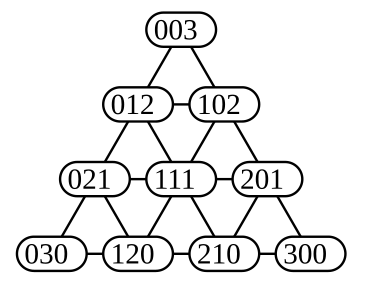](../../assets/volume4a/figures/exercise-7-1-1-67-three-grid.svg)

一个 “Y” 形点集是在每一边上至少有一点的连通集. 假定在三角形网格的每个顶点上用一枚白石子或黑石子覆盖. 例如, 在下图的 52 枚黑石子中含有一个 (略微扭曲的)Y 形点集; 但是, 如果把它们中的任何一枚黑石子换成白石子, 反而出现一个白色的 Y 形点集. 稍加思索从直观上就会明白, 在任何布局中, 黑石子包含一个 Y 形点集当且仅当白石子不包含 Y 形点集.

[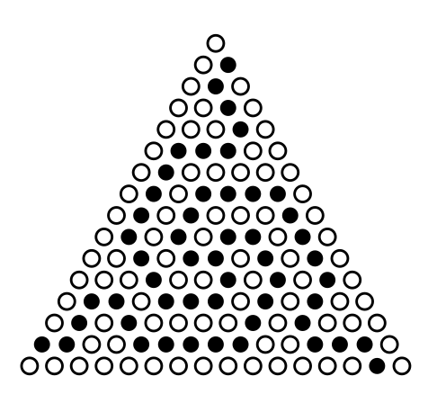](../../assets/volume4a/figures/exercise-7-1-1-67-fifty-two-black-Y.svg)

我们可以用布尔变量代表石子的颜色, 例如用 0 表示白色和用 1 表示黑色. 假定 $Y(t)=1$ 当且仅当存在一个黑 Y, 其中 $t$ 是由全部布尔变量构成的一个三角形网格. 这个函数 $Y$ 显然是单调函数; 同时, 上一段提到的直观断言等价于 $Y$ 也是自对偶的说法. 本习题的目的在于利用中位数代数对断言做严格证明.

给定 $a,b,c\geq0$, 令 $t_{abc}$ 是包含坐标 $xyz$ 满足 $x\geq a$, $y\geq b$, $z\geq c$ 的全部点的三角形子网格. 例如, $t_{001}$ 表示除 $z$ 边 (底行) 上的点外的所有点. 注意, 如果 $a+b+c=n$, 则 $t_{abc}$ 是坐标为 $abc$ 的单个点. 一般情况下, $t_{abc}$ 是 $n-a-b-c$ 阶的三角形网格.

(a) 如果 $n>0$, 令 $t^*$ 是由对于 $x+y+z=n-1$ 的规则

$$
t^*_{xyz}=\langle t_{(x+1)yz}t_{x(y+1)z}t_{xy(z+1)}\rangle
$$

定义的 $n-1$ 阶的三角形网格. 证明 $Y(t)=Y(t^*)$. [换句话说, $t^*$ 通过对每个石子小三角形取其颜色的中位数聚合它们. 重复此过程定义一座顶端为黑石子的金字塔, 当且仅当底部网格有一个黑 Y. 对上面扭曲的 Y 应用这个凝聚原理是很有趣的.]

(b) 证明: 如果 $n>0$, 则我们有 $Y(t)=\langle Y(t_{100})Y(t_{010})Y(t_{001})\rangle$.

**68.** [*46*][答案](./answers/7-1-1.md#ans-7-1-1-68) 上题所示的非常罕见的 Y 形构图有 52 枚黑石子. 在这种构图中, 黑石子可以达到的最大数量是多少? (即函数 $Y(t)$ 的一个素蕴涵元中可能有多少变量?)

▶ **69.** [*M26*][答案](./answers/7-1-1.md#ans-7-1-1-69) (克雷奇·申斯特德) 习题 67 通过三角形网格的顶点颜色的中位数表示函数 $Y$. 反之, 假定 $f(x_1,\ldots,x_n)$ 是具有 $m+1$ 个素蕴涵元 $p_0,p_1,\ldots,p_m$ 的任意单调自对偶布尔函数. 证明: $f(x_1,\ldots,x_n)=Y(T)$, 其中 $T$ 是任意 $m-1$ 阶的三角形网格, 网格的 $T_{abc}$ 是对于 $a+b+c=m-1$ 的 $p_a$ 和 $p_{a+b+1}$ 的公共变量. 例如, 当 $f(w,x,y,z)=\langle xwywz\rangle$ 时, 我们有 $m=3$ 以及

$$
f(w,x,y,z)=(w\wedge x)\vee(w\wedge y)\vee(w\wedge z)\vee(x\wedge y\wedge z)
=Y\!\left(\begin{smallmatrix}&&w&&\\&w&&w&\\x&&y&&z\end{smallmatrix}\right).
$$

▶ **70.** [*M20*][答案](./answers/7-1-1.md#ans-7-1-1-70) (阿龙·迈耶罗维茨, 1989) 给定任意的单调自对偶布尔函数 $f(x)=f(x_1,\ldots,x_n)$, 选择任意的素蕴涵元 $x_{j_1}\wedge\cdots\wedge x_{j_s}$, 令

$$
g(x)=(f(x)\wedge[x\ne t])\vee[x=\bar t],
$$

其中 $t=t_1\ldots t_n$ 是在位置 $\{j_1,\ldots,j_s\}$ 有 1 的位向量. 证明: $g(x)$ 也是单调自对偶函数. (请注意: 除了在 $t$ 和 $\bar t$ 这两点, $g(x)$ 与 $f(x)$ 是相等的.)

▶ **71.** [*M21*][答案](./answers/7-1-1.md#ans-7-1-1-71) 给定中位数代数公理 $(50)$–$(52)$, 证明: 长分配律 $(54)$ 是短分配律 $(53)$ 的推论.

**72.** [*M22*][答案](./answers/7-1-1.md#ans-7-1-1-72) 由中位数定律 $(50)$–$(53)$ 推导中位数定律 $(58)$–$(60)$.

**73.** [*M32*][答案](./answers/7-1-1.md#ans-7-1-1-73) (舍温·阿万) 给定中位数代数 $M$, 它的区间由式 (57) 定义, 它对应的中位数图由式 (61) 定义, 令 $d(u,v)$ 表示从 $u$ 到 $v$ 的距离. 此外, 令 $[uxv]$ 代表命题 “$x$ 位于从 $u$ 到 $v$ 的一条最短的路径上”.

(a) 证明: $[uxv]$ 成立, 当且仅当 $d(u,v)=d(u,x)+d(x,v)$.

(b) 假定 $x\in[u\mathinner{.\,.}v]$, $u\in[x\mathinner{.\,.}y]$, 其中 $x\ne u$ 且 $y\mathrel{\text{—}}v$ 是中位数图的边. 证明: $x\mathrel{\text{—}}u$ 也是一条边.

(c) 如果 $x\in[u\mathinner{.\,.}v]$, 通过对 $d(u,v)$ 用归纳法证明 $[uxv]$.

(d) 反之, 证明: $[uxv]$ 蕴涵 $x\in[u\mathinner{.\,.}v]$.

**74.** [*M21*][答案](./answers/7-1-1.md#ans-7-1-1-74) 证明: 在中位数代数中, 按照定义 (57), 如果 $w\in[x\mathinner{.\,.}y]$ 且 $w\in[x\mathinner{.\,.}z]$ 且 $w\in[y\mathinner{.\,.}z]$, 则我们有 $w=\langle xyz\rangle$.

▶ **75.** [*M36*][答案](./answers/7-1-1.md#ans-7-1-1-75) (马洛·肖兰德, 1954) 假定 $M$ 是一个点集, 具有 “$x$ 在 $u$ 和 $v$ 之间” 的居间关系 (记为 $[uxv]$), 这种关系满足以下三条公理:

(i) 如果 $[uvu]$, 那么 $u=v$.

(ii) 如果 $[uxv]$ 且 $[xyu]$, 那么 $[vyu]$.

(iii) 给定 $x,y,z$, 恰好有一点 $w=\langle xyz\rangle$ 满足 $[xwy]$, $[xwz]$, $[ywz]$.

本题的目的在于证明 $M$ 是中位数代数.

(a) 证明过半数定律 $(50)$: $\langle xxy\rangle=x$.

(b) 证明交换律 $(51)$: $\langle xyz\rangle=\langle xzy\rangle=\cdots=\langle zyx\rangle$.

(c) 证明: $[uxv]$ 当且仅当 $x=\langle uxv\rangle$.

(d) 证明: 如果 $[uxy]$ 且 $[uyv]$, 则我们有 $[xyv]$.

(e) 证明: 如果 $[uxv]$ 且 $[uyz]$ 且 $[vyz]$, 则我们有 $[xyz]$. 提示: 建立点 $w=\langle yuv\rangle$, $p=\langle wux\rangle$, $q=\langle wvx\rangle$, $r=\langle pxz\rangle$, $s=\langle qxz\rangle$, $t=\langle rsz\rangle$.

(f) 最后, 推导短分配律 $(53)$: $\langle\langle xyz\rangle uv\rangle=\langle x\langle yuv\rangle\langle zuv\rangle\rangle$.

**76.** [*M33*][答案](./answers/7-1-1.md#ans-7-1-1-76) 令 $[uxv]$ 是 $x=\langle uxv\rangle$ 的缩写, 从中位数代数公理 $(50)$–$(52)$ 开始, 不使用分配律 $(53)$, 推导习题 75 的居间公理 (i)(ii)(iii). 提示: 见习题 74.

**77.** [*M28*][答案](./answers/7-1-1.md#ans-7-1-1-77) 令 $G$ 为包含边 $r\mathrel{\text{—}}s$ 的中位数图. 对于每条边 $u\mathrel{\text{—}}v$, 称 $u$ 为 $v$ 的先邻近, 当且仅当 $r$ 离 $u$ 比离 $v$ 更近. 把顶点分拆成 “左” 部和 “右” 部, 其中左部的顶点离 $r$ 比离 $s$ 更近, 右部的顶点离 $s$ 比离 $r$ 更近. 每个右部顶点 $v$ 有一个秩, 它是从 $v$ 到一个左部顶点的最短距离. 同样, 每个左部顶点 $u$ 有一个秩 $1-d$, 其中 $d$ 是从 $u$ 到一个右部顶点的最短距离. 这样 $u$ 有一个 0 秩, 如果它同一个右部顶点是邻接的, 否则它的秩是负值. 显然, 顶点 $r$ 的秩为 0, 而 $s$ 的秩为 1.

(a) 证明每个秩为 1 的顶点恰好同一个秩为 0 的顶点邻接.

(b) 证明全体右部顶点的集合是凸集.

(c) 证明全体秩为 1 的顶点的集合是凸集.

(d) 证明子程序 I 的步骤 I3–I9 正确标记秩为 1 和 2 的全部顶点.

(e) 证明算法 H 是正确的.

▶ **78.** [*M26*][答案](./answers/7-1-1.md#ans-7-1-1-78) 如果在算法 H 执行过程中顶点 $v$ 在步骤 I4 被检验 $k$ 次, 证明: 图至少有 $2^k$ 个顶点. 提示: 存在 $k$ 种方式引出从 $v$ 到 $a$ 的最短路径; 因此, 在 $l(v)$ 中至少出现 $k$ 个 1.

▶ **79.** [*M27*][答案](./answers/7-1-1.md#ans-7-1-1-79) (葛立恒) 超立方的诱导子图是其顶点 $v$ 可以用二进制位串 $l(v)$ 以这样一种方式标记的图: 存在边 $u\mathrel{\text{—}}v$ 当且仅当 $l(u)$ 和 $l(v)$ 恰好有一个二进制位不同. (每个标记有相同的长度.)

(a) 定义超立方的 $n$ 顶点子图的一种方法是, 对于 $0\leq v<n$, 令 $l(v)$ 是 $v$ 的二进制表示. 证明: 这个子图恰好有 $f(n)=\sum_{k=0}^{n-1}\nu(k)$ 条边, 其中 $\nu(k)$ 是位叠加函数.

(b) 证明: $f(n)\leq n\lceil\lg n\rceil/2$.

(c) 证明: 一个超立方不存在边数超过 $f(n)$ 的 $n$ 顶点子图.

**80.** [*27*][答案](./answers/7-1-1.md#ans-7-1-1-80) 部分立方是超立方的一个 “等距” 子图, 就是其中顶点之间的距离同它们在全图中一样的子图. 所以, 部分立方中的顶点可以用这样一种方式标记: 从 $u$ 到 $v$ 的距离是 $l(u)$ 与 $l(v)$ 之间的 “汉明距离”, 即 $\nu(l(u)\oplus l(v))$. 算法 H 表明每个中位数图是一个部分立方.

(a) 找出一个不是部分立方的 4 立方诱导子图.

(b) 给出一个不是中位数图的部分立方的例子.

**81.** [*16*][答案](./answers/7-1-1.md#ans-7-1-1-81) 每个中位数图都是二部图吗?

**82.** [*25*][答案](./answers/7-1-1.md#ans-7-1-1-82) (服务中的递增改变) 给定图 $G$ 的一个顶点序列 $(v_0,v_1,\ldots,v_t)$, 考虑求另一个顶点序列 $(u_0,u_1,\ldots,u_t)$ 的问题, 对于这个序列我们有 $u_0=v_0$, 而且

$$
\bigl(d(u_0,u_1)+d(u_1,u_2)+\cdots+d(u_{t-1},u_t)\bigr)
+\bigl(d(u_1,v_1)+d(u_2,v_2)+\cdots+d(u_t,v_t)\bigr)
$$

达到最小值, 其中 $d(u,v)$ 表示从 $u$ 到 $v$ 的距离. (可以把每个 $v_k$ 看成在那个顶点对所需资源的请求; 当那些请求依次被处理时, 服务器移动到 $u_k$.) 证明: 如果 $G$ 是中位数图, 我们可以通过选择 $u_k=\langle u_{k-1}v_kv_{k+1}\rangle$($0<k<t$) 和 $u_t=v_t$ 获得一个最优解.

▶ **83.** [*38*][答案](./answers/7-1-1.md#ans-7-1-1-83) 推广习题 82, 给定任意一个正的比率 $\rho$, 在中位数图中寻找使得

$$
\bigl(d(u_0,u_1)+d(u_1,u_2)+\cdots+d(u_{t-1},u_t)\bigr)
+\rho\bigl(d(u_1,v_1)+d(u_2,v_2)+\cdots+d(u_t,v_t)\bigr)
$$

取最小值的有效方法.

**84.** [*30*][答案](./answers/7-1-1.md#ans-7-1-1-84) 编写一个程序求 5 变量的全部单调自对偶布尔函数. 对应的中位数图的边是什么? (表 2 说明 4 变量的情形.)

▶ **85.** [*M22*][答案](./answers/7-1-1.md#ans-7-1-1-85) 定理 S 表明, 以 2CNF 表示的每个公式对应于一个中位数集合. 因此, 如图 6 所示的每个反对称有向图也对应于一个中位数集合. 这些有向图中哪些正好对应于缩减的中位数集合?

**86.** [*15*][答案](./answers/7-1-1.md#ans-7-1-1-86) 如果 $v,w,x,y,z$ 属于中位数集合 $X$, 它们按分量计算的五元素中位数 $\langle vwxyz\rangle$ 总是属于 $X$ 吗?

**87.** [*24*][答案](./answers/7-1-1.md#ans-7-1-1-87) 定理 F 的证明构建对于自由树 $(63)$ 的何种 CI 网络?

**88.** [*M21*][答案](./answers/7-1-1.md#ans-7-1-1-88) 通过让网络 $(74)$ 的每个模块在最早可能的时间投入运行, 我们可以利用并行计算把它压缩成

[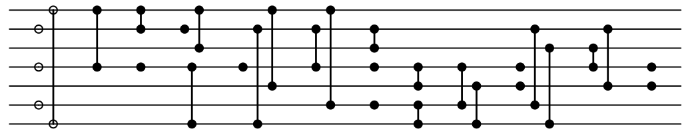](../../assets/volume4a/figures/exercise-7-1-1-88-compressed-CI.svg)

证明: 尽管在定理 F 的证明中建立的网络可以包含 $\Omega(t^2)$ 个模块, 但它始终需要最多 $O(t\log t)$ 级延迟.

**89.** [*24*][答案](./answers/7-1-1.md#ans-7-1-1-89) 当网络结构 $(73)$ 增添一簇新模块以求对某些字面值 $u$ 和 $v$ 强加条件 $u\to v$ 时, 证明它保留过去强加的所有条件 $u'\to v'$.

▶ **90.** [*21*][答案](./answers/7-1-1.md#ans-7-1-1-90) 构建一个带有输入位 $x_1\ldots x_t$ 和输出位 $y_1\ldots y_t$ 的 CI 网络, 其中 $y_1=\cdots=y_{t-1}=0$ 且 $y_t=x_1\oplus\cdots\oplus x_t$. 试着达到仅有 $O(\log t)$ 级延迟.

**91.** [*46*][答案](./answers/7-1-1.md#ans-7-1-1-91) 对于维数 $t$ 的每个中位数图的标记, 收缩映射可以通过仅有 $O(\log t)$ 级延迟的 CI 网络计算吗? [这个问题是由于排序的类似问题存在渐近最优网络引起的, 见米克洛什·奥伊陶伊、亚诺什·科姆洛什和安德烈·塞迈雷迪,*Combinatorica* **3** (1983), 1–19.]

**92.** [*46*] 模块数量比不带反向器的 “纯” 排序网络少的 CI 网络能够排序 $n$ 个布尔量输入吗?

**93.** [*M20*][答案](./answers/7-1-1.md#ans-7-1-1-93) 证明: 图 $G$ 的每个收缩核 $X$ 是 $G$ 的一个等距子图. (换句话说, $X$ 中的距离与 $G$ 中的距离是相同的, 见习题 80.)

**94.** [*M21*][答案](./answers/7-1-1.md#ans-7-1-1-94) 证明: 如果我们消除对于所有 $x\in X$ 为常数的坐标, 那么超立方的每个收缩核 $X$ 是一个中位数标记的集合.

**95.** [*M25*][答案](./answers/7-1-1.md#ans-7-1-1-95) 判别真假: 当一个比较器-反向器网络的输入涉及所有可能的二进制位串时, 它所产生的全部输出的集合总是一个中位数集合.

**96.** [*HM25*][答案](./answers/7-1-1.md#ans-7-1-1-96) 在式 (75) 中, 我们不坚持 $w_1,w_2,\ldots,w_n$ 和 $t$ 必须是整数, 允许它们取任意实数. 门限函数的数量会增加吗?

**97.** [*10*][答案](./answers/7-1-1.md#ans-7-1-1-97) 在不等式 (81) 中, 当 $n=2$, $w_1=w_2=1$, $t=-1,0,1,2,3,4$ 时出现什么中位数函数或过半数函数?

**98.** [*M23*][答案](./answers/7-1-1.md#ans-7-1-1-98) 证明: 任何自对偶门限函数可以表示成

$$
f(x_1,x_2,\ldots,x_n)=[v_1y_1+\cdots+v_ny_n>0],
$$

其中每个 $y_j$ 是 $x_j$ 或者 $\bar x_j$. 例如, $2x_1+3x_2+5x_3+7x_4+11x_5+13x_6\geq21$ 当且仅当 $2x_1+3x_2+5x_3-7\bar x_4+11x_5-13\bar x_6>0$.

▶ **99.** [*20*][答案](./answers/7-1-1.md#ans-7-1-1-99) (哲尔吉·迈泽伊, 1961) 证明 $\langle\langle x_1\ldots x_{2s-1}\rangle y_1\ldots y_{2t-2}\rangle=\langle x_1\ldots x_{2s-1}y_1^s\ldots y_{2t-2}^s\rangle$.

**100.** [*20*][答案](./answers/7-1-1.md#ans-7-1-1-100) 判别真假: 如果 $f(x_1,\ldots,x_n)$ 是门限函数, 那么 $f(x_1,\ldots,x_n)\wedge x_{n+1}$ 和 $f(x_1,\ldots,x_n)\vee x_{n+1}$ 也是门限函数.

**101.** [*M23*][答案](./answers/7-1-1.md#ans-7-1-1-101) 当 $n\geq3$ 时, 斐波那契门限函数 $F_n(x_1,\ldots,x_n)$ 由公式 $\langle x_1^{F_1}x_2^{F_2}\ldots x_{n-1}^{F_{n-1}}x_n^{F_{n-2}}\rangle$ 定义. 例如, $F_7(x_1,\ldots,x_7)=\langle x_1x_2x_3^2x_4^3x_5^5x_6^8x_7^5\rangle$.

(a) $F_n(x_1,\ldots,x_n)$ 的素蕴涵元是什么?

(b) 求 $F_n(x_1,\ldots,x_n)$ 的正交析取范式 (见习题 35).

(c) 通过 Y 函数表示 $F_n(x_1,\ldots,x_n)$ (见习题 67 和 69).

**102.** [*M21*][答案](./answers/7-1-1.md#ans-7-1-1-102) 公式

$$
\begin{aligned}
\hat f(x_0,x_1,\ldots,x_n)
&=(x_0\wedge f(x_1,\ldots,x_n))\vee(\bar x_0\wedge\overline{f(\bar x_1,\ldots,\bar x_n)})\\
&=(\bar x_0\vee f(x_1,\ldots,x_n))\wedge(x_0\vee\overline{f(\bar x_1,\ldots,\bar x_n)})
\end{aligned}
$$

定义了布尔函数的自对偶化.

(a) 如果 $f(x_1,\ldots,x_n)$ 是任意布尔函数, 证明 $\hat f$ 是自对偶函数.

(b) 证明: $\hat f$ 是门限函数, 当且仅当 $f$ 是门限函数.

**103.** [*HM25*][答案](./answers/7-1-1.md#ans-7-1-1-103) 给定一个单调自对偶布尔函数的一连串素蕴涵元, 说明如何使用线性规划方法检验它是不是门限函数. 此外, 如果它是门限函数, 说明怎样使它作为一个过半数函数 $\langle x_1^{w_1}\ldots x_n^{w_n}\rangle$ 表示的长度达到最小.

**104.** [*25*][答案](./answers/7-1-1.md#ans-7-1-1-104) 应用习题 103 的方法, 求下列门限函数作为过半数函数的最短表示: (a) $\langle x_1^2x_2^3x_3^5x_4^7x_5^{11}x_6^{13}x_7^{17}x_8^{19}\rangle$; (b) $[(x_1x_2x_3x_4)_2\geq t]$, $0\leq t\leq16$(17 个实例); (c) $\langle x_1^{29}x_2^{25}x_3^{19}x_4^{15}x_5^{12}x_6^8x_7^8x_8^3x_9^3x_{10}\rangle$.

**105.** [*M25*][答案](./answers/7-1-1.md#ans-7-1-1-105) 证明: 习题 101 中的斐波那契门限函数作为一个过半数函数的表示, 没有比用于定义它的过半数函数更短的表示.

▶ **106.** [*M25*][答案](./answers/7-1-1.md#ans-7-1-1-106) 3 变量中位数运算 $\langle x\bar y\bar z\rangle$ 为真, 当且仅当 $x\geq y+z$.

(a) 推而广之, 证明: 我们可以通过执行 $2^{n+1}-1$ 个布尔变量的中位数运算检验条件 $(x_1x_2\ldots x_n)_2\geq(y_1y_2\ldots y_n)_2+z$.

(b) 证明: 少于 $2^{n+1}-1$ 个变量的中位数运算不满足这个问题的条件.

**107.** [*17*][答案](./answers/7-1-1.md#ans-7-1-1-107) 对表 1 中的 16 个函数计算 $N(f)$ 和 $\Sigma(f)$. (见定理 T.)

**108.** [*M21*][答案](./answers/7-1-1.md#ans-7-1-1-108) 令 $g(x_0,x_1,\ldots,x_n)$ 是自对偶函数. 因此, 按定理 T 的记号, $N(g)=2^n$. 当 $f(x_1,\ldots,x_n)$ 是以下函数时, 用 $\Sigma(g)$ 表示 $N(f)$ 和 $\Sigma(f)$: (a) $g(0,x_1,\ldots,x_n)$; (b) $g(1,x_1,\ldots,x_n)$.

**109.** [*M25*][答案](./answers/7-1-1.md#ans-7-1-1-109) 对于 $0\leq k\leq n$, 如果 $a_1+\cdots+a_k\geq b_1+\cdots+b_k$, 就说二进制串 $\alpha=a_1\ldots a_n$ 优化二进制串 $\beta=b_1\ldots b_n$, 记为 $\alpha\succeq\beta$ 或 $\beta\preceq\alpha$.

(a) 令 $\bar\alpha=\bar a_1\ldots\bar a_n$. 证明: $\alpha\succeq\beta$ 当且仅当 $\bar\beta\succeq\bar\alpha$.

(b) 证明: 长度为 $n$ 的任意两个二进制串具有最大下界 $\alpha\wedge\beta$, 其性质是: $\alpha\succeq\gamma$ 且 $\beta\succeq\gamma$, 当且仅当 $\alpha\wedge\beta\succeq\gamma$. 给定 $\alpha$ 和 $\beta$, 说明如何计算 $\alpha\wedge\beta$.

(c) 同样, 说明如何计算最小上界 $\alpha\vee\beta$, 其性质是: $\gamma\succeq\alpha$ 且 $\gamma\succeq\beta$, 当且仅当 $\gamma\succeq\alpha\vee\beta$.

(d) 判别真假: $\alpha\wedge(\beta\vee\gamma)=(\alpha\wedge\beta)\vee(\alpha\wedge\gamma)$; $\alpha\vee(\beta\wedge\gamma)=(\alpha\vee\beta)\wedge(\alpha\vee\gamma)$.

(e) 如果 $\alpha\succeq\beta$ 且 $\alpha\ne\beta$ 且 $\alpha\succeq\gamma\succeq\beta$ 蕴涵 “$\gamma=\alpha$ 或 $\gamma=\beta$”, 则称 $\alpha$ 覆盖 $\beta$. 例如, 图 8 说明长度为 5 的二进制串之间的覆盖关系. 寻找描述由一个给定二进制串覆盖的串的简单方法.

(f) 证明: 从一个给定二进制串 $\alpha$ 到 $0\ldots0$ 的每一条路径 $\alpha=\alpha_0,\alpha_1,\ldots,\alpha_r=0\ldots0$ 具有相同的长度 $r=r(\alpha)$, 其中 $\alpha_{j-1}$ 覆盖 $\alpha_j$($1\leq j\leq r$).

(g) 令 $m(\alpha)$ 是满足 $\beta\succeq\alpha$ 的二进制串 $\beta$ 的数量. 证明: $m(1\alpha)=m(\alpha)$ 且 $m(0\alpha)=m(\alpha)+m(\alpha')$, 其中 $\alpha'$ 是把 $\alpha$ 最左边的 1 (如果存在的话) 改变为 0 得到的二进制串.

(h) 有多少长度为 $n$ 的二进制串 $\alpha$ 满足 $\bar\alpha\succeq\alpha$?

[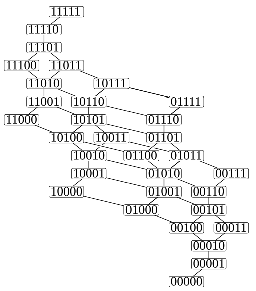](../../assets/volume4a/figures/fig-7-8-five-bit-majorization-lattice.svg)

图 8　长度为 5 的二进制优化网格 (见习题 109)

**110.** [*M23*][答案](./answers/7-1-1.md#ans-7-1-1-110) 如果对于所有向量 $x$ 和 $y$, $x\preceq y$ 蕴涵 $f(x)\leq f(y)$, 其中 $\preceq$ 是习题 109 中的优化关系, 就称布尔函数 $f$ 为正则函数. 证明或者推翻以下命题:

(a) 每个正则函数都是单调函数.

(b) 如果 $f$ 是满足 $w_1\geq w_2\geq\cdots\geq w_n$ 的门限函数 $(75)$, 那么 $f$ 是正则函数.

(c) 如果 $f$ 是 (b) 中的函数, 且 $\Sigma(f)=(s_1,\ldots,s_n)$, 那么 $s_1\geq s_2\geq\cdots\geq s_n$.

(d) 假定 $f$ 是一个纯过半数函数, 即 $a=b=0$ 时式 (86) 的门限函数. 那么, $s_1\geq s_2\geq\cdots\geq s_n$ 蕴涵 $w_1\geq w_2\geq\cdots\geq w_n$.

**111.** [*M36*][答案](./answers/7-1-1.md#ans-7-1-1-111) 运作概率为 $(p_1,\ldots,p_n)$ 的系统的最优小族团, 是同所有 $n$ 变量单调自对偶函数中具有最大可用性的那个函数对应的小族团. (见习题 14 和 66.)

(a) 证明: 如果 $1\geq p_1\geq\cdots\geq p_n\geq\frac12$, 至少有一个具有最大可用性的自对偶函数是正则函数. 描述这样一个函数.

(b) 此外, 要检验一个正则的自对偶函数 $f$ 的最优性, 只需在二进制优化网格中满足 $f(y)=1$、而对被 $y$ 覆盖的所有 $x$ 点有 $f(x)=0$ 的那些 $y$ 点进行检验.

(c) 当某些概率 $<\frac12$ 时, 什么小族团是最优的?

▶ **112.** [*M37*][答案](./answers/7-1-1.md#ans-7-1-1-112) (约翰·哈斯塔) 如果 $f(x_1,x_2,\ldots,x_m)$ 是布尔函数, 令 $M(f)$ 是它作为带整系数的多重线性多项式的表示 (见习题 12). 用蔡斯序列 $\alpha_0=00\ldots0$, $\alpha_1=10\ldots0$, $\ldots$, $\alpha_{2^m-1}=11\ldots1$ 确定指数顺序排列这个多项式中的项. 通过连接 7.2.1.3-$(35)$ 的序列 $A_{m0},A_{(m-1)1},\ldots,A_{0m}$ 得到的蔡斯序列具有有趣的性质: 如果在 $\alpha_j$ 和 $\alpha_{j+1}$ 中不计 $0\to1$ 或 $01\to10$ 或 $001\to100$ 或 $10\to01$ 或 $100\to001$ 这样的细小变化, 它们是完全相同的. 例如, 当 $m=4$ 时蔡斯序列是

$$
\begin{gathered}
0000,1000,0010,0001,0100,1100,1010,1001,\\
0011,0101,0110,1110,1101,1011,0111,1111,
\end{gathered}
$$

分别同项 $1,x_1,x_3,x_4,x_2,x_1x_2,\ldots,x_2x_3x_4,x_1x_2x_3x_4$ 对应. 所以, 如果已经按这个顺序排列各项, 那么 $((x_1\oplus\bar x_2)\wedge x_3)\vee(x_1\wedge\bar x_3\wedge x_4)$ 的相关表示是

$$
x_3-x_1x_3+x_1x_4-x_2x_3+2x_1x_2x_3-x_1x_3x_4.
$$

现在令

$$
F(f)=[M(f)\text{ 的最高项系数是正数}].
$$

例如, 在蔡斯的排序中, $((x_1\oplus\bar x_2)\wedge x_3)\vee(x_1\wedge\bar x_3\wedge x_4)$ 的最高 (最后) 非零项是 $-x_1x_3x_4$, 所以在这个实例中 $F(f)=0$.

(a) 对表 1 的 16 个函数中的每一个确定 $F(f)$.

(b) 证明: $F(f)$ 是关于 $f$ 的真值表的 $n=2^m$ 个条目 $\{f_{0\ldots00},f_{0\ldots01},\ldots,f_{1\ldots11}\}$ 的门限函数. 当 $m=2$ 时, 写出这个函数的显式形式.

(c) 证明: 当 $m$ 取很大的值时, 在 $F$ 的任何门限表示中所有权值必定是非常大的值: 它们的绝对值必定全都超过

$$
\frac{3^{\binom m3}7^{\binom m4}15^{\binom m5}\ldots(2^{m-1}-1)^{\binom mm}}n
(1-O(n^{-1}))
=2^{mn/2-n-2(3/2)^m/\ln2+O((5/4)^m)}.
$$

提示: 考虑真值表条目中的离散傅里叶变换.

**113.** [*24*][答案](./answers/7-1-1.md#ans-7-1-1-113) 说明以下三个门限运算足以计算 $(91)$ 中的函数 $S_{2,3,6,8,9}(x_1,\ldots,x_{12})$:

$$
\begin{aligned}
g_1(x_1,\ldots,x_{12})&=[\nu x\geq6]=\langle1x_1\ldots x_{12}\rangle;\\
g_2(x_1,\ldots,x_{12})&=[\nu x-6g_1\geq2]=\langle1^3x_1\ldots x_{12}\bar g_1^6\rangle;\\
g_3(x_1,\ldots,x_{12})&=[-2\nu x+13g_1+7g_2\geq1]
=\langle0^5\bar x_1^2\ldots\bar x_{12}^2g_1^{13}g_2^7\rangle.
\end{aligned}
$$

另外, 寻找一个四门限运算方案计算 $S_{1,3,5,8}(x_1,\ldots,x_{12})$.

**114.** [*20*][答案](./answers/7-1-1.md#ans-7-1-1-114) (戴维·哈夫曼)$S_{3,6}(x,x,x,x,y,y,z)$ 是什么函数?

**115.** [*M22*][答案](./answers/7-1-1.md#ans-7-1-1-115) 说明式 (92) 能正确计算奇偶性函数 $x_0\oplus x_1\oplus\cdots\oplus x_{2m}$ 的理由.

▶ **116.** [*HM28*][答案](./answers/7-1-1.md#ans-7-1-1-116) (布拉德福德·邓纳姆和理查德·弗里德沙尔, 1957) 通过考察对称函数, 我们可以证明 $n$ 变量布尔函数可能有许多素蕴涵元.

(a) 假定 $0\leq j\leq k\leq n$. 对于哪些对称函数 $f(x_1,\ldots,x_n)$, 小项 $x_1\wedge\cdots\wedge x_j\wedge\bar x_{j+1}\wedge\cdots\wedge\bar x_k$ 是素蕴涵元?

(b) 函数 $S_{3,4,5,6}(x_1,\ldots,x_9)$ 有多少素蕴涵元?

(c) 令 $\hat b(n)$ 是遍及 $n$ 个变量的各个对称布尔函数的素蕴涵元的最大数量. 求关于 $\hat b(n)$ 的递推公式, 并计算 $\hat b(9)$.

(d) 证明 $\hat b(n)=\Theta(3^n/n)$.

(e) 进一步证明: 存在对称函数 $f(x_1,\ldots,x_n)$, 使得 $f$ 和 $\bar f$ 都有 $\Theta(2^{3n/2}/n)$ 个素蕴涵元.

**117.** [*M26*][答案](./answers/7-1-1.md#ans-7-1-1-117) 如果在一个析取范式的蕴涵元中没有一个蕴涵另一个, 则称该析取范式为无赘析取范式. 令 $b^*(n)$ 是遍及所有 $n$ 变量布尔函数的无赘析取范式中蕴涵元的最大数量. 求关于 $b^*(n)$ 的简单公式, 并确定它的渐近值.

**118.** [*29*][答案](./answers/7-1-1.md#ans-7-1-1-118) 对于 $m=0,1,\ldots$, 恰好有 $m$ 个素蕴涵元的布尔函数 $f(x_1,x_2,x_3,x_4)$ 的数量是多少?

**119.** [*M48*][答案](./answers/7-1-1.md#ans-7-1-1-119) 续上题, 令 $b(n)$ 是一个 $n$ 变量布尔函数的素蕴涵元的最大数量. 显然 $\hat b(n)\leq b(n)<b^*(n)$. $b(n)$ 的渐近值是什么?

**120.** [*23*][答案](./answers/7-1-1.md#ans-7-1-1-120) 对于对称函数 (a) $x_1\oplus x_2\oplus\cdots\oplus x_n$ 和 (b) $S_{0,1,3,4,6,7}(x_1,\ldots,x_7)$, 它们的最短析取范式分别是什么? (c) 证明: 每个 $n$ 变量布尔函数可以表示成最多含 $2^{n-1}$ 个素蕴涵元的析取范式.

▶ **121.** [*M23*][答案](./answers/7-1-1.md#ans-7-1-1-121) 函数 $\langle1(x_1\oplus x_2)y_1y_2y_3\rangle$ 是部分对称的, 因为它按照 $\{x_1,x_2\}$ 和 $\{y_1,y_2,y_3\}$ 是对称的, 但是按照全部 5 个变量 $\{x_1,x_2,y_1,y_2,y_3\}$ 不是对称的.

(a) 有多少布尔函数 $f(x_1,\ldots,x_m,y_1,\ldots,y_n)$ 按照 $\{x_1,\ldots,x_m\}$ 和 $\{y_1,\ldots,y_n\}$ 是对称的?

(b) 这些函数中多少是单调函数?

(c) 这些函数中多少是自对偶函数?

(d) 这些函数中多少是单调自对偶函数?

**122.** [*M25*][答案](./answers/7-1-1.md#ans-7-1-1-122) 续习题 110 和 121, 求出所有这样的布尔函数 $f(x_1,x_2,x_3,y_1,y_2,y_3,y_4,y_5,y_6)$, 它们是按照 $\{x_1,x_2,x_3\}$ 和 $\{y_1,y_2,\ldots,y_6\}$ 对称的, 同时还是自对偶正则函数. 它们中的哪些是门限函数?

**123.** [*46*][答案](./answers/7-1-1.md#ans-7-1-1-123) 有多少 10 变量自对偶布尔函数是门限函数?

**124.** [*20*][答案](./answers/7-1-1.md#ans-7-1-1-124) 求一个 4 变量布尔函数, 它按表 5 的基本规则同其他 767 个函数是等价的.

**125.** [*18*][答案](./answers/7-1-1.md#ans-7-1-1-125) $(95)$ 中的哪些函数类是定向的?

**126.** [*23*][答案](./answers/7-1-1.md#ans-7-1-1-126) (a) 证明: 一个布尔函数是定向函数, 当且仅当它的素蕴涵元的集合和素子句的集合具有某种简单性质. (b) 一个布尔函数是定向函数, 当且仅当它的周绍康参数 $N(f)$ 和 $\Sigma(f)$ 具有某种简单性质 (见定理 T). (c) 用类似整数向量 $\Sigma(f)$ 的方式定义布尔向量

$$
\vee(f)=\bigvee\{x\mid f(x)=1\}\quad\text{和}\quad
\wedge(f)=\bigwedge\{x\mid f(x)=1\}.
$$

证明: 仅给定 4 个向量 $\vee(f),\vee(\bar f),\wedge(f),\wedge(\bar f)$ 就能判定 $f$ 是不是定向函数.

**127.** [*M25*][答案](./answers/7-1-1.md#ans-7-1-1-127) 在定向函数中, (a) 哪些是自对偶函数? (b) 哪些是确定的霍恩函数?

▶ **128.** [*20*][答案](./answers/7-1-1.md#ans-7-1-1-128) 求一个恰好在两点为真的非定向函数 $f(x_1,\ldots,x_n)$.

**129.** [*M25*][答案](./answers/7-1-1.md#ans-7-1-1-129) 存在多少不同的 $n$ 变量定向函数?

**130.** [*M21*][答案](./answers/7-1-1.md#ans-7-1-1-130) 根据表 3, 存在 168 个 4 变量单调布尔函数. 但是, 它们中的某些函数, 如 $x\wedge y$, 仅依赖于 3 个变量或者更少的变量.

(a) 有多少 4 变量单调布尔函数实际上同每个变量直接有关?

(b) 这些函数中有多少像表 4 中那样在置换下是不同的?

**131.** [*HM42*][答案](./answers/7-1-1.md#ans-7-1-1-131) 表 3 清楚表明, 霍恩函数比克罗姆函数多得多. 当变量数 $n\to\infty$ 时, 这两类函数的渐近数量是多少?

▶ **132.** [*HM30*][答案](./answers/7-1-1.md#ans-7-1-1-132) 布尔函数 $g(x)=g(x_1,\ldots,x_n)$ 称为仿射函数, 如果对于某些布尔常数 $y_0,y_1,\ldots,y_n$, 它能写成 $y_0\oplus(x_1\wedge y_1)\oplus\cdots\oplus(x_n\wedge y_n)=(y_0+x\cdot y)\bmod2$ 的形式.

(a) 给定任意布尔函数 $f(x)$, 证明: 某个仿射函数在 $2^{n-1}+2^{n/2-1}$ 个或更多个点 $x$ 上与 $f(x)$ 一致. 提示: 令 $s(y)=\sum_x(-1)^{f(x)+x\cdot y}$, 并证明 $\sum_y s(y)s(y\oplus z)=2^{2n}[z=0\ldots0]$ 对所有 $n$ 位二进制向量 $z$ 成立.

(b) 布尔函数 $f(x)$ 称为弯曲函数, 如果没有仿射函数在多于 $2^{n-1}+2^{n/2-1}$ 个点上与它一致. 证明: 当 $n$ 是偶数且 $h(y_1,y_2,\ldots,y_{n/2})$ 为任意函数时,

$$
(x_1\wedge x_2)\oplus(x_3\wedge x_4)\oplus\cdots\oplus(x_{n-1}\wedge x_n)\oplus h(x_2,x_4,\ldots,x_n)
$$

是弯曲函数.

(c) 证明: $f(x)$ 是弯曲函数, 当且仅当对于所有 $y\ne0\ldots0$ 有

$$
\sum_x(f(x)\oplus f(x\oplus y))=2^{n-1}.
$$

(d) 如果弯曲函数 $f(x_1,\ldots,x_n)$ 像在式 (19) 中那样是用一个多重线性多项式模 2 表示的, 证明: 当 $r>n/2>1$ 时它不包含项 $x_1\ldots x_r$.

▶ **133.** [*20*][答案](./answers/7-1-1.md#ans-7-1-1-133) (马克·史密斯, 1990) 假定我们抛掷 $n$ 枚独立的硬币获得 $n$ 个随机二进制位, 其中第 $k$ 枚硬币产生二进制位 1 的概率为 $p_k$. 寻找一种选择 $(p_1,\ldots,p_n)$ 的方法, 使得 $f(x_1,\ldots,x_n)=1$ 的概率为 $(t_0t_1\ldots t_{2^n-1})_2/(2^{2^n}-1)$, 其中 $t_0t_1\ldots t_{2^n-1}$ 是布尔函数 $f$ 的真值表. (因此, $n$ 枚符合要求的随机硬币可能产生一个具有 $2^n$ 位精度的概率.)

> 一般说来, 在设计实用的逻辑电路时,  
> 用尽可能少的开关元件要强过所有其他的工程考量.  
> ——赫伯特·柯蒂斯,*A New Approach to the Design of Switching Circuits* (1962)

> 获得成功, 他必须是一位卓越的计算者.  
> 简化, 再简化.  
> ——亨利·梭罗,*Walden; or, Life in the Woods* (1854)

<!-- section-footnotes -->

[^v4a-p51-1]: 波兰表示法是一种逻辑、算术和代数表示法, 其特点是运算符置于操作数的前面, 因此也称为前缀表示法. 如果每种运算都有各自固定的操作数数量, 则语法上不需要括号仍能被无歧义地解析. 波兰逻辑学家扬·武卡谢维奇 1924 年发明了这种表示法, 用于简化命题逻辑. 参见式 2.3.2–$(8)$ 以及第 10 章的讨论. ——编者注

[^v4a-p51-2]: 广义实数是指含 $-\infty$ 和 $+\infty$ 的实数. ——编者注

[^v4a-p69-1]: 1977 年 4 月 1 日愚人节, 英国《卫报》发行了一份长达 7 页的增刊, 描述了一个名为圣塞里夫 (San Serriffe) 的虚拟岛国. 参见: <https://en.wikipedia.org/wiki/San_Serriffe>. ——编者注

[^v4a-p69-2]: 在九宫游戏中, Cat 获胜意为不分胜负, 见 7.1.2 节. ——译者注
