<a id="sec-7-1-2"></a>

# 7.1.2　布尔函数求值

我们的下一个目标是探讨布尔函数求值的有效方法, 这同我们在 4.6.4 节讨论的多项式求值方法非常相似. 研究这个主题的一种自然途径是考虑函数的基本运算链, 这种链类似于前面讨论的多项式链.

对于 $n$ 变量函数 $(x_1,\ldots,x_n)$, 布尔链就是每一步组合了先前两步的序列 $(x_{n+1},\ldots,x_{n+r})$:

$$
x_i=x_{j(i)}\circ_i x_{k(i)},\qquad n+1\leq i\leq n+r,\tag{1}
$$

其中 $1\leq j(i)<i$, $1\leq k(i)<i$, $\circ_i$ 是表 7.1.1-1 中的 16 种二元运算符之一. 例如, 当 $n=3$ 时, 两条链

$$
\begin{aligned}
x_4&=x_1\wedge x_2\\
x_5&=\bar x_1\wedge x_3\\
x_6&=x_4\vee x_5
\end{aligned}
\quad\text{和}\quad
\begin{aligned}
x_4&=x_2\oplus x_3\\
x_5&=x_1\wedge x_4\\
x_6&=x_3\oplus x_5
\end{aligned}\tag{2}
$$

都是计算 “多路复用器” 函数或 “若-则-否则” 函数 $x_6=(x_1\,?\,x_2:x_3)$, 它取 $x_2$ 或 $x_3$ 的值取决于 $x_1$ 是 1 (真) 或者 $x_1$ 是 0 (假).

(注意, 式 (2) 中左端的例子使用简化记号 $x_5=\bar x_1\wedge x_3$ 指定 NOTBUT 运算, 而没有采用表 7.1.1-1 中出现的形式 $x_5=x_1\mathbin{\overline{\subset}}x_3$. 关键在于, 无论采用哪种记号, 一条布尔链的每一步是先前两个结果的布尔组合.)

<a id="pdf-094"></a><a id="p-79"></a>

布尔链自然地对应于电子线路, 链中的每一步对应于有两个输入和一个输出的 “门” 电路. 传统上, 电器工程师用

<table><tbody><tr>
<td style="min-width:220px"><a href="../../assets/volume4a/figures/diagram-7-1-2-3-left-mux-circuit.svg" target="_blank" rel="noopener" data-book-original-image="true">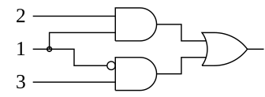</a></td>
<td>和</td>
<td style="min-width:220px"><a href="../../assets/volume4a/figures/diagram-7-1-2-3-right-mux-circuit.svg" target="_blank" rel="noopener" data-book-original-image="true">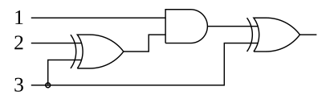</a></td>
</tr></tbody></table>

$(3)$

这样的电路图表示式 (2) 中的布尔链. 他们需要设计受各种技术条件约束的实用电路. 例如, 某些门电路可能更昂贵, 某些重用门的输出可能需要放大, 线路布局可能需要是平面或接近平面的, 某些路径可能要求是短程的. 但是在本书中, 我们主要关心的是软件而非硬件, 所以我们无须担忧这样的事情. 就我们的目的而言, 所有门电路的成本相同, 而且所有输出如通常要求的那样是可重用的. (按专业术语, 我们的布尔链归结为所有门带扇入 2 而不限制扇出的电路.)

此外, 我们将把布尔链画成

<table><tbody><tr>
<td style="min-width:220px"><a href="../../assets/volume4a/figures/diagram-7-1-2-4-left-mux-tree.svg" target="_blank" rel="noopener" data-book-original-image="true">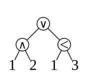</a></td>
<td>和</td>
<td style="min-width:220px"><a href="../../assets/volume4a/figures/diagram-7-1-2-4-right-mux-tree.svg" target="_blank" rel="noopener" data-book-original-image="true">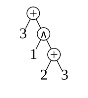</a></td>
</tr></tbody></table>

$(4)$

这样的二叉树, 而不是 $(3)$ 那样的电路图. 当布尔链的中间步骤被多次使用时, 这种二叉树会有交叠的子树. 每个内部结点用二元运算符标记, 外部结点用代表变量 $x_k$ 的整数 $k$ 标记. 由于 $\bar x\wedge y=[x<y]$, $(4)$ 的左树中的标记 $\textcircled{<}$ 代表 NOTBUT 运算符. 类似地, BUTNOT 运算符 $x\wedge\bar y$ 可以用结点标记 $\textcircled{>}$ 表示.

若干不同的布尔链可能有同样的树形图. 例如, $(4)$ 中的左树也代表链

$$
x_4=\bar x_1\wedge x_3,\qquad x_5=x_1\wedge x_2,\qquad x_6=x_5\vee x_4.
$$

树结点的任何拓扑排序都会产生了一条等价的链.

给定一个 $n$ 变量的函数 $f$, 我们经常需要求一条使得 $x_{n+r}=f(x_1,\ldots,x_n)$ 的布尔链, 其中 $r$ 尽可能地小. 函数 $f$ 的组合复杂性 $C(f)$ 是计算它的最短布尔链的长度. 为了避免过多的措辞, 我们将 $C(f)$ 简称为 “$f$ 的代价”. 在前面的例子中, 多路复用器函数的代价为 3, 因为通过穷举试验可以证明, 它不可能由任何长度为 2 的布尔链产生.

我们在 7.1.1 节讨论的 $f$ 的 DNF 和 CNF 表示, 没有提供多少关于 $C(f)$ 的信息, 因为通常可能存在更有效的计算方案. 例如在 7.1.1-$(30)$ 后面的讨论中, 我们发现近乎随机的 4 变量函数 (它的真值表是 `1100 1001 0000 1111`) 没有比

$$
(\bar x_1\wedge\bar x_2\wedge\bar x_3)
\vee(\bar x_1\wedge\bar x_3\wedge\bar x_4)
\vee(x_2\wedge x_3\wedge x_4)\vee(x_1\wedge x_2)\tag{5}
$$

更短的 DNF 表示式. 这个公式对应于一条 10 步的布尔链. 但是, 那个函数也可以更巧妙地表示成

$$
(((x_2\wedge\bar x_4)\oplus\bar x_3)\wedge\bar x_1)\oplus x_2,\tag{6}
$$

所以它的复杂性最多是 4.

如何能够发现式 (6) 那样并非显而易见的公式呢? 我们将会看到, 对于 4 个变量的函数, 计算机无须进行大量计算就可以求出最佳链. 不仅如此, 即使是对布尔函数已经很有经验的人, 其结果也可能令其非常吃惊. 这种现象的典型例子可以从图 9 中看出, 其中列举的或许是最受普遍关注的 4 变量函数, 就是那些在变量的所有排列下对称的函数.

<a id="pdf-095"></a><a id="p-80"></a><a id="fig-7-9"></a>

<table><tbody>
<tr><td style="min-width:230px;vertical-align:top">$S_4=$<br><a href="../../assets/volume4a/figures/fig-7-9-S4.svg" target="_blank" rel="noopener" data-book-original-image="true">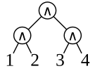</a></td><td style="min-width:230px;vertical-align:top">$S_3=$<br><a href="../../assets/volume4a/figures/fig-7-9-S3.svg" target="_blank" rel="noopener" data-book-original-image="true">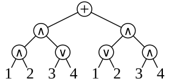</a></td></tr>
<tr><td style="min-width:230px;vertical-align:top">$S_{3,4}=$<br><a href="../../assets/volume4a/figures/fig-7-9-S3-4.svg" target="_blank" rel="noopener" data-book-original-image="true">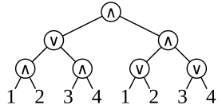</a></td><td style="min-width:230px;vertical-align:top">$S_2=$<br><a href="../../assets/volume4a/figures/fig-7-9-S2.svg" target="_blank" rel="noopener" data-book-original-image="true">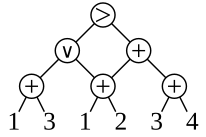</a></td></tr>
<tr><td style="min-width:230px;vertical-align:top">$S_{2,4}=$<br><a href="../../assets/volume4a/figures/fig-7-9-S2-4.svg" target="_blank" rel="noopener" data-book-original-image="true"></a></td><td style="min-width:230px;vertical-align:top">$S_{2,3}=$<br><a href="../../assets/volume4a/figures/fig-7-9-S2-3.svg" target="_blank" rel="noopener" data-book-original-image="true"></a></td></tr>
<tr><td style="min-width:230px;vertical-align:top">$S_{2,3,4}=$<br><a href="../../assets/volume4a/figures/fig-7-9-S2-3-4.svg" target="_blank" rel="noopener" data-book-original-image="true">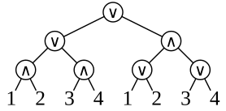</a></td><td style="min-width:230px;vertical-align:top">$S_1=$<br><a href="../../assets/volume4a/figures/fig-7-9-S1.svg" target="_blank" rel="noopener" data-book-original-image="true"></a></td></tr>
<tr><td style="min-width:230px;vertical-align:top">$S_{1,4}=$<br><a href="../../assets/volume4a/figures/fig-7-9-S1-4.svg" target="_blank" rel="noopener" data-book-original-image="true">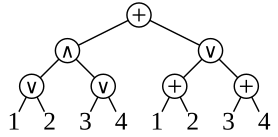</a></td><td style="min-width:230px;vertical-align:top">$S_{1,3}=$<br><a href="../../assets/volume4a/figures/fig-7-9-S1-3.svg" target="_blank" rel="noopener" data-book-original-image="true">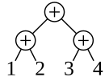</a></td></tr>
<tr><td style="min-width:230px;vertical-align:top">$S_{1,3,4}=$<br><a href="../../assets/volume4a/figures/fig-7-9-S1-3-4.svg" target="_blank" rel="noopener" data-book-original-image="true">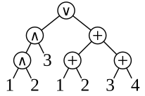</a></td><td style="min-width:230px;vertical-align:top">$S_{1,2}=$<br><a href="../../assets/volume4a/figures/fig-7-9-S1-2.svg" target="_blank" rel="noopener" data-book-original-image="true">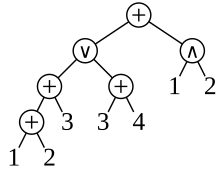</a></td></tr>
<tr><td style="min-width:230px;vertical-align:top">$S_{1,2,4}=$<br><a href="../../assets/volume4a/figures/fig-7-9-S1-2-4.svg" target="_blank" rel="noopener" data-book-original-image="true">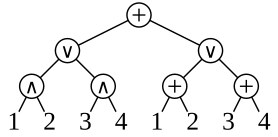</a></td><td style="min-width:230px;vertical-align:top">$S_{1,2,3}=$<br><a href="../../assets/volume4a/figures/fig-7-9-S1-2-3.svg" target="_blank" rel="noopener" data-book-original-image="true">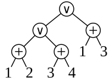</a></td></tr>
<tr><td style="min-width:230px;vertical-align:top">$S_{1,2,3,4}=$<br><a href="../../assets/volume4a/figures/fig-7-9-S1-2-3-4.svg" target="_blank" rel="noopener" data-book-original-image="true">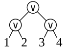</a></td><td></td></tr>
</tbody></table>

图 9　4 变量对称函数的最优布尔链

如图 9 所示, 考虑函数 $S_2(x_1,x_2,x_3,x_4)$, 我们有

<table><tbody>
<tr><td>$x_1$</td><td><code>0000 0000 1111 1111</code></td></tr>
<tr><td>$x_2$</td><td><code>0000 1111 0000 1111</code></td></tr>
<tr><td>$x_3$</td><td><code>0011 0011 0011 0011</code></td></tr>
<tr><td>$x_4$</td><td><code>0101 0101 0101 0101</code></td></tr>
<tr><td>$x_5=x_1\oplus x_3$</td><td><code>0011 0011 1100 1100</code></td></tr>
<tr><td>$x_6=x_1\oplus x_2$</td><td><code>0000 1111 1111 0000</code></td></tr>
<tr><td>$x_7=x_3\oplus x_4$</td><td><code>0110 0110 0110 0110</code></td></tr>
<tr><td>$x_8=x_5\vee x_6$</td><td><code>0011 1111 1111 1100</code></td></tr>
<tr><td>$x_9=x_6\oplus x_7$</td><td><code>0110 1001 1001 0110</code></td></tr>
<tr><td>$x_{10}=x_8\wedge\bar x_9$</td><td><code>0001 0110 0110 1000</code></td></tr>
</tbody></table>

$(7)$

这里的真值表使我们很容易证实计算的每一步. $x_8$ 步产生一个当 $x_1\ne x_2$ 或 $x_1\ne x_3$ 时为真的函数; 同时, $x_9=x_1\oplus x_2\oplus x_3\oplus x_4$ 是奇偶性函数 $(x_1+x_2+x_3+x_4)\bmod2$. 所以, 最后的结果 $x_{10}$ 恰好当 $\{x_1,x_2,x_3,x_4\}$ 的两个是 1 时为真; 这就是满足 $x_8$ 并且具有偶检验的两种情况.

图 9 的其他几种计算方案从直觉上也可证实是正确的. 但是有些链, 比如 $S_{1,4}$ 的链, 非常令人惊叹.

注意 $(7)$ 的中间结果 $x_6$ 被使用了两次. 实际上, 对于函数 $S_2(x_1,x_2,x_3,x_4)$ 不可能有不重复使用某个中间子表达式的 6 步链; $S_2$ 的最短代数公式, 包括

$$
((x_1\wedge x_2)\vee(x_3\wedge x_4))\oplus((x_1\vee x_2)\wedge(x_3\vee x_4))\tag{8}
$$

这样非常对称的公式, 它们的代价都是 7. 但是图 9 显示出, 4 变量的其他对称函数全部可以通过 “纯粹的” 二叉树以最优方式求值, 这种二叉树除了在外部结点 (代表变量的结点) 没有交叠子树.

<a id="pdf-096"></a><a id="p-81"></a>

一般说来, 如果 $f(x_1,\ldots,x_n)$ 是任意布尔函数, 我们说它的长度 $L(f)$ 是 $f$ 的最短公式中二元运算符的数目. 显而易见, $L(f)\geq C(f)$; 同时, 通过考察 7.1.1-$(95)$ 中 3 变量的函数的 14 种基本类型, 我们很容易证实, 当 $n\leq3$ 时 $L(f)=C(f)$. 但是我们刚好见到, 当 $n=4$ 时 $L(S_2)=7$ 超过 $C(S_2)=6$, 而且实际当 $n$ 很大时, $L(f)$ 几乎总是大大超过 $C(f)$ (见习题 49).

布尔函数 $f$ 的深度 $D(f)$ 是其固有复杂性的另一个重要度量: 我们说一条布尔链的深度是它的树形图中最长下行路径的长度, 当考虑 $f$ 的所有布尔链时, $D(f)$ 是最小可达的深度. 图 9 中的所有链不仅具有最小代价, 而且具有最小深度——除了 $S_{2,3}$ 和 $S_{1,2}$, 其中我们不能同时达到代价 6 和深度 3. 公式

$$
S_{2,3}(x_1,x_2,x_3,x_4)
=((x_1\wedge x_2)\oplus(x_3\wedge x_4))\vee((x_1\vee x_2)\wedge(x_3\oplus x_4))\tag{9}
$$

说明 $D(S_{2,3})=3$, 对于 $S_{1,2}$ 也有类似的公式.

**对于 $n=4$ 的最优链.** 对于 4 变量函数, 穷举计算是可行的, 因为这样的函数只有 $2^{16}=65\,536$ 个真值表. 事实上, 我们只须考虑真值表的一半, 因为任何函数 $f$ 的补 $\bar f$ 具有同 $f$ 本身一样的代价、长度和深度.

如果 $f(0,\ldots,0)=0$, 我们不妨说 $f(x_1,\ldots,x_n)$ 是正规的, 而且一般说来,

$$
f(x_1,\ldots,x_n)\oplus f(0,\ldots,0)\tag{10}
$$

是 $f$ 的 “正规化”. 任何布尔链的正规化, 可以通过对它每一步做正规化并对运算符做相应改变来实现; 因为如果 $(\hat x_1,\ldots,\hat x_{i-1})$ 是 $(x_1,\ldots,x_{i-1})$ 的正规化, 且像式 (1) 那样 $x_i=x_{j(i)}\circ_i x_{k(i)}$, 那么 $\hat x_i$ 显然是 $\hat x_{j(i)}$ 和 $\hat x_{k(i)}$ 的二进制函数. (习题 7 给出了一个例子.) 因此, 不失一般性, 我们可以只考虑正规布尔链, 其中每一步 $x_i$ 都是正规的.

注意, 一条布尔链是正规的, 当且仅当它的每个二元运算符 $\circ_i$ 都是正规的. 同时, 只有 8 个正规二元运算符, 其中 3 个运算符 $\bot,\mathsf L,\mathsf R$ 是平凡的. 所以我们可以认为, 所有值得注意的布尔链是由 5 个运算符 $\wedge,\overline{\subset},\overline{\supset},\vee,\oplus$ 构成的, 它们分别用图 9 中的 $\textcircled{∧},\textcircled{<},\textcircled{>},\textcircled{∨},\oplus$ 表示. 此外, 我们可以假定在每一步中 $j(i)<k(i)$.

4 变量的正规函数共有 $2^{15}=32\,768$ 个, 通过依次列举长度为 0、1、2、$\ldots$ 的所有函数, 我们可以容易计算出它们的长度. 实际上, $L(f)=r$ 蕴涵对于某个 $g$ 和 $h$ 有 $f=g\circ h$, 其中 $L(g)+L(h)=r-1$, $\circ$ 是 5 个非平凡正规运算符之一. 所以, 我们可以计算如下:

<a id="alg-7-1-2-L"></a>

**算法 L (求正规函数的长度).** 对于 $r\geq0$, 通过建立长度为 $r$ 的所有非零正规函数的列表, 这个算法确定对于所有正规真值表 $0\leq f<2^{2^n-1}$ 的 $L(f)$.

**L1.** [初始化.] 置 $L(0)\leftarrow0$, $L(f)\leftarrow\infty$($1\leq f<2^{2^n-1}$). 然后, 对于 $1\leq k\leq n$, 置 $L(x_k)\leftarrow0$ 并把 $x_k$ 放进表 0, 其中

$$
x_k=(2^{2^n}-1)/(2^{2^{n-k}}+1)\tag{11}
$$

是 $x_k$ 的真值表. (见习题 8.) 最后, 置 $c\leftarrow2^{2^n-1}-n-1$, $c$ 是 $L(f)=\infty$ 的位置的数目.

**L2.** [对 $r$ 循环.] 对于 $r=1,2,\ldots$ 执行 L3; 当 $c$ 变成 0 时, 算法终止.

**L3.** [对 $j$ 和 $k$ 循环.] 当 $j\leq k$ 时, 对于 $j=0,1,\ldots$ 和 $k=r-1-j$ 执行 L4.

**L4.** [对 $g$ 和 $h$ 循环.] 对于表 $j$ 中的所有 $g$ 和表 $k$ 中的所有 $h$ 执行 L5. (如果 $j=k$, 就足以把 $h$ 限制于表 $k$ 中跟随 $g$ 的那些函数.)

<a id="pdf-097"></a><a id="p-82"></a>

**L5.** [对 $f$ 循环.] 对于 $f=g\mathbin{\&}h$, $f=\bar g\mathbin{\&}h$, $f=g\mathbin{\&}\bar h$, $f=g\mathbin{|}h$, $f=g\oplus h$ 执行 L6. (此处, $g\mathbin{\&}h$ 表示整数 $g$ 和 $h$ 的按位 AND; 我们用二进制计数法的整数表示真值表.)

**L6.** [$f$ 是新项吗?] 如果 $L(f)=\infty$, 置 $L(f)\leftarrow r$, $c\leftarrow c-1$, 并且把 $f$ 放进表 $r$ 中. 如果 $c=0$, 算法终止. $\quad\blacksquare$

习题 10 用了一个类似的过程计算所有深度 $D(f)$.

事实上, 再加少量工作, 可以通过计算一个称为 $f$ 的 “足迹” 的试探二进制位向量 $\phi(f)$ 来修改算法 L, 用它求 $C(f)$ 的更好上界. 一条正规布尔链能够仅以 $5\binom n2$ 种不同的方式开始, 因为第一步 $x_{n+1}$ 必须或是 $x_1\wedge x_2$, 或是 $\bar x_1\wedge x_2$ 或是 $x_1\wedge\bar x_2$ 或是 $x_1\vee x_2$ 或是 $x_1\oplus x_2$ 或是 $x_1\wedge x_3$ 或是……或是 $x_{n-1}\oplus x_n$. 假定 $\phi(f)$ 是长度为 $5\binom n2$ 的二进制位向量, $U(f)$ 是 $C(f)$ 的上界, 它们具有下述性质: $\phi(f)$ 中的每个二进制位 1 对应于以 $U(f)$ 步计算 $f$ 的某条布尔链的第一步.

这样的上界-足迹对 $(U(f),\phi(f))$ 可以通过扩充算法 L 的基本策略计算. 最初, 我们置 $U(f)\leftarrow1$, 并且对于代价为 1 的所有函数 $f$ 置 $\phi(f)$ 为相应的向量 $0\ldots010\ldots0$. 然后, 对于 $r=2,3,\ldots$, 像以前那样继续求函数 $f=g\circ h$, 其中 $U(g)+U(h)=r-1$, 但是有两点改变: (1) 如果 $g$ 和 $h$ 的足迹至少有一个公共元素, 即若 $\phi(g)\mathbin{\&}\phi(h)\ne0$, 那么我们可知 $C(f)\leq r-1$, 所以若它大于等于 $r$, 则可以降低 $U(f)$; (2) 如果 $g\circ h$ 的代价等于 (但不小于) 当前 $U(f)$ 的上界, 那么若 $U(f)=r$, 置 $\phi(f)\leftarrow\phi(f)\mathbin{|}(\phi(g)\mathbin{|}\phi(h))$; 若 $U(f)=r-1$, 置 $\phi(f)\leftarrow\phi(f)\mathbin{|}(\phi(g)\mathbin{\&}\phi(h))$. 习题 11 会给出详细说明.

结果表明, 当 $n=4$ 时, 这种足迹试探强到足以对所有函数 $f$ 求最优代价 $U(f)=C(f)$ 的布尔链. 此外, 我们在后面将会看到, 足迹也有助于求解更为复杂的求值问题.

根据表 7.1.1-5, 如果我们忽略由于变量置换以及/或者布尔量取补引起的次要差别, 4 变量的 $2^{16}=65\,536$ 个函数仅属于 222 个不同的类. 算法 L 及其变形产生了表 1 所示的全部统计.

<a id="tab-7-1-2-1"></a>

表 1　具有给定复杂性的 4 变量函数的数目

<table>
<thead><tr><th>$C(f)$</th><th>类</th><th>函数</th><th>$L(f)$</th><th>类</th><th>函数</th><th>$D(f)$</th><th>类</th><th>函数</th></tr></thead>
<tbody>
<tr><td>0</td><td>2</td><td>10</td><td>0</td><td>2</td><td>10</td><td>0</td><td>2</td><td>10</td></tr>
<tr><td>1</td><td>2</td><td>60</td><td>1</td><td>2</td><td>60</td><td>1</td><td>2</td><td>60</td></tr>
<tr><td>2</td><td>5</td><td>456</td><td>2</td><td>5</td><td>456</td><td>2</td><td>17</td><td>1458</td></tr>
<tr><td>3</td><td>20</td><td>2474</td><td>3</td><td>20</td><td>2474</td><td>3</td><td>179</td><td>56456</td></tr>
<tr><td>4</td><td>34</td><td>10624</td><td>4</td><td>34</td><td>10624</td><td>4</td><td>22</td><td>7552</td></tr>
<tr><td>5</td><td>75</td><td>24184</td><td>5</td><td>75</td><td>24184</td><td>5</td><td>0</td><td>0</td></tr>
<tr><td>6</td><td>72</td><td>25008</td><td>6</td><td>68</td><td>24640</td><td>6</td><td>0</td><td>0</td></tr>
<tr><td>7</td><td>12</td><td>2720</td><td>7</td><td>16</td><td>3088</td><td>7</td><td>0</td><td>0</td></tr>
</tbody></table>

**\*用最小存储求值.** 假定布尔值 $x_1,\ldots,x_n$ 出现在 $n$ 个寄存器中, 我们希望通过执行形如

$$
x_{j(i)}\leftarrow x_{j(i)}\circ_i x_{k(i)},\qquad1\leq i\leq r,\tag{12}
$$

的一系列运算来求函数的值, 其中 $1\leq j(i)\leq n$, $1\leq k(i)\leq n$, 且 $\circ_i$ 是二元运算符. 在计算结束时, 所求的函数值应出现在寄存器中. 例如当 $n=3$ 时, 4 步运算序列

<a id="pdf-098"></a><a id="p-83"></a>

<table><tbody>
<tr><td></td><td>$x_1=$<code>00001111</code></td><td>$x_2=$<code>00110011</code></td><td>$x_3=$<code>01010101</code></td></tr>
<tr><td>$x_1\leftarrow x_1\oplus x_2$</td><td>$x_1=$<code>00111100</code></td><td>$x_2=$<code>00110011</code></td><td>$x_3=$<code>01010101</code></td></tr>
<tr><td>$x_3\leftarrow x_3\wedge x_1$</td><td>$x_1=$<code>00111100</code></td><td>$x_2=$<code>00110011</code></td><td>$x_3=$<code>00010100</code></td></tr>
<tr><td>$x_2\leftarrow x_2\wedge\bar x_1$</td><td>$x_1=$<code>00111100</code></td><td>$x_2=$<code>00000011</code></td><td>$x_3=$<code>00010100</code></td></tr>
<tr><td>$x_3\leftarrow x_3\vee x_2$</td><td>$x_1=$<code>00111100</code></td><td>$x_2=$<code>00000011</code></td><td>$x_3=$<code>00010111</code></td></tr>
</tbody></table>

$(13)$

计算中位数 $\langle x_1x_2x_3\rangle$, 并把它存放到 $x_3$ 的原有位置. (在执行每步运算的前后, 寄存器内容的全部 8 种可能性作为真值表显示如上.)

事实上, 如果倒过来分析, 那么我们可以通过一次只处理一个真值表来查对计算, 而不用记录全部三个真值表. 令 $f_l(x_1,\ldots,x_n)$ 表示经 $l,l+1,\ldots,r$ 步运算的函数, 其中省略了前 $l-1$ 步; 这样在我们的例子中, $f_2(x_1,x_2,x_3)$ 将是在三步运算 $x_3\leftarrow x_3\wedge x_1$, $x_2\leftarrow x_2\wedge\bar x_1$, $x_3\leftarrow x_3\vee x_2$ 之后 $x_3$ 中的结果. 于是, 通过全部四步运算, 寄存器 $x_3$ 中计算的函数是

$$
f_1(x_1,x_2,x_3)=f_2(x_1\oplus x_2,x_2,x_3).\tag{14}
$$

同样, $f_2(x_1,x_2,x_3)=f_3(x_1,x_2,x_3\wedge x_1)$, $f_3(x_1,x_2,x_3)=f_4(x_1,x_2\wedge\bar x_1,x_3)$, $f_4(x_1,x_2,x_3)=f_5(x_1,x_2,x_3\vee x_2)$, $f_5(x_1,x_2,x_3)=x_3$. 所以, 通过一种适合的方式对各真值表进行操作, 可以从 $f_5$ 回到 $f_4$ 回到……回到 $f_1$.

例如, 假定 $f(x_1,x_2,x_3)$ 是真值表为 $t=a_0a_1a_2a_3a_4a_5a_6a_7$ 的函数; 那么 $g(x_1,x_2,x_3)=f(x_1\oplus x_2,x_2,x_3)$ 的真值表为 $u=a_0a_1a_6a_7a_4a_5a_2a_3$, 它是通过以 $a_{x'}$ 替代 $a_x$ 获得的, 其中

$$
x=(x_1x_2x_3)_2\quad\text{蕴涵}\quad x'=((x_1\oplus x_2)x_2x_3)_2.
$$

同样, $h(x_1,x_2,x_3)=f(x_1,x_2,x_3\wedge x_1)$ 的真值表为

$$
v=a_0a_0a_2a_2a_4a_5a_6a_7.
$$

同时, 我们可以用按位运算从 $t$ 计算 $u$ 和 $v$ (见 7.1.3-$(83)$):

$$
u=t\oplus((t\oplus(t\gg4)\oplus(t\ll4))\mathbin{\&}(00110011)_2);\tag{15}
$$

$$
v=t\oplus((t\oplus(t\gg1))\mathbin{\&}(01010000)_2).\tag{16}
$$

令 $C_m(f)$ 为对 $f$ 的最短、最小存储计算的长度. 反向计算原则表明, 如果我们知道满足 $C_m(f)<r$ 的所有函数 $f$ 的真值表, 就可以很容易求出满足 $C_m(f)=r$ 的所有函数 $f$ 的真值表. 就是说, 我们可以像前面那样只考虑正规函数. 于是, 对于满足 $C_m(g)=r-1$ 的所有正规函数 $g$, 我们可以构造对于

$$
g(x_1,\ldots,x_{j-1},x_j\circ x_k,x_{j+1},\ldots,x_n)\tag{17}
$$

的 $5n(n-1)$ 个真值表, 并且如果它们以前未被标记, 那么用代价 $r$ 标记它们. 习题 14 说明那些真值表全部可以通过对 $g$ 的真值表执行简单的按位运算进行计算.

当 $n=4$ 时, 除了 13 个以外的全部 222 个基本函数类型都有 $C_m(f)=C(f)$, 所以它们可以用最小存储求值而不增加代价. 特别是, 所有的对称函数具有这种性质, 虽然这在图 9 中不是完全明显的. 5 类函数具有 $C(f)=5$, 然而 $C_m(f)=6$; 8 类函数具有 $C(f)=6$, 然而 $C_m(f)=7$. 后面这种函数类型最令人感兴趣的例子或许是函数 $(x_1\vee x_2)\oplus(x_3\vee x_4)\oplus(x_1\wedge x_2\wedge x_3\wedge x_4)$, 它的代价为 6, 因为它有计算式

$$
x_1\oplus(x_3\vee x_4)\oplus(x_2\wedge(\bar x_1\vee(x_3\wedge x_4))),\tag{18}
$$

但是它没有长度小于 7 的最小存储链. (见习题 15.)

<a id="pdf-099"></a><a id="p-84"></a>

**\*确定最小代价.** 函数 $f$ 的全部最优布尔链 $(x_{n+1},\ldots,x_{n+r})$ 显然至少满足下面三个条件之一, 由此可以求出 $C(f)$ 的准确值:

(i) $x_{n+r}=x_j\circ x_k$, 其中 $x_j$ 和 $x_k$ 不使用共同的中间结果;

(ii) $x_{n+1}=x_j\circ x_k$, 其中在 $x_{n+2},\ldots,x_{n+r}$ 步或者不用 $x_j$ 或者不用 $x_k$;

(iii) 上面两个条件都不满足, 即使对中间步骤重新编号.

在情况 (i), 有 $f=g\circ h$, 其中 $C(g)+C(h)=r-1$, 我们把这种结构称为 “自顶向下” 结构. 在情况 (ii), 有 $f(x_1,\ldots,x_n)=g(x_1,\ldots,x_{j-1},x_j\circ x_k,x_{j+1},\ldots,x_n)$, 其中 $C(g)=r-1$, 我们把这种结构称为 “自底向上” 结构.

仅仅递归使用自顶向下结构的最佳链, 对应于最小公式长度 $L(f)$. 仅仅递归使用自底向上结构的最佳链, 对应于长度为 $C_m(f)$ 的最小存储计算. 通过混合自顶向下结构和自底向上结构, 我们可以获得更好的结果; 但是我们仍然无法知道是否已经求出 $C(f)$, 因为属于情况 (iii) 的一条特殊的布尔链可能是更短的.

幸好这种特殊链是罕见的, 因为它们必须满足相当强的条件, 而且当 $n$ 和 $r$ 不是过分大时可以用穷举方式列出它们. 例如习题 19 证明, 当 $r<n+2$ 时不存在这样的特殊链; 当 $n=4$ 且 $r=6$ 时, 实际上只有下面 25 种不能以明显的方式缩短的特殊链:

<table><tbody>
<tr><td style="min-width:210px;vertical-align:top"><a href="../../assets/volume4a/figures/diagram-7-1-2-special-chain-01.svg" target="_blank" rel="noopener" data-book-original-image="true">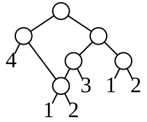</a></td><td style="min-width:210px;vertical-align:top"><a href="../../assets/volume4a/figures/diagram-7-1-2-special-chain-02.svg" target="_blank" rel="noopener" data-book-original-image="true">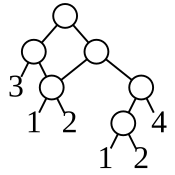</a></td></tr>
<tr><td style="min-width:210px;vertical-align:top"><a href="../../assets/volume4a/figures/diagram-7-1-2-special-chain-03.svg" target="_blank" rel="noopener" data-book-original-image="true">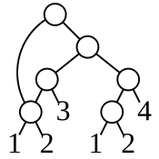</a></td><td style="min-width:210px;vertical-align:top"><a href="../../assets/volume4a/figures/diagram-7-1-2-special-chain-04.svg" target="_blank" rel="noopener" data-book-original-image="true">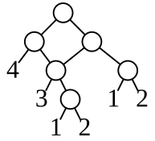</a></td></tr>
<tr><td style="min-width:210px;vertical-align:top"><a href="../../assets/volume4a/figures/diagram-7-1-2-special-chain-05.svg" target="_blank" rel="noopener" data-book-original-image="true">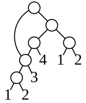</a></td><td style="min-width:210px;vertical-align:top"><a href="../../assets/volume4a/figures/diagram-7-1-2-special-chain-06.svg" target="_blank" rel="noopener" data-book-original-image="true">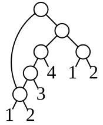</a></td></tr>
<tr><td style="min-width:210px;vertical-align:top"><a href="../../assets/volume4a/figures/diagram-7-1-2-special-chain-07.svg" target="_blank" rel="noopener" data-book-original-image="true">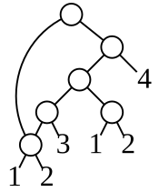</a></td><td style="min-width:210px;vertical-align:top"><a href="../../assets/volume4a/figures/diagram-7-1-2-special-chain-08.svg" target="_blank" rel="noopener" data-book-original-image="true">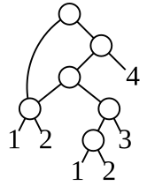</a></td></tr>
<tr><td style="min-width:210px;vertical-align:top"><a href="../../assets/volume4a/figures/diagram-7-1-2-special-chain-09.svg" target="_blank" rel="noopener" data-book-original-image="true">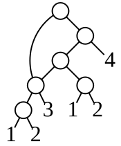</a></td><td style="min-width:210px;vertical-align:top"><a href="../../assets/volume4a/figures/diagram-7-1-2-special-chain-10.svg" target="_blank" rel="noopener" data-book-original-image="true">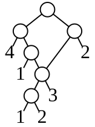</a></td></tr>
<tr><td style="min-width:210px;vertical-align:top"><a href="../../assets/volume4a/figures/diagram-7-1-2-special-chain-11.svg" target="_blank" rel="noopener" data-book-original-image="true">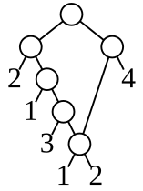</a></td><td style="min-width:210px;vertical-align:top"><a href="../../assets/volume4a/figures/diagram-7-1-2-special-chain-12.svg" target="_blank" rel="noopener" data-book-original-image="true">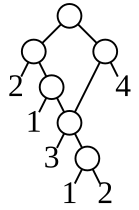</a></td></tr>
<tr><td style="min-width:210px;vertical-align:top"><a href="../../assets/volume4a/figures/diagram-7-1-2-special-chain-13.svg" target="_blank" rel="noopener" data-book-original-image="true">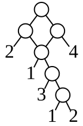</a></td><td style="min-width:210px;vertical-align:top"><a href="../../assets/volume4a/figures/diagram-7-1-2-special-chain-14.svg" target="_blank" rel="noopener" data-book-original-image="true">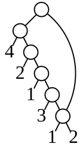</a></td></tr>
<tr><td style="min-width:210px;vertical-align:top"><a href="../../assets/volume4a/figures/diagram-7-1-2-special-chain-15.svg" target="_blank" rel="noopener" data-book-original-image="true">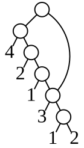</a></td><td style="min-width:210px;vertical-align:top"><a href="../../assets/volume4a/figures/diagram-7-1-2-special-chain-16.svg" target="_blank" rel="noopener" data-book-original-image="true">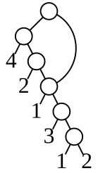</a></td></tr>
<tr><td style="min-width:210px;vertical-align:top"><a href="../../assets/volume4a/figures/diagram-7-1-2-special-chain-17.svg" target="_blank" rel="noopener" data-book-original-image="true">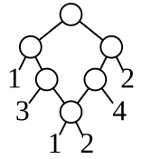</a></td><td style="min-width:210px;vertical-align:top"><a href="../../assets/volume4a/figures/diagram-7-1-2-special-chain-18.svg" target="_blank" rel="noopener" data-book-original-image="true">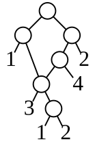</a></td></tr>
<tr><td style="min-width:210px;vertical-align:top"><a href="../../assets/volume4a/figures/diagram-7-1-2-special-chain-19.svg" target="_blank" rel="noopener" data-book-original-image="true">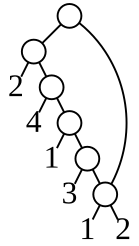</a></td><td style="min-width:210px;vertical-align:top"><a href="../../assets/volume4a/figures/diagram-7-1-2-special-chain-20.svg" target="_blank" rel="noopener" data-book-original-image="true">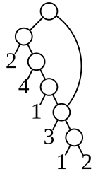</a></td></tr>
<tr><td style="min-width:210px;vertical-align:top"><a href="../../assets/volume4a/figures/diagram-7-1-2-special-chain-21.svg" target="_blank" rel="noopener" data-book-original-image="true">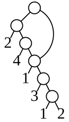</a></td><td style="min-width:210px;vertical-align:top"><a href="../../assets/volume4a/figures/diagram-7-1-2-special-chain-22.svg" target="_blank" rel="noopener" data-book-original-image="true">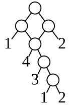</a></td></tr>
<tr><td style="min-width:210px;vertical-align:top"><a href="../../assets/volume4a/figures/diagram-7-1-2-special-chain-23.svg" target="_blank" rel="noopener" data-book-original-image="true">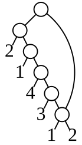</a></td><td style="min-width:210px;vertical-align:top"><a href="../../assets/volume4a/figures/diagram-7-1-2-special-chain-24.svg" target="_blank" rel="noopener" data-book-original-image="true"></a></td></tr>
<tr><td style="min-width:210px;vertical-align:top"><a href="../../assets/volume4a/figures/diagram-7-1-2-special-chain-25.svg" target="_blank" rel="noopener" data-book-original-image="true">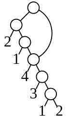</a></td><td></td></tr>
</tbody></table>

通过在每一种特殊链中有条理地尝试 $5^r$ 种可能的方式, 每一种方式为树的内部结点指定一个正规运算符, 我们将在每个等价类中至少找到一个函数 $f$, 对它而言, 最小代价 $C(f)$ 仅在情况 (iii) 是可以达到的.

事实上, 当 $n=4$ 且 $r=6$ 时, 这 $25\cdot5^6=390\,625$ 种试验仅仅产生一类函数, 此类函数不能通过任何自顶向下加自底向上的链用 6 步计算. 这个以不完全对称函数 $(\langle x_1x_2x_3\rangle\vee x_4)\oplus(x_1\wedge x_2\wedge x_3)$ 为代表的缺少 $C(f)$ 的函数类, 通过恰当地指定上面所述的前 5 种链中的任何一种链, 可以用 6 步达到. 例如, 对应于第一种特别链的一个方式是

$$
\begin{aligned}
x_5&=x_1\wedge x_2,\quad x_6=x_1\vee x_2,\quad x_7=x_3\oplus x_5,\\
x_8&=x_4\wedge\bar x_5,\quad x_9=x_6\wedge x_7,\quad x_{10}=x_8\vee x_9.
\end{aligned}\tag{19}
$$

由于所有其他函数有 $L(f)\leq7$, 因而这些试验计算确定了所有情况的真实最小代价.

<a id="pdf-100"></a><a id="p-85"></a>

历史注记: 对首次联合尝试以最优方式求值所有布尔函数 $f(w,x,y,z)$ 的报道, 见于 *Annals of the Computation Laboratory of Harvard University* **27** (1951), 其中霍华德·艾肯的研究人员提出了他们所能构造的最佳开关电路的一些试探方法和大量的数据表. 他们的代价量度 $V(f)$ 不同于我们考虑的代价 $C(f)$, 因为它是建立在真空管的 “控制栅极” 基础上的. 他们有 4 种类型的门电路: $\operatorname{NOT}(f)$、$\operatorname{NAND}(f,g)$、$\operatorname{OR}(f_1,\ldots,f_k)$ 和 $\operatorname{AND}(f_1,\ldots,f_k)$, 其代价分别为 1、2、$k$ 和 0. NOT、NAND 或 OR 的每个输入可能是一个变量, 可能是一个变量的补, 或者是前面门的输出; AND 的每个输入必须或者是 NOT 或者是尚未在别处使用的 NAND 的输出.

使用代价准则, 一个函数可能不具有如其补一样的代价. 例如, 可以把 $x\wedge y$ 作为 $\operatorname{AND}(\operatorname{NOT}(\bar x),\operatorname{NOT}(\bar y))$ 以代价 2 求值; 但是, $\bar x\vee(\bar y\wedge\bar z)=\operatorname{NAND}(x,\operatorname{OR}(y,z))$ 的代价是 4, 而它的补 $x\wedge(y\vee z)=\operatorname{AND}(\operatorname{NOT}(\bar x),\operatorname{NAND}(\bar y,\bar z))$ 的代价仅为 3. 所以, 哈佛大学的研究人员需要考虑 402 种而不是 222 种实际上不同的 4 变量函数类 (见习题 7.1.1-125 的答案). 在那个年代, 他们自然主要用手工计算. 除了与 $S_{0,1}(w,x,y,z)\vee(S_2(w,x,y)\wedge z)$ 等价的 64 个函数, 他们求出了在所有情况下 $V(f)<20$, 其时他们用 20 个控制栅极求值如下:

$$
\begin{aligned}
g_1&=\operatorname{AND}(\operatorname{NOT}(\bar w),\operatorname{NOT}(\bar x)),\quad
g_2=\operatorname{NAND}(\bar y,z),\\
g_3&=\operatorname{AND}(\operatorname{NOT}(w),\operatorname{NOT}(x));\\
f&=\operatorname{AND}\bigl(\operatorname{NAND}(g_1,g_2),\operatorname{NAND}(g_3,\operatorname{AND}(\operatorname{NOT}(\bar y),\operatorname{NOT}(\bar z))),\\
&\qquad\operatorname{NOT}(\operatorname{AND}(\operatorname{NOT}(g_3),\operatorname{NOT}(\bar y),\operatorname{NOT}(z))),\\
&\qquad\operatorname{NOT}(\operatorname{AND}(\operatorname{NOT}(g_1),\operatorname{NOT}(g_2),\operatorname{NOT}(g_3)))\bigr).
\end{aligned}\tag{20}
$$

求可验证的最优电路的第一个计算机程序由利奥·赫勒曼编写 [*IEEE Transactions* **EC-12** (1963), 198–223], 他对任何给定函数 $f(x,y,z)$ 的求值确定了所需的最少 NOR 门. 他要求每个门的每个输入或者是不带补的变量, 或者是前一个门的输出; 限制了扇入和扇出最多为 3. 当两个电路具有同等数量的门时, 他宁愿采用具有最小输入和的电路. 例如, 他计算出 $\bar x=\operatorname{NOR}(x)$ 的代价是 1; $x\vee y\vee z=\operatorname{NOR}(\operatorname{NOR}(x,y,z))$ 的代价是 2; $\langle xyz\rangle=\operatorname{NOR}(\operatorname{NOR}(x,y),\operatorname{NOR}(x,z),\operatorname{NOR}(y,z))$ 的代价是 4; $S_1(x,y,z)=\operatorname{NOR}(\operatorname{NOR}(x,y,z),\langle xyz\rangle)$ 的代价是 6; 等等. 由于限制了扇出为 3, 因而他发现每个 3 变量的函数可以用 7 或者更小的代价求值, 只有奇偶性函数 $x\oplus y\oplus z=(x\equiv y)\equiv z$, 其中 $x\equiv y$ 的代价是 4, 因为它是 $\operatorname{NOR}(\operatorname{NOR}(x,\operatorname{NOR}(x,y)),\operatorname{NOR}(y,\operatorname{NOR}(x,y)))$.

电气工程师们对于其他代价标准进行了不断的探索. 但是, 直到富兰克林·梁在 1977 年建立表 1 中所示的 $C(f)$ 值之前, 4 变量函数看来没有取得进展. 富兰克林·梁没有发表的推导, 建立在不能用自底向上结构简化的所有链的研究基础之上.

**$n=5$ 的情况.** 根据表 7.1.1-5, 有 616126 类实质不同的函数 $f(x_1,x_2,x_3,x_4,x_5)$. 如今计算机的速度已经快到足以使这个数字不再令人生畏, 所以在我写这一节时, 决定考察 5 个变量的全部布尔函数的 $C(f)$. 幸亏运气好, 获得了完整的结果, 得出表 2 所示的统计数字.

对于这个计算, 算法 L 及其变形不再是处理 $2^{31}$ 个正规真值表的集合, 而是改为处理类的表示. 给定一类函数中的任意一个函数, 使用习题 7.2.1.2-20 的方法很容易产生那个类的全部函数, 从而得到 1000 倍加速. 自底向上的方法略有提高, 例如, 如果 $C(f)=r-2$, 它可以推出 $f(x_1\wedge x_2,x_1\vee x_2,x_3,x_4,x_5)$ 的代价小于等于 $r$. 在求出代价为 10 的所有类之后, 自顶向下和自底向上方法能够求得除 7 个类函数以外的所有函数的长度小于等于 11 的链. 然后开始费时的计算部分, 其间大约产生 5300 万条 $n=5$ 和 $r=11$ 的特殊链; 每条这样的链都产生 $5^{11}=48\,828\,125$ 个函数, 其中某些函数可望归入剩余的 7 种神秘的类. 但是, 在那些类中仅有 6 类具有 11 步解. 单独残存的类是唯一的 $C(f)=12$ 的类, 它的真值表的十六进制表示为 `169ae443`, 而且它也有 $L(f)=12$.

<a id="pdf-101"></a><a id="p-86"></a>

图 10 显示了所产生的对称函数结构, 其中某些函数出奇地精彩, 某些函数简单地精彩, 某些函数则单纯地出奇. (例如, 看看 $S_{2,3}(x_1,x_2,x_3,x_4,x_5)$ 的 8 步计算, 或者 $S_{2,3,4}$ 的简练公式, 或者 $S_{4,5}$ 和 $S_{3,4,5}$ 的单调链.) 顺便指出, 表 2 显示了所有深度小于等于 4 的 5 变量函数, 但未试图使在图 10 中已经构成的深度达到最小.

<a id="tab-7-1-2-2"></a>

表 2　具有给定复杂性的 5 变量函数的数目

<table>
<thead><tr><th>$C(f)$</th><th>类</th><th>函数</th><th>$L(f)$</th><th>类</th><th>函数</th><th>$D(f)$</th><th>类</th><th>函数</th></tr></thead>
<tbody>
<tr><td>0</td><td>2</td><td>12</td><td>0</td><td>2</td><td>12</td><td>0</td><td>2</td><td>12</td></tr>
<tr><td>1</td><td>2</td><td>100</td><td>1</td><td>2</td><td>100</td><td>1</td><td>2</td><td>100</td></tr>
<tr><td>2</td><td>5</td><td>1140</td><td>2</td><td>5</td><td>1140</td><td>2</td><td>17</td><td>5350</td></tr>
<tr><td>3</td><td>20</td><td>11570</td><td>3</td><td>20</td><td>11570</td><td>3</td><td>1789</td><td>6702242</td></tr>
<tr><td>4</td><td>93</td><td>109826</td><td>4</td><td>93</td><td>109826</td><td>4</td><td>614316</td><td>4288259592</td></tr>
<tr><td>5</td><td>389</td><td>995240</td><td>5</td><td>366</td><td>936440</td><td>5</td><td>0</td><td>0</td></tr>
<tr><td>6</td><td>1988</td><td>8430800</td><td>6</td><td>1730</td><td>7236880</td><td>6</td><td>0</td><td>0</td></tr>
<tr><td>7</td><td>11382</td><td>63401728</td><td>7</td><td>8782</td><td>47739088</td><td>7</td><td>0</td><td>0</td></tr>
<tr><td>8</td><td>60713</td><td>383877392</td><td>8</td><td>40297</td><td>250674320</td><td>8</td><td>0</td><td>0</td></tr>
<tr><td>9</td><td>221541</td><td>1519125536</td><td>9</td><td>141422</td><td>955812256</td><td>9</td><td>0</td><td>0</td></tr>
<tr><td>10</td><td>293455</td><td>2123645248</td><td>10</td><td>273277</td><td>1945383936</td><td>10</td><td>0</td><td>0</td></tr>
<tr><td>11</td><td>26535</td><td>195366784</td><td>11</td><td>145707</td><td>1055912608</td><td>11</td><td>0</td><td>0</td></tr>
<tr><td>12</td><td>1</td><td>1920</td><td>12</td><td>4423</td><td>31149120</td><td>12</td><td>0</td><td>0</td></tr>
</tbody></table>

最终, 所有这些对称函数能够在不增加代价的情况下用最小存储求值. 没有熟知的简单理由.

**多路输出.** 我们时常需要对同样的输入值 $x_1,\ldots,x_n$ 求多个不同布尔函数 $f_1(x_1,\ldots,x_n),\ldots,f_m(x_1,\ldots,x_n)$ 的值; 换句话说, 我们时常需要求一个多位函数 $y=f(x)$ 的值, 其中 $y=f_1\ldots f_m$ 是长度为 $m$ 的二进制向量, $x=x_1\ldots x_n$ 是长度为 $n$ 的二进制向量. 所幸, 计算分量值 $f_j(x_1,\ldots,x_n)$ 时涉及的大量工作同求其他分量值 $f_k(x_1,\ldots,x_n)$ 所需的运算可能是共同的.

令 $C(f)=C(f_1\ldots f_m)$ 是计算所有非平凡函数 $f_j$ 的最短布尔链的长度. 更确切地说, 布尔链 $(x_{n+1},\ldots,x_{n+r})$ 应具有这样的性质: 对于 $1\leq j\leq m$, 以及对于满足 $0\leq l(j)\leq n+r$ 的某些 $l(j)$, 或者有 $f_j(x_1,\ldots,x_n)=x_{l(j)}$, 或者有 $f_j(x_1,\ldots,x_n)=\bar x_{l(j)}$, 其中 $x_0=0$. 显然 $C(f)\leq C(f_1)+\cdots+C(f_m)$, 但是我们可以做得更好.

例如, 假定我们需要计算由

$$
(z_1z_0)_2=x_1+x_2+x_3\tag{21}
$$

定义的函数 $z_1$ 和 $z_0$, 即 3 个布尔变量的两位二进制数和. 我们有

$$
z_1=\langle x_1x_2x_3\rangle\quad\text{和}\quad z_0=x_1\oplus x_2\oplus x_3,\tag{22}
$$

所以它们各自的代价是 $C(z_1)=4$ 和 $C(z_0)=2$. 但是容易看出, 组合的代价 $C(z_1z_0)$ 最多是 5, 因为在每一位 $z_j$ 的求值中 $x_1\oplus x_2$ 是合适的第一步:

$$
\begin{aligned}
x_4&=x_1\oplus x_2,\quad z_0=x_5=x_3\oplus x_4;\\
x_6&=x_3\wedge x_4,\quad x_7=x_1\wedge x_2,\quad z_1=x_8=x_6\vee x_7.
\end{aligned}\tag{23}
$$

此外, 穷举计算证实 $C(z_1z_0)>4$, 因此 $C(z_1z_0)=5$.

<a id="pdf-102"></a><a id="p-87"></a><a id="fig-7-10"></a>

<table><tbody>
<tr><td style="min-width:230px;vertical-align:top">$S_4=$<br><a href="../../assets/volume4a/figures/fig-7-10-S4.svg" target="_blank" rel="noopener" data-book-original-image="true">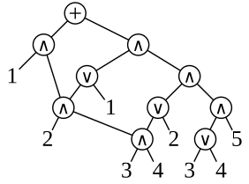</a></td><td style="min-width:230px;vertical-align:top">$S_{4,5}=$<br><a href="../../assets/volume4a/figures/fig-7-10-S4-5.svg" target="_blank" rel="noopener" data-book-original-image="true">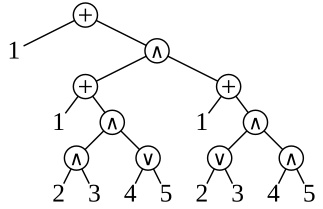</a></td></tr>
<tr><td style="min-width:230px;vertical-align:top">$S_3=$<br><a href="../../assets/volume4a/figures/fig-7-10-S3.svg" target="_blank" rel="noopener" data-book-original-image="true">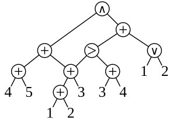</a></td><td style="min-width:230px;vertical-align:top">$S_{3,5}=$<br><a href="../../assets/volume4a/figures/fig-7-10-S3-5.svg" target="_blank" rel="noopener" data-book-original-image="true">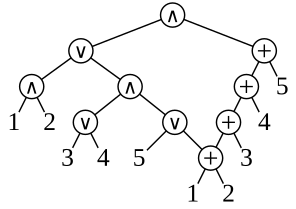</a></td></tr>
<tr><td style="min-width:230px;vertical-align:top">$S_{3,4}=$<br><a href="../../assets/volume4a/figures/fig-7-10-S3-4.svg" target="_blank" rel="noopener" data-book-original-image="true">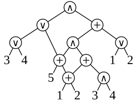</a></td><td style="min-width:230px;vertical-align:top">$S_{3,4,5}=$<br><a href="../../assets/volume4a/figures/fig-7-10-S3-4-5.svg" target="_blank" rel="noopener" data-book-original-image="true">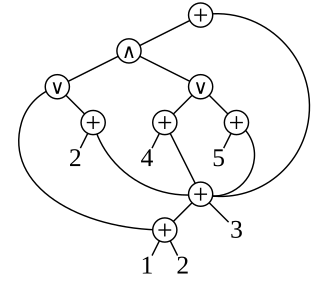</a></td></tr>
<tr><td style="min-width:230px;vertical-align:top">$S_{2,5}=$<br><a href="../../assets/volume4a/figures/fig-7-10-S2-5.svg" target="_blank" rel="noopener" data-book-original-image="true">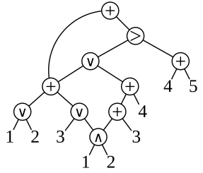</a></td><td style="min-width:230px;vertical-align:top">$S_{2,4}=$<br><a href="../../assets/volume4a/figures/fig-7-10-S2-4.svg" target="_blank" rel="noopener" data-book-original-image="true">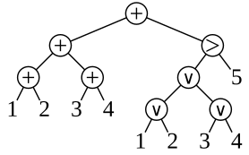</a></td></tr>
<tr><td style="min-width:230px;vertical-align:top">$S_{2,4,5}=$<br><a href="../../assets/volume4a/figures/fig-7-10-S2-4-5.svg" target="_blank" rel="noopener" data-book-original-image="true">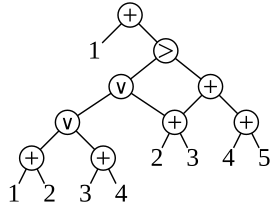</a></td><td style="min-width:230px;vertical-align:top">$S_{2,3,5}=$<br><a href="../../assets/volume4a/figures/fig-7-10-S2-3-5.svg" target="_blank" rel="noopener" data-book-original-image="true">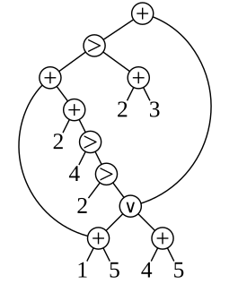</a></td></tr>
<tr><td style="min-width:230px;vertical-align:top">$S_{2,3}=$<br><a href="../../assets/volume4a/figures/fig-7-10-S2-3.svg" target="_blank" rel="noopener" data-book-original-image="true"></a></td><td style="min-width:230px;vertical-align:top">$S_{2,3,4}=$<br><a href="../../assets/volume4a/figures/fig-7-10-S2-3-4.svg" target="_blank" rel="noopener" data-book-original-image="true"></a></td></tr>
<tr><td style="min-width:230px;vertical-align:top">$S_{1,5}=$<br><a href="../../assets/volume4a/figures/fig-7-10-S1-5.svg" target="_blank" rel="noopener" data-book-original-image="true"></a></td><td style="min-width:230px;vertical-align:top">$S_{1,4}=$<br><a href="../../assets/volume4a/figures/fig-7-10-S1-4.svg" target="_blank" rel="noopener" data-book-original-image="true"></a></td></tr>
<tr><td style="min-width:230px;vertical-align:top">$S_{1,3,4}=$<br><a href="../../assets/volume4a/figures/fig-7-10-S1-3-4.svg" target="_blank" rel="noopener" data-book-original-image="true"></a></td><td style="min-width:230px;vertical-align:top">$S_{1,2,5}=$<br><a href="../../assets/volume4a/figures/fig-7-10-S1-2-5.svg" target="_blank" rel="noopener" data-book-original-image="true"></a></td></tr>
</tbody></table>

图 10　5 变量对称函数的最小代价布尔链

电气工程师们在传统上把式 (21) 那类电路称为全加器, 因为可以把 $n$ 个这样的构件组合起来实现两个 $n$ 位二进制数的加法. $(22)$ 的特例 (其中 $x_3=0$) 同样重要, 虽然它只不过归结为

$$
z_1=x_1\wedge x_2\quad\text{和}\quad z_0=x_1\oplus x_2\tag{24}
$$

且具有复杂性 2; 工程师们称它为 “半加器”, 尽管事实上一个全加器的代价超过两个半加器的代价.

二进制数加法

$$
\begin{array}{r}
(x_{n-1}\ldots x_1x_0)_2\\
(y_{n-1}\ldots y_1y_0)_2\\\hline
(z_nz_{n-1}\ldots z_1z_0)_2
\end{array}\tag{25}
$$

的一般问题是从 $2n$ 个布尔量输入 $x_{n-1}\ldots x_1x_0y_{n-1}\ldots y_1y_0$ 计算 $n+1$ 个布尔量输出 $z_n\ldots z_1z_0$; 同时, 这个问题容易通过公式

$$
c_{j+1}=\langle x_jy_jc_j\rangle,\qquad z_j=x_j\oplus y_j\oplus c_j,\qquad0\leq j<n\tag{26}
$$

<a id="pdf-103"></a><a id="p-88"></a>

求解, 其中 $c_j$ 是 “进位位”, 而且有 $c_0=0$, $z_n=c_n$. 所以, 我们可以用一个半加器计算 $c_1$ 和 $z_0$, 接着用 $n-1$ 个全加器计算其余的 $c$ 和 $z$, 累积成 $5n-3$ 的总代价. 事实上, 尼古拉·雷德金 [*Problemy Kibernetiki* **38** (1981), 181–216] 通过构造一个复杂的 35 页归纳法证明, 证实 $5n-3$ 步实际上是必须的, 其中以实例 2.2.2.3.1.2.3.2.4.3 结束 (!). 但是这个电路的深度 $2n-1$ 对于实际的并行计算太大了, 所以大量研究工作投入到了设计具有深度 $O(\log n)$ 以及合理代价的加法电路的任务上. (见习题 41–44.)

现在, 我们来扩充式 (21) 并尝试计算一般的 “数位叠加和”

$$
(z_{\lfloor\lg n\rfloor}\ldots z_1z_0)_2=x_1+x_2+\cdots+x_n.\tag{27}
$$

如果 $n=2k+1$, 我们可以用 $k$ 个全加器把和简化为 $(x_1+\cdots+x_n)\bmod2$ 加上权 2 的 $k$ 位, 因为每个全加器把权为 1 的位数减少 2. 例如, 如果 $n=9$ 且 $k=4$, 计算步骤是

$$
\begin{aligned}
x_{10}&=x_1\oplus x_2\oplus x_3,\quad x_{11}=x_4\oplus x_5\oplus x_6,\\
x_{12}&=x_7\oplus x_8\oplus x_9,\quad x_{13}=x_{10}\oplus x_{11}\oplus x_{12},\\
y_1&=\langle x_1x_2x_3\rangle,\quad y_2=\langle x_4x_5x_6\rangle,\\
y_3&=\langle x_7x_8x_9\rangle,\quad y_4=\langle x_{10}x_{11}x_{12}\rangle,
\end{aligned}
$$

而且我们有 $x_1+\cdots+x_9=x_{13}+2(y_1+y_2+y_3+y_4)$. 如果 $n=2k$ 为偶数, 适用同样的简化, 但在最后要用一个半加器. 然后, 可以用同样的方式对权 2 的位求和; 这样一来, 对于将要计算的 $z_{\lfloor\lg n\rfloor}\ldots z_1z_0$ 的门电路的总数, 我们得到递推公式

$$
s(n)=5\lfloor n/2\rfloor-3[n\text{ 是偶数}]+s(\lfloor n/2\rfloor),\qquad s(0)=0.\tag{28}
$$

(在习题 30 中出现一个适用于 $s(n)$ 的闭公式.) 我们有 $s(n)<5n$, 且前面的一些值

<table><tbody>
<tr><th>$n$</th><td>1</td><td>2</td><td>3</td><td>4</td><td>5</td><td>6</td><td>7</td><td>8</td><td>9</td><td>10</td><td>11</td><td>12</td><td>13</td><td>14</td><td>15</td><td>16</td><td>17</td><td>18</td><td>19</td><td>20</td></tr>
<tr><th>$s(n)$</th><td>0</td><td>2</td><td>5</td><td>9</td><td>12</td><td>17</td><td>20</td><td>26</td><td>29</td><td>34</td><td>37</td><td>44</td><td>47</td><td>52</td><td>55</td><td>63</td><td>66</td><td>71</td><td>74</td><td>81</td></tr>
</tbody></table>

表明, 这个方法即使对于小的 $n$ 也是很有效的. 例如当 $n=5$ 时, 它产生

[](../../assets/volume4a/figures/diagram-7-1-2-29-five-input-popcount.svg)

$(29)$

这条链刚好用 12 步计算 3 个不同的对称函数 $z_2=S_{4,5}(x_1,\ldots,x_5)$, $z_1=S_{2,3}(x_1,\ldots,x_5)$, $z_0=S_{1,3,5}(x_1,\ldots,x_5)$. 按照图 10, $S_{4,5}$ 的 10 步计算是最优的; 当然, 其中 $S_{1,3,5}$ 的 4 步计算也是最优的. 此外, 虽然 $C(S_{2,3})=8$, 但是函数 $S_{2,3}$ 在这里是用一种巧妙的 10 步方法计算的, 这个方法同 $S_{4,5}$ 共用了除一个门之外的所有门.

请注意, 现在我们可以有效地计算任何对称函数了, 因为 $\{x_1,\ldots,x_n\}$ 的每个对称函数是 $z_{\lfloor\lg n\rfloor}\ldots z_1z_0$ 的一个布尔函数. 我们知道, 每个 4 变量的任何布尔函数都有小于等于 7 的复杂性, 所以任何对称函数 $S_{k_1,\ldots,k_t}(x_1,\ldots,x_{15})$ 的代价最高到 $s(15)+7=62$. 出乎意料的是: 当 $n$ 比较小时, $n$ 变量的所有对称函数处于最难求值的函数之列, 但是当 $n\geq10$ 时, 它们则是最容易求值的.

我们还可以有效地计算对称函数的集合. 比方说, 如果需要用单一的布尔链对于 $0\leq k\leq n$ 求所有 $n+1$ 个对称函数 $S_k(x_1,\ldots,x_n)$ 的值, 我们只需计算 $z_0,z_1,\ldots,z_{\lfloor\lg n\rfloor}$ 的前面 $n+1$ 个小项. 例如当 $n=5$ 时, 所有函数 $S_k$ 的小项分别是 $S_0=\bar z_0\wedge\bar z_1\wedge\bar z_2$, $S_1=z_0\wedge\bar z_1\wedge\bar z_2$, $\ldots$, $S_5=z_0\wedge\bar z_1\wedge z_2$.

<a id="pdf-104"></a><a id="p-89"></a>

计算 $n$ 个变量的所有 $2^n$ 个小项有多大的困难? 电气工程师们把这个函数称为 $n$ 到 $2^n$ 的二进制译码器, 因为它把 $n$ 个二进制位 $x_1\ldots x_n$ 转换成一串 $2^n$ 位 $d_0d_1\ldots d_{2^n-1}$, 其中恰好有一位是 1. “分而治之” 的原则提示我们, 第一步是计算前 $\lceil n/2\rceil$ 个变量的所有小项, 以及后 $\lfloor n/2\rfloor$ 个变量的所有小项; 然后用 $2^n$ 个 AND 门就能完成计算任务. 这个方法的代价是 $t(n)$, 其中

$$
t(0)=t(1)=0;\qquad t(n)=2^n+t(\lceil n/2\rceil)+t(\lfloor n/2\rfloor),\qquad n\geq2.\tag{30}
$$

所以 $t(n)=2^n+O(2^{n/2})$, 每个小项大体有一个门. (见习题 32.)

具有多输出的函数时常有助于我们构建具有单输出的更大的函数. 例如我们已经见过, 数位叠加加法器 $(27)$ 使我们能够计算对称函数; 同时, 一个 $n$ 到 $2^n$ 的译码器也有多种应用, 尽管存在当 $n$ 很大时 $2^n$ 可能是非常大的事实. 一个恰当的实例是 $2^m$ 路复用器 $M_m(x_1,\ldots,x_m;y_0,y_1,\ldots,y_{2^m-1})$, 也称为 $m$ 位存储访问函数, 它带有 $n=m+2^m$ 个输入, 并且当 $(x_1\ldots x_m)_2=k$ 时取 $y_k$ 值. 按定义, 我们有

$$
M_m(x_1,\ldots,x_m;y_0,y_1,\ldots,y_{2^m-1})
=\bigvee_{k=0}^{2^m-1}(d_k\wedge y_k),\tag{31}
$$

其中 $d_k$ 是一个 $m$ 到 $2^m$ 的二进制译码器的第 $k$ 个输出; 因此, 由式 (30) 我们可以用 $2^m+(2^m-1)+t(m)=3n+O(\sqrt n)$ 个门求 $M_m$ 的值. 但是习题 39 证明, 实际上我们可以把代价减少到仅有 $2n+O(\sqrt n)$ (也见习题 78).

**渐近的真相.** 当变量的数目很小时, 我们的穷举搜索方法显现大量实例, 其中可以高效地对布尔函数求值. 所以我们自然期望, 当呈现更多变量时会出现更多各种巧妙的求值方法. 但是事实正好相反, 至少从统计观点来看是这样的.

**定理 S.** 几乎每一个布尔函数 $f(x_1,\ldots,x_n)$ 的代价都超过 $2^n/n$. 更确切地说, 如果 $c(n,r)$ 个布尔函数具有小于等于 $r$ 的复杂性, 我们有

$$
(r-1)!c(n,r)\leq2^{2r+1}(n+r-1)^{2r}.\tag{32}
$$

**证明.** 如果一个函数可以用 $r-1$ 步计算, 那么它也可以用 $r$ 步布尔链计算. (当 $r=1$ 时, 这个断言是显然的; 不然, 我们可以令 $x_{n+r}=x_{n+r-1}\wedge x_{n+r-1}$.) 我们将要证明不会有很多的 $r$ 步布尔链, 因此不能用小于等于 $r$ 的代价计算许多不同的函数.

令 $\pi$ 是 $\{1,\ldots,n+r\}$ 取 $1\mapsto1,\ldots,n\mapsto n$ 以及 $n+r\mapsto n+r$ 的一个置换; 存在 $(r-1)!$ 个这样的置换. 假定 $(x_{n+1},\ldots,x_{n+r})$ 是一条布尔链, 其中每个中间步 $x_{n+1},\ldots,x_{n+r-1}$ 至少要在后面的一步中使用. 于是由规则

$$
x_i=x_{j'(i)}\circ'_i x_{k'(i)}
=x_{j(i\pi)\pi^{-}}\circ_{i\pi}x_{k(i\pi)\pi^{-}},\qquad n<i\leq n+r\tag{33}
$$

定义的置换链, 对于不同的 $\pi$ 是不一样的. (如果 $\pi$ 取 $a\mapsto b$, 我们写成 $b=a\pi$ 和 $a=b\pi^{-}$.) 例如, 如果 $\pi$ 取 $5\mapsto6\mapsto7\mapsto8\mapsto9\mapsto5$, 布尔链 $(7)$ 变成

<table>
<thead><tr><th>原来的</th><th>置换后的</th></tr></thead>
<tbody>
<tr><td>$x_5=x_1\oplus x_3,$</td><td>$x_5=x_1\oplus x_2,$</td></tr>
<tr><td>$x_6=x_1\oplus x_2,$</td><td>$x_6=x_3\oplus x_4,$</td></tr>
<tr><td>$x_7=x_3\oplus x_4,$</td><td>$x_7=x_9\vee x_5,$</td></tr>
<tr><td>$x_8=x_5\vee x_6,$</td><td>$x_8=x_5\oplus x_6,$</td></tr>
<tr><td>$x_9=x_6\oplus x_7,$</td><td>$x_9=x_1\oplus x_3,$</td></tr>
<tr><td>$x_{10}=x_8\wedge\bar x_9;$</td><td>$x_{10}=x_7\wedge\bar x_8.$</td></tr>
</tbody></table>

$(34)$

<a id="pdf-105"></a><a id="p-90"></a>

请注意, 我们可能有 $j'(i)\geq k'(i)$ 或 $j'(i)>i$ 或 $k'(i)>i$, 同我们通常的规则矛盾. 但是, 置换链像前面那样计算同样的函数 $x_{n+r}$, 而且它不带有任何使某项由自身间接定义的循环, 因为置换后的 $x_i$ 是原来的 $x_{i\pi}$.

我们可以像早先指出的那样只限于考虑正规布尔链. 所以代价小于等于 $r$ 的 $c(n,r)/2$ 个正规布尔函数, 导致 $(r-1)!c(n,r)/2$ 条不同的置换链, 其中每一步的算符 $\circ_i$ 是 $\wedge,\vee,\overline{\supset}$ 或 $\oplus$. 同时, 最多有 $4^r(n+r-1)^{2r}$ 条这样的链, 因为当 $n<i\leq n+r$ 时, 对于 $\circ_i$ 有 4 种选择, 对于 $j(i)$ 和 $k(i)$ 中的每一个有 $n+r-1$ 种选择. 式 (32) 由此成立; 同时, 通过设置 $r=\lfloor2^n/n\rfloor$, 我们得到定理开头的表述. (见习题 46.)$\quad\blacksquare$

另一方面, 对于关注无穷的人来说也有好消息: 使用由香农设计并由奥列格·卢帕诺夫改进的方法, 即使避开 $\oplus$ 和 $\equiv$, 我们实际上仅用略超过 $2^n/n$ 的计算步骤就能求每个 $n$ 变量布尔函数的值 [*Bell System Tech. J.* **28** (1949), 59–98, Theorem 6; *Izvestiia VUZov, Radiofizika* **1** (1958), 120–140].

事实上, 香农-卢帕诺夫的方法即使当 $n$ 很小时也能得出有用的结果, 所以让我们通过考察一个小例子来了解它. 考虑

$$
f(x_1,x_2,x_3,x_4,x_5,x_6)=[(x_1x_2x_3x_4x_5x_6)_2\text{ 是素数}],\tag{35}
$$

这是一个识别所有具有 6 个二进制位的素数的函数. 它的真值表有 $2^6=64$ 个二进制位, 我们可以很方便地处理它, 即用一个 $4\times16$ 数组考察那些二进制位, 而不限制在一维上:

<table><tbody>
<tr><td style="text-align:right">$x_3=$</td><td><code>0000000011111111</code></td><td></td></tr>
<tr><td style="text-align:right">$x_4=$</td><td><code>0000111100001111</code></td><td></td></tr>
<tr><td style="text-align:right">$x_5=$</td><td><code>0011001100110011</code></td><td></td></tr>
<tr><td style="text-align:right">$x_6=$</td><td><code>0101010101010101</code></td><td></td></tr>
<tr><td style="text-align:right">$x_1x_2=00$</td><td><code>0011010100010100</code></td><td rowspan="2">组 1</td></tr>
<tr><td style="text-align:right">$x_1x_2=01$</td><td><code>0101000100000101</code></td></tr>
<tr><td style="text-align:right">$x_1x_2=10$</td><td><code>0000010001010001</code></td><td rowspan="2">组 2</td></tr>
<tr><td style="text-align:right">$x_1x_2=11$</td><td><code>0000010000010100</code></td></tr>
</tbody></table>

$(36)$

数组的行分成了两组, 每组两行; 行的每组有 16 列, 它们属于 4 个基本类型, 即 $\begin{smallmatrix}0\\0\end{smallmatrix},\begin{smallmatrix}0\\1\end{smallmatrix},\begin{smallmatrix}1\\0\end{smallmatrix}$ 或 $\begin{smallmatrix}1\\1\end{smallmatrix}$. 因此我们看出, 函数可以表示成

$$
\begin{aligned}
f(x_1,\ldots,x_6)={}&([x_1x_2\in\{00\}]\wedge[x_3x_4x_5x_6\in\{0010,0101,1011\}])\\
&\vee([x_1x_2\in\{01\}]\wedge[x_3x_4x_5x_6\in\{0001,1111\}])\\
&\vee([x_1x_2\in\{00,01\}]\wedge[x_3x_4x_5x_6\in\{0011,0111,1101\}])\\
&\vee([x_1x_2\in\{10\}]\wedge[x_3x_4x_5x_6\in\{1001,1111\}])\\
&\vee([x_1x_2\in\{11\}]\wedge[x_3x_4x_5x_6\in\{1101\}])\\
&\vee([x_1x_2\in\{10,11\}]\wedge[x_3x_4x_5x_6\in\{0101,1011\}]).
\end{aligned}\tag{37}
$$

(第一行对应于组 1, 类型 $\begin{smallmatrix}1\\0\end{smallmatrix}$, 然后是组 1, 类型 $\begin{smallmatrix}0\\1\end{smallmatrix}$, 等等; 最后一行对应于组 2 和类型 $\begin{smallmatrix}1\\1\end{smallmatrix}$.)$[x_3x_4x_5x_6\in\{0010,0101,1011\}]$ 这样的函数是 $\{x_3,x_4,x_5,x_6\}$ 的 3 个小项的 OR.

通常我们可以把真值表看成一个 $2^k\times2^{n-k}$ 数组, 它的行分成 $l$ 组, 每组有 $\lfloor2^k/l\rfloor$ 行或者 $\lceil2^k/l\rceil$ 行. 大小为 $m$ 的组将有 $2^m$ 种基本类型的列. 对于每个组 $i$ 和每种非零的基本类型 $t$, 我们建立合取 $(g_{it}(x_1,\ldots,x_k)\wedge h_{it}(x_{k+1},\ldots,x_n))$, 其中对于 $t$ 有一个 1 的组中的行, $g_{it}$ 是 $\{x_1,\ldots,x_k\}$ 的所有小项的 OR, 而对于组 $i$ 中具有类型 $t$ 的列, $h_{it}$ 是 $\{x_{k+1},\ldots,x_n\}$ 的所有小项的 OR. 所有这些合取 $(g_{it}\wedge h_{it})$ 的 OR 给出 $f(x_1,\ldots,x_n)$.

<a id="pdf-106"></a><a id="p-91"></a>

一旦选定了满足 $1\leq k\leq n-2$ 和 $1\leq l\leq2^k$ 的参数 $k$ 和 $l$, 计算过程便以 $t(k)+t(n-k)$ 步通过计算 $\{x_1,\ldots,x_k\}$ 的所有小项和 $\{x_{k+1},\ldots,x_n\}$ 的所有小项开始 (见式 (30)). 然后对于 $1\leq i\leq l$, 我们令组 $i$ 由使得 $(x_1,\ldots,x_k)$ 的值满足 $(i-1)2^k/l\leq(x_1\ldots x_k)_2<i2^k/l$ 的行组成, 它包含 $m_i=\lceil i2^k/l\rceil-\lceil(i-1)2^k/l\rceil$ 行. 我们建立对于 $t\in S_i$ 的全部函数 $g_{it}$, 即那些行的 $2^{m_i}-1$ 个非空子集的子集族; 前面计算小项的 $2^{m_i}-m_i-1$ 个 OR 将完成这个任务. 我们还要建立表示非零类型 $t$ 的列的全部函数 $h_{it}$; 为此需要在每组 $i$ 中最多用 $2^{n-k}$ 个 OR 运算, 因为我们可以把每个小项 OR 成为相应类型 $t$ 的 $h$ 函数. 最后我们计算 $f=\bigvee_{i=1}^l\bigvee_{t\in S_i}(g_{it}\wedge h_{it})$, 每个 AND 运算由不必要的第一个 OR 成为 $h_{it}$ 抵消. 所以总代价最多是

$$
t(k)+t(n-k)+(l-1)+\sum_{i=1}^l\bigl((2^{m_i}-m_i-1)+2^{n-k}+(2^{m_i}-2)\bigr);\tag{38}
$$

我们需要选择使这个上界最小的 $k$ 和 $l$. 习题 52 讨论了当 $n$ 是小的数时的最佳选择. 至于当 $n$ 是大的数时, 好的选择至少对于多数函数会产生一条可以检验接近最优的布尔链:

**定理 L.** 令 $C(n)$ 表示 $n$ 变量布尔函数最昂贵的代价. 那么, 当 $n\to\infty$ 时我们有

$$
C(n)\geq\frac{2^n}{n}\left(1+\frac{\lg n}{n}+O\left(\frac1n\right)\right);\tag{39}
$$

$$
C(n)\leq\frac{2^n}{n}\left(1+3\frac{\lg n}{n}+O\left(\frac1n\right)\right).\tag{40}
$$

证明. 习题 48 证明下界 $(39)$ 是定理 S 的一个推论. 对于上界 $(40)$, 我们在奥列格·卢帕诺夫的方法中置 $k=\lfloor2\lg n\rfloor$ 和 $l=\lceil2^k/(n-3\lg n)\rceil$; 见习题 53. $\quad\blacksquare$

**合成优质的布尔链.** 式 (37) 不是实现 6 个二进制位的素数检测器的最佳方案, 但是它提出了一种适宜的策略. 例如, 我们无须让变量 $x_1$ 和 $x_2$ 支配行: 习题 51 证明, 一条更好的链来自于行以 $x_5x_6$ 为基础建立, 而列来自 $x_1x_2x_3x_4$, 而且一般说来, 对于真值表存在通过让 $k$ 个变量与其他 $n-k$ 个变量相对的多种分拆方式.

此外, 利用对于所有 4 变量函数的全部知识, 我们可以改进式 (37); 如果我们对于每个 $[x_3x_4x_5x_6\in\{0010,0101,1011\}]$ 这样的函数一开始就知道求值的最佳方式, 那么就无须通过首先计算 $\{x_3,x_4,x_5,x_6\}$ 的小项求值了. 另一方面, 我们的确需要同时求多个 4 变量函数的值, 所以通过小项求值的方法终究可能不是一个坏主意, 我们确实能够改进它吗?

让我们尽力寻求一种好方法来合成一条计算给定 4 变量函数集合的布尔链. 式 (37) 中 $x_3x_4x_5x_6$ 的 6 个函数是比较容易处理的 (见习题 54), 所以我们将考察一个来自日常生活的更有趣的例子, 来学习更多东西.

7 段显示是当今无处不在的一种显示方式, 通过 7 个巧妙地定位可见或不可见的显示段来表示 4 位二进制数 $(x_1x_2x_3x_4)_2$. 习惯上, 把这些显示段命名为如下图所示的 $(a,b,c,d,e,f,g)$.

[](../../assets/volume4a/figures/diagram-7-1-2-seven-segment-labels.svg)

打开 $(a,b,c,d,e,f)$ 段, 我们获得 “0” 的显示; 而仅用 $(b,c)$ 段则可显示 “1”. (顺便说一下, 这种显示思想是弗兰克·伍德首创的, 见美国专利第 974943 号 (1910), 不过伍德原来的设计使用了 8 个段, 因为他认为显示 “4” 需要用一个对角线的划.)7 段显示方式通常仅支持十进制数字 $0,1,\ldots,9$, 然而, 计算机科学家们的数字手表自然也应显示十六进制数字. 所以我们将要设计 7 段逻辑电路, 当给出输入 $x_1x_2x_3x_4=0000,0001,0010,\ldots,1111$ 时分别显示十六进制数字

[](../../assets/volume4a/figures/diagram-7-1-2-41-hexadecimal-seven-segment.svg)

$(41)$

<a id="pdf-107"></a><a id="p-92"></a>

换句话说, 我们要对 7 个布尔函数求值, 它们的真值表分别是

<table><tbody>
<tr><td>$a=$</td><td><code>1011 0111 1110 0011</code></td></tr>
<tr><td>$b=$</td><td><code>1111 1001 1110 0100</code></td></tr>
<tr><td>$c=$</td><td><code>1101 1111 1111 0100</code></td></tr>
<tr><td>$d=$</td><td><code>1011 0110 1101 1110</code></td></tr>
<tr><td>$e=$</td><td><code>1010 0010 1011 1111</code></td></tr>
<tr><td>$f=$</td><td><code>1000 1111 1111 0011</code></td></tr>
<tr><td>$g=$</td><td><code>0011 1110 1111 1111</code></td></tr>
</tbody></table>

$(42)$

如果我们仅需单独求每个函数的值, 已经讨论过的几种方法会告诉我们如何以最小代价 $C(a)=5$, $C(b)=C(c)=C(d)=6$, $C(e)=C(f)=5$, $C(g)=4$ 实现; 那时全部 7 个函数的总代价将是 37. 但是我们要寻找把它们全部包含在内的单独一条布尔链, 而且这种最短的布尔链可能更加有效. 我们怎样发现它呢?

是的, 要针对 $\{a,b,c,d,e,f,g\}$ 寻找一条真正最优的布尔链, 从计算的观点证明是不可行的. 但是, 借助于先前讲解的 “足迹” 概念, 能够找到一个出奇好的解. 就是说, 我们不仅知道如何计算函数的最小代价, 同时也知道所有第一步的集合与一条正规布尔链中的代价是一致的. 例如, 函数 $e$ 的代价为 5, 但是只有当我们从指令

$$
x_5=x_1\oplus x_4\qquad\text{或}\qquad x_5=x_2\wedge\bar x_3\qquad\text{或}\qquad x_5=x_2\vee x_3
$$

之一开始求它的值时才是这样.

幸好, 希望的第一步之一属于 7 种足迹中的 4 种: 函数 $c,d,f,g$ 全部可以通过从 $x_5=x_2\oplus x_3$ 开始以最优方式求值. 所以, 那是一种自然的选择, 实际上为我们节省了 3 步; 因为我们知道, 原来 37 步中至多还有 33 步需要完成.

现在我们可以重新计算全部 $2^{16}$ 个函数的代价和足迹, 像从前那样进行, 但是还要把新函数 $x_5$ 的代价初始化为零. 函数 $c,d,f,g$ 的代价的结果减少 1, 而且足迹也改变了. 例如函数 $a$ 的代价依然是 5, 但是当函数 $x_5=x_2\oplus x_3$ 可以无代价地使用时, 它的足迹已经由 $\{x_1\oplus x_3,x_2\wedge x_3\}$ 增至 $\{x_1\oplus x_3,x_1\wedge x_4,\bar x_1\wedge x_4,x_2\wedge x_3,\bar x_2\wedge x_4,x_2\oplus x_4,x_4\wedge\bar x_5,x_4\oplus x_5\}$.

事实上, $x_6=\bar x_1\wedge x_4$ 对于新足迹中的 4 种足迹是共同的, 所以我们再次获得一种自然的处理方法. 此外, 当同时给定 $x_5$ 和 $x_6$ 的代价为零再重新计算一切时, 后面一步 $x_7=x_3\wedge\bar x_6$ 的结果是在最新足迹的 5 个中. 继续用这种 “贪婪的” 方式, 我们不是总有这样的运气, 但是一条 22 步的布尔链一定会出现; 并且, 戴维·史蒂文森已经证明, 如果我们不以贪婪方式选择 $x_{10}$, 那么实际仅需要 21 步:

$$
\begin{aligned}
x_5&=x_2\oplus x_3,&x_{12}&=x_1\wedge x_2,&\bar a=x_{19}&=x_{15}\oplus x_{18},\\
x_6&=\bar x_1\wedge x_4,&x_{13}&=x_9\wedge\bar x_{12},&\bar b=x_{20}&=x_{11}\wedge\bar x_{13},\\
x_7&=x_3\wedge\bar x_6,&x_{14}&=\bar x_3\wedge x_{13},&\bar c=x_{21}&=\bar x_8\wedge x_{11},\\
x_8&=x_1\oplus x_2,&x_{15}&=x_5\oplus x_{14},&\bar d=x_{22}&=x_9\wedge\bar x_{16},\\
x_9&=x_4\oplus x_5,&x_{16}&=x_1\oplus x_7,&\bar e=x_{23}&=x_6\vee x_{14},\\
x_{10}&=x_3\vee x_9,&x_{17}&=x_1\vee x_5,&\bar f=x_{24}&=\bar x_8\wedge x_{15},\\
x_{11}&=x_6\oplus x_{10},&x_{18}&=x_6\oplus x_{13},&g=x_{25}&=x_7\vee x_{17}.
\end{aligned}\tag{43}
$$

(这是一条正规布尔链, 所以它包含正规函数 $\{\bar a,\bar b,\bar c,\bar d,\bar e,\bar f,g\}$, 而不是 $\{a,b,c,d,e,f,g\}$. 经过简单修改可以产生非正规函数而不改变代价.)

<a id="pdf-108"></a><a id="p-93"></a>

**部分函数.** 在实际应用中, 布尔函数的输出值往往仅对某些输入 $x_1\ldots x_n$ 是确定的, 而在其他情况下输出值其实无关紧要. 例如, 我们知道某些输入组合将不会出现. 在这种情况, 我们在真值表的相应位置放一个星号 (`*`), 而不是在每处具体指定 0 或 1.

7 段显示提供一个恰当的实例, 因为在它的多数应用中仅涉及 10 个二进制编码的十进制数输入, 对于这些输入我们有 $(x_1x_2x_3x_4)_2\leq9$. 我们并不关心在其他 6 种情况下哪些段是可显示的. 所以, $(42)$ 的真值表实际变成了

| | |
| --- | --- |
| $a=$ | `1011 0111 11** ****` |
| $b=$ | `1111 1001 11** ****` |
| $c=$ | `1101 1111 11** ****` |
| $d=$ | `1011 0110 11** ****` |
| $e=$ | `1010 0010 10** ****` |
| $f=$ | `1000 111* 11** ****` |
| $g=$ | `0011 1110 11** ****` |

$(44)$

(函数 $f$ 在位置 $x_1x_2x_3x_4=0111$ 也有一个星号, 因为 “7” 可以显示为 <a href="../../assets/volume4a/figures/glyph-7-1-2-partial-seven-three-segments.svg" target="_blank" rel="noopener" data-book-original-image="true"></a> 或 <a href="../../assets/volume4a/figures/glyph-7-1-2-partial-seven-four-segments.svg" target="_blank" rel="noopener" data-book-original-image="true"></a>. 在写这一小节时, 我见到的这两种显示方式在常用的显示装置中大体是等量齐观的. 往昔有时可见到 <a href="../../assets/volume4a/figures/glyph-7-1-2-partial-six.svg" target="_blank" rel="noopener" data-book-original-image="true"></a> 和 <a href="../../assets/volume4a/figures/glyph-7-1-2-partial-nine.svg" target="_blank" rel="noopener" data-book-original-image="true"></a> 的截除尾段的变形, 好在它们已经不再出现了.)

通常把真值表中的星号称为 “不在意值”——一个唯独能由电器工程师创造出来的奇趣词汇. 表 3 显示, 自由选择随意的输出是有利的. 例如, 有 $\binom{16}{3}2^{13}=4\,587\,520$ 个真值表带有 3 个不在意值; 它们中 69%的代价是 4 或者更小, 然而不带星号的真值表仅有 21%容许这样的节省. 另一方面, 不在意值不可能使我们的节省达到希望的程度; 习题 63 证明, 比如说一个在其真值表中具有 30%不在意值的随机函数, 往往仅节省一个完全指明的函数的 30%的代价.

**表 3　带有 $d$ 个不在意值和代价 $c$ 的 4 变量函数的数目**

| | $c=0$ | $c=1$ | $c=2$ | $c=3$ | $c=4$ | $c=5$ | $c=6$ | $c=7$ |
| --- | ---: | ---: | ---: | ---: | ---: | ---: | ---: | ---: |
| $d=0$ | 10 | 60 | 456 | 2 474 | 10 624 | 24 184 | 25 008 | 2 720 |
| $d=1$ | 160 | 960 | 7 296 | 35 040 | 131 904 | 227 296 | 119 072 | 2 560 |
| $d=2$ | 1 200 | 7 200 | 52 736 | 221 840 | 700 512 | 816 448 | 166 144 | |
| $d=3$ | 5 600 | 33 600 | 228 992 | 831 232 | 2 045 952 | 1 381 952 | 60 192 | |
| $d=4$ | 18 200 | 108 816 | 666 528 | 2 034 408 | 3 505 344 | 1 118 128 | 3 296 | |
| $d=5$ | 43 680 | 257 472 | 1 367 776 | 3 351 488 | 3 491 648 | 433 568 | 32 | |
| $d=6$ | 80 080 | 455 616 | 2 015 072 | 3 648 608 | 1 914 800 | 86 016 | | |
| $d=7$ | 114 400 | 606 944 | 2 115 648 | 2 474 688 | 533 568 | 12 032 | | |
| $d=8$ | 128 660 | 604 756 | 1 528 808 | 960 080 | 71 520 | 896 | | |
| $d=9$ | 114 080 | 440 960 | 707 488 | 197 632 | 4 160 | | | |
| $d=10$ | 78 960 | 224 144 | 189 248 | 20 160 | | | | |
| $d=11$ | 41 440 | 72 064 | 25 472 | 800 | | | | |
| $d=12$ | 15 480 | 12 360 | 1 280 | | | | | |
| $d=13$ | 3 680 | 800 | | | | | | |
| $d=14$ | 480 | | | | | | | |
| $d=15$ | 32 | | | | | | | |
| $d=16$ | 1 | | | | | | | |

<a id="pdf-109"></a><a id="p-94"></a>

求 $(44)$ 中 7 个部分指明的函数之值的最短布尔链是什么? 我们的贪婪足迹方法本身很容易适应出现不在意值的情况, 因为我们可以把与一个带 $d$ 个星号的模式匹配的所有 $2^d$ 个函数的足迹通过 OR 运算组合起来. 目前, 求每个函数值的初始代价分别降到 $C(a)=3$, $C(b)=C(c)=2$, $C(d)=5$, $C(e)=2$, $C(f)=3$, $C(g)=4$, 总代价仅有 21 而不是 37. 函数 $g$ 没有取得更低的代价, 但是它有一个更大的足迹. 现在利用不在意值像前面那样处理, 我们可以求出一条符合要求的长度仅为 11 的链——一条每个输出少于 1.6 个运算的链:

$$
\begin{aligned}
x_5&=x_1\vee x_2,&\bar d=x_9&=x_6\oplus x_8,&\bar c=x_{13}&=\bar x_4\wedge x_{10},\\
x_6&=x_3\oplus x_5,&\bar f=x_{10}&=\bar x_5\wedge x_8,&\bar e=x_{14}&=x_4\vee x_9,\\
x_7&=\bar x_2\wedge x_6,&\bar b=x_{11}&=x_2\wedge\bar x_9,&g=x_{15}&=x_6\vee x_{11}.\\
x_8&=x_4\vee x_7,&\bar a=x_{12}&=\bar x_3\wedge x_9.
\end{aligned}\tag{45}
$$

这条令人惊讶的由科里·普洛韦尔在 2011 年发现的链, 用非贪婪方法选择 $x_7$.

> 我开始体验一项称为 “九宫连线” 的游戏……  
> 对于所有可能的各种移动和状态, 确定需要多大数量的组合.  
> 我发现这相对来说无足轻重. ……然而, 出现了异乎寻常的困难.  
> 当自动机必须移动时, 可能发生这样的情况:  
> 存在两种不同的移动, 每一种移动都能使它获胜.  
> ……还有, 除非已经做出某种规定,  
> 否则机器会尝试两种有冲突的移动.  
> ——查尔斯·巴贝奇,*Passages from the Life of a Philosopher*(1864)

**九宫游戏.** 现在我们转到一个略大一点的问题, 它建立在一种流行的儿童游戏的基础上. 两位游戏者在 $3\times3$ 网格的格子中轮流做记号, 一位画叉 (×), 另一位画圈 (○), 游戏持续到在一条直线上出现 3 个×或者 3 个○(在此情况下那位游戏者获胜), 或者 9 个格子全部填满而无一位胜出者 (此情况是一局 “猫的游戏”[^v4a-109-cat] 或者平局). 例如, 游戏可能进行如下:

[](../../assets/volume4a/figures/diagram-7-1-2-46-tic-tac-toe-game.svg)

$(46)$

画×的游戏者取得胜利. 我们的目标是设计一台以最优方式玩九宫游戏的机器——从每个可能夺取胜利的位置做一次获胜的移动, 不要从一个可能避免失败的位置做一次失败的移动.

更确切地说, 我们进行这样安排: 用 18 个布尔变量 $x_1,\ldots,x_9,o_1,\ldots,o_9$ 控制照亮当前格子的灯光. 像电话键盘那样把格子编号为 $\begin{array}{c|c|c}1&2&3\\\hline4&5&6\\\hline7&8&9\end{array}$. 如果 $x_j=1$, 格子 $j$ 显示×; 如果 $o_j=1$, 格子显示○; 或者如果 $x_j=o_j=0$, 则保留空白. [^v4a-109-chicago] 我们不会有 $x_j=o_j=1$, 因为那样就会显示 “⊗”. 我们假定已经把变量 $x_1\ldots x_9o_1\ldots o_9$ 设置成指示一个合法位置的值, 在这个位置无任何一方获胜; 令计算机画×, 且轮到计算机填写. 为此, 我们需要定义 9 个函数 $y_1,\ldots,y_9$, 其中 $y_j$ 表示 “$x_j$ 由 0 改变为 1”. 如果当前位置是一局猫的游戏, 我们应使 $y_1=\cdots=y_9=0$; 否则, 恰好应有一个 $y_j$ 等于 1, 而且自然仅当 $x_j=o_j=0$ 时才应出现输出值 $y_j=1$.

<a id="pdf-110"></a><a id="p-95"></a>

用 18 个变量, 9 个函数 $y_j$ 的每一个将有一个大小达 $2^{18}=262\,144$ 的真值表. 最终只可能有 4520 个合法的输入 $x_1\ldots x_9o_1\ldots o_9$, 所以那些真值表中 98.3%的位置是填不在意值. 如果我们希望设计并了解一条直观上有意义的布尔链, 4520 这么大的输入量仍然是令人不自在的. 7.1.4 节将讨论表示布尔链的替代方法, 用它通常可以处理数以百计的变量, 尽管有关的真值表大得难以处理.

18 个变量的大多数函数需要的门电路多于 $2^{18}/18$ 个, 但是我们希望能够取得更好的结果. 实际上, 为了在九宫游戏中做出恰当的移动, 一种看似合理的策略给出了几个不难识别的条件:

- $w_j$, 格子 $j$ 中的×将获胜, 填完×的一条连线;
- $b_j$, 格子 $j$ 中的○将失败, 填完○的一条连线;
- $f_j$, 格子 $j$ 中的×将给与×两种取胜方式;
- $d_j$, 格子 $j$ 中的○将给与○两种取胜方式.

例如为了阻挡○, ×需要移动到 $(46)$ 的中心, 所以它是 $b_5$ 类型; 幸运的是, 它也是 $f_5$ 类型, 下一步移动就能夺取胜利.

令 $L=\{\{1,2,3\},\{4,5,6\},\{7,8,9\},\{1,4,7\},\{2,5,8\},\{3,6,9\},\{1,5,9\},\{3,5,7\}\}$ 是获胜连线的集合. 那么我们有

$$
m_j=\bar x_j\wedge\bar o_j;\qquad[\text{移进格子 }j\text{ 是合法的}]\tag{47}
$$

$$
w_j=m_j\wedge\bigvee_{\{i,j,k\}\in L}(x_i\wedge x_k);\qquad[\text{移进格子 }j\text{ 获胜}]\tag{48}
$$

$$
b_j=m_j\wedge\bigvee_{\{i,j,k\}\in L}(o_i\wedge o_k);\qquad[\text{移进格子 }j\text{ 阻挡}]\tag{49}
$$

$$
f_j=m_j\wedge S_2(\{\alpha_{ik}\mid\{i,j,k\}\in L\});\qquad[\text{移进格子 }j\text{ 分叉}]\tag{50}
$$

$$
d_j=m_j\wedge S_2(\{\beta_{ik}\mid\{i,j,k\}\in L\});\qquad[\text{移进格子 }j\text{ 防守}]\tag{51}
$$

此处, $\alpha_{ik}$ 和 $\beta_{ik}$ 表示单独一个×或○连同一个空格, 即

$$
\alpha_{ik}=(x_i\wedge m_k)\vee(m_i\wedge x_k),\qquad\beta_{ik}=(o_i\wedge m_k)\vee(m_i\wedge o_k).\tag{52}
$$

例如, $b_1=m_1\wedge((o_2\wedge o_3)\vee(o_4\wedge o_7)\vee(o_5\wedge o_9))$, $f_2=m_2\wedge S_2(\alpha_{13},\alpha_{58})=m_2\wedge\alpha_{13}\wedge\alpha_{58}$, $d_5=m_5\wedge S_2(\beta_{19},\beta_{28},\beta_{37},\beta_{46})$.

用这些定义, 可以尝试这样排序我们的移动队列:

$$
\{w_1,\ldots,w_9\}>\{b_1,\ldots,b_9\}>\{f_1,\ldots,f_9\}>\{d_1,\ldots,d_9\}>\{m_1,\ldots,m_9\}.\tag{53}
$$

“如果可能你就取胜; 不然, 如果可能你就阻挡; 不然, 如果可能你就分叉; 不然, 如果可能你就防守; 不然就做一次合法移动.” 此外, 当在合法移动之间进行选择时, 采用顺序

$$
m_5>m_1>m_3>m_9>m_7>m_2>m_6>m_8>m_4\tag{54}
$$

看来是合理的, 因为中心格子 5 出现在 4 条获胜连线上, 而角格子 1、3、9 或者 7 出现在 3 条获胜连线上, 边格子 2、6、8 或者 4 只出现在 2 条获胜连线上. 我们也可以在 $(53)$ 的所有 5 组移动 $\{w_j\},\{b_j\},\{f_j\},\{d_j\},\{m_j\}$ 中采用这种下标顺序.

为了保证最多选择一次移动, 我们定义 $w'_j,b'_j,f'_j,d'_j,m'_j$ 表示 “一个早先的选择是更好的”. 因此, $w'_5=0$, $w'_1=w_5$, $w'_3=w_1\vee w'_1$, $\ldots$, $w'_4=w_8\vee w'_8$, $b'_5=w_4\vee w'_4$, $b'_1=b_5\vee b'_5$, $\ldots$, $m'_4=m_8\vee m'_8$. 然后, 通过令

$$
y_j=(w_j\wedge\bar w'_j)\vee(b_j\wedge\bar b'_j)\vee(f_j\wedge\bar f'_j)\vee(d_j\wedge\bar d'_j)\vee(m_j\wedge\bar m'_j),\qquad1\leq j\leq9.\tag{55}
$$

<a id="pdf-111"></a><a id="p-96"></a>

可以完成对九宫连线游戏自动机的定义. 这样, 我们构造了对 $m$ 的 9 个门, 对 $w$ 的 48 个门, 对 $b$ 的 48 个门, 对 $\alpha$ 和 $\beta$ 的 144 个门, 对 $f$ 的 35 个门 (借助于图 9), 对 $d$ 的 35 个门, 对带撇号的变量的 43 个门, 对 $y$ 的 80 个门. 我们可以进一步利用关于 4 变量函数的知识把 $(52)$ 中的 6 个运算减少到只剩 4 个,

$$
\alpha_{ik}=(x_i\oplus x_k)\wedge\overline{(o_i\oplus o_k)},\qquad\beta_{ik}=\overline{(x_i\oplus x_k)}\wedge(o_i\oplus o_k).\tag{56}
$$

这种技巧节省了 48 个门, 所以我们的设计共有 394 个门的代价.

$(47)$–$(56)$ 中九宫游戏的策略在大多数情况下工作得非常好, 但是也存在某些明显的缺陷. 例如, 它在赛局

[](../../assets/volume4a/figures/diagram-7-1-2-57-losing-game.svg)

$(57)$

中不体面地失败了. 第二个×的移动是 $d_3$, 是为了防止○分叉, 而实际上它迫使○在对角上分叉! 另一次失败出现在位置

[](../../assets/volume4a/figures/diagram-7-1-2-draw-before.svg)

之后, 当移动 $m_5$ 时出现猫的游戏 (平局),

[](../../assets/volume4a/figures/diagram-7-1-2-draw-after-m5.svg)

而不是 $(46)$ 中×的胜利. 习题 65 弥补了 $(47)$–$(56)$ 中的缺陷, 获得一个仅需 445 个门的完全正确的布尔九宫游戏者.

**\*函数分解.** 如果可以把函数 $f(x_1,\ldots,x_n)$ 写成 $g(x_1,\ldots,x_k,h(x_{k+1},\ldots,x_n))$ 的形式, 那么求 $f$ 的值的一个好办法通常是先求 $y=h(x_{k+1},\ldots,x_n)$ 的值, 然后计算 $g(x_1,\ldots,x_k,y)$. 罗伯特·阿申赫斯特在 1952 年开始研究这种函数分解 [见 *Annals Computation Lab. Harvard University* **29** (1957), 74–116], 他注意到存在一种识别 $f$ 何时具有这种特殊性质的简单方法: 如果我们像在 $(36)$ 中那样把 $f$ 的真值表写成一个 $2^k\times2^{n-k}$ 数组, 以 $x_1\ldots x_k$ 的每个取值为行, 以 $x_{k+1}\ldots x_n$ 的每个取值为列, 那么存在欲求的子函数 $g$ 和 $h$, 当且仅当这个数组的列最多有两种不同的值. 例如, 当用这种二维形式表示时, 函数 $\langle x_1x_2\langle x_3x_4x_5\rangle\rangle$ 的真值表是

$$
\begin{matrix}
0&0&0&0&0&0&0&0\\
0&0&0&1&0&1&1&1\\
0&0&0&1&0&1&1&1\\
1&1&1&1&1&1&1&1
\end{matrix}
$$

列的一种类型对应于实例 $h(x_{k+1},\ldots,x_n)=0$, 另一种类型对应于实例 $h(x_{k+1},\ldots,x_n)=1$.

一般说来, 可以把变量 $X=\{x_1,\ldots,x_n\}$ 划分成任意两个不相交的子集 $Y=\{y_1,\ldots,y_k\}$ 和 $Z=\{z_1,\ldots,z_{n-k}\}$, 而且我们可以有 $f(x)=g(y,h(z))$. 通过考察 $2^k\times2^{n-k}$ 真值表的列, 我们能够检验一个 $(Y,Z)$ 分解, 那些真值表的行对应于 $y$ 的值. 但是, 有 $2^n$ 种这样划分 $X$ 的方法; 同时, 除了平凡的实例 $|Y|=0$ 或 $|Z|\leq1$, 它们全部属于潜在的赢家. 问题在于, 我们如何能避免检验如此数量巨大的可能性?

沈运申、阿奇·麦凯勒和彼得·韦纳发现了进行这种检验的一种实用方法 [*IEEE Transactions* **C-20** (1971), 304–309], 对于识别任何可能存在的有用划分 $(Y,Z)$ 通常只需 $O(n^2)$ 步. 其基本思想很简单: 假定 $x_i\in Z$, $x_j\in Z$, $x_m\in Y$. 对于 $l=(l_1l_2l_3)_2$ 定义 8 个二进制向量 $\delta_l$, 其中 $\delta_l$ 在分量 $(i,j,m)$ 分别有 $(l_1,l_2,l_3)$ 个, 而在其余分量为 0. 考虑任意随机选择的向量 $x=x_1\ldots x_n$, 并且求 $f_l=f(x\oplus\delta_l)$($0\leq l\leq7$) 的值. 那么, 四对子矩阵

$$
\binom{f_0}{f_1}\qquad\binom{f_2}{f_3}\qquad\binom{f_4}{f_5}\qquad\binom{f_6}{f_7}\tag{58}
$$

将出现在 $2^k\times2^{n-k}$ 真值表的一个 $2\times4$ 子矩阵中. 所以如果这四对子矩阵互不相同, 或者如果它们包含 3 种不同的值, 那么不可能有分解.

<a id="pdf-112"></a><a id="p-97"></a>

如果这些子矩阵对全部是相等的, 或者如果它们仅有两种不同的值, 我们就姑且称它们是 “优良的”; 不然, 称它们是 “低劣的”. 如果 $f$ 实际上带有随机性质, 当我们用若干随机选择的不同向量 $x$ 做这个试验时将很快发现低劣对, 因为在 $f_0f_1\ldots f_7$ 的 256 种可能性中仅有 88 种取值对应于一组优良对; 连续 10 次求出优良对的概率仅有 $(88/256)^{10}\approx0.00002$. 同时, 当我们的确发现低劣对时, 可以推断

$$
x_i\in Z\quad\text{且}\quad x_j\in Z\implies x_m\in Z,\tag{59}
$$

因为不可能有另外的选择 $x_m\in Y$.

假定 $n=9$, $f$ 为真值表是由二进制表示的 $\pi$ 的 512 个最高有效位 $11001001000011\ldots00101$ 组成的函数. (这是前面我们在 $(5)$ 和 $(6)$ 中对于 $n=4$ 考察过的 “近乎随机的函数”.) 对这个 $\pi$ 函数, 低劣对可以很快从对 $m\ne i<j\ne m$ 的每个实例 $(i,j,m)$ 中找到. 其实, 以我的经验, 252 种实例中有 170 种是直接判定的, 每个实例随机的 $x$ 向量的平均数仅为 1.52; 同时, 只有一个实例在低劣对出现之前需要试验多达 8 个 $x$ 向量. 因此, 条件 $(59)$ 对于所有相关的 $(i,j,m)$ 成立, 而且函数显然是不可分的. 实际上, 习题 73 指出, 为证实这个 $\pi$ 函数的不可分性, 我们无须进行 252 次检验, 仅做它们中的 $\binom n2=36$ 次检验就足够了.

我们转到随机性更少的一个函数, 令 $f(x_1,\ldots,x_9)=(\det X)\bmod2$, 其中

$$
X=\begin{pmatrix}x_1&x_2&x_3\\x_4&x_5&x_6\\x_7&x_8&x_9\end{pmatrix}.\tag{60}
$$

这个函数当 $i=1$, $j=2$, $m=3$ 时不满足条件 $(59)$, 因为在那个实例中没有低劣对. 但是, 当 $\{i,j\}=\{1,2\}$ 时对于 $4\leq m\leq9$ 它肯定满足条件 $(59)$. 我们可以用简便的缩写记号 $12\Rightarrow456789$ 表示这种蕴涵性质; 对于所有 $\{i,j\}$ 对, 蕴涵的全部集合是

<table><tbody>
<tr><td>$12\Rightarrow456789$</td><td>$18\Rightarrow34569$</td><td>$27\Rightarrow34569$</td><td>$37\Rightarrow24568$</td><td>$48\Rightarrow12369$</td><td>$67\Rightarrow12358$</td></tr>
<tr><td>$13\Rightarrow456789$</td><td>$19\Rightarrow24568$</td><td>$28\Rightarrow134679$</td><td>$38\Rightarrow14567$</td><td>$49\Rightarrow12358$</td><td>$68\Rightarrow12347$</td></tr>
<tr><td>$14\Rightarrow235689$</td><td>$23\Rightarrow456789$</td><td>$29\Rightarrow14567$</td><td>$39\Rightarrow124578$</td><td>$56\Rightarrow123789$</td><td>$69\Rightarrow124578$</td></tr>
<tr><td>$15\Rightarrow36789$</td><td>$24\Rightarrow36789$</td><td>$34\Rightarrow25789$</td><td>$45\Rightarrow123789$</td><td>$57\Rightarrow12369$</td><td>$78\Rightarrow123456$</td></tr>
<tr><td>$16\Rightarrow25789$</td><td>$25\Rightarrow134679$</td><td>$35\Rightarrow14789$</td><td>$46\Rightarrow123789$</td><td>$58\Rightarrow134679$</td><td>$79\Rightarrow123456$</td></tr>
<tr><td>$17\Rightarrow235689$</td><td>$26\Rightarrow14789$</td><td>$36\Rightarrow124578$</td><td>$47\Rightarrow235689$</td><td>$59\Rightarrow12347$</td><td>$89\Rightarrow123456$</td></tr>
</tbody></table>

(见习题 69.) 当我们随机检查这个函数时, 寻找低劣对的难度略大一些: 以我的经验, 当确实存在函数的低劣对时, 需要的 $x$ 向量的平均数大约上升到 3.6. 当然, 我们需要限制这个检验, 办法是选择一个容许阈值 $t$, 当连续 $t$ 次没有找到函数任何低劣对时停止检验. 选择 $t=10$, 我们将找到上面列出的 198 个中除 8 个之外的所有蕴涵.

像 $(59)$ 那样的蕴涵是霍恩子句, 而且我们从 7.1.1 节知道, 从霍恩子句可以很容易做进一步的推导. 实际上, 用习题 74 的方法将在考察不到 50 个 $(i,j,m)$ 实例后推出, 仅可能的带有 $|Z|>1$ 的划分是平凡的 $(Y=\varnothing,Z=\{x_1,\ldots,x_9\})$.

当 $f(x_1,\ldots,x_9)=[\operatorname{per}X>0]$ 时出现类似的结果, 其中 $\operatorname{per}$ 表示积和式函数. (在这个实例中, $f$ 说明由变量 $x_1\ldots x_9$ 指定边的 $K_{3,3}$ 二部子图中是否存在完全匹配.) 现在刚好有 180 个蕴涵,

<table><tbody>
<tr><td>$12\Rightarrow456789$</td><td>$18\Rightarrow3459$</td><td>$27\Rightarrow3459$</td><td>$37\Rightarrow2468$</td><td>$48\Rightarrow1269$</td><td>$67\Rightarrow1358$</td></tr>
<tr><td>$13\Rightarrow456789$</td><td>$19\Rightarrow2468$</td><td>$28\Rightarrow134679$</td><td>$38\Rightarrow1567$</td><td>$49\Rightarrow1358$</td><td>$68\Rightarrow2347$</td></tr>
<tr><td>$14\Rightarrow235689$</td><td>$23\Rightarrow456789$</td><td>$29\Rightarrow1567$</td><td>$39\Rightarrow124578$</td><td>$56\Rightarrow123789$</td><td>$69\Rightarrow124578$</td></tr>
<tr><td>$15\Rightarrow3678$</td><td>$24\Rightarrow3678$</td><td>$34\Rightarrow2579$</td><td>$45\Rightarrow123789$</td><td>$57\Rightarrow1269$</td><td>$78\Rightarrow123456$</td></tr>
<tr><td>$16\Rightarrow2579$</td><td>$25\Rightarrow134679$</td><td>$35\Rightarrow1489$</td><td>$46\Rightarrow123789$</td><td>$58\Rightarrow134679$</td><td>$79\Rightarrow123456$</td></tr>
<tr><td>$17\Rightarrow235689$</td><td>$26\Rightarrow1489$</td><td>$36\Rightarrow124578$</td><td>$47\Rightarrow235689$</td><td>$59\Rightarrow2347$</td><td>$89\Rightarrow123456,$</td></tr>
</tbody></table>


<a id="pdf-113"></a><a id="p-98"></a>

它们中仅有 122 个会被发现以 $t=10$ 作为截止阈值. (不清楚 $t$ 的最佳选择是什么, 它或许应当是动态改变的.) 对于证实不可分性, 这 122 个霍恩子句绰绰有余.

关于可分函数的情况如何呢? 有了 $f=\langle x_2x_3x_6x_9\langle x_1x_4x_5x_7x_8\rangle\rangle$, 对于除 $\{i,j\}\subseteq\{1,4,5,7,8\}$ 外的所有 $m\notin\{i,j\}$, 我们得到 $i\wedge j\Rightarrow m$; 在后面这个实例, $m$ 也必定属于 $\{1,4,5,7,8\}$. 虽然使用容许阈值 $t=10$ 仅发现这 212 个蕴涵中的 185 个, 但是划分 $Y=\{x_2,x_3,x_6,x_9\}$ 和 $Z=\{x_1,x_4,x_5,x_7,x_8\}$ 极有可能很快就显现出来.

当有证据支持一个潜在的分解时, 需要检验对应的 $2^k\times2^{n-k}$ 真值表确实仅有一个或两个不同的列. 但是, 我们乐于对那种检验花费 $2^n$ 个时间单元, 因为它大大地简化了 $f$ 的求值.

比较函数 $f=[(x_1x_2x_3x_4)_2\geq(x_5x_6x_7x_8)_2+x_9]$ 是另一种有趣的实例. 它潜在的 184 个可推断的蕴涵是

<table><tbody>
<tr><td>$12\Rightarrow3456789$</td><td>$18\Rightarrow2345679$</td><td>$27\Rightarrow34689$</td><td>$37\Rightarrow489$</td><td>$48\Rightarrow9$</td><td>$67\Rightarrow23489$</td></tr>
<tr><td>$13\Rightarrow2456789$</td><td>$19\Rightarrow2345678$</td><td>$28\Rightarrow34679$</td><td>$38\Rightarrow479$</td><td>$49\Rightarrow8$</td><td>$68\Rightarrow23479$</td></tr>
<tr><td>$14\Rightarrow2356789$</td><td>$23\Rightarrow46789$</td><td>$29\Rightarrow34678$</td><td>$39\Rightarrow478$</td><td>$56\Rightarrow1234789$</td><td>$69\Rightarrow23478$</td></tr>
<tr><td>$15\Rightarrow2346789$</td><td>$24\Rightarrow36789$</td><td>$34\Rightarrow789$</td><td>$45\Rightarrow1236789$</td><td>$57\Rightarrow1234689$</td><td>$78\Rightarrow349$</td></tr>
<tr><td>$16\Rightarrow2345789$</td><td>$25\Rightarrow1346789$</td><td>$35\Rightarrow1246789$</td><td>$46\Rightarrow23789$</td><td>$58\Rightarrow1234679$</td><td>$79\Rightarrow348$</td></tr>
<tr><td>$17\Rightarrow2345689$</td><td>$26\Rightarrow34789$</td><td>$36\Rightarrow24789$</td><td>$47\Rightarrow389$</td><td>$59\Rightarrow1234678$</td><td>$89\Rightarrow4$</td></tr>
</tbody></table>

而且当 $t=10$ 时发现了其中的 145 个. 在这个实例中, 3 个分解分别揭示了 $Z=\{x_4,x_8,x_9\}$, $Z=\{x_3,x_4,x_7,x_8,x_9\}$, $Z=\{x_2,x_3,x_4,x_6,x_7,x_8,x_9\}$. 罗伯特·阿申赫斯特证明了只要找到一个非平凡的分解立即就能简化 $f$; 后面当我们试图简化更简单的函数 $g$ 和 $h$ 时, 将显现其他的分解.

**\*部分函数的分解.** 当函数 $f$ 仅仅是部分确定时, 一个带划分 $(Y,Z)$ 的分解取决于能否对不在意值赋值, 使得对应的 $2^k\times2^{n-k}$ 真值表中最多出现两个不同的列.

如果对于某个 $j$, 或者有 $u_j=0$ 且 $v_j=1$, 或者有 $u_j=1$ 且 $v_j=0$; 等价地说, 如果由 $u$ 和 $v$ 说明的 $m$ 立方的子立方没有公共点, 那么两个由 0、1 和 `*` 组成的向量 $u_1\ldots u_m$ 和 $v_1\ldots v_m$ 被称为是不兼容的. 考虑这样一个图, 它的顶点是带有不在意值的真值表的列, 其中有边 $u-v$ 当且仅当 $u$ 和 $v$ 是不兼容的. 我们可以对 `*` 赋值达到最多两个不同的列, 当且仅当这个图是二部图. 因为如果 $u_1,\ldots,u_l$ 是相互兼容的, 那么它们在 7.1.1–32 中定义的广义共存体 $u_1\sqcup\cdots\sqcup u_l$ 同它们全部是相互兼容的. [见斯图尔特·海特,*IEEE Trans.* **C-22** (1973), 103–110; 安德烈·博罗什、弗拉基米尔·古尔维奇、彼得·阿梅、茨木俊秀和亚历山大·科甘,*Discrete Applied Math.* **62** (1995), 51–75.] 由于一个图为二部图的充分必要条件是它不包含奇长度的圈, 因而我们很容易用深度优先搜索检验这个条件 (见 7.4.1.2 节).

因此当真值表出现不在意值时, 沈运申、麦凯勒和韦纳的方法也是适用的: $(58)$ 中的四对被认为是低劣的, 当且仅当其中的三对是互不兼容的. 我们几乎可以像从前那样处置, 尽管当存在许多 `*` 时低劣对自然更难寻找 (见习题 72). 但是, 阿申赫斯特的定理不再适用了. 当函数存在多个分解时, 应该对它们全部进行进一步的考察, 因为它们可能使用不在意值的不同设置值, 一些值可能比另外一些值更好.

虽然大多数函数 $f(x)$ 没有简单的分解 $g(y,h(z))$, 但我们不必急于放弃希望, 因为其他像 $g(y,h_1(z),h_2(z))$ 的形式也可能得到一条有效的链. 例如, 如果 $f$ 对它的 3 个变量 $\{z_1,z_2,z_3\}$ 是对称的, 那么我们总可以把它写成 $f(x)=g(y,S_{1,2}(z_1,z_2,z_3),S_{1,3}(z_1,z_2,z_3))$, 因为 $S_{1,2}(z_1,z_2,z_3)$ 和 $S_{1,3}(z_1,z_2,z_3)$ 表示 $z_1+z_2+z_3$ 之值的特征. (注意, 仅用 4 步运算就足以同时计算 $S_{1,2}$ 和 $S_{1,3}$.)

<a id="pdf-114"></a><a id="p-99"></a>

一般地, 正如赫伯特·柯蒂斯指出的那样, 可以把 $f(x)$ 表示成 $g(y,h_1(z),\ldots,h_r(z))$, 当且仅当对应于 $Y$ 和 $Z$ 的 $2^k\times2^{n-k}$ 真值表最多有 $2^r$ 个不同的列 [*JACM* **8** (1961), 484–496]. 同时, 当出现不在意值时存在同样的结果, 当且仅当对于 $Y$ 和 $Z$ 的不兼容性图最多可以用 $2^r$ 种颜色着色.

例如上面的函数 $f(x)=(\det X)\bmod2$, 当 $Z=\{x_4,x_5,x_6,x_7,x_8,x_9\}$ 时它有 8 个不同的列; 真值表有 8 行和 64 列, 这是一个相当小的数. 如果不知道这样的规则, 那么从这个事实我们可以发现如何通过行列式第一行的余子式展开一个行列式:

$$
f(x)=x_1\wedge h_1(x_4,\ldots,x_9)\oplus x_2\wedge h_2(x_4,\ldots,x_9)\oplus x_3\wedge h_3(x_4,\ldots,x_9).
$$

当存在 $d\leq2^r$ 个不同的列时, 我们可以把 $f(x)$ 想象成一个 $y$ 和 $h(z)$ 的函数, 其中 $h$ 把每个二进制向量 $z_1\ldots z_{n-k}$ 变成 $\{0,1,\ldots,d-1\}$ 中的一个值. 因此, $(h_1,\ldots,h_r)$ 实际上是不同列类型的一种编码, 而且我们希望找出提供这种编码的每一个非常简单的函数 $h_1,\ldots,h_r$. 此外, 如果 $d$ 严格小于 $2^r$, 则函数 $g(y,h_1,\ldots,h_r)$ 将有许多能降低其代价的不在意值.

不同的列也可能暗示函数 $g$, 对它而言, $h$ 带有不在意值. 例如, 当所有的列是 $(0,0,0,0)^T$ 或 $(0,0,1,1)^T$ 或 $(0,1,1,0)^T$ 时, 我们可以使用 $g(y_1,y_2,h_1,h_2)=(y_1\oplus(h_1\wedge y_2))\wedge h_2$; 于是当 $z$ 对应于一个全部为零的列时, $h_1(z)$ 的值是随意的. 赫伯特·柯蒂斯解释了当 $|Y|=1$ 且 $|Z|=n-1$ 时如何利用这个思想 [见 *IEEE Transactions* **C-25** (1976), 1033–1044].

关于分解技术的全面讨论, 见理查德·卡普,*J. Society for Industrial and Applied Math.* **11** (1963), 291–335.

**更大的 $n$ 值.** 我们只考虑了布尔函数相当小的例子. 定理 S 说明, 大的随机例子的计算存在固有的困难, 但是实际的例子也可能是高度非随机的. 所以, 使用启发式方法寻求简化是有意义的.

当 $n$ 增长时, 当前处理布尔函数的最佳方法一般是从一条布尔链开始——不使用庞大的真值表——而且它们力求通过 “局部改变” 改进布尔链. 布尔链可以用一组方程指定. 然后, 如果中间结果是在比较少的后续步骤中使用, 我们可以尝试删除它, 临时把后续的步骤变成 3 个变量的函数, 在可能时重新用公式表示那些函数, 以便产生一条更好的链.

例如, 假定门 $x_i=x_j\circ x_k$ 仅在门 $x_l=x_i\mathbin{\square}x_m$ 中被使用一次, 使得 $x_l=(x_j\circ x_k)\mathbin{\square}x_m$. 其他的门可能已经存在, 通过它们我们已经计算了 $x_j,x_k,x_m$ 的其他函数, 且 $x_j,x_k,x_m$ 的定义也许意味着不可能出现 $(x_j,x_k,x_m)$ 的某些联合值. 因此, 我们就有可能仅从其他门再做一次运算计算 $x_l$. 例如, 如果 $x_i=x_j\wedge x_k$ 且 $x_l=x_i\vee x_m$, 而且值 $x_j\vee x_m$ 和 $x_k\vee x_m$ 出现在链中的其他地方, 那么我们可以置 $x_l=(x_j\vee x_m)\wedge(x_k\vee x_m)$; 这样消除了 $x_i$ 并且对代价减少 1. 或者, 如果 $x_j\wedge(x_k\oplus x_m)$ 出现在别的地方, 而且知道 $x_jx_kx_m\ne101$, 那么可以置 $x_l=x_m\oplus(x_j\wedge(x_k\oplus x_m))$.

如果 $x_i$ 仅在 $x_l$ 中使用, $x_l$ 仅在 $x_p$ 中使用, 那么门 $x_p$ 依赖于 4 个变量, 我们可能利用关于 4 变量函数的全部知识, 用更好的方法获得 $x_p$, 同时消除 $x_i$ 和 $x_l$ 来降低代价. 与之类似, 如果 $x_i$ 仅出现在 $x_l$ 和 $x_p$ 中, 我们若能寻求一种更好的方法对两个不同的 4 变量函数求值, 可能会用不在意值和无代价地用那 4 个变量的其他函数, 就可以消除 $x_i$. 我们又一次知道如何利用前面讨论的足迹方法来解决这样的问题.

当不能用局部改变降低代价时, 我们还可以尝试那些维持代价甚至增加代价的局部改变, 以便发现可以用其他方法简化的不同类型的布尔链. 我们将在 7.10 节广泛讨论这样的局部搜索方法.

<a id="pdf-115"></a><a id="p-100"></a>

电气工程师们把布尔链的最优化问题称为 “多级逻辑综合”, 关于解决这个问题的方法的精彩综述发表在罗伯特·布雷顿、加里·哈克特尔和阿尔贝托·圣乔瓦尼-温琴泰利的论文 [*Proceedings of the IEEE* **78** (1990), 264–300] 和乔瓦尼·德米凯利的著作 [*Synthesis and Optimization of Digital Circuits*, McGraw-Hill, 1994] 中.

**下界.** 定理 S 表明, 变量数目 $n\geq12$ 的几乎每个布尔函数都是很难求值的, 需要长度超过 $2^n/n$ 的布尔链. 然而, 现代计算机可以每微秒轻快地求出不计其数的布尔函数的值, 这些机器由逻辑电路组成, 包含代表成千上万个布尔变量的电信号. 很明显, 尽管存在定理 S, 但是大量重要的函数可以快速求值. 其实, 那个定理的证明是间接的, 仅考虑了低代价的实例, 所以我们毫不了解实际应用中可能出现的任何特殊例子. 当需要计算一个给定的函数, 而且只能设计完成任务的一条困难途径时, 怎样才能确定不存在巧妙的捷径呢?

这个问题的答案几乎令人震惊: 在集中研究几十年之后, 计算机科学家们未能找到 $f(x_1,\ldots,x_n)$ 的任何显函数族, 当 $n$ 增加时, 它们的代价是固有非线性的. 真实的情况是 $2^n/n$, 但是还从未证明过像 $n\log\log\log n$ 那样强的下界! 当然, 我们可以人为拼凑例子, 如像 “字典式的长度为 $2^n$ 的最小真值表, 并不能由长度为 $\lfloor2^n/n\rfloor-1$ 的任何布尔链达到的”; 但是, 这样的函数定然不是显函数. 显函数 $f(x_1,\ldots,x_n)$ 的真值表, 应该对于某个常数 $c$ 最多是在 (比如)$2^{cn}$ 个时间单位内可以计算的; 就是说, 确定全部函数值需用的时间应是真值表长度的多项式. 在这些基本原则下, 没有单输出函数族当前已知当 $n\to\infty$ 时具有超过 $3n+O(1)$ 的组合复杂性. [见诺伯特·布卢姆,*Theoretical Computer Science* **28** (1984), 337–345.]

这一情况也并不是全然暗淡的, 因为对于实际重要函数的若干有趣的线性下界已经得到证明. 获得这样结果的一个基本方法是由尼古拉·雷德金在 1970 年提出的: 假定我们对于 $f(x_1,\ldots,x_n)$ 有一条代价为 $r$ 的最优链. 通过置 $x_n\leftarrow0$ 或 $x_n\leftarrow1$, 我们得到对于函数 $g(x_1,\ldots,x_{n-1})=f(x_1,\ldots,x_{n-1},0)$ 和 $h(x_1,\ldots,x_{n-1})=f(x_1,\ldots,x_{n-1},1)$ 的简化链, 如果 $x_n$ 用来作为对 $u$ 个不同门的输入, 则它有代价 $r-u$. 此外, 如果 $x_n$ 使用在 “定向” 门 $x_i=x_n\circ x_k$ 中, 其中运算符 $\circ$ 既非 $\oplus$ 也非 $\equiv$, 那么 $x_n$ 的某个设置值将强制 $x_i$ 为常数, 由此进一步简化对于 $g$ 或 $h$ 的链. 所以, 关于 $g$ 和 (或)$h$ 的下界导出了关于 $f$ 的下界. (见习题 77–81.)

但是非线性下界的证明在哪里? 几乎每一个带有是与否答案的问题, 都可以用公式表示成布尔函数, 所以并不缺少我们不知道怎样用线性时间甚至多项式时间求值的显函数. 例如, 具有顶点 $\{v_1,\ldots,v_m\}$ 的任何有向图 $G$ 都可以用它的邻接矩阵 $X$ 表示, 其中 $x_{ij}=[v_i\to v_j]$; 于是

$$
f(x_{12},\ldots,x_{1m},\ldots,x_{m1},\ldots,x_{m(m-1)})=[G\text{ 有一条哈密顿路径}]\tag{61}
$$

是一个 $n=m(m-1)$ 个变量的布尔函数. 我们多么希望可以说, 能够用 (比如)$n^4$ 步求这个函数的值. 我们的确知道怎样以 $O(m!2^n)=2^{n+O(\sqrt n\log n)}$ 步计算 $f$ 的真值表, 因为只有 $m!$ 条潜在的哈密顿路径; 因此 $f$ 真正是 “显函数”. 但是无人知道如何以多项式时间求 $f$ 的值, 或者如何证明不存在一条 $4n$ 步链.

我们所知道的全部就是, 对于每个 $n$ 可能存在 $f$ 的短布尔链. 毕竟, 图 9 和图 10 揭示了, 即使在 4 变量和 5 变量的情况下也存在极为精巧的链. 对于所有那些不断需要求解的更大问题, 高效的布尔链也可能 “摆在那里”——但是完全超出了我们的控制, 因为我们没有时间寻找它们. 即便有一位无所不知的智者向我们揭示出简单的布尔链, 我们也可能会发现它们是不可理解的, 因为证明其正确的最短证明的长度可能远超过我们脑细胞的数目.

对于大多数布尔函数, 定理 S 排除了这样一种场景. 但是在整个世界的历史中, 数量不到 $2^{100}$ 的布尔函数将永远具有实用价值, 而且定理 S 对这些函数什么也没有告诉我们.

<a id="pdf-116"></a><a id="p-101"></a>

然而, 拉里·斯托克迈尔和艾伯特·迈耶在 1974 年终于构造出了一个布尔函数 $f$, 可以证实它的复杂性是巨大的. 他们建立的 $f$ 在上面叙述的确切含义下不是 “显函数”, 也不是人为的函数, 它自然出现在数理逻辑中. 考虑如下符号命题:

<table><tbody>
<tr><td style="white-space:nowrap"><code>048+1015≠1063</code>;</td><td>(62)</td></tr>
<tr><td style="white-space:nowrap"><code>∀m∃n(m&lt;n+1)</code>;</td><td>(63)</td></tr>
<tr><td style="white-space:nowrap"><code>∀n∃m(m+1&lt;n)</code>;</td><td>(64)</td></tr>
<tr><td style="white-space:nowrap"><code>∀a∀b(b≥a+2⇒∃ab(a&lt;ab∧ab&lt;b))</code>;</td><td>(65)</td></tr>
<tr><td style="white-space:nowrap"><code>∀A∀B(A≡B⇔¬∃n(n∈A∧n∉B∨n∈B∧n∉A))</code>;</td><td>(66)</td></tr>
<tr><td style="white-space:nowrap"><code>∀A(∃n(n∈A)⇒∃m(m∈A∧∀n(n∈A⇒m≤n)))</code>;</td><td>(67)</td></tr>
<tr><td style="white-space:nowrap"><code>∀A(∃n(n∈A)⇒∃m(m∈A∧∀n(n∈A⇒m≥n)))</code>;</td><td>(68)</td></tr>
<tr><td style="white-space:nowrap"><code>∃P∀a((a∈P⇔a+3∉P)⇔a&lt;1000)</code>;</td><td>(69)</td></tr>
<tr><td style="white-space:nowrap"><code>∀A∀B(∀C∀c(C≡A∧c=1∨C≡B∧c=0⇒(∀n(n∈C⇔n+1∈C)⇔c=1))⇒¬A≡B)</code>.</td><td>(70)</td></tr>
</tbody></table>

斯托克迈尔和迈耶利用 63 个字符的表

```text
∀∃¬()≡∈∉+∧∨⇒⇔<≤=≠≥>abcdefghijklmnopqABCDEFGHIJKLMNOPQ0123456789
```

定义了一种 $L$ 语言, 并且对这些符号给出常规含义. 在 $L$ 语言的语句中, 小写字母字符串表示数字变量, 如 $(65)$ 中的 `ab`, 限于取非负整数; 大写字母字符串表示集合变量, 限于取这样数字的有限集合. 例如, $(66)$ 的含义是: “对于所有有限集合 $A$ 和 $B$, 我们有 $A=B$, 当且仅当不存在这样一个数字 $n$, 它在 $A$ 中但不在 $B$ 中, 或者在 $B$ 中但不在 $A$ 中.” 这些命题有一些是真命题, 另外一些是假命题. (见习题 82.)

字符串 $(62)$–$(70)$ 全部属于 $L$, 但是该语言实际上是很受限制的: 允许数字进行的唯一代数运算是加一个常数; 我们可以写出 `a+13` 但是不能出现 `a+b`. 在数字与集合之间允许存在的唯一关系是成员关系 (`∈` 或 `∉`). 在集合之间允许存在的唯一关系是全等关系 (`≡`). 此外, 所有的变量必须用 `∃` (存在量词) 或 `∀` (全称量词) 量化. [^v4a-116-logic]

$L$ 的每个长度为 $k\leq n$ 的语句, 可以用长度为 $6n$、最后 $6(n-k)$ 位为零的二进制向量表示. 令 $f(x)$ 是 $6n$ 个变量的布尔函数, 当 $x$ 代表 $L$ 的一个为真的语句时, $f(x)=1$; 当 $x$ 代表 $L$ 的一个为假的语句时, $f(x)=0$; 当 $x$ 不代表 $L$ 的一个有意义的语句时, $f(x)$ 的值是不确定的. 按照尤利乌斯·比希和卡尔文·埃尔戈的定理 [*Zeitschrift für math. Logik und Grundlagen der Mh.* **6** (1960), 66–92; *Transactions of the Amer. Math. Soc.* **98** (1961), 21–51], 这样的函数的真值表可以用有限的步骤构造. 但是 “有限的” 不意味着 “可行的”: 拉里·斯托克迈尔和艾伯特·迈耶证明了

$$
\text{当 }n\geq460+0.302r+5.08\ln r\text{ 且 }r>36\text{ 时}\qquad C(f)>2^{r-5}.\tag{71}
$$

特别是当 $n=621$ 时, 我们有 $C(f)>2^{426}>10^{128}$. 有许多门的布尔链是永远不能建立的, 因为 $10^{128}$ 是宇宙中的质子数目的一个宽宏的上界. 所以, 这是无法求解的一个非常小的有限问题.

斯托克迈尔和迈耶的证明细节见 *JACM* **49** (2002), 753–784. 其基本思想是, 尽管 $L$ 语言受到严格限制, 但是它的表达能力很丰富, 足以用非常短的语句描述布尔链的真值表和复杂性; 因此, 函数 $f$ 必须处理实质上关于自身的输入.

<a id="pdf-117"></a><a id="p-102"></a>

**\*进一步阅读.** 关于布尔门的网络的研究已经发表了数以千计的重要论文, 因为这样的网络为众多理论与实践领域奠定了基础. 在这一节, 我们集中讨论了与串行计算机程序设计相关的主题, 但是也广泛考察了主要涉及并行计算的其他主题, 如浅深度电路的研究, 其中的门可以包含任意数量的输入 (“无限制的扇入”). 英戈·韦格纳的著作 *The Complexity of Boolean Functions*(Teubner and Wiley, 1987) 对整个主题提供了很好的导论.

在我们所考虑的绝大多数布尔链中, 所有二元运算符具有同样的重要性. 就我们的目的而言, $\oplus$ 或 $\mathbin{\overline\subset}$ 这样的门与 $\wedge$ 或 $\vee$ 这样的门恰好是我们想要的. 但是我们自然会想到, 当计算一个单调函数时, 是否仅用单调运算符 $\wedge$ 和 $\vee$ 就可以获得. 亚历山大·雷博罗夫建立的引人注目的证明方法显示, 单调运算符本身的处理能力含固有的局限性. 例如他证明, 对于 0 和 1 的 $n\times n$ 矩阵, 判定积和式是零或非零的所有 AND-OR 链必定具有代价 $n^{\Omega(\log n)}$. [见 *Doklady Akademii Nauk SSSR* **281** (1985), 798–801; *Matematicheskie Zametki* **37** (1985), 887–900.] 相对而言, 我们将在 7.5.1 节见到, 这个等价于 “二部图匹配” 的问题仅用 $O(n^{2.5})$ 步就可以求解. 此外, 当除了 $\wedge$ 和 $\vee$ 还允许非运算或其他布尔运算时, 那节中的有效方法可以像代价仅稍微大一些的布尔链那样执行. [沃恩·普拉特把这种情况称为 “否定思维的力量”.] 对雷博罗夫方法的介绍见习题 85 和 86.

#### 习题

<a id="ex-7-1-2-1"></a>

**1.** [*24*][答案](./answers/7-1-2.md#ans-7-1-2-1) 式 (6) 中的 “随机” 函数对应于一条代价为 4、深度为 4 的布尔链. 求具有同样代价、深度为 3 的公式.

<a id="ex-7-1-2-2"></a>

**2.** [*21*][答案](./answers/7-1-2.md#ans-7-1-2-2) 说明如何用深度为 3、代价为 5 的公式计算 (a) $w\oplus\langle xyz\rangle$; (b) $w\wedge\langle xyz\rangle$.

<a id="ex-7-1-2-3"></a>

**3.** [*M23*][答案](./answers/7-1-2.md#ans-7-1-2-3) (鲍里斯·菲尼科夫, 1957) 如果布尔函数 $f(x_1,\ldots,x_n)$ 恰好在 $k$ 个点为真, 证明 $L(f)<2n+(k-2)2^{k-1}$. 提示: 思考 $k=3$ 且 $n=10^6$.

<a id="ex-7-1-2-4"></a>

**4.** [*M28*][答案](./answers/7-1-2.md#ans-7-1-2-4) 证明: 当 $L(f)>1$ 时, 布尔函数最小的深度和公式长度满足 $\lg L(f)<D(f)<\alpha\lg L(f)$, 其中 $\alpha=1/\lg\chi\approx2.464965$ 与 7.1.4–$(90)$ 的 “塑性常数”$\chi$ 有关. 提示: 如果 $f$ 包含子公式 $g$, 对于适当的 $f_1$ 和 $f_0$, 我们有 $f=(g?\;f_1:\;f_0)$.

<a id="ex-7-1-2-5"></a>

**5.** [*21*][答案](./answers/7-1-2.md#ans-7-1-2-5) 当 $n\geq3$ 时, 斐波那契门限函数 $F_n(x_1,\ldots,x_n)=\langle x_1^{F_1}x_2^{F_2}\ldots x_{n-1}^{F_{n-1}}x_n^{F_{n-2}}\rangle$ 是习题 7.1.1–101 中分析的函数. 对它存在有效的求值方法吗?

<a id="ex-7-1-2-6"></a>

**6.** [*20*][答案](./answers/7-1-2.md#ans-7-1-2-6) 判别真假: 布尔函数 $f(x_1,\ldots,x_n)$ 是正规的, 当且仅当它满足广义分配律 $f(x_1,\ldots,x_n)\wedge y=f(x_1\wedge y,\ldots,x_n\wedge y)$.

<a id="ex-7-1-2-7"></a>

**7.** [*20*][答案](./answers/7-1-2.md#ans-7-1-2-7) 把布尔链 $x_5=x_1\mathbin{\overline\vee}x_4$, $x_6=\bar x_2\vee x_5$, $x_7=\bar x_1\wedge\bar x_3$, $x_8=x_6\equiv x_7$ 转换成等价的布尔链 $(\hat x_5,\hat x_6,\hat x_7,\hat x_8)$, 其中每一步都是正规的.

<a id="ex-7-1-2-8"></a>

▶ **8.** [*20*][答案](./answers/7-1-2.md#ans-7-1-2-8) 说明式 (11) 为什么是变量 $x_k$ 的真值表.

<a id="ex-7-1-2-9"></a>

**9.** [*20*][答案](./answers/7-1-2.md#ans-7-1-2-9) 算法 L 对于所有函数 $f$ 确定最短公式的长度, 但是它不能给出进一步的信息. 扩展这个算法, 使它也能提供像式 (6) 那样的实际的最小长度公式.

<a id="ex-7-1-2-10"></a>

▶ **10.** [*20*][答案](./answers/7-1-2.md#ans-7-1-2-10) 修改算法 L 使它计算 $D(f)$ 而不是 $L(f)$.

<a id="ex-7-1-2-11"></a>

▶ **11.** [*22*][答案](./answers/7-1-2.md#ans-7-1-2-11) 修改算法 L 使它计算如正文所述的上界 $U(f)$ 和足迹 $\phi(f)$, 而不是长度 $L(f)$.

<a id="ex-7-1-2-12"></a>

**12.** [*15*][答案](./answers/7-1-2.md#ans-7-1-2-12) 什么布尔链等价于最小存储方案 $(13)$?

<a id="ex-7-1-2-13"></a>

**13.** [*16*][答案](./answers/7-1-2.md#ans-7-1-2-13) 在例子 $(13)$ 中, $f_1,f_2,f_3,f_4,f_5$ 的真值表是什么?

<a id="ex-7-1-2-14"></a>

**14.** [*22*][答案](./answers/7-1-2.md#ans-7-1-2-14) 给定函数 $g$ 的真值表, 计算式 (17) 的 $5n(n-1)$ 个真值表的简便方法是什么? (利用式 (15) 和式 (16) 中的按位运算.)

<a id="ex-7-1-2-15"></a>

**15.** [*28*][答案](./answers/7-1-2.md#ans-7-1-2-15) 寻找使用最小存储求值下列布尔函数的尽可能短的方法: (a) $S_1(x_1,x_2,x_3)$; (b) $S_2(x_1,x_2,x_3,x_4)$; (c) $S_1(x_1,x_2,x_3,x_4)$; (d) 式 (18) 中的函数.

<a id="pdf-118"></a><a id="p-103"></a>

<a id="ex-7-1-2-16"></a>

**16.** [*HM33*][答案](./answers/7-1-2.md#ans-7-1-2-16) 证明: 在 $2^{128}$ 个布尔函数 $f(x_1,\ldots,x_7)$ 中, 可以用最小存储计算的少于 $2^{118}$ 个.

<a id="ex-7-1-2-17"></a>

▶ **17.** [*25*][答案](./answers/7-1-2.md#ans-7-1-2-17) (迈克尔·佩特森, 1977) 布尔函数 $f(x_1,\ldots,x_n)$ 不能始终在 $n$ 个寄存器中求值, 证明用 $n+1$ 个寄存器求值总是足够的. 换句话说, 证明如果允许 $0\leq j(i),k(i)\leq n$, 总是存在像式 (13) 的一个计算 $f(x_1,\ldots,x_n)$ 的运算序列.

<a id="ex-7-1-2-18"></a>

▶ **18.** [*35*][答案](./answers/7-1-2.md#ans-7-1-2-18) 考察对 $f(x_1,x_2,x_3,x_4,x_5)$ 最优的最小存储计算: 对于 $r=0,1,2,\ldots$, 有多少个 5 变量函数具有 $C_m(f)=r$?

<a id="ex-7-1-2-19"></a>

**19.** [*M22*][答案](./answers/7-1-2.md#ans-7-1-2-19) 如果一条布尔链使用 $n$ 个变量并且其长度 $r<n+2$, 证明它必定要么是 “自顶向下” 的结构, 要么是 “自底向上” 的结构.

<a id="ex-7-1-2-20"></a>

▶ **20.** [*40*][答案](./answers/7-1-2.md#ans-7-1-2-20) (理查德·施罗皮尔, 2004) 如果一条布尔链不使用运算符 $\oplus$ 或 $\equiv$, 那么它是定向的. 求在这种限制下, 所有 4 变量函数的最优代价、长度和深度. 足迹试探方法依然能给出最优的结果吗?

<a id="ex-7-1-2-21"></a>

**21.** [*46*][答案](./answers/7-1-2.md#ans-7-1-2-21) 1951 年, 哈佛大学的研究人员对于多少个 4 变量函数发现了一种最优的真空管电路?

<a id="ex-7-1-2-22"></a>

**22.** [*21*][答案](./answers/7-1-2.md#ans-7-1-2-22) 解释图 10 中对于 $S_3$ 的链, 注意它合并图 9 中对于 $S_{2,3}$ 的链. 对于 $S_2(x_1,x_2,x_3,x_4,x_5)$, 寻找一条类似的链.

<a id="ex-7-1-2-23"></a>

▶ **23.** [*23*][答案](./answers/7-1-2.md#ans-7-1-2-23) 图 10 仅说明 64 个 5 变量对称函数中的 16 个. 对于其余函数, 解释如何写下它们的最优链.

<a id="ex-7-1-2-24"></a>

**24.** [*47*][答案](./answers/7-1-2.md#ans-7-1-2-24) 每个对称函数 $f$ 都有 $C_m(f)=C(f)$ 吗?

<a id="ex-7-1-2-25"></a>

▶ **25.** [*17*][答案](./answers/7-1-2.md#ans-7-1-2-25) 假定我们想在一条布尔链中包含所有 $n$ 变量的函数: 对于 $0\leq k<m=2^{2^n}$, 令 $f_k(x_1,\ldots,x_n)$ 是真值表为 $k$ 的二进制表示的函数. $C(f_0f_1\ldots f_{m-1})$ 是什么?

<a id="ex-7-1-2-26"></a>

**26.** [*25*][答案](./answers/7-1-2.md#ans-7-1-2-26) 判别真假: 如果 $f(x_0,\ldots,x_n)=(x_0\wedge g(x_1,\ldots,x_n))\oplus h(x_1,\ldots,x_n)$, 其中 $g$ 和 $h$ 是非平凡的布尔函数, 它们的联合代价为 $C(gh)$, 那么 $C(f)=2+C(gh)$.

<a id="ex-7-1-2-27"></a>

▶ **27.** [*23*][答案](./answers/7-1-2.md#ans-7-1-2-27) 全加器 $(22)$ 能够只使用最小存储 (即完全在 3 个 1 比特寄存器内) 在 5 步内实现吗?

<a id="ex-7-1-2-28"></a>

**28.** [*26*][答案](./answers/7-1-2.md#ans-7-1-2-28) 证明 $C(u'v')=C(u''v'')=5$, 其中两输出函数定义为

$$
(u'v')_2=(x+y-(uv)_2)\bmod4,\qquad(u''v'')_2=(-x-y-(uv)_2)\bmod4.
$$

使用这些函数以少于 $2.5n$ 步求 $[(x_1+\cdots+x_n)\bmod4=0]$ 的值.

<a id="ex-7-1-2-29"></a>

**29.** [*M28*][答案](./answers/7-1-2.md#ans-7-1-2-29) 证明, 正文中用于位叠加加法 $(27)$ 的电路具有深度 $O(\log n)$.

<a id="ex-7-1-2-30"></a>

**30.** [*M25*][答案](./answers/7-1-2.md#ans-7-1-2-30) 对于位叠加代价函数 $s(n)$, 求解二元递推公式 (28).

<a id="ex-7-1-2-31"></a>

**31.** [*21*][答案](./answers/7-1-2.md#ans-7-1-2-31) 如果 $f(x_1,\ldots,x_n)$ 是对称的, 证明 $C(f)\leq5n+O(n/\log n)$.

<a id="ex-7-1-2-32"></a>

**32.** [*HM16*][答案](./answers/7-1-2.md#ans-7-1-2-32) 为什么式 (30) 的解满足 $t(n)=2^n+O(2^{n/2})$?

<a id="ex-7-1-2-33"></a>

**33.** [*HM22*][答案](./answers/7-1-2.md#ans-7-1-2-33) 判别真假: 如果 $1\leq N\leq2^n$, 当 $n\to\infty$ 和 $N\to\infty$ 时, $\{x_1,\ldots,x_n\}$ 的前 $N$ 个小项全部可以用 $N+O(\sqrt N)$ 步求值.

<a id="ex-7-1-2-34"></a>

▶ **34.** [*22*][答案](./answers/7-1-2.md#ans-7-1-2-34) 优先编码器有 $n=2^m-1$ 个输入 $x_1\ldots x_n$ 和 $m$ 个输出 $y_1\ldots y_m$, 其中 $(y_1\ldots y_m)_2=k$ 当且仅当 $k=\max\{j\mid j=0\text{ 或 }x_j=1\}$. 设计一个代价为 $O(n)$ 深度为 $O(m)$ 的优先编码器.

<a id="ex-7-1-2-35"></a>

**35.** [*23*][答案](./answers/7-1-2.md#ans-7-1-2-35) 如果 $n>1$, 说明合取 $x_1\wedge\cdots\wedge x_{k-1}\wedge x_{k+1}\wedge\cdots\wedge x_n$($1\leq k\leq n$) 都可以用总代价小于等于 $3n-6$ 从 $(x_1,\ldots,x_n)$ 计算.

<a id="ex-7-1-2-36"></a>

▶ **36.** [*M28*][答案](./answers/7-1-2.md#ans-7-1-2-36) (理查德·拉德纳和迈克尔·费希尔, 1980) 令 $y_k$ 是合取 $x_1\wedge\cdots\wedge x_k$($1\leq k\leq n$) 的 “前缀”. 显然, $C(y_1\ldots y_n)=n-1$ 且 $D(y_1\ldots y_n)=\lceil\lg n\rceil$, 但是我们不能同时使代价和深度达到最小. 寻找一条最优深度 $\lceil\lg n\rceil$ 的代价小于 $4n$ 的链.

<a id="ex-7-1-2-37"></a>

**37.** [*M28*][答案](./answers/7-1-2.md#ans-7-1-2-37) (马克·史尼亚, 1986) 给定 $n\geq m\geq1$, 考虑下述算法:

**S1.** [向上循环.] 对于 $t\leftarrow1,2,\ldots,\lceil\lg m\rceil$, 置 $x_{\min(m,2^tk)}\leftarrow x_{2^t(k-1/2)}\wedge x_{\min(m,2^tk)}$, 其中 $k\geq1$, $2^t(k-1/2)<m$.

**S2.** [向下循环.] 对于 $t\leftarrow\lceil\lg m\rceil-1,\lceil\lg m\rceil-2,\ldots,1$, 置 $x_{2^t(k+1/2)}\leftarrow x_{2^tk}\wedge x_{2^t(k+1/2)}$, 其中 $k\geq1$, $2^t(k+1/2)<m$.

<a id="pdf-119"></a><a id="p-104"></a>

**S3.** [扩展.] 对于 $k\leftarrow m+1,m+2,\ldots,n$, 置 $x_k\leftarrow x_{k-1}\wedge x_k$. $\quad\blacksquare$

(a) 证明这个算法求解习题 36 的前缀问题: 它把 $(x_1,x_2,\ldots,x_n)$ 转换成 $(x_1,x_1\wedge x_2,\ldots,x_1\wedge x_2\wedge\cdots\wedge x_n)$.

(b) 令 $c(m,n)$ 和 $d(m,n)$ 是对应布尔链的代价和深度. 证明对于固定的 $m$, 如果 $n$ 足够大, 那么 $c(m,n)+d(m,n)=2n-2$.

(c) 给定 $n>1$, $d(n)=\min_{1\leq m\leq n}d(m,n)$ 是什么? 证明 $d(n)<2\lg n$.

(d) 证明: 当 $d(n)\leq d<n$ 时, 对于前缀问题存在一条代价为 $2n-2-d$ 且深度为 $d$ 的布尔链. (由习题 81, 这个代价是最优的.)

<a id="ex-7-1-2-38"></a>

**38.** [*25*][答案](./answers/7-1-2.md#ans-7-1-2-38) 我们在 5.3.4 节考察了排序网络, 通过其中 $\hat S(n)$ 个比较器部件可以按升序排列 $n$ 个数 $(x_1,x_2,\ldots,x_n)$. 如果输入 $x_j$ 是 0 和 1, 则每个比较器部件等价于两个门 $(x\wedge y,x\vee y)$, 所以一个排序网络对应于一条确定的布尔链, 它求 $(x_1,x_2,\ldots,x_n)$ 的 $n$ 个特定函数的值.

(a) 排序网络计算的 $n$ 个函数 $f_1f_2\ldots f_n$ 是什么?

(b) 证明那些函数 $\{f_1,f_2,\ldots,f_n\}$ 可以用一条深度为 $O(\log n)$ 的链以 $O(n)$ 步求值. (因此, 排序网络不是渐近最优的布尔式网络.)

<a id="ex-7-1-2-39"></a>

▶ **39.** [*M21*][答案](./answers/7-1-2.md#ans-7-1-2-39) (迈克尔·佩特森和彼得·克莱因, 1980) 用一条同时建立上界 $C(M_m)\leq2n+O(\sqrt n)$ 和 $D(M_m)\leq m+O(\log m)$ 的有效链, 实现式 (31) 的 $2^m$ 路复用器 $M_m(x_1,\ldots,x_m;y_0,y_1,\ldots,y_{2^m-1})$.

<a id="ex-7-1-2-40"></a>

**40.** [*25*][答案](./answers/7-1-2.md#ans-7-1-2-40) 如果 $n\geq k\geq1$, 令 $f_{nk}(x_1,\ldots,x_n)$ 为 “连续 $k$ 个” 函数

$$
(x_1\wedge\cdots\wedge x_k)\vee(x_2\wedge\cdots\wedge x_{k+1})\vee\cdots\vee(x_{n+1-k}\wedge\cdots\wedge x_n).
$$

证明这个函数的代价 $C(f_{nk})$ 小于 $4n-3k$.

<a id="ex-7-1-2-41"></a>

**41.** [*M23*][答案](./answers/7-1-2.md#ans-7-1-2-41) (条件和加法器) 一种完成深度为 $O(\log n)$ 的二进制加法 $(25)$ 的途径建立在习题 4 的复用器技巧的基础上: 如果 $(xx')_2+(yy')_2=(zz')_2$, 其中 $|x'|=|y'|=|z'|$, 我们要么有 $(x)_2+(y)_2=(z)_2$ 和 $(x')_2+(y')_2=(z')_2$, 要么有 $(x)_2+(y)_2+1=(z)_2$ 和 $(x')_2+(y')_2=(1z')_2$. 为了节省时间, 计算 $(x')_2+(y')_2$ 的同时可以计算 $(x)_2+(y)_2$ 和 $(x)_2+(y)_2+1$. 以后, 在知道低有效部分 $(x')_2+(y')_2$ 是否产生进位后, 我们可以利用复用器为最高有效部分选择正确的二进制位.

如果把这个方法递归地用于由 $n$ 位二进制加法器建立 $2n$ 位二进制加法器, 那么当 $n=2^m$ 时需要多少个门? 对应的深度是什么?

<a id="ex-7-1-2-42"></a>

**42.** [*30*][答案](./answers/7-1-2.md#ans-7-1-2-42) 在二进制加法 $(25)$ 中, 令 $u_k=x_k\wedge y_k$ 且 $v_k=x_k\oplus y_k$, 其中 $0\leq k<n$.

(a) 证明 $z_k=v_k\oplus c_k$, 其中进位位 $c_k$ 满足

$$
c_k=u_{k-1}\vee(v_{k-1}\wedge(u_{k-2}\vee(v_{k-2}\wedge(\cdots(v_1\wedge u_0)\cdots)))).
$$

(b) 令 $U_k^k=0$, $V_k^k=1$, 以及 $U_j^{k+1}=u_k\vee(v_k\wedge U_j^k)$, $V_j^{k+1}=v_k\wedge V_j^k$($k\geq j$). 证明 $c_k=U_0^k$, 以及 $U_i^k=U_j^k\vee(V_j^k\wedge U_i^j)$, $V_i^k=V_j^k\wedge V_i^j$($i\leq j\leq k$).

(c) 令 $h(m)=2^{m(m-1)/2}$. 证明: 当 $n=h(m)$ 时, 进位位 $c_1,\ldots,c_n$ 全部可以用深度 $(m+1)m/2\approx\lg n+\sqrt{2\lg n}$ 和总代价 $O(2^mn)$ 求值.

<a id="ex-7-1-2-43"></a>

▶ **43.** [*28*][答案](./answers/7-1-2.md#ans-7-1-2-43) 有限状态转换器是一台抽象机器, 它带有一个有限输入字母表 $A$, 一个有限输出字母表 $B$, 以及一个有限内部状态集 $Q$. $q_0$ 称为 “初始状态”. 给定字符串 $\alpha=a_1\ldots a_n$, 其中每个 $a_j\in A$, 机器计算字符串 $\beta=b_1\ldots b_n$, 其中每个 $b_j\in B$, 计算过程如下:

**T1.** [初始化.] 置 $j\leftarrow1$, $q\leftarrow q_0$.

**T2.** [终结?] 如果 $j>n$, 算法终止.

**T3.** [输出 $b_j$.] 置 $b_j\leftarrow c(q,a_j)$.

**T4.** [推进 $j$.] 置 $q\leftarrow d(q,a_j)$, $j\leftarrow j+1$, 并且返回 T2. $\quad\blacksquare$

<a id="pdf-120"></a><a id="p-105"></a>

对于每个状态 $q\in Q$ 和每个字符 $a\in A$, 机器有指明 $c(q,a)\in B$ 和 $d(q,a)\in Q$ 的内部指令. 本题的目的在于证明, 如果任何有限状态转换器的字母表 $A$ 和 $B$ 是用二进制编码的, 那么字符串 $\beta$ 可以用大小为 $O(n)$ 且深度为 $O(\log n)$ 的一条布尔链从 $\alpha$ 计算.

(a) 考虑通过置

$$
b_j\leftarrow a_j\oplus[a_j=a_{j-1}=\cdots=a_{j-k}=1\text{ 且 }a_{j-k-1}=0,\text{ 其中 }k\geq1\text{ 是奇数}].
$$

把二进制向量 $a_1\ldots a_n$ 变成 $b_1\ldots b_n$ 的问题, 这里假定 $a_0=0$. 例如, $\alpha=\mathtt{1100100100011111101101010}\mapsto\beta=\mathtt{1000100100010101001001010}$. 证明: 这个变换可以用一个具有 $|A|=|B|=|Q|=2$ 的有限状态转换器来执行.

(b) 假定一个具有 $|Q|=2$ 的有限状态转换器在读入 $a_1\ldots a_{j-1}$ 后处于状态 $q_j$, 说明如何用一条代价为 $O(n)$ 且深度为 $O(\log n)$ 的布尔链计算序列 $q_1\ldots q_n$, 请使用习题 36 中理查德·拉德纳和迈克尔·费希尔的结构. (从这个序列 $q_1\ldots q_n$ 容易计算 $b_1\ldots b_n$, 因为 $b_j=c(q_j,a_j)$.)

(c) 应用 (b) 的方法解决 (a) 中的问题.

<a id="ex-7-1-2-44"></a>

▶ **44.** [*26*][答案](./answers/7-1-2.md#ans-7-1-2-44) (理查德·拉德纳和迈克尔·费希尔, 1980) 说明可以把二进制加法运算 $(25)$ 的问题视为一种有限状态转换. 描述当 $n=2^m$ 时由习题 43 的结构所产生的布尔链, 并且把它同习题 41 的条件和加法器进行比较.

<a id="ex-7-1-2-45"></a>

**45.** [*HM20*][答案](./answers/7-1-2.md#ans-7-1-2-45) 为什么定理 S 的证明过程不简单地认为: 选取 $j(i)$ 和 $k(i)$ 使得 $1\leq j(i),k(i)<i$ 的方法数是 $n^2(n+1)^2\cdots(n+r-1)^2$?

<a id="ex-7-1-2-46"></a>

▶ **46.** [*HM21*][答案](./answers/7-1-2.md#ans-7-1-2-46) 令 $\alpha(n)=c(n,\lfloor2^n/n\rfloor)/2^{2^n}$ 是 $n$ 个变量布尔函数 $f(x_1,\ldots,x_n)$ 中的小部分, 对于它们 $C(f)\leq2^n/n$. 证明: 当 $n\to\infty$ 时, $\alpha(n)$ 快速地趋近于 0.

<a id="ex-7-1-2-47"></a>

**47.** [*M23*][答案](./answers/7-1-2.md#ans-7-1-2-47) 把定理 S 扩展到具有 $n$ 个输入和 $m$ 个输出的函数.

<a id="ex-7-1-2-48"></a>

**48.** [*HM23*][答案](./answers/7-1-2.md#ans-7-1-2-48) 寻找满足 $(r-1)!2^{2^n}\leq2^{2r+1}(n+r-1)^{2r}$ 的最小整数 $r=r(n)$: (a) 正好当 $1\leq n\leq16$ 时; (b) 渐近地当 $n\to\infty$ 时.

<a id="ex-7-1-2-49"></a>

**49.** [*HM25*][答案](./answers/7-1-2.md#ans-7-1-2-49) 证明: 当 $n\to\infty$ 时, 几乎所有布尔函数 $f(x_1,\ldots,x_n)$ 都具有最小的公式长度 $L(f)>2^n/\lg n-2^{n+2}/(\lg n)^2$.

<a id="ex-7-1-2-50"></a>

**50.** [*24*][答案](./answers/7-1-2.md#ans-7-1-2-50) 素数函数 $(35)$ 的素蕴涵元和素子句是什么? 用最小长度的 (a) DNF (b) CNF 表示那个函数.

<a id="ex-7-1-2-51"></a>

**51.** [*20*][答案](./answers/7-1-2.md#ans-7-1-2-51) 如果真值表的行基于 $x_5x_6$ 而不是 $x_1x_2$, 那么代替 $(37)$ 的素数检验器的表示是什么?

<a id="ex-7-1-2-52"></a>

**52.** [*23*][答案](./answers/7-1-2.md#ans-7-1-2-52) 当 $5\leq n\leq16$ 时, $k$ 和 $l$ 的何种选择将使得上界 $(38)$ 达到最小?

<a id="ex-7-1-2-53"></a>

**53.** [*HM22*][答案](./answers/7-1-2.md#ans-7-1-2-53) 当 $k=\lfloor2\lg n\rfloor$, $l=\lceil2^k/(n-3\lg n)\rceil$, $n\to\infty$ 时, 估计总代价 $(38)$.

<a id="ex-7-1-2-54"></a>

**54.** [*29*][答案](./answers/7-1-2.md#ans-7-1-2-54) 寻找一条短布尔链, 求所有 6 个函数 $f_j(x)=[x_1x_2x_3x_4\in A_j]$ 的值, 其中 $A_1=\{0010,0101,1011\}$, $A_2=\{0001,1111\}$, $A_3=\{0011,0111,1101\}$, $A_4=\{1001,1111\}$, $A_5=\{1101\}$, $A_6=\{0101,1011\}$. (这 6 个函数出现在素数检验器 $(37)$ 中.) 将你的链与奥列格·卢帕诺夫的小项优先求值方案的一般方法进行比较.

<a id="ex-7-1-2-55"></a>

**55.** [*34*][答案](./answers/7-1-2.md#ans-7-1-2-55) 证明 6 个二进制位的素数检验函数的代价最多为 14.

<a id="ex-7-1-2-56"></a>

▶ **56.** [*16*][答案](./answers/7-1-2.md#ans-7-1-2-56) 说明为什么表 3 中带有 14 个或者更多不在意值的所有函数的代价为 0?

<a id="ex-7-1-2-57"></a>

**57.** [*19*][答案](./answers/7-1-2.md#ans-7-1-2-57) 当式 (45) 中 $(x_1x_2x_3x_4)_2>9$ 时显示哪些 7 段 “数字”?

<a id="ex-7-1-2-58"></a>

▶ **58.** [*30*][答案](./answers/7-1-2.md#ans-7-1-2-58) $4\times4$ 二进制位 S 盒是 4 位的二进制向量 $\{0000,0001,\ldots,1111\}$ 的一个置换; 这样的置换在苏联全联盟标准 GOST 28147(1989) 等著名密码系统中作为部件使用. 每个 $4\times4$ 二进制位 S 盒对应于 4 函数 $f_1(x_1,x_2,x_3,x_4),\ldots,f_4(x_1,x_2,x_3,x_4)$ 的序列, 它们取变换 $x_1x_2x_3x_4\mapsto f_1f_2f_3f_4$.

求所有的 $4\times4$ 二进制位 S 盒, 其中 $C(f_1)=C(f_2)=C(f_3)=C(f_4)=7$.

<a id="ex-7-1-2-59"></a>

**59.** [*29*][答案](./answers/7-1-2.md#ans-7-1-2-59) 对满足习题 58 的条件的 S 盒, 取变换 $(\mathtt0,\ldots,\mathtt f)\mapsto(\mathtt0,\mathtt6,\mathtt5,\mathtt b,\mathtt3,\mathtt9,\mathtt f,\mathtt e,\mathtt c,\mathtt4,\mathtt7,\mathtt8,\mathtt d,\mathtt2,\mathtt a,\mathtt1)$; 换句话说, $(f_1,f_2,f_3,f_4)$ 的真值表分别是 $(\mathtt{179a},\mathtt{63e8},\mathtt{5b26},\mathtt{3e29})$. 寻找一条布尔链在少于 20 步内求这 4 个 “极大困难的” 函数的值.

<a id="pdf-121"></a><a id="p-106"></a>

<a id="ex-7-1-2-60"></a>

**60.** [*23*][答案](./answers/7-1-2.md#ans-7-1-2-60) (弗兰克·拉斯基) 假定 $z=(x+y)\bmod3$, 其中 $x=(x_1x_2)_2$, $y=(y_1y_2)_2$, $z=(z_1z_2)_2$, 并且要求每个两位二进制值是 00、01 或 10. 用 6 步布尔运算由 $x_1,x_2,y_1,y_2$ 计算 $z_1$ 和 $z_2$.

<a id="ex-7-1-2-61"></a>

**61.** [*34*][答案](./answers/7-1-2.md#ans-7-1-2-61) 续习题 60, 利用 3 位二进制值 000、001、010、011、100, 寻找计算 $z=(x+y)\bmod5$ 的一种有效途径.

<a id="ex-7-1-2-62"></a>

**62.** [*HM23*][答案](./answers/7-1-2.md#ans-7-1-2-62) 考虑 $n$ 变量的一个随机布尔部分函数, 它有 $2^nc$ 个 “在意值” 和 $2^nd$ 个 “不在意值”, 其中 $c+d=1$. 证明, 几乎所有这样的部分函数的代价都超过 $2^nc/n$.

<a id="ex-7-1-2-63"></a>

**63.** [*HM35*][答案](./answers/7-1-2.md#ans-7-1-2-63) (列夫·绍洛莫夫, 1969) 续习题 62, 证明所有这样的函数都具有小于等于 $2^nc/n(1+O(n^{-1}\log n))$ 的代价. 提示: 存在 $2^m(1+k)$ 个向量 $x_1\ldots x_k$ 的一个集合, 它与 $k$ 立方的每个 $(k-m)$ 维子立方相交.

<a id="ex-7-1-2-64"></a>

**64.** [*25*][答案](./answers/7-1-2.md#ans-7-1-2-64) (魔幻的 15) 两位游戏者轮流选择从 1 到 9 的数字, 一个数字不能选择两次, 最先取得 3 个数字之和为 15 的一方为胜方 (如果有获胜者). 玩这种游戏的有效策略是什么?

<a id="ex-7-1-2-65"></a>

▶ **65.** [*35*][答案](./answers/7-1-2.md#ans-7-1-2-65) 修改式 (47)–$(56)$ 的九宫游戏策略, 以便总是能正确地玩游戏.

<a id="ex-7-1-2-66"></a>

**66.** [*20*][答案](./answers/7-1-2.md#ans-7-1-2-66) 评判习题 65 中的移动选择. 它们总是最优的吗?

<a id="ex-7-1-2-67"></a>

▶ **67.** [*40*][答案](./answers/7-1-2.md#ans-7-1-2-67) 对于九宫游戏中的每个位置, 我们不是仅仅寻找一次正确的移动, 而是寻找所有正确的移动. 换句话说, 给定 $x_1\ldots x_9o_1\ldots o_9$, 我们可以尝试计算 9 个输出 $g_1\ldots g_9$, 其中 $g_j=1$, 当且仅当到格子 $j$ 的一次移动是合法的, 而且 $\times$ 的最坏情况结果最小. 例如, 在下面的典型位置中, 惊叹号指示了 $\times$ 的所有正确移动:

[](../../assets/volume4a/figures/exercise-7-1-2-67-sixteen-boards.svg)

玩游戏时, 一台可随机选择可能性的机器比仅用一种固定策略的机器更加有趣. 对于求解全部合适的移动问题, 一种富有吸引力的方法是利用九宫格具有 8 种对称性的事实. 对于 “角格”“边格” 和 “中央格”, 设想一块有 18 个输入 $x_1\ldots x_9o_1\ldots o_9$ 和 3 个输出 $(c,s,m)$ 的芯片, 它具备的性质是: 所求函数 $g_j$ 可以通过把 8 块相应的芯片连接起来计算:

$$
\begin{aligned}
g_1&=c(x_1x_2x_3x_4x_5x_6x_7x_8x_9o_1o_2o_3o_4o_5o_6o_7o_8o_9)\\
&\quad\vee c(x_1x_4x_7x_2x_5x_8x_3x_6x_9o_1o_4o_7o_2o_5o_8o_3o_6o_9),\\
g_2&=s(x_1x_2x_3x_4x_5x_6x_7x_8x_9o_1o_2o_3o_4o_5o_6o_7o_8o_9)\\
&\quad\vee s(x_3x_2x_1x_6x_5x_4x_9x_8x_7o_3o_2o_1o_6o_5o_4o_9o_8o_7),\\
g_3&=c(x_3x_2x_1x_6x_5x_4x_9x_8x_7o_3o_2o_1o_6o_5o_4o_9o_8o_7)\\
&\quad\vee c(x_3x_6x_9x_2x_5x_8x_1x_4x_7o_3o_6o_9o_2o_5o_8o_1o_4o_7),\\
g_4&=s(x_1x_4x_7x_2x_5x_8x_3x_6x_9o_1o_4o_7o_2o_5o_8o_3o_6o_9)\\
&\quad\vee s(x_7x_4x_1x_8x_5x_2x_9x_6x_3o_7o_4o_1o_8o_5o_2o_9o_6o_3),\quad\ldots\\
g_9&=c(x_9x_8x_7x_6x_5x_4x_3x_2x_1o_9o_8o_7o_6o_5o_4o_3o_2o_1)\\
&\quad\vee c(x_9x_6x_3x_8x_5x_2x_7x_4x_1o_9o_6o_3o_8o_5o_2o_7o_4o_1),
\end{aligned}
$$

而 $g_5$ 是所有 8 块芯片的 $m$ 输出的 OR.

使用少于 2000 个门来设计这样的芯片.

<a id="ex-7-1-2-68"></a>

**68.** [*M25*][答案](./answers/7-1-2.md#ans-7-1-2-68) 考虑 $n$ 位 $\pi$ 函数 $\pi_n(x_1\ldots x_n)$, 它的值是 $\pi$ 的二进制表示中最高有效位右边的第 $(x_1\ldots x_n)_2$ 位. 习题 4.3.1-39 描述了一种计算 $\pi$ 的任意二进制位的有效方法, 对于充分大的 $n$, 它能够证明 $C(\pi_n)<2^n/n$ 吗?

<a id="ex-7-1-2-69"></a>

**69.** [*M24*][答案](./answers/7-1-2.md#ans-7-1-2-69) 令 $f$ 的多重线性表示是

$$
\alpha_{000}\oplus\alpha_{001}x_m\oplus\alpha_{010}x_j\oplus\alpha_{011}x_jx_m\oplus\alpha_{100}x_i\oplus\alpha_{101}x_ix_m\oplus\alpha_{110}x_ix_j\oplus\alpha_{111}x_ix_jx_m,
$$

其中每个系数 $\alpha_l$ 是变量 $\{x_1,\ldots,x_n\}\setminus\{x_i,x_j,x_m\}$ 的函数.

(a) 证明函数值对 $(58)$ 是 “优良的”, 当且仅当系数满足

$$
\alpha_{010}\alpha_{101}=\alpha_{011}\alpha_{100},\quad
\alpha_{101}\alpha_{110}=\alpha_{100}\alpha_{111},\quad
\alpha_{110}\alpha_{011}=\alpha_{111}\alpha_{010}.
$$

(b) 当 $f=(\det X)\bmod2$ 时, 对于哪些 $(i,j,m)$ 值, 函数值对是低劣的? (见式 (60).)

<a id="ex-7-1-2-70"></a>

▶ **70.** [*M27*][答案](./answers/7-1-2.md#ans-7-1-2-70) 令 $X$ 为 $3\times3$ 布尔矩阵 $(60)$. 计算下述布尔函数的有效的链: (a) $(\det X)\bmod2$; (b) $[\operatorname{per}X>0]$; (c) $[\det X>0]$.

<a id="pdf-122"></a><a id="p-107"></a>

<a id="ex-7-1-2-71"></a>

▶ **71.** [*M26*][答案](./answers/7-1-2.md#ans-7-1-2-71) 假定 $f(x)$ 在每个点 $x=x_1\ldots x_n$ 以概率 $p$ 等于 0 而不依赖它在其他点的值.

(a) 函数值对 $(58)$ 是优良的概率是多少?

(b) 函数值对 $(58)$ 存在低劣的概率是多少?

(c) 在最多 $t$ 次随机试验中, 发现低劣的函数值对 $(58)$ 的概率是多少?

(d) 作为 $p,t,n$ 的函数, 检验实例 $(i,j,m)$ 的期望时间是多少?

<a id="ex-7-1-2-72"></a>

**72.** [*M24*][答案](./answers/7-1-2.md#ans-7-1-2-72) 把上题扩展到部分函数的情况, 其中 $f(x)=0$ 的概率是 $p$, $f(x)=1$ 的概率是 $q$, $f(x)=*$ 的概率是 $r$.

<a id="ex-7-1-2-73"></a>

▶ **73.** [*20*][答案](./answers/7-1-2.md#ans-7-1-2-73) 如果对于所有满足 $m\ne i\ne j\ne m$ 的 $(i,j,m)$ 存在低劣的函数值对 $(58)$, 证明仅仅在试验 $\binom n2$ 次精心选择的三元组 $(i,j,m)$ 后可以推断 $f$ 的不可分解性.

<a id="ex-7-1-2-74"></a>

**74.** [*25*][答案](./answers/7-1-2.md#ans-7-1-2-74) 扩展上题中的思想, 当使用沈运申、麦凯勒和韦纳的方法时, 推荐一种策略来选择连续的三元组 $(i,j,m)$.

<a id="ex-7-1-2-75"></a>

**75.** [*20*][答案](./answers/7-1-2.md#ans-7-1-2-75) 当把正文中的分解过程应用于 “全等” 函数 $S_{0,n}(x_1,\ldots,x_n)$ 时会出现什么?

<a id="ex-7-1-2-76"></a>

▶ **76.** [*M26*][答案](./answers/7-1-2.md#ans-7-1-2-76) (迪特马尔·乌利希, 1974) 本题的目的在于证明令人吃惊的事实: 对于某些函数 $f$, 求布尔函数

$$
F(u_1,\ldots,u_n,v_1,\ldots,v_n)=f(u_1,\ldots,u_n)\vee f(v_1,\ldots,v_n)
$$

值的最佳链的代价小于 $2C(f)$. 因此, 进行函数分解并非总是一个好主意.

我们令 $n=m+2^m$, 并记 $f(i_1,\ldots,i_m,x_0,\ldots,x_{2^m-1})=f_i(x)$, 其中把 $i$ 当作数 $(i_1\ldots i_m)_2$. 于是 $(u_1,\ldots,u_n)=(i_1,\ldots,i_m,x_0,\ldots,x_{2^m-1})$, $(v_1,\ldots,v_n)=(j_1,\ldots,j_m,y_0,\ldots,y_{2^m-1})$, $F(u,v)=f_i(x)\vee f_j(y)$.

(a) 证明: 代价为 $O(n^2)$ 的一条布尔链足以由给定向量 $i,j,x,y$ 求 $2^m+1$ 个函数

$$
z_l=x\oplus\bigl(([l\leq i]\oplus[i\leq j])\wedge(x\oplus y)\bigr),\qquad0\leq l\leq2^m
$$

的值, 每个 $z_l$ 是长度为 $2^m$ 的向量, 并且一位二进制量 $([l\leq i]\oplus[i\leq j])$ AND 到 $x\oplus y$ 的每个分量.

(b) 对于 $0\leq i\leq2^m$, 令 $g_i(x)=f_i(x)\oplus f_{i-1}(x)$, 其中 $f_{-1}(x)=f_{2^m}(x)=0$. 对于 $0\leq l\leq2^m$, 给定向量 $z_l$, 估计计算 $2^m+1$ 个值 $c_l=g_l(z_l)$ 的代价.

(c) 令 $c_l'=c_l\wedge([i\leq j]\equiv[l\leq i])$, $c_l''=c_l\wedge([i\leq j]\equiv[j>l])$, 证明

$$
f_i(x)=c_0'\oplus c_1'\oplus\cdots\oplus c_{2^m}',\qquad
f_j(y)=c_0''\oplus c_1''\oplus\cdots\oplus c_{2^m}''.
$$

(d) 推断 $C(F)\leq2^n/n+O(2^n(\log n)/n^2)$. (当 $n$ 充分大时, 这个代价必定小于 $2^{n+1}/n$, 但是存在 $C(f)>2^n/n$ 的函数 $f$.)

(e) 为清晰起见, 写出当 $m=1$ 且 $f(i,x_0,x_1)=(i\wedge x_0)\vee x_1$ 时函数 $F$ 的布尔链.

<a id="ex-7-1-2-77"></a>

▶ **77.** [*35*][答案](./answers/7-1-2.md#ans-7-1-2-77) (尼古拉·雷德金, 1970) 假定一条布尔链仅使用 AND、OR 或 NOT 运算, 因此, 每一步要么是 $x_i=x_{j(i)}\wedge x_{k(i)}$, 要么是 $x_i=x_{j(i)}\vee x_{k(i)}$, 要么是 $x_i=\bar x_{j(i)}$. 证明: 如果这样一条链或是计算 “奇检验” 函数 $f_n(x_1,\ldots,x_n)=x_1\oplus\cdots\oplus x_n$, 或是计算 “偶检验” 函数 $\bar f_n(x_1,\ldots,x_n)=1\oplus x_1\oplus\cdots\oplus x_n$, 其中 $n\geq2$, 那么链的长度至少是 $4(n-1)$.

<a id="ex-7-1-2-78"></a>

**78.** [*26*][答案](./answers/7-1-2.md#ans-7-1-2-78) (沃尔夫冈·保罗, 1977) 令 $f(x_1,\ldots,x_m,y_0,\ldots,y_{2^m-1})$ 是任意的布尔函数, 对于某个给定的集合 $S\subseteq\{0,1,\ldots,2^m-1\}$, 当 $(x_1\ldots x_m)_2=k\in S$ 时等于 $y_k$; 我们不在意 $f$ 在其他点的值. 证明当 $S$ 非空时, $C(f)\geq2|S|-2$. (尤其是当 $S=\{0,1,\ldots,2^m-1\}$ 时, 习题 39 的复用器链是渐近最优的.)

<a id="ex-7-1-2-79"></a>

**79.** [*32*][答案](./answers/7-1-2.md#ans-7-1-2-79) (克劳斯-彼得·施诺尔, 1976) 如果在对应的二叉树的图示中, 布尔链中的变量 $u$ 和 $v$ 之间恰好存在一条简单路径, 那么就说 $u$ 和 $v$ 是 “伙伴”. 仅当这两个变量在布尔链中都只使用一次时, 它们才可能是伙伴. 但是, 这个必要条件并不是充分条件. 例如在图 9 中, 变量 2 和 4 对于 $S_{1,2,3}$ 的链是伙伴, 但对于 $S_2$ 的链不是伙伴.

(a) 证明, 一条没有伙伴的 $n$ 变量布尔链的代价大于等于 $2n-2$.

(b) 证明, 当 $f$ 是全等函数 $S_{0,n}(x_1,\ldots,x_n)$ 时, $C(f)=2n-3$.

<a id="pdf-123"></a><a id="p-108"></a>

<a id="ex-7-1-2-80"></a>

▶ **80.** [*M29*][答案](./answers/7-1-2.md#ans-7-1-2-80) (拉里·斯托克迈尔, 1977) 有时使用另一种记号表示对称函数是方便的: 如果 $\alpha=a_0a_1\ldots a_n$ 是任意的二进制串, 令 $S_\alpha(x)=a_{\nu x}$. 例如, 用这种记号, $\langle x_1x_2x_3\rangle=S_{0011}$, $x_1\oplus x_2\oplus x_3=S_{0101}$. 注意, $S_\alpha(0,x_2,\ldots,x_n)=S_{\alpha'}(x_2,\ldots,x_n)$ 且 $S_\alpha(1,x_2,\ldots,x_n)=S_{{}'\alpha}(x_2,\ldots,x_n)$, 其中 $\alpha'$ 和 ${}'\alpha$ 分别代表删除最后一个元素和第一个元素后的 $\alpha$. 此外, 当 $f$ 是 $n-2$ 个变量的任何布尔函数时,

$$
S_\alpha(f(x_3,\ldots,x_n),\bar f(x_3,\ldots,x_n),x_3,\ldots,x_n)=S_{{}'\alpha'}(x_3,\ldots,x_n).
$$

(a) 奇偶性函数有 $a_0\ne a_1\ne a_2\ne\cdots\ne a_n$. 假定 $n\geq2$. 证明: 如果 $S_\alpha$ 不是奇偶性函数且 $S_{\alpha'}$ 不是常数, 那么

$$
C(S_\alpha)\geq\max\bigl(C(S_{\alpha'})+2,C(S_{{}'\alpha})+2,\min(C(S_{\alpha'})+3,C(S_{{}'\alpha})+3,C(S_{{}'\alpha'})+5)\bigr).
$$

(b) 当 $0\leq k\leq n$ 时, 从这个结果推出关于 $C(S_k)$ 和 $C(S_{\geq k})$ 的什么下界?

<a id="ex-7-1-2-81"></a>

**81.** [*23*][答案](./answers/7-1-2.md#ans-7-1-2-81) (马克·史尼亚, 1986) 证明: 对于习题 36 的前缀问题, 任何代价为 $c$、深度为 $d$ 的布尔链有 $c+d\geq2n-2$.

<a id="ex-7-1-2-82"></a>

▶ **82.** [*M23*][答案](./answers/7-1-2.md#ans-7-1-2-82) 解释逻辑语句 $(62)$–$(70)$. 它们中哪些语句为真?

<a id="ex-7-1-2-83"></a>

**83.** [*21*][答案](./answers/7-1-2.md#ans-7-1-2-83) 如果对于 $f(x_1,\ldots,x_n)$ 有一条包含 $p$ 个定向运算符的布尔链, 证明 $C(f)<(p+1)(n+p/2)$.

<a id="ex-7-1-2-84"></a>

**84.** [*M20*][答案](./answers/7-1-2.md#ans-7-1-2-84) 单调布尔链是其中每个运算符 $\circ_i$ 都是单调的布尔链. 用 $C^+(f)$ 表示函数 $f$ 的一条最短单调布尔链的长度. 如果有一条 $f(x_1,\ldots,x_n)$ 的单调布尔链包含 $\wedge$ 的 $p$ 次出现和 $\vee$ 的 $q$ 次出现, 证明 $C^+(f)<\min((p+1)(n+p/2),(q+1)(n+q/2))$.

<a id="ex-7-1-2-85"></a>

▶ **85.** [*M28*][答案](./answers/7-1-2.md#ans-7-1-2-85) 令 $M_n$ 是 $n$ 个变量的所有单调函数的集合. 如果 $L$ 是包含在 $M_n$ 中的一个函数族, 令

$$
x\sqcup y=\bigwedge\{z\in L\mid z\supseteq x\vee y\}\qquad\text{和}\qquad
x\sqcap y=\bigvee\{z\in L\mid z\subseteq x\wedge y\}.
$$

如果 $L$ 含常值函数 0 和 1, 以及投影函数 $x_j$($1\leq j\leq n$), 而且当 $x,y\in L$ 时 $x\sqcup y\in L$、$x\sqcap y\in L$, 则我们称 $L$ 是 “合法的”.

(a) 当 $n=3$ 时, 我们可以写出 $M_3=\{\mathtt{00},\mathtt{01},\mathtt{03},\mathtt{05},\mathtt{11},\mathtt{07},\mathtt{13},\mathtt{15},\mathtt{0f},\mathtt{33},\mathtt{55},\mathtt{17},\mathtt{1f},\mathtt{37},\mathtt{57},\mathtt{3f},\mathtt{5f},\mathtt{77},\mathtt{7f},\mathtt{ff}\}$, 用每个函数的十六进制真值表表示函数. 存在 $2^{15}$ 个函数族 $L$, $\{\mathtt{00},\mathtt{0f},\mathtt{33},\mathtt{55},\mathtt{ff}\}\subseteq L\subseteq M_3$, 它们中有多少函数族是合法的?

(b) 如果 $A$ 是 $\{1,\ldots,n\}$ 的一个子集, 令 $\lceil A\rceil=\bigvee_{a\in A}x_a$; 此外令 $\lceil\infty\rceil=1$. 假定 $\mathcal A$ 是 $\{1,\ldots,n\}$ 的子集的一个集族, 包含所有大小小于等于 1 的集合, 而且在交运算下是封闭的; 换句话说, 当 $A\in\mathcal A$ 和 $B\in\mathcal A$ 时 $A\cap B\in\mathcal A$. 证明, 族 $L=\{\lceil A\rceil\mid A\in\mathcal A\cup\infty\}$ 是合法的.

(c) 令 $(x_{n+1},\ldots,x_{n+r})$ 是一条单调布尔链 $(1)$. 假定 $(\hat x_{n+1},\ldots,\hat x_{n+r})$ 是从某个合法族 $L$ 的同样一条布尔链得到的, 但是每个运算符 $\wedge$ 变成了 $\sqcap$, 每个运算符 $\vee$ 变成了 $\sqcup$. 证明, 对于 $n+1\leq l\leq n+r$, 我们必定有

$$
\hat x_l\subseteq x_l\vee\bigvee_{i=n+1}^l\{\hat x_i\oplus(\hat x_{j(i)}\vee\hat x_{k(i)})\mid\circ_i=\vee\};
$$

$$
x_l\subseteq\hat x_l\vee\bigvee_{i=n+1}^l\{\hat x_i\oplus(\hat x_{j(i)}\wedge\hat x_{k(i)})\mid\circ_i=\wedge\}.
$$

<a id="ex-7-1-2-86"></a>

**86.** [*HM37*][答案](./answers/7-1-2.md#ans-7-1-2-86) 顶点集 $\{1,\ldots,n\}$ 上的图 $G$ 可以用 $N=\binom n2$ 个布尔变量 $x_{uv}$($1\leq u<v\leq n$) 定义, 其中 $x_{uv}=[u\mathbin{\text{—}}v\text{ 在 }G\text{ 中}]$. 令 $f$ 是函数 $f(x)=[G\text{ 包含一个三角形}]$; 例如当 $n=4$, $f(x_{12},x_{13},x_{14},x_{23},x_{24},x_{34})=(x_{12}\wedge x_{13}\wedge x_{23})\vee(x_{12}\wedge x_{14}\wedge x_{24})\vee(x_{13}\wedge x_{14}\wedge x_{34})\vee(x_{23}\wedge x_{24}\wedge x_{34})$. 本题的目的是证明单调复杂性 $C^+(f)$ 是 $\Omega(n/\log n)^3$.

(a) 如果在图 $G$ 中有 $u_j\mathbin{\text{—}}v_j$($1\leq j\leq r$), 则称 $S=\{\{u_1,v_1\},\ldots,\{u_r,v_r\}\}$ 是一个 $r$ 族, 并且令 $\Delta(S)=\bigcup_{1\leq i<j\leq r}(\{u_i,v_i\}\cap\{u_j,v_j\})$ 是它的成对交集的元素. 如果对于某个 $r$ 族 $S$, 当 $\Delta(S)\subseteq\{u,v\}$ 时有 $u\mathbin{\text{—}}v$, 则说 $G$ 是 $r$ 封闭的. 此外, 如果对于所有 $r$ 族 $S$, 我们有 $|\Delta(S)|\geq2$, 则说 $G$ 是强 $r$ 封闭的. 证明, 一个强 $r$ 封闭的图也是强 $(r+1)$ 封闭的.

(b) 证明, 当 $r>\max(m,n)$ 时, 完全偶图 $K_{m,n}$ 是强 $r$ 封闭的.

<a id="pdf-124"></a><a id="p-109"></a>

(c) 证明, 强 $r$ 封闭的图最多有 $(r-1)^2$ 条边.

(d) 令 $L$ 是函数族 $\{1\}\cup\{\lceil G\rceil\mid G\text{ 是 }\{1,\ldots,n\}\text{ 上强 }r\text{ 封闭的图}\}$. (见习题 85(b); 我们把 $G$ 看成边的集合. 例如, 当边为 $1\mathbin{\text{—}}3$、$1\mathbin{\text{—}}4$、$2\mathbin{\text{—}}3$、$2\mathbin{\text{—}}4$ 时, 我们有 $\lceil G\rceil=x_{13}\vee x_{14}\vee x_{23}\vee x_{24}$.)$L$ 是合法的吗?

(e) 令 $x_{N+1},\ldots,x_{N+p+q}=f$ 是一条单调布尔链, 具有 $p$ 个 $\wedge$ 步和 $q$ 个 $\vee$ 步, 并且考虑基于 (d) 中函数族 $L$ 修改的链 $\hat x_{N+1},\ldots,\hat x_{N+p+q}=\hat f$. 如果 $\hat f\ne1$, 证明 $2(r-1)^3p+(r-1)^2(n-2)\ge\binom n3$. 提示: 利用习题 85(c) 中的第二个公式.

(f) 此外, 如果 $\hat f=1$, 我们必定有 $r^2q\ge2^{r+1}$. 提示: 现在使用第一个公式.

(g) 所以 $p=\Omega(n/\log n)^3$. 提示: 令 $r\approx6\lg n$, 并应用习题 84.

<a id="ex-7-1-2-87"></a>

**87.** [*M22*][答案](./answers/7-1-2.md#ans-7-1-2-87) 证明, 当允许非单调运算时, 习题 86 的三角形函数有代价 $C(f)=O(n^{\lg 7}(\log n)^2)=O(n^{2.81})$. 提示: 一个图有一个三角形, 当且仅当它的邻接矩阵的立方在对角线上有非零元素.

<a id="ex-7-1-2-88"></a>

**88.** [*40*][答案](./answers/7-1-2.md#ans-7-1-2-88) 中位数链同布尔链相似, 但是它使用三中位数运算步 $x_i=\langle x_{j(i)}x_{k(i)}x_{l(i)}\rangle$ 而不是 $(1)$ 中的二元运算步, 其中 $n+1\le i\le n+r$.

对于 7 个变量的所有单调自对偶布尔函数, 探讨中位数链的最优长度、深度和代价. 对于 $\langle x_1x_2x_3x_4x_5x_6x_7\rangle$ 的最短中位数链是什么?

> 卡罗琳夫人: 哼! 那不过是一本平庸之作!  
> 西蒙爵士: 平庸之作? 卡罗琳夫人, 懂行的人都认定它靠得住.
>
> ——小乔治·科尔曼, 《约翰牛》[^v4a-124-colman], 第三幕第一场 (1803)

[^v4a-109-cat]: 采用这个名称的一种解释是, 当游戏未决出胜负时, 九宫格上的×或○往往显现为一种 “C” 形图案, 即 Cat (猫) 的首字母, 也像猫卷曲的尾巴. ——译者注


[^v4a-109-chicago]: 这种结构以 20 世纪 50 年代初芝加哥科学与工业博物馆的一个展品为基础, 我在那里第一次感受到了开关电路的奇妙. 芝加哥的那台机器是贝尔实验室的威廉·基斯特大约在 1940 年设计的. 比赛由我开局, 很快我发现无法战胜它. 所以我决定尽可能以笨拙的方式移动, 希望设计者未曾料到这样一种异乎寻常的举动. 事实上, 我让机器到达一个位置, 在那里它有两个获胜的移动步骤. 它居然抓住了这两次机会! 移动两次自然是明目张胆的违规, 所以我赢得了道义上的胜利, 尽管机器声称我已经失败.


[^v4a-116-logic]: 严格地说, $L$ 的语句属于 “带一个后继的弱二阶一元逻辑”. 弱二阶逻辑允许对有限集的量化; 带 $k$ 个后继的一元逻辑是无标记 $k$ 叉树的理论.


[^v4a-124-colman]: 英国戏剧作家小乔治·科尔曼 (1762—1836) 在喜剧《约翰牛》(又名《英国人的炉火边》) 中刻画了摄政时代典型英国人的形象. 这是剧作中两位主人公谈论亨利·菲尔丁的小说《汤姆·琼斯》的两句台词. ——译者注
