<a id="sec-7-1-3"></a>

# 7.1.3　按位运算的技巧与方法

现在进入一个有趣的部分: 我们开始在自己的程序中使用布尔运算.

比起 “与”“异或” 等按位运算, 人们更熟悉加法、减法和乘法等算术运算, 因为算术有着悠久的历史. 但是我们将会明白, 关于二进制数的布尔运算更应为人所知. 实际上, 它们是每一位优秀程序员的重要工具之一.

早期机器设计人员在计算机中提供全字按位运算, 主要是因为几乎不增加成本就能把这样的指令纳入机器的指令系统中. 二进制逻辑似乎有着潜在的实用价值, 尽管当初仅能预见其少数应用. 例如, 在 1949 年制造的 EDSAC 计算机中包含一条 “整理” 指令, 它实际上是执行 $z\leftarrow z+(x\mathbin{\&}y)$ 操作, 其中 $z$ 是累加器, $x$ 是乘数寄存器, $y$ 是存储器中指定的字, 这条指令用于解包数据. 大约在同一时期制造的 Manchester Mark I 计算机, 不仅包含按位 AND, 同时也有按位 OR 和按位 XOR. 当阿兰·图灵在 1950 年为 Mark I 编写第一本程序设计手册时, 他指出按位 NOT 可以通过将 XOR (表示为 $\mathrel{\mathrlap{\equiv}\mkern5mu\vert\mkern5mu}$) 与一串全为 $1$ 的位结合获得. 在设计 Mark II 计算机时, 拉尔夫·布鲁克在 1952 年扩充了图灵的手册, 进一步指出 OR 可以用于 “对一个数的最低有效数字位强行置 $1$ 进行舍入”. 到这个时候, Mark II 还获得了用于位叠加加法和求最高有效数字 $1$ 的位置的新指令, Mark II 是 Ferranti Mercury 计算机的原型.

1954 年, 基思·托赫尔发表了关于 AND 和 OR 的一种非同寻常的应用, 这种应用其后被频繁地重新创造 (见习题 85). 在后来的几十年间, 程序员们逐渐发现按位运算具有惊人的用处. 按位运算的许多技巧一直广为流传, 如今是利用这些已知技巧的合适时机了.

技巧是使用一次的巧妙想法, 而技术是至少使用两次的成熟技巧. 在这一节我们将看到, 技巧往往会自然演变为技术.

<a id="pdf-125"></a><a id="p-110"></a>

**丰富的算术运算.** 我们从正式定义整数的按位运算开始. 如果在二进制记号中 $x=(\ldots x_2x_1x_0)_2$, $y=(\ldots y_2y_1y_0)_2$, $z=(\ldots z_2z_1z_0)_2$, 那么我们有

$$
x\mathbin{\&}y=z\quad\Longleftrightarrow\quad x_k\land y_k=z_k,\qquad k\ge0;\tag{1}
$$

$$
x\mathbin{\vert}y=z\quad\Longleftrightarrow\quad x_k\lor y_k=z_k,\qquad k\ge0;\tag{2}
$$

$$
x\oplus y=z\quad\Longleftrightarrow\quad x_k\oplus y_k=z_k,\qquad k\ge0.\tag{3}
$$

(把 $x\mathbin{\&}y$ 写成 $x\land y$, $x\mathbin{\vert}y$ 写成 $x\lor y$ 更有吸引力. 但是, 当探讨最优化问题时将会发现, 最好把记号 $x\land y$ 和 $x\lor y$ 分别留给 $\min(x,y)$ 和 $\max(x,y)$ 使用.) 例如

$$
5\mathbin{\&}11=1,\qquad 5\mathbin{\vert}11=15,\qquad 5\oplus11=14,
$$

因为 $5=(0101)_2$, $11=(1011)_2$, $1=(0001)_2$, $15=(1111)_2$, $14=(1110)_2$. 在这一点上, 把负整数想象成用二进制补码表示的左边带有无数个 $1$ 的无限精度的数, 例如, $-5=(\ldots1111011)_2$. 这样一种无限精度的数是在 4.1 节习题 31 中讨论的 2 基整数的特例, 而且把算符 $\&$、$\vert$ 和 $\oplus$ 应用到任意 2 基数都是完全有意义的.

数学家们从未深切关注过 $\&$ 和 $\vert$ 的整数运算的性质. 但是, 第三个算符 $\oplus$ 有着久远的历史, 因为它描述了尼姆游戏 (见习题 8–16) 中的一种取胜策略. 由于这个原因, $x\oplus y$ 通常被称为整数 $x$ 和 $y$ 的 “尼姆和”.

所有这三种基本的按位运算都有许多有用的性质. 例如, 我们在 7.1.1 节讨论过的与 $\land$、$\lor$ 和 $\oplus$ 相关的每一种性质, 在对整数进行 $\&$、$\vert$ 和 $\oplus$ 运算时都自动保留了下来, 这是因为这些性质在整数的每个位的位置都成立. 我们可以把这些主要性质重述如下:

$$
x\mathbin{\&}y=y\mathbin{\&}x,\qquad x\mathbin{\vert}y=y\mathbin{\vert}x,\qquad x\oplus y=y\oplus x;\tag{4}
$$

$$
(x\mathbin{\&}y)\mathbin{\&}z=x\mathbin{\&}(y\mathbin{\&}z),\qquad (x\mathbin{\vert}y)\mathbin{\vert}z=x\mathbin{\vert}(y\mathbin{\vert}z),\qquad (x\oplus y)\oplus z=x\oplus(y\oplus z);\tag{5}
$$

$$
(x\mathbin{\vert}y)\mathbin{\&}z=(x\mathbin{\&}z)\mathbin{\vert}(y\mathbin{\&}z),\qquad (x\mathbin{\&}y)\mathbin{\vert}z=(x\mathbin{\vert}z)\mathbin{\&}(y\mathbin{\vert}z);\tag{6}
$$

$$
(x\oplus y)\mathbin{\&}z=(x\mathbin{\&}z)\oplus(y\mathbin{\&}z);\tag{7}
$$

$$
(x\mathbin{\&}y)\mathbin{\vert}x=x,\qquad (x\mathbin{\vert}y)\mathbin{\&}x=x;\tag{8}
$$

$$
(x\mathbin{\&}y)\oplus(x\mathbin{\vert}y)=x\oplus y;\tag{9}
$$

$$
x\mathbin{\&}0=0,\qquad x\mathbin{\vert}0=x,\qquad x\oplus0=x;\tag{10}
$$

$$
x\mathbin{\&}x=x,\qquad x\mathbin{\vert}x=x,\qquad x\oplus x=0;\tag{11}
$$

$$
x\mathbin{\&}-1=x,\qquad x\mathbin{\vert}-1=-1,\qquad x\oplus-1=\bar x;\tag{12}
$$

$$
x\mathbin{\&}\bar x=0,\qquad x\mathbin{\vert}\bar x=-1,\qquad x\oplus\bar x=-1;\tag{13}
$$

$$
\overline{x\mathbin{\&}y}=\bar x\mathbin{\vert}\bar y,\qquad \overline{x\mathbin{\vert}y}=\bar x\mathbin{\&}\bar y,\qquad \overline{x\oplus y}=\bar x\oplus y=x\oplus\bar y.\tag{14}
$$

式 (12)、$(13)$、$(14)$ 中的记号 $\bar x$ 代表 $x$ 的按位补, 即 $(\ldots\bar x_2\bar x_1\bar x_0)_2$, 也可以写成 $\sim x$. 注意, 式 (12) 和 $(13)$ 与 7.1.1-$(10)$ 和 7.1.1-$(18)$ 并不完全相同. 为了保证按位运算的公式是正确的, 我们必须用 $-1=(\ldots1111)_2$ 代替 $1=(\ldots0001)_2$.

如果 $x$ 和 $y$ 的各个位对于所有 $k\ge0$ 满足 $x_k\le y_k$, 我们就说 $x$ 包含在 $y$ 中, 记为 $x\subseteq y$ 或 $y\supseteq x$. 因此我们有

$$
x\subseteq y\quad\Longleftrightarrow\quad x\mathbin{\&}y=x\quad\Longleftrightarrow\quad x\mathbin{\vert}y=y\quad\Longleftrightarrow\quad x\mathbin{\&}\bar y=0.\tag{15}
$$

<a id="pdf-126"></a><a id="p-111"></a>

当然, 按位运算并不只能相互组合, 我们还可以把它们与平常的四则运算结合起来. 例如, 我们可以从关系 $x+\bar x=(\ldots1111)_2=-1$ 推出公式

$$
-x=\bar x+1,\tag{16}
$$

这是极端重要的结果. 此外, 用 $x-1$ 代替 $x$, 给出

$$
-x=\overline{x-1},\tag{17}
$$

而且, 通常我们可以把减法转化成取补和加法:

$$
\overline{x-y}=\bar x+y.\tag{18}
$$

我们经常需要左移或者右移二进制数. 这两种运算等价于与 2 的乘幂做乘法或除法, 然后向下取整, 用特殊记号表示它们很方便:

$$
x\ll k=x\text{ 左移 }k\text{ 位}=\lfloor2^k x\rfloor;\tag{19}
$$

$$
x\gg k=x\text{ 右移 }k\text{ 位}=\lfloor2^{-k}x\rfloor.\tag{20}
$$

此处 $k$ 可以是任意整数, 可能为负整数. 特别地, 对于每个具有无限精度的数 $x$, 我们有

$$
x\ll(-k)=x\gg k\qquad\text{和}\qquad x\gg(-k)=x\ll k,\tag{21}
$$

此外, 我们还有 $(x\mathbin{\&}y)\ll k=(x\ll k)\mathbin{\&}(y\ll k)$, 等等.

当我们把按位运算与加法、减法、乘法和 (或) 移位运算相结合时, 即便很短的算式也可能产生极其复杂的结果. 例如, 图 11 给出了一种可能的结果. 此外, 这样的算式并不只产生无意义、混乱的结果. 1972 年首次发表的著名运算链 “高斯珀精算法”(Gosper’s hack) 让人们看到, 大量有用的非平凡函数可以快速计算 (见习题 20). 在这一节, 我们的目标是考察可能发现多少这样的有效结构.

<a id="fig-7-1-3-11"></a>

[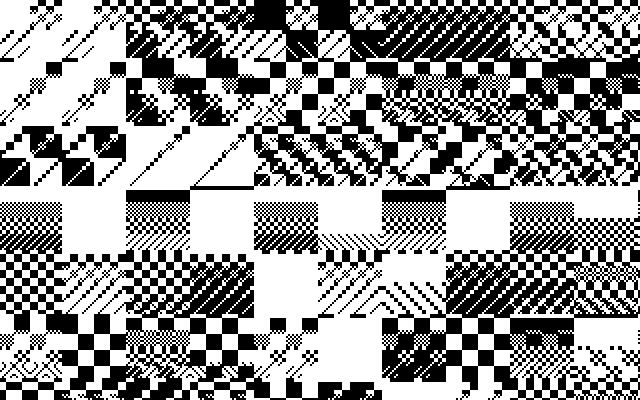](../../assets/volume4a/figures/figure-11-bitwise-quilt.svg)

**图 11**　由按位函数 $f(x,y)=\bigl((x\oplus\bar y)\mathbin{\&}((x-350)\gg3)\bigr)^2$ 定义的一小块拼布床单, 依据 $((f(x,y)\gg12)\mathbin{\&}1)$ 是 0 或 1 对 $x$ 行 $y$ 列上的方块涂白色或黑色 (由丹尼尔·斯利托在 1976 年设计, 也见习题 18).

**打包与解包.** 我们在 4.3.1 节讨论过多精度算术的算法, 用于处理整数过大的情况, 即整数大到不能存放到内存的一个字或计算机的一个寄存器中. 但是, 相反的情况实际上更为常见, 即整数小于计算机一个字的容量, 德里克·莱默把这种情况称为 “小精度”. 通过把它们打包到一个字中, 通常我们一次可以处理几个整数.

<a id="pdf-127"></a><a id="p-112"></a>

例如, 日期 $x$ 包含年份 $y$、月份 $m$ 和日子 $d$, 我们可以用 4 比特表示 $m$, 5 比特表示 $d$:

$$
x=(((y\ll4)+m)\ll5)+d.\tag{22}
$$

我们将看到, 许多运算可以直接在这种打包形式的日期上实施. 例如, 当日期 $x$ 先于日期 $x'$ 时我们有 $x<x'$. 当给定 $x$ 时, 如果需要的话, 我们很容易解包出单独的 $(y,m,d)$ 分量:

$$
d=x\bmod32,\qquad m=(x\gg5)\bmod16,\qquad y=x\gg9.\tag{23}
$$

上述 “mod” 运算不需要做除法, 因为对于任何整数 $n\ge0$ 有重要的定律

$$
x\bmod2^n=x\mathbin{\&}(2^n-1).\tag{24}
$$

例如, 在式 (22) 和 $(23)$ 中, 我们有 $d=x\mathbin{\&}31$.

这样的数据打包显然节省存储空间, 也节省时间: 当数据打包后, 我们能够更快地把其中的数据项从一处移动或复制到另一处. 不仅如此, 计算机在处理适合保存在有限大小的高速缓存的数据时, 运行速度要快得多.

当我们的数据项是 1 比特时, 能达到最高的打包密度, 因为这种情况下我们可以把它们中的 64 个数据项塞进一个 64 比特的字. 假设我们需要一张保存了小于 1024 的所有奇素数的表, 以便可以很快判定一个小整数的素性. 毫无疑问, 这时我们仅需要 8 个 64 位二进制数:

```text
P0 = 0111011011010011001011010010011001011001010010001011011010000001,
P1 = 0100110000110010010100100110000110110000010000010110100110000100,
P2 = 1001001100101100001000000101101000000100100001101001000100100101,
P3 = 0010001010001000011000011001010010001011010000010001010001010010,
P4 = 0000110000000010010000100100110010000100100110010010110000010000,
P5 = 1101001001100000101001000100001000100001000100100101000100101000,
P6 = 1010000001000010000011000011011000010000001011010000001011010000,
P7 = 0000010100010000100010100100100000010100100100010010000010100110.
```

为了检验 $2k+1$($0\le k<512$) 是不是素数, 我们只需要在一个 64 位寄存器中计算

$$
P_{\lfloor k/64\rfloor}\ll(k\mathbin{\&}63),\tag{25}
$$

检查最左位是不是 1. 例如, 如果寄存器 `pbase` 保存 $P_0$ 的地址, 那么下述 MMIX 指令执行这项任务:

<a id="eq-7-1-3-26"></a>

```text
SRU     $0,k,3          $0 ← ⌊k/8⌋（即 k ≫ 3）。
LDOU    $1,pbase,$0     $1 ← P⌊$0/8⌋（即 P⌊k/64⌋）。
AND     $0,k,#3f        $0 ← k mod 64（即 k & #3f）。  (26)
SLU     $1,$1,$0        $1 ← ($1 ≪ $0) mod 2⁶⁴。
BN      $1,PRIME        若 s($1) < 0 则转到 PRIME。  ∎
```

请注意, 寄存器的最左位是 1, 当且仅当它保存的是负数.

同样地, 我们可以把各个比特从右到左打包到每个字中:

<a id="pdf-128"></a><a id="p-113"></a>

```text
Q0 = 1000000101101101000100101001101001100100101101001100101101101110,
Q1 = 0010000110010110100000100000110110000110010010100100110000110010,
Q2 = 1010010010001001011000010010000001011010000001000011010011001001,
Q3 = 0100101000101000100000101101000100101001100001100001000101000100,
Q4 = 0000100000110100100110010010000100110010010000100100000000110000,
Q5 = 0001010010001010010010001000010001000010001001010000011001001011,
Q6 = 0000101101000000101101000000100001101100001100000100001000000101,
Q7 = 0110010100000100100010010010100000010010010100010000100010100000;
```

此处 $Q_j=P_j^R$. 不像在式 (25) 中那样向左移位, 现在我们向右移位,

$$
Q_{\lfloor k/64\rfloor}\gg(k\mathbin{\&}63),\tag{27}
$$

检查结果的最右位. 程序 $(26)$ 的最后两行变成了

<a id="eq-7-1-3-28"></a>

```text
SRU     $1,$1,$0        $1 ← $1 ≫ $0。                  (28)
BOD     $1,PRIME        若 $1 是奇数则转至 PRIME。  ∎
```

(当然, 我们用 `qbase` 代替 `pbase`.) 无论哪种情况, 用经典的埃拉托色尼筛法能很快建立基本的表项 $P_j$ 或 $Q_j$ (见习题 24).

**大端约定与小端约定.** 每当我们把比特或字节打包成字时, 必须决定从左到右还是从右到左放置它们. 从左到右的约定称为 “大端约定”, 因为初始项置于最高有效数字的位置, 当比较数字时, 它们比后继项具有更大的权值. 从右到左的约定称为 “小端约定”, 这种约定把前面的项置于小数值的位置.

在很多情况下, 大端方式看起来更为自然, 因为我们习惯于从左到右阅读和书写. 但是, 小端方式也有优点. 例如, 我们再次考虑素数问题, 令 $a_k=[2k+1\text{ 是素数}]$. 我们的表项 $\{P_0,P_1,\ldots,P_7\}$ 使用大端约定, 可以把它们看成长度为 512 比特的单个多精度整数的表示:

$$
(P_0P_1\ldots P_7)_{2^{64}}=(a_0a_1\ldots a_{511})_2.\tag{29}
$$

同样, 小端约定表项表示多精度整数

$$
(Q_7\ldots Q_1Q_0)_{2^{64}}=(a_{511}\ldots a_1a_0)_2.\tag{30}
$$

后面这个整数从数学上看比前者更合适, 因为它是

$$
\sum_{k=0}^{511}2^k a_k=\sum_{k=0}^{511}2^k[2k+1\text{ 是素数}]=\biggl(\sum_{k=0}^\infty 2^k[2k+1\text{ 是素数}]\biggr)\bmod2^{512}.\tag{31}
$$

但请注意, 为了得到这个简单公式, 我们用了 $(Q_7\ldots Q_1Q_0)_{2^{64}}$ 而不是 $(Q_0Q_1\ldots Q_7)_{2^{64}}$. 实际上, 后面那个数

$$
(Q_0Q_1\ldots Q_7)_{2^{64}}=(a_{63}\ldots a_1a_0a_{127}\ldots a_{65}a_{64}a_{191}\ldots a_{385}a_{384}a_{511}\ldots a_{449}a_{448})_2
$$

非常奇特, 它没有真正合适的简单公式. (见习题 25.)

区分大小端具有重要意义, 因为多数计算机不仅能对寄存器大小的单元寻址, 也允许对存储器的单独字节寻址. MMIX 采用大端约定结构, 所以, 如果寄存器 `x` 中包含 64 位二进制数 `#0123456789abcdef`, 我们用指令 `STOU x,0; LDBU y,1` 把 `x` 存入地址 0 的全字, 再读出地址 1 的字节, 则寄存器 `y` 中的结果将是 `#23`. 在采用小端约定结构的计算机上, 上述指令的结果将是 `y ← #cd`, 而 `#23` 是在地址 6 的字节中.

<a id="pdf-129"></a><a id="p-114"></a>

<a id="tab-7-1-3-1"></a>

**表 1**　32 字节存储的大端视图

<table aria-label="32 字节存储的大端视图">
<tbody>
<tr><th colspan="8">全字 0</th></tr>
<tr><th colspan="4">半字 0</th><th colspan="4">半字 4</th></tr>
<tr><th colspan="2">短字 0</th><th colspan="2">短字 2</th><th colspan="2">短字 4</th><th colspan="2">短字 6</th></tr>
<tr><th colspan="1">字节 0</th><th colspan="1">字节 1</th><th colspan="1">字节 2</th><th colspan="1">字节 3</th><th colspan="1">字节 4</th><th colspan="1">字节 5</th><th colspan="1">字节 6</th><th colspan="1">字节 7</th></tr>
<tr><td>$a_{0}\ldots a_{7}$</td><td>$a_{8}\ldots a_{15}$</td><td>$a_{16}\ldots a_{23}$</td><td>$a_{24}\ldots a_{31}$</td><td>$a_{32}\ldots a_{39}$</td><td>$a_{40}\ldots a_{47}$</td><td>$a_{48}\ldots a_{55}$</td><td>$a_{56}\ldots a_{63}$</td></tr>
</tbody>
<tbody>
<tr><th colspan="8">全字 8</th></tr>
<tr><th colspan="4">半字 8</th><th colspan="4">半字 12</th></tr>
<tr><th colspan="2">短字 8</th><th colspan="2">短字 10</th><th colspan="2">短字 12</th><th colspan="2">短字 14</th></tr>
<tr><th colspan="1">字节 8</th><th colspan="1">字节 9</th><th colspan="1">字节 10</th><th colspan="1">字节 11</th><th colspan="1">字节 12</th><th colspan="1">字节 13</th><th colspan="1">字节 14</th><th colspan="1">字节 15</th></tr>
<tr><td>$a_{64}\ldots a_{71}$</td><td>$a_{72}\ldots a_{79}$</td><td>$a_{80}\ldots a_{87}$</td><td>$a_{88}\ldots a_{95}$</td><td>$a_{96}\ldots a_{103}$</td><td>$a_{104}\ldots a_{111}$</td><td>$a_{112}\ldots a_{119}$</td><td>$a_{120}\ldots a_{127}$</td></tr>
</tbody>
<tbody>
<tr><th colspan="8">全字 16</th></tr>
<tr><th colspan="4">半字 16</th><th colspan="4">半字 20</th></tr>
<tr><th colspan="2">短字 16</th><th colspan="2">短字 18</th><th colspan="2">短字 20</th><th colspan="2">短字 22</th></tr>
<tr><th colspan="1">字节 16</th><th colspan="1">字节 17</th><th colspan="1">字节 18</th><th colspan="1">字节 19</th><th colspan="1">字节 20</th><th colspan="1">字节 21</th><th colspan="1">字节 22</th><th colspan="1">字节 23</th></tr>
<tr><td>$a_{128}\ldots a_{135}$</td><td>$a_{136}\ldots a_{143}$</td><td>$a_{144}\ldots a_{151}$</td><td>$a_{152}\ldots a_{159}$</td><td>$a_{160}\ldots a_{167}$</td><td>$a_{168}\ldots a_{175}$</td><td>$a_{176}\ldots a_{183}$</td><td>$a_{184}\ldots a_{191}$</td></tr>
</tbody>
<tbody>
<tr><th colspan="8">全字 24</th></tr>
<tr><th colspan="4">半字 24</th><th colspan="4">半字 28</th></tr>
<tr><th colspan="2">短字 24</th><th colspan="2">短字 26</th><th colspan="2">短字 28</th><th colspan="2">短字 30</th></tr>
<tr><th colspan="1">字节 24</th><th colspan="1">字节 25</th><th colspan="1">字节 26</th><th colspan="1">字节 27</th><th colspan="1">字节 28</th><th colspan="1">字节 29</th><th colspan="1">字节 30</th><th colspan="1">字节 31</th></tr>
<tr><td>$a_{192}\ldots a_{199}$</td><td>$a_{200}\ldots a_{207}$</td><td>$a_{208}\ldots a_{215}$</td><td>$a_{216}\ldots a_{223}$</td><td>$a_{224}\ldots a_{231}$</td><td>$a_{232}\ldots a_{239}$</td><td>$a_{240}\ldots a_{247}$</td><td>$a_{248}\ldots a_{255}$</td></tr>
</tbody>
</table>

表 1 和表 2 列举了大端爱好者和小端爱好者对应的 “全视图”. 大端方法基本上是自顶向下, 位 0 和字节 0 在左上端. 小端方法基本上是自底向上, 位 0 和字节 0 在右下端. 由于这种差异, 当把数据从一种类型的计算机输送到另一类型的计算机时, 或者当编写预定在两种情况下给出同等结果的程序时, 需要特别注意. 另一方面, 关于素数 $Q$ 表的例子表明, 我们完全可以在一台像 MMIX 这种大端约定的计算机上采用小端打包约定, 反之亦然. 仅当在不同大小的存储单元中加载和存储数据, 或者在计算机之间传送数据时, 差别才是显著的.

**处理最右位.** 大端方法和小端方法通常不容易互换, 因为算术法则从 “最低有效” 数字位向左传递信号. 某些最重要的按位运算方法就基于这个事实.

对几乎所有非零的 2 基整数 $x$, 我们可以把它的位写成

$$
x=(\alpha01^a10^b)_2\tag{32}
$$

的形式. 换句话说, $x$ 包含某个任意的 (但是无穷的) 二进制串 $\alpha$, 后接一个 0, 再接 $a+1$ 个 1($a\ge0$), 再接 $b$ 个 0($b\ge0$). (当 $x=-2^b$ 时出现异常情况, 这时 $a=\infty$.) 因此

$$
\bar x=(\bar\alpha10^a01^b)_2,\tag{33}
$$

$$
x-1=(\alpha01^a01^b)_2,\tag{34}
$$

$$
-x=(\bar\alpha10^a10^b)_2;\tag{35}
$$

<a id="pdf-130"></a><a id="p-115"></a>

<a id="tab-7-1-3-2"></a>

**表 2**　32 字节存储的小端视图

<table aria-label="32 字节存储的小端视图">
<tbody>
<tr><th colspan="8">全字 24</th></tr>
<tr><th colspan="4">半字 28</th><th colspan="4">半字 24</th></tr>
<tr><th colspan="2">短字 30</th><th colspan="2">短字 28</th><th colspan="2">短字 26</th><th colspan="2">短字 24</th></tr>
<tr><th colspan="1">字节 31</th><th colspan="1">字节 30</th><th colspan="1">字节 29</th><th colspan="1">字节 28</th><th colspan="1">字节 27</th><th colspan="1">字节 26</th><th colspan="1">字节 25</th><th colspan="1">字节 24</th></tr>
<tr><td>$a_{255}\ldots a_{248}$</td><td>$a_{247}\ldots a_{240}$</td><td>$a_{239}\ldots a_{232}$</td><td>$a_{231}\ldots a_{224}$</td><td>$a_{223}\ldots a_{216}$</td><td>$a_{215}\ldots a_{208}$</td><td>$a_{207}\ldots a_{200}$</td><td>$a_{199}\ldots a_{192}$</td></tr>
</tbody>
<tbody>
<tr><th colspan="8">全字 16</th></tr>
<tr><th colspan="4">半字 20</th><th colspan="4">半字 16</th></tr>
<tr><th colspan="2">短字 22</th><th colspan="2">短字 20</th><th colspan="2">短字 18</th><th colspan="2">短字 16</th></tr>
<tr><th colspan="1">字节 23</th><th colspan="1">字节 22</th><th colspan="1">字节 21</th><th colspan="1">字节 20</th><th colspan="1">字节 19</th><th colspan="1">字节 18</th><th colspan="1">字节 17</th><th colspan="1">字节 16</th></tr>
<tr><td>$a_{191}\ldots a_{184}$</td><td>$a_{183}\ldots a_{176}$</td><td>$a_{175}\ldots a_{168}$</td><td>$a_{167}\ldots a_{160}$</td><td>$a_{159}\ldots a_{152}$</td><td>$a_{151}\ldots a_{144}$</td><td>$a_{143}\ldots a_{136}$</td><td>$a_{135}\ldots a_{128}$</td></tr>
</tbody>
<tbody>
<tr><th colspan="8">全字 8</th></tr>
<tr><th colspan="4">半字 12</th><th colspan="4">半字 8</th></tr>
<tr><th colspan="2">短字 14</th><th colspan="2">短字 12</th><th colspan="2">短字 10</th><th colspan="2">短字 8</th></tr>
<tr><th colspan="1">字节 15</th><th colspan="1">字节 14</th><th colspan="1">字节 13</th><th colspan="1">字节 12</th><th colspan="1">字节 11</th><th colspan="1">字节 10</th><th colspan="1">字节 9</th><th colspan="1">字节 8</th></tr>
<tr><td>$a_{127}\ldots a_{120}$</td><td>$a_{119}\ldots a_{112}$</td><td>$a_{111}\ldots a_{104}$</td><td>$a_{103}\ldots a_{96}$</td><td>$a_{95}\ldots a_{88}$</td><td>$a_{87}\ldots a_{80}$</td><td>$a_{79}\ldots a_{72}$</td><td>$a_{71}\ldots a_{64}$</td></tr>
</tbody>
<tbody>
<tr><th colspan="8">全字 0</th></tr>
<tr><th colspan="4">半字 4</th><th colspan="4">半字 0</th></tr>
<tr><th colspan="2">短字 6</th><th colspan="2">短字 4</th><th colspan="2">短字 2</th><th colspan="2">短字 0</th></tr>
<tr><th colspan="1">字节 7</th><th colspan="1">字节 6</th><th colspan="1">字节 5</th><th colspan="1">字节 4</th><th colspan="1">字节 3</th><th colspan="1">字节 2</th><th colspan="1">字节 1</th><th colspan="1">字节 0</th></tr>
<tr><td>$a_{63}\ldots a_{56}$</td><td>$a_{55}\ldots a_{48}$</td><td>$a_{47}\ldots a_{40}$</td><td>$a_{39}\ldots a_{32}$</td><td>$a_{31}\ldots a_{24}$</td><td>$a_{23}\ldots a_{16}$</td><td>$a_{15}\ldots a_{8}$</td><td>$a_{7}\ldots a_{0}$</td></tr>
</tbody>
</table>

我们能看出, $\bar x+1=-x=\overline{x-1}$, 这与式 (16) 和 $(17)$ 相符. 所以, 我们能够用两种运算以多种有用的方法计算 $x$ 的关系式:

$$
x\mathbin{\&}(x-1)=(\alpha01^a00^b)_2\quad\text{［将最右边的 1 置为 0］};\tag{36}
$$

$$
x\mathbin{\&}-x=(0^\infty00^a10^b)_2\quad\text{［提取最右边的 1］};\tag{37}
$$

$$
x\mathbin{\vert}-x=(1^\infty11^a10^b)_2\quad\text{［把最右边的 1 涂写到左边］};\tag{38}
$$

$$
x\oplus-x=(1^\infty11^a00^b)_2\quad\text{［将最右边的 1 置为 0, 并把 1 涂写到左边］};\tag{39}
$$

$$
x\mathbin{\vert}(x-1)=(\alpha01^a11^b)_2\quad\text{［把最右边的 1 涂写到右边］};\tag{40}
$$

$$
x\oplus(x-1)=(0^\infty00^a11^b)_2\quad\text{［提取最右边的 1, 并把它涂写到右边］};\tag{41}
$$

$$
\bar x\mathbin{\&}(x-1)=(0^\infty00^a01^b)_2\quad\text{［提取最右边的 1, 将其原位清零, 再把 1 涂写到右边］}.\tag{42}
$$

再多用两种运算可产生另外的变式:

$$
\bigl((x\mathbin{\vert}(x-1))+1\bigr)\mathbin{\&}x=(\alpha00^a00^b)_2\quad\text{［将最右边的一串 1 置为 0］}.\tag{43}
$$

<a id="pdf-131"></a><a id="p-116"></a>

当 $x=0$ 时, 上述公式中的 5 个公式的结果为 0, 另外 3 个公式的结果为 $-1$. [式 (36) 是由彼得·韦格纳建立的, 见 *CACM* **3** (1960), 322; 式 (43) 是由哈蒙·格拉德温建立的, 见 *CACM* **14** (1971), 407–408. 也见小亨利·沃伦,*CACM* **20** (1977), 439–441.]

上述公式中的量 $b$ 表明 $x$ 中尾零的个数, 称为 $x$ 的直尺函数, 写作 $\rho x$, 因为它与通常用于指示直尺上一英寸的刻度记号的长度有关: <a href="../../assets/volume4a/figures/ruler-7-1-3-trailing-zeros.svg" target="_blank" rel="noopener" data-book-original-image="true">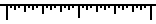</a>. 一般说来, 当 $x\ne0$ 时, $\rho x$ 是使得 $2^k$ 整除 $x$ 的最大整数 $k$. 我们定义 $\rho0=\infty$. 递推关系

$$
\rho(2y+1)=0,\qquad\rho(2y)=\rho(y)+1\tag{44}
$$

也用来定义非零 $x$ 的 $\rho x$. 值得注意的是, 还有一个便于使用的关系

$$
\rho(x-y)=\rho(x\oplus y).\tag{45}
$$

式 (37) 中简练的算式 $x\mathbin{\&}-x$ 使我们能够非常满意地提取最右边的 1, 但是我们通常需要明确是哪一位. 直尺函数可以用多种方式计算, 最好的方法常与使用的计算机密切相关. 例如, 约瑟夫·达洛斯用两条 MMIX 指令轻而易举地快速完成了计算任务 (见式 (42)):

<a id="eq-7-1-3-46"></a>

```text
SUBU t,x,1; SADD rho,t,x.  (46)
```

($x=0$ 的情况见习题 30.) 在此, 我们将讨论两种不依赖于 `SADD` 这种特殊指令的方法. 随后, 在了解几种其他方法后我们将讨论第三种方法.

第一种通用方法利用在许多其他应用中被证明是有效的 “幻掩码” 常数 $\mu_k$, 即

$$
\begin{aligned}
\mu_0&=(\ldots101010101010101010101010101010101)_2=-1/3,\\
\mu_1&=(\ldots100110011001100110011001100110011)_2=-1/5,\\
\mu_2&=(\ldots100001111000011110000111100001111)_2=-1/17,
\end{aligned}\tag{47}
$$

等等. 一般情况下, $\mu_k$ 是无穷的 2 基分数 $-1/(2^{2^k}+1)$, 因为 $(2^{2^k}+1)\mu_k=(\mu_k\ll2^k)+\mu_k=(\ldots11111)_2=-1$. 自然, 在具有 $2^d$ 位寄存器的计算机上不需要无限精度, 所以我们使用截断的常数

$$
\mu_{d,k}=(2^{2^d}-1)/(2^{2^k}+1),\qquad0\le k<d.\tag{48}
$$

我们在讨论布尔函数求值时已经很熟悉这些常数了, 因为它们是投影函数 $x_{d-k}$ 的真值表 (例如, 见 7.1.2-$(7)$).

当 $x$ 是 2 的幂时, 我们可以用这些掩码计算

$$
\rho x=[x\mathbin{\&}\mu_0=0]+2[x\mathbin{\&}\mu_1=0]+4[x\mathbin{\&}\mu_2=0]+8[x\mathbin{\&}\mu_3=0]+\cdots,\tag{49}
$$

因为当 $j=(\ldots j_3j_2j_1j_0)_2$ 时, $[2^j\mathbin{\&}\mu_k=0]=j_k$. 因此, 在 $2^d$ 位的计算机上, 我们可以从 $\rho\leftarrow0$ 和 $y\leftarrow x\mathbin{\&}-x$ 开始, 然后, 对于 $0\le k<d$, 如果 $y\mathbin{\&}\mu_{d,k}=0$, 则置 $\rho\leftarrow\rho+2^k$. 当 $x\ne0$ 时, 这个过程给出 $\rho=\rho x$. (它也给出 $\rho0=2^d-1$, 这是一个可能需要修正的异常值, 见习题 30.)

例如, 对应的 MMIX 程序看起来可能像下面这样:

<a id="eq-7-1-3-50"></a>

<a id="pdf-132"></a><a id="p-117"></a>

```text
m0 GREG #5555555555555555 ;m1 GREG #3333333333333333;
m2 GREG #0f0f0f0f0f0f0f0f ;m3 GREG #00ff00ff00ff00ff;
m4 GREG #0000ffff0000ffff ;m5 GREG #00000000ffffffff;
 NEGU y,x; AND y,x,y; AND q,y,m5; ZSZ rho,q,32;
 AND q,y,m4; ADD t,rho,16; CSZ rho,q,t;              (50)
 AND q,y,m3; ADD t,rho,8; CSZ rho,q,t;
 AND q,y,m2; ADD t,rho,4; CSZ rho,q,t;
 AND q,y,m1; ADD t,rho,2; CSZ rho,q,t;
 AND q,y,m0; ADD t,rho,1; CSZ rho,q,t;
```

总时间 $=19\upsilon$. 或者我们可以用

<a id="eq-7-1-3-51"></a>

```text
SRU y,y,rho; LDB t,rhotab,y; ADD rho,rho,t  (51)
```

代替最后三行, 其中 `rhotab` 指向相应的 129 字节表的起始地址 (实际上仅使用它的 8 项). 这样一来, 总时间将是 $\mu+13\upsilon$.

计算 $\rho x$ 的第二种通用方法是完全不同的. 在 64 位的计算机上, 像前面那样从 $y\leftarrow x\mathbin{\&}-x$ 开始. 但是, 接着只简单地置

$$
\rho\leftarrow\mathit{decode}[((a\cdot y)\bmod2^{64})\gg58],\tag{52}
$$

其中 $a$ 是合适的乘数, $\mathit{decode}$ 是相应的 64 字节的表. 常数 $a=(a_{63}\ldots a_1a_0)_2$ 必须具备的性质是, 它的 64 个截断移位结果

$$
a_{63}a_{62}\ldots a_{58},\quad a_{62}a_{61}\ldots a_{57},\quad\ldots,\quad a_5a_4\ldots a_0,\quad a_4a_3a_2a_1a_0 0,\quad\ldots,\quad a_0 00000
$$

是各不相同的. 习题 2.3.4.2–23 表明存在许多这样的 “德布鲁因圈”. 例如, 我们可以使用马丁常数 `#03f79d71b4ca8b09`, 这个常数在习题 3.2.2–17 中讨论过. 于是译码表 $\mathit{decode}[0],\ldots,\mathit{decode}[63]$ 是

<a id="eq-7-1-3-53"></a>

```text
00, 01, 56, 02, 57, 49, 28, 03, 61, 58, 42, 50, 38, 29, 17, 04,
62, 47, 59, 36, 45, 43, 51, 22, 53, 39, 33, 30, 24, 18, 12, 05,  (53)
63, 55, 48, 27, 60, 41, 37, 16, 46, 35, 44, 21, 52, 32, 23, 11,
54, 26, 40, 15, 34, 20, 31, 10, 25, 14, 19, 09, 13, 08, 07, 06.
```

[这个方法是由 IBM 系统开发部的卢瑟·伍德拉姆在 1967 年提出的 (未发表), 其他许多程序员后来又独立地发现了它.]

**处理最左位.** 式 4.6.3-$(6)$ 中引入的函数 $\lambda x=\lfloor\lg x\rfloor$ 是 $\rho x$ 的对偶函数, 因为当 $x>0$ 时它确定最左边 1 的位置. 这个函数满足递推公式

$$
\lambda1=0;\qquad\lambda(2x)=\lambda(2x+1)=\lambda(x)+1,\qquad x>0;\tag{54}
$$

它在 $x$ 不是正整数时没有定义. 计算它的有效方法是什么? MMIX 再次提供了一个快速而又漂亮的解法:

<a id="eq-7-1-3-55"></a>

```text
FLOTU y,ROUND_DOWN,x; SUB y,y,fone; SR lam,y,52  (55)
```

其中 `fone = #3ff0000000000000` 是 1.0 的浮点表示. (总时间 $=6\upsilon$.) 这段代码计算 $x$ 的浮点值, 然后提取指数.

如果浮点转换不是很容易做到, 那么, 我们完全可以在 $2^d$ 位计算机上采用二进制缩减策略. 我们可以从 $\lambda\leftarrow0$ 和 $y\leftarrow x$ 开始. 然后, 对于 $k=d-1,\ldots,1,0$ (或者, 让 $k$ 减少到可以用短表完成缩减的那一点), 如果 $y\gg2^k\ne0$, 置 $\lambda\leftarrow\lambda+2^k$ 和 $y\leftarrow y\gg2^k$. 现在, 与 $(50)$ 和 $(51)$ 相似的 MMIX 代码是

<a id="eq-7-1-3-56"></a>

<a id="pdf-133"></a><a id="p-118"></a>

```text
SRU y,x,32; ZSNZ lam,y,32;
ADD t,lam,16; SRU y,x,t; CSNZ lam,y,t;  (56)
ADD t,lam,8; SRU y,x,t; CSNZ lam,y,t;
SRU y,x,lam; LDB t,lamtab,y; ADD lam,lam,t;
```

总时间 $=\mu+11\upsilon$. 在这种情况下, 表 `lamtab` 有 256 项, 即 $\lambda x$, 其中 $0\le x<256$. 注意, 在上述代码以及代码 $(50)$ 中, 我们使用了 “条件设置” 指令 (CS) 和 “置零或设置” 指令 (ZS) 来代替转移指令.

看来没有简单的方法提取寄存器中最左边的 1, 就像我们在 $(37)$ 中提取最右边的 1 的技巧. 为此, 如果 $x\ne0$, 我们可以计算 $y\leftarrow\lambda x$, 然后计算 $1\ll y$. 但是, 更短、更快的方法是二进制 “涂写右边” 算法:

$$
\begin{aligned}
&\text{置 }y\leftarrow x\text{. 然后, 对 }0\le k<d\text{ 置 }y\leftarrow y\mathbin{\vert}(y\gg2^k)\text{。}\\
&\text{则 }x\text{ 最左边的 1 是 }y-(y\gg1)\text{。}
\end{aligned}\tag{57}
$$

[这些非浮点的方法已由小亨利·沃伦提出.]

在寄存器左边的其他运算更难, 如消除最左边的一串 1, 见习题 39. 但是, 给定无符号整数 $x$ 和 $y$, 有一个相当简单且与机器无关的方法来确定 $\lambda x=\lambda y$ 是否成立, 尽管我们实际上并不能快速计算 $\lambda x$ 或 $\lambda y$:

$$
\lambda x=\lambda y\qquad\text{当且仅当}\qquad x\oplus y\le x\mathbin{\&}y.\tag{58}
$$

[见习题 40. 这个优雅的关系是威廉·林奇在 2006 年发现的.] 下面我们利用 $(58)$ 来设计计算 $\lambda x$ 的另一个方法.

**位叠加加法.** $n$ 位二进制数 $x=(x_{n-1}\ldots x_1x_0)_2$ 通常用于表示 $n$ 元素全域 $\{0,1,\ldots,n-1\}$ 中的子集 $X$: $k\in X$, 当且仅当 $2^k\subseteq x$. 这时, 函数 $\lambda x$ 和 $\rho x$ 分别代表 $X$ 的最大元素和最小元素. 函数

$$
\nu x=x_{n-1}+\cdots+x_1+x_0\tag{59}
$$

称为 $x$ 的 “位叠加和” 或 “总体计数”, 在这一点上也有明显的重要性, 因为它表示基数 $|X|$, 即 $X$ 中的元素个数. 这个我们在 4.6.3-$(7)$ 中考虑过的函数满足递推公式

$$
\nu0=0;\qquad\nu(2x)=\nu(x),\qquad\nu(2x+1)=\nu(x)+1,\qquad x\ge0.\tag{60}
$$

它与直尺函数 (习题 1.2.5–11) 有个有趣的联系:

$$
\rho x=1+\nu(x-1)-\nu x\qquad\text{或等价的}\qquad\sum_{k=1}^n\rho k=n-\nu n.\tag{61}
$$

第一本程序设计教科书 [威尔克斯、惠勒和吉尔,*The Preparation of Programs for an Electronic Digital Computer*, second edition (Reading, Mass.: Addison-Wesley, 1957), 155, 191–193] 给出了一个由唐纳德·吉利斯和杰弗里·米勒编写的有趣的位叠加加法子程序. 他们的方法是为 35 位字长的 EDSAC 计算机设计的, 但是, 当 $x=(x_{63}\ldots x_1x_0)_2$ 时, 很容易把它变换成求 $\nu x$ 的 64 位字长的代码:

$$
\begin{aligned}
&\text{置 }y\leftarrow x-((x\gg1)\mathbin{\&}\mu_0)\text{。}\quad(\text{此时 }y=(u_{31}\ldots u_1u_0)_4,\ \text{其中 }u_j=x_{2j+1}+x_{2j}\text{。})\\
&\text{置 }y\leftarrow(y\mathbin{\&}\mu_1)+((y\gg2)\mathbin{\&}\mu_1)\text{。}\quad(\text{此时 }y=(v_{15}\ldots v_1v_0)_{16},\ \text{其中 }v_j=u_{2j+1}+u_{2j}\text{。})\\
&\text{置 }y\leftarrow(y+(y\gg4))\mathbin{\&}\mu_2\text{。}\quad(\text{此时 }y=(w_7\ldots w_1w_0)_{256},\ \text{其中 }w_j=v_{2j+1}+v_{2j}\text{。})\\
&\text{最终 }\nu\leftarrow((a\cdot y)\bmod2^{64})\gg56,\quad\text{其中 }a=(11111111)_{256}\text{。}
\end{aligned}\tag{62}
$$

最后一步巧妙地通过乘法计算 $y\bmod255=w_7+\cdots+w_1+w_0$, 其中利用了全部字段之和可以用 8 位二进制表示的事实. [戴维·马勒在 1954 年为 ILLIAC I 计算机编写了一个类似的程序.]

<a id="pdf-134"></a><a id="p-119"></a>

如果 $x$ 预期是 “稀疏的”, 最多包含少数几个 1, 那么我们可以用一个更快的方法 [彼得·韦格纳,*CACM* **3** (1960), 322]:

$$
\text{置 }\nu\leftarrow0,\ y\leftarrow x\text{. 然后, 当 }y\ne0\text{ 时循环执行 }\nu\leftarrow\nu+1,\ y\leftarrow y\mathbin{\&}(y-1)\text{。}\tag{63}
$$

如果 $x$ 预期是 “稠密的”, 一个类似的使用 $y\leftarrow y\mathbin{\vert}(y+1)$ 的方法行之有效.

**位颠倒.** 为了讨论下面的技巧, 我们把 $x=(x_{63}\ldots x_1x_0)_2$ 变成其镜像 $x^R=(x_0x_1\ldots x_{63})_2$. 一直跟随我们到这里的读者见到像 $(50)$、$(56)$、$(57)$、$(62)$ 那样的方法, 或许会认为: “啊哈……我们可以再次使用分治法! 如果已经知道如何颠倒 32 位二进制数, 那么我们几乎能够立即颠倒 64 位二进制数, 因为 $(xy)^R=y^R x^R$. 我们所要做的就是对寄存器的左右两半同时应用 32 位方法, 然后交换左半与右半.”

的确! 例如, 我们能用简单的 3 步颠倒 8 比特的串:

$$
\begin{array}{ll}
\text{给定输入}&x_7x_6x_5x_4x_3x_2x_1x_0\\
\text{交换比特}&x_6x_7x_4x_5x_2x_3x_0x_1\\
\text{交换双比特}&x_4x_5x_6x_7x_0x_1x_2x_3\\
\text{交换四比特}&x_0x_1x_2x_3x_4x_5x_6x_7
\end{array}\tag{64}
$$

同样, 用以下如此简单的 6 步可以颠倒 64 比特的串. 幸好, 借助幻掩码 $\mu_k$, 每一步交换操作都很简单:

$$
\begin{aligned}
y&\leftarrow(x\gg1)\mathbin{\&}\mu_0, & z&\leftarrow(x\mathbin{\&}\mu_0)\ll1, & x&\leftarrow y\mathbin{\vert}z;\\
y&\leftarrow(x\gg2)\mathbin{\&}\mu_1, & z&\leftarrow(x\mathbin{\&}\mu_1)\ll2, & x&\leftarrow y\mathbin{\vert}z;\\
y&\leftarrow(x\gg4)\mathbin{\&}\mu_2, & z&\leftarrow(x\mathbin{\&}\mu_2)\ll4, & x&\leftarrow y\mathbin{\vert}z;\\
y&\leftarrow(x\gg8)\mathbin{\&}\mu_3, & z&\leftarrow(x\mathbin{\&}\mu_3)\ll8, & x&\leftarrow y\mathbin{\vert}z;\\
y&\leftarrow(x\gg16)\mathbin{\&}\mu_4, & z&\leftarrow(x\mathbin{\&}\mu_4)\ll16, & x&\leftarrow y\mathbin{\vert}z;\\
x&\leftarrow(x\gg32)\mathbin{\vert}((x\ll32)\bmod2^{64}).
\end{aligned}\tag{65}
$$

[在 *CACM* **4** (1961), 146 中, 克里斯托弗·斯特雷奇曾经预见这种结构的某些方面, 布鲁斯·鲍姆加特在 1973 年提出一种类似的三进制方法 (见习题 49). 在 *Hacker’s Delight* (Addison-Wesley, 2002), 102 中, 小亨利·沃伦提出了成熟的算法 $(65)$.]

但是, MMIX 能够再次胜过这个通用方法, 用较少见的指令以快得多的速度完成这个任务. 考虑

<a id="eq-7-1-3-66"></a>

```text
rev GREG #0102040810204080; MOR x,x,rev; MOR x,rev,x;  (66)
```

第一条 `MOR` 指令从大端到小端 (或反过来, 从小端到大端) 颠倒 $x$ 的字节, 第二条 `MOR` 指令颠倒各字节内部的二进制位.

**位交换.** 假定我们只想交换寄存器的两位, 即 $x_i\leftrightarrow x_j$, 其中 $i>j$. 进行这种交换的好方法是什么? (亲爱的读者, 请稍停片刻, 不看下面的答案, 用头脑或铅笔和纸解答这个问题.)

令 $\delta=i-j$. 下面是一个解 (做好准备前请不要偷看):

$$
y\leftarrow(x\gg\delta)\mathbin{\&}2^j,\quad z\leftarrow(x\mathbin{\&}2^j)\ll\delta,\quad x\leftarrow(x\mathbin{\&}m)\mathbin{\vert}y\mathbin{\vert}z,\quad\text{其中 }\bar m=2^i\mathbin{\vert}2^j.\tag{67}
$$

它用了 2 个移位运算和 5 个按位布尔运算, 假定 $i$ 和 $j$ 是给定常数. 这个解法像 $(65)$ 前几行中的每一行, 只是需要一个新掩码 $m$, 因为 $y$ 和 $z$ 不涉及 $x$ 的所有位.

然而, 我们可以做得更好, 节省一个运算和一个常数:

$$
y\leftarrow(x\oplus(x\gg\delta))\mathbin{\&}2^j,\qquad x\leftarrow x\oplus y\oplus(y\ll\delta).\tag{68}
$$

<a id="pdf-135"></a><a id="p-120"></a>

现在, 第一个赋值把 $x_i\oplus x_j$ 置于位置 $j$; 第二个赋值把 $x_i$ 改变为 $x_i\oplus(x_i\oplus x_j)$, 把 $x_j$ 改变为 $x_j\oplus(x_i\oplus x_j)$, 如我们所愿. 一般情况下, 明智的做法是把一个形如 “改变 $x$ 为 $f(x)$” 的问题变换成形如 “改变 $x$ 为 $x\oplus g(x)$” 的问题, 因为位差 $g(x)$ 可能很容易计算.

另一方面, 在某种意义下 $(67)$ 可能胜过 $(68)$, 因为 $(67)$ 中对 $y$ 和 $z$ 的赋值有时是同时进行的. 当表示为一个电路时, $(67)$ 的深度为 4, 而 $(68)$ 的深度为 5.

如果使用比 $2^j$ 更一般的掩码 $\theta$, 运算 $(68)$ 可以用于同时交换几组比特对:

$$
y\leftarrow(x\oplus(x\gg\delta))\mathbin{\&}\theta,\qquad x\leftarrow x\oplus y\oplus(y\ll\delta).\tag{69}
$$

这个运算称为 “$\delta$ 交换”, 因为它允许我们交换任何不重叠的相距 $\delta$ 位的几组比特对. 在将要被交换的每组比特对的最右边位置, 掩码 $\theta$ 的值为 1. 例如, 如果我们令 $\delta=39$ 和 $\theta=2^{25}-1=\mathtt{\#1ffffff}$, 那么, 运算 $(69)$ 将把一个 64 位字的最左边 25 位与最右边 25 位交换, 而中间 14 位保持不变.

其实, 存在一种用 “$\delta$ 交换” 颠倒 64 位的惊人方法:

$$
\begin{aligned}
y&\leftarrow(x\gg1)\mathbin{\&}\mu_0,\quad z\leftarrow(x\mathbin{\&}\mu_0)\ll1,\quad x\leftarrow y\mathbin{\vert}z,\\
y&\leftarrow(x\oplus(x\gg4))\mathbin{\&}\mathtt{\#0300c0303030c303},\quad x\leftarrow x\oplus y\oplus(y\ll4),\\
y&\leftarrow(x\oplus(x\gg8))\mathbin{\&}\mathtt{\#00c0300c03f0003f},\quad x\leftarrow x\oplus y\oplus(y\ll8),\\
y&\leftarrow(x\oplus(x\gg20))\mathbin{\&}\mathtt{\#00000ffc00003fff},\quad x\leftarrow x\oplus y\oplus(y\ll20),\\
x&\leftarrow(x\gg34)\mathbin{\vert}((x\ll30)\bmod2^{64}),
\end{aligned}\tag{70}
$$

节省了 $(65)$ 中的两个按位运算, 虽然 $(65)$ 看起来是 “最优的”.

**\*一般的位排列.** 我们可以把刚才提到的方法推广到寄存器的位组的任意排列. 事实上, 总是存在掩码 $\theta_0,\ldots,\theta_5,\hat\theta_4,\ldots,\hat\theta_0$, 使得下面的运算把 $x=(x_{63}\ldots x_1x_0)_2$ 变换成我们想要的任何位组重排 $x^\pi=(x_{63\pi}\ldots x_{1\pi}x_{0\pi})_2$:

$$
\begin{aligned}
&x\leftarrow\text{用掩码 }\theta_k\text{ 做 }x\text{ 的 }2^k\text{ 交换}, & k&=0,1,2,3,4,5;\\
&x\leftarrow\text{用掩码 }\hat\theta_k\text{ 做 }x\text{ 的 }2^k\text{ 交换}, & k&=4,3,2,1,0.
\end{aligned}\tag{71}
$$

一般说来, 可以用合适的掩码 $\theta_k$ 和 $\hat\theta_k$ 以 $2d-1$ 步达成一个 $2^d$ 位的排列, 其中, 交换距离分别为 $2^0,2^1,\ldots,2^{d-1},\ldots,2^1,2^0$.

我们可以用排列网络的一个特例来证明这一事实, 它基于戴维·斯莱皮恩的早期工作, 安德鲁·杜吉德和让·勒科尔在 1959 年独立发现了这种网络 [见瓦茨拉夫·贝内斯,*Mathematical Theory of Connecting Networks and Telephone Traffic* (New York: Academic Press, 1965), 3.3 节]. 图 12 给出了当 $n=4$ 时有 $2n$ 个元素的排列网络 $P(2n)$, 它是从两个有 $n$ 个元素的排列网络构造的. 两条网线之间的每个联结 <a href="../../assets/volume4a/figures/crossbar-module-7-1-3.svg" target="_blank" rel="noopener" data-book-original-image="true"></a> 代表一个交叉模块, 当数据从左向右流动时, 这种模块或者保持网线的内容不变或者交换内容. 为了在 $n=1$ 时启动递归过程, 我们令 $P(2)$ 包含一个单独的交叉模块. 显然, 所有交叉模块的每一种设置都使 $P(2n)$ 对输入实现某种排列. 反过来, 我们将要证明, 如果足够巧妙地设置交叉模块, 可以达成对 $2n$ 个输入的任意排列.

<a id="pdf-136"></a><a id="p-121"></a>

最好通过一个例子来理解图 12 的结构. 假定我们需要把输入 $(0,1,2,3,4,5,6,7)$ 经由网线传送到 $(3,2,4,1,6,0,5,7)$. 第一个任务是确定正好在交叉模块第一列之后和最后一列之前的网线上的传输内容, 因为我们可以用同样方法在 $P(4)$ 的内部设置交叉模块. 因此, 在网络

<a id="eq-7-1-3-72"></a>

[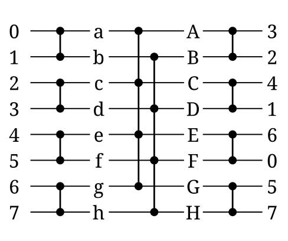](../../assets/volume4a/figures/diagram-7-1-3-72-eight-wire-routing.svg)

$(72)$

中, 我们需要寻找排列 `abcdefgh` 和 `ABCDEFGH`, 使得 $\{\mathtt a,\mathtt b\}=\{0,1\}$, $\{\mathtt c,\mathtt d\}=\{2,3\},\ldots,\{\mathtt g,\mathtt h\}=\{6,7\}$, $\{\mathtt a,\mathtt c,\mathtt e,\mathtt g\}=\{\mathtt A,\mathtt C,\mathtt E,\mathtt G\}$, $\{\mathtt b,\mathtt d,\mathtt f,\mathtt h\}=\{\mathtt B,\mathtt D,\mathtt F,\mathtt H\}$, $\{\mathtt A,\mathtt B\}=\{3,2\}$, $\{\mathtt C,\mathtt D\}=\{4,1\},\ldots,\{\mathtt G,\mathtt H\}=\{5,7\}$. 从底部开始, 我们选择 $\mathtt h=7$, 因为, 如非必须, 我们不希望干扰那条网线上传输的信息. 然后, 以下选择是强制性的:

$$
\mathtt H=7;\ \mathtt G=5;\ \mathtt e=5;\ \mathtt f=4;\ \mathtt D=4;\ \mathtt C=1;\ \mathtt a=1;\ \mathtt b=0;\ \mathtt F=0;\ \mathtt E=6;\ \mathtt g=6.\tag{73}
$$

如果我们选择了 $\mathtt h=6$, 强制选择模式将是类似的, 但顺序相反:

$$
\mathtt F=6;\ \mathtt E=0;\ \mathtt a=0;\ \mathtt b=1;\ \mathtt D=1;\ \mathtt C=4;\ \mathtt e=4;\ \mathtt f=5;\ \mathtt H=5;\ \mathtt G=7;\ \mathtt g=7.\tag{74}
$$

选择 $\mathtt d=3$ (因此 $\mathtt B=3,\mathtt A=2,\mathtt c=2$) 或者 $\mathtt d=2$ (因此 $\mathtt B=2,\mathtt A=3,\mathtt c=3$) 都能完成模式 (73) 和 $(74)$.

<a id="fig-7-1-3-12"></a>

[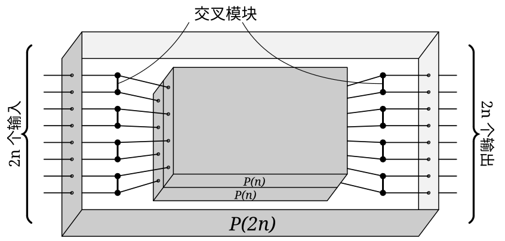](../../assets/volume4a/figures/figure-12-permutation-network.svg)

**图 12**　当 $n>1$ 时以所有可能方式排列 $2n$ 个元素的黑箱 $P(2n)$ 的内部结构 ($n=4$ 的图解).

一般情况下, 无论我们从什么排列开始, 强制模式都将以圈的形式出现. 为了了解这一点, 考虑 8 个顶点 $\{\mathtt{ab},\mathtt{cd},\mathtt{ef},\mathtt{gh},\mathtt{AB},\mathtt{CD},\mathtt{EF},\mathtt{GH}\}$ 的图, 每当连接到 `uv` 的一对输入与连接到 `UV` 的一对输出有一个公共元素时, 图中就有一条从 `uv` 到 `UV` 的边. 因此, 我们这个例子中的边是 `ab`—`EF`、`ab`—`CD`、`cd`—`AB`、`cd`—`AB`、`ef`—`CD`、`ef`—`GH`、`gh`—`EF`、`gh`—`GH`. 在 `cd` 与 `AB` 之间有一条 “双键”, 因为连接到 `c` 和 `d` 的输入正好是连接到 `A` 和 `B` 的输出. 在这种稍微偏离图的严格定义的条件下, 我们看到每个顶点恰好关联两条边 (平行边分别计数), 而且小写字母的顶点总是同大写字母的顶点邻接. 因此, 这种图总是由一些偶数长度的不相交的圈组成. 在我们的例子中, 这些圈是

<a id="eq-7-1-3-75"></a>

[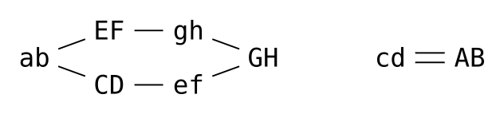](../../assets/volume4a/figures/diagram-7-1-3-75-forced-cycles.svg)

$(75)$

其中较长的圈对应于 $(73)$ 和 $(74)$. 如果存在 $k$ 个不同的圈, 则存在具体说明交叉模块第一列和最后一列特性的 $2^k$ 种不同方式.

<a id="pdf-137"></a><a id="p-122"></a>

为了完成这个网络, 我们可以用同样方式处理内部的 4 元素排列. 任何 $2^d$ 个元素的排列都可以用同样的递归形式达成. 这些交叉模块的设置确定了 $(71)$ 的掩码 $\theta_j$ 和 $\hat\theta_j$. 交叉模块的某种选择可能导致一个全零的掩码, 这时我们可以取消相应的计算过程.

如果网络底端网线上的输入和输出完全相同, 那么, 我们的结构说明如何保证接触那些网线的交叉模块都不执行交换. 例如, 也可以把 $(71)$ 中的 64 位算法用于 60 位寄存器, 任何中间结果都不需要额外的 4 位.

当然, 在特殊情况下我们经常能够超越 $(71)$ 的一般过程. 例如, 习题 52 说明为了转置一个 $8\times8$ 矩阵, 方法 $(71)$ 需要 9 步交换, 但是实际上用 3 步交换就够了:

<table aria-label="转置八乘八矩阵的三次交换">
<thead><tr><th>给定输入</th><th>7 交换</th><th>14 交换</th><th>28 交换</th></tr></thead>
<tbody>
<tr><td><code>00 01 02 03 04 05 06 07</code></td><td><code>00 <strong>10</strong> 02 <strong>12</strong> 04 <strong>14</strong> 06 <strong>16</strong></code></td><td><code>00 10 <strong>20</strong> <strong>30</strong> 04 14 <strong>24</strong> <strong>34</strong></code></td><td><code>00 10 20 30 <strong>40</strong> <strong>50</strong> <strong>60</strong> <strong>70</strong></code></td></tr>
<tr><td><code>10 11 12 13 14 15 16 17</code></td><td><code><strong>01</strong> 11 <strong>03</strong> 13 <strong>05</strong> 15 <strong>07</strong> 17</code></td><td><code>01 11 <strong>21</strong> <strong>31</strong> 05 15 <strong>25</strong> <strong>35</strong></code></td><td><code>01 11 21 31 <strong>41</strong> <strong>51</strong> <strong>61</strong> <strong>71</strong></code></td></tr>
<tr><td><code>20 21 22 23 24 25 26 27</code></td><td><code>20 <strong>30</strong> 22 <strong>32</strong> 24 <strong>34</strong> 26 <strong>36</strong></code></td><td><code><strong>02</strong> <strong>12</strong> 22 32 <strong>06</strong> <strong>16</strong> 26 36</code></td><td><code>02 12 22 32 <strong>42</strong> <strong>52</strong> <strong>62</strong> <strong>72</strong></code></td></tr>
<tr><td><code>30 31 32 33 34 35 36 37</code></td><td><code><strong>21</strong> 31 <strong>23</strong> 33 <strong>25</strong> 35 <strong>27</strong> 37</code></td><td><code><strong>03</strong> <strong>13</strong> 23 33 <strong>07</strong> <strong>17</strong> 27 37</code></td><td><code>03 13 23 33 <strong>43</strong> <strong>53</strong> <strong>63</strong> <strong>73</strong></code></td></tr>
<tr><td><code>40 41 42 43 44 45 46 47</code></td><td><code>40 <strong>50</strong> 42 <strong>52</strong> 44 <strong>54</strong> 46 <strong>56</strong></code></td><td><code>40 50 <strong>60</strong> <strong>70</strong> 44 54 <strong>64</strong> <strong>74</strong></code></td><td><code><strong>04</strong> <strong>14</strong> <strong>24</strong> <strong>34</strong> 44 54 64 74</code></td></tr>
<tr><td><code>50 51 52 53 54 55 56 57</code></td><td><code><strong>41</strong> 51 <strong>43</strong> 53 <strong>45</strong> 55 <strong>47</strong> 57</code></td><td><code>41 51 <strong>61</strong> <strong>71</strong> 45 55 <strong>65</strong> <strong>75</strong></code></td><td><code><strong>05</strong> <strong>15</strong> <strong>25</strong> <strong>35</strong> 45 55 65 75</code></td></tr>
<tr><td><code>60 61 62 63 64 65 66 67</code></td><td><code>60 <strong>70</strong> 62 <strong>72</strong> 64 <strong>74</strong> 66 <strong>76</strong></code></td><td><code><strong>42</strong> <strong>52</strong> 62 72 <strong>46</strong> <strong>56</strong> 66 76</code></td><td><code><strong>06</strong> <strong>16</strong> <strong>26</strong> <strong>36</strong> 46 56 66 76</code></td></tr>
<tr><td><code>70 71 72 73 74 75 76 77</code></td><td><code><strong>61</strong> 71 <strong>63</strong> 73 <strong>65</strong> 75 <strong>67</strong> 77</code></td><td><code><strong>43</strong> <strong>53</strong> 63 73 <strong>47</strong> <strong>57</strong> 67 77</code></td><td><code><strong>07</strong> <strong>17</strong> <strong>27</strong> <strong>37</strong> 47 57 67 77</code></td></tr>
</tbody>
</table>

实际应用中经常出现的另一种位排列是 “全混洗”. 如果 $x=(\ldots x_2x_1x_0)_2$ 和 $y=(\ldots y_2y_1y_0)_2$ 是任意的 2 基整数, 那么, 我们通过交错它们的位来定义 $x\ddagger y$(“$x\ \mathrm{zip}\ y$”, 关于 $x$ 和 $y$ 的拉链函数):

$$
x\ddagger y=(\ldots x_2y_2x_1y_1x_0y_0)_2.\tag{76}
$$

这个运算在二维数据表示中有重要应用, 因为 $x$ 或 $y$ 的细小改变, 通常仅引起 $x\ddagger y$ 的细小改变 (见习题 86). 请注意, 幻掩码常数 $(47)$ 满足

$$
\mu_k\ddagger\mu_k=\mu_{k+1}.\tag{77}
$$

如果 $x$ 出现在寄存器的左半部而 $y$ 出现在右半部, 则全混洗就是把寄存器的内容改变成 $x\ddagger y$ 的排列.

一个 $d-1$ 步的交换序列将全混洗一个 $2^d$ 位寄存器. 事实上, 习题 53 说明了完成这个任务有多种途径. 因此, 我们能够再次改进 $(71)$ 和图 12 中的 $(2d-1)$ 步方法.

反过来, 假定我们在一个 $2^d$ 位寄存器中给出混合值 $z=x\ddagger y$, 那么, 存在提取 $y$ 的原始值的有效方法吗? 当然存在: 如果按相反顺序执行实现全混洗的 $d-1$ 步交换, 那么它们将还原那个混合并恢复 $x$ 和 $y$ 的原始值. 但是, 如果我们只需要 $y$ 的原始值, 则可以节省一半工作: 从 $y\leftarrow z\mathbin{\&}\mu_0$ 开始, 然后, 对于 $k=1,\ldots,d-1$ 置 $y\leftarrow(y+(y\gg2^{k-1}))\mathbin{\&}\mu_k$. 例如, 当 $d=3$ 时, 这个过程就是

$$
(0y_30y_20y_10y_0)_2\mapsto(00y_3y_200y_1y_0)_2\mapsto(0000y_3y_2y_1y_0)_2.
$$

“分治法” 再次获胜.

现在考虑更一般的问题, 我们需要提取并压缩寄存器中所有位的一个任意子集. 假定输入是 $2^d$ 位的字 $z=(z_{2^d-1}\ldots z_1z_0)_2$ 以及有 $s$ 个 1 的掩码 $\chi=(\chi_{2^d-1}\ldots\chi_1\chi_0)_2$, 从而 $\nu\chi=s$. 问题是如何汇集压缩子字

$$
y=(y_{s-1}\ldots y_1y_0)_2=(z_{j_{s-1}}\ldots z_{j_1}z_{j_0})_2,\tag{78}
$$

<a id="pdf-138"></a><a id="p-123"></a>

其中 $j_{s-1}>\cdots>j_1>j_0$ 是 $\chi_j=1$ 处的下标. 例如, 如果 $d=3$ 且 $\chi=(10110010)_2$, 我们需要把 $z=(y_3x_3y_2y_1x_2x_1y_0x_0)_2$ 变换成 $y=(y_3y_2y_1y_0)_2$. (前面考虑的把 $x\ddagger y$ 变换为 $y$ 的问题, 是 $\chi=\mu_0$ 时的特例.) 从 $(71)$ 可以知道, 通过最多 $2d-1$ 次 $\delta$ 交换可以求出 $y$. 在这个问题中总是要把相关数据移到右端, 所以, 我们可以通过移位而不是交换来加快变换速度.

我们说, $x$ 用掩码 $\theta$ 的 $\delta$ 移位是运算

$$
x\leftarrow x\oplus((x\oplus(x\gg\delta))\mathbin{\&}\theta),\tag{79}
$$

如果掩码 $\theta$ 在位置 $j$ 处有一个 1, 上述运算把 $x_j$ 改变为 $x_{j+\delta}$, 否则 $x_j$ 保持不变. 小盖伊·斯蒂尔发现, 总是存在掩码 $\theta_0,\theta_1,\ldots,\theta_{d-1}$, 使得从寄存器提取子字的一般问题 $(78)$ 能够用少量 $\delta$ 移位解决:

$$
\begin{aligned}
&\text{从 }x\leftarrow z\text{ 开始. 然后, 对于 }k=0,1,\ldots,d-1\text{ 进行 }x\text{ 用掩码 }\theta_k\text{ 的 }2^k\text{ 移位.}\\
&\text{最后置 }y\leftarrow x\text{。}
\end{aligned}\tag{80}
$$

实际上, 寻找恰当掩码的思路异常简单. 如果需要把某一位向右移动 $l=(l_{d-1}\ldots l_1l_0)_2$ 个位置, 就在每个 $l_k=1$ 对应的 $2^k$ 移位中传送这一位.

例如, 假定 $d=3$ 以及 $\chi=(10110010)_2$. (必须假定 $\chi\ne0$.) 记住, 移位时左边需要补 0. 我们可以置 $\theta_0=(00011001)_2$, $\theta_1=(00000110)_2$, $\theta_2=(11111000)_2$, 于是 $(80)$ 变换出

$$
(y_3x_3y_2y_1x_2x_1y_0x_0)_2\mapsto(y_3x_3y_2y_2y_1x_1y_0y_0)_2\mapsto(y_3x_3y_2y_2y_1y_2y_1y_0)_2\mapsto(0000y_3y_2y_1y_0)_2.
$$

习题 69 证明, 被提取的位在提取它们的过程中互不干扰. 此外, 有一种巧妙方法, 能用 $O(d^2)$ 步从 $\chi$ 动态计算合适的掩码 $\theta_k$ (见习题 70).

对于计算机硬件, 提出了一种 “归类” 运算, 扩充 $(78)$ 产生一般的解除混洗的字

$$
(x_{r-1}\ldots x_1x_0y_{s-1}\ldots y_1y_0)_2=(z_{i_{r-1}}\ldots z_{i_1}z_{i_0}z_{j_{s-1}}\ldots z_{j_1}z_{j_0})_2,\tag{81}
$$

其中 $i_{r-1}>\cdots>i_1>i_0$ 是 $\chi_i=0$ 处的下标. 此外, 称为 “集中-翻转” 的另一种运算会颠倒非掩码位的顺序, 给出

$$
(x_0x_1\ldots x_{r-1}y_{s-1}\ldots y_1y_0)_2=(z_{i_0}z_{i_1}\ldots z_{i_{r-1}}z_{j_{s-1}}\ldots z_{j_1}z_{j_0})_2,\tag{81'}
$$

它更有用, 也更容易实现. 使用以上两种运算中的任何一种, 最多用 $d$ 次运算就可以获得 $2^d$ 位的任意排列 (见习题 72 和 73).

有了移位, 我们可以超越排列, 实现寄存器内任意的位变换. 假定我们需要做变换

$$
x=(x_{2^d-1}\ldots x_1x_0)_2\mapsto x^\varphi=(x_{(2^d-1)\varphi}\ldots x_{1\varphi}x_{0\varphi})_2,\tag{82}
$$

其中 $\varphi$ 是从集合 $\{0,1,\ldots,2^d-1\}$ 变换到自身的 $(2^d)^{2^d}$ 个函数中的任意一个. 钟建民和黄泽权 [*IEEE Transactions* **C-29** (1980), 1029–1032] 引进一种富有吸引力的方法, 通过循环 $\delta$ 移位用 $O(d)$ 步实现了这个变换. 这个方法像 $(79)$ 一样, 不同的是置

$$
x\leftarrow x\oplus((x\oplus(x\gg\delta)\oplus(x\ll(2^d-\delta)))\mathbin{\&}\theta).\tag{83}
$$

他们的想法是, 对于 $0\le l<2^d$, 令 $c_l$ 为满足 $j\varphi=l$ 的下标 $j$ 的数目. 然后, 求掩码 $\theta_0,\theta_1,\ldots,\theta_{d-1}$, 它们具备的性质是: 对于 $0\le k<d$, 用掩码 $\theta_k$ 依次对 $x$ 进行循环 $2^k$ 移位, 把数 $x$ 变换成数 $x'$, 对于每个下标 $l$, 它刚好包含位 $x_l$ 的 $c_l$ 个副本. 最后, 可以把一般的排列过程 $(71)$ 用于变换 $x'\mapsto x^\varphi$.

例如, 假定 $d=3$ 且 $x^\varphi=(x_3x_1x_1x_0x_3x_7x_5x_5)_2$, 则我们有 $(c_0,c_1,c_2,c_3,c_4,c_5,c_6,c_7)=(1,2,0,2,0,2,0,1)$. 用掩码 $\theta_0=(00011100)_2$, $\theta_1=(00001000)_2$, $\theta_2=(01100000)_2$ 进行 3 次循环 $2^k$ 移位

$$
x=(x_7x_6x_5x_4x_3x_2x_1x_0)_2\mapsto(x_7x_6x_5x_5x_4x_3x_1x_0)_2\mapsto(x_7x_6x_5x_5x_5x_3x_1x_0)_2\mapsto(x_7x_3x_1x_5x_5x_3x_1x_0)_2=x'.
$$

然后, 我们可以进行以下 $\delta$ 交换:

<a id="pdf-139"></a><a id="p-124"></a>

$$
x'\mapsto(x_3x_7x_5x_1x_3x_5x_1x_0)_2\mapsto
(x_3x_1x_5x_7x_3x_5x_1x_0)_2\mapsto(x_3x_1x_1x_0x_3x_5x_5x_7)_2\mapsto(x_3x_1x_1x_0x_3x_7x_5x_5)_2=x^\varphi.
$$

这就完成了变换! 当然, 通过一次变换一位的蛮力方式可以更快达到任意的 8 位变换. 在 256 位寄存器的情况下, 钟建民和黄泽权的方法更引人注目. 即使是用 MMIX 的 64 位寄存器, 它也非常出色, 在最坏情况下最多需要 96 个周期.

利用 $\sum c_l=2^d$ 这一结果, 同时注意到 $\Sigma_{\mathrm{even}}=\sum c_{2l}$ 和 $\Sigma_{\mathrm{odd}}=\sum c_{2l+1}$, 我们就可以求出 $\theta_0$. 如果 $\Sigma_{\mathrm{even}}=\Sigma_{\mathrm{odd}}=2^{d-1}$, 就可以置 $\theta_0=0$ 并省略循环 1 移位. 但是, 比如说, 如果 $\Sigma_{\mathrm{even}}<\Sigma_{\mathrm{odd}}$, 则我们要找到一个使得 $c_l=0$ 的偶数 $l$. 对于某个 $t$, 循环移位到 $l,l+1,\ldots,l+t\pmod{2^d}$ 这些位, 将产生新计数 $(c'_0,\ldots,c'_{2^d-1})$ 使得 $\Sigma'_{\mathrm{even}}=\Sigma'_{\mathrm{odd}}=2^{d-1}$, 从而我们有 $\theta_0=2^l+\cdots+2^{(l+t)\bmod 2^d}$. 然后, 我们可以用同样方法分别处理在偶数位置和奇数位置的位, 直到缩减到 1 位的子字. 习题 74 给出处理细节.

**处理分片位段.** 我们通常在一个字内的原来位置直接处理位段, 而不是从字的不同部分提取二进制位然后把它们集中在一起.

例如, 假定我们需要遍历给定集合 $U$ 的所有子集, 其中集合 (照例) 是由使得 $[k\in U]=(\chi\gg k)\mathbin{\&}1$ 的掩码 $\chi$ 指定的. 如果 $x\subseteq\chi$ 且 $x\ne\chi$, 我们就有一个便捷的方法按字典序计算 $U$ 的下一个子集, 亦即满足 $x'\subseteq\chi$ 的最小整数 $x'>x$:

$$
x'=(x-\chi)\mathbin{\&}\chi.\tag{84}
$$

在 $x=0$ 且 $\chi\ne0$ 的特殊情形, 我们已经在 $(37)$ 中看到这个公式产生 $\chi$ 的最右位的 1, 它对应于字典序下 $U$ 的最小非空子集.

式 (84) 为什么行之有效? 设想一下, 我们试着把 $x\mathbin{\vert}\bar\chi$ 加 1. $\chi$ 为 0 的各个位在 $x\mathbin{\vert}\bar\chi$ 中都是 1. 进位将通过那些 1 传播, 直至达到最右边的一个位置, 在那个位置 $x$ 中是 0, $\chi$ 中是 1. 而且, 那个位置右边的所有位都会变为 0. 所以 $x'=((x\mathbin{\vert}\bar\chi)+1)\mathbin{\&}\chi$. 然而, 当 $x\subseteq\chi$ 时我们有 $(x\mathbin{\vert}\bar\chi)+1=(x+\bar\chi)+1=x+(\bar\chi+1)=x-\chi$. 这就是答案.

另请注意, $x'=0$ 当且仅当 $x=\chi$. 所以, 我们知道何时求出了最大子集. 习题 79 说明, 如果给定 $x'$ 怎样反求 $x$.

我们可能还需要遍历子立方的所有元素——例如, 寻找匹配像 `*10*1*01` 这样包含 0、1 和 `*` (不在意值) 的说明的所有位模式. 像在习题 7.1.1–30 中那样, 这样的说明可以用星号代码 $a=(a_{n-1}\ldots a_0)_2$ 和位代码 $b=(b_{n-1}\ldots b_0)_2$ 表示, 我们的例子对应于 $a=(10010100)_2$, $b=(01001001)_2$. 枚举一个集合的全部子集的问题是其中 $a=\chi$, $b=0$ 的特例. 在更一般的子立方问题中, 给定位模式 $x$ 的后继是

$$
x'=((x-(a+b))\mathbin{\&}a)+b.\tag{85}
$$

假定 $z=(z_{n-1}\ldots z_0)_2$ 的位已经从两个子字 $x=(x_{r-1}\ldots x_0)_2$ 和 $y=(y_{s-1}\ldots y_0)_2$ 拼缀在了一起, 其中 $r+s=n$, 用任意一个满足 $\nu\chi=s$ 的掩码 $\chi$ 控制拼缀. 例如, 当 $n=8$, $\chi=(10010100)_2$ 时, $z=(y_2x_4x_3y_1x_2y_0x_1x_0)_2$. 我们可以把 $z$ 想象成一个 “分散累加器”, 在其中外来位 $x_i$ 友好地潜藏在位 $y_j$ 中间. 按照这种观点, 求子立方后继元素的问题, 实质上就是在不改变 $x$ 值的条件下在分散累加器 $z$ 中计算 $y+1$ 的问题. 归类运算 $(81)$ 能解开 $x$ 和 $y$, 但它的开销很大, 而 $(85)$ 表明, 不用 $(81)$ 也能解决问题. 事实上, 如果 $y$ 和 $y'$ 同时出现在由 $\chi$ 指定的位置, 当 $y'=(y'_{s-1}\ldots y'_0)_2$ 是分散累加器 $z'$ 内部的任意值时, 我们能计算 $y+y'$: 考虑 $t=z\mathbin{\&}\chi$ 和 $t'=z'\mathbin{\&}\chi$. 如果我们建立和 $(t\mathbin{\vert}\bar\chi)+t'$, 则出现在常规加法 $y+y'$ 中的所有进位将通过 $\bar\chi$ 中 1 的位组传播, 就像这些分散的位本来相邻一样. 因此,

$$
((z\mathbin{\&}\chi)+(z'\mathbin{\vert}\bar\chi))\mathbin{\&}\chi\tag{86}
$$

<a id="pdf-140"></a><a id="p-125"></a>

是 $y$ 与 $y'$ 的和, 对 $2^s$ 取模后按掩码 $\chi$ 分散存放.

**一次捏合多个字节.** 我们经常需要同时处理两个或者更多的子字, 对它们中的每个子字进行并行计算, 而不是专注于字内一个位段中的数据. 例如, 许多应用需要处理长的字节序列, 我们可以通过一次处理 8 个字节来提高速度, 也可以利用计算机提供的全部 64 位. 一般的多字节方法是莱斯利·兰伯特 [*CACM* **18** (1975), 471–475] 提出的, 后来由许多程序员扩展.

首先, 假定有两个字节序列, 我们只想简单地求它们的和, 把它们看成向量的坐标, 在每个字节内按模 256 进行算术运算. 用代数方式表达, 给定 8 字节向量 $x=(x_7\ldots x_1x_0)_{256}$ 和 $y=(y_7\ldots y_1y_0)_{256}$, 我们需要计算 $z=(z_7\ldots z_1z_0)_{256}$, 其中 $z_j=(x_j+y_j)\bmod256$($0\le j<8$). 对 $x$ 和 $y$ 的普通加法完全不适用, 因为我们必须防止进位在字节之间传播. 所以, 我们提取高阶的二进制位, 单独处理它们:

$$
\begin{aligned}
z&\leftarrow (x\oplus y)\mathbin{\&}h, & &\text{其中 }h=\mathtt{\#8080808080808080};\\
z&\leftarrow((x\mathbin{\&}\bar h)+(y\mathbin{\&}\bar h))\oplus z.
\end{aligned}\tag{87}
$$

用 MMIX 执行这个计算的总时间为 $6\upsilon$, 如果还要算上加载 $x$、加载 $y$ 以及存储 $z$ 的时间, 就再加 $3\mu+3\upsilon$. 相比之下, 8 个单字节加法 (`LDBU`、`LDBU`、`ADDU`、`STBU`, 重复 8 次) 花费的时间是 $8\times(3\mu+4\upsilon)=24\mu+32\upsilon$. 字节的并行减法同并行加法一样容易 (见习题 88).

我们还可以对每个 $j$ 用 $z_j=\lfloor(x_j+y_j)/2\rfloor$ 逐字节计算平均值:

$$
\begin{aligned}
z&\leftarrow((x\oplus y)\mathbin{\&}\bar l)\gg1, & &\text{其中 }l=\mathtt{\#0101010101010101};\\
z&\leftarrow(x\mathbin{\&}y)+z.
\end{aligned}\tag{88}
$$

亨利·迪茨提出的这个简练技巧建立在著名的二进制加法公式

$$
x+y=(x\oplus y)+((x\mathbin{\&}y)\ll1)\tag{89}
$$

上. (我们可以用 4 条而非 5 条 MMIX 指令实现 $(88)$ 的计算, 因为单个 `MOR` 运算将 $x\oplus y$ 变换为 $((x\oplus y)\mathbin{\&}\bar l)\gg1$.)

习题 88–93 和习题 100–104 进一步拓展了这些思想, 说明如何进行混合进制的算术运算, 以及如何进行向量的加法和减法, 它们的分量按模 $m$ 处理, 其中 $m$ 不必是 2 的乘幂.

本质上, 我们可以这样看待寄存器的位、字节或其他子位段, 好像它们是独立微处理器阵列的元素, 独自处理它们自身的子问题, 但是通过移位指令和进位位紧密同步和相互通信. 计算机设计者对于采用所谓的 SIMD (即 “单指令流与多数据流”) 体系结构开发并行处理器已关注多年, 例如, 见斯蒂芬·昂格尔,*Proc. IRE* **46** (1958), 1744–1750. 64 位寄存器可用性的日益增加, 意味着普通串行计算机的程序员如今能够体验 SIMD 处理. 甚至, $(87)$、$(88)$、$(89)$ 那样的计算被称为 SWAR 方法——“寄存器内的 SIMD”, 这是兰德尔·费希尔和亨利·迪茨杜撰的一个名称 [见 *Lecture Notes in Computer Science* **1656** (1999), 290–305], 也见李佩露,*IEEE Micro* **16**, 4 (August 1996), 51–59.

<a id="pdf-141"></a><a id="p-126"></a>

当然, 字节经常包含字母数据和数字, 而且最常见的程序设计任务之一是从头至尾搜索一长串字符, 以便找到某个特定字节值的首次出现. 例如, 我们经常把字符串表示成以 0 终结的非零字节的序列. 为了快速定位一个字符串的末端, 对于给定的字 $x$, 我们需要一个确定它的全部 8 个字节是否为非零的快速方法 (因为它们通常非零). 兰伯特和其他人找到了这个问题的几种非常出色的解法. 但是, 艾伦·米克罗夫特在 1987 年发现实际上用 3 条指令就足够了:

$$
t\leftarrow h\mathbin{\&}(x-l)\mathbin{\&}\bar x,\tag{90}
$$

其中的 $h$ 和 $l$ 见 $(87)$ 和 $(88)$. 如果每个字节 $x_j$ 非零, $t$ 将是零. 对于 $(x_j-1)\mathbin{\&}\bar x_j$, 它将是 $2^{\rho x_j}-1$, 始终小于 $\mathtt{\#80}=2^7$. 但是, 如果 $x_j=0$, 并且它的右邻字节 $x_{j-1},\ldots,x_0$ (如果有的话) 全都非零, 减法 $x-l$ 将在字节 $j$ 产生 $\mathtt{\#ff}$, 从而 $t$ 非零. 事实上, $\rho t$ 是 $8j+7$.

**注意:** 虽然 $(90)$ 中的计算精确定位 $x$ 最右的零字节, 但是我们无法单独从 $t$ 的值推断最左的零字节位置. (见习题 94.) 在这一点上, 小端约定胜过对应的大端约定的特性. 要确定最左的零字节位置, 可以用 $(90)$ 快速跳过那些非零字节, 但是, 当搜索范围缩小到最后的 8 个字节时, 必须求助于一种较慢的方法. 下面包含 4 种运算的公式会产生一个完全精确的测试值 $t=(t_7\ldots t_1t_0)_{256}$, 其中对于每个 $j$, $t_j=128[x_j=0]$:

$$
t\leftarrow h\mathbin{\&}\mathord{\sim}(x\mathbin{\vert}((x\mathbin{\vert}h)-l)).\tag{91}
$$

现在 $x$ 最左的零字节是 $x_j$, 其中 $\lambda t=8j+7$.

顺便指出, 因为 $1\mathbin{\dot{-}}x=[x=0]$, 单条 MMIX 指令 `BDIF t,l,x` 可以通过把 $t$ 的每个字节 $t_j$ 置为 $[x_j=0]$ 立即解决零字节问题. 但在这里, 我们的主要兴趣在于寻找不依赖特殊硬件的通用方法, MMIX 的特性将在后面讨论.

现在知道了一种求第一个 0 字节的快速方法, 我们可以用同样的思想搜索任何想要的字节值. 例如, 为了检验 $x$ 的任何字节是否为换行字符 (`#a`), 我们只需寻找 $x\oplus\mathtt{\#0a0a0a0a0a0a0a0a}$ 中的一个零字节.

同时, 这些方法也可以求解许多其他问题. 例如, 假定我们需要从 $x$ 和 $y$ 计算 $z=(z_7\ldots z_1z_0)_{256}$, 其中当 $x_j=y_j$ 时 $z_j=x_j$, 而当 $x_j\ne y_j$ 时 $z_j=\texttt{'*'}$. (因此, 如果 $x=\texttt{"beaching"}$ 和 $y=\texttt{"belching"}$, 则我们置 $z\leftarrow\texttt{"be*ching"}$.) 这很容易实现:

$$
\begin{aligned}
t&\leftarrow h\mathbin{\&}((x\oplus y)\mathbin{\vert}(((x\oplus y)\mathbin{\vert}h)-l));\\
m&\leftarrow(t\ll1)-(t\gg7);\\
z&\leftarrow x\oplus((x\oplus\texttt{"********"})\mathbin{\&}m).
\end{aligned}\tag{92}
$$

第一步使用 $(91)$ 的一种变形在 $x_j\ne y_j$ 的每个字节中的高阶二进制位作标记. 下一步建立突出那些字节的掩码: 如果 $x_j=y_j$, 以 `#00` 为掩码, 否则以 `#ff` 为掩码. 最后一步置 $z_j\leftarrow x_j$ 或者 $z_j\leftarrow\texttt{'*'}$, 随掩码而定, 这一步也可以写成 $z\leftarrow (x\mathbin{\&}\bar m)\mathbin{\vert}(\texttt{"********"}\mathbin{\&}m)$.

运算 $(90)$ 和 $(91)$ 原本是为检验零字节设计的, 但仔细观察发现, 我们可以更合理地把它们看成检验小于 1 的字节. 实际上, 如果无论在哪个公式中用 $c\cdot l=(cccccccc)_{256}$ 代替 $l$, 其中 $c\le128$ 为任意正常数, 我们都可以用 $(90)$ 或 $(91)$ 判断 $x$ 是否包含小于 $c$ 的字节. 此外, 在每个字节位置, 比较值 $c$ 不必是相同的. 我们还可以在 $c>128$ 的情况下进行按字节比较. 下面是一个 6 步公式, 对测试字 $t$ 中的每个字节位置 $j$ 置 $t_j\leftarrow128[x_j<y_j]$:

$$
t\leftarrow((\bar x\mathbin{\&}y)+(((\bar x\oplus y)\gg1)\mathbin{\&}\bar h))\mathbin{\&}h.\tag{93}
$$

(见习题 96. 诺伯特·朱法在 2013 年发现这个技巧.) 请注意, $((\bar x\oplus y)\gg1)\mathbin{\&}\bar h$ 和我们在 $(88)$ 中见到过的量 $((\bar x\oplus y)\mathbin{\&}\bar l)\gg1$ 相同.

<a id="pdf-142"></a><a id="p-127"></a>

一旦我们在 $(90)$ 或 $(91)$ 或 $(93)$ 中找到一个非零 $t$, 就可能需要计算 $\rho t$ 或 $\lambda t$, 以便找到已经作过标记的最右字节或最左字节的下标 $j$. 计算 $\rho$ 或 $\lambda$ 的问题比以往更简单, 因为 $t$ 仅可能接受 256 个不同的值. 其实, 给出一个适当的 256 字节的表, 运算

$$
j\leftarrow\mathit{table}[((a\cdot t)\bmod2^{64})\gg56],\qquad\text{其中 }a=\frac{2^{56}-1}{2^7-1},\tag{94}
$$

现在足以计算 $j$. 而且, 这里的乘法运算通常可以执行得更快, 如果代之以 3 次 “移位和加法” 运算: $t\leftarrow t+(t\ll7)$, $t\leftarrow t+(t\ll14)$, $t\leftarrow t+(t\ll28)$.

**广义字计算.** 如今, 我们已经见过十几种方法, 计算机的按位运算能产生令人惊讶的高速结果, 后面的习题还会包含这样出人意料的许多其他方法.

埃尔·伯利坎普曾经指出, 用包含 $N$ 个触发元件的计算机芯片持续构造具有越来越大 $N$ 值的芯片, 实际上在任意给定时刻仅有 $O(\log N)$ 个元件正在翻转. 按位运算的惊人效率暗示, 未来的计算机可以利用这种尚未开发的潜力, 通过增强存储器部件, 使之能够对非常大的 $n$ 值进行有效的 $n$ 位计算. 为了迎接这一天的到来, 我们应该就运用 “宽幅字” 的概念给出一个恰当的名称. 莱尔·拉姆肖提出了广义字这个有趣的术语, 因此我们可以把 $n$ 位的量说成宽度为 $n$ 的广义字.

我们讨论过的很多方法, 都能正确处理具有任意 (甚至无限) 精度的二进制数, 在这个意义下它们是 2 基的. 例如, 运算 $x\mathbin{\&}-x$ 总是提取 $2^{\rho x}$, 即任意非零 2 基整数 $x$ 的最低有效位 1. 然而, 其他一些方法具备固有的广义字性质, 诸如用 $O(d)$ 步执行 $2^d$ 位字的位叠加加法或者位排列这类方法. 当参数 $n$ 不是极端小的时候, 广义字计算是一种处理 $n$ 位字的艺术.

某些广义字算法只具有理论上的价值, 因为它们仅当 $n$ 超越宇宙尺度时在渐近意义下是有效的. 但是, 另一些算法即使在 $n=64$ 时也是极为实用的. 一般来说, 广义字思维方式通常会给出有益的方法.

关于广义字运算, 迈克尔·弗雷德曼和丹·威拉德发现了一个引人入胜但不实用的事实: 对于任何非零的 $n$ 位二进制数 $x$, 无论 $n$ 多么大, 用 $O(1)$ 步广义字处理足以计算函数 $\lambda x=\lfloor\lg x\rfloor$. 下面是当 $n=g^2$ 且 $g$ 是 2 的乘幂时, 他们给出的著名方案:

$$
\begin{aligned}
t_1&\leftarrow h\mathbin{\&}(x\mathbin{\vert}((x\mathbin{\vert}h)-l)),\quad\text{其中 }h=2^{g-1}l,\ l=(2^n-1)/(2^g-1);\\
y&\leftarrow(((a\cdot t_1)\bmod 2^n)\gg(n-g))\cdot l,\quad\text{其中 }a=(2^{n-g}-1)/(2^{g-1}-1);\\
t_2&\leftarrow h\mathbin{\&}(y\mathbin{\vert}((y\mathbin{\vert}h)-b)),\quad\text{其中 }b=(2^{n+g}-1)/(2^{g+1}-1);\\
m&\leftarrow(t_2\ll1)-(t_2\gg(g-1)),\quad m\leftarrow m\oplus(m\gg g);\\
z&\leftarrow(((l\cdot(x\mathbin{\&}m))\bmod 2^n)\gg(n-g))\cdot l;\\
t_3&\leftarrow h\mathbin{\&}(z\mathbin{\vert}((z\mathbin{\vert}h)-b));\\
\lambda&\leftarrow((l\cdot((t_2\gg(2g-\lg g-1))+(t_3\gg(2g-1))))\bmod 2^n)\gg(n-g).
\end{aligned}\tag{95}
$$

(见习题 106.) 这个方法没有实际意义, 因为在它的 29 步运算中有 5 步是乘法, 所以它的计算步骤并非全是真正的 “按位” 运算. 事实上, 后面我们将证明, 乘以一个常量至少需要 $\Omega(\log n)$ 步按位运算.

耶特·布罗达尔在 1997 年发现了一种不用乘法求 $\lambda x$ 的方法, 仅用 $O(\log\log n)$ 步按位广义字运算, 他的方法甚至比 $(95)$ 更出色. 它基于一个与式 (49) 类似的公式

$$
\lambda x=[\lambda x=\lambda(x\mathbin{\&}\bar\mu_0)]+2[\lambda x=\lambda(x\mathbin{\&}\bar\mu_1)]+4[\lambda x=\lambda(x\mathbin{\&}\bar\mu_2)]+\cdots,\tag{96}
$$

以及我们很容易测试关系 $\lambda x=\lambda y$ 是否成立这一事实 (见 $(58)$):

<a id="alg-7-1-3-B"></a>

**算法 B (以 2 为底的对数).** 本算法用 $n$ 位运算计算 $\lambda x=\lfloor\lg x\rfloor$, 假定 $0<x<2^n$, $n=d\cdot2^d$.

<a id="pdf-143"></a><a id="p-128"></a>

**B1.** [递减.] 置 $\lambda\leftarrow0$. 然后, 对于 $k=\lceil\lg n\rceil-1,\lceil\lg n\rceil-2,\ldots,d$, 如果 $x\ge2^{2^k}$ 则置 $\lambda\leftarrow\lambda+2^k$, $x\leftarrow x\gg2^k$.

**B2.** [重复.] (这时, $0<x<2^{2^d}$. 剩下的任务是将 $\lambda$ 增加 $\lfloor\lg x\rfloor$. 我们将在 $2^d$ 位的字段中用 $x$ 自身的 $d$ 个副本代替 $x$.) 对于 $0\le k<\lceil\lg d\rceil$, 置 $x\leftarrow x\mathbin{\vert}(x\ll2^{d+k})$.

**B3.** [改变前导位.] 置 $y\leftarrow x\mathbin{\&}\mathord{\sim}(\mu_{d,d-1}\ldots\mu_{d,1}\mu_{d,0})_{2^{2^d}}$. (见 $(48)$.)

**B4.** [比较所有字段.] 置 $t\leftarrow h\mathbin{\&}(y\mathbin{\vert}((y\mathbin{\vert}h)-(x\oplus y)))$, 其中 $h=(2^{2^d-1}\ldots2^{2^d-1}2^{2^d-1})_{2^{2^d}}$.

**B5.** [压缩位.] 对于 $0\le k<\lceil\lg d\rceil$, 置 $t\leftarrow(t+(t\ll(2^{d+k}-2^k)))\bmod2^n$.

**B6.** [完成.] 最后, 置 $\lambda\leftarrow\lambda+(t\gg(n-d))$.　∎

当 $n=64$ 时这个算法几乎能与 MMIX 代码 $(56)$ 匹敌 (见习题 107).

另一个相当有效的广义字算法是迈克尔·帕特森和我在 2006 年发现的, 它涉及的是识别给定的 $n$ 位二进制数中模式 $01^r$ 的全部出现的问题. 这个问题与寻找 $r$ 个相邻自由存储块的存储分配策略有关, 当给定 $x=(x_{n-1}\ldots x_1x_0)_2$ 时与计算

$$
q=\bar x\mathbin{\&}(x\ll1)\mathbin{\&}(x\ll2)\mathbin{\&}(x\ll3)\mathbin{\&}\cdots\mathbin{\&}(x\ll r)\tag{97}
$$

等价. 例如当 $n=16$, $r=3$, $x=(1110111101100111)_2$ 时, 我们有 $q=(0001000000001000)_2$. 人们凭直觉可能认为这个计算需要 $\Omega(\log r)$ 步按位运算. 但事实上, 对于所有 $n>r>0$, 以下 20 步计算就能完成此项任务: 令 $s=\lceil r/2\rceil$, $l=\sum_{k\ge0}2^{ks}\bmod2^n$, $h=(2^{s-1}l)\bmod2^n$, $a=(\sum_{k\ge0}(-1)^{k+1}2^{2ks})\bmod2^n$.

$$
\begin{aligned}
y&\leftarrow h\mathbin{\&}x\mathbin{\&}((x\mathbin{\&}\bar h)+l);\\
t&\leftarrow(x+y)\mathbin{\&}\bar x\mathbin{\&}-2^r;\\
u&\leftarrow t\mathbin{\&}a,\quad v\leftarrow t\mathbin{\&}\bar a;\\
m&\leftarrow(u-(u\gg r))\mathbin{\vert}(v-(v\gg r));\\
q&\leftarrow t\mathbin{\&}((x\mathbin{\&}m)+((t\gg r)\mathbin{\&}\mathord{\sim}(m\ll1))).
\end{aligned}\tag{98}
$$

习题 111 说明了这些运算步骤为什么有效. 这个方法的实用价值很小, 甚至毫无价值. 有一种方法能用 $2\lceil\lg r\rceil+2$ 步轻松计算 $(97)$, 所以 $(98)$ 在 $r\le512$ 时不占优势. 但是, $(98)$ 是广义字方法意想不到的能力的另一种表示.

**\*下界.** 的确, 存在如此之多的技巧与方法自然使人怀疑, 我们是否仅仅触及皮毛. 难道还有许多其他难以置信的快速方法有待我们去发现吗? 我们已经知道少数理论上的结果, 从中可以推知某些限度, 尽管这样的研究尚处在襁褓期.

我们说一条 2 基链是 2 基整数的一个序列 $(x_0,x_1,\ldots,x_r)$, 其中, 当 $i>0$ 时, 每个元素 $x_i$ 是从它的前导元素通过按位运算得到的. 更确切地说, 我们用二元运算

$$
x_i=x_{j(i)}\circ_i x_{k(i)}\quad\text{或}\quad c_i\circ_i x_{k(i)}\quad\text{或}\quad x_{j(i)}\circ_i c_i\tag{99}
$$

定义链的步骤, 其中每个 $\circ_i$ 是运算符 $\{+,-,\&,\vert,\oplus,\equiv,\subset,\supset,\overline{\subset},\overline{\supset},\overline{\land},\overline{\lor},\ll,\gg\}$ 之一, 每个 $c_i$ 是常数. 此外, 当运算符 $\circ_i$ 是左移位运算或右移位运算时, 移位量必须是正整数常数, 不允许使用 $x_{j(i)}\ll x_{k(i)}$ 或 $c_i\gg x_{k(i)}$ 这样的运算. (没有后面这条限制, 我们不可能导出有意义的下界, 因为非负整数 $x$ 的每个 0–1 值函数都可以用 “$(c\gg x)\mathbin{\&}1$” 两步计算, $c$ 是某个常数.)

同样, 宽度为 $n$ 的广义字链 (也称作 $n$ 位广义字链) 实质上是有着同样限制的 $n$ 位二进制数的序列 $(x_0,x_1,\ldots,x_r)$, 其中 $n$ 是参数, 所有运算是模 $2^n$ 执行的. 广义字链在许多方面类似 2 基链, 但是, 由于出现在 $n$ 位计算左边的数据丢失, 可能产生细微差别 (见习题 113).

<a id="pdf-144"></a><a id="p-129"></a>

当我们从一个给定值 $x=x_0$ 开始的时候, 两种类型的链都计算函数 $f(x)=x_r$. 习题 114 说明, 给定可以用 $n$ 位链计算的任何函数, 一条 $mn$ 位广义字链能够对这个函数执行 $m$ 次实质上同时的求值. 我们的目标是探索能计算给定函数 $f$ 的最短链.

任何 2 基链或广义字链 $(x_0,x_1,\ldots,x_r)$ 有如下定义的 “移位集合” 序列 $(S_0,S_1,\ldots,S_r)$ 和 “界” 序列 $(B_0,B_1,\ldots,B_r)$: 从 $S_0=\{0\}$, $B_0=1$ 开始. 然后, 对于 $i\ge1$, 令

$$
S_i=\begin{cases}
S_{j(i)}\cup S_{k(i)},\\
S_{k(i)},\\
S_{j(i)},\\
S_{j(i)}+c_i,\\
S_{j(i)}-c_i,
\end{cases}\quad\text{和}\quad
B_i=\begin{cases}
M_iB_{j(i)}B_{k(i)},&\text{若 }x_i=x_{j(i)}\circ_i x_{k(i)},\\
M_iB_{k(i)},&\text{若 }x_i=c_i\circ_i x_{k(i)},\\
M_iB_{j(i)},&\text{若 }x_i=x_{j(i)}\circ_i c_i,\\
B_{j(i)},&\text{若 }x_i=x_{j(i)}\gg c_i,\\
B_{j(i)},&\text{若 }x_i=x_{j(i)}\ll c_i,
\end{cases}\tag{100}
$$

其中, 如果 $\circ_i\in\{+,-\}$ 则 $M_i=2$, 否则 $M_i=1$, 这里假定 $\circ_i\notin\{\ll,\gg\}$. 例如, 考虑以下 7 步链:

$$
\begin{array}{lcc}
x_i&S_i&B_i\\
x_0=x&\{0\}&1\\
x_1=x_0\mathbin{\&}-2&\{0\}&1\\
x_2=x_1+2&\{0\}&2\\
x_3=x_2\gg1&\{1\}&2\\
x_4=x_2+x_3&\{0,1\}&8\\
x_5=x_4\gg4&\{4,5\}&8\\
x_6=x_4+x_5&\{0,1,4,5\}&128\\
x_7=x_6\gg4&\{4,5,8,9\}&128
\end{array}\tag{101}
$$

(我们在习题 4.4–9 中见过这条链, 它证实当用 8 位算术执行这些运算时, 对于 $0\le x<160$ 将得到 $x_7=\lfloor x/10\rfloor$.)

为开始讨论下界的理论, 我们首先指出 $x=x_0$ 的高阶位不影响任何低阶位, 除非我们把它们移到右边.

**引理 A.** 给定一条 2 基链或广义字链, 令 $x_i$ 的二进制表示是 $(\ldots x_{i2}x_{i1}x_{i0})_2$. 那么, 仅当 $q\le p+\max S_i$ 时位 $x_{ip}$ 可能依赖于位 $x_{0q}$.

*证明.* 对 $i$ 归纳, 我们可以证明, 如果 $B_i=1$, 仅当 $q-p\in S_i$ 时位 $x_{ip}$ 可能依赖于位 $x_{0q}$. 加法和减法 (它们迫使 $B_i>1$), 允许操作数的任何特定位影响和或差中位于左边的所有位, 但是不影响那些位于右边的位.　∎

**推论 I.** 不能用 2 基链计算函数 $x\mathbin{\dot{-}}1$, 也不能用它计算任何这样的函数 $f(x)$, 该函数至少有一位依赖于无界数目的 $x$ 的位.　∎

**推论 W.** $n$ 位函数 $f(x)$ 可以用不含移位的 $n$ 位广义字链计算, 当且仅当对于 $0\le p<n$ 有 $x\equiv y\pmod{2^p}$ 蕴涵 $f(x)\equiv f(y)\pmod{2^p}$.

*证明.* 如果没有移位, 对于所有 $i$ 我们有 $S_i=\{0\}$. 因此, 位 $x_{rp}$ 不依赖于位 $x_{0q}$, 除非 $q\le p$. 换句话说, 当 $x_0\equiv y_0\pmod{2^p}$ 时我们必定有 $x_r\equiv y_r\pmod{2^p}$.

反过来, 所有这样的函数都可以通过一条足够长的链得到. 习题 119 对于函数

$$
f_{py}(x)=2^p[x\bmod2^{p+1}=y],\qquad\text{其中 }0\le p<n,\quad0\le y<2^{p+1}\tag{102}
$$

<a id="pdf-145"></a><a id="p-130"></a>

给出了不含移位的 $n$ 位链, 通过加法, 这些函数产生了所有相关函数. [小亨利·沃伦在 *CACM* **20** (1977), 439–441 把这个结果推广到 $m$ 个变量的函数.]　∎

下面的基本引理是我们证明下界的主要工具, 移位集合 $S_i$ 和界 $B_i$ 尤其重要:

**引理 B.** 在 $n$ 位广义字链中令 $X_{pqr}=\{x_r\mathbin{\&}\lfloor2^p-2^q\rfloor\mid x_0\in V_{pqr}\}$, 其中

$$
V_{pqr}=\{x\mid\text{对于所有的 }s\in S_r\text{ 有 }x\mathbin{\&}\lfloor2^{p+s}-2^{q+s}\rfloor=0\}\tag{103}
$$

且 $p>q$. 则 $|X_{pqr}|\le B_r$. (这里 $p$ 和 $q$ 是整数, 可能为负数.)

引理 B 表明, 当 $x$ 的位的某些区间被限制为零时, $f(x)$ 中最多可能出现 $B_r$ 个不同的位模式 $x_{r(p-1)}\ldots x_{rq}$.

*证明.* 当 $r=0$ 时结论肯定成立. 否则, 如果 $x_r=x_j+x_k$, 由归纳法我们有 $|X_{pqj}|\le B_j$, $|X_{pqk}|\le B_k$. 此外, 因为 $S_r=S_j\cup S_k$, 我们有 $V_{pqr}=V_{pqj}\cap V_{pqk}$. 因此, 当没有进位到位置 $q$ 时, 对于 $(x_j+x_k)\mathbin{\&}\lfloor2^p-2^q\rfloor$ 最多出现 $B_jB_k$ 种可能性; 而当有进位到位置 $q$ 时, 最多出现 $B_jB_k$ 种可能性, 共计构成最多 $B_r=2B_jB_k$ 种可能性. 习题 122 考虑了其他情形.　∎

现在我们可以证明, 直尺函数需要 $\Omega(\log\log n)$ 步.

**定理 R.** 如果 $n=d\cdot2^d$, 对于 $0<x<2^n$, 计算 $\rho x$ 的每条 $n$ 位广义字链中非移位运算超过 $\lg d$ 步.

*证明.* 如果有 $l$ 步非移位运算, 我们有 $|S_r|\le2^l$, $B_r\le2^{2^l-1}$. 在引理 B 中令 $p=d$, $q=0$, 并假定 $|X_{d0r}|=2^d-t$, 那么, 存在 $t$ 个 $k<2^d$ 的值, 使得

$$
\{2^k,2^{k+2^d},2^{k+2\cdot2^d},\ldots,2^{k+(d-1)2^d}\}\cap V_{d0r}=\varnothing.
$$

但是, 在 $n$ 个可能的 2 的乘幂中, $V_{d0r}$ 最多排除 $2^l d$ 个, 所以 $t\le2^l$.

如果 $l\le\lg d$, 引理 B 告诉我们 $2^d-t\le B_r\le2^{d-1}$, 因此 $2^{d-1}\le t\le2^l\le d$. 但这是不可能的, 除非 $d\le2$, 此时定理显然成立.　∎

同样的证明也适合以 2 为底的对数函数:

**推论 L.** 如果 $n=d\cdot2^d>2$, 对于 $0<x<2^n$, 计算 $\lambda x$ 的每条 $n$ 位广义字链中非移位运算超过 $\lg d$ 步.　∎

对于位颠倒, 进而对于一般的位排列, 在引理 B 中令 $q>0$, 我们可以推导出更强的下界 $\Omega(\log n)$.

**定理 P.** 如果 $2\le g\le n$, 对于 $0\le x<2^g$, 计算 $g$ 位颠倒 $x^R$ 的每条 $n$ 位广义字链, 至少有 $\lfloor\frac13\lg g\rfloor$ 步非移位运算.

*证明.* 像上面那样, 假设有 $l$ 步非移位运算. 令 $h=\lfloor\sqrt[3]g\rfloor$, 并假定 $l<\lfloor\lg(h+1)\rfloor$. 那么, $S_r$ 是最多 $2^l\le\tfrac12(h+1)$ 个移位量 $s$ 的集合. 在引理 B 中令 $p=q+h$, 其中 $p\le g$, $q\ge0$, 因此总共有 $g-h+1$ 种可能. 关键在于, 当不存在使得 $0\le j,k<h$, $g-1-q-j=q+s+k$ 的下标 $j$ 和 $k$ 时, $x^R\mathbin{\&}\lfloor2^p-2^q\rfloor$ 与 $x\mathbin{\&}\lfloor2^{p+s}-2^{q+s}\rfloor$ 无关. 存在这样下标的 “坏” 选择 $q$ 的个数最多是 $\tfrac12(h+1)h^2\le g-h$, 所以, 至少有一种 “好” 选择 $q$ 导出 $|X_{pqr}|=2^h$. 但是, 此时引理 B 导致矛盾, 因为我们显然不能有 $2^h\le B_r\le2^{(h-1)/2}$.　∎

**推论 M.** 在 $n$ 位广义字链中, 用某些常数做模 $2^n$ 的乘法需要 $\Omega(\log n)$ 步.

<a id="pdf-146"></a><a id="p-131"></a>

*证明.* 在著名科学研究文摘 HAKMEM (麻省理工学院人工智能实验室, 1972) 的 Hack 167 中, 理查德·施罗皮尔注意到, 当 $n=g^2$, $0\le x<2^g$ 时, 运算步骤

$$
t\leftarrow((ax)\bmod2^n)\mathbin{\&}b,\qquad y\leftarrow((ct)\bmod2^n)\gg(n-g)\tag{104}
$$

计算出 $y=x^R$, 其中常数 $a=(2^{n+g}-1)/(2^{g+1}-1)$, $b=2^{g-1}(2^n-1)/(2^g-1)$, $c=(2^{n-g}-1)/(2^{g-1}-1)$. (见习题 123.)　∎

此时, 读者也许会认为: “不错, 我同意广义字链有时必定是渐近冗长的, 但是程序员们无须受这种链的束缚, 我们可以用其他方法摆脱这些限制, 如条件转移或访问预计算表.”

对的. 我们是幸运的, 因为广义字理论还可以扩展到更一般的计算模型. 例如, 考虑下述理想化的抽象精简指令集计算机, 称为基本 RAM. 这种机器具有 $n$ 位寄存器 $r_1,\ldots,r_l$ 以及 $n$ 位存储字 $\{M[0],\ldots,M[2^m-1]\}$. 它能够执行指令

$$
\begin{gathered}
r_i\leftarrow r_j\pm r_k,\qquad r_i\leftarrow r_j\circ r_k,\qquad r_i\leftarrow r_j\gg r_k,\qquad r_i\leftarrow c,\\
r_i\leftarrow M[r_j\bmod2^m],\qquad M[r_j\bmod2^m]\leftarrow r_i,
\end{gathered}\tag{105}
$$

其中 $\circ$ 是任意的按位布尔算符, 移位指令中的 $r_k$ 被当成用二进制补码表示的带符号整数. 该计算机也能执行 $r_i\le r_j$ 条件下的转移指令, 把 $r_i$ 和 $r_j$ 作为无符号整数. 它的状态是全部寄存器和存储器以及指向当前指令的 “程序计数器” 的整个内容. 它的程序从一个指定的状态开始, 其中可能包含存储器中的一些预计算表, 以及寄存器 $r_1$ 中的一个 $n$ 位输入值 $x$. 这个初始状态称为 $Q(x,0)$, 而 $Q(x,t)$ 表示执行了 $t$ 条指令后的状态. 当计算机停机时, $r_1$ 将包含某个 $n$ 位值 $f(x)$. 给定函数 $f(x)$, 我们要求最小步数 $t$ 的下界, 使得对于 $0\le x<2^n$, 状态 $Q(x,t)$ 中的 $r_1$ 等于 $f(x)$.

**定理 R′.** 令 $\epsilon=2^{-e}$. 当 $n\to\infty$ 时, 一个带存储参数 $m\le n^{1-\epsilon}$ 的 $n$ 位基本 RAM 需要至少 $\lg\lg n-e$ 步求得直尺函数 $\rho x$ 的值.

*证明.* 令 $n=2^{2^{e+f}}$, 所以 $m\le2^{2^{e+f}-2^f}$. 习题 124 说明了全能观察员如何能够从 $x$ 的某一类输入构建一条广义字链: 其中每个 $x$ 都使 RAM 走相同的转移分支, 使用相同的移位量, 访问相同的存储单元. 然后, 可以用早先的方法证明这条链的长度 $\ge f$.　∎

持怀疑态度的读者或许仍然把缺乏实用价值作为反对定理 R′ 的理由, 因为在现实世界中 $\lg\lg n$ 不会超过 6. 这个论据是无法反驳的. 但是, 下面的结果更贴切一些:

**定理 P′.** 如果 $g\le n$, 并且

$$
\max(m,1+\lg n)<\frac{h+1}{2\lfloor\lg(h+1)\rfloor-2},\qquad h=\lfloor\sqrt[3]g\rfloor,\tag{106}
$$

那么, 对于 $0\le x<2^g$, 一个 $n$ 位基本 RAM 需要至少 $\tfrac13\lg g$ 步计算 $g$ 位颠倒的 $x^R$.

*证明.* 习题 125 给出了一种论证, 类似定理 R′ 的证明.　∎

引理 B 和定理 R、P、R′、P′ 以及它们的推论归功于安德烈·布罗德尼克、彼得·米尔滕森和詹姆斯·芒罗 [*Lecture Notes in Comp. Sci.* **1272** (1997), 426–439], 他们的结果基于米尔滕森的早期工作 [*Lecture Notes in Comp. Sci.* **1099** (1996), 442–453].

还有很多未解决的问题 (见习题 126–130). 例如, 位叠加加法在一条 $n$ 位广义字链中需要 $\Omega(\log n)$ 步吗? 用广义字方式计算奇偶性函数 $(\nu x)\bmod2$ 或者过半数函数 $[\nu x>n/2]$, 实质上比计算 $\nu x$ 本身更快吗?

<a id="pdf-147"></a><a id="p-132"></a>

**有向图的应用.** 现在, 我们通过实现一个简单的算法来运用学到的知识. 给定一个顶点集合 $V$ 上的有向图, 当图中存在从 $u$ 到 $v$ 的弧时, 我们记为 $u\to v$. 可达性问题是寻找始于指定顶点集合 $Q\subseteq V$ 的定向路径上的全部顶点. 换句话说, 我们寻找集合

$$
R=\{v\mid\text{存在 }u\in Q\text{ 使得 }u\mathrel{\to^{*}}v\},\tag{107}
$$

其中 $u\mathrel{\to^{*}}v$ 表示存在一个由 $t$ 条弧组成的序列

$$
u=u_0\to u_1\to\cdots\to u_t=v,\qquad t\ge0.\tag{108}
$$

在实践中这个问题经常出现. 例如, 我们在 2.3.5 节进行垃圾回收、标记表中所有不是 “垃圾” (无用单元) 的元素时遇见过.

如果顶点数目不大, 比如说 $|V|\le64$, 那么我们可以通过直接处理顶点的子集, 用完全不同于以往的方式处理可达性问题. 对于所有 $u\in V$, 令

$$
S[u]=\{v\mid u\to v\}\tag{109}
$$

是 $u$ 的后继顶点的集合. 下面的算法与算法 2.3.5E 几乎完全不同, 但是求解了同样的抽象问题:

<a id="alg-7-1-3-R"></a>

**算法 R (可达性).** 给定一个由 $(109)$ 中的后继集合 $S[u]$ 表示的简单有向图, 本算法计算从给定集合 $Q$ 可达的元素的集合 $R$.

**R1.** [初始化.] 置 $R\leftarrow Q$, $X\leftarrow\varnothing$. (在下面的算法步骤中, $X$ 是集合 $R$ 的子集, 由已经查看过 $S[u]$ 的顶点 $u\in R$ 组成.)

**R2.** [完成?] 如果 $X=R$, 算法终结.

**R3.** [检查另一个顶点.] 令 $u$ 是 $R\setminus X$ 的一个元素. 置 $X\leftarrow X\cup u$, $R\leftarrow R\cup S[u]$, 然后返回 R2.　∎

算法是正确的, 因为 (i) 放进 $R$ 的每个元素是可达的; (ii) 根据对 $j$ 的归纳, $(108)$ 中的每个可达元素 $u_j$ 必定会出现在 $R$ 中; (iii) 由于步骤 R3 总是增加 $|X|$, 所以算法最终能完成.

为实现算法 R, 我们假定 $V=\{0,1,\ldots,n-1\}$($n\le64$). 用整数 $\sigma(X)=\sum\{2^u\mid u\in X\}$ 表示集合 $X$ 很方便, 同样的约定也可以很好地适用于集合 $Q$、$R$ 和 $S[u]$. 请注意, $S[0],S[1],\ldots,S[n-1]$ 的位实际上是给定有向图的邻接矩阵, 如第 7 章中解释的, 不过是按小端顺序: “对角线” 元素从右到左向我们说明 $u$ 是否属于 $S[u]$. 例如, 如果 $n=3$ 且弧为 $\{0\to0,0\to1,1\to0,2\to0\}$, 则我们有 $S[0]=(011)_2$, $S[1]=S[2]=(001)_2$, 邻接矩阵是 $\left(\begin{smallmatrix}1&1&0\\1&0&0\\1&0&0\end{smallmatrix}\right)$.

步骤 R3 允许我们任意选择 $R\setminus X$ 的元素, 所以我们用直尺函数 $u\leftarrow\rho(\sigma(R)-\sigma(X))$ 选择最小值. 当我们用 MMIX 为算法 R 编写程序时, 不需要额外的按位运算技巧.

<a id="prog-7-1-3-R"></a>

**程序 R (可达性).** 输入集合 $Q$ 在寄存器 `q` 中给出, 每个后继集合 $S[u]$ 出现在全字 $M_8[\mathtt{suc}+8u]$ 中. 寄存器 `r` 保存输出集合 $R$, 寄存器 `s`、`t`、`tt`、`u`、`x` 保存中间结果.

<a id="pdf-148"></a><a id="p-133"></a>

```text
01  1H SET   r,q          1      R1. 初始化。r ← σ(Q)。
02     SET   x,0          1      x ← σ(∅)。
03     JMP   2F           1      转到 R2。
04  3H SUBU  tt,t,1      |R|     R3. 检查另一个顶点。tt ← t − 1。
05     SADD  u,tt,t      |R|     u ← ρ(t)［见 (46)］。
06     SLU   s,u,3       |R|     s ← 8u。
07     LDOU  s,suc,s     |R|     s ← σ(S[u])。
08     ANDN  tt,t,tt     |R|     tt ← t & ~tt = 2ᵘ。
09     OR    x,x,tt      |R|     X ← X ∪ u，也就是 x ← x | 2ᵘ，因为 x = σ(X)。
10     OR    r,r,s       |R|     R ← R ∪ S[u]，也就是 r ← r | s，因为 r = σ(R)。
11  2H SUBU  t,r,x       |R|+1   R2. 完成？t ← r − x = σ(R∖X)，因为 X ⊆ R。
12     PBNZ  t,3B        |R|+1   如果 R ≠ X 转到 R3。  ∎
```

程序总运行时间为 $(\mu+9\upsilon)|R|+7\upsilon$. 对比之下, 习题 131 使用链表实现算法 R, 程序总运行时间增加到 $(3S+4|R|-2|Q|+1)\mu+(5S+12|R|-5|Q|+4)\upsilon$, 其中 $S=\sum_{u\in R}|S[u]|$. (当然, 那个程序也能处理有几百万个顶点的图.)

习题 132 提出另一种有启发性的算法, 其中按位运算能很好地适用于不太大的图.

**数据表示的应用.** 计算机是二进制的, 但现实世界不是二进制的. (惊讶吗?) 我们经常需要寻找一种方法来把非二进制数据编码成 0 和 1 的形式. 这类问题中最常见的问题之一是, 为恰好有三种不同状态的对象选择一种有效的表示.

假设我们知道 $x\in\{a,b,c\}$, 并且想用两个二进制位 $x_lx_r$ 来表示 $x$. 例如, 我们采用变换 $a\mapsto00$, $b\mapsto01$, $c\mapsto10$. 然而, 还存在其他多种可能性——事实上, $a$ 有 4 种选择, $b$ 有 3 种选择, 而 $c$ 有 2 种选择, 一共有 24 种选择. 在这些变换中, 某些变换可能更容易处理, 这取决于我们打算怎样处置 $x$.

给定两个元素 $x,y\in\{a,b,c\}$, 我们经常需要用某种二元运算 $\circ$ 来计算 $z=x\circ y$. 如果 $x=x_lx_r$, $y=y_ly_r$, 那么 $z=z_lz_r$, 其中

$$
z_l=f_l(x_l,x_r,y_l,y_r),\qquad z_r=f_r(x_l,x_r,y_l,y_r);\tag{110}
$$

这两个 4 变量布尔函数 $f_l,f_r$ 依赖于算符 $\circ$ 以及所选择的表示. 我们寻求一种能使 $f_l$ 和 $f_r$ 容易计算的表示.

例如, 假定 $\{a,b,c\}=\{-1,0,+1\}$, 而 $\circ$ 是乘法运算符. 如果我们决定采用自然变换 $x\mapsto x\bmod3$, 即

$$
0\mapsto00,\qquad +1\mapsto01,\qquad -1\mapsto10,\tag{111}
$$

此时 $x=x_r-x_l$, 从而 $f_l$ 和 $f_r$ 的真值表分别是

$$
f_l\leftrightarrow\texttt{000*001*010*****}\qquad\text{和}\qquad f_r\leftrightarrow\texttt{000*010*001*****}.\tag{112}
$$

(对应于 $x_lx_r=11$ 和 (或)$y_ly_r=11$ 的情况, 存在 7 个 “不在意值”.)7.1.2 节的方法告诉我们怎样以最优方式计算 $z_l$ 和 $z_r$, 即

$$
z_l=(x_l\oplus y_l)\land(x_r\oplus y_r),\qquad z_r=(x_l\oplus y_r)\land(x_r\oplus y_l).\tag{113}
$$

遗憾的是, $(112)$ 中的两个函数 $f_l$ 和 $f_r$ 是独立的, 我们无法用少于 $C(f_l)+C(f_r)=6$ 个运算步骤同时求出它们.

另一方面, 稍显不自然的变换模式

$$
+1\mapsto00,\qquad 0\mapsto01,\qquad -1\mapsto10\tag{114}
$$

推导出变换函数

$$
f_l\leftrightarrow\texttt{001*000*100*****}\qquad\text{和}\qquad f_r\leftrightarrow\texttt{010*111*010*****},\tag{115}
$$

现在, 3 个运算步骤足以完成所要求的计算:

$$
z_r=x_r\lor y_r,\qquad z_l=(x_l\oplus y_l)\land\bar z_r.\tag{116}
$$

<a id="pdf-149"></a><a id="p-134"></a>

要发现这种改进, 有容易的方法吗? 幸好我们不需要试验全部 24 种可能性, 因为它们中的很多变换基本上是相同的. 例如, 变换 $x\mapsto x_rx_l$ 同变换 $x\mapsto x_lx_r$ 是等价的, 因为新的表示 $x'_lx'_r=x_rx_l$ 是通过交换坐标获得的, 从而

$$
f'_l(x'_l,x'_r,y'_l,y'_r)=z'_l=z_r=f_r(x_l,x_r,y_l,y_r).
$$

由

$$
f'_l(x_l,x_r,y_l,y_r)=f_r(x_r,x_l,y_r,y_l),\qquad
f'_r(x_l,x_r,y_l,y_r)=f_l(x_r,x_l,y_r,y_l)\tag{117}
$$

定义的新变换函数 $f'_l,f'_r$ 与 $f_l,f_r$ 具有相同的复杂性. 同样, 我们可以对一个坐标取补, 令 $x'_lx'_r=\bar x_lx_r$. 此时, 变换函数是

$$
f'_l(x_l,x_r,y_l,y_r)=\bar f_l(\bar x_l,x_r,\bar y_l,y_r),\qquad
f'_r(x_l,x_r,y_l,y_r)=f_r(\bar x_l,x_r,\bar y_l,y_r),\tag{118}
$$

复杂性仍然没有改变.

重复利用坐标交换和 (或) 坐标取补, 可得出与任何给定变换等价的 8 个变换. 所以, 24 种可能性减少到仅剩 3 类, 我们称为 I 类、II 类和 III 类:

<a id="eq-7-1-3-119"></a>

<table aria-label="三种一对一编码的等价类">
<thead><tr><th></th><th>I 类</th><th>II 类</th><th>III 类</th></tr></thead>
<tbody>
<tr><th>$a\mapsto$</th><td><code>00 01 10 11 00 10 01 11</code></td><td><code>00 01 10 11 00 10 01 11</code></td><td><code>00 01 10 11 00 10 01 11</code></td></tr>
<tr><th>$b\mapsto$</th><td><code>01 00 11 10 10 00 11 01</code></td><td><code>01 00 11 10 10 00 11 01</code></td><td><code>11 10 01 00 11 01 10 00</code></td></tr>
<tr><th>$c\mapsto$</th><td><code>10 11 00 01 01 11 00 10</code></td><td><code>11 10 01 00 11 01 10 00</code></td><td><code>01 00 11 10 10 00 11 01</code></td></tr>
</tbody>
</table>

$(119)$

为了选择一种表示, 我们只需考虑每一类的一种表示. 例如, 如果 $a=+1$, $b=0$, $c=-1$, 则表示 $(111)$ 属于 II 类, 表示 $(114)$ 属于 I 类. 和 I 类一样, III 类的代价为 3. 所以, 对于我们讨论的三值乘法问题, 表示 $(114)$ 看来和任何其他表示一样好, 此时用 $(116)$ 计算 $z$.

然而, 表面现象可能是骗人的, 因为我们不必把 $\{a,b,c\}$ 变换为唯一的两比特编码. 考虑一对多变换

$$
+1\mapsto00,\qquad 0\mapsto01\text{ 或 }11,\qquad -1\mapsto10,\tag{120}
$$

其中 01 和 11 都表示 0. 现在, $f_l$ 和 $f_r$ 的真值表与 $(112)$ 和 $(115)$ 截然不同, 因为所有输入都合法, 但某些输出可以是任意值:

$$
f_l\leftrightarrow\texttt{0*1*****1*0*****}\qquad\text{和}\qquad f_r\leftrightarrow\texttt{0101111101011111}.\tag{121}
$$

事实上, 这个方法仅需 2 个运算步骤, 而不是 $(116)$ 中的 3 个:

$$
z_l=x_l\oplus y_l,\qquad z_r=x_r\lor y_r.\tag{122}
$$

稍想一下就知道确实如此: 如果像 $(120)$ 那样表示 3 个元素 $\{+1,0,-1\}$, 这些运算显然产生乘积 $z=x\cdot y$.

对于已有的 24 种变换, 这些非唯一变换增添了另外 36 种可能性. 但是, 我们仍然可以按 “2 立方等价” 将它们缩减为少量的等价类. 首先, 取决于哪个元素具有不确定的表示, 存在 $\mathrm{IV}_a,\mathrm{IV}_b,\mathrm{IV}_c$ 这 3 个类:

<a id="eq-7-1-3-123"></a>

<table aria-label="不确定元相邻时的三种编码等价类">
<thead><tr><th></th><th>$\mathrm{IV}_a$ 类</th><th>$\mathrm{IV}_b$ 类</th><th>$\mathrm{IV}_c$ 类</th></tr></thead>
<tbody>
<tr><th>$a\mapsto$</th><td><code>0* 0* 1* 1* *0 *0 *1 *1</code></td><td><code>11 10 01 00 11 01 10 00</code></td><td><code>10 11 00 01 01 11 00 10</code></td></tr>
<tr><th>$b\mapsto$</th><td><code>10 11 00 01 01 11 00 10</code></td><td><code>0* 0* 1* 1* *0 *0 *1 *1</code></td><td><code>11 10 01 00 11 01 10 00</code></td></tr>
<tr><th>$c\mapsto$</th><td><code>11 10 01 00 11 01 10 00</code></td><td><code>10 11 00 01 01 11 00 10</code></td><td><code>0* 0* 1* 1* *0 *0 *1 *1</code></td></tr>
</tbody>
</table>

$(123)$

<a id="pdf-150"></a><a id="p-135"></a>

(表示 $(120)$ 属于 $\mathrm{IV}_b$ 类. 对于运算 $z=x\cdot y$, $\mathrm{IV}_a$ 类和 $\mathrm{IV}_c$ 类性能不佳.) 另外还有 3 个类, 每个类仅有 4 种变换:

<a id="eq-7-1-3-124"></a>

<table aria-label="不确定元位于相对角时的三种编码等价类">
<thead><tr><th></th><th>$\mathrm{V}_a$ 类</th><th>$\mathrm{V}_b$ 类</th><th>$\mathrm{V}_c$ 类</th></tr></thead>
<tbody>
<tr><th>$a\mapsto$</th><td>$tt\quad t\bar t\quad t\bar t\quad tt$</td><td><code>10 11 00 01</code></td><td><code>01 00 11 10</code></td></tr>
<tr><th>$b\mapsto$</th><td><code>01 00 11 10</code></td><td>$tt\quad t\bar t\quad t\bar t\quad tt$</td><td><code>10 11 00 01</code></td></tr>
<tr><th>$c\mapsto$</th><td><code>10 11 00 01</code></td><td><code>01 00 11 10</code></td><td>$tt\quad t\bar t\quad t\bar t\quad tt$</td></tr>
</tbody>
</table>

$(124)$

这 3 个类有点麻烦, 因为我们不能像在 $(121)$ 中那样, 简单地用不在意值表示它们真值表中的不确定值. 例如, 如果我们尝试用 $\mathrm{V}_a$ 类中的第一个变换

$$
+1\mapsto00\text{ 或 }11,\qquad 0\mapsto01,\qquad -1\mapsto10,\tag{125}
$$

那么, 存在二进制变量 $p,q,r,s,t$ 使得

$$
f_l\leftrightarrow\texttt{p01q000010r1s01t}\qquad\text{和}\qquad
f_r\leftrightarrow\texttt{p10q111101r0s10t}.\tag{126}
$$

此外, $\mathrm{V}_a$、$\mathrm{V}_b$ 和 $\mathrm{V}_c$ 这 3 个类的变换几乎不可能产生比其他 6 个类更好的变换 (见习题 138). 尽管如此, 在我们确定找到最优变换之前, 必须检验所有 9 个类的表示.

在实践中, 我们经常需要对三值变量执行几种不同的运算, 而不只是像乘法那样的单一运算. 例如, 我们可能需要计算 $\max(x,y)$ 以及 $x\cdot y$. 使用表示 $(120)$, 我们可以执行得最好的运算是 $z_l=x_l\land y_l$, $z_r=(x_l\land y_r)\lor(x_r\land(y_l\lor y_r))$. 但是, 执行运算 $z_l=x_l\land y_l$, $z_r=x_r\lor y_r$ 的 “自然” 变换 $(111)$ 表现更为突出. 可以证明, III 类的代价是 4, 其他类还不如 III 类. 在这种情况下, 为了在 II 类、III 类和 $\mathrm{IV}_b$ 类之间进行选择, 我们需要知道 $x\cdot y$ 和 $\max(x,y)$ 的相对频度. 如果我们把 $\min(x,y)$ 加到混合运算, 那么, II 类、III 类和 $\mathrm{IV}_b$ 类的计算代价分别是 2、5 和 5. 因此, 表示 $(111)$ 看起来仍然是更好的选择.

三值的最大值 (max) 和最小值 (min) 运算也出现在其他环境中, 诸如扬·武卡谢维奇于 1917 年建立的三值逻辑. [见他的《选集》(*Selected Works*), 卢德维克·博尔科夫斯基编辑 (1970), 84–88, 153–178.] 考虑逻辑值 “真”“假”“可能”, 它们分别用 $1,0,\ast$ 表示. 武卡谢维奇对这 3 种值定义了合取 ($\land$)、析取 ($\lor$) 和蕴涵 ($\Rightarrow$)3 个基本运算, 它们的值由真值表

$$
\underset{x\land y}{\begin{array}{c|ccc}
x\backslash y&0&\ast&1\\\hline
0&0&0&0\\
\ast&0&\ast&\ast\\
1&0&\ast&1
\end{array}},\qquad
\underset{x\lor y}{\begin{array}{c|ccc}
x\backslash y&0&\ast&1\\\hline
0&0&\ast&1\\
\ast&\ast&\ast&1\\
1&1&1&1
\end{array}},\qquad
\underset{x\Rightarrow y}{\begin{array}{c|ccc}
x\backslash y&0&\ast&1\\\hline
0&1&1&1\\
\ast&\ast&1&1\\
1&0&\ast&1
\end{array}}\tag{127}
$$

指定. 对于这些运算, 上面的方法表明二进制表示

$$
0\mapsto00,\qquad \ast\mapsto01,\qquad 1\mapsto11\tag{128}
$$

同样适合, 因为我们可以用

$$
\begin{aligned}
x_lx_r\land y_ly_r&=(x_l\land y_l)(x_r\land y_r),&\qquad
x_lx_r\lor y_ly_r&=(x_l\lor y_l)(x_r\lor y_r),\\
x_lx_r\Rightarrow y_ly_r&=((\bar x_l\lor y_l)\land(\bar x_r\lor y_r))(\bar x_l\lor y_r)
\end{aligned}\tag{129}
$$

计算这些逻辑运算.

<a id="pdf-151"></a><a id="p-136"></a>

当然, 在这个讨论中, $x$ 不必是孤立的三态值. 我们经常要处理三值向量 $x=x_1x_2\ldots x_n$, 其中每个 $x_j$ 是 $a,b,c$ 之一. 这样的三值向量可以很方便地用两个二进制向量

$$
x_l=x_{1l}x_{2l}\ldots x_{nl}\qquad\text{和}\qquad x_r=x_{1r}x_{2r}\ldots x_{nr}\tag{130}
$$

表示, 其中 $x_j\mapsto x_{jl}x_{jr}$ 同上. 我们也可以把这些三态值打包成单一向量的两比特位段, 即

$$
x=x_{1l}x_{1r}x_{2l}x_{2r}\ldots x_{nl}x_{nr},\tag{131}
$$

如果我们仅用运算 $\land$ 和 $\lor$ 而不用 $\Rightarrow$ 实现武卡谢维奇的三值逻辑, 也是完全适合的. 然而, $(130)$ 的两向量方法通常更好, 因为它使得我们在进行按位计算时不需要移位和掩蔽.

**数据结构的应用.** 按位运算为表示数据元素及其之间的关系提供了很多有效的方式. 例如, 国际象棋博弈程序常用 “位棋盘” 来表示棋子的位置 (见习题 143).

在第 8 章, 我们将讨论由彼得·范昂德博厄斯建立的一种重要数据结构, 适合表示整数 0 到 $N$ 之间的动态变化子集. 使用他的方法, 插入、删除以及诸如 “求小于 $x$ 的最大元素” 这样的运算可以用 $O(\log\log N)$ 步完成. 总的思想是, 对于每个大小为 $\sqrt N$ 的区间内的子集, 递归地建立一个子结构, 共有 $\sqrt N$ 个子结构, 还有一个说明哪些区间被占用的辅助结构. [见 *Information Processing Letters* **6** (1977), 80–82; 也见彼得·范昂德博厄斯、罗伯特·卡斯和埃里克·泽斯特拉,*Math. Systems Theory* **10** (1977), 99–127.] 使用按位运算, 这些计算会很快.

层次结构数据有时可以反映出数据元素间的隐式 (而非显式) 链接. 例如, 我们在 5.2.3 节讨论过的 “堆” 结构, 其中顺序数组的 $n$ 个元素隐含了一个二叉树结构, 比如 $n=10$ 时为

<a id="eq-7-1-3-132"></a>

[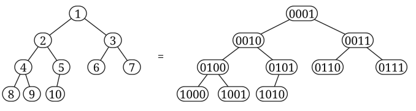](../../assets/volume4a/figures/diagram-7-1-3-132-heap-decimal-binary.svg)

$(132)$

(结点号同时用十进制数和二进制数显示). 在堆中, 我们不需要存储指针来指示结点 $j$ 同它的父结点 (即结点 $j\gg1$, 如果 $j\ne1$) 或者兄弟结点 (即结点 $j\oplus1$, 如果 $j\ne1$ 且该编号不超过 $n$) 或者子结点 (即结点 $j\ll1$ 和 $(j\ll1)+1$, 如果它们不超过 $n$) 之间的关系, 因为通过简单计算就可以从结点 $j$ 直接引向任何想要到达的邻近结点.

同样, 横向堆提供了另一种有用的 $n$ 结点二叉树结构的隐式链接, $n=10$ 时为

<a id="eq-7-1-3-133"></a>

[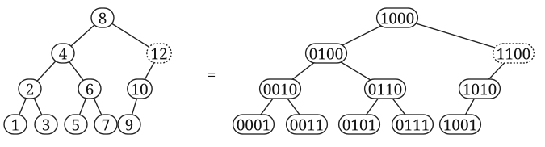](../../assets/volume4a/figures/diagram-7-1-3-133-sideways-heap-decimal-binary.svg)

$(133)$

(当从一个结点移动到它的父结点时, 有时需要超越 $n$, 如上面所示从结点 10 到 12 再到 8 的路径). 堆和横向堆都可视为无限二叉树结构中从 1 到 $n$ 的结点: $n=\infty$ 时, 堆以结点 1 为根, 没有叶结点; 相比之下, $n=\infty$ 时, 横向堆有无穷多个叶结点 $1,3,5,\ldots$, 但没有根!

横向堆的叶结点号是奇数, 它们的父结点号是 2 的奇倍数. 类似地, 叶结点的祖父结点号是 4 的奇倍数, 依此类推. 因此, 直尺函数 $\rho j$ 指出结点 $j$ 处在比叶结点层高多少的层次.

容易看出, 在无限横向堆中, 结点 $j$ 的父结点是

$$
(j-k)\mathbin{\vert}(k\ll1),\qquad\text{其中 }k=j\mathbin{\&}-j;\tag{134}
$$

这个公式计算出离 $j$ 最近的 $2^{1+\rho j}$ 的奇数倍. 当 $j$ 为偶数时, 结点 $j$ 的子结点是

$$
j-(k\gg1)\qquad\text{和}\qquad j+(k\gg1).\tag{135}
$$

<a id="pdf-152"></a><a id="p-137"></a>

一般说来, 结点 $j$ 及其子孙结点构成一个闭区间

$$
[j-2^{\rho j}+1\mathinner{\ldotp\ldotp}j+2^{\rho j}-1],\tag{136}
$$

排成一棵 $2^{1+\rho j}-1$ 个结点的完全二叉树. (这里的子孙包含 $j$ 自身.) 当 $h\ge\rho j$ 时, 结点 $j$ 的高度为 $h$ 的先辈结点是

$$
(j\mathbin{\vert}(1\ll h))\mathbin{\&}-(1\ll h)=((j\gg h)\mathbin{\vert}1)\ll h.\tag{137}
$$

请注意, 结点的对称序 (也称为中缀序) 正好是自然序 $1,2,3,\ldots$.

多夫·哈雷尔在他的博士论文 (加利福尼亚大学欧文分校, 1980 年) 中指出了这些性质, 并注意到, 横向堆的任意两个结点的最近共同先辈也很容易计算. 实际上, 如果结点 $l$ 是结点 $i$ 和 $j$($i\le j$) 的最近共同先辈, 那么存在一个引人注目的恒等式

$$
\rho l=\max\{\rho x\mid i\le x\le j\}=\lambda(j\mathbin{\&}-i),\tag{138}
$$

它把函数 $\rho$ 和 $\lambda$ 联系在了一起. (见习题 146.) 所以, 我们可以利用式 (137) 和 $h=\lambda(j\mathbin{\&}-i)$ 计算 $l$.

巧妙扩充这个方法可以得出一个渐近有效的算法, 即在弧数动态增加的任何有向森林中求最近共同先辈 [多夫·哈雷尔和罗伯特·塔扬,*SICOMP* **13** (1984), 338–355]. 其后, 巴鲁赫·席贝尔和乌齐·维什金 [*SICOMP* **17** (1988), 1253–1262] 发现了一种简单得多的在任意 (但是固定的) 定向森林中计算最近共同先辈的方法, 利用一种具有吸引力和指导性的技术, 融合了按位运算及下面将要讨论的算法.

回忆一下, 具有 $m$ 棵树和 $n$ 个顶点的定向森林是包含 $n-m$ 条弧的有向无圈图. 出自每个顶点最多有一条弧, 出度为零的那些顶点是树的根. 如果 $u\to v$, 则称 $v$ 是 $u$ 的父结点. 如果 $u\mathrel{\to^{*}}v$, 则称 $v$ 是 $u$ 的 (包含自身的) 先辈. 两个顶点有一个共同先辈, 当且仅当它们属于同一棵树. 如果

$$
u\mathrel{\to^{*}}z\text{ 和 }v\mathrel{\to^{*}}z\qquad\text{当且仅当}\qquad w\mathrel{\to^{*}}z,\tag{139}
$$

则称顶点 $w$ 为顶点 $u$ 和 $v$ 的最近共同先辈.

席贝尔和维什金对给定的森林进行预处理, 把它的顶点变换到大小为 $n$ 的横向堆 $S$, 做法是对每个顶点 $v$ 计算下面 3 个量:

$$
\begin{aligned}
\pi v,&\quad\text{前序中 }v\text{ 的秩 }(1\le\pi v\le n);\\
\beta v,&\quad\text{横向堆 }S\text{ 的一个结点 }(1\le\beta v\le n);\\
\alpha v,&\quad (1+\lambda n)\text{ 比特的路径码 }(1\le\alpha v<2^{1+\lambda n}).
\end{aligned}
$$

如果 $u\to v$, 依据前序的定义我们有 $\pi u>\pi v$. 结点 $\beta v$ 定义为横向堆中所有结点 $\pi u$ 的最近共同先辈, 其中 $v$ 是顶点 $u$ 的先辈 (总是指包含自身的先辈). 我们定义

$$
\alpha v=\sum\{2^{\rho\beta w}\mid v\mathrel{\to^{*}}w\}.\tag{140}
$$

例如, 下面是具有 10 个顶点和 2 棵树的定向森林:

<a id="eq-7-1-3-141"></a>

[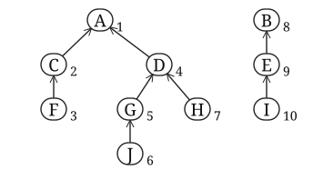](../../assets/volume4a/figures/diagram-7-1-3-141-directed-preorder-forest.svg)

$(141)$

<a id="pdf-153"></a><a id="p-138"></a>

每个顶点以其前序秩标记, 我们可以据此计算 $\beta$ 和 $\alpha$ 码:

$$
\begin{array}{rcccccccccc}
v={}&A&B&C&D&E&F&G&H&I&J\\
\pi v={}&0001&1000&0010&0100&1001&0011&0101&0111&1010&0110\\
\beta v={}&0100&1000&0010&0100&1010&0011&0110&0111&1010&0110\\
\alpha v={}&0100&1000&0110&0100&1010&0111&0110&0101&1010&0110
\end{array}
$$

例如, 因为 $A$ 的子孙结点的前序秩是 $\{1,2,3,4,5,6,7\}$, 所以 $\beta A=4=0100$. 同样, 因为 $H$ 的先辈结点具有 $\beta$ 码 $\{\beta H,\beta D,\beta A\}=\{0111,0100\}$, 所以 $\alpha H=0101$. 容易证明变换 $v\mapsto\beta v$ 满足下面两条基本性质:

(i) 如果在森林中 $u\to v$, 那么在 $S$ 中 $\beta u$ 是 $\beta v$ 的子孙.

(ii) 具有相同 $\beta v$ 值的顶点构成森林中的一条路径.

我们知道, 当 $\beta v\ne\pi v$ 时, 结点 $v$ 恰有一个子结点 $u$ 使得 $\beta u=\beta v$, 因此性质 (ii) 成立.

现在让我们想象, 把森林中的每个顶点 $v$ 放到 $S$ 中的结点 $\beta v$:

<a id="eq-7-1-3-142"></a>

[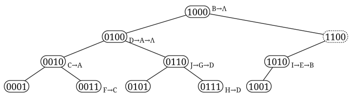](../../assets/volume4a/figures/diagram-7-1-3-142-forest-paths-sideways-heap.svg)

$(142)$

如果 $k$ 个顶点变换到结点 $j$, 那么它们可以排成一条路径

$$
v_0\to v_1\to\cdots\to v_{k-1}\to v_k,\qquad\text{其中 }\beta v_0=\beta v_1=\cdots=\beta v_{k-1}=j.\tag{143}
$$

图 $(142)$ 描绘了这些路径. 例如, $J\to G\to D$ 是 $(141)$ 中的一条路径, 而 “$J\to G\to D$” 标在结点 $0110=\beta J=\beta G$ 旁.

预处理算法还对 $S$ 的所有结点 $j$ 计算一个表 $\tau j$, 包含指向 $(143)$ 尾端顶点 $v_k$ 的指针:

$$
\begin{array}{rcccccccccc}
j={}&0001&0010&0011&0100&0101&0110&0111&1000&1001&1010\\
\tau j={}&\Lambda&A&C&\Lambda&\Lambda&D&D&\Lambda&\Lambda&B
\end{array}
$$

习题 149 表明, 我们可以用 $O(n)$ 步准备好 $\pi v$、$\beta v$、$\alpha v$、$\tau j$ 这 4 个表. 这些表一旦准备就绪, 它们包含正好够快速确定任意两个给定顶点的最近共同先辈的资料:

<a id="alg-7-1-3-V"></a>

**算法 V (求最近共同先辈).** 假定对定向森林的所有 $n$ 个顶点 $v$ 以及对于 $1\le j\le n$, $\pi v$、$\beta v$、$\alpha v$、$\tau j$ 是已知的. 另外假定存在一个虚顶点 $\Lambda$, 满足 $\pi\Lambda=\beta\Lambda=\alpha\Lambda=0$. 算法计算任意给定顶点 $x$ 和 $y$ 的最近共同先辈 $z$, 如果 $x$ 和 $y$ 属于不同的树, 返回 $z=\Lambda$. 假定已经预先计算 $\lambda j=\lfloor\lg j\rfloor$($1\le j\le n$), 并假定 $\lambda0=\lambda n$.

**V1.** [求公共高度.] 如果 $\beta x\le\beta y$, 置 $h\leftarrow\lambda(\beta y\mathbin{\&}-\beta x)$; 否则, 置 $h\leftarrow\lambda(\beta x\mathbin{\&}-\beta y)$. (见 $(138)$.)

**V2.** [求真实高度.] 置 $k\leftarrow\alpha x\mathbin{\&}\alpha y\mathbin{\&}-(1\ll h)$, 置 $h\leftarrow\lambda(k\mathbin{\&}-k)$.

**V3.** [求 $\beta z$.] 置 $j\leftarrow((\beta x\gg h)\mathbin{\vert}1)\ll h$. (现在 $j=\beta z$, 如果 $z\ne\Lambda$.)

**V4.** [求 $\hat x$ 和 $\hat y$.] (现在在结点 $j$ 找 $x$ 和 $y$ 的最低先辈.) 如果 $j=\beta x$, 置 $\hat x\leftarrow x$; 否则, 置 $l\leftarrow\lambda(\alpha x\mathbin{\&}((1\ll h)-1))$, $\hat x\leftarrow\tau(((\beta x\gg l)\mathbin{\vert}1)\ll l)$. 同样, 如果 $j=\beta y$, 置 $\hat y\leftarrow y$; 否则, 置 $l\leftarrow\lambda(\alpha y\mathbin{\&}((1\ll h)-1))$, $\hat y\leftarrow\tau(((\beta y\gg l)\mathbin{\vert}1)\ll l)$.

**V5.** [求 $z$.] 如果 $\pi\hat x\le\pi\hat y$, 置 $z\leftarrow\hat x$; 否则, 置 $z\leftarrow\hat y$.　∎

这些巧妙的算法步骤明显利用了 $(137)$, 习题 152 说明它们为什么是可行的.

<a id="pdf-154"></a><a id="p-139"></a>

横向堆还可以用于实现一类有趣的优先队列, 于尔基·卡塔亚伊宁和法比奥·维塔莱把这种队列称为 “导航堆”, 下图说明 $n=10$ 时的情形:

<a id="eq-7-1-3-144"></a>

[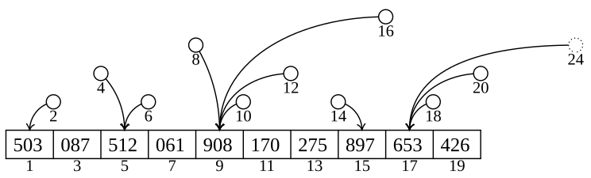](../../assets/volume4a/figures/diagram-7-1-3-144-navigation-pile.svg)

$(144)$

数据元素进入横向堆的叶结点位置 $1,3,\ldots,2n-1$, 它们可能有很多位的宽度, 可以按任意顺序出现. 与之相对, 每个分支位置 $2,4,6,\ldots$ 包含一个指向它的最大子孙的指针. 同时, 奇特之处在于这些指针几乎不占用额外空间 (每项数据平均少于两位), 因为对于指针 $2,6,10,\ldots$ 仅需一位, 对于指针 $4,12,20,\ldots$ 仅需两位, 对于一般指针 $j$ 仅需 $\rho j$ 位 (见习题 153). 因此, 导航堆仅需要非常少的存储空间, 它在典型计算机上也能很好地利用高速缓存.

**\*双曲平面中的胞腔.** 双曲几何学提出一种颇具不同风格的、富有启发性的隐式数据结构. 双曲平面是非欧几何学的一个迷人范例, 把它的点投影到一个圆的内部来考察是方便的. 这样一来, 它的直线变成圆弧, 它们以直角与圆的边缘相遇. 例如, 图 13 中的直线 $PP'$、$QQ'$、$RR'$ 在点 $O,A,B$ 相交, 这三点构成一个三角形. 直线 $SQ'$ 同 $QQ'$ 是平行的: 它们永远不会相遇, 但是它们的点会越来越接近. 直线 $QT$ 同 $QQ'$ 也是平行的.

<a id="fig-7-1-3-13"></a>

[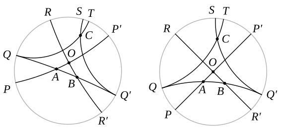](../../assets/volume4a/figures/figure-13-hyperbolic-lines.svg)

**图 13**　双曲平面内五条直线的两幅视图.

通过对不同的中心聚焦, 可以得到不同的视图. 例如, 图 13 中的第二幅视图把 $O$ 点置于正中央. 注意, 如果一条直线通过正中心, 它在投影后依然是直线, 这种跨越直径的弦是半径为无穷大的 “圆弧”.

在双曲平面中, 平面几何学的欧几里得公理大多仍旧成立. 例如, 恰好有一条直线通过任意两个不同的点, 以及, 如果点 $A$ 位于直线 $PP'$ 上, 恰好存在这样一条直线 $QQ'$, 使得夹角 $PAQ$ 具有任何给定的值 $\theta$, 其中 $0<\theta<180^\circ$. 但是, 著名的欧几里得第五公设不再成立: 如果点 $C$ 不在直线 $QQ'$ 上, 恰好总有两条经过 $C$ 的直线同 $QQ'$ 平行. 此外, 存在许多成对直线, 像图 13 中的 $RR'$ 和 $SQ'$, 在它们的点永远不会变得任意接近的意义下, 它们总是不相交的, 或者说是超平行的. [双曲平面的这些性质是乔瓦尼·萨凯里在 18 世纪初发现的, 一个世纪后, 尼古拉·罗巴切夫斯基、亚诺什·鲍耶和卡尔·高斯给出了严格论证.]

确切地说, 当把点投影到单位圆盘 $|z|<1$ 时, 在 $e^{i\theta}$ 和 $e^{-i\theta}$ 处与圆周相遇的弧, 具有圆心 $\sec\theta$ 和半径 $\tan\theta$. 投影为 $z$ 和 $z'$ 的两个点之间的实际距离是

$$
d(z,z')=\ln(|1-\bar z z'|+|z-z'|)-\ln(|1-\bar z z'|-|z-z'|).
$$

因此, 当我们在接近圆周处看到那些远离中心的对象时, 它们显现出急剧收缩.

<a id="pdf-155"></a><a id="p-140"></a>

<a id="fig-7-1-3-14"></a>

[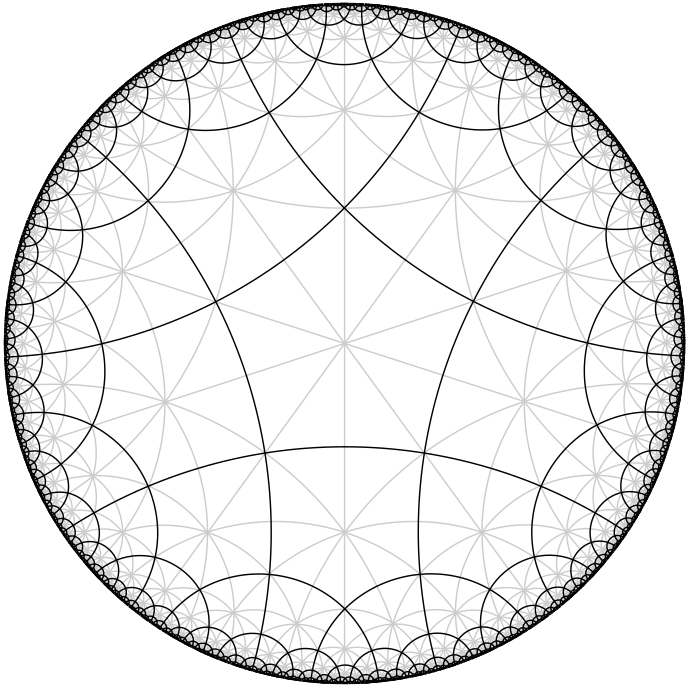](../../assets/volume4a/figures/figure-14-hyperbolic-pentagrid.svg)

**图 14**　五边形网格, 在其中, 无数同样的五边形铺排整个双曲平面 [见赫尔曼·施瓦茨,*Crelle* **75** (1873), 第 318 页以及第 348 页后面的 Tafel II].

> 圆形规则平铺, 无限细小图案围绕圆周, 确实奇妙.
>
> ——毛里茨·科内利斯·埃舍尔, 《致乔治·阿纳尔多·埃舍尔的信》(1958 年 11 月 9 日)

双曲三角形的内角和总是小于 $180^\circ$. 例如, 在图 13 的 $O,A,B$ 处的角分别是 $90^\circ,45^\circ,36^\circ$. 10 个 $36^\circ$–$45^\circ$–$90^\circ$ 三角形拼在一起可以构成一个正五边形, 它的每个内角都是 $90^\circ$. 4 个这样的直角正五边形正好顶角紧密靠拢, 因此我们可以用直角正五边形铺排整个双曲平面 (见图 14). 这些正五边形的边构成一个有趣的直线族, 其中的每两条直线要么是超平行的, 要么是垂直的. 所以, 我们得到一个网格结构, 类似于普通平面中的单位正方形. 每个胞腔现在有 5 个邻居而不是 4 个, 我们称它为五边形网格.

在五边形网格中, 有一种有意思的利用斐波那契数导航的方式, 建立在莫里斯·马根斯特恩的思想基础上 [见弗朗辛·埃尔曼和莫里斯·马根斯特恩,*Theoretical Comp. Sci.* **296** (2003), 345–351]. 但是, 我们将用负斐波那契序列 $\langle F_{-n}\rangle$

$$
F_{-1}=1,\quad F_{-2}=-1,\quad F_{-3}=2,\quad F_{-4}=-3,\quad F_{-5}=5,\quad\ldots,\quad F_{-n}=(-1)^{n-1}F_n\tag{145}
$$

代替了通常的斐波那契序列 $\langle F_n\rangle$. 习题 1.2.8–34 介绍了斐波那契数系, 其中每个非负整数 $x$ 都可以唯一表示成

$$
x=F_{k_1}+F_{k_2}+\cdots+F_{k_r},\qquad\text{其中 }k_1\succ k_2\succ\cdots\succ k_r\succ0.\tag{146}
$$

这里 $j\succ k$ 表示 $j\ge k+2$. 但是, 还有一种负斐波那契数系, 它更适合我们的需要: 每个整数 $x$, 无论它是正数、负数还是零, 都可以唯一表示成

$$
x=F_{k_1}+F_{k_2}+\cdots+F_{k_r},\qquad\text{其中 }k_1\prec k_2\prec\cdots\prec k_r\prec1.\tag{147}
$$

例如, $4=5-1=F_{-5}+F_{-2}$, $-2=-3+1=F_{-4}+F_{-1}$. 这种表示法可以方便地表达成二进制码 $\alpha=\ldots a_3a_2a_1$, 意思是 $N(\alpha)=\sum_k a_kF_{-k}$, 其中不存在两个相邻的 1. 例如, 下面是 $-14$ 至 $+15$ 的全部整数的负斐波那契数表示码:

```text
−14 = 10010100   −8 = 100000   −2 = 1001   4 = 10010    10 = 1001000
−13 = 10010101   −7 = 100001   −1 = 10     5 = 10000    11 = 1001001
−12 = 101010     −6 = 100100    0 = 0      6 = 10001    12 = 1000010
−11 = 101000     −5 = 100101    1 = 1      7 = 10100    13 = 1000000
−10 = 101001     −4 = 1010      2 = 100    8 = 10101    14 = 1000001
 −9 = 100010     −3 = 1000      3 = 101    9 = 1001010  15 = 1000100
```

如在负十进制数系中那样 (见 4.1-$(6)$、$(7)$), 通过查看 $x$ 的负斐波那契数表示码的位数是偶数还是奇数, 我们可以得知它是不是负数.

<a id="pdf-156"></a><a id="p-141"></a>

任何负斐波那契二进制码 $\alpha$ 的前导 $\alpha-$ 和后继 $\alpha+$ 都可以用规则

$$
\begin{gathered}
(\alpha01)-=\alpha00,\qquad(\alpha000)-=\alpha010,\qquad(\alpha100)-=\alpha001,\\
(\alpha10)-=(\alpha-)01,\qquad(\alpha10)+=\alpha00,\qquad(\alpha00)+=\alpha01,\qquad(\alpha1)+=(\alpha-)0
\end{gathered}\tag{148}
$$

递归计算. (见习题 157.) 然而, 也可以用简练的 10 步 2 基运算直接计算:

$$
\begin{aligned}
y&\leftarrow x\oplus\bar\mu_0,\quad z\leftarrow y\oplus(y\pm1),\qquad\text{其中 }x=(\alpha)_2;\\
z&\leftarrow z\mathbin{\vert}(x\mathbin{\&}(z\ll1));\\
w&\leftarrow x\oplus z\oplus((z+1)\gg2);\qquad\text{此时 }w=(\alpha\pm)_2.
\end{aligned}\tag{149}
$$

在第一行中使用 $y+1$ 获得后继, 使用 $y-1$ 获得前导.

现在, 要点是: 把负斐波那契码赋予五边形网格的每个胞腔, 使它的 5 个邻近胞腔的码都容易计算. 我们称 “北”“南”“东”“西”“其他” 邻近胞腔为 $n,s,e,w,o$ 邻近. 如果 $\alpha$ 是赋予一个给定胞腔的二进制码, 我们定义

$$
\alpha_n=\alpha\gg2,\qquad\alpha_s=\alpha\ll2,\qquad\alpha_e=\alpha_s+,\qquad\alpha_w=\alpha_s-;\tag{150}
$$

因此 $\alpha_{sn}=\alpha$, $\alpha_{en}=(\alpha01)_n=\alpha$. “其他” 方向的定义更有技巧:

$$
\alpha_o=\begin{cases}
\alpha_n+,&\text{若 }\alpha\mathbin{\&}1=1;\\
\alpha_w-,&\text{若 }\alpha\mathbin{\&}1=0.
\end{cases}\tag{151}
$$

例如, $1000_o=101001$, $101001_o=1000$. 当 $\alpha$ 以 1 结束时, 这个神秘的闯入者 $\alpha_o$ 位于北与东之间; 当 $\alpha$ 以 0 结束时, $\alpha_o$ 位于北与西之间.

如果我们任意选择一个胞腔, 用二进制码 0 标记它, 并选择一个方向, 它的顺时针顺序的邻近是 $n,e,s,w,o$, 规则 (150) 和 $(151)$ 将对五边形网格的每个胞腔赋予一致的标记. (见习题 160.) 例如, 标记为 1000 的胞腔的邻近看似如下:

<a id="eq-7-1-3-152"></a>

[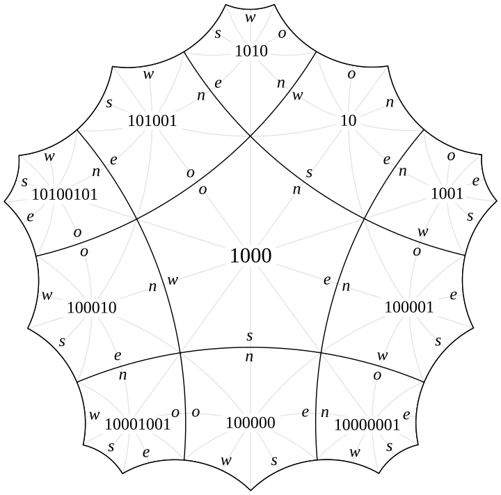](../../assets/volume4a/figures/diagram-7-1-3-152-pentagrid-neighborhood.svg)

$(152)$

<a id="pdf-157"></a><a id="p-142"></a>

然而, 二进制码标记不能唯一地确定胞腔, 因为有无限多的胞腔获得相同标记. (实际上, 显然有 $0_n=0_s=0$, $1_w=1_o=1$.) 为了获得唯一标识符, 我们附加第二个坐标, 使得每个胞腔的全名具有 $(\alpha,y)$ 的形式, 其中 $y$ 是整数. 当 $y$ 为常数而 $\alpha$ 跑遍全部负斐波那契码时, 这些胞腔 $(\alpha,y)$ 构成一条宛如钩形的条带, 它的边界在胞腔 $(0,y)$ 附近转过 $90^\circ$. 通常, 胞腔 $(\alpha,y)$ 的 5 个邻近是 $(\alpha,y)_n=(\alpha_n,y+\delta_n(\alpha))$、$(\alpha,y)_s=(\alpha_s,y+\delta_s(\alpha))$、$(\alpha,y)_e=(\alpha_e,y+\delta_e(\alpha))$、$(\alpha,y)_w=(\alpha_w,y+\delta_w(\alpha))$、$(\alpha,y)_o=(\alpha_o,y+\delta_o(\alpha))$, 其中

$$
\begin{gathered}
\delta_n(\alpha)=[\alpha=0],\quad \delta_s(\alpha)=-[\alpha=0],\quad
\delta_e(\alpha)=0,\quad \delta_w(\alpha)=-[\alpha=1];\\
\delta_o(\alpha)=
\begin{cases}
\operatorname{sign}(\alpha_o-\alpha_n)[\alpha_o\mathbin{\&}\alpha_n=0], & \text{若 }\alpha\mathbin{\&}1=1;\\
\operatorname{sign}(\alpha_o-\alpha_w)[\alpha_o\mathbin{\&}\alpha_w=0], & \text{若 }\alpha\mathbin{\&}1=0.
\end{cases}
\end{gathered}\tag{153}
$$

(见下图.) 现在, 按位运算让我们轻松地在整个双曲平面上冲浪. 另一方面, 我们还可以忽略 $y$ 坐标而移动, 由此回绕成一个五边形的 “双曲柱面”. $\alpha$ 坐标在全体负斐波那契码的集合上定义了一个有趣的多重图, 其中每个顶点为 5 度.

<a id="eq-7-1-3-154"></a>

[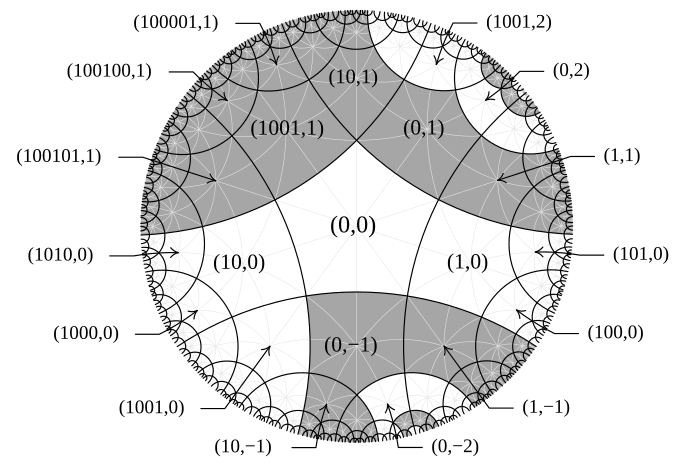](../../assets/volume4a/figures/diagram-7-1-3-154-hyperbolic-cylinder.svg)

$(154)$

**位图图形.** 编写处理图像与图形的程序很有趣, 因为做这件事情需要同时使用我们的左半脑和右半脑. 当涉及图像数据时, 即便我们的代码中存在错误, 结果可能也是引人入胜的.

你现在阅读的这本书是用软件排版的, 它把每个页面看作以 0 和 1 为元素的一个巨大矩阵. 这个称为 “光栅” 或 “位图” 的矩阵包含几百万个称为 “像素” 的方块图像元素. 在光栅传输到印刷机时, 凡是矩阵中出现 1 的地方就输出小墨点. 墨和纸的物理特性使得那些细小的点簇看起来像光滑曲线. 但是, 如果我们把图像放大十倍, 每个像素的基本方块形状就变得明显, 就像在图 15(a) 中显示的字母 “A” 那样.

利用按位运算我们可以达到 “镂空” 的效果, 其中四周受包围的黑色像素消失 (图 15(b)).

<a id="fig-7-1-3-15"></a>

[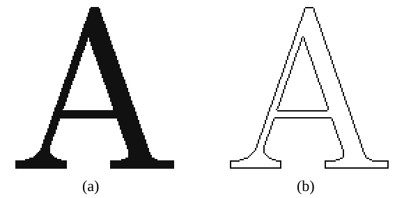](../../assets/volume4a/figures/figure-15-bitmap-letter-a.svg)

**图 15**　镂空前后的字母 A.

这种由罗素·基尔希、伦纳德·卡恩、C. 雷和吉纳维·厄本 [*Proc. Eastern Joint Computer Conf.* **12** (1957), 221–229] 引进的运算可以表示成

$$
\operatorname{custer}(X)=X\mathbin{\&}\mathord{\sim}\big((X\mathbin{\mathrlap{\raisebox{.195em}{\(\vee\)}}\vee}1)\mathbin{\&}(X\gg1)\mathbin{\&}(X\ll1)\mathbin{\&}(X\mathbin{\mathrlap{\raisebox{.195em}{\(\wedge\)}}\wedge}1)\big),\tag{155}
$$

其中 $X\mathbin{\mathrlap{\raisebox{.195em}{\(\vee\)}}\vee}1$ 和 $X\mathbin{\mathrlap{\raisebox{.195em}{\(\wedge\)}}\wedge}1$ 分别表示位图 $X$ 向下或向上移动一行的结果. 让我们把位图 $X$ 的 4 种 1 像素移动写成

$$
X_{\mathrm N}=X\mathbin{\mathrlap{\raisebox{.195em}{\(\vee\)}}\vee}1,\quad X_{\mathrm W}=X\gg1,\quad X_{\mathrm E}=X\ll1,\quad X_{\mathrm S}=X\mathbin{\mathrlap{\raisebox{.195em}{\(\wedge\)}}\wedge}1.\tag{156}
$$

<a id="pdf-158"></a><a id="p-143"></a>

那么, 例如, 符号表达式 $X_{\mathrm N}\mathbin{\&}(X_{\mathrm S}\mid\overline{X}_{\mathrm E})$ 在满足以下条件的像素位置计算出值 1: 它的北面邻近为黑色, 同时, 南面邻近为黑色或者东面邻近为白色. 利用这些缩写, 表达式 (155) 可以表示成

$$
\operatorname{custer}(X)=X\mathbin{\&}\mathord{\sim}(X_{\mathrm N}\mathbin{\&}X_{\mathrm W}\mathbin{\&}X_{\mathrm E}\mathbin{\&}X_{\mathrm S}).\tag{157}
$$

也可以把它写成 $X\mathbin{\&}(\overline{X}_{\mathrm N}\mid\overline{X}_{\mathrm W}\mid\overline{X}_{\mathrm E}\mid\overline{X}_{\mathrm S})$.

每个像素有 4 个 “车邻近”[^v4a-158-rook-king], 它同上、下、左、右共享一条边. 它还有 8 个 “王邻近”, 它同它们至少共享一个点. 例如, 位于位图 $X$ 所有像素东北面的王邻近可以用 $X_{\mathrm{NE}}$ 表示, 它在像素代数中等价于 $(X_{\mathrm N})_{\mathrm E}$. 注意, 我们也有 $X_{\mathrm{NE}}=(X_{\mathrm E})_{\mathrm N}$.

$3\times3$ 细胞自动机是通过局部变换序列而动态变换的像素阵列, 像素的变换全部同时进行: 每个像素在时刻 $t+1$ 的状态完全取决于它在时刻 $t$ 的状态以及那时它的王邻近的状态. 这样, 自动机定义了一个从任意给定的初始状态 $X^{(0)}$ 开始的位图序列 $X^{(0)},X^{(1)},X^{(2)},\ldots$, 其中

$$
X^{(t+1)}=f(X_{\mathrm{NW}}^{(t)},X_{\mathrm N}^{(t)},X_{\mathrm{NE}}^{(t)},X_{\mathrm W}^{(t)},X^{(t)},X_{\mathrm E}^{(t)},X_{\mathrm{SW}}^{(t)},X_{\mathrm S}^{(t)},X_{\mathrm{SE}}^{(t)}),\tag{158}
$$

这里 $f$ 是任意九变量按位布尔函数. 一些引人入胜的图案往往由此产生. 例如, 马丁·加德纳于 1970 年对世人介绍了约翰·康威的 “生命游戏”[^v4a-158-conway], 在随后的几年里, 用于研究它的计算机时间也许比花在任何其他计算任务上的都多——虽然支付计算机账单的人很少得知此事! (见习题 167.)

有 $2^{512}$ 个九变量的布尔函数, 所以存在 $2^{512}$ 种不同的 $3\times3$ 细胞自动机. 许多细胞自动机的价值不大, 然而, 它们中的大多数可能具有如此复杂的特性, 以致人们无法理解. 幸好还有很多实例在实践中确有用处, 而且比起模拟一款游戏, 证明它们值得投入计算成本要容易得多.

例如, 对于识别字母字符、指纹或者类似模式的算法, 经常使用一种 “细化” 过程. 这个过程消除多余的黑色像素, 并把图像的每个成分简化为分析起来比较简单的基本构架. 对于这个问题, 若干作者提出了细胞自动机的概念, 从丹尼斯·鲁托维茨 [*J. Royal Stat. Society* **A129** (1966), 512–513] 开始, 他建议一种 $4\times4$ 方案. 然而, 并行算法很难捉摸, 虽然发表了各种各样的方法, 但错误时有发生. 例如, 在一个类似 <a href="../../assets/volume4a/figures/glyph-7-1-3-thinning-square.svg"></a> 的结构中, 应该消除 1 个、2 个或 3 个黑色像素, 一种对称方案却错误地抹掉全部 4 个黑色像素.

对于细化问题, 郭自成和理查德·霍尔 [*CACM* **32** (1989), 359–373, 759] 最终找到一种令人满意的解决方案, 使用一种 $3\times3$ 自动机, 执行对奇数步骤与偶数步骤的交替规则. 考虑函数

$$
f(x_{\mathrm{NW}},x_{\mathrm N},x_{\mathrm{NE}},x_{\mathrm W},x,x_{\mathrm E},x_{\mathrm{SW}},x_{\mathrm S},x_{\mathrm{SE}})=x\wedge\neg g(x_{\mathrm{NW}},x_{\mathrm N},x_{\mathrm{NE}},x_{\mathrm W},x_{\mathrm E},x_{\mathrm{SW}},x_{\mathrm S},x_{\mathrm{SE}}),\tag{159}
$$

其中仅在下面 37 种包围正中心的一个黑色像素的结构中 $g=1$:

[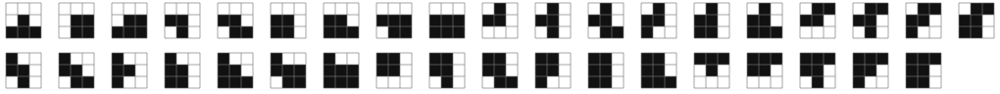](../../assets/volume4a/figures/diagram-7-1-3-thinning-neighborhoods-37.svg)

然后, 我们使用 $(158)$, 但是对于偶数操作步骤, $f(x_{\mathrm{NW}},x_{\mathrm N},x_{\mathrm{NE}},x_{\mathrm W},x,x_{\mathrm E},x_{\mathrm{SW}},x_{\mathrm S},x_{\mathrm{SE}})$ 用它的 $180^\circ$ 旋转 $f(x_{\mathrm{SE}},x_{\mathrm S},x_{\mathrm{SW}},x_{\mathrm E},x,x_{\mathrm W},x_{\mathrm{NE}},x_{\mathrm N},x_{\mathrm{NW}})$ 代替. 当连续两次循环不产生改变时算法终止.

<a id="pdf-159"></a><a id="p-144"></a>

郭自成和霍尔用这种规则证明, 在下面我们将要讨论的一种强意义下, 这个 $3\times3$ 自动机保持图像的连通性结构. 此外, 如果图像已经细到不包含 3 个彼此 “王邻近” 的像素, 他们的算法显然保持图像原封不动. 另一方面, 它在每个黑色分图 “从骨头去肉” 的过程中通常取得成功, 如图 16 所示. 在某些情况下, 如果我们把另外 4 种结构

<a id="eq-7-1-3-160"></a>

[](../../assets/volume4a/figures/diagram-7-1-3-thinning-neighborhoods-4.svg)

$(160)$

添加到上面列出的 37 种结构中, 就会获得更细一些的细化. 无论哪种情况, 函数 $g$ 都可以用一条长度为 25 的布尔链求值. (见习题 170–172.)

<a id="fig-7-1-3-16"></a>

[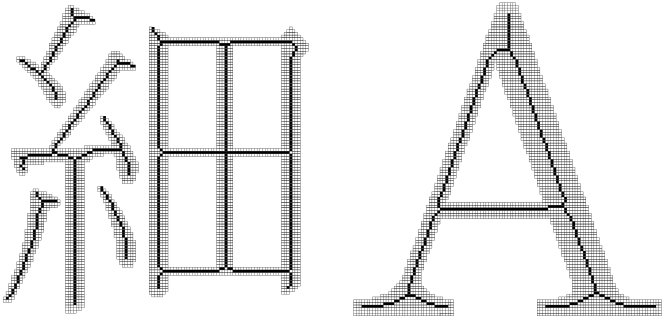](../../assets/volume4a/figures/figure-16-thinning-ideograph-letter.svg)

**图 16**　出自郭自成和霍尔细化位图成分的 $3\times3$ 自动机的例子 (“空洞” 像素原为黑色).

一般情况下, 可以把一个图像的黑色像素分成若干片段或分图, 它们在以下意义下是王连通的: 任何黑色像素可以从它的分图的任何其他像素, 通过一系列经由黑色像素的王移动到达. 白色像素可以构成车连通的分图: 分图的任何两个白色胞腔经由完全不接触黑色像素的车移动是相互可达的. 对白色胞腔与黑色胞腔, 最好采用不同类型的连通性, 以便保持来自连续几何的熟知的 “内部” 和 “外部” 的拓扑概念 [见阿兹列尔·罗森菲尔德,*JACM* **17** (1970), 146–160]. 如果我们把光栅的角点想象成黑色, 一条无限细的黑色曲线能够在角的像素之间穿过, 但是一条白色曲线不能穿过. (我们也可以想象白色的角点, 它们将导致黑色像素的车连通性和白色像素的王连通性.)

斯特凡诺·莱维亚尔迪 [*CACM* **15** (1972), 7–10] 提出一个有趣的算法, 它在收缩一幅图像时保持连通性, 不过孤立的黑色像素或白色像素会消失. T. 拜尔的博士论文 (麻省理工学院, 1969 年) 中出现了一个等价的算法, 但是黑色与白色颠倒过来. 算法思想是在每一步使用具有简单变换函数

$$
f(x_{\mathrm{NW}},x_{\mathrm N},x_{\mathrm{NE}},x_{\mathrm W},x,x_{\mathrm E},x_{\mathrm{SW}},x_{\mathrm S},x_{\mathrm{SE}})=(x\wedge(x_{\mathrm W}\vee x_{\mathrm{SW}}\vee x_{\mathrm S}))\vee(x_{\mathrm W}\wedge x_{\mathrm S})\tag{161}
$$

的细胞自动机. 这个公式实际上是一条 $2\times2$ 规则, 但是, 如果需要记住一个单像素分图消失的情形, 我们还需要一个 $3\times3$ 窗口.

例如, 图 17(a) 是一只柴郡猫[^v4a-159-cheshire-cat] 的 $25\times30$ 图像, 它具有 7 个王连通黑色分图: 头部轮廓、两个耳孔、两只眼睛、鼻子以及笑容. 应用一次转换函数 $(161)$ 后的结果显示在图 17(b) 中: 7 个分图保留了下来, 但一个耳孔变成了孤立点, 在下一步后另一个耳孔也将变成孤立点. 因此, 图 17(c) 只有 5 个分图. 在 6 步后猫丢掉它的鼻子, 在 14 步时甚至猫的笑容也将消失. 待到 46 步时, 猫的最后一点踪影也将黯然湮灭.

最多经过 $M+N-1$ 次变换, 就能清除任何 $M\times N$ 图像, 因为最低可见的从西北到东南的对角线在每一步都不断上移. 习题 176 和 177 证明, 不同的分图不会合并在一起而互相干扰.

当然, 这种三次时间复杂度的胞腔方法并非计算或者识别一个图像的分图的最快方法. 实际上, 如果我们每次一行考察一幅大图像, 则能 “在线” 处理这个作业. 如果不需要再次考察过去见过的行, 就不必费心把它们全部保存在内存中.

<a id="pdf-160"></a><a id="p-145"></a>

<a id="fig-7-1-3-17"></a>

[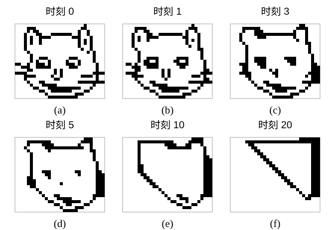](../../assets/volume4a/figures/figure-17-cheshire-cat.svg)

**图 17**　一只英国柴郡猫图像的退缩, 重复应用莱维亚尔迪变换.

当我们分析分图时, 同样也可以记录它们之间的关系. 不妨假定仅出现有限多的黑色像素. 这种情况下, 存在一个称为背景的白色像素的无限分图. 同背景邻接的黑色分图构成图像的主体对象. 这些主体可能带有一些空穴, 它们可以作为另一层次对象的背景, 依此类推. 这样一来, 任何有限图像的连通分图构成一个层次结构——一棵根在背景的定向树. 黑色分图出现在这棵树的奇数编号层, 白色分图出现在偶数编号层, 王连通与车连通交替出现. 除背景之外的每个分图被它的父结点包围. 无子结点的分图称为简单连通分图.

例如, 下面是用数字标记白色像素、用字母标记黑色像素的柴郡猫的分图, 以及对应的定向树:

<a id="eq-7-1-3-162"></a>

[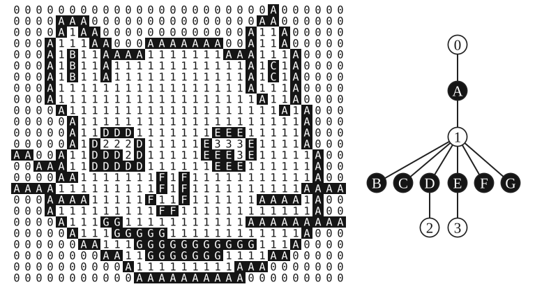](../../assets/volume4a/figures/diagram-7-1-3-162-cheshire-components.svg)

$(162)$

在图 17 的退缩过程中, 分图依照 🅒、{🅑, ②, ③}(都在时刻 3)、🅕、🅔、🅓、🅖、①、🅐 的顺序消失.

假定我们需要通过每次读出一行来分析一幅图像的分图, 在我们看见 4 行后, 那时的结果是

<a id="eq-7-1-3-163"></a>

[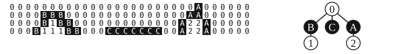](../../assets/volume4a/figures/diagram-7-1-3-163-online-prefix.svg)

$(163)$

<a id="pdf-161"></a><a id="p-146"></a>

此时我们准备扫描第 5 行. 第 4 行与第 5 行的比较表明, 🅑 和 🅒 应当合并到 🅐 中, 此外, 应创建新的分图 🅑 和 ③. 习题 179 包含一个指导性算法的全部细节, 当输入新行时那个算法正确更新当前树. 此外, 该算法还能够随时计算附带数据: 例如, 我们可以确定每个分图的面积、它的第一个和最后一个像素的位置、最小的包围矩形, 以及它的重心.

**\*填充.** 现在, 我们考察如何填充以直线和 (或) 简单曲线为边界的区域, 以此结束对光栅图形的快速浏览. 对于由经典几何学中的 “圆锥曲线”——圆、椭圆、抛物线或双曲线——构成的曲线, 我们有特别有效的算法.

与几何学的传统一致, 在下面的讨论中, 我们将采用笛卡儿坐标 $(x,y)$ 而不谈及关于像素的行和列. $x$ 值的增加是指一次向右移动, $y$ 值的增加是指一次向上移动. 我们更为关注方块像素边之间的关系, 而不是像素本身. 当 $|x-x'|+|y-y'|=1$ 时, 方块像素的边位于平面整数坐标点 $(x,y)$ 和 $(x',y')$ 之间. 每个像素以四条边 $(x,y)$—$(x-1,y)$—$(x-1,y-1)$—$(x,y-1)$—$(x,y)$ 为界. 经验表明, 如果我们专注于白色像素与黑色像素的边转移, 而不是在镂空边界内的黑色像素之间转移, 填充轮廓线的算法将变得更加简单和更为捷快. (例如, 见布赖恩·阿克兰和尼尔·韦斯特在 *IEEE Trans.* **C-30** (1981), 41–48 所做的讨论.)

考虑当变量 $t$ 由 0 变到 1 时画出的一条连续曲线 $z(t)=(x(t),y(t))$. 假定对于 $0\le t<1$ 曲线不自相交, 而且 $z(0)=z(1)$. 著名的若尔当曲线定理 [卡米耶·若尔当,*Cours d’analyse* **3** (1887), 587–594; 奥斯瓦尔德·维布伦,*Trans. Amer. Math. Soc.* **6** (1905), 83–98] 说明, 每一条这样的曲线把平面分成两个区域, 称为平面的内部和外部. 强制 $z(t)$ 沿着像素之间的边通过, 可以对它 “数字化”. 这样我们获得一个逼近, 在图像中内部像素是黑色的而外部像素是白色的. 实际上, 这个数字化过程是用整数坐标点序列

$$
\operatorname{round}(z(t))=\left(\left\lfloor x(t)+\tfrac12\right\rfloor,\left\lfloor y(t)+\tfrac12\right\rfloor\right),\qquad \text{其中 }0\le t\le1\tag{164}
$$

代替原来的曲线. 在需要的情况下可以对曲线轻微干扰, 使 $z(t)$ 不致恰好通过一个像素的中心. 这样, 当 $t$ 增加时, 数字化曲线沿像素的边离散描绘. 一个像素落在数字化曲线的内部, 当且仅当它的中心处在原来连续曲线 $\{z(t)\mid0\le t\le1\}$ 的内部.

例如, 方程 $x(t)=20\cos2\pi t$ 和 $y(t)=10\sin2\pi t$ 定义一个椭圆. 它的数字化 $\operatorname{round}(z(t))$ 当 $t=0$ 时从 $(20,0)$ 开始, 然后, 当 $t\approx .008$ 时跳到 $(20,1)$, 此时 $10\sin2\pi t=0.5$. 接下来, 当 $t$ 依次取值 $.024,.036,.040,.057,.062,\ldots,.976,.992$ 时, 它继续行进到点 $(20,2)$、$(19,2)$、$(19,3)$、$(19,4)$、$(18,4)$、$\ldots$、$(20,-1)$、$(20,0)$:

<a id="eq-7-1-3-165"></a>

[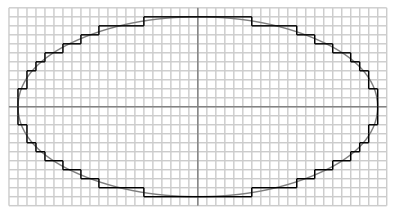](../../assets/volume4a/figures/diagram-7-1-3-165-digital-ellipse.svg)

$(165)$

对于这样一条边界, 我们可以用位向量 $H(y)$ (对于每个 $y$) 方便地表示它的横向边. 例如, 在 $(165)$ 中,

$$
\begin{aligned}
H(10)&=\ldots 000000111111111111000000\ldots,\\
H(9)&=\ldots 011111000000000000111110\ldots.
\end{aligned}
$$

如果用黑色像素填充椭圆以获得一个位图 $B$, 向量 $H$ 标记黑色像素与白色像素之间的转移, 则我们有符号关系

$$
H=B\oplus(B\mathbin{\mathrlap{\raisebox{.195em}{\(\wedge\)}}\wedge}1).\tag{166}
$$

<a id="pdf-162"></a><a id="p-147"></a>

反过来, 当给定向量 $H$ 时, 容易得到位图 $B$:

$$
\begin{aligned}
B(y)&=H(y_{\max})\oplus H(y_{\max-1})\oplus\cdots\oplus H(y+1)\\
&=H(y_{\min})\oplus H(y_{\min+1})\oplus\cdots\oplus H(y).
\end{aligned}\tag{167}
$$

注意 $H(y_{\min})\oplus H(y_{\min+1})\oplus\cdots\oplus H(y_{\max})$ 是零向量, 因为每个位图的顶部和底部都是白色像素. 另请注意, 类似的纵向边向量 $V(x)$ 是多余的: 它们满足公式 $V=B\oplus(B\ll1)$ 和 $B=V^{\oplus}$ (见习题 36), 但我们无须费心记住它们.

圆锥曲线比大多数其他曲线更容易处理, 因为我们可以轻而易举地消去参数 $t$. 例如, 可以用方程 $(x/20)^2+(y/10)^2=1$ 定义 (165) 的椭圆, 而无须使用正弦和余弦函数. 所以, 像素 $(x,y)$ 是黑色, 当且仅当它的中心点 $(x-\tfrac12,y-\tfrac12)$ 位于椭圆内部, 当且仅当 $(x-\tfrac12)^2/400+(y-\tfrac12)^2/100-1<0$.

一般说来, 每条圆锥曲线是这样一些点的集合, 对它们而言, 当 $F$ 是某个适当的二次型时 $F(x,y)=0$. 所以, 存在二次型

$$
Q(x,y)=F(x-\tfrac12,y-\tfrac12)=ax^2+bxy+cy^2+dx+ey+f,\tag{168}
$$

它在整数点 $(x,y)$ 取负值, 当且仅当像素 $(x,y)$ 位于数字化曲线的给定边.

出于实用上的需要, 我们可以假定 $Q$ 的系数 $(a,b,\ldots,f)$ 是不太大的整数. 这样, 我们将容易计算 $Q(x,y)$ 的准确值. 事实上, 正如迈克尔·皮特威 [*Comp. J.* **10** (1967), 282–289] 指出的那样, 存在一个令人满意的 “三寄存器算法”, 我们可以依靠它快速跟踪边界点: 令 $x,y$ 为整数, 并假定我们已经在 3 个寄存器 $(Q,Q_x,Q_y)$ 中获得 $Q(x,y),Q_x(x,y),Q_y(x,y)$ 的值, 其中

$$
Q_x(x,y)=2ax+by+d\qquad\text{和}\qquad Q_y(x,y)=bx+2cy+e\tag{169}
$$

是偏导数 $\frac{\partial}{\partial x}Q$ 和 $\frac{\partial}{\partial y}Q$. 那么, 我们可以移动到任何邻近的整数点, 因为

$$
\begin{alignedat}{2}
Q(x\pm1,y)&=Q(x,y)\pm Q_x(x,y)+a,&\qquad Q(x,y\pm1)&=Q(x,y)\pm Q_y(x,y)+c,\\
Q_x(x\pm1,y)&=Q_x(x,y)\pm2a,& Q_x(x,y\pm1)&=Q_x(x,y)\pm b,\\
Q_y(x\pm1,y)&=Q_y(x,y)\pm b;& Q_y(x,y\pm1)&=Q_y(x,y)\pm2c.
\end{alignedat}\tag{170}
$$

此外, 我们可以把轮廓线分割成若干分离的片段, 在每个片段中, $x(t)$ 和 $y(t)$ 都是单调的. 例如, 在椭圆 $(165)$ 中, 从 $(20,0)$ 移动到 $(0,10)$ 时, $x$ 的值减少而 $y$ 的值增加. 因此, 我们仅需从 $(x,y)$ 移动到 $(x-1,y)$, 或者移动到 $(x,y+1)$. 如果寄存器 $(Q,R,S)$ 中分别保存着 $(Q,Q_x-a,Q_y+c)$, 那么, 进行一次到 $(x-1,y)$ 的移动仅需简单地置 $Q\leftarrow Q-R$, $R\leftarrow R-2a$, $S\leftarrow S-b$; 到 $(x,y+1)$ 的移动也是一样快的. 请注意, 这种思想导致一种极为快速的方法, 它能发现绝大多数圆锥曲线的正确数字化边界.

<a id="pdf-163"></a><a id="p-148"></a>

例如, 当我们对椭圆 $(165)$ 的系数实现整数化时, 它的二次型 $Q(x,y)$ 是 $4x^2+16y^2-(4x+16y+1595)$. 我们有 $Q(20,0)=F(19.5,-0.5)=-75$, $Q(21,0)=+85$, 所以, 中心在 $(19.5,-0.5)$ 的像素 $(20,0)$ 位于椭圆内部, 但像素 $(21,0)$ 不在椭圆内部. 我们把图像放大一些:

<a id="eq-7-1-3-171"></a>

[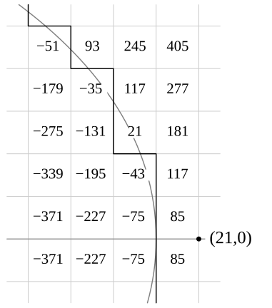](../../assets/volume4a/figures/diagram-7-1-3-171-ellipse-values.svg)

$(171)$

我们可以在不检查大量点的 $Q$ 值的情况下推断边界. 事实上, 不必考察 $Q(21,0)$, 因为我们知道所有在 $(20,0)$ 与 $(0,10)$ 之间的边必定是向上或向左伸延的. 首先检查 $Q(20,1)$, 发现它是负值 ($-75$), 所以向上移动. $Q(20,2)$ 也是负值 ($-43$), 所以再次向上移动. 然后, 我们检查 $Q(20,3)$, 发现它是正值 ($21$), 所以向左移动. 依此类推. 实际上, 如果已经适当建立三寄存器方法, 则仅需检查以下 $Q$ 值: $-75,-43,21,-131,-35,93,-51,\ldots$.

**算法 T (对于圆锥曲线的三寄存器算法).** 给定两个整数点 $(x,y)$ 和 $(x',y')$, 以及一个像 $(168)$ 那样的整二次型 $Q$, 算法确定如何数字化 $F(x,y)=0$ 定义的圆锥曲线的一部分, 其中 $F(x,y)=Q(x+\tfrac12,y+\tfrac12)$. 它建立 $|x'-x|$ 条横向边和 $|y'-y|$ 条纵向边, 这些边构成一条从 $(x,y)$ 到 $(x',y')$ 的路径. 我们假定:

(i) 存在满足 $F(\xi,\eta)=F(\xi',\eta')=0$ 的实数值坐标点 $(\xi,\eta)$ 和 $(\xi',\eta')$.

(ii) 从 $(\xi,\eta)$ 移动到 $(\xi',\eta')$ 时, 曲线的两个坐标都是单调变化的.

(iii)$x=\lfloor\xi+\tfrac12\rfloor$, $y=\lfloor\eta+\tfrac12\rfloor$, $x'=\lfloor\xi'+\tfrac12\rfloor$, $y'=\lfloor\eta'+\tfrac12\rfloor$.

(iv) 如果从 $(\xi,\eta)$ 穿越曲线到达 $(\xi',\eta')$, 在我们的左边有 $F<0$.

(v) 整数网格的任何一条边都至多含有 $Q$ 的一个根 (见习题 183).

**T1.** [初始化.] 如果 $x=x'$, 转到 T11; 如果 $y=y'$, 转到 T10. 如果 $x<x'$ 且 $y<y'$, 置 $Q\leftarrow Q(x+1,y+1)$, $R\leftarrow Q_x(x+1,y+1)+a$, $S\leftarrow Q_y(x+1,y+1)+c$, 转到 T2. 如果 $x<x'$ 且 $y>y'$, 置 $Q\leftarrow Q(x+1,y)$, $R\leftarrow Q_x(x+1,y)+a$, $S\leftarrow Q_y(x+1,y)-c$, 转到 T3. 如果 $x>x'$ 且 $y<y'$, 置 $Q\leftarrow Q(x,y+1)$, $R\leftarrow Q_x(x,y+1)-a$, $S\leftarrow Q_y(x,y+1)+c$, 转到 T4. 如果 $x>x'$ 且 $y>y'$, 置 $Q\leftarrow Q(x,y)$, $R\leftarrow Q_x(x,y)-a$, $S\leftarrow Q_y(x,y)-c$, 转到 T5.

**T2.** [右移或上移.] 如果 $Q<0$, 执行 T9; 否则执行 T6. 重复执行直到中断.

**T3.** [下移或右移.] 如果 $Q<0$, 执行 T7; 否则执行 T9. 重复执行直到中断.

**T4.** [上移或左移.] 如果 $Q<0$, 执行 T6; 否则执行 T8. 重复执行直到中断.

**T5.** [左移或下移.] 如果 $Q<0$, 执行 T8; 否则执行 T7. 重复执行直到中断.

**T6.** [上移.] 建立边 $(x,y)$—$(x,y+1)$, 然后置 $y\leftarrow y+1$. 如果 $y=y'$, 中断到 T10; 否则, 置 $Q\leftarrow Q+S$, $R\leftarrow R+b$, $S\leftarrow S+2c$.

**T7.** [下移.] 建立边 $(x,y)$—$(x,y-1)$, 然后置 $y\leftarrow y-1$. 如果 $y=y'$, 中断到 T10; 否则, 置 $Q\leftarrow Q-S$, $R\leftarrow R-b$, $S\leftarrow S-2c$.

<a id="pdf-164"></a><a id="p-149"></a>

**T8.** [左移.] 建立边 $(x,y)$—$(x-1,y)$, 然后置 $x\leftarrow x-1$. 如果 $x=x'$, 中断到 T11; 否则, 置 $Q\leftarrow Q-R$, $R\leftarrow R-2a$, $S\leftarrow S-b$.

**T9.** [右移.] 建立边 $(x,y)$—$(x+1,y)$, 然后置 $x\leftarrow x+1$. 如果 $x=x'$, 中断到 T11; 否则, 置 $Q\leftarrow Q+R$, $R\leftarrow R+2a$, $S\leftarrow S+b$.

**T10.** [完成横向移动.] 当 $x<x'$ 时循环执行: 建立边 $(x,y)$—$(x+1,y)$, 置 $x\leftarrow x+1$. 当 $x>x'$ 时循环执行: 建立边 $(x,y)$—$(x-1,y)$, 置 $x\leftarrow x-1$. 终结算法.

**T11.** [完成纵向移动.] 当 $y<y'$ 时循环执行: 建立边 $(x,y)$—$(x,y+1)$, 置 $y\leftarrow y+1$. 当 $y>y'$ 时循环执行: 建立边 $(x,y)$—$(x,y-1)$, 置 $y\leftarrow y-1$. 终结算法. ▮

例如, 当用 $(x,y)=(20,0)$、$(x',y')=(0,10)$、$Q(x,y)=4x^2+16y^2-4x-16y-1595$ 调用这个算法时, 它将建立边 $(20,0)$—$(20,1)$—$(20,2)$—$(19,2)$—$(19,3)$—$(19,4)$—$(18,4)$—$(18,5)$—$(17,5)$—$(17,6)$—$\cdots$—$(6,9)$—$(6,10)$, 然后画一条到 $(0,10)$ 的直线. (见 $(165)$ 和 $(171)$.) 习题 182 说明这个算法为什么有效.

在步骤 T8 中, 利用 $(166)$ 和 $(167)$ 中的 $H$ 向量, 通过置 $H(y)\leftarrow H(y)\oplus(1\ll(x_{\max}-x))$ 实现左移是很方便的. 用类似的方法实现右移, 但首先要置 $x\leftarrow x+1$. 我们可以通过置

$$
H(y)\leftarrow H(y)\oplus\big((1\ll(x_{\max}-\min(x,x')))-(1\ll(x_{\max}-\max(x,x')))\big)\tag{172}
$$

实现步骤 T10. 因为 $|x'-x|$ 通常很小, 所以每次移动一步可能同样有效. 因为纵向边是多余的, 所以在上移或下移时无须更新 $H$.

注意, 在 $b=0$ 的特殊情况下, 算法会执行得快一些, 圆周就是属于这种情况. 在更特殊的 $a=b=c=0$ 的直线情况, 算法的执行速度当然更快, 这时我们有一个单寄存器算法 (见习题 185).

如果我们用向量 $H$ 填充同一幅图像中的多条轮廓线, 每当越过奇数数目的边时, 像素值在黑色与白色之间改变. 图 18 说明如何用 $45^\circ$–$45^\circ$–$45^\circ$ 等边三角形平铺双曲平面, 它是通过叠加几百次应用算法 T 的结果获得的.

<a id="fig-7-1-3-18"></a>

[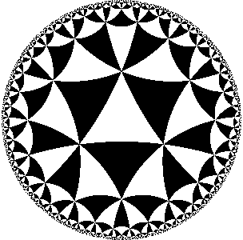](../../assets/volume4a/figures/figure-18-filled-hyperbolic-triangles.png)

**图 18**　在数字化圆的边界, 像素由白变黑又由黑变白.

算法 T 仅适用于圆锥曲线. 但是, 实践中这不是真正的限制, 因为我们经常需要绘制的几乎每一种形状, 都可以用称为二次贝塞尔样条或 S 形样条的 “分段圆锥曲线” 逼近. 例如, 图 19 显示一段典型的具有 40 个点 $(z_0,z_1,\ldots,z_{39},z_{40})$ (其中 $z_{40}=z_0$) 的 S 形样条曲线. 偶数编号的点 $(z_0,z_2,\ldots,z_{40})$ 落在曲线上. 其他的点 $(z_1,z_3,\ldots,z_{39})$ 称为 “控制点”, 因为它们调节曲线局部的弯曲和拐折. 每段曲线 $S(z_{2j},z_{2j+1},z_{2j+2})$ 从点 $z_{2j}$ 开始, 起始方向为 $z_{2j+1}-z_{2j}$. 它在点 $z_{2j+2}$ 终止, 抵达该点时的方向为 $z_{2j+2}-z_{2j+1}$. 因此, 如果 $z_{2j}$ 位于从 $z_{2j-1}$ 到 $z_{2j+1}$ 的直线上, S 形样条平滑地通过点 $z_{2j}$ 而不改变方向.

习题 186 确切定义 $S(z_{2j},z_{2j+1},z_{2j+2})$, 习题 187 说明如何用算法 T 数字化任何 S 形样条曲线. 接下来, 我们可以用黑色像素填充数字化边界的内部区域.

顺便指出, 在位图上绘制直线和曲线, 比填充数字化轮廓线困难得多, 因为我们要求斜线笔画与纵横向笔画具有同样厚度. 约翰·霍比 [*JACM* **36** (1989), 209–229] 找到了画线问题的卓越解决方案.

<a id="pdf-165"></a><a id="p-150"></a>

<a id="fig-7-1-3-19"></a>

[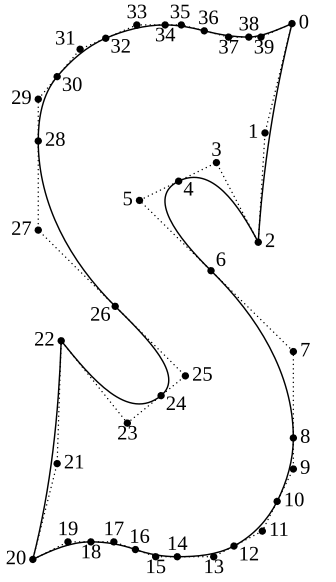](../../assets/volume4a/figures/figure-19-squines-outline.svg)

**图 19**　定义 **S** 轮廓线的 S 形样条曲线.

**\*无转移计算.** 当程序包含条件转移指令时, 现代计算机的运行速度多半会下降, 因为不确定的控制流可能干扰预测先行电路. 所以, 在像 $(56)$ 那样的程序中, 我们使用了像 CSNZ 这样的 MMIX 条件置值指令. 实际上, 当在高度流水线计算机上测量实际运行时间时, 像 `ADD z,y,1; SR t,u,2; CSNZ x,q,z; CSNZ v,q,t` 这样的 4 条指令可能比对等的 3 条指令

<a id="eq-7-1-3-173"></a>

```text
BZ q,@+12;  ADD x,y,1;  SR v,u,2
```

$(173)$

更快, 虽然按照表 1.3.1′–1[^v4a-165-mmix-table], 凭经验估计, $(173)$ 的代价仅有 $3\nu$.

按位运算有助于减少对代价很高的转移指令的需求. 例如, 如果 MMIX 没有 CSNZ 指令, 我们可以写出

<a id="eq-7-1-3-174"></a>

```text
NEGU m,q;  OR m,m,q;  SR m,m,63;
ADD t,y,1;  XOR t,t,x;  AND t,t,m;  XOR x,x,t;
SR t,u,2;  XOR t,t,v;  AND t,t,m;  XOR v,v,t;
```

$(174)$

上面第一行建立掩码 $\mathtt m=-[q\ne0]$. 在某些计算机上, 执行这 11 条无转移指令仍然要比 $(173)$ 的 3 条指令快.

合并排序算法的内循环提供一个指导性例子. 假定我们需要重复进行下列运算:

如果 $x_i<y_j$, 置 $z_k\leftarrow x_i$, $i\leftarrow i+1$, 如果 $i=i_{\max}$, 转到 `x_done`.  
否则置 $z_k\leftarrow y_j$, $j\leftarrow j+1$, 如果 $j=j_{\max}$, 转到 `y_done`.  
然后置 $k\leftarrow k+1$, 如果 $k=k_{\max}$, 转到 `z_done`.

如果我们以 “明显” 的方式执行它们, 则包含 4 个条件转移指令, 在循环的每条路径上, 它们中的 3 个处于活动状态:

<a id="pdf-166"></a><a id="p-151"></a>

```text
1H CMP  t,xi,yj; BNN t,2F       如果 x_i ≥ y_j 则转移。
   STO  xi,zbase,kk             z_k ← x_i。
   ADD  ii,ii,8                 i ← i + 1。
   BZ   ii,X_Done               如果 i = i_max 则转到 x_done。
   LDO  xi,xbase,ii             将 x_i 装入寄存器 xi。
   JMP  3F                      连接其他分支。
2H STO  yj,zbase,kk             z_k ← y_j。
   ADD  jj,jj,8                 j ← j + 1。
   BZ   jj,Y_Done               如果 j = j_max 则转到 y_done。
   LDO  yj,ybase,jj             将 y_j 装入寄存器 yj。
3H ADD  kk,kk,8                 k ← k + 1。
   PBNZ kk,1B                   如果 k ≠ k_max 则重复。
   JMP  Z_Done                  转到 z_done。 ▮
```

[其中 $\mathtt{ii}=8(i-i_{\max})$, $\mathtt{jj}=8(j-j_{\max})$, $\mathtt{kk}=8(k-k_{\max})$. 因为 $x_i,y_j,z_k$ 是全字 (8 个字节), 所以因数 8 是必需的.]4 个转移指令可以减少到只剩一个:

```text
1H CMP  t,xi,yj                 t ← sign(x_i − y_j)。
   CSN  yj,t,xi                 yj ← min(x_i, y_j)。
   STO  yj,zbase,kk             z_k ← yj。
   AND  t,t,8                   t ← 8[x_i < y_j]。
   ADD  ii,ii,t                 i ← i + [x_i < y_j]。
   LDO  xi,xbase,ii             将 x_i 装入寄存器 xi。
   XOR  t,t,8                   t ← t ⊕ 8。
   ADD  jj,jj,t                 j ← j + [x_i ≥ y_j]。
   LDO  yj,ybase,jj             将 y_j 装入寄存器 yj。
   ADD  kk,kk,8                 k ← k + 1。
   AND  u,ii,jj; AND u,u,kk     u ← ii & jj & kk。
   PBN  u,1B                    如果 i < i_max、j < j_max、k < k_max 则重复。 ▮
```

当这个版本的循环停止时, 我们很容易决定是否在 `x_done`、`y_done`、`z_done` 处继续执行. 这些指令每次从内存加载 $x_i$ 和 $y_j$, 但冗余值将会出现在高速缓存中.

**\*MOR 和 MXOR 的其他应用.** 在结束对按位运算的讨论时, 让我们看一下特别为 64 位操作设计的两种运算. MMIX 的 MOR 和 MXOR 指令实际执行 $8\times8$ 布尔矩阵的乘法, 它们单独使用以及同其他按位运算结合起来使用, 都是极其灵活和强有力的.

如果 $x=(x_7\ldots x_1x_0)_{256}$ 是一个全字, $a=(a_7\ldots a_1a_0)_2$ 是一个字节, 指令 `MOR t,x,a` 置 $t\leftarrow a_7x_7\mid\cdots\mid a_1x_1\mid a_0x_0$, 而指令 `MXOR t,x,a` 置 $t\leftarrow a_7x_7\oplus\cdots\oplus a_1x_1\oplus a_0x_0$. 例如, `MOR t,x,2` 和 `MXOR t,x,2` 这两条指令都是置 $t\leftarrow x_1$; 指令 `MOR t,x,3` 置 $t\leftarrow x_1\mid x_0$; 指令 `MXOR t,x,3` 置 $t\leftarrow x_1\oplus x_0$.

当然, 一般说来, MOR 和 MXOR 是全字函数. 当 $y=(y_7\ldots y_1y_0)_{256}$ 是一般的全字时, 指令 `MOR t,x,y` 的结果是全字 $t$, 它的第 $j$ 个字节 $t_j$ 是对 $x$ 和 $y_j$ 应用 MOR 的结果.

假定 $x=-1=\mathtt{\#ffffffffffffffff}$. 这时指令 `MOR t,x,y` 计算掩码 $t$, 其中当 $y_j\ne0$ 时字节 $t_j$ 是 `#ff`, 而当 $y_j=0$ 时 $t_j$ 是 0. 这个简单的特例很有用, 因为像 $(92)$ 这种情况, 它仅用一条指令就完成了过去我们需用 7 次运算实现的任务.

我们注意到, 在 $(66)$ 中两条 MOR 指令足够颠倒任何 64 位字中的位. 如果计算机指令系统中包含 MOR, 许多重要的位排列会变得容易. 假定 $\pi$ 是 $\{0,1,\ldots,7\}$ 的一个排列, 它执行 $0\mapsto0\pi$、$1\mapsto1\pi,\ldots,7\mapsto7\pi$. 那么, 全字 $p=(2^{7\pi}\ldots2^{1\pi}2^{0\pi})_{256}$ 对应于一个置换矩阵, 它使 MOR 实现有趣的运算技巧: `MOR t,x,p` 将排列 $x$ 的字节, 置 $t_j\leftarrow x_{j\pi}$. 此外, `MOR u,p,y` 将按照逆排列对 $y$ 的每个字节进行位排列. 当 $y_j=(a_{7\pi}\ldots a_{1\pi}a_{0\pi})_2$ 时, 它置 $u_j\leftarrow(a_7\ldots a_1a_0)_2$.

用一点小技巧, 我们还能更快地处理像全混洗 $(76)$ 那样的排列, 那个排列把一个给定的全字 $z=2^{32}x+y=(x_{31}\ldots x_1x_0y_{31}\ldots y_1y_0)_2$ 变换成 “拉链式” 的全字

$$
w=x\mathbin{\ddagger}y=(x_{31}y_{31}\ldots x_1y_1x_0y_0)_2,\tag{175}
$$

使用相应的置换矩阵 $p,q,r$, 中间结果

$$
\begin{aligned}
t&=\bigl(x_{31}x_{27}x_{30}x_{26}x_{29}x_{25}x_{28}x_{24}y_{31}y_{27}y_{30}y_{26}y_{29}y_{25}y_{28}y_{24}\ldots\\
&\qquad x_7x_3x_6x_2x_5x_1x_4x_0y_7y_3y_6y_2y_5y_1y_4y_0\bigr)_2,
\end{aligned}\tag{176}
$$

<a id="pdf-167"></a><a id="p-152"></a>

$$
\begin{aligned}
u&=\bigl(y_{27}y_{31}y_{26}y_{30}y_{25}y_{29}y_{24}y_{28}x_{27}x_{31}x_{26}x_{30}x_{25}x_{29}x_{24}x_{28}\ldots\\
&\qquad y_3y_7y_2y_6y_1y_5y_0y_4x_3x_7x_2x_6x_1x_5x_0x_4\bigr)_2
\end{aligned}\tag{177}
$$

可以通过 4 条指令

<a id="eq-7-1-3-178"></a>

```text
MOR t,z,p;  MOR t,q,t;  MOR u,t,r;  MOR u,r,u;
```

$(178)$

快速计算, 见习题 204. 所以, 存在掩码 $m$, 使得 `PUT rM,m; MUX w,t,u` 总共仅需 6 个周期就能实现全混洗. 对比之下, 习题 53 中的传统方法需要 30 个周期 (5 次 $\delta$ 交换).

当涉及二进制线性代数时, 指令 MXOR 特别有用. 例如, 习题 1.3.1′–37[^v4a-167-mmix-exercise] 表明, 对于 $k\le8$, 在 $2^k$ 个元素的有限域中, XOR 和 MXOR 直接实现加法和乘法.

循环冗余检验问题提供一个启示性的实例, 其中 MXOR 显现出作用. 为了检测常见的传输错误, 数据流通常伴随 “CRC (循环冗余检验) 字节”[见威廉·彼得森和戴维·布朗,*Proc. IRE* **49** (1961), 228–235]. 例如, 作为在 MP3 音频文件中使用的例子, 一种流行的方法是把每个字节 $\alpha=(a_7\ldots a_1a_0)_2$ 当成多项式

$$
\alpha(x)=(a_7\ldots a_1a_0)_x=a_7x^7+\cdots+a_1x+a_0.\tag{179}
$$

当传输 $n$ 个字节 $\alpha_{n-1}\ldots\alpha_1\alpha_0$ 时, 我们就用多项式的模 2 运算计算余项

$$
\beta=\bigl(\alpha_{n-1}(x)x^{8(n-1)}+\cdots+\alpha_1(x)x^8+\alpha_0(x)\bigr)x^{16}\bmod p(x),\tag{180}
$$

其中 $p(x)=x^{16}+x^{15}+x^2+1$, 然后附加 $\beta$ 的系数作为 16 位冗余码检验.

按照类似算法 4.6.1D 的经典方法, 计算 $\beta$ 的常用方法是一次处理一个字节. 基本思想是定义部分结果 $\beta_m=(\alpha_{n-1}(x)x^{8(n-1-m)}+\cdots+\alpha_{m+1}(x)x^8+\alpha_m(x))x^{16}\bmod p(x)$, 得到 $\beta_n=0$. 然后用递推公式

$$
\beta_m=((\beta_{m+1}\ll8)\mathbin{\&}\mathtt{\#ff00})\oplus\mathit{crc\_table}[(\beta_{m+1}\gg8)\oplus\alpha_m]\tag{181}
$$

不断将 $m$ 减 1 直到 $m=0$. 这里, $\mathit{crc\_table}[\alpha]$ 是对于 $0\le\alpha<256$ 的 16 位表项, 它保存着 $\alpha(x)x^{16}\bmod p(x)$ 以及模 2 的余项. [见阿拉姆·佩雷斯,*IEEE Micro* **3**, 3 (June 1983), 40–50.]

当然, 我们宁愿一次处理 64 位而不是 8 位. 解决方案是寻找这样的 $8\times8$ 矩阵 $A$ 和 $B$, 使得对于任意的字节 $\alpha$,

$$
\alpha(x)x^{64}\equiv(\alpha A)(x)+(\alpha B)(x)x^{-8}\qquad(\text{模 }p(x)\text{ 和 }2),\tag{182}
$$

视 $\alpha$ 为 $1\times8$ 的位向量. 然后, 我们可以用前导 0 填充给定的数据字节 $\alpha_{n-1}\ldots\alpha_1\alpha_0$, 使 $n$ 成为 8 的倍数, 并利用下面的有效简化方法:

$$
\begin{aligned}
&c\leftarrow0,\quad n\leftarrow n-8,\quad t\leftarrow(\alpha_{n+7}\ldots\alpha_n)_{256}.\\
&\text{当 }n>0\text{ 时循环执行 }\ u\leftarrow t\cdot A,\quad v\leftarrow t\cdot B,\quad n\leftarrow n-8,\\
&\qquad t\leftarrow(\alpha_{n+7}\ldots\alpha_n)_{256}\oplus u\oplus(v\gg8)\oplus(c\ll56),\quad c\leftarrow v\mathbin{\&}\mathtt{\#ff}.
\end{aligned}\tag{183}
$$

其中 $t\cdot A$ 和 $t\cdot B$ 表示通过 MXOR 进行的矩阵乘法. 然后, 容易从 64 位值 $t$ 和 8 位值 $c$ 获得欲求的 CRC 字节 $(tx^{16}+cx^8)\bmod p(x)$. 习题 213 包含计算的全部细节, 对于 $n$ 个字节的总运行时间仅为 $(\mu+10\nu)n/8+O(1)$.

下面的习题包含许多实例, 其中 MOR 和 MXOR 能带来大量节约. 新的技巧无疑仍然有待发现.

<a id="pdf-168"></a><a id="p-153"></a>

**进一步阅读资料.** 小亨利·沃伦所著 *Hacker’s Delight*(Addison–Wesley, 2002) 一书深入讨论按位运算, 重点是在不如 MMIX 理想的现实计算机上可用的形形色色的选择.

#### 习题

<a id="ex-7-1-3-1"></a>

▶ **1.** [*15*][答案](./answers/7-1-3.md#ans-7-1-3-1) 置 $x\leftarrow x\oplus y$, $y\leftarrow y\oplus(x\mathbin{\&}m)$, $x\leftarrow x\oplus y$, 最后的结果是什么?

<a id="ex-7-1-3-2"></a>

**2.** [*16*][答案](./answers/7-1-3.md#ans-7-1-3-2) (小亨利·沃伦) 以下关系式对所有整数 $x$ 和 $y$ 都成立吗? (i) $x\oplus y\le x\mid y$; (ii) $x\mathbin{\&}y\le x\mid y$; (iii) $|x-y|\le x\oplus y$.

<a id="ex-7-1-3-3"></a>

**3.** [*M20*][答案](./answers/7-1-3.md#ans-7-1-3-3) 假定 $x=(x_{n-1}\ldots x_1x_0)_2$, 其中 $x_{n-1}=1$, 令 $x^M=(\bar x_{n-1}\ldots\bar x_1\bar x_0)_2$. 如果令 $0^M=-1$, 则我们有 $0^M,1^M,2^M,3^M,\ldots=-1,0,1,0,3,2,1,0,7,6,\ldots$. 证明: 对所有 $x,y\ge0$ 有 $(x\oplus y)^M<|x-y|\le x\oplus y$.

<a id="ex-7-1-3-4"></a>

▶ **4.** [*M16*][答案](./answers/7-1-3.md#ans-7-1-3-4) 假设 $x^C=\bar x$、$x^N=-x$、$x^S=x+1$、$x^P=x-1$ 分别表示无限精度整数 $x$ 的补数、相反数、后继和前导. 则我们有 $x^{CC}=x^{NN}=x^{SP}=x^{PS}=x$. $x^{CN}$ 和 $x^{NC}$ 分别是什么?

<a id="ex-7-1-3-5"></a>

**5.** [*M21*][答案](./answers/7-1-3.md#ans-7-1-3-5) 证明或证伪下列关于二进制移位的猜想:

(a) $(x\ll j)\ll k=x\ll(j+k)$.

(b) $(x\gg j)\mathbin{\&}(y\ll k)=((x\gg(j+k))\mathbin{\&}y)\ll k=(x\mathbin{\&}(y\ll(j+k)))\gg j$.

<a id="ex-7-1-3-6"></a>

**6.** [*M22*][答案](./answers/7-1-3.md#ans-7-1-3-6) 分别求满足以下条件的所有整数 $x$ 和 $y$. (a) $x\gg y=y\gg x$; (b) $x\ll y=y\ll x$.

<a id="ex-7-1-3-7"></a>

**7.** [*M22*][答案](./answers/7-1-3.md#ans-7-1-3-7) (R. Schroeppel, 1972) 寻找一种快速方法, 把二进制数 $x=(\ldots x_2x_1x_0)_2$ 转换成负二进制数 $x=(\ldots x'_2x'_1x'_0)_{-2}$, 以及反向转换. 提示: 仅需两种按位运算.

<a id="ex-7-1-3-8"></a>

▶ **8.** [*M22*][答案](./answers/7-1-3.md#ans-7-1-3-8) 给定非负整数的有限集合 $S$, 它的 “最小排斥元素” 定义为

$$
\operatorname{mex}(S)=\min\{k\mid k\ge0\text{ 且 }k\notin S\}.
$$

令 $x\oplus S$ 表示集合 $\{x\oplus y\mid y\in S\}$, $S\oplus y$ 表示集合 $\{x\oplus y\mid x\in S\}$. 证明: 如果 $x=\operatorname{mex}(S)$, $y=\operatorname{mex}(T)$, 则 $x\oplus y=\operatorname{mex}((S\oplus y)\cup(x\oplus T))$.

<a id="ex-7-1-3-9"></a>

**9.** [*M26*][答案](./answers/7-1-3.md#ans-7-1-3-9) (尼姆游戏) 两人用 $k$ 堆小棍玩游戏, 其中第 $j$ 堆有 $a_j$ 根小棍. 如果轮到一位玩家时 $a_1=\cdots=a_k=0$, 他便告负. 否则, 他可以从任意一堆中扔掉任意数量的小棍以缩小堆, 然后轮到另一位玩家. 证明: 先动手的玩家能获胜, 当且仅当 $a_1\oplus\cdots\oplus a_k\ne0$. [提示: 利用习题 8.]

<a id="ex-7-1-3-10"></a>

**10.** [*HM40*][答案](./answers/7-1-3.md#ans-7-1-3-10) (尼姆域, 也称康威域) 续习题 8, 用公式

$$
x\otimes y=\operatorname{mex}\{(x\otimes j)\oplus(i\otimes y)\oplus(i\otimes j)\mid0\le i<x,\ 0\le j<y\}
$$

递归地定义 “尼姆乘法” 运算 $x\otimes y$. 证明: $\oplus$ 和 $\otimes$ 在非负整数集上定义了一个域. 另外证明: 如果 $0\le x,y<2^{2^n}$, 则 $x\otimes y<2^{2^n}$, $2^{2^n}\otimes y=2^{2^n}y$. (特别地, 对于所有 $n\ge0$, 这个域包含大小为 $2^{2^n}$ 的子域.) 说明如何有效计算 $x\otimes y$.

<a id="ex-7-1-3-11"></a>

▶ **11.** [*M26*][答案](./answers/7-1-3.md#ans-7-1-3-11) (小伦斯特拉, 1978) 寻找一种简单方法, 用于表征康威域中所有这样的正整数对 $(m,n)$, 对它们而言 $m\otimes n=mn$.

<a id="ex-7-1-3-12"></a>

**12.** [*M26*][答案](./answers/7-1-3.md#ans-7-1-3-12) 设计一个用于尼姆除法的算法. 提示: 如果 $x<2^{2^{n+1}}$, 则我们有 $x\otimes(x\oplus(x\gg2^n))<2^{2^n}$.

<a id="ex-7-1-3-13"></a>

**13.** [*M32*][答案](./answers/7-1-3.md#ans-7-1-3-13) (二阶尼姆游戏) 扩充习题 9 的游戏, 允许两种玩法: 或者像过去那样, 对于某个 $j$, 减少第 $j$ 堆的数量 $a_j$; 或者, 对于 $i<j$, 减少第 $j$ 堆的数量 $a_j$, 并用任意的非负整数代替 $a_i$. 证明: 先动手的玩家能获胜, 当且仅当堆的大小或者满足 $a_2\ne a_3\oplus\cdots\oplus a_k$, 或者满足 $a_1\ne a_3\oplus(2\otimes a_4)\oplus\cdots\oplus((k-2)\otimes a_k)$. 例如, 当 $k=4$ 且 $(a_1,a_2,a_3,a_4)=(7,5,0,5)$ 时, 唯一取胜的玩法是把堆变成 $(7,5,6,3)$.

<a id="ex-7-1-3-14"></a>

<a id="pdf-169"></a><a id="p-154"></a>

**14.** [*M30*][答案](./answers/7-1-3.md#ans-7-1-3-14) 假定一棵无穷完全二叉树的每个结点已用 0 或 1 标记. 这样一种标记适于表示成序列 $T=(t,t_0,t_1,t_{00},t_{01},t_{10},t_{11},t_{000},\ldots)$, 每个二进制串 $\alpha$ 用一个二进制位 $t_\alpha$ 代表. 根标记为 $t$, 左子树标记为 $T_0=(t_0,t_{00},t_{01},t_{000},\ldots)$, 右子树标记为 $T_1=(t_1,t_{10},t_{11},t_{100},\ldots)$. 任何一个这样的标记可以用于把 2 基整数 $x=(\ldots x_2x_1x_0)_2$ 变换成 2 基整数 $y=(\ldots y_2y_1y_0)_2=T(x)$, 通过置 $y_0=t$, $y_1=t_{x_0}$, $y_2=t_{x_0x_1}$, 等等, 使得 $T(x)=2T_{x_0}(\lfloor x/2\rfloor)+t$. (换句话说, 当我们从树的顶端到底部行进时, 位串从右到左, $x$ 定义了二叉树的无穷路径, $y$ 对应于路径中的标记.)

分支函数是由这样一个标记定义的变换 $x^T=x\oplus T(x)$. 例如, 如果 $t_{01}=1$, 而所有其余的 $t_\alpha$ 是 0, 则我们有 $x^T=x\oplus4[x\bmod4=2]$.

(a) 证明每个分支函数是 2 基整数的一个排列.

(b) 对于哪些整数 $k$, $x\oplus(x\ll k)$ 是分支函数?

(c) 假定 $x\mapsto x^T$ 是从 2 基整数到 2 基整数的变换. 证明: $x^T$ 是分支函数, 当且仅当 $\rho(x\oplus y)=\rho(x^T\oplus y^T)$ 对于所有 2 基整数 $x$ 和 $y$ 成立.

(d) 证明: 分支函数的复合函数与反函数是分支函数. (因此全体分支函数的集合 $\mathcal B$ 是一个置换群.)

(e) 如果分支函数的标记对所有 $\alpha$ 满足 $t_\alpha=t_{\alpha0}\oplus t_{\alpha1}$, 则称这个分支函数是平衡的. 证明: 全体平衡分支函数的集合是 $\mathcal B$ 的子群.

<a id="ex-7-1-3-15"></a>

▶ **15.** [*M26*][答案](./answers/7-1-3.md#ans-7-1-3-15) 乔纳森·奎克注意到, $((x+2)\oplus3)-2=((x-2)\oplus3)+2$ 对所有 $x$ 成立. 求使 $((x+a)\oplus b)-a=((x-a)\oplus b)+a$ 成为恒等式的所有常数 $a$ 和 $b$.

<a id="ex-7-1-3-16"></a>

**16.** [*M31*][答案](./answers/7-1-3.md#ans-7-1-3-16) 如果对于某些整常数 $a_1,b_1,a_2,b_2,\ldots,a_m,b_m$($m>0$), $x$ 的函数可以写成

$$
((\ldots((((x+a_1)\oplus b_1)+a_2)\oplus b_2)+\cdots)+a_m)\oplus b_m
$$

的形式, 则称该函数为活跃的.

(a) 证明: 每个活跃函数是分支函数 (见习题 14).

(b) 此外, 证明它是平衡的, 当且仅当 $b_1\oplus b_2\oplus\cdots\oplus b_m=0$. 提示: 什么二叉树标记对应于活跃函数 $((x\oplus c)-1)\oplus c$?

(c) 令 $\lfloor x\rceil=x\oplus(x-1)=2^{\rho(x)+1}-1$. 证明: 对于某些整数 $\{p_1,p_2,\ldots,p_l\}$($l\ge0$), 可以把每个平衡的活跃函数写成

$$
x\oplus\lfloor x\oplus p_1\rceil\oplus\lfloor x\oplus p_2\rceil\oplus\cdots\oplus\lfloor x\oplus p_l\rceil,\qquad p_1<p_2<\cdots<p_l
$$

的形式, 而且这种表示是唯一的.

(d) 反过来, 证明每个这样的表达式定义一个平衡的活跃函数.

<a id="ex-7-1-3-17"></a>

**17.** [*HM36*][答案](./answers/7-1-3.md#ans-7-1-3-17) 习题 16 的结果使我们可能判定任意两个给定的活跃函数是否相等. 如果那个表达式是仅用二元运算 $+$ 和 $\oplus$ 从有限数目的整变量和常数构造的, 那么存在判定任意给定的表达式是否恒等于 0 的算法吗? 如果还允许用运算 $\mathbin{\&}$, 结果是什么?

<a id="ex-7-1-3-18"></a>

**18.** [*M25*][答案](./answers/7-1-3.md#ans-7-1-3-18) 图中所示的奇妙像素图案在 $x$ 行 $y$ 列 ($1\le x,y\le256$) 是 $(x^2y\gg11)\mathbin{\&}1$. 存在说明它的某些主要数学特征的简单方法吗?

[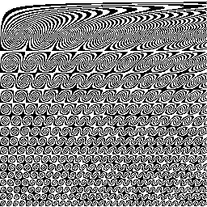](../../assets/volume4a/figures/exercise-7-1-3-18-pixel-pattern.png)

<a id="ex-7-1-3-19"></a>

▶ **19.** [*M37*][答案](./answers/7-1-3.md#ans-7-1-3-19) (佩利重排定理) 给定非负数的三个向量 $A=(a_0,\ldots,a_{2^n-1})$, $B=(b_0,\ldots,b_{2^n-1})$, $C=(c_0,\ldots,c_{2^n-1})$, 令

$$
f(A,B,C)=\sum_{j\oplus k\oplus l=0}a_jb_kc_l.
$$

例如, 如果 $n=2$, 我们有 $f(A,B,C)=a_0b_0c_0+a_0b_1c_1+a_0b_2c_2+a_0b_3c_3+a_1b_0c_1+a_1b_1c_0+a_1b_2c_3+\cdots+a_3b_3c_0$. 一般说来有 $2^{2n}$ 项, 对于 $j$ 和 $k$ 的每种选择各有一项. 我们的目标是证明 $f(A,B,C)\le f(A^*,B^*,C^*)$, 其中 $A^*$ 是把向量 $A$ 排序成非增序的结果: $a_0^*\ge a_1^*\ge\cdots\ge a_{2^n-1}^*$.

(a) 当 $A,B,C$ 的所有元素都是 0 和 1 时, 证明以上结论.

(b) 证明一般情况下的结论.

(c) 证明: $f(A,B,C,D)=\sum_{j\oplus k\oplus l\oplus m=0}a_jb_kc_ld_m\le f(A^*,B^*,C^*,D^*)$.

<a id="ex-7-1-3-20"></a>

▶ **20.** [*21*][答案](./answers/7-1-3.md#ans-7-1-3-20) (高斯珀精算法) 当 $x$ 为正整数时, 下列 7 步运算生成 $x$ 的有用的函数 $y$:

$$
u\leftarrow x\mathbin{\&}-x;\qquad v\leftarrow x+u;\qquad y\leftarrow v+(((v\oplus x)/u)\gg2).
$$

说明这是什么函数以及为什么它是有用的.

<a id="pdf-170"></a><a id="p-155"></a>

<a id="ex-7-1-3-21"></a>

**21.** [*22*][答案](./answers/7-1-3.md#ans-7-1-3-21) 构造高斯珀精算法的逆算法, 说明如何从 $y$ 计算 $x$.

<a id="ex-7-1-3-22"></a>

**22.** [*21*][答案](./answers/7-1-3.md#ans-7-1-3-22) 用 MMIX 代码有效实现高斯珀精算法, 假定 $x<2^{64}$, 不使用除法.

<a id="ex-7-1-3-23"></a>

▶ **23.** [*27*][答案](./answers/7-1-3.md#ans-7-1-3-23) 通过在每个左括号位置置 0, 在每个右括号位置置 1, 嵌套括号序列可以表示成一个二进制数. 例如, 按照这种方式, `(())()` 对应于 $(001101)_2$, 即十进制数 13. 这样一个数称为括号迹.

(a) 恰有 $m$ 个 1 的最小和最大括号迹是什么?

(b) 假定 $x$ 是一个括号迹, $y$ 是比 $x$ 大且具有同样多 1 的最小括号迹. 说明可以用类似高斯珀精算法的短运算链由 $x$ 计算 $y$.

(c) 用 MMIX 实现你的方法, 假定 $\nu x\le32$.

<a id="ex-7-1-3-24"></a>

▶ **24.** [*M30*][答案](./answers/7-1-3.md#ans-7-1-3-24) 程序 1.3.2′P 用 MMIX 指令生成前 500 个素数的表, 其中利用试除法确定数的素性. 写一个 MMIX 程序, 利用 “埃拉托色尼筛法” (习题 4.5.4–8) 建立小于 $N$ 的全部奇素数的表, 像在 $(27)$ 中那样打包为全字序列 $Q_0,Q_1,\ldots,Q_{N/128-1}$. 假定 $N\le2^{32}$, 且 $N$ 是 128 的倍数. 当 $N=3584$ 时运行时间是多少?

<a id="ex-7-1-3-25"></a>

▶ **25.** [*15*][答案](./answers/7-1-3.md#ans-7-1-3-25) 四卷书并排摆在书架上. 每一卷恰好包含 500 页, 用英语印制在 250 张 0.1 毫米厚的纸上. 每卷书还各有一页封面和一页封底, 厚度都是 1 毫米. 一条蠹虫以如下方式蛀书, 从第 1 卷第 1 页到第 4 卷第 500 页. 它在这个过程中移动了多远?

<a id="ex-7-1-3-26"></a>

**26.** [*22*][答案](./answers/7-1-3.md#ans-7-1-3-26) 假定我们需要随机存取含有 $12\,000\,000$ 项 5 位数据的表. 我们可以把 12 个这样的数据项打包成一个 64 位的字, 从而把数据表放进 8 兆字节的存储器. 但随之而来的随机存取看来需要用到除以 12 的运算, 这是比较慢的. 所以我们宁愿让每个数据项占用一个完整的字节, 总共使用 12 兆字节.

然而, 存在一种避免除法的有效方法, 试加以说明.

<a id="ex-7-1-3-27"></a>

**27.** [*21*][答案](./answers/7-1-3.md#ans-7-1-3-27) 用式 (32)–$(43)$ 的表示法, 如何计算以下各数? (a) $(\alpha10^a01^b)_2$; (b) $(\alpha10^a11^b)_2$; (c) $(\alpha00^a01^b)_2$; (d) $(0^\infty11^a00^b)_2$; (e) $(0^\infty01^a00^b)_2$; (f) $(0^\infty11^a11^b)_2$.

<a id="ex-7-1-3-28"></a>

**28.** [*16*][答案](./answers/7-1-3.md#ans-7-1-3-28) 运算 $(x+1)\mathbin{\&}\bar x$ 产生什么结果?

<a id="ex-7-1-3-29"></a>

**29.** [*20*][答案](./answers/7-1-3.md#ans-7-1-3-29) (沃恩·普拉特) 用 $\mu_{k+1}$ 表示 $(47)$ 中的幻掩码 $\mu_k$.

<a id="ex-7-1-3-30"></a>

**30.** [*20*][答案](./answers/7-1-3.md#ans-7-1-3-30) 如果 $x=0$, $(46)$ 的两条 MMIX 指令将置 $\rho\leftarrow64$ (这是对 $\rho0=\infty$ 的充分近似). 如何修改 $(50)$ 和 $(51)$ 中的指令产生同样结果?

<a id="ex-7-1-3-31"></a>

▶ **31.** [*20*][答案](./answers/7-1-3.md#ans-7-1-3-31) 数学家利文斯通·普雷苏米博士决定用一个简单循环计算直尺函数, 做法如下: “置 $\rho\leftarrow0$; 然后, 当 $x\mathbin{\&}1=0$ 时循环执行 $\rho\leftarrow\rho+1$, $x\leftarrow x\gg1$.” 他推断, 当 $x$ 是一个随机整数时, 平均右移次数是 $\rho$ 的均值, 这个值为 1. 同时, 标准差仅为 $\sqrt2$, 所以该循环几乎总是很快终止. 请评价他的推断.

<a id="ex-7-1-3-32"></a>

**32.** [*20*][答案](./answers/7-1-3.md#ans-7-1-3-32) 当用 MMIX 为 $(52)$ 编程时, 计算 $\rho x$ 的执行时间是多少?

<a id="ex-7-1-3-33"></a>

▶ **33.** [*26*][答案](./answers/7-1-3.md#ans-7-1-3-33) (莱瑟森、普罗科普和兰德尔, 1998) 如果在 $(52)$ 中用 49 代替 58, 当 $64>j>k\ge0$ 时, 用那种方法, 我们可以快速确定 $y=2^j+2^k$ 的两个二进制位, 试加以说明. (虽然我们需要辨别 $\binom{64}{2}=2016$ 种情形.)

<a id="ex-7-1-3-34"></a>

**34.** [*M23*][答案](./answers/7-1-3.md#ans-7-1-3-34) 假定 $x$ 和 $y$ 是 2 基整数. 判别真假: (a) $\rho(x\mathbin{\&}y)=\max(\rho x,\rho y)$; (b) $\rho(x\mid y)=\min(\rho x,\rho y)$; (c) $\rho x=\rho y$ 当且仅当 $x\oplus y=(x-1)\oplus(y-1)$.

<a id="ex-7-1-3-35"></a>

▶ **35.** [*M26*][答案](./answers/7-1-3.md#ans-7-1-3-35) 按照赖特维斯纳定理 (习题 4.1–34), 每个整数 $n$ 有唯一的表示 $n=n^+-n^-$, 这种表示满足 $n^+\mathbin{\&}n^-=(n^+\mid n^-)\mathbin{\&}((n^+\mid n^-)\gg1)=0$. 证明: $n^+$ 和 $n^-$ 可以用按位运算快速计算. 提示: 证明恒等式 $(x\oplus3x)\mathbin{\&}((x\oplus3x)\gg1)=0$.

<a id="ex-7-1-3-36"></a>

**36.** [*20*][答案](./answers/7-1-3.md#ans-7-1-3-36) 给定 $x=(x_{63}\ldots x_1x_0)_2$, 请给出计算下列值的有效方法:

(i) $x^\oplus=(x_{63}^{\oplus}\ldots x_1^\oplus x_0^\oplus)_2$, 其中 $x_k^\oplus=x_k\oplus\cdots\oplus x_1\oplus x_0$, $0\le k<64$.

(ii) $x^{\&}=(x_{63}^{\&}\ldots x_1^{\&}x_0^{\&})_2$, 其中 $x_k^{\&}=x_k\wedge\cdots\wedge x_1\wedge x_0$, $0\le k<64$.

<a id="ex-7-1-3-37"></a>

**37.** [*16*][答案](./answers/7-1-3.md#ans-7-1-3-37) 对 $(55)$ 和 $(56)$ 做什么改变将使 $\lambda0$ 显现为 $-1$?

<a id="ex-7-1-3-38"></a>

**38.** [*17*][答案](./answers/7-1-3.md#ans-7-1-3-38) 提取最左边 1 的过程 $(57)$, 用 MMIX 实现将花费多长时间?

<a id="ex-7-1-3-39"></a>

▶ **39.** [*20*][答案](./answers/7-1-3.md#ans-7-1-3-39) 式 (43) 说明如何消除给定数 $x$ 最右边的一串 1. 你将如何消除最左边的一串 1?

<a id="pdf-171"></a><a id="p-156"></a>

<a id="ex-7-1-3-40"></a>

▶ **40.** [*21*][答案](./answers/7-1-3.md#ans-7-1-3-40) 证明 $(58)$. 给定 $x,y\ge0$, 寻找判定 $\lambda x<\lambda y$ 是否成立的简单方法.

<a id="ex-7-1-3-41"></a>

**41.** [*M22*][答案](./answers/7-1-3.md#ans-7-1-3-41) 以下整数序列的生成函数是什么? (a) $\rho n$, (b) $\lambda n$, (c) $\nu n$.

<a id="ex-7-1-3-42"></a>

**42.** [*M21*][答案](./answers/7-1-3.md#ans-7-1-3-42) 设 $n=2^{e_1}+\cdots+2^{e_r}$, 其中 $e_1>\cdots>e_r\ge0$, 用指数 $e_1,\ldots,e_r$ 表达和 $\sum_{k=0}^{n-1}\nu k$.

<a id="ex-7-1-3-43"></a>

▶ **43.** [*20*][答案](./answers/7-1-3.md#ans-7-1-3-43) 为使 $(63)$ 在 MMIX 上比 $(62)$ 更快执行, $x$ 应稀疏到何种程度?

<a id="ex-7-1-3-44"></a>

▶ **44.** [*23*][答案](./answers/7-1-3.md#ans-7-1-3-44) (埃德温·弗里德, 1983) 对加权位和 $\sum jx_j$ 求值的快速方法是什么?

<a id="ex-7-1-3-45"></a>

▶ **45.** [*20*][答案](./answers/7-1-3.md#ans-7-1-3-45) (托马斯·罗基奇, 1999) 如何在不颠倒 $x$ 和 $y$ 的情况下检验 $x^R<y^R$ 是否成立?

<a id="ex-7-1-3-46"></a>

**46.** [*22*][答案](./answers/7-1-3.md#ans-7-1-3-46) $(68)$ 中的方法用 6 次运算交换寄存器中的两个二进制位 $x_i\leftrightarrow x_j$. 实际上, 仅用 3 条 MMIX 指令就能完成这种交换, 试加以说明.

<a id="ex-7-1-3-47"></a>

**47.** [*10*][答案](./answers/7-1-3.md#ans-7-1-3-47) 能用一种类似 $(67)$ 的方法完成一般的 $\delta$ 交换 $(69)$ 吗?

<a id="ex-7-1-3-48"></a>

**48.** [*M21*][答案](./answers/7-1-3.md#ans-7-1-3-48) 在 $n$ 位寄存器中可能有多少不同的 $\delta$ 交换? (当 $n=4$ 时, 一次 $\delta$ 交换可以把 1234 变换成 1234、1243、1324、1432、2134、2143、3214、3412、4231.)

<a id="ex-7-1-3-49"></a>

▶ **49.** [*M30*][答案](./answers/7-1-3.md#ans-7-1-3-49) 设 $s(n)$ 表示足够颠倒一个 $n$ 位二进制数的最少的 $\delta$ 交换次数.

(a) 证明: 当 $n$ 为奇数时 $s(n)\ge\lceil\log_3 n\rceil$, 当 $n$ 为偶数时 $s(n)\ge\lceil\log_3(3n/2)\rceil$.

(b) 当 $n=3^m,\,2\cdot3^m,\,(3^m+1)/2,\,(3^m-1)/2$ 时, 计算 $s(n)$ 的值.

(c) $s(32)$ 和 $s(64)$ 的值是什么? 提示: 证明 $s(5n+2)\le s(n)+2$.

<a id="ex-7-1-3-50"></a>

**50.** [*M37*][答案](./answers/7-1-3.md#ans-7-1-3-50) 续习题 49, 证明: $s(n)=\log_3 n+O(\log\log n)$.

<a id="ex-7-1-3-51"></a>

**51.** [*23*][答案](./answers/7-1-3.md#ans-7-1-3-51) 令 $c$ 为常数, $0\le c<2^d$. 求所有这样的掩码序列 $(\theta_0,\theta_1,\ldots,\theta_{d-1},\hat\theta_{d-2},\ldots,\hat\theta_1,\hat\theta_0)$, 使得一般排列方案 $(71)$ 取 $x\mapsto x^\pi$, 其中位排列 $\pi$ 由 (a) $j\pi=j\oplus c$ 或 (b) $j\pi=(j+c)\bmod2^d$ 定义. [这些掩码应满足 $\theta_k\subseteq\mu_{d,k}$ 和 $\hat\theta_k\subseteq\mu_{d,k}$, 所以 $(71)$ 对应于图 12, 见 $(48)$. 注意: 逆排列 $x^\pi=x^R$ 是当 $c=2^d-1$ 时 (a) 的特例, 而 (b) 对应于循环右移 $x^\pi=(x\gg c)+(x\ll(2^d-c))$.]

<a id="ex-7-1-3-52"></a>

**52.** [*22*][答案](./answers/7-1-3.md#ans-7-1-3-52) 求十六进制常数 $(\theta_0,\theta_1,\theta_2,\theta_3,\theta_4,\theta_5,\hat\theta_4,\hat\theta_3,\hat\theta_2,\hat\theta_1,\hat\theta_0)$, 它们使 $(71)$ 产生下述基于二进制表示 $j=(j_5j_4j_3j_2j_1j_0)_2$ 的重要 64 位排列:

(a) $j\pi=(j_0j_5j_4j_3j_2j_1)_2$; (b) $j\pi=(j_2j_1j_0j_5j_4j_3)_2$;  
(c) $j\pi=(j_1j_0j_5j_4j_3j_2)_2$; (d) $j\pi=(j_0j_1j_2j_3j_4j_5)_2$.

[事例 (a) 是把 $(x_{63}\ldots x_{33}x_{32}x_{31}\ldots x_1x_0)_2$ 变换成 $(x_{63}x_{31}\ldots x_{33}x_1x_{32}x_0)_2$ 的 “全混洗”$(175)$; 事例 (b) 转置一个 $8\times8$ 的位矩阵; 事例 (c) 转置一个 $4\times16$ 的位矩阵; 事例 (d) 的出现与 “快速傅里叶变换” 有关, 见习题 4.6.4–14.]

<a id="ex-7-1-3-53"></a>

▶ **53.** [*M25*][答案](./answers/7-1-3.md#ans-7-1-3-53) 习题 52 中的排列被称作是 “由下标数字排列导出的”, 因为我们通过排列二进制数字 $j$ 获得 $j\pi$. 假定 $j\pi=(j_{(d-1)\psi}\ldots j_{1\psi}j_{0\psi})_2$, 其中 $\psi$ 是 $\{0,1,\ldots,d-1\}$ 的一个排列. 证明: 如果 $\psi$ 有 $t$ 个循环, 仅用 $d-t$ 次交换即可获得 $2^d$ 位排列 $x\mapsto x^\pi$. 特别地, 这个结果加快了习题 52 所有 4 种事例的排列速度, 试加以说明.

<a id="ex-7-1-3-54"></a>

**54.** [*22*][答案](./answers/7-1-3.md#ans-7-1-3-54) (小高斯珀, 1985) 如果 $m\times m$ 的位矩阵存储在一个寄存器最右边的 $m^2$ 位, 证明: 对各个 $0\le k<\lceil\lg m\rceil$ 做间距为 $2^k(m-1)$ 的 $\delta$ 交换, 可以转置该矩阵. 写出 $m=7$ 时方法的细节.

<a id="ex-7-1-3-55"></a>

▶ **55.** [*26*][答案](./answers/7-1-3.md#ans-7-1-3-55) 假定 $n\times n$ 的位矩阵存储在一个 $n^3$ 位的寄存器最右边的 $n^2$ 位. 证明: 当 $n=2^d$ 时, $18d+2$ 个按位运算足够将两个这样矩阵相乘, 矩阵乘法可以是布尔乘 (像 MOR), 也可以是模 2 乘 (像 MXOR).

<a id="ex-7-1-3-56"></a>

**56.** [*24*][答案](./answers/7-1-3.md#ans-7-1-3-56) 对于存储在 64 位寄存器的 $7\times9$ 的位矩阵, 提出一种转置方法.

<a id="ex-7-1-3-57"></a>

**57.** [*22*][答案](./answers/7-1-3.md#ans-7-1-3-57) 图 12 的网络 $P(2^d)$ 总共有 $(2d-1)2^{d-1}$ 个交叉模块. 证明: 可以通过某种设置实现 $2^d$ 个元素的任何排列, 该设置中顶多有 $d2^{d-1}$ 个交叉模块工作.

<a id="ex-7-1-3-58"></a>

▶ **58.** [*M32*][答案](./answers/7-1-3.md#ans-7-1-3-58) 如下图所示 (对应于 $d=3$ 的情形), 在排列网络 $P(2^d)$ 中, 网络线伸展为横向直线, 交叉模块的前 $d$ 列首先执行一次 1 交换, 然后执行一次 2 交换, ……最后执行一次 $2^{d-1}$ 交换. 令 $N=2^d$. 这 $N$ 条网络线同 $Nd/2$ 个交叉模块一起构成所谓 “欧米加路由器” 或 “倒蝶形器”. 本题的目的是研究所有满足以下条件的排列 $\varphi$ 的集合 $\Omega$: 当路由器左端的输入为 $(0,1,\ldots,N-1)$ 时, 我们可以在其右端获得输出 $(0\varphi,1\varphi,\ldots,(N-1)\varphi)$.

[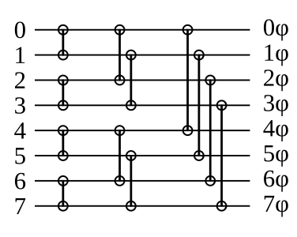](../../assets/volume4a/figures/exercise-7-1-3-58-omega-router.svg)

<a id="pdf-172"></a><a id="p-157"></a>

(a) 证明: $|\Omega|=2^{Nd/2}$. (因此 $\lg|\Omega|=Nd/2\sim\tfrac12\lg N!$.)

(b) 证明: $\{0,1,\ldots,N-1\}$ 的排列 $\varphi$ 属于 $\Omega$, 当且仅当对于所有 $0\le i,j<N$ 和所有 $0\le k\le d$ 有

$$
i\bmod2^k=j\bmod2^k\ \text{ 且 }\ i\varphi\gg k=j\varphi\gg k\quad\text{蕴涵}\quad i\varphi=j\varphi.\tag{*}
$$

(c) 把条件 $(*)$ 简化成: 对于所有 $0\le i,j<N$ 有

$$
\lambda(i\varphi\oplus j\varphi)<\rho(i\oplus j)\quad\text{蕴涵}\quad i=j.
$$

(d) 令 $T$ 是 $\{0,1,\ldots,N-1\}$ 的所有满足以下条件的排列 $\tau$ 的集合: $\rho(i\oplus j)=\rho(i\tau\oplus j\tau)$ 对所有 $i,j$ 成立. (这是习题 14 中考虑的模 $2^d$ 的分支函数的集合. 所以, 它有 $2^{N-1}$ 个成员, 其中 $2^{N/2+d-1}$ 个是模 $2^d$ 的活跃函数.) 证明: $\varphi\in\Omega$ 成立当且仅当 $\tau\varphi\in\Omega$ 对所有 $\tau\in T$ 成立.

(e) 假定 $\varphi$ 和 $\psi$ 都是 $\Omega$ 中的排列, 并且它们作用的元素互不重合, 也就是说, 对于 $0\le j<N$, $j\varphi\ne j$ 蕴涵 $j\psi=j$. 证明: $\varphi\psi\in\Omega$.

(f) 证明: 排列 $0\varphi\ldots(N-1)\varphi$ 是可欧米加路由的, 当且仅当它能由巴彻尔的 $N$ 阶双调排序网络排好序. (见 5.3.4 节.)

<a id="ex-7-1-3-59"></a>

**59.** [*M30*][答案](./answers/7-1-3.md#ans-7-1-3-59) 给定 $0\le a<b<N=2^d$, 有多少仅运行在区间 $[a\mathinner{..}b]$ 的可欧米加路由的排列? (因此, 我们需要计算满足以下条件的 $\varphi\in\Omega$ 的数目: $j\varphi\ne j$ 蕴涵 $a\le j\le b$. 习题 58(a) 是 $a=0,b=N-1$ 时的特例.)

<a id="ex-7-1-3-60"></a>

**60.** [*HM28*][答案](./answers/7-1-3.md#ans-7-1-3-60) 给定 $\{0,1,\ldots,2n-1\}$ 的一个随机排列, 令 $p_{nk}$ 是实现这个排列时排列网络 $P(2n)$ 在第一列和最后一列有 $2^k$ 种方法设置交叉模块的概率. 换句话说, $p_{nk}$ 是相关图具有 $k$ 个圈的概率 (见 $(75)$). 生成函数 $\sum_{k\ge0}p_{nk}z^k$ 是什么? $2^k$ 的均值和方差是多少?

<a id="ex-7-1-3-61"></a>

**61.** [*46*] 利用像 $(71)$ 中执行的图 12 的递归方法, 判定给定排列用至少一个掩码 $\theta_j=0$ 是否是可实现的, 这是 NP 难题吗?

<a id="ex-7-1-3-62"></a>

▶ **62.** [*22*][答案](./answers/7-1-3.md#ans-7-1-3-62) 令 $N=2^d$. 显然, 我们可以用一张表存储 $N$ 个 $d$ 位二进制数, 从而表示 $\{0,1,\ldots,N-1\}$ 的一个排列 $\pi$. 给定 $x$, 我们用这种表示可以直接存取 $y=x\pi$. 但是, 当给定 $y$ 时, 它用 $\Omega(N)$ 步求 $x=y\pi^{-}$.

证明: 以同样的存储量, 我们能够用某种方法表示任意排列, 在这种方法中, $x\pi$ 和 $y\pi^{-}$ 都是 $O(d)$ 步可计算的.

<a id="ex-7-1-3-63"></a>

**63.** [*19*][答案](./answers/7-1-3.md#ans-7-1-3-63) 关于拉链函数, 分别求满足以下条件的所有整数 $w,x,y,z$. (i) $x\mathbin{\ddagger}y=y\mathbin{\ddagger}x$; (ii) $(x\mathbin{\ddagger}y)\gg z=(x\gg\lceil z/2\rceil)\mathbin{\ddagger}(y\gg\lfloor z/2\rfloor)$; (iii) $(w\mathbin{\ddagger}x)\mathbin{\&}(y\mathbin{\ddagger}z)=(w\mathbin{\&}y)\mathbin{\ddagger}(x\mathbin{\&}z)$.

<a id="ex-7-1-3-64"></a>

**64.** [*22*][答案](./answers/7-1-3.md#ans-7-1-3-64) 对于和的拉链函数 $(x+x')\mathbin{\ddagger}(y+y')$, 求一个 “简单” 表达式, 它是 $z=x\mathbin{\ddagger}y$ 与 $z'=x'\mathbin{\ddagger}y'$ 的函数.

<a id="ex-7-1-3-65"></a>

**65.** [*M16*][答案](./answers/7-1-3.md#ans-7-1-3-65) 二进制多项式 $u(x)=u_0+u_1x+\cdots+u_{n-1}x^{n-1}\pmod2$ 可以用整数 $u=(u_{n-1}\ldots u_1u_0)_2$ 表示. 如果多项式 $u(x)$ 和 $v(x)$ 以这种方式对应于整数 $u$ 和 $v$, 那么, 什么多项式对应于整数 $u\mathbin{\ddagger}v$?

<a id="ex-7-1-3-66"></a>

▶ **66.** [*M26*][答案](./answers/7-1-3.md#ans-7-1-3-66) 假定多项式 $u(x)$ 已经像习题 65 中那样表示成 $n$ 位二进制整数 $u$, 对某个整数 $\delta$, 令 $v=u\oplus(u\ll\delta)\oplus(u\ll2\delta)\oplus(u\ll3\delta)\oplus\cdots$.

(a) 请找出描述多项式 $v(x)$ 的一种简单方法.

(b) 假定 $n$ 很大, $u$ 的二进制位已经打包成 64 位字. 你将如何利用 64 位寄存器的按位运算计算 $\delta=1$ 时的 $v$?

(c) 考虑 $\delta=64$ 时的问题 (b).

(d) 考虑 $\delta=3$ 时的问题 (b).

(e) 考虑 $\delta=67$ 时的问题 (b).

<a id="ex-7-1-3-67"></a>

**67.** [*M31*][答案](./answers/7-1-3.md#ans-7-1-3-67) 假定 $u(x)$ 是习题 65 中那样表示的次数小于 $n$ 的多项式, $m$ 和 $n$ 都是奇数, $0<m<n$, 如何计算 $v(x)=u(x)^2\bmod(x^n+x^m+1)$? 提示: 这个问题与全混洗存在一种有趣的联系.

<a id="ex-7-1-3-68"></a>

**68.** [*20*][答案](./answers/7-1-3.md#ans-7-1-3-68) 哪 3 条 MMIX 指令实现 $\delta$ 移位运算 $(79)$?

<a id="pdf-173"></a><a id="p-158"></a>

<a id="ex-7-1-3-69"></a>

**69.** [*25*][答案](./answers/7-1-3.md#ans-7-1-3-69) 证明: 当正确建立掩码 $\theta_k$ 时, 方法 $(80)$ 总是提取适当的二进制位. 也就是说, 我们不会弄错任何一个关键位 $y_j$.

<a id="ex-7-1-3-70"></a>

▶ **70.** [*31*][答案](./answers/7-1-3.md#ans-7-1-3-70) (小盖伊·斯蒂尔, 1994) 给定 $\chi\ne0$, 计算一般压缩过程 $(80)$ 所需掩码 $\theta_0,\theta_1,\ldots,\theta_{d-1}$ 的有效方法是什么?

<a id="ex-7-1-3-71"></a>

**71.** [*20*][答案](./answers/7-1-3.md#ans-7-1-3-71) 说明如何颠倒 $(80)$ 的过程, 从压缩值 $y=(y_{r-1}\ldots y_1y_0)_2$ 得到数 $z=(z_{63}\ldots z_1z_0)_2$, 其中 $z_{j_i}=y_i$($0\le i<r$).

<a id="ex-7-1-3-72"></a>

**72.** [*25*][答案](./answers/7-1-3.md#ans-7-1-3-72) (耶迪迪亚·希尔维茨和李佩露) 证明: 集中-翻转运算 $(81')$ 在习题 58 的意义下是可欧米加路由的.

<a id="ex-7-1-3-73"></a>

**73.** [*22*][答案](./answers/7-1-3.md#ans-7-1-3-73) 证明: 精心选择 (a) 归类运算 $(81)$ 或 (b) 集中-翻转运算 $(81')$ 的 $d$ 步操作, 将实现任何想要的 $2^d$ 位排列.

<a id="ex-7-1-3-74"></a>

**74.** [*22*][答案](./answers/7-1-3.md#ans-7-1-3-74) 给定对于 “钟建民–黄泽权过程” 的计数 $(c_0,c_1,\ldots,c_{2^d-1})$, 说明为什么恰当的循环 1 移位总是可以产生新的计数 $(c'_0,c'_1,\ldots,c'_{2^d-1})$, 对它们而言 $\sum c'_{2l}=\sum c'_{2l+1}$, 因此允许递归处理.

<a id="ex-7-1-3-75"></a>

▶ **75.** [*32*][答案](./answers/7-1-3.md#ans-7-1-3-75) 钟建民和黄泽权的方法恰好 $c_l$ 次复制一个寄存器的位 $l$, 但它以凌乱的次序产生结果. 例如, 正文中的事例 $(c_0,\ldots,c_7)=(1,2,0,2,0,2,0,1)$ 产生 $(x_7x_3x_1x_5x_5x_3x_1x_0)_2$. 在某些应用中这可能是一个缺点: 我们或许宁愿让二进制位保留它们原有的次序, 在那个例子中就是 $(x_7x_5x_5x_3x_3x_1x_1x_0)_2$.

证明: 给定任意的计数序列 $(c_0,c_1,\ldots,c_{2^d-1})$, 用一般的 $2\times2$ 变换模块代替图 12 的排列网络 $P(2^d)$ 右半部分的 $d\cdot2^{d-1}$ 个交叉模块, 就可以达到这个目的. (一个输入为 $(a,b)$ 的交叉模块产生输出 $(a,b)$ 或 $(b,a)$, 一个变换模块还可以产生 $(a,a)$ 或 $(b,b)$.)

<a id="ex-7-1-3-76"></a>

**76.** [*47*][答案](./answers/7-1-3.md#ans-7-1-3-76) 变换网络类似于排序网络或者排列网络, 但它使用 $2\times2$ 变换模块代替比较器或交叉模块, 而且可以输出它的 $n$ 个输入的所有 $n^n$ 个可能的变换. 习题 75 连同图 12 显示, 对于 $n=2^d$ 的变换网络仅存在 $4d-2$ 级延迟, 每一级包含 $n/2$ 个模块. 此外, 这个结构在那些延迟级中仅有 $d$ 级需要一般的 $2\times2$ 变换模块 (不是简单的交叉模块).

允许 $O(n)$ 的加性误差, 足以实现一个一般 $n$ 元件变换网络的最少模块数 $G(n)$ 是多少?

<a id="ex-7-1-3-77"></a>

**77.** [*26*][答案](./answers/7-1-3.md#ans-7-1-3-77) (罗伯特·弗洛伊德和沃恩·普拉特) 设计一个算法, 检验给定的标准 $n$ 网络是不是排序网络, 如在 5.3.4 节习题中定义的那样. 当给定的网络带有 $r$ 个比较器模块时, 你的算法应该对长度为 $2^n$ 的字使用 $O(r)$ 个按位运算.

<a id="ex-7-1-3-78"></a>

**78.** [*M27*][答案](./answers/7-1-3.md#ans-7-1-3-78) (检验集合不相交性) 假定二进制数 $x_1,x_2,\ldots,x_m$ 中的每一个代表 $n-k$ 个元素的全集的一个子集, 所以, 每个 $x_j$ 都小于 $2^{n-k}$. 乔纳森·奎克 (一位学生) 决定通过考查条件

$$
x_1\mid x_2\mid\cdots\mid x_m=(x_1+x_2+\cdots+x_m)\bmod2^n
$$

检验这些集合是否不相交. 证明或证伪: 奎克的检验有效, 当且仅当 $k\ge\lg(m-1)$.

<a id="ex-7-1-3-79"></a>

▶ **79.** [*20*][答案](./answers/7-1-3.md#ans-7-1-3-79) 如果 $x\ne0$ 且 $x\subseteq\chi$, 确定满足 $x_{\prime}\subseteq\chi$ 的最大整数 $x_{\prime}<x$ 的简便方法是什么? (联系到 $(84)$, 我们有 $(x_{\prime})'=(x')_{\prime}=x$.)

<a id="ex-7-1-3-80"></a>

**80.** [*20*][答案](./answers/7-1-3.md#ans-7-1-3-80) 提出一种快速方法, 找出一个集合的所有最大真子集. 确切地说, 给定满足 $\nu\chi=m$ 的 $\chi$, 我们要找出满足 $\nu x=m-1$ 的所有 $x\subseteq\chi$.

<a id="ex-7-1-3-81"></a>

**81.** [*21*][答案](./answers/7-1-3.md#ans-7-1-3-81) 求相对于 “分散和” 公式 (86) 的 “分散差” 的公式.

<a id="ex-7-1-3-82"></a>

**82.** [*21*][答案](./answers/7-1-3.md#ans-7-1-3-82) 把分散累加器左移一位, 例如, 把 $(y_2x_4x_3y_1x_2y_0x_1x_0)_2$ 变成 $(y_1x_4x_3y_0x_2 0x_1x_0)_2$, 容易做得到吗?

<a id="ex-7-1-3-83"></a>

▶ **83.** [*33*][答案](./answers/7-1-3.md#ans-7-1-3-83) 续习题 82, 给定 $z$ 和 $\chi$, 求用 $O(d)$ 步把 $2^d$ 位分散累加器右移一位的方法.

<a id="ex-7-1-3-84"></a>

**84.** [*25*][答案](./answers/7-1-3.md#ans-7-1-3-84) 给定 $n$ 位二进制数 $z=(z_{n-1}\ldots z_1z_0)_2$ 和 $\chi=(\chi_{n-1}\ldots\chi_1\chi_0)_2$, 说明如何计算 “展宽的” 值 $z\leftharpoondown\chi=(z_{(n-1)\leftharpoondown\chi}\ldots z_{1\leftharpoondown\chi}z_{0\leftharpoondown\chi})_2$ 和 $z\rightharpoondown\chi=(z_{(n-1)\rightharpoondown\chi}\ldots z_{1\rightharpoondown\chi}z_{0\rightharpoondown\chi})_2$, 其中

$$
j\leftharpoondown\chi=\max\{k\mid k\le j\text{ 且 }\chi_k=1\},\qquad
j\rightharpoondown\chi=\min\{k\mid k\ge j\text{ 且 }\chi_k=1\};
$$

<a id="pdf-174"></a><a id="p-159"></a>

如果对于 $0\le k\le j$ 都有 $\chi_k=0$, 令 $z_{j\leftharpoondown\chi}=0$; 如果对于 $n>k\ge j$ 都有 $\chi_k=0$, 令 $z_{j\rightharpoondown\chi}=0$. 例如, 如果 $n=11$, $\chi=(01101110010)_2$, 则我们有 $z\leftharpoondown\chi=(z_9z_9z_8z_6z_6z_5z_4z_1z_1z_{1}0)_2$, $z\rightharpoondown\chi=(0z_9z_8z_8z_6z_5z_4z_4z_4z_1z_1)_2$.

<a id="ex-7-1-3-85"></a>

**85.** [*22*][答案](./answers/7-1-3.md#ans-7-1-3-85) (基恩·托赫尔, 1954) 设想你有一台 20 世纪 50 年代用磁鼓存储数据的老式计算机, 你需要用一个 $32\times32\times32$ 的数组 $a[i,j,k]$ 做某些计算, 数组的下标是 5 位二进制整数, 区间为 $0\le i,j,k<32$. 遗憾的是, 你的机器仅有非常小的高速内存: 在任何时刻只能存取在高速内存中的 128 个连续数组元素. 由于应用时常从 $a[i,j,k]$ 移动到邻近位置 $a[i',j',k']$, 其中 $|i-i'|+|j-j'|+|k-k'|=1$, 因此你决定这样分配数组元素: 假定 $i=(i_4i_3i_2i_1i_0)_2$, $j=(j_4j_3j_2j_1j_0)_2$, $k=(k_4k_3k_2k_1k_0)_2$, 则把数组元素 $a[i,j,k]$ 存储在磁鼓单元 $(k_4j_4i_4k_3j_3i_3k_2j_2i_2k_1j_1i_1k_0j_0i_0)_2$. 通过这种方式交错二进制位, 对 $i,j,k$ 的微小改变将只引起地址的微小改变.

讨论这个寻址函数的实现: (a) 当 $i,j,k$ 改变 $\pm1$ 时, 它如何变化? (b) 给定 $i,j,k$, 你如何处理对 $a[i,j,k]$ 的随机存取? (c) 你将如何检测 “缺页” (即必须把 128 个元素的一段新数据从磁鼓换进高速内存的条件是什么)?

<a id="ex-7-1-3-86"></a>

**86.** [*M27*][答案](./answers/7-1-3.md#ans-7-1-3-86) 对于 $2^p\times2^q\times2^r$ 个元素的数组, 通过把 $a[i,j,k]$ 置于这样的一个存储单元来分配地址: 它的二进制位是 $(i,j,k)$ 的 $p+q+r$ 位, 以某种方式排列. 此外, 把这个数组存储到页面大小为 $2^s$ 的外部存储器. (习题 85 考虑了 $p=q=r=5$、$s=7$ 的情形.) 对所有满足 $|i-i'|+|j-j'|+|k-k'|=1$ 的下标 $i,j,k,i',j',k'$, 统计 $a[i,j,k]$ 和 $a[i',j',k']$ 分处不同页面的次数. 这类分配采用什么策略能使次数最少?

<a id="ex-7-1-3-87"></a>

▶ **87.** [*20*][答案](./answers/7-1-3.md#ans-7-1-3-87) 假定 64 位字 $x$ 的每个字节包含一个 ASCII 码, 代表一个字母、数字或空格. 哪 3 个按位运算可以把所有小写字母转换为大写字母?

<a id="ex-7-1-3-88"></a>

**88.** [*20*][答案](./answers/7-1-3.md#ans-7-1-3-88) 给定 $x=(x_7\ldots x_0)_{256}$ 和 $y=(y_7\ldots y_0)_{256}$, 计算 $z=(z_7\ldots z_0)_{256}$, 其中 $z_j=(x_j-y_j)\bmod256$($0\le j<8$). (见 $(87)$ 中的加法运算.)

<a id="ex-7-1-3-89"></a>

**89.** [*23*][答案](./answers/7-1-3.md#ans-7-1-3-89) 给定 $x=(x_{31}\ldots x_1x_0)_4$ 和 $y=(y_{31}\ldots y_1y_0)_4$, 计算 $z=(z_{31}\ldots z_1z_0)_4$, 其中 $z_j=\lfloor x_j/y_j\rfloor$($0\le j<32$), 假定诸 $y_j$ 都不为零.

<a id="ex-7-1-3-90"></a>

**90.** [*20*][答案](./answers/7-1-3.md#ans-7-1-3-90) 按字节平均法则 $(88)$ 当 $x_j+y_j$ 为奇数时总是向下舍入. 在这种情况下, 通过舍入到最接近的奇数使它的偏倚较小.

<a id="ex-7-1-3-91"></a>

▶ **91.** [*26*][答案](./answers/7-1-3.md#ans-7-1-3-91) (阿尔法通道)$(88)$ 的方法是计算按字节平均值的有效途径, 但是, 在计算机图形学的应用中经常需要更一般的 8 位值的混合. 给定 3 个全字 $x=(x_7\ldots x_0)_{256}$、$y=(y_7\ldots y_0)_{256}$、$\alpha=(a_7\ldots a_0)_{256}$, 说明不用任何乘法, 按位运算可计算 $z=(z_7\ldots z_0)_{256}$, 其中每个字节 $z_j$ 是对 $((255-a_j)x_j+a_jy_j)/255$ 的充分逼近. 用 MMIX 指令实现你的方法.

<a id="ex-7-1-3-92"></a>

▶ **92.** [*21*][答案](./answers/7-1-3.md#ans-7-1-3-92) 如果把 $(88)$ 的第二行改成 $z\leftarrow(x\mid y)-z$, 会发生什么?

<a id="ex-7-1-3-93"></a>

**93.** [*18*][答案](./answers/7-1-3.md#ans-7-1-3-93) 关于减法, 什么基本公式与关于加法的公式 (89) 类似?

<a id="ex-7-1-3-94"></a>

**94.** [*21*][答案](./answers/7-1-3.md#ans-7-1-3-94) 在式 (90) 中令 $x=(x_7\ldots x_1x_0)_{256}$、$t=(t_7\ldots t_1t_0)_{256}$. 当 $x_j$ 非零时 $t_j$ 可能是非零吗? 当 $x_j$ 为零时 $t_j$ 可能是零吗?

<a id="ex-7-1-3-95"></a>

**95.** [*22*][答案](./answers/7-1-3.md#ans-7-1-3-95) 有什么按位运算的方法能判定 $x=(x_7\ldots x_1x_0)_{256}$ 的所有字节是否互异?

<a id="ex-7-1-3-96"></a>

**96.** [*21*][答案](./answers/7-1-3.md#ans-7-1-3-96) 解释 $(93)$, 并寻找设置检验标志 $t_j\leftarrow128[x_j\le y_j]$ 的类似公式.

<a id="ex-7-1-3-97"></a>

**97.** [*23*][答案](./answers/7-1-3.md#ans-7-1-3-97) 莱斯利·兰伯特在 1975 年发表的论文中提出下述 “来自实际编译程序优化算法的问题”: 给定全字 $x=(x_7\ldots x_0)_{256}$ 和 $y=(y_7\ldots y_0)_{256}$, 计算满足以下条件的 $t=(t_7\ldots t_0)_{256}$ 和 $z=(z_7\ldots z_0)_{256}$: $t_j\ne0$ 当且仅当 $x_j\ne0$、$x_j\ne\texttt{'*'}$、$x_j\ne y_j$; 同时 $z_j=(x_j=0\mathbin{?}y_j:(x_j\ne\texttt{'*'}\wedge x_j\ne y_j\mathbin{?}\texttt{'*'}:x_j))$.

<a id="ex-7-1-3-98"></a>

**98.** [*20*][答案](./answers/7-1-3.md#ans-7-1-3-98) 给定 $x=(x_7\ldots x_0)_{256}$ 和 $y=(y_7\ldots y_0)_{256}$, 计算 $z=(z_7\ldots z_0)_{256}$ 和 $w=(w_7\ldots w_0)_{256}$, 其中 $z_j=\max(x_j,y_j)$、$w_j=\min(x_j,y_j)$($0\le j<8$).

<a id="ex-7-1-3-99"></a>

▶ **99.** [*28*][答案](./answers/7-1-3.md#ans-7-1-3-99) 求十六进制常数 $a,b,c,d,e$, 使得以下 6 个按位运算

$$
y\leftarrow x\oplus a,\qquad t\leftarrow((((y\mathbin{\&}b)+c)\mid y)\oplus d)\mathbin{\&}e
$$

<a id="pdf-175"></a><a id="p-160"></a>

能从任意字节序列 $x=(x_7\ldots x_1x_0)_{256}$ 计算标志 $t=(f_7\ldots f_1f_0)_{256}\ll7$, 其中

$$
\begin{gathered}
f_0=[x_0=\texttt{'!'}],\quad f_1=[x_1\ne\texttt{'*'}],\quad f_2=[x_2<\texttt{'A'}],\quad f_3=[x_3>\texttt{'z'}],\quad
f_4=[x_4\ge\texttt{'a'}],\\
f_5=[x_5\in\{\texttt{'0'},\texttt{'1'},\ldots,\texttt{'9'}\}],\quad f_6=[x_6\le168],\quad
f_7=[x_7\in\{\texttt{'<'},\texttt{'='},\texttt{'>'},\texttt{'?'}\}].
\end{gathered}
$$

<a id="ex-7-1-3-100"></a>

**100.** [*25*][答案](./answers/7-1-3.md#ans-7-1-3-100) 假定 $x=(x_{15}\ldots x_1x_0)_{16}$ 和 $y=(y_{15}\ldots y_1y_0)_{16}$ 是二进制编码的十进制数, 其中对每个 $j$ 有 $0\le x_j,y_j<10$. 在不进行进制转换的情况下, 如何计算它们的和 $u=(u_{15}\ldots u_1u_0)_{16}$ 与差 $v=(v_{15}\ldots v_1v_0)_{16}$, 其中对每个 $j$ 有 $0\le u_j,v_j<10$ 且

$$
\begin{aligned}
(u_{15}\ldots u_1u_0)_{10}&=((x_{15}\ldots x_1x_0)_{10}+(y_{15}\ldots y_1y_0)_{10})\bmod10^{16},\\
(v_{15}\ldots v_1v_0)_{10}&=((x_{15}\ldots x_1x_0)_{10}-(y_{15}\ldots y_1y_0)_{10})\bmod10^{16}.
\end{aligned}
$$

试加以说明.

<a id="ex-7-1-3-101"></a>

▶ **101.** [*22*][答案](./answers/7-1-3.md#ans-7-1-3-101) 两个全字 $x$ 和 $y$ 包含时间值, 用 5 个字段分别表示日 (3 字节)、时 (1 字节)、分 (1 字节)、秒 (1 字节) 和毫秒 (2 字节). 不把这种混合进制表示转换成二进制表示然后再转换回来, 你能对它们做快速加减法吗?

<a id="ex-7-1-3-102"></a>

**102.** [*25*][答案](./answers/7-1-3.md#ans-7-1-3-102) 当多项式的 (a) 16 个 4 位系数或 (b) 21 个 3 位系数打包到一个 64 位字时, 讨论多项式的模 5 加减法例程.

<a id="ex-7-1-3-103"></a>

▶ **103.** [*22*][答案](./answers/7-1-3.md#ans-7-1-3-103) 有时用一元记号表示小的数值是很方便的, 从而 $0,1,2,3,\ldots,k$ 在计算机内部分别表示为 $(0)_2,(1)_2,(11)_2,(111)_2,\ldots,2^k-1$. 于是, $\max$ 和 $\min$ 函数很容易用 $\mid$ 和 $\mathbin{\&}$ 实现.

假定字节序列 $x=(x_7\ldots x_0)_{256}$ 是这样的一元数值, 而字节序列 $y=(y_7\ldots y_0)_{256}$ 全部是 0 或 1. 加和减的结果分别为 $u=(u_7\ldots u_0)_{256}$ 和 $v=(v_7\ldots v_0)_{256}$, 其中

$$
u_j=2^{\min(8,\lg(x_j+1)+y_j)}-1,\qquad v_j=2^{\max(0,\lg(x_j+1)-y_j)}-1,
$$

试说明如何把 $y$ “加到” $x$, 或如何从 $x$ “减去” $y$.

<a id="ex-7-1-3-104"></a>

**104.** [*22*][答案](./answers/7-1-3.md#ans-7-1-3-104) 用按位运算检验像 $(22)$ 中那样以 “年–月–日” 表示的日期数据的有效性. 你应当计算数值 $t$, 它为零的充分必要条件是 $1900<y<2100$、$1\le m\le12$、$1\le d\le\mathit{max\_day}(m)$, 其中月份 $m$ 最多有 $\mathit{max\_day}(m)$ 天. 这项工作能用少于 20 次运算完成吗?

<a id="ex-7-1-3-105"></a>

**105.** [*30*][答案](./answers/7-1-3.md#ans-7-1-3-105) 给定 $x=(x_7\ldots x_0)_{256}$ 和 $y=(y_7\ldots y_0)_{256}$, 讨论使得 $x_0\le y_0\le\cdots\le x_7\le y_7$ 的字节排序按位运算.

<a id="ex-7-1-3-106"></a>

**106.** [*27*][答案](./answers/7-1-3.md#ans-7-1-3-106) 解释弗雷德曼–威拉德过程 $(95)$. 另外说明, 对他们的方法做简单修改可用于计算 $2^{\lambda x}$ 而无须向左移位.

<a id="ex-7-1-3-107"></a>

▶ **107.** [*22*][答案](./answers/7-1-3.md#ans-7-1-3-107) 用 MMIX 实现 $d=4$ 时的算法 B, 并把它同 $(56)$ 比较.

<a id="ex-7-1-3-108"></a>

**108.** [*26*][答案](./answers/7-1-3.md#ans-7-1-3-108) 修改算法 B 使之适用于 $n$ 不具有形式 $d\cdot2^d$ 的情形.

<a id="ex-7-1-3-109"></a>

**109.** [*20*][答案](./answers/7-1-3.md#ans-7-1-3-109) 用 $O(\log\log n)$ 步广义字操作对 $n$ 位二进制数 $x$ 求 $\rho x$ 的值.

<a id="ex-7-1-3-110"></a>

▶ **110.** [*30*][答案](./answers/7-1-3.md#ans-7-1-3-110) 假定 $n=2^{2^e}$, $0\le x<n$. 仅用按常量移动的移位指令, 如何用 $O(e)$ 步广义字操作计算 $1\ll x$? (因此, 同算法 B 一起, 我们可以用 $O(\log\log n)$ 步这样的操作提取一个 $n$ 位二进制数的最高有效位.)

<a id="ex-7-1-3-111"></a>

**111.** [*23*][答案](./answers/7-1-3.md#ans-7-1-3-111) 解释 $01^r$ 模式识别器 $(98)$.

<a id="ex-7-1-3-112"></a>

**112.** [*46*][答案](./answers/7-1-3.md#ans-7-1-3-112) 用 $O(1)$ 步广义字操作能够识别模式 $1^r0$ 的全部出现吗?

<a id="ex-7-1-3-113"></a>

**113.** [*23*][答案](./answers/7-1-3.md#ans-7-1-3-113) 强广义字链是具有特定宽度 $n$ 的广义字链, 对于所有 $x_0$ 的 $n$ 位的选择, 它也是 2 基链. 例如, $x_1=x_0+1$ 的 2 位广义字链 $(x_0,x_1)$ 不是强广义字链, 因为 $x_0=(11)_2$ 致使 $x_1=(00)_2$. 但是, 如果我们置 $x_1=x_0\oplus1$、$x_2=x_0\mathbin{\&}1$、$x_3=x_2\ll1$、$x_4=x_1\oplus x_3$, 那么 $(x_0,x_1,\ldots,x_4)$ 是强广义字链, 它对所有 $0\le x_0<4$ 计算 $(x_0+1)\bmod4$.

给定宽度为 $n$ 的广义字链 $(x_0,x_1,\ldots,x_r)$, 构造一条同样宽度的强广义字链 $(x'_0,x'_1,\ldots,x'_{r'})$, 满足 $r'=O(r)$, 且 $(x_0,x_1,\ldots,x_r)$ 是 $(x'_0,x'_1,\ldots,x'_{r'})$ 的子序列.

<a id="pdf-176"></a><a id="p-161"></a>

<a id="ex-7-1-3-114"></a>

**114.** [*16*][答案](./answers/7-1-3.md#ans-7-1-3-114) 假定 $(x_0,x_1,\ldots,x_r)$ 是宽度为 $n$ 的强广义字链, 对任意给定 $n$ 位二进制数 $x=x_0$, 它计算 $f(x)=x_r$. 构造一条宽度为 $mn$ 的广义字链 $(X_0,X_1,\ldots,X_r)$, 对任意给定的 $mn$ 位二进制数 $X_0=(\xi_1\ldots\xi_m)_{2^n}$, 它计算 $X_r=(f(\xi_1)\ldots f(\xi_m))_{2^n}$, 其中 $0\le\xi_1,\ldots,\xi_m<2^n$.

<a id="ex-7-1-3-115"></a>

▶ **115.** [*24*][答案](./answers/7-1-3.md#ans-7-1-3-115) 给定 2 基整数 $x=(\ldots x_2x_1x_0)_2$, 通过把以下各种情况下的连续 1 位段全部置零, 从 $x$ 计算 $y=(\ldots y_2y_1y_0)_2=f(x)$: (a) 它们后面没有紧接着两个 0; (b) 在下一个 1 位段开始之前, 它们后面紧接着奇数个 0; (c) 它们包含奇数个 1. 例如, 如果 $x$ 是 $(\ldots01110111001101000110)_2$, 那么 $y$ 是 (a) $(\ldots00000111000001000110)_2$, (b) $(\ldots00000111000000000110)_2$, (c) $(\ldots00000000001100000110)_2$. (假定 $x_0$ 的右边有无限多个 0. 因此, 在情况 (a) 对所有的 $j$ 我们有

$$
y_j=x_j\wedge((\bar x_{j-1}\wedge\bar x_{j-2})\vee(x_{j-1}\wedge\bar x_{j-2}\wedge\bar x_{j-3})\vee(x_{j-1}\wedge x_{j-2}\wedge\bar x_{j-3}\wedge\bar x_{j-4})\vee\cdots),
$$

假设对 $k<0$ 有 $x_k=0$.) 在每种情况下, 求 $y$ 的 2 基链.

<a id="ex-7-1-3-116"></a>

**116.** [*HM30*][答案](./answers/7-1-3.md#ans-7-1-3-116) 假定 $x=(\ldots x_2x_1x_0)_2$, $y=(\ldots y_2y_1y_0)_2=f(x)$, 其中 $y$ 是通过不含移位操作的 2 基链可计算的. 令 $L$ 是满足 $y_j=[x_j\ldots x_1x_0\in L]$ 的所有二进制串的集合, 假设链中使用的所有常数都是 2 基有理数. 证明: $L$ 是一种正则语言. 哪些语言 $L$ 对应于习题 115(a) 和 115(b) 中的函数?

<a id="ex-7-1-3-117"></a>

**117.** [*HM46*][答案](./answers/7-1-3.md#ans-7-1-3-117) 续习题 116, 对于刻画出现在无移位 2 基链的正则语言 $L$, 存在简单方法吗? (语言 $L=0^*(10^*10^*)^*$ 似乎不对应于任何这样的链.)

<a id="ex-7-1-3-118"></a>

**118.** [*30*][答案](./answers/7-1-3.md#ans-7-1-3-118) 根据引理 A, 仅用加法、减法和 (不带移位或分支的) 按位布尔运算, 我们无法对所有 $n$ 位二进制数 $x$ 计算函数 $x\gg1$. 然而, 如果我们还能使用 “点减” 运算 $y\mathbin{\dot{-}}z$, 证明: $O(n)$ 步这样的运算是必要的和充分的.

<a id="ex-7-1-3-119"></a>

**119.** [*20*][答案](./answers/7-1-3.md#ans-7-1-3-119) 用四步广义字操作计算 $(102)$ 中函数 $f_{py}(x)$ 的值.

<a id="ex-7-1-3-120"></a>

▶ **120.** [*M25*][答案](./answers/7-1-3.md#ans-7-1-3-120) 存在 $2^{n2^{mn}}$ 个函数把 $n$ 位二进制数 $(x_1,\ldots,x_m)$ 变换成 $n$ 位二进制数 $f(x_1,\ldots,x_m)$. 它们中的多少个函数可以用加法、减法、乘法和无移位按位布尔运算 (模 $2^n$) 实现?

<a id="ex-7-1-3-121"></a>

▶ **121.** [*M25*][答案](./answers/7-1-3.md#ans-7-1-3-121) 由习题 3.1–6, 一个从 $[0\mathinner{..}2^n)$ 变换到自身的函数最终是周期函数.

(a) 证明: 如果 $f$ 是任意可以不用移位指令实现的 $n$ 位广义字函数, 它的周期长度总是 2 的乘幂.

(b) 然而, 对于 1 与 $n$ 之间的每个 $p$, 存在长度为 3 的 $n$ 位广义字链, 它有长度为 $p$ 的周期.

<a id="ex-7-1-3-122"></a>

**122.** [*M22*][答案](./answers/7-1-3.md#ans-7-1-3-122) 完成引理 B 的证明.

<a id="ex-7-1-3-123"></a>

**123.** [*M23*][答案](./answers/7-1-3.md#ans-7-1-3-123) 令 $a_q$ 是常数 $1+2^q+2^{2q}+\cdots+2^{(q-1)q}=(2^{q^2}-1)/(2^q-1)$. 利用 $(104)$, 证明: 存在无限多这样的 $q$, 模 $2^{q^2}$ 乘以 $a_q$ 的乘法运算, 在 $n\ge q^2$ 的任何 $n$ 位广义字链中需要 $\Omega(\log q)$ 步.

<a id="ex-7-1-3-124"></a>

**124.** [*M38*][答案](./answers/7-1-3.md#ans-7-1-3-124) 完成定理 R′ 的证明, 通过定义 $n$ 位广义字链 $(x_0,x_1,\ldots,x_f)$ 和集合 $(U_0,U_1,\ldots,U_f)$, 对于 $0\le t\le f$, 所有输入 $x\in U_t$ 导致下述意义下一个实际相似的状态 $Q(x,t)$: (i) $Q(x,t)$ 中的当前指令不依赖于 $x$; (ii) 如果寄存器 $r_j$ 中有 $Q(x,t)$ 的一个已知值, 它保存对于某个确定下标 $j'\le t$ 的 $x_{j'}$; (iii) 如果存储单元 $M[z]$ 被改变, 它保存对于某个确定下标 $z''\le t$ 的 $x_{z''}$. ($j'$ 和 $z''$ 的值依赖于 $j,z,t$, 但是不依赖于 $x$.) 此外, 我们有 $|U_t|\ge n/2^{2^t-1}$, 且当 $t<f$ 时程序不能保证 $r_1=\rho x$. 提示: 引理 B 意味着 $t$ 很小时需考虑有限的移位量和存储地址.

<a id="ex-7-1-3-125"></a>

**125.** [*M33*][答案](./answers/7-1-3.md#ans-7-1-3-125) 证明定理 P′. 提示: 对于任意 $\alpha_s$ 值, 如果我们在 $(103)$ 中用 $=\alpha_s$ 代替 $=0$, 引理 B 依然成立.

<a id="ex-7-1-3-126"></a>

**126.** [*M46*][答案](./answers/7-1-3.md#ans-7-1-3-126) 在 $n$ 位的基本随机存储器中提取最高有效位 $2^{\lambda x}$ 的运算, 需要 $\Omega(\log\log n)$ 步吗? (见习题 110.)

<a id="ex-7-1-3-127"></a>

**127.** [*HM40*][答案](./answers/7-1-3.md#ans-7-1-3-127) 证明: 利用电路复杂性理论计算奇偶性函数 $(\nu x)\bmod2$ 至少需要 $\Omega(\log n/\log\log n)$ 步广义字操作. [提示: 每个广义字运算属于复杂性类 $\mathrm{AC}_0$.]

<a id="ex-7-1-3-128"></a>

**128.** [*M46*][答案](./answers/7-1-3.md#ans-7-1-3-128) $(\nu x)\bmod2$ 可以用 $O(\log n/\log\log n)$ 步广义字操作计算吗?

<a id="ex-7-1-3-129"></a>

**129.** [*M46*] 位叠加法需要 $\Omega(\log n)$ 步广义字操作吗?

<a id="ex-7-1-3-130"></a>

**130.** [*M46*][答案](./answers/7-1-3.md#ans-7-1-3-130) 存在 $n$ 位常数 $a$ 使得函数 $(a\ll x)\bmod2^n$ 需要 $\Omega(\log n)$ 步 $n$ 位广义字操作吗?

<a id="pdf-177"></a><a id="p-162"></a>

<a id="ex-7-1-3-131"></a>

▶ **131.** [*23*][答案](./answers/7-1-3.md#ans-7-1-3-131) 当图是由弧的列表表示时, 编写算法 R 的 MMIX 程序. 顶点结点至少有两个字段, 称为 LINK 和 ARCS, 而弧结点有 TIP 和 NEXT 字段, 如第 7 节中说明的那样. 最初所有 LINK 字段都为零, 除非在给定的顶点集 $Q$ 中, 它表示为循环表. 你的程序应当改变那个循环表, 使其表示所有可达顶点的集合 $R$.

<a id="ex-7-1-3-132"></a>

▶ **132.** [*M27*][答案](./answers/7-1-3.md#ans-7-1-3-132) 团是图中相互邻接的顶点的集合. 如果一个团不包含在任何其他团内, 我们称它为极大团. 本题的目的在于讨论约翰·穆迪和杰弗里·霍利斯提出的一个算法, 该算法提供一种方便的方法, 利用按位运算对不是太大的图求出每一个极大团.

假定 $G$ 是有 $n$ 个顶点 $V=\{0,1,\ldots,n-1\}$ 的图. 令 $\rho_v=\sum\{2^u\mid u\mathbin{\text{—}}v\text{ 或 }u=v\}$ 是 $G$ 的自反邻接矩阵的第 $v$ 行, 令 $\delta_v=\sum\{2^u\mid u\ne v\}=2^n-1-2^v$. 每个子集 $U\subseteq V$ 都可以表示成 $n$ 位二进制整数 $\sigma(U)=\sum_{u\in U}2^u$. 例如, $\delta_v=\sigma(V\setminus v)$. 此外, 我们定义按位交

$$
\tau(U)=\mathop{\Large\&}\limits_{0\le u<n}(u\in U\mathbin{?}\rho_u:\delta_u).
$$

例如, 当 $n=5$ 时我们有 $\tau(\{0,2\})=\rho_0\mathbin{\&}\delta_1\mathbin{\&}\rho_2\mathbin{\&}\delta_3\mathbin{\&}\delta_4$.

(a) 证明: $U$ 是一个团当且仅当 $\tau(U)=\sigma(U)$.

(b) 证明: 如果 $\tau(U)=\sigma(T)$, 那么 $T$ 是一个团.

(c) 对于 $1\le k\le n$, 考虑 $2^k$ 个按位交

$$
C_k=\left\{\mathop{\Large\&}\limits_{0\le u<k}(u\in U\mathbin{?}\rho_u:\delta_u)\ \middle|\ U\subseteq\{0,1,\ldots,k-1\}\right\},
$$

令 $C_k^+$ 是 $C_k$ 的极大元素. 证明: $U$ 是极大团当且仅当 $\sigma(U)\in C_n^+$.

(d) 说明如何从 $C_0^+=\{2^n-1\}$ 开始, 由 $C_{k-1}^+$ 计算 $C_k^+$.

<a id="ex-7-1-3-133"></a>

▶ **133.** [*20*][答案](./answers/7-1-3.md#ans-7-1-3-133) 给定图 $G$, 如何能把习题 132 的算法用于计算 (a) 顶点的所有极大独立集? (b) 所有极小顶点覆盖 (覆盖每条边的顶点的集合)?

<a id="ex-7-1-3-134"></a>

**134.** [*15*][答案](./answers/7-1-3.md#ans-7-1-3-134) $(119)$、$(123)$、$(124)$ 给出了三态值的 9 类变换. 如果 $a=0$、$b=*$、$c=1$, 二进制表示 $(128)$ 属于哪个类?

<a id="ex-7-1-3-135"></a>

**135.** [*22*][答案](./answers/7-1-3.md#ans-7-1-3-135) 武卡谢维奇的三值逻辑包含了 $(127)$ 之外的一些运算: $\neg x$ (否定) 交换 0 与 1, 但是保留 $*$ 不变; $\Diamond x$ (可能性) 定义为 $\neg x\Rightarrow x$; $\Box x$ (必要性) 定义为 $\neg\Diamond\neg x$; $x\Leftrightarrow y$ (等价) 定义为 $(x\Rightarrow y)\wedge(y\Rightarrow x)$. 说明如何利用二进制表示 $(128)$ 执行这些运算.

<a id="ex-7-1-3-136"></a>

**136.** [*29*][答案](./answers/7-1-3.md#ans-7-1-3-136) 对于集合 $\{a,b,c\}$ 上由下列 “乘法表” 定义的二进制运算提出两位编码:

$$
\text{(a) }\begin{pmatrix}a&b&c\\ b&c&c\\ c&c&c\end{pmatrix};\quad
\text{(b) }\begin{pmatrix}a&c&b\\ c&b&a\\ b&a&c\end{pmatrix};\quad
\text{(c) }\begin{pmatrix}a&b&a\\ a&a&c\\ a&b&c\end{pmatrix}.
$$

<a id="ex-7-1-3-137"></a>

**137.** [*21*][答案](./answers/7-1-3.md#ans-7-1-3-137) 证明: 习题 136(c) 中的运算用像 $(131)$ 中的打包向量比用 $(130)$ 的解包形式更简单.

<a id="ex-7-1-3-138"></a>

**138.** [*24*][答案](./answers/7-1-3.md#ans-7-1-3-138) 找出 $\mathrm{V}_a$ 类最佳的 “三态值到两位编码” 的例子.

<a id="ex-7-1-3-139"></a>

**139.** [*25*][答案](./answers/7-1-3.md#ans-7-1-3-139) 如果 $x$ 和 $y$ 是带符号的二进制位组 $0,+1,-1$, 找出适合计算它们的和 $(z_1z_2)_3=x+y$ (其中 $z_1$ 和 $z_2$ 也要求是带符号的二进制位组) 的两位编码. (这是对平衡三进制数的 “半加器”.)

<a id="ex-7-1-3-140"></a>

**140.** [*27*][答案](./answers/7-1-3.md#ans-7-1-3-140) 对平衡三进制数设计一种经济的全加器: 说明如何计算带符号的二进制位组 $u$ 和 $v$, 使得当 $x,y,z\in\{0,+1,-1\}$ 时有 $3u+v=x+y+z$.

<a id="ex-7-1-3-141"></a>

▶ **141.** [*30*][答案](./answers/7-1-3.md#ans-7-1-3-141) 乌拉姆数 $\langle U_1,U_2,\ldots\rangle=\langle1,2,3,4,6,8,11,13,16,18,26,\ldots\rangle$ 定义为: 对于 $n\ge3$, 令 $U_n$ 是大于 $U_{n-1}$ 的最小整数, 它必须满足: 对于 $0<j<k<n$ 具有唯一表示 $U_n=U_j+U_k$. 证明: 借助按位运算可以快速计算前一百万个乌拉姆数.

<a id="ex-7-1-3-142"></a>

▶ **142.** [*33*][答案](./answers/7-1-3.md#ans-7-1-3-142) 像在 $(85)$ 中那样, 子立方 `*10*1*01` 可以用星号代码 `10010100` 和位代码 `01001001` 表示. 但也可能采用其他很多编码. 为了通过习题 7.1.1–31 的基于子立方共存体的算法寻找素蕴涵元, 什么子立方表示方案是最适合的?

<a id="ex-7-1-3-143"></a>

**143.** [*20*][答案](./answers/7-1-3.md#ans-7-1-3-143) 令 $x$ 是表示 $8\times8$ 棋盘的 64 位二进制数, 在马出现的每个位置置 1. 找出 64 位二进制数的公式 $f(x)$, 它在马一步可达的每个位置置 1. 例如, 一局比赛开始时白马对应于 $x=\mathtt{\#42}$, 则 $f(x)=\mathtt{\#a51800}$.

<a id="pdf-178"></a><a id="p-163"></a>

<a id="ex-7-1-3-144"></a>

**144.** [*16*][答案](./answers/7-1-3.md#ans-7-1-3-144) 横向堆中结点 $j$ 的兄弟结点是什么? (见 $(134)$.)

<a id="ex-7-1-3-145"></a>

**145.** [*17*][答案](./answers/7-1-3.md#ans-7-1-3-145) 解释当 $h$ 小于结点 $j$ 的高度时的公式 (137).

<a id="ex-7-1-3-146"></a>

▶ **146.** [*M20*][答案](./answers/7-1-3.md#ans-7-1-3-146) 证明恒等式 (138), 它表示函数 $\rho$ 与 $\lambda$ 之间的关系.

<a id="ex-7-1-3-147"></a>

▶ **147.** [*M20*][答案](./answers/7-1-3.md#ans-7-1-3-147) 如果森林是

(a) 有顶点 $\{v_1,\ldots,v_n\}$ 但没有弧的空有向图;

(b) 定向路径 $v_n\longrightarrow\cdots\longrightarrow v_2\longrightarrow v_1$,

算法 V 中的 $\pi v,\beta v,\alpha v,\tau j$ 的值分别是什么?

<a id="ex-7-1-3-148"></a>

**148.** [*M21*][答案](./answers/7-1-3.md#ans-7-1-3-148) 在对算法 V 进行预处理时, 如果在森林中有 $x_3\longrightarrow x_2\longrightarrow x_1\longrightarrow\Lambda$ 和 $y_2\longrightarrow y_1\longrightarrow\Lambda$, 在 $S$ 中可能有 $\beta x_3\xrightarrow{*}\beta y_2\xrightarrow{*}\beta x_2\xrightarrow{*}\beta y_1\xrightarrow{*}\beta x_1$ 吗? (这种情况下, 两棵不同的树在 $S$ 中是 “缠绕” 的.)

<a id="ex-7-1-3-149"></a>

▶ **149.** [*23*][答案](./answers/7-1-3.md#ans-7-1-3-149) 为算法 V 设计一个预处理程序.

<a id="ex-7-1-3-150"></a>

▶ **150.** [*25*][答案](./answers/7-1-3.md#ans-7-1-3-150) 给定数组 $A_1,\ldots,A_n$, 区域最小值查询问题确定 $k(i,j)$, 使得对于任意给定的下标 $i$ 和 $j$($1\le i\le j\le n$) 有 $A_{k(i,j)}=\min(A_i,\ldots,A_j)$. 证明: 算法 V 经过 $O(n)$ 步预处理对数组 $A$ 准备好所需的表 $(\pi,\beta,\alpha,\tau)$ 后能解决这个问题. 提示: 考虑从键序列 $(p(1),p(2),\ldots,p(n))$ 构造的二叉查找树, 其中 $p$ 是 $\{1,2,\ldots,n\}$ 的排列, 使得 $A_{p(1)}\le A_{p(2)}\le\cdots\le A_{p(n)}$.

<a id="ex-7-1-3-151"></a>

**151.** [*22*][答案](./answers/7-1-3.md#ans-7-1-3-151) 反之, 证明: 用于求解区域最小值查询问题的任何算法能以实际相同的效率用于求解最近共同先辈问题.

<a id="ex-7-1-3-152"></a>

**152.** [*M21*][答案](./answers/7-1-3.md#ans-7-1-3-152) 证明算法 V 的正确性.

<a id="ex-7-1-3-153"></a>

▶ **153.** [*M20*][答案](./answers/7-1-3.md#ans-7-1-3-153) 像 $(144)$ 的导航堆中的指针可以打包成类似

<table aria-label="习题 153 的十二组二进制位与结点" style="text-align:center;font-family:monospace">
<tbody>
<tr><td>0</td><td>10</td><td>0</td><td>100</td><td>0</td><td>00</td><td>1</td><td>0100</td><td>0</td><td>00</td><td>0</td><td>000</td></tr>
<tr><td>2</td><td>4</td><td>6</td><td>8</td><td>10</td><td>12</td><td>14</td><td>16</td><td>18</td><td>20</td><td>22</td><td>24</td></tr>
</tbody>
</table>

的二进制串. 结点 $j$ 的指针在哪个二进制位 (从左算起) 的位置结束?

<a id="ex-7-1-3-154"></a>

**154.** [*20*][答案](./answers/7-1-3.md#ans-7-1-3-154) 图 14 中的灰色线说明每个五边形怎样由 10 个三角形构成. 双曲平面的何种分解是单独由那些灰色线 (不包括五边形的黑色边) 确定?

<a id="ex-7-1-3-155"></a>

▶ **155.** [*M21*][答案](./answers/7-1-3.md#ans-7-1-3-155) 设 $\alpha$ 是 $x$ 的负斐波那契码, 证明: $(x\phi)\bmod1=(\alpha0)_{1/\phi}$.

<a id="ex-7-1-3-156"></a>

**156.** [*21*][答案](./answers/7-1-3.md#ans-7-1-3-156) 设计算法: (a) 把给定的整数 $x$ 转换成它的负斐波那契码 $\alpha$; (b) 把给定的负斐波那契码 $\alpha$ 转换成 $x=N(\alpha)$.

<a id="ex-7-1-3-157"></a>

**157.** [*M21*][答案](./answers/7-1-3.md#ans-7-1-3-157) 解释负斐波那契二进制码的前导与后继的递推公式 (148).

<a id="ex-7-1-3-158"></a>

**158.** [*M26*][答案](./answers/7-1-3.md#ans-7-1-3-158) 令 $\alpha=a_n\ldots a_1$ 是标准斐波那契数系 $(146)$ 中 $F(\alpha0)=a_nF_{n+1}+\cdots+a_1F_2$ 的二进制码. 推导用于递增与递减这样码字的类似于 $(148)$ 和 $(149)$ 的方法.

<a id="ex-7-1-3-159"></a>

**159.** [*M34*][答案](./answers/7-1-3.md#ans-7-1-3-159) 习题 7 表明, 很容易在负二进制数系与二进制数系之间进行转换. 讨论负斐波那契码字与习题 158 中的普通斐波那契码字之间的转换问题.

<a id="ex-7-1-3-160"></a>

**160.** [*M29*][答案](./answers/7-1-3.md#ans-7-1-3-160) 证明: $(150)$ 和 $(151)$ 产生一致的五边形网格的代码标记.

<a id="ex-7-1-3-161"></a>

**161.** [*20*][答案](./answers/7-1-3.md#ans-7-1-3-161) 可以对国际象棋棋盘的方格着黑色和白色, 使得邻接方格带有不同的颜色. 五边形网格也具有这种性质吗?

<a id="ex-7-1-3-162"></a>

▶ **162.** [*HM37*][答案](./answers/7-1-3.md#ans-7-1-3-162) 说明如何绘制五边形网格图 14. 图中有哪些圆?

<a id="ex-7-1-3-163"></a>

**163.** [*HM41*][答案](./answers/7-1-3.md#ans-7-1-3-163) 设计一种在图 18 的铺排三角形中导航的方法.

<a id="ex-7-1-3-164"></a>

**164.** [*23*][答案](./answers/7-1-3.md#ans-7-1-3-164) 在 1957 年, 镂空的原初定义不是 $(157)$, 而是

$$
\operatorname{custer}'(X)=X\mathbin{\&}\mathord{\sim}(X_{\mathrm{NW}}\mathbin{\&}X_{\mathrm N}\mathbin{\&}X_{\mathrm{NE}}\mathbin{\&}X_{\mathrm W}\mathbin{\&}X_{\mathrm E}\mathbin{\&}X_{\mathrm{SW}}\mathbin{\&}X_{\mathrm S}\mathbin{\&}X_{\mathrm{SE}}).
$$

为什么 $(157)$ 是更可取的?

<a id="pdf-179"></a><a id="p-164"></a>

<a id="ex-7-1-3-165"></a>

**165.** [*21*][答案](./answers/7-1-3.md#ans-7-1-3-165) (罗素·基尔希) 讨论采用

$$
X^{(t+1)}=\operatorname{custer}(\overline{X^{(t)}})
=\mathord{\sim}X^{(t)}\mathbin{\&}(X_{\mathrm N}^{(t)}\mid X_{\mathrm W}^{(t)}\mid X_{\mathrm E}^{(t)}\mid X_{\mathrm S}^{(t)})
$$

的 $3\times3$ 细胞自动机的计算.

<a id="ex-7-1-3-166"></a>

**166.** [*M23*][答案](./answers/7-1-3.md#ans-7-1-3-166) 令 $f(M,N)$ 是满足 $X=\operatorname{custer}(X)$ 的 $M\times N$ 位图 $X$ 中黑色像素的最大数目. 证明: $f(M,N)=\tfrac45MN+O(M+N)$.

<a id="ex-7-1-3-167"></a>

**167.** [*24*][答案](./answers/7-1-3.md#ans-7-1-3-167) (生命游戏) 如果位图 $X$ 代表细胞的一个阵列, 这些细胞要么是死 (0) 要么是活 (1), 当布尔函数

$$
f(x_{\mathrm{NW}},\ldots,x,\ldots,x_{\mathrm{SE}})=[2<x_{\mathrm{NW}}+x_{\mathrm N}+x_{\mathrm{NE}}+x_{\mathrm W}+\tfrac12x+x_{\mathrm E}+x_{\mathrm{SW}}+x_{\mathrm S}+x_{\mathrm{SE}}<4]
$$

控制一台像 $(158)$ 中那样的细胞自动机时, 可能诱发惊人的生命演化.

(a) 找出用 26 步或者更少操作步骤的布尔链计算 $f$ 的方法.

(b) 令 $X_j^{(t)}$ 表示 $X$ 在时刻 $t$ 的第 $j$ 行. 证明: 把 $X_j^{(t+1)}$ 作为 $X_{j-1}^{(t)},X_j^{(t)},X_{j+1}^{(t)}$ 的函数, 计算 $X_j^{(t+1)}$ 的值最多需要 23 步广义字运算.

<a id="ex-7-1-3-168"></a>

▶ **168.** [*23*][答案](./answers/7-1-3.md#ans-7-1-3-168) 为了保持图像有限, 我们可以坚持 $3\times3$ 细胞自动机把一个 $M\times N$ 位图当作顶部与底部之间以及左端与右端之间无缝回绕的环面处理. 用按位运算高效模拟它的动作需要一定技巧: 要求对存储器访问最少, 然而每个像素的新值依赖于四周所有像素的旧值. 此外, 邻接字之间的移位超出一个寄存器的容量, 势必难以处理.

这些困难可以通过维持 $n$ 位二进制字 $A_{jk}$ 的数组克服, 其中 $0\le j\le M$、$0\le k\le N'=\lceil N/(n-2)\rceil$. 当 $j\ne M$ 且 $k\ne0$ 时, 字 $A_{jk}$ 包括第 $j$ 行从第 $(k-1)(n-2)$ 列到第 $k(n-2)+1$ 列 (含这两列) 的像素; 字 $A_{Mk}$ 和 $A_{j0}$ 提供辅助缓存空间. (注意光栅的某些位出现两次.) 试加以说明.

<a id="ex-7-1-3-169"></a>

**169.** [*22*][答案](./answers/7-1-3.md#ans-7-1-3-169) 继续前面两题, 当图 17(a) 的柴郡猫在 $26\times31$ 环面中经历生命演化时会出现什么景象?

<a id="ex-7-1-3-170"></a>

▶ **170.** [*21*][答案](./answers/7-1-3.md#ans-7-1-3-170) 给定 $M$ 行 $N$ 列的纯黑色矩形, 郭自成–霍尔细化自动机产生什么结果? 它花费多少时间?

<a id="ex-7-1-3-171"></a>

**171.** [*24*][答案](./answers/7-1-3.md#ans-7-1-3-171) 求计算 $(159)$ 的局部细化函数 $g(x_{\mathrm{NW}},x_{\mathrm N},x_{\mathrm{NE}},x_{\mathrm W},x_{\mathrm E},x_{\mathrm{SW}},x_{\mathrm S},x_{\mathrm{SE}})$ 的长度小于等于 25 的布尔链, 包含或者不含 $(160)$ 中的额外事例.

<a id="ex-7-1-3-172"></a>

**172.** [*M29*][答案](./answers/7-1-3.md#ans-7-1-3-172) 证明或证伪: 如果一个图形包含三个互为王邻近的黑色像素, 由 $(160)$ 扩充的郭自成–霍尔算法程序将削减它, 除非不消除连通性就不能移除那些像素.

<a id="ex-7-1-3-173"></a>

▶ **173.** [*M30*][答案](./answers/7-1-3.md#ans-7-1-3-173) 光栅图像如果包含噪声数据, 需要经常清除. 例如, 当把细化算法用于光学字符识别时, 意外的黑色斑点或白色斑点完全可能损坏结果.

说一个位图是封闭的, 如果它的每个白色像素是 $2\times2$ 白色像素方块的组成部分; 说它是开放的, 如果它的每个黑色像素是 $2\times2$ 黑色像素方块的组成部分. 令

$$
X^D=\bigcap\{Y\mid Y\supseteq X\text{ 且 }Y\text{ 是封闭的}\};\qquad
X^L=\bigcup\{Y\mid Y\subseteq X\text{ 且 }Y\text{ 是开放的}\}.
$$

一个位图称为清洁的, 如果对于某个 $X$ 它等于 $X^{DL}$. 例如, 我们可能有

[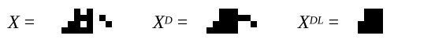](../../assets/volume4a/figures/exercise-7-1-3-173-closed-open-bitmap.svg)

一般说来, $X^D$ 比 $X$“更黑”, 而 $X^L$ 比 $X$“更亮”: $X^D\supseteq X\supseteq X^L$.

(a) 证明: $(X^{DL})^{DL}=X^{DL}$. 提示: $X\subseteq Y$ 蕴涵 $X^D\subseteq Y^D$ 和 $X^L\subseteq Y^L$.

(b) 说明: 可以用 $3\times3$ 细胞自动机一步计算 $X^D$.

<a id="ex-7-1-3-174"></a>

**174.** [*M46*][答案](./answers/7-1-3.md#ans-7-1-3-174) (马文·闵斯基和西摩·佩珀特) 存在类似 $(161)$ 的保持连通性的三维收缩算法吗?

<a id="ex-7-1-3-175"></a>

**175.** [*15*][答案](./answers/7-1-3.md#ans-7-1-3-175) 柴郡猫有多少车连通黑色分图?

<a id="ex-7-1-3-176"></a>

**176.** [*M24*][答案](./answers/7-1-3.md#ans-7-1-3-176) 图 $G$ 的顶点是给定位图 $X$ 的黑色像素, 当 $u$ 和 $v$ 相距一步王移动时, $G$ 具有边 $u\mathbin{\text{—}}v$. 令 $G'$ 是应用收缩变换 $(161)$ 后对应的图. 本题的目的在于证明, $G'$ 的连通分图数目等于 $G$ 的分图数目减去 $G$ 的孤立顶点数目.

<a id="pdf-180"></a><a id="p-165"></a>

令 $N_{(i,j)}=\{(i,j),(i-1,j),(i-1,j+1),(i,j+1)\}$ 是像素 $(i,j)$ 以及它的北面邻近和 (或) 东面邻近. 对于每个 $v\in G$, 令 $S(v)=\{v'\in G'\mid v'\in N_v\}$.

(a) 证明: $S(v)$ 是空集当且仅当 $v$ 是 $G$ 的孤立顶点.

(b) 如果 $u\mathbin{\text{—}}v$ 在 $G$ 中, $u'\in S(u)$ 且 $v'\in S(v)$, 证明: $u'\overset{*}{\mathbin{\text{—}}}v'$ 在 $G'$ 中 (也就是说, 它们在同一个分图中).

(c) 对于每个 $v'\in G'$, 令 $S'(v')=\{v\in G\mid v'\in N_v\}$. $S'(v')$ 总是非空吗?

(d) 如果 $u'\mathbin{\text{—}}v'$ 在 $G'$ 中, $u\in S'(u')$ 且 $v\in S'(v')$, 证明: $u\overset{*}{\mathbin{\text{—}}}v$ 在 $G$ 中.

(e) 因此, 在 $G$ 的非平凡分图与 $G'$ 的分图之间存在一一对应.

<a id="ex-7-1-3-177"></a>

**177.** [*M22*][答案](./answers/7-1-3.md#ans-7-1-3-177) 续习题 176, 对白色像素证明类似的结果.

<a id="ex-7-1-3-178"></a>

**178.** [*20*][答案](./answers/7-1-3.md#ans-7-1-3-178) 如果 $X$ 是 $M\times N$ 位图, 令 $X^*$ 是 $M\times(2N+1)$ 位图 $X\mathbin{\ddagger}(X\mid(X\ll1))$. 证明: $X^*$ 的王连通分图也是车连通的, 位图 $X^*$ 具有与 $X$ 相同的 “环绕树”$(162)$.

[](../../assets/volume4a/figures/exercise-7-1-3-178-stretched-cat.svg)

<a id="ex-7-1-3-179"></a>

▶ **179.** [*34*][答案](./answers/7-1-3.md#ans-7-1-3-179) 设计一个算法, 构造给定 $M\times N$ 位图的环绕树, 如正文中讨论的那样, 一次扫描一行图像. (见 $(162)$ 和 $(163)$.)

<a id="ex-7-1-3-180"></a>

▶ **180.** [*M24*][答案](./answers/7-1-3.md#ans-7-1-3-180) 对于 $0<y\le7$, 手工数字化双曲线 $y^2=x^2+13$.

<a id="ex-7-1-3-181"></a>

**181.** [*HM20*][答案](./answers/7-1-3.md#ans-7-1-3-181) 说明怎样把有理系数的一般圆锥曲线 $(168)$ 细分为适用算法 T 的单调区段.

<a id="ex-7-1-3-182"></a>

**182.** [*M31*][答案](./answers/7-1-3.md#ans-7-1-3-182) 为什么三寄存器算法 (算法 T) 的数字化过程是正确的?

<a id="ex-7-1-3-183"></a>

▶ **183.** [*M29*][答案](./answers/7-1-3.md#ans-7-1-3-183) (金特·罗特) 说明为什么当条件 (v) 不成立时算法 T 可能失败.

<a id="ex-7-1-3-184"></a>

▶ **184.** [*M22*][答案](./answers/7-1-3.md#ans-7-1-3-184) 求二次型 $Q'(x,y)$, 如果把算法 T 应用于 $(x',y')$、$(x,y)$、$Q'$, 它产生与算法 T 应用于 $(x,y)$、$(x',y')$、$Q$ 完全相同的那些边, 但顺序相反. 提示: 答案很简单.

<a id="ex-7-1-3-185"></a>

▶ **185.** [*23*][答案](./answers/7-1-3.md#ans-7-1-3-185) 通过简化算法 T 设计一个算法, 当 $\xi,\eta,\xi',\eta'$ 是有理数时, 该算法正确数字化从 $(\xi,\eta)$ 到 $(\xi',\eta')$ 的直线.

<a id="ex-7-1-3-186"></a>

**186.** [*HM22*][答案](./answers/7-1-3.md#ans-7-1-3-186) 给定 3 个复数 $(z_0,z_1,z_2)$, 考虑由

$$
B(t)=(1-t)^2z_0+2(1-t)tz_1+t^2z_2,\qquad0\le t\le1
$$

画出的曲线.

(a) 当 $t$ 接近 0 或 1 时, $B(t)$ 有什么近似特性?

(b) 令 $S(z_0,z_1,z_2)=\{B(t)\mid0\le t\le1\}$. 证明: $S(z_0,z_1,z_2)$ 的所有点位于以 $z_0,z_1,z_2$ 为顶点的三角形上或其内部.

(c) 判别真假: $S(w+\zeta z_0,w+\zeta z_1,w+\zeta z_2)=w+\zeta S(z_0,z_1,z_2)$.

(d) 证明: 当且仅当 $z_0,z_1,z_2$ 共线, $S(z_0,z_1,z_2)$ 是一条线段; 否则, 它是抛物线的一部分.

(e) 证明: 如果 $0\le\theta\le1$, 我们有递推公式

$$
S(z_0,z_1,z_2)=S(z_0,(1-\theta)z_0+\theta z_1,B(\theta))\cup S(B(\theta),(1-\theta)z_1+\theta z_2,z_2).
$$

<a id="ex-7-1-3-187"></a>

**187.** [*M29*][答案](./answers/7-1-3.md#ans-7-1-3-187) 续习题 186, 说明如何用三寄存器方法 (算法 T) 数字化 $S(z_0,z_1,z_2)$. 为了获得最好结果, 数字化 $S(z_2,z_1,z_0)$ 和 $S(z_0,z_1,z_2)$ 应该产生相同的边, 但顺序相反.

<a id="ex-7-1-3-188"></a>

▶ **188.** [*25*][答案](./answers/7-1-3.md#ans-7-1-3-188) 把位图像素视为逐渐变化的灰色像素而非单纯的黑色或白色像素通常更为方便. 这样的灰度级别通常是从 0 (黑色) 到 255 (白色) 的 8 位二进制值, 注意这样的黑白约定同传统上注重二进制位 1 的情形相反. 分辨率为每英寸 600 点的 $m\times n$ 位图正好对应于每英寸 75 像素的 $(m/8)\times(n/8)$ 灰度级图像, 把每个 $8\times8$ 的像素 (每个像素 1 比特) 子阵列变换为灰度值 $\lfloor255(1-k/64)^{1/\gamma}+\tfrac12\rfloor$ 即可获得这种灰度级图像, 其中 $\gamma=1.3$, 而 $k$ 是子阵列中 1 的个数.

编写一个 MMIX 例程, 把给定的 $m\times n$ BITMAP 阵列转换成对应的 $(m/8)\times(n/8)$ GRAYMAP 图像, 假定 $m=8m'$, $n=64n'$.

<a id="pdf-181"></a><a id="p-166"></a>

<a id="ex-7-1-3-189"></a>

**189.** [*25*][答案](./answers/7-1-3.md#ans-7-1-3-189) 给定 $64\times64$ 位图, 使用 64 位二进制数运算对它 (a) 转置或者 (b) 逆时针旋转 $90^\circ$ 的有效方法是什么?

<a id="ex-7-1-3-190"></a>

**190.** [*23*][答案](./answers/7-1-3.md#ans-7-1-3-190) $m$ 行 $n$ 列的奇偶模式是具有如下特性的由 0 和 1 构成的 $m\times n$ 矩阵: 它的每个元素是其车邻近之和, 模 2. 例如,

$$
\begin{matrix}\mathtt{11}\\\mathtt{00}\\\mathtt{11}\end{matrix},\qquad
\begin{matrix}\mathtt{0011}\\\mathtt{0100}\\\mathtt{1101}\\\mathtt{0101}\end{matrix},\qquad
\begin{matrix}\mathtt{01010}\\\mathtt{11011}\\\mathtt{01010}\end{matrix},\qquad
\begin{matrix}\mathtt{100}\\\mathtt{110}\\\mathtt{101}\\\mathtt{011}\\\mathtt{001}\end{matrix},\qquad
\begin{matrix}\mathtt{01110}\\\mathtt{10101}\\\mathtt{11011}\\\mathtt{10101}\\\mathtt{01110}\end{matrix}
$$

分别是大小为 $3\times2$、$4\times4$、$3\times5$、$5\times3$、$5\times5$ 的奇偶模式.

(a) 假定二进制向量 $\alpha_1,\alpha_2,\ldots,\alpha_m$ 是奇偶模式的各行. 证明: $\alpha_2,\ldots,\alpha_m$ 都可以从顶行向量 $\alpha_1$ 用按位运算计算. 因此, 从任意给定的位向量开始, 最多只有一个 $m\times n$ 奇偶模式.

(b) 判别真假: 两个 $m\times n$ 奇偶模式之和 (模 2) 是奇偶模式.

(c) 不包含全 0 的行或列的奇偶模式, 称作完全的. 例如, 上面的矩阵中有 3 个是完全奇偶模式, 但 $3\times2$ 和 $3\times5$ 的例子不是. 证明: 每个 $m\times n$ 奇偶模式都包含完全奇偶模式作为子矩阵. 此外, 所有这样的子矩阵具有同样的大小 $m'\times n'$, 其中 $m'+1$ 是 $m+1$ 的因子, $n'+1$ 是 $n+1$ 的因子.

(d) 有以 $\mathtt{0011}$ 开始的完全奇偶模式, 但没有以 $\mathtt{01010}$ 开始的完全奇偶模式. 存在判别给定二进制向量是不是完全奇偶模式顶行向量的简单方法吗?

(e) 证明: 存在唯一的完全奇偶模式, 它的顶行向量是 $1\overbrace{0\ldots0}^{n-1}$.

<a id="ex-7-1-3-191"></a>

**191.** [*M30*][答案](./answers/7-1-3.md#ans-7-1-3-191) 回绕奇偶模式类似于习题 190 中的奇偶模式, 只是每一行最左边元素和最右边元素也是邻近.

(a) 找出顶行向量是 $\alpha$ 的 $n$ 列奇偶模式与顶行向量是 $0\alpha0\alpha^R$ 的 $2n+2$ 列回绕奇偶模式之间的一种简单关系.

(b) 斐波那契多项式由递推公式

$$
F_0(x)=0,\quad F_1(x)=1,\quad F_{j+1}(x)=xF_j(x)+F_{j-1}(x),\qquad j\ge1
$$

定义. 证明: 在顶行向量是 $10\ldots0$($N-1$ 个零) 的回绕奇偶模式与斐波那契多项式 (模 $x^N+1$) 之间存在简单关系. 提示: 考虑 $F_j(x^{-1}+1+x)$, 进行模 2 以及模 $x^N+1$ 算术运算.

(c) 假定 $\alpha$ 是二进制串 $a_1\ldots a_n$, 令 $f_\alpha(x)=a_1x+\cdots+a_nx^n$. 证明

$$
f_{(\alpha_j0\alpha_j^R)}(x)=(f_\alpha(x)+f_\alpha(x^{-1}))F_j(x^{-1}+1+x)\bmod(x^N+1)\text{ 和模 }2,
$$

其中 $N=2n+2$, $\alpha_j$ 是顶行向量为 $\alpha$ 的 $n$ 列奇偶模式的第 $j$ 行.

(d) 因此, 我们可以仅用 $O(n^2\log j)$ 步从 $\alpha$ 计算 $\alpha_j$. 提示: 见习题 4.6.3–26, 并利用恒等式 $F_{m+n}(x)=F_m(x)F_{n+1}(x)+F_{m-1}(x)F_n(x)$, 它是等式 1.2.8–$(6)$ 的推广.

<a id="ex-7-1-3-192"></a>

**192.** [*HM38*][答案](./answers/7-1-3.md#ans-7-1-3-192) 从一个给定串开始的最短奇偶模式可能是非常长的. 例如, 顶行向量是 $10\ldots0$ 的 120 列完全奇偶模式最终有 $36\,028\,797\,018\,963\,966$ 行! 本题的目的是考察如何计算重要函数

$$
c(q)=1+\max\{m\mid\text{存在 }m\text{ 行 }q-1\text{ 列完全奇偶模式}\},
$$

当 $1\le q\le9$ 时, 不难手工计算开头几个值 $(1,3,4,6,5,24,9,12,28)$.

(a) 利用习题 191 的斐波那契多项式以代数方式描述 $c(q)$ 的特征.

(b) 如果我们知道整数 $M$ (它能被 $c(q)$ 整除), 还知道 $M$ 的素因子, 说明如何计算 $c(q)$.

(c) 证明: 当 $e>0$ 时我们有 $c(2^e)=3\cdot2^{e-1}$. 提示: $F_{2^e}(y)$ 有一个简单的模 2 形式.

(d) 证明: 当 $q$ 是奇数且不是 3 的倍数时, $c(q)$ 是 $2^{2e}-1$ 的因子, 其中 $e$ 是 2 模 $q$ 的阶. 提示: $F_{2^e-1}(y)$ 有一个简单的模 2 形式.

(e) 当 $q$ 是 3 的奇数倍时出现什么情况?

(f) 最后, 说明当 $q$ 是偶数时该如何处理.

<a id="ex-7-1-3-193"></a>

▶ **193.** [*M21*][答案](./answers/7-1-3.md#ans-7-1-3-193) 假定当 $m$ 和 $n$ 都是奇数时存在 $m\times n$ 完全奇偶模式, 那么, 也存在 $(2m+1)\times(2n+1)$ 完全奇偶模式, 试加以说明. (反复应用这种观察结果导致复杂分形. 例如, 习题 190 中的 $5\times5$ 奇偶模式导致图 20 的模式.)

<a id="pdf-182"></a><a id="p-167"></a>

<a id="ex-7-1-3-194"></a>

**194.** [*M24*][答案](./answers/7-1-3.md#ans-7-1-3-194) 找出满足以下条件的所有 $n\le383$, 存在有八重对称性 (如图 20 中的例子) 的 $n\times n$ 完全奇偶模式. 提示: 所有这种模式的对角线元素必定为零.

<a id="fig-7-1-3-20"></a>

[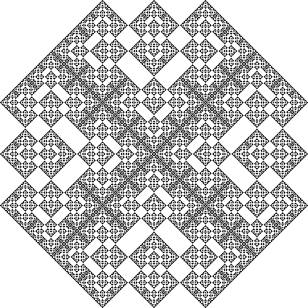](../../assets/volume4a/figures/figure-20-perfect-parity-pattern.png)

**图 20**　$383\times383$ 完全奇偶模式.

<a id="ex-7-1-3-195"></a>

▶ **195.** [*HM25*][答案](./answers/7-1-3.md#ans-7-1-3-195) 令 $A$ 是行向量为 $\alpha_1,\ldots,\alpha_m$ 的 $n$ 列二进制矩阵. 说明如何利用按位运算计算 $A$ 在二元域 $\{0,1\}$ 上的秩 $m-r$, 并求长度为 $m$ 的线性无关二进制向量 $\theta_1,\ldots,\theta_r$, 它们满足 $\theta_jA=0\ldots0$($1\le j\le r$). 提示: 见关于零空间的 “三角化” 算法 4.6.2N.

<a id="ex-7-1-3-196"></a>

**196.** [*21*][答案](./answers/7-1-3.md#ans-7-1-3-196) (肯尼斯·汤普森, 1992) 对于区间 $0\le x<2^{31}$ 内的整数, 可以用下述方法编码为至多 6 字节的数值串 $\alpha(x)=\alpha_1\ldots\alpha_l$: 如果 $x<2^7$, 置 $l\leftarrow1$、$\alpha_1\leftarrow x$. 否则, 令 $x=(x_5\ldots x_1x_0)_{64}$; 置 $l\leftarrow\lceil(\lambda x)/5\rceil$、$\alpha_1\leftarrow2^8-2^{8-l}+x_{l-1}$, 对于 $2\le j\le l$, 置 $\alpha_j\leftarrow2^7+x_{l-j}$. 注意, $\alpha(x)$ 包含零字节当且仅当 $x=0$.

(a) `#a`、`#3a3`、`#7b97`、`#1d141` 的编码分别是什么?

(b) 证明: 如果 $x\le x'$, 按字典序 $\alpha(x)\le\alpha(x')$.

(c) 假定值序列 $x^{(1)}x^{(2)}\ldots x^{(n)}$ 编码为字节串 $\alpha(x^{(1)})\alpha(x^{(2)})\ldots\alpha(x^{(n)})$, 令 $\alpha_k$ 是这个串中的第 $k$ 个字节. 说明通过 (在需要时) 考察少数邻近字节, 容易确定 $\alpha_k$ 来自哪个值 $x^{(i)}$.

<a id="ex-7-1-3-197"></a>

**197.** [*22*][答案](./answers/7-1-3.md#ans-7-1-3-197) 通用字符集 (UCS) 也称为统一码, 是从字符到整数码点 $x$($0\le x<2^{20}+2^{16}$) 的标准变换. UTF-16 编码用下述方法把这样的整数表示成一个短字 $\beta(x)=\beta_1$ 或两个短字 $\beta(x)=\beta_1\beta_2$: 如果 $x<2^{16}$, 那么 $\beta(x)=x$; 否则

$$
\beta_1=\mathtt{\#d800}+\lfloor y/2^{10}\rfloor,\qquad\beta_2=\mathtt{\#dc00}+(y\bmod2^{10}),\qquad\text{其中 }y=x-2^{16}.
$$

对这种编码回答习题 196 的问题 (a)、(b)、(c).

<a id="ex-7-1-3-198"></a>

▶ **198.** [*21*][答案](./answers/7-1-3.md#ans-7-1-3-198) 我们通常用称为 UTF-8 的模式把统一码字符表示成字节串, 这种表示是习题 196 限制在区间 $0\le x<2^{20}+2^{16}$ 中的整数编码. 注意, UTF-8 有效保持了标准 ASCII 字符集 ($x<2^7$ 的码点), 它与 UTF-16 完全不同.

令 $\alpha_1$ 是 UTF-8 字节串 $\alpha(x)$ 的第一个字节. 证明: 存在适当小的整常数 $a,b,c$, 仅用 4 个按位运算

$$
(a\gg((\alpha_1\gg b)\mathbin{\&}c))\mathbin{\&}3
$$

足以确定 $\alpha_1$ 与 $\alpha(x)$ 的末端之间的字节数 $l-1$.

<a id="ex-7-1-3-199"></a>

▶ **199.** [*23*][答案](./answers/7-1-3.md#ans-7-1-3-199) 在 UTF-8 中, 有人也许试图把 `#a` 编码为 `#c08a` 或 `#e0808a` 或 `#f080808a`, 因为明显的解码算法在每一种情况下产生同样结果. 然而, 因为可能产生安全隐患, 这些不必要的长编码形式是违规的.

假定我们有字节 $\alpha_1$ 和 $\alpha_2$, 其中 $\alpha_1\ge\mathtt{\#80}$、$\mathtt{\#80}\le\alpha_2<\mathtt{\#c0}$. 找出一个无转移的方法, 判定 $\alpha_1$ 和 $\alpha_2$ 是否至少是一个合法的 UTF-8 字节串 $\alpha(x)$ 的前两个字节.

<a id="ex-7-1-3-200"></a>

**200.** [*20*][答案](./answers/7-1-3.md#ans-7-1-3-200) 执行 3 条 MMIX 指令 `MOR $1,$0,#94; MXOR $2,$0,#94; SUBU $3,$1,$2` 后寄存器 `$3` 的内容是什么, 说明其含义.

<a id="ex-7-1-3-201"></a>

**201.** [*20*][答案](./answers/7-1-3.md#ans-7-1-3-201) 假定 $x=(x_{15}\ldots x_1x_0)_{16}$ 有 16 个十六进制数字. 用一条什么 MMIX 指令能把 $x$ 的每个非零十六进制数字变成 $\mathtt f$ 而保持其中的零不变?

<a id="ex-7-1-3-202"></a>

**202.** [*20*][答案](./answers/7-1-3.md#ans-7-1-3-202) 两条什么指令能把全字 (64 位量) 中的非零短字 (16 位量) 变成 `#ffff`?

<a id="ex-7-1-3-203"></a>

**203.** [*22*][答案](./answers/7-1-3.md#ans-7-1-3-203) (约瑟夫·达洛斯, 2018) 假定我们需要把半字 $x=(x_7\ldots x_1x_0)_{16}$ 转化成全字 $y=(y_7\ldots y_1y_0)_{256}$, 其中 $y_j$ 是十六进制数字 $x_j$ 的 ASCII 码. 例如, 如果 $x=\mathtt{\#1234abcd}$, 那么 $y$ 应该是字符串 `"1234abcd"`. 如何巧妙选择 5 个常数 $a,b,c,d,e$, 使得下面的 MMIX 指令完成此项任务?

```text
MOR t,x,a;  SLU s,t,4;  MOR t,b,s
ADD t,t,c;  MOR s,d,t;  ADD t,t,e;  ADD y,t,s
```

<a id="ex-7-1-3-204"></a>

▶ **204.** [*22*][答案](./answers/7-1-3.md#ans-7-1-3-204) 仅用 6 条 MMIX 指令达到全混洗的神奇常数 $p,q,r,m$ 是什么? (见 $(175)$–$(178)$.)

<a id="pdf-183"></a><a id="p-168"></a>

<a id="ex-7-1-3-205"></a>

▶ **205.** [*22*][答案](./answers/7-1-3.md#ans-7-1-3-205) 在 MMIX 上如何解除全混洗, 从 $(175)$ 中的 $w$ 回到 $z$?

<a id="ex-7-1-3-206"></a>

**206.** [*20*][答案](./answers/7-1-3.md#ans-7-1-3-206) 与取变换 $z\mapsto y\mathbin{\ddagger}x=(y_{31}x_{31}\ldots y_1x_1y_0x_0)_2$ 的 “内混洗” 比较, 有时把 “全混洗”$(175)$ 称为 “外混洗”. 外混洗保留 $z$ 中最左边的和最右边的二进制位, 但是内混洗没有固定点. 能够像实现外混洗那样有效地实现内混洗吗?

<a id="ex-7-1-3-207"></a>

**207.** [*22*][答案](./answers/7-1-3.md#ans-7-1-3-207) 使用 MOR 执行三路全混洗 (或者说 “三重拉链”), 把 $(x_{63}\ldots x_0)_2$ 变换成 $(x_{21}x_{42}x_{63}x_{20}\ldots x_2x_{23}x_{44}x_1x_{22}x_{43}x_0)_2$, 以及执行这个混洗的逆变换.

<a id="ex-7-1-3-208"></a>

▶ **208.** [*23*][答案](./answers/7-1-3.md#ans-7-1-3-208) MMIX 转置 $8\times8$ 布尔矩阵的快速方法是什么?

<a id="ex-7-1-3-209"></a>

▶ **209.** [*21*][答案](./answers/7-1-3.md#ans-7-1-3-209) 习题 36 的后缀奇偶性运算 $x^\oplus$ 容易用 MXOR 计算吗?

<a id="ex-7-1-3-210"></a>

**210.** [*22*][答案](./answers/7-1-3.md#ans-7-1-3-210) 智力题: 寄存器 x 包含整数 $8j+k$, 其中 $0\le j,k<8$. 寄存器 a 和 b 包含任意全字 $(a_7\ldots a_1a_0)_{256}$ 和 $(b_7\ldots b_1b_0)_{256}$. 找出把 $a_j\mathbin{\&}b_k$ 存入寄存器 x 的 4 条 MMIX 指令序列.

<a id="ex-7-1-3-211"></a>

▶ **211.** [*M25*][答案](./answers/7-1-3.md#ans-7-1-3-211) 布尔函数 $f(x_1,\ldots,x_6)$ 的真值表实际上是一个 64 位二进制数 $f=(f(0,0,0,0,0,0)\ldots f(1,1,1,1,1,0)f(1,1,1,1,1,1))_2$. 两条 MOR 指令将把 $f$ 变换成最小单调布尔函数 $\hat f$ (它在每个点大于等于 $f$) 的真值表, 试加以说明.

<a id="ex-7-1-3-212"></a>

**212.** [*M32*][答案](./answers/7-1-3.md#ans-7-1-3-212) 我们用 $a=(a_{63}\ldots a_1a_0)_2$ 表示多项式

$$
a(x)=(a_{63}\ldots a_1a_0)_x=a_{63}x^{63}+\cdots+a_1x+a_0.
$$

讨论用 MXOR 计算乘积 $c(x)=a(x)b(x)$, 模 $x^{64}$ 以及模 2 的方法.

<a id="ex-7-1-3-213"></a>

▶ **213.** [*HM26*][答案](./answers/7-1-3.md#ans-7-1-3-213) 在 MMIX 上实现 CRC (循环冗余检验) 过程 $(183)$.

<a id="ex-7-1-3-214"></a>

▶ **214.** [*HM28*][答案](./answers/7-1-3.md#ans-7-1-3-214) (小高斯珀, 1985) 对于任意给定的以 0 和 1 为元素的 $8\times8$ 矩阵 $X$, 如果 $\det X$ 是奇数, 找出一组简短的无转移 MMIX 指令, 计算 $X$ 的逆矩阵 (模 2).

<a id="ex-7-1-3-215"></a>

▶ **215.** [*21*][答案](./answers/7-1-3.md#ans-7-1-3-215) 用 MMIX 检验一个 64 位二进制数是不是 3 的倍数的快速方法是什么?

<a id="ex-7-1-3-216"></a>

▶ **216.** [*M26*][答案](./answers/7-1-3.md#ans-7-1-3-216) 给定 $n$ 位二进制整数 $x_1,\ldots,x_m\ge0$($n\ge\lambda m$), 如果 $\lambda x$ 取单位时间, 用 $O(m)$ 步计算最小的 $y>0$, 使得 $y\notin\{a_1x_1+\cdots+a_mx_m\mid a_1,\ldots,a_m\in\{0,1\}\}$.

<a id="ex-7-1-3-217"></a>

**217.** [*40*][答案](./answers/7-1-3.md#ans-7-1-3-217) 探讨文本的长字符串处理, 采用把它们打包成 “转置” 或 “分片” 的方式: 把 64 个连贯的字符表示成 8 个全字 $w_0,\ldots,w_7$ 的序列, 其中 $w_k$ 包含它们第 $k$ 位的所有 64 个二进制位.

<a id="ex-7-1-3-218"></a>

▶ **218.** [*M30*][答案](./answers/7-1-3.md#ans-7-1-3-218) (汉斯·西拉斯基, 2009) 给定整数 $a,x,y$, 其中 $x$ 是奇数, 对于固定的 $d\ge3$, 设计一个算法, 用于计算 $a\cdot x^y\bmod2^d$, 使用 $O(d)$ 次加法和按位运算以及一次乘以 $y$ 的乘法.

<a id="ex-7-1-3-219"></a>

▶ **219.** [*20*][答案](./answers/7-1-3.md#ans-7-1-3-219) “当 $x\mathbin{\&}(x+1)\ne0$ 时循环执行 $x\leftarrow x-((x\mathbin{\&}(x+1))\gg1)$.” 这一语句做了什么?

> BDD 一词在流行的用法中几乎总是指约化的有序二元决策图 (即文献中的 ROBDD, 用在需要强调有序和约化两个方面的时候).
>
> ——维基百科,*The Free Encyclopedia*(2007 年 7 月 7 日)

[^v4a-158-rook-king]: 此处的 “车”(rook) 及后文的 “王”(king) 都是国际象棋中的棋子. 在国际象棋中, “车” 能向上、下、左、右 4 个方向移动, “王” 能向上、下、左、右、左上、左下、右上、右下 8 个方向移动. ——编者注


[^v4a-158-conway]: 约翰·康威 (John Horton Conway, 1937— ) 是英国当代著名数学家, 他发明的细胞自动机是模拟生命体的一种数学游戏. 这种人为生命体是胞腔的集合, 存在于二维世界; 每个胞腔可以容纳一个细胞, 它们遵循一组简单的数学规则, 随着时间的流逝而世代交替. 细胞的生存、死亡或繁衍, 取决于胞腔集合的形态及其初始条件. ——译者注


[^v4a-159-cheshire-cat]: 柴郡猫是英国作家刘易斯·卡罗尔创作的童话《爱丽丝漫游奇境》中的虚构角色, 形象是一只咧着嘴笑的猫, 拥有能凭空出现或消失的能力, 甚至在它消失以后, 笑容还挂在半空中. ——编者注


[^v4a-165-mmix-table]: 1.3.1′ 节位于本套书第 1 卷第 1 分册, 其中的表 1 用 MMIX 指令集代替旧版的 MIX 指令集. ——译者注


[^v4a-167-mmix-exercise]: 1.3.1′ 节位于本套书第 1 卷第 1 分册. ——译者注
