

# 7.1.4　二元决策图

现在让我们转向一族重要的数据结构, 这种结构已经迅速变成计算机内部表示与处理布尔函数选用的方法. 其基本思想是采用一种 “各个击破” 的方案, 同 6.3 节的二叉检索树有些类似, 但是带有若干新手法.

[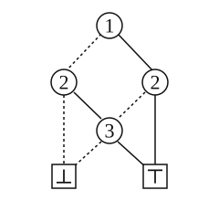](../../assets/volume4a/figures/fig-7-21-bdd.svg)

**图 21**　过半数函数或中位数函数 $\langle x_1x_2x_3\rangle$ 的二元决策图 (BDD).

图 21 显示 3 变量简单布尔函数, 即 7.1.1–$(43)$ 中的中位数函数 $\langle x_1x_2x_3\rangle$ 的二元决策图. 我们可以这样理解: 顶端的结点称为根. 每个内部结点 $\text{\textcircled{j}}$ 也称为分支结点, 用指明一个变量的名称或下标 $j=V(\text{\textcircled{j}})$ 标记. 例如, 图 21 中的根结点 ① 指明 $x_1$. 分支结点有两个后继, 用下降的线段指示. 一个后继画作虚线并且称为 LO, 另一个后继画作实线并且称为 HI. 如果从根结点开始, 并且当 $x_j=0$ 时从结点 $\text{\textcircled{j}}$ 取 LO 分支, 当 $x_j=1$ 时取 HI 分支, 则这些分支结点对于布尔变量的任何值确定图中一条路径. 最终这条路径到达一个汇结点, 它要么是 $\boxed{\bot}$ (表示 FALSE), 要么是 $\boxed{\top}$ (表示 TRUE). 在图 21 中容易证实当变量 $\{x_1,x_2,x_3\}$ 中至少有两个是 0 时, 这个过程产生函数值 FALSE, 否则产生函数值 TRUE.

很多作者用 $\boxed{0}$ 和 $\boxed{1}$ 表示汇结点. 我们用 $\boxed{\bot}$ 和 $\boxed{\top}$ 代替, 希望避免出现同分支结点 ⓪ 和 ① 的任何混淆.

在计算机内部, 图 21 表示为任意内存单元的一组 4 个结点, 其中每个结点具有 3 个字段 $\begin{array}{|c|c|c|}\hline\mathtt V&\mathtt{LO}&\mathtt{HI}\\\hline\end{array}$. V 字段保存变量的下标, 而 LO 和 HI 字段各自指向另一个结点或汇结点:

[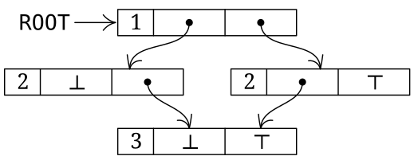](../../assets/volume4a/figures/diagram-7-1-4-1-bdd-memory-layout.svg)

$(1)$

例如, 可以把 64 个二进制位的字的 8 位用于 V, 其后 28 位用于 LO, 另外 28 位用于 HI.

这样一种结构称为 “二元决策图”, 或简称为 BDD. 很容易把小型 BDD 画成纸面上或计算机屏幕上的实际图形. 但实质上, 每个 BDD 其实是链接结点的一个抽象集合, 也许更宜于把它称作 “二元决策有向无圈图”——一棵具有共享子树的二叉树, 即从每个非汇结点恰好引出两条有区别的弧的有向无圈图.

我们假定每个 BDD 服从两条重要限制. 首先, 它必须是有序的: 每当有一段从分支结点 $\text{\textcircled{i}}$ 到分支结点 $\text{\textcircled{j}}$ 的弧 LO 或 HI 时, 我们必定有 $i<j$. 因此, 当对函数求值时肯定不会对变量 $x_j$ 查询两次. 其次, 一个 BDD 在不浪费空间的意义下必须是约化的. 这意味着分支结点的 LO 和 HI 指针一定不会相等, 而且不允许两个结点具有同样的三元值 $(\mathtt{V},\mathtt{LO},\mathtt{HI})$. 每个结点也应该是从根结点可达的. 例如, 图

[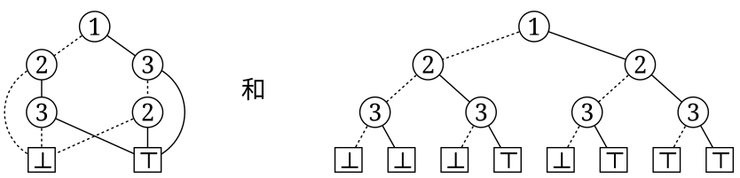](../../assets/volume4a/figures/diagram-7-1-4-2-non-bdd-examples.svg)

$(2)$

不是 BDD, 因为第一个图不是有序的而另外一个图不是约化的.

已经创建了许多具备其他风格的决策图, 而且当前计算机科学文献包含许多像 EVBDD、FBDD、IBDD、OBDD、OFDD、OKFDD、PBDD、……、ZDD 这类五花八门的首字母缩略词. 本书中我们始终用不带修饰的代码名 “BDD” 表示上面描述的有序的和约化的二元决策图, 正如我们通常用 “树” 这个词表示一棵有序 (平面) 树一样, 因为这样的 BDD 和这样的树是实际应用中最常见的.

回顾 7.1.1 节, 每个布尔函数 $f(x_1,\ldots,x_n)$ 对应于一个真值表, 它是从函数值 $f(0,\ldots,0)$ 开始, 继之以 $f(0,\ldots,0,1)$、$f(0,\ldots,0,1,0)$、$f(0,\ldots,0,1,1)$、$\ldots$、$f(1,\ldots,1,1,1)$ 的 $2^n$ 位二进制串. 例如, 中位数函数 $\langle x_1x_2x_3\rangle$ 的真值表是 `00010111`. 注意, 如果令 $0\mapsto\boxed{\bot}$ 和 $1\mapsto\boxed{\top}$, 则这个真值表同 $(2)$ 中的非约化决策树的叶结点序列是一样的. 事实上, 在真值表与 BDD 之间存在一种重要关系, 这个最好通过一类称为 “串珠” 的二进制串来理解.

一个 $n$ 阶真值表是长度为 $2^n$ 的二进制串. 一个 $n$ 阶串珠 (bead) 是不构成串方的 $n$ 阶真值表 $\beta$. 就是说, 对于任何长度为 $2^{n-1}$ 的二进制串 $\alpha$, $\beta$ 不具备 $\alpha\alpha$ 这样的形式. (数学家总是说串珠是 “长度为 $2^n$ 的原始串”.) 存在两个 0 阶串珠, 即 0 和 1. 有两个 1 阶串珠, 即 01 和 10. 一般而言, 当 $n>0$ 时存在 $2^{2^n}-2^{2^{n-1}}$ 个 $n$ 阶串珠, 因为有 $2^{2^n}$ 个长度为 $2^n$ 的二进制串, 而它们中的 $2^{2^{n-1}}$ 个是串方. $16-4=12$ 个 2 阶串珠是

$$
\mathtt{0001},\mathtt{0010},\mathtt{0011},\mathtt{0100},\mathtt{0110},\mathtt{0111},
\mathtt{1000},\mathtt{1001},\mathtt{1011},\mathtt{1100},\mathtt{1101},\mathtt{1110}.\tag{3}
$$

这些串珠在 $f(0,x_2)$ 与 $f(1,x_2)$ 不是相同函数的意义下也是依赖于 $x_1$ 的所有函数 $f(x_1,x_2)$ 的真值表.

每个真值表 $\tau$ 都是一个唯一串珠的乘方, 这个串珠称为它的根. 因为如果 $\tau$ 的长度是 $2^n$, 而且不是既有的串珠, 那么它是另外一个真值表 $\tau'$ 的平方. 同时按照对 $\tau$ 的长度的归纳法, 对于某个根 $\beta$ 有 $\tau'=\beta^k$. 因此 $\tau=\beta^{2k}$, 并且 $\beta$ 是 $\tau$ 的根, 也是 $\tau'$ 的根. ($k$ 当然是 2 的一个乘方.)

阶为 $n>0$ 的真值表 $\tau$ 总具有形式 $\tau_0\tau_1$, 其中 $\tau_0$ 和 $\tau_1$ 是 $n-1$ 阶真值表. 显然, $\tau$ 代表函数 $f(x_1,x_2,\ldots,x_n)$ 当且仅当 $\tau_0$ 代表 $f(0,x_2,\ldots,x_n)$ 且 $\tau_1$ 代表 $f(1,x_2,\ldots,x_n)$. $f(0,x_2,\ldots,x_n)$ 和 $f(1,x_2,\ldots,x_n)$ 这两个函数称为 $f$ 的子函数, 它们的真值表 $\tau_0$ 和 $\tau_1$ 称为 $\tau$ 的子表.

子表的子表也被当作子表, 而且一个表也是它自身的子表. 因此一般说来, 对于 $0\le k\le n$, 一个 $n$ 阶真值表有 $2^k$ 个 $n-k$ 阶子表, 对应于前 $k$ 个变量 $(x_1,\ldots,x_k)$ 的 $2^k$ 个可能的取值. 这些子表中有许多经常是相同的, 这种情况下我们可以用一种压缩形式来表示 $\tau$.

布尔函数的串珠是它的真值表的子表, 这些子表也必须恰好是串珠. 例如, 让我们再次考察中位数函数 $\langle x_1x_2x_3\rangle$, 以及它的真值表 `00010111`. 这个真值表的不同子表是 $\{\mathtt{00010111},\mathtt{0001},\mathtt{0111},\mathtt{00},\mathtt{01},\mathtt{11},\mathtt{0},\mathtt{1}\}$, 同时它们除了 00 和 11 之外全部是串珠. 所以, $\langle x_1x_2x_3\rangle$ 的串珠是

$$
\{\mathtt{00010111},\mathtt{0001},\mathtt{0111},\mathtt{01},\mathtt{0},\mathtt{1}\}.\tag{4}
$$

至此我们触及关键问题: 布尔函数的 BDD 的结点同它的串珠是一一对应的. 例如, 我们通过在图 21 的每个结点内放置相应的串珠可以重画如下:

[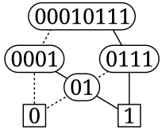](../../assets/volume4a/figures/diagram-7-1-4-5-median-beads.svg)

$(5)$

一般说来, 一个函数的 $n+1-k$ 阶真值表对应于它的同阶子函数 $f(c_1,\ldots,c_{k-1},x_k,\ldots,x_n)$. 所以它的 $n+1-k$ 阶串珠对应于依赖它的第一个变量 $x_k$ 的那些子函数. 所以, 每个这样的串珠对应于 BDD 中的一个分支结点 $\text{\textcircled{k}}$. 如果 $\text{\textcircled{k}}$ 是对应于真值表 $\tau'=\tau'_0\tau'_1$ 的一个分支结点, 那么它的 LO 和 HI 分支分别指向对应于 $\tau'_0$ 和 $\tau'_1$ 的根的结点.

这种串珠与结点之间的对应, 证明每个布尔函数有且仅有一个 BDD 表示. 当然, BDD 的各个结点可以放置在计算机内的不同位置.

如果 $f$ 是任意布尔函数, 令 $B(f)$ 表示它拥有的串珠数目. 这是它的 BDD 的大小——包括汇结点在内的结点总数. 例如, 当 $f$ 是 3 变量中位数函数时 $B(f)=6$, 因为 $(5)$ 的大小是 6.

为了记住这些概念, 让我们讨论另外一个例子: 7.1.1–$(22)$ 和 7.1.2–$(6)$ 的 “近乎随机的” 函数. 它的真值表 `1100100100001111` 是一个串珠, 而且两个子表 `11001001` 和 `00001111` 也是串珠. 因此, 我们知道它的 BDD 的根是分支结点 ①, 并且在根之下的 LO 和 HI 结点都是 ②.

长度为 4 的子表是 $\{\mathtt{1100},\mathtt{1001},\mathtt{0000},\mathtt{1111}\}$, 前两个子表是串珠, 但是其余子表是串方. 为了获得下面一层结点, 我们把这两个串珠拆成两半, 并取非串珠的平方根, 合并重复的项, 这给我们留下 $\{\mathtt{11},\mathtt{00},\mathtt{10},\mathtt{01}\}$. 再次有两个串珠 10 和 01, 并且最后一步产生所求的 BDD:

[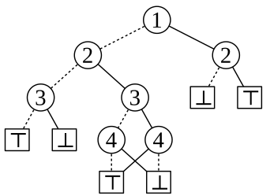](../../assets/volume4a/figures/diagram-7-1-4-6-four-variable-bdd.svg)

$(6)$

(在这个决策图以及下面的其他决策图中, 为了避免过分长的连线, 复制汇结点 $\boxed{\bot}$ 和 $\boxed{\top}$ 是方便的. 实际上仅存在一个 $\boxed{\bot}$ 和一个 $\boxed{\top}$, 所以 $(6)$ 的大小是 9, 而不是 13.)

机警的读者此刻可能会想到: “很好, 但是当 BDD 很庞大时会怎样呢?” 的确, 很容易构造出 BDD 大到无法处理的函数. 后面我们将讨论这样的事例. 但是奇妙的事情是, 大量实际重要的布尔函数具有适度小的 $B(f)$ 值. 所以, 我们首先关注这条好消息, 把坏消息推迟到证实 BDD 为何如此受欢迎之后.

**BDD 的优势.** 如果 $f(x)=f(x_1,\ldots,x_n)$ 是其 BDD 适度小的一个布尔函数, 则我们可以快速且轻而易举地做很多事情. 例如:

- 给定任意输入向量 $x=x_1\ldots x_n$, 只需从根开始沿着分支到达汇结点, 最多用 $n$ 步就可以求出 $f(x)$ 的值.

- 按照以下步骤, 我们可以找出满足 $f(x)=1$ 的字典序下最小的 $x$: 从根开始, 只要没有直接到达 $\boxed{\bot}$, 就一直选取结点的 LO 分支. 仅当必须选取 $\text{\textcircled{j}}$ 的 HI 分支时, 解具有 $x_j=1$. 例如, 在图 21 的 BDD 中, 这个求解过程给出 $x_1x_2x_3=\mathtt{011}$, 并且在 $(6)$ 中 $x_1x_2x_3x_4=\mathtt{0000}$. (它确定与 $f$ 的真值表中最左边的 1 对应的 $x$ 的值.) 因为每个分支结点对应于一个非零串珠, 求解仅需 $n$ 步. 我们总是可以找出一条下行到 $\boxed{\top}$ 而不带回行的路径. 当根本身就是 $\boxed{\bot}$ 时这个方法自然失效. 但是, 仅当 $f$ 恒等于零时才会出现这种情况.

- 利用下面的算法 C, 可以计算方程 $f(x)=1$ 的解的个数. 算法对 $n$ 位二进制数做 $B(f)$ 次运算, 所以在最坏情况下的运行时间是 $O(nB(f))$.

- 在算法 C 执行后, 用每个解是等可能的这样一种方式, 可以快速生成方程 $f(x)=1$ 的随机解.

- 我们还可以生成方程 $f(x)=1$ 的全部解 $x$. 当存在 $N$ 个解时, 习题 16 中的算法用 $O(nN)$ 步完成这个任务.

- 我们可以求解线性布尔规划问题: 给定常数 $(w_1,\ldots,w_n)$, 寻找 $x$ 使得

  $$
  \text{在 }f(x_1,\ldots,x_n)=1\text{ 的条件下,}\quad w_1x_1+\cdots+w_nx_n\text{ 取最大值.}\tag{7}
  $$

  算法 B (见下面) 用 $O(n+B(f))$ 步完成这个任务.

- 我们可以计算生成函数 $a_0+a_1z+\cdots+a_nz^n$, 其中 $a_j$ 是方程 $f(x_1,\ldots,x_n)=1$ 满足 $x_1+\cdots+x_n=j$ 的解的个数. (见习题 25.)

- 我们可以计算可靠性多项式 $F(p_1,\ldots,p_n)$, 它是当每个 $x_j$ 独立地以给定的概率 $p_j$ 为 1 时 $f(x_1,\ldots,x_n)=1$ 的概率. 习题 26 用 $O(B(f))$ 步完成这个任务.

此外我们将会见到, 对 BDD 可以进行有效地组合和修改. 例如, 不难从 $f$ 和 $g$ 的 BDD 构造 $f(x_1,\ldots,x_n)\wedge g(x_1,\ldots,x_n)$ 和 $f(x_1,\ldots,x_{j-1},g(x_1,\ldots,x_n),x_{j+1},\ldots,x_n)$ 的 BDD.

求解含有 BDD 的基本问题的算法通常是非常容易描述的, 只要我们假定 BDD 是用一序列分支指令表 $I_{s-1},I_{s-2},\ldots,I_1,I_0$ 给出的, 其中每个 $I_k$ 具有 $(\bar v_k\mathbin{?}l_k:h_k)$ 的形式. 例如, 可以把 $(6)$ 表示成 $s=9$ 的指令的表

$$
\begin{array}{lll}
I_8=(\bar1\mathbin{?}7:6),&I_5=(\bar3\mathbin{?}1:0),&I_2=(\bar4\mathbin{?}0:1),\\
I_7=(\bar2\mathbin{?}5:4),&I_4=(\bar3\mathbin{?}3:2),&I_1=(\bar5\mathbin{?}1:1),\\
I_6=(\bar2\mathbin{?}0:1),&I_3=(\bar4\mathbin{?}1:0),&I_0=(\bar5\mathbin{?}0:0),
\end{array}\tag{8}
$$

其中 $v_8=1$, $l_8=7$, $h_8=6$, $v_7=2$, $l_7=5$, $h_7=4$, $\ldots$, $v_0=5$, $l_0=h_0=0$. 除了最后的特殊指令 $I_1$ 和 $I_0$, 通常指令 $(\bar v\mathbin{?}l:h)$ 意味着, “如果 $x_v=0$, 转移到 $I_l$, 否则转移到 $I_h$”. 对于 $s>k\ge2$, 我们要求 LO 和 HI 分支 $l_k$ 和 $h_k$ 满足

$$
l_k<k,\qquad h_k<k,\qquad v_{l_k}>v_k,\qquad v_{h_k}>v_k.\tag{9}
$$

换句话说, 所有分支指令向下移动到更大下标的变量. 但是, 汇结点 $\boxed{\top}$ 和 $\boxed{\bot}$ 由空操作指令 $I_1$ 和 $I_0$ 表示, 其中 $l_k=h_k=k$, 而且变量下标 $v_k$ 具有不可能的值 $n+1$.

这些指令可以用遵守 BDD 的拓扑顺序的任何方式编号, 像条件 $(9)$ 要求的那样. 根结点必须对应于 $I_{s-1}$, 汇结点必须对应于 $I_1$ 和 $I_0$, 但是其他下标的编号没有如此严格的规定. 例如, $(6)$ 也可以表示成

$$
\begin{array}{lll}
I'_8=(\bar1\mathbin{?}7:2),&I'_5=(\bar4\mathbin{?}0:1),&I'_2=(\bar2\mathbin{?}0:1),\\
I'_7=(\bar2\mathbin{?}4:6),&I'_4=(\bar3\mathbin{?}1:0),&I'_1=(\bar5\mathbin{?}1:1),\\
I'_6=(\bar3\mathbin{?}3:5),&I'_3=(\bar4\mathbin{?}1:0),&I'_0=(\bar5\mathbin{?}0:0),
\end{array}\tag{10}
$$

以及其他 46 种同构的方法. 在计算机内部, BDD 实际上无须出现在相继的单元. 当结点像在 $(1)$ 中那样链接时, 可以按拓扑顺序快捷地遍历任何有向无圈图的结点. 但是我们将把它们想象成是顺序排列的, 像在 $(8)$ 中那样, 因此各种算法是较为容易理解的.

一个技术性细节值得注意: 如果 $f(x)=1$ 对于所有 $x$ 成立, 以致 BDD 仅仅是一个汇结点 $\boxed{\top}$, 则在这个序列表示中我们令 $s=2$. 否则, $s$ 是 BDD 的大小. 根结点总是用 $I_{s-1}$ 表示.

**算法 C (计算解的数目).** 给出布尔函数 $f(x)=f(x_1,\ldots,x_n)$ 的 BDD, 像上面描述的那样表示成序列 $I_{s-1},\ldots,I_0$, 这个算法确定满足 $f(x)=1$ 的二进制向量 $x=x_1\ldots x_n$ 的数目 $|f|$. 它同时计算 $c_0,c_1,\ldots,c_{s-1}$ 这个表, 其中 $c_k$ 是对应于 $I_k$ 的串珠中的 1 的数目.

**C1.** [对 $k$ 循环.] 置 $c_0\leftarrow0$、$c_1\leftarrow1$, 并且对 $k=2,3,\ldots,s-1$ 执行 C2. 然后返回答案 $2^{v_{s-1}-1}c_{s-1}$.

**C2.** [计算 $c_k$.] 置 $l\leftarrow l_k$、$h\leftarrow h_k$、$c_k\leftarrow2^{v_l-v_k-1}c_l+2^{v_h-v_k-1}c_h$. ▮

例如, 当用 $(8)$ 的指令表示时, 这个算法计算

$$
c_2\leftarrow1,\quad c_3\leftarrow1,\quad c_4\leftarrow2,\quad c_5\leftarrow2,\quad
c_6\leftarrow4,\quad c_7\leftarrow4,\quad c_8\leftarrow8.
$$

因此 $f(x_1,x_2,x_3,x_4)=1$ 的解的总数是 8.

对于 $2\le k<s$, 算法 C 中的整数 $c_k$ 满足

$$
0\le c_k<2^{n+1-v_k},\tag{11}
$$

而且这个上界是最优的. 所以当 $n$ 很大时可能需要多精度算术. 如果用于高精度运算的额外存储空间存在困难, 那么我们可以用模算术代替, 分几次执行算法并且对不同的单精度素数 $p$ 计算 $c_k\bmod p$. 然后, 最终答案可用中国剩余算法 4.3.2–$(24)$ 推断. 另一方面, 浮点算术在实际应用中通常是足够的.

我们来考察比 $(6)$ 更有趣的一些例子.

[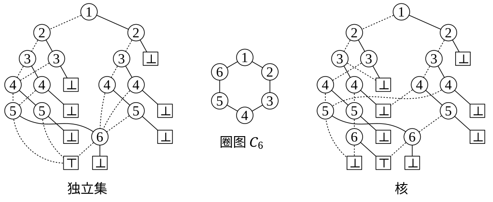](../../assets/volume4a/figures/diagram-7-1-4-12-cycle-c6-bdds.svg)

$(12)$

这两个 BDD 表示对应于圈图 $C_6$ 的顶点子集的 6 个变量的函数. 在这个结构中, 向量 $x_1\ldots x_6=\mathtt{100110}$ 代表子集 $\{1,4,5\}$, 向量 `000000` 代表空子集, 等等. 左边是这样一个 BDD, 对它而言, 当 $x$ 是 $C_6$ 的独立子集时我们有 $f(x)=1$. 右边是极大独立子集的 BDD, 也称为 $C_6$ 的核 (见习题 12). 一般说来, $C_n$ 的独立子集对应于长度为 $n$ 的圆圈上 0 和 1 的排列, 其中没有两个连续的 1. 核对应于这样的排列, 其中也没有三个连续的 0.

算法 C 用计数 $c_k$ 装饰 BDD, 自底向上处理, 如果 $l$ 是结点 $k$ 的标记, $c_k$ 是让求值从结点 $k$ 到达 $\boxed{\top}$ 的 $x_l\ldots x_n$ 赋值数. 当我们把该算法应用到 $(12)$ 中的 BDD 时得到

[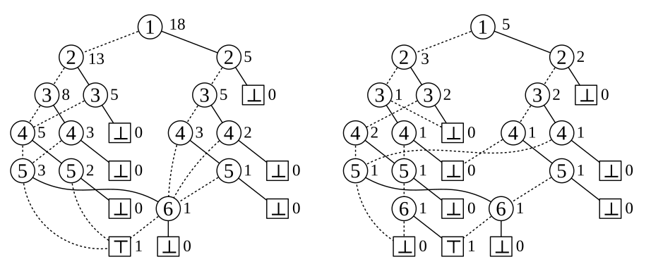](../../assets/volume4a/figures/diagram-7-1-4-13-cycle-c6-counted-bdds.svg)

$(13)$

因此 $C_6$ 有 18 个独立集和 5 个核.

利用这些计数很容易生成均匀分布的随机解. 例如, 为了获得随机独立集向量 $x_1\ldots x_6$, 我们知道左边 BDD 的 13 个解有 $x_1=0$, 而其他的 5 个解有 $x_1=1$. 所以我们以 $13/18$ 的概率置 $x_1\leftarrow0$, 选取 LO 分支; 否则, 置 $x_1\leftarrow1$, 选取 HI 分支. 在后一种情况下, $x_1=1$ 迫使 $x_2\leftarrow0$, 但是随后 $x_3$ 可以选取两种方式中的任何一种.

假定我们已经选择置 $x_1\leftarrow1$、$x_2\leftarrow0$、$x_3\leftarrow0$、$x_4\leftarrow0$, 这种情况以 $\frac5{18}\cdot\frac55\cdot\frac35\cdot\frac23=\frac2{18}$ 的概率出现. 那么有一个从 ④ 到 ⑥ 的分支, 所以我们抛掷一枚硬币并且置 $x_5$ 为完全随机的值. 一般说来, 一个从 $\text{\textcircled{i}}$ 到 $\text{\textcircled{j}}$ 的分支意味着中间的 $j-i-1$ 个二进制位 $x_{i+1}\ldots x_{j-1}$ 应当独立且等概率地取 0 或 1. 同样, 一个从 $\text{\textcircled{i}}$ 到 $\boxed{\top}$ 的分支应当对 $x_{i+1}\ldots x_n$ 赋予随机值.

要在一个组合问题的 18 个解之间做出随机选择, 当然存在更简单的方法. 此外, $(13)$ 右边的 BDD 是表示 $C_6$ 的 5 个核的令人尴尬的复杂方法, 我们可以把它们直接列举出来: `001001`、`010010`、`010101`、`100100`、`101010`! 但是关键在于这个方法在当 $n$ 非常大时将产生 $C_n$ 的独立集和核. 例如, 100 圈图 $C_{100}$ 有 $1\,630\,580\,875\,002$ 个核, 然而描述它们的 BDD 仅有 855 个结点. 所以 100 个简单的步骤将从这个庞大集合中生成一个完全随机的核.

**布尔规划及其他.** 类似于算法 C 的自底向上的算法, 也能找出布尔方程 $f(x)=1$ 的最优加权解 $(7)$. 基本思想是, 对于 $f$ 的任何串珠, 一旦知道直接位于它下面的 LO 和 HI 串珠的最优解, 就很容易推导出一个最优解.

**算法 B (最大加权解).** 如算法 C 中那样, 令 $I_{s-1},\ldots,I_0$ 是表示布尔函数 $f$ 的 BDD 的分支指令序列, 并且令 $(w_1,\ldots,w_n)$ 是整数权值的任意序列. 本算法寻找二进制向量 $x=x_1\ldots x_n$, 使得在满足 $f(x)=1$ 的所有 $x$ 中, $w_1x_1+\cdots+w_nx_n$ 取最大值. 我们假定 $s>1$, 否则 $f(x)$ 恒等于 0. 在计算中使用辅助整数向量 $m_1\ldots m_{s-1}$ 和 $W_1\ldots W_{n+1}$, 以及辅助二进制位向量 $t_2\ldots t_{s-1}$.

**B1.** [初始化.] 置 $W_{n+1}\leftarrow0$, 并对 $n\ge j\ge1$, 置 $W_j\leftarrow W_{j+1}+\max(w_j,0)$.

**B2.** [对 $k$ 循环.] 置 $m_1\leftarrow0$, 并且对 $2\le k<s$ 执行 B3. 然后执行 B4.

**B3.** [处理 $I_k$.] 置 $v\leftarrow v_k$、$l\leftarrow l_k$、$h\leftarrow h_k$、$t_k\leftarrow0$. 如果 $l\ne0$, 置 $m_k\leftarrow m_l+W_{v+1}-W_{v_l}$. 如果 $h\ne0$, 先计算 $m\leftarrow m_h+W_{v+1}-W_{v_h}+w_v$, 然后在 $l=0$ 或 $m>m_k$ 时置 $m_k\leftarrow m$、$t_k\leftarrow1$.

**B4.** [计算 $x$.] 置 $j\leftarrow0$、$k\leftarrow s-1$, 执行下列操作直到 $j=n$: 当 $j<v_k-1$ 时, 循环执行 $j\leftarrow j+1$、$x_j\leftarrow[w_j>0]$. 如果 $k>1$, 置 $j\leftarrow j+1$、$x_j\leftarrow t_k$、$k\leftarrow(t_k=0\mathbin{?}l_k:h_k)$. ▮

这个算法的一个简单实例呈现在习题 18 中. 步骤 B3 采用的技术手段可能显得有些吓人, 但是它们单纯的作用不过是计算

$$
m_k\leftarrow\max(m_l+W_{v+1}-W_{v_l},\,m_h+W_{v+1}-W_{v_h}+w_v),\tag{14}
$$

并且在 $t_k$ 中记录是 $l$ 还是 $h$ 更好. 事实上, $v_l$ 和 $v_h$ 通常都等于 $v+1$, 于是计算只是置 $m_k\leftarrow\max(m_l,m_h+w_v)$, 与 $x_v=0$ 和 $x_v=1$ 的情形对应. 出现技术细节仅仅由于我们想要避免访问 $m_0$ (它是 $-\infty$), 同时由于 $v_l$ 或 $v_h$ 可能超过 $v+1$.

例如, 利用这个算法, 我们可以用基于 “图厄–摩尔斯” 序列的权值

$$
w_j=(-1)^{\nu j},\tag{15}
$$

快速找出 $n$ 圈图 $C_n$ 中最优的核顶点集. 这里 $\nu j$ 表示式 7.1.3–$(59)$ 的位叠加加法. 换句话说, 把 $j$ 表示为二进制数时, 若它具有奇校验, 则 $w_j=-1$, 若它具有偶校验, 则 $w_j=+1$. 当核中偶校验顶点 $3,5,6,9,10,12,15,\ldots$ 的个数减去奇校验顶点 $1,2,4,7,8,11,13,\ldots$ 的个数所得之差最大时, $w_1x_1+\cdots+w_nx_n$ 取最大值. 结果, 当 $n=100$ 时,

$$
\begin{aligned}
\{&1,3,6,9,12,15,18,20,23,25,27,30,33,36,39,41,43,46,48,\\
  &51,54,57,60,63,66,68,71,73,75,78,80,83,86,89,92,95,97,99\}
\end{aligned}\tag{16}
$$

在这个意义下是一个最优核. 为了满足核条件, 仅有 5 个奇校验的顶点, 即 $\{1,25,41,73,97\}$, 需要包含在这个 38 元素的集合中, 因此 $\max(w_1x_1+\cdots+w_{100}x_{100})=28$. 多亏了算法 B, 几千条计算机指令就足以从超过一万亿个可能的核中选出 $(16)$, 因为所有那些核的 BDD 恰好很小.

与圈图的核等组合对象有关的数学上的古老问题, 也可以用基于递推和归纳的更传统的技术有效地解决. 但是 BDD 方法的美妙之处在于, 它们还适用于那些不具有任何简洁结构的现实问题. 例如, 让我们考虑出现在 7–$(17)$ 和 7–$(61)$ 中的美国 49 个 “联邦州” 的图. 表示那个图的所有极大独立集 (所有核) 的布尔函数有一个大小为 780 的 BDD, 它的开始如下:

[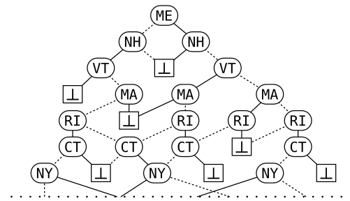](../../assets/volume4a/figures/diagram-7-1-4-17-state-kernel-bdd-prefix.svg)

$(17)$

当图中每个州的顶点仅仅以其邮政编码中的字母序号之和 ($w_{\text{CA}}=3+1$, $w_{\text{DC}}=4+3$, $\ldots$, $w_{\text{WY}}=23+25$) 加权时, 算法 B 快速找到下面最小权值的核和最大权值的核:

[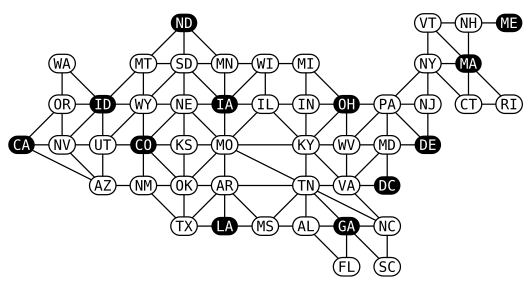](../../assets/volume4a/figures/diagram-7-1-4-18-state-kernel-min.svg)

最小权值 $=155$

[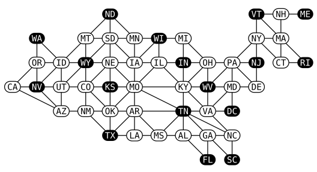](../../assets/volume4a/figures/diagram-7-1-4-18-state-kernel-max.svg)

最大权值 $=492$　$(18)$

这个图有 266 137 个核, 但是利用算法 B, 我们无须产生全部. 事实上, $(18)$ 中最大权值的例子也可以用大小为 428 的一个更小的 BDD 获得, 它描述的是独立集, 因为所有权值都是正数. (在这种情况下, 最大权值的核与最大权值的独立集是一回事.) 这个图中有 211 954 906 个独立集, 远大于核的数目. 比起求最大权值的核来, 我们还可以更快地求最大权值的独立集, 因为 BDD 更小.

[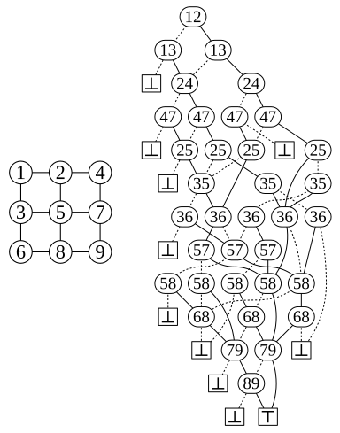](../../assets/volume4a/figures/fig-7-22-grid-connected-subgraphs-bdd.svg)

**图 22**　网格 $P_3\square P_3$ 及其连通子图的 BDD

图 22 显示了一种完全不同的、与图有关的 BDD. 它基于 $3\times3$ 网格 $P_3\square P_3$, 刻画了能把网格所有顶点都连起来的边集. 因此, $f(x_{12},x_{13},\ldots,x_{89})$ 是 12 条边 $1\!-\!2$、$1\!-\!3$、$\ldots$、$8\!-\!9$ 的函数, 而不是 9 个顶点 $\{1,\ldots,9\}$ 的函数. 习题 55 描述构造它的一种方法. 当把算法 C 应用于这个 BDD 时, 它告诉我们 $P_3\square P_3$ 的 $2^{12}=4096$ 个生成子图中恰好有 431 个是连通的.

算法 C 的一个简单的扩充 (见习题 25) 将细分这个总数, 并且计算这些解的生成函数, 即

$$
G(z)=\sum_x z^{\nu x}f(x)=192z^8+164z^9+62z^{10}+12z^{11}+z^{12}.\tag{19}
$$

因此 $P_3\square P_3$ 有 192 棵生成树, 再加上 164 个有 9 条边的连通生成子图, 等等. 习题 7.2.1.6–106(a) 对一般的 $m$ 和 $n$ 给出 $P_m\square P_n$ 中生成树数目的公式, 但是完整的生成函数 $G(z)$ 包含多得多的信息, 而且它可能没有简单的公式, 除非 $\min(m,n)$ 很小.

假定每条边 $u\!-\!v$ 以 $p_{uv}$ 的概率出现, 而与 $P_3\square P_3$ 的所有其他边无关. 所得子图是连通的概率有多大? 这就是可靠性多项式, 它还有各种各样的别称, 因为它出现在许多不同的应用中. 一般情况下, 如在习题 7.1.1–12 中讨论的那样, 每个布尔函数 $f(x_1,\ldots,x_n)$ 都能唯一地表示为具有以下性质的多项式 $F(x_1,\ldots,x_n)$:

(i) 所有变量 $x_j$ 均取 0 或 1 时, $F(x_1,\ldots,x_n)=f(x_1,\ldots,x_n)$.

(ii) $F(x_1,\ldots,x_n)$ 是多重线性多项式: 对所有的 $j$, $x_j$ 的次数 $\le1$.

多项式 $F$ 具有整系数并且满足基本递推公式

$$
F(x_1,\ldots,x_n)=(1-x_1)F_0(x_2,\ldots,x_n)+x_1F_1(x_2,\ldots,x_n),\tag{20}
$$

其中 $F_0$ 和 $F_1$ 是 $f(0,x_2,\ldots,x_n)$ 和 $f(1,x_2,\ldots,x_n)$ 的整数多重线性表示. 实际上, 式 (20) 是乔治·布尔的 “展开定律”.

递推式 (20) 导致两个重要的结果. 首先, $F$ 正好是前面提到的可靠性多项式 $F(p_1,\ldots,p_n)$, 因为可靠性多项式显然满足同样的递推关系. 其次, 容易从 $f$ 的 BDD 计算 $F$, 只需通过自底向上处理并且用 $(20)$ 计算每个串珠的可靠性. (见习题 26.)

当然, $8\times8$ 网格 $P_8\square P_8$ 的连通性函数比网格 $P_3\square P_3$ 的复杂得多, 它是 112 个变量的布尔函数, 其 BDD 有 43 790 个结点, 而图 22 中的 BDD 只有 37 个结点. 然而, 用这个 BDD 计算是完全可行的, 而且在一两秒钟内我们可以算出

$$
\begin{aligned}
G(z)&=126\,231\,322\,912\,498\,539\,682\,594\,816z^{63}\\
    &\quad+1\,006\,611\,140\,035\,411\,062\,600\,761\,344z^{64}\\
    &\quad+\cdots+6212z^{110}+112z^{111}+z^{112},
\end{aligned}
$$

以及当每条边都以概率 $p$ 出现时的连通概率 $F(p)$ 和它的导数 $F'(p)$ (见习题 29):

[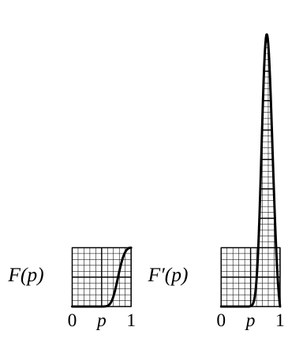](../../assets/volume4a/figures/diagram-7-1-4-21-grid-reliability-plots.svg)

$(21)$

**\*一种全面推广.** 算法 B 和算法 C 以及我们已经讨论过的自底向上的 BDD 扫描算法, 其实是可以在许多其他方面利用的更一般方案的特例. 考虑一个抽象代数, 它有两个可结合的二元运算符 $\circ$ 和 $\bullet$, 并且满足分配律

$$
\alpha\bullet(\beta\circ\gamma)=(\alpha\bullet\beta)\circ(\alpha\bullet\gamma),
\qquad
(\beta\circ\gamma)\bullet\alpha=(\beta\bullet\alpha)\circ(\gamma\bullet\alpha).\tag{22}
$$

每个布尔函数 $f(x_1,\ldots,x_n)$ 对应于一个包含符号 $\circ$、$\bullet$、$\bot$、$\top$, 以及 $\bar x_j$ 和 $x_j$($1\le j\le n$) 的完全详尽的真值表. 了解这种真值表的最好方式是考察一个小例子: 当 $n=2$ 并且 $f$ 的普通真值表是 $\mathtt{0010}$ 时, 完全详尽的真值表是

$$
(\bar x_1\bullet\bar x_2\bullet\bot)\circ
(\bar x_1\bullet x_2\bullet\bot)\circ
(x_1\bullet\bar x_2\bullet\top)\circ
(x_1\bullet x_2\bullet\bot).\tag{23}
$$

这样一个表达式的解释取决于我们对符号 $\circ$、$\bullet$、$\bot$、$\top$, 以及字面量 $\bar x_j$ 和 $x_j$ 赋予的含义. 但是不管怎样, 都可以直接从 $f$ 的 BDD 计算该表达式. 例如, 让我们回到图 21, 即函数 $\langle x_1x_2x_3\rangle$ 的 BDD. 结点 $\boxed{\bot}$ 和 $\boxed{\top}$ 的完全详尽的真值表分别是 $\alpha_\bot=\bot$ 和 $\alpha_\top=\top$. 于是结点 ③ 的完全详尽的真值表是 $\alpha_3=(\bar x_3\bullet\alpha_\bot)\circ(x_3\bullet\alpha_\top)$, 左边的结点 ② 的完全详尽的真值表是 $\alpha_2^l=(\bar x_2\bullet(\bar x_3\circ x_3)\bullet\alpha_\bot)\circ(x_2\bullet\alpha_3)$, 右边的结点 ② 的完全详尽的真值表是 $\alpha_2^r=(\bar x_2\bullet\alpha_3)\circ(x_2\bullet(\bar x_3\circ x_3)\bullet\alpha_\top)$, 结点 ① 的完全详尽的真值表是 $\alpha_1=(\bar x_1\bullet\alpha_2^l)\circ(x_1\bullet\alpha_2^r)$.

(习题 31 讨论计算完全详尽的真值表的一般过程.) 通过分配律 $(22)$ 展开这些公式, 得到带有 $2^n=8$ “项” 的一个完全详尽的真值表:

$$
\begin{aligned}
\alpha_1={}&
(\bar x_1\bullet\bar x_2\bullet\bar x_3\bullet\bot)\circ
(\bar x_1\bullet\bar x_2\bullet x_3\bullet\bot)\circ
(\bar x_1\bullet x_2\bullet\bar x_3\bullet\bot)\circ
(\bar x_1\bullet x_2\bullet x_3\bullet\top)\\
&{}\circ(x_1\bullet\bar x_2\bullet\bar x_3\bullet\bot)\circ
(x_1\bullet\bar x_2\bullet x_3\bullet\top)\circ
(x_1\bullet x_2\bullet\bar x_3\bullet\top)\circ
(x_1\bullet x_2\bullet x_3\bullet\top).
\end{aligned}\tag{24}
$$

算法 C 是个特例, 其中 $\circ$ 是加法, $\bullet$ 是乘法, $\bot$ 是 0, $\top$ 是 1, $\bar x_j$ 是 1, $x_j$ 也是 1. 算法 B 对应于 $\circ$ 是最大值运算符且 $\bullet$ 是加法. 分配律

$$
\alpha+\max(\beta,\gamma)=\max(\alpha+\beta,\alpha+\gamma),
\qquad
\max(\beta,\gamma)+\alpha=\max(\beta+\alpha,\gamma+\alpha)\tag{25}
$$

是容易检验的. 我们把 $\bot$ 解释为 $-\infty$, $\top$ 解释为 0, $\bar x_j$ 解释为 0, $x_j$ 解释为 $w_j$. 这时, 例如, $(24)$ 变成

$$
\max(-\infty,-\infty,-\infty,w_2+w_3,-\infty,w_1+w_3,w_1+w_2,w_1+w_2+w_3).
$$

而且一般说来, 完全详尽的真值表在这种解释下等价于表达式 $\max\{w_1x_1+\cdots+w_nx_n\mid f(x_1,\ldots,x_n)=1\}$.

**平和的函数.** 许多函数族以其拥有适度大小的 BDD 而著称. 例如, 如果 $f$ 是 $n$ 个变量的对称函数, 容易看出 $B(f)=O(n^2)$. 的确, 当 $n=5$ 时我们可以从三角图形

[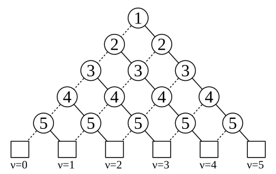](../../assets/volume4a/figures/diagram-7-1-4-26-symmetric-bdd-triangle.svg)

$(26)$

开始, 并且依据 $f$ 在 $\nu x=x_1+\cdots+x_5$ 等于 0、1、2、3、4 或 5 时的相应值, 分别置叶结点为 $\boxed{\bot}$ 或 $\boxed{\top}$. 然后我们可以消除冗余的或者等价的结点, 总是获得大小是 $\binom{n+1}{2}+2$ 或者更小的 BDD.

假定我们取任意函数 $f(x_1,\ldots,x_n)$ 并且让两个相邻的变量相等:

$$
g(x_1,\ldots,x_n)=f(x_1,\ldots,x_{k-1},x_k,x_k,x_{k+2},\ldots,x_n).\tag{27}
$$

习题 40 证明了 $B(g)\le B(f)$. 同时通过重复这个缩合过程, 我们发现像 $f(x_1,x_1,x_3,x_3,x_3,x_6)$ 这样的一个函数每当 $B(f)$ 较小时就有一个小的 BDD. 特别是门限函数 $[2x_1+3x_3+x_6\ge t]$ 对于任何 $t$ 值必定有一个小的 BDD, 因为它是对称函数 $f(x_1,\ldots,x_6)=[x_1+\cdots+x_6\ge t]$ 的一种缩合形式. 这个论据说明, 带非负整数权值的任何门限函数

$$
f(x_1,x_2,\ldots,x_n)=[w_1x_1+w_2x_2+\cdots+w_nx_n\ge t],\tag{28}
$$

可以通过缩合 $w_1+w_2+\cdots+w_n$ 个变量的对称函数获得, 所以它的 BDD 的大小是 $O((w_1+w_2+\cdots+w_n)^2)$.

即使权值呈指数增长, 门限函数通常也是容易处理的. 例如, 假定 $t=(t_1t_2\ldots t_n)_2$, 并且考虑

$$
f_t(x_1,x_2,\ldots,x_n)=[2^{n-1}x_1+2^{n-2}x_2+\cdots+x_n\ge t].\tag{29}
$$

当且仅当二进制串 $x_1x_2\ldots x_n$ 在字典序下大于或等于 $t_1t_2\ldots t_n$ 时, 这个函数为真. 而且当 $t_n=1$ 时, 它的 BDD 总是恰好有 $n+2$ 个结点. (见习题 170.)

另外一类具有小的 BDD 的函数是式 7.1.2–$(31)$ 中的 $2^m$ 路复用器, 它是含 $n=m+2^m$ 个变量的函数:

$$
M_m(x_1,\ldots,x_m;x_{m+1},\ldots,x_n)=x_{m+1+(x_1\ldots x_m)_2}.\tag{30}
$$

对于 $1\le k\le m$, 它的 BDD 以 $2^{k-1}$ 个分支结点 $\text{\textcircled{k}}$ 开始. 但是在完全二叉树下, 对于 $m<k\le n$ 的主变量组中的每个 $x_k$, 恰好有一个 $\text{\textcircled{k}}$. 因此 $B(M_m)=1+2+\cdots+2^{m-1}+2^m+2=2^{m+1}+1<2n$.

图 23 说明一个线性网络计算模型, 有助于阐明 BDD 特别有效的情形. 考虑计算模块 $M_1,M_2,\ldots,M_n$ 的一个排列, 其中布尔变量 $x_k$ 是模块 $M_k$ 的输入. 在相邻模块之间还有线路, 每条线路传输一个布尔信号. 对于 $1\le k\le n$, 从 $M_k$ 到 $M_{k+1}$ 有 $a_k$ 条线路, 从 $M_{k+1}$ 到 $M_k$ 有 $b_k$ 条线路. 出自 $M_n$ 的一条特殊线路传送函数 $f(x_1,\ldots,x_n)$ 的输出. 我们定义 $a_0=b_0=b_n=0$、$a_n=1$, 所以每个模块 $M_k$ 恰好有 $c_k=1+a_{k-1}+b_k$ 个输入端口和 $d_k=a_k+b_{k-1}$ 个输出端口. 模块 $M_k$ 计算关于这 $c_k$ 个输入的 $d_k$ 个布尔函数.

[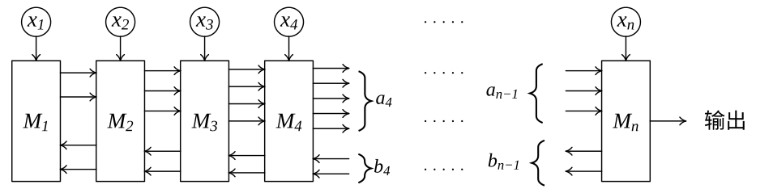](../../assets/volume4a/figures/fig-7-23-boolean-module-network.svg)

**图 23**　定理 M 有效的布尔模块的通用网络

每个模块计算的函数可以任意复杂, 但各函数的联合值必须由 $x$ 唯一确定. 也就是说, 对于 $(x_1,\ldots,x_n)$ 的每一种选择, 必须恰好存在一种给所有线路设置信号的方式, 与所有给定函数一致. 肯尼思·麦克米伦发现了一个有趣的上限, 只要我们能够使用这种通用设施来规划计算, 就可以保持这个上限.

**定理 M.** 如果函数 $f$ 可以通过这样一个网络计算, 那么

$$
B(f)\le\sum_{k=0}^{n}2^{a_k2^{b_k}}.
$$

**证明.** 我们将要证明, 对于 $1\le k\le n$, $f$ 的 BDD 最多有 $2^{a_{k-1}2^{b_{k-1}}}$ 个分支结点 $\text{\textcircled{k}}$. 如果 $b_{k-1}=0$, 这是显而易见的, 因为当 $x_1$ 至 $x_{k-1}$ 任意给定时, 最多可能有 $2^{a_{k-1}}$ 个子函数. 于是我们将证明, 在 $M_{k-1}$ 与 $M_k$ 之间有 $a_{k-1}$ 条正向线路和 $b_{k-1}$ 条反向线路的任何网络, 都可以用具有 $a_{k-1}2^{b_{k-1}}$ 条正向线路而无反向传输的等价网络代替.

为方便起见, 考虑图 23 中 $k=4$ 的情形, 且 $a_3=4$、$b_3=2$. 我们要用 16 条正向线路代替现有的 6 条线路. 假定艾丽斯主管 $M_3$, 鲍勃[^v4a-p178-1] 主管 $M_4$. 艾丽斯发送 4 比特的信号 $a$ 给鲍勃, 同时鲍勃发送 2 比特的信号 $b$ 给艾丽斯. 更确切地说, 对于 $(x_1,\ldots,x_n)$ 的任何固定值, 艾丽斯计算一个确定的函数 $A$, 鲍勃计算函数 $B$, 其中

$$
A(b)=a\qquad\text{且}\qquad B(a)=b.\tag{31}
$$

艾丽斯的函数 $A$ 依赖于 $(x_1,x_2,x_3)$, 所以鲍勃不知道它是什么. 同样, 艾丽斯也不知道鲍勃的函数 $B$, 因为它依赖于 $(x_4,\ldots,x_n)$. 但是, 这两个彼此不知的函数具有这样的关键特性: 对于 $(x_1,\ldots,x_n)$ 的每一种选择, 方程 $(31)$ 恰好有一个解 $(a,b)$.

于是艾丽斯改变模块 $M_3$ 的特性: 她向鲍勃发送 4 个 4 比特的值 $A(00)$、$A(01)$、$A(10)$、$A(11)$, 从而透露她的函数 $A$. 同时鲍勃改变模块 $M_4$ 的特性: 他不发送任何反馈信息, 只考查那 4 个值以及其他输入 (即 $x_4$ 以及从 $M_5$ 接收的 $b_4$ 比特的信号), 并且找出 $(31)$ 的唯一解 $a$ 和 $b$. 他的新模块用 $a$ 的值计算输出到 $M_5$ 的 $a_4$ 比特的值. ▮

定理 M 表明, 如果我们可以用很小的 $a_k$ 和 $b_k$ 的值构造这样一个网络, BDD 的大小也是相当小的. 实际上, 如果这些 $a$ 和 $b$ 是有界的, $B(f)$ 将是 $O(n)$ 阶的, 尽管比例常数可能非常大. 我们来看一个例子, 考虑检测三个连续 1 的函数

$$
f(x_1,\ldots,x_n)=x_1x_2x_3\vee x_2x_3x_4\vee\cdots\vee x_{n-2}x_{n-1}x_n\vee x_{n-1}x_nx_1\vee x_nx_1x_2,\tag{32}
$$

当且仅当用 $x_1,\ldots,x_n$ 标记的环形链有 3 个连续的 1 时, 函数值为真. 用布尔模块实现它的一种方式是, 从 $M_{k-1}$ 给 $M_k$ 三个输入 $(u_k,v_k,w_k)$, 从 $M_{k+1}$ 给 $M_k$ 两个输入 $(y_k,z_k)$, 其中

$$
\begin{gathered}
u_k=x_{k-1},\qquad v_k=x_{k-2}x_{k-1},\qquad
w_k=x_{n-1}x_nx_1\vee\cdots\vee x_{k-3}x_{k-2}x_{k-1},\\
y_k=x_n,\qquad z_k=x_{n-1}x_n.
\end{gathered}\tag{33}
$$

此处下标是按模 $n$ 计算的, 而且当 $k=1$ 或 $k\ge n-1$ 时在左端或右端做相应改变. 然后对 $k$ 的几乎所有值, $M_k$ 计算以下函数:

$$
u_{k+1}=x_k,\quad v_{k+1}=u_kx_k,\quad w_{k+1}=w_k\vee v_kx_k,\quad
y_{k-1}=y_k,\quad z_{k-1}=z_k.\tag{34}
$$

习题 45 有计算的细节. 采用这种结构, 对于所有 $k$ 有 $a_k\le3$ 和 $b_k\le2$, 因此定理 M 告诉我们 $B(f)\le2^{12}n=4096n$. 事实上, 结果是非常令人满意的, $B(f)$ 实际上小于 $9n$ (见习题 46).

**共享 BDD.** 我们时常需要一次处理多个布尔函数, 而且相关函数往往具有公共子函数. 在这种情况下可以用关于 $\{f_1(x_1,\ldots,x_n),\ldots,f_m(x_1,\ldots,x_n)\}$ 的 “BDD 基” 进行处理. 它是一个有向无圈图, 对出现在任意一个函数的真值表中的每个串珠包含一个结点. BDD 基还有 $m$ 个 “根指针” $F_j$, 各自对应于一个函数 $f_j$. 于是 $f_j$ 的 BDD 是从结点 $F_j$ 可达的所有结点的集合. 注意, 当且仅当 $f_j$ 是 $f_i$ 的子函数时, 结点 $F_j$ 自身是从 $F_i$ 可达的.

例如, 考虑计算两个 $n$ 位二进制数的 $n+1$ 位和的问题:

$$
(f_{n+1}f_nf_{n-1}\ldots f_1)_2=(x_1x_3\ldots x_{2n-1})_2+(x_2x_4\ldots x_{2n})_2.\tag{35}
$$

当 $n=4$ 时, $n+1$ 个二进制位的 BDD 基看起来像:

[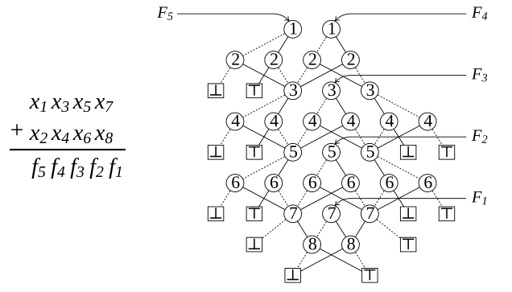](../../assets/volume4a/figures/diagram-7-1-4-36-shared-adder-bdd.svg)

$(36)$

我们在 $(35)$ 中对 $x$ 编号的方式在这里是重要的 (见习题 51). 一般地, 当 $n>1$ 时恰有 $B(f_1,\ldots,f_{n+1})=9n-5$ 个结点. 对于 $1\le j\le n$, 正好在 $F_j$ 左边的结点表示从右边算起第 $j$ 个二进制位的进位 $c_j$ 的子函数. 正好在 $F_j$ 右边的结点表示进位的补 $\bar c_j$. 结点 $F_{n+1}$ 表示最后的进位 $c_n$.

**对 BDD 的运算.** 我们已经谈论许多有关当给定 BDD 时可做的事情. 但是, 如何首先在计算机中建立 BDD 呢?

一个途径是从 $(26)$ 或 $(2)$ 右边例子那样的有序二元决策图开始, 并且把它约化为真正的 BDD. 下面的算法基于德特勒夫·西林和英戈·韦格纳的思想 [*Information Processing Letters* **48** (1993), 139–144]. 当存在 $n$ 个变量时, 任何分支按规定顺序排列的 $N$ 结点二元决策图, 都可以用 $O(N+n)$ 步约化为 BDD.

当然, 在进行这种约化时需要一些额外内存空间, 以便判定两个结点是否等价. 像在 $(1)$ 中那样, 假定每个结点只有 3 个字段 $(\mathtt{V},\mathtt{LO},\mathtt{HI})$, 将没有操作空间留给我们. 所幸仅需 1 个称为 $\mathtt{AUX}$ 的指针大小的附加字段, 以及另外 2 个二进制状态位. 为方便起见, 假定这 2 个状态位隐含在 $\mathtt{LO}$ 和 $\mathtt{AUX}$ 字段的符号中, 因此算法只需处理 4 个字段 $(\mathtt{V},\mathtt{LO},\mathtt{HI},\mathtt{AUX})$. 符号位已被占用, 这意味着一个 28 比特的 $\mathtt{LO}$ 字段最多只能容纳 $2^{27}$ (约 1.34 亿) 个结点, 而非 $2^{28}$ 个. (在类似 MMIX 的计算机上, 我们也许宁愿假定所有结点的地址都是偶数, 并且对字段的值加 1, 而非像这里这样对它取补.)

**算法 R (约化为 BDD).** 给定一个有序但未必已约化的二元决策图, 本算法通过消除不必要的结点并相应地重定位所有指针, 把它转换为有效的 BDD. 如上所述, 假定每个结点有 4 个字段 $(\mathtt{V},\mathtt{LO},\mathtt{HI},\mathtt{AUX})$, 并且 $\mathtt{ROOT}$ 指向二元决策图的顶端结点. $\mathtt{AUX}$ 字段的初值只需非负, 处理结束时它们也将重新变为非负. 所有被删除的结点被推入以 $\mathtt{AVAIL}$ 为首址的栈, 通过这些结点的 $\mathtt{HI}$ 字段链接在一起. (这些结点的 $\mathtt{LO}$ 字段是负值, 它们的按位补指向尚未删除的等价结点.)

在给定的有向无圈图中, 假定分支结点的 $\mathtt{V}$ 字段自顶向下, 从 $\mathtt{V}(\mathtt{ROOT})$ 递增到 $v_{\max}$. 假定汇结点 $\boxed{\bot}$ 和 $\boxed{\top}$ 分别是结点 0 和 1, 具有非负的 $\mathtt{LO}$ 和 $\mathtt{HI}$ 字段. 它们绝不会被删除, 事实上, 也不会修改它们的 $\mathtt{AUX}$ 以外的字段. 辅助指针数组 $\mathtt{HEAD}[v]$($\mathtt{V}(\mathtt{ROOT})\le v\le v_{\max}$) 用来建立具有给定 $\mathtt{V}$ 值的所有结点的临时表.

**R1.** [初始化.] 如果 $\mathtt{ROOT}\le1$, 立即终止. 否则, 置 $\mathtt{AUX}(0)\leftarrow\mathtt{AUX}(1)\leftarrow\mathtt{AUX}(\mathtt{ROOT})\leftarrow-1$, 并且对于 $\mathtt{V}(\mathtt{ROOT})\le v\le v_{\max}$ 置 $\mathtt{HEAD}[v]\leftarrow-1$. (我们利用 $-1={\sim}0$ 是 0 的按位补这个事实.) 然后置 $s\leftarrow\mathtt{ROOT}$, 并且当 $s\ne0$ 时重复进行下列运算:

> 置 $p\leftarrow s$、$s\leftarrow{\sim}\mathtt{AUX}(p)$、$\mathtt{AUX}(p)\leftarrow\mathtt{HEAD}[\mathtt{V}(p)]$、$\mathtt{HEAD}[\mathtt{V}(p)]\leftarrow{\sim}p$.
>
> 如果 $\mathtt{AUX}(\mathtt{LO}(p))\ge0$, 置 $\mathtt{AUX}(\mathtt{LO}(p))\leftarrow{\sim}s$、$s\leftarrow\mathtt{LO}(p)$.
>
> 如果 $\mathtt{AUX}(\mathtt{HI}(p))\ge0$, 置 $\mathtt{AUX}(\mathtt{HI}(p))\leftarrow{\sim}s$、$s\leftarrow\mathtt{HI}(p)$.

(实际上我们已经执行了一次有向无圈图的深度优先搜索, 通过使 $\mathtt{AUX}$ 字段暂时成为负值, 标记从 $\mathtt{ROOT}$ 可达的所有结点.)

**R2.** [对 $v$ 循环.] 置 $\mathtt{AUX}(0)\leftarrow\mathtt{AUX}(1)\leftarrow0$、$v\leftarrow v_{\max}$.

**R3.** [桶排序.] (此时, $\mathtt{V}$ 字段超过 $v$ 的所有剩余结点都已经正确约化, 而且它们的 $\mathtt{AUX}$ 字段是非负的.) 置 $p\leftarrow{\sim}\mathtt{HEAD}[v]$、$s\leftarrow0$, 并且当 $p\ne0$ 时重复执行以下步骤:

> 置 $p'\leftarrow{\sim}\mathtt{AUX}(p)$.
>
> 置 $q\leftarrow\mathtt{HI}(p)$. 如果 $\mathtt{LO}(q)<0$, 置 $\mathtt{HI}(p)\leftarrow{\sim}\mathtt{LO}(q)$.
>
> 置 $q\leftarrow\mathtt{LO}(p)$. 如果 $\mathtt{LO}(q)<0$, 置 $\mathtt{LO}(p)\leftarrow{\sim}\mathtt{LO}(q)$、$q\leftarrow\mathtt{LO}(p)$.

> 如果 $q=\mathtt{HI}(p)$, 置 $\mathtt{LO}(p)\leftarrow{\sim}q$、$\mathtt{HI}(p)\leftarrow\mathtt{AVAIL}$、$\mathtt{AUX}(p)\leftarrow0$、$\mathtt{AVAIL}\leftarrow p$.
>
> 否则, 如果 $\mathtt{AUX}(q)\ge0$, 置 $\mathtt{AUX}(p)\leftarrow s$、$s\leftarrow{\sim}q$、$\mathtt{AUX}(q)\leftarrow{\sim}p$.
>
> 否则, 置 $\mathtt{AUX}(p)\leftarrow\mathtt{AUX}({\sim}\mathtt{AUX}(q))$、$\mathtt{AUX}({\sim}\mathtt{AUX}(q))\leftarrow p$.
>
> 然后置 $p\leftarrow p'$.

**R4.** [清除.] (具有 $\mathtt{LO}=x\ne\mathtt{HI}$ 的结点已经通过它们的 $\mathtt{AUX}$ 字段链接在一起, 链首为 $\mathord{\sim}\mathtt{AUX}(x)$.) 置 $r\leftarrow{\sim}s$、$s\leftarrow0$, 并且当 $r\ge0$ 时重复执行以下步骤:

> 置 $q\leftarrow{\sim}\mathtt{AUX}(r)$、$\mathtt{AUX}(r)\leftarrow0$.
>
> 如果 $s=0$, 置 $s\leftarrow q$. 否则, 置 $\mathtt{AUX}(p)\leftarrow q$.
>
> 置 $p\leftarrow q$. 然后, 当 $\mathtt{AUX}(p)>0$ 时, 置 $p\leftarrow\mathtt{AUX}(p)$.
>
> 置 $r\leftarrow{\sim}\mathtt{AUX}(p)$.

**R5.** [对 $p$ 循环.] 置 $p\leftarrow s$. 如果 $p=0$, 转到 R9. 否则, 置 $q\leftarrow p$.

**R6.** [检查桶.] 置 $s\leftarrow\mathtt{LO}(p)$. (这时 $p=q$.)

**R7.** [消除重复.] 置 $r\leftarrow\mathtt{HI}(q)$. 如果 $\mathtt{AUX}(r)\ge0$, 置 $\mathtt{AUX}(r)\leftarrow{\sim}q$. 否则, 置 $\mathtt{LO}(q)\leftarrow\mathtt{AUX}(r)$、$\mathtt{HI}(q)\leftarrow\mathtt{AVAIL}$、$\mathtt{AVAIL}\leftarrow q$. 然后, 置 $q\leftarrow\mathtt{AUX}(q)$. 如果 $q\ne0$ 且 $\mathtt{LO}(q)=s$, 重复 R7.

**R8.** [再次清除.] 如果 $\mathtt{LO}(p)\ge0$, 置 $\mathtt{AUX}(\mathtt{HI}(p))\leftarrow0$. 然后, 置 $p\leftarrow\mathtt{AUX}(p)$, 并且重复 R8 直到 $p=q$.

**R9.** [完成了吗?] 如果 $p\ne0$, 返回 R6. 否则, 如果 $v>\mathtt{V}(\mathtt{ROOT})$, 置 $v\leftarrow v-1$ 并且返回 R3. 否则, 如果 $\mathtt{LO}(\mathtt{ROOT})<0$, 置 $\mathtt{ROOT}\leftarrow{\sim}\mathtt{LO}(\mathtt{ROOT})$. ▮

对于算法 R 错综复杂的链接操作, 编程比解释容易, 但它们非常具有启发性, 并不难. 我们极力推荐读者从头到尾处理一遍习题 53 中的示例.

对给定函数的任何限制, 也就是通过 “硬连接” 一个或多个变量为常量获得的任何函数, 也可以用算法 R 计算 BDD. 其想法是在步骤 R1 和 R2 之间执行少量额外操作. 如果变量 $\mathtt{V}(p)$ 固定为 0, 置 $\mathtt{HI}(p)\leftarrow\mathtt{LO}(p)$. 如果变量 $\mathtt{V}(p)$ 固定为 1, 置 $\mathtt{LO}(p)\leftarrow\mathtt{HI}(p)$. 我们还需要回收在限制后变成不可达的所有结点. 习题 57 充实细节.

**BDD 的综合.** 现在我们准备讨论关于二元决策图的最重要的算法, 该算法取一个函数 $f$ 的 BDD, 并且把它同另一个函数 $g$ 的 BDD 组合, 以便进一步获得像 $f\wedge g$ 或 $f\oplus g$ 这样的函数的 BDD. 这类综合运算是对复合函数构建 BDD 的主要方式, 而它们可以有效构建这一点是 BDD 这种数据结构流行的主要原因. 我们将要讨论处理 BDD 综合问题的若干途径, 从一种简单的方法开始, 然后用不同方法加快它的处理速度.

综合的基本概念, 是一个关于 BDD 结构的乘积运算, 我们称之为合并. 假定 $\alpha=(v,l,h)$ 和 $\alpha'=(v',l',h')$ 是 BDD 结点, 每个结点包含变量的下标以及 LO 和 HI 指针. $\alpha$ 和 $\alpha'$ 的 “合并” 记为 $\alpha\diamond\alpha'$, 当至少有一个结点是分支结点时定义如下:

$$
\alpha\diamond\alpha'=
\begin{cases}
(v,l\diamond l',h\diamond h'),&\text{如果 }v=v',\\
(v,l\diamond\alpha',h\diamond\alpha'),&\text{如果 }v<v',\\
(v',\alpha\diamond l',\alpha\diamond h'),&\text{如果 }v>v'.
\end{cases}\tag{37}
$$

例如, 图 24 显示了两个小而典型的 BDD 是怎样合并的. 左边的 BDD 含有分支结点 $(\alpha,\beta,\gamma,\delta)$, 表示 $f(x_1,x_2,x_3,x_4)=(x_1\vee x_2)\wedge(x_3\vee x_4)$. 中间的 BDD 含有分支结点 $(\omega,\psi,\chi,\varphi,\upsilon,\tau)$, 表示 $g(x_1,x_2,x_3,x_4)=(x_1\oplus x_2)\vee(x_3\oplus x_4)$. 结点 $\delta$ 和 $\tau$ 实际上是相同的, 所以如果 $f$ 和 $g$ 是单个 BDD 基的一部分, 我们就有 $\delta=\tau$. 但是也可以把合并用于没有公共结点的 BDD. 在图 24 的右边, $\alpha\diamond\omega$ 是有 11 个分支结点的决策图的根, 它实际上表示有序对 $(f,g)$.

[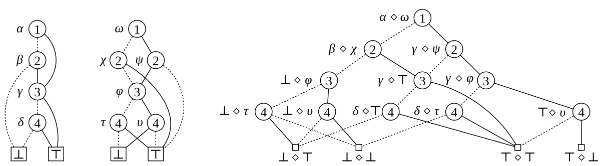](../../assets/volume4a/figures/fig-7-24-bdd-meld.svg)

**图 24**　可以用 $\diamond$ 运算 $(37)$ 合并在一起的两个 BDD

可以把两个布尔函数的有序对看成将一个函数的真值表置于另一个函数的真值表之上. 利用这种解释, $\alpha\diamond\omega$ 表示有序对 $\begin{smallmatrix}\mathtt{0000011101110111}\\\mathtt{0110111111110110}\end{smallmatrix}$, 而 $\beta\diamond\chi$ 表示 $\begin{smallmatrix}\mathtt{00000111}\\\mathtt{01101111}\end{smallmatrix}$, 等等. 图 24 合并后的 BDD 对应于决策图

[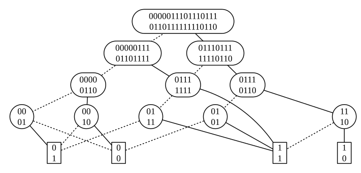](../../assets/volume4a/figures/diagram-7-1-4-38-meld-paired-beads.svg)

$(38)$

它与 $(5)$ 类似, 不同之处是每个结点表示函数的有序对, 而非单个函数. 在有序对上定义的串珠和子表与过去完全一样, 但是现在有 4 种可能的汇结点, 即

$$
\bot\diamond\bot,\qquad\bot\diamond\top,\qquad\top\diamond\bot,\qquad\top\diamond\top,\tag{39}
$$

分别对应有序对 $\begin{smallmatrix}0\\0\end{smallmatrix}$、$\begin{smallmatrix}0\\1\end{smallmatrix}$、$\begin{smallmatrix}1\\0\end{smallmatrix}$ 和 $\begin{smallmatrix}1\\1\end{smallmatrix}$.

为了计算合取 $f\wedge g$, 我们把 $f$ 和 $g$ 的真值表按位做 AND. 这个运算对应于分别用 $0,0,0,1$ 替换 $\begin{smallmatrix}0\\0\end{smallmatrix}$、$\begin{smallmatrix}0\\1\end{smallmatrix}$、$\begin{smallmatrix}1\\0\end{smallmatrix}$ 和 $\begin{smallmatrix}1\\1\end{smallmatrix}$. 所以通过用 $\boxed{\bot}$、$\boxed{\bot}$、$\boxed{\bot}$、$\boxed{\top}$ 替换 $(39)$ 的各个汇结点, 然后约化所得结果, 我们就能从 $f\diamond g$ 获得 $f\wedge g$ 的 BDD. 同样, 如果用 $\boxed{\bot}$、$\boxed{\top}$、$\boxed{\top}$、$\boxed{\bot}$ 替换汇结点 $(39)$, 我们就获得 $f\oplus g$ 的 BDD. (在这种特殊情况下, $f\oplus g$ 正好是对称函数 $S_{1,4}(x_1,x_2,x_3,x_4)$, 正如 7.1.2 节图 9 中计算的那样.) 合并后的图 $f\diamond g$ 包含计算 $f$ 和 $g$ 的任何布尔组合所需的全部信息. 对于每个这样的组合, 它的 BDD 最多有 $B(f\diamond g)$ 个结点.

显然, $B(f\diamond g)\le B(f)B(g)$, 因为 $f\diamond g$ 的每个结点对应于 $f$ 的一个结点和 $g$ 的一个结点. 所以小的 BDD 合并后不可能变成非常大的 BDD. 事实上, 合并通常产生比这种最坏情况的上界小很多的结果, 大约包含 $B(f)+B(g)$ 个而非 $B(f)B(g)$ 个结点. 习题 60 讨论一个更精确的上界, 多少说明合并的结果为什么通常很小. 但是习题 59(b) 和习题 63 给出二次增长的有趣例子.

合并提示了一个用于综合的简单算法. 我们可以构造 $B(f)B(g)$ 个结点的阵列, 对于 $f$ 的 BDD 的每个 $\alpha$ 和 $g$ 的 BDD 的每个 $\alpha'$, 在 $\alpha$ 行和 $\alpha'$ 列放置结点 $\alpha\diamond\alpha'$. 然后我们可以按需把 $(39)$ 的 4 个汇结点转换成 $\boxed{\bot}$ 或 $\boxed{\top}$, 再对根结点 $f\diamond g$ 应用算法 R. 请看! 我们获得了 $f\wedge g$ 或 $f\oplus g$ 或 $f\vee\bar g$ 的 BDD.

这个算法的运行时间显然是 $B(f)B(g)$ 阶. 我们可以把它降低到 $B(f\diamond g)$ 阶, 因为不需要填满全部矩阵项 $\alpha\diamond\alpha'$. 我们只需考虑从 $f\diamond g$ 可达的那些结点, 而且可以在需要时再生成它们. 但是, 即使运行时间有这样的提高, 这个简单算法还是不令人满意, 因为它需要在内存中存放 $B(f)B(g)$ 个结点. 当我们处理 BDD 时, 时间是廉价的而空间是昂贵的, 试图求解大型问题往往因 “空间耗尽” 而非 “时间耗尽” 而失败. 这就是为什么算法 R 很小心地设计为每个结点仅用一个辅助链接字段.

下面的算法用 $B(f\diamond g)$ 阶工作空间求解 BDD 综合问题. 事实上, 对于 $f\diamond g$ 的 BDD 的每个元素, 它只需大约 16 字节. 算法被设计用作 “布尔函数计算器” 的主引擎, 它在顺序栈上以压缩形式把函数表示为 BDD. 栈保持在称为池的一个大阵列的低地址端. 栈上的每个 BDD 是一个结点序列, 每个结点有 3 个字段 $(\mathtt{V},\mathtt{LO},\mathtt{HI})$. 池的其余部分可以用于保存称为模板的临时结果, 每个模板有 4 个字段 $(\mathtt{L},\mathtt{H},\mathtt{LEFT},\mathtt{RIGHT})$. 一个结点通常在内存中占用一个八字节的全字, 而一个模板占用两个.

算法 S 检查栈顶的两个布尔函数 $f$ 和 $g$, 并用布尔组合 $f\circ g$ 替换它们, 其中 $\circ$ 是 16 种可能的二元运算符之一. 这些运算符用 4 比特真值表 $\mathit{op}$ 标识. 例如, 当 $\mathit{op}$ 为 $(0110)_2=6$ 时, 算法 S 生成 $f\oplus g$ 的 BDD, 当 $\mathit{op}=1$ 时生成 $f\wedge g$.

算法开始时, 操作数 $f$ 出现在池的 $[f_0\mathinner{..}g_0)$ 单元, 操作数 $g$ 出现在 $[g_0\mathinner{..}\mathtt{NTOP})$ 单元. 所有高端单元 $[\mathtt{NTOP}\mathinner{..}\mathtt{POOLSIZE})$ 可用于存储算法所需的模板, 这些模板将出现在池高地址端的 $[\mathtt{TBOT}\mathinner{..}\mathtt{POOLSIZE})$ 单元. 算法执行时, 边界标志 $\mathtt{NTOP}$ 和 $\mathtt{TBOT}$ 会动态修改. 从 $f\circ g$ 得到的 BDD 最终将被置于单元 $[f_0\mathinner{..}\mathtt{NTOP})$, 取代以前被 $f$ 和 $g$ 占据的空间. 我们假定一个模板占用两个结点的空间. 因此, 赋值操作 “$t\leftarrow\mathtt{TBOT}-2$、$\mathtt{TBOT}\leftarrow t$” 分配一个由 $t$ 指向的新模板, 赋值操作 “$p\leftarrow\mathtt{NTOP}$、$\mathtt{NTOP}\leftarrow p+1$” 分配一个新结点 $p$. 为了说明简洁, 算法 S 不检查在整个处理过程中保持不变的条件 $\mathtt{NTOP}\le\mathtt{TBOT}$. 当然, 这种检查在实践中必不可少. 习题 69 弥补了这种疏漏.

像前面的算法 B 和 C 那样, 算法 S 的输入函数 $f$ 和 $g$ 是由指令序列 $(I_{s-1},\ldots,I_1,I_0)$ 和 $(I'_{s'-1},\ldots,I'_1,I'_0)$ 指定的. 这两个指令序列的长度是 $s=B^+(f)$ 和 $s'=B^+(g)$, 其中

$$
B^+(f)=B(f)+[f\text{ 恒等于 }1]\tag{40}
$$

是强制保留汇结点 $\boxed{\bot}$ 时的 BDD 结点数目. 例如, 图 24 左边的两个 BDD 可以用指令

$$
\begin{array}{llll}
I_5=(\bar1\mathbin{?}4:3),&I_3=(\bar3\mathbin{?}2:1),&
I'_7=(\bar1\mathbin{?}5:6),&I'_4=(\bar3\mathbin{?}2:3),\\
I_4=(\bar2\mathbin{?}0:3),&I_2=(\bar4\mathbin{?}0:1);&
I'_6=(\bar2\mathbin{?}1:4),&I'_3=(\bar4\mathbin{?}1:0),\\
&&I'_5=(\bar2\mathbin{?}4:1),&I'_2=(\bar4\mathbin{?}0:1);
\end{array}\tag{41}
$$

指定. 像往常那样, $I_1$、$I_0$、$I'_1$、$I'_0$ 是汇结点. 这些指令被装入结点中, 所以当算法 S 开始时, 对于 $2\le k<s$, 如果 $I_k=(\bar v_k\mathbin{?}l_k:h_k)$, 我们有 $\mathtt{V}(f_0+k)=v_k$、$\mathtt{LO}(f_0+k)=l_k$、$\mathtt{HI}(f_0+k)=h_k$. 同样的约定也适用于指定函数 $g$ 的那些指令 $I'_k$. 此外,

$$
\mathtt{V}(f_0)=\mathtt{V}(f_0+1)=\mathtt{V}(g_0)=\mathtt{V}(g_0+1)=v_{\max}+1,\tag{42}
$$

假定 $f$ 和 $g$ 只依赖于变量 $x_v$($1\le v\le v_{\max}$).

像先前描述的简单但耗费存储空间的算法一样, 算法 S 进行两遍处理. 第一遍对 $f\diamond g$ 建立 BDD 所需的模板, 把每个需要的合并 $\alpha\diamond\alpha'$ 表示为模板 $t$, 即

$$
\mathtt{LEFT}(t)=\alpha,\quad\mathtt{RIGHT}(t)=\alpha',\quad
\mathtt{L}(t)=\mathtt{LO}(\alpha\diamond\alpha'),\quad
\mathtt{H}(t)=\mathtt{HI}(\alpha\diamond\alpha').\tag{43}
$$

($\mathtt{L}$ 和 $\mathtt{H}$ 字段指向模板, 而非结点.) 然后第二遍使用类似于算法 R 的过程来约化这些模板. 它把来自 $(43)$ 的模板 $t$ 变成

$$
\begin{aligned}
\mathtt{LEFT}(t)&={\sim}\kappa(t),&
\mathtt{RIGHT}(t)&=\tau(t),\\
\mathtt{L}(t)&=\tau(\mathtt{LO}(\alpha\diamond\alpha')),&
\mathtt{H}(t)&=\tau(\mathtt{HI}(\alpha\diamond\alpha')),
\end{aligned}\tag{44}
$$

其中 $\tau(t)$ 是 $t$ 约化后得到的唯一模板, 当 $\tau(t)=t$ 时, $\kappa(t)$ 是 $t$ 的 “克隆”. 每个约化的模板 $t$ 对应于 $f\circ g$ 的 BDD 中的一个指令结点, $\kappa(t)$ 是这个结点相对于栈中位置 $f_0$ 的下标. (把 $\mathtt{LEFT}(t)$ 置为 $\mathord{\sim}\kappa(t)$ 而非 $\kappa(t)$, 是使步骤 S7–S10 执行得更快的一种小技巧.) 池底为汇结点永久保留了特殊的重叠模板, 所以我们总是有

$$
\mathtt{LEFT}(0)={\sim}0,\quad
\mathtt{RIGHT}(0)=0,\quad
\mathtt{LEFT}(1)={\sim}1,\quad
\mathtt{RIGHT}(1)=1,\tag{45}
$$

与 $(42)$ 和 $(44)$ 的约定一致.

当 $\alpha\circ\alpha'$ 的值显然是常数时, 我们无须建立 $\alpha\diamond\alpha'$ 的模板. 例如, 我们想计算 $f\wedge g$, 如果 $\alpha=0$ 或 $\alpha'=0$, 我们知道 $\alpha\diamond\alpha'$ 最终将约化为 $\boxed{\bot}$. 这样的简化由名为 $\mathit{find\_level}(f,g)$ 的子程序找出. 如果 $f\diamond g$ 的根从分支结点 $\text{\textcircled{j}}$ 开始, 该子程序返回正整数 $j$, 除非 $f\circ g$ 显然具有常数值. 在后一种情况下, $\mathit{find\_level}(f,g)$ 的返回值是 $-(f\circ g)$, 即 0 或 −1. 这个过程略有技术性, 但是使用全局真值表 $\mathit{op}$ 就很简单.

子程序 $\mathit{find\_level}(f,g)$, 使用局部变量 $t$.

> 如果 $f\le1$ 且 $g\le1$, 返回 $-((\mathit{op}\gg(3-2f-g))\mathbin{\&}1)$, 它等于 $-(f\circ g)$.
>
> 如果 $f\le1$ 且 $g>1$, 置 $t\leftarrow(f\mathbin{?}\mathit{op}\mathbin{\&}3:\mathit{op}\gg2)$. 如果 $t=0$, 返回 0, 如果 $t=3$, 返回 −1.
>
> 如果 $f>1$ 且 $g\le1$, 置 $t\leftarrow(g\mathbin{?}\mathit{op}:\mathit{op}\gg1)\mathbin{\&}5$. 如果 $t=0$, 返回 0, 如果 $t=5$, 返回 −1.
>
> 若前述各情形均未返回, 返回 $\min(\mathtt{V}(f_0+f),\mathtt{V}(g_0+g))$.

$(46)$

当生成与 $(37)$ 对应的 $\alpha\diamond\alpha'$ 的子结点模板时, 我们面临的主要困难是判定是否已经存在这样的模板, 以及在其存在时链接到它. 解决这种问题的最佳途径通常是使用散列表. 但是, 随后我们必须确定把这样的表放在何处, 以及给它多少额外存储空间. 像二叉查找树这样的选择更容易适应我们的需要, 但是它们会给运行时间增加一个不必要的因子 $\log B(f\diamond g)$. 实际上, 综合问题可以用类似于算法 R 的一种桶排序方法, 以最坏情况时间与空间 $O(B(f\diamond g))$ 求解 (见习题 72). 但是这个解决方案很复杂而且有点笨拙.

幸好有一种摆脱这种困境的好方法. 如果我们一次生成一层模板, 几乎不需要额外存储空间, 而且只用不太复杂的代码. 生成第 $l$ 层模板之前, 我们已经知道将在这一层提出的模板请求数 $N_l$. 所以可以在当前自由区域的顶端临时为 $2^b$ 个模板分配空间, 其中 $b=\lceil\lg N_l\rceil$, 并且当散列到同一区域时把新的模板存放在那里. 做法是像 6.4 节图 38 中那样使用分离链接. 我们的模板和潜在模板的 $\mathtt{H}$ 和 $\mathtt{L}$ 字段对应着该图中的表头和链接, 键存放在 $(\mathtt{LEFT},\mathtt{RIGHT})$ 中. 详细逻辑如下.

子程序 $\mathit{make\_template}(f,g)$, 使用局部变量 $t$.

> 置 $h\leftarrow\mathtt{HBASE}+2(((314159257f+271828171g)\bmod2^d)\gg(d-b))$, 其中 $d$ 是指针位数的一个便于使用的上界 (通常 $d=32$). 然后置 $t\leftarrow\mathtt{H}(h)$.
>
> 当 $t\ne\Lambda$, 且 $\mathtt{LEFT}(t)\ne f$ 与 $\mathtt{RIGHT}(t)\ne g$ 中至少有一项成立时, 置 $t\leftarrow\mathtt{L}(t)$.
>
> 如果 $t=\Lambda$, 置 $t\leftarrow\mathtt{TBOT}-2$、$\mathtt{TBOT}\leftarrow t$、$\mathtt{LEFT}(t)\leftarrow f$、$\mathtt{RIGHT}(t)\leftarrow g$、$\mathtt{L}(t)\leftarrow\mathtt{H}(h)$、$\mathtt{H}(h)\leftarrow t$. 最后, 返回 $t$.

$(47)$

在步骤 S4 和 S5 中调用这个子程序的例程保证 $\mathtt{NTOP}\le\mathtt{HBASE}\le\mathtt{TBOT}$.

构造模板的这种广度优先、一次一层的策略, 获得了附加的补偿, 因为它促进了 “引用的局部性”. 内存访问通常局限于最近访问过的单元附近, 因此, 以这种方式进行控制, 缓存未命中和缺页错误显著减少. 此外, 存放在栈上的最终 BDD 结点也依次出现, 所以同一变量的所有分支结点连续出现.

**算法 S(BDD 的广度优先综合).** 本算法如上所述利用子程序 $(46)$ 和 $(47)$ 计算 $f\circ g$ 的 BDD. 计算过程中使用辅助数组 $\mathtt{LSTART}[l]$、$\mathtt{LCOUNT}[l]$、$\mathtt{LLIST}[l]$、$\mathtt{HLIST}[l]$($0\le l\le v_{\max}$).

**S1.** [初始化.] 置 $f\leftarrow g_0-1-f_0$、$g\leftarrow\mathtt{NTOP}-1-g_0$、$l\leftarrow\mathit{find\_level}(f,g)$. 如果 $l\le0$, 见习题 66. 否则, 先置 $\mathtt{LSTART}[l-1]\leftarrow\mathtt{POOLSIZE}$. 对 $l<k\le v_{\max}$, 置 $\mathtt{LLIST}[k]\leftarrow\mathtt{HLIST}[k]\leftarrow\Lambda$、$\mathtt{LCOUNT}[k]\leftarrow0$. 再置 $\mathtt{TBOT}\leftarrow\mathtt{POOLSIZE}-2$、$\mathtt{LEFT}(\mathtt{TBOT})\leftarrow f$、$\mathtt{RIGHT}(\mathtt{TBOT})\leftarrow g$.

**S2.** [扫描第 $l$ 层模板.] 置 $\mathtt{LSTART}[l]\leftarrow\mathtt{TBOT}$、$t\leftarrow\mathtt{LSTART}[l-1]$. 当 $t>\mathtt{TBOT}$ 时, 重复执行下列操作来调度对后续各层模板的请求:

> 置 $t\leftarrow t-2$、$f\leftarrow\mathtt{LEFT}(t)$、$g\leftarrow\mathtt{RIGHT}(t)$、$\mathit{vf}\leftarrow\mathtt{V}(f_0+f)$、$\mathit{vg}\leftarrow\mathtt{V}(g_0+g)$,
>
> $$
> \begin{aligned}
> \mathit{ll}&\leftarrow\mathit{find\_level}((\mathit{vf}\le\mathit{vg}\mathbin{?}\mathtt{LO}(f_0+f):f),(\mathit{vf}\ge\mathit{vg}\mathbin{?}\mathtt{LO}(g_0+g):g)),\\
> \mathit{lh}&\leftarrow\mathit{find\_level}((\mathit{vf}\le\mathit{vg}\mathbin{?}\mathtt{HI}(f_0+f):f),(\mathit{vf}\ge\mathit{vg}\mathbin{?}\mathtt{HI}(g_0+g):g)).
> \end{aligned}
> $$
>
> 如果 $\mathit{ll}\le0$, 置 $\mathtt{L}(t)\leftarrow-\mathit{ll}$. 否则, 置 $\mathtt{L}(t)\leftarrow\mathtt{LLIST}[\mathit{ll}]$、$\mathtt{LLIST}[\mathit{ll}]\leftarrow t$、$\mathtt{LCOUNT}[\mathit{ll}]\leftarrow\mathtt{LCOUNT}[\mathit{ll}]+1$. 如果 $\mathit{lh}\le0$, 置 $\mathtt{H}(t)\leftarrow-\mathit{lh}$. 否则, 置 $\mathtt{H}(t)\leftarrow\mathtt{HLIST}[\mathit{lh}]$、$\mathtt{HLIST}[\mathit{lh}]\leftarrow t$、$\mathtt{LCOUNT}[\mathit{lh}]\leftarrow\mathtt{LCOUNT}[\mathit{lh}]+1$.

**S3.** [第一遍结束?] 如果 $l=v_{\max}$, 转到 S6. 否则, 置 $l\leftarrow l+1$. 如果 $\mathtt{LCOUNT}[l]=0$, 返回 S2.

**S4.** [初始化散列表.] 置 $b\leftarrow\lceil\lg\mathtt{LCOUNT}[l]\rceil$、$\mathtt{HBASE}\leftarrow\mathtt{TBOT}-2^{b+1}$. 对 $0\le k<2^b$, 置 $\mathtt{H}(\mathtt{HBASE}+2k)\leftarrow\Lambda$.

**S5.** [构造第 $l$ 层模板.] 置 $t\leftarrow\mathtt{LLIST}[l]$. 当 $t\ne\Lambda$ 时, 置 $s\leftarrow\mathtt{L}(t)$、$f\leftarrow\mathtt{LEFT}(t)$、$g\leftarrow\mathtt{RIGHT}(t)$、$\mathit{vf}\leftarrow\mathtt{V}(f_0+f)$、$\mathit{vg}\leftarrow\mathtt{V}(g_0+g)$,

$$
\mathtt{L}(t)\leftarrow\mathit{make\_template}((\mathit{vf}\le\mathit{vg}\mathbin{?}\mathtt{LO}(f_0+f):f),(\mathit{vf}\ge\mathit{vg}\mathbin{?}\mathtt{LO}(g_0+g):g)),
$$

$t\leftarrow s$. (完成一半了.) 然后置 $t\leftarrow\mathtt{HLIST}[l]$. 当 $t\ne\Lambda$ 时, 置 $s\leftarrow\mathtt{H}(t)$、$f\leftarrow\mathtt{LEFT}(t)$、$g\leftarrow\mathtt{RIGHT}(t)$、$\mathit{vf}\leftarrow\mathtt{V}(f_0+f)$、$\mathit{vg}\leftarrow\mathtt{V}(g_0+g)$,

$$
\mathtt{H}(t)\leftarrow\mathit{make\_template}((\mathit{vf}\le\mathit{vg}\mathbin{?}\mathtt{HI}(f_0+f):f),(\mathit{vf}\ge\mathit{vg}\mathbin{?}\mathtt{HI}(g_0+g):g)),
$$

$t\leftarrow s$. (现在另一半也完成了.) 返回 S2.

**S6.** [为第二遍做准备.] (这时可以清除 $f$ 和 $g$ 的结点, 因为我们已经建立了全部模板 $(43)$. 现在要把它们转换为 $(44)$ 的形式. 注意 $\mathtt{V}(f_0)=\mathtt{V}(f_0+1)=v_{\max}+1$.) 置 $\mathtt{NTOP}\leftarrow f_0+2$.

**S7.** [桶排序.] 置 $t\leftarrow\mathtt{LSTART}[l-1]$. 当 $t>\mathtt{LSTART}[l]$ 时, 重复执行以下操作:

> 置 $t\leftarrow t-2$、$\mathtt{L}(t)\leftarrow\mathtt{RIGHT}(\mathtt{L}(t))$、$\mathtt{H}(t)\leftarrow\mathtt{RIGHT}(\mathtt{H}(t))$.
>
> 如果 $\mathtt{L}(t)=\mathtt{H}(t)$, 置 $\mathtt{RIGHT}(t)\leftarrow\mathtt{L}(t)$. (这个分支结点是多余的.)
>
> 否则, 置 $\mathtt{RIGHT}(t)\leftarrow-1$、$\mathtt{LEFT}(t)\leftarrow\mathtt{LEFT}(\mathtt{L}(t))$、$\mathtt{LEFT}(\mathtt{L}(t))\leftarrow t$.

**S8.** [恢复克隆地址.] 如果 $t=\mathtt{LSTART}[l-1]$, 置 $t\leftarrow\mathtt{LSTART}[l]-2$ 并转到 S9. 否则, 如果 $\mathtt{LEFT}(t)<0$, 置 $\mathtt{LEFT}(\mathtt{L}(t))\leftarrow\mathtt{LEFT}(t)$. 置 $t\leftarrow t+2$ 并重复 S8.

**S9.** [层处理结束了吗?] 置 $t\leftarrow t+2$. 如果 $t=\mathtt{LSTART}[l-1]$, 转到 S12. 否则, 如果 $\mathtt{RIGHT}(t)\ge0$, 重复 S9.

**S10.** [检查桶.] (假设 $\mathtt{L}(t_1)=\mathtt{L}(t_2)=\mathtt{L}(t_3)$, 其中 $t_1>t_2>t_3=t$, 且第 $l$ 层没有其他模板具有这个 $\mathtt{L}$ 值. 这时我们有 $\mathtt{LEFT}(t_3)=t_2$、$\mathtt{LEFT}(t_2)=t_1$、$\mathtt{LEFT}(t_1)<0$, $\mathtt{RIGHT}(t_1)=\mathtt{RIGHT}(t_2)=\mathtt{RIGHT}(t_3)=-1$.) 置 $s\leftarrow t$. 当 $s>0$ 时, 执行以下操作: 置 $r\leftarrow\mathtt{H}(s)$、$\mathtt{RIGHT}(s)\leftarrow\mathtt{LEFT}(r)$. 如果 $\mathtt{LEFT}(r)<0$, 置 $\mathtt{LEFT}(r)\leftarrow s$. 然后置 $s\leftarrow\mathtt{LEFT}(s)$. 最后, 再次置 $s\leftarrow t$.

**S11.** [克隆.] 如果 $s<0$, 返回 S9. 否则, 如果 $\mathtt{RIGHT}(s)\ge0$, 置 $s\leftarrow\mathtt{LEFT}(s)$. 否则, 置 $r\leftarrow\mathtt{LEFT}(s)$、$\mathtt{LEFT}(\mathtt{H}(s))\leftarrow\mathtt{RIGHT}(s)$、$\mathtt{RIGHT}(s)\leftarrow s$、$q\leftarrow\mathtt{NTOP}$、$\mathtt{NTOP}\leftarrow q+1$、$\mathtt{LEFT}(s)\leftarrow{\sim}(q-f_0)$、$\mathtt{LO}(q)\leftarrow{\sim}\mathtt{LEFT}(\mathtt{L}(s))$、$\mathtt{HI}(q)\leftarrow{\sim}\mathtt{LEFT}(\mathtt{H}(s))$、$\mathtt{V}(q)\leftarrow l$、$s\leftarrow r$. 重复 S11.

**S12.** [对 $l$ 循环.] 置 $l\leftarrow l-1$. 如果 $\mathtt{LSTART}[l]<\mathtt{POOLSIZE}$, 返回 S7. 否则, 如果 $\mathtt{RIGHT}(\mathtt{POOLSIZE}-2)=0$, 置 $\mathtt{NTOP}\leftarrow\mathtt{NTOP}-1$ (因为 $f\circ g$ 恒等于 0). ▮

像往常一样, 理解这样一个算法的最好方法是逐步追踪一个例子. 给出 $(41)$ 中的 BDD, 习题 67 讨论算法 S 如何计算 $f\wedge g$.

例如, 可以把算法 S 用于对一些有趣的函数构造 BDD. 比如 “单调函数判别函数” $\mu_n(x_1,\ldots,x_{2^n})$, 它当且仅当 $x_1\ldots x_{2^n}$ 是某个单调函数的真值表时为真:

$$
\mu_n(x_1,\ldots,x_{2^n})=\bigwedge_{0\le i\subseteq j<2^n}[x_{i+1}\le x_{j+1}].\tag{48}
$$

这个函数从 $\mu_0(x_1)=1$ 开始, 满足递归关系

$$
\begin{aligned}
\mu_n(x_1,\ldots,x_{2^n})={}&\\[-.4em]
&\mu_{n-1}(x_1,x_3,\ldots,x_{2^n-1})\wedge
 \mu_{n-1}(x_2,x_4,\ldots,x_{2^n})\wedge
 G_{2^n}(x_1,\ldots,x_{2^n}),
\end{aligned}\tag{49}
$$

其中 $G_{2^n}(x_1,\ldots,x_{2^n})=[x_1\le x_2]\wedge[x_3\le x_4]\wedge\cdots\wedge[x_{2^n-1}\le x_{2^n}]$. 所以它的 BDD 容易用像算法 S 这样的 BDD 计算器获得. $\mu_{n-1}(x_1,x_3,\ldots,x_{2^n-1})$ 和 $\mu_{n-1}(x_2,x_4,\ldots,x_{2^n})$ 的 BDD 是 $\mu_{n-1}(x_1,x_2,\ldots,x_{2^{n-1}})$ 的简单变形, 而 $G_{2^n}$ 具有非常简单的 BDD (见图 25).

[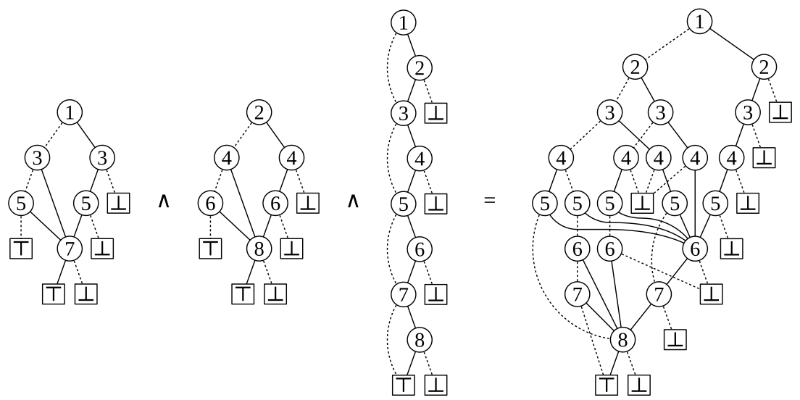](../../assets/volume4a/figures/fig-7-25-monotone-synthesis.svg)

**图 25**　用算法 S 计算 $\mu_2(x_1,x_3,x_5,x_7)\wedge\mu_2(x_2,x_4,x_6,x_8)\wedge G_8(x_1,\ldots,x_8)=\mu_3(x_1,\ldots,x_8)$

重复这个过程 6 次将产生 $\mu_6$ 的 BDD, 它有 103 924 个结点. 6 个变量的单调布尔函数恰好有 7 828 354 个 (见习题 5.3.4–31). 这个 BDD 刻画了所有这些函数, 并且用算法 S 计算它仅需大约 480 万次内存访问. 此外, 67 亿次内存访问足以计算 $\mu_7$ 的 BDD, 它有 155 207 320 个结点, 刻画了 2 414 682 040 998 个单调函数.

然而, 我们必须在此止步. 下一情形的大小 $B(\mu_8)$ 是惊人的 69 258 301 585 604 (见习题 77).

**BDD 基的综合.** 当我们一次处理很多函数而不是临时计算单个 BDD 时, 需要另外一种方法. 像在 $(36)$ 中那样, BDD 基的函数通常共享公共子函数. 算法 S 设计为取不相交的 BDD 并对它们进行有效的组合, 然后清除原来的 BDD. 但是在很多情况下, 我们想建立 BDD 有重叠的函数的组合. 此外, 比如在建立新函数 $f\wedge g$ 之后, 我们可能希望保留 $f$ 和 $g$ 以备将来使用. 实际上, 新函数也可能与 $f$ 或 $g$ 或者这两者共享结点.

因此, 我们考虑设计一个通用工具箱来处理布尔函数的集合. BDD 基对此特别有吸引力, 因为大部分必要的操作都有简单的递推公式. 我们知道每个非常量布尔函数都可以表示成

$$
f(x_1,x_2,\ldots,x_n)=(\bar x_v\mathbin{?}f_l:f_h),\tag{50}
$$

其中 $v=f_o$ 是 $f$ 所依赖的第一个变量的下标, 而且我们有

$$
f_l=f(0,\ldots,0,x_{v+1},\ldots,x_n),\qquad
f_h=f(1,\ldots,1,x_{v+1},\ldots,x_n).\tag{51}
$$

这条规则对应于 $f$ 的 BDD 顶端的分支结点 $\text{\textcircled{v}}$, 然后通过递归地使用 $(50)$ 和 $(51)$ 得到 BDD 的其余结点, 直至达到对应于 $\boxed{\bot}$ 或 $\boxed{\top}$ 的常量函数. 一个类似的递归公式定义两个函数的任何组合 $f\circ g$. 如果 $f$ 和 $g$ 不都是常量, 我们有

$$
f(x_1,\ldots,x_n)=(\bar x_v\mathbin{?}f_l:f_h)
\qquad\text{且}\qquad
g(x_1,\ldots,x_n)=(\bar x_v\mathbin{?}g_l:g_h),\tag{52}
$$

其中 $v=\min(f_o,g_o)$, 这里的 $f_l$、$f_h$、$g_l$、$g_h$ 由 $(51)$ 给出. 于是, 立即得到

$$
f\circ g=(\bar x_v\mathbin{?}f_l\circ g_l:f_h\circ g_h).\tag{53}
$$

这个重要的公式是定义合并的规则 (37) 的另一种表述.

*警告.* 对上述记号的理解务必要小心, 因为 $(50)$ 中的子函数 $f_l$ 和 $f_h$ 可能不同于 $(52)$ 中的 $f_l$ 和 $f_h$. 例如, 假定 $f=x_2\vee x_3$、$g=x_1\oplus x_3$. 那么等式 (50) 在 $f_o=2$ 和 $f=(\bar x_2\mathbin{?}f_l:f_h)$ 时成立, 其中 $f_l=x_3$、$f_h=1$. 我们还有 $g_o=1$、$g=(\bar x_1\mathbin{?}x_3:\bar x_3)$. 但是在 $(52)$ 中, 两函数使用同一个分支变量 $x_v$, 而且在我们的例子中 $v=\min(f_o,g_o)=1$, 所以等式 (52) 中 $f=(\bar x_1\mathbin{?}f_l:f_h)$, 其中 $f_l=f_h=x_2\vee x_3$.

BDD 基的每个结点代表一个布尔函数. 此外, BDD 基是约化的. 所以它的两个函数或子函数相等, 当且仅当它们恰好对应于同样的结点. (算法 S 没有这种方便的唯一性.)

公式 (51)–$(53)$ 立即给出了计算 $f\wedge g$ 的递归方法:

$$
\operatorname{AND}(f,g)=
\left\{\begin{aligned}
&\text{如果 }f\wedge g\text{ 有明显的值, 返回它.}\\
&\text{否则, 把 }f\text{ 和 }g\text{ 表示为 }(52)\text{ 的形式,}\\
&\text{计算 }r_l\leftarrow\operatorname{AND}(f_l,g_l)\text{ 和 }r_h\leftarrow\operatorname{AND}(f_h,g_h)，\\
&\text{返回函数 }(\bar x_v\mathbin{?}r_l:r_h)。
\end{aligned}\right.\tag{54}
$$

(递归公式总是终止于足够简单的情形. 第一行中的 “明显” 值对应于终止情形 $f\wedge1=f$、$1\wedge g=g$、$f\wedge0=0\wedge g=0$, 以及当 $f=g$ 时有 $f\wedge g=f$.) 当 $f$ 和 $g$ 是我们上面例子中的函数时, $(54)$ 把 $f\wedge g$ 约化为计算 $(x_2\vee x_3)\wedge x_3$ 和 $(x_2\vee x_3)\wedge\bar x_3$. 然后把 $(x_2\vee x_3)\wedge x_3$ 约化为 $x_3\wedge x_3$ 和 $1\wedge x_3$, 等等.

但是, 如果我们照原样实现它, $(54)$ 就有问题, 因为每个非终止步骤都会启动另外两个递归实例. 当我们达到第 $k$ 层深度时, 计算量会激增到 $\operatorname{AND}$ 的 $2^k$ 个实例!

幸运的是, 有一个很好的方法可以避免这种指数爆炸. 由于 $f$ 只有 $B(f)$ 个不同的子函数, 最多可能出现 $B(f)B(g)$ 个互不相同的 $\operatorname{AND}$ 调用. 为了限制计算次数, 只需要记住我们之前做过的事情, 具体做法是刚好在返回计算结果 $r$ 之前, 把 $f\wedge g=r$ 的事实记入备忘录. 于是当随后出现同样的子问题时, 我们可以检索备忘录并说: “嘿, 我们已经做过那件事情了.” 这样, 先前求解过的情形便成为终止情形, 只有不同的子问题可能生成新的情形. (第 8 章将详细讨论这种记忆化技术.)

算法 $(54)$ 还掩盖着另外一个问题, “返回函数 $(\bar x_v\mathbin{?}r_l:r_h)$” 没有那么容易, 因为我们必须保持约化的 BDD 基. 如果 $r_l=r_h$, 我们应该返回结点 $r_l$. 如果 $r_l\ne r_h$, 在创建新结点之前必须判断是否已经存在分支结点 $(\bar x_v\mathbin{?}r_l:r_h)$.

因此, 我们需要保存 BDD 结点自身之外的额外信息, 还需要保留已解决问题的备忘录. 我们也要能够按结点的内容寻找结点, 即使尚不知道它的地址. 第 6 章的查找算法现在可以帮助我们完成这两件事情, 例如通过散列. 为了记录 $f\wedge g=r$ 的一条备忘录, 我们可以散列键 $(f,\wedge,g)$, 并把它与 $r$ 值联系在一起. 为了记录一个现有结点 $(\mathtt{V},\mathtt{LO},\mathtt{HI})$, 可以散列键 $(\mathtt{V},\mathtt{LO},\mathtt{HI})$, 并把它与该结点的内存地址联系在一起.

习惯上, 把 BDD 基中全部现有结点 $(\mathtt{V},\mathtt{LO},\mathtt{HI})$ 的字典称为*唯一表*, 因为我们用它来强制执行禁止重复的非常重要的唯一性标准. 与把全部信息放进一个庞大字典相比, 更好的做法是对每个变量 $\mathtt{V}$ 保留一张较小的唯一表, 组成一组表. 用这样分离的表, 我们可以有效地找出在某个特定变量上分支的全部结点.

备忘录是方便的, 但是它们不像唯一表中的记录那样至关重要. 如果碰巧忘记了 $f\wedge g=r$ 这个事实, 我们以后总是可以重新计算它的. 如果能以很高概率记住子问题 $f_l\wedge g_l$ 和 $f_h\wedge g_h$ 的答案, 就不必担心指数爆炸. 因此, 我们可以用一种代价较小的方法存储备忘录, 获得通常良好但并不完美的检索. 在把键 $(f,\wedge,g)$ 散列到散列表的位置 $p$ 之后, 我们只在那个位置寻找备忘录, 不必费心处理与其他键的冲突. 如果若干个键具有相同的散列地址, 位置 $p$ 将仅记录最近一条相关备忘录. 在实际应用中, 只要散列表足够大, 这种简化方案就仍然适用. 我们把这种近乎完美的表称为*备忘录缓存*, 因为它类似于硬件缓存, 计算机用硬件缓存来记住已在相对较慢的存储单元上处理过的重要数值.

现在让我们充实算法 $(54)$, 明确说明它如何同唯一表与备忘录缓存交互.

$$
\operatorname{AND}(f,g)=
\left\{\begin{aligned}
&\text{如果 }f\wedge g\text{ 有明显的值, 返回它.}\\
&\text{否则, 如果 }f\wedge g=r\text{ 在备忘录缓存中, 返回 }r。\\
&\text{否则, 把 }f\text{ 和 }g\text{ 表示为 }(52)\text{ 的形式,}\\
&\text{计算 }r_l\leftarrow\operatorname{AND}(f_l,g_l)\text{ 和 }r_h\leftarrow\operatorname{AND}(f_h,g_h)，\\
&\text{使用算法 U, 置 }r\leftarrow\operatorname{UNIQUE}(v,r_l,r_h)，\\
&\text{把 }f\wedge g=r\text{ 存入备忘录缓存, 然后返回 }r。
\end{aligned}\right.\tag{55}
$$

**算法 U (唯一表查询).** 给定 $(v,p,q)$, 其中 $v$ 是整数, $p$ 和 $q$ 指向 BDD 基中变量秩大于 $v$ 的结点, 本算法返回指向结点 $\operatorname{UNIQUE}(v,p,q)$ 的指针, 该结点表示函数 $(\bar x_v\mathbin{?}p:q)$. 如果该函数没有出现过, 就添加一个新结点到 BDD 基.

**U1.** [是简单的情形吗?] 如果 $p=q$, 返回 $p$.

**U2.** [查表.] 用键 $(p,q)$ 搜索变量 $x_v$ 的唯一表. 如果成功找到 $r$ 值, 返回 $r$.

**U3.** [创建结点.] 分配一个新结点 $r$, 然后置 $\mathtt{V}(r)\leftarrow v$、$\mathtt{LO}(r)\leftarrow p$、$\mathtt{HI}(r)\leftarrow q$. 用键 $(p,q)$ 把 $r$ 存入 $x_v$ 的唯一表中. 返回 $r$. ▮

注意, $\operatorname{AND}(f,g)$ 的顶层计算结束之后, 不必清空备忘录缓存. 我们所建立的每条备忘录都说明了数据结构中结点之间的关系. 那些事实仍然有效, 而且以后需要对新函数 $f$ 和 $g$ 计算 $\operatorname{AND}(f,g)$ 时可能用到它们.

算法 $(55)$ 的一种改进将进一步增强该方法. 也就是说, 当 $f\wedge g$ 不明显时, 如果我们发现 $f>g$, 则交换 $f\leftrightarrow g$. 那么在已经计算过 $g\wedge f$ 的情况下就不必浪费时间计算 $f\wedge g$ 了.

对 $(55)$ 稍作修改, 其他二元运算符 $\operatorname{OR}(f,g)$、$\operatorname{XOR}(f,g)$、$\operatorname{BUTNOT}(f,g)$、$\operatorname{NOR}(f,g)$、$\ldots$ 也可以很容易地计算出来. 见习题 81.

看起来 $(55)$ 与算法 U 的组合比算法 S 简单得多. 因此, 人们可能会问, 为什么有人要费心去学习另一种方法呢? 同 $(55)$ 的递归结构中计算的 “深度优先” 顺序比较, 算法 S 的广度优先方法似乎十分复杂. 此外, 算法 S 只能处理不相交的 BDD, 而算法 U 以及类似 $(55)$ 的递归方法适用于任何 BDD 基.

然而, 表面现象可能具有欺骗性. 算法 S 是在低层次描述的, 对其数据结构中每个元素的每个变化都进行了明确的阐述. 相比之下, $(55)$ 和算法 U 中的高层次描述假定在幕后存在大量的基础结构. 必须建立备忘录缓存和唯一表, 并且当 BDD 基增大或者缩小时需要精心调整它们的大小. 把这些工作都算进去, 从头正确实现算法 $(55)$ 和算法 U 的程序, 其总长度大约是算法 S 的类似程序的十倍.

实际上, BDD 基的维护涉及有趣的动态存储分配问题, 因为当结点不再可达时我们希望释放内存空间. 算法 S 采用后进先出的方式解决这个问题, 在顺序栈上保留结点和模板, 并使用一个容易与其他数据整合的小散列表. 然而, 通用的 BDD 基需要更加复杂的系统.

像在 2.3.5 节中讨论的那样, 维持一个动态 BDD 基的最好方式或许是使用引用计数器, 因为按定义 BDD 是无圈的. 所以, 我们不妨假定每个 BDD 结点除了 $\mathtt{V}$、$\mathtt{LO}$ 和 $\mathtt{HI}$ 字段之外还有一个 $\mathtt{REF}$ 字段. $\mathtt{REF}$ 字段告诉我们这个结点有多少引用, 这些引用来自其他结点中的 $\mathtt{LO}$ 或 $\mathtt{HI}$ 指针, 或者像 $(36)$ 中那样来自外部根指针 $F_j$. 例如, $(36)$ 中标记为 ③ 的结点的 $\mathtt{REF}$ 字段分别是 4、1 和 2, 标记为 ②、④ 或 ⑥ 的所有结点[^v4a-p189-1] 有 $\mathtt{REF}=1$. 习题 82 讨论在递归计算中如何正确增加或者减少 $\mathtt{REF}$ 计数这个多少有些棘手的问题.

当引用计数变为零时, 结点就成为*死结点*. 发生这种情况时, 我们应该减少它下面两个结点的 $\mathtt{REF}$ 字段. 然后它们也可能以同样的方式变成死结点, 递归地传播这种变化.

但是无需立即从内存中清除死结点. 它仍然代表一个潜在有用的布尔函数, 我们可能会发现, 随着计算的进行, 我们还需要这个函数. 例如, 因为来自唯一表的指针不会被计入引用, 我们可能会在步骤 U2 中找到一个死结点. 同样, 在 $(55)$ 中, 当 $r$ 是当前的死结点时, 可能碰巧发现一条缓存的备忘录告诉我们 $f\wedge g=r$. 在这种情况下, 结点 $r$ 就恢复为活结点. (同时我们必须对它的 $\mathtt{LO}$ 和 $\mathtt{HI}$ 子结点的 $\mathtt{REF}$ 计数加 1, 可能还要以同样的方式递归地复活它们.)

然而, 我们要定期通过清除死结点回收内存空间. 于是我们必须做两件事, 从缓存中清除 $f$、$g$ 或 $r$ 是死结点的全部备忘录, 同时必须从内存和它们的唯一表中去掉所有死结点. 习题 84 给出了自动系统用来动态决定何时清除死结点及何时调整表大小的典型启发式策略.

由于需要支持 BDD 基的额外机制, 对于算法 U 和像 $(55)$ 那样自顶向下的递归计算, 不能期望它们在一次性计算中达到算法 S 的效率, 例如式 (49) 的单调函数判别函数 $\mu_n$. 当把更一般的方法应用到这个例子时, 需要大约 4 倍的运行时间, 内存需求增长到大约 2.4 倍.

但是 BDD 基在许多其他应用中确实大有可为. 例如, 假定我们想得到两个二进制数乘积的各个数位的公式:

$$
(z_1\ldots z_{m+n})_2=(x_1\ldots x_m)_2\times(y_1\ldots y_n)_2.\tag{56}
$$

显而易见, 当 $n=0$ 时 $z_1\ldots z_m=0\ldots0$, 而且简单的递推公式

$$
(x_1\ldots x_m)_2\times(y_1\ldots y_ny_{n+1})_2
=(z_1\ldots z_{m+n}0)_2+(x_1\ldots x_m)_2y_{n+1}\tag{57}
$$

允许我们将 $n$ 增加 1. 这个递推公式很容易用 BDD 基进行编码. 下面是 $m=n=3$ 时得到的结果, 下标与 $(36)$ 中二进制加法的相应图一致:

[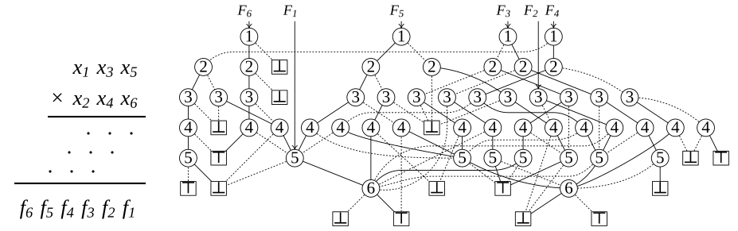](../../assets/volume4a/figures/diagram-7-1-4-58-shared-multiplier-bdd.svg)

$(58)$

显然, 按位乘法比按位加法复杂得多. (实际上, 如果不是这样, 因式分解就不会那么困难.) 当 $m=n=16$ 时, 二进制乘法对应的 BDD 基很庞大, 具有 $B(f_1,\ldots,f_{32})=136\,398\,751$ 个结点. 用算法 U 计算大约要做 560 亿次内存访问且使用 6.3 吉字节内存后才可能求出, 包括近 19 亿次递归子程序调用、几百次动态改变唯一表和备忘录缓存的大小, 再加上几十次及时的垃圾回收. 如果用算法 S 进行类似的计算, 几乎是不可想象的, 虽然在这个特定的例子中各个函数并不共享许多子函数. 结果是 $B(f_1)+\cdots+B(f_{32})=168\,640\,131$, 最大值出现在 “中间二进制位”, $B(f_{16})=38\,174\,143$.

**\*三元运算.** 给出不全为常数的 3 个布尔函数 $f=f(x_1,\ldots,x_n)$、$g=g(x_1,\ldots,x_n)$ 和 $h=h(x_1,\ldots,x_n)$, 取 $v=\min(f_o,g_o,h_o)$, 可以把 $(52)$ 推广为

$$
f=(\bar x_v\mathbin{?}f_l:f_h)\quad\text{且}\quad
g=(\bar x_v\mathbin{?}g_l:g_h)\quad\text{且}\quad
h=(\bar x_v\mathbin{?}h_l:h_h),\tag{59}
$$

然后, 例如把 $(53)$ 推广为

$$
\langle fgh\rangle=(\bar x_v\mathbin{?}\langle f_lg_lh_l\rangle:\langle f_hg_hh_h\rangle),\tag{60}
$$

类似的公式对 $f$、$g$ 和 $h$ 的任何三元运算成立, 包括

$$
(\bar f\mathbin{?}g:h)=
(\bar x_v\mathbin{?}(\bar f_l\mathbin{?}g_l:h_l):(\bar f_h\mathbin{?}g_h:h_h)).\tag{61}
$$

(请读者勿混淆这些式中 $h_h$ 的两个 $h$ 的含义.)

现在, 很容易把 $(55)$ 推广到类似多路复用的三元组合:

$$
\operatorname{MUX}(f,g,h)=
\left\{\begin{aligned}
&\text{如果 }(\bar f\mathbin{?}g:h)\text{ 有明显的值, 返回它.}\\
&\text{否则, 如果 }(\bar f\mathbin{?}g:h)=r\text{ 在备忘录缓存中, 返回 }r。\\
&\text{否则, 把 }f、g\text{ 和 }h\text{ 表示为 }(59)\text{ 的形式,}\\
&\text{计算 }r_l\leftarrow\operatorname{MUX}(f_l,g_l,h_l)\text{ 和 }r_h\leftarrow\operatorname{MUX}(f_h,g_h,h_h)，\\
&\text{使用算法 U, 置 }r\leftarrow\operatorname{UNIQUE}(v,r_l,r_h)，\\
&\text{把 }(\bar f\mathbin{?}g:h)=r\text{ 存入备忘录缓存, 然后返回 }r。
\end{aligned}\right.\tag{62}
$$

(见习题 86 和 87.) 运行时间为 $O(B(f)B(g)B(h))$. 现在备忘录缓存必须用一个比前面更复杂的键查询, 其中包括 3 个指针 $(f,g,h)$ 而非 2 个, 以及相关运算的代码. 但是, 如果不同指针地址的数目最多是 $2^{31}$, 则每条备忘录 $(\mathit{op},f,g,h,r)$ 仍然可以用比如两个八字节全字方便地表示.

三元运算 $f\wedge g\wedge h$ 是一个有趣的特例. 我们可以调用 $(55)$ 两次来计算它, 无论是 $\operatorname{AND}(f,\operatorname{AND}(g,h))$, 或是 $\operatorname{AND}(g,\operatorname{AND}(h,f))$, 还是 $\operatorname{AND}(h,\operatorname{AND}(f,g))$. 也可以使用与 $(62)$ 类似的三元子程序 $\operatorname{ANDAND}(f,g,h)$. 这个三元例程首先对操作数排序, 使得指针满足 $f\le g\le h$. 然后如果 $f=0$, 则返回 0. 如果 $f=1$ 或 $f=g$, 则返回 $\operatorname{AND}(g,h)$. 如果 $g=h$, 则返回 $\operatorname{AND}(f,g)$. 否则 $1<f<g<h$, 在递归的当前层, 运算仍然是三元的.

例如, 像式 (49) 中那样, 假定 $f=\mu_5(x_1,x_3,\ldots,x_{63})$、$g=\mu_5(x_2,x_4,\ldots,x_{64})$、$h=G_{64}(x_1,\ldots,x_{64})$. 在作者的实验性实现中, 计算 $\operatorname{AND}(f,\operatorname{AND}(g,h))$ 需要 $20+680=700$ 万次内存访问, $\operatorname{AND}(g,\operatorname{AND}(h,f))$ 需要 $10+700=710$ 万次, $\operatorname{AND}(h,\operatorname{AND}(f,g))$ 需要 $2440+560=3000$(!) 万次, 而 $\operatorname{ANDAND}(f,g,h)$ 需要 750 万次. 因此, 在这个例子中, 如果我们不选错计算顺序, 二元方法就会胜出. 但是有时三元 $\operatorname{ANDAND}$ 会胜过它的所有二元计算对手 (见习题 88).

**\*量词.** 如果 $f=f(x_1,\ldots,x_n)$ 是布尔函数并且 $1\le j\le n$, 逻辑学家传统上用公式

$$
\exists x_j\, f(x_1,\ldots,x_n)=f_0\vee f_1
\qquad\text{和}\qquad
\forall x_j\, f(x_1,\ldots,x_n)=f_0\wedge f_1\tag{63}
$$

定义存在量词化和全称量词化, 其中 $f_c=f(x_1,\ldots,x_{j-1},c,x_{j+1},\ldots,x_n)$. 因此量词 $\exists x_j$ (读作 “存在 $x_j$”) 把 $f$ 变成其余变量 $(x_1,\ldots,x_{j-1},x_{j+1},\ldots,x_n)$ 的函数, 它为真当且仅当 $x_j$ 的至少一个值满足 $f(x_1,\ldots,x_n)$. 量词 $\forall x_j$ (读作 “对于所有 $x_j$”) 把 $f$ 变成当且仅当 $x_j$ 的两个值都满足 $f$ 时为真的函数.

经常需要同时应用多个量词. 例如, 算式 $\exists x_2\,\exists x_3\,\exists x_6\,f(x_1,\ldots,x_n)$ 代表 8 项的 OR, 这 8 项是以所有可能的方式把 0 或 1 代入 $x_2$、$x_3$ 和 $x_6$ 得到的 $(x_1,x_4,x_5,x_7,\ldots,x_n)$ 的函数. 类似地, $\forall x_2\,\forall x_3\,\forall x_6\,f(x_1,\ldots,x_n)$ 代表同样 8 项的 AND.

一种常见的应用出现在函数 $f(i_1,\ldots,i_l;j_1,\ldots,j_m)$ 表示 $2^l\times2^m$ 布尔矩阵 $F$ 的第 $(i_1\ldots i_l)_2$ 行、第 $(j_1\ldots j_m)_2$ 列的值时. 那时, 由

$$
\exists j_1\ldots\exists j_m\,
(f(i_1,\ldots,i_l;j_1,\ldots,j_m)\wedge g(j_1,\ldots,j_m;k_1,\ldots,k_n))\tag{64}
$$

给出的函数 $h(i_1,\ldots,i_l;k_1,\ldots,k_n)$ 表示布尔乘积 $FG$ 的矩阵 $H$.

里卡德·鲁德尔提出了一种在 BDD 基中实现多重量词化的便捷方法. 令 $g=x_{j_1}\wedge\cdots\wedge x_{j_m}$ 为一些正字面量的合取. 那么我们可以把 $\exists x_{j_1}\ldots\exists x_{j_m}\,f$ 看作由算法 $(55)$ 的下述变形实现的二元运算 $f\mathbin{\mathrm E}g$:

$$
\operatorname{EXISTS}(f,g)=
\left\{\begin{aligned}
&\text{如果 }f\mathbin{\mathrm E}g\text{ 有明显的值, 返回它.}\\
&\text{否则, 把 }f\text{ 和 }g\text{ 表示为 }(52)\text{ 的形式,}\\
&\text{如果 }v\ne f_o\text{, 返回 }\operatorname{EXISTS}(f,g_h)。\\
&\text{否则, 如果 }f\mathbin{\mathrm E}g=r\text{ 在备忘录缓存中, 返回 }r。\\
&\text{否则, 置 }r_l\leftarrow\operatorname{EXISTS}(f_l,g_h)，\quad r_h\leftarrow\operatorname{EXISTS}(f_h,g_h)，\\
&\text{如果 }v\ne g_o\text{, 使用算法 U, 置 }r\leftarrow\operatorname{UNIQUE}(v,r_l,r_h)，\\
&\text{否则, 计算 }r\leftarrow\operatorname{OR}(r_l,r_h)，\\
&\text{把 }f\mathbin{\mathrm E}g=r\text{ 存入备忘录缓存, 然后返回 }r。
\end{aligned}\right.\tag{65}
$$

(见习题 94.) 当 $g$ 不具备所述形式时, $\mathrm E$ 运算未定义. 注意备忘录缓存如何很好地记住以前已经计算过的存在量词化结果.

算法 $(65)$ 的运行时间可能变化很大. 算法 $(55)$ 的最坏情况是 $O(B(f)B(g))$, 而当 $g$ 指定 $m$ 重量词化时, $(65)$ 会调用 $m$ 个 OR 运算. 如果所有量词化出现在 $f$ 的 BDD 的根结点附近, 最坏情况可能达到 $B(f)^{2^m}$ 阶. 如果 $m=1$, 运行时间仅为 $O(B(f)^2)$, 但是随着 $m$ 的增长, 它可能大到难以容忍. 另一方面, 如果所有量词化出现在汇结点附近, 无论 $m$ 多大, 运行时间仅为 $O(B(f))$. (见习题 97.)

其他几种量词同样容易计算, 也值得注意, 虽然它们不如 $\exists$ 和 $\forall$ 那么著名. 布尔差和是／否量词由类似于 $(63)$ 的公式定义:

$x_j f=f_0\oplus f_1$; 
$x_j f=\bar f_0\wedge f_1$; 
$x_j f=f_0\wedge\bar f_1$. 　$(66)$

布尔差  是这些量词中最重要的. 对其余变量 $\{x_1,\ldots,x_{j-1},x_{j+1},\ldots,x_n\}$ 的任一赋值, 如果 $f$ 的值取决于 $x_j$, 那么 $x_j f$ 就为真. 如果 $f$ 的多重线性表示是 $f=(x_jg+h)\bmod2$, 那么 $x_j f=g\bmod2$, 其中 $g$ 和 $h$ 是关于 $\{x_1,\ldots,x_{j-1},x_{j+1},\ldots,x_n\}$ 的多重线性多项式. (见式 7.1.1–$(19)$.) 因此, 布尔差  在有限域上扮演类似微积分中导数的角色.

布尔函数 $f(x_1,\ldots,x_n)$ 是单调的 (非递减的), 当且仅当 $\bigvee_{j=1}^n$$x_j f=0$, 这无异于说对于所有 $j$ 都有 $x_j f=0$. 然而, 习题 105 给出了一种检验 BDD 单调性的更快的方法.

我们现在考虑存在量词化的一个特别有启发性的具体例子. 如果 $G$ 是任意的图, 对于它的独立集和核, 我们可以建立布尔函数 $\operatorname{IND}(x)$ 和 $\operatorname{KER}(x)$ 如下:

$$
\operatorname{IND}(x)=\neg\bigvee_{u\!-\!v}(x_u\wedge x_v);\tag{67}
$$

$$
\operatorname{KER}(x)=\operatorname{IND}(x)\wedge\bigwedge_v\left(x_v\vee\bigvee_{u\!-\!v}x_u\right).\tag{68}
$$

其中 $x$ 是对 $G$ 的每个顶点 $v$ 有分量 $x_v$ 的位向量. 我们可以建立一个新图 $\mathcal G$, 它的顶点是 $G$ 的核, 也就是使得 $\operatorname{KER}(x)=1$ 的向量 $x$. 我们说两个核 $x$ 和 $y$ 在 $\mathcal G$ 中是邻接的, 如果它们恰好在 $u$ 和 $v$ 的两个分量不同, 其中 $(x_u,x_v)=(1,0)$ 和 $(y_u,y_v)=(0,1)$, 在这种情况下还有 $u\!-\!v$. 可以把核看作对 $G$ 的顶点设置标记的某种方式, 把一个标记从某顶点移动到邻近顶点会产生一个邻接的核. 我们在形式上定义

$$
\operatorname{ADJ}(x,y)=[\nu(x\oplus y)=2]\wedge\operatorname{KER}(x)\wedge\operatorname{KER}(y).\tag{69}
$$

于是 $\mathcal G$ 中有边 $x\!-\!y$, 当且仅当 $\operatorname{ADJ}(x,y)=1$.

注意, 如果 $x=x_1\ldots x_n$, 函数 $[\nu(x)=2]$ 是对称函数 $S_2(x_1,\ldots,x_n)$. 此外, 如果我们用拉链方式交错变量, 以致分支次序是 $(x_1,y_1,\ldots,x_n,y_n)$, 那么 $f(x\oplus y)$ 的 BDD 所含结点数最多是 $f(x)$ 的 BDD 的三倍. 因此, 除非 $B(\operatorname{KER})$ 很大, $B(\operatorname{ADJ})$ 不会非常大.

量词化使得表示 “$x$ 是 $\mathcal G$ 的孤立顶点 (度为 0 的顶点, 也就是无邻近顶点的核)” 这一条件变得很容易:

$$
\operatorname{ISO}(x)=\operatorname{KER}(x)\wedge\neg\exists y\,\operatorname{ADJ}(x,y).\tag{70}
$$

例如, 像 $(18)$ 中那样, 假定 $G$ 是美国 49 个相接地区的图. 那么对于 $v\in\{\mathtt{ME},\mathtt{NH},\ldots,\mathtt{CA}\}$, 每个核向量 $x$ 有 49 个分量 $x_v$. 图 $\mathcal G$ 有 266 137 个顶点. 我们先前已经观察到 $\operatorname{IND}(x)$ 和 $\operatorname{KER}(x)$ 的 BDD 大小分别是 428 和 780 (见 $(17)$). 在这种情况下, $(69)$ 中 $\operatorname{ADJ}(x,y)$ 的 BDD 只有 7260 个结点, 尽管它是 98 个布尔变量的函数. $\exists y\,\operatorname{ADJ}(x,y)$ 的 BDD 描述 $G$ 中在 $\mathcal G$ 里至少有一个邻居的所有核 $x$, 最终有 842 个结点. $\operatorname{ISO}(x)$ 的 BDD 只有 77 个结点. 我们发现 $G$ 恰好有 3 个孤立的核, 就是

[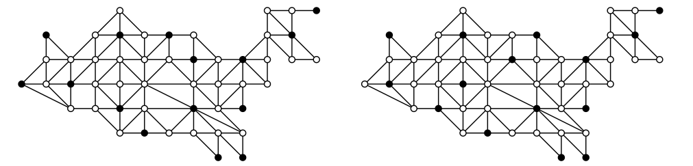](../../assets/volume4a/figures/diagram-7-1-4-71-isolated-kernels.svg)

$(71)$

以及由这两个核混合而成的另一个核. 利用上面的算法, 从原州邻接图 $G$ 的顶点和边的列表开始, 整个计算可以在大约 1.6 兆字节内存中以约 400 万次内存访问的总开销完成. 也就是说, 平均每个核只需约 15 次内存访问.

我们可以按照同样方式用 BDD 处理其他 “隐式图”. 如果图的顶点可以表示成布尔函数的解向量, 即使顶点多到无法全部放入内存, 也可以使用 BDD 处理. 当这些函数不太复杂时, 我们可以回答关于图的查询, 而显式表示顶点和弧的方式无法回答这些查询.

**\*函数复合.** 递归 BDD 算法的主要成果, 是一个计算 $f(g_1,g_2,\ldots,g_n)$ 的通用过程, 其中 $f$ 是 $\{x_1,x_2,\ldots,x_n\}$ 的一个给定函数, 而且每个变元 $g_j$ 也是这样的函数. 假定我们知道一个数 $m\ge0$, 使得对于 $m<j\le n$ 有 $g_j=x_j$, 那么这个过程可以表示如下:

$$
\begin{array}{l}
\operatorname{COMPOSE}(f,g_1,\ldots,g_n)=\\[.3em]
\left\{\begin{aligned}
&\text{如果 }f=0\text{ 或 }f=1\text{, 返回 }f。\\
&\text{否则, 如同 }(50)\text{, 假定 }f=(\bar x_v\mathbin{?}f_l:f_h)，\\
&\text{如果 }v>m\text{, 返回 }f\text{; 否则,}\\
&\quad\text{如果 }f(g_1,\ldots,g_n)=r\text{ 在备忘录缓存中, 返回 }r。\\
&\text{计算 }r_l\leftarrow\operatorname{COMPOSE}(f_l,g_1,\ldots,g_n)\\
&\quad\text{和 }r_h\leftarrow\operatorname{COMPOSE}(f_h,g_1,\ldots,g_n)，\\
&\text{使用 }(62)\text{, 置 }r\leftarrow\operatorname{MUX}(g_v,r_l,r_h)，\\
&\text{把 }f(g_1,\ldots,g_n)=r\text{ 存入备忘录缓存, 然后返回 }r。
\end{aligned}\right.
\end{array}\tag{72}
$$

这个算法中像 $f(g_1,\ldots,g_n)=r$ 这样的缓存备忘录, 其表示带有一些技巧, 我们马上会讨论这一点.

虽然这里的计算看起来与前面看到的递归算法基本相同, 但实际上存在很大的差别. 算法 $(72)$ 中的函数 $r_l$ 和 $r_h$ 现在可能涉及所有变量 $\{x_1,\ldots,x_n\}$, 而非只涉及 BDD 底部附近的 $x$. 所以 $(72)$ 的运行时间可能很长. 不过, 也有许多实例的处理十分顺畅而高效. 例如 $(69)$ 中 $[\nu(x\oplus y)=2]$ 的计算就没有问题.

像 $f(g_1,\ldots,g_n)=r$ 这样的备忘录, 其键不应包含 $(f,g_1,\ldots,g_n)$ 的完整明细, 因为我们想要高效地散列它. 所以我们只存储 $f[G]=r$, 其中 $G$ 是函数序列 $(g_1,\ldots,g_n)$ 的识别号. 每当序列改变时, 可以用一个新的识别号 $G$. 只要各个函数 $g_j$ 没有变成死结点, 就可以保留特定计算中反复出现的那些函数序列的 $G$. (也见习题 102 中的备选方案.)

让我们回到美国相接地区的图, 再举一个例子. 这是一个平面图, 假定我们想用 4 种颜色给它着色. 由于 4 种颜色可以用 2 位二进制代码 $\{\mathtt{00},\mathtt{01},\mathtt{10},\mathtt{11}\}$ 给出, 很容易把有效着色表示成 98 个变量的布尔函数. 它为真, 当且仅当每一对相邻地区的颜色代码 $ab$ 都不同:

$$
\begin{aligned}
&\operatorname{COLOR}(a_{\mathtt{ME}},b_{\mathtt{ME}},\ldots,a_{\mathtt{CA}},b_{\mathtt{CA}})=\\
&\quad\operatorname{IND}(a_{\mathtt{ME}}\wedge b_{\mathtt{ME}},\ldots,a_{\mathtt{CA}}\wedge b_{\mathtt{CA}})
\wedge\operatorname{IND}(a_{\mathtt{ME}}\wedge\bar b_{\mathtt{ME}},\ldots,a_{\mathtt{CA}}\wedge\bar b_{\mathtt{CA}})\\
&\quad{}\wedge\operatorname{IND}(\bar a_{\mathtt{ME}}\wedge b_{\mathtt{ME}},\ldots,\bar a_{\mathtt{CA}}\wedge b_{\mathtt{CA}})
\wedge\operatorname{IND}(\bar a_{\mathtt{ME}}\wedge\bar b_{\mathtt{ME}},\ldots,\bar a_{\mathtt{CA}}\wedge\bar b_{\mathtt{CA}}).
\end{aligned}\tag{73}
$$

四个 $\operatorname{IND}$ 中的每个都有 854 个结点的 BDD, 可以用算法 $(72)$ 以大约 7 万次内存访问的代价计算. $\operatorname{COLOR}$ 函数最终只有 25 579 个 BDD 结点. 算法 C 现在快速确定这个图的 4 着色方案总数恰好是 25 623 183 458 304. 若除以 $4!$ 以消除对称性, 结果大约是 1.1 万亿. 这个计算从图的描述开始, 需要 2.2 兆字节内存, 所需的总时间少于 350 万次内存访问的时间. (我们还可以寻找随机的 4 着色方案, 等等.)

**难于处理的函数.** 当然还有不少 98 个变量的函数, 远不如 $\operatorname{COLOR}$ 函数那么好处理. 事实上, 98 个变量的函数总数达到 $2^{2^{98}}$. 习题 108 证明, 其中至多有 $2^{2^{46}}$ 个的 BDD 大小小于 1 万亿. 而实际上, 几乎所有 98 个变量的布尔函数都有 $B(f)\approx2^{98}/98\approx3.2\times10^{27}$. 除非数据恰好高度冗余, 否则无法把 $2^{98}$ 比特的数据压缩到一小块空间中.

最糟糕的情况是什么? 如果 $f$ 是 $n$ 个变量的布尔函数, $B(f)$ 可能有多大? 考察给定 BDD 的分布, 就不难找到答案. 当在变量 $x_{k+1}$ 上有 $b_k$ 个分支结点, 另有 $b_n$ 个汇结点时, 该分布是序列 $(b_0,\ldots,b_{n-1},b_n)$. 显然,

$$
B(f)=b_0+\cdots+b_{n-1}+b_n.\tag{74}
$$

我们也有 $b_0\le1$、$b_1\le2$、$b_2\le4$、$b_3\le8$, 一般情况下

$$
b_k\le2^k,\tag{75}
$$

因为每个结点只有两个分支. 此外, 每当 $f$ 不是常数时, $b_n=2$, 并且 $b_{n-1}\le2$, 因为对于 $\text{\textcircled{n}}$ 的 LO 和 HI 分支只有两种合法的选择. 实际上, 我们知道 $b_k$ 是 $f$ 的真值表中 $n-k$ 阶串珠的数目, 即给定 $(x_1,\ldots,x_k)$ 后得到的、关于 $(x_{k+1},\ldots,x_n)$ 且依赖于 $x_{k+1}$ 的不同子函数的数目. 只可能有 $2^{2^m}-2^{2^{m-1}}$ 个 $m$ 阶串珠, 因此必定有

$$
b_k\le2^{2^{n-k}}-2^{2^{n-k-1}},\qquad0\le k<n.\tag{76}
$$

例如, 当 $n=11$ 时, $(75)$ 和 $(76)$ 告诉我们, $(b_0,\ldots,b_{11})$ 的各分量至多是

$$
(1,2,4,8,16,32,64,128,240,12,2,2).\tag{77}
$$

因此当 $n=11$ 时, $B(f)\le1+2+\cdots+128+240+\cdots+2=255+256=511$.

实际上, 这个上界由真值表

$$
\mathtt{00000000}\ \mathtt{00000001}\ \mathtt{00000010}\ \ldots\
\mathtt{11111110}\ \mathtt{11111111}\tag{78}
$$

取得, 或者由任何长度为 $2^{11}$ 的、把 256 个可能的 8 位字节排成任意顺序的位串取得. 因为所有 8 位串珠显然都出现, 而且长度为 16、32、$\ldots$、$2^{11}$ 的子表也显然都是串珠. 对所有 $n$ 都可以构造类似的例子 (见习题 110). 所以, 最坏情况已知:

**定理 U.** 每个布尔函数 $f(x_1,\ldots,x_n)$ 都有 $B(f)\le U_n$, 其中

$$
U_n=2+\sum_{k=0}^{n-1}\min\bigl(2^k,\,2^{2^{n-k}}-2^{2^{n-k-1}}\bigr)
=2^{n-\lambda(n-\lambda n)}+2^{2^{\lambda(n-\lambda n)}}-1.\tag{79}
$$

此外, 对于所有 $n$, 都存在 $B(f_n)=U_n$ 的显式函数 $f_n$. ▮

如果用 $\lg$ 替换 $\lambda$, $(79)$ 的右端变成 $2^n/(n-\lg n)+2^n/n-1$. 一般情况下, $U_n$ 是 $2^n/n$ 的 $u_n$ 倍, 其中因子 $u_n$ 介于 1 和 $2+O((\log n)/n)$ 之间. 一个约有 $2^{n+1}/n$ 个结点的 BDD, 每个结点的两个指针各需约 $n+1-\lg n$ 比特, 另加 $\lg n$ 比特来指示分支变量. 所以对于任何函数 $f(x_1,\ldots,x_n)$, BDD 占用内存空间的总量都不会超过约 $2^{n+2}$ 比特, 约为其真值表比特数的 4 倍, 即使 $f$ 恰好是用 BDD 表示时最不利的函数之一.

如果从所有 $2^{2^n}$ 种可能性中随机选择 $f$ 的真值表, 平均情况与最坏情况几乎一样. 计算很简单, 标记为 $k+1$ 的结点的平均数恰好是

$$
\hat b_k=
\frac{(2^{2^{n-k}}-2^{2^{n-k-1}})\bigl(2^{2^n}-(2^{2^{n-k}}-1)^{2^k}\bigr)}{2^{2^n}},\tag{80}
$$

因为存在 $2^{2^{n-k}}-2^{2^{n-k-1}}$ 个 $n-k$ 阶串珠, 其中任一指定的串珠都不出现在 $(2^{2^{n-k}}-1)^{2^k}$ 个真值表中. 习题 112 表明, 除了两个 $k$ 值以外, 这个看似复杂的量 $\hat b_k$ 总是非常接近最坏情况的估值 $\min(2^k,\,2^{2^{n-k}}-2^{2^{n-k-1}})$. 异常的层次出现在 $k\approx2^{n-k}$ 且取最小值的影响很小时. 例如当 $n=11$ 时, 舍入到一位小数的平均分布 $(\hat b_0,\ldots,\hat b_{n-1},\hat b_n)$ 近似为

$$
(1.0,2.0,4.0,8.0,16.0,32.0,64.0,127.4,151.9,12.0,2.0,2.0),\tag{81}
$$

而且除了 $k=7$ 或 8 之外, 这些舍入后的数值与最坏情况 $(77)$ 几乎没有区别.

称为*伪 BDD* 或 *QDD* 的相关概念也很重要. 每个函数都有类似于 BDD 的唯一 QDD, 它的根结点总是 ①, 并且对于 $k<n$, 每个标记为 $k$ 的结点都分支到两个标记为 $k+1$ 的结点. 因此从根结点到汇结点的每一条路径长度都是 $n$. 为此, 我们允许 QDD 结点的 LO 指针和 HI 指针相同. 但是, QDD 仍须约化, 即不同结点不能有完全相同的一对指针 $(\mathtt{LO},\mathtt{HI})$. 例如, 函数 $\langle x_1x_2x_3\rangle$ 的 QDD 是

[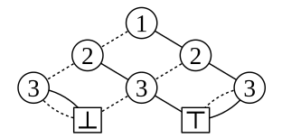](../../assets/volume4a/figures/diagram-7-1-4-82-majority-qdd.svg)

$(82)$

它比图 21 中对应的 BDD 多两个结点. 注意, 在 QDD 中 $\mathtt{V}$ 字段是多余的, 因此无须存放在内存中.

函数的*伪分布*是 $(q_0,\ldots,q_{n-1},q_n)$, 其中 $q_{k-1}$ 是 QDD 中标记为 $k$ 的结点的数目. 容易看出, $q_k$ 也是真值表中不同的 $n-k$ 阶子表的数目, 正如 $b_k$ 是不同串珠的数目一样. 每个串珠都是一个子表, 因此我们有

$$
q_k\ge b_k,\qquad0\le k\le n.\tag{83}
$$

此外, 习题 115 证明

$$
q_k\le1+b_0+\cdots+b_{k-1}\qquad\text{且}\qquad
q_k\le b_k+\cdots+b_n,\qquad0\le k\le n.\tag{84}
$$

因此, 伪分布的每个元素都是 BDD 大小的下界:

$$
B(f)\ge2q_k-1,\qquad0\le k\le n.\tag{85}
$$

令 $Q(f)=q_0+\cdots+q_{n-1}+q_n$ 是 $f$ 的 QDD 的总大小. 由 $(83)$ 显然有 $Q(f)\ge B(f)$. 另一方面, $Q(f)$ 不能比 $B(f)$ 大很多, 因为 $(85)$ 蕴涵

$$
Q(f)\le\frac{n+1}{2}(B(f)+1).\tag{86}
$$

习题 116 和 117 揭示伪分布的其他基本性质.

最坏情况的真值表 $(78)$ 实际上对应于 8 路复用器

$$
M_3(x_9,x_{10},x_{11};x_1,\ldots,x_8)=x_{1+(x_9x_{10}x_{11})_2},\tag{87}
$$

这是我们已经见过的熟悉函数. 不过我们有意用反常的次序对变量重新编号, 以致多路复用由最后三个变量 $(x_9,x_{10},x_{11})$ 控制, 而式 (30) 则由最前面的三个变量控制. 变量顺序的这种简单的改变使得 $M_3$ 的 BDD 大小从 17 提升到 511. 而且, 当 $n=2^m+m$ 时, 类似的改变将引起 $B(M_m)$ 从 $2n-2m+1$ 到 $2^{n-m+1}-1$ 的巨大跃变.

兰德尔·布赖恩特引进了一种有趣的 “自省” 多路复用器, 称为*隐加权位函数*, 定义如下:

$$
h_n(x_1,\ldots,x_n)=x_{x_1+\cdots+x_n}=x_{\nu x},\tag{88}
$$

其条件是 $x_0=0$. 例如, $h_4(x_1,x_2,x_3,x_4)$ 具有真值表 $\mathtt{0000}\ \mathtt{0111}\ \mathtt{1001}\ \mathtt{1011}$. 他证明了无论我们如何为变量重新编号, $h_n$ 的 BDD 都很大 [*IEEE Trans.* **C-40** (1991), 208–210].

按照变量的标准顺序, $h_{11}$ 的分布 $(b_0,\ldots,b_{11})$ 是

$$
(1,2,4,8,15,27,46,40,18,7,2,2);\tag{89}
$$

因此 $B(h_{11})=172$. 这个分布的前半部分实际上是略加修饰的斐波那契序列, 具有 $b_k=F_{k+4}-k-2$. 一般来说, 当 $k<n/2$ 时, $h_n$ 总是具有这个 $b_k$ 值. 因此, 它的初始分布数目按 $\phi^k$ 阶增长, 慢于最坏情况的 $2^k$. 这个增长率在 $k$ 超过 $n/2$ 后变慢, 以致例如 $B(h_{32})$ 只有适度的 86 636. 但是指数增长最终占据优势, 而 $B(h_{100})$ 大到惊人, 为 17 530 618 296 680. (当 $n=100$ 时, 最大的分布分量是 $b_{59}=2\,947\,635\,944\,748$, 与它相比, $b_0+\cdots+b_{49}=139\,583\,861\,115$ 相形见绌.) 习题 125 证明, $B(h_n)$ 的渐近式为 $c\chi^n+O(n^2)$, 其中

$$
\begin{aligned}
\chi&=\frac{\sqrt[3]{27-\sqrt{621}}+\sqrt[3]{27+\sqrt{621}}}{\sqrt[3]{54}}\\
&=1.32471\,79572\,44746\,02596\,09088\,54478\,09734\,07344+
\end{aligned}\tag{90}
$$

是所谓的 “塑性常数”, 即 $\chi^3=\chi+1$ 的正根, 而且系数 $c$ 是 $7\chi-1+14/(3+2\chi)\approx10.75115$.

另一方面, 如果改变 BDD 中检验变量的顺序, 我们可以做得好得多. 如果 $f(x_1,\ldots,x_n)$ 是任意布尔函数, $\pi$ 是 $\{1,\ldots,n\}$ 的任意排列, 我们记

$$
f^\pi(x_1,\ldots,x_n)=f(x_{1\pi},\ldots,x_{n\pi}).\tag{91}
$$

例如, 如果 $f(x_1,x_2,x_3,x_4)=(x_3\vee(x_1\wedge x_4))\wedge(\bar x_2\vee\bar x_4)$, 且 $(1\pi,2\pi,3\pi,4\pi)=(3,2,4,1)$, 那么 $f^\pi(x_1,x_2,x_3,x_4)=(x_4\vee(x_3\wedge x_1))\wedge(\bar x_2\vee\bar x_1)$. 我们有 $B(f)=10$、$B(f^\pi)=6$, 因为这两个 BDD 是

[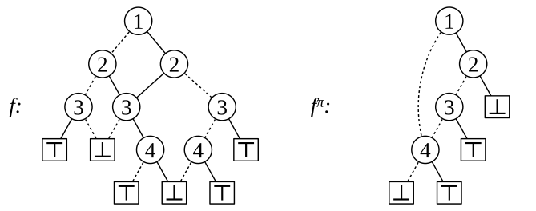](../../assets/volume4a/figures/diagram-7-1-4-92-bdd-permutation-compare.svg)

$(92)$

$f^\pi$ 的 BDD 对应于 $f$ 的带有非标准顺序的 BDD, 仅当 $i\pi<j\pi$ 时才允许从 $\text{\textcircled{i}}$ 分支到 $\text{\textcircled{j}}$:

[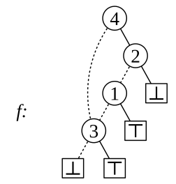](../../assets/volume4a/figures/diagram-7-1-4-93-bdd-nonstandard-order.svg)

$(93)$

它的根是 $\text{\textcircled{i}}$, 其中 $i=1\pi^{-}$ 是满足 $i\pi=1$ 的下标. 自顶向下列出分支变量时, 我们有 $(4\pi,2\pi,1\pi,3\pi)=(1,2,3,4)$.

对隐加权位函数应用这些思想, 我们有

$$
h_n^\pi(x_1,\ldots,x_n)=x_{(x_1+\cdots+x_n)\pi},\tag{94}
$$

其条件是 $0\pi=0$ 和 $x_0=0$. 例如, 如果 $(1\pi,2\pi,3\pi)=(3,1,2)$, 那么 $h_3^\pi(0,0,1)=1$, 因为 $x_{(x_1+x_2+x_3)\pi}=x_3=1$. (见习题 120.)

伪分布的元素 $q_k$ 计数已知 $x_1$ 到 $x_k$ 的值时出现的不同子函数. 利用 $(94)$, 我们可以通过选择项记录 $[r_0,\ldots,r_{n-k}]$ 表示所有这些子函数, 其中 $r_j$ 是当 $x_{k+1}+\cdots+x_n=j$ 时子函数的值. 假定 $x_1=c_1,\ldots,x_k=c_k$, 并且令 $s=c_1+\cdots+c_k$. 如果 $(s+j)\pi\le k$, 则 $r_j=c_{(s+j)\pi}$, 否则 $r_j=x_{(s+j)\pi}$. 然而, 如果 $s\pi>k$, 置 $r_0\leftarrow0$, 如果 $(s+n-k)\pi>k$, 置 $r_{n-k}\leftarrow1$, 使每个选择项记录的首项和末项都是常数.

例如, 计算表明下列排列 $1\pi\ldots100\pi$ 把 $h_{100}$ 的 BDD 大小从 17.5 万亿降低到 $B(h_{100}^\pi)=1\,124\,432\,105$:

<pre><code> 2  4  6  8 10 12 14 16 18 20 97 57 77 37 87 47 67 27 92 52
72 32 82 42 62 22 100 60 80 40 90 50 70 30 95 55 75 35 85 45
65 25 98 58 78 38 88 48 68 28 93 53 73 33 83 43 63 23 99 59
79 39 89 49 69 29 94 54 74 34 84 44 64 24 96 56 76 36 86 46
66 26 91 51 71 31 81 41 61 21 19 17 15 13 11  9  7  5  3  1</code></pre>

$(95)$

对于 $0\le s\le k\le n$, 这样的计算可以基于可能出现的所有选择项记录的枚举. 假定我们已经检验 $x_1,\ldots,x_{83}$, 而且比方说对于 $1\le j\le83$, 得到 $x_j=[j\le42]$. 于是 $s=42$, 其余 17 个变量 $(x_{84},\ldots,x_{100})$ 的子函数由选择项记录

$$
\begin{aligned}
[r_0,\ldots,r_{17}]=[&c_{25},x_{98},c_{58},c_{78},c_{38},x_{88},c_{48},c_{68},c_{28},\\
 &x_{93},c_{53},c_{73},c_{33},c_{83},c_{43},c_{63},c_{23},x_{99}]
\end{aligned}
$$

给出, 这个记录约化为

$$
[1,x_{98},0,0,1,x_{88},0,0,1,x_{93},0,0,1,0,0,0,1,1].\tag{96}
$$

这是当 $s=42$ 时由 $q_{83}$ 计数的 $2^{14}$ 个子函数之一. 习题 124 说明如何对 $k$ 和 $s$ 的其他值进行类似的处理.

我们现在准备证明布赖恩特定理.

**定理 B.** 对于所有排列 $\pi$, $h_n^\pi$ 的 BDD 大小超过 $2^{\lfloor n/5\rfloor}$.

**证明.** 首先注意, $h_n^\pi$ 的两个子函数当且仅当它们的选择项记录相同时相等. 如果 $[r_0,\ldots,r_{n-k}]\ne[r'_0,\ldots,r'_{n-k}]$, 假定 $r_j\ne r'_j$. 如果 $r_j$ 和 $r'_j$ 都是常数, 两个子函数当 $x_{k+1}+\cdots+x_n=j$ 时不同. 如果 $r_j$ 是常数而 $r'_j=x_i$, 我们有 $0<j<n-k$. 两个子函数不同, 因为 $x_{k+1}+\cdots+x_n=j$ 时可以有 $x_i\ne r_j$. 如果 $r_j=x_i$, 但 $r'_j=x_{i'}$($i\ne i'$), 我们可以令 $x_{k+1}+\cdots+x_n=j$ 且 $x_i\ne x_{i'}$. (后一种情况仅出现在选择项记录对应于不同偏移量 $s$ 和 $s'$ 的时候.)

所以 $q_k$ 是不同选择项记录 $[r_0,\ldots,r_{n-k}]$ 的数目. 习题 123 证明, 对于像上面描述的任意给定的 $k,n,s$, 这个数目恰好是

$$
\binom{w}{w-s}+\binom{w}{w-s+1}+\cdots+\binom{w}{k-s}
=\binom{w}{s+w-k}+\cdots+\binom{w}{s-1}+\binom{w}{s},\tag{97}
$$

其中 $w$ 是满足 $s\le j\le s+n-k$ 且 $j\pi\le k$ 的下标 $j$ 的数目.

现在考虑 $k=\lfloor3n/5\rfloor+1$ 的情形, 并且令 $s=k-\lceil n/2\rceil$、$s'=\lfloor n/2\rfloor+1$. (设想 $n=100$、$k=61$、$s=11$、$s'=51$. 我们可以假定 $n\ge10$.) 于是 $w+w'=k-w''$, 其中 $w''$ 是满足 $j\pi\le k$ 且有 $j<s$ 或 $j>s'+n-k$ 的下标数目. 由于 $w''\le(s-1)+(k-s')=2k-2-n$, 我们必定有 $w+w'\ge n+2-k=\lceil2n/5\rceil+1$. 因此 $w>\lfloor n/5\rfloor$ 或 $w'>\lfloor n/5\rfloor$, 于是 $(97)$ 在两种情况下都超过 $2^{\lfloor n/5\rfloor-1}$. 由 $(85)$ 推出定理. ▮

反过来, 始终存在一个使 $B(h_n^\pi)=O(2^{0.2029n})$ 的排列 $\pi$, 虽然大 $O$ 记号隐含的常数很大. 贝亚特·博利希、马丁·罗宾、马丁·索尔霍夫和英戈·韦格纳 [*Theoretical Informatics and Applications* **33** (1999), 103–115] 证明了这个结果, 他们使用类似于 $(95)$ 的排列. 前面满足 $j\pi\le n/5$ 的下标交替取自 $j>9n/10$ 和 $j\le n/10$, 其余下标按 $9n/10-j$ 的二进制表示从右到左读取的顺序排列 (从右端比较的字典序).

我们也简略地看一个更简单的例子. 排列函数 $P_m(x_1,\ldots,x_{m^2})$ 等于 1, 当且仅当第 $i$ 行第 $j$ 列为 $x_{(i-1)m+j}$ 的二进制矩阵是一个置换矩阵:

$$
\begin{aligned}
P_m(x_1,\ldots,x_{m^2})={}&
\bigwedge_{i=1}^m S_1(x_{(i-1)m+1},x_{(i-1)m+2},\ldots,x_{(i-1)m+m})\\
&{}\wedge\bigwedge_{j=1}^m S_1(x_j,x_{m+j},\ldots,x_{m^2-m+j}).
\end{aligned}\tag{98}
$$

尽管这个函数很简单, 但在变量的任何重新排序下, 它都不能用小 BDD 表示.

**定理 K.** 对于所有排列 $\pi$, $P_m^\pi$ 的 BDD 大小超过 $m2^{m-1}$.

**证明.** [见英戈·韦格纳,*Branching Programs and Binary Decision Diagrams*(SIAM, 2000), 定理 4.12.3.] 给定 $P_m^\pi$ 的 BDD, 注意, 满足 $P_m^\pi(x)=1$ 的 $m!$ 个向量 $x$, 各自描绘一条从根结点到 $\boxed{\top}$ 的长度为 $n=m^2$ 的路径. 每个变量都必须经过检验. 设 $v_k(x)$ 是 $x$ 的路径取第 $k$ 个 HI 分支的结点. 对于某个 $(i,j)=(i_k(x),j_k(x))$, 这个结点在给定矩阵的第 $i$ 行第 $j$ 列的值上分支.

假定 $v_k(x)=v_{k'}(x')$, 其中 $x\ne x'$. 构造 $x''$, 让它在到达 $v_k(x)$ 之前与 $x$ 一致, 此后与 $x'$ 一致. 于是 $P_m^\pi(x'')=1$, 所以必定有 $k=k'$. 事实上, 这个论据还说明

$$
\begin{aligned}
&\{i_1(x),i_2(x),\ldots,i_{k-1}(x)\}=\{i_1(x'),i_2(x'),\ldots,i_{k-1}(x')\},\\
\text{和}\quad
&\{j_1(x),j_2(x),\ldots,j_{k-1}(x)\}=\{j_1(x'),j_2(x'),\ldots,j_{k-1}(x')\}.
\end{aligned}\tag{99}
$$

设想有 $m$ 种颜色的标签, 每种颜色有 $m!$ 张. 对于所有的 $k$ 和 $x$, 在结点 $v_k(x)$ 上贴一张颜色为 $k$ 的标签. 这样, 没有一个结点会获得不同颜色的标签. 由 $(99)$, 任何接受颜色 $k$ 的结点, 所得标签总数都不超过 $(k-1)!(m-k)!$. 所以至少有 $m!/\bigl((k-1)!(m-k)!\bigr)=k\binom mk$ 个不同结点接受颜色为 $k$ 的标签. 对 $k$ 求和给出 $m2^{m-1}$ 个非汇结点. ▮

习题 184 证明 $B(P_m)<m2^{m+1}$, 所以定理 K 中的下界除了一个因子 4 之外是近似最优的. 尽管 BDD 的大小按指数增长, 情况还没坏到无可救药的地步, 因为 $m=\sqrt n$. 例如, $B(P_{20})$ 只有 38 797 317, 尽管 $P_{20}$ 是 400 个变量的函数.

**\*优化次序.** 让我们用 $B_{\min}(f)$ 和 $B_{\max}(f)$ 表示 $B(f^\pi)$ 在规定变量次序的所有排列 $\pi$ 上所取的最小值和最大值. 我们已经见过 $B_{\min}$ 与 $B_{\max}$ 存在显著差异的几种情况. 例如, 当 $n=2^m+m$ 时, $2^m$ 路复用器有 $B_{\min}(M_m)\approx2n$ 和 $B_{\max}(M_m)\approx2^n/n$. 其实, 变量的良好次序至关重要的简单函数并不罕见. 例如, 考虑

$$
f(x_1,x_2,\ldots,x_n)=(\bar x_1\vee x_2)\wedge(\bar x_3\vee x_4)\wedge\cdots\wedge(\bar x_{n-1}\vee x_n),
\qquad n\text{ 是偶数.}\tag{100}
$$

这是重要的子集函数 $[x_1x_3\ldots x_{n-1}\subseteq x_2x_4\ldots x_n]$, 并且我们有 $B(f)=B_{\min}(f)=n+2$. 但是当 $\pi$ 是 “风琴管顺序” 时, 即

$$
f^\pi(x_1,x_2,\ldots,x_n)
=(\bar x_1\vee x_n)\wedge(\bar x_2\vee x_{n-1})\wedge\cdots\wedge(\bar x_{n/2}\vee x_{n/2+1}),\tag{101}
$$

BDD 的大小激增至 $B(f^\pi)=B_{\max}(f)=2^{n/2+1}$. 对于顺序 $[x_1\ldots x_{n/2}\subseteq x_{n/2+1}\ldots x_n]$ 也出现同样糟糕的表现. 在这些顺序中, BDD 必须 “记住” $n/2$ 个变量的状态, 而原来的公式 (100) 只需要很小的内存空间.

每个布尔函数 $f$ 都有一个*主分布图*, 它概括了所有可能的 $B(f^\pi)$ 的集合. 如果 $f$ 有 $n$ 个变量, 这个图有 $2^n$ 个顶点, 每个顶点对应于变量的一个子集. 这个图有 $n2^{n-1}$ 条边, 每条边对应于只有一个元素不同的一对子集. 例如, $(92)$ 和 $(93)$ 中函数的主分布图是

[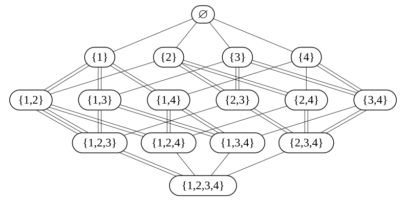](../../assets/volume4a/figures/diagram-7-1-4-102-master-profile.svg)

$(102)$

每条边带有一个权值, 由上图中平行连线的条数表示. 例如, $\{1,2\}$ 与 $\{1,2,3\}$ 之间的权值是 3. 这个图可这样理解. 如果 $X$ 是 $k$ 个变量的子集且 $x\notin X$, 那么 $X$ 与 $X\cup\{x\}$ 之间的权值, 是把 $X$ 的变量以所有 $2^k$ 种可能的方式替换为常数后, $f$ 的仍依赖于 $x$ 的不同子函数数目. 例如, 如果 $X=\{1,2\}$, 我们有 $f(0,0,x_3,x_4)=x_3$、$f(0,1,x_3,x_4)=f(1,1,x_3,x_4)=x_3\wedge\bar x_4$, 以及 $f(1,0,x_3,x_4)=x_3\vee x_4$. 这三个子函数都依赖于 $x_3$, 但其中只有两个依赖于 $x_4$, 如 $\{1,2\}$ 下面的权值所示.

有 $n!$ 条从 $\varnothing$ 到 $\{1,\ldots,n\}$、长度为 $n$ 的路径. 如果 $a_1\pi=1,a_2\pi=2,\ldots,a_n\pi=n$, 我们可以让路径 $\varnothing\to\{a_1\}\to\{a_1,a_2\}\to\cdots\to\{a_1,\ldots,a_n\}$ 对应于排列 $\pi$. 于是, 路径 $\pi$ 上的权值之和加上两个汇结点, 就是 $B(f^\pi)$. 例如, 路径 $\varnothing\to\{4\}\to\{2,4\}\to\{1,2,4\}\to\{1,2,3,4\}$ 是达到 $B(f^\pi)=6$ 的唯一途径, 如 $(93)$ 中那样.

注意, 主分布图是一种常见的图, 即 $n$ 维立方体. 它的边带有权值, 表示各组子函数中的串珠数. 这个图的大小 $n2^{n-1}$ 按指数增长, 然而这比排列的总数 $n!$ 小得多. 比如说, 当 $n$ 为 25 或更小时, 习题 138 说明整个图的计算不会遇到很大困难, 对于任意给定函数都能找到最优排列. 例如, 隐加权位函数的 $B_{\min}(h_{25})=2090$, 而 $B_{\max}(h_{25})=35\,441$. 最小值在 $(1\pi,\ldots,25\pi)=(3,5,7,9,11,13,15,17,25,24,23,22,21,20,19,18,16,14,12,10,8,6,4,2,1)$ 时达到. 最大值则由一个奇特的排列 $(22,19,17,25,15,13,11,10,9,8,7,24,6,5,4,3,2,12,1,14,23,16,18,20,21)$ 达到, 它先检验许多 “中间” 变量.

有时, 只需掌握足以确定最小权值路径的信息, 就能省去计算整个主分布图的时间. (见习题 140.) 但是当 $n$ 增加以及函数变得更加奇特时, 我们未必能够精确确定 $B_{\min}(f)$, 因为找到最佳顺序的问题是 NP 完全的 (见习题 137).

我们已经定义了单个布尔函数 $f$ 的分布和伪分布, 同样的思想也适用于包含 $m$ 个函数 $\{f_1,\ldots,f_m\}$ 的任意 BDD 基. 即当第 $k$ 层有 $b_k$ 个结点时, 分布为 $(b_0,\ldots,b_n)$; 当对应的 QDD 基的第 $k$ 层有 $q_k$ 个结点时, 伪分布为 $(q_0,\ldots,q_n)$. 这些函数的真值表合起来有 $b_k$ 个不同的 $n-k$ 阶串珠, 以及 $q_k$ 个不同的子表. 例如, $(36)$ 中的 $(4+4)$ 位二进制加法函数 $\{f_1,f_2,f_3,f_4,f_5\}$ 的分布是 $(2,4,3,6,3,6,3,2,2)$, 而伪分布在习题 144 中求出. 同样, 主分布图的概念也适用于同时重排变量的 $m$ 个函数, 我们可以用它求出 $B_{\min}(f_1,\ldots,f_m)$ 和 $B_{\max}(f_1,\ldots,f_m)$, 即在所有分布中 $b_0+\cdots+b_n$ 所取的最小值和最大值.

**\*局部重新排序.** 对于 BDD 基, 当我们决定首先在 $x_2$ 上分支, 然后在 $x_1,x_3,\ldots,x_n$ 上分支时, 会发生什么? 图 26 显示顶部两层的结构可能剧烈改变, 但其余各层保持原有结构.

[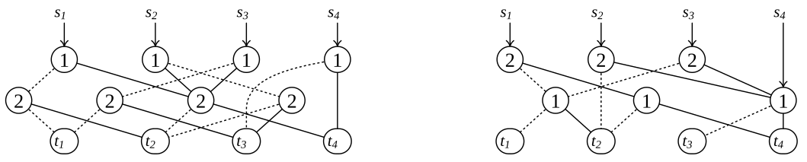](../../assets/volume4a/figures/fig-7-26-bdd-level-swap.svg)

**图 26**　交换 BDD 基的顶端两层. 这里 $(s_1,s_2,s_3,s_4)$ 是源函数, $(t_1,t_2,t_3,t_4)$ 是目标结点, 表示更低层的子函数.

事实上, 仔细分析可以发现, 这种层交换过程并不难理解或实现. 在交换前, ① 结点可分为 “纠缠的” 和 “孤立的” 两种, 取决于它们是否以 ② 结点为后代. 例如, 图 26 的左图中有三个纠缠结点, 分别由 $s_1$、$s_2$ 和 $s_3$ 指向, 而 $s_4$ 指向一个孤立结点. 同样, ② 结点在交换前是 “可见的” 或 “隐藏的”, 取决于它们是独立的源函数, 还是只能从 ① 结点到达. 在图 26 的左图中, 四个 ② 结点都是隐藏的.

在交换后, 孤立的 ① 结点向下移动一层, 而纠缠的结点按稍后要解释的过程变为 ② 结点. 隐藏的 ② 结点 (如果存在) 消失, 可见的 ② 结点直接向上移到顶层. 变形时还可能出现另外的结点, 标记为 ①, 称为 “新生结点”. 例如, 在图 26 的右图中, 两个新生结点出现在 $t_2$ 的上方. 当且仅当隐藏结点多于新生结点时, 这个过程减少结点总数.

交换的逆操作也是交换, 只是互换了 ① 和 ② 的角色. 从图 26 的右图开始, 我们看出它有三个纠缠结点 (标记为 ②) 和一个可见结点 (标记为 ①). 它有两个隐藏结点, 没有孤立结点. 交换通常把 (纠缠的、孤立的、可见的、隐藏的) 结点分别变为 (纠缠的、可见的、孤立的、新生的) 结点. 此后, 新生结点在逆交换中变成隐藏结点, 而原来隐藏的结点将重现为新生结点.

如果把顶端两层以下的结点都看作带常数值的汇结点, 变形就容易理解了. 这样, 每个源函数 $f(x_1,x_2)$ 只依赖于 $x_1$ 和 $x_2$, 因此它有四个值 $a=f(0,0)$、$b=f(0,1)$、$c=f(1,0)$ 和 $d=f(1,1)$, 其中 $a$、$b$、$c$、$d$ 代表汇结点. 我们可以假定有 $q$ 个汇结点 $\boxed1$、$\boxed2$、$\ldots$、$\boxed q$, 并且 $1\le a,b,c,d\le q$. 于是 $f(x_1,x_2)$ 完全由其*扩充真值表* $f(0,0)f(0,1)f(1,0)f(1,1)=abcd$ 描述. 交换后得到的 $f(x_2,x_1)$, 其扩充真值表为 $acbd$. 例如, 可以把图 26 重画如下, 用扩充真值表标记各个结点.

[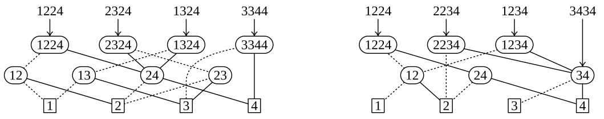](../../assets/volume4a/figures/fig-7-27-extended-truth-level-swap.svg)

**图 27**　表示图 26 中变换的另一种方式

在这些术语中, 源函数 $abcd$ 当 $a=b\ne c=d$ 时指向孤立结点, 当 $a=c\ne b=d$ 时指向可见结点. 其他情形指向纠缠结点, 只有 $a=b=c=d$ 时直接指向汇结点. 纠缠结点 $abcd$ 通常有 $\mathtt{LO}=ab$ 和 $\mathtt{HI}=cd$. 如果 $a=b$ 或 $c=d$, 相应的 $\mathtt{LO}$ 或 $\mathtt{HI}$ 就是汇结点. 变形后, 它以同样方式有 $\mathtt{LO}=ac$ 和 $\mathtt{HI}=bd$, 后两个结点可以是新生结点、可见结点或汇结点, 但不会两个都是汇结点. 一个有趣的情形是 $\mathtt{1224}$, 它在左图中的子结点 $\mathtt{12}$ 和 $\mathtt{24}$ 是隐藏结点, 而在右图中则是新生结点.

习题 147 讨论了这个变换的一种有效实现, 由里卡德·鲁德尔在 *IEEE/ACM International Conf. Computer-Aided Design* **CAD-93** (1993), 42–47 中提出. 它有一个重要性质, 只可能需要修改顶端两层结点内的指针. 所有源结点 $s_j$ 仍指向同一内存位置, 所有汇结点保持原来的标识. 我们已经描述了 ① 和 ② 之间的交换, 但其实每当 $x_j$ 和 $x_k$ 对应于邻接层上的分支时, 同样的变换都可以交换 $\text{\textcircled{j}}$ 和 $\text{\textcircled{k}}$. 原因在于任何 BDD 基的上层为下层定义了源函数, 下层本身也构成一个 BDD 基.

我们从对排序的研究中知道, BDD 基中变量的任何重排都可以由邻接层之间的一系列交换产生. 特别是, 可以利用邻接交换进行 “向上移动” 变换, 把给定变量 $x_k$ 带到顶层, 同时保持其他变量的相对次序. 例如, 很容易把 $x_4$ 向上移到顶层, 交换 ④ ↔ ③, 然后 ④ ↔ ②, 再 ④ ↔ ①. 因为 $x_4$ 跳过 $x_2$ 后会与 $x_1$ 相邻.

重复交换可以产生任何顺序, 有时也能使 BDD 基增长到大得无法处理. 那么单个交换可能有多糟? 如果孤立、纠缠、可见、隐藏和新生的结点恰好分别有 $(s,t,v,h,\nu)$ 个, 那么交换后顶端两层共有 $s+t+v+\nu$ 个结点. 当有 $m$ 个源函数时, 这最多是 $m+\nu\le m+2t$, 因为 $m\ge s+t+v$. 因此, 这两层结点的新数目不可能超过原数目的两倍加上源函数的数目.

如果单个交换能使 BDD 的大小翻倍, $x_k$ 的一次向上移动就有使结点数目出现指数增长的危险, 因为它要进行 $k-1$ 次交换. 不过, 在这方面, 向上移动并不比单个交换更糟.

**定理 $\mathrm J^+$.** 在一次向上移动操作之后, $B(f_1^\pi,\ldots,f_m^\pi)<m+2B(f_1,\ldots,f_m)$.

**证明.** 令 $a_1a_2\ldots a_{2^k-1}a_{2^k}$ 是把低层结点作为汇结点的源函数 $f(x_1,\ldots,x_k)$ 的扩充真值表. 向上移动后, $f^\pi(x_1,\ldots,x_k)=f(x_{1\pi},\ldots,x_{k\pi})=f(x_2,\ldots,x_k,x_1)$ 的扩充真值表是 $a_1a_3\ldots a_{2^k-1}a_2a_4\ldots a_{2^k}$. 由此可见, 对于 $1\le j<k$, $f^\pi$ 的第 $j$ 层的每个串珠都源自 $f$ 的第 $j-1$ 层的某个串珠, 而 $f$ 的第 $j-1$ 层的每个串珠至多在 $f^\pi$ 中产生两个大小为其一半的串珠. 因此, 如果 $\{f_1,\ldots,f_m\}$ 和 $\{f_1^\pi,\ldots,f_m^\pi\}$ 的分布分别是 $(b_0,\ldots,b_n)$ 和 $(b'_0,\ldots,b'_n)$, 那么必有 $b'_0\le m$、$b'_1\le2b_0$、$\ldots$、$b'_{k-1}\le2b_{k-2}$、$b'_k=b_k$、$\ldots$、$b'_n=b_n$. 所以结点总数小于等于 $m+B(f_1,\ldots,f_m)+b_0+\cdots+b_{k-2}-b_{k-1}$. ▮

向上移动的逆操作是 “向下移动”, 它把顶端变量降低 $k-1$ 层. 像前面一样, 这个操作可以用 $k-1$ 次交换实现. 但对于最终结果的大小, 我们必须接受一个弱得多的上界.

**定理 $\mathrm J^-$.** 在一次向下移动操作之后, $B(f_1^\pi,\ldots,f_m^\pi)<B(f_1,\ldots,f_m)^2$.

**证明.** 前面证明中的扩充真值表现在由 $a_1\ldots a_{2^k}$ 变成

$$
a_1\ldots a_{2^{k-1}}\ddagger a_{2^{k-1}+1}\ldots a_{2^k}
=a_1a_{2^{k-1}+1}\ldots a_{2^{k-1}}a_{2^k},
$$

即 7.1.3–$(76)$ 中的 “拉链函数”. 在这种情况下, 我们可以用原来子函数的有序对标识向下移动后的每个串珠, 就像合并运算 $(37)$ 和 $(38)$ 中那样. 例如, 当 $k=3$ 时, 真值表 $\mathtt{12345678}$ 变成 $\mathtt{15263748}$, 它的串珠 $\mathtt{1526}$ 可以看作合并 $\mathtt{12}\diamond\mathtt{56}$. ▮

这个证明说明了为什么会出现二次增长. 例如, 如果

$$
f(x_1,\ldots,x_n)=x_1\mathbin{?}M_m(x_2,\ldots,x_{m+1};x_{2m+2},\ldots,x_n):
M_m(x_{m+2},\ldots,x_{2m+1};\bar x_{2m+2},\ldots,\bar x_n),\tag{103}
$$

其中 $n=1+2m+2^m$, 一次向下移动 $2m$ 层把 $B(f)=4n-8m-3$ 改变为 $B(f^\pi)=2n^2-8m(n-m)-2(n-2m)+1\approx B(f)^2/8$.

由于向上移动与向下移动是互逆的操作, 我们也可以反过来使用定理 $\mathrm J^+$ 和定理 $\mathrm J^-$. 一次向上移动有可能把 BDD 的大小减到接近它的平方根, 但是一次向下移动不能把大小减少到约一半以下. 对于热衷于向下移动的人而言, 这是个坏消息. 不过, 他们或许可以得到一点安慰, 向下移动有时是从给定顺序获得最优顺序的唯一可行办法.

定理 $\mathrm J^+$ 和 $\mathrm J^-$ 归功于贝亚特·博利希、马丁·罗宾和英戈·韦格纳,*Inf. Processing Letters* **59** (1996), 233–239. (也见习题 149.)

**\*动态重新排序.** 在实际应用中, 图 23 的模块排列和定理 M 通常会提示一种自然的变量次序. 但有时看不出哪一种次序合适, 我们只能靠运气, 也许计算机会替我们找到一种. 此外, 即使知道一种合适的初始次序, 计算最初阶段的最佳变量次序到后续阶段也可能不再合适. 因此, 不坚持固定的次序, 可能会获得更好的结果. 每当 BDD 基变得难以操纵时, 可以尝试调整当前的分支顺序.

例如, 对于 $1<j\le n$, 可以尝试依次交换 $x_{j-1}\leftrightarrow x_j$. 如果结点总数增加, 就撤销那次交换, 否则保留交换结果. 可以一直这样做, 直到这样的交换不再带来改进. 这种方法容易实现, 不过效果太弱, 它不能使 BDD 明显缩小. 里卡德·鲁德尔在介绍习题 147 的就地交换算法时, 提出了一个更好的重新排序技术. 他的方法叫作 “移动”, 实践证明相当成功. 其想法是取一个变量 $x_k$, 尝试把它向上或向下移动到所有其他层, 相当于先把 $x_k$ 从排列中除去, 再把它插回能使 BDD 尽量小的位置. 全部操作可以用一串基本交换完成.

**算法 J (移动变量).** 本算法把给定 BDD 基中的变量 $x_k$ 移动到相对于其他变量 $\{x_1,\ldots,x_{k-1},x_{k+1},\ldots,x_n\}$ 当前次序的最佳位置. 它通过重复调用习题 147 的过程交换相邻变量 $x_{j-1}\leftrightarrow x_j$. 在整个算法中, $S$ 表示 BDD 基的当前大小 (结点总数). 交换操作通常会改变 $S$.

**J1.** [初始化.] 置 $p\leftarrow0$、$j\leftarrow k$、$s\leftarrow S$. 如果 $k>n/2$, 转到 J5.

**J2.** [向上移动.] 当 $j>1$ 时, 循环执行交换 $x_{j-1}\leftrightarrow x_j$, 并置 $j\leftarrow j-1$、$s\leftarrow\min(S,s)$.

**J3.** [结束本趟.] 如果 $p=1$, 转到 J4. 否则, 当 $j\ne k$ 时, 循环置 $j\leftarrow j+1$, 并交换 $x_{j-1}\leftrightarrow x_j$. 然后置 $p\leftarrow1$ 并转到 J5.

**J4.** [结束向下移动.] 当 $s\ne S$ 时, 循环置 $j\leftarrow j+1$ 并交换 $x_{j-1}\leftrightarrow x_j$. 停止.

**J5.** [向下移动.] 当 $j<n$ 时, 循环置 $j\leftarrow j+1$, 交换 $x_{j-1}\leftrightarrow x_j$, 并置 $s\leftarrow\min(S,s)$.

**J6.** [结束本趟.] 如果 $p=1$, 转到 J7. 否则, 当 $j\ne k$ 时, 循环交换 $x_{j-1}\leftrightarrow x_j$ 并置 $j\leftarrow j-1$. 然后置 $p\leftarrow1$ 并转到 J2.

**J7.** [结束向上移动.] 当 $s\ne S$ 时, 循环交换 $x_{j-1}\leftrightarrow x_j$ 并置 $j\leftarrow j-1$. 停止. ▮

每当算法 J 交换 $x_{j-1}\leftrightarrow x_j$ 时, 原来的变量 $x_k$ 现在称为 $x_{j-1}$ 或 $x_j$. 交换的总次数从大约 $n$ 变化到约 $2.5n$, 取决于 $k$ 以及 $x_k$ 的最佳最终位置. 不过, 每当 $S$ 变得比 $1.2s$, 或甚至 $1.1s$、$1.05s$ 大时, 如果分别把步骤 J2 和 J5 改成直接执行步骤 J3 和 J6, 我们就可以大大缩短运行时间, 而对结果影响不大. 在这种情况下, 沿同一方向继续移动变量不大可能减小 $s$.

里卡德·鲁德尔的过程应用算法 J 恰好 $n$ 次, 对每个变量应用一次 (见习题 151). 可以反复移动变量, 直到再无改进. 不过, 额外的收益通常不值得付出这些努力.

为了使这些思想具体化, 我们来看一个详细的例子. 我们已经看到, 如果美国接壤各州像 $(17)$ 中那样按以下顺序排列:

<pre><code>ME NH VT MA RI CT NY NJ PA DE MD DC VA NC SC GA FL AL TN KY WV OH MI IN
IL WI MN IA MO AR MS LA TX OK KS NE SD ND MT WY CO NM AZ UT ID WA OR NV CA</code></pre>

$(104)$

独立集函数

$$
\neg\bigl((x_{\mathtt{AL}}\wedge x_{\mathtt{FL}})\vee(x_{\mathtt{AL}}\wedge x_{\mathtt{GA}})
\vee(x_{\mathtt{AL}}\wedge x_{\mathtt{MS}})\vee\cdots
\vee(x_{\mathtt{UT}}\wedge x_{\mathtt{WY}})\vee(x_{\mathtt{VA}}\wedge x_{\mathtt{WV}})\bigr)\tag{105}
$$

的 BDD 大小为 428. 我手工选定顺序 $(104)$, 从小时候在历史或地理中学到的州列表开始, 力求使已列出的各州与尚未列出的各州之间的边界最小, 使 $(105)$ 的 BDD 不必在任何一层 “记住” 太多部分结果. 对于 49 个变量的函数, 大小为 428 已相当好, 但移动变量还能改善它. 例如, 对于 WV, 若干插入位置及对应大小 $S$ 如下, 竖线标示插入位置:

<pre><code> |RI |CT |NY |NJ |PA |DE |MD |DC |VA |NC |SC |GA |FL |AL |TN |KY |OH |MI |IN |IL |
424 422 417 415 414 412 411 410 412 412 415 420 421 426 425 427 428 428 436 442 451</code></pre>

所以, 把 WV 向上移到 MD 和 DC 之间, 可以节省 $428-410=18$ 个结点. 用算法 J 移动所有变量, 从 ME、NH 一直到 CA, 最终得到以下顺序:

<pre><code>VT MA ME NH CT RI NY NJ DE PA MD WV VA DC KY OH NC GA SC AL FL MS TN IN
IL MI AR TX LA OK MO IA WI MN CO NE KS MT ND WY SD UT AZ NM ID CA OR WA NV</code></pre>

$(106)$

BDD 的大小已经减到 345. 这一过程共交换 4663 次, 整个计算不到 400 万次内存访问.

我们也可以用一个省事些的办法, 从按字母顺序排列的州开始:

<pre><code>AL AR AZ CA CO CT DC DE FL GA IA ID IL IN KS KY LA MA MD ME MI MN MO MS
MT NC ND NE NH NJ NM NV NY OH OK OR PA RI SC SD TN TX UT VA VT WA WI WV WY</code></pre>

$(107)$

此时 $(105)$ 的 BDD 最终有 306 214 个结点. 它可以用算法 S 计算 (机器时间约为 3.8 亿次内存访问), 也可以用 $(55)$ 和算法 U 计算 (约为 5.65 亿次内存访问). 这种情况下, 移动变量能带来很大差别. 306 214 个结点变为仅有 2871 个结点, 代价为额外的 4.3 亿次内存访问. 此外, 如果算法 J 的循环在 $S>1.1s$ 时终止, 移动的代价就从 $430\,\mathrm M\mu$ 降至 $210\,\mathrm M\mu$. (如果采取更激进的做法, 在 $S>1.05s$ 时终止, 移动的代价减到 $155\,\mathrm M\mu$, 但 BDD 的大小只减到 2946.)

实际上, 如果在对 $(105)$ 求值时就移动变量, 而不等到整个长析取式计算完毕, 效果会更好. 例如, 假定每当 BDD 的大小超过上一次移动后结点数的两倍, 就自动移动变量. 从字母顺序 $(107)$ 开始对 $(105)$ 求值, 进展很快. 只进行约 6000 万次内存访问后, 就自动产生了仅有 419 个结点的 BDD! 找到的顺序是

<pre><code>NV OR ID WA AZ CA UT NM WY CO MT OK TX NE MO KS LA AR MS TN IA ND MN SD
GA FL AL NC SC KY WI MI IL OH IN WV MD VA DC PA NJ DE NY CT RI NH ME VT MA</code></pre>

$(108)$

它优于 $(104)$. 发现这个顺序既不需要人的创造力, 也不需要 “几何识别”, 计算机只是在较小的 BDD 上自动移动了 39 次.

对应于函数 $(105)$ 的州列表, 最佳顺序是什么? 这个问题的答案可能永远无法确知, 但我们可以做个有根据的猜测. 首先, 对 $(108)$ 再做几次移动, 就能得到更好的顺序:

<pre><code>OR ID NV WA AZ CA UT NM WY CO MT SD MN ND IA NE OK KS TX MO LA AR MS TN
GA FL AL NC SC KY WI MI IL OH IN WV MD DC VA PA NJ DE NY CT RI NH ME VT MA</code></pre>

$(109)$

它的 BDD 大小为 354. 移动不能进一步改进 $(109)$, 但它的能力有限, 因为它只探索 $n!$ 种可能性中的 $(n-1)^2$ 种备选顺序. (实际上, 习题 134 给出一个只有 4 个变量的函数, 它的 BDD 不能通过移动改进, 尽管变量顺序还不是最优的.) 不过还可以用主分布图来优化窗口, 例如 BDD 中每个包含连续 16 层的窗口. 共有 34 个这样的窗口, 习题 139 的算法能较快地优化其中每一个. 大约 96 亿次内存访问后, 这个算法找到一个新的最佳结果:

<pre><code>OR ID NV WA AZ CA UT NM WY CO MT SD MN ND IA NE OK KS TX MO LA AR MS WI
KY MI IN IL AL TN FL NC SC GA WV OH MD DC VA PA NJ DE NY CT RI NH ME VT MA</code></pre>

$(110)$

这是巧妙重排 $(109)$ 中 16 个州得到的. 这个顺序的 BDD 大小仅为 339, 或许已经最优, 因为移动或优化任意宽度为 25 的窗口都不能改进它. 然而, 这种猜测的依据并不稳固. 顺序

<pre><code>AL GA FL TN NC SC VA MS AR TX LA OK KY MO NM WV MD DC PA NJ DE OH IL MI
IN IA NE KS WI SD WY ND MN MT UT CO ID CA AZ OR WA NV NY CT RI NH ME VT MA</code></pre>

$(111)$

同样不能通过移动或优化宽度为 25 的窗口改进, 可它的 BDD 有 606 个结点, 远非最优.

用改进的顺序 $(110)$, $(73)$ 中 98 个变量的 $\operatorname{COLOR}$ 函数只需 22 037 个 BDD 结点, 而非 25 579 个. 移动能把它减少到 16 098 个结点.

**\*单次读取函数.** 像 $(x_1\supset x_2)\oplus((x_3\equiv x_4)\wedge x_5)$ 这样的布尔函数, 可用每个变量恰好出现一次的公式表示. 这是一类重要的函数, 其最优变量次序容易计算. 形式上, 如果 (i) $n=1$ 且 $f(x_1)=x_1$, 或者 (ii) $f(x_1,\ldots,x_n)=g(x_1,\ldots,x_k)\circ h(x_{k+1},\ldots,x_n)$, 其中 $\circ$ 是二元运算符 $\{\wedge,\vee,\overline{\wedge},\overline{\vee},\supset,\subset,\overline{\supset},\overline{\subset},\oplus,\equiv\}$ 之一, 而 $g$ 和 $h$ 都是单次读取函数, 我们就称 $f(x_1,\ldots,x_n)$ 为*单次读取函数*. 对于情形 (i), 显然 $B(f)=3$. 至于情形 (ii), 习题 163 证明

$$
B(f)=
\begin{cases}
B(g)+B(h)-2,&\text{如果 }\circ\in\{\wedge,\vee,\overline{\wedge},\overline{\vee},\supset,\subset,\overline{\supset},\overline{\subset}\};\\
B(g)+B(h,\bar h)-2,&\text{如果 }\circ\in\{\oplus,\equiv\}.
\end{cases}\tag{112}
$$

为了得到递推公式, 还需要类似的公式

$$
B(f,\bar f)=
\begin{cases}
4,&\text{如果 }n=1;\\
2B(g)+B(h,\bar h)-4,&\text{如果 }\circ\in\{\wedge,\vee,\overline{\wedge},\overline{\vee},\supset,\subset,\overline{\supset},\overline{\subset}\};\\
B(g,\bar g)+B(h,\bar h)-2,&\text{如果 }\circ\in\{\oplus,\equiv\}.
\end{cases}\tag{113}
$$

当我们定义

$$
\begin{aligned}
u_{m+1}(x_1,\ldots,x_{2^{m+1}})&=v_m(x_1,\ldots,x_{2^m})\wedge v_m(x_{2^m+1},\ldots,x_{2^{m+1}}),\\
v_{m+1}(x_1,\ldots,x_{2^{m+1}})&=u_m(x_1,\ldots,x_{2^m})\oplus u_m(x_{2^m+1},\ldots,x_{2^{m+1}}),
\end{aligned}\tag{114}
$$

以及 $u_0(x_1)=v_0(x_1)=x_1$ 时, 就得到一个特别有趣的单次读取函数族. 例如, $u_3(x_1,\ldots,x_8)=((x_1\wedge x_2)\oplus(x_3\wedge x_4))\wedge((x_5\wedge x_6)\oplus(x_7\wedge x_8))$. 习题 165 说明, 通过 $(112)$ 和 $(113)$ 计算的这些函数的 BDD 大小包含斐波那契数:

$$
\begin{aligned}
B(u_{2m})&=2^mF_{2m+2}+2,& B(u_{2m+1})&=2^{m+1}F_{2m+2}+2;\\
B(v_{2m})&=2^mF_{2m+2}+2,& B(v_{2m+1})&=2^mF_{2m+4}+2.
\end{aligned}\tag{115}
$$

因此, $u_m$ 和 $v_m$ 是 $n=2^m$ 个变量的函数, 它们的 BDD 大小增长如下:

$$
\Theta(2^{m/2}\phi^m)=\Theta(n^\beta),\qquad \text{其中 }\beta=1/2+\lg\phi\approx1.19424.\tag{116}
$$

事实上, 根据马丁·索尔霍夫、英戈·韦格纳和拉尔夫·韦希纳的一个基本结果, 对于函数 $u$ 和 $v$, $(115)$ 中的 BDD 大小在变量的所有排列中都是最优的.

**定理 W.** 如果 $f(x_1,\ldots,x_n)=g(x_1,\ldots,x_k)\circ h(x_{k+1},\ldots,x_n)$ 是单次读取函数, 则存在使 $B(f^\pi)$ 和 $B(f^\pi,\bar f^\pi)$ 同时达到最小值的排列 $\pi$, 而且变量 $\{x_1,\ldots,x_k\}$ 或者全在最前, 或者全在最后.

**证明.** 任何排列 $(1\pi,\ldots,n\pi)$ 自然导出一个 “非混合的” 排列 $(1\sigma,\ldots,n\sigma)$, 其中前 $k$ 个元素是 $\{1,\ldots,k\}$, 后 $n-k$ 个元素是 $\{k+1,\ldots,n\}$, 在每一组内保留 $\pi$ 的顺序. 例如, 如果 $k=7$、$n=9$ 且 $(1\pi,\ldots,9\pi)=(3,1,4,5,9,2,6,8,7)$, 则有 $(1\sigma,\ldots,9\sigma)=(3,1,4,5,2,6,7,9,8)$. 习题 166 证明, 在适当的情况下, 我们有 $B(f^\sigma)\le B(f^\pi)$, 且 $B(f^\sigma,\bar f^\sigma)\le B(f^\pi,\bar f^\pi)$.　∎

利用这个定理以及 $(112)$ 和 $(113)$, 可以轻易地优化任何给定的单次读取函数的 BDD 变量顺序. 例如, 考虑 $(x_1\vee x_2)\oplus(x_3\wedge x_4\wedge x_5)=g(x_1,x_2)\oplus h(x_3,x_4,x_5)$. 我们有 $B(g)=4$、$B(g,\bar g)=6$、$B(h)=5$ 和 $B(h,\bar h)=8$. 就整个式子 $f=g\oplus h$ 而言, 定理 W 给出最佳顺序 $(1\pi,\ldots,5\pi)$ 的两个候选排列, 即 $(1,2,3,4,5)$ 和 $(4,5,3,1,2)$. 第一个排列给出 $B(f^\pi)=B(g)+B(h,\bar h)-2=10$, 另一个更胜一筹, 给出 $B(f^\pi)=B(h)+B(g,\bar g)-2=9$.

习题 167 中的算法用 $O(n)$ 步求出任意单次读取函数 $f(x_1,\ldots,x_n)$ 的最优排列 $\pi$. 此外, 细致分析证明, 在最佳顺序中, $B(f^\pi)=O(n^\beta)$, 其中 $\beta$ 是 $(116)$ 中的常数. (见习题 168.)

**\*乘法.** 从数学角度来看, 一些最有趣的布尔函数是 $m$ 位二进制数与 $n$ 位二进制数相乘时得到的 $m+n$ 个二进制位:

$$
(x_m\ldots x_2x_1)_2\times(y_n\ldots y_2y_1)_2=(z_{m+n}\ldots z_2z_1)_2.\tag{117}
$$

尤其值得注意的是 “前导二进制位” $z_{m+n}$, 以及 $m=n$ 时的 “中间二进制位” $z_n$. 为使这个记号不依赖于 $m$ 和 $n$, 可以设想 $m=n=\infty$, 并对所有 $i>m$ 和 $j>n$ 令 $x_i=y_j=0$. 这样, 每个 $z_k$ 都是 $2k$ 个变量的函数, 即 $z_k=Z_k(x_1,\ldots,x_k;y_1,\ldots,y_k)$, 也就是乘积 $(x_k\ldots x_1)_2\times(y_k\ldots y_1)_2$ 的中间二进制位.

即使 $y$ 是常数, 中间二进制位也难以用 BDD 表示. 令 $Z_{n,a}(x_1,\ldots,x_n)=Z_n(x_1,\ldots,x_n;a_1,\ldots,a_n)$, 其中 $a=(a_n\ldots a_1)_2$.

**定理 X.** 存在常数 $a$, 使得 $B_{\min}(Z_{n,a})>\frac{5}{288}\cdot 2^{\lfloor n/2\rfloor}-2$.

**证明.** [彼得·韦尔费尔,*J. Computer and System Sci.* **71**(2005), 520–534.] 因为 $Z_{2t+1,2a}=Z_{2t,a}$, 可以假定 $n=2t$ 是偶数. 令 $x=(x_n\ldots x_1)_2$, $m=([n\pi\le t]\ldots[1\pi\le t])_2$. 于是 $x=p+q$, 其中 $q=x\mathbin{\&}m$ 表示在 $Z_{n,a}$ 的顺序为 $\pi$ 的 BDD 中选取 $t$ 个分支后, $x$ 的 “已知” 二进制位, $p=x\mathbin{\&}\bar m$ 表示仍然未知的二进制位. 令

$$
P=\{x\mathbin{\&}\bar m\mid 0\le x<2^n\}\qquad\text{且}\qquad Q=\{x\mathbin{\&}m\mid 0\le x<2^n\}.\tag{118}
$$

对于任何固定的 $a$, 函数 $Z_{n,a}$ 有 $2^t$ 个子函数

$$
f_q(p)=\bigl((pa+qa)\gg(n-1)\bigr)\mathbin{\&}1,\qquad q\in Q.\tag{119}
$$

要证明存在一个 $n$ 位数 $a$, 使这些子函数中有许多互不相同. 换言之, 要找出一个大的子集 $Q^*\subseteq Q$, 使得

$$
q\in Q^*\text{ 且 }q'\in Q^*\text{ 且 }q\ne q'
\quad\text{蕴涵}\quad
\text{某个 }p\in P\text{ 满足 }f_q(p)\ne f_{q'}(p).\tag{120}
$$

习题 176 详细说明了如何做到这一点.　∎

当乘数和被乘数都不是常数时, 天野一幸和丸冈章 [*Discrete Applied Math.* **155**(2007), 1224–1232] 找到了中间二进制位函数的 BDD 大小的一个令人满意的上界.

**定理 A.** 令 $f(x_1,\ldots,x_{2n})=Z_n(x_1,x_3,\ldots,x_{2n-1};x_2,x_4,\ldots,x_{2n})$, 则

$$
B(f)\le Q(f)<\frac{19}{7}\,2^{\lceil6n/5\rceil}.\tag{121}
$$

**证明.** 考虑两个 $n$ 位二进制数 $x=2^kx_h+x_l$ 和 $y=2^ky_h+y_l$. 它们的高位部分 $(x_h,y_h)$ 各有 $n-k$ 个未知二进制位, 而各自的 $k$ 个低位 $(x_l,y_l)$ 都已知. 因此, 当 $k\ge n/2$ 时, $xy$ 的中间二进制位由三个 $n-k$ 位二进制数的和确定: $x_hy_l\bmod 2^{n-k}$、$x_ly_h\bmod 2^{n-k}$ 和 $(x_ly_l\gg k)\bmod 2^{n-k}$. 因此, QDD 的第 $2k$ 层只需 “记住” 先前三个量 $x_l$、$y_l$ 和 $x_ly_l\gg k$ 各自的最低 $n-k$ 位, 总共 $3n-3k$ 位. 在 $f$ 的伪分布中, $q_{2k}\le 2^{3n-3k}$. 习题 177 完成这个证明.　∎

天野一幸和丸冈章还发现了另一个重要的上界. 令 $Z_{m,n}^{(p)}(x_1,\ldots,x_m;y_1,\ldots,y_n)$ 表示乘积 $(117)$ 的第 $p$ 个二进制位 $z_p$.

**定理 Y.** 对于所有常数 $(a_m\ldots a_1)_2$ 以及所有 $p$, 函数 $Z_{m,n}^{(p)}(a_1,\ldots,a_m;x_1,\ldots,x_n)$ 的 BDD 和 QDD 都少于 $3\cdot 2^{(n+1)/2}$ 个结点.

**证明.** 习题 180 证明, 对于这个函数有 $q_k\le2^{n+1-k}$. 把这个结果与显然的上界 $q_k\le2^k$ 结合, 就能推出定理.　∎

定理 Y 表明, 除一个常数因子外, 定理 X 的下界已经最优. 它还表明, 所有 $m+n$ 个乘积位函数 $Z_{m,n}^{(p)}(x_1,\ldots,x_m;x_{m+1},\ldots,x_{m+n})$ 的 BDD 基远小于 $\Theta(2^{m+n})$. 后者是 $m+n$ 个变量的 $m+n$ 个函数的几乎所有实例的规模.

**推论 Y.** 如果 $m\le n$, 则 $B(Z_{m,n}^{(1)},\ldots,Z_{m,n}^{(m+n)})<3(m+n)2^{m+(n+1)/2}$.　∎

对于中间二进制位函数 $Z_n$ 和整个 BDD 基, 想要找出最佳变量顺序仍然很难. 不过, 较小 $m$ 和 $n$ 的经验结果给出了猜想的依据: 定理 A 和推论 Y 的上界与实际值相差不远, 见表 1 和表 2. 例如, 当 $n\le12$ 时, $Z_n$ 的最优结果如下:

$$
\begin{array}{r|rrrrrrrrrrrr}
n & 1 & 2 & 3 & 4 & 5 & 6 & 7 & 8 & 9 & 10 & 11 & 12 \\
B_{\min}(Z_n) & 4 & 8 & 14 & 31 & 63 & 136 & 315 & 756 & 1717 & 4026 & 9654 & 21\,931 \\
2^{6n/5}\approx{} & 2 & 5 & 12 & 28 & 64 & 147 & 338 & 776 & 1783 & 4096 & 9410 & 21\,619
\end{array}
$$

表 2 中整个 BDD 基 $\{Z_{m,n}^{(1)},\ldots,Z_{m,n}^{(m+n)}\}$ 的比值 $B_{\max}/B_{\min}$ 小得出人意料. 因此, 对于这个问题, 各种顺序的效果可能大致相同.

**消零 BDD: 一种组合选择.** 当把 BDD 应用于组合问题时, 粗略检查内存中的数据, 常会发现大多数 HI 字段直接指向 $\boxed{\bot}$. 这时, 最好使用一种称为*消零二元决策图*的变体数据结构, 简称 ZDD, 由凑真一 [*ACM/IEEE Design Automation Conf.* **30**(1993), 272–277] 引入. ZDD 的结点类似于 BDD 的结点, 但解释方式不同. 当 $\text{\textcircled{i}}$ 结点分支到 $\text{\textcircled{j}}$ 结点且 $j>i+1$ 时, 除非 $x_{i+1}=\cdots=x_{j-1}=0$, 否则布尔函数为假.

**表 1**　乘法的中间二进制位 $z_n$ 的最佳顺序和最差顺序

<table>
<thead><tr><th>最佳顺序</th><th>最差顺序</th></tr></thead>
<tbody>
<tr><td>$\begin{gathered}x_{11}x_{10}x_9x_7x_8x_6x_{13}x_{15}\\ \times x_{16}x_{14}x_{12}x_5x_4x_3x_2x_1\\ B_{\min}(Z_8)=756\end{gathered}$</td><td>$\begin{gathered}x_{10}x_{11}x_9x_8x_7x_{16}x_6x_{15}\\ \times x_5x_4x_3x_{12}x_{13}x_2x_1x_{14}\\ B_{\max}(Z_8)=6791\end{gathered}$</td></tr>
<tr><td>$\begin{gathered}x_{24}x_{20}x_{18}x_{16}x_9x_8x_{10}x_{11}x_7x_{12}x_{14}x_{21}\\ \times x_{22}x_{19}x_{17}x_{15}x_6x_5x_4x_3x_2x_1x_{13}x_{23}\\ B_{\min}(Z_{12})=21\,931\end{gathered}$</td><td>$\begin{gathered}x_{16}x_{17}x_{15}x_{14}x_{24}x_{13}x_{12}x_{11}x_{20}x_{10}x_9x_{23}\\ \times x_8x_7x_6x_5x_{18}x_4x_{22}x_3x_2x_{19}x_1x_{21}\\ B_{\max}(Z_{12})=866\,283\end{gathered}$</td></tr>
</tbody>
</table>

**表 2**　乘法的所有位 $\{z_1,\ldots,z_{m+n}\}$ 的最佳顺序和最差顺序

<table>
<thead><tr><th>最佳顺序</th><th>最差顺序</th></tr></thead>
<tbody>
<tr><td>$\begin{gathered}x_{11}x_{16}x_{15}x_{14}x_{13}x_{12}x_{10}x_9\\ \times x_8x_7x_6x_5x_4x_3x_2x_1\\ B_{\min}(Z_{8,8}^{(1)},\ldots,Z_{8,8}^{(16)})=9700\end{gathered}$</td><td>$\begin{gathered}x_{10}x_8x_9x_{13}x_2x_1x_{11}x_7\\ \times x_{16}x_5x_{15}x_6x_4x_{14}x_3x_{12}\\ B_{\max}(Z_{8,8}^{(1)},\ldots,Z_{8,8}^{(16)})=28\,678\end{gathered}$</td></tr>
<tr><td>$\begin{gathered}x_{15}x_{17}x_{24}x_{23}x_{22}x_{21}x_{20}x_{19}x_{18}x_{16}x_{14}x_{13}\\ \times x_1x_2x_3x_4x_5x_6x_7x_8x_9x_{10}x_{11}x_{12}\\ B_{\min}(Z_{12,12}^{(1)},\ldots,Z_{12,12}^{(24)})=648\,957\end{gathered}$</td><td>$\begin{gathered}x_{17}x_{22}x_{14}x_{13}x_{16}x_{10}x_{20}x_3x_2x_1x_{19}x_{12}\\ \times x_{24}x_{15}x_9x_8x_{21}x_7x_6x_{11}x_{23}x_5x_4x_{18}\\ B_{\max}(Z_{12,12}^{(1)},\ldots,Z_{12,12}^{(24)})=4\,224\,195\end{gathered}$</td></tr>
<tr><td>$\begin{gathered}x_{17}x_{16}x_{10}x_9x_{11}x_{12}\ldots x_{15}x_{18}x_{19}x_{24}x_{23}\ldots x_{20}\\ \times x_1x_2x_3x_4x_5x_6x_7x_8\\ B_{\min}(Z_{16,8}^{(1)},\ldots,Z_{16,8}^{(24)})=157\,061\end{gathered}$</td><td>$\begin{gathered}x_{13}x_{14}x_{12}x_{15}x_{16}x_{17}x_{22}x_{10}x_8x_7x_{18}x_9x_2x_1x_{19}x_6\\ \times x_{24}x_{11}x_{21}x_5x_4x_{23}x_3x_{20}\\ B_{\max}(Z_{16,8}^{(1)},\ldots,Z_{16,8}^{(24)})=1\,236\,251\end{gathered}$</td></tr>
</tbody>
</table>

例如, 对于 $(12)$ 中的独立集和核, BDD 有许多 $\mathrm{HI}=\boxed{\bot}$ 的结点. 这些结点在相应的 ZDD 中消失, 虽然也必须添加少量新结点:

[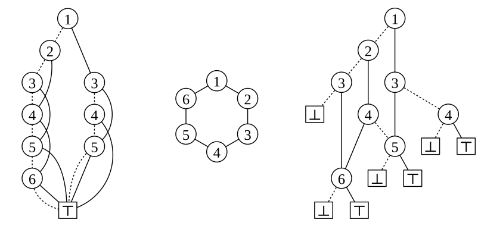](../../assets/volume4a/figures/diagram-7-1-4-122-cycle-c6-zdds.svg)

$(122)$　从左到右为独立集、圈 $C_6$ 和核.

由于这些新约定, ZDD 中可能有 $\mathrm{LO}=\mathrm{HI}$. 此外, 左图说明 ZDD 根本不必包含 $\boxed{\bot}$! $(12)$ 中大约 40% 的结点已从每个图中消除.

理解 ZDD 的一种方法是把它看成集族的压缩表示. 实际上, $(122)$ 中的两个 ZDD 分别表示 $C_6$ 的全部独立集和全部核的集族. ZDD 的根结点给出至少在一个集合中出现的最小元素, 其 HI 和 LO 分支分别表示包含和不包含该元素的集合所形成的剩余子族, 以此类推. 在底部, $\boxed{\bot}$ 表示空族 $\emptyset$, 而 $\boxed{\top}$ 表示 $\{\emptyset\}$. 例如, $(122)$ 最右侧的 ZDD 表示集族 $\{\{1,3,5\},\{1,4\},\{2,4,6\},\{2,5\},\{3,6\}\}$, 因为根的 HI 分支表示 $\{\{3,5\},\{4\}\}$, LO 分支表示 $\{\{2,4,6\},\{2,5\},\{3,6\}\}$.

每个布尔函数 $f(x_1,\ldots,x_n)$ 都等价于 $\{1,\ldots,n\}$ 的一个子集族, 反之亦然. 不过, 集族和函数提供了不同的视角. 例如, 对所有 $n\ge5$, 集族 $\{\{1,3\},\{2\},\{2,5\}\}$ 都有相同的 ZDD. 不过, 如果 $n=7$, 定义这个集族的函数 $f(x_1,\ldots,x_7)$ 的 BDD 就需要额外的结点, 以保证当 $f(x)=1$ 时 $x_4=x_6=x_7=0$.

几乎每一个已经讨论过的 BDD 概念, 在 ZDD 理论中都有对应的概念, 虽然实际的数据结构通常截然不同. 例如, 对于任何给定的函数 $f(x_1,\ldots,x_n)$, 都可以取它的真值表, 用一种类似于 $(5)$ 中构造 BDD 的简单方法, 构造它唯一的 ZDD. $f$ 的 BDD 结点对应于它的真值表的 “串珠”. 同样, ZDD 结点对应于*消零串珠*, 它们是形式为 $\alpha\beta$ 的二进制串, 其中 $|\alpha|=|\beta|$ 且 $\beta\ne0\ldots0$, 或者 $|\alpha|=|\beta|-1$. 任何二进制串都对应于唯一的消零串珠; 必要时反复剪去右半部分, 直到串的长度为奇数, 或者右半部分非零.

亲爱的读者, 请花点时间做习题 187. (真的做一做.)

$f(x_1,\ldots,x_n)$ 的 $z$ 分布为 $(z_0,\ldots,z_n)$, 其中 $z_k$($0\le k<n$) 是 $f$ 的真值表中 $n-k$ 阶消零串珠的数目, 也就是 ZDD 中 $\boxed{k+1}$ 结点的数目. $z_n$ 是汇结点的数目. 记结点总数为 $Z(f)=z_0+\cdots+z_n$. 例如, $(122)$ 中函数的 $z$ 分布分别为 $(1,1,2,2,2,1,1)$ 和 $(1,1,2,2,1,1,2)$, 所以两者都有 $Z(f)=10$.

分布与伪分布之间的基本关系 (83)–$(85)$ 对 $z$ 分布也成立, 但 $q'_k$ 只计非零的 $n-k$ 阶子表:

$$
q'_k\ge z_k,\qquad 0\le k<n;\tag{123}
$$

$$
q'_k\le1+z_0+\cdots+z_{k-1}\qquad\text{且}\qquad q'_k\le z_k+\cdots+z_n,\qquad 0\le k\le n;\tag{124}
$$

$$
Z(f)\ge2q'_k-1,\qquad 0\le k\le n.\tag{125}
$$

所以 BDD 和 ZDD 的大小相差不会十分悬殊:

$$
Z(f)\le\frac n2\bigl(B(f)+1\bigr)+1\qquad\text{且}\qquad B(f)\le\frac n2\bigl(Z(f)+1\bigr)+2.\tag{126}
$$

另一方面, 当 $n=100$ 时, 50 倍也不能忽视.

用 ZDD 寻找美国接壤各州的独立集和核, 如果沿用 $(17)$ 的次序, BDD 的 428 和 780 个结点就分别减到 ZDD 的 177 和 385 个结点. 移动变量可把两个 ZDD 进一步减到 160 和 335 个结点. 这样的改善怎能忽视? 对于 49 个变量的复杂函数, 这已经相当不错了.

知道 $f$ 和 $g$ 的 ZDD 后, 可以用与 BDD 方法类似的算法综合它们, 得到 $f\wedge g$、$f\vee g$、$f\oplus g$ 等函数的 ZDD. 还可以用与算法 C 和算法 B 类似的算法, 计数或优化 $f$ 的解, 也可以两者都做. 实际上, 基于 ZDD 的计数和优化技术比相应的 BDD 算法稍容易. 稍加修改 BDD 的方法, 还可以通过移动变量来动态重排. 习题 197–209 讨论基本 ZDD 过程的细节.

一般来说, 当函数的解是稀疏的, 也就是 $f(x)=1$ 时 $\nu x$ 倾向于较小, ZDD 往往比 BDD 更好. 若 $f(x)$ 本身也稀疏, 即只有相对较少的解, ZDD 的优势就更大.

例如, ZDD 很适合处理由 $m\times n$ 的 0–1 矩阵定义的恰当覆盖问题. 目标是找出选择若干行使其总和为 $(1,1,\ldots,1)$ 的所有方法. 例如, 可以用 32 块多米诺骨牌覆盖国际象棋棋盘:

[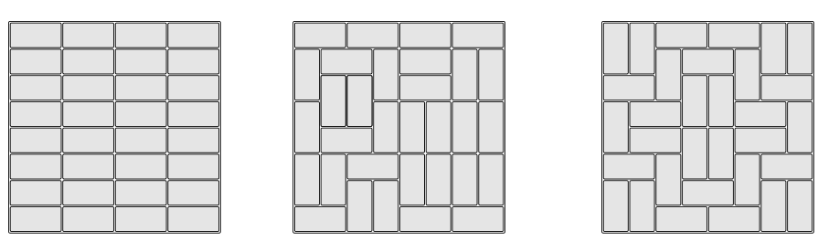](../../assets/volume4a/figures/diagram-7-1-4-127-domino-tilings.svg)

$(127)$

这是一个恰当覆盖问题. 矩阵有 $8\times8=64$ 列, 每列代表国际象棋棋盘的一格, 有 $2\times7\times8=112$ 行, 每行代表一对相邻的格子:

$$
\left(\begin{array}{lcl}
1\;1\;0\;0\;0\;0\;0\;0\;0\;0\;0\;0 & \cdots & 0\;0\;0\;0\;0\;0\;0\;0\;0\;0\;0 \\
1\;0\;0\;0\;0\;0\;0\;0\;1\;0\;0\;0 & \cdots & 0\;0\;0\;0\;0\;0\;0\;0\;0\;0\;0 \\
0\;1\;1\;0\;0\;0\;0\;0\;0\;0\;0\;0 & \cdots & 0\;0\;0\;0\;0\;0\;0\;0\;0\;0\;0 \\
0\;1\;0\;0\;0\;0\;0\;0\;0\;1\;0\;0 & \cdots & 0\;0\;0\;0\;0\;0\;0\;0\;0\;0\;0 \\
\vdots & & \vdots \\
0\;0\;0\;0\;0\;0\;0\;0\;0\;0\;0\;0 & \cdots & 0\;0\;0\;0\;0\;0\;0\;1\;1\;0\;0 \\
0\;0\;0\;0\;0\;0\;0\;0\;0\;0\;0\;0 & \cdots & 0\;0\;0\;0\;0\;0\;0\;0\;1\;1\;0 \\
0\;0\;0\;0\;0\;0\;0\;0\;0\;0\;0\;0 & \cdots & 0\;0\;0\;0\;0\;0\;0\;0\;0\;1\;1
\end{array}\right).\tag{128}
$$

令变量 $x_j$ 表示是否选择第 $j$ 行. 因此, $(127)$ 的三个解在 $(x_1,x_2,x_3,x_4,\ldots,x_{110},x_{111},x_{112})$ 上分别为 $(1,0,0,0,\ldots,1,0,1)$、$(1,0,0,0,\ldots,1,0,1)$ 和 $(0,1,0,1,\ldots,1,0,0)$. 一般来说, 恰当覆盖问题的解由函数

$$
f(x_1,\ldots,x_m)=\bigwedge_{j=1}^{n}S_1(X_j)=\bigwedge_{j=1}^{n}[\nu X_j=1]\tag{129}
$$

表示, 其中 $(a_{ij})$ 是给定的矩阵, $X_j=\{x_i\mid a_{ij}=1\}$.

多米诺骨牌覆盖国际象棋棋盘的 ZDD 最终只有 $Z(f)=2300$ 个结点, 尽管 $f$ 有 $m=112$ 个变量. 由此可以证明, 恰好有 12 988 816 种像 $(127)$ 那样的覆盖.

同样, 还可以考察更奇特的覆盖. 比如在

[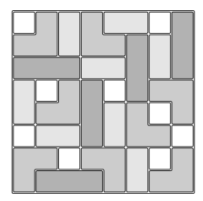](../../assets/volume4a/figures/diagram-7-1-4-130-mixed-chessboard-tiling.svg)

$(130)$

中, 棋盘用单米诺骨牌、多米诺骨牌和三米诺骨牌中的一些覆盖, 也就是说, 每块骨牌是纵横连通的, 由一格、两格或三格组成. 恰好有 92 109 458 286 284 989 468 604 种覆盖! 为 468 个变量构造一个大小为 512 227 的 ZDD, 只用约 7500 万次内存访问就能算出这个数.

可以为任意给定的恰当覆盖问题设计专门的 ZDD 算法, 也可以通过综合建立 $(129)$ 的 ZDD. 见习题 212.

顺便一提, 像 $(127)$ 那样的多米诺骨牌覆盖等价于寻找二部网格图 $P_8\mathbin{\square}P_8$ 的完全匹配. 7.5.1 节将介绍有效的算法, 能够处理对 BDD 或 ZDD 来说太大的图. 实际上, $m\times n$ 网格的多米诺骨牌覆盖数甚至有显式公式. 相比之下, 像 $(130)$ 那样的一般覆盖属于更广泛的一类超图问题, 当 $m,n\to\infty$ 时, 多项式时间的方法不太可能有帮助.

[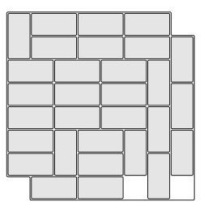](../../assets/volume4a/figures/diagram-7-1-4-mutilated-chessboard.svg)

马克斯·布莱克在他的 *Critical Thinking*(1946) 一书第 142 页和第 394 页, 考察了多米诺骨牌覆盖的一种有趣变形, 称为 “残缺棋盘”. 从国际象棋棋盘上去掉两个相对的角格, 试着用 31 块多米诺骨牌覆盖其余各格. 很容易摆下其中的 30 块, 如图所示, 可接下来就没法再摆了. 实际上, 如果考虑对应的 $108\times62$ 恰当覆盖问题, 但忽略 $(129)$ 的最后两个约束条件, 就能得到含 1224 个结点的 ZDD. 可以从中推断, 共有 324 480 种选行方式使总和等于 $(1,1,\ldots,1,1,*,*)$. 但每个解的第 61 列都至少有两个 1, 因此将约束 $[\nu X_{61}=1]$ 与它作 AND, ZDD 就约化为 $\boxed{\bot}$. [*Critical Thinking* 解释了原因, 见习题 213.] 这个例子提醒我们两点. 其一, 计算所得的最终 ZDD 或 BDD 的大小, 可能比计算它所用的时间小得多. 其二, 动动脑筋就能节省大量计算机周期.

**作为字典的 ZDD.** 现在换个话题. ZDD 在一些性质完全不同的应用中也有优势. 例如, 可用它表示英语中的五字母单词, 即本章开头讨论的斯坦福图库词集 `WORDS(5757)`. 一种做法是定义函数 $f(x_1,\ldots,x_{25})$, 使 $f=1$ 当且仅当 $(x_1\ldots x_5)_2$、$(x_6\ldots x_{10})_2$、…、$(x_{21}\ldots x_{25})_2$ 这五个数编码一个英语单词的字母, 其中 $\mathtt a=(00001)_2$, ……, $\mathtt z=(11010)_2$. 例如, $f(0,0,1,1,1,0,1,1,1,1,0,1,1,1,1,0,0,1,1,0,1,1,0,0,x_{25})=x_{25}$. 这个 25 变量函数有 $Z(f)=6233$ 个结点. 对于 5757 个英语单词来说, 这个结果并不差.

我们已经在第 6 章考察过表示这 5757 个单词的许多其他方法. 对简单查找来说, ZDD 比不上二叉树、检索树或散列表. 不过, ZDD 也能检索只指定了一部分的数据, 或只需与键近似匹配的数据, 许多复杂查询也可以轻松处理.

此外, 使用 ZDD 时不必太担心变量多. 也可以把五字母单词表示成有 $26\times5=130$ 个变量的稀疏函数 $F(a_1,\ldots,z_1,a_2,\ldots,z_2,\ldots,a_5,\ldots,z_5)$. 例如, 变量 $a_2$ 表示第二个字母是否为 `a`. 要表示 `crazy` 是一个单词, 就令 $F$ 在 $c_1=r_2=a_3=z_4=y_5=1$ 且其他变量全为 0 时为真. 等价地, 可以把 $F$ 看成由 $\{w_1,h_2,i_3,c_4,h_5\}$、$\{t_1,h_2,e_3,r_4,e_5\}$ 等 5757 个子集组成的集族. 用这 130 个变量, ZDD 的大小 $Z(F)$ 只有 5020 个结点, 原来是 6233 个.

顺便说一句, $B(F)$ 是 46 189, 比 $Z(F)$ 的九倍还多. 但是 25 个变量时, $B(f)/Z(f)$ 只有 $8870/6233\approx1.4$. 尽管 ZDD 与 BDD 有类似的算法和理论, 两者在许多方面还是不同的.

这些差异使我们需要一些新的基本运算, 以便从初等集族构造出复杂的子集族. 注意, 简单的子集 $\{f_1,u_2,n_3,n_4,y_5\}$ 实际上是一个极其冗长的布尔函数:

$$
\bar a_1\wedge\cdots\wedge\bar e_1\wedge f_1\wedge\bar g_1\wedge\cdots\wedge\bar t_2\wedge u_2\wedge\bar v_2\wedge\cdots\wedge\bar x_5\wedge y_5\wedge\bar z_5,\tag{131}
$$

它是含 130 个布尔变量的小项. 习题 203 讨论了一种重要的集族代数, 可以更自然地将这个子集写成 $f_1\sqcup u_2\sqcup n_3\sqcup n_4\sqcup y_5$. 借助集族代数, 可以方便地描述和计算许多有趣的单词和单词片段的集合 (见习题 222).

**表示简单路径的 ZDD.** 图 28 说明了任意有向无圈图 (dag) 与一类特殊 ZDD 之间的重要联系. 如果 dag 的每个源顶点出度为 1, 且每个汇顶点入度为 1, 从源到汇的所有有向路径的 ZDD 就与原 dag 具有大致相同的 “形状”. 这个 ZDD 的变量是 dag 的弧, 按适当的拓扑顺序排列. (见习题 224.)

[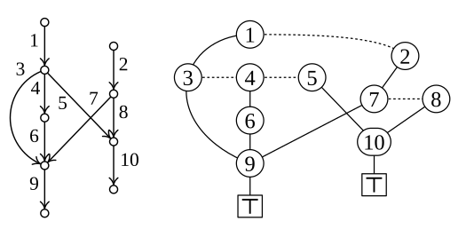](../../assets/volume4a/figures/fig-7-28-dag-paths-zdd.svg)

**图 28**　一个有向无圈图, 以及它从源顶点到汇顶点的路径的 ZDD. dag 的弧对应于 ZDD 的结点. 为了更清楚地显示结构的相似性, 图中省去了所有指向 $\boxed{\bot}$ 的分支.

还可以用 ZDD 表示无向图中的简单路径. 例如, 下面的 $3\times3$ 网格有 12 条从左上角到右下角的路径, 每条路径都不重复经过任何结点:

[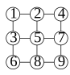](../../assets/volume4a/figures/diagram-7-1-4-grid-3x3-paths-numbering.svg)

$(132)$

这些路径可以用下面的 ZDD 表示, 它描述所有符合要求的边集. 例如, 在标为 $13$、$36$、$68$ 和 $89$ 的结点处取 HI 分支, 就得到第一条路径. (和图 28 一样, 图中省去了仅指向 $\boxed{\bot}$ 的 LO 分支.)

[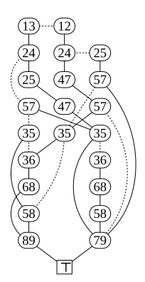](../../assets/volume4a/figures/diagram-7-1-4-132-grid-paths-zdd.svg)

当然, $(132)$ 的路径族只有 12 个成员, 用 ZDD 表示它算不上多好的办法. 但在较大的网格 $P_8\mathbin{\square}P_8$ 上, 从一角到相对角的简单路径有 789 360 053 252 条, 可以全部用至多 33 580 个结点的 ZDD 表示. 习题 225 说明如何快速地构造这样的 ZDD.

习题 226 讨论了类似的算法, 用来构造表示给定图的所有圈的 ZDD. 用大小为 22 275 的 ZDD 可以推断, $P_8\mathbin{\square}P_8$ 恰好有 603 841 648 931 个简单圈. 要在计算机中表示所有这些圈, 并在需要时有条理地生成它们, ZDD 很可能是最好的办法.

同样的办法也适用于没有简洁数学结构的 “现实世界” 中的图. 例如, 可以用它回答兰德尔·布赖恩特在 2008 年向作者提出的问题: “假设我打算驾车周游美国大陆各州, 参观所有州议会大厦, 并且每个州只通过一次. 应该选择哪条路线, 才能使总里程最短?” 如果把局部行程限制为只穿越一条州界, 下面的图给出相邻州首府之间的最短距离:

[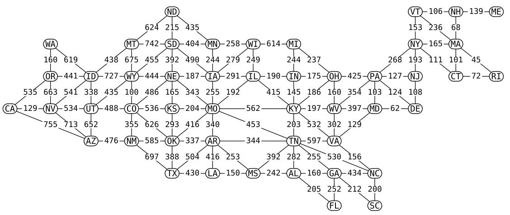](../../assets/volume4a/figures/diagram-7-1-4-133-capital-distances.svg)

$(133)$

问题是选出这些边的一个子集, 构成总长度最小的哈密顿路径.

这个图的每条哈密顿路径显然都必须以缅因州 (ME) 的首府奥古斯塔为起点或终点. 假定从加利福尼亚州 (CA) 的首府萨克拉门托出发. 用上述办法, 可以构造描述从 CA 到 ME 的所有路径的 ZDD. 这个 ZDD 只有 7850 个结点, 并能迅速算出从 CA 到 ME 恰好有 437 525 772 584 条简单路径. 实际上, 按边数计数的生成函数是

$$
4z^{11}+124z^{12}+1539z^{13}+\cdots+33\,385\,461z^{46}+2\,707\,075z^{47};\tag{134}
$$

所以最长的这类路径就是哈密顿路径, 恰有 2 707 075 条. 此外, 习题 227 说明如何构造大小为 4726 的更小 ZDD, 正好描述从 CA 到 ME 的所有哈密顿路径.

可以用其他各州依次代替加利福尼亚州, 重复这个实验. (如果要经过这个图的关节点纽约州, 起点最好在新英格兰[^v4a-p212-1] 之外.) 例如, 从新泽西州 (NJ) 到 ME 有 483 194 条哈密顿路径. 习题 228 说明, 如何用一个大小为 28 808 的 ZDD 表示从 ME 到其他任一终点州的所有哈密顿路径, 共 68 656 026 条. 现在, 用算法 B 就能直接得到布赖恩特问题的答案. (读者也许愿意先试着手工找一条最短路径, 然后再看习题 230 的绝对最优答案.)

**\*ZDD 与素蕴涵元.** 最后, 来看一个同时使用 BDD 和 ZDD 的有启发性的应用.

根据定理 7.1.1Q, 每个单调布尔函数 $f$ 都有唯一最短的两级 AND–OR 表示, 称为它的 “析取素式”, 即所有素蕴涵元的析取. 素蕴涵元对应于使 $f(x)=1$ 的极小点, 即这样的二进制向量 $x$: 当 $f(x')=1$ 且 $x'\subseteq x$ 时, 必有 $x'=x$. 例如, 如果

$$
f(x_1,x_2,x_3)=x_1\vee(x_2\wedge x_3),\tag{135}
$$

$f$ 的素蕴涵元是 $x_1$ 与 $x_2\wedge x_3$, 极小解是 $x_1x_2x_3=\mathtt{100}$ 和 $\mathtt{011}$. 用集族代数, 这两个极小解可以方便地写成 $e_1$ 和 $e_2\sqcup e_3$ (见习题 203).

一般来说, $x_{i_1}\wedge\cdots\wedge x_{i_s}$ 是单调函数 $f$ 的素蕴涵元, 当且仅当 $e_{i_1}\sqcup\cdots\sqcup e_{i_s}$ 是 $f$ 的一个极小解. 因此, 可以把 $f$ 的素蕴涵元 $\operatorname{PI}(f)$ 看作它的极小解族. 注意, $x_{i_1}\wedge\cdots\wedge x_{i_s}\subseteq x_{j_1}\wedge\cdots\wedge x_{j_t}$ 当且仅当 $e_{i_1}\sqcup\cdots\sqcup e_{i_s}\supseteq e_{j_1}\sqcup\cdots\sqcup e_{j_t}$. 说一个素蕴涵元 “包含” 另一个容易引起混淆. 我们把这种关系称为较短的素蕴涵元 “吸收” 较长的素蕴涵元.

例 $(135)$ 揭示了一个奇特的现象. 下面的图同时是 $f$ 的 BDD 和 $\operatorname{PI}(f)$ 的 ZDD!

[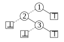](../../assets/volume4a/figures/diagram-7-1-4-135-f.svg)

同样, 本节开头的图 21 同时给出了 $\langle x_1x_2x_3\rangle$ 的 BDD 和 $\operatorname{PI}(\langle x_1x_2x_3\rangle)$ 的 ZDD. 另一方面, 令 $g=(x_1\wedge x_3)\vee x_2$. $g$ 的 BDD 如下:

[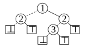](../../assets/volume4a/figures/diagram-7-1-4-135-g-bdd.svg)

而 $\operatorname{PI}(g)$ 的 ZDD 是

[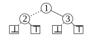](../../assets/volume4a/figures/diagram-7-1-4-135-g-zdd.svg)

这是怎么回事?

解开这个谜团的关键, 在于 BDD 和 ZDD 所依赖的递归结构. 每个布尔函数都可以写成

$$
f(x_1,\ldots,x_n)=(\bar x_1\mathbin{?}f_0\mathbin{:}f_1)=(\bar x_1\wedge f_0)\vee(x_1\wedge f_1),\tag{136}
$$

其中 $f_c$ 是用 $c$ 代替 $x_1$ 后 $f$ 的值. 当 $f$ 是单调函数时, $f_0\subseteq f_1$, 所以也有 $f=f_0\vee(x_1\wedge f_1)$. 如果 $f_0\ne f_1$, 构造一个 ① 结点, 使它的 LO 和 HI 分支分别指向 $f_0$ 和 $f_1$ 的 BDD, 便得到 $f$ 的 BDD. 同样, 不难看出 $f$ 的素蕴涵元是

$$
\operatorname{PI}(f)=\operatorname{PI}(f_0)\cup\bigl(e_1\sqcup(\operatorname{PI}(f_1)\setminus\operatorname{PI}(f_0))\bigr).\tag{137}
$$

(见习题 253.) 再加入两个常量函数的终止条件, $\operatorname{PI}(0)$ 和 $\operatorname{PI}(1)$ 的 ZDD 分别是 $\boxed{\bot}$ 和 $\boxed{\top}$, 就得到定义 $\operatorname{PI}(f)$ 的 ZDD 的递归公式.

如果布尔函数 $f$ 是单调的, 且 $\operatorname{PI}(f)$ 的 ZDD 与 $f$ 的 BDD 完全相同, 就称 $f$ 是*纯净的*. 常量函数显然纯净. 非常量函数的纯净性也容易刻画.

**定理 S.** 一个依赖于 $x_1$ 的布尔函数是纯净的, 当且仅当它的素蕴涵元族为 $P\cup(e_1\sqcup Q)$, 其中 $P$ 和 $Q$ 都纯净且独立于 $x_1$, 并且 $P$ 的每个成员都被 $Q$ 的某个成员吸收.

**证明.** 见习题 246. (“$P$ 和 $Q$ 都纯净” 是说, 它们各自是定义一个纯净布尔函数的素蕴涵元族.)　∎

**推论 S.** 任何图的连通性函数都是纯净的.

**证明.** 连通性函数 $f$ 的素蕴涵元是图的生成树. 每棵不含弧 $x_1$ 的生成树都至少有一片子森林, 加入弧 $x_1$ 后就成为生成树. 此外, $f$ 的所有子函数都是更小的图的连通性函数.　∎

所以, 例如图 22 中的 BDD 定义了 $P_3\mathbin{\square}P_3$ 的全部 431 个连通生成子图, 同时也是定义它全部 192 棵生成树的 ZDD.

只要 $f$ 是单调函数, 无论它是否纯净, 都能用 $(137)$ 来计算 $\operatorname{PI}(f)$ 的 ZDD. 实际上, 可以让 BDD 结点和 ZDD 结点共存于同一个大数据基中. 两个 $(\mathrm V,\mathrm{LO},\mathrm{HI})$ 字段完全相同的结点, 即使在不同场合有完全不同的含义, 也可以在内存中只存一份. 当 $f$ 和 $g$ 指向 BDD 时, 用一个例程综合 $f\wedge\bar g$. 当 $f$ 和 $g$ 指向 ZDD 时, 用另一个例程构造 $f\setminus g$. 两个例程可以共用一些结点, 只要不重排变量就不会出问题. (当然, 缓存的备忘项必须区分 BDD 与 ZDD 数据.)

例如, 习题 7.1.1–67 定义了一类有趣的自对偶函数, 称为 $Y$ 函数. $Y_{12}$ 是一个 91 变量函数, 它的 BDD 有 748 416 个结点. 这个函数有 2 178 889 774 个素蕴涵元, 而 $Z(\operatorname{PI}(Y_{12}))$ 只有 217 388 个结点. (约花费 130 亿次内存访问和 660 兆字节, 就能找出这个 ZDD.)

**简要的历史回顾.** 克劳德·香农对继电器触点网络的说明已经隐含了二元决策图的思想 [*Trans. Amer. Inst. Electrical Engineers* **57**(1938), 713–723]. 那篇论文的第 4 节证明, 任何 $n$ 变量对称布尔函数都可以用至多有 $\binom{n+1}{2}$ 个分支结点的 BDD 表示. 香农更喜欢用布尔代数处理. 李始元在 *Bell System Tech. J.* **38**(1959), 985–999 中, 指出了他称为 “二元决策程序” 的若干优点, 因为任何 $n$ 变量函数都可以在这样的程序中用至多 $n$ 条分支指令求值.

小谢尔登·埃克斯创造了 “二元决策图” 这个名称, 并在 *IEEE Trans.* **C-27**(1978), 509–516 中进一步发展了这些思想. 他说明了怎样从真值表自底向上构造 BDD, 或从代数子函数自顶向下构造 BDD. 他解释了如何计数从根到 $\boxed{\top}$ 或 $\boxed{\bot}$ 的路径, 并指出这些路径把 $n$ 维立方体分割成两两不相交的子立方体.

与此同时, 自动机理论的研究中也出现了很相似的计算模型. 例如, 艾伦·科巴姆 [*FOCS* **7**(1966), 78–87] 将一列函数 $f_n(x_1,\ldots,x_n)$ 的分支程序最小规模, 与计算这列函数的非均匀图灵机的空间复杂度联系起来. 史蒂文·福琼、约翰·霍普克罗夫特和埃里克·施密特 [*Lecture Notes in Comp. Sci.* **62**(1978), 227–240] 研究了如今称为 FBDD 的 “自由 B 图式”, 其任意一条路径均不会对同一布尔变量检验两次 (见习题 35). 他们还给出一个多项式时间算法, 如果 $f$ 和 $g$ 的 FBDD 中至少一个像 BDD 那样采用一致的变量顺序, 就能检验 $f=g$. 同 BDD 结构密切相关的有限自动机理论也在发展. 一些研究人员由此着手解决与分析各类函数 $f$ 的 BDD 大小 $B(f)$ 等价的问题. (见习题 261.)

这些研究都停留在概念层面, 尚未用计算机程序实现. 程序员当时已经为二叉检索树和 Patricia 树找到了合适的用途, 这些结构与 BDD 相似, 但属于树 (见 6.3 节). 后来兰德尔·布赖恩特发现, 同时要求二元决策图有序且约化, 对实际应用非常重要. 他介绍这个主题的论文 [*IEEE Trans.* **C-35**(1986), 677–691] 在计算机科学各领域多年被引用得最多, 因为它革新了表示布尔函数所用的数据结构.

布赖恩特在论文中指出, 任何函数的 BDD 在他的约定下实际上是唯一的, 而实践中遇到的大多数函数都有大小适中的 BDD. 他给出了用 $f$ 和 $g$ 的 BDD 来综合 $f\wedge g$、$f\oplus g$ 等函数的 BDD 的有效算法. 他还展示了如何求出按字典序最小且满足 $f(x)=1$ 的 $x$, 等等.

李始元、小埃克斯和布赖恩特都指出, 许多函数可以共存于同一个 BDD 基中, 共享它们的公共子函数. 卡尔·布雷斯、里卡德·鲁德尔和兰德尔·布赖恩特 [*ACM/IEEE Design Automation Conf.* **27**(1990), 40–45] 开发了供 BDD 基运算使用的高性能 “软件包”, 对后来的 BDD 工具箱实现产生了重要影响. 布赖恩特在 *Computing Surveys* **24**(1992), 293–318 中总结了 BDD 的早期用法.

如前所述, 凑真一在 1993 年引入了 ZDD, 以提高组合运算的性能. 他在 *Software Tools for Technology Transfer* **3**(2001), 156–170 中回顾了 ZDD 的早期应用.

图论中的布尔方法由哈立德·玛格胡特 [*Comptes Rendus Acad. Sci.* **248**(Paris, 1959), 3522–3523] 开创. 他说明了如何把任意图或有向图的极大独立集与极小控制集表示成单调函数的素蕴涵元. 随后, 罗贝尔·福尔泰 [*Cahiers du Centre d’Etudes de Recherche Operationelle* **1**, 4(1959), 5–36] 研究了用布尔方法解决许多其他问题. 例如, 他通过给每个顶点分配两个布尔变量来引入图的 4 着色, 正如我们在 $(73)$ 中所做的那样. 保罗·卡米翁在同一杂志 [**2**(1960), 234–289] 中, 把整数规划问题变换成布尔代数中的等价问题, 希望用符号逻辑的方法求解. 这项工作后来得到推广, 其中尤为突出的是彼得·阿梅和塞尔久·鲁代亚努. 他们合著的 *Boolean Methods in Operations Research*(Springer, 1968) 总结了这些思想. 遗憾的是, 这些方法一度停滞, 因为当时缺乏有效的布尔计算技术. 布尔方法的倡导者一直等到 BDD 出现, 才借助算法 B 解决一般的布尔规划问题 $(7)$. 林志华和法比奥·索门齐 [*International Conf. Computer-Aided Design* **CAD-90**(IEEE, 1990), 88–91] 引入了算法 B 的特例, 其中各权值均非负. 凑真一 [*Formal Methods in System Design* **10**(1997), 221–242] 开发了软件, 能将整数变量之间的线性不等式自动变换成便于处理的 BDD, 在一定程度上实现了 20 世纪 60 年代研究者的设想.

人们掌握 BDD 方法后, 为给定函数寻找最小析取范式 DNF 的经典问题也变得极为简单. 这个问题的最新技术超出了本书的范围. 奥利维耶·库代尔在 *Integration* **17**(1994), 97–140 中给出了很好的综述.

英戈·韦格纳的 *Branching Programs and Binary Decision Diagrams*(SIAM, 2000) 是一本优秀的著作, 概述了这个主题的大量文献, 细致地建立了数学基础, 并讨论了推广和扩充基本思想的许多方法.

**告诫.** 我们已经看到许多例子, 借助 BDD、ZDD 或两者, 可以高效地求解各式各样的组合问题. 下面的习题还给出了许多这样的例子. BDD 和 ZDD 是众多可用方法中的两种, 主要适用于解太多而无法逐一考察的问题, 也适用于解具有局部结构、使算法每次只需处理相对较少的子问题的情形. 本书后续各节将讨论求解其他类型组合问题的方法.

### 习题

▶ **1.** [*20*][答案](./answers/7-1-4.md#ans-7-1-4-1) 画出全部 16 个布尔函数 $f(x_1,x_2)$ 的 BDD. 它们各有多大?

▶ **2.** [*21*][答案](./answers/7-1-4.md#ans-7-1-4-2) 画一个有 16 个顶点的平面有向无圈图, 使每个顶点都是习题 1 中一个 BDD 的根.

**3.** [*16*][答案](./answers/7-1-4.md#ans-7-1-4-3) BDD 大小不超过 3 的布尔函数 $f(x_1,\ldots,x_n)$ 有多少个?

**4.** [*21*][答案](./answers/7-1-4.md#ans-7-1-4-4) 假定三个字段 $\boxed{\mathrm V\mid\mathrm{LO}\mid\mathrm{HI}}$ 已装入一个 64 位二进制字 $x$, 其中 V 占 8 位, 另外两个字段各占 28 位. 证明用五条按位运算指令即可完成变换 $x\mapsto x'$. 除 LO 或 HI 的值为 0 时变成 1、为 1 时变成 0 外, $x'$ 与 $x$ 相同. (对 $f$ 的 BDD 中每一个分支结点 $x$ 重复此操作, 就得到补函数 $\bar f$ 的 BDD.)

**5.** [*20*][答案](./answers/7-1-4.md#ans-7-1-4-5) 取函数 $f(x_1,\ldots,x_n)$ 的 BDD, 交换每个结点的 LO 和 HI 指针, 同时交换两个汇结点 $\boxed{\bot}\leftrightarrow\boxed{\top}$, 得到的是什么?

**6.** [*10*][答案](./answers/7-1-4.md#ans-7-1-4-6) 令 $g(x_1,x_2,x_3,x_4)=f(x_4,x_3,x_2,x_1)$, 其中 $f$ 的 BDD 见 $(6)$. $g$ 的真值表是什么? 它的串珠又是什么?

**7.** [*21*][答案](./answers/7-1-4.md#ans-7-1-4-7) 给定布尔函数 $f(x_1,\ldots,x_n)$, 令

$$
g_k(x_0,x_1,\ldots,x_n)=f(x_0,\ldots,x_{k-2},x_{k-1}\vee x_k,x_{k+1},\ldots,x_n),\qquad 1\le k\le n.
$$

找出 (a) $f$ 与 $g_k$ 的真值表之间和 (b) 它们的 BDD 之间的简单关系.

**8.** [*22*][答案](./answers/7-1-4.md#ans-7-1-4-8) 用 $x_{k-1}\oplus x_k$ 代替 $x_{k-1}\vee x_k$, 再解习题 7.

**9.** [*16*][答案](./answers/7-1-4.md#ans-7-1-4-9) 给定函数 $f(x)=f(x_1,\ldots,x_n)$ 的 BDD, 采用 $(8)$ 所示的顺序表示. 说明怎样确定按字典序最大的、满足 $f(x)=0$ 的 $x$.

▶ **10.** [*21*][答案](./answers/7-1-4.md#ans-7-1-4-10) 给定定义布尔函数 $f$ 和 $f'$ 的两个 BDD, 采用 $(8)$ 和 $(10)$ 所示的顺序表示. 设计检验 $f=f'$ 的算法.

**11.** [*20*][答案](./answers/7-1-4.md#ans-7-1-4-11) 把算法 C 用于 (a) 有序但未约化的二元决策图, 或 (b) 已约化但无序的二元决策图, 能得到正确答案吗?

▶ **12.** [*M21*][答案](./answers/7-1-4.md#ans-7-1-4-12) 有向图的*核*是满足以下条件的顶点集 $K$:

$$
\begin{aligned}
v\in K &\quad\text{蕴涵}\quad v\nrightarrow u &&\text{(对所有 }u\in K\text{）；}\\
v\notin K &\quad\text{蕴涵}\quad v\to u &&\text{(对某个 }u\in K\text{）。}
\end{aligned}
$$

(a) 证明, 当有向图是普通图 (即 $u\to v$ 当且仅当 $v\to u$) 时, 核就是极大独立集.

(b) 描述定向圈 $C_n^{\to}$ 的核.

(c) 证明有向无圈图有唯一的核.

**13.** [*M15*][答案](./answers/7-1-4.md#ans-7-1-4-13) 图的核与以下概念有何关系? (a) 极大团, (b) 极小顶点覆盖.

**14.** [*M24*][答案](./answers/7-1-4.md#ans-7-1-4-14) 当 $n\ge3$ 时, 以下对象的 BDD 究竟有多大? (a) 圈图 $C_n$ 的全部独立集, (b) $C_n$ 的全部核. (按 $(12)$ 对顶点编号.)

**15.** [*M23*][答案](./answers/7-1-4.md#ans-7-1-4-15) 当 $n\ge3$ 时, $C_n$ 有多少个 (a) 独立集, (b) 核?

▶ **16.** [*22*][答案](./answers/7-1-4.md#ans-7-1-4-16) 给定 $f$ 的 BDD, 设计一个依次生成满足 $f(x_1,\ldots,x_n)=1$ 的所有向量 $x_1\ldots x_n$ 的算法.

**17.** [*32*][答案](./answers/7-1-4.md#ans-7-1-4-17) 如果可能, 改进习题 16 的算法, 使有 $N$ 个解时的运行时间为 $O(B(f))+O(N)$.

**18.** [*13*][答案](./answers/7-1-4.md#ans-7-1-4-18) 用 BDD $(8)$ 和 $(w_1,\ldots,w_4)=(1,-2,-3,4)$ 从头至尾演示算法 B.

**19.** [*20*][答案](./answers/7-1-4.md#ans-7-1-4-19) 算法 B 的变量 $m_k$ 最大和最小可能值分别是什么? 仅依据权值 $(w_1,\ldots,w_n)$, 不使用函数 $f$ 的任何细节.

**20.** [*15*][答案](./answers/7-1-4.md#ans-7-1-4-20) 对于 $1\le j\le n$, 设计一种快速计算图厄–摩尔斯权值 $(15)$ 的方法.

**21.** [*05*][答案](./answers/7-1-4.md#ans-7-1-4-21) 算法 B 能把 $w_1x_1+\cdots+w_nx_n$ 的最大化改成最小化吗?

▶ **22.** [*M21*][答案](./answers/7-1-4.md#ans-7-1-4-22) 假定步骤 B3 已简化, 公式中删去了 $W_{v+1}-W_{v_l}$ 和 $W_{v+1}-W_{v_h}$. 证明, 当应用于表示图的核的 BDD 时, 此算法仍然有效.

▶ **23.** [*M20*][答案](./answers/7-1-4.md#ans-7-1-4-23) 图 22 中, 从 BDD 的根到 $\boxed{\top}$ 的每条路径恰有八条实线弧. 为什么这并非巧合?

**24.** [*M22*][答案](./answers/7-1-4.md#ans-7-1-4-24) 假定已将 12 个权值 $(w_{12},w_{13},\ldots,w_{89})$ 分配给图 22 的网格各边. 说明如何将算法 B 应用于那里所示的 BDD, 找出图中的一棵最小生成树 (即边的总权值最小的生成树).

**25.** [*M20*][答案](./answers/7-1-4.md#ans-7-1-4-25) 修改算法 C, 使它计算 $f(x_1,\ldots,x_n)=1$ 的解的生成函数

$$
G(z)=\sum_{x_1=0}^{1}\cdots\sum_{x_n=0}^{1}z^{x_1+\cdots+x_n}f(x_1,\ldots,x_n).
$$

**26.** [*M20*][答案](./answers/7-1-4.md#ans-7-1-4-26) 修改算法 C, 使它计算给定概率的可靠性多项式

$$
F(p_1,\ldots,p_n)=\sum_{x_1=0}^{1}\cdots\sum_{x_n=0}^{1}(1-p_1)^{1-x_1}p_1^{x_1}\cdots(1-p_n)^{1-x_n}p_n^{x_n}f(x_1,\ldots,x_n).
$$

▶ **27.** [*M26*][答案](./answers/7-1-4.md#ans-7-1-4-27) 假设 $F(p_1,\ldots,p_n)$ 和 $G(p_1,\ldots,p_n)$ 分别是布尔函数 $f(x_1,\ldots,x_n)$ 和 $g(x_1,\ldots,x_n)$ 的可靠性多项式, 且 $f\ne g$. 令 $q$ 为素数, 并在 $0\le q_k<q$ 的范围内均匀选取独立的随机整数 $q_1,\ldots,q_n$. 证明 $F(q_1,\ldots,q_n)\bmod q\ne G(q_1,\ldots,q_n)\bmod q$ 的概率至少为 $(1-1/q)^n$. (特别是, 当 $n=1000$ 且 $q=2^{31}-1$ 时, 此方案使不同函数得到不同 “散列值” 的概率至少为 0.999 999 5.)

**28.** [*M16*][答案](./answers/7-1-4.md#ans-7-1-4-28) 令 $F(p)$ 为可靠性多项式 $F(p_1,\ldots,p_n)$ 在 $p_1=\cdots=p_n=p$ 时的值. 说明如何轻松地从生成函数 $G(z)$ 算出 $F(p)$.

**29.** [*HM20*][答案](./answers/7-1-4.md#ans-7-1-4-29) 修改算法 C, 使它在给定 $p$ 和 $f$ 的 BDD 时, 同时计算习题 28 的可靠性多项式 $F(p)$ 及其导数 $F'(p)$.

▶ **30.** [*M21*][答案](./answers/7-1-4.md#ans-7-1-4-30) 可靠性多项式是 $f(x_1,\ldots,x_n)=1$ 的所有解所对应的小项 $(1-p_1)^{1-x_1}p_1^{x_1}\cdots(1-p_n)^{1-x_n}p_n^{x_n}$ 之和. 给定 $f$ 的 BDD 和概率序列 $(p_1,\ldots,p_n)$, 说明如何找到对总可靠性贡献最大的解 $x_1\ldots x_n$.

**31.** [*M21*][答案](./answers/7-1-4.md#ans-7-1-4-31) 修改算法 C, 使它计算 $f$ 的完全详尽的真值表, 也就是把由图 21 得到 $(24)$ 的过程形式化.

▶ **32.** [*M20*][答案](./answers/7-1-4.md#ans-7-1-4-32) 如何解释 $\circ$、$\bullet$、$\bot$、$\top$、$\bar x_j$ 和 $x_j$, 才能使习题 31 的通用算法成为习题 25、26、29 和 30 的专门算法?

▶ **33.** [*M22*][答案](./answers/7-1-4.md#ans-7-1-4-33) 具体化习题 31 的算法, 使它能根据布尔函数 $f(x)=f(x_1,\ldots,x_n)$ 的 BDD 有效地计算

$$
\sum_{f(x)=1}(w_1x_1+\cdots+w_nx_n)\qquad\text{和}\qquad\sum_{f(x)=1}(w_1x_1+\cdots+w_nx_n)^2.
$$

**34.** [*M25*][答案](./answers/7-1-4.md#ans-7-1-4-34) 给定 $3n$ 个任意权值 $(w_1,\ldots,w_n,w'_1,\ldots,w'_n,w''_1,\ldots,w''_n)$, 具体化习题 31 的算法, 使它能根据 $f$ 的 BDD 有效地计算

$$
\max\Bigl\{\max_{1\le k\le n}(w_1x_1+\cdots+w_{k-1}x_{k-1}+w'_kx_k+w_{k+1}x_{k+1}+\cdots+w_nx_n+w''_k)\mid f(x)=1\Bigr\}.
$$

▶ **35.** [*22*][答案](./answers/7-1-4.md#ans-7-1-4-35) *自由二元决策图*(FBDD) 是形如下图的二元决策图:

[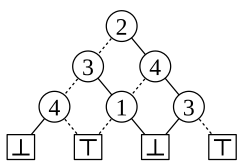](../../assets/volume4a/figures/exercise-7-1-4-35-fbdd.svg)

其中的分支变量可以按任意次序出现, 但从根向下的任意路径都不能重复出现某个变量. (FBDD 的 “自由” 指有向无圈图中的每条路径都有可能走到, 一个分支的选择不会限制另一个分支的选择.)

(a) 设计一个算法, 检验给定的 FBDD 是否确实是自由的.

(b) 给定 $(p_1,\ldots,p_n)$ 和定义布尔函数 $f(x_1,\ldots,x_n)$ 的 FBDD, 说明如何轻松地计算 $f$ 的可靠性多项式 $F(p_1,\ldots,p_n)$ 和满足 $f(x_1,\ldots,x_n)=1$ 的解数.

**36.** [*25*][答案](./answers/7-1-4.md#ans-7-1-4-36) 如果抽象运算符 $\circ$ 和 $\bullet$ 除满足分配律和结合律外还满足交换律, 说明如何扩充习题 31 的算法, 为任意给定的 FBDD 计算详尽真值表. (这样, 就能用 FBDD 和 BDD 一样找到算法 B 的最优解, 或求解习题 30、33 那样的问题.)

**37.** [*M20*][答案](./answers/7-1-4.md#ans-7-1-4-37) (罗纳德·李维斯特和让·维耶曼, 1976.) 如果布尔函数 $f(x_1,\ldots,x_n)$ 的每个 FBDD 都含有一条长度为 $n$ 的向下路径, 则称 $f$ 是*规避的*. 如习题 25 所示, 令 $G(z)$ 为 $f$ 的生成函数. 证明如果 $G(-1)\ne0$, 则 $f$ 是规避的.

▶ **38.** [*27*][答案](./answers/7-1-4.md#ans-7-1-4-38) 像 $(8)$ 和 $(10)$ 中那样, 令 $I_{s-1},\ldots,I_0$ 为定义非常量布尔函数 $f(x_1,\ldots,x_n)$ 的分支指令. 设计一个计算状态变量 $t_1\ldots t_n$ 的算法, 其中

$$
t_j=\begin{cases}
+1,&\text{每当 }x_j=1\text{ 时都有 }f(x_1,\ldots,x_n)=1;\\
-1,&\text{每当 }x_j=0\text{ 时都有 }f(x_1,\ldots,x_n)=1;\\
0,&\text{其他情形.}
\end{cases}
$$

(如果 $t_1\ldots t_n\ne0\ldots0$, 那么 $f$ 就是 7.1.1 节定义的定向函数.) 算法的运行时间应为 $O(n+s)$.

**39.** [*M20*][答案](./answers/7-1-4.md#ans-7-1-4-39) 门限函数 $[x_1+\cdots+x_n\ge k]$ 的 BDD 有多大?

▶ **40.** [*22*][答案](./answers/7-1-4.md#ans-7-1-4-40) 令 $g$ 为按 $(27)$ 置 $x_{k+1}\leftarrow x_k$ 得到的 $f$ 的 “缩合”.

(a) 证明 $B(g)\le B(f)$. [提示: 考虑子表和串珠.]

(b) 假定 $h$ 是从 $f$ 置 $x_{k+2}\leftarrow x_k$ 得到的函数. $B(h)\le B(f)$ 成立吗?

**41.** [*M25*][答案](./answers/7-1-4.md#ans-7-1-4-41) 假定 $n\ge4$, 求下列斐波那契门限函数的 BDD 大小:

(a) $\langle x_1^{F_1}x_2^{F_2}\ldots x_{n-2}^{F_{n-2}}x_{n-1}^{F_{n-1}}x_n^{F_{n-2}}\rangle$.

(b) $\langle x_n^{F_1}x_{n-1}^{F_2}\ldots x_3^{F_{n-2}}x_2^{F_{n-1}}x_1^{F_{n-2}}\rangle$.

**42.** [*22*][答案](./answers/7-1-4.md#ans-7-1-4-42) 画出 3 个变量的全部对称布尔函数的 BDD 基.

▶ **43.** [*22*][答案](./answers/7-1-4.md#ans-7-1-4-43) 以下函数的 $B(f)$ 是多少?

(a) $f(x_1,\ldots,x_{2n})=[x_1+\cdots+x_n=x_{n+1}+\cdots+x_{2n}]$.

(b) $f(x_1,\ldots,x_{2n})=[x_1+x_3+\cdots+x_{2n-1}=x_2+x_4+\cdots+x_{2n}]$.

▶ **44.** [*M32*][答案](./answers/7-1-4.md#ans-7-1-4-44) 当 $f$ 是 $n$ 个变量的对称布尔函数时, 确定 $B(f)$ 的最大可能值 $\Sigma_n$.

**45.** [*25*][答案](./answers/7-1-4.md#ans-7-1-4-45) 给出按 $(33)$ 和 $(34)$ 计算三合一函数的布尔模块的精确规格, 并证明该网络定义良好.

**46.** [*M23*][答案](./answers/7-1-4.md#ans-7-1-4-46) 三合一函数的实际 BDD 大小是多少?

**47.** [*M26*][答案](./answers/7-1-4.md#ans-7-1-4-47) 提出并证明定理 M 的一个逆定理: 任何具有小型 BDD 的布尔函数 $f$ 都可以用一个高效的模块网络实现.

**48.** [*M22*][答案](./answers/7-1-4.md#ans-7-1-4-48) 用图 23 那样的模块网络实现隐加权位函数, 对 $1\le k<n$, 分别用 $a_k=2+\lambda k$ 和 $b_k=1+\lambda(n-k)$ 根线路连接. 由定理 B 推断, 无论多项式 $p$ 如何选取, 都不能把定理 M 中的上界改进为 $\sum_{k=0}^{n}2^{p(a_k,b_k)}$.

**49.** [*20*][答案](./answers/7-1-4.md#ans-7-1-4-49) 画出下列对称布尔函数集的 BDD 基:

(a) $\{S_{\ge k}(x_1,x_2,x_3,x_4)\mid1\le k\le4\}$.

(b) $\{S_k(x_1,x_2,x_3,x_4)\mid0\le k\le4\}$.

**50.** [*22*][答案](./answers/7-1-4.md#ans-7-1-4-50) 画出 7 段显示函数 (7.1.2–$(42)$) 的 BDD 基.

**51.** [*22*][答案](./answers/7-1-4.md#ans-7-1-4-51) 当输入二进制位由右向左编号, 有 $(f_{n+1}f_nf_{n-1}\ldots f_1)_2=(x_{2n-1}\ldots x_3x_1)_2+(x_{2n}\ldots x_4x_2)_2$ 时, 描述二进制加法的 BDD 基. $(35)$ 和 $(36)$ 的编号是从左向右的.

**52.** [*20*][答案](./answers/7-1-4.md#ans-7-1-4-52) 从某种意义上说, $m$ 个函数 $\{f_1,\ldots,f_m\}$ 的 BDD 基与只有一个根的 BDD 没有太大差别. 考虑联结函数 $J(u_1,\ldots,u_n;v_1,\ldots,v_n)=(u_1\mathbin{?}v_1\mathbin{:}u_2\mathbin{?}v_2\mathbin{:}\cdots u_n\mathbin{?}v_n\mathbin{:}0)$, 并令

$$
f(t_1,\ldots,t_{m+1},x_1,\ldots,x_n)=J(t_1,\ldots,t_{m+1};f_1(x_1,\ldots,x_n),\ldots,f_m(x_1,\ldots,x_n),1),
$$

其中 $(t_1,\ldots,t_{m+1})$ 是新添的 “哑” 变量, 在变量顺序中排在 $(x_1,\ldots,x_n)$ 之前. 证明 $B(f)$ 与 $\{f_1,\ldots,f_m\}$ 的 BDD 基大小几乎相同.

▶ **53.** [*23*][答案](./answers/7-1-4.md#ans-7-1-4-53) 从头到尾演示算法 R 如何处理 $(2)$ 中含有 7 个分支结点的二元决策图.

**54.** [*17*][答案](./answers/7-1-4.md#ans-7-1-4-54) 在 $O(2^n)$ 步内, 根据 $f(x_1,\ldots,x_n)$ 的真值表构造 $f$ 的 BDD.

**55.** [*M30*][答案](./answers/7-1-4.md#ans-7-1-4-55) 说明怎样构造图的 “连通性 BDD” (如图 22).

**56.** [*20*][答案](./answers/7-1-4.md#ans-7-1-4-56) 修改算法 R, 使它建立一个新的 BDD, 而无须把多余结点压入 `AVAIL` 栈. 新的 BDD 由连续指令 $I_{s-1},\ldots,I_1,I_0$ 构成, 采用算法 B 和 C 所假定的紧凑形式 $(\bar v_k\mathbin{?}l_k\mathbin{:}h_k)$. (这样, 输入到算法的原结点随后就可以全部回收.)

**57.** [*25*][答案](./answers/7-1-4.md#ans-7-1-4-57) 将算法 R 扩展到计算一个函数的限制时, 说明应当在 R1 和 R2 之间增加哪些操作. 变量 $v$ 若被固定为 $t$, 假定 $\mathtt{FIX}[v]=t\in\{0,1\}$, 否则 $\mathtt{FIX}[v]<0$.

**58.** [*20*][答案](./answers/7-1-4.md#ans-7-1-4-58) 证明递归应用 $(37)$ 得到的 “合并” 图已经约化.

▶ **59.** [*M28*][答案](./answers/7-1-4.md#ans-7-1-4-59) 令 $h(x_1,\ldots,x_n)$ 是布尔函数. 以下两种情况下, 如何用 $h$ 的 BDD 描述合并 $f\diamond g$ 的 BDD?

(a) $f(x_1,\ldots,x_{2n})=h(x_1,\ldots,x_n)$, 且 $g(x_1,\ldots,x_{2n})=h(x_{n+1},\ldots,x_{2n})$.

(b) $f(x_1,x_2,\ldots,x_{2n})=h(x_1,x_3,\ldots,x_{2n-1})$, 且 $g(x_1,x_2,\ldots,x_{2n})=h(x_2,x_4,\ldots,x_{2n})$.

[这两种情形显然都有 $B(f)=B(g)=B(h)$.]

**60.** [*M22*][答案](./answers/7-1-4.md#ans-7-1-4-60) 假定 $f(x_1,\ldots,x_n)$ 和 $g(x_1,\ldots,x_n)$ 的分布分别是 $(b_0,\ldots,b_n)$ 和 $(b'_0,\ldots,b'_n)$, 伪分布分别是 $(q_0,\ldots,q_n)$ 和 $(q'_0,\ldots,q'_n)$. 证明合并 $f\diamond g$ 的结点数满足 $B(f\diamond g)\le\sum_{j=0}^{n}(q_jb'_j+b_jq'_j-b_jb'_j)$.

▶ **61.** [*M27*][答案](./answers/7-1-4.md#ans-7-1-4-61) 如果 $\alpha$ 和 $\beta$ 分别是 $f$ 和 $g$ 的 BDD 结点, 证明在合并 $f\diamond g$ 的 BDD 中, $\operatorname{in\text{-}degree}(\alpha\diamond\beta)\le\operatorname{in\text{-}degree}(\alpha)\cdot\operatorname{in\text{-}degree}(\beta)$. (设 BDD 的根的入度为 1.)

▶ **62.** [*M21*][答案](./answers/7-1-4.md#ans-7-1-4-62) 若 $f(x)=\bigvee_{j=1}^{\lfloor n/2\rfloor}(x_{2j-1}\wedge x_{2j})$, 且 $g(x)=(x_1\wedge x_n)\vee\bigvee_{j=1}^{\lceil n/2\rceil-1}(x_{2j}\wedge x_{2j+1})$, 当 $n\to\infty$ 时, $B(f)$、$B(g)$、$B(f\diamond g)$ 和 $B(f\vee g)$ 的渐近值是多少?

**63.** [*M27*][答案](./answers/7-1-4.md#ans-7-1-4-63) 令 $f(x_1,\ldots,x_n)=M_m(x_1\oplus x_2,x_3\oplus x_4,\ldots,x_{2m-1}\oplus x_{2m};x_{2m+1},\ldots,x_n)$, 且 $g(x_1,\ldots,x_n)=M_m(x_2\oplus x_3,\ldots,x_{2m-2}\oplus x_{2m-1},x_{2m};\bar x_{2m+1},\ldots,\bar x_n)$, 其中 $n=2m+2^m$. $B(f)$、$B(g)$ 和 $B(f\wedge g)$ 是多少?

**64.** [*M21*][答案](./answers/7-1-4.md#ans-7-1-4-64) 令 $f_4=f_1\vee f_2$、$f_5=f_1\wedge f_2$、$f_6=f_3\wedge f_4$、$f_7=f_5\vee f_6$, 即可得到三个布尔函数的中位数 $\langle f_1f_2f_3\rangle$. 于是 $B(f_4)=O(B(f_1)B(f_2))$、$B(f_5)=O(B(f_1)B(f_2))$、$B(f_6)=O(B(f_3)B(f_4))=O(B(f_1)B(f_2)B(f_3))$. 因此 $B(f_7)=O(B(f_5)B(f_6))=O(B(f_1)^2B(f_2)^2B(f_3))$. 但请证明, $B(f_7)$ 实际上只有 $O(B(f_1)B(f_2)B(f_3))$, 并且从 $f_5$ 和 $f_6$ 计算它的时间也是 $O(B(f_1)B(f_2)B(f_3))$.

▶ **65.** [*M25*][答案](./answers/7-1-4.md#ans-7-1-4-65) 若 $h(x_1,\ldots,x_n)=f(x_1,\ldots,x_{j-1},g(x_1,\ldots,x_n),x_{j+1},\ldots,x_n)$, 证明

$$
B(h)=O(B(f)^2B(g)).
$$

一般来说, 能把上界改进为 $O(B(f)B(g))$ 吗?

**66.** [*20*][答案](./answers/7-1-4.md#ans-7-1-4-66) 补全算法 S: 如果 $f\circ g$ 显然是常量, 步骤 S1 应怎样处理?

**67.** [*24*][答案](./answers/7-1-4.md#ans-7-1-4-67) 当 $(41)$ 定义 $f$ 和 $g$, 且 $\mathit{op}=1$ 时, 概述算法 S 的操作.

**68.** [*20*][答案](./answers/7-1-4.md#ans-7-1-4-68) 简化 $\mathtt{LEFT}(t)<0$ 的常见情形, 以加快 S10.

**69.** [*21*][答案](./answers/7-1-4.md#ans-7-1-4-69) 为防止耗尽存储空间, 算法 S 应当有一条或多条类似 “如果 `NTOP > TBOT`, 则以失败终止算法” 的预防指令. 插入这些指令的最佳位置在哪里?

**70.** [*21*][答案](./answers/7-1-4.md#ans-7-1-4-70) 讨论在 S4 中把 $b$ 置为 $\lfloor\lg\mathtt{LCOUNT}[l]\rfloor$, 代替 $\lceil\lg\mathtt{LCOUNT}[l]\rceil$.

**71.** [*20*][答案](./answers/7-1-4.md#ans-7-1-4-71) 讨论如何把算法 S 扩展到三元运算符.

**72.** [*25*][答案](./answers/7-1-4.md#ans-7-1-4-72) 说明如何从算法 S 中消除散列.

▶ **73.** [*25*][答案](./answers/7-1-4.md#ans-7-1-4-73) 讨论怎样用 “虚拟地址” 代替实际地址作为 BDD 的链接. 每个指针 $p$ 的形式为 $\pi(p)2^e+\sigma(p)$, 其中 $\pi(p)=p\gg e$ 是 $p$ 的 “页”, $\sigma(p)=p\bmod2^e$ 是 $p$ 的 “槽”. 参数 $e$ 可按需要选择. 说明用这种方法, BDD 结点只需两个字段 `LO` 和 `HI`, 因为可以由虚拟地址 $p$ 本身推导出变量标识符 $V(p)$.

▶ **74.** [*M23*][答案](./answers/7-1-4.md#ans-7-1-4-74) 修改 $(49)$, 说明如何对 $n$ 个变量的自对偶单调布尔函数计数.

**75.** [*M20*][答案](./answers/7-1-4.md#ans-7-1-4-75) 令 $\rho_n(x_1,\ldots,x_{2^n})$ 是一个布尔函数, 当且仅当 $x_1\ldots x_{2^n}$ 是正则函数的真值表 (见习题 7.1.1–110) 时为真. 说明可以用与 $(49)$ 计算 $\mu_n$ 类似的过程构造 $\rho_n$ 的 BDD.

▶ **76.** [*M22*][答案](./answers/7-1-4.md#ans-7-1-4-76) “簇” 是由两两不可比的集合构成的集族 $\mathcal S$. 换言之, 只要 $S$ 和 $S'$ 是 $\mathcal S$ 的不同成员, 就有 $S\nsubseteq S'$. 每个集合 $S\subseteq\{0,1,\ldots,n-1\}$ 都可以表示为 $n$ 位二进制整数 $s=\sum\{2^e\mid e\in S\}$. 因此, 任意一个由 $\{0,1,\ldots,n-1\}$ 的子集构成的集族都对应二进制向量 $x_0x_1\ldots x_{2^n-1}$, 且 $x_s=1$ 当且仅当 $s$ 表示该集族中的一个集合.

证明, 函数 “$x_0x_1\ldots x_{2^n-1}$ 对应一个簇” 的 BDD, 与单调函数判别函数 $\mu_n(x_1,\ldots,x_{2^n})$ 的 BDD 有简单关系.

▶ **77.** [*M35*][答案](./answers/7-1-4.md#ans-7-1-4-77) 证明存在无穷序列 $(b_0,b_1,b_2,\ldots)=(1,2,3,5,6,\ldots)$, 使 $\mu_n$ 的 BDD 的分布为 $(b_0,b_1,\ldots,b_{2^{n-1}-1},b_{2^{n-1}-1},\ldots,b_1,b_0,2)$. (见图 25.) 这个 BDD 有多少分支结点满足 $\mathrm{LO}=\boxed{\bot}$?

▶ **78.** [*25*][答案](./answers/7-1-4.md#ans-7-1-4-78) 用 BDD 确定 12 个带标号顶点的图中, 最大顶点度为 $d$ 的图有多少个, 其中 $0\le d\le11$.

**79.** [*20*][答案](./answers/7-1-4.md#ans-7-1-4-79) 如果每条边以 $1/3$ 的概率出现, 对 $0\le d\le11$, 计算顶点集 $\{1,\ldots,12\}$ 上的图的最大度为 $d$ 的概率.

**80.** [*23*][答案](./answers/7-1-4.md#ans-7-1-4-80) 递归算法 $(55)$ 按深度优先计算 $f\wedge g$, 算法 S 则按广度优先计算. 两个算法会以不同的顺序遇到同样的子问题 $f'\wedge g'$ 吗? 还是有一个算法考虑的情况较少?

▶ **81.** [*20*][答案](./answers/7-1-4.md#ans-7-1-4-81) 通过修改 $(55)$, 说明如何在 BDD 基上计算 $f\oplus g$.

▶ **82.** [*25*][答案](./answers/7-1-4.md#ans-7-1-4-82) 当 BDD 基的结点已有 `REF` 字段时, 说明在 $(55)$ 和算法 U 中应如何调整这些字段.

**83.** [*M20*][答案](./answers/7-1-4.md#ans-7-1-4-83) 证明当 $f$ 和 $g$ 的引用计数均为 1 时, 用 $(55)$ 计算 $\operatorname{AND}(f,g)$ 不必查询备忘缓存.

**84.** [*24*][答案](./answers/7-1-4.md#ans-7-1-4-84) 实现 BDD 基上的算法时, 提出选择备忘缓存大小和各唯一表大小的策略. 如何安排定期垃圾回收?

**85.** [*16*][答案](./answers/7-1-4.md#ans-7-1-4-85) 对于 $16\times16$ 位二进制乘法的 32 个函数, 比较其 BDD 基的大小与保存全部可能乘积的完整表的大小.

▶ **86.** [*21*][答案](./answers/7-1-4.md#ans-7-1-4-86) $(62)$ 中的例程 MUX 提到了 “显然的” 值. 这些值是什么?

**87.** [*20*][答案](./answers/7-1-4.md#ans-7-1-4-87) 如果用类似于 $(62)$ 的递归子程序实现中位数运算 $\langle fgh\rangle$, 其 “显然的” 值是什么?

▶ **88.** [*M25*][答案](./answers/7-1-4.md#ans-7-1-4-88) 找出函数 $f$、$g$ 和 $h$, 使递归计算三元运算 $f\wedge g\wedge h$ 优于下面任一种二元计算: $(f\wedge g)\wedge h$、$(g\wedge h)\wedge f$、$(h\wedge f)\wedge g$.

**89.** [*15*][答案](./answers/7-1-4.md#ans-7-1-4-89) 以下量词公式哪些为真, 哪些为假?

(a) $\exists x_1\exists x_2f=\exists x_2\exists x_1f$.

(b) $\forall x_1\forall x_2f=\forall x_2\forall x_1f$.

(c) $\forall x_1\exists x_2f\le\exists x_2\forall x_1f$.

(d) $\forall x_1\exists x_2f\ge\exists x_2\forall x_1f$.

**90.** [*M20*][答案](./answers/7-1-4.md#ans-7-1-4-90) 当 $l=m=n=3$ 时, 式 (64) 对应 MMIX 的 `MOR` 运算. 有没有类似的公式对应 `MXOR` (模 2 矩阵乘法)?

▶ **91.** [*26*][答案](./answers/7-1-4.md#ans-7-1-4-91) 实际应用中, 常需要把布尔函数 $f$ 相对于一个 “关心集” $g$ 简化, 即求一个 $B(\hat f)$ 较小的函数 $\hat f$, 使对所有 $x$ 都有

$$
f(x)\wedge g(x)\le\hat f(x)\le f(x)\vee\bar g(x).
$$

换言之, $g(x)=1$ 时, $\hat f(x)$ 必须与 $f(x)$ 一致, $g(x)=0$ 时则不限. 一个可取的候选函数是 “受 $g$ 约束的 $f$”, 记为 $f\downarrow g$; 若 $g(x)$ 恒为 0, 定义 $f\downarrow g=0$. 否则, $(f\downarrow g)(x)=f(y)$, 其中 $y$ 是序列 $x,x\oplus1,x\oplus2,\ldots$ 中使 $g(y)=1$ 的第一个元素. (这里把 $x$ 和 $y$ 分别看作 $n$ 位二进制数 $(x_1\ldots x_n)_2$ 和 $(y_1\ldots y_n)_2$. 于是 $x\oplus1=x\oplus0\ldots01=x_1\ldots x_{n-1}\bar x_n$、$x\oplus2=x\oplus0\ldots010=x_1\ldots x_{n-2}\bar x_{n-1}x_n$, 依此类推.)

(a) $f\downarrow1$、$f\downarrow x_j$ 和 $f\downarrow\bar x_j$ 分别是什么?

(b) 证明 $(f\wedge f')\downarrow g=(f\downarrow g)\wedge(f'\downarrow g)$.

(c) 判断真假: $\bar f\downarrow g=\overline{f\downarrow g}$.

(d) 简化 $f(x_1,\ldots,x_n)\downarrow(x_2\wedge\bar x_3\wedge\bar x_5\wedge x_6)$.

(e) 简化 $f(x_1,\ldots,x_n)\downarrow(x_1\oplus x_2\oplus\cdots\oplus x_n)$.

(f) 简化 $f(x_1,\ldots,x_n)\downarrow((x_1\wedge\cdots\wedge x_n)\vee(\bar x_1\wedge\cdots\wedge\bar x_n))$.

(g) 简化 $f(x_1,\ldots,x_n)\downarrow(x_1\wedge g(x_2,\ldots,x_n))$.

(h) 找出 $f(x_1,x_2)$ 和 $g(x_1,x_2)$, 使 $B(f\downarrow g)>B(f)$.

(i) 设计一种类似于 $(55)$ 的递归方法计算 $f\downarrow g$.

**92.** [*M27*][答案](./answers/7-1-4.md#ans-7-1-4-92) 习题 91 的运算 $f\downarrow g$ 有时依赖变量顺序. 给定 $g=g(x_1,\ldots,x_n)$, 证明对 $\{1,\ldots,n\}$ 的所有排列 $\pi$ 和所有函数 $f=f(x_1,\ldots,x_n)$, 都有 $(f^\pi\downarrow g^\pi)=(f\downarrow g)^\pi$, 当且仅当 $g=0$ 或者 $g$ 是子立方 (字面量的合取).

**93.** [*36*][答案](./answers/7-1-4.md#ans-7-1-4-93) 给定顶点集 $\{1,\ldots,n\}$ 上的图 $G$, 构造布尔函数 $f$ 和 $g$, 使习题 91 那样的近似函数 $\hat f$ 能有很小的 $B(\hat f)$, 当且仅当 $G$ 可作 3 着色. (因此, 最小化 $B(\hat f)$ 是 NP 完全问题.)

**94.** [*21*][答案](./answers/7-1-4.md#ans-7-1-4-94) 说明 $(65)$ 为什么正确地执行存在量词化.

▶ **95.** [*20*][答案](./answers/7-1-4.md#ans-7-1-4-95) 在计算 $r_h$ 之前检验 $r_l=1$ 是否成立, 以此改进 $(65)$.

**96.** [*20*][答案](./answers/7-1-4.md#ans-7-1-4-96) 说明如何修改 $(65)$, 实现以下量词化.

(a) 全称量词化 $\forall x_{j_1}\ldots\forall x_{j_m}\,f=f\mathbin{\mathrm A}g$.

(b) 布尔差量词化 $x_{j_1}\ldots$$x_{j_m}\,f=f\mathbin{\mathrm D}g$.

**97.** [*M20*][答案](./answers/7-1-4.md#ans-7-1-4-97) 证明可以在 $O(B(f))$ 步内计算任意位于 BDD 底部的量词化, 例如 $\exists x_{n-5}\forall x_{n-4}$$x_{n-3}\exists x_{n-2}$$x_{n-1}\forall x_n\,f(x_1,\ldots,x_n)$.

▶ **98.** [*22*][答案](./answers/7-1-4.md#ans-7-1-4-98) 除了 $(70)$, 说明如何定义 $\mathcal G$ 中度不超过 1 的顶点 $\operatorname{ENDPT}(x)$. 另外, 刻画大小为 2 的连通分支 $\operatorname{PAIR}(x,y)$.

**99.** [*20*][答案](./answers/7-1-4.md#ans-7-1-4-99) (兰德尔·布赖恩特, 1984.) 正文中的美国地图每种 4 着色, 经过颜色置换, 都对应 $(73)$ 的 COLOR 函数的 24 个解. 消除这种冗余的好办法是什么?

▶ **100.** [*24*][答案](./answers/7-1-4.md#ans-7-1-4-100) 给美国接壤各州作 4 着色, 使每色恰好有 12 个州, 有多少种方法? (从图中删去哥伦比亚特区 DC.)

**101.** [*20*][答案](./answers/7-1-4.md#ans-7-1-4-101) 继续习题 100, 用颜色 $\{1,2,3,4\}$, 找出使 $\sum(\text{州权值})\times(\text{州颜色})$ 最大的一种着色. 各州权值按 $(18)$ 设定.

**102.** [*23*][答案](./answers/7-1-4.md#ans-7-1-4-102) 按下列约定, 设计一种缓存函数复合结果的方法. 系统始终维护一个函数数组 $[g_1,\ldots,g_n]$, 每个变量 $x_j$ 对应一个元素. 最初 $g_j$ 只是投影函数 $x_j$, 其中 $1\le j\le n$. 只有子程序 $\operatorname{NEWG}(j,g)$ 可以改变数组, 它用 $g$ 替换 $g_j$. 子程序 $\operatorname{COMPOSE}(f)$ 总是用当前的替换函数数组执行函数复合.

▶ **103.** [*20*][答案](./answers/7-1-4.md#ans-7-1-4-103) 阿呆先生想对某些函数 $f_1,\ldots,f_m$ 和 $g$ 求下面公式的值:

$$
\exists y_1\ldots\exists y_m\bigl((y_1=f_1(x_1,\ldots,x_n))\wedge\cdots\wedge(y_m=f_m(x_1,\ldots,x_n))\wedge g(y_1,\ldots,y_m)\bigr),
$$

但他的同学乔纳森·奎克发现了计算同一结果的一个简单得多的公式. 奎克的思路是什么?

▶ **104.** [*21*][答案](./answers/7-1-4.md#ans-7-1-4-104) 给定 $f$ 和 $g$ 的 BDD, 设计一个高效方法, 判别 $f\le g$、$f\ge g$ 或 $f\parallel g$, 其中 $f\parallel g$ 表示 $f$ 和 $g$ 不可比.

**105.** [*25*][答案](./answers/7-1-4.md#ans-7-1-4-105) 如果 $h(x_1,\ldots,x_n)=f(x_1\oplus y_1,\ldots,x_n\oplus y_n)$ 是单调的, 就称布尔函数 $f(x_1,\ldots,x_n)$ 在配极 $(y_1,\ldots,y_n)$ 下是单边的.

(a) 证明可用量词  和  检验 $f$ 的单边性.

(b) 给定 $f$ 的 BDD, 设计一个最多用 $O(B(f)^2)$ 步检验单边性的递归算法. 如果 $f$ 是单边的, 算法也应找出相应的配极.

**106.** [*25*][答案](./answers/7-1-4.md#ans-7-1-4-106) 令 $f\mathrel{\$}g\mathrel{\$}h$ 表示以下关系: “对所有 $x$ 和 $y$, 若 $f(x)=g(y)=1$, 则 $h(x\wedge y)=1$.” 证明至多用 $O(B(f)B(g)B(h))$ 步就能判断这个关系. [动机: 定理 7.1.1H 表明, $f$ 是霍恩函数, 当且仅当 $f\mathrel{\$}f\mathrel{\$}f$ 成立. 因此可以用 $O(B(f)^3)$ 步检验它是否为霍恩函数.]

**107.** [*26*][答案](./answers/7-1-4.md#ans-7-1-4-107) 继续习题 106, 证明可以在 $O(B(f)^4)$ 步内判定 $f$ 是否为克罗姆函数. [提示: 见定理 7.1.1S.]

**108.** [*HM24*][答案](./answers/7-1-4.md#ans-7-1-4-108) 令 $b(n,s)$ 为满足 $B(f)\le s$ 的 $n$ 变量布尔函数个数. 证明当 $s\ge3$ 时, $(s-3)!\,b(n,s)\le(n(s-1)^2)^{s-2}$, 并考察 $s=\lfloor2^n/(n+1/\ln2)\rfloor$ 时这个不等式的推论. [提示: 见定理 7.1.2S 的证明.]

▶ **109.** [*HM17*][答案](./answers/7-1-4.md#ans-7-1-4-109) 继续习题 108, 证明当 $n\to\infty$ 时, 几乎所有 $n$ 变量布尔函数对于 $\{1,\ldots,n\}$ 的所有排列 $\pi$ 都有 $B(f^\pi)>2^n/(n+1/\ln2)$.

**110.** [*25*][答案](./answers/7-1-4.md#ans-7-1-4-110) 构造定理 U 中满足 $B(f_n)=U_n$ 的显式最坏情形函数 $f_n$.

**111.** [*M22*][答案](./answers/7-1-4.md#ans-7-1-4-111) 验证定理 U 的求和公式 (79).

**112.** [*HM23*][答案](./answers/7-1-4.md#ans-7-1-4-112) 证明除非 $n-\lg n-1<k<n-\lg n+1$, 否则 $\min(2^k,2^{2^{n-k}}-2^{2^{n-k-1}})-\hat b_k$ 很小, 其中 $\hat b_k$ 是 $(80)$ 定义的数.

**113.** [*20*][答案](./answers/7-1-4.md#ans-7-1-4-113) 可以用 $2^{16}$ 个汇结点, 每个四变量布尔函数一个, 以代替两个常量汇结点. 这样, BDD 在 $x_{n-4}$ 处分支后就可以停止, 比原来提前四层. 这是个好办法吗?

**114.** [*20*][答案](./answers/7-1-4.md#ans-7-1-4-114) 是否存在分布为 $(1,1,1,1,1,2)$、伪分布为 $(1,2,3,4,3,2)$ 的函数?

▶ **115.** [*M22*][答案](./answers/7-1-4.md#ans-7-1-4-115) 证明伪分布不等式 (84) 和 $(124)$.

**116.** [*M21*][答案](./answers/7-1-4.md#ans-7-1-4-116) 随机伪分布的 (a) 最坏情形和 (b) 平均情形是什么?

**117.** [*M20*][答案](./answers/7-1-4.md#ans-7-1-4-117) 当 $f=M_m(x_1,\ldots,x_m;x_{m+1},\ldots,x_{m+2^m})$ 时, 比较 $Q(f)$ 与 $B(f)$.

**118.** [*M23*][答案](./answers/7-1-4.md#ans-7-1-4-118) 从 7.1.2 节的角度, 证明隐加权位函数的代价为 $C(h_n)=O(n)$. $C(h_4)$ 的确切值是多少?

**119.** [*20*][答案](./answers/7-1-4.md#ans-7-1-4-119) 判断真假: 每个 $n$ 变量对称布尔函数都是 $h_{2n+1}$ 的特例. (例如, $x_1\oplus x_2=h_5(0,1,0,x_1,x_2)$.)

**120.** [*18*][答案](./answers/7-1-4.md#ans-7-1-4-120) 解释含变量排列的隐加权位公式 (94).

▶ **121.** [*M22*][答案](./answers/7-1-4.md#ans-7-1-4-121) 对于任意布尔函数 $f(x_1,\ldots,x_n)$, 其对偶 $f^D$ 为 $\bar f(\bar x_1,\ldots,\bar x_n)$, 其反射 $f^R$ 为 $f(x_n,\ldots,x_1)$. 注意 $f^{DD}=f^{RR}=f$, 且 $f^{DR}=f^{RD}$.

(a) 证明 $h_n^{DR}(x_1,\ldots,x_n)=h_n(x_2,\ldots,x_n,x_1)$.

(b) 此外, 隐加权位函数满足递推式

$$
h_1(x_1)=x_1,\qquad h_{n+1}(x_1,\ldots,x_{n+1})=(x_{n+1}\mathbin{?}h_n(x_2,\ldots,x_n,x_1)\mathbin{:}h_n(x_1,\ldots,x_n)).
$$

(c) 用下列递归规则, 对所有二进制串 $x$ 定义一个排列 $x\psi$:

$$
\epsilon\psi=\epsilon,\quad (x_1\ldots x_n0)\psi=(x_1\ldots x_n\psi)0,\quad (x_1\ldots x_n1)\psi=(x_2\ldots x_nx_1)\psi1.
$$

例如, $1101\psi=(101\psi)1=(01\psi)11=(0\psi)111=(\psi)0111=0111$, 还有 $0111\psi=1101$. $\psi$ 是对合吗?

(d) 证明 $h_n(x)=\hat h_n(x\psi)$, 其中 $\hat h_n$ 有很小的 BDD.

**122.** [*27*][答案](./answers/7-1-4.md#ans-7-1-4-122) 当 $n>1$ 时, 为 $h_n$ 构造一个少于 $n^2$ 个结点的 FBDD.

**123.** [*M20*][答案](./answers/7-1-4.md#ans-7-1-4-123) 证明枚举偏移为 $s$ 的所有选择项记录的公式 (97).

▶ **124.** [*27*][答案](./answers/7-1-4.md#ans-7-1-4-124) 给定排列 $\pi$, 设计一个高效算法, 求 $h_n^\pi$ 的分布和伪分布. [提示: 选择项记录 $[r_0,\ldots,r_{n-k}]$ 何时对应于串珠?]

▶ **125.** [*HM34*][答案](./answers/7-1-4.md#ans-7-1-4-125) 证明 $B(h_n)$ 可以用下列序列确切表示:

$$
A_n=\sum_{k=0}^n\binom{n-k}{2k},\qquad B_n=\sum_{k=0}^n\binom{n-k}{2k+1}.
$$

**126.** [*HM42*][答案](./answers/7-1-4.md#ans-7-1-4-126) 分析风琴管排列 $\pi=(2,4,\ldots,n,\ldots,3,1)$ 所对应的 $B(h_n^\pi)$.

**127.** [*46*][答案](./answers/7-1-4.md#ans-7-1-4-127) 找出使 $B(h_{100}^\pi)$ 最小的排列 $\pi$.

▶ **128.** [*25*][答案](./answers/7-1-4.md#ans-7-1-4-128) 给定 $\{1,\ldots,m+2^m\}$ 的排列 $\pi$, 说明如何计算排列后的 $2^m$ 路复用器

$$
M_m^\pi(x_1,\ldots,x_m;x_{m+1},\ldots,x_{m+2^m})=M_m(x_{1\pi},\ldots,x_{m\pi};x_{(m+1)\pi},\ldots,x_{(m+2^m)\pi})
$$

的分布和伪分布.

**129.** [*M25*][答案](./answers/7-1-4.md#ans-7-1-4-129) 定义 $Q_m(x_1,\ldots,x_{m^2})$, 当且仅当 0–1 矩阵 $(x_{(i-1)m+j})$ 没有全零的行和全零的列时为 1. 证明对所有 $\pi$, 都有 $B(Q_m^\pi)=\Omega(2^m/m^2)$.

**130.** [*HM31*][答案](./answers/7-1-4.md#ans-7-1-4-130) 顶点集 $\{1,\ldots,m\}$ 上的无向图 $G$ 的邻接矩阵含有 $\binom m2$ 个可变元素 $x_{uv}=[u\!-\!v\text{ 在 }G\text{ 中}]$, 其中 $1\le u<v\le m$. 令 $C_{m,k}$ 为布尔函数 $[G\text{ 有 }k\text{ 团}]$, 对这些变量采用某种排列.

(a) 如果 $1<k\le\sqrt m$, 证明 $B(C_{m,k})\ge\binom{s+t}s$, 其中 $s=\binom k2-1$, $t=m+2-k^2$.

(b) 由此得到 $B(C_{m,\lceil m/2\rceil})=\Omega(2^{m/3-O(\sqrt m)})$, 与变量顺序无关.

**131.** [*M28*][答案](./answers/7-1-4.md#ans-7-1-4-131) (覆盖函数.) 布尔函数

$$
\begin{aligned}
&C(x_1,x_2,\ldots,x_p;y_{11},y_{12},\ldots,y_{1q},y_{21},\ldots,y_{2q},\ldots,y_{p1},y_{p2},\ldots,y_{pq})\\
&\qquad=\bigl((x_1\wedge y_{11})\vee(x_2\wedge y_{21})\vee\cdots\vee(x_p\wedge y_{p1})\bigr)\wedge\cdots\\
&\qquad\quad\wedge\bigl((x_1\wedge y_{1q})\vee(x_2\wedge y_{2q})\vee\cdots\vee(x_p\wedge y_{pq})\bigr)
\end{aligned}
$$

为真, 当且仅当矩阵乘积

$$
x\cdot Y=(x_1x_2\ldots x_p)\begin{pmatrix}
y_{11}&y_{12}&\cdots&y_{1q}\\
y_{21}&y_{22}&\cdots&y_{2q}\\
\vdots&\vdots&\ddots&\vdots\\
y_{p1}&y_{p2}&\cdots&y_{pq}
\end{pmatrix}
$$

的每一列均为正. 也就是说, $x$ 选中的 $Y$ 的各行 “覆盖” 矩阵的每一列. 覆盖函数 $C$ 的可靠性多项式对于容错系统的分析很重要.

(a) 当 $C$ 的 BDD 按顺序

$$
x_1,y_{11},y_{12},\ldots,y_{1q},x_2,y_{21},y_{22},\ldots,y_{2q},\ldots,x_p,y_{p1},y_{p2},\ldots,y_{pq}
$$

检验变量时, 证明对固定的 $q$, 当 $p\to\infty$ 时, 结点数渐近等于 $pq2^{q-1}$.

(b) 找出一种顺序, 使得对固定的 $p$, 当 $q\to\infty$ 时, 结点数渐近等于 $pq2^{p-1}$.

(c) 证明在一般情形下, $B_{\min}(C)=\Omega(2^{\min(p,q)/2})$.

**132.** [*32*][答案](./answers/7-1-4.md#ans-7-1-4-132) 哪些布尔函数 $f(x_1,x_2,x_3,x_4,x_5)$ 的 $B_{\min}(f)$ 最大?

**133.** [*20*][答案](./answers/7-1-4.md#ans-7-1-4-133) 说明如何从 $f$ 的主分布图计算 $B_{\min}(f)$ 和 $B_{\max}(f)$.

**134.** [*24*][答案](./answers/7-1-4.md#ans-7-1-4-134) 对于布尔函数 $x_1\oplus((x_2\oplus(x_1\vee(\bar x_2\wedge x_3)))\wedge(x_3\oplus x_4))$, 构造类似于 $(102)$ 的主分布图. $B_{\min}(f)$ 和 $B_{\max}(f)$ 是多少? [提示: 恒等式 $f(x_1,x_2,x_3,x_4)=f(x_1,x_2,\bar x_4,\bar x_3)$ 可以省去大约一半的工作.]

**135.** [*M27*][答案](./answers/7-1-4.md#ans-7-1-4-135) 对所有 $n\ge4$, 找出布尔函数 $\theta_n(x_1,\ldots,x_n)$, 使它在恰好有一个排列 $\pi$ 满足 $B(\theta_n^\pi)=n+2$ 的意义下是唯一瘦的. (见 $(93)$ 和 $(102)$.)

▶ **136.** [*M34*][答案](./answers/7-1-4.md#ans-7-1-4-136) 当 $m$ 和 $n$ 为奇数时, 中位数的中位数函数

$$
\bigl\langle\langle x_{11}x_{12}\ldots x_{1n}\rangle\langle x_{21}x_{22}\ldots x_{2n}\rangle\ldots\langle x_{m1}x_{m2}\ldots x_{mn}\rangle\bigr\rangle
$$

的主分布图是什么? 最佳顺序是什么? (有 $mn$ 个变量.)

**137.** [*M38*][答案](./answers/7-1-4.md#ans-7-1-4-137) 给定一个图, 最优线性排列问题要求找出顶点的排列 $\pi$, 使 $\sum_{u\!-\!v}|u\pi-v\pi|$ 最小. 构造一个布尔函数 $f$, 使这个最小值可以用最优 BDD 大小 $B_{\min}(f)$ 刻画.

▶ **138.** [*M36*][答案](./answers/7-1-4.md#ans-7-1-4-138) 本题要设计一种算法, 只给定函数 $f$ 的 QDD, 计算其主分布图.

(a) 说明怎样只用一个 QDD 求出主分布图的 $\binom{n+1}{2}$ 个权值.

(b) 证明 QDD 的向上跳转容易实现, 不需要垃圾回收或散列. [提示: 见算法 R 的 “桶排序”.]

(c) 考虑变量的 $2^{n-1}$ 种顺序, 第 $i+1$ 种顺序是从第 $i$ 种顺序的深度 $\rho i+\nu i$ 向上跳转到深度 $\nu i-1$ 得到的. 例如, $n=5$ 时得到

<pre><code>12345 21345 32145 31245 43125 41325 42135 42315
54231 52431 53241 53421 51342 51432 51243 51234</code></pre>

证明 $\{1,\ldots,n\}$ 的每一个 $k$ 元子集, 都是其中某种顺序最前 $k$ 层的变量集.

(d) 结合这些思路, 设计所需的主分布图构造算法.

(e) 分析算法所需的空间和时间.

**139.** [*22*][答案](./answers/7-1-4.md#ans-7-1-4-139) 推广习题 138 的算法, 使它 (i) 计算 BDD 基中全部函数的公共分布图, 而不仅限于单个函数, (ii) 将图限定于变量 $\{x_a,x_{a+1},\ldots,x_b\}$, 保留最前面的 $\{x_1,\ldots,x_{a-1}\}$ 和最后面的 $\{x_{b+1},\ldots,x_n\}$.

**140.** [*27*][答案](./answers/7-1-4.md#ans-7-1-4-140) 说明怎样在不知道 $f$ 的完整主分布图时求 $B_{\min}(f)$.

**141.** [*30*][答案](./answers/7-1-4.md#ans-7-1-4-141) 判断真假: 如果 $X_1,X_2,\ldots,X_m$ 是两两不交的变量集合, 就可以只考虑每个 $X_j$ 中变量连续出现的情形, 求出 $g(h_1(X_1),h_2(X_2),\ldots,h_m(X_m))$ 的最优 BDD 变量顺序.

▶ **142.** [*HM32*][答案](./answers/7-1-4.md#ans-7-1-4-142) 用 BDD 表示门限函数有些出人意料. 考虑自对偶函数 $f(x)=\langle x_1^{w_1}\ldots x_n^{w_n}\rangle$, 其中每个 $w_j$ 都是正整数, 且 $w_1+\cdots+w_n$ 为奇数. 在 $(28)$ 中看到, $B(f)=O((w_1+\cdots+w_n)^2)$. 即使权值像 $(29)$ 或习题 41 那样指数增长, $B(f)$ 也常常为 $O(n)$.

(a) 证明: 如果 $w_1=1$、$w_k=2^{k-2}$($1<k\le m$)、$w_k=2^m-2^{n-k}$($m<k\le2m=n$), 则当 $n\to\infty$ 时, $B(f)$ 指数增长, 但 $B_{\min}(f)=O(n^2)$.

(b) 找出权值 $\{w_1,\ldots,w_n\}$, 使 $B_{\min}(f)=\Omega(2^{\sqrt n/2})$.

**143.** [*24*][答案](./answers/7-1-4.md#ans-7-1-4-143) 继续习题 142(a), 找出下列函数的一种最优变量顺序:

$$
\langle x_1x_2x_3^2x_4^4x_5^8x_6^{16}x_7^{32}x_8^{64}x_9^{128}x_{10}^{256}x_{11}^{512}x_{12}^{768}x_{13}^{896}x_{14}^{960}x_{15}^{992}x_{16}^{1008}x_{17}^{1016}x_{18}^{1020}x_{19}^{1022}x_{20}^{1023}\rangle.
$$

**144.** [*16*][答案](./answers/7-1-4.md#ans-7-1-4-144) $(36)$ 的加法函数 $\{f_1,f_2,f_3,f_4,f_5\}$ 的伪分布是什么?

**145.** [*24*][答案](./answers/7-1-4.md#ans-7-1-4-145) 求这些函数的 $B_{\min}(f_1,f_2,f_3,f_4,f_5)$ 和 $B_{\max}(f_1,f_2,f_3,f_4,f_5)$.

▶ **146.** [*M22*][答案](./answers/7-1-4.md#ans-7-1-4-146) 令 $(b_0,\ldots,b_n)$ 和 $(q_0,\ldots,q_n)$ 分别为一个 BDD 基的分布和伪分布.

(a) 证明 $b_0\le\min(q_0,(b_1+q_2)(b_1+q_2-1))$、$b_1\le\min(b_0+q_0,q_2(q_2-1))$, 且 $b_0+b_1\ge q_0-q_2$.

(b) 反过来, 如果 $b_0$、$b_1$、$q_0$ 和 $q_2$ 是满足这些不等式的非负整数, 就存在一个具有这种分布和伪分布的 BDD 基.

▶ **147.** [*27*][答案](./answers/7-1-4.md#ans-7-1-4-147) 按照算法 U 的约定和习题 82 的引用计数器, 补充鲁德尔就地交换算法的细节.

**148.** [*M21*][答案](./answers/7-1-4.md#ans-7-1-4-148) 判断真假: 交换 $①\leftrightarrow②$ 后, $B(f_1^\pi,\ldots,f_m^\pi)\le2B(f_1,\ldots,f_m)$.

**149.** [*M20*][答案](./answers/7-1-4.md#ans-7-1-4-149) (博利希、罗宾和韦格纳.) 证明当 $(b_0,\ldots,b_n)$ 是 $\{f_1,\ldots,f_m\}$ 的分布时, 一次向下跳转 $k-1$ 层之后, 除定理 $\mathrm J^-$ 外, 还有 $B(f_1^\pi,\ldots,f_m^\pi)\le(2^k-2)b_0+B(f_1,\ldots,f_m)$.

**150.** [*30*][答案](./answers/7-1-4.md#ans-7-1-4-150) 用反复交换实现向上或向下跳转时, 中间结果可能比最初或最终的 BDD 大得多. 证明可以用更直接的方法实现变量跳转, 最坏情形的运行时间为 $O(B(f_1,\ldots,f_m)+B(f_1^\pi,\ldots,f_m^\pi))$.

**151.** [*20*][答案](./answers/7-1-4.md#ans-7-1-4-151) 提出一种调用算法 J 的方法, 使每个变量恰好移动一次.

**152.** [*25*][答案](./answers/7-1-4.md#ans-7-1-4-152) 隐加权位函数 $h_{100}$ 的 BDD 有超过 17.5 万亿个结点. 移动变量可以把这个数减小多少? [提示: 利用习题 124, 免去实际构造二元决策图.]

**153.** [*30*][答案](./answers/7-1-4.md#ans-7-1-4-153) 把习题 7.1.2–65 的九宫函数 $\{y_1,\ldots,y_9\}$ 放入一个 BDD 基. 变量从上到下按 $x_1,x_2,\ldots,x_9,o_1,o_2,\ldots,o_9$ 的顺序检验时, 有多少结点? $B_{\min}(y_1,\ldots,y_9)$ 是多少?

**154.** [*20*][答案](./answers/7-1-4.md#ans-7-1-4-154) 比较 $(104)$ 和 $(106)$, 能否确定每个州在移动时挪了多远?

▶ **155.** [*25*][答案](./answers/7-1-4.md#ans-7-1-4-155) 令 $f_1$ 为美国接壤各州的独立集函数 $(105)$, $f_2$ 为对应的核函数 (见 $(68)$). 找出各州的顺序 $\pi$, 使 (a) $B(f_2^\pi)$ 和 (b) $B(f_1^\pi,f_2^\pi)$ 尽可能小. (注意, 顺序 $(110)$ 给出 $B(f_1^\pi)=339$、$B(f_2^\pi)=795$、$B(f_1^\pi,f_2^\pi)=1129$.)

**156.** [*30*][答案](./answers/7-1-4.md#ans-7-1-4-156) 定理 $\mathrm J^+$ 和 $\mathrm J^-$ 暗示, 可以只用向上跳转来移动变量, 从而节省重排时间. 这样就能省去算法 J 的步骤 J3、J5、J6、J7. 这是个好主意吗?

**157.** [*M24*][答案](./answers/7-1-4.md#ans-7-1-4-157) 证明: 对于 $2^m$ 路复用器 $M_m$ 的 $m+2^m$ 个变量的任一顺序, 如果 $B(M_m^\pi)>2^{m+1}+1$, 则移动变量会减小 BDD 的大小.

**158.** [*M24*][答案](./answers/7-1-4.md#ans-7-1-4-158) 如果布尔函数 $f(x_1,\ldots,x_n)$ 关于变量 $\{x_1,\ldots,x_p\}$ 对称, 那么自然会猜想在某个使 $B(f^\pi)$ 最小的排列中, 这些变量会连续出现. 但请证明, 如果

$$
f(x_1,\ldots,x_n)=[x_1+\cdots+x_p=\lfloor p/3\rfloor]+[x_1+\cdots+x_p=\lceil2p/3\rceil]g(x_{p+1},\ldots,x_{p+m}),
$$

其中 $p=n-m$, $g(y_1,\ldots,y_m)$ 是任意非常量布尔函数, 那么如果 $\{x_1,\ldots,x_p\}$ 在 $\pi$ 中连续, $n\to\infty$ 时有 $B(f^\pi)=\frac13n^2+O(n)$; 如果 $\pi$ 把这些变量约一半放在开头, 另一半放在末尾, 就有 $B(f^\pi)=\frac14n^2+O(n)$.

**159.** [*20*] [答案](./answers/7-1-4.md#ans-7-1-4-159) 约翰·康威的生命游戏基本规则 (习题 7.1.3–167) 是布尔函数 $L(x_{\mathrm{NW}},x_{\mathrm N},x_{\mathrm{NE}},x_{\mathrm W},x,x_{\mathrm E},x_{\mathrm{SW}},x_{\mathrm S},x_{\mathrm{SE}})$. 这九个变量按什么顺序检验, 能使 BDD 最小?

▶ **160.** [*24*] [答案](./answers/7-1-4.md#ans-7-1-4-160) (棋盘生命游戏.) 考虑元素为 0 或 1 的 $8\times8$ 矩阵 $X=(x_{ij})$, 四周用无数个 0 补齐. 令

$$
\begin{aligned}
L_{ij}(X)=L(&x_{(i-1)(j-1)},\ldots,x_{(i-1)j},x_{(i-1)(j+1)},\\
&x_{i(j-1)},x_{ij},\ldots,x_{i(j+1)},\\
&x_{(i+1)(j-1)},x_{(i+1)j},x_{(i+1)(j+1)})
\end{aligned}
$$

为位置 $(i,j)$ 上的康威基本规则. 如果只要 $i\notin[1..8]$ 或 $j\notin[1..8]$ 就有 $L_{ij}(X)=0$, 则称 $X$ 是 “驯化的”. 否则, 称 $X$ 是 “野性的”, 因为它会激活矩阵之外的细胞.

(a) 有多少驯化的形态 $X$ 在生命游戏的一步后消失, 使所有 $L_{ij}(X)=0$?

(b) 这些解的最大权值 $\sum_{i=1}^8\sum_{j=1}^8x_{ij}$ 是多少?

(c) 有多少野性形态经过生命游戏的一步后在矩阵内部消失?

(d) 这些解的最小和最大权值分别是多少?

(e) 有多少形态 $X$ 对所有 $1\le i,j\le8$ 都满足 $L_{ij}(X)=1$?

(f) 考察下列五种形态的驯化 $8\times8$ 前身:

[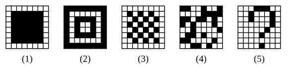](../../assets/volume4a/figures/exercise-7-1-4-160f-life-targets.svg)

(和 7.1.3 节一样, 黑格表示矩阵中的 1.)

**161.** [*28*] [答案](./answers/7-1-4.md#ans-7-1-4-161) 继续习题 160. 如果 $X$ 是驯化的矩阵, 且 $L_{ij}(X)=y_{ij}$($1\le i,j\le8$), 记 $L(X)=Y=(y_{ij})$.

(a) 有多少 $X$ 满足 $L(X)=X$(“静止生命”)?

(b) 找一个权值为 35 的 $8\times8$ 静止生命.

(c) “触发器” 是一对不同的矩阵, 满足 $L(X)=Y$、$L(Y)=X$. 这类触发器有多少?

(d) 找出一个 $X$ 和 $Y$ 的权值都为 28 的 “触发器”.

▶ **162.** [*30*] [答案](./answers/7-1-4.md#ans-7-1-4-162) (笼子里的生命游戏.) 如果 $X$ 和 $L(X)$ 是驯化的, 但 $L(L(X))$ 是野性的, 就说 $X$ 在 3 步后 “逃出” 笼子. 对于 $k=1,2,\ldots$, 有多少 $6\times6$ 矩阵恰好在 $k$ 步后逃出其 $6\times6$ 笼子?

**163.** [*23*] [答案](./answers/7-1-4.md#ans-7-1-4-163) 证明单次读取函数 BDD 大小的公式 (112) 和 $(113)$.

▶ **164.** [*M27*] [答案](./answers/7-1-4.md#ans-7-1-4-164) 对于所有单次读取函数 $f(x_1,\ldots,x_n)$, $B(f)$ 的最大值是多少?

**165.** [*M21*] [答案](./answers/7-1-4.md#ans-7-1-4-165) 验证关于 $B(u_m)$ 和 $B(v_m)$ 的斐波那契公式 (115).

**166.** [*M29*] [答案](./answers/7-1-4.md#ans-7-1-4-166) 完成定理 W 的证明.

**167.** [*21*] [答案](./answers/7-1-4.md#ans-7-1-4-167) 给定任意单次读取函数 $f(x_1,\ldots,x_n)$, 设计一种高效算法计算排列 $\pi$, 使 $B(f^\pi)$ 和 $B(f^\pi,\bar f^\pi)$ 都最小.

▶ **168.** [*HM40*] [答案](./answers/7-1-4.md#ans-7-1-4-168) 考虑作用于有序对 $z=(x,y)$ 的以下二元运算:

$$
\begin{aligned}
z\circ z'&=(x,y)\circ(x',y')=(x+x',\min(x+y',x'+y));\\
z\bullet z'&=(x,y)\bullet(x',y')=(x+x'+\min(y,y'),\max(y,y')).
\end{aligned}
$$

(这两种运算满足结合律和交换律.) 令 $S_1=\{(1,0)\}$, 并且对于 $n>1$, 定义

$$
S_n=\bigcup_{k=1}^{n-1}\{z\circ z'\mid z\in S_k,\ z'\in S_{n-k}\}\cup\bigcup_{k=1}^{n-1}\{z\bullet z'\mid z\in S_k,\ z'\in S_{n-k}\}.
$$

因此 $S_2=\{(2,0),(2,1)\}$, $S_3=\{(3,0),(3,1),(3,2)\}$, $S_4=\{(4,0),\ldots,(4,3),(5,1)\}$, 等等.

(a) 证明: 存在单次读取函数 $f(x_1,\ldots,x_n)$, 使得 $\min_\pi B(f^\pi)=c$ 且 $\min_\pi B(f^\pi,\bar f^\pi)=c'$, 当且仅当 $(\frac12c'-1,c-\frac12c'-1)\in S_n$.

(b) 判断真假: 对所有 $(x,y)\in S_n$, 都有 $0\le y<x$.

(c) 若 $z^T=(x+y,x-y)/\sqrt2$, 证明 $z^T\circ z'^T=(z\bullet z')^T$ 且 $z^T\bullet z'^T=(z\circ z')^T$.

(d) 如果 $\beta$ 为 $(116)$ 的常数, 证明对于所有 $(x,y)\in S_n$ 都有 $x^2+y^2\le n^{2\beta}$. [提示: 令 $|z|^2=x^2+y^2$. 只要证明在 $0\le y\le x$、$0\le y'\le x'$、$|z|=r=(1-\delta)^\beta$、$|z'|=r'=(1+\delta)^\beta$、$0\le\delta\le1$ 时, $|z\bullet z'|\le2^\beta=\sqrt2\phi$. 如果还有 $y=y'$, 则 $z\bullet z'$ 位于椭圆 $(a\cos\theta+b\sin\theta,b\sin\theta)$ 内, 其中 $a=r+r'$, $b=\sqrt{rr'}$.]

**169.** [*M46*] [答案](./answers/7-1-4.md#ans-7-1-4-169) 对于 $2^{2m+1}$ 个变量的任意单次读取函数 $f$, 是否有 $\min_\pi B(f^\pi)\le B(v_{2m+1})$?

▶ **170.** [*M25*] [答案](./answers/7-1-4.md#ans-7-1-4-170) 如果一个布尔函数的 BDD 以最简单的方式包含全部变量, 就称这个函数是 “瘦” 的. 瘦 BDD 对于每个变量 $x_j$ 正好有一个分支结点 $\text{\textcircled{j}}$, 并且每个分支结点的 LO 和 HI 至少有一个是汇结点.

(a) 有多少布尔函数 $f(x_1,\ldots,x_n)$ 在这个意义下是瘦的?

(b) 其中有多少是单调函数?

(c) 证明: 当 $0<t<2^n$ 且 $t$ 为奇数时, $f_t(x_1,\ldots,x_n)=[(x_1\ldots x_n)_2\ge t]$ 是瘦的.

(d) (c) 中函数 $f_t$ 的对偶是什么?

(e) 给定 $t$, 说明怎样求出 $f_t$ 的最短 CNF 和 DNF 公式.

**171.** [*M26*] [答案](./answers/7-1-4.md#ans-7-1-4-171) 继续习题 170, 证明函数是单次读取且正则的, 当且仅当它是瘦且单调的.

**172.** [*M28*] [答案](./answers/7-1-4.md#ans-7-1-4-172) 有多少瘦函数 $f(x_1,\ldots,x_n)$ 也是霍恩函数? 其中有多少的 $f$ 和 $\bar f$ 均满足霍恩条件?

▶ **173.** [*HM33*] [答案](./answers/7-1-4.md#ans-7-1-4-173) 恰有多少布尔函数 $f(x_1,\ldots,x_n)$ 经某种变量重排, $f(x_{1\pi},\ldots,x_{n\pi})$ 是瘦的?

▶ **174.** [*M39*] [答案](./answers/7-1-4.md#ans-7-1-4-174) 令 $S_n$ 是满足如下 “瘦” 条件的布尔函数 $f(x_1,\ldots,x_n)$ 的个数: 对于 $1\le j\le n$, BDD 恰有一个结点标为 $\text{\textcircled{j}}$. 证明 $S_n$ 也等于下列各类组合对象的个数:

(a) $2n$ 阶德拉克排列, 即对于 $1\le k\le2n$, 满足 $\lceil k/2\rceil\le p_k\le n+\lceil k/2\rceil$ 的排列 $p_1p_2\ldots p_{2n}$.

(b) $2n+2$ 阶杰诺其错位排列, 即对于 $1\le k\le2n+2$, 满足 $q_k>k$ 当且仅当 $k$ 为奇数的排列 $q_1q_2\ldots q_{2n+2}$, 且错位排列要求 $q_k\ne k$.

(c) $2n+2$ 阶不可约迪蒙信号枪序列, 即对于 $1\le k\le2n+2$, 满足 $k\le r_k\le2n+2$ 的序列 $r_1r_2\ldots r_{2n+2}$, 其中 $\{r_1,r_2,\ldots,r_{2n+2}\}=\{2,4,6,\ldots,2n,2n+2\}$, 并且对 $1\le k\le n$, 有 $2k\in\{r_1,\ldots,r_{2k-1}\}$.

(d) 在下列有向图中从 $(1,0)$ 到 $(2n+2,0)$ 的路径.

[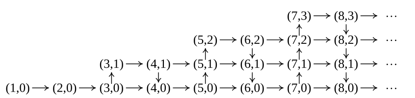](../../assets/volume4a/figures/exercise-7-1-4-174-lattice-paths.svg)

(注意 (d) 的对象很容易计数.)

**175.** [*M30*] [答案](./answers/7-1-4.md#ans-7-1-4-175) 继续习题 174, 给定分布 $(b_0,\ldots,b_{n-1},b_n)$, 找出枚举布尔函数的方法, 使它们的 BDD 恰含 $b_{j-1}$ 个标为 $\text{\textcircled{j}}$ 的结点.

**176.** [*M35*] [答案](./answers/7-1-4.md#ans-7-1-4-176) 为完成定理 X 的证明, 我们用到习题 6.4–78. 那道题说明, 当 $h_{a,b}(x)=((ax+b)\gg(n-l))\bmod2^l$、$A=\{a\mid0<a<2^n,\ a\text{ 为奇数}\}$、$B=\{b\mid0\le b<2^{n-l}\}$、$0\le l\le n$ 时, $\{h_{a,b}\mid a\in A\text{ 且 }b\in B\}$ 是从 $n$ 位键到 $l$ 位键的通用散列函数族. 令 $I=\{h_{a,b}(p)\mid p\in P\}$, $J=\{h_{a,b}(q)\mid q\in Q\}$.

(a) 证明: 如果 $2^l-1\le2^{t-1}\epsilon/(1-\epsilon)$, 则存在常数 $a\in A$ 和 $b\in B$, 使 $|I|\ge(1-\epsilon)2^l$ 且 $|J|\ge(1-\epsilon)2^l$.

(b) 给定这样的 $a$, 令 $J=\{j_1,\ldots,j_{|J|}\}$, 其中 $0=j_1<\cdots<j_{|J|}$, 选择 $Q'=\{q_1,\ldots,q_{|J|}\}\subseteq Q$, 使 $h_{a,b}(q_k)=j_k$($1\le k\le|J|$). 令 $g(q)$ 表示 $aq$ 的中间 $l-1$ 位, 即 $(aq\gg(n-l+1))\bmod2^{l-1}$. 证明只要 $q$ 与 $q'$ 是 $Q''=\{q_1,q_3,\ldots,q_{2\lceil |J|/2\rceil-1}\}$ 中的不同元素, 就有 $g(q)\ne g(q')$.

(c) 证明当 $l\ge3$ 且 $y=a$ 时, 以下集合 $Q^*$ 满足 $(120)$:

$$
Q^*=\{q\mid q\in Q'',\ g(q)\text{ 是偶数, 且对某个 }p\in P\text{ 有 }g(p)+g(q)=2^{l-1}\}.
$$

(d) 最后, 说明 $|Q^*|$ 已足够大, 可以证明定理 X.

**177.** [*M22*] [答案](./answers/7-1-4.md#ans-7-1-4-177) 给出整个伪分布的界, 以完成定理 A 的证明.

**178.** [*M24*] [答案](./answers/7-1-4.md#ans-7-1-4-178) (天野一幸和丸冈章.) 使用更好的变量顺序 $Z_n(x_{2n-1},x_1,x_3,\ldots,x_{2n-3};x_{2n},x_2,x_4,\ldots,x_{2n-2})$, 改进 $(121)$ 中的常数.

**179.** [*M47*] 乘积的中间二进制位是否满足 $B_{\min}(Z_n)=\Theta(2^{6n/5})$?

**180.** [*M27*] [答案](./answers/7-1-4.md#ans-7-1-4-180) 用正文中的提示证明定理 Y.

**181.** [*M21*] [答案](./answers/7-1-4.md#ans-7-1-4-181) 令 $L_{m,n}$ 为前导二进制位函数 $Z_{m,n}^{(m+n)}(x_1,\ldots,x_m;y_1,\ldots,y_n)$. 证明当 $m\le n$ 时, $B_{\min}(L_{m,n})=O(2^mn)$.

**182.** [*M38*] [答案](./answers/7-1-4.md#ans-7-1-4-182) (英戈·韦格纳.) 当 $n\to\infty$ 时, $B_{\min}(L_{n,n})$ 按指数增长吗?

▶ **183.** [*M25*] [答案](./answers/7-1-4.md#ans-7-1-4-183) 含有无限多个布尔变量的 “极限前导二进制位函数” 为

$$
[(.x_1x_3x_5\ldots)_2\cdot(.x_2x_4x_6\ldots)_2\ge\tfrac12].
$$

画出其 BDD 的前几层. 第 $k$ 层有多少结点 $b_k$? (不允许 $(.x_1x_3x_5\ldots)_2$ 或 $(.x_2x_4x_6\ldots)_2$ 的二进制展开从某一位起全是 1.)

**184.** [*M23*] [答案](./answers/7-1-4.md#ans-7-1-4-184) 排列函数 $P_m$ 的 BDD 分布和 ZDD 分布各是什么?

**185.** [*M25*] [答案](./answers/7-1-4.md#ans-7-1-4-185) 当 $f$ 是 $n$ 个变量的对称布尔函数时, $Z(f)$ 可以有多大? (见习题 44.)

**186.** [*10*] [答案](./answers/7-1-4.md#ans-7-1-4-186) 下面的 ZDD 表示变量为 $\{x_1,x_2,x_3,x_4,x_5,x_6\}$ 的什么布尔函数?

[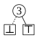](../../assets/volume4a/figures/exercise-7-1-4-186-zdd.svg)

▶ **187.** [*20*] [答案](./answers/7-1-4.md#ans-7-1-4-187) 画出二变量的全部 16 个布尔函数 $f(x_1,x_2)$ 的 ZDD. [提示: 从 QDD 中删去 HI = LO 的结点, 可得到 BDD; 从 QDD 中删去 HI = $\boxed{\bot}$ 的结点, 可得到 ZDD.]

**188.** [*16*] [答案](./answers/7-1-4.md#ans-7-1-4-188) 把全部 16 个布尔函数 $f(x_1,x_2)$ 表示成 $\{1,2\}$ 的子集族.

**189.** [*18*] [答案](./answers/7-1-4.md#ans-7-1-4-189) 哪些函数 $f(x_1,\ldots,x_n)$ 的 ZDD 与其 BDD 相同?

**190.** [*20*] [答案](./answers/7-1-4.md#ans-7-1-4-190) 描述满足下列条件的所有函数 $f$: (a) $Q(f)=B(f)$, (b) $Q(f)=Z(f)$.

▶ **191.** [*HM25*] [答案](./answers/7-1-4.md#ans-7-1-4-191) 有多少个函数 $f(x_1,\ldots,x_n)$ 的 ZDD 不含 $\boxed{\bot}$?

**192.** [*M20*] [答案](./answers/7-1-4.md#ans-7-1-4-192) 二进制串的 $Z$ 变换定义如下: $\epsilon^Z=\epsilon$, $0^Z=0$, $1^Z=1$, 并且

$$
(\alpha\beta)^Z=\begin{cases}
\alpha^Z\alpha^Z,&\text{若 }|\alpha|=n\text{ 且 }\beta=0^n;\\
\alpha^Z0^n,&\text{若 }|\alpha|=n\text{ 且 }\beta=\alpha;\\
\alpha^Z\beta^Z,&\text{若 }|\alpha|=|\beta|-1\text{, 或 }|\alpha|=|\beta|=n\text{ 且 }\alpha\ne\beta\ne0^n。
\end{cases}
$$

(a) $\mathtt{11001001000011111}^Z$ 是什么?

(b) 判断真假: 对所有二进制串 $\tau$, 都有 $(\tau^Z)^Z=\tau$.

(c) 若 $f(x_1,\ldots,x_n)$ 是真值表为 $\tau$ 的布尔函数, 令 $f^Z(x_1,\ldots,x_n)$ 为真值表为 $\tau^Z$ 的布尔函数. 证明 $f$ 的分布几乎等于 $f^Z$ 的 $z$ 分布, 反之亦然. (因此定理 U 同时适用于 BDD 和 ZDD, 像 $(80)$ 那样的统计数据也适用于 $z$ 分布.)

**193.** [*M21*] [答案](./answers/7-1-4.md#ans-7-1-4-193) 继续习题 192, 当 $0\le k\le n$ 时, $S_k^Z(x_1,\ldots,x_n)$ 是什么?

**194.** [*M25*] [答案](./answers/7-1-4.md#ans-7-1-4-194) 有多少个函数 $f(x_1,\ldots,x_n)$ 的 $z$ 分布为 $(1,\ldots,1)$? (见习题 174.)

**195.** [*24*] [答案](./answers/7-1-4.md#ans-7-1-4-195) 求 $Z(M_2)$、$Z_{\min}(M_2)$ 和 $Z_{\max}(M_2)$, 其中 $M_2$ 是四路复用器.

**196.** [*M21*] [答案](./answers/7-1-4.md#ans-7-1-4-196) 找出一个函数 $f(x_1,\ldots,x_n)$, 使 $Z(f)=O(n)$ 且 $Z(\bar f)=\Omega(n^2)$.

**197.** [*25*] [答案](./answers/7-1-4.md#ans-7-1-4-197) 修改习题 138 的算法, 使它计算 $f$ 的 “主 $z$ 分布图”. (然后, 可以像习题 133 那样计算 $Z_{\min}(f)$ 和 $Z_{\max}(f)$.)

▶ **198.** [*23*] [答案](./answers/7-1-4.md#ans-7-1-4-198) 说明怎样用 ZDD 计算 $\operatorname{AND}(f,g)$ (见 $(55)$).

**199.** [*21*] [答案](./answers/7-1-4.md#ans-7-1-4-199) 类似地, 实现 (a) $\operatorname{OR}(f,g)$, (b) $\operatorname{XOR}(f,g)$, (c) $\operatorname{BUTNOT}(f,g)$.

**200.** [*21*] [答案](./answers/7-1-4.md#ans-7-1-4-200) 类似地, 用 ZDD 实现 $\operatorname{MUX}(f,g,h)$ (见 $(62)$).

**201.** [*22*] [答案](./answers/7-1-4.md#ans-7-1-4-201) 每个投影函数 $x_j$ 都有简单的 3 结点 BDD, 但其 ZDD 表示更复杂. 通用 ZDD 工具箱应怎样实现这些函数?

**202.** [*24*][答案](./answers/7-1-4.md#ans-7-1-4-202) 若在 ZDD 基中交换层 $\text{\textcircled{u}}\leftrightarrow\text{\textcircled{v}}$, 习题 147 的就地交换算法应怎样修改?

▶ **203.** [*M24*][答案](./answers/7-1-4.md#ans-7-1-4-203) (集族代数.) 以下代数约定适用于正整数有限子集所构成的有限集族, 以及这些集族的 ZDD 表示. 最简单的集族是空族 $\emptyset$, 其 ZDD 为 $\boxed{\bot}$. 单位族 $\{\emptyset\}$ 记为 $\epsilon$, 其 ZDD 为 $\boxed{\top}$. 对于 $j\ge1$, 基本族 $\{\{j\}\}$ 记为 $e_j$, 其 ZDD 为分支结点 $\text{\textcircled{j}}$, 其中 LO = $\boxed{\bot}$, HI = $\boxed{\top}$. (习题 186 画出了 $e_3$ 的 ZDD.)

两个集族 $f$ 和 $g$ 可以用通常的集合运算组合:

- 并 $f\cup g=\{\alpha\mid\alpha\in f\text{ 或 }\alpha\in g\}$, 用 $\operatorname{OR}(f,g)$ 实现.
- 交 $f\cap g=\{\alpha\mid\alpha\in f\text{ 且 }\alpha\in g\}$, 用 $\operatorname{AND}(f,g)$ 实现.
- 差 $f\setminus g=\{\alpha\mid\alpha\in f\text{ 且 }\alpha\notin g\}$, 用 $\operatorname{BUTNOT}(f,g)$ 实现.
- 对称差 $f\oplus g=(f\setminus g)\cup(g\setminus f)$, 用 $\operatorname{XOR}(f,g)$ 实现.

另外定义三种构造子集族的方法:

- 联合 $f\sqcup g=\{\alpha\cup\beta\mid\alpha\in f\text{ 且 }\beta\in g\}$, 有时简写为 $fg$.
- 交叉 $f\sqcap g=\{\alpha\cap\beta\mid\alpha\in f\text{ 且 }\beta\in g\}$.
- 异或 $f\boxplus g=\{\alpha\oplus\beta\mid\alpha\in f\text{ 且 }\beta\in g\}$.

这三种运算都满足交换律和结合律: $f\sqcup g=g\sqcup f$, $f\sqcup(g\sqcup h)=(f\sqcup g)\sqcup h$, 等等.

(a) 假定 $f=\{\emptyset,\{1,2\},\{1,3\}\}=\epsilon\cup(e_1\sqcup(e_2\cup e_3))$, 且 $g=\{\{1,2\},\{3\}\}=(e_1\sqcup e_2)\cup e_3$. $f\sqcup g$ 和 $(f\sqcap g)\setminus(f\boxplus e_1)$ 是什么?

(b) 也可以把任意集族 $f$ 看作布尔函数 $f(x_1,x_2,\ldots)$, 其中 $\alpha\in f\iff f([1\in\alpha],[2\in\alpha],\ldots)=1$. 用布尔逻辑公式描述 $\sqcup$、$\sqcap$、$\boxplus$ 运算.

(c) 以下哪些公式对所有集族 $f,g,h$ 都成立?

(i) $f\sqcup(g\cup h)=(f\sqcup g)\cup(f\sqcup h)$.

(ii) $f\sqcap(g\cup h)=(f\sqcap g)\cup(f\sqcap h)$.

(iii) $f\sqcup(g\sqcap h)=(f\sqcup g)\sqcap(f\sqcup h)$.

(iv) $f\cup(g\sqcup h)=(f\cup g)\sqcup(f\cup h)$.

(v) $f\boxplus\emptyset=\emptyset\sqcap g=h\sqcup\emptyset$.

(vi) $f\sqcap\epsilon=\epsilon$.

(d) 如果对所有 $\alpha\in f$ 和 $\beta\in g$ 都有 $\alpha\cap\beta=\emptyset$, 则称 $f$ 和 $g$ 正交, 记为 $f\perp g$. 以下哪些命题对所有集族 $f,g$ 都为真?

(i) $f\perp g\iff f\sqcap g=\epsilon$.

(ii) $f\perp g\implies |f\sqcup g|=|f||g|$.

(iii) $|f\sqcup g|=|f||g|\implies f\perp g$.

(iv) $f\perp g\iff f\sqcup g=f\boxplus g$.

(e) 对下列每个命题, 描述使之成立的所有集族 $f$.

(i) 对所有 $g$, $f\cup g=g$.

(ii) 对所有 $g$, $f\sqcup g=g$.

(iii) 对所有 $g$, $f\sqcap g=g$.

(iv) $f\sqcup(e_1\sqcup e_2)=f$.

(v) $f\sqcup(e_1\cup e_2)=f$.

(vi) $f\boxplus((e_1\sqcup e_2)\cup e_3)=f$.

(vii) $f\boxplus f=\epsilon$.

(viii) $f\sqcap f=f$.

▶ **204.** [*M25*][答案](./answers/7-1-4.md#ans-7-1-4-204) 继续习题 203, 以下两种运算也很重要.

- 商 $f/g=\{\alpha\mid\text{对所有 }\beta\in g\text{ 都有 }\alpha\cup\beta\in f\text{ 且 }\alpha\cap\beta=\emptyset\}$.
- 余数 $f\bmod g=f\setminus(g\sqcup(f/g))$.

商有时也称为 $f$ 关于 $g$ 的 “余子式”.

(a) 证明 $f/(g\cup h)=(f/g)\cap(f/h)$.

(b) 假定 $f=\{\{1,2\},\{1,3\},\{2\},\{3\},\{4\}\}$. $f/e_2$ 和 $f/(f/e_2)$ 是什么?

(c) 对任意 $f,g$, 简化 $f/\emptyset$、$f/\epsilon$、$f/f$ 和 $(f\bmod g)/g$.

(d) 证明 $f/g=f/(f/(f/g))$. [提示: 从 $g\subseteq f/(f/g)$ 出发.]

(e) 证明 $f/g$ 也可定义为 $\bigcup\{h\mid g\sqcup h\subseteq f\text{ 且 }g\perp h\}$.

(f) 给定 $f$ 和 $j$, 证明 $f$ 有满足 $e_j\perp(g\cup h)$ 的唯一表示 $(e_j\sqcup g)\cup h$.

(g) 判断真假: $(f\sqcup g)\bmod e_j=(f\bmod e_j)\sqcup(g\bmod e_j)$; $(f\sqcap g)/e_j=(f/e_j)\sqcap(g/e_j)$.

**205.** [*M25*][答案](./answers/7-1-4.md#ans-7-1-4-205) 用习题 198 的约定, 实现集族代数的五种基本运算: (a) $f\sqcup g$, (b) $f\sqcap g$, (c) $f\boxplus g$, (d) $f/g$, (e) $f\bmod g$.

**206.** [*M40*][答案](./answers/7-1-4.md#ans-7-1-4-206) 习题 205 中的算法在最坏情形下的运行时间各是多少?

▶ **207.** [*M25*][答案](./answers/7-1-4.md#ans-7-1-4-207) 像习题 201 那样, 应用程序需要一个或多个投影函数 $x_j$ 时, 使用下列 “对称化” 运算很方便:

$$
(e_{i_1}\cup e_{i_2}\cup\cdots\cup e_{i_l})\mathbin{\text{§}}k=S_k(x_{i_1},x_{i_2},\ldots,x_{i_l}),\qquad k\ge0\text{ 且为整数.}
$$

例如, $e_j\mathbin{\text{§}}1=x_j$, $e_j\mathbin{\text{§}}0=\bar x_j$, $(e_i\cup e_j)\mathbin{\text{§}}1=x_i\oplus x_j$;

$$
(e_2\cup e_3\cup e_5)\mathbin{\text{§}}2=(x_2\wedge x_3\wedge\bar x_5)\vee(x_2\wedge\bar x_3\wedge x_5)\vee(\bar x_2\wedge x_3\wedge x_5).
$$

说明怎样简单地实现此运算. (注意: $l>0$ 时, $e_{i_1}\cup\cdots\cup e_{i_l}$ 有一个大小为 $l+2$ 的简单 ZDD.)

▶ **208.** [*16*][答案](./answers/7-1-4.md#ans-7-1-4-208) 说明怎样修改算法 C, 用给定布尔函数的 ZDD 轻松算出它的解数.

**209.** [*M21*][答案](./answers/7-1-4.md#ans-7-1-4-209) 说明怎样根据布尔函数的 ZDD 求它的完全详尽真值表. (见习题 31.)

▶ **210.** [*23*][答案](./answers/7-1-4.md#ans-7-1-4-210) 给定 $f$ 的 ZDD, 说明怎样构造以下函数的 ZDD:

$$
g(x)=[f(x)=1\text{ 且 }\nu x=\max\{\nu y\mid f(y)=1\}].
$$

**211.** [*M20*][答案](./answers/7-1-4.md#ans-7-1-4-211) 当 $f$ 描述恰当覆盖问题的解时, $Z(f)\le B(f)$ 是否成立?

▶ **212.** [*25*][答案](./answers/7-1-4.md#ans-7-1-4-212) 有什么好办法计算恰当覆盖问题的 ZDD?

**213.** [*16*][答案](./answers/7-1-4.md#ans-7-1-4-213) 为什么不能用多米诺骨牌完全覆盖残缺棋盘?

▶ **214.** [*21*][答案](./answers/7-1-4.md#ans-7-1-4-214) 用多米诺骨牌覆盖某个形状时, 如果穿过该形状内部的每条直线都穿过至少一块骨牌的内部, 就称这种覆盖为无故障的. 例如, $(127)$ 的右图覆盖无故障, 中图覆盖有故障, 左图覆盖有许多故障.

多米诺骨牌对国际象棋棋盘的覆盖中, 有多少种是无故障的?

**215.** [*21*][答案](./answers/7-1-4.md#ans-7-1-4-215) 日本的榻榻米草垫是 $1\times2$ 的矩形垫席, 传统上铺在矩形地板上, 使任何角点都不会是四块垫席的交点. 例如, 图 29(a) 是吉田光由的 *Jinkōki*[^v4a-p228-1] 一书 1641 年版中的 $6\times5$ 图案. 该书首次出版于 1627 年.

找出国际象棋棋盘中也属于榻榻米平铺的所有多米诺骨牌覆盖.

[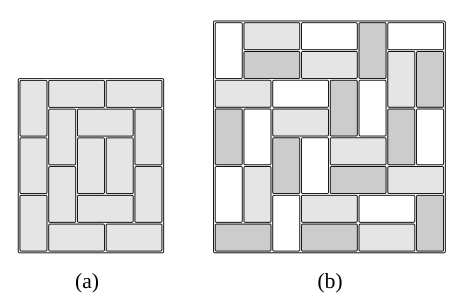](../../assets/volume4a/figures/fig-7-29-domino-tilings.svg)

**图 29**　两个好例子.

(a) 17 世纪的榻榻米平铺.

(b) 三色多米诺骨牌覆盖.

▶ **216.** [*30*][答案](./answers/7-1-4.md#ans-7-1-4-216) 图 29(b) 是用三色多米诺骨牌覆盖的国际象棋棋盘, 其相邻的骨牌颜色各异.

(a) 有多少种这样的覆盖?

(b) 在 12 988 816 种多米诺骨牌覆盖中, 有多少种可作 3 着色?

**217.** [*29*][答案](./answers/7-1-4.md#ans-7-1-4-217) $(130)$ 的单米诺骨牌、多米诺骨牌和三米诺骨牌覆盖还满足一项条件: 没有两个全同块相邻. 正文所载的约 $92\times10^{21}$ 种覆盖中, 有多少在此意义下是 “分离的”?

▶ **218.** [*24*][答案](./answers/7-1-4.md#ans-7-1-4-218) 应用 BDD 和 ZDD 技术, 解决本章开头讨论的兰福德配对问题.

**219.** [*20*][答案](./answers/7-1-4.md#ans-7-1-4-219) 当 $F$ 为以下集族时, $Z(F)$ 各是多少? (a) `WORDS(1000)`, ……, (e) `WORDS(5000)`.

▶ **220.** [*21*][答案](./answers/7-1-4.md#ans-7-1-4-220) 如 $(131)$ 所述, 以 $a_1\ldots z_5$ 共 130 个变量表示 5757 个 SGB 单词, 其 $z$ 分布为 $(1,1,1,\ldots,1,1,23,3,\ldots,6,2,0,3,2,1,1,2)$.

(a) 解释变量 $a_2$ 和 $b_2$ 对应的 23 和 3.

(b) 解释变量 $v_5$、$w_5$、$x_5$ 等对应的末尾六项 0、3、2、1、1、2.

▶ **221.** [*M27*][答案](./answers/7-1-4.md#ans-7-1-4-221) 由于语言的特殊性质, 用 130 个变量表示最常见的 5757 个英语五字母单词, 只需 5020 个结点. 可能的五字母串共有 $26^5=11\,881\,376$ 个. 假定随机选取其中的 5757 个, ZDD 平均有多大?

▶ **222.** [*27*][答案](./answers/7-1-4.md#ans-7-1-4-222) 像 $(131)$ 那样把集族代数用于五字母单词时, 将原来的 130 个变量 $x_1,x_2,\ldots,x_{130}$ 改记为 $a_1,b_1,\ldots,z_5$, 对应的基本族也从 $e_1,e_2,\ldots,e_{130}$ 改记为 $\mathtt a_1,\mathtt b_1,\ldots,\mathtt z_5$. 因此, 可以通过综合下列公式构造集族 $F=\mathrm{WORDS}(5757)$:

$$
F=(\mathtt w_1\sqcup\mathtt h_2\sqcup\mathtt i_3\sqcup\mathtt c_4\sqcup\mathtt h_5)\cup\cdots\cup(\mathtt f_1\sqcup\mathtt u_2\sqcup\mathtt n_3\sqcup\mathtt n_4\sqcup\mathtt y_5)\cup\cdots\cup(\mathtt p_1\sqcup\mathtt u_2\sqcup\mathtt p_3\sqcup\mathtt a_4\sqcup\mathtt l_5).
$$

(a) 令 $\wp$ 为 $\{a_1,\ldots,z_5\}$ 的所有子集组成的全域族, 也称 “幂集”. $F\sqcap\wp$ 有何意义?

(b) 令 $X=X_1\sqcup\cdots\sqcup X_5$, 其中 $X_j=\{\mathtt a_j,\mathtt b_j,\ldots,\mathtt z_j\}$. 解释 $F\sqcap X$.

(c) 给出表示 $F$ 中与模式 `t*u*h` 匹配的所有单词的简单公式.

(d) 给出表示恰含 $k$ 个元音的所有 SGB 单词的公式, 其中 $0\le k\le5$, 只把 `a`、`e`、`i`、`o`、`u` 视为元音. 令 $V_j=\mathtt a_j\cup\mathtt e_j\cup\mathtt i_j\cup\mathtt o_j\cup\mathtt u_j$.

(e) 只指定三个字母的模式中, 有多少与至少一个 SGB 单词匹配? 例如 `m*tc*`. 给出一个公式.

(f) 这些模式中, 有多少匹配至少两个单词, 例如 `*atc*`?

(g) 表示将一处 `b` 改为 `o` 后仍是单词的所有单词.

(h) 公式 $F/V_2$ 的含义是什么?

(i) 比较 $(X_1\sqcup V_2\sqcup V_3\sqcup V_4\sqcup X_5)\cap F$ 与 $(X_1\sqcup X_5)\setminus((\wp\setminus F)/(V_2\sqcup V_3\sqcup V_4))$.

**223.** [*28*][答案](./answers/7-1-4.md#ans-7-1-4-223) “中位数单词” 是一个五字母单词 $\mu=\mu_1\ldots\mu_5$, 由三个单词 $\alpha=\alpha_1\ldots\alpha_5$、$\beta=\beta_1\ldots\beta_5$、$\gamma=\gamma_1\ldots\gamma_5$ 按规则 $[\alpha_i=\mu_i]+[\beta_i=\mu_i]+[\gamma_i=\mu_i]=2$($1\le i\le5$) 得到. 例如, `mixed` 是 `{fixed,mixer,mound}` 的中位数, 也是 `{mated,mixup,nixed}` 的中位数. 但是 `noted` 不是 `{notes,voted,naked}` 的中位数, 因为这三个单词的第 4 个字母都是 `e`.

(a) 证明: 如果 $\mu$ 是 $\{\alpha,\beta,\gamma\}$ 的中位数, 则 $\{d(\alpha,\mu),d(\beta,\mu),d(\gamma,\mu)\}$ 是 $\{1,1,3\}$ 或 $\{1,2,2\}$. 这里 $d$ 表示汉明距离.

(b) 当 $n=100$、1000、5757 时, `WORDS(n)` 能产生多少中位数单词?

(c) 当 $m=100$、1000、5757 时, 这些中位数单词中有多少属于 `WORDS(m)`?

▶ **224.** [*20*][答案](./answers/7-1-4.md#ans-7-1-4-224) 像图 28 那样, 构造一个 ZDD, 表示有向无圈图中所有从源到汇的路径. 若这个图恰好是一片森林, 即每个非源顶点的入度都为 1, 证明对应的 ZDD 实质上与通过 “森林与二叉树的自然对应” 表示该森林的二叉树相同. 见式 2.3.2–$(1)$ 至 2.3.2–$(3)$.

▶ **225.** [*30*][答案](./answers/7-1-4.md#ans-7-1-4-225) 给定一个图及其两个不同的顶点 $\{s,t\}$, 设计算法 SIMPATH, 构造表示从 $s$ 到 $t$ 的所有简单路径的边集的 ZDD.

▶ **226.** [*20*][答案](./answers/7-1-4.md#ans-7-1-4-226) 修改习题 225 的算法, 构造给定图的所有简单圈的 ZDD.

**227.** [*20*][答案](./answers/7-1-4.md#ans-7-1-4-227) 类似地修改该算法, 使其只考虑从 $s$ 到 $t$ 的哈密顿路径.

**228.** [*21*][答案](./answers/7-1-4.md#ans-7-1-4-228) 再修改该算法, 使其考虑从 $s$ 到其他任一顶点的哈密顿路径.

**229.** [*15*][答案](./answers/7-1-4.md#ans-7-1-4-229) 图 $(18)$ 中从 CA 到 ME 的路径有 587 218 421 488 条, 图 $(133)$ 中这样的路径只有 437 525 772 584 条. 解释这个差异.

**230.** [*25*][答案](./answers/7-1-4.md#ans-7-1-4-230) 找出图 $(133)$ 中总长度最小和最大的哈密顿路径. 若所有哈密顿路径等可能, 平均长度是多少?

**231.** [*23*][答案](./answers/7-1-4.md#ans-7-1-4-231) 国际象棋中的王, 从棋盘一角走到对角且不重复占用同一格, 有多少条路径? (这些是图 $P_8\boxtimes P_8$ 中从一角到对角的简单路径.)

▶ **232.** [*23*][答案](./answers/7-1-4.md#ans-7-1-4-232) 继续习题 231, 国际象棋中 “王的漫游” 是 $P_8\boxtimes P_8$ 的有向哈密顿圈. 求王的漫游的确切数目. 按欧几里得距离计, 最长的王的漫游是什么?

▶ **233.** [*25*][答案](./answers/7-1-4.md#ans-7-1-4-233) 设计一个算法, 构造给定有向图的全部有向圈所组成的集族的 ZDD. (见习题 226.)

**234.** [*22*][答案](./answers/7-1-4.md#ans-7-1-4-234) 将习题 233 的算法应用于 $(18)$ 的 49 个邮政编码 `AL`、`AR`、……、`WY` 所组成的有向图. 像习题 7–54(b) 那样, $\mathtt{XY}\to\mathtt{YZ}$ 为一条弧. 例如, 有向圈之一为 $\mathtt{NC}\to\mathtt{CT}\to\mathtt{TN}\to\mathtt{NC}$. 共有多少有向圈? 最小和最大的圈长分别是多少?

**235.** [*22*][答案](./answers/7-1-4.md#ans-7-1-4-235) 在五字母英语单词上构造一个有向图: 当 $x$ 的末三个字母与 $y$ 的首三个字母相同, 就有 $x\to y$, 例如 `crown` → `owner`. 这个图有多少个有向圈? 最长和最短的有哪些?

▶ **236.** [*M25*][答案](./answers/7-1-4.md#ans-7-1-4-236) 把 ZDD 用于组合问题时, 会自然地扩充习题 203 的集族代数. 例如可以对集族做下列五种运算:

- 极大元素族 $f^\uparrow=\{\alpha\in f\mid\beta\in f\text{ 且 }\alpha\subseteq\beta\text{ 蕴涵 }\alpha=\beta\}$.
- 极小元素族 $f^\downarrow=\{\alpha\in f\mid\beta\in f\text{ 且 }\alpha\supseteq\beta\text{ 蕴涵 }\alpha=\beta\}$.
- 非子集 $f\nearrow g=\{\alpha\in f\mid\beta\in g\text{ 蕴涵 }\alpha\nsubseteq\beta\}$.
- 非超集 $f\searrow g=\{\alpha\in f\mid\beta\in g\text{ 蕴涵 }\alpha\nsupseteq\beta\}$.
- 极小命中族 $f^\#=\{\alpha\mid\beta\in f\text{ 蕴涵 }\alpha\cap\beta\ne\emptyset\}^\downarrow$.

例如, $f$ 和 $g$ 为习题 203(a) 的集族时, 有 $f^\uparrow=e_1\sqcup(e_2\cup e_3)$、$f^\downarrow=\epsilon$、$f^\#=\emptyset$、$g^\uparrow=g^\downarrow=g$、$g^\#=(e_1\cup e_2)\sqcup e_3$、$f\nearrow g=e_1\sqcup e_3$、$f\searrow g=\epsilon$、$g\nearrow f=g\searrow f=\emptyset$.

(a) 证明 $f\nearrow g=f\setminus(f\sqcap g)$, 并给出 $f\searrow g$ 的类似公式.

(b) 令 $f^C=\{\bar\alpha\mid\alpha\in f\}=f\boxplus U$, 其中 $U=e_1\sqcup e_2\sqcup\cdots$ 是 “全集”. 显然 $f^{CC}=f$、$(f\cup g)^C=f^C\cup g^C$、$(f\cap g)^C=f^C\cap g^C$、$(f\setminus g)^C=f^C\setminus g^C$. 证明下列对偶律也成立: $f^{\uparrow C}=f^{C\downarrow}$、$f^{\downarrow C}=f^{C\uparrow}$; $(f\sqcup g)^C=f^C\sqcap g^C$、$(f\sqcap g)^C=f^C\sqcup g^C$; $(f\nearrow g)^C=f^C\searrow g^C$、$(f\searrow g)^C=f^C\nearrow g^C$; $f^\#=(\wp\nearrow f^C)^\downarrow$.

(c) 判断真假:

(i) $x_1^\downarrow=e_1$.

(ii) $x_1^\uparrow=e_1$.

(iii) $x_1^\#=e_1$.

(iv) $(x_1\vee x_2)^\downarrow=e_1\cup e_2$.

(v) $(x_1\wedge x_2)^\downarrow=e_1\sqcup e_2$.

(d) 下列哪些公式对所有集族 $f,g,h$ 成立?

(i) $f^{\uparrow\uparrow}=f^\uparrow$.

(ii) $f^{\uparrow\downarrow}=f^\downarrow$.

(iii) $f^{\uparrow\downarrow}=f^\uparrow$.

(iv) $f^{\downarrow\uparrow}=f^\downarrow$.

(v) $f^{\#\downarrow}=f^\#$.

(vi) $f^{\#\uparrow}=f^\#$.

(vii) $f^{\downarrow\#}=f^\#$.

(viii) $f^{\uparrow\#}=f^\#$.

(ix) $f^{\#\#}=f^\#$.

(x) $f\nearrow(g\cup h)=(f\nearrow g)\cap(f\nearrow h)$.

(xi) $f\searrow(g\cup h)=(f\searrow g)\cap(f\searrow h)$.

(xii) $f\searrow(g\cup h)=(f\searrow g)\searrow h$.

(xiii) $f\nearrow g^\uparrow=f\nearrow g$.

(xiv) $f\searrow g^\uparrow=f\searrow g$.

(xv) $(f\sqcup g)^\#=(f^\#\cup g^\#)^\downarrow$.

(xvi) $(f\cup g)^\#=(f^\#\sqcup g^\#)^\downarrow$.

(e) 设 $g=\bigcup_{u\!-\!v}(e_u\sqcup e_v)$ 是图的全部边组成的集族, $f$ 是全部独立集组成的集族. 用扩充的集族代数求两个简单公式: (i) 用 $g$ 表示 $f$; (ii) 用 $f$ 表示 $g$.

**237.** [*25*][答案](./answers/7-1-4.md#ans-7-1-4-237) 仿照习题 205 的形式, 实现习题 236 中的五种运算.

▶ **238.** [*22*][答案](./answers/7-1-4.md#ans-7-1-4-238) 用 ZDD 计算 $(18)$ 中美国接壤各州图 $G$ 的极大诱导二部子图, 即使得 $G|U$ 没有奇数长度圈的极大子集 $U$. 这样的 $U$ 有多少个? 举出最小和最大集合的例子. 再考虑极大诱导三部 (可作 3 着色) 子图.

▶ **239.** [*21*][答案](./answers/7-1-4.md#ans-7-1-4-239) 像习题 236(e) 那样用边集族 $g$ 指定图 $G$. 说明怎样用集族代数求 $G$ 的极大团. 当 $G$ 为图 $(18)$ 时, 对于 $k=1,2,\ldots$, 找出能由 $k$ 个团覆盖的极大顶点集.

▶ **240.** [*22*][答案](./answers/7-1-4.md#ans-7-1-4-240) 若图的每个顶点与 $U$ 至多相距一步, 则顶点集 $U$ 称为图的控制集.

(a) 证明图的每个核都是极小控制集.

(b) 美国接壤各州的图 $(18)$ 有多少个极小控制集?

(c) 找出图 $(18)$ 中控制其他 36 个顶点的 7 个顶点.

▶ **241.** [*28*][答案](./answers/7-1-4.md#ans-7-1-4-241) 棋盘的皇后图 $Q_8$ 含 64 个格子. 格子 $u,v$ 在同一行、同一列或同一条对角线上时, $u\!-\!v$ 是一条边. 表示下列对象的 ZDD 各有多大? (a) 核, (b) 极大团, (c) 极小控制集, (d) 同时是团的极小控制集, (e) 极大诱导二部子图.

给出这五类对象各自最小和最大的例子.

**242.** [*24*][答案](./answers/7-1-4.md#ans-7-1-4-242) 找出在 $8\times8$ 网格上选点的所有极大方案, 使任意三个所选点都不在同一条直线上.

**243.** [*M23*][答案](./answers/7-1-4.md#ans-7-1-4-243) 集族 $f$ 的闭包 $f^\cap$ 由所有可以通过 $f$ 的一个或多个成员相交得到的集合组成.

(a) 证明 $f^\cap=\{\alpha\mid\alpha=\bigcap\{\beta\mid\beta\in f\text{ 且 }\beta\supseteq\alpha\}\}$.

(b) 给定 $f$ 的 ZDD, 求 $f^\cap$ 的 ZDD 的好办法是什么?

(c) 像习题 222 那样取 $F=\mathrm{WORDS}(5757)$, 求 $F^\cap$ 的生成函数.

**244.** [*25*][答案](./answers/7-1-4.md#ans-7-1-4-244) 对于 $P_3\mathbin{\square}P_3$ (图 22) 的连通性函数, 其 ZDD 是什么? 对于同一个图的生成树函数, 其 BDD 是什么? (见推论 S.)

▶ **245.** [*M22*][答案](./answers/7-1-4.md#ans-7-1-4-245) 证明单调函数 $f$ 的素子句是 $\operatorname{PI}(f)^\#$.

**246.** [*M21*][答案](./answers/7-1-4.md#ans-7-1-4-246) 假定 $(137)$ 成立, 证明定理 S.

▶ **247.** [*M27*][答案](./answers/7-1-4.md#ans-7-1-4-247) 对于 $n\le7$, 确定 $n$ 个变量的纯净布尔函数的数目.

**248.** [*M22*][答案](./answers/7-1-4.md#ans-7-1-4-248) 判断真假: 如果 $f$ 和 $g$ 都纯净, 那么 $f(x_1,\ldots,x_n)\wedge g(x_1,\ldots,x_n)$ 也纯净.

**249.** [*HM31*][答案](./answers/7-1-4.md#ans-7-1-4-249) 图的连通性函数是 “超纯净” 的, 即它在变量的所有排列下都纯净. 有没有很好的方法刻画超纯净布尔函数?

**250.** [*28*][答案](./answers/7-1-4.md#ans-7-1-4-250) 有 7581 个单调布尔函数 $f(x_1,x_2,x_3,x_4,x_5)$. 随机选取一个时, $B(f)$ 和 $Z(\operatorname{PI}(f))$ 的平均值各是多少? $Z(\operatorname{PI}(f))>B(f)$ 的概率是多少? $Z(\operatorname{PI}(f))/B(f)$ 的最大值是多少?

**251.** [*M46*][答案](./answers/7-1-4.md#ans-7-1-4-251) $Z(\operatorname{PI}(f))=O(B(f))$ 对所有单调布尔函数 $f$ 都成立吗?

**252.** [*M30*][答案](./answers/7-1-4.md#ans-7-1-4-252) 布尔函数非单调时, 其素蕴涵元中会有负字面量. 例如, $(x_1\mathbin{?}x_2\mathbin{:}x_3)$ 的素蕴涵元是 $x_1\wedge x_2$、$\bar x_1\wedge x_3$ 和 $x_2\wedge x_3$. 若把这些蕴涵元看成字母表 $\{e_1,e'_1,\ldots,e_n,e'_n\}$ 上的单词, 就可以用 ZDD 方便地表示. 于是, `01*0*` 这样的 “子立方” 就是集族代数中的 $e'_1\sqcup e_2\sqcup e'_4$ (见 7.1.1–$(29)$), 而且 $\operatorname{PI}(x_1\mathbin{?}x_2\mathbin{:}x_3)=(e_1\sqcup e_2)\cup(e'_1\sqcup e_3)\cup(e_2\sqcup e_3)$.

习题 7.1.1–116 说明, $n$ 变量对称函数可以有 $\Omega(3^n/n)$ 个素蕴涵元. $f$ 为对称函数时, $Z(\operatorname{PI}(f))$ 可以有多大?

▶ **253.** [*M26*][答案](./answers/7-1-4.md#ans-7-1-4-253) 继续习题 252, 证明若 $f=(\bar x_1\wedge f_0)\vee(x_1\wedge f_1)$, 则 $\operatorname{PI}(f)=A\cup(e'_1\sqcup B)\cup(e_1\sqcup C)$, 其中 $A=\operatorname{PI}(f_0\wedge f_1)$、$B=\operatorname{PI}(f_0)\setminus A$、$C=\operatorname{PI}(f_1)\setminus A$. (等式 (137) 是 $f$ 单调时的特例.)

▶ **254.** [*M23*][答案](./answers/7-1-4.md#ans-7-1-4-254) 令 $(52)$ 的 $f$ 和 $g$ 为单调函数, 且 $f\subseteq g$. 证明

$$
\operatorname{PI}(g)\setminus\operatorname{PI}(f)=(\operatorname{PI}(g_l)\setminus\operatorname{PI}(f_l))\cup(\operatorname{PI}(g_h)\setminus\operatorname{PI}(f_h\cup g_l)).
$$

▶ **255.** [*25*][答案](./answers/7-1-4.md#ans-7-1-4-255) 集合的多重族允许成员在 $f$ 中出现多次. 可以把它表示成 ZDD 序列 $(f_0,f_1,f_2,\ldots)$, 其中一个集合若在 $f$ 中出现 $(\ldots a_2a_1a_0)_2$ 次, 就属于满足 $a_k=1$ 的各个集族 $f_k$. 例如, 若 $\alpha$ 恰出现 $9=(1001)_2$ 次, 它就属于 $f_3$ 和 $f_0$.

(a) 说明怎样在这种表示中插入、删除成员.

(b) 为多重族实现多重并运算 $h=f\uplus g$.

**256.** [*M32*][答案](./answers/7-1-4.md#ans-7-1-4-256) 任何非负整数 $x$ 都可表示成二进制幂集 $U=\{2^{2^k}\mid k\ge0\}=\{2^1,2^2,2^4,2^8,\ldots\}$ 上的子集族. 如果 $x=2^{e_1}+\cdots+2^{e_t}$, 其中 $e_1>\cdots>e_t\ge0$ 且 $t\ge0$, 则对应集族有 $t$ 个集合 $E_j\subseteq U$, 其中 $2^{e_j}=\prod\{u\mid u\in E_j\}$. 反之, $U$ 的有限子集所构成的每个有限集族都这样对应一个非负整数 $x$. 例如, $41=2^5+2^3+1$ 对应 $\{\{2^1,2^4\},\{2^1,2^2\},\emptyset\}$.

(a) 在 $x$ 的二进制表示与表示 $x$ 的集族所对应的布尔函数真值表之间, 找出一种简单关系.

(b) 按逆序 $\ldots,2^4,2^2,2^1$ 检验 $U$ 的元素 (最高指数最靠近根). 令 $Z(x)$ 为表示 $x$ 的集族的 ZDD 大小. 例如, $Z(41)=5$. 证明 $Z(x)=O(\log x/\log\log x)$.

(c) 若 $Z(x)$ 远小于 (b) 的上界, 称整数 $x$ 为 “稀疏的”. 证明稀疏整数的和在 $Z(x+y)=O(Z(x)Z(y))$ 的意义下是稀疏的.

(d) 稀疏整数的饱和差 $x\mathbin{\dot{-}}y$ 总是稀疏的吗?

(e) 稀疏整数的积总是稀疏的吗?

**257.** [*40*][答案](./answers/7-1-4.md#ans-7-1-4-257) (凑真一.) 研究如何用 ZDD 表示非负整数系数的多项式. [提示: 这样的 $x,y,z$ 多项式, 可以视为 $\{2,2^2,2^4,\ldots,x,x^2,x^4,\ldots,y,y^2,y^4,\ldots,z,z^2,z^4,\ldots\}$ 的子集族. 例如, $x^3+3xy+2z$ 自然对应 $\{\{x,x^2\},\{x,y\},\{2,x,y\},\{2,z\}\}$.]

▶ **258.** [*25*][答案](./answers/7-1-4.md#ans-7-1-4-258) 给定正整数 $n$, 恰有 $n$ 个解的 BDD 最小有多大? 对于 ZDD 给出同样的最小大小.

▶ **259.** [*25*][答案](./answers/7-1-4.md#ans-7-1-4-259) 括号序列可以用 0 表示“(”、用 1 表示“)”, 从而编码成二进制串. 例如, `())(()` 的编码是 `011001`.

每片 $n$ 个结点的森林对应一个 $2n$ 个括号的序列. 这些括号是完全嵌套的, 也就是左右括号按通常规则匹配. (例如, 见 2.3.3–$(1)$ 或 7.2.1.6–$(1)$.) 令

$$
N_n(x_1,\ldots,x_{2n})=[x_1\ldots x_{2n}\text{ 表示完全嵌套的括号}].
$$

例如, $N_3(0,1,1,0,0,1)=0$, 而 $N_3(0,0,1,0,1,1)=1$. 一般地, $N_n$ 有 $C_n\approx 4^n/(\sqrt\pi\, n^{3/2})$ 个解, 其中 $C_n$ 是卡塔兰数. $B(N_n)$ 和 $Z(N_n)$ 是多少?

▶ **260.** [*M27*][答案](./answers/7-1-4.md#ans-7-1-4-260) 我们将在 7.2.1.5 节看到, $\{1,\ldots,n\}$ 划分为互不相交的子集, 对应于 “限制增长串” $a_1\ldots a_n$, 这是满足下列条件的非负整数序列:

$$
a_1=0,\qquad a_{j+1}\le1+\max(a_1,\ldots,a_j)\quad (1\le j<n).
$$

元素 $j$ 和 $k$ 属于同一个子集, 当且仅当 $a_j=a_k$.

(a) 令 $x_{j,k}=[a_j=k]$($0\le k<j\le n$), 并令 $R_n$ 为这 $\binom{n+1}{2}$ 个变量的函数, 当且仅当 $a_1\ldots a_n$ 是限制增长串时为真. (研究这个布尔函数就可以研究集合的所有分划. 进一步限制 $R_n$, 就可以研究具有特殊性质的分划. $n=100$ 时有 $\varpi_{100}\approx5\times10^{115}$ 种分划.) 计算 $B(R_{100})$ 和 $Z(R_{100})$. 当 $n\to\infty$ 时, $B(R_n)$ 和 $Z(R_n)$ 近似有多大?

(b) 证明: 适当排列变量 $x_{j,k}$, 可使 $\{R_1,\ldots,R_n\}$ 的 BDD 基与单独 $R_n$ 的 BDD 有同样多的结点.

(c) 如果把每个 $a_k$ 表示成 $\lceil\lg k\rceil$ 位的二进制整数, 所需变量数约为 $n\lg n$, 少于 $\binom{n+1}{2}$. 采用这种分划表示法, BDD 基和 ZDD 基有多大?

**261.** [*HM21*][答案](./answers/7-1-4.md#ans-7-1-4-261) “接受任何给定正则语言的、具有最少状态的确定性有限状态自动机是唯一的.” 自动机理论的这个著名定理与 BDD 有何关系?

**262.** [*M26*][答案](./answers/7-1-4.md#ans-7-1-4-262) 把要考虑的布尔函数限制为满足 $f(0,\ldots,0)=0$ 的正规函数, 能大幅加快 7.1.2 节确定最优布尔链的过程. (见 7.1.2–$(10)$.) 同样, 也可以限制 BDD, 使每个结点都表示一个正规函数.

(a) 说明怎样引入 “补链” 做到这一点. 补链指向子函数的补函数, 而非子函数本身.

(b) 证明每个布尔函数都有唯一的正规化 BDD.

(c) 画出习题 1 中全部 16 个函数的正规化 BDD.

(d) 令 $B^0(f)$ 为 $f$ 的正规化 BDD 大小. 求 $B^0(f)$ 的平均情况和最坏情况, 并与 $B(f)$ 比较. (见 $(80)$ 和定理 U.)

(e) $(58)$ 中 $3\times3$ 乘法的 BDD 基有 $B(F_1,\ldots,F_6)=52$ 个结点. $B^0(F_1,\ldots,F_6)$ 是多少?

(f) 用补链实现 AND 时, 如何修改 $(54)$ 和 $(55)$?

**263.** [*HM25*][答案](./answers/7-1-4.md#ans-7-1-4-263) 线性分组码是使 $Hx=0$ 的二进制列向量 $x=(x_1,\ldots,x_n)^T$ 的集合, 其中 $H$ 是给定的 $m\times n$ “奇偶校验矩阵”.

(a) 若 $n=2^m-1$ 且 $H$ 的列为从 $(0,\ldots,0,1)^T$ 到 $(1,\ldots,1)^T$ 的所有非零二进制 $m$ 元组, 则这种线性分组码称为汉明码. 证明汉明码在习题 7–23 的意义下是 1 纠错码.

(b) 令 $f(x)=[Hx=0]$, 其中 $H$ 是不含全零列的 $m\times n$ 矩阵. 证明 $f$ 的 BDD 分布与 $H\bmod2$ 的子矩阵的秩之间有一种简单关系, 并计算汉明码的 $B(f)$.

(c) 一般地, 可用 $f(x)=[x\text{ 是码字}]$ 定义任意分组码. 设码字 $x=x_1\ldots x_n$ 通过可能有噪声的信道传出, 收到位串 $y=y_1\ldots y_n$. 信道对每个 $k$ 独立地以概率 $p_k$ 传出 $y_k=x_k$. 给定 $y,p_1,\ldots,p_n$ 和 $f$ 的 BDD, 说明如何确定最可能的码字 $x$.

**264.** [*M46*][答案](./answers/7-1-4.md#ans-7-1-4-264) 正文中基于 $(22)$ 对算法 B 和 C 作的 “全面推广”, 包含许多重要应用, 但似乎不包含像

$$
\max_{f(x)=1}\left(\sum_{k=1}^{n}w_kx_k+\sum_{k=1}^{n-1}w'_kx_kx_{k+1}\right)
\qquad\text{或}\qquad
\max_{f(x)=1}\sum_{j=0}^{n-1}\left(w_j\sum_{k=1}^{n-j}x_k\ldots x_{k+j}\right)
$$

的量, 它们也能从 $f$ 的 BDD 或 ZDD 有效算出.

给出一个更为全面的推广.

▶ **265.** [*21*][答案](./answers/7-1-4.md#ans-7-1-4-265) 给定 $m$ 和 $n$ 变量布尔函数 $f$ 的 BDD, 设计算法, 求 $f(x)=1$ 的解 $x_1\ldots x_n$ 中按字典序排列的第 $m$ 个. 你的算法应执行 $O(nB(f)+n^2)$ 步.

▶ **266.** [*20*][答案](./answers/7-1-4.md#ans-7-1-4-266) 对于结点按前序编号为 $\{1,\ldots,n\}$ 的每一片森林 $F$, 定义两个集族

$$
a(F)=\{\operatorname{anc}(1),\ldots,\operatorname{anc}(n)\}\quad\text{和}\quad d(F)=\{\operatorname{dec}(1),\ldots,\operatorname{dec}(n)\},
$$

其中 $\operatorname{anc}(k)$ 和 $\operatorname{dec}(k)$ 分别为结点 $k$ 的祖先集和子孙集, 两者都包含 $k$ 自身. 例如, 如果 $F$ 是

[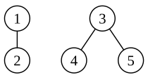](../../assets/volume4a/figures/7-1-4-exercise266-forest.svg)

那么 $a(F)=\{\{1\},\{1,2\},\{3\},\{3,4\},\{3,5\}\}$, $d(F)=\{\{1,2\},\{2\},\{3,4,5\},\{4\},\{5\}\}$. 反过来, 也可以由 $a(F)$ 或 $d(F)$ 重建 $F$.

证明集族 $a(F)$ 的 ZDD 恰有 $n+2$ 个结点.

**267.** [*HM32*][答案](./answers/7-1-4.md#ans-7-1-4-267) 继续习题 266, 当 $F$ 遍取 $n$ 个结点上的所有森林时, 求集族 $d(F)$ 的 ZDD 大小的最小值、最大值和平均值.

> 我们未敢把这本书写得非常长,  
> 以免它超出应有的篇幅,  
> 而被那些以厚薄取书的人拒之门外.
>
> ——阿尔弗里克, 《天主教的布道Ⅱ》(约 1000 年)

> 有一千人在砍伐祸害的枝蔓,  
> 而一人在铲除罪恶的根基.
>
> ——亨利·梭罗, 《瓦尔登湖》(1854)

[^v4a-p178-1]: 艾丽斯 (Alice) 与鲍勃 (Bob) 是广泛代入密码学、对策论和物理学领域的通用角色. 这些名称是为了方便说明议题, 有时也稍有幽默之感. ——编者注

[^v4a-p189-1]: 标记为 ③ 的结点有 3 个, 标记为 ②、④ 或 ⑥ 的结点有 16 个. ——编者注

[^v4a-p212-1]: 新英格兰 (New England) 位于美国大陆东北角, 包括 6 个州: 缅因州 (ME)、佛蒙特州 (VT)、新罕布什尔州 (NH)、马萨诸塞州 (MA)、罗得岛州 (RI)、康涅狄格州 (CT). ——编者注

[^v4a-p228-1]: 这是日本江户时代的一本算术教科书. ——译者注
