

#### 7.2.1.1　生成所有 $n$ 元组

让我们从小例子开始, 考虑怎样遍历由 $n$ 个二进制数字组成的全部 $2^n$ 个位串. 等价地, 要访问所有 $n$ 元组 $(a_1,\ldots,a_n)$, 其中每个 $a_j$ 都是 0 或 1. 这也实质上等价于检查给定集合 $\{x_1,\ldots,x_n\}$ 的所有子集, 因为可以规定当且仅当 $a_j=1$ 时, $x_j$ 属于该子集.

这个问题当然有一个极简单的解. 从二进制数 $(0\ldots00)_2=0$ 开始, 反复加 1, 直到 $(1\ldots11)_2=2^n-1$. 深入考察就会看到, 即便这样平凡的问题也有出人意料的趣处. 以后转向更难生成的模式时, 对 $n$ 元组的研究也会有用.

首先, 二进制记数的办法能推广到别种 $n$ 元组. 例如, 若要生成所有 $(a_1,\ldots,a_n)$, 其中每个 $a_j$ 都是十进制数字 $\{0,1,2,3,4,5,6,7,8,9\}$ 之一, 只须在十进制数系中从 $(0\ldots00)_{10}=0$ 数到 $(9\ldots99)_{10}=10^n-1$. 更一般地, 若要遍历满足

$$
0\le a_j<m_j,\qquad 1\le j\le n,
\tag{1}
$$

的全部情形, 而上限 $m_j$ 可随向量 $(a_1,\ldots,a_n)$ 的分量而异, 这项任务实质上相当于在混合进制数系中对数

$$
\begin{bmatrix}
a_1,a_2,\ldots,a_n\\
m_1,m_2,\ldots,m_n
\end{bmatrix}
\tag{2}
$$

重复加 1. 见式 4.1–$(9)$ 和习题 4.3.1–9.

我们不妨停下来, 更正式地描述这一过程.

**算法 M (生成混合进制数).** 这个算法对 $(2)$ 中的混合进制数反复加 1, 直到溢出, 从而访问满足 $(1)$ 的所有 $n$ 元组. 为方便处理, 引入辅助变量 $a_0$ 和 $m_0$.

**M1.** [初始化.] 对于 $0\le j\le n$, 置 $a_j\leftarrow0$; 置 $m_0\leftarrow2$.

**M2.** [访问.] 访问 $n$ 元组 $(a_1,\ldots,a_n)$. (需要检查所有 $n$ 元组的程序此时执行相应操作.)

**M3.** [准备加 1.] 置 $j\leftarrow n$.

**M4.** [在需要时进位.] 若 $a_j=m_j-1$, 则置 $a_j\leftarrow0$、$j\leftarrow j-1$, 并重复本步骤.

**M5.** [加 1, 或结束.] 若 $j=0$, 终止算法. 否则置 $a_j\leftarrow a_j+1$, 返回 M2. ▮

算法 M 简明易懂. 不过, 当 $n$ 是相当小的常数时, 嵌套循环甚至更简单. 例如 $n=4$ 时, 可以写为下列指令:

$$
\begin{aligned}
&\text{对于 }a_1=0,1,\ldots,m_1-1\text{(按此顺序)执行以下操作:}\\
&\quad\text{对于 }a_2=0,1,\ldots,m_2-1\text{(按此顺序)执行以下操作:}\\
&\qquad\text{对于 }a_3=0,1,\ldots,m_3-1\text{(按此顺序)执行以下操作:}\\
&\qquad\quad\text{对于 }a_4=0,1,\ldots,m_4-1\text{(按此顺序)执行以下操作:}\\
&\qquad\qquad\text{访问 }(a_1,a_2,a_3,a_4)\text{。}
\end{aligned}
\tag{3}
$$

这些指令等价于算法 M, 可以很容易地用任何程序设计语言表示.

**格雷二进制码.** 算法 M 按照像字典那样的顺序遍历所有 $(a_1,\ldots,a_n)$. 但在许多情况下, 我们更愿意按别的顺序访问这些 $n$ 元组. 最著名的另一种排列是*格雷二进制码*, 它用简单而有规律的办法列出全部 $2^n$ 个 $n$ 位二进制串, 每次只变动一位. 例如, $n=4$ 时, 格雷二进制码为

$$
\begin{gathered}
0000,0001,0011,0010,0110,0111,0101,0100,\\
1100,1101,1111,1110,1010,1011,1001,1000.
\end{gathered}
\tag{4}
$$

这种编码在模拟信息与数字信息的相互转换中特别重要. 例如, 一块旋转机械盘划分为 16 个扇区, 我们想用 4 个能区别黑白的固定光学传感器确定当前位置. 如果像图 30(a) 那样按字典序把磁道标为 `0000` 至 `1111`, 扇区的边界上会出现难以控制的读数误差. 用图 30(b) 的编码就不会出现错误读数.

[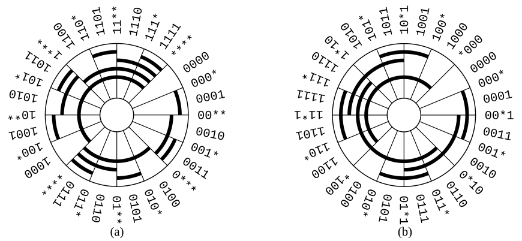](../../assets/volume4a/figures/fig-7-30-gray-code-disks.svg)

**图 30**　(a) 字典序二进制码.　(b) 格雷二进制码.

格雷二进制码有许多等价的定义. 例如, 令 $\Gamma_n$ 表示 $n$ 位二进制串的格雷序列, 可以用以下两条规则递归地定义 $\Gamma_n$:

$$
\begin{aligned}
\Gamma_0&=\epsilon,\\
\Gamma_{n+1}&=0\Gamma_n,\ 1\Gamma_n^R.
\end{aligned}
\tag{5}
$$

这里 $\epsilon$ 表示空串, $0\Gamma_n$ 表示给 $\Gamma_n$ 的每个串加上前缀 0 所得的序列, $1\Gamma_n^R$ 表示把 $\Gamma_n$ 逆序并给每个串加上前缀 1 所得的序列. 因为 $\Gamma_n$ 的最后一个串等于 $\Gamma_n^R$ 的第一个串, 由 $(5)$ 可知, 若 $\Gamma_n$ 的每一步恰好改变一位, 则 $\Gamma_{n+1}$ 的每一步也恰好改变一位.

定义序列 $\Gamma_n=g(0),g(1),\ldots,g(2^n-1)$ 的另一种办法是给出每个元素 $g(k)$ 的显式公式. 由于 $\Gamma_{n+1}$ 以 $0\Gamma_n$ 开头, 如果把 0 和 1 的每个位串看作允许有前导 0 的二进制整数, 那么无穷序列

$$
\begin{aligned}
\Gamma_\infty&=g(0),g(1),g(2),g(3),g(4),\ldots\\
&=(0)_2,(1)_2,(11)_2,(10)_2,(110)_2,\ldots
\end{aligned}
\tag{6}
$$

是全体非负整数的一个排列. 因此, $\Gamma_n$ 由 $(6)$ 的前 $2^n$ 项组成, 必要时在左边补 0, 把每项写成 $n$ 位二进制串.

当 $k=2^n+r$($0\le r<2^n$) 时, 由 $(5)$ 得 $g(k)=2^n+g(2^n-1-r)$. 因此, 对 $n$ 归纳可证, 二进制表示为 $(\ldots b_2b_1b_0)_2$ 的整数 $k$, 对应的格雷二进制表示是 $g(k)=(\ldots a_2a_1a_0)_2$, 其中

$$
a_j=b_j\oplus b_{j+1},\qquad j\ge0.
\tag{7}
$$

(见习题 6.) 例如, $g((111001000011)_2)=(100101100010)_2$. 反过来, 给定 $g(k)=(\ldots a_2a_1a_0)_2$, 可由方程组 $(7)$ 解出 $k=(\ldots b_2b_1b_0)_2$, 得到

$$
b_j=a_j\oplus a_{j+1}\oplus a_{j+2}\oplus\cdots,\qquad j\ge0.
\tag{8}
$$

这个无穷和实际上只有有限个非零项, 因为 $t$ 充分大时, $a_{j+t}=0$.

式 (7) 的一个有趣推论是, 可以用按位运算很容易地计算 $g(k)$:

$$
g(k)=k\oplus\lfloor k/2\rfloor.
\tag{9}
$$

同理, $(8)$ 中的反函数满足

$$
g^{[-1]}(l)=l\oplus\lfloor l/2\rfloor\oplus\lfloor l/4\rfloor\oplus\cdots.
\tag{10}
$$

不过, 这个反函数需要更多计算 (见习题 7.1.3–117). 若 $k$ 和 $k'$ 是任意非负整数, 还可以从 $(7)$ 推出

$$
g(k\oplus k')=g(k)\oplus g(k').
\tag{11}
$$

另一个结果是, 可把 $n+1$ 位格雷二进制码写成

$$
\Gamma_{n+1}=0\Gamma_n,\ (0\Gamma_n)\oplus110\ldots0.
$$

这个模式在 $(4)$ 中很明显. 与 $(5)$ 比较可知, 反转格雷二进制码的顺序等价于将第一位取补:

$$
\Gamma_n^R=\Gamma_n\oplus1\overbrace{0\ldots0}^{n-1},\qquad\text{也写作 }\Gamma_n\oplus10^{n-1}.
\tag{12}
$$

后面的习题表明, $(7)$ 定义的函数 $g(k)$ 和 $(8)$ 定义的反函数 $g^{[-1]}$, 还有许多其他性质和有趣的应用. 有时把它们看作从二进制串到二进制串的函数, 有时则借助二进制记数把它们看作从整数到整数的函数, 前导 0 不影响结果.

格雷二进制码以弗兰克·格雷命名. 他是一位物理学家, 曾帮助设计长期使用的兼容彩色电视广播方法 [*Bell System Tech. J.* **13** (1934), 464–515]. 他为脉冲编码调制发明了 $\Gamma_n$. 脉冲编码调制是传输数字信号的一种模拟方法 [见 *Bell System Tech. J.* **30** (1951), 38–40;*U.S. Patent* 2632058(1953 年 3 月 17 日); 威廉·本内特,*Introduction to Signal Transmission* (1971), 238–240]. 不过, “格雷二进制码” 的想法早在格雷研究它之前就已为人所知. 例如, 它出现在乔治·斯蒂比兹的专利 [*U.S. Patent* 2307868] 中. 更重要的是, 伊梅尔·博多 (Émile Baudot) 在 1878 年展示的电报机中已使用 $\Gamma_5$, 后来 “波特”(baud) 一词就以他命名. 大约同时, 特奥多尔·舍夫勒独立设计了一种类似、但不那么系统的电报码 [见 *Journal Télégraphique* **4** (1878), 252–253;*Annales Télégraphiques* **6** (1879), 361, 382–383]. [^v4a-p237-1]

格雷二进制码其实蕴藏在一种令人为之着迷数百年的古老玩具中. 它在英语中通常称为 “Chinese ring puzzle” (中国环谜题)[^v4a-p237-2], 英国人过去也称它为 “tarrying irons” 或 “tiring irons” (令人厌倦的铁环). 图 31 显示一个七环实例. 谜题要求把环从杆上取下. 各环互锁, 只有两种基本的移动方式 (尽管图中未必一目了然):

(a) 最右边的环随时可以取下或放回原处.

(b) 其他任一环可以取下或放回原处, 当且仅当它右边与它相邻的环在杆上, 而那个环右边的各环都不在杆上.

可以用二进制记号表示谜题的当前状态, 环在杆上记为 1, 不在杆上记为 0. 因此, 图 31 显示的是 `1011000` 状态. (左起第二个环全部位于杆的上方, 所以记为 0.)

[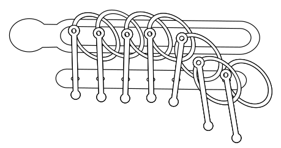](../../assets/volume4a/figures/fig-7-31-chinese-ring-puzzle.svg)

**图 31**　中国环谜题.

法国法官路易·格罗在匿名出版的小册子 *Théorie du Baguenodier* [原文如此] (Lyon: Aimé Vingtrinier, 1872) 中说明了中国环与二进制数的直接联系. 若各环处于 $a_{n-1}\ldots a_0$ 状态, 并按式 (8) 定义二进制数 $k=(b_{n-1}\ldots b_0)_2$, 他证明恰好再走 $k$ 步是解开谜题的必要条件, 也是充分条件. 因此, 格罗才是格雷二进制码的发明者.

> 当然, 没有哪个家庭应该缺少  
> 这种引人入胜、富有历史意义且有教益的谜题.
>
> ——亨利·迪德尼 (1901)

当各环处于 `00…0` 或 `10…0` 以外的任一状态时, 恰可作两种移动, 一种是 (a) 类, 一种是 (b) 类. 两种移动中, 只有一种使我们朝目标前进, 另一种是必须撤销的后退. (a) 类移动把 $k$ 变成 $k\oplus1$. 所以 $k$ 为奇数时应作这种移动, 因为它会减小 $k$. 从末尾为 $(10^{j-1})_2$($1\le j<n$) 的位置出发的 (b) 类移动把 $k$ 变成 $k\oplus(1^{j+1})_2=k\oplus(2^{j+1}-1)$. [在这里, $1^{j+1}$ 表示连续 $j+1$ 个 1, 而 $2^{j+1}$ 表示 2 的幂.] 当 $k$ 为偶数时, 要使 $k\oplus(2^{j+1}-1)=k-1$, 就要求 $k$ 是 $2^j$ 的倍数而非 $2^{j+1}$ 的倍数. 换言之,

$$
j=\rho(k),
\tag{13}
$$

其中 $\rho$ 是式 7.1.3–$(44)$ 的 “直尺函数”. 所以, 正确解开这个谜题时, 移动各环会遵循很好的模式. 若从自由端开始把环依次编号为 $0,1,\ldots,n-1$, 则各环套上杆或从杆上脱离的顺序, 是以 $\ldots,\rho(4),\rho(3),\rho(2),\rho(1)$ 结尾的编号序列.

反过来, 从 `00…0` 开始, 依次把环套上杆或从杆上取下, 直到最终状态 `10…0`, 就得到生成格雷二进制码的算法. 正如约翰·沃利斯在 1693 年指出的, `10…0` 比看来较难的状态 `11…1` 更难到达.

**算法 G (生成格雷二进制码).** 这个算法访问所有二进制 $n$ 元组 $(a_{n-1},\ldots,a_1,a_0)$, 从 $(0,\ldots,0,0)$ 开始, 每次只改变一位. 访问时, 算法维持偶校验位 $a_{-1}$, 使得

$$
a_{-1}=a_{n-1}\oplus\cdots\oplus a_1\oplus a_0.
\tag{14}
$$

它依次对位置 $\rho(1),\rho(2),\rho(3),\ldots,\rho(2^n-1)$ 的各位取补, 然后终止.

**G1.** [初始化.] 对 $-1\le j<n$, 置 $a_j\leftarrow0$.

**G2.** [访问.] 访问 $n$ 元组 $(a_{n-1},\ldots,a_1,a_0)$.

**G3.** [改变奇偶校验位.] 置 $a_{-1}\leftarrow1-a_{-1}$.

**G4.** [选择 $j$.] 令 $j\ge0$ 是使 $a_{j-1}=1$ 的最小值. (第 $k$ 次执行这一步后, $j=\rho(k)$.)

**G5.** [对坐标 $j$ 取补.] 若 $j=n$, 终止. 否则令 $a_j\leftarrow1-a_j$, 返回 G2. ▮

若要计算形如

$$
X_{000}-X_{001}-X_{010}+X_{011}-X_{100}+X_{101}+X_{110}-X_{111}
$$

或

$$
X_{\emptyset}-X_a-X_b+X_{ab}-X_c+X_{ac}+X_{bc}-X_{abc}
$$

的和, 其中符号取决于二进制串的奇偶性或子集的元素数目, 奇偶校验位 $a_{-1}$ 就很有用. 这类求和常见于 “容斥” 公式, 如式 1.3.3–$(29)$. 为了提高效率, 奇偶校验位也必不可少. 有了它, 就容易在确定 $j$ 的两种方法间作选择, 分别对应中国环谜题的 (a) 类和 (b) 类移动. 不过, 算法 G 最重要的特点是, G5 只改变一个坐标. 因此, 所求和的项 $X$, 或访问每个 $n$ 元组时涉及的其他结构, 通常只须作很简单的改变.

> 自然, 不可能在最低位数字上消除歧义,  
> 除非采用据说爱尔兰铁路用过的办法,  
> 把每列车的最后一节车厢取消,  
> 因为那节车厢最容易在碰撞中损坏.
>
> ——乔治·斯蒂比兹和朱尔斯·拉里维,*Mathematics and Computers*(1957)

约瑟夫·沃尔什发现了格雷二进制码的另一个基本性质, 涉及现在称为*沃尔什函数*的一列重要函数 [见 *Amer. J. Math.* **45** (1923), 5–24]. 对每个实数 $x$, 令 $w_0(x)=1$, 并令

$$
w_k(x)=(-1)^{\lfloor2x\rfloor\lceil k/2\rceil}w_{\lfloor k/2\rfloor}(2x),\qquad k>0.
\tag{15}
$$

例如, 每当 $x$ 为整数或整数加 $\tfrac12$ 时, $w_1(x)=(-1)^{\lfloor2x\rfloor}$ 就改变符号. 由此推出, 对所有 $k$ 都有 $w_k(x)=w_k(x+1)$, 而对每个 $x$ 都有 $w_k(x)=\pm1$. 更重要的是, $w_k(0)=1$, 且 $w_k(x)$ 在区间 $(0\ldots1)$ 内恰好改变 $k$ 次符号, 所以 $x$ 从左边趋近于 1 时, $w_k(x)$ 趋近于 $(-1)^k$. 因此, $w_k(x)$ 的行为有点像三角函数 $\cos k\pi x$ 或 $\sin k\pi x$, 我们也可以把其他函数表示为沃尔什函数的线性组合, 方法很像传统的傅里叶级数表示. 由于这一点以及 $w_k(x)$ 的简单离散性质, 沃尔什函数在信息传输、图像处理和许多其他应用的计算中很有用.

图 32 显示前 8 个沃尔什函数及与它们类似的三角函数. 仿照 $\cos k\pi x$ 和 $\sin k\pi x$ 的频率为 $k/2$, 工程师通常把 $w_k(x)$ 称为序率 (sequency) 为 $k$ 的沃尔什函数. [例如, 见亨宁·哈穆特,*Sequency Theory: Foundations and Applications*(New York: Academic Press, 1977).]

[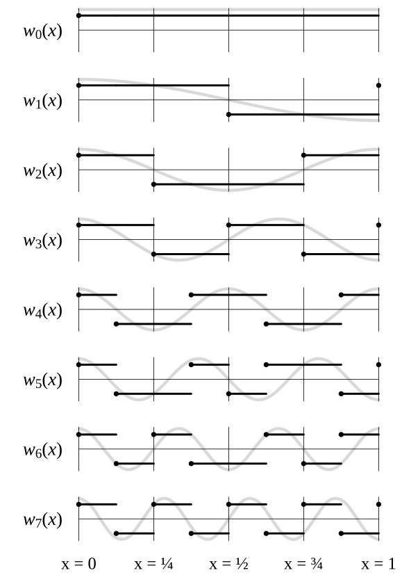](../../assets/volume4a/figures/fig-7-32-walsh-functions.svg)

**图 32**　对于 $0\le k<8$, 比较沃尔什函数 $w_k(x)$ 和以灰色示出的类似三角函数 $\sqrt2\cos k\pi x$.

式 (15) 乍看也许令人望而生畏, 却能用来简单地归纳说明 $w_k(x)$ 为什么恰好改变 $k$ 次符号. 若 $k$ 为偶数, 设 $k=2l$, 则当 $0\le x<\frac12$ 时有 $w_{2l}(x)=w_l(2x)$. 也就是说, 只把函数 $w_l(x)$ 压缩到前半区间, 所以 $w_{2l}(x)$ 到此已经改变 $l$ 次符号. 随后在 $\frac12\le x<1$ 的范围内, $w_{2l}(x)=(-1)^lw_l(2x)=(-1)^lw_l(2x-1)$. 这样就接上 $w_l(2x)$ 的另一份副本, 必要时反转符号, 以免在 $x=\frac12$ 再变号. $w_{2l+1}(x)$ 类似, 但在 $x=\frac12$ 一定要增加一次变号.

这和格雷二进制码有什么关系? 沃尔什发现, 他的函数都能简洁地用更简单的*拉德马赫函数*[汉斯·拉德马赫,*Math. Annalen* **87** (1922), 112–138]

$$
r_k(x)=(-1)^{\lfloor2^kx\rfloor}
\tag{16}
$$

表示. 当 $(\ldots c_2c_1c_0.c_{-1}c_{-2}\ldots)_2$ 是 $x$ 的二进制表示时, 拉德马赫函数取值 $(-1)^{c_{-k}}$. 事实上, $w_1(x)=r_1(x)$、$w_2(x)=r_1(x)r_2(x)$、$w_3(x)=r_2(x)$, 一般地,

$$
\text{当 }k=(\ldots b_2b_1b_0)_2\text{ 时,}\qquad w_k(x)=\prod_{j\ge0}r_{j+1}(x)^{b_j\oplus b_{j+1}}.
\tag{17}
$$

(见习题 33.) 因此, 根据 $(7)$, $w_k(x)$ 中 $r_{j+1}(x)$ 的指数是格雷二进制数 $g(k)$ 的第 $j$ 位, 并且有

$$
w_k(x)=r_{\rho(k)+1}(x)w_{k-1}(x),\qquad k>0.
\tag{18}
$$

式 (17) 还给出便利的公式

$$
w_k(x)w_{k'}(x)=w_{k\oplus k'}(x),
\tag{19}
$$

它比对应的正弦和余弦乘积公式简单得多. 由于对所有 $j$ 和 $x$ 都有 $r_j(x)^2=1$, 所以 $r_j(x)^{a\oplus b}=r_j(x)^{a+b}$, 很容易推出这个恒等式. 特别地, 当 $k\ne k'$ 时, $w_k(x)$ 与 $w_{k'}(x)$ 正交, 也就是 $w_k(x)w_{k'}(x)$ 的平均值为零. 也可以用 $(17)$ 定义 $k$ 为 $1/2$、$13/8$ 等分数时的 $w_k(x)$.

$2^n$ 个数 $(X_0,\ldots,X_{2^n-1})$ 的*沃尔什变换*是由 $(x_0,\ldots,x_{2^n-1})^T=W_n(X_0,\ldots,X_{2^n-1})^T$ 定义的向量 $(x_0,\ldots,x_{2^n-1})$, 其中 $W_n$ 为 $2^n\times2^n$ 矩阵, 第 $j$ 行第 $k$ 列的元素为 $w_j(k/2^n)$($0\le j,k<2^n$). 例如, 由图 32 可知, $n=3$ 的沃尔什变换是

$$
\begin{pmatrix}x_{000}\\x_{001}\\x_{010}\\x_{011}\\x_{100}\\x_{101}\\x_{110}\\x_{111}\end{pmatrix}=\begin{pmatrix}
1 & 1 & 1 & 1 & 1 & 1 & 1 & 1\\
1 & 1 & 1 & 1 & \bar1 & \bar1 & \bar1 & \bar1\\
1 & 1 & \bar1 & \bar1 & \bar1 & \bar1 & 1 & 1\\
1 & 1 & \bar1 & \bar1 & 1 & 1 & \bar1 & \bar1\\
1 & \bar1 & \bar1 & 1 & 1 & \bar1 & \bar1 & 1\\
1 & \bar1 & \bar1 & 1 & \bar1 & 1 & 1 & \bar1\\
1 & \bar1 & 1 & \bar1 & \bar1 & 1 & \bar1 & 1\\
1 & \bar1 & 1 & \bar1 & 1 & \bar1 & 1 & \bar1
\end{pmatrix}\begin{pmatrix}X_{000}\\X_{001}\\X_{010}\\X_{011}\\X_{100}\\X_{101}\\X_{110}\\X_{111}\end{pmatrix}.
\tag{20}
$$

(其中 $\bar1$ 表示 $-1$, 可把下标看成二进制串 `000`–`111`.)*阿达马变换*以类似方式定义, 用矩阵 $H_n$ 代替 $W_n$. $H_n$ 的第 $j$ 行第 $k$ 列为 $(-1)^{j\cdot k}$, 这里 $j\cdot k$ 表示二进制数 $j=(a_{n-1}\ldots a_0)_2$ 和 $k=(b_{n-1}\ldots b_0)_2$ 的点积 $a_{n-1}b_{n-1}+\cdots+a_0b_0$. 例如, $n=3$ 的阿达马变换是

$$
\begin{pmatrix}x'_{000}\\x'_{001}\\x'_{010}\\x'_{011}\\x'_{100}\\x'_{101}\\x'_{110}\\x'_{111}\end{pmatrix}=\begin{pmatrix}
1 & 1 & 1 & 1 & 1 & 1 & 1 & 1\\
1 & \bar1 & 1 & \bar1 & 1 & \bar1 & 1 & \bar1\\
1 & 1 & \bar1 & \bar1 & 1 & 1 & \bar1 & \bar1\\
1 & \bar1 & \bar1 & 1 & 1 & \bar1 & \bar1 & 1\\
1 & 1 & 1 & 1 & \bar1 & \bar1 & \bar1 & \bar1\\
1 & \bar1 & 1 & \bar1 & \bar1 & 1 & \bar1 & 1\\
1 & 1 & \bar1 & \bar1 & \bar1 & \bar1 & 1 & 1\\
1 & \bar1 & \bar1 & 1 & \bar1 & 1 & 1 & \bar1
\end{pmatrix}\begin{pmatrix}X_{000}\\X_{001}\\X_{010}\\X_{011}\\X_{100}\\X_{101}\\X_{110}\\X_{111}\end{pmatrix}.
\tag{21}
$$

这与 $n$ 维立方体上的离散傅里叶变换式 4.6.4–$(38)$ 相同. 修改 4.6.4 节讨论的耶茨方法, 就可以快速 “就地” 求值:

<table>
<thead><tr><th>给定值</th><th>第一步</th><th>第二步</th><th>第三步</th></tr></thead>
<tbody>
<tr><td>$X_{000}$</td><td>$X_{000}+X_{001}$</td><td>$X_{000}+X_{001}+X_{010}+X_{011}$</td><td>$X_{000}+X_{001}+X_{010}+X_{011}+X_{100}+X_{101}+X_{110}+X_{111}$</td></tr>
<tr><td>$X_{001}$</td><td>$X_{000}-X_{001}$</td><td>$X_{000}-X_{001}+X_{010}-X_{011}$</td><td>$X_{000}-X_{001}+X_{010}-X_{011}+X_{100}-X_{101}+X_{110}-X_{111}$</td></tr>
<tr><td>$X_{010}$</td><td>$X_{010}+X_{011}$</td><td>$X_{000}+X_{001}-X_{010}-X_{011}$</td><td>$X_{000}+X_{001}-X_{010}-X_{011}+X_{100}+X_{101}-X_{110}-X_{111}$</td></tr>
<tr><td>$X_{011}$</td><td>$X_{010}-X_{011}$</td><td>$X_{000}-X_{001}-X_{010}+X_{011}$</td><td>$X_{000}-X_{001}-X_{010}+X_{011}+X_{100}-X_{101}-X_{110}+X_{111}$</td></tr>
<tr><td>$X_{100}$</td><td>$X_{100}+X_{101}$</td><td>$X_{100}+X_{101}+X_{110}+X_{111}$</td><td>$X_{000}+X_{001}+X_{010}+X_{011}-X_{100}-X_{101}-X_{110}-X_{111}$</td></tr>
<tr><td>$X_{101}$</td><td>$X_{100}-X_{101}$</td><td>$X_{100}-X_{101}+X_{110}-X_{111}$</td><td>$X_{000}-X_{001}+X_{010}-X_{011}-X_{100}+X_{101}-X_{110}+X_{111}$</td></tr>
<tr><td>$X_{110}$</td><td>$X_{110}+X_{111}$</td><td>$X_{100}+X_{101}-X_{110}-X_{111}$</td><td>$X_{000}+X_{001}-X_{010}-X_{011}-X_{100}-X_{101}+X_{110}+X_{111}$</td></tr>
<tr><td>$X_{111}$</td><td>$X_{110}-X_{111}$</td><td>$X_{100}-X_{101}-X_{110}+X_{111}$</td><td>$X_{000}-X_{001}-X_{010}+X_{011}-X_{100}+X_{101}+X_{110}-X_{111}$</td></tr>
</tbody>
</table>

注意, $H_3$ 的各行是 $W_3$ 的各行的一个排列. 一般情形也是如此, 所以重新排列阿达马变换的各个分量就能得到沃尔什变换. 细节见习题 36.

**进一步加快处理.** 遍历 $2^n$ 种可能性时, 通常希望尽量减少计算时间. 算法 G 每次访问 $(a_{n-1},\ldots,a_0)$ 只需对一位 $a_j$ 取补, 但步骤 G4 要循环选择 $j$. 吉德翁·埃尔利希 [*JACM* **20** (1973), 500–513] 提出了另一种方法. 他引入了*无循环组合生成*的概念, 即相邻两次访问之间的操作数须有预先给定的上界, 这样就不会长久等待下一个模式.

在 7.1.3 节, 我们学过迅速求出二进制数中前导或尾随的 0 的数目的一些技巧. 如果 $n$ 不太大, 可以把那些方法用于步骤 G4, 使算法 G 不必循环. 埃尔利希的方法很不一样, 而且适用范围更广, 为高效计算提供了一种新的手段. 下面用他的方法生成二进制 $n$ 元组 [见詹姆斯·比特纳、吉德翁·埃尔利希和爱德华·莱因戈尔德,*CACM* **19** (1976), 517–521].

**算法 L (无循环生成格雷二进制码).** 这个算法和算法 G 一样, 按格雷二进制码的顺序访问所有二进制 $n$ 元组 $(a_{n-1},\ldots,a_0)$. 它改用 “焦点指针” 数组 $(f_n,\ldots,f_0)$, 下文将说明其含义.

**L1.** [初始化.] 对 $0\le j<n$, 置 $a_j\leftarrow0$、$f_j\leftarrow j$, 另置 $f_n\leftarrow n$. (只要初始设置相当高效, 无循环算法的初始化步骤允许有循环. 毕竟程序都需要载入和启动.)

**L2.** [访问.] 访问 $n$ 元组 $(a_{n-1},\ldots,a_1,a_0)$.

**L3.** [选择 $j$.] 置 $j\leftarrow f_0$、$f_0\leftarrow0$. (如果这是第 $k$ 次执行本步骤, 此时 $j=\rho(k)$.) 若 $j=n$, 终止. 否则, 置 $f_j\leftarrow f_{j+1}$、$f_{j+1}\leftarrow j+1$.

**L4.** [对坐标 $j$ 取补.] 置 $a_j\leftarrow1-a_j$, 返回 L2. ▮

例如, $n=4$ 时, 计算过程如下. 若满足 $a_3a_2a_1a_0=g(b_3b_2b_1b_0)$ 的二进制串 $b_3b_2b_1b_0$ 的对应位 $b_j$ 为 1, 就给表中的 $a_j$ 值加下划线.

<table>
<tbody>
<tr><th scope="row">$a_3$</th><td>0</td><td>0</td><td>0</td><td>0</td><td>0</td><td>0</td><td>0</td><td>0</td><td><u>1</u></td><td><u>1</u></td><td><u>1</u></td><td><u>1</u></td><td><u>1</u></td><td><u>1</u></td><td><u>1</u></td><td><u>1</u></td></tr>
<tr><th scope="row">$a_2$</th><td>0</td><td>0</td><td>0</td><td>0</td><td><u>1</u></td><td><u>1</u></td><td><u>1</u></td><td><u>1</u></td><td>1</td><td>1</td><td>1</td><td>1</td><td><u>0</u></td><td><u>0</u></td><td><u>0</u></td><td><u>0</u></td></tr>
<tr><th scope="row">$a_1$</th><td>0</td><td>0</td><td><u>1</u></td><td><u>1</u></td><td>1</td><td>1</td><td><u>0</u></td><td><u>0</u></td><td>0</td><td>0</td><td><u>1</u></td><td><u>1</u></td><td>1</td><td>1</td><td><u>0</u></td><td><u>0</u></td></tr>
<tr><th scope="row">$a_0$</th><td>0</td><td><u>1</u></td><td>1</td><td><u>0</u></td><td>0</td><td><u>1</u></td><td>1</td><td><u>0</u></td><td>0</td><td><u>1</u></td><td>1</td><td><u>0</u></td><td>0</td><td><u>1</u></td><td>1</td><td><u>0</u></td></tr>
<tr><th scope="row">$f_3$</th><td>3</td><td>3</td><td>3</td><td>3</td><td>3</td><td>3</td><td>3</td><td>3</td><td>4</td><td>4</td><td>4</td><td>4</td><td>3</td><td>3</td><td>3</td><td>3</td></tr>
<tr><th scope="row">$f_2$</th><td>2</td><td>2</td><td>2</td><td>2</td><td>3</td><td>3</td><td>2</td><td>2</td><td>2</td><td>2</td><td>2</td><td>2</td><td>4</td><td>4</td><td>2</td><td>2</td></tr>
<tr><th scope="row">$f_1$</th><td>1</td><td>1</td><td>2</td><td>1</td><td>1</td><td>1</td><td>3</td><td>1</td><td>1</td><td>1</td><td>2</td><td>1</td><td>1</td><td>1</td><td>4</td><td>1</td></tr>
<tr><th scope="row">$f_0$</th><td>0</td><td>1</td><td>0</td><td>2</td><td>0</td><td>1</td><td>0</td><td>3</td><td>0</td><td>1</td><td>0</td><td>2</td><td>0</td><td>1</td><td>0</td><td>4</td></tr>
</tbody>
</table>

虽然二进制数 $k=(b_{n-1}\ldots b_0)_2$ 在算法 L 中没有显式出现, 焦点指针 $f_j$ 却以巧妙的方式隐含着它. 这样, 我们就能按要求不断对位 $a_{\rho(k)}$ 取补, 构造 $g(k)=(a_{n-1}\ldots a_0)_2$. 若 $a_j$ 带下划线, 就称它为*被动的*, 否则称为*主动的*. 于是, 焦点指针满足以下不变关系:

(1) 若 $a_j$ 被动而 $a_{j-1}$ 主动, 则 $f_j$ 是使 $a_{j'}$ 主动的最小下标 $j'>j$. (在这条规则中, 把 $a_n$ 和 $a_{-1}$ 视为主动, 虽然算法中没有这两位.)

(2) 否则 $f_j=j$.

因此, 在下标递减的一组被动元素 $a_{i-1}\ldots a_{j+1}a_j$ 中, 最右边元素 $a_j$ 的焦点指针 $f_j$ 指向紧挨这组元素左边的 $a_i$. 其他各个元素 $a_j$ 的 $f_j$ 都指向该元素自身.

用这些术语来说, L3 的前两项操作 “$j\leftarrow f_0$、$f_0\leftarrow0$” 等价于 “令 $j$ 为最右边主动元素的下标, 并把 $a_j$ 右边的所有元素变为主动”. 如果 $f_0=0$, 操作 $f_0\leftarrow0$ 是多余的, 但没有妨碍. L3 的另两项操作 “$f_j\leftarrow f_{j+1}$、$f_{j+1}\leftarrow j+1$” 等价于 “让 $a_j$ 变为被动”, 因为此时 $a_j$ 和 $a_{j-1}$ 都是主动的. (操作 $f_{j+1}\leftarrow j+1$ 也可能多余, 但没有妨碍.) 所以, 改变主动和被动状态的效果等同于像算法 M 那样按二进制计数, 1 位代表被动元素, 0 位代表主动元素.

算法 L 非常快, 因为在相邻两次访问生成的 $n$ 元组之间, 它只做 5 次赋值和 1 次终止检查. 还能做得更快. 为说明这一点, 考虑趣味语言学的一个例子. 鲁道夫·卡斯特敦在 *Word Ways* **1** (1968), 165–169 中指出, 把 `sins` 的字母与 `fate` 的对应字母混合, 共有 16 种方式, 每次所得的词都能在足够大的英语字典中找到, 例如 `sine`、`sits`、`site` 等. 除 `fane`、`fite`、`sats` 三个词外, 其余都足够常见, 无疑属于标准英语. 于是自然可以对五字母词提出类似问题: 哪个五字母串对, 在对应位置的字母按全部 32 种方式交换时, 能产生斯坦福图基中最多的单词?

为回答这个问题, 无须检查全部 $\binom{26}{2}^5=3\,625\,908\,203\,125$ 对实质不同的串. 只要斯坦福图基里的 $\binom{5757}{2}=16\,568\,646$ 个词对中有一对能产生至少 17 个词, 检查这些词对就够了. 因为用两个五字母串生成的 17 个或更多五字母词中, 必有两个在所有对应位置的字母都不同, 称为 “对映” 的两个词. 对每个对映词对, 都要尽快判定这 32 种子集交换能否产生相当多的英语单词.

每个五字母词可以表示成 25 位二进制数, 每个字母用 5 位, 从 `a` = `00000` 到 `z` = `11001`. 用一张有 $2^{25}$ 个比特或字节的表, 就能快速判定给定的五字母串是不是单词. 于是问题归结为生成混合两个给定单词所得的 32 种候选位模式, 并在表中查找. 对每对 25 位词 $w,w'$, 可以这样做:

**W1.** [检查差别.] 置 $z\leftarrow w\oplus w'$. 如果 $m'\mathbin{\&}(z-m)\mathbin{\&}\bar z\ne0$, 则排除词对 $(w,w')$, 其中 $m=2^{20}+2^{15}+2^{10}+2^5+1$、$m'=2^4m$. 这项检查滤去 $w$ 和 $w'$ 在某个对应位置有相同字母的情形. (见 7.1.3–$(90)$. 16 568 646 个词对中, 10 614 085 个没有这样的相同字母.)

**W2.** [建立各个掩码.] 为下一步准备, 置 $m_0\leftarrow z\mathbin{\&}(2^5-1)$、$m_1\leftarrow z\mathbin{\&}(2^{10}-2^5)$、$m_2\leftarrow z\mathbin{\&}(2^{15}-2^{10})$、$m_3\leftarrow z\mathbin{\&}(2^{20}-2^{15})$、$m_4\leftarrow z\mathbin{\&}(2^{25}-2^{20})$.

**W3.** [统计单词.] 置 $l\leftarrow1$、$A_0\leftarrow w$. 变量 $l$ 记录从 $w$ 开始到此时共找到多少个词. 然后执行下文定义的交换操作 $\mathit{swap}(4)$.

**W4.** [输出创纪录的解.] 若 $l$ 大于或等于当前最大值, 输出 $A_j$($0\le j<l$). ▮

这个高速方法的核心是交换操作序列 $\mathit{swap}(4)$. 应当把它内联展开, 例如用宏处理器, 以消除不必要的开销. 它由下面的基本操作定义:

$\mathit{sw}(j)$: 置 $w\leftarrow w\oplus m_j$. 如果 $w$ 是单词, 置 $A_l\leftarrow w$、$l\leftarrow l+1$.

$\mathit{sw}(j)$ 交换位置 $j$ 上的字母. 定义

$$
\begin{aligned}
\mathit{swap}(0)&=\mathit{sw}(0),\\
\mathit{swap}(1)&=\mathit{swap}(0),\mathit{sw}(1),\mathit{swap}(0),\\
\mathit{swap}(2)&=\mathit{swap}(1),\mathit{sw}(2),\mathit{swap}(1),\\
\mathit{swap}(3)&=\mathit{swap}(2),\mathit{sw}(3),\mathit{swap}(2),\\
\mathit{swap}(4)&=\mathit{swap}(3),\mathit{sw}(4),\mathit{swap}(3).
\end{aligned}
\tag{22}
$$

于是, $\mathit{swap}(4)$ 展开为 31 步的序列 $\mathit{sw}(0),\mathit{sw}(1),\mathit{sw}(0),\mathit{sw}(2),\ldots,\mathit{sw}(0)$, 也就是 $\mathit{sw}(\rho(1)),\mathit{sw}(\rho(2)),\ldots,\mathit{sw}(\rho(31))$. 这些步骤会用到约 1000 万次. 把直尺函数的值 $\rho(k)$ 直接嵌入程序, 省去对每个词对用算法 M、G 或 L 重复计算这些值, 显然能加快速度.

获胜词对产生 21 个词:

$$
\begin{aligned}
&\mathtt{ducks,\ ducky,\ duces,\ dunes,\ dunks,\ dinks,\ dinky,}\\
&\mathtt{dines,\ dices,\ dicey,\ dicky,\ dicks,\ picks,\ picky,}\\
&\mathtt{pines,\ piney,\ pinky,\ pinks,\ punks,\ punky,\ pucks.}
\end{aligned}
\tag{23}
$$

例如, 若 $w=\mathtt{ducks}$、$w'=\mathtt{piney}$, 则 $m_0=\mathtt{s}\oplus\mathtt{y}$, 所以第一个操作 $\mathit{sw}(0)$ 把 `ducks` 变为 `ducky`, 这是一个单词. 下一次操作 $\mathit{sw}(1)$ 使用 $m_1$, 即倒数第二个字母位置上的 $\mathtt{k}\oplus\mathtt{e}$, 于是得到非单词 `ducey`. 再作一次 $\mathit{sw}(0)$, 把 `ducey` 变成 `duces` (这是一个法律术语, 后面通常跟 `tecum`). 依此类推. 用这种办法, 至多几秒钟就可以处理所有词对.

还可以进一步简化. 例如, 一旦找到能产生 $k$ 个词的词对, 检查后续词对时, 某对只要已经生成 $33-k$ 个非单词, 就可以停止检查这一对. 不过, 以上方法已经相当快, 说明连无循环的算法 L 也能超越.

算法 L 的爱好者也许会说, 这里只对 $n=5$ 的小特例加快了处理速度, 而算法 L 解决的是一般 $n$ 的格雷二进制码生成问题. 不过, 类似办法也适用于 $n>5$: 可以像上面那样展开程序, 快速生成最右边五位 $a_4a_3a_2a_1a_0$ 的全部 32 种取值. 每走 32 步再应用算法 L, 用它生成其余各位 $a_{n-1}\ldots a_5$ 的连续变动. 这样, 算法 L 所做的工作几乎减为原来的 $1/32$.

**其他格雷二进制码.** 格雷二进制码 $g(0),g(1),\ldots,g(2^n-1)$ 只是遍历全部 $n$ 位二进制串且每步只改变一位的诸多办法之一. 一般地, 二进制 $n$ 元组的*格雷圈*是任意一个包含每个 $n$ 元组的序列 $(v_0,v_1,\ldots,v_{2^n-1})$, 并且 $v_k$ 与 $v_{(k+1)\bmod 2^n}$ 恰在一位上不同. 用图论术语说, 格雷圈是 $n$ 维立方体上的有向哈密顿圈. 可以假定下标选得使 $v_0=0\ldots0$.

若把 $v$ 看成二进制数, 就存在整数 $\delta_0\ldots\delta_{2^n-1}$, 使得

$$
v_{(k+1)\bmod 2^n}=v_k\oplus2^{\delta_k},\qquad 0\le k<2^n.
\tag{24}
$$

这个 “$\delta$ 序列” 是描述格雷圈的另一种办法. 例如, $n=3$ 时, 标准格雷二进制码的 $\delta$ 序列是 `01020102`. 它实质上是 $(13)$ 的直尺函数 $\delta_k=\rho(k+1)$, 只是最后一项 $\delta_{2^n-1}$ 取 $n-1$ 而非 $n$, 这样圈才闭合. $\delta_k$ 的每一项均满足 $0\le\delta_k<n$, 称作 “坐标”.

令 $d(n)$ 为定义 $n$ 位格雷圈的不同 $\delta$ 序列的数目, $c(n)$ 为 “规范” $\delta$ 序列的数目. 规范序列中, 每个坐标 $k$ 都在 $k+1$ 第一次出现之前出现. 于是 $d(n)=n!c(n)$, 因为对 $\delta$ 序列的坐标编号作任何置换, 显然都会产生另一个 $\delta$ 序列. 容易看出, 对于 $n\le3$, 仅有以下规范 $\delta$ 序列:

$$
00,\qquad0101,\qquad01020102\quad\text{和}\quad01210121.
\tag{25}
$$

因此 $c(1)=c(2)=1$、$c(3)=2$, 而 $d(1)=1$、$d(2)=2$、$d(3)=12$. 用以后要研究的哈密顿圈枚举技术, 作简单的计算机计算, 可得接下来的值:

$$
\begin{aligned}
c(4)&=112,& d(4)&=2688,\\
c(5)&=15\,109\,096,& d(5)&=1\,813\,091\,520.
\end{aligned}
\tag{26}
$$

看不出简单模式, 而且这些数增长很快 (见习题 47). 因此, 几乎可以肯定, 不会有人知道 $c(8)$ 和 $d(8)$ 的确切值.

由于可能性如此之多, 人们受到鼓励去寻找还有其他有用性质的格雷圈. 例如, 图 33(a) 显示一个四位格雷圈, 其中每个串 $a_3a_2a_1a_0$ 都和它的补串 $\bar a_3\bar a_2\bar a_1\bar a_0$ 在直径上相对. 只要位数为偶数, 这种编码方案就能实现 (见习题 49).

[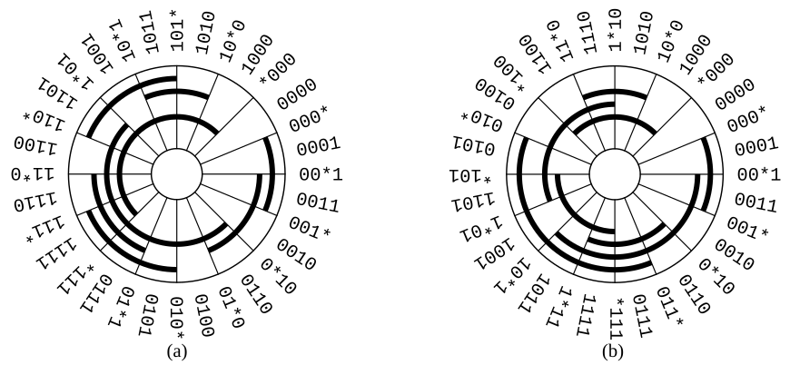](../../assets/volume4a/figures/fig-7-33-complementary-balanced-gray.svg)

**图 33**　(a) 互补格雷码.　(b) 平衡格雷码.

杰弗里·图希尔 [*Proc. IEE* **103**, Part B Supplement (1956), 435] 发现了图 33(b) 中更有趣的格雷圈. 它的四条坐标磁道各有同样多的变化, 因此所有坐标同等参与. 用下面把圈从 $n$ 位扩展到 $n+2$ 位的通用方法, 实际上可以为所有更大的 $n$ 构造类似的平衡格雷圈.

**定理 D.** 令 $\alpha_1j_1\alpha_2j_2\ldots\alpha_lj_l$ 为 $n$ 位格雷圈的 $\delta$ 序列, 其中每个 $j_k$ 是单独的坐标, 每个 $\alpha_k$ 是可以为空的坐标序列, 且 $l$ 为奇数. 那么

$$
\begin{aligned}
&\alpha_1(n+1)\alpha_1^R n\alpha_1\\
&\quad j_1\alpha_2 n\alpha_2^R(n+1)\alpha_2\ j_2\alpha_3(n+1)\alpha_3^R n\alpha_3\ \ldots\ j_{l-1}\alpha_l(n+1)\alpha_l^R n\alpha_l\\
&\qquad\qquad(n+1)\alpha_l^Rj_{l-1}\alpha_{l-1}^R\ldots\alpha_2^Rj_1\alpha_1^R n
\end{aligned}
\tag{27}
$$

是 $n+2$ 位格雷圈的 $\delta$ 序列.

例如, 取 $n=3$, 从序列 $01\underline{0}201\underline{0}\underline{2}$ 开始, 令带下划线的三个元素依次为 $j_1,j_2,j_3$, 则五位圈的新序列 $(27)$ 是

$$
01410301020131024201043401020103.
\tag{28}
$$

**证明.** 令 $\alpha_k$ 的长度为 $m_k$. 从 $0\ldots0$ 出发, 依次施加坐标变动 $\alpha_1j_1\ldots\alpha_{k-1}j_{k-1}$ 以及 $\alpha_k$ 的前 $t$ 项, 令所得顶点为 $v_{kt}$. 要证明的是, 用 $(27)$ 时, 对于 $1\le k\le l$ 和 $0\le t\le m_k$, 会出现所有顶点 $00v_{kt}$、$01v_{kt}$、$10v_{kt}$ 和 $11v_{kt}$. (最左边的坐标是 $n+1$.)

从 $000\ldots0=00v_{10}$ 出发, 依次得到顶点

$$
00v_{11},\ldots,00v_{1m_1},10v_{1m_1},\ldots,10v_{10},11v_{10},\ldots,11v_{1m_1};
$$

然后 $j_1$ 产生 $11v_{20}$, 接下来是

$$
11v_{21},\ldots,11v_{2m_2},10v_{2m_2},\ldots,10v_{20},00v_{20},\ldots,00v_{2m_2};
$$

接着出现 $00v_{30}$, 依此类推, 最终到达 $11v_{lm_l}$. 最后用 $(27)$ 的第三行生成此前未出现的全部顶点 $01v_{lm_l},\ldots,01v_{10}$, 并返回 $000\ldots0$. ▮

$\delta$ 序列的*转变计数* $(c_0,\ldots,c_{n-1})$ 中, $c_j$ 是 $\delta_k=j$ 的次数. 例如, $(28)$ 的转变计数为 $(12,8,4,4,4)$, 它由转变计数为 $(4,2,2)$ 的序列产生. 仔细选择初始 $\delta$ 序列, 并给适当的元素 $j_k$ 加下划线, 可以使各转变计数尽可能接近.

**推论 B.** 对于所有 $n\ge1$, 存在转变计数 $(c_0,\ldots,c_{n-1})$ 满足下式的 $n$ 位格雷圈:

$$
|c_j-c_k|\le2,\qquad 0\le j<k<n.
\tag{29}
$$

(这是所能达到的最佳平衡, 因为各 $c_j$ 都必须为偶数, 且 $c_0+c_1+\cdots+c_{n-1}=2^n$. 实际上, 条件 $(29)$ 成立, 当且仅当 $n-r$ 个计数等于 $2q$, 另外 $r$ 个等于 $2q+2$, 其中 $q=\lfloor2^{n-1}/n\rfloor$, $r=2^{n-1}\bmod n$.)

**证明.** 给定转变计数为 $(c_0,\ldots,c_{n-1})$ 的 $n$ 位格雷圈的一个 $\delta$ 序列, 按以下方法得到圈 $(27)$ 的转变计数. 从 $(c'_0,\ldots,c'_{n-1},c'_n,c'_{n+1})=(4c_0,\ldots,4c_{n-1},l+1,l+1)$ 开始, 对于 $1\le k<l$, 从 $c'_{j_k}$ 中减去 2, 再从 $c'_{j_l}$ 中减去 4. 例如, 当 $n=3$ 时, 把定理 D 应用于 $\delta$ 序列 $\underline{0}\underline{1}2\underline{1}0\underline{1}2\underline{1}$, 就得到转变计数为 $(8-2,16-10,8,6,6)=(6,6,8,6,6)$ 的平衡五位格雷圈. 习题 51 给出其他 $n$ 值的细节. ▮

考虑*游程*[^v4a-p245-1] 的长度, 也就是同一 $\delta$ 值相继两次出现之间的距离时, 还会遇到另一类重要的 $n$ 位格雷圈, 其中各坐标磁道的地位相同. 标准格雷二进制码的最低有效位的游程长度为 2. 需要精密测量时, 这可能导致精度损失 [例如, 见乔治·劳伦斯和威廉·麦克林托克在 *Proc. SPIE* **2831** (1996), 104–111 的讨论]. 不过, $\delta$ 序列为

$$
(0123042103210423)^2
\tag{30}
$$

的这个值得注意的五位格雷圈, 其所有游程长度都至少为 4.

令 $r(n)$ 为满足以下条件的最大 $r$: 存在一个 $n$ 位格雷圈, 其所有游程长度都至少为 $r$. 显然 $r(1)=1$, $r(2)=r(3)=r(4)=2$. 也容易看出, 当 $n>2$ 时, $r(n)<n$, 因而 $(30)$ 证明了 $r(5)=4$. 穷尽的计算机搜索确定 $r(6)=4$、$r(7)=5$. 事实上, $n=7$ 时, 一个相当直接的回溯计算只需约 6000 万个结点的树就能确定 $r(7)<6$, 而习题 61(a) 构造了一个所有游程至少长 5 的七位圈. $n\ge8$ 时, $r(n)$ 的确切值未知, 不过 $r(10)$ 几乎可以肯定是 8. 还有一些有趣的构造, 由此可证明 $n\to\infty$ 时 $r(n)=n-O(\log n)$. (见习题 60–64.)

**＊二进制格雷路径.** 我们已经把 $n$ 位格雷圈定义为全部二进制 $n$ 元组的一个排列 $(v_0,v_1,\ldots,v_{2^n-1})$, 其中 $v_k$ 与 $v_{k+1}$ 在 $n$ 维立方体上邻接 ($0\le k<2^n-1$), 且 $v_{2^n-1}$ 也与 $v_0$ 邻接. 成圈虽好, 却非总有必要. 有时去掉这个要求, 可以做得更好. 因此, $n$ 位*格雷路径*(也常称为*格雷码*) 是满足格雷圈的其他条件而末项无须与首项邻接的任一序列. 换句话说, 格雷圈是 $n$ 维立方体顶点上的哈密顿圈, 格雷码只是该图上的一条哈密顿路径.

不成圈的二进制格雷路径中, 最重要的是*单调*的 $n$ 位序列 $(v_0,v_1,\ldots,v_{2^n-1})$, 这里的单调指

$$
\nu(v_k)\le\nu(v_{k+2}),\qquad 0\le k<2^n-2.
\tag{31}
$$

(与别处一样, 用 $\nu$ 表示二进制串的 “权值” 或 “位叠加和”, 即其中 1 的数目.) 反复试验表明, 对于每个 $n\le4$, 本质上只有两个单调的 $n$ 位格雷码, 一个以 $0^n$ 开始, 另一个以 $0^{n-1}1$ 开始. $n=3$ 时, 这两个格雷码是

$$
000,001,011,010,110,100,101,111;
\tag{32}
$$

$$
001,000,010,110,100,101,111,011.
\tag{33}
$$

$n=4$ 时的两个格雷码略不明显, 但也不难找出.

由于 $v_k$ 与 $v_{k+1}$ 邻接时有 $\nu(v_{k+1})=\nu(v_k)\pm1$, 显然不能把条件 $(31)$ 加强到要求全部 $n$ 元组严格按权值排列. 不过, 给定 $k$ 和 $v_0$ 的权值, 关系 (31) 足以确定 $v_k$ 的权值, 因为权值为 $j$ 的 $n$ 元组恰有 $\binom{n}{j}$ 个.

图 34 展示了遍历全部 256 个八位字节的众多格雷码中的七个, 概括了前面的讨论. 黑方格表示 1, 白方格表示 0. 图 34(a) 是标准格雷二进制码. 图 34(b) 是平衡格雷码, 每个坐标恰有 $256/8=32$ 次转变. 图 34(c) 类似图 33(a), 下半部分的 128 个码是上半部分 128 个码的补. 图 34(d) 中, 每个坐标的相邻两次转变至少相隔五步, 也就是所有游程的长度至少为 5. 图 34(e) 的圈是习题 59 所说的非局部圈. 图 34(f) 是 $n=8$ 的一条单调路径, 注意靠近底部时它变得有多黑. 最后, 图 34(g) 显示一个整体上很不单调的格雷码, 其中每列黑方格的重心恰好在该列中点. 标准格雷二进制码在七个坐标上有这一性质, 而图 34(g) 在全部八个坐标上都达到了黑白权值的完全平衡. 这种码称为*无趋势*码, 在农业试验设计及其他实验中很重要 (见习题 75 和 76).

卡拉·萨维奇和彼得·温克勒 [*J. Combinatorial Theory* **A70** (1995), 230–248] 找到了对所有 $n>0$ 构造单调二进制格雷码的一种优雅方法. 这类路径必须由子路径 $P_{nj}$ 构成, 其中所有转变都发生在权值为 $j$ 和 $j+1$ 的 $n$ 元组之间. 萨维奇和温克勒如下递归定义所需的子路径. 令 $P_{10}=0,1$, 并对所有 $n>0$ 令

$$
P_{(n+1)j}=1P_{n(j-1)}^{\pi_n},\ 0P_{nj};
\tag{34}
$$

$$
P_{nj}=\emptyset\qquad\text{若 }j<0\text{ 或 }j\ge n.
\tag{35}
$$

这里 $\pi_n$ 是稍后说明的坐标置换. 记号 $P^\pi$ 表示把序列 $P$ 的每个元素 $a_{n-1}\ldots a_1a_0$ 换成 $b_{n-1}\ldots b_1b_0$, 其中 $b_{j\pi}=a_j$. (我们不以 $b_j=a_{j\pi}$ 定义 $P^\pi$, 因为所需的是 $(2^j)^\pi=2^{j\pi}$.) 例如, 因为 $P_{1(-1)}$ 为空, 得到

$$
P_{20}=0P_{10}=00,01.
\tag{36}
$$

[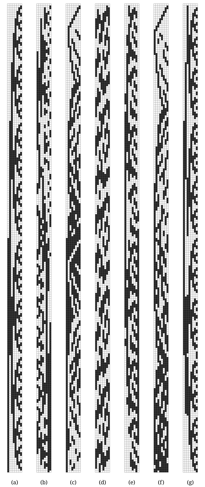](../../assets/volume4a/figures/fig-7-34-eight-bit-gray-codes.svg)

**图 34**　八位格雷码的例子. (a) 标准; (b) 平衡; (c) 互补; (d) 长游程; (e) 非局部; (f) 单调; (g) 无趋势.

因为 $P_{11}$ 为空, 且 $\pi_1$ 必为恒等置换, 所以还有

$$
P_{21}=1P_{10}^{\pi_1}=10,11.
\tag{37}
$$

一般地, $P_{nj}$ 是一个由 $n$ 位二进制串组成的序列, 恰由 $\binom{n-1}{j}$ 个权值为 $j$ 的串和 $\binom{n-1}{j}$ 个权值为 $j+1$ 的串交替排列而成.

令 $\alpha_{nj}$ 和 $\omega_{nj}$ 分别为 $P_{nj}$ 的首项和末项. 容易求得

$$
\omega_{nj}=0^{n-j-1}1^{j+1},\qquad 0\le j<n;
\tag{38}
$$

$$
\alpha_{n0}=0^n,\qquad n>0;
\tag{39}
$$

$$
\alpha_{nj}=1\alpha_{(n-1)(j-1)}^{\pi_{n-1}},\qquad 1\le j<n.
\tag{40}
$$

特别地, $\alpha_{nj}$ 的权值总是 $j$, $\omega_{nj}$ 的权值总是 $j+1$. 对 $n=1,2,3,\ldots$, 我们将定义 $\{0,1,\ldots,n-1\}$ 的置换 $\pi_n$, 使序列

$$
P_{n0},\ P_{n1}^R,\ P_{n2},\ P_{n3}^R,\ \ldots
\tag{41}
$$

和

$$
P_{n0}^R,\ P_{n1},\ P_{n2}^R,\ P_{n3},\ \ldots
\tag{42}
$$

都是单调二进制格雷路径. 单调性很明显, 只须检查格雷性质. 序列 $(41)$ 和 $(42)$ 的子路径能接合, 因为序列

$$
\alpha_{n0}\!\!\;\text{—}\;\alpha_{n1}\;\text{—}\;\cdots\;\text{—}\;\alpha_{n(n-1)},\qquad
\omega_{n0}\;\text{—}\;\omega_{n1}\;\text{—}\;\cdots\;\text{—}\;\omega_{n(n-1)}
\tag{43}
$$

的邻接性直接由 $(34)$ 得出, 与置换 $\pi_n$ 无关. 因此, 关键在式 (34) 逗号处的转变. $P_{(n+1)j}$ 是格雷子路径, 当且仅当

$$
\omega_{n(j-1)}^{\pi_n}=\alpha_{nj},\qquad 0<j<n.
\tag{44}
$$

例如, $n=2$ 且 $j=1$ 时, 由 $(38)$–$(40)$, 需要 $(01)^{\pi_2}=\alpha_{21}=10$, 所以 $\pi_2$ 必须交换坐标 0 和 1. 一般公式为 (见习题 71)

$$
\pi_n=\sigma_n\pi_{n-1}^2,
\tag{45}
$$

其中 $\sigma_n$ 是 $n$ 圈 $(n-1\ \ldots\ 1\ 0)$. 所以最初几种情况是

$$
\begin{aligned}
\pi_1&=(0),&\pi_4&=(0\ 3),\\
\pi_2&=(0\ 1),&\pi_5&=(0\ 4\ 3\ 2\ 1),\\
\pi_3&=(0\ 2\ 1),&\pi_6&=(0\ 5\ 2\ 4\ 1\ 3).
\end{aligned}
$$

置换 $\pi_n$ 似乎没有简单的 “闭合式”. 习题 73 说明怎样高效生成萨维奇–温克勒码.

**非二进制格雷码.** 我们已经详细研究了二进制 $n$ 元组, 因为它最简单、最典型、最实用, 也是这个课题中研究得最透彻的部分. 当然, 还有许多应用需要生成各整数分量满足更一般范围 $0\le a_j<m_j$ 的 $(a_1,\ldots,a_n)$, 就像算法 M 一样. 格雷码也很适合这种情况.

例如, 考虑十进制数字, 每个 $j$ 都满足 $0\le a_j<10$. 是否也有类似格雷二进制码的十进制计数法, 每次只改变一个数字? 有两种自然的方案. 第一种是*反射格雷十进制码*, 数字每次变动 $\pm1$, 用三位数字串数到一千的序列形如

$$
000,001,\ldots,009,019,018,\ldots,011,010,020,021,\ldots,091,090,190,191,\ldots,900,
$$

每个分量从 0 增到 9, 再从 9 降到 0, 如此往复. 第二种是*取模格雷十进制码*, 变化的数字总是按 $1\bmod10$ 增加, 所以从 9 “绕回” 到 0:

$$
000,001,\ldots,009,019,010,\ldots,017,018,028,029,\ldots,099,090,190,191,\ldots,900.
$$

两种情况下, 第 $k$ 步改变哪一个数字都由十进制直尺函数 $\rho_{10}(k)$ 决定, 即整除 $k$ 的 10 的最高幂的指数. 因此, 每个数字 $n$ 元组恰出现一次. 对于 $1\le j\le n$, 在改变任何其他数字之前, 首先生成最右边 $j$ 位的 $10^j$ 种不同取值.

一般地, 可以把任一混合进制数系中的反射格雷码看作非负整数的一个排列. 它把通常的混合进制数

$$
k=\begin{bmatrix}b_{n-1},\ldots,b_1,b_0\\m_{n-1},\ldots,m_1,m_0\end{bmatrix}=b_{n-1}m_{n-2}\cdots m_1m_0+\cdots+b_1m_0+b_0
\tag{46}
$$

映射为等价的反射格雷码

$$
\hat g(k)=\begin{bmatrix}a_{n-1},\ldots,a_1,a_0\\m_{n-1},\ldots,m_1,m_0\end{bmatrix}=a_{n-1}m_{n-2}\cdots m_1m_0+\cdots+a_1m_0+a_0,
\tag{47}
$$

正如式 (7) 在二进制的特殊情形中所做的. 令

$$
A_j=\begin{bmatrix}a_{n-1},\ldots,a_j\\m_{n-1},\ldots,m_j\end{bmatrix},\qquad
B_j=\begin{bmatrix}b_{n-1},\ldots,b_j\\m_{n-1},\ldots,m_j\end{bmatrix},
\tag{48}
$$

且取 $A_n=B_n=0$, 于是 $0\le j<n$ 时有

$$
A_j=m_jA_{j+1}+a_j,\qquad B_j=m_jB_{j+1}+b_j.
\tag{49}
$$

对 $n-j$ 归纳, 不难得出 $a$ 与 $b$ 的关系:

$$
a_j=\begin{cases}
b_j,&\text{如果 }B_{j+1}\text{ 为偶数;}\\
m_j-1-b_j,&\text{如果 }B_{j+1}\text{ 为奇数.}
\end{cases}
\tag{50}
$$

($n$ 元组 $(a_{n-1},\ldots,a_1,a_0)$ 和 $(b_{n-1},\ldots,b_1,b_0)$ 的坐标从右到左编号, 以便与 $(7)$ 和式 4.1–$(9)$ 的混合进制记法一致. 偏好 $(a_1,\ldots,a_n)$ 记号的读者, 可以在各式中把 $j$ 换为 $n-j$.) 反过来, 有

$$
b_j=\begin{cases}
a_j,&\text{如果 }a_{j+1}+a_{j+2}+\cdots\text{ 为偶数;}\\
m_j-1-a_j,&\text{如果 }a_{j+1}+a_{j+2}+\cdots\text{ 为奇数.}
\end{cases}
\tag{51}
$$

有趣的是, 所有基数 $m_j$ 为奇数时, 规则 (50) 和它的逆规则 (51) 完全相同. 例如, 在格雷三进制码中, $m_0=m_1=\cdots=3$ 时, $\hat g((10010211012)_3)=(12210211010)_3$, 且 $\hat g((12210211010)_3)=(10010211012)_3$. 习题 78 证明 $(50)$ 和 $(51)$, 并讨论取模格雷码的类似公式.

实际上, 可以推广算法 M 和 L, 无循环地生成这种格雷序列.

**算法 H (无循环生成反射混合进制格雷码).** 这个算法访问满足 $0\le a_j<m_j$($0\le j<n$) 的所有 $n$ 元组 $(a_{n-1},\ldots,a_0)$, 每一步只把一个分量改变 $\pm1$. 它像算法 L 那样用焦点指针数组 $(f_n,\ldots,f_0)$ 控制操作, 另有方向数组 $(o_{n-1},\ldots,o_0)$. 假定每个基数 $m_j\ge2$.

**H1.** [初始化.] 对 $0\le j<n$, 置 $a_j\leftarrow0$、$f_j\leftarrow j$、$o_j\leftarrow1$, 另置 $f_n\leftarrow n$.

**H2.** [访问.] 访问 $n$ 元组 $(a_{n-1},\ldots,a_1,a_0)$.

**H3.** [选择 $j$.] 置 $j\leftarrow f_0$、$f_0\leftarrow0$. (与算法 L 一样, $j$ 是最右边的主动坐标. 它右边的所有元素现在重新成为主动的.)

**H4.** [改变坐标 $j$.] 若 $j=n$, 终止. 否则置 $a_j\leftarrow a_j+o_j$.

**H5.** [反射?] 若 $a_j=0$ 或 $a_j=m_j-1$, 则置 $o_j\leftarrow-o_j$、$f_j\leftarrow f_{j+1}$、$f_{j+1}\leftarrow j+1$. (坐标 $j$ 因此变为被动.) 返回 H2. ▮

一个类似的算法可以生成取模格雷码 (见习题 77).

**＊子森林.** 黄田保宪和弗兰克·拉斯基 [*J. Algorithms* **15** (1993), 324–340] 发现了算法 H 的一种有趣而富有启发的推广, 进一步阐明格雷码和无循环生成. 设有一片含 $n$ 个结点的森林, 要访问它的全部 “主子森林”. 也就是要访问所有这样的结点子集 $S$: 如果 $x\in S$ 且 $x$ 不是根, 那么 $x$ 的父结点也在 $S$ 中. 例如, 下面的七结点森林有 33 个这样的子集:

[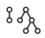](../../assets/volume4a/figures/7-2-1-1-seven-node-forest.svg)

它们对应于以下 33 个图形中的黑色结点:

[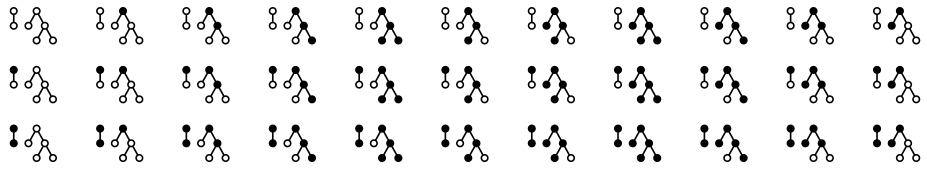](../../assets/volume4a/figures/7-2-1-1-diagram52-principal-subforests.svg)

**(52)**

注意, 从左到右读顶行, 从右到左读中间行, 再从左到右读底行, 则每一步恰好有一个结点改变状态.

如果给定的森林由退化的无分支树组成, 主子森林就相当于混合进制数. 例如, 这样的森林

[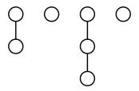](../../assets/volume4a/figures/7-2-1-1-degenerate-forest.svg)

有 $3\times2\times4\times2$ 个主子森林, 对应的四元组 $(x_1,x_2,x_3,x_4)$ 满足 $0\le x_1<3$、$0\le x_2<2$、$0\le x_3<4$、$0\le x_4<2$. $x_j$ 是在第 $j$ 棵树中选出的结点数. 黄田保宪和拉斯基的算法用于这样的森林时, 将按 $(3,2,4,2)$ 进制反射格雷码的顺序访问子森林.

**算法 K (无循环生成反射子森林).** 给定结点按后序编号为 $(1,\ldots,n)$ 的森林, 这个算法访问所有满足如下条件的二进制 $n$ 元组 $(a_1,\ldots,a_n)$: 每当 $p$ 是 $q$ 的父结点, 都有 $a_p\ge a_q$. (因此, $a_p=1$ 表示 $p$ 是当前子森林的结点.) 相邻两次访问恰有一位 $a_j$ 改变. 它用类似算法 L 的焦点指针 $(f_0,f_1,\ldots,f_n)$, 另用两组指针 $(l_0,l_1,\ldots,l_n)$ 和 $(r_0,r_1,\ldots,r_n)$ 表示称为 “当前边缘” 的双向链表. 当前边缘包含当前子森林的全部结点及其子结点. $r_0$ 指向最左结点, $l_0$ 指向最右结点.

辅助数组 $(c_0,c_1,\ldots,c_n)$ 定义森林. 若 $p$ 没有子结点, 则 $c_p=0$; 否则, $c_p$ 是 $p$ 最左边 (编号最小) 的子结点. $c_0$ 是森林最左边的根. 算法开始时, 若 $p$ 和 $q$ 是同一组中相邻的子结点, $p$ 在 $q$ 左边, 则假定 $r_p=q$ 且 $l_q=p$. 例如, $(52)$ 中的森林按后序编号如下:

[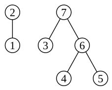](../../assets/volume4a/figures/7-2-1-1-postorder-forest.svg)

因而, 此例在 K1 开始时有 $(c_0,\ldots,c_7)=(2,0,1,0,0,0,4,3)$, 且 $r_2=7$、$l_7=2$、$r_3=6$、$l_6=3$、$r_4=5$、$l_5=4$.

**K1.** [初始化.] 对 $1\le j\le n$, 置 $a_j\leftarrow0$、$f_j\leftarrow j$. 这样初始子森林为空, 所有结点都为主动. 置 $f_0\leftarrow0$、$l_0\leftarrow n$、$r_n\leftarrow0$、$r_0\leftarrow c_0$、$l_{c_0}\leftarrow0$, 从而把所有根放入当前边缘.

**K2.** [访问.] 访问由 $(a_1,\ldots,a_n)$ 定义的子森林.

**K3.** [选择 $p$.] 置 $q\leftarrow l_0$、$p\leftarrow f_q$. (现在 $p$ 是边缘最右边的主动结点.) 另置 $f_q\leftarrow q$ (使 $p$ 右边的所有结点成为主动结点).

**K4.** [检查 $a_p$.] 若 $p=0$, 终止算法. 否则, 若 $a_p=1$, 转到 K6.

**K5.** [插入 $p$ 的子结点.] 置 $a_p\leftarrow1$. 若 $c_p\ne0$, 再置 $q\leftarrow r_p$、$l_q\leftarrow p-1$、$r_{p-1}\leftarrow q$、$r_p\leftarrow c_p$、$l_{c_p}\leftarrow p$ (从而把 $p$ 的子结点插入边缘中 $p$ 的右边). 转到 K7.

**K6.** [删除 $p$ 的子结点.] 置 $a_p\leftarrow0$. 若 $c_p\ne0$, 再置 $q\leftarrow r_{p-1}$、$r_p\leftarrow q$、$l_q\leftarrow p$ (从边缘中删除 $p$ 的子结点).

**K7.** [使 $p$ 成为被动结点.] (此时已知 $p$ 是主动的.) 置 $f_p\leftarrow f_{l_p}$、$f_{l_p}\leftarrow l_p$. 返回 K2. ▮

读者不妨对 $(52)$ 这样的例子演算一遍, 以了解边缘怎样在恰当的时候扩张和收缩.

**＊移位寄存器序列.** 生成 $m$ 进制数字的全部 $n$ 元组, 还可以用一种完全不同的办法. 每次只生成一个数字, 反复处理最近生成的 $n$ 个数字. 由此在右边移入一个合适的新数字, 就从 $n$ 元组 $(x_0,x_1,\ldots,x_{n-1})$ 转到 $(x_1,\ldots,x_{n-1},x_n)$. 例如, 图 35 显示, 在长度为 32 的某个循环模式中, 可以把每个五位二进制数取为连续五位的一块. 2.3.4.2 节和 3.2.2 节的一些习题已讨论过这个概念, 现在进一步考察.

[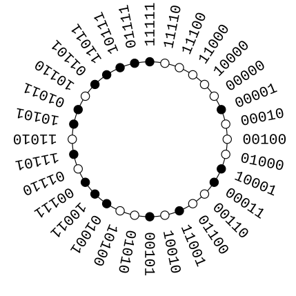](../../assets/volume4a/figures/fig-7-35-five-bit-de-bruijn-cycle.svg)

**图 35**　五位二进制数的德布鲁因圈.

**算法 S (生成通用移位寄存器).** 若在 S3 中用合适的函数 $f$, 则本算法访问满足 $0\le a_j<m$($1\le j\le n$) 的所有 $n$ 元组 $(a_1,\ldots,a_n)$.

**S1.** [初始化.] 对 $-n<j\le0$, 置 $a_j\leftarrow0$, 并置 $k\leftarrow1$.

**S2.** [访问.] 访问 $n$ 元组 $(a_{k-n},\ldots,a_{k-1})$. 若 $k=m^n$, 终止.

**S3.** [推进.] 置 $a_k\leftarrow f(a_{k-n},\ldots,a_{k-1})$、$k\leftarrow k+1$, 返回 S2. ▮

每个使算法 S 有效的函数 $f$ 都对应一个由 $m^n$ 个 $m$ 进制数字组成的圈, 圈中有连续出现的每一种 $n$ 位数字组合. 例如, 图 35 所示的 $m=2$ 和 $n=5$ 的情形, 对应于二进制圈

$$
00000100011001010011101011011111;
\tag{53}
$$

而无穷序列

$$
0011021220313233041424344\ldots
\tag{54}
$$

的前 $m^2$ 个数字给出 $n=2$、任意 $m$ 的相应圈. 这类圈一般称为 $m$ 进制*德布鲁因圈*, 因为尼古拉斯·德布鲁因在 *Indagationes Mathematicae* **8** (1946), 461–467 中讨论了任意 $n$ 的二进制情形.

习题 2.3.4.2–23 证明, 恰有 $(m!)^{m^{n-1}}/m^n$ 个函数 $f$ 具有所需性质. 这是一个巨大的数. 但这些函数中, 已知能够高效计算的只占少数. 我们将讨论看来最有用的三类 $f$.

第一类重要例子中, $m$ 是素数, 而 $f$ 是殆线性递推

$$
f(x_1,\ldots,x_n)=
\begin{cases}
c_1,&\text{若 }(x_1,x_2,\ldots,x_n)=(0,0,\ldots,0)；\\
0,&\text{若 }(x_1,x_2,\ldots,x_n)=(1,0,\ldots,0)；\\
(c_1x_1+c_2x_2+\cdots+c_nx_n)\bmod m,&\text{其他情形.}
\end{cases}
\tag{55}
$$

这里的系数 $(c_1,\ldots,c_n)$ 必须使

$$
x^n-c_nx^{n-1}-\cdots-c_2x-c_1
\tag{56}
$$

是模 $m$ 的本原多项式, 意义同式 3.2.2–$(9)$ 之后的讨论. 这类多项式有 $\varphi(m^n-1)/n$ 个, 多到可以找到只有少数系数 $c$ 非零的多项式. [这种构造可追溯到威廉·曼特尔的开创性论文,*Nieuw Archief voor Wiskunde* (2) **1** (1897), 172–184.]

例如, 设 $m=2$, 可以用很简单的无循环过程生成二进制 $n$ 元组.

**算法 A (生成殆线性二进制位移).** 这个算法访问全部 $n$ 位向量, 使用一个特殊偏移量 $s$[情形 1] 或两个特殊偏移量 $s,t$[情形 2], 如表 1 所列.

**表 1**　算法 A 的参数

<table>
<tbody>
<tr><td>$3:1$</td><td>$8:1,5$</td><td>$13:1,3$</td><td>$18:7$</td><td>$23:5$</td><td>$28:3$</td></tr>
<tr><td>$4:1$</td><td>$9:4$</td><td>$14:1,11$</td><td>$19:1,5$</td><td>$24:1,3$</td><td>$29:2$</td></tr>
<tr><td>$5:2$</td><td>$10:3$</td><td>$15:1$</td><td>$20:3$</td><td>$25:3$</td><td>$30:1,15$</td></tr>
<tr><td>$6:1$</td><td>$11:2$</td><td>$16:2,3$</td><td>$21:2$</td><td>$26:1,7$</td><td>$31:3$</td></tr>
<tr><td>$7:1$</td><td>$12:3,4$</td><td>$17:3$</td><td>$22:1$</td><td>$27:1,7$</td><td>$32:1,27$</td></tr>
</tbody>
</table>

条目 $n:s$ 或 $n:s,t$ 表示多项式 $x^n+x^s+1$ 或 $x^n+(x^s+1)(x^t+1)$ 在模 2 下是本原的. 韦恩·斯坦克 [*Math. Comp.* **27** (1973), 977–980] 还给出了直到 $n=168$ 的其他参数.

**A1.** [初始化.] 置 $(x_0,x_1,\ldots,x_{n-1})\leftarrow(1,0,\ldots,0)$、$k\leftarrow0$、$j\leftarrow s$. 情形 2 中另置 $i\leftarrow t$、$h\leftarrow s+t$.

**A2.** [访问.] 访问 $n$ 元组 $(x_{k-1},\ldots,x_0,x_{n-1},\ldots,x_{k+1},x_k)$.

**A3.** [检查是否结束.] 若 $x_k\ne0$, 置 $r\leftarrow0$. 否则置 $r\leftarrow r+1$, 且在 $r=n-1$ 时转到 A6. (刚刚看到连续 $r$ 个 0.)

**A4.** [移位.] 置 $k\leftarrow(k-1)\bmod n$、$j\leftarrow(j-1)\bmod n$. 情形 2 中另置 $i\leftarrow(i-1)\bmod n$、$h\leftarrow(h-1)\bmod n$.

**A5.** [计算新的二进制位.] 情形 1 置 $x_k\leftarrow x_k\oplus x_j$, 情形 2 置 $x_k\leftarrow x_k\oplus x_j\oplus x_i\oplus x_h$. 返回 A2.

**A6.** [结束.] 访问 $(0,\ldots,0)$, 终止. ▮

由于本原多项式很多, 几乎可以肯定, 对所有 $n$ 都有合适的偏移量 $s$, 必要时还有 $t$. 例如 $n=32$ 时, 有八种不同的 $(s,t)$ 可用, 表 1 只列最小的一种. 不过, 要严格证明所有情形下都存在这样的参数, 远超现有数学的能力.

式 (55) 的第一个德布鲁因圈构造是代数性质的, 有效性依赖有限域理论. $m$ 不是素数时适用的一种类似方法见习题 3.2.2–21. 下一个构造完全是组合性质的, 实际上与 $m$ 进制取模格雷码的概念密切相关.

**算法 R (生成递归德布鲁因圈).** 设 $f()$ 是一个协同程序, 反复调用它时, 依次输出一个长度为 $m^n$、以 $n$ 个 0 开头的 $m$ 进制德布鲁因圈各数字. $n\ge2$ 时, 下面是一个类似的协同程序, 输出长度为 $m^{n+1}$ 的圈. 它有三个私有变量 $x,y,t$, 其中 $x$ 的初值为 0.

**R1.** [输出.] 输出 $x$. 若 $x\ne0$ 且 $t\ge n$, 转到 R3.

**R2.** [调用 $f$.] 置 $y\leftarrow f()$.

**R3.** [数 1.] 若 $y=1$, 置 $t\leftarrow t+1$. 否则置 $t\leftarrow0$.

**R4.** [跳过 1?] 若 $t=n$ 且 $x\ne0$, 返回 R2.

**R5.** [调整 $x$.] 置 $x\leftarrow(x+y)\bmod m$, 返回 R1. ▮

例如, 令 $m=3$、$n=2$. 若 $f()$ 产生无穷重复的九位圈

$$
001102122\quad001102122\quad0\ldots,
\tag{57}
$$

则算法 R 在 R1 产生下列无穷重复的 27 位圈:

$$
\begin{aligned}
y&=001021220011110212200102122\quad001\ldots\\
t&=001001000012340010000100100\quad001\ldots\\
x&=000110102220120020211122121\quad0001\ldots
\end{aligned}
$$

算法 R 正确的证明很有趣, 也很有启发性 (见习题 93). 下一个算法把窗口大小 $n$ 加倍, 其正确性证明更是如此 (见习题 95).

**算法 D (生成加倍的递归德布鲁因圈).** 设 $f()$ 和 $f'()$ 是两个协同程序, 分别在反复调用时输出长度为 $m^n$、以 $n\ge2$ 个 0 开头的 $m$ 进制德布鲁因圈各数字. (两个圈必须完全相同, 但由独立的协同程序生成, 因为要按不同速率使用各自的值.) 下面是一个类似的协同程序, 输出长度为 $m^{2n}$ 的德布鲁因圈. 它保持六个私有变量 $x,y,t,x',y',t'$, 其中 $x$ 和 $x'$ 的初值为 $m$.

特殊参数 $r$ 必须取满足下式的常数:

$$
1\le r\le m,\qquad \gcd(m^n-r,m^n+r)=2.
\tag{58}
$$

通常最好的选择是 $m$ 为奇数时取 $r=1$, $m$ 为偶数时取 $r=2$.

**D1.** [可能调用 $f$.] 若 $t\ne n$ 或 $x\ge r$, 置 $y\leftarrow f()$.

**D2.** [数重复.] 若 $x\ne y$, 置 $x\leftarrow y$、$t\leftarrow1$. 否则置 $t\leftarrow t+1$.

**D3.** [从 $f$ 输出.] 输出 $x$ 的当前值.

**D4.** [调用 $f'$.] 置 $y'\leftarrow f'()$.

**D5.** [数重复.] 若 $x'\ne y'$, 置 $x'\leftarrow y'$、$t'\leftarrow1$. 否则置 $t'\leftarrow t'+1$.

**D6.** [可能舍弃 $f'$ 的值.] 若 $t'=n$ 且 $x'<r$, 并且 $t<n$ 或 $x'<x$ 中至少一个成立, 转到 D4. 若 $t'=n$、$x'<r$ 且 $x'=x$, 转到 D3.

**D7.** [从 $f'$ 输出.] 输出 $x'$ 的当前值. 若 $t'=n$ 且 $x'<r$, 返回 D3. 否则返回 D1. ▮

算法 D 的基本思路是轮流从 $f()$ 和 $f'()$ 输出. 当任一序列产生连续 $n$ 个相同且小于 $r$ 的值时, 作特殊调整. 例如, $f()$ 和 $f'()$ 都产生 $(57)$ 的九位圈时, 取 $r=1$, 得到

$$
\begin{aligned}
t\text{ 在 D2:}&\quad12\ 31211112\ 12312111\ 12123121\ 11121231\ 21111212\ldots\\
x\text{ 在 D3:}&\quad00001102122\ 00011021\ 22000110\ 21220001\ 102122000\ldots\\
\boldsymbol{t'}\text{ 在 D5:}&\quad\mathbf{121211112121211112121211112121211112121211112121}\ldots\\
\boldsymbol{x'}\text{ 在 D7:}&\quad\mathbf{0\ 11021220\ 11021220\ 11021220\ 11021220\ 11021220\ 1}\ldots
\end{aligned}
$$

所以, D3 和 D7 产生的 81 位圈是 $0\mathbf{0}00\mathbf{1}0\mathbf{1}1\mathbf{0}1\mathbf{2}\ldots2\mathbf{2}2\mathbf{2}\ 0\mathbf{0}00\mathbf{1}\ldots$.

亚伯拉罕·伦佩尔发现了算法 R 的 $m=2$ 情形 [*IEEE Trans.* **C-19** (1970), 1204–1209]. 二十五年多后才发现算法 D[克里斯托弗·米切尔、图维·埃齐奥尼和肯尼斯·佩特森,*IEEE Trans.* **IT-42** (1996), 1472–1478]. 从基于 $(54)$ 的 $n=2$ 简单协同程序出发, 把这两个算法结合起来, 可以建立一组有趣的协同程序. 对所需的任意 $m\ge2$ 和 $n\ge2$, 它们生成长度为 $m^n$ 的德布鲁因圈, 每个输出数字只需 $O(\log n)$ 次简单计算. (见习题 96.) 另外, 在最简单的 $m=2$ 情形, 这种组合的 “R&D 方法” 还有一个性质: 可将第 $k$ 次输出作为 $k$ 的函数直接计算, 对 $n$ 位数作 $O(n\log n)$ 次简单操作. 反过来, 给定任意 $n$ 位模式 $\beta$, 也可以用 $O(n\log n)$ 步算出 $\beta$ 在圈中的位置. (见习题 97–99.) 目前还不知道有其他二进制德布鲁因圈族具有后一性质.

第三种德布鲁因圈构造基于素串理论, 研究第 9 章的模式匹配时, 素串也很重要. 设 $\gamma=\alpha\beta$ 为两个串的串联. 称 $\alpha$ 为 $\gamma$ 的前缀, $\beta$ 为后缀. 若 $\gamma$ 的前缀或后缀长度为正且小于 $\gamma$ 的长度, 称为真前缀或真后缀. 因此, 当且仅当 $\alpha\ne\epsilon$ 且 $\beta\ne\epsilon$ 时, $\beta$ 是 $\alpha\beta$ 的真后缀.

**定义 P.** 若一个串非空, 且按字典序小于它的所有真后缀, 就称它为*素串*. ▮

例如, `01101` 大于 `01`, 所以不是素串. `01102` 则是素串, 因为它小于 `1102`、`102`、`02` 和 `2`. (假定串由线性有序字母表上的字母、数字或其他符号组成. 字典序是比较串的通常办法. 所以, 当 $\alpha$ 按字典序小于 $\beta$ 时, 写作 $\alpha<\beta$, 也称 $\alpha$ 小于 $\beta$. 特别地, 总有 $\alpha\le\alpha\beta$, 而当且仅当 $\beta\ne\epsilon$ 时有 $\alpha<\alpha\beta$.)

素串常称为*林登单词*, 因为罗杰·林登引入了它们 [*Trans. Amer. Math. Soc.* **77** (1954), 202–215]. 林登称它们为 “标准序列”. 由于习题 101 的基本分解定理, 用 “素串” 这个较简单的术语是有理由的. 不过, 我们还是会常用字母 $\lambda$ 表示素串, 以向林登致意.

陈国才、拉尔夫·福克斯和林登在一篇关于群论的重要论文 [*Annals of Math.* (2) **68** (1958), 81–95] 中导出了素串的一些最重要性质, 其中有下面这个简单而基本的结果.

**定理 P.** 小于其所有循环移位的非空串是素串.

($a_1\ldots a_n$ 的循环移位是 $a_2\ldots a_na_1$、$a_3\ldots a_na_1a_2$、……、$a_na_1\ldots a_{n-1}$.)

**证明.** 设 $\gamma=\alpha\beta$ 不是素串, 因为 $\alpha\ne\epsilon$ 且 $\gamma\ge\beta\ne\epsilon$. 又设 $\gamma$ 小于其循环移位 $\beta\alpha$. 由 $\beta\le\gamma<\beta\alpha$ 可知, 对某个 $\theta<\alpha$, 有 $\gamma=\beta\theta$. 因此, 若 $\gamma$ 还小于循环移位 $\theta\beta$, 就有 $\theta<\alpha<\alpha\beta<\theta\beta$. 但这是不可能的, 因为 $\alpha$ 和 $\theta$ 长度相同. ▮

令 $L_m(n)$ 为长度为 $n$ 的 $m$ 进制素串数. 每个串 $a_1\ldots a_n$ 连同它的循环移位, 共产生 $d$ 个不同的串, 其中 $d$ 是 $n$ 的某个因数, 恰对应一个长度为 $d$ 的素串. 例如, `010010` 通过循环移位还得到 `100100` 和 `001001`, 且周期部分 $\{010,100,001\}$ 中最小的是素串 `001`. 因此必有

$$
\sum_{d\mid n}d L_m(d)=m^n,\qquad\text{对所有 }m,n\ge1.
\tag{59}
$$

可以用莫比乌斯函数和习题 4.5.3–28(a) 解这组关于 $L_m(n)$ 的方程, 得到

$$
L_m(n)=\frac1n\sum_{d\mid n}\mu(d)m^{n/d}.
\tag{60}
$$

20 世纪 70 年代, 哈罗德·弗雷德里克森和詹姆斯·马约拉纳发现了一种优美而简单的方法, 能按递增顺序生成长度不超过 $n$ 的全部 $m$ 进制素串 [*Discrete Math.* **23** (1978), 207–210]. 要理解这个算法, 先考虑非空串 $\lambda$ 的 *$n$ 扩张*, 即无穷串 $\lambda\lambda\lambda\ldots$ 的前 $n$ 个字符. 例如, `123` 的 10 扩张是 `1231231231`. 一般来说, 若 $|\lambda|=k$, 其 $n$ 扩张为 $\lambda^{\lfloor n/k\rfloor}\lambda'$, 其中 $\lambda'$ 是 $\lambda$ 的长为 $n\bmod k$ 的前缀.

**定义 Q.** 若一个串是某个字母表上某个素串的非空前缀, 则称它为*前素串*. ▮

**定理 Q.** 长度为 $n>0$ 的串是前素串, 当且仅当它是长度为 $k\le n$ 的素串 $\lambda$ 的 $n$ 扩张. 这个素串唯一确定.

**证明.** 见习题 105. ▮

定理 Q 实质上给出了长度不超过 $n$ 的素串与长度为 $n$ 的前素串的一一对应关系. 下面的算法按递增顺序生成所有 $m$ 进制实例.

**算法 F (生成素串和前素串).** 本算法访问使串 $a_1\ldots a_n$ 成为前素串的所有 $m$ 进制 $n$ 元组 $(a_1,\ldots,a_n)$, 并确定下标 $j$, 使 $a_1\ldots a_n$ 是素串 $a_1\ldots a_j$ 的 $n$ 扩张.

**F1.** [初始化.] 置 $a_1\leftarrow\cdots\leftarrow a_n\leftarrow0$、$j\leftarrow1$, 另置 $a_0\leftarrow-1$.

**F2.** [访问.] 访问 $(a_1,\ldots,a_n)$ 及下标 $j$.

**F3.** [准备增加.] 置 $j\leftarrow n$. 若 $a_j=m-1$, 则减小 $j$, 直到 $a_j<m-1$.

**F4.** [加 1.] 若 $j=0$, 终止. 否则置 $a_j\leftarrow a_j+1$. (由习题 105(a), 现在 $a_1\ldots a_j$ 是素串.)

**F5.** [作 $n$ 扩张.] 对 $k\leftarrow j+1,\ldots,n$ (按此顺序) 置 $a_k\leftarrow a_{k-j}$. 返回 F2. ▮

例如, $m=3$、$n=4$ 时, 算法 F 访问以下 32 个三进制前素串:

<table>
<tbody>
<tr><td>$\underset{\scriptscriptstyle\wedge}{0}000$</td><td>$001\underset{\scriptscriptstyle\wedge}{1}$</td><td>$002\underset{\scriptscriptstyle\wedge}{2}$</td><td>$011\underset{\scriptscriptstyle\wedge}{1}$</td><td>$012\underset{\scriptscriptstyle\wedge}{2}$</td><td>$021\underset{\scriptscriptstyle\wedge}{2}$</td><td>$\underset{\scriptscriptstyle\wedge}{1}111$</td><td>$1\underset{\scriptscriptstyle\wedge}{2}12$</td></tr>
<tr><td>$000\underset{\scriptscriptstyle\wedge}{1}$</td><td>$001\underset{\scriptscriptstyle\wedge}{2}$</td><td>$0\underset{\scriptscriptstyle\wedge}{1}01$</td><td>$011\underset{\scriptscriptstyle\wedge}{2}$</td><td>$0\underset{\scriptscriptstyle\wedge}{2}02$</td><td>$02\underset{\scriptscriptstyle\wedge}{2}0$</td><td>$111\underset{\scriptscriptstyle\wedge}{2}$</td><td>$12\underset{\scriptscriptstyle\wedge}{2}1$</td></tr>
<tr><td>$000\underset{\scriptscriptstyle\wedge}{2}$</td><td>$00\underset{\scriptscriptstyle\wedge}{2}0$</td><td>$010\underset{\scriptscriptstyle\wedge}{2}$</td><td>$01\underset{\scriptscriptstyle\wedge}{2}0$</td><td>$02\underset{\scriptscriptstyle\wedge}{1}0$</td><td>$022\underset{\scriptscriptstyle\wedge}{1}$</td><td>$11\underset{\scriptscriptstyle\wedge}{2}1$</td><td>$122\underset{\scriptscriptstyle\wedge}{2}$</td></tr>
<tr><td>$00\underset{\scriptscriptstyle\wedge}{1}0$</td><td>$002\underset{\scriptscriptstyle\wedge}{1}$</td><td>$01\underset{\scriptscriptstyle\wedge}{1}0$</td><td>$012\underset{\scriptscriptstyle\wedge}{1}$</td><td>$021\underset{\scriptscriptstyle\wedge}{1}$</td><td>$022\underset{\scriptscriptstyle\wedge}{2}$</td><td>$112\underset{\scriptscriptstyle\wedge}{2}$</td><td>$\underset{\scriptscriptstyle\wedge}{2}222$</td></tr>
</tbody>
</table>

**(61)**

(标在数字下方的 $\wedge$ 所指的数字及此前各位组成素串 $0,0001,0002,001,0011,\ldots,2$.)

定理 Q 说明了这个算法为何正确. F3 和 F4 显然找到了大于前一个前素串 $a_1\ldots a_n$、长度不超过 $n$ 的最小 $m$ 进制素串. 注意, $a_1$ 从 0 增到 1 后, 算法继续访问把所有 $(m-1)$ 进制素串和前素串逐位加 1 所得到的那些串.

算法 F 很优美, 不过它和德布鲁因圈有什么关系? 关键在于, 若每当 $j$ 是 $n$ 的因数便在 F2 输出 $a_1,\ldots,a_j$, 则所有这些数字依次组成一个德布鲁因圈. 例如, $m=3$、$n=4$ 时, 输出以下 81 个数字:

$$
\begin{aligned}
&0\ 0001\ 0002\ 0011\ 0012\ 0021\ 0022\ 01\ 0102\ 0111\ 0112\\
&\qquad0121\ 0122\ 02\ 0211\ 0212\ 0221\ 0222\ 1\ 1112\ 1122\ 12\ 1222\ 2.
\end{aligned}
\tag{62}
$$

(省略 $(61)$ 中的素串 $001,002,011,\ldots,122$, 因为这些串的长度不整除 4.) 习题 108 探讨这个近乎神奇的性质. 由 $(59)$ 可知, 此圈的长度正确.

在一定意义上, 这个过程的输出与所有 $m$ 和 $n$ 均适用的德布鲁因圈构造的 “祖先” 等价. 那是门罗·马丁发表在 *Bull. Amer. Math. Soc.* **40** (1934), 859–864 的构造. $m=3$、$n=4$ 时, 马丁的原圈是 $2222122202211\ldots10000$, 由 $(62)$ 中每个数字 $a$ 换成 $2-a$ 得到. 事实上, 哈罗德·弗雷德里克森和詹姆斯·马约拉纳在寻找简单生成马丁序列的方法时, 几乎偶然发现了算法 F. 直到多年后, 弗兰克·拉斯基、卡拉·萨维奇和王珉懿细致分析运行时间时, 人们才注意到这个算法同前素串的明确联系 [*J. Algorithms* **13** (1992), 414–430]. 主要结果见习题 107:

(i) 在 F3 和 F5, $n-j$ 的平均值约为 $1/(m-1)$.

(ii) 产生像 $(62)$ 那样的德布鲁因圈, 总运行时间为 $O(m^n)$.

**习题**

**1.** [*10*][答案](./answers/7-2-1-1.md#ans-7-2-1-1-1) 已知各分量的下界 $l_j$ 和上界 $u_j$ (假定 $l_j\le u_j$), 说明怎样生成满足 $l_j\le a_j\le u_j$ 的全部 $n$ 元组 $(a_1,\ldots,a_n)$.

**2.** [*15*][答案](./answers/7-2-1-1.md#ans-7-2-1-1-2) 若 $n=10$, 且 $m_j=j$($1\le j\le n$), 算法 M 访问的第 1 000 000 个 $n$ 元组是什么? [提示:

$$
\begin{bmatrix}
0,0,1,2,3,0,2,7,1,0\\1,2,3,4,5,6,7,8,9,10
\end{bmatrix}=1\,000\,000.
$$

]

▶ **3.** [*M20*][答案](./answers/7-2-1-1.md#ans-7-2-1-1-3) 算法 M 执行步骤 M4 多少次?

▶ **4.** [*18*][答案](./answers/7-2-1-1.md#ans-7-2-1-1-4) 在多数计算机上, 向下数到 0 比向上数到 $m$ 快. 修改算法 M, 使它按相反次序访问全部 $n$ 元组, 从 $(m_1-1,\ldots,m_n-1)$ 开始, 到 $(0,\ldots,0)$ 结束.

▶ **5.** [*22*][答案](./answers/7-2-1-1.md#ans-7-2-1-1-5) 像 “快速傅里叶变换” (习题 4.6.4–14) 那样的算法, 常以位反射顺序的结果数组结束. 所需的 $A[(b_{n-1}\ldots b_0)_2]$ 的位置实际放着 $A[(b_0\ldots b_{n-1})_2]$. 怎样把结果重新排列成适当的顺序? [提示: 反射算法 M.]

**6.** [*M17*][答案](./answers/7-2-1-1.md#ans-7-2-1-1-6) 证明格雷二进制码的基本公式 (7).

**7.** [*20*][答案](./answers/7-2-1-1.md#ans-7-2-1-1-7) 图 30(b) 给出分成 16 个扇区的圆盘的格雷二进制码. 如果扇区数为 12 或 60 (表示时钟上的小时数或分钟数), 或为 360 (表示一圈的度数), 该用怎样的类似格雷码?

**8.** [*15*][答案](./answers/7-2-1-1.md#ans-7-2-1-1-8) 怎样遍历长度为 $n$ 的所有偶校验二进制串, 每步只改变两位?

**9.** [*16*][答案](./answers/7-2-1-1.md#ans-7-2-1-1-9) 求解中国环谜题时, 从图 31 所示状态出发, 下一步是什么?

▶ **10.** [*M21*][答案](./answers/7-2-1-1.md#ans-7-2-1-1-10) 在取下 $n$ 个中国环的最短过程中, 求 (a) 取下一个环的移动总数 $A_n$, 以及 (b) 放回一个环的移动总数 $B_n$ 的简单公式. 例如, $A_3=4$, $B_3=1$.

**11.** [*M22*][答案](./answers/7-2-1-1.md#ans-7-2-1-1-11) (亨利·普尔基斯, 1865.) 中国环谜题的两个最小环, 其实可以同时套上杆或从杆上取下. 允许这样的加速移动时, 解开谜题需要多少步?

▶ **12.** [*25*][答案](./answers/7-2-1-1.md#ans-7-2-1-1-12) 整数 $n$ 的*组分*是和为 $n$ 的正整数序列. 例如, 4 的组分是 $1111,112,121,13,211,22,31,4$. 整数 $n$ 恰有 $2^{n-1}$ 个组分, 对应于点集 $\{1,\ldots,n-1\}$ 的所有子集. 这些点可以把区间 $(0\ldots n)$ 分成长度为整数的子区间.

(a) 设计算法, 无循环地生成 $n$ 的所有组分, 每个组分用一个依次存储的整数数组 $s_1s_2\ldots s_t$ 表示.

(b) 类似地, 设计一个无循环算法, 用指针数组 $q_0q_1\ldots q_t$ 隐式表示各组分. 组分的各项是 $(q_0-q_1)(q_1-q_2)\ldots(q_{t-1}-q_t)$, 且 $q_0=n$、$q_t=0$. 例如, 组分 211 由指针 $q_0=4$、$q_1=2$、$q_2=1$、$q_3=0$ 表示, 其中 $t=3$.

**13.** [*21*][答案](./answers/7-2-1-1.md#ans-7-2-1-1-13) 继续上题, 计算访问组分 $s_1\ldots s_t$ 时所用的多项式系数 $C=\binom{n}{s_1,\ldots,s_t}$.

**14.** [*20*][答案](./answers/7-2-1-1.md#ans-7-2-1-1-14) 设计算法, 按字典序生成所有串 $a_1\ldots a_j$, 其中 $0\le j\le n$, 且 $0\le a_i<m_i$($1\le i\le j$). 例如, 若 $m_1=m_2=n=2$, 算法应依次访问 $\epsilon,0,00,01,1,10,11$.

▶ **15.** [*25*][答案](./answers/7-2-1-1.md#ans-7-2-1-1-15) 设计算法, 无循环地生成上题中的串. 所有等长的串仍按字典序访问, 不同长度的串可以任意穿插. 例如, $m_1=m_2=n=2$ 时, $0,00,01,\epsilon,10,11,1$ 是可接受的次序.

**16.** [*23*][答案](./answers/7-2-1-1.md#ans-7-2-1-1-16) 无循环算法显然不能按字典序生成全部二进制向量 $(a_1,\ldots,a_n)$, 因为相邻两次访问之间需要改变的分量 $a_j$ 数目无上界. 不过, 请说明改用链接表示后, 无循环的字典序生成是可行的. 设有 $2n+1$ 个结点 $\{0,1,\ldots,2n\}$, 每个结点都有一个 LINK 字段. 二进制 $n$ 元组 $(a_1,\ldots,a_n)$ 的表示如下:

$$
\begin{aligned}
\mathrm{LINK}(0)&=1+na_1;\\
\mathrm{LINK}(j-1+na_{j-1})&=j+na_j,\qquad 1<j\le n;\\
\mathrm{LINK}(n+na_n)&=0.
\end{aligned}
$$

其余 $n$ 个 LINK 字段可取任何方便的值.

**17.** [*20*][答案](./answers/7-2-1-1.md#ans-7-2-1-1-17) 一种名为*卡诺图*的著名构造 [莫里斯·卡诺,*Amer. Inst. Elect. Eng. Trans.* **72**, part I (1953), 593–599] 用两个方向的格雷二进制码, 在 $4\times4$ 环面上显示全部四位二进制数:

<table>
<tbody>
<tr><td>0000</td><td>0001</td><td>0011</td><td>0010</td></tr>
<tr><td>0100</td><td>0101</td><td>0111</td><td>0110</td></tr>
<tr><td>1100</td><td>1101</td><td>1111</td><td>1110</td></tr>
<tr><td>1000</td><td>1001</td><td>1011</td><td>1010</td></tr>
</tbody>
</table>

(环面的条目在左右两侧及上下两端相接, 仿佛在平面上无限重复的瓦片.) 说明怎样把所有六位二进制数类似地排列在 $8\times8$ 环面上, 使得从任一点向东、南、西或北移动时, 只有一个坐标改变.

▶ **18.** [*20*][答案](./answers/7-2-1-1.md#ans-7-2-1-1-18) 各分量满足 $0\le u_j<m_j$ 的向量 $u=(u_1,\ldots,u_n)$ 的*李权*定义为

$$
\nu_L(u)=\sum_{j=1}^n\min(u_j,m_j-u_j).
$$

两个这样的向量 $u$ 和 $v$ 的*李距离*为

$$
d_L(u,v)=\nu_L(u-v),\qquad\text{其中 }u-v=((u_1-v_1)\bmod m_1,\ldots,(u_n-v_n)\bmod m_n).
$$

(如果每步按 $\pm1\pmod{m_j}$ 调整一个分量 $u_j$, 这是把 $u$ 变为 $v$ 所需的最少步数.)

四进制向量的 $m_j=4$($1\le j\le n$), 二进制向量的 $m_j=2$. 在四进制向量 $u=(u_1,\ldots,u_n)$ 和二进制向量 $u'=(u'_1,\ldots,u'_{2n})$ 之间, 找出一个简单的一一对应, 使 $\nu_L(u)=\nu(u')$ 且 $d_L(u,v)=\nu(u'\oplus v')$.

**19.** [*23*][答案](./answers/7-2-1-1.md#ans-7-2-1-1-19) (八元码, octacode.) 令 $g(x)=x^3+2x^2+x-1$.

(a) 利用本节的某个算法, 计算 $\sum z_{u_0}z_{u_1}z_{u_2}z_{u_3}z_{u_4}z_{u_5}z_{u_6}z_{u_\infty}$. 这是以 $z_0,z_1,z_2,z_3$ 为变量的多项式, 求和遍及 $0\le v_0,v_1,v_2,v_3<4$ 的 256 个多项式

$$
(v_0+v_1x+v_2x^2+v_3x^3)g(x)\bmod4=u_0+u_1x+u_2x^2+u_3x^3+u_4x^4+u_5x^5+u_6x^6,
$$

其中选取 $u_\infty$ 使 $0\le u_\infty<4$ 且 $(u_0+u_1+u_2+u_3+u_4+u_5+u_6+u_\infty)\bmod4=0$.

(b) 构造一个由 256 个 16 位二进制数组成的集合, 其中任意两个数至少在六个位置上不同. (艾伦·诺德斯特罗姆和约翰·保罗·鲁宾逊率先发现了这样的集合 [*Information and Control* **11** (1967), 613–616], 它在本质上是唯一的.)

**20.** [*M36*][答案](./answers/7-2-1-1.md#ans-7-2-1-1-20) 上题的 16 位二进制码字可用来传输 8 位信息, 使任意一位或两位的传输错误都能纠正. 若收到的码字有三位不正确, 也能检出错误, 但未必能纠正. 设计算法, 找出最接近给定 16 位二进制数 $u'$ 的码字, 或确定 $u'$ 至少有三位错误. 你的算法怎样解码 $(1100100100001111)_2$? [提示: $x^7\equiv1$ (模 $g(x)$ 和 4), 而且每个次数小于 3 的四进制多项式都同余于 $x^j+2x^k$ (模 $g(x)$ 和 4), 其中某些 $j,k\in\{0,1,2,3,4,5,6,\infty\}$, $x^\infty=0$.]

**21.** [*M30*][答案](./answers/7-2-1-1.md#ans-7-2-1-1-21) $n$ 维立方体的一个 $t$ 维子立方体可用像 `**10**0*` 这样的串表示, 含 $t$ 个星号和 $n-t$ 个确定的二进制位. 若按字典序写出全部 $2^n$ 个二进制 $n$ 元组, 属于该子立方体的元素会出现在 $2^{t'}$ 个连续项的簇中, 其中 $t'$ 是最右边确定的二进制位左边的星号数. (给出的例子中, $n=8$、$t=5$、$t'=4$.) 但若改按格雷二进制码顺序写出 $n$ 元组, 簇数可能减少. 例如, 按格雷二进制码顺序时, $(n-1)$ 维子立方体 `*…*0` 和 `*…*1` 分别只出现在 $2^{n-2}+1$ 和 $2^{n-2}$ 个簇中, 原先各有 $2^{n-1}$ 个簇.

(a) 说明如何计算由星号、0 和 1 的给定串 $\alpha$ 定义的子立方体的格雷二进制簇数 $C(\alpha)$. $C(\mathtt{**10**0*})$ 是多少?

(b) 证明 $2^{t'-1}\le C(\alpha)\le2^{t'}$.

(c) 对于可能的 $2^{n-t}\binom nt$ 个 $t$ 维子立方体, $C(\alpha)$ 的平均值是多少?

▶ **22.** [*22*][答案](./answers/7-2-1-1.md#ans-7-2-1-1-22) *右子立方体*是像 `0110**` 那样的子立方体, 其中所有星号都在确定的数字之后. 任何二叉检索树 (6.3 节) 都可以看作把一个立方体分成不相交的右子立方体, 如图 36(a). 从根向下, 对每棵右子检索树互换其左右子树, 就得到图 36(b) 的*格雷二叉检索树*.

证明: 若从左到右访问格雷二叉检索树的叶, 相邻的叶对应相邻的子立方体. (若两个子立方体含有相邻的顶点, 就说它们相邻. 例如, `00**` 与 `011*` 相邻, 因为前者含 `0010`, 后者含 `0110`. 但 `011*` 与 `10**` 不相邻.)

[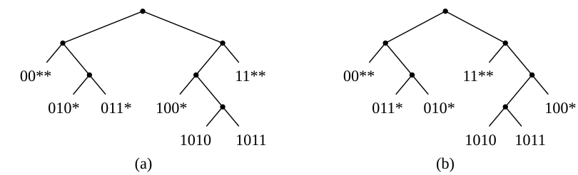](../../assets/volume4a/figures/fig-7-36-gray-binary-tries.svg)

**图 36**　(a) 通常的二叉检索树.　(b) 格雷二叉检索树.

**23.** [*20*][答案](./answers/7-2-1-1.md#ans-7-2-1-1-23) 假定 $g(k)\oplus2^j=g(l)$. 给定 $j$ 和 $k$, 怎样简单地求出 $l$?

**24.** [*M21*][答案](./answers/7-2-1-1.md#ans-7-2-1-1-24) 考虑把格雷二进制函数 $g$ 扩展到所有 2 进整数 (见 7.1.3 节). 相应的反函数 $g^{[-1]}$ 是什么?

▶ **25.** [*M25*][答案](./answers/7-2-1-1.md#ans-7-2-1-1-25) 证明: 若 $g(k)$ 和 $g(l)$ 在 $t>0$ 位上不同, 且 $0\le k,l<2^n$, 则 $\lceil2^t/3\rceil\le|k-l|\le2^n-\lceil2^t/3\rceil$.

**26.** [*25*][答案](./answers/7-2-1-1.md#ans-7-2-1-1-26) (弗兰克·拉斯基.) 对哪些整数 $N$, 可以生成小于 $N$ 的所有非负整数, 且其二进制表示每步只改变一位?

▶ **27.** [*20*][答案](./answers/7-2-1-1.md#ans-7-2-1-1-27) 令 $S_0=\{1\}$、$S_{n+1}=1/(2+S_n)\cup1/(2-S_n)$. 例如,

$$
S_2=\left\{\frac1{2+\frac1{2+1}},\frac1{2+\frac1{2-1}},\frac1{2-\frac1{2+1}},\frac1{2-\frac1{2-1}}\right\}=\left\{\frac37,\frac13,\frac35,1\right\},
$$

而且 $S_n$ 有 $2^n$ 个位于 $\frac13$ 和 1 之间的元素. 求 $S_{100}$ 中第 $10^{10}$ 小的元素.

**28.** [*M27*][答案](./answers/7-2-1-1.md#ans-7-2-1-1-28) 由 $n$ 位串组成的序列 $\{\alpha_1,\ldots,\alpha_t\}$ 的*中位数*是一个串 $\hat\alpha=a_{n-1}\ldots a_0$, 其中 $\alpha_k=a_{k(n-1)}\ldots a_{k0}$. 对各 $0\le j<n$, $a_j$ 等于各 $a_{kj}$($1\le k\le t$) 中的多数位. (若 $t$ 为偶数, 且各 $a_{kj}$ 中恰有一半为 0、一半为 1, 则中位数的 $a_j$ 可为 0 或 1.) 例如, $\{0010,0100,0101,1110\}$ 有两个中位数 `0100` 和 `0110`, 可用 `01*0` 表示.

(a) 当 $0<t\le2^n$ 时, 找出一个简单办法描述 $G_t=\{g(0),\ldots,g(t-1)\}$ (前 $t$ 个格雷二进制串) 的中位数.

(b) 证明: 若 $\alpha=a_{n-1}\ldots a_0$ 是这样的中位数, 且 $2^{n-1}<t<2^n$, 则对 $\alpha$ 的任一位 $a_j$ 取补所得的串 $\beta$ 也属于 $G_t$.

**29.** [*M24*][答案](./answers/7-2-1-1.md#ans-7-2-1-1-29) 若整数值 $k$ 按 $n$ 位格雷二进制码 $g(k)$ 传输, 接收时含有位模式 $p=(p_{n-1}\ldots p_0)_2$ 描述的误差, 则在所有 $k$ 等可能时, 平均数值误差为

$$
\frac1{2^n}\sum_{k=0}^{2^n-1}\bigl|g^{[-1]}(g(k)\oplus p)-k\bigr|.
$$

证明此和等于 $\sum_{k=0}^{2^n-1}|(k\oplus p)-k|/2^n$, 如同未用格雷二进制码一样, 并求出其显式值.

▶ **30.** [*M27*][答案](./answers/7-2-1-1.md#ans-7-2-1-1-30) (格雷置换.) 设计一个只用固定数量辅助存储的一遍扫描算法, 把数组元素 $(X_0,X_1,X_2,\ldots,X_{2^n-1})$ 换成 $(X_{g(0)},X_{g(1)},X_{g(2)},\ldots,X_{g(2^n-1)})$. [提示: 把 $g(n)$ 看作所有非负整数的一个置换, 证明集合

$$
L=\{0,1,(10)_2,(100)_2,(100*)_2,(100*0)_2,(100*0*)_2,\ldots\}
$$

由各圈的首领 (圈中的最小元素) 组成.]

**31.** [*HM35*][答案](./answers/7-2-1-1.md#ans-7-2-1-1-31) (格雷域.) 令 $f_n(x)=g(r_n(x))$ 表示像习题 5 那样反射 $n$ 位二进制串后, 再转成格雷二进制码的操作. 例如, $f_3$ 给出 $(001)_2\mapsto(110)_2\mapsto(010)_2\mapsto(011)_2\mapsto(101)_2\mapsto(111)_2\mapsto(100)_2\mapsto(001)_2$, 所以所有非零值都出现在一个圈中. 因此可以用 $f_3$ 定义一个有 8 个元素的域, 取 $\oplus$ 为加法, 并用下面的规则定义乘法:

$$
f_3^{[j]}(1)\times f_3^{[k]}(1)=f_3^{[j+k]}(1)=f_3^{[j]}(f_3^{[k]}(1)).
$$

函数 $f_2,f_5,f_6$ 有同样的性质, 但 $f_4$ 没有, 因为 $f_4((1011)_2)=(1011)_2$.

找出使 $f_n$ 定义一个有 $2^n$ 个元素的域的所有 $n\le100$.

**32.** [*M20*][答案](./answers/7-2-1-1.md#ans-7-2-1-1-32) 判断真假: 沃尔什函数满足 $w_k(-x)=(-1)^kw_k(x)$.

▶ **33.** [*M20*][答案](./answers/7-2-1-1.md#ans-7-2-1-1-33) 证明拉德马赫–沃尔什定律 $(17)$.

**34.** [*M21*][答案](./answers/7-2-1-1.md#ans-7-2-1-1-34) 佩利函数 $p_k(x)$ 定义为

$$
p_0(x)=1,\qquad p_k(x)=(-1)^{\lfloor2x\rfloor k}p_{\lfloor k/2\rfloor}(2x).
$$

证明 $p_k(x)$ 有类似 $(17)$ 的用拉德马赫函数表示的简单表达式, 并把佩利函数与沃尔什函数联系起来.

**35.** [*HM23*][答案](./answers/7-2-1-1.md#ans-7-2-1-1-35) $2^n\times2^n$ 的佩利矩阵 $P_n$ 由佩利函数得到, 正如沃尔什矩阵 $W_n$ 由沃尔什函数得到. (见 $(20)$.) 找出 $P_n$、$W_n$ 与阿达马矩阵 $H_n$ 之间的有趣关系. 证明这三种矩阵都是对称的.

**36.** [*21*][答案](./answers/7-2-1-1.md#ans-7-2-1-1-36) 详细说明给定向量 $(X_0,\ldots,X_{2^n-1})$ 时, 计算其沃尔什变换 $(x_0,\ldots,x_{2^n-1})$ 的高效算法.

**37.** [*HM23*][答案](./answers/7-2-1-1.md#ans-7-2-1-1-37) 令 $z_{kl}$ 为 $w_k(x)$ 的第 $l$ 次变号的位置, 其中 $1\le l\le k$ 且 $0<z_{kl}<1$. 证明 $|z_{kl}-l/(k+1)|=O((\log k)/k)$.

▶ **38.** [*M25*][答案](./answers/7-2-1-1.md#ans-7-2-1-1-38) 设计沃尔什函数的三进制推广.

▶ **39.** [*HM30*][答案](./answers/7-2-1-1.md#ans-7-2-1-1-39) (詹姆斯·西尔维斯特.) 矩阵 $\begin{pmatrix}a&b\\b&-a\end{pmatrix}$ 的两行互相正交, 且有相同的长度. 因此矩阵恒等式

$$
\begin{aligned}
(A\ B)\begin{pmatrix}a^2+b^2&0\\0&a^2+b^2\end{pmatrix}\binom AB
&=(A\ B)\begin{pmatrix}a&b\\b&-a\end{pmatrix}\begin{pmatrix}a&b\\b&-a\end{pmatrix}\binom AB\\
&=(Aa+Bb\quad Ab-Ba)\binom{aA+bB}{bA-aB}
\end{aligned}
$$

蕴涵两平方和恒等式 $(a^2+b^2)(A^2+B^2)=(aA+bB)^2+(bA-aB)^2$. 类似地, 矩阵

$$
\begin{pmatrix}
a&b&c&d\\
b&-a&d&-c\\
d&c&-b&-a\\
c&-d&-a&b
\end{pmatrix}
$$

导出四平方和恒等式

$$
\begin{aligned}
(a^2+b^2+c^2+d^2)(A^2+B^2+C^2+D^2)
&=(aA+bB+cC+dD)^2+(bA-aB+dC-cD)^2\\
&\quad+(dA+cB-bC-aD)^2+(cA-dB-aC+bD)^2.
\end{aligned}
$$

(a) 把 $(21)$ 中 $H_3$ 的符号附到 $\{a,b,c,d,e,f,g,h\}$ 上, 得出一个行相互正交的矩阵及八平方和恒等式.

(b) 推广到 $H_4$ 和更高阶矩阵.

▶ **40.** [*21*][答案](./answers/7-2-1-1.md#ans-7-2-1-1-40) 如果步骤 W2 的掩码改用 $m_j=z\mathbin{\&}(2^{5j+5}-1)$($0\le j<5$), 正文中处理五字母词的方案仍会产生正确答案吗?

**41.** [*25*][答案](./answers/7-2-1-1.md#ans-7-2-1-1-41) 若只用 3000 个最常见的五字母词, 因而从 $(23)$ 去掉 `ducky`、`duces`、`dunks`、`dinks`、`dinky`、`dices`、`dicey`、`dicky`、`dicks`、`picky`、`pinky`、`punky` 和 `pucks`, 一个词对最多还能生成多少个有效词?

**42.** [*35*][答案](./answers/7-2-1-1.md#ans-7-2-1-1-42) (迈克尔·弗雷德曼.) 算法 L 选择下一位要取补的格雷二进制位 $a_j$ 时, 以 $\Theta(n\log n)$ 个辅助位存储焦点指针. 步骤 L3 检查 $\Theta(\log n)$ 个辅助位, 偶尔也会改变其中 $\Omega(\log n)$ 位.

从理论上证明可以做得更好: 只须在相邻两次访问之间改变至多两个辅助位, 就能生成 $n$ 位格雷二进制码. (仍可在每一步检查 $O(\log n)$ 个辅助位, 以确定需要改变哪些位.)

**43.** [*41*][答案](./answers/7-2-1-1.md#ans-7-2-1-1-43) 求六位格雷圈的数目 $d(6)$. (见 $(26)$.)

**44.** [*M20*][答案](./answers/7-2-1-1.md#ans-7-2-1-1-44) 若 $n$ 维立方体有 $M(n)$ 个完全匹配, 证明对 $n\ge1$ 有 $d(n)\le2\binom{M(n)}2+[n=1]$.

**45.** [*M40*][答案](./answers/7-2-1-1.md#ans-7-2-1-1-45) (托马斯·费德尔和卡洛斯·萨比, 2009.) 本题在 $(4r+2)$ 维立方体 $G=G_4\mathbin{\square}G_3\mathbin{\square}G_2\mathbin{\square}G_1\mathbin{\square}G_0\mathbin{\square}G_{-1}$ 中构造大量格雷圈. 这里 $G_i$($i>0$) 是 $r$ 维立方体, $G_0=G_{-1}=P_2$. 顶点 $v$ 是 $(4r+2)$ 位串 $v_4\ldots v_0v_{-1}$, 其中 $v_i$ 在 $i>0$ 时有 $r$ 位, 在 $i\le0$ 时有一位. $v$ 的 “签名” 是四位串 $\sigma(v)=s_4s_3s_2(s_1\oplus v_0)$, 其中 $s_i$ 是 $v_i$ 的奇偶校验位. 把位串看作二进制数.

对于 $1\le l\le4$, 令 $\mathcal M_l$ 为 $G$ 的完全匹配. 若 $\mathcal M_l(v)=v'=v'_4\ldots v'_0v'_{-1}$, 则 $v$ 与 $v'$ 邻接, 且 $v'_i=v_i$($i\ne l$). (注意 $\mathcal M_l(v')=v$.) 另定义 $\mathcal M_0(v)=v\oplus2$. 考虑由边 $v\text{—}\mathcal M_{l(v)}(v)$ 形成的圈, 其中 $l(v)$ 取决于 $v$ 的签名:

$$
\begin{array}{r|rrrrrrrrrrrrrrrr}
\sigma(v)&0000&0001&0011&0010&0110&0111&0101&0100&1100&1101&1111&1110&1010&1011&1001&1000\\
l(v)&0&2&0&3&1&2&0&4&1&2&1&3&1&2&0&4
\end{array}
$$

(a) 假定 $r=2$, 且 $\mathcal M_l(v)=v\oplus2^{2l+s_{l-1}}$($l>1$)、$\mathcal M_1(v)=v\oplus2^{2+(v_0\oplus v_{-1})}$. 此时, 包含顶点 $0\ldots0$ 的是哪一个圈?

(b) 签名为 2 的幂的顶点称为 “基本顶点”. 具有相同 $v_4\ldots v_1$ 的四个顶点称为 “兄弟”. 若 $u$ 与 $v$ 在同一圈内, 或是兄弟基本顶点, 或经这样的若干等价关系可由 $u$ 到达 $v$, 就定义 $u\equiv v$. 说明怎样对每个等价类构造 $G$ 中的圈.

(c) 若 $u$ 与 $v$ 是兄弟基本顶点, 还能构造一个这样的圈, 保留原圈中的边 $\{u\oplus2\text{—}u,\ v\oplus2\text{—}v\}$.

(d) 说明怎样把 (b) 和 (c) 的圈合成一个圈.

(e) 当 $\mathcal M_1,\ldots,\mathcal M_4$ 变化时, 可得到多少个不同的哈密顿圈?

**46.** [*M23*][答案](./answers/7-2-1-1.md#ans-7-2-1-1-46) 当 $k$ 为偶数时, 把习题 45 推广到 $(kr+2)$ 维立方体.

**47.** [*HM24*][答案](./answers/7-2-1-1.md#ans-7-2-1-1-47) 习题 44 和 46 给出 $d(n)^{1/2^n}$ 的什么渐近估计?

**48.** [*HM48*] 确定 $n\to\infty$ 时 $d(n)^{1/2^n}$ 的渐近行为.

**49.** [*20*][答案](./answers/7-2-1-1.md#ans-7-2-1-1-49) 证明: 对所有 $n\ge1$, 存在一个 $2n$ 位格雷圈, 使所有 $k\ge0$ 的 $v_{k+2^{2n-1}}$ 都是 $v_k$ 的补.

▶ **50.** [*21*][答案](./answers/7-2-1-1.md#ans-7-2-1-1-50) 找出一个类似定理 D 的构造, 但令 $l$ 为偶数.

**51.** [*M24*][答案](./answers/7-2-1-1.md#ans-7-2-1-1-51) (平衡格雷圈.) 完成定理 D 的推论 B 的证明.

**52.** [*M20*][答案](./answers/7-2-1-1.md#ans-7-2-1-1-52) 证明: 若 $n$ 位格雷圈的转变计数满足 $c_0\le c_1\le\cdots\le c_{n-1}$, 则 $c_0+\cdots+c_{j-1}\ge2^j$($1\le j\le n$), 当 $j=n$ 时取等号.

**53.** [*M46*][答案](./answers/7-2-1-1.md#ans-7-2-1-1-53) 若数 $(c_0,\ldots,c_{n-1})$ 全为偶数, 且满足上题的条件, 是否总有一个 $n$ 位格雷圈具有这些转变计数?

**54.** [*M20*][答案](./answers/7-2-1-1.md#ans-7-2-1-1-54) (哈罗德·夏皮罗, 1953.) 证明: 若整数序列 $(a_1,\ldots,a_{2^n})$ 只包含 $n$ 个不同的值, 则存在 $0\le k<l\le2^n$, 使连续子序列的乘积 $a_{k+1}a_{k+2}\ldots a_l$ 为完全平方数. 不过, 若不允许 $l=2^n$, 结论可能不成立.

▶ **55.** [*35*][答案](./answers/7-2-1-1.md#ans-7-2-1-1-55) (弗兰克·拉斯基和卡拉·萨维奇, 1993.) 若 $(v_0,\ldots,v_{2^n-1})$ 是一个 $n$ 位格雷圈, 则顶点对 $\{\{v_{2k},v_{2k+1}\}\mid0\le k<2^{n-1}\}$ 构成 $n$ 维立方体的偶校验顶点与奇校验顶点间的一个完全匹配. 反过来, 每个这样的完全匹配都作为某个 $n$ 位格雷圈的 “一半” 出现吗?

**56.** [*M30*][答案](./answers/7-2-1-1.md#ans-7-2-1-1-56) (埃德加·吉尔伯特, 1958.) 若可以通过置换坐标名、反转格雷圈和 (或) 改变起点, 使两个格雷圈的 $\delta$ 序列相同, 就称这两个格雷圈等价. 证明 2688 个不同的四位格雷圈恰好分成 9 个等价类.

**57.** [*32*][答案](./answers/7-2-1-1.md#ans-7-2-1-1-57) 考虑一个图, 它的顶点是 2688 个可能的四位格雷圈. 若两个圈可以通过以下某种简单变换相互得到, 就说它们相邻:

[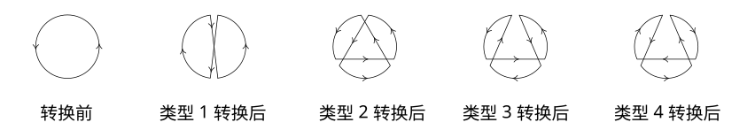](../../assets/volume4a/figures/7-2-1-1-exercise57-cycle-transformations.svg)

(类型 1 是把圈分成两段, 反转其中一段后重新接合. 类型 2、3、4 是把圈分成三段, 分别反转 0、1、2 段后再重新接合. 这些段不必等长. 哈密顿圈通常允许这样的变换.)

编写程序, 求此图的连通分量, 找出哪些四位格雷圈可以互相转换. 限制每次只考虑四种类型中的一种.

▶ **58.** [*21*][答案](./answers/7-2-1-1.md#ans-7-2-1-1-58) 令 $\alpha$ 为一个 $n$ 位格雷圈的 $\delta$ 序列, 从 $\alpha$ 中选出 $q$ 个值为 0 的项, 全部改为 $n$, 得到 $\beta$, 其中 $q$ 为奇数. 证明 $\beta\beta$ 是 $(n+1)$ 位格雷圈的 $\delta$ 序列.

**59.** [*22*][答案](./answers/7-2-1-1.md#ans-7-2-1-1-59) $(30)$ 的五位格雷圈是*非局部的*, 即对 $1<t<n$, 没有 $2^t$ 个连续元素属于同一个 $t$ 维子立方体. 证明所有 $n\ge5$ 都存在非局部的 $n$ 位格雷圈. [提示: 见上题.]

**60.** [*20*][答案](./answers/7-2-1-1.md#ans-7-2-1-1-60) 证明游程长度界函数满足 $r(n+1)\ge r(n)$.

**61.** [*M30*][答案](./answers/7-2-1-1.md#ans-7-2-1-1-61) 证明: 若 (a) $m=2$ 且 $2<r(n)<8$, 或 (b) $m\le n$ 且 $r(n)\le2^{m-3}$, 则 $r(m+n)\ge r(m)+r(n)-1$.

**62.** [*46*] $r(8)=6$ 吗?

**63.** [*30*][答案](./answers/7-2-1-1.md#ans-7-2-1-1-63) (路易斯·戈德丁.) 证明 $r(10)\ge8$.

▶ **64.** [*HM35*][答案](./answers/7-2-1-1.md#ans-7-2-1-1-64) (路易斯·戈德丁和帕沃尔·格沃兹德贾克.)$n$ 位*格雷流*是一个置换序列 $(\sigma_0,\sigma_1,\ldots,\sigma_{l-1})$, 其中各 $\sigma_k$ 是 $n$ 维立方体顶点的一个置换, 把每个顶点换成它的一个邻点.

(a) 设 $(u_0,\ldots,u_{2^m-1})$ 是 $m$ 位格雷圈, 且 $(\sigma_0,\sigma_1,\ldots,\sigma_{2^m-1})$ 是 $n$ 位格雷流. 令 $v_0=0\ldots0$、$v_{k+1}=v_k\sigma_k$, 其中 $k\ge2^m$ 时 $\sigma_k=\sigma_{k\bmod2^m}$. 在什么条件下, 序列

$$
W=(u_0v_0,u_0v_1,u_1v_1,u_1v_2,\ldots,u_{2^{m+n-1}-1}v_{2^{m+n-1}-1},u_{2^{m+n-1}-1}v_{2^{m+n-1}})
$$

是 $(m+n)$ 位格雷圈?

(b) 证明: 若 $m$ 充分大, 存在满足 (a) 条件的 $n$ 位格雷流, 其序列 $(v_0,v_1,\ldots)$ 的所有游程长度都至少为 $n-2$.

(c) 用这些结果证明 $r(n)\ge n-O(\log n)$.

**65.** [*30*][答案](./answers/7-2-1-1.md#ans-7-2-1-1-65) (布雷特·史蒂文斯.) 塞缪尔·贝克特的剧作 *Quad* 中, 舞台开始与结束时都是空的. $n$ 位演员逐一上场或下场, 遍历所有 $2^n$ 种可能的在场演员集合. 每次下场者总是当时在台上最早上场的那位. $n=4$ 时, 和实际演出一样, 有些集合必然重复. 不过, 证明 $n=5$ 时存在一种恰有 $2^n$ 次上场或下场的完美模式.

**66.** [*40*][答案](./answers/7-2-1-1.md#ans-7-2-1-1-66) 对 8 位演员, 存在完美的贝克特–格雷模式吗?

**67.** [*20*][答案](./answers/7-2-1-1.md#ans-7-2-1-1-67) 遍历所有 $n$ 位二进制串时, 有时希望相邻两步中改变尽可能多的位, 例如测试实际电路在最坏条件下的可靠性. 说明怎样遍历全部二进制 $n$ 元组, 每步交替改变 $n$ 位和 $n-1$ 位.

**68.** [*21*][答案](./answers/7-2-1-1.md#ans-7-2-1-1-68) 鲁弗斯·佩尔弗斯决定构造一种*反格雷三进制码*, 使每个 $n$ 位三进制数都与其邻近的数在所有位置上不同. 所有 $n$ 都能构造这样的码吗?

▶ **69.** [*M25*][答案](./answers/7-2-1-1.md#ans-7-2-1-1-69) 当 $k=(\ldots b_5b_4b_3b_2b_1b_0)_2$ 时, 令

$$
h(k)=(\ldots(b_6\oplus b_5)(b_5\oplus b_4)(b_4\oplus b_3\oplus b_2\oplus b_0)(b_3\oplus b_0)(b_2\oplus b_1\oplus b_0)b_1)_2,
$$

以修改格雷二进制码的定义 (7).

(a) 证明: $n>3$ 时, 序列 $h(0),h(1),\ldots,h(2^n-1)$ 遍历所有 $n$ 位数, 每次恰改变三位.

(b) 推广这一规则, 使 $t$ 为奇数且 $n>t$ 时, 每步恰改变 $t$ 位.

**70.** [*21*][答案](./answers/7-2-1-1.md#ans-7-2-1-1-70) $n=5$ 和 $n=6$ 时, 各有多少个单调的 $n$ 位格雷码?

**71.** [*M22*][答案](./answers/7-2-1-1.md#ans-7-2-1-1-71) 推导定义萨维奇–温克勒置换的递推公式 (45).

**72.** [*20*][答案](./answers/7-2-1-1.md#ans-7-2-1-1-72) 从 `00000` 到 `11111` 的萨维奇–温克勒码是什么?

▶ **73.** [*32*][答案](./answers/7-2-1-1.md#ans-7-2-1-1-73) 设计高效算法, 构造 $n$ 位单调格雷码的 $\delta$ 序列.

**74.** [*HM25*][答案](./answers/7-2-1-1.md#ans-7-2-1-1-74) (萨维奇和温克勒.) 证明: 在任一单调格雷码中, $n$ 维立方体上相邻的两个顶点相距不超过 $O(2^n/\sqrt n)$ 个位置.

**75.** [*32*][答案](./answers/7-2-1-1.md#ans-7-2-1-1-75) 找出所有五位的无趋势格雷路径 $v_0,\ldots,v_{31}$, 其中 “无趋势” 指对每个坐标 $j$, 都有 $\sum_{k=0}^{31}k(-1)^{v_{kj}}=0$.

**76.** [*M25*][答案](./answers/7-2-1-1.md#ans-7-2-1-1-76) 证明所有 $n\ge5$ 都存在无趋势的 $n$ 位格雷码.

**77.** [*21*][答案](./answers/7-2-1-1.md#ans-7-2-1-1-77) 修改算法 H, 以取模格雷码顺序访问混合进制 $n$ 元组.

**78.** [*M26*][答案](./answers/7-2-1-1.md#ans-7-2-1-1-78) 证明反射混合进制格雷码的转换公式 (50) 和 $(51)$, 并推导取模情形的类似公式.

▶ **79.** [*M22*][答案](./answers/7-2-1-1.md#ans-7-2-1-1-79) 何时 (a) 反射、(b) 取模混合进制格雷码的最后一个 $n$ 元组与第一个邻接?

**80.** [*M20*][答案](./answers/7-2-1-1.md#ans-7-2-1-1-80) 给定一个数的素因数分解 $p_1^{c_1}\ldots p_t^{c_t}$, 说明怎样每步乘或除一个素数, 以遍历它的所有因数.

**81.** [*M21*][答案](./answers/7-2-1-1.md#ans-7-2-1-1-81) 令 $(a_0,b_0),(a_1,b_1),\ldots,(a_{m^2-1},b_{m^2-1})$ 为两位数字的 $m$ 进制取模格雷码. 证明: 若 $m>2$, 每条边 $(x,y)\text{—}(x,(y+1)\bmod m)$ 和 $(x,y)\text{—}((x+1)\bmod m,y)$ 都出现在以下两个圈之一:

$$
\begin{aligned}
&(a_0,b_0)\text{—}(a_1,b_1)\text{—}\cdots\text{—}(a_{m^2-1},b_{m^2-1})\text{—}(a_0,b_0),\\
&(b_0,a_0)\text{—}(b_1,a_1)\text{—}\cdots\text{—}(b_{m^2-1},a_{m^2-1})\text{—}(b_0,a_0).
\end{aligned}
$$

▶ **82.** [*M25*][答案](./answers/7-2-1-1.md#ans-7-2-1-1-82) (格哈德·林格尔, 1956.) 利用上题推出, 存在四个八位格雷圈, 合起来覆盖八维立方体的所有边.

**83.** [*41*][答案](./answers/7-2-1-1.md#ans-7-2-1-1-83) 四个平衡的八位格雷圈能覆盖八维立方体的所有边吗?

▶ **84.** [*25*][答案](./answers/7-2-1-1.md#ans-7-2-1-1-84) (霍华德·迪克曼.) 图 37 是称作 “怪异环” 或 “戈尔迪结” 的谜题, 目标是从环绕它的刚性环中取下一条柔软的绳带. 说明这个谜题的解与反射格雷三进制码有内在联系.

[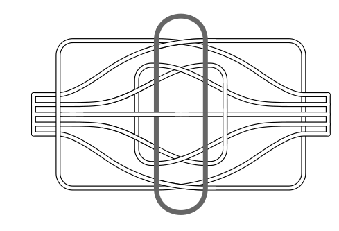](../../assets/volume4a/figures/fig-7-37-loony-loop.svg)

**图 37**　怪异环谜题.

▶ **85.** [*M25*][答案](./answers/7-2-1-1.md#ans-7-2-1-1-85) (达纳·理查兹.) 若 $\Gamma=(\alpha_0,\ldots,\alpha_{t-1})$ 是 $t$ 个串的任意序列, 且 $\Gamma'=(\alpha'_0,\ldots,\alpha'_{t'-1})$ 是 $t'$ 个串的任意序列, 则交替向右、向左书写的乘积 $\Gamma\wr\Gamma'$ 是 $tt'$ 个串的序列. 它从

$$
(\alpha_0\alpha'_0,\ldots,\alpha_0\alpha'_{t'-1},\alpha_1\alpha'_{t'-1},\ldots,\alpha_1\alpha'_0,\alpha_2\alpha'_0,\ldots,\alpha_2\alpha'_{t'-1},\alpha_3\alpha'_{t'-1},\ldots)
$$

开始. $t$ 为偶数时以 $\alpha_{t-1}\alpha'_0$ 结束, $t$ 为奇数时以 $\alpha_{t-1}\alpha'_{t'-1}$ 结束. 例如, $n>0$ 时, 可把格雷二进制码的基本定义 (5) 写为 $\Gamma_n=(0,1)\wr\Gamma_{n-1}$. 证明运算 $\wr$ 满足结合律, 因此 $\Gamma_{m+n}=\Gamma_m\wr\Gamma_n$.

▶ **86.** [*26*][答案](./answers/7-2-1-1.md#ans-7-2-1-1-86) 定义一个无限格雷码, 遍历非负整数的全部 $n$ 元组 $(a_1,\ldots,a_n)$, 使每当其后接 $(a'_1,\ldots,a'_n)$ 时, 都有 $\max(a_1,\ldots,a_n)\le\max(a'_1,\ldots,a'_n)$.

**87.** [*27*][答案](./answers/7-2-1-1.md#ans-7-2-1-1-87) 续上题, 定义一个遍历所有整数 $n$ 元组 $(a_1,\ldots,a_n)$ 的无限格雷码, 使每当其后接 $(a'_1,\ldots,a'_n)$ 时, 都有 $\max(|a_1|,\ldots,|a_n|)\le\max(|a'_1|,\ldots,|a'_n|)$.

▶ **88.** [*25*][答案](./answers/7-2-1-1.md#ans-7-2-1-1-88) 算法 K 在 K4 终止后, 如果立即从 K2 重启, 会怎样?

▶ **89.** [*25*][答案](./answers/7-2-1-1.md#ans-7-2-1-1-89) (摩尔斯码的格雷码.) 长度为 $n$ 的摩尔斯码字 (习题 4.5.3–32) 是由点、划组成的串, $n$ 等于点数加上划数的两倍.

(a) 说明怎样依次把一划换成两点或把两点换成一划, 以生成所有长度为 $n$ 的摩尔斯码字. 例如, $n=3$ 时的路径必为 `.-`、`...`、`-.` 或其逆序.

(b) 在你给出的 $n=15$ 的序列中, `.--..--.-.` 后面是哪个串?

**90.** [*26*][答案](./answers/7-2-1-1.md#ans-7-2-1-1-90) 按照习题 89 的规则, 对哪些 $n$ 可以把这些摩尔斯码字排成一个圈? [提示: 码字数是 $F_{n+1}$.]

▶ **91.** [*34*][答案](./answers/7-2-1-1.md#ans-7-2-1-1-91) 设计无循环算法, 访问满足 $a_1\le a_2\ge a_3\le a_4\ge\cdots$ 的全部二进制 $n$ 元组 $(a_1,\ldots,a_n)$. [这类 $n$ 元组的数目是 $F_{n+2}$.]

**92.** [*M30*][答案](./answers/7-2-1-1.md#ans-7-2-1-1-92) 是否存在无穷序列 $\Phi_n$, 对于所有 $m$, 其前 $m^n$ 项组成一个 $m$ 进制德布鲁因圈? [式 (54) 给出了 $n=2$ 的情形.]

▶ **93.** [*M28*][答案](./answers/7-2-1-1.md#ans-7-2-1-1-93) 证明: 算法 R 如所述输出一个德布鲁因圈.

**94.** [*22*][答案](./answers/7-2-1-1.md#ans-7-2-1-1-94) 如果协同程序 $f()$ 和 $f'()$ 生成平凡的圈 `01234 01234 01…`, 那么 $m=5$、$n=1$、$r=3$ 时算法 D 输出什么?

▶ **95.** [*M24*][答案](./answers/7-2-1-1.md#ans-7-2-1-1-95) 设周期为 $p$ 的无限序列 $a_0a_1a_2\ldots$ 与周期为 $q$ 的无限序列 $b_0b_1b_2\ldots$ 交织, 形成无限循环序列

$$
c_0c_1c_2c_3c_4c_5\ldots=a_0b_0a_1b_1a_2b_2\ldots.
$$

(a) 在什么条件下, $c_0c_1c_2\ldots$ 的周期为 $pq$? (本题中, 序列 $a_0a_1a_2\ldots$ 的 “周期” 是使所有 $k\ge0$ 都有 $a_k=a_{k+p}$ 的最小整数 $p>0$.)

(b) 若把 D6 简单改成 “若 $t'=n$ 且 $x'<r$, 转到 D4”, 算法 D 的连续输出中会出现哪些 $2n$ 元组?

(c) 证明: 算法 D 如所述输出一个德布鲁因圈.

▶ **96.** [*M28*][答案](./answers/7-2-1-1.md#ans-7-2-1-1-96) 设已建立一族协同程序, 用算法 R 和 D 生成长度为 $m^n$ 的德布鲁因圈. 递归的基础是 $n=2$ 时类似算法 S 的简单协同程序; $n>2$ 为偶数时用算法 D.

(a) 每种协同程序的数目 $(R_n,D_n,S_n)$ 是多少?

(b) 要输出一个最高层的数字, 最多需要激活多少个协同程序?

**97.** [*M29*][答案](./answers/7-2-1-1.md#ans-7-2-1-1-97) 本题研究 $m=2$ 的重要特例中, 算法 R 和 D 所构造的德布鲁因圈. 令 $f_n(k)$ 为 $2^n$ 位圈的第 $k+1$ 位, 所以 $0\le k<n$ 时有 $f_n(k)=0$. 再令 $j_n$ 是满足 $0\le j_n<2^n$、并使 $j_n\le k<j_n+n$ 时 $f_n(k)=1$ 的下标.

(a) 写出 $n=2,3,4,5$ 时的圈 $(f_n(0)\ldots f_n(2^n-1))$.

(b) 证明: 对所有偶数 $n$, 存在 $\delta_n=\pm1$, 使

$$
f_{n+1}(k)\equiv\begin{cases}
\Sigma f_n(k),&0<k\le j_n\text{ 或 }2^n+j_n<k\le2^{n+1};\\
1+\Sigma f_n(k+\delta_n),&j_n<k\le2^n+j_n.
\end{cases}
$$

同余按模 2 取. (这里 $\Sigma f$ 是求和函数 $\Sigma f(k)=\sum_{j=0}^{k-1}f(j)$.) 因而 $n$ 为偶数时 $j_{n+1}=2^n-\delta_n$.

(c) 令 $(c_n(0)c_n(1)\ldots c_n(2^{2n}-5))$ 为习题 95(b) 简化的算法 D 用于 $f_n()$ 时产生的圈. 其中 $(2n-1)$ 元组 $1^{2n-1}$ 和 $(01)^{n-1}0$ 出现在什么位置?

(d) 利用 (c) 的结果, 用 $f_n()$ 表示 $f_{2n}(k)$.

(e) 求 $j_n$ 关于 $n$ 的一个较简单的公式.

**98.** [*M34*][答案](./answers/7-2-1-1.md#ans-7-2-1-1-98) 续上题, 给定 $n\ge2$、$k\ge0$, 设计高效算法计算 $f_n(k)$.

▶ **99.** [*M23*][答案](./answers/7-2-1-1.md#ans-7-2-1-1-99) 利用上面两题的技术, 设计高效算法, 确定任一给定的 $n$ 位二进制串在圈 $(f_n(0)f_n(1)\ldots f_n(2^n-1))$ 中的位置.

**100.** [*40*][答案](./answers/7-2-1-1.md#ans-7-2-1-1-100) $n$ 很大时, 习题 97 的德布鲁因圈能提供有用的伪随机二进制位吗?

▶ **101.** [*M30*][答案](./answers/7-2-1-1.md#ans-7-2-1-1-101) (串的唯一非递增素因子分解.)

(a) 证明: 若 $\lambda$ 和 $\lambda'$ 是素串, 则当 $\lambda<\lambda'$ 时 $\lambda\lambda'$ 是素串.

(b) 由此说明每个串 $\alpha$ 都可写为

$$
\alpha=\lambda_1\lambda_2\ldots\lambda_t,\qquad\lambda_1\ge\lambda_2\ge\cdots\ge\lambda_t,
$$

其中每个 $\lambda_j$ 都是素串.

(c) 事实上, 这样的分解只有一种. [提示: 证明 $\lambda_t$ 必是 $\alpha$ 按字典序最小的非空后缀.]

(d) 判断真假: $\lambda_1$ 是 $\alpha$ 的最长素前缀.

(e) `3141592653589793238462643383279502884197` 的素因子是什么?

**102.** [*HM28*][答案](./answers/7-2-1-1.md#ans-7-2-1-1-102) 由上题的唯一因子分解定理, 推导长度为 $n$ 的 $m$ 进制素串数目.

**103.** [*M20*][答案](./answers/7-2-1-1.md#ans-7-2-1-1-103) 用式 (59) 证明费马定理 $m^p\equiv m\pmod p$.

**104.** [*17*][答案](./answers/7-2-1-1.md#ans-7-2-1-1-104) 由式 (60), 所有 $n$ 字母词中约有 $1/n$ 是素串. 5757 个斯坦福图基五字母词中有多少素串? 哪个是最小的非素串, 哪个是最大的素串?

**105.** [*M31*][答案](./answers/7-2-1-1.md#ans-7-2-1-1-105) 令 $\alpha$ 是一个无限字母表上长度为 $n$ 的前素串.

(a) 证明: 把 $\alpha$ 的最后一个字母增大, 所得串就是素串.

(b) 若 $\alpha$ 已按习题 101 分解, 证明它是 $\lambda_1$ 的 $n$ 扩张.

(c) 此外, $\alpha$ 不可能是两个不同素串的 $n$ 扩张.

▶ **106.** [*M30*][答案](./answers/7-2-1-1.md#ans-7-2-1-1-106) 逆推算法 F 的步骤, 设计一个按递减顺序访问所有 $m$ 进制素串和前素串的算法.

**107.** [*HM30*][答案](./answers/7-2-1-1.md#ans-7-2-1-1-107) 对固定的 $m$, 分析 $n\to\infty$ 时算法 F 的运行时间.

**108.** [*M35*][答案](./answers/7-2-1-1.md#ans-7-2-1-1-108) 令 $\lambda_1<\cdots<\lambda_t$ 为长度整除 $n$ 的所有 $m$ 进制素串, $a_1\ldots a_n$ 为任意 $m$ 进制串. 本题要证明 $a_1\ldots a_n$ 出现在 $\lambda_1\ldots\lambda_t\lambda_1\lambda_2$ 中, 因而 $\lambda_1\ldots\lambda_t$ 是德布鲁因圈 (其长度为 $m^n$). 为方便起见, 可假定 $m=10$, 各串对应于十进制数. 同样的论证适用于任意 $m\ge2$.

(a) 证明: 如果 $a_1\ldots a_n=\alpha\beta$ 与其所有循环移位都不同, 且 $\beta\alpha=\lambda_k$ 为素串, 则 $\alpha\beta$ 是 $\lambda_k\lambda_{k+1}$ 的子串, 除非某个 $j\ge1$ 有 $\alpha=9^j$.

(b) 若 $\beta\alpha$ 为素串且 $\alpha$ 全由 9 组成, 则 $\alpha\beta$ 在 $\lambda_1\ldots\lambda_t$ 中出现于何处? [提示: 证明, 若某个 $l>0$ 在 F2 有 $a_{n+1-l}\ldots a_n=9^l$, 且 $j$ 不是 $n$ 的因数, 则前一次 F2 有 $a_{n-l}\ldots a_n=9^{l+1}$.]

(c) 考虑形如 $(\alpha\beta)^d$ 的 $n$ 元组, 其中 $d>1$ 为 $n$ 的因数, 且 $\beta\alpha=\lambda_k$ 是素串.

(d) $n=6$ 时, `899135`、`997879`、`913131`、`090909`、`909090`、`911911` 分别出现在什么位置?

(e) $\lambda_1\ldots\lambda_t$ 是长度为 $m^n$ 的字典序最小的 $m$ 进制德布鲁因圈吗?

**109.** [*M22*][答案](./answers/7-2-1-1.md#ans-7-2-1-1-109) 对 $2\times2$ 窗口, 大小为 $m^2\times m^2$ 的 $m$ 进制德布鲁因环面是由 $m$ 进制数字 $d_{ij}$ 组成的矩阵, 其 $m^4$ 个子矩阵

$$
\begin{pmatrix}d_{ij}&d_{i(j+1)}\\d_{(i+1)j}&d_{(i+1)(j+1)}\end{pmatrix},\qquad0\le i,j<m^2,
$$

各不相同, 其中下标按模 $m^2$ 绕回. 因此, 每个可能的 $m$ 进制 $2\times2$ 子矩阵恰好出现一次. 伊恩·斯图尔特因而称其为 $m$ 进制*外环面*[*Game, Set, and Math*(Oxford: Blackwell, 1989), 第 4 章]. 例如,

$$
\begin{pmatrix}0&0&1&0\\0&0&0&1\\0&1&1&1\\1&0&1&1\end{pmatrix}
$$

是一个二进制外环面. $m=2$ 时, 若不计移位和 (或) 转置, 这实际上是唯一的这种矩阵.

考虑无穷矩阵 $D$. 其第 $i=(\ldots a_2a_1a_0)_2$ 行、第 $j=(\ldots b_2b_1b_0)_2$ 列的元素为 $d_{ij}=(\ldots c_2c_1c_0)_2$, 其中

$$
\begin{aligned}
c_0&=(a_0\oplus b_0)(a_1\oplus b_1)\oplus b_1;\\
c_k&=(a_{2k}a_0\oplus b_{2k})b_0\oplus(a_{2k+1}a_0\oplus b_{2k+1})(b_0\oplus1),\qquad k>0.
\end{aligned}
$$

证明: 对所有 $n\ge0$, $D$ 左上角 $2^{2n}\times2^{2n}$ 的子矩阵是 $2^n$ 进制外环面.

**110.** [*M25*][答案](./answers/7-2-1-1.md#ans-7-2-1-1-110) 续上题, 对所有 $m$ 构造 $m$ 进制外环面.

**111.** [*20*][答案](./answers/7-2-1-1.md#ans-7-2-1-1-111) 在序列 `123456789` 中插入加号和减号, 有 12 种办法得到 100. 例如,

$$
100=1+23-4+5+6+78-9=123-45-67+89=-1+2-3+4+5+6+78+9.
$$

(a) 不能以这种方式表示的最小正整数是什么?

(b) 也考虑在十位数字序列 `9876543210` 中插入正负号.

▶ **112.** [*25*][答案](./answers/7-2-1-1.md#ans-7-2-1-1-112) 续上题, 在序列 `12345678987654321` 中插入正负号, 可以做到什么程度? 例如, $100=-1234-5-6+7898-7-6543-2-1$.

<!-- section-footnotes -->

[^v4a-p237-1]: 有些作者断言格雷码是伊莱沙·格雷发明的, 他在博多和舍夫勒的同一时期研制了一种印字电报机. 这一断言并不正确, 不过伊莱沙在发明电话的优先权问题上确实受到了不公平的对待. [见劳埃德·泰勒,*Amer. Physics Teacher* **5** (1937), 243–251.]

[^v4a-p237-2]: 即 “九连环”. ——编者注

[^v4a-p245-1]: 游程的定义见 5.1.3 节. 如果在排列 $a_1a_2\ldots a_n$ 的两端各放一条竖线, 并在所有满足 $a_j>a_{j+1}$ 的 $a_j$ 和 $a_{j+1}$ 之间放一条竖线, 则一对竖线之间的片段称为游程. 也见 3.3.2 节 “G. 游程检验”. ——编者注
