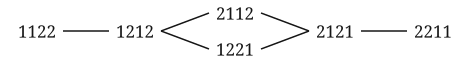
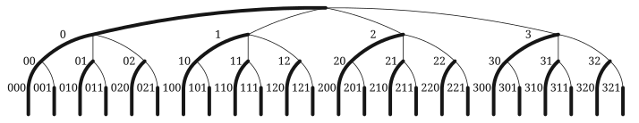
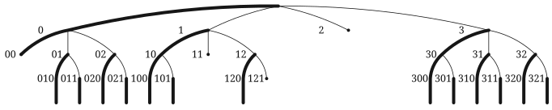
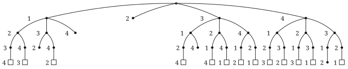
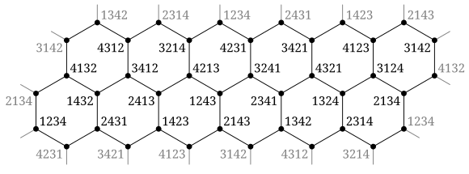

# 7.2.1.2　生成所有排列

在 $n$ 元组之后, 几乎人人都把访问给定集合或多重集的所有排列列为组合生成的下一项重要任务. 人们已经找到许多方法解决这个问题. 实际上, 公开发表的取消排序算法与排序算法差不多一样多! 本节研究若干最重要的排列生成算法, 先介绍一种既简单又灵活的经典方法.

**算法 L (按字典序生成排列).** 给定 $n$ 个元素的序列 $a_1a_2\ldots a_n$, 初始顺序满足

$$
a_1\le a_2\le\cdots\le a_n,
\tag{1}
$$

本算法按字典序访问 $\{a_1,a_2,\ldots,a_n\}$ 的所有排列. (例如, 多重集 $\{1,2,2,3\}$ 的排列

$$
1223,1232,1322,2123,2132,2213,2231,2312,2321,3122,3212,3221
$$

按字典序排列.) 为方便起见, 假定有一个辅助元素 $a_0$, 它必须严格小于最大的元素 $a_n$.

**L1.** [访问.] 访问排列 $a_1a_2\ldots a_n$.

**L2.** [寻找 $j$.] 置 $j\leftarrow n-1$. 若 $a_j\ge a_{j+1}$, 就反复将 $j$ 减 1, 直到 $a_j<a_{j+1}$. 若 $j=0$, 终止. (此时, $j$ 是满足以 $a_1\ldots a_j$ 开头的排列已全部访问过的最小下标. 因而, 字典序的下一个排列会使 $a_j$ 增大.)

**L3.** [增大 $a_j$.] 置 $l\leftarrow n$. 若 $a_j\ge a_l$, 就反复将 $l$ 减 1, 直到 $a_j<a_l$. 然后交换 $a_j\leftrightarrow a_l$. (由于 $a_{j+1}\ge\cdots\ge a_n$, 在可以接在 $a_1\ldots a_{j-1}$ 后面、且大于 $a_j$ 的元素中, $a_l$ 最小. 交换前有 $a_{j+1}\ge\cdots\ge a_{l-1}\ge a_l>a_j\ge a_{l+1}\ge\cdots\ge a_n$, 交换后有 $a_{j+1}\ge\cdots\ge a_{l-1}\ge a_j>a_l\ge a_{l+1}\ge\cdots\ge a_n$.)

**L4.** [反转 $a_{j+1}\ldots a_n$.] 置 $k\leftarrow j+1$、$l\leftarrow n$. 当 $k<l$ 时, 反复交换 $a_k\leftrightarrow a_l$, 并置 $k\leftarrow k+1$、$l\leftarrow l-1$. 返回 L1. ▮

这个算法可追溯至 14 世纪印度的纳拉亚纳·潘季塔 (见 7.2.1.7 节). 它也出现在卡尔·兴登堡为克里斯蒂安·吕迪格的 *Specimen Analyticum de Lineis Curvis Secundi Ordinis*(Leipzig: 1784) 所写的序言 (第 xlvi–xlvii 页) 里, 此后又多次被重新发现. L2 和 L3 中的括注说明了这个算法为何有效.

> Tin tan din dan bim bam bom bo——  
> tan tin din dan bam bim bo bom——  
> tin tan dan din bim bam bom bo——  
> tan tin dan din bam bim bo bom——  
> tan dan tin bam din bo bim bom——  
> ……Tin tan din dan bim bam bom bo.
>
> ——多萝西·塞耶斯,*The Nine Tailors*(1934)

> 十进制数字的一个排列, 无非是一个十位十进制数,  
> 其中所有数字都不相同. 因此, 我们只需生成  
> 所有十位数, 选出数字各不相同的那些.  
> 高速计算能让我们摆脱思考之苦,  
> 岂不奇妙! 只需编写 $k+1\to k$ 的程序,  
> 检查 $k$ 的各位是否有不希望出现的相等.  
> 这样还会得到字典序的排列!  
> 再冷静想想……我们确实得想个别的办法.
>
> ——德里克·莱默 (1957)

一般说来, 任何组合模式 $a_1\ldots a_n$ 的字典序后继都可通过以下三步得到:

1. 找出能使 $a_j$ 增大的最大下标 $j$.
2. 将 $a_j$ 增大最小可行的量.
3. 把新的 $a_1\ldots a_j$ 扩张为按字典序最小的完整模式.

正如算法 7.2.1.1M 在生成 $n$ 元组时遵循这个过程, 算法 L 在生成排列时也遵循它. 讨论其他种类的组合模式时, 还会看到许多例子. 注意, L4 开始时有 $a_{j+1}\ge\cdots\ge a_n$. 因此, 以当前前缀 $a_1\ldots a_j$ 开头的第一个排列为 $a_1\ldots a_ja_n\ldots a_{j+1}$, L4 进行 $\lfloor(n-j)/2\rfloor$ 次交换来产生它.

实践中, 若元素都不同, L2 有一半时候找到 $j=n-1$, 因为恰有 $n!/2$ 个排列满足 $a_{n-1}<a_n$. 识别这个特殊情形, 能加快算法 L, 又不使它复杂许多. (见习题 1.) 类似地, 元素都不同时, $j\le n-t$ 的概率只有 $1/t!$, 所以 L2 至 L4 的循环通常很快. 习题 6 分析一般情形的运行时间, 表明即使存在相同元素时, 算法 L 也是相当有效的, 除非在多重集 $\{a_1,a_2,\ldots,a_n\}$ 中某些值的出现次数比其他值多得多.

**邻接交换.** 在 7.2.1.1 节我们已经看到, 对于生成 $n$ 元组来说, 格雷码是有利的. 当我们打算生成排列时, 类似的考虑也适用. 对一个排列可做的最简单的改变是交换邻接元素, 而我们从第 5 章知道, 只要建立这种交换的一个合适的序列, 任何排列都可以排成有序的. (例如, 算法 5.2.2B 采用这种处理方式.) 因此, 把排序的过程倒过来, 从有序的元素出发, 交换适当的邻接元素对, 便能得到任何期望的排列.

现在出现一个自然的问题: 用每步仅仅改变两个邻接元素位置的方式, 是否可以遍历给定多重集的所有排列? 如果可能, 考察所有排列的整个程序通常会更简单且更快, 因为它只需计算一次交换的效果, 而无须每次重新处理一个全新的数组 $a_1\ldots a_n$.

遗憾的是, 当多重集有重复元素时, 我们不总能找到这样一个类似格雷码的序列. 例如, $\{1,1,2,2\}$ 的 6 个排列通过邻接交换以下述方式彼此连接:

(2)

这个图没有哈密顿路径.

但是, 多数应用涉及不同元素的排列. 对这种情形有一个好消息: 一个简单的算法仅用 $n!-1$ 次邻接元素交换就能生成全部 $n!$ 个排列. 再做一次这样的交换便返回起点, 因而得到一个类似于格雷二进制码的哈密顿圈.

其想法是先对 $\{1,\ldots,n-1\}$ 构造这样的序列, 再用所有方式把数 $n$ 插入每个排列中. 例如, 若 $n=4$, 把 4 插入序列 $(123,132,312,321,231,213)$ 的每个排列的所有 4 个可能位置, 便得到下列阵列的各列:

$$
\begin{matrix}
1234&1324&3124&3214&2314&2134\\
1243&1342&3142&3241&2341&2143\\
1423&1432&3412&3421&2431&2413\\
4123&4132&4312&4321&4231&4213
\end{matrix}
\tag{3}
$$

现在, 在第一列向下读, 在第二列向上读, 在第三列向下读, ……在最后一列向上读, 就得到期望的序列 $(1234,1243,1423,4123,4132,1432,1342,1324,3124,3142,\ldots,2143,2134)$.

在 5.1.1 节, 我们研究了排列的反序, 即次序颠倒的元素对 (不必邻接). 每次交换邻接元素都使反序的总数增加或减少 1. 事实上, 考虑习题 5.1.1-7 中所说的反序表 $c_1\ldots c_n$, 其中 $c_j$ 是位于 $j$ 右边且比 $j$ 小的元素数目, 可以发现 (3) 中的排列具有下述反序表:

$$
\begin{matrix}
0000&0010&0020&0120&0110&0100\\
0001&0011&0021&0121&0111&0101\\
0002&0012&0022&0122&0112&0102\\
0003&0013&0023&0123&0113&0103
\end{matrix}
\tag{4}
$$

如果像前面那样交替向下和向上读数, 我们恰好得到混合进制 $(1,2,3,4)$ 的反射格雷码, 就像 7.2.1.1 节的式 (46)–(51) 那样. 如艾兹赫尔·戴克斯特拉 [*Acta Informatica* **6** (1976), 357–359] 所指出的, 同一性质对所有 $n$ 成立, 这就导出下面的算法.

**算法 P (平滑改变).** 给定 $n$ 个不同元素的序列 $a_1a_2\ldots a_n$, 本算法通过反复交换邻接元素对生成它们的所有排列. 它用辅助数组 $c_1c_2\ldots c_n$ 表示上述反序, 遍历满足以下条件的所有整数序列:

$$
0\le c_j<j,\qquad 1\le j\le n.
\tag{5}
$$

另一个数组 $o_1o_2\ldots o_n$ 控制条目 $c_j$ 的改变方向.

**P1. [初始化.]** 对于 $1\le j\le n$, 置 $c_j\leftarrow0$、$o_j\leftarrow1$.

**P2. [访问.]** 访问排列 $a_1a_2\ldots a_n$.

**P3. [准备改变.]** 置 $j\leftarrow n$、$s\leftarrow0$. (下列步骤确定即将改变的 $c_j$ 的坐标 $j$, 并保持条件 (5) 成立. 变量 $s$ 是满足 $c_k=k-1$ 的下标 $k>j$ 的数目.)

**P4. [准备好改变了吗?]** 置 $q\leftarrow c_j+o_j$. 如果 $q<0$, 转到 P7. 如果 $q=j$, 转到 P6.

**P5. [改变.]** 交换 $a_{j-c_j+s}\leftrightarrow a_{j-q+s}$. 然后置 $c_j\leftarrow q$, 返回 P2.

**P6. [推进 $s$.]** 如果 $j=1$, 终止. 否则置 $s\leftarrow s+1$.

**P7. [切换方向.]** 置 $o_j\leftarrow-o_j$、$j\leftarrow j-1$, 返回 P4.　∎

这个显然适用于所有 $n\ge1$ 的过程源自 17 世纪的英国, 当时钟乐师开创了用所有可能的排列方式敲奏编钟的风俗. 他们把算法 P 称为平滑改变的敲奏法. 图 38(a) 示出 “剑桥 48 响”. 17 世纪初, 当人们还未掌握能达到所有 $5!=120$ 种可能性的平滑改变法时, 已经用这种不规则的特定顺序敲出 5 口编钟的 48 个排列. 算法 P 的悠久历史可追溯到现藏于博德利图书馆 (牛津大学图书馆) 的彼得·芒迪的一份手稿. 这份手稿约写于 1653 年, 由欧内斯特·莫里斯转录到 *The History and Art of Change Ringing* (1931), 29–30. 不久之后, 著名的 *Tintinnalogia* 于 1668 年匿名出版, 现在已知它由理查德·达克沃思和法比安·斯特德曼编写. 这本书的前 60 页详细描述平滑改变, 从 $n=3$ 讲到任意大的 $n$.

> 多年来, 剑桥 48 响  
> 曾经是敲奏或创作出的最美妙的钟乐. 而今,  
> 无论 48 或 100 响, 也无论 720 响或任何其他响数,  
> 都不能限制我们, 因为我们能够无止境地敲奏变化的钟乐.  
> ……4 口钟有 24 种不同的变化.  
> 在敲奏中, 一口钟称为搜寻钟, 其余三口是奏鸣钟.  
> 搜寻钟移动, 并且不断地来回搜寻……  
> 奏鸣钟中的两口在搜寻钟  
> 每次到达它们之前或之后产生一次变化.  
> ——理查德·达克沃思和法比安·斯特德曼,*Tintinnalogia* (1668)

(a) 剑桥 48 响 (不完整)

(b) 平滑改变

(c) 格朗西尔双钟

(d) 斯特德曼双钟

**图 38**　17 世纪英国用于敲奏 5 口不同教堂编钟的 4 种排列模式. 模式 (b) 对应算法 P.

英国钟乐敲奏的热衷者们很快建立了更复杂的模式, 其中两对或更多对钟同时改变位置. 例如, 他们设计了图 38(c) 中称为格朗西尔双钟的模式, 那是 “在 5 口钟上敲奏的从未有过的最优美和最奇妙的钟乐”[*Tintinnalogia*, 第 95 页]. 从音乐的观点看, 这种更富想象力的方法比算法 P 更有趣, 但在计算机应用中的用处较少, 所以这里不再详述. 有兴趣的读者可参阅威尔弗里德·威尔逊的 *Change Ringing* (1965). 也见阿瑟·怀特,*AMM* **103** (1996), 771–778.

黑尔·特罗特在 *CACM* **5** (1962), 434–435 发表了平滑改变的第一个计算机程序. 该算法在像习题 16 那样改进后非常有效, 因为每生成 $n$ 个排列, 其中 $n-1$ 个无须执行步骤 P6 和 P7. 对比之下, 算法 L 仅约一半时间处于最佳情形.

算法 P 在相邻两次访问之间恰做一次交换, 这意味着它交替生成偶排列和奇排列 (见习题 5.1.1-13). 所以, 只需跳过奇排列, 就可以生成所有偶排列. 事实上, $c$ 表和 $o$ 表也使我们在处理过程中很容易记录当前反序的总数 $c_1+\cdots+c_n$.

许多程序需要重复生成同样的排列. 在这种情况下, 不必每次执行一遍算法 P 的操作. 用下面的方法就可以简单地准备一张合适的转换表.

**算法 T (平滑改变的转换表).** 这个算法计算表 $t[1],t[2],\ldots,t[n!-1]$, 使算法 P 的操作等价于连续交换 $a_{t[k]}\leftrightarrow a_{t[k]+1}$, 其中 $1\le k<n!$. 假定 $n\ge2$.

**T1. [初始化.]** 置 $N\leftarrow n!$、$d\leftarrow N/2$、$t[d]\leftarrow1$、$m\leftarrow2$.

**T2. [对 $m$ 循环.]** 如果 $m=n$, 终止. 否则置 $m\leftarrow m+1$、$d\leftarrow d/m$、$k\leftarrow0$. (保持条件 $d=n!/m!$.)

**T3. [向下搜寻.]** 置 $k\leftarrow k+d$、$j\leftarrow m-1$. 然后, 当 $j>0$ 时循环执行 $t[k]\leftarrow j$、$k\leftarrow k+d$、$j\leftarrow j-1$.

**T4. [偏移.]** 置 $t[k]\leftarrow t[k]+1$.

**T5. [向上搜寻.]** 置 $k\leftarrow k+d$、$j\leftarrow1$. 当 $j<m$ 时循环执行 $t[k]\leftarrow j$、$k\leftarrow k+d$、$j\leftarrow j+1$. 然后, 如果 $k<N$, 返回 T3. 否则返回 T2.　∎

例如, 若 $n=4$, 我们得到表 $(t[1],t[2],\ldots,t[23])=(3,2,1,3,1,2,3,1,3,2,1,3,1,2,3,1,3,2,1,3,1,2,3)$.

**字母算术.** 现在考察一类用得上排列的简单谜题: 如果模式

$$
\begin{array}{r}
\mathtt{SEND}\\
+\mathtt{MORE}\\\hline
\mathtt{MONEY}
\end{array}
\tag{6}
$$

的每个字母代表不同的十进制数字, 那么它怎样才能表示正确的和? [亨利·迪德尼,*Strand* **68** (1924), 97, 214.] 这样的谜题通常称为 “字母算术”, 这是詹姆斯·亨特 [*Globe and Mail* (Toronto: 27 October 1955), 27] 杜撰的词. 西蒙·瓦特里康 [*Sphinx* **1** (May 1931), 50] 还提议了另一个术语 “密码算术”.

经典的字母算术 (6) 可以手工求解 (见习题 21). 不过, 假定我们需要处理许多复杂的字母算术问题, 其中有的可能无解, 有的则可能有几十种解法. 这时, 我们可以用计算机试遍与给定模式匹配的数字排列, 查看哪些排列产生正确的和, 从而节省时间. [早期求解字母算术的计算机程序见罗德尼·伯斯塔尔,*Comp. J.* **12** (1969), 48–51; 约翰·贝德勒,*Creative Computing* **4**, 6 (November–December 1978), 110–113.]

我们还可以稍微扩大视野, 考虑一般的加法字母算术, 不仅处理 (6) 那样的简单和, 还处理

$$
\mathtt{VIOLIN}+\mathtt{VIOLIN}+\mathtt{VIOLA}=\mathtt{TRIO}+\mathtt{SONATA}
$$

这样的例子. 等价地, 我们要求解

$$
2(\mathtt{VIOLIN})+\mathtt{VIOLA}-\mathtt{TRIO}-\mathtt{SONATA}=0
\tag{7}
$$

之类的谜题. 这里给出了带整数系数的项之和, 目标是用不同的十进制数字替换不同字母, 使结果为 0. 这类问题中的每个字母都有一个 “签名”, 可用 1 替换该字母、用 0 替换其他字母而得到. 例如, (7) 中字母 $\mathtt I$ 的签名是

$$
2(010010)+01000-0010-000000,
$$

即 21010. 如果给字母 $(\mathtt V,\mathtt I,\mathtt O,\mathtt L,\mathtt N,\mathtt A,\mathtt T,\mathtt R,\mathtt S,\mathtt X)$ 随意赋予代码 $(1,2,\ldots,10)$, 则它们在 (7) 中的签名分别为

$$
\begin{aligned}
s_1&=210000,&s_2&=21010,&s_3&=-7901,&s_4&=210,&s_5&=-998,\\
s_6&=-100,&s_7&=-1010,&s_8&=-100,&s_9&=-100000,&s_{10}&=0.
\end{aligned}
\tag{8}
$$

(已经添加一个额外的字母 $\mathtt X$, 因为我们需要 10 个字母. [^v4a-p270-1]) 现在的问题是找出 $\{0,1,\ldots,9\}$ 的所有排列 $a_1\ldots a_{10}$, 使得

$$
a\cdot s=\sum_{j=1}^{10}a_js_j=0.
\tag{9}
$$

还有一个附带条件, 因为字母算术中的数不能以 0 开头. 例如, 不能把

$$
\begin{array}{r}
\mathtt{7316}\\+\mathtt{0823}\\\hline\mathtt{08139}
\end{array}
\quad\text{和}\quad
\begin{array}{r}
\mathtt{5731}\\+\mathtt{0647}\\\hline\mathtt{06378}
\end{array}
\quad\text{和}\quad
\begin{array}{r}
\mathtt{6524}\\+\mathtt{0735}\\\hline\mathtt{07259}
\end{array}
\quad\text{和}\quad
\begin{array}{r}
\mathtt{2817}\\+\mathtt{0368}\\\hline\mathtt{03185}
\end{array}
$$

以及许多其他和式当成 (6) 的有效解. 一般来说, 存在一个首字母集合 $F$, 使得我们必定有

$$
a_j\ne0,\qquad\text{对于所有 }j\in F.
\tag{10}
$$

对应于 (7) 和 (8) 的集合 $F$ 是 $\{1,7,9\}$.

处理一类加法字母算术的一种方法是先用算法 T 准备一张有 $10!-1$ 项的转换表 $t[k]$. 然后, 对于由签名序列 $(s_1,\ldots,s_{10})$ 和首字母集合 $F$ 定义的每个问题, 可以如下穷举求解.

**A1. [初始化.]** 置 $a_1a_2\ldots a_{10}\leftarrow01\ldots9$、$v\leftarrow\sum_{j=1}^{10}(j-1)s_j$、$k\leftarrow1$, 并对 $1\le j<10$ 置 $\delta_j\leftarrow s_{j+1}-s_j$.

**A2. [测试.]** 如果 $v=0$ 且 (10) 成立, 则输出解 $a_1\ldots a_{10}$.

**A3. [交换.]** 如果 $k=10!$, 停止. 否则置 $j\leftarrow t[k]$、$v\leftarrow v-(a_{j+1}-a_j)\delta_j$, 交换 $a_{j+1}\leftrightarrow a_j$, 置 $k\leftarrow k+1$, 返回 A2.　∎

交换 $a_j$ 与 $a_{j+1}$ 只使 $a\cdot s$ 减少 $(a_{j+1}-a_j)(s_{j+1}-s_j)$, 这就证明了步骤 A3 的正确性. 虽然 $10!=3\,628\,800$ 是一个相当大的数, 但步骤 A3 中的操作很简单, 整个作业在一台现代计算机上只需几分之一秒.

如果一个字母算术问题有唯一解, 就称它为纯的. 不幸的是, (7) 不是纯的. 排列 1764802539 和 3546281970 都满足 (9) 和 (10), 因此有

$$
176478+176478+17640=2576+368020
$$

和

$$
354652+354652+35468=1954+742818.
$$

此外, (8) 中 $s_6=s_8$, 因此交换赋予 $\mathtt A$ 和 $\mathtt R$ 的数字可以再得到两个解.

另一方面, (6) 是纯的, 但上述方法仍会找到求解它的两个不同排列. 原因是 (6) 只涉及 8 个不同字母, 因而用两个虚签名 $s_9=s_{10}=0$ 来求解. 一般而言, 具有 $m$ 个不同字母的字母算术问题将有 $10-m$ 个虚签名 $s_{m+1}=\cdots=s_{10}=0$. 除非另外要求例如 $a_{m+1}<\cdots<a_{10}$, 否则每个解将被找到 $(10-m)!$ 次.

**通用框架.** 已经有人提出大量生成不同对象排列的算法. 理解这些算法的最好办法, 是利用 1.3.3 节所研究的排列乘法性质. 为此, 稍微改变记号, 用从 0 起算的下标和 $a_0a_1\ldots a_{n-1}$ 表示 $\{0,1,\ldots,n-1\}$ 的排列, 代替用 $a_1a_2\ldots a_n$ 表示 $\{1,2,\ldots,n\}$ 的排列. 更重要的是, 将考虑大部分操作发生在左边的排列生成方案, 使得对 $1\le k\le n$, $\{0,1,\ldots,k-1\}$ 的所有排列在前 $k!$ 步内生成. 例如, $n=4$ 时, 一种这样的方案是

$$
\begin{gathered}
0123,1023,0213,2013,1203,2103,0132,1032,0312,3012,1302,3102,\\
0231,2031,0321,3021,2301,3201,1230,2130,1320,3120,2310,3210.
\end{gathered}
\tag{11}
$$

这就是 “逆序反向字典序”, 因为把这些串从右向左反读, 会得到 $3210,3201,3120,\ldots,0123$, 即逆字典序. 理解 (11) 的另一种方式是把这些项看成 $(n-a_n)\ldots(n-a_2)(n-a_1)$, 其中 $a_1a_2\ldots a_n$ 按字典序遍历 $\{1,2,\ldots,n\}$ 的所有排列.

回顾 1.3.3 节, 像 $\alpha=250143$ 这样的排列可以写成两行形式

$$
\alpha=\binom{012345}{250143}
$$

或更紧凑的循环形式

$$
\alpha=(0\,2)(1\,5\,3),
$$

意思是 $\alpha$ 取 $0\mapsto2$、$1\mapsto5$、$2\mapsto0$、$3\mapsto1$、$4\mapsto4$、$5\mapsto3$. 像 $(4)$ 这样的一元循环不必标出来. 由于 4 是这个排列的不动点, 就说 “$\alpha$ 固定 4”. 也可以写成 $0\alpha=2$、$1\alpha=5$ 等, 称 “$j\alpha$ 是 $j$ 在 $\alpha$ 下的像”. 排列乘法容易进行, 例如 $\alpha$ 乘以 $\beta$, 其中 $\beta=543210$, 无论是用两行形式

$$
\alpha\beta=\binom{012345}{250143}\binom{012345}{543210}
=\binom{012345}{250143}\binom{250143}{305412}
=\binom{012345}{305412}
$$

还是用循环形式

$$
\alpha\beta=(0\,2)(1\,5\,3)\cdot(0\,5)(1\,4)(2\,3)=(0\,3\,4\,1)(2\,5).
$$

注意, 1 在 $\alpha\beta$ 下的像是 $1(\alpha\beta)=(1\alpha)\beta=5\beta=0$, 等等.*警告*: 讨论排列的书籍约有一半按另一方向 (从右到左) 做乘法, 认为 $\alpha\beta$ 意味着先应用 $\beta$, 再应用 $\alpha$. 这是因为传统的函数记号写作 $\alpha(1)=5$, 自然会认为 $\alpha\beta(1)$ 应表示 $\alpha(\beta(1))=\alpha(4)=4$. 然而, 本书采用另一种约定, 一律从左到右做排列乘法.

用数字数组表示排列时, 需要仔细理解乘法顺序. 例如, 对排列 $\alpha=250143$ “应用” 反射 $\beta=543210$, 得到的 $341052$ 不是 $\alpha\beta$ 而是 $\beta\alpha$. 一般而言, 用某种重排 $a_{0\beta}a_{1\beta}\ldots a_{(n-1)\beta}$ 替换排列 $\alpha=a_0a_1\ldots a_{n-1}$, 其效果是 $k\mapsto a_{k\beta}=k\beta\alpha$. 按 $\beta$ 排列位置对应于用 $\beta$ 左乘, 把 $\alpha$ 变成 $\beta\alpha$; 按 $\beta$ 排列值对应于用 $\beta$ 右乘, 把 $\alpha$ 变成 $\alpha\beta$. 例如, 交换 $a_1\leftrightarrow a_2$ 的排列生成器, 用 $(1\,2)$ 左乘当前排列, 或用 $(a_1\,a_2)$ 右乘它.

按照伽罗瓦 1830 年提出的建议, 如果一个非空的排列集合 $G$ 在乘法下封闭, 即只要 $\alpha$ 和 $\beta$ 是 $G$ 的元素, 乘积 $\alpha\beta$ 也属于 $G$, 就说 $G$ 构成一个群 [见 *Écrits et Mémoires Mathématiques d’Évariste Galois* (Paris: 1962), 47]. 例如, 考虑像习题 7.2.1.1-17 中那样表示为 $4\times4$ 环面

$$
\boxed{\begin{matrix}
\mathtt0&\mathtt1&\mathtt3&\mathtt2\\
\mathtt4&\mathtt5&\mathtt7&\mathtt6\\
\mathtt c&\mathtt d&\mathtt f&\mathtt e\\
\mathtt8&\mathtt9&\mathtt b&\mathtt a
\end{matrix}}
\tag{12}
$$

的 4 立方, 并令 $G$ 为保持邻接关系的所有顶点排列的集合, 顶点为 $\{\mathtt0,\mathtt1,\ldots,\mathtt f\}$. 排列 $\alpha$ 属于 $G$ 当且仅当 $u$ 与 $v$ 在 4 立方中邻接就意味着 $u\alpha$ 与 $v\alpha$ 邻接. (这里用十六进制数码 $(\mathtt0,\mathtt1,\ldots,\mathtt f)$ 表示整数 $(0,1,\ldots,15)$. 选取 (12) 中的标号, 使 $u$ 与 $v$ 邻接当且仅当它们仅有一位二进制位不同.) 集合 $G$ 显然是一个群, 其元素称为 4 立方的对称或 “自同构”.

借助查尔斯·西姆斯在 *Computational Problems in Abstract Algebra* (Oxford: Pergamon, 1970), 169–183 中引入的西姆斯表, 可以在计算机内部方便地表示一个排列群 $G$. 西姆斯表是 $G$ 的一个子集族 $S_1,S_2,\ldots$, 具有如下性质: 只要 $G$ 含有把 $k$ 映射到 $j$ 且固定所有大于 $k$ 的值的排列, $S_k$ 就恰好含有一个这样的排列 $\sigma_{kj}$. 令 $\sigma_{kk}$ 为恒等排列, 它总在 $G$ 中. 但当 $0\le j<k$ 时, 可以选任何符合要求的排列充当 $\sigma_{kj}$. 西姆斯表的主要优点是为整个群提供了一种方便的表示.

**引理 S.** 令 $S_1,S_2,\ldots,S_{n-1}$ 是 $\{0,1,\ldots,n-1\}$ 上排列群 $G$ 的西姆斯表. 则 $G$ 的每个元素 $\alpha$ 都有唯一表示

$$
\alpha=\sigma_1\sigma_2\ldots\sigma_{n-1},\qquad \sigma_k\in S_k\quad(1\le k<n).
\tag{13}
$$

*证明.* 如果 $\alpha$ 有这样的表示, 且 $\sigma_{n-1}$ 是排列 $\sigma_{(n-1)j}\in S_{n-1}$, 则 $\alpha$ 把 $n-1$ 映射到 $j$, 因为 $S_1\cup\cdots\cup S_{n-2}$ 的所有元素都固定 $n-1$. 反之, 如果 $\alpha$ 把 $n-1$ 映射到 $j$, 就有 $\alpha=\alpha'\sigma_{(n-1)j}$, 其中

$$
\alpha'=\alpha\sigma_{(n-1)j}^{-}
$$

是 $G$ 中一个固定 $n-1$ 的排列. (和 1.3.3 节一样, $\sigma^-$ 表示 $\sigma$ 的逆排列.) 所有这种排列的集合 $G'$ 是一个群, 且 $S_1,\ldots,S_{n-2}$ 是 $G'$ 的西姆斯表. 因此, 对 $n$ 归纳即得结论.　∎

例如, 稍作计算可知, 4 立方的自同构群的一种西姆斯表为

$$
\begin{aligned}
S_{\mathtt f}&=\{(),(01)(23)(45)(67)(89)(\mathtt{ab})(\mathtt{cd})(\mathtt{ef}),\ldots,\\
&\hspace{9em}(0\mathtt f)(1\mathtt e)(2\mathtt d)(3\mathtt c)(4\mathtt b)(5\mathtt a)(69)(78)\};\\
S_{\mathtt e}&=\{(),(12)(56)(9\mathtt a)(\mathtt{de}),(14)(36)(9\mathtt c)(\mathtt{be}),(18)(3\mathtt a)(5\mathtt c)(7\mathtt e)\};\\
S_{\mathtt d}&=\{(),(24)(35)(\mathtt{ac})(\mathtt{bd}),(28)(39)(6\mathtt c)(7\mathtt d)\};\\
S_{\mathtt c}&=\{()\};\\
S_{\mathtt b}&=\{(),(48)(59)(6\mathtt a)(7\mathtt b)\};\\
S_{\mathtt a}&=S_9=\cdots=S_1=\{()\};
\end{aligned}
\tag{14}
$$

这里 $S_{\mathtt f}$ 包含 $0\le j\le15$ 的 16 个排列 $\sigma_{\mathtt f j}$, 它们对 $0\le i\le15$ 分别作 $i\mapsto i\oplus(15-j)$. 集合 $S_{\mathtt e}$ 只含 4 个排列, 因为固定 $\mathtt f$ 的自同构必须把 $\mathtt e$ 变成 $\mathtt f$ 的一个邻居. 因此, $\mathtt e$ 的像必为 $\mathtt e$、$\mathtt d$、$\mathtt b$ 或 7. 集合 $S_{\mathtt c}$ 只含恒等排列, 因为固定 $\mathtt f$、$\mathtt e$ 和 $\mathtt d$ 的自同构也必固定 $\mathtt c$. 像这个例子一样, 对所有小的 $k$ 值, 多数群都有 $S_k=\{()\}$. 所以, 即使群本身可能很大, 西姆斯表通常也只需包含很少的排列.

使用西姆斯表示 (13), 很容易检验给定排列 $\alpha$ 是否在 $G$ 中. 先确定 $\sigma_{n-1}=\sigma_{(n-1)j}$, 其中 $\alpha$ 把 $n-1$ 映射到 $j$, 并令 $\alpha'=\alpha\sigma_{n-1}^{-}$. 再确定 $\sigma_{n-2}=\sigma_{(n-2)j'}$, 其中 $\alpha'$ 把 $n-2$ 映射到 $j'$, 并令 $\alpha''=\alpha'\sigma_{n-2}^{-}$. 依此类推. 如果在任何阶段 $S_k$ 中不存在所需的 $\sigma_{kj}$, 原排列 $\alpha$ 就不属于 $G$. 在 (14) 的情形, 这个过程在求出 $\sigma_{\mathtt f}$、$\sigma_{\mathtt e}$、$\sigma_{\mathtt d}$、$\sigma_{\mathtt c}$、$\sigma_{\mathtt b}$ 后, 必把 $\alpha$ 化为恒等排列.

例如, 令 $\alpha$ 为排列 $(14)(28)(3\mathtt c)(69)(7\mathtt d)(\mathtt{be})$, 对应于 (12) 沿主对角线 $\{\mathtt0,\mathtt5,\mathtt f,\mathtt a\}$ 的转置. 因为 $\alpha$ 固定 $\mathtt f$, 所以 $\sigma_{\mathtt f}$ 是恒等排列 $()$, 且 $\alpha'=\alpha$. 于是 $\sigma_{\mathtt e}$ 是 $S_{\mathtt e}$ 中将 $\mathtt e$ 映射到 $\mathtt b$ 的成员, 即 $(14)(36)(9\mathtt c)(\mathtt{be})$, 进而求得 $\alpha''=(28)(39)(6\mathtt c)(7\mathtt d)$. 这个排列属于 $S_{\mathtt d}$, 所以 $\alpha$ 确实是 4 立方的自同构.

反过来, (13) 也便于生成对应群的所有元素. 只需遍历所有形如

$$
\sigma(1,c_1)\sigma(2,c_2)\ldots\sigma(n-1,c_{n-1})
$$

的排列, 其中对于 $0\le c_k<s_k=|S_k|$ 和 $1\le k<n$, $\sigma(k,c_k)$ 是 $S_k$ 的第 $(c_k+1)$ 个元素. 可以利用 7.2.1.1 节中的任一算法, 遍历以 $(s_1,\ldots,s_{n-1})$ 为进制的所有 $(n-1)$ 元组 $(c_1,\ldots,c_{n-1})$.

**使用通用框架.** 我们主要关心 $\{0,1,\ldots,n-1\}$ 上所有排列构成的群. 在这种情形, 西姆斯表的每个集合 $S_k$ 含有 $k+1$ 个元素 $\{\sigma(k,0),\sigma(k,1),\ldots,\sigma(k,k)\}$, 其中 $\sigma(k,0)$ 是恒等排列, 其余排列以某种顺序把 $k$ 映射到 $\{0,\ldots,k-1\}$ 中的值. ($\sigma(k,j)$ 不必等于 $\sigma_{kj}$, 且通常不同.) 每个这样的西姆斯表都按下述框架给出一个排列生成器.

**算法 G (通用排列生成器).** 给定一个西姆斯表 $(S_1,S_2,\ldots,S_{n-1})$, 其中各 $S_k$ 如上所述有 $k+1$ 个元素 $\sigma(k,j)$, 本算法利用辅助控制表 $c_n\ldots c_2c_1$ 生成 $\{0,1,\ldots,n-1\}$ 的全部排列 $a_0a_1\ldots a_{n-1}$.

**G1. [初始化.]** 对 $0\le j<n$ 置 $a_j\leftarrow j$、$c_{j+1}\leftarrow0$.

**G2. [访问.]** (此时, 混合进制数 $\genfrac{[}{]}{0pt}{}{c_{n-1},\,\ldots,\,c_2,\,c_1}{n,\,\ldots,\,3,\,2}$ 是到此刻为止已访问的排列数.) 访问排列 $a_0a_1\ldots a_{n-1}$.

**G3. [对 $c_n\ldots c_2c_1$ 加 1.]** 置 $k\leftarrow1$. 当 $c_k=k$ 时, 循环置 $c_k\leftarrow0$、$k\leftarrow k+1$. 如果 $k=n$, 终止. 否则置 $c_k\leftarrow c_k+1$.

**G4. [排列.]** 如下所述, 对 $a_0a_1\ldots a_{n-1}$ 应用排列 $\tau(k,c_k)\omega(k-1)^{-}$, 然后返回 G2.　∎

对 $a_0a_1\ldots a_{n-1}$ 应用排列 $\pi$, 意味着对 $0\le j<n$, 用 $a_{j\pi}$ 替换 $a_j$. 如前所述, 这对应于用 $\pi$ 左乘. 定义

$$
\tau(k,j)=\sigma(k,j)\sigma(k,j-1)^{-},\qquad 1\le j\le k;
\tag{15}
$$

$$
\omega(k)=\sigma(1,1)\ldots\sigma(k,k).
\tag{16}
$$

那么, 步骤 G3 和 G4 保持

$$
a_0a_1\ldots a_{n-1}\ \text{是排列}\ \sigma(1,c_1)\sigma(2,c_2)\ldots\sigma(n-1,c_{n-1})
\tag{17}
$$

这一性质, 并且引理 S 证明每个排列恰被访问一次.

图 39 的树说明了 $n=4$ 时的算法 G. 根据 (17), $\{0,1,2,3\}$ 的每个排列 $a_0a_1a_2a_3$ 对应于一个三位控制串 $c_3c_2c_1$, 其中 $0\le c_3\le3$、$0\le c_2\le2$、$0\le c_1\le1$. 树的一些结点标以一位数字 $c_3$, 对应于所用西姆斯表的排列 $\sigma(3,c_3)$. 另外一些结点标以两位数字 $c_3c_2$, 对应于排列 $\sigma(2,c_2)\sigma(3,c_3)$. 粗线连接结点 $c_3$ 与 $c_30$, 以及结点 $c_3c_2$ 与 $c_3c_20$, 因为 $\sigma(2,0)$ 和 $\sigma(1,0)$ 是恒等排列, 所以这些结点实质上相同. 步骤 G3 将混合进制数 $c_3c_2c_1$ 加 1, 对应于从图 39 的一个结点移到它的前序后继, 步骤 G4 的变换相应改变排列. 例如, 当 $c_3c_2c_1$ 从 121 变为 200 时, 步骤 G4 用

$$
\tau(3,2)\omega(2)^{-}=\tau(3,2)\sigma(2,2)^{-}\sigma(1,1)^{-}
$$

左乘当前排列. 用 $\sigma(1,1)^{-}$ 左乘使我们从结点 121 移动到结点 12, 用 $\sigma(2,2)^{-}$ 左乘使我们从结点 12 移动到结点 1, 再用 $\tau(3,2)=\sigma(3,2)\sigma(3,1)^{-}$ 左乘, 从结点 1 移动到结点 $2\equiv200$, 即结点 121 的前序后继. 用 $\tau(3,2)\omega(2)^{-}$ 左乘, 恰好将 $\sigma(1,1)\sigma(2,2)\sigma(3,1)$ 变成 $\sigma(1,0)\sigma(2,0)\sigma(3,2)$, 说明这种做法保持了 (17) 的性质.

**图 39**　当 $n=4$ 时, 算法 G 隐式遍历这棵树.

算法 G 定义了大量排列生成器 (见习题 37), 所以它的许多特例出现在文献中并不奇怪. 当然, 某些变形比其他变形有效得多, 我们要找的是其操作特别适合所用计算机的例子.

例如, 让 $\sigma(k,j)$ 为 $(j+1)$ 元循环

$$
\sigma(k,j)=(k-j\;\;k-j+1\;\;\ldots\;\;k),
\tag{18}
$$

就可以把逆序反向字典序生成排列作为算法 G 的一个特例 (见 (11)). 这是因为, 当 $c_k=j$、其余 $c_i=0$ 时, $\sigma(k,j)$ 应当是逆序反向字典序中与 $c_n\ldots c_1$ 对应的排列, 而这个排列 $a_0a_1\ldots a_{n-1}$ 是 $01\ldots(k-j-1)(k-j+1)\ldots(k)(k-j)(k+1)\ldots(n-1)$. 例如, $n=8$ 且 $c_n\ldots c_1=00030000$ 时, 对应的逆序反向字典序排列是 01345267, 循环形式是 $(2\,3\,4\,5)$. 当 $\sigma(k,j)$ 由 (18) 给出时, 由式 (15) 和 (16) 得到

$$
\tau(k,j)=(k-j\;\;k);
\tag{19}
$$

$$
\omega(k)=(01)(012)\ldots(01\ldots k)=(0\,k)(1\;\;k-1)(2\;\;k-2)\ldots=\phi(k);
\tag{20}
$$

其中 $\phi(k)$ 是把 $a_0\ldots a_k$ 变成 $a_k\ldots a_0$ 的 “$(k+1)$ 翻转”. 在这种情形下, $\omega(k)$ 与 $\omega(k)^{-}$ 相同, 因为 $\phi(k)^2=()$.

式 (19) 和 (20) 隐含在算法 L 和它按逆序反向字典序生成排列的等价算法 (习题 2) 中, 其中步骤 L3 实际上应用一次对换, 步骤 L4 做一次翻转. 步骤 G4 先做翻转. 但恒等式

$$
(k-j\;\;k)\phi(k-1)=\phi(k-1)(j-1\;\;k)
\tag{21}
$$

表明, 先翻转再对换等同于先做另一对换再翻转.

事实上, 式 (21) 是下列重要恒等式的一个特例:

$$
\pi^{-}(j_1\,j_2\,\ldots\,j_t)\pi=(j_1\pi\;\;j_2\pi\;\;\ldots\;\;j_t\pi).
\tag{22}
$$

该式对任意排列 $\pi$ 及任意 $t$ 元循环 $(j_1\,j_2\,\ldots\,j_t)$ 成立. 例如, (22) 的左端将 $j_1\pi\mapsto j_1\mapsto j_2\mapsto j_2\pi$, 与右端的循环一致. 所以, 对于任意排列 $\alpha$ 和 $\pi$, 排列 $\pi^{-}\alpha\pi$ (称为 $\alpha$ 按 $\pi$ 的共轭) 恰好具有与 $\alpha$ 相同的循环结构, 只需把每个循环中的元素 $j$ 换成 $j\pi$.

理查德·奥德–史密斯 [*CACM* **10** (1967), 452;**12** (1969), 638; 亦见 *Comp. J.* **14** (1971), 136–139] 提出了算法 G 的另一个重要特例, 令

$$
\sigma(k,j)=(k\,\ldots\,1\,0)^j
\tag{23}
$$

即可得到. 由 (15) 显然有

$$
\tau(k,j)=(k\,\ldots\,1\,0);
\tag{24}
$$

并且再次得到

$$
\omega(k)=(0\,k)(1\;\;k-1)(2\;\;k-2)\ldots=\phi(k),
\tag{25}
$$

因为 $\sigma(k,k)=(0\,1\,\ldots\,k)$ 与先前一样. 这个方法的妙处在于步骤 G4 所需的排列 $\tau(k,c_k)\omega(k-1)^{-}$ 不依赖于 $c_k$:

$$
\tau(k,j)\omega(k-1)^{-}=(k\,\ldots\,1\,0)\phi(k-1)^{-}=\phi(k).
\tag{26}
$$

因此, 奥德–史密斯算法是算法 G 的特例; 其中步骤 G4 只需交换 $a_0\leftrightarrow a_k$、$a_1\leftrightarrow a_{k-1}$、……. 由于 $k$ 通常很小, 这一操作往往很快, 也省去了算法 L 的一些工作. (见习题 38 以及 7.2.1.7 节对耶奥里·克吕格尔的引用.)

如果让步骤 G4 每次只做一次对换, 有点类似算法 P 但不必限于邻接元素, 还能做得更好. 这样的方案有许多; 最佳方案或许是采用布赖恩·希普 [*Comp. J.* **6** (1963), 293–294] 的建议, 令

$$
\tau(k,j)\omega(k-1)^{-}=
\begin{cases}
(k\,0),&\text{如果 }k\text{ 是偶数},\\
(k\;\;j-1),&\text{如果 }k\text{ 是奇数}.
\end{cases}
\tag{27}
$$

注意, 除了 $k=3,5,\ldots$ 时, 希普的方法总是对换 $a_k\leftrightarrow a_0$; 每 6 步中有 5 步的 $k$ 为 1 或 2. 习题 40 证明希普的方法确实生成所有排列.

**绕过不需要的区段.** 算法 G 的一个显著优点是, 在改变 $a_k$ 以前先遍历 $a_0\ldots a_{k-1}$ 的所有排列; 到下一次改变 $a_k$ 之前, 又遍历 $k!$ 个排列, 依此类推. 因此, 如果最后一组元素 $a_k\ldots a_{n-1}$ 的取值与要处理的问题无关, 便可以快速跳过以这个不需要的后缀结尾的所有排列. 具体来说, 可以用以下子步骤替换 G2.

**G2.0. [可接受吗?]** 如果 $a_k\ldots a_{n-1}$ 不是可接受的后缀, 转到 G2.1. 否则置 $k\leftarrow k-1$. 若 $k>0$, 重复此步. 若 $k=0$, 前进到 G2.2.

**G2.1. [跳过这个后缀.]** 当 $c_k=k$ 时, 循环对 $a_0\ldots a_{n-1}$ 应用 $\sigma(k,k)^{-}$, 置 $c_k\leftarrow0$、$k\leftarrow k+1$. 如果 $k=n$, 终止. 否则置 $c_k\leftarrow c_k+1$, 对 $a_0\ldots a_{n-1}$ 应用 $\tau(k,c_k)$, 返回 G2.0.

**G2.2. [访问.]** 访问排列 $a_0\ldots a_{n-1}$.　∎

步骤 G1 也应置 $k\leftarrow n-1$. 注意, 新步骤小心地保持条件 (17). 算法变得更复杂, 因为除了 G4 中的排列 $\tau(k,j)\omega(k-1)^{-}$, 还需知道排列 $\tau(k,j)$ 和 $\sigma(k,k)$. 不过, 这些额外的复杂性往往值得, 因为所得程序可能运行得快得多.

例如, 对于 $a_0a_1a_2a_3$, 如果与结点 00、11、121 和 2 对应的后缀不可接受, 图 40 就说明了图 39 的树会发生怎样的变化. (排列 $a_0\ldots a_{n-1}$ 的每个后缀 $a_k\ldots a_{n-1}$ 对应于控制串 $c_n\ldots c_1$ 的前缀 $c_n\ldots c_k$, 因为排列 $\sigma(1,c_1)\ldots\sigma(k-1,c_{k-1})$ 不影响 $a_k\ldots a_{n-1}$.) 步骤 G2.1 用 $\tau(k,j)$ 左乘, 从结点 $c_{n-1}\ldots c_{k+1}(j-1)$ 移到其右兄弟结点 $c_{n-1}\ldots c_{k+1}j$; 用 $\sigma(k,k)^{-}$ 左乘, 从结点 $c_{n-1}\ldots c_{k+1}k$ 上移到其父结点 $c_{n-1}\ldots c_{k+1}$. 因此, 为从舍弃的前缀 121 走到其前序后继, 算法依次用 $\sigma(1,1)^{-}$、$\sigma(2,2)^{-}$、$\tau(3,2)$ 左乘, 由结点 121 移到 12, 再移到 1 和 2. (这种情形不常见, 因为只有当我们不想访问以后缀 $a_1\ldots a_{n-1}$ 结束的唯一排列 $a_0a_1\ldots a_{n-1}$ 时, 才舍弃一个 $k=1$ 的前缀.) 舍弃结点 2 以后, $\tau(3,3)$ 使我们到达结点 3, 依此类推.

**图 40**　适当扩充算法 G, 可以从图 39 的树中剪除不需要的分支.

顺便说一下, 如果回到生成 $\{1,\ldots,n\}$ 的排列 $a_1\ldots a_n$、把大部分工作放在右端的想法, 那么在这个扩充的算法 G 中绕过后缀 $a_k\ldots a_{n-1}$, 实质上和用原来记号绕过前缀 $a_1\ldots a_j$ 一样. 原来的记号是先选 $a_1$, 再选 $a_2$, ……, 最后选 $a_n$; 算法 G 的记号实质上是先选 $a_{n-1}$, 再选 $a_{n-2}$, ……, 最后选 $a_0$. 算法 G 的约定似乎是倒着来的, 但它使西姆斯表操作的公式简单得多. 一个优秀的程序员很快就能毫不费力地从一个观点切换到另一个观点.

这些想法可以应用于字母算术. 显然, 字母 $\mathtt D,\mathtt E,\mathtt Y$ 的大多数取值不可能使 $\mathtt{SEND}+\mathtt{MORE}=\mathtt{MONEY}$ 成立, 因为这个问题要求 $(\mathtt D+\mathtt E-\mathtt Y)\bmod 10=0$. 因此可以不考虑许多排列.

一般来说, 令 $r_k$ 为使 $10^{r_k}$ 整除签名值 $s_k$ 的最大指数, 可以把字母排序并赋予代码 $\{0,1,\ldots,9\}$, 使得 $r_0\ge r_1\ge\cdots\ge r_9$. 例如, 求解三重奏鸣曲问题 (7) 时, 可以分别用 $(0,1,\ldots,9)$ 表示 $(\mathtt X,\mathtt S,\mathtt V,\mathtt A,\mathtt R,\mathtt I,\mathtt L,\mathtt T,\mathtt O,\mathtt N)$, 得到签名

$$
\begin{aligned}
s_0&=0,&s_1&=-100000,&s_2&=210000,&s_3&=-100,&s_4&=-100,\\
s_5&=21010,&s_6&=210,&s_7&=-1010,&s_8&=-7901,&s_9&=-998;
\end{aligned}
$$

因而 $(r_0,\ldots,r_9)=(\infty,5,4,2,2,1,1,1,0,0)$. 若进入 G2.0 时 $k$ 满足 $r_{k-1}\ne r_k$, 则除非 $a_ks_k+\cdots+a_9s_9$ 是 $10^{r_{k-1}}$ 的倍数, 否则后缀 $a_k\ldots a_9$ 不可接受. 另外, 由 (10) 可知, 如果 $a_k=0$ 且 $k\in F$, 则 $a_k\ldots a_9$ 不可接受. 现在的首字母集合 $F$ 为 $\{1,2,7\}$.

前面的字母算术方法用 A1–A3 穷举 $10!$ 种可能. 在这种情形下, 它的运算已经相当快, 因为邻接对换法使每个排列只需 6 次内存访问. 但 $10!=3\,628\,800$, 整个过程仍需约 2200 万次内存访问, 无论求解的是哪一个字母算术问题. 相比之下, 采用布赖恩·希普的方法并利用上述剪枝来扩充算法 G, 只用不到 12.8 万次内存访问就找到 (7) 的全部 4 个解! 所以, 跳过后缀的方法比先前穷举的方法快 170 倍以上.

新方法的 12.8 万次内存访问, 大部分用于在步骤 G2.1 应用 $\tau(k,c_k)$. 其余的内存访问主要用于该步骤中应用 $\sigma(k,k)^{-}$, 但 $\tau$ 要用 7812 次, $\sigma^{-}$ 只用 2162 次. 由图 40 容易理解其原因: 步骤 G4 中的 “快捷移动” $\tau(k,c_k)\omega(k-1)^{-}$ 几乎用不到, 这里只用 4 次, 每解一次. 因此, 树的前序遍历几乎全靠向右移动的 $\tau$ 步和向上移动的 $\sigma^{-}$ 步完成. 对于这样实际上很少访问完整排列的问题, $\tau$ 步占主导, 因为每一步 $\sigma(k,k)^{-}$ 之前都有 $k$ 步 $\tau(k,1),\tau(k,2),\ldots,\tau(k,k)$.

分析表明, 希普的方法费了很大工夫优化排列 $\tau(k,j)\omega(k-1)^{-}$, 使 G4 中的每次转换都是简单的对换, 但对扩充的算法 G 来说, 它并不特别合适, 除非在 G2.0 被舍弃的后缀比较少. 更简单的逆序反向字典序在这里更有吸引力, 因为 $\tau(k,j)$ 本身总是简单的对换 (见 (19)). 事实上, 使用逆序反向字典序的算法 G 只需 9.7 万次内存访问就能解出字母算术 (7).

其他字母算术问题也有类似的结果. 例如, 对习题 24(a)–(h) 的字母算术问题应用扩充的算法 G, 分别涉及

$$
\begin{gathered}
(55.1,11.0,1.4,0.8,35.0,8.4,15.3,159.8)\ \text{万次内存访问 (希普方法)};\\
(42.9,8.4,1.0,0.5,25.6,6.3,11.7,118.9)\ \text{万次内存访问 (逆序反向字典序)}.
\end{gathered}
\tag{28}
$$

在这些例子中, 逆序反向字典序相比算法 T 的穷举, 加速倍数在 (h) 的 18 到 (d) 的 4200 之间, 平均约 80. 希普的方法平均加速约 60 倍.

然而, 由算法 L 可知, 字典序易于处理, 无须算法 G 那样复杂的控制表 $c_n\ldots c_1$. 进一步考察算法 L 可看出, 当频繁跳过排列时, 用链表代替顺序数组, 可以改善其性能. 改进后的算法很适合希望生成受限类别排列的各种算法.

**算法 X (带限制前缀的字典序排列).** 这个算法生成 $\{1,2,\ldots,n\}$ 中通过给定检验序列全部检验的排列 $a_1a_2\ldots a_n$:

$$
t_1(a_1),\quad t_2(a_1,a_2),\quad\ldots,\quad t_n(a_1,a_2,\ldots,a_n).
$$

算法按字典序访问这些排列. 算法用辅助链接表 $l_0,l_1,\ldots,l_n$ 维护尚未使用元素的循环链表. 因此, 如果当前可用的元素为

$$
\{1,\ldots,n\}\setminus\{a_1,\ldots,a_k\}=\{b_1,\ldots,b_{n-k}\},\qquad b_1<\cdots<b_{n-k},
\tag{29}
$$

则有

$$
l_0=b_1,\qquad l_{b_j}=b_{j+1}\quad(1\le j<n-k),\qquad l_{b_{n-k}}=0.
\tag{30}
$$

它还用辅助表 $u_1\ldots u_n$ 撤销已对 $l$ 数组做过的操作.

**X1. [初始化.]** 对 $0\le k<n$ 置 $l_k\leftarrow k+1$, 置 $l_n\leftarrow0$. 然后置 $k\leftarrow1$.

**X2. [进入第 $k$ 层.]** 置 $p\leftarrow0$、$q\leftarrow l_0$.

**X3. [检验 $a_1\ldots a_k$.]** 置 $a_k\leftarrow q$. 如果 $t_k(a_1,\ldots,a_k)$ 为假, 转到 X5. 否则, 如果 $k=n$, 访问 $a_1\ldots a_n$ 并转到 X6.

**X4. [推进 $k$.]** 置 $u_k\leftarrow p$、$l_p\leftarrow l_q$、$k\leftarrow k+1$, 返回 X2.

**X5. [推进 $a_k$.]** 置 $p\leftarrow q$、$q\leftarrow l_p$. 如果 $q\ne0$, 返回 X3.

**X6. [减小 $k$.]** 置 $k\leftarrow k-1$, 若 $k=0$, 终止. 否则置 $p\leftarrow u_k$、$q\leftarrow a_k$、$l_p\leftarrow q$, 转到 X5.　∎

这个优雅算法的基本思想来自杰弗里·罗尔 [*Inf. Proc. Letters* **17** (1983), 231–233]. 略微改变记号就可将它用于字母算术, 生成 $\{0,\ldots,9\}$ 的排列 $a_0\ldots a_9$, 并由 $l_{10}$ 担任先前 $l_0$ 的角色. 所得算法只需 4.9 万次内存访问就能解出三重奏鸣曲问题 (7), 解答习题 24(a)–(h) 的字母算术问题则分别用

$$
(24.8,3.8,0.4,0.3,12.2,3.0,5.5,55.3)\ \text{万次内存访问}.
\tag{31}
$$

因此, 它比穷举法约快 165 倍.

对字母算术应用算法 X 的另一种方法通常更快. (见习题 49.)

**图 41**　$n=4$ 时, 若访问除以 132、14、2、314、4312 开头以外的全部排列, 算法 X 隐式遍历这棵树.

**\*对偶方法.** 设 $S_1,\ldots,S_{n-1}$ 是一个排列群 $G$ 的西姆斯表. 由引理 S 可知, $G$ 的每个元素可以唯一表示为乘积 $\sigma_1\ldots\sigma_{n-1}$, 其中 $\sigma_k\in S_k$. 见 (13). 习题 50 表明, 每个元素 $\alpha$ 也可以唯一表示成对偶形式

$$
\alpha=\sigma_{n-1}^{-}\ldots\sigma_2^{-}\sigma_1^{-},\qquad \sigma_k\in S_k\quad(1\le k<n).
\tag{32}
$$

这又引出另一大类排列生成器. 特别地, 当 $G$ 是所有 $n!$ 个排列的群时, 每个排列都可写成

$$
\sigma(n-1,c_{n-1})^{-}\ldots\sigma(2,c_2)^{-}\sigma(1,c_1)^{-},
\tag{33}
$$

其中 $0\le c_k\le k$($1\le k<n$), 且排列 $\sigma(k,j)$ 与算法 G 中的相同. 不过, 现在让 $c_{n-1}$ 改变得最快, 让 $c_1$ 改变得最慢, 由此得到另一类算法.

**算法 H (对偶排列生成器).** 给定与算法 G 中相同的西姆斯表, 这个算法使用辅助表 $c_0\ldots c_{n-1}$, 生成 $\{0,\ldots,n-1\}$ 的全部排列 $a_0\ldots a_{n-1}$.

**H1. [初始化.]** 对于 $0\le j<n$, 置 $a_j\leftarrow j$、$c_j\leftarrow0$.

**H2. [访问.]** (此时, 混合进制数 $\genfrac{[}{]}{0pt}{}{c_1,\,c_2,\,\ldots,\,c_{n-1}}{2,\,3,\,\ldots,\,n}$ 是到此刻为止已访问的排列数.) 访问排列 $a_0a_1\ldots a_{n-1}$.

**H3. [对 $c_0c_1\ldots c_{n-1}$ 加 1.]** 置 $k\leftarrow n-1$. 如果 $c_k=k$, 置 $c_k\leftarrow0$、$k\leftarrow k-1$, 并重复直至 $k=0$ 或 $c_k<k$. 若 $k=0$, 则终止, 否则置 $c_k\leftarrow c_k+1$.

**H4. [排列.]** 如下所述, 对 $a_0a_1\ldots a_{n-1}$ 应用排列 $\tau(k,c_k)\omega(k+1)^{-}$, 返回 H2.　∎

虽然这个算法看起来与算法 G 几乎相同, 但步骤 H4 所需的排列 $\tau$ 和 $\omega$ 与步骤 G4 所需的截然不同. 替代 (15) 和 (16) 的新规则是

$$
\tau(k,j)=\sigma(k,j)^{-}\sigma(k,j-1),\qquad 1\le j\le k;
\tag{34}
$$

$$
\omega(k)=\sigma(n-1,n-1)^{-}\sigma(n-2,n-2)^{-}\ldots\sigma(k,k)^{-}.
\tag{35}
$$

可能的方案同算法 G 一样多, 因此只关注几个特别有意义的情形. 一种自然的尝试, 就是采用使算法 G 按逆序反向字典序生成排列的西姆斯表, 即 (18) 中的

$$
\sigma(k,j)=(k-j\;\;k-j+1\;\;\ldots\;\;k).
\tag{36}
$$

所得的排列生成器与平滑改变法所得的生成器几乎相同, 因此可以说算法 L 和算法 P 实质上互为对偶. (见习题 52.)

另一种自然的想法, 是用类似 (27) 的结构 (该结构使 G4 达到最高效率) 构造一个西姆斯表, 使 H4 总只做一次对换. 但这办不到, 甚至 $n=4$ 时也办不到. 若从恒等排列 $a_0a_1a_2a_3=0123$ 开始, 控制表 $c_0c_1c_2c_3$ 从 0000 变到 0001、0002、0003 时的转换都必须移动 3. 如果都是对换, 必为 $(3\,a)$、$(a\,b)$、$(b\,c)$, 其中 $abc$ 是 $\{0,1,2\}$ 的某个排列. 于是, 与 $c_0c_1c_2c_3=0003$ 对应的排列是 $\sigma(3,3)^{-}=(b\,c)(a\,b)(3\,a)=(3\,a\,b\,c)$. 下一排列对应于 $c_0c_1c_2c_3=0010$, 为 $\sigma(2,1)^{-}$, 必须固定 3. 唯一合适的对换是 $(3\,c)$, 所以 $\sigma(2,1)^{-}$ 必为 $(3\,c)(3\,a\,b\,c)=(a\,b\,c)$. 类似地, $\sigma(2,2)^{-}$ 必为 $(a\,c\,b)$, 与 $c_0c_1c_2c_3=0023$ 对应的排列为 $(3\,a\,b\,c)(a\,c\,b)=(3\,c)$. 现在, H4 应把这个排列变成 $\sigma(1,1)^{-}$, 它对应于 0023 之后的控制表 0100. 但能把 $(3\,c)$ 变成固定 2 和 3 的排列的唯一对换是 $(3\,c)$, 所得排列也固定 1, 因此不可能是 $\sigma(1,1)^{-}$.

上一段证明, 不能用算法 H 以最少的对换生成所有排列. 不过, 它也提示一种十分接近这个最小值的简单生成方案. 所得算法很有吸引力, 因为它每 $n(n-1)$ 步才需要做一次额外的工作. (见习题 53.)

最后, 考虑理查德·奥德–史密斯方法的对偶. 像 (23) 那样, 令

$$
\sigma(k,j)=(k\,\ldots\,1\,0)^j,
\tag{37}
$$

则 $\tau(k,j)$ 的值又与 $j$ 无关:

$$
\tau(k,j)=(0\,1\,\ldots\,k).
\tag{38}
$$

这在算法 H 中尤其有利, 因为可以省去控制表 $c_0c_1\ldots c_{n-1}$. 原因是, 根据 (33), 在 H3 中, $c_{n-1}=0$ 当且仅当 $a_{n-1}=n-1$. 实际上, 当 H3 中对 $k<j<n$ 有 $c_j=0$ 时, $c_k=0$ 当且仅当 $a_k=k$. 因此, 可以把算法 H 的这个变形重述如下.

**算法 C (通过循环移位生成排列).** 本算法访问不同元素 $\{x_1,\ldots,x_n\}$ 的所有排列 $a_1\ldots a_n$.

**C1. [初始化.]** 对 $1\le j\le n$ 置 $a_j\leftarrow x_j$.

**C2. [访问.]** 访问排列 $a_1\ldots a_n$, 并置 $k\leftarrow n$.

**C3. [移位.]** 以循环移位 $a_2\ldots a_ka_1$ 替换 $a_1a_2\ldots a_k$. 若 $a_k\ne x_k$, 返回 C2.

**C4. [减小 $k$.]** 置 $k\leftarrow k-1$. 若 $k>1$, 返回 C3. 否则停止.　∎

例如, $n=4$ 时, $\{1,2,3,4\}$ 的相继排列为

$$
\begin{aligned}
&1234,2341,3412,4123,(1234),\\
&2314,3142,1423,4231,(2314),\\
&3124,1243,2431,4312,(3124),(1234),\\
&2134,1342,3421,4213,(2134),\\
&1324,3241,2413,4132,(1324),\\
&3214,2143,1432,4321,(3214),(2134),(1234),
\end{aligned}
$$

未访问的中间排列列在括号中. 按程序长度衡量, 这或许是所有排列生成器中最简单的. 它归功于小格伦·兰登 [*CACM* **10** (1967), 298–299;**11** (1968), 392]. 查尔斯·汤普金斯 [*Proc. Symp. Applied Math.* **6** (1956), 202–205] 此前发表过类似方法, 并由理查德·塞茨 [*Unternehmensforschung* **6** (1962), 2–15] 更明确地提出. 这个过程特别适用于循环移位很高效的场合, 例如相继的排列保存在计算机寄存器中而不是数组中.

对偶方法的主要缺点, 是通常不适于需要跳过大段排列的情形, 因为固定前几个控制项 $c_0c_1\ldots c_{k-1}$ 所得到的排列集合通常没有特别的意义. 但 (36) 有时例外: 在这种情形, 满足 $c_0c_1\ldots c_{k-1}=00\ldots0$ 的 $n!/k!$ 个排列恰是那些在 $a_0a_1\ldots a_{n-1}$ 中 0 在 1 前、1 在 2 前、……、$k-2$ 在 $k-1$ 前的排列.

**\*埃尔利希的交换方法.** 吉德翁·埃尔利希找到一种完全不同的排列生成方法, 以另一种方式使用控制表 $c_1\ldots c_{n-1}$. 这个方法把最左边的元素与另一个元素交换, 从而由一个排列得到它的后继.

**算法 E (埃尔利希交换).** 本算法利用辅助表 $b_0\ldots b_{n-1}$ 和 $c_1\ldots c_n$, 生成不同元素 $a_0\ldots a_{n-1}$ 的所有排列.

**E1. [初始化.]** 对于 $0\le j<n$, 置 $b_j\leftarrow j$、$c_{j+1}\leftarrow0$.

**E2. [访问.]** 访问排列 $a_0\ldots a_{n-1}$.

**E3. [寻找 $k$.]** 置 $k\leftarrow1$. 然后, 当 $c_k=k$ 时, 循环置 $c_k\leftarrow0$、$k\leftarrow k+1$. 若 $k=n$, 终止. 否则置 $c_k\leftarrow c_k+1$.

**E4. [交换.]** 交换 $a_0\leftrightarrow a_{b_k}$.

**E5. [翻转.]** 置 $j\leftarrow1$、$k\leftarrow k-1$. 当 $j<k$ 时, 循环交换 $b_j\leftrightarrow b_k$, 并置 $j\leftarrow j+1$、$k\leftarrow k-1$. 返回 E2.　∎

注意, E2 和 E3 与算法 G 的 G2 和 G3 相同. 对此算法, 最惊人之处在于它确实有效. 埃尔利希曾在 1987 年给马丁·加德纳的信中介绍它, 习题 55 给出证明. 类似的方法可简化 E5 的操作, 并可用同样方式证明有效 (见习题 56). E5 执行的平均交换次数小于 0.18 (见习题 57).

算法 E 并不比已见到的其他方法更快, 但有很好的性质: 它以最小的方式改变每个排列, 只用 $n-1$ 种不同的对换. 对某个精心选定的下标序列 $t[1],t[2],\ldots,t[n!-1]$, 算法 P 用邻接交换 $a_{t-1}\leftrightarrow a_t$, 算法 E 则用首元素交换 $a_0\leftrightarrow a_t$, 也称星形对换. 如果为同一个较小的 $n$ 值反复生成排列, 可以预先算出这个序列, 就像算法 T 对算法 P 的下标序列所做的那样. 星形对换较邻接交换有一项优势: 上一次交换已给出 $a_0$ 的值, 不用再从内存读取.

令 $E_n$ 为 $n!-1$ 个下标 $t$ 的序列, 使算法 E 在 E4 交换 $a_0$ 与 $a_t$. 由于 $E_{n+1}$ 以 $E_n$ 开头, 可以把 $E_n$ 看成无穷序列

$$
E_\infty=121213212123121213212124313132131312\ldots
\tag{39}
$$

的前 $n!-1$ 项. 例如, $n=4$ 且 $a_0a_1a_2a_3=1234$ 时, 算法 E 访问的排列是

$$
\begin{array}{rrrrrr}
1234,&2134,&3124,&1324,&2314,&3214,\\
4213,&1243,&2143,&4123,&1423,&2413,\\
3412,&4312,&1342,&3142,&4132,&1432,\\
2431,&3421,&4321,&2341,&3241,&4231.
\end{array}
\tag{40}
$$

**\*使用较少的生成器.** 看过算法 P 和算法 E 后, 很自然要问, 是否只用两个基本操作而不用 $n-1$ 个, 就能得到所有排列. 例如, 艾伯特·奈恩黑斯和赫伯特·维尔夫 [*Combinatorial Algorithms* (1975), 习题 6] 指出, 每一步以 $a_2a_3\ldots a_na_1$ 或 $a_2a_1a_3\ldots a_n$ 替换 $a_1a_2a_3\ldots a_n$, 就可生成 $n=4$ 的全部排列. 他们问, 这样的方法是否对所有 $n$ 都存在.

一般说来, 若 $G$ 为任意排列群, 且 $\alpha_1,\ldots,\alpha_k$ 是 $G$ 的元素, 则以 $(\alpha_1,\ldots,\alpha_k)$ 为生成器的 $G$ 的凯莱图是这样的有向图: 顶点为 $G$ 中的排列 $\pi$, 弧从 $\pi$ 指向 $\alpha_1\pi,\ldots,\alpha_k\pi$. [阿瑟·凯莱,*American J. Math.* **1** (1878), 174–176.] 奈恩黑斯和维尔夫的问题等价于问, $\{1,2,\ldots,n\}$ 的全排列群中, 以循环排列 $\sigma=(1\,2\,\ldots\,n)$ 和对换 $\tau=(1\,2)$ 为生成器的凯莱图有没有哈密顿路径.

罗伯特·兰金 [*Proc. Cambridge Philos. Soc.* **44** (1948), 17–25] 的一个基本定理使我们能断定, 许多只有两个生成器的凯莱图没有哈密顿圈.

**定理 R.** 令 $G$ 为由 $g$ 个排列组成的群. 若 $G$ 以 $(\alpha,\beta)$ 为生成器的凯莱图有哈密顿圈, 且排列 $(\alpha,\beta,\alpha\beta^{-})$ 的阶分别为 $(a,b,c)$, 则 $c$ 为偶数, 或者 $g/a$ 和 $g/b$ 都为奇数.

(排列 $\alpha$ 的阶是使 $\alpha^a$ 为恒等排列的最小正整数 $a$.)

*证明.* 见习题 73.　∎

特别地, 若 $\alpha=\sigma$、$\beta=\tau$, 则有 $g=n!$、$a=n$、$b=2$、$c=n-1$, 因为 $\sigma\tau^{-}=(2\,\ldots\,n)$. 所以, 若 $n\ge4$ 为偶数, 就不可能有哈密顿圈. 不过, $n=4$ 时很容易构造哈密顿路径: 从 2341 开始, 到 1234 时跳到 2134, 再到 4213 结束, 将以下两个 12 元圈接在一起. [^v4a-p281-1]

$$
\begin{aligned}
1234&\to2341\to3412\to4312\to3124\to1243\to2431\\
    &\to4231\to2314\to3142\to1423\to4123\to1234,\\
2134&\to1342\to3421\to4321\to3214\to2143\to1432\\
    &\to4132\to1324\to3241\to2413\to4213\to2134.
\end{aligned}
\tag{41}
$$

弗兰克·拉斯基、姜明和安德鲁·韦斯顿 [*Discrete Applied Math.* **57** (1995), 75–83] 穷举搜索了 $n=5$ 的 $\sigma$–$\tau$ 图, 发现它有 5 个本质上不同的哈密顿圈, 其中一个 (“最美丽的”) 如图 42(a) 所示. 他们还找到了 $n=6$ 的一条哈密顿路径. 这是一项艰难的工作, 因为所得路径来自一棵 720 阶段的二叉决策树. 遗憾的是, 他们找到的解没有明显的逻辑结构. 习题 70 描述了一条稍简单的路径, 但即使那条路径也谈不上简单. 因此, 除非找到新的构造, 对较大的 $n$, $\sigma$–$\tau$ 方法可能没有实际价值. 罗伯特·康普顿和斯坦利·威廉森 [*Linear and Multilinear Algebra* **35** (1993), 237–293] 已经证明, 如果允许 3 个生成器 $\sigma,\sigma^{-},\tau$, 而不只限于 $\sigma$ 和 $\tau$, 那么对所有 $n$ 都存在哈密顿圈. 他们的圈有如下有趣性质: 每第 $n$ 个变换是 $\tau$, 其间的 $n-1$ 个变换要么全是 $\sigma$, 要么全是 $\sigma^{-}$. 但这个方法过于复杂, 很难用几句话说明.

习题 69 描述了一个相当简单的通用排列算法, 只需 3 个 2 阶生成器. 图 42(b) 说明此法在 $n=5$ 时的情况, 其构造受敲钟实例启发.

**快些, 更快些.** 生成排列的最快方法是什么? 计算机出版物常提出这一问题, 因为检查 $n!$ 种可能性的人希望尽量缩短运行时间. 但答案常常相互矛盾, 因为这个问题可以有多种不同的提法. 让我们考察怎样在 MMIX 计算机上尽快生成排列, 从而理解相关问题.

(a) 仅使用转换 $(1\,2\,3\,4\,5)$ 和 $(1\,2)$.

(b) 仅使用转换 $(1\,2)(3\,4)$、$(2\,3)(4\,5)$、$(3\,4)$.

**图 42**　$5!$ 个排列的哈密顿圈.

首先假定, 目标是在由 $n$ 个连续内存字 (全字) 组成的数组中生成排列. 本节所见的方法中, 最快的是把希普方法 (27) 精简一下, 正如罗伯特·塞奇威克 [*Computing Surveys* **9** (1977), 157–160] 所建议的那样.

关键是为 G2 和 G3 中最常见的情形优化代码, 也就是所有操作都在数组开头进行的情形. 若寄存器 $u,v,w$ 含有前 3 个字的内容, 接下来要生成的 6 个排列涉及这些字的全部 6 种排法, 可以这样完成:

~~~text
PUSHJ 0,Visit
STO v,A0;  STO u,A1;  PUSHJ 0,Visit
STO w,A0;  STO v,A2;  PUSHJ 0,Visit
STO u,A0;  STO w,A1;  PUSHJ 0,Visit
STO v,A0;  STO u,A2;  PUSHJ 0,Visit
STO w,A0;  STO v,A1;  PUSHJ 0,Visit
~~~

(42)

(这里 `A0` 是全字 $a_0$ 的地址, 等等.) 一个完整的排列生成程序见习题 77. 它把正确的值存入寄存器 $u,v,w$, 但其他指令较不重要, 因为它们只须在六分之一的时间里执行. 用这种方法, 每个排列的总开销约为 $2.77\mu+5.69\nu$, 不计每次调用 `Visit` 时 `PUSHJ` 和 `POP` 所需的 $4\nu$. 若用 4 个寄存器 $u,v,w,x$, 把 (42) 扩展到 24 次调用 `Visit`, 则每个排列的运行时间降至约 $2.19\mu+3.07\nu$. 此外, 习题 78 表明, 使用 $r$ 个寄存器和 $r!$ 次 `Visit`, 开销为 $(2+O(1/r!))(\mu+\nu)$, 很接近两条 `STO` 指令的开销.

当然, 对于在顺序数组中生成所有排列的方法, 后者就是最低可能的开销. ……难道不是吗? 前面假定访问例程要查看连续位置上的排列, 但它可能从不同的起点读取排列. 那么, 可以让 $a_{n-1}$ 固定, 把其余元素的两个副本保存在它的两侧:

$$
a_0a_1\ldots a_{n-2}a_{n-1}a_0a_1\ldots a_{n-2}.
\tag{43}
$$

让 $a_0a_1\ldots a_{n-2}$ 遍历 $(n-1)!$ 个排列, 每次用两条 `STO` 代替一条, 同时改变两个副本, 就能让每次调用 `Visit` 查看 $n$ 个排列

$$
a_0a_1\ldots a_{n-1},\qquad a_1\ldots a_{n-1}a_0,\qquad\ldots,\qquad a_{n-1}a_0\ldots a_{n-2},
\tag{44}
$$

它们全都出现在连续位置上. 每个排列的开销因而降为 `ADD`、`CMP`、`PBNZ` 之类的三条简单指令的开销, 再加 $O(1/n)$. [见雅各布·瓦罗尔和多伦·罗特姆,*Comp. J.* **24** (1981), 173–176.]

此外, 我们或许根本不想把时间花在把排列存入内存上. 例如, 假定目标是生成 $\{0,1,\ldots,n-1\}$ 的所有排列. $n$ 大概最多为 16, 因为 $16!=20\,922\,789\,888\,000$, 而 $17!=355\,687\,428\,096\,000$. 因此, 完整的排列可以装进一个全字的 16 个半字节, 并保存在一个寄存器中. 只有访问例程无须拆开各个半字节时, 这样做才有利. 暂且假定访问例程确实无须拆开它们. 那么, 在 64 位寄存器的各个半字节中能以多快的速度生成排列?

受艾伦·戈尔茨坦 [美国专利第 3383661 号 (1968 年 5 月 14 日)] 的一项技术启发, 一种想法是用算法 T 预先计算 7 个元素的平滑改变转换表 $(t[1],\ldots,t[5039])$. 这些数 $t[k]$ 介于 1 与 6 之间, 因此可在一个 64 位字中装入 20 个. 对 $0\le j<252$, 把数 $\sum_{k=1}^{20}2^{3k-1}t[20j+k]$ 放入辅助表的字 $j$ 中, 并令 $t[5040]=1$, 就很方便. 例如, 这个表的开头是码字

$$
\mathtt{00|001|010|011|100|101|110|100|110|101|100|011|010|001|110|001|010|011|100|101|110|00}
$$

下列程序可以高效地读取这些码字:

~~~text
Perm  〈置寄存器 a 为第一个排列〉
0H    LDA  p,T             p ← 第一个码字的地址。
      JMP  3F
1H    〈访问寄存器 a 中的排列〉
      〈交换 a 中以距右端 t 位为界的两个相邻半字节〉
      SRU  c,c,3           c ← c ≫ 3。
2H    AND  t,c,#1c         t ← c & (11100)₂。
      PBNZ t,1B            如果 t ≠ 0，则转移。
      ADD  p,p,8
3H    LDO  c,p,0           c ← 下一个码字。
      PBNZ c,2B            （最后一个码字后跟着0。）
      〈若未完成，推进开头的 n−7 个半字节并返回 0B〉
~~~

(45)

习题 79 说明如何利用多数计算机具备的位运算, 用 7 条指令完成 “交换半字节……” 的操作. 因此, 每个排列的开销只略大于 $10\nu$. (取新码字的指令开销仅为 $(\mu+5\nu)/20$; 推进前 $n-7$ 个半字节的指令开销更可以忽略, 因为它们的开销要除以 5040.) 注意, 现在无须像 (42) 那样使用 `PUSHJ` 和 `POP`. 先前虽未计入这两条指令, 却确有 $4\nu$ 的开销.

不过, 采用小格伦·兰登的循环移位法 (算法 C), 还可以做得更好. 假定从字典序的最大排列开始, 然后如下操作:

~~~text
      GREG @
0H    OCTA #fedcba9876543210&(1<<(4*N)-1)
Perm  LDOU a,0B             置 a ← #...3210。
      JMP  2F
1H    SRU  a,a,4*(16-N)     a ← ⌊a / 16^(16−n)⌋。
      OR   a,a,t            a ← a | t。
2H    〈访问寄存器 a 中的排列〉
      SRU  t,a,4*(N-1)      t ← ⌊a / 16^(n−1)⌋。
      SLU  a,a,4*(17-N)     a ← 16^(17−n) a mod 16^16。
      PBNZ t,1B             若 t ≠ 0，转到 1B。
      〈用兰登的方法继续〉
~~~

(46)

现在, 每个排列的运行时间只需 $5\nu+O(1/n)$, 同样无须 `PUSHJ` 和 `POP`. 习题 81 介绍一种有趣的扩充方法, 把 (46) 写成完整程序, 得到一个十分短小而快速的例程.

快速的排列生成器令人高兴, 但在实践中, 相比加快生成器的速度, 改进访问例程通常能节省更多时间.

**拓扑排序.** 我们常只想考察服从某些限制的排列, 而非处理 $\{1,\ldots,n\}$ 的全部 $n!$ 个排列. 例如, 我们可能只对 1 在 3 前、2 在 3 前且 2 在 4 前的排列感兴趣, $\{1,2,3,4\}$ 中恰有 5 个这样的排列, 即

$$
1234,\ 1243,\ 2134,\ 2143,\ 2413.
\tag{47}
$$

在 2.2.3 节, 我们将拓扑排序作为非平凡数据结构的第一个例子加以研究. 其一般问题是寻找满足 $m$ 个条件 $x_1\prec y_1,\ldots,x_m\prec y_m$ 的排列, 其中 $x\prec y$ 指 $x$ 应在排列中的 $y$ 之前. 这个问题常在实践中出现, 因此有许多名称. 例如, 常称它为线性嵌入问题, 因为要把对象排在一条直线上, 同时保持某些顺序关系. 它也是把偏序扩展为全序 (也称线性序) 的问题 (见习题 2.2.3-14).

在 2.2.3 节, 目标是找出满足所有关系的一个排列. 但现在希望找出所有这样的排列, 即所有拓扑排序. 实际上, 本节假设所定义关系中的元素 $x$ 和 $y$ 为 1 与 $n$ 之间的整数, 且只要 $x\prec y$, 就有 $x<y$. 这样, 排列 $12\ldots n$ 总是符合拓扑顺序. (若不满足这一简化假设, 可以用算法 2.2.3T 恰当地重命名对象, 预处理数据.)

许多重要的排列类都是这种拓扑排序问题的特例. 例如, $\{1,\ldots,8\}$ 中满足

$$
1\prec2,\qquad 2\prec3,\qquad 3\prec4,\qquad 6\prec7,\qquad 7\prec8
$$

的排列, 等价于多重集 $\{1,1,1,1,2,3,3,3\}$ 的排列, 因为可以把 $\{1,2,3,4\}$ 映到 1、把 5 映到 2、把 $\{6,7,8\}$ 映到 3. 已知可以用算法 L 生成多重集的排列, 现在再学另一种方法.

注意, $x$ 在排列 $a_1\ldots a_n$ 中位于 $y$ 之前, 当且仅当在逆排列 $a'_1\ldots a'_n$ 中有 $a'_x<a'_y$. 因此, 将要研究的算法也能找到所有排列 $a'_1\ldots a'_n$, 使得只要 $j\prec k$, 就有 $a'_j<a'_k$. 例如, 由 5.1.4 节可知, 扬氏图表是把 $\{1,\ldots,n\}$ 排成行和列, 使每行从左到右递增, 每列从上到下递增. 因此, 生成所有 $3\times3$ 扬氏图表的问题, 等价于生成满足下列条件的所有 $a'_1\ldots a'_9$:

$$
\begin{gathered}
a'_1<a'_2<a'_3,\quad a'_4<a'_5<a'_6,\quad a'_7<a'_8<a'_9,\\
a'_1<a'_4<a'_7,\quad a'_2<a'_5<a'_8,\quad a'_3<a'_6<a'_9,
\end{gathered}
\tag{48}
$$

这是一类特殊的拓扑排序.

我们可能还想找出 $2n$ 个元素的所有完全匹配, 也就是把 $\{1,\ldots,2n\}$ 分成 $n$ 对的所有方式. 这样的划分有 $(2n-1)(2n-3)\ldots(1)=(2n)!/(2^n n!)$ 种, 对应于满足下列条件的排列:

$$
a'_1<a'_2,\quad a'_3<a'_4,\quad\ldots,\quad a'_{2n-1}<a'_{2n},\qquad
a'_1<a'_3<\cdots<a'_{2n-1}.
\tag{49}
$$

雅各布·瓦罗尔和多伦·罗特姆 [*Comp. J.* **24** (1981), 83–84] 发现了一种穷举拓扑排序的优雅算法. 他们认识到, 可以用类似平滑改变 (算法 P) 的方法. 假设已找到 $\{1,\ldots,n-1\}$ 的一种拓扑排列, 使 $a_1\ldots a_{n-1}$ 满足不涉及 $n$ 的全部条件. 那么, 可以在保持 $a_1\ldots a_{n-1}$ 相对次序的同时, 轻易列出插入最后一个元素 $n$ 的所有允许位置: 从 $a_1\ldots a_{n-1}n$ 开始, 每次将 $n$ 左移一步, 直至不能再移. 递归地应用这一思想, 就得到下列直接的过程.

**算法 V (全部拓扑排序).** 给定 $\{1,\ldots,n\}$ 上具有 “$x\prec y$ 蕴涵 $x<y$” 性质的关系 $\prec$, 本算法生成所有排列 $a_1\ldots a_n$ 及其逆排列 $a'_1\ldots a'_n$, 使得若 $j\prec k$, 就有 $a'_j

**V3. [$k$ 可以左移吗?]** 置 $j\leftarrow a'_k$、$l\leftarrow a_{j-1}$. 如果 $l\prec k$, 转到 V5.

**V4. [是, 移动它.]** 置 $a_{j-1}\leftarrow k$、$a_j\leftarrow l$、$a'_k\leftarrow j-1$、$a'_l\leftarrow j$, 转到 V2.

**V5. [否, 把 $k$ 放回原处.]** 当 $j<k$ 时, 循环置 $l\leftarrow a_{j+1}$、$a_j\leftarrow l$、$a'_l\leftarrow j$、$j\leftarrow j+1$. 然后置 $a_k\leftarrow a'_k\leftarrow k$. 将 $k$ 减 1, 若减后 $k>0$, 返回 V3.　∎

例如, 定理 5.4.1H 告诉我们, 恰有 42 个 $3\times3$ 扬氏图表. 对关系 (48) 应用算法 V, 把逆排列写成阵列

$$
\boxed{\begin{matrix}
a'_1&a'_2&a'_3\\
a'_4&a'_5&a'_6\\
a'_7&a'_8&a'_9
\end{matrix}}
\tag{50}
$$

就得到下面 42 个结果:

$$
\begin{gathered}
\boxed{\begin{smallmatrix}123\\456\\789\end{smallmatrix}}\quad \boxed{\begin{smallmatrix}123\\457\\689\end{smallmatrix}}\quad \boxed{\begin{smallmatrix}123\\458\\679\end{smallmatrix}}\quad \boxed{\begin{smallmatrix}123\\467\\589\end{smallmatrix}}\quad \boxed{\begin{smallmatrix}123\\468\\579\end{smallmatrix}}\quad \boxed{\begin{smallmatrix}124\\356\\789\end{smallmatrix}}\quad \boxed{\begin{smallmatrix}124\\357\\689\end{smallmatrix}}\quad \boxed{\begin{smallmatrix}124\\358\\679\end{smallmatrix}}\quad \boxed{\begin{smallmatrix}124\\367\\589\end{smallmatrix}}\quad \boxed{\begin{smallmatrix}124\\368\\579\end{smallmatrix}}\quad \boxed{\begin{smallmatrix}125\\367\\489\end{smallmatrix}}\quad \boxed{\begin{smallmatrix}125\\368\\479\end{smallmatrix}}\quad \boxed{\begin{smallmatrix}125\\346\\789\end{smallmatrix}}\quad \boxed{\begin{smallmatrix}125\\347\\689\end{smallmatrix}}\\
\boxed{\begin{smallmatrix}125\\348\\679\end{smallmatrix}}\quad \boxed{\begin{smallmatrix}126\\347\\589\end{smallmatrix}}\quad \boxed{\begin{smallmatrix}126\\348\\579\end{smallmatrix}}\quad \boxed{\begin{smallmatrix}127\\348\\569\end{smallmatrix}}\quad \boxed{\begin{smallmatrix}126\\357\\489\end{smallmatrix}}\quad \boxed{\begin{smallmatrix}126\\358\\479\end{smallmatrix}}\quad \boxed{\begin{smallmatrix}127\\358\\469\end{smallmatrix}}\quad \boxed{\begin{smallmatrix}134\\256\\789\end{smallmatrix}}\quad \boxed{\begin{smallmatrix}134\\257\\689\end{smallmatrix}}\quad \boxed{\begin{smallmatrix}134\\258\\679\end{smallmatrix}}\quad \boxed{\begin{smallmatrix}134\\267\\589\end{smallmatrix}}\quad \boxed{\begin{smallmatrix}134\\268\\579\end{smallmatrix}}\quad \boxed{\begin{smallmatrix}135\\267\\489\end{smallmatrix}}\quad \boxed{\begin{smallmatrix}135\\268\\479\end{smallmatrix}}\\
\boxed{\begin{smallmatrix}145\\267\\389\end{smallmatrix}}\quad \boxed{\begin{smallmatrix}145\\268\\379\end{smallmatrix}}\quad \boxed{\begin{smallmatrix}135\\246\\789\end{smallmatrix}}\quad \boxed{\begin{smallmatrix}135\\247\\689\end{smallmatrix}}\quad \boxed{\begin{smallmatrix}135\\248\\679\end{smallmatrix}}\quad \boxed{\begin{smallmatrix}136\\247\\589\end{smallmatrix}}\quad \boxed{\begin{smallmatrix}136\\248\\579\end{smallmatrix}}\quad \boxed{\begin{smallmatrix}137\\248\\569\end{smallmatrix}}\quad \boxed{\begin{smallmatrix}136\\257\\489\end{smallmatrix}}\quad \boxed{\begin{smallmatrix}136\\258\\479\end{smallmatrix}}\quad \boxed{\begin{smallmatrix}137\\258\\469\end{smallmatrix}}\quad \boxed{\begin{smallmatrix}146\\257\\389\end{smallmatrix}}\quad \boxed{\begin{smallmatrix}146\\258\\379\end{smallmatrix}}\quad \boxed{\begin{smallmatrix}147\\258\\369\end{smallmatrix}}
\end{gathered}
$$

令 $t_r$ 为最后 $n-r$ 个元素处在初始位置 $a_j=j$($r<j\le n$) 的拓扑排序数. 等价地, 忽略涉及大于 $r$ 的元素的关系时, $t_r$ 就是 $\{1,\ldots,r\}$ 的拓扑排序 $a_1\ldots a_r$ 的数目. 于是, 算法 V 的递归结构表明, 步骤 V2 执行 $N$ 次, 步骤 V3 执行 $M$ 次, 其中

$$
M=t_n+\cdots+t_1,\qquad N=t_n.
\tag{51}
$$

此外, V4 和 V5 的循环操作都执行 $N-1$ 次, V5 的其余操作执行 $M-N+1$ 次. 因此, 算法的总运行时间是 $M,N,n$ 的线性组合.

如果元素标号选得不好, $M$ 可能远大于 $N$. 例如, 若输入算法 V 的约束为

$$
2\prec3,\quad 3\prec4,\quad\ldots,\quad n-1\prec n,
\tag{52}
$$

则 $t_j=j$($1\le j\le n$), 并有 $M=\tfrac12(n^2+n)$、$N=n$. 但重命名元素后, 这些约束也等价于

$$
1\prec2,\quad 2\prec3,\quad\ldots,\quad n-2\prec n-1,
\tag{53}
$$

于是, $M$ 减少到 $2n-1=2N-1$.

习题 89 说明, 可用简单的预处理步骤找出元素标号, 使稍加修改的算法 V 能在 $O(N+n)$ 步内生成全部拓扑排序. 因此, 拓扑排序总能高效实现.

**使用排列要三思而后行.** 本节介绍了若干富有吸引力的排列生成算法. 不过, 许多已知算法可以在不遍历所有可能性时, 找出对特定目的最优的排列. 例如, 定理 6.1S 表明, 只需按某个成本准则排序, 就能找到在顺序存储器中安排记录的最佳方法, 而且这个过程只用 $O(n\log n)$ 步. 我们将在 7.5.2 节讨论指派问题, 问的是如何排列方阵的各列, 使对角线元素之和达到最大值. 这个问题可以用最多 $O(n^3)$ 步操作求解, 所以除非 $n$ 极小, 才值得使用 $n!$ 阶的方法. 即使在旅行推销员问题等情形下, 没有已知的高效算法, 通常也能找到比检验每个可能解好得多的方法. 只有确有理由逐一检查每个排列时, 才宜使用排列生成.

### 习题

**▸ 1.** [*20*][答案](./answers/7-2-1-2.md#ans-7-2-1-2-1) 当 $j$ 的值接近 $n$ 时, 说明如何精简算法 L 的操作, 使它运行得更快.

**2.** [*20*][答案](./answers/7-2-1-2.md#ans-7-2-1-2-2) 改写算法 L, 使它按逆序反向字典序生成 $a_1\ldots a_n$ 的所有排列. (换句话说, 反读得到的 $a_n\ldots a_1$ 应当像 (11) 那样按字典序递减. 这种算法形式通常更简单、更快, 因为较少计算依赖 $n$ 的值.)

**▸ 3.** [*M21*][答案](./answers/7-2-1-2.md#ans-7-2-1-2-3) 组合排列 $X$ 关于生成算法的排名, 是该算法在访问 $X$ 前访问的其他排列数. 若 $\{a_1,\ldots,a_n\}=\{1,\ldots,n\}$, 说明怎样计算给定排列 $a_1\ldots a_n$ 关于算法 L 的排名. 314592687 的排名是多少?

**4.** [*M23*][答案](./answers/7-2-1-2.md#ans-7-2-1-2-4) 推广习题 3: 如果 $\{a_1,\ldots,a_n\}$ 是多重集 $\{n_1\cdot x_1,\ldots,n_t\cdot x_t\}$, 其中 $n_1+\cdots+n_t=n$, 且 $x_1<\cdots<x_t$, 说明怎样计算 $a_1\ldots a_n$ 关于算法 L 的排名. (当然, 排列总数是多项式系数

$$
\binom{n}{n_1,\ldots,n_t}=\frac{n!}{n_1!\ldots n_t!};
$$

见式 5.1.2–(3).)314159265 的排名是多少?

**5.** [*HM25*][答案](./answers/7-2-1-2.md#ans-7-2-1-2-5) 当 $\{a_1,\ldots,a_n\}$ 的元素各不相同时, 计算算法 L 在 (a) 步骤 L2 和 (b) 步骤 L3 执行的比较次数的均值及方差.

**6.** [*HM34*][答案](./answers/7-2-1-2.md#ans-7-2-1-2-6) 当 $\{a_1,\ldots,a_n\}$ 是像习题 4 那样的一般多重集时, 推导算法 L 在 (a) 步骤 L2 和 (b) 步骤 L3 执行的比较次数均值的生成函数. 还给出二进制多重集 $\{s\cdot0,(n-s)\cdot1\}$ 的闭式结果.

**7.** [*HM35*][答案](./answers/7-2-1-2.md#ans-7-2-1-2-7) 分别把算法 L 用于下列多重集. $t\to\infty$ 时, 步骤 L2 对每个排列执行的比较次数的平均值趋于何值? (a) $\{2\cdot1,2\cdot2,\ldots,2\cdot t\}$; (b) $\{1\cdot1,2\cdot2,\ldots,t\cdot t\}$; (c) $\{2\cdot1,4\cdot2,\ldots,2^t\cdot t\}$.

**▸ 8.** [*21*][答案](./answers/7-2-1-2.md#ans-7-2-1-2-8) 多重集的变差是它的所有子多重集的排列. 例如, $\{1,2,2,3\}$ 的变差是

$$
\begin{aligned}
&\epsilon,\ 1,\ 12,\ 122,\ 1223,\ 123,\ 1232,\ 13,\ 132,\ 1322,\\
&2,\ 21,\ 212,\ 2123,\ 213,\ 2132,\ 22,\ 221,\ 2213,\ 223,\ 2231,\ 23,\ 231,\ 2312,\ 232,\ 2321,\\
&3,\ 31,\ 312,\ 3122,\ 32,\ 321,\ 3212,\ 322,\ 3221.
\end{aligned}
$$

说明如何对算法 L 做简单修改, 生成给定多重集 $\{a_1,\ldots,a_n\}$ 的所有变差.

**9.** [*22*][答案](./answers/7-2-1-2.md#ans-7-2-1-2-9) 续上题, 设计一个算法生成给定多重集 $\{a_1,\ldots,a_n\}$ 的所有 $r$ 变差, 也称其 $r$ 排列, 即它的所有 $r$ 元子多重集的排列. (例如, 有 $r$ 个不同字母的字母算术的解是 $\{0,1,\ldots,9\}$ 的一个 $r$ 变差.)

**10.** [*20*][答案](./answers/7-2-1-2.md#ans-7-2-1-2-10) 若算法 P 开始时 $a_1a_2\ldots a_n=12\ldots n$, 则算法结束时 $a_1a_2\ldots a_n$、$c_1c_2\ldots c_n$ 和 $o_1o_2\ldots o_n$ 的值是什么?

**11.** [*M22*][答案](./answers/7-2-1-2.md#ans-7-2-1-2-11) 算法 P 的每一步各执行多少次? (假定 $n\ge2$.)

**▸ 12.** [*M23*][答案](./answers/7-2-1-2.md#ans-7-2-1-2-12) 若 $\{a_1,\ldots,a_n\}=\{0,\ldots,9\}$, (a) 算法 L、(b) 算法 P 和 (c) 算法 C 访问的第 1 000 000 个排列是什么? 提示: 用混合进制记号, 有

$$
1\,000\,000
=\genfrac{[}{]}{0pt}{}{2,\,6,\,6,\,2,\,5,\,1,\,2,\,2,\,0,\,0}{10,\,9,\,8,\,7,\,6,\,5,\,4,\,3,\,2,\,1}
=\genfrac{[}{]}{0pt}{}{0,\,0,\,1,\,2,\,3,\,0,\,2,\,7,\,1,\,0}{1,\,2,\,3,\,4,\,5,\,6,\,7,\,8,\,9,\,10}.
$$

**13.** [*M21*][答案](./answers/7-2-1-2.md#ans-7-2-1-2-13) (马丁·加德纳, 1974.) 判断真伪: 若 $a_1a_2\ldots a_n$ 的初值为 $12\ldots n$, 算法 P 先访问 1 在 2 前的全部 $n!/2$ 个排列, 然后下一个排列是 $n\ldots21$.

**14.** [*M22*][答案](./answers/7-2-1-2.md#ans-7-2-1-2-14) 判断真伪: 若算法 P 中 $a_1a_2\ldots a_n$ 的初值为 $x_1x_2\ldots x_n$, 则在 P5 开始时总有 $a_{j-c_j+s}=x_j$.

**15.** [*M23*][答案](./answers/7-2-1-2.md#ans-7-2-1-2-15) (塞尔默·约翰逊, 1963.) 证明算法 P 中的偏移变量 $s$ 从不超过 2.

**16.** [*21*][答案](./answers/7-2-1-2.md#ans-7-2-1-2-16) 说明当 $j$ 的值接近 $n$ 时, 如何精简算法 P 的操作, 使它运行得更快. (这与习题 1 类似.)

**▸ 17.** [*20*][答案](./answers/7-2-1-2.md#ans-7-2-1-2-17) 扩充算法 P, 使它在 P2 访问 $a_1\ldots a_n$ 时可处理逆排列 $a'_1\ldots a'_n$. (逆排列满足 $a'_k=j$ 当且仅当 $a_j=k$.)

**18.** [*21*][答案](./answers/7-2-1-2.md#ans-7-2-1-2-18) (念珠排列.) 设计一种有效方法生成 $(n-1)!/2$ 个排列, 用来表示顶点 $\{1,\ldots,n\}$ 上所有可能的无向圈. 也就是说, 生成 $a_1\ldots a_n$ 后, 不再生成 $a_1\ldots a_n$ 或 $a_n\ldots a_1$ 的循环移位. 例如, $n=4$ 时可用排列 $(1234,1324,3124)$.

**19.** [*25*][答案](./answers/7-2-1-2.md#ans-7-2-1-2-19) 按算法 7.2.1.1L 的思路, 构造一种无循环算法, 生成 $n$ 个不同元素的所有排列.

**▸ 20.** [*20*][答案](./answers/7-2-1-2.md#ans-7-2-1-2-20) $n$ 立方有 $2^nn!$ 种对称, 对应于排列坐标和 (或) 对坐标取补的每种方式. 这种对称便于表示成带符号排列, 即各元素可附带符号的排列. 例如, $23\bar1$ 是带符号排列, 它把 $x_1x_2x_3$ 变成 $x_2x_3\bar x_1$ 来变换 3 立方的顶点, 使得 $000\mapsto001$、$001\mapsto011$、……、$111\mapsto110$. 设计一个简单算法, 生成 $\{1,2,\ldots,n\}$ 的所有带符号排列, 每步只交换两个邻接元素或将第一个元素取反.

**21.** [*M21*][答案](./answers/7-2-1-2.md#ans-7-2-1-2-21) (埃德温·麦克拉维, 1971.) 字母算术 (6) 在 $b$ 进制下有多少个解?

**22.** [*M15*][答案](./answers/7-2-1-2.md#ans-7-2-1-2-22) 判断真伪: 若字母算术在 $b$ 进制下有解, 则它在 $b+1$ 进制下有解.

**23.** [*M20*][答案](./answers/7-2-1-2.md#ans-7-2-1-2-23) 判断真伪: 纯字母算术不可能在 $j\ne k$ 时有两个相同的签名 $s_j=s_k\ne0$.

**24.** [*25*][答案](./answers/7-2-1-2.md#ans-7-2-1-2-24) 用手工或计算机求解下列字母算术问题:

(a) `SEND + A + TAD + MORE = MONEY.`

(b) `ZEROES + ONES = BINARY.` (彼得·麦克唐纳, 1977 年.)

(c) `DCLIX + DLXVI = MCCXXV.` (威利·恩格伦, 1972 年.)

(d) `COUPLE + COUPLE = QUARTET.` (迈克尔·巴克利, 1977 年.)

(e) `FISH + N + CHIPS = SUPPER.` (罗伯特·文尼科姆, 1978 年.)

(f) `SATURN + URANUS + NEPTUNE + PLUTO = PLANETS.` (威利·恩格伦, 1968 年.)

(g) `EARTH + AIR + FIRE + WATER = NATURE.` (赫尔曼·尼翁, 1977 年.)

(h) `AN + ACCELERATING + INFERENTIAL + ENGINEERING + TALE + ELITE + GRANT + FEE + ET + CETERA = ARTIFICIAL + INTELLIGENCE.`

(i) `HARDY + NESTS = NASTY + HERDS.`

**▸ 25.** [*M21*][答案](./answers/7-2-1-2.md#ans-7-2-1-2-25) 给定字母算术问题的签名向量 $s=(s_1,\ldots,s_{10})$ 与首字母集合 $F$, 设计一种快速方法, 计算 $\{0,\ldots,9\}$ 所有有效排列 $a_1\ldots a_{10}$ 上的 $\min(a\cdot s)$ 和 $\max(a\cdot s)$. (当考虑大量字母算术问题时, 这种过程可以迅速排除许多情况, 如后面几题那样, 因为只有 $\min(a\cdot s)\le0\le\max(a\cdot s)$ 时才可能有解.)

**26.** [*25*][答案](./answers/7-2-1-2.md#ans-7-2-1-2-26) 下列字母算术问题的唯一解是什么?

$$
\mathtt{NIIHAU}\pm\mathtt{KAUAI}\pm\mathtt{OAHU}\pm\mathtt{MOLOKAI}\pm\mathtt{LANAI}\pm\mathtt{MAUI}\pm\mathtt{HAWAII}=0.
$$

**27.** [*30*][答案](./answers/7-2-1-2.md#ans-7-2-1-2-27) 构造所有单词都为 5 个字母的纯加法字母算术.

**28.** [*M25*][答案](./answers/7-2-1-2.md#ans-7-2-1-2-28) 整数 $n$ 的分划是形如 $n=n_1+\cdots+n_t$ 且满足 $n_1\ge\cdots\ge n_t>0$ 的表达式. 如果 $\alpha(n)=\alpha(n_1)+\cdots+\alpha(n_t)$ 也是一个纯字母算术, 则称这样的分划为双真的, 其中 $\alpha(n)$ 是 $n$ 在某种语言中的 “名字”. 双真分划由艾伦·韦恩在 *AMM* **54** (1947), 38, 412–414 中引入, 他提出求解 `TWENTY = SEVEN + SEVEN + SIX` 及另外少数几个问题.

(a) 当 $1\le n\le20$ 时, 找出英语中所有双真的分划.

(b) 韦恩还给出例子 `EIGHTY = FIFTY + TWENTY + NINE + ONE`. 用名字 `ONE`、`TWO`、……、`NINETYNINE`、`ONEHUNDRED`, 找出 $1\le n\le100$ 且各部分不同的所有双真分划.

**▸ 29.** [*M25*][答案](./answers/7-2-1-2.md#ans-7-2-1-2-29) 续上题, 在 $\{n_1,\ldots,n_t,n'_1,\ldots,n'_{t'}\}$ 是小于 20 的互异正整数时, 找出所有形如 $n_1+\cdots+n_t=n'_1+\cdots+n'_{t'}$、在数字上和英语字母算术上同时为真的等式. 例如,

`TWELVE + NINE + TWO = ELEVEN + SEVEN + FIVE.`

字母算术都必须是纯的.

**30.** [*25*][答案](./answers/7-2-1-2.md#ans-7-2-1-2-30) 用手工或计算机求解下列乘法字母算术问题:

(a) $\mathtt{TWO}\times\mathtt{TWO}=\mathtt{SQUARE}$. (亨利·迪德尼, 1929 年.)

(b) $\mathtt{HIP}\times\mathtt{HIP}=\mathtt{HURRAY}$. (威利·恩格伦, 1970 年.)

(c) $\mathtt{PI}\times\mathtt R\times\mathtt R=\mathtt{AREA}$. (布赖恩·巴韦尔, 1981 年.)

(d) `NORTH/SOUTH = EAST/WEST.` (芦原伸之, 1995 年.)

(e) $\mathtt{NAUGHT}\times\mathtt{NAUGHT}=\mathtt{ZERO}\times\mathtt{ZERO}\times\mathtt{ZERO}$. (艾伦·韦恩, 2003 年.)

**31.** [*M22*][答案](./answers/7-2-1-2.md#ans-7-2-1-2-31) (芦原伸之.)(a) 当 $\{\mathtt A,\ldots,\mathtt I\}=\{1,\ldots,9\}$ 时, `A/BC + D/EF + G/HI = 1` 的唯一解是什么?

(b) 类似地, 使 $\mathtt{AB}\bmod 2=0$、$\mathtt{ABC}\bmod3=0$、…….

**32.** [*M25*][答案](./answers/7-2-1-2.md#ans-7-2-1-2-32) (亨利·迪德尼, 1901.) 在数字 $\{1,\ldots,9\}$ 的排列中插入一个加号和一个斜线, 找出这样表示 100 的所有方式. 例如 $100=91+5742/638$. 加号应在斜线前.

**33.** [*25*][答案](./answers/7-2-1-2.md#ans-7-2-1-2-33) 续上题, 找出小于 150 的所有正整数中, (a) 不能以那种方式表示的数; (b) 只有唯一表示的数.

**34.** [*M26*][答案](./answers/7-2-1-2.md#ans-7-2-1-2-34) 使 $\mathtt{EVEN}+\mathtt{ODD}+\mathtt{PRIME}=x$ 为双真的, 其中 (a) $x$ 是完全 5 次幂; (b) $x$ 是完全 7 次幂.

**▸ 35.** [*M20*][答案](./answers/7-2-1-2.md#ans-7-2-1-2-35) 4 立方的自同构有许多不同的西姆斯表, (14) 显示了其中一个. 顶点像 (12) 那样编号时, 该群可能有多少个不同的西姆斯表?

**36.** [*M23*][答案](./answers/7-2-1-2.md#ans-7-2-1-2-36) 找出下面 $4\times4$ 井字棋棋盘的全部自同构所成群的一个西姆斯表,

$$
\boxed{\begin{matrix}
\mathtt0&\mathtt1&\mathtt2&\mathtt3\\
\mathtt4&\mathtt5&\mathtt6&\mathtt7\\
\mathtt8&\mathtt9&\mathtt a&\mathtt b\\
\mathtt c&\mathtt d&\mathtt e&\mathtt f
\end{matrix}},
$$

即考虑所有将线映为线的排列, 其中一条 “线” 是同一行、同一列或同一对角线上的 4 个元素组成的集合.

**▸ 37.** [*HM22*][答案](./answers/7-2-1-2.md#ans-7-2-1-2-37) 算法 G 或 H 可以使用多少个西姆斯表? 估计 $n\to\infty$ 时这个数的对数.

**38.** [*HM21*][答案](./answers/7-2-1-2.md#ans-7-2-1-2-38) 证明: 用奥德–史密斯算法 (26) 时, 每个排列的平均对换次数近似为 $\sinh1\approx1.175$.

**39.** [*16*][答案](./answers/7-2-1-2.md#ans-7-2-1-2-39) 写出 $n=4$ 时下述方法生成的 24 个排列: (a) 奥德–史密斯的方法 (26); (b) 希普的方法 (27).

**40.** [*M23*][答案](./answers/7-2-1-2.md#ans-7-2-1-2-40) 证明: 希普的方法 (27) 对应一个有效的西姆斯表.

**▸ 41.** [*M33*][答案](./answers/7-2-1-2.md#ans-7-2-1-2-41) 设计一个算法, 生成 $\{0,1,\ldots,n-1\}$ 的所有 $r$ 变差, 每次从一个变差到下一个变差只交换两个元素. (见习题 9.) 提示: 推广希普的方法 (27), 在数组 $a_0\ldots a_{n-1}$ 的位置 $a_{n-r}\ldots a_{n-1}$ 取得结果. 例如, $n=5$、$r=2$ 时, 一个解使用排列 01234、31204、30214、30124、40123、20143、24103、24013、34012、14032、13042、13402、23401、03421、02431、02341、12340、42310、41320、41230 的最后两个元素.

**42.** [*M20*][答案](./answers/7-2-1-2.md#ans-7-2-1-2-42) 为全排列构造一个西姆斯表, 使得对于 $1\le j\le k$, 每个 $\sigma(k,j)$ 和 $\tau(k,j)$ 都是长度不超过 3 的圈.

**43.** [*M24*][答案](./answers/7-2-1-2.md#ans-7-2-1-2-43) 为全排列构造一个西姆斯表, 使得对于 $1\le j\le k$, 每个 $\sigma(k,k)$、$\omega(k)$ 和 $\tau(k,j)\omega(k-1)^{-}$ 都是长度不超过 3 的圈.

**44.** [*20*][答案](./answers/7-2-1-2.md#ans-7-2-1-2-44) 扩充的算法 G 跳过不需要的排列区段时, 奥德–史密斯方法 (23) 的西姆斯表比逆序反向字典序方法 (18) 的西姆斯表更优越吗?

**45.** [*20*][答案](./answers/7-2-1-2.md#ans-7-2-1-2-45) (a) 当算法 X 访问排列 314592687 时, 下标 $u_1\ldots u_9$ 是什么? (b) 当 $u_1\ldots u_9=161800000$ 时, 算法 X 访问哪个排列?

**46.** [*20*][答案](./answers/7-2-1-2.md#ans-7-2-1-2-46) 判断真伪: 当算法 X 访问 $a_1\ldots a_n$ 时, 对 $1\le k<n$, 有 $u_k>u_{k+1}$ 当且仅当 $a_k>a_{k+1}$.

**▸ 47.** [*M21*][答案](./answers/7-2-1-2.md#ans-7-2-1-2-47) 用 $N_0,N_1,\ldots,N_n$ 表示算法 X 每一步的执行次数, 其中 $N_k$ 是满足全部 $t_j(a_1,\ldots,a_j)$($1\le j\le k$) 的前缀 $a_1\ldots a_k$ 的数目.

**▸ 48.** [*M25*][答案](./answers/7-2-1-2.md#ans-7-2-1-2-48) 若检验 $t_1(a_1),t_2(a_1,a_2),\ldots,t_n(a_1,a_2,\ldots,a_n)$ 始终为真, 比较算法 X 与算法 L 的运行时间.

**▸ 49.** [*28*][答案](./answers/7-2-1-2.md#ans-7-2-1-2-49) 正文建议用算法 X 求解加法字母算术. 它实质上从右向左选数字, 即在考虑对应 10 的较高次幂的数字之前, 先给低位数字赋试探值.

探索另一种从左向右选择数字的方法. 例如, 当 `SEND + MORE = MONEY` 时, 这种方法会直接推得 $\mathtt M=1$. 提示: 见习题 25.

**50.** [*M15*][答案](./answers/7-2-1-2.md#ans-7-2-1-2-50) 说明为什么可由 (13) 推出对偶式 (32).

**51.** [*M16*][答案](./answers/7-2-1-2.md#ans-7-2-1-2-51) 判断真伪: 若集合 $S_k=\{\sigma(k,0),\ldots,\sigma(k,k)\}$ 构成全排列群的西姆斯表, 则集合 $S_k^{-}=\{\sigma(k,0)^{-},\ldots,\sigma(k,k)^{-}\}$ 也是如此.

**▸ 52.** [*M22*][答案](./answers/7-2-1-2.md#ans-7-2-1-2-52) 算法 H 采用西姆斯表 (36) 时, 会出现什么排列 $\tau(k,j)$ 和 $\omega(k)$? 将所得生成器与算法 P 比较.

**▸ 53.** [*M26*][答案](./answers/7-2-1-2.md#ans-7-2-1-2-53) (弗雷德里克·艾夫斯.) 构造一个西姆斯表, 使算法 H 只用 $n!+O((n-2)!)$ 次对换就生成全部排列.

**54.** [*20*][答案](./answers/7-2-1-2.md#ans-7-2-1-2-54) 若在步骤 C3 做循环右移, 置 $a_1\ldots a_{k-1}a_k\leftarrow a_ka_1\ldots a_{k-1}$, 算法 C 还能正确运行吗?

**55.** [*M27*][答案](./answers/7-2-1-2.md#ans-7-2-1-2-55) 考虑阶乘直尺函数

$$
\rho_!(m)=\max\{k\mid m\bmod k!=0\}.
$$

设 $\sigma_k$ 和 $\tau_k$ 为非负整数的排列, 使得当 $j\le k$ 时 $\sigma_j\tau_k=\tau_k\sigma_j$. 令 $\alpha_0$ 和 $\beta_0$ 为恒等排列, 对 $m>0$ 定义

$$
\alpha_m=\beta_{m-1}^{-}\tau_{\rho_!(m)}\beta_{m-1}\alpha_{m-1},
\qquad \beta_m=\sigma_{\rho_!(m)}\beta_{m-1}.
$$

例如, 若 $\sigma_k$ 是翻转 $(1\;\;k-1)(2\;\;k-2)\ldots=(0\,k)\phi(k)$, 且 $\tau_k=(0\,k)$, 而算法 E 对 $0\le j<n$ 以 $a_j=j$ 开始, 则 $\alpha_m$ 和 $\beta_m$ 是步骤 E5 执行 $m$ 次后的 $a_0\ldots a_{n-1}$ 和 $b_0\ldots b_{n-1}$ 的内容.

(a) 证明 $\beta_{(n+1)!}\alpha_{(n+1)!}=\sigma_{n+1}\sigma_n^{-}\tau_{n+1}\tau_n^{-}(\beta_{n!}\alpha_{n!})^{n+1}$.

(b) 用 (a) 的结果证明算法 E 有效.

**56.** [*M22*][答案](./answers/7-2-1-2.md#ans-7-2-1-2-56) 证明: 把 E5 换成下列步骤, 算法 E 仍然正确.

**E5′. [对换元素对.]** 若 $k>2$, 对于 $j=k-2,k-4,\ldots,(2\text{ 或 }1)$, 交换 $b_{j+1}\leftrightarrow b_j$. 返回 E2.　∎

**57.** [*HM22*][答案](./answers/7-2-1-2.md#ans-7-2-1-2-57) 步骤 E5 执行的平均交换次数是多少?

**58.** [*M21*][答案](./answers/7-2-1-2.md#ans-7-2-1-2-58) 判断真伪: 若算法 E 从 $a_0\ldots a_{n-1}=x_1\ldots x_n$ 开始, 则最后访问的排列有 $a_0=x_n$.

**59.** [*M20*][答案](./answers/7-2-1-2.md#ans-7-2-1-2-59) 有些作者将凯莱图的弧定义为从 $\pi$ 到 $\pi\alpha_j$, 而不是从 $\pi$ 到 $\alpha_j\pi$. 这两种定义实质上不同吗?

**▸ 60.** [*21*][答案](./answers/7-2-1-2.md#ans-7-2-1-2-60) 排列的格雷圈是包含 $\{1,2,\ldots,n\}$ 每个排列的圈 $(\pi_0,\pi_1,\ldots,\pi_{n!-1})$, 其中 $\pi_k$ 和 $\pi_{(k+1)\bmod n!}$ 相差一次邻接对换. 它也可以描述为全排列群凯莱图上的哈密顿圈, 生成器为 $((1\,2),(2\,3),\ldots,(n-1\;\;n))$. 这种格雷圈的 $\delta$ 序列是满足

$$
\pi_{(k+1)\bmod n!}=(\delta_k\;\;\delta_k+1)\pi_k
$$

的整数序列 $\delta_0\delta_1\ldots\delta_{n!-1}$. (见 7.2.1.1–(24), 那里描述了二进制 $n$ 元组的类似情形.) 例如, 图 43 显示平滑改变法在 $n=4$ 时定义的格雷圈, 其 $\delta$ 序列为 $(32131231)^3$.

(a) 找出 $\{1,2,3,4\}$ 的排列的所有格雷圈.

(b) 若两个格雷圈的 $\delta$ 序列可由对方经过循环移位 $(\delta_k\ldots\delta_{n!-1}\delta_0\ldots\delta_{k-1})$、反转 $(\delta_{n!-1}\ldots\delta_1\delta_0)$ 或取补 $((n-\delta_0)(n-\delta_1)\ldots(n-\delta_{n!-1}))$ 的一种或几种得到, 就认为它们等价. (a) 中哪些格雷圈等价?

**61.** [*21*][答案](./answers/7-2-1-2.md#ans-7-2-1-2-61) 续上题, 排列的格雷码类似格雷圈, 但末排列 $\pi_{n!-1}$ 无须与初始排列 $\pi_0$ 邻接. 对于 $n=4$, 研究从 1234 开始的所有格雷码.

**▸ 62.** [*M23*][答案](./answers/7-2-1-2.md#ans-7-2-1-2-62) 从 $12\ldots n$ 开始的格雷码, 其末端可以达到哪些排列?

**图 43**　算法 P 在图 5–1 的截八面体上描出这个哈密顿圈.

**63.** [*M25*][答案](./answers/7-2-1-2.md#ans-7-2-1-2-63) 估计 $\{1,2,3,4,5\}$ 的排列的格雷圈总数.

**64.** [*23*][答案](./answers/7-2-1-2.md#ans-7-2-1-2-64) 排列的 “双重格雷” 码是一种具有附加性质的格雷圈: 对于所有 $k$, $\delta_{k+1}=\delta_k\pm1$. 罗伯特·康普顿和斯坦利·威廉森证明了所有 $n\ge3$ 都存在这种码. $n=5$ 时有多少个双重格雷码?

**65.** [*M25*][答案](./answers/7-2-1-2.md#ans-7-2-1-2-65) 对于哪些整数 $N$, 存在一条经过 $\{1,\ldots,n\}$ 按字典序的前 $N$ 个排列的格雷路径? (习题 7.2.1.1-26 求解二进制 $n$ 元组的类似问题.)

**66.** [*22*][答案](./answers/7-2-1-2.md#ans-7-2-1-2-66) 吉德翁·埃尔利希的交换方法提示了排列格雷圈的另一类型, 其中 $n-1$ 个生成器是星形对换 $(1\,2),(1\,3),\ldots,(1\,n)$. 例如, 图 44 显示 $n=4$ 时的有关图. 分析这个图的哈密顿圈.

**图 44**　$\{1,2,3,4\}$ 的排列的凯莱图, 由星形对换 $(1\,2),(1\,3),(1\,4)$ 生成, 画成一个扭曲环面.

**67.** [*26*][答案](./answers/7-2-1-2.md#ans-7-2-1-2-67) 续上题, 找出 $n=5$ 的一个首元素交换格雷圈, 使对 $2\le j\le5$, 每个星形对换 $(1\,j)$ 都出现 30 次.

**68.** [*M30*][答案](./answers/7-2-1-2.md#ans-7-2-1-2-68) (弗拉基米尔·孔佩尔马赫尔和瓦列里·利斯科维茨, 1975.) 设 $G$ 为 $\{1,\ldots,n\}$ 的全排列以 $(\alpha_1,\ldots,\alpha_k)$ 为生成器的凯莱图, 其中每个 $\alpha_j$ 为对换 $(u_j\,v_j)$. 又设 $A$ 为顶点是 $\{1,\ldots,n\}$、边是 $u_j-v_j$($1\le j\le k$) 的图. 证明: $G$ 有哈密顿圈当且仅当 $A$ 连通. (图 43 是 $A$ 为路径的特例; 图 44 是 $A$ 为星形的特例.)

**▸ 69.** [*28*][答案](./answers/7-2-1-2.md#ans-7-2-1-2-69) 若 $n\ge4$, 下面的算法只使用 3 个变换

$$
\rho=(1\,2)(3\,4)(5\,6)\ldots,\quad
\sigma=(2\,3)(4\,5)(6\,7)\ldots,\quad
\tau=(3\,4)(5\,6)(7\,8)\ldots,
$$

而且从不相继使用 $\rho$ 和 $\tau$, 生成 $\{1,2,3,\ldots,n\}$ 的所有排列 $A_1A_2A_3\ldots A_n$. 解释它为什么有效.

**Z1. [初始化.]** 对 $1\le j\le n$, 置 $A_j\leftarrow j$. 对于 $1\le j\le n/2$ 也置 $a_j\leftarrow2j$, 对于 $1\le j<n/2$ 置 $a_{n-j}\leftarrow2j+1$. 然后调用算法 P, 以 $n-1$ 代替参数 $n$. 把算法 P 当作协同程序, 每当 P2“访问” $a_1\ldots a_{n-1}$, 它就应交还控制权. 我们还共享它的变量 ($n$ 除外).

**Z2. [置 $x$ 和 $y$.]** 再次调用算法 P, 得到新排列 $a_1\ldots a_{n-1}$ 和 $j$ 的新值. 若 $j=2$, 则交换 $a_{1+s}\leftrightarrow a_{2+s}$ (撤销 P5 的效果), 重复此步. 此时处在算法 P 的中途. 若 $j=1$ (因而算法 P 已终止), 则置 $x\leftarrow y\leftarrow0$, 转到 Z3. 否则置

$$
x\leftarrow a_{j-c_j+s+[o_j=+1]},\qquad
y\leftarrow a_{j-c_j+s-[o_j=-1]}.
$$

这两个元素就是在 P5 中最近一次交换的两个元素.

**Z3. [访问.]** 访问排列 $A_1\ldots A_n$. 若 $A_1=x$ 且 $A_2=y$, 转到 Z5.

**Z4. [应用 $\rho$, 然后应用 $\sigma$.]** 交换 $A_1\leftrightarrow A_2$、$A_3\leftrightarrow A_4$、$A_5\leftrightarrow A_6$、……. 访问 $A_1\ldots A_n$. 然后交换 $A_2\leftrightarrow A_3$、$A_4\leftrightarrow A_5$、$A_6\leftrightarrow A_7$、……. 若 $A_1\ldots A_n=1\ldots n$, 终止; 否则返回 Z3.

**Z5. [应用 $\tau$, 然后应用 $\sigma$.]** 交换 $A_3\leftrightarrow A_4$、$A_5\leftrightarrow A_6$、$A_7\leftrightarrow A_8$、……. 访问 $A_1\ldots A_n$. 然后交换 $A_2\leftrightarrow A_3$、$A_4\leftrightarrow A_5$、$A_6\leftrightarrow A_7$、……, 返回 Z2.　∎

提示: 先证明如下修改可行. 在 Z1 置 $A_j\leftarrow n+1-j$、$a_j\leftarrow j$, 并在 Z4 和 Z5 中用 “翻转” 排列

$$
\rho'=(1\,n)(2\;\;n-1)\ldots,\quad
\sigma'=(2\,n)(3\;\;n-1)\ldots,\quad
\tau'=(2\;\;n-1)(3\;\;n-2)\ldots
$$

代替 $\rho,\sigma,\tau$. 作此修改时, 若 $A_1=x$ 且 $A_n=y$, Z3 应转到 Z5; 当 $A_1\ldots A_n=n\ldots1$ 时, Z4 应终止.

**▸ 70.** [*M33*][答案](./answers/7-2-1-2.md#ans-7-2-1-2-70) 可把 (41) 的两个 12 元圈看作 $\{1,1,3,4\}$ 的 12 个排列的 $\sigma$–$\tau$ 圈:

$$
\begin{aligned}
1134&\to1341\to3411\to4311\to3114\to1143\to1431\\
    &\to4131\to1314\to3141\to1413\to4113\to1134.
\end{aligned}
$$

用 $\{1,2\}$ 替换 $\{1,1\}$ 产生不相交的圈, 再从一个排列跳到另一圈中的排列, 得到哈密顿路径. 能否用类似方法, 根据 $\{1,1,3,4,5,6\}$ 的排列的一个 360 元圈, 构造一条经过 6 个元素全部排列的 $\sigma$–$\tau$ 路径?

**71.** [*41*][答案](./answers/7-2-1-2.md#ans-7-2-1-2-71) 每当 $n\ge3$ 为奇数时, 以 $\sigma=(1\,2\,\ldots\,n)$ 和 $\tau=(1\,2)$ 为生成器的凯莱图都有哈密顿圈吗?

**72.** [*M21*][答案](./answers/7-2-1-2.md#ans-7-2-1-2-72) 给定以 $(\alpha_1,\ldots,\alpha_k)$ 为生成器的凯莱图, 假定每个 $\alpha_j$ 都将 $x$ 映射到 $y$. (例如, 习题 71 中的 $\sigma$ 和 $\tau$ 都将 1 映射到 2.) 证明: 图 $G$ 中从 $12\ldots n$ 开始的任何哈密顿路径, 必定终止于一个将 $y$ 映射到 $x$ 的排列.

**▸ 73.** [*M30*][答案](./answers/7-2-1-2.md#ans-7-2-1-2-73) 设 $\alpha,\beta,\sigma$ 是集合 $X$ 的排列, 其中 $X=A\cup B$. 假设当 $x\in A$ 时 $x\sigma=x\alpha$, 当 $x\in B$ 时 $x\sigma=x\beta$, 并且 $\alpha\beta^{-}$ 的阶是奇数.

(a) 证明: 3 个排列 $\alpha,\beta,\sigma$ 的符号均相同, 即都为偶排列或都为奇排列. 提示: 一个排列的阶为奇数, 当且仅当它的每个圈均为奇数长度.

(b) 由 (a) 推导定理 R.

**74.** [*M30*][答案](./answers/7-2-1-2.md#ans-7-2-1-2-74) (罗伯特·兰金.) 在定理 R 中假设 $\alpha\beta=\beta\alpha$. 证明: $G$ 的凯莱图中存在哈密顿圈, 当且仅当存在满足 $0\le k\le g/c$ 且 $t+k\perp c$ 的数 $k$, 其中 $\beta^{g/c}=\gamma^t$、$\gamma=\alpha\beta^{-}$. 提示: 用 $\beta^j\gamma^k$ 形式表示群元素.

**75.** [*M26*][答案](./answers/7-2-1-2.md#ans-7-2-1-2-75) 有向环面 $\vec C_m\times\vec C_n$ 有 $mn$ 个顶点 $(x,y)$($0\le x<m$、$0\le y<n$) 以及弧 $(x,y)\to(x,y)\alpha=((x+1)\bmod m,y)$、$(x,y)\to(x,y)\beta=(x,(y+1)\bmod n)$. 证明: 若 $m>1$ 且 $n>1$, 则这个有向图的哈密顿圈数为

$$
\sum_{k=1}^{d-1}\binom dk[\gcd((d-k)m,kn)=d],\qquad d=\gcd(m,n).
$$

**76.** [*M31*][答案](./answers/7-2-1-2.md#ans-7-2-1-2-76) 图 45 中编号为 $0,1,\ldots,63$ 的方格说明 $8\times8$ 环面上东北方向的马的漫游: 若 $k$ 出现在方格 $(x_k,y_k)$, 则 $(x_{k+1},y_{k+1})$ 按模 8 等于 $(x_k+2,y_k+1)$ 或 $(x_k+1,y_k+2)$, 并且 $(x_{64},y_{64})=(x_0,y_0)$. $m,n\ge3$ 时, $m\times n$ 环面上可能有多少种这样的漫游?

$$
\begin{array}{|r|r|r|r|r|r|r|r|}
\hline
29&24&19&14&49&44&39&34\\\hline
58&53&48&43&38&9&4&63\\\hline
23&18&13&8&3&62&33&28\\\hline
52&47&42&37&32&27&22&57\\\hline
17&12&7&2&61&56&51&46\\\hline
6&41&36&31&26&21&16&11\\\hline
35&30&1&60&55&50&45&40\\\hline
0&59&54&25&20&15&10&5\\\hline
\end{array}
$$

**图 45**　东北方向的马的漫游.

**▸ 77.** [*22*][答案](./answers/7-2-1-2.md#ans-7-2-1-2-77) 用希普方法 (27), 完成内循环出现在 (42) 中的 MMIX 程序.

**78.** [*M23*][答案](./answers/7-2-1-2.md#ans-7-2-1-2-78) 分析习题 77 的程序运行时间, 将它推广到内循环做 $r!$ 次访问 (把 $a_0\ldots a_{r-1}$ 放在全局寄存器中).

**79.** [*20*][答案](./answers/7-2-1-2.md#ans-7-2-1-2-79) 哪 7 条 MMIX 指令能完成 (45) 所需的 “交换半字节……”? 例如, 若寄存器 `t` 的值为 4, 寄存器 `a` 含有半字节 `#12345678`, 则 `a` 应变为 `#12345687`.

**80.** [*21*][答案](./answers/7-2-1-2.md#ans-7-2-1-2-80) 只用 5 条 MMIX 指令求解上题. 提示: 使用 `MXOR` 指令.

**▸ 81.** [*22*][答案](./answers/7-2-1-2.md#ans-7-2-1-2-81) 说明如何 “用兰登的方法继续”, 从而完成 MMIX 程序 (46).

**82.** [*M21*][答案](./answers/7-2-1-2.md#ans-7-2-1-2-82) 分析习题 81 中程序的运行时间.

**83.** [*22*][答案](./answers/7-2-1-2.md#ans-7-2-1-2-83) 利用习题 70 的 $\sigma$–$\tau$ 路径设计一个与 (42) 类似的 MMIX 例程, 在寄存器 `a` 中生成 `#123456` 的全部排列.

**84.** [*20*][答案](./answers/7-2-1-2.md#ans-7-2-1-2-84) 提出一种好方法, 在并行运行的 $p$ 个处理器上生成 $\{1,\ldots,n\}$ 的所有 $n!$ 个排列.

**▸ 85.** [*25*][答案](./answers/7-2-1-2.md#ans-7-2-1-2-85) 假设 $n$ 小到可以把 $n!$ 存入一个计算机字. 有什么好方法把 $\{1,\ldots,n\}$ 的给定排列 $\alpha=a_1\ldots a_n$ 转为区间 $0\le k<n!$ 内的整数 $k=r(\alpha)$? 函数 $k=r(\alpha)$ 和 $\alpha=r^{[-1]}(k)$ 都必须只用 $O(n)$ 步就能计算.

**86.** [*20*][答案](./answers/7-2-1-2.md#ans-7-2-1-2-86) 偏序关系假定是传递的, 即 $x\prec y$ 且 $y\prec z$ 应蕴涵 $x\prec z$. 但算法 V 不要求输入关系满足这一条件.

证明: 若 $x\prec y$ 且 $y\prec z$, 不论是否另有 $x\prec z$, 算法 V 都产生完全相同的结果.

**87.** [*20*][答案](./answers/7-2-1-2.md#ans-7-2-1-2-87) (弗兰克·拉斯基.) 考虑算法 V 访问的排列的反序表 $c_1\ldots c_n$. 它们有什么值得注意的性质? (与算法 P 的反序表 (4) 比较.)

**88.** [*21*][答案](./answers/7-2-1-2.md#ans-7-2-1-2-88) 说明如何用算法 V 生成把数字 $\{0,1,\ldots,9\}$ 划分成两个 3 元素集合和两个 2 元素集合的所有方式.

**▸ 89.** [*M30*][答案](./answers/7-2-1-2.md#ans-7-2-1-2-89) 考虑 (51) 前定义的数 $t_0,t_1,\ldots,t_n$. 显然 $t_0=t_1=1$.

(a) 若 $t_j=t_{j-1}$, 称下标 $j$ 为 “平凡” 的. 例如, 对扬氏图表的关系 (48), 下标 9 是平凡的. 说明如何修改算法 V, 使变量 $k$ 只取非平凡值.

(b) 分析修改后算法的运行时间. 什么公式取代 (51)?

(c) 若有下标 $l$ 满足 $j\le l<k$ 且没有 $l\prec l+1$, 就说区间 $[j\mathinner{.\,.}k]$ 不是一条链. 证明: 在这种情形下, $t_k\ge2t_{j-1}$.

(d) 每个逆拓扑排序 $a'_1\ldots a'_n$ 规定一个标记, 使关系 $a'_{j_1}\prec a'_{k_1},\ldots,a'_{j_m}\prec a'_{k_m}$ 等价于原关系 $j_1\prec k_1,\ldots,j_m\prec k_m$. 说明如何找出这样一个标记, 使 $j,k$ 为相邻的非平凡下标时, $[j\mathinner{.\,.}k]$ 不是一条链.

(e) 证明: 对这样的标记, (b) 公式中有 $M<4N$.

**90.** [*M21*][答案](./answers/7-2-1-2.md#ans-7-2-1-2-90) 算法 V 可生成对给定集合中每个 $h$ 都是 $h$ 有序的所有排列, 即满足 $a'_j

**91.** [*HM21*][答案](./answers/7-2-1-2.md#ans-7-2-1-2-91) 分析算法 V 按关系 (49) 求完全匹配时的运行时间.

**92.** [*M18*][答案](./answers/7-2-1-2.md#ans-7-2-1-2-92) 算法 V 在 “随机” 情形下可能访问多少个排列? 设 $P_n$ 为 $\{1,\ldots,n\}$ 上偏序的数目, 即自反、反对称且传递的关系的数目. 设 $Q_n$ 为另外具有如下性质的这类关系数: 若 $j\prec k$, 则 $j<k$. 对所有偏序取平均, 用 $P_n$ 和 $Q_n$ 表示拓扑排列 $n$ 个元素的方法数的期望.

**93.** [*35*][答案](./answers/7-2-1-2.md#ans-7-2-1-2-93) 证明: 可以每步只做一次或两次邻接对换, 生成所有拓扑排序. (例 $1\prec2,3\prec4$ 表明, 即使允许非邻接对换, 每步一次对换也并非总能做到, 因为相关 6 个排列中仅 2 个为奇排列.)

**▸ 94.** [*25*][答案](./answers/7-2-1-2.md#ans-7-2-1-2-94) 证明: 在完全匹配情形下, 使用关系 (49), 每步只做一次对换就可以生成所有拓扑排序.

**95.** [*21*][答案](./answers/7-2-1-2.md#ans-7-2-1-2-95) 讨论怎样生成 $\{1,\ldots,n\}$ 的所有上下排列, 即满足 $a_1<a_2>a_3<a_4>\cdots$ 的 $a_1\ldots a_n$.

**96.** [*21*][答案](./answers/7-2-1-2.md#ans-7-2-1-2-96) 讨论怎样生成 $\{1,\ldots,n\}$ 的所有循环排列, 即循环表示仅由一个 $n$ 元圈组成的 $a_1\ldots a_n$.

**97.** [*21*][答案](./answers/7-2-1-2.md#ans-7-2-1-2-97) 讨论怎样生成 $\{1,\ldots,n\}$ 的所有错位排列, 即满足 $a_1\ne1,a_2\ne2,a_3\ne3,\ldots$ 的 $a_1\ldots a_n$.

**98.** [*HM23*][答案](./answers/7-2-1-2.md#ans-7-2-1-2-98) 分析上题方法的渐近运行时间.

**99.** [*M30*][答案](./answers/7-2-1-2.md#ans-7-2-1-2-99) 给定 $n\ge3$, 证明在两次访问之间最多做两次对换, 就能生成 $\{1,\ldots,n\}$ 的所有错位排列.

**100.** [*21*][答案](./answers/7-2-1-2.md#ans-7-2-1-2-100) 讨论怎样生成 $\{1,\ldots,n\}$ 的所有不可分解排列, 即对 $1\le j<n$ 有 $\{a_1,\ldots,a_j\}\ne\{1,\ldots,j\}$ 的所有 $a_1\ldots a_n$.

**101.** [*28*][答案](./answers/7-2-1-2.md#ans-7-2-1-2-101) 讨论怎样生成 $\{1,\ldots,n\}$ 的所有对合, 即满足 $a_{a_1}\ldots a_{a_n}=1\ldots n$ 的 $a_1\ldots a_n$.

**102.** [*M30*][答案](./answers/7-2-1-2.md#ans-7-2-1-2-102) 证明: 可以在两次访问之间最多做两次对换, 生成 $\{1,\ldots,n\}$ 的所有对合.

**103.** [*M32*][答案](./answers/7-2-1-2.md#ans-7-2-1-2-103) 证明: 通过连续轮换三个相邻元素, 可以生成 $\{1,\ldots,n\}$ 的所有偶排列.

**▸ 104.** [*M22*][答案](./answers/7-2-1-2.md#ans-7-2-1-2-104) 若

$$
\sum_{k=1}^n ka_k=\sum_{k=1}^n(n+1-k)a_k,
$$

则称 $\{1,\ldots,n\}$ 的排列 $a_1\ldots a_n$ 完全平衡. 例如, $n=4$ 时 3142 是完全平衡的.

(a) 证明: 当 $n\bmod4=2$ 时, 没有完全平衡的排列.

(b) 证明: 若 $a_1\ldots a_n$ 完全平衡, 那么它的反转 $a_n\ldots a_1$、补 $(n+1-a_1)\ldots(n+1-a_n)$ 和逆 $a'_1\ldots a'_n$ 也完全平衡.

(c) 对较小的 $n$ 值, 确定完全平衡排列的数目.

**▸ 105.** [*26*][答案](./answers/7-2-1-2.md#ans-7-2-1-2-105) 弱序是一种关系 $\preceq$, 它传递 ($x\preceq y$ 且 $y\preceq z$ 蕴涵 $x\preceq z$) 且完全 ($x\preceq y$ 或 $y\preceq x$ 总成立). 若 $x\preceq y$ 且 $y\preceq x$, 写作 $x\equiv y$; 若 $x\preceq y$ 且 $y\npreceq x$, 写作 $x\prec y$. 三个元素 $\{1,2,3\}$ 上有 13 个弱序, 即

$$
\begin{gathered}
1\equiv2\equiv3,\quad1\equiv2\prec3,\quad1\prec2\equiv3,\quad1\prec2\prec3,\quad1\equiv3\prec2,\quad1\prec3\prec2,\\
2\prec1\equiv3,\quad2\prec1\prec3,\quad2\equiv3\prec1,\quad2\prec3\prec1,\quad3\prec1\equiv2,\quad3\prec1\prec2,\quad3\prec2\prec1.
\end{gathered}
$$

(a) 说明怎样系统地生成 $\{1,\ldots,n\}$ 的全部弱序, 把它们写成用符号 $\equiv$ 或 $\prec$ 分隔的数字序列.

(b) 弱序也可表示成序列 $a_1\ldots a_n$, 若元素 $j$ 之前有 $k$ 个 $\prec$ 符号, 则 $a_j=k$. 例如, $\{1,2,3\}$ 上的 13 个弱序在这种表示下依次是 000、001、011、012、010、021、101、102、100、201、110、120、210. 找出一种简单方法生成所有这种长度为 $n$ 的序列.

**106.** [*M40*][答案](./answers/7-2-1-2.md#ans-7-2-1-2-106) 习题 105(b) 能用类似格雷码的方式求解吗?

**▸ 107.** [*30*][答案](./answers/7-2-1-2.md#ans-7-2-1-2-107) (约翰·康威, 1973.)“顶端翻牌” 是一种单人纸牌游戏. 先洗一副标记为 $\{1,\ldots,n\}$ 的 $n$ 张牌, 把它们面朝上放成一叠. 若顶牌是 $k>1$, 把顶端 $k$ 张牌反转顺序, 再放回牌堆顶端, 从而把排列 $a_1\ldots a_n$ 变成 $a_k\ldots a_1a_{k+1}\ldots a_n$. 继续做, 直到顶牌为 1. 例如, $n=5$ 时可能出现 7 步的序列

$$
31452\to41352\to53142\to24135\to42135\to31245\to21345\to12345.
$$

$n=13$ 时, 最长的可能序列是什么?

**108.** [*M27*][答案](./answers/7-2-1-2.md#ans-7-2-1-2-108) 若 $n$ 张牌的顶端翻牌游戏的最大长度为 $f(n)$, 证明 $f(n)\le F_{n+1}-1$.

**109.** [*M47*][答案](./answers/7-2-1-2.md#ans-7-2-1-2-109) 找出顶端翻牌函数 $f(n)$ 好的上界与下界.

**▸ 110.** [*25*][答案](./answers/7-2-1-2.md#ans-7-2-1-2-110) 找出 $\{0,\ldots,9\}$ 的所有排列 $a_0\ldots a_9$, 使得

$$
\begin{aligned}
\{a_0,a_2,a_3,a_7\}&=\{2,5,7,8\},&
\{a_1,a_4,a_5\}&=\{0,3,6\},\\
\{a_1,a_3,a_7,a_8\}&=\{3,4,5,7\},&
\{a_0,a_3,a_4\}&=\{0,7,8\}.
\end{aligned}
$$

并提出求解更大规模的这类问题的算法.

**▸ 111.** [*M25*][答案](./answers/7-2-1-2.md#ans-7-2-1-2-111) 已有几种排列版的德布鲁因圈, 其中最简单、最妙的一种是布拉德利·杰克逊在 *Discrete Math.* **117** (1993), 141–150 引入的通用排列圈. 它由 $n!$ 个数字组成, $\{1,\ldots,n\}$ 的每个排列恰好以一段连续的 $n-1$ 个数字出现一次 (省去冗余的最后一个元素). 例如, 对于 $n=3$, $(121323)$ 是通用排列圈, 且它实质上是唯一的.

证明: 对于所有 $n\ge2$, 都存在通用排列圈. $n=4$ 时按字典序最小的圈是什么?

**▸ 112.** [*M30*][答案](./answers/7-2-1-2.md#ans-7-2-1-2-112) (阿龙·威廉斯, 2007.) 续习题 111, 显式构造下述圈:

(a) 说明通用排列圈等价于有两个生成器 $\rho=(1\,2\,\ldots\,n-1)$ 和 $\sigma=(1\,2\,\ldots\,n)$ 的凯莱图上的哈密顿圈.

(b) 证明: 该图上的任何哈密顿路径实际上都是哈密顿圈.

(c) 对 $n\ge3$, 找出一条形如 $\sigma^2\rho^{n-3}\alpha_1\ldots\sigma^2\rho^{n-3}\alpha_{(n-1)!}$ 的路径, 其中 $\alpha_j\in\{\rho,\sigma\}$.

**113.** [*HM43*][答案](./answers/7-2-1-2.md#ans-7-2-1-2-113) 对不超过 9 个对象的排列, 各有多少个不同的通用排列圈?

[^v4a-p270-1]: 这 10 个字母的一个排列对应于 10 个十进制数字的排列 0123456789. ——编者注

[^v4a-p281-1]: 这条哈密顿路径是: $2341\to3412\to\cdots\to4123\to1234\to2134\to1342\to\cdots\to2413\to4213$. ——编者注
