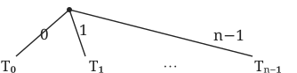
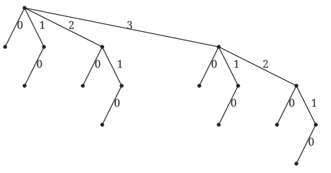
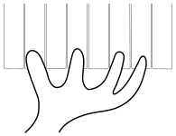
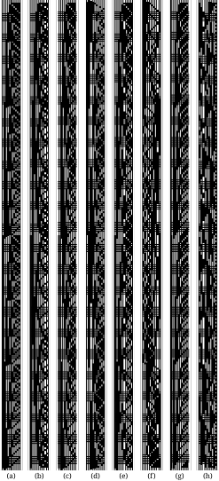
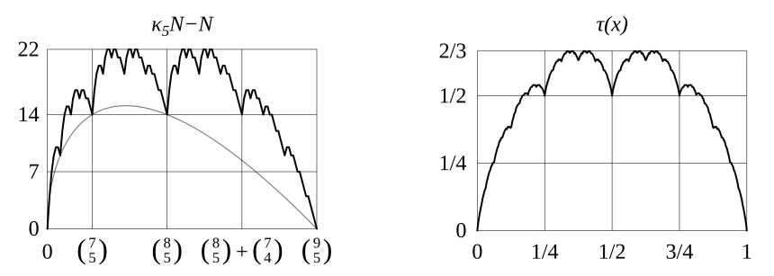
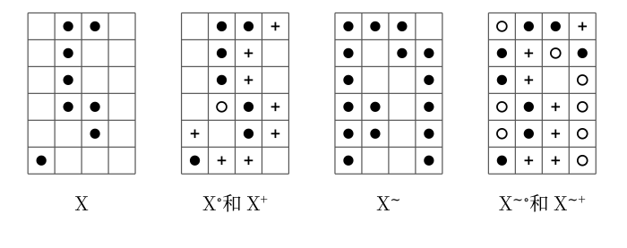
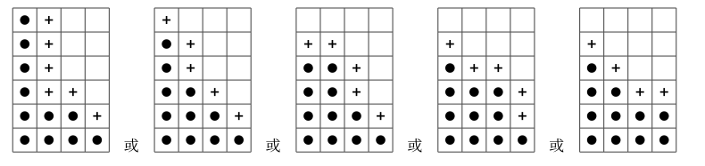
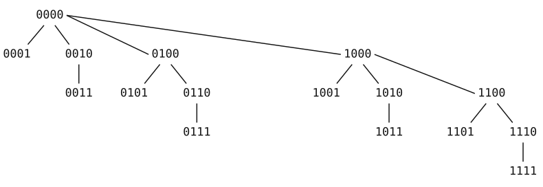

### 7.2.1.3 生成所有组合

组合数学常被描述为 “研究排列、组合等”, 所以现在把注意力转向组合. 从 $n$ 件物体中一次取 $t$ 件的组合, 通常简称为 “$n$ 件物体的 $t$ 组合”, 是从大小为 $n$ 的集合中选一个大小为 $t$ 的子集的方式. 由式 1.2.6–(2) 知, 恰有 $\binom nt$ 种方式. 在 3.4.2 节已经学过怎样随机选择 $t$ 组合.

从 $n$ 个对象中选 $t$ 个元素, 等价于选出没有选中的那 $n-t$ 个元素. 为强调这种对称性, 在下面的讨论中统一令

$$
n=s+t
\tag{1}
$$

并经常把 $n$ 个对象的 $t$ 组合称为 “$(s,t)$ 组合”. 于是, $(s,t)$ 组合是将 $s+t$ 个对象划分成大小分别为 $s$ 和 $t$ 的两个集合的一种方式.

> 如果我问有多少种方法能从 25 中取出 21,  
> 实际上是在问有多少种方法能取出 4.  
> 因为取 21 的方法与留下 4 的方法恰好一样多.  
> ——奥古斯塔斯·德摩根, 《关于概率的一篇论文》(1838)

有两种主要方式表示 $(s,t)$ 组合: 列出已选元素 $c_t\ldots c_2c_1$, 或用二进制串 $a_{n-1}\ldots a_1a_0$ 表示, 其中

$$
a_{n-1}+\cdots+a_1+a_0=t.
\tag{2}
$$

二进制串含 $s$ 个 0 和 $t$ 个 1, 分别对应于未选与已选的元素. 若元素取自集合 $\{0,1,\ldots,n-1\}$, 并按降序

$$
n>c_t>\cdots>c_2>c_1\ge0
\tag{3}
$$

列出, 则列表表示 $c_t\ldots c_2c_1$ 往往最合适. 二进制记号把这两种表示联系起来, 因为元素列表 $c_t\ldots c_2c_1$ 对应于和式

$$
2^{c_t}+\cdots+2^{c_2}+2^{c_1}=\sum_{k=0}^{n-1}a_k2^k=(a_{n-1}\ldots a_1a_0)_2.
\tag{4}
$$

当然, 也可以列出 $a_{n-1}\ldots a_1a_0$ 中 0 的位置 $b_s\ldots b_2b_1$, 其中

$$
n>b_s>\cdots>b_2>b_1\ge0.
\tag{5}
$$

组合重要, 不仅因为子集在数学中无处不在, 也因为组合等价于许多其他结构. 例如, 每个 $(s,t)$ 组合对应于从 $s+1$ 件物体中取 $t$ 件且允许重复的组合, 也称为 $s+1$ 件物体的多重组合, 即满足

$$
s\ge d_t\ge\cdots\ge d_2\ge d_1\ge0
\tag{6}
$$

的整数序列 $d_t\ldots d_2d_1$. 这是因为 $d_t\ldots d_2d_1$ 满足 (6), 当且仅当 $c_t\ldots c_2c_1$ 满足 (3), 其中

$$
c_t=d_t+t-1,\qquad\ldots,\qquad c_2=d_2+1,\quad c_1=d_1
\tag{7}
$$

(见习题 1.2.6-60). 索罗门·戈洛姆 [*AMM* **75** (1968), 530–531] 提出了另一种有用的方法, 把允许重复的组合与普通组合联系起来, 定义

$$
e_j=
\begin{cases}
c_j,&\text{如果 }c_j\le s;\\
e_{c_j-s},&\text{如果 }c_j>s.
\end{cases}
\tag{8}
$$

在此形式中, $e_t\ldots e_1$ 无须按降序排列, 但多重集 $\{e_1,e_2,\ldots,e_t\}$ 等于 $\{c_1,c_2,\ldots,c_t\}$, 当且仅当 $\{e_1,e_2,\ldots,e_t\}$ 是一个没有重复元素的普通集合. (见表 1 和习题 1.)

一个 $(s,t)$ 组合也等价于把 $n+1$ 分成 $t+1$ 部分的组分, 即有序和

$$
n+1=p_t+\cdots+p_1+p_0,\qquad p_t,\ldots,p_1,p_0\ge1.
\tag{9}
$$

它与 (3) 的联系是

$$
p_t=n-c_t,\quad p_{t-1}=c_t-c_{t-1},\quad\ldots,\quad p_1=c_2-c_1,\quad p_0=c_1+1.
\tag{10}
$$

令 $q_j=p_j-1$, 就等价于

$$
s=q_t+\cdots+q_1+q_0,\qquad q_t,\ldots,q_1,q_0\ge0,
\tag{11}
$$

即把 $s$ 分成 $t+1$ 个非负部分的组分. 通过置

$$
q_t=s-d_t,\quad q_{t-1}=d_t-d_{t-1},\quad\ldots,\quad q_1=d_2-d_1,\quad q_0=d_1
\tag{12}
$$

又与 (6) 相联系.

此外, 容易看出, 一个 $(s,t)$ 组合等价于在 $s\times t$ 网格上从一个角点走到对角的长为 $s+t$ 的路径, 因为这种路径包含 $s$ 个纵向步与 $t$ 个横向步.

因此, 至少可以用 8 种不同的形式研究组合. 表 1 说明 $s=t=3$ 时的全部 $\binom63=20$ 种可能性.

初看之下, 组合的这些形式也许有些令人迷惑, 但其中多数可以直接借助二进制表示 $a_{n-1}\ldots a_1a_0$ 理解. 例如, 考虑 “随机” 二进制位串

$$
a_{23}\ldots a_1a_0=011001001000011111101101,
\tag{13}
$$

它有 $s=11$ 个 0 和 $t=13$ 个 1, 所以 $n=24$. 对偶组合 $b_s\ldots b_1$ 列出 0 的位置 (下标), 即

$$
23\ 20\ 19\ 17\ 16\ 14\ 13\ 12\ 11\ 4\ 1,
$$

因为 (13) 中最左位置是 $n-1$, 最右位置是 0. 原组合 $c_t\ldots c_1$ 列出 1 的位置, 即

$$
22\ 21\ 18\ 15\ 10\ 9\ 8\ 7\ 6\ 5\ 3\ 2\ 0.
$$

对应的多重组合 $d_t\ldots d_1$ 列出每个 1 右边 0 的个数:

$$
10\ 10\ 8\ 6\ 2\ 2\ 2\ 2\ 2\ 2\ 1\ 1\ 0.
$$

**表 1**　$(3,3)$ 组合及其等价形式

| $a_5a_4a_3a_2a_1a_0$ | $b_3b_2b_1$ | $c_3c_2c_1$ | $d_3d_2d_1$ | $e_3e_2e_1$ | $p_3p_2p_1p_0$ | $q_3q_2q_1q_0$ | 路径 |
|:---:|:---:|:---:|:---:|:---:|:---:|:---:|:---:|
| 000111 | 543 | 210 | 000 | 210 | 4111 | 3000 |  |
| 001011 | 542 | 310 | 100 | 310 | 3211 | 2100 |  |
| 001101 | 541 | 320 | 110 | 320 | 3121 | 2010 |  |
| 001110 | 540 | 321 | 111 | 321 | 3112 | 2001 |  |
| 010011 | 532 | 410 | 200 | 010 | 2311 | 1200 |  |
| 010101 | 531 | 420 | 210 | 020 | 2221 | 1110 |  |
| 010110 | 530 | 421 | 211 | 121 | 2212 | 1101 |  |
| 011001 | 521 | 430 | 220 | 030 | 2131 | 1020 |  |
| 011010 | 520 | 431 | 221 | 131 | 2122 | 1011 |  |
| 011100 | 510 | 432 | 222 | 232 | 2113 | 1002 |  |
| 100011 | 432 | 510 | 300 | 110 | 1411 | 0300 |  |
| 100101 | 431 | 520 | 310 | 220 | 1321 | 0210 |  |
| 100110 | 430 | 521 | 311 | 221 | 1312 | 0201 |  |
| 101001 | 421 | 530 | 320 | 330 | 1231 | 0120 |  |
| 101010 | 420 | 531 | 321 | 331 | 1222 | 0111 |  |
| 101100 | 410 | 532 | 322 | 332 | 1213 | 0102 |  |
| 110001 | 321 | 540 | 330 | 000 | 1141 | 0030 |  |
| 110010 | 320 | 541 | 331 | 111 | 1132 | 0021 |  |
| 110100 | 310 | 542 | 332 | 222 | 1123 | 0012 |  |
| 111000 | 210 | 543 | 333 | 333 | 1114 | 0003 |  |

想象在左边和右边各加一个 1, 则组分 $p_t\ldots p_0$ 从左到右依次列出相邻两个 1 之间的距离:

$$
2\ 1\ 3\ 3\ 5\ 1\ 1\ 1\ 1\ 1\ 2\ 1\ 2\ 1.
$$

非负组分 $q_t\ldots q_0$ 计算由 1 表示的 “栅栏位置” 之间有多少个 0:

$$
1\ 0\ 2\ 2\ 4\ 0\ 0\ 0\ 0\ 0\ 1\ 0\ 1\ 0;
$$

因此, 有

$$
a_{n-1}\ldots a_1a_0=0^{q_t}10^{q_{t-1}}1\ldots10^{q_1}10^{q_0}.
\tag{14}
$$

表 1 中的路径也有简单解释 (见习题 2).

**字典式生成.** 表 1 以字典序显示组合 $a_{n-1}\ldots a_1a_0$ 和 $c_t\ldots c_1$, 这也是 $d_t\ldots d_1$ 的字典序. 请注意, 对偶组合 $b_s\ldots b_1$ 及对应的组分 $p_t\ldots p_0$、$q_t\ldots q_0$ 这时以逆字典序出现.

生成组合结构最便捷的方法通常是使用字典序. 其实, 算法 7.2.1.2L 已经解决了 $a_{n-1}\ldots a_1a_0$ 形式的组合问题, 因为二进制位串形式的 $(s,t)$ 组合就是多重集 $\{s\cdot0,t\cdot1\}$ 的排列. 那个通用算法应用到这种特例时, 可以用明显的方法简化. (另见习题 7.1.3-20, 其中给出了引人注目的 7 条位运算指令. 只要 $n$ 未超过计算机字长, 它就可把任意给定的二进制数 $(a_{n-1}\ldots a_1a_0)_2$ 转换成字典序下一 $t$ 组合.)

现在集中讨论另一种主要的组合形式 $c_t\ldots c_2c_1$. 这种形式与经常需要使用组合的方式联系更直接, 当 $t$ 比 $n$ 小时也比位串形式紧凑. 首先要记住, 当 $t$ 很小时, 简单的嵌套循环就能很好完成工作. 例如, $t=3$ 时, 以下指令足以满足需求:

~~~text
对于 c₃ = 2, 3, …, n−1（依此次序）执行下列指令：
  对于 c₂ = 1, 2, …, c₃−1（依此次序）执行下列指令：
    对于 c₁ = 0, 1, …, c₂−1（依此次序）执行下列指令：
      访问组合 c₃c₂c₁。
~~~

(15)

(见 7.2.1.1–(3) 中的类似情形.)

另一方面, 若 $t$ 可变或不是很小, 可按算法 7.2.1.2L 后讨论的一般方法, 以字典序生成组合: 找出可增加的最右元素 $c_j$, 再把随后的元素 $c_{j-1}\ldots c_1$ 置为它们可能的最小值.

**算法 L (字典序组合).** 给定 $n\ge t\ge0$, 本算法访问 $n$ 个数 $\{0,1,\ldots,n-1\}$ 的全部 $t$ 组合 $c_t\ldots c_2c_1$. 附加变量 $c_{t+1}$ 和 $c_{t+2}$ 作为哨兵.

**L1. [初始化.]** 对 $1\le j\le t$ 置 $c_j\leftarrow j-1$; 另置 $c_{t+1}\leftarrow n$、$c_{t+2}\leftarrow0$.

**L2. [访问.]** 访问组合 $c_t\ldots c_2c_1$.

**L3. [寻找 $j$.]** 置 $j\leftarrow1$. 当 $c_j+1=c_{j+1}$ 时, 循环置 $c_j\leftarrow j-1$、$j\leftarrow j+1$, 最终将有 $c_j+1\ne c_{j+1}$.

**L4. [完成?]** 若 $j>t$, 终止.

**L5. [推进 $c_j$.]** 置 $c_j\leftarrow c_j+1$, 返回 L2.　∎

算法的运行时间不难分析. 恰好在访问满足 $c_{j+1}=c_1+j$ 的组合后, L3 置 $c_j\leftarrow j-1$. 这样的组合数就是下列不等式的解数:

$$
n>c_t>\cdots>c_{j+1}\ge j.
\tag{16}
$$

这等价于取 $n-j$ 个对象 $\{n-1,\ldots,j\}$ 的一个 $(t-j)$ 组合, 所以赋值 $c_j\leftarrow j-1$ 恰出现 $\binom{n-j}{t-j}$ 次. 对 $1\le j\le t$ 求和可知, L3 的循环总共执行

$$
\binom{n-1}{t-1}+\binom{n-2}{t-2}+\cdots+\binom{n-t}{0}
=\binom{n-1}s+\binom{n-2}s+\cdots+\binom ss
=\binom n{s+1}
\tag{17}
$$

次, 或者每次访问平均执行

$$
\binom n{s+1}\big/\binom nt=\frac{t}{s+1},
\qquad
\binom n{s+1}\big/\binom nt
=\frac{n!}{(s+1)!(t-1)!}\bigg/\frac{n!}{s!\,t!}\quad(t>0).
\tag{18}
$$

当 $t\le s$ 时, 每次访问平均少于 1 次循环. 因此, 算法 L 在这类情形下很有效.

然而, 若 $t$ 接近 $n$ 而 $s$ 很小, $t/(s+1)$ 可能大得不便. 实际上, $c_j$ 已经等于 $j-1$ 时, 算法 L 无须再置 $c_j\leftarrow j-1$. 进一步观察可知, 不必总是搜索 L4 和 L5 所需的下标 $j$, 因为往往可以从刚执行的操作预知它的正确值. 例如, 增加 $c_4$ 并把 $c_3c_2c_1$ 重置为初值 210 后, 下一个组合必定增加 $c_3$. 这些观察导出一个改进的算法.

**算法 T (字典序组合).** 本算法类似算法 L, 但更快. 为方便起见, 还假设 $0<t<n$.

**T1. [初始化.]** 对 $1\le j\le t$ 置 $c_j\leftarrow j-1$; 另置 $c_{t+1}\leftarrow n$、$c_{t+2}\leftarrow0$、$j\leftarrow t$.

**T2. [访问.]** (这时 $j$ 是满足 $c_{j+1}>j$ 的最小下标.) 访问组合 $c_t\ldots c_2c_1$. 然后, 若 $j>0$, 置 $x\leftarrow j$, 转到 T6.

**T3. [简单情形?]** 若 $c_1+1<c_2$, 置 $c_1\leftarrow c_1+1$, 返回 T2. 否则置 $j\leftarrow2$.

**T4. [寻找 $j$.]** 置 $c_{j-1}\leftarrow j-2$、$x\leftarrow c_j+1$. 若 $x=c_{j+1}$, 置 $j\leftarrow j+1$, 重复 T4.

**T5. [完成?]** 若 $j>t$, 终止.

**T6. [推进 $c_j$.]** 置 $c_j\leftarrow x$、$j\leftarrow j-1$, 返回 T2.　∎

现在, T2 中 $j=0$ 当且仅当 $c_1>0$, 所以 T4 的赋值从来不多余. 算法 T 的完整分析见习题 6.

注意, 算法 L 和 T 中的参数 $n$ 只出现在初始化步骤 L1 和 T1, 不出现在主要部分. 因此, 整个过程可以看作从一个仅依赖于 $t$ 的无穷表生成前 $\binom nt$ 个组合. 能这样简化, 是因为按我们的约定, $n+1$ 件物体的 $t$ 组合表以 $n$ 件物体的组合表开头. 正因如此, 我们对递减序列 $c_t\ldots c_1$ 采用字典序, 而不是处理递增序列 $c_1\ldots c_t$.

德里克·莱默指出了算法 L 和 T 的另一个有趣性质 [见埃德温·贝肯巴赫编的 *Applied Combinatorial Mathematics* (1964), 27–30].

**定理 L.** 组合 $c_t\ldots c_2c_1$ 恰在访问了

$$
\binom{c_t}t+\cdots+\binom{c_2}2+\binom{c_1}1
\tag{19}
$$

个其他组合之后被访问.

*证明.* 对 $t\ge j>k$ 有 $c'_j=c_j$ 且 $c'_k<c_k$ 的组合 $c'_t\ldots c'_2c'_1$ 有 $\binom{c_k}k$ 个. 它们是 $c_t\ldots c_{k+1}$ 后接 $\{0,\ldots,c_k-1\}$ 的任一 $k$ 组合.　∎

例如, $t=3$ 时, 对应于表 1 中 $c_3c_2c_1$ 的数

$$
\binom23+\binom12+\binom01,\quad
\binom33+\binom12+\binom01,\quad
\binom33+\binom22+\binom01,\quad
\ldots,\quad
\binom53+\binom42+\binom31
$$

恰好遍历序列 $0,1,2,\ldots,19$. 定理 L 让我们容易理解 $t$ 阶组合数系, 它把每个非负整数 $N$ 唯一表示成

$$
N=\binom{n_t}t+\cdots+\binom{n_2}2+\binom{n_1}1,\qquad n_t>\cdots>n_2>n_1\ge0
\tag{20}
$$

的形式. [见埃内斯托·帕斯卡尔,*Giornale di Matematiche* **25** (1887), 45–49.]

**二项式树.** 下面定义的树族 $T_n$ 出现在几个重要的情形中, 进一步阐明了组合的生成. $T_0=\bullet$, 而 $n>0$ 时的 $T_n$ 如下:

(21)

例如, $T_4$ 为

(22)

更具艺术色彩的 $T_5$ 出现在本书第 1 卷的卷首插图中.

注意, 除多一个 $T_{n-1}$ 的副本外, $T_n$ 与 $T_{n-1}$ 类似, 所以 $T_n$ 总共有 $2^n$ 个结点. 此外, 第 $t$ 层的结点数是二项式系数 $\binom nt$, 这就是 “二项式树” 一名的由来. 事实上, 从根到第 $t$ 层任一结点的路径所遇到的标号序列定义一个组合 $c_t\ldots c_1$, 所有组合按字典序从左到右出现. 因此, 可把算法 L 和 T 看作遍历二项式树 $T_n$ 第 $t$ 层结点的过程.

在 (21) 中令 $n\to\infty$, 得到无穷二项式树 $T_\infty$. 它的根有无穷多个分支, 但除了第 0 层的总根, 每个结点都是一棵有限二项式子树的根. 所有可能的 $t$ 组合按字典序出现在 $T_\infty$ 的第 $t$ 层.

为进一步熟悉二项式树, 考虑填充一个背包的所有可能方法. 明确地说, 假设有 $n$ 件物体, 分别占用 $w_{n-1},\ldots,w_1,w_0$ 个容量单位, 其中

$$
w_{n-1}\ge\cdots\ge w_1\ge w_0\ge0.
\tag{23}
$$

我们要生成所有满足下式的二进制向量 $a_{n-1}\ldots a_1a_0$:

$$
a\cdot w=a_{n-1}w_{n-1}+\cdots+a_1w_1+a_0w_0\le N,
\tag{24}
$$

其中 $N$ 是背包的总容量. 换言之, 要找出 $\{0,1,\ldots,n-1\}$ 中满足 $w(C)=\sum_{c\in C}w_c\le N$ 的所有子集 $C$, 称这样的子集是可行的. 把一个可行子集写成 $c_1\ldots c_t$, 其中 $c_1>\cdots>c_t\ge0$. 下标编号与 (3) 的约定不同, 因为此处 $t$ 是变量.

每个可行子集对应于 $T_n$ 的一个结点, 目标是访问每个可行结点. 显然, 可行结点的父结点可行, 它的左兄弟结点 (若有) 也可行. 因此, 简单的树探索过程就能奏效.

**算法 F (填充背包).** 给定 $w_{n-1},\ldots,w_1,w_0,N$, 本算法访问填充背包的所有可行方式 $c_1\ldots c_t$. 对 $1\le j<n$, 令 $\delta_j=w_j-w_{j-1}$.

**F1. [初始化.]** 置 $t\leftarrow0$、$c_0\leftarrow n$、$r\leftarrow N$.

**F2. [访问.]** 访问使用 $N-r$ 个容量单位的组合 $c_1\ldots c_t$.

**F3. [试着装入 $w_0$.]** 若 $c_t>0$ 且 $r\ge w_0$, 置 $t\leftarrow t+1$、$c_t\leftarrow0$、$r\leftarrow r-w_0$, 返回 F2.

**F4. [试着增加 $c_t$.]** 若 $t=0$, 终止. 否则, 若 $c_{t-1}>c_t+1$ 且 $r\ge\delta_{c_t+1}$, 置 $c_t\leftarrow c_t+1$、$r\leftarrow r-\delta_{c_t}$, 返回 F2.

**F5. [移除 $c_t$.]** 置 $r\leftarrow r+w_{c_t}$、$t\leftarrow t-1$, 返回 F4.　∎

注意, 本算法按前序隐式访问 $T_n$ 的结点, 跳过不可行的子树. 在考察了把元素 $c-1$ 放在同一位置的所有可能性后, 若元素 $c>0$ 能装入背包, 接着就把它放入. 算法运行时间与访问的可行组合数成正比 (见习题 20).

顺便指出, 上述 “填充背包问题” 与运筹学中的经典 “背包问题” 不同. 后者要求找出使 $v(C)=\sum_{c\in C}v(c)$ 最大的可行子集 $C$, 其中每个 $c$ 都有给定价值 $v(c)$. 算法 F 常考察可以排除的情况, 因而不是解决后一个问题的好方法. 例如, 若 $C,C'$ 是 $\{1,\ldots,n-1\}$ 的子集, 满足 $w(C)\le w(C')\le N-w_0$ 且 $v(C)\ge v(C')$, 算法 F 会检查 $C\cup\{0\}$ 和 $C'\cup\{0\}$, 但后者无法改进最大值. 以后会讨论经典背包问题的解法. 算法 F 用于所有可行情况都可能有关的场合.

**用于组合的格雷码.** 除了生成所有组合, 通常还希望访问它们时, 每个组合只需对前一个组合做少量改变.

例如, 可能需要奈恩黑斯和维尔夫所称的 “旋转门算法”: 设想有两间分别容纳 $s$ 人和 $t$ 人的房间, 中间有一扇旋转门. 每当一人进入对面的房间, 另一间也有一人出来. 能否设计一种移动次序, 使每个 $(s,t)$ 组合恰好出现一次?

答案是肯定的, 而且有大量这样的模式. 例如, 按格雷二进制码的次序 (7.2.1.1 节) 考察所有 $n$ 位二进制串 $a_{n-1}\ldots a_1a_0$, 只留下恰有 $s$ 个 0 和 $t$ 个 1 的串, 则所得串构成旋转门码.

下面给出证明. 格雷二进制码由 7.2.1.1–(5) 中的递推 $\Gamma_n=0\Gamma_{n-1},\ 1\Gamma_{n-1}^{R}$ 定义. 因此, $st>0$ 时其 $(s,t)$ 子序列满足

$$
\Gamma_{st}=0\Gamma_{(s-1)t},\ 1\Gamma_{s(t-1)}^R.
\tag{25}
$$

还有 $\Gamma_{s0}=0^s$、$\Gamma_{0t}=1^t$. 由归纳可知, $st>0$ 时, $\Gamma_{st}$ 以 $0^s1^t$ 开头、以 $10^s1^{t-1}$ 结尾. (25) 中逗号处的过渡是从 $0\Gamma_{(s-1)t}$ 的最后一项到 $1\Gamma_{s(t-1)}$ 的最后一项. 当 $t\ge2$ 时, 即从 $010^{s-1}1^{t-1}=010^{s-1}11^{t-2}$ 到 $110^s1^{t-2}=110^{s-1}01^{t-2}$, 满足旋转门的约束. $t=1$ 时也满足. 例如, $\Gamma_{33}$ 由下列阵列的各列给出:

$$
\begin{matrix}
000111&011010&110001&101010\\
001101&011100&110010&101100\\
001110&010101&110100&100101\\
001011&010110&111000&100110\\
011001&010011&101001&100011
\end{matrix}
\tag{26}
$$

在这个阵列的前两列可找到 $\Gamma_{23}$. 旋转门再转一次, 就把最后一项变成第一项. [琼·米勒于其博士论文 (哥伦比亚大学, 1971 年) 中发现 $\Gamma_{st}$ 的这些性质, 随后唐道南和刘兆宁又独立发现它们, 见 *IEEE Trans. C-22* (1973), 176–180. 詹姆斯·比特纳、吉德翁·埃尔利希和爱德华·莱因戈尔德提出旋转门的无循环实现, 见 *CACM* **19** (1976), 517–521.]

把 (26) 的二进制位串 $a_5a_4a_3a_2a_1a_0$ 转换为相应的下标列表 $c_3c_2c_1$, 就能看出一个明显的模式:

$$
\begin{matrix}
210&431&540&531\\
320&432&541&532\\
321&420&542&520\\
310&421&543&521\\
430&410&530&510
\end{matrix}
\tag{27}
$$

第一分量 $c_3$ 按非递减顺序出现; 对每个固定的 $c_3$, $c_2$ 的值按非递增顺序出现; 而对每个固定的 $c_3c_2$, $c_1$ 的值又是非递减的. 一般而言, 旋转门格雷码 $\Gamma_{st}$ 中的所有组合 $c_t\ldots c_2c_1$ 按

$$
(c_t,-c_{t-1},c_{t-2},\ldots,(-1)^{t-1}c_1)
\tag{28}
$$

的字典序出现. 这个性质可由归纳法得出, 因为以列表记号代替二进制串记号时, 对 $st>0$, (25) 变为

$$
\Gamma_{st}=\Gamma_{(s-1)t},\ (s+t-1)\Gamma_{s(t-1)}^R.
\tag{29}
$$

威廉·佩恩提出的下列算法能高效生成旋转门序列 [见 *ACM Trans. Math. Software* **5** (1979), 163–172]:

**算法 R (旋转门组合).** 假定 $n\ge t>1$, 本算法按交错序列 (28) 的字典序, 生成 $\{0,1,\ldots,n-1\}$ 的全部 $t$ 组合 $c_t\ldots c_2c_1$. 使用辅助变量 $c_{t+1}$. R3 按 $t$ 的奇偶分两种情况.

**R1. [初始化.]** 对 $t\ge j\ge1$ 置 $c_j\leftarrow j-1$, 并置 $c_{t+1}\leftarrow n$.

**R2. [访问.]** 访问组合 $c_t\ldots c_2c_1$.

**R3. [简单情形?]** 若 $t$ 为奇数: 若 $c_1+1<c_2$, 将 $c_1$ 增 1, 返回 R2; 否则置 $j\leftarrow2$, 转到 R4. 若 $t$ 为偶数: 若 $c_1>0$, 将 $c_1$ 减 1, 返回 R2; 否则置 $j\leftarrow2$, 转到 R5.

**R4. [试着减少 $c_j$.]** (这时 $c_{j-1}=c_j-1$.) 若 $c_j\ge j$, 置 $c_j\leftarrow c_{j-1}$、$c_{j-1}\leftarrow j-2$, 返回 R2. 否则将 $j$ 增 1.

**R5. [试着增加 $c_j$.]** (这时 $c_{j-1}=j-2$.) 若 $c_j+1<c_{j+1}$, 置 $c_{j-1}\leftarrow c_j$、$c_j\leftarrow c_j+1$, 返回 R2. 否则将 $j$ 增 1, 若 $j\le t$, 转到 R4; 否则终止.　∎

习题 21–25 进一步考察这个有趣序列的性质. 其中一项是定理 L 的精巧伴随定理. 算法 R 恰在访问了

$$
N=\binom{c_t+1}{t}-\binom{c_{t-1}+1}{t-1}+\cdots+(-1)^t\binom{c_2+1}{2}
-(-1)^t\binom{c_1+1}{1}-[t\text{ 为奇数}]
\tag{30}
$$

个其他组合之后访问组合 $c_tc_{t-1}\ldots c_2c_1$. 称 $N$ 的这种表示为 $t$ 阶 “交错组合数系”. 例如, 每个正整数都可唯一表示为 $N=\binom a3-\binom b2+\binom c1$, 其中 $a>b>c>0$. 算法 R 给出了在这个数系中怎样对 $N$ 加 1.

虽然 (26) 和 (27) 中的串不按字典序出现, 它们却是更一般的通用字典序的例子. 这个名称由蒂莫西·沃尔什提出. 在串 $\alpha_1,\ldots,\alpha_N$ 的序列中, 若每个公共前缀对应的串都连续出现, 就说这个序列按通用字典序排列. 例如, (27) 中所有以 53 开头的 3 组合连续出现.

通用字典序意味着可以把序列中的串排成一棵检索树 (trie), 如 6.3 节图 31 那样, 但每个结点的各个孩子可以任意排列. 不论以何种次序遍历检索树, 只要每个结点的访问恰在其后代之前或之后, 具有共同前缀的一切结点, 也就是一棵检索子树的全部结点, 就会相继出现. 这一原则对应于递归生成方案, 使通用字典序很实用. 许多已见到的 $n$ 元组生成算法采用某种通用字典序; 同样, “平滑改变” 法 (算法 7.2.1.2P) 按相应反序表的一种通用字典序访问排列.

算法 R 的旋转门法是一个通用字典序过程, 每步只改变组合中的一个元素. 但是它仍不尽如人意, 因为为了维持 $c_t>\cdots>c_2>c_1$, 它常须同时改变两个下标 $c_j$. 例如, 算法 R 把 210 变成 320, (27) 含有 9 个这样的 “交叉” 移动.

这个缺陷源于证明 (25) 的旋转门性质时观察到的事实: $t\ge2$ 时, 串 $010^{s-1}11^{t-2}$ 后紧跟 $110^{s-1}01^{t-2}$. 因此, 递归构造 $\Gamma_{st}$ 涉及形如 $110^a0\leftrightarrow010^a1$ 的转换. 例如, 子串 11000 变成 01001 或反过来时, 两个 1 彼此交叉.

若一条组合格雷路径每步只改变一个下标 $c_j$, 就称它是齐次的. 齐次模式在位串中的特征是, 任两个相邻位串只通过形如 $10^a\leftrightarrow0^a1$($a\ge1$) 的串内变换相连. 例如, 用齐次模式可在一个 $n$ 音符的键盘上, 每次只移动一个手指, 弹出全部 $t$ 音符和弦.

稍改 (25), 就能生成 $(s,t)$ 组合的一种有趣的通用字典序齐次模式. 其基本想法是构造以 $0^s1^t$ 开头、以 $1^t0^s$ 结尾的序列, 由此立即得到一个递推. 令 $K_{s0}=0^s$、$K_{0t}=1^t$、$K_{s(-1)}=\varnothing$, 以及

$$
K_{st}=0K_{(s-1)t},\ 10K^R_{(s-1)(t-1)},\ 11K_{s(t-2)},\qquad st>0.
\tag{31}
$$

在此序列的逗号处, $01^t0^{s-1}$ 后紧跟 $101^{t-1}0^{s-1}$, 而 $10^s1^{t-1}$ 后紧跟 $110^s1^{t-2}$. 这两个变换都是齐次的, 尽管第二个需要让 1 跳过 $s$ 个 0. 当 $s=t=3$ 时, 组合 $K_{33}$ 的二进制位串形式是

$$
\begin{matrix}
000111&010101&101100&100011\\
001011&010011&101001&110001\\
001101&011001&101010&110010\\
001110&011010&100110&110100\\
010110&011100&100101&111000
\end{matrix}
\tag{32}
$$

而相应的下标列表形式是

$$
\begin{matrix}
210&420&532&510\\
310&410&530&540\\
320&430&531&541\\
321&431&521&542\\
421&432&520&543
\end{matrix}
\tag{33}
$$

当普通组合 $c_t\ldots c_1$ 的齐次模式转为允许重复的组合 $d_t\ldots d_1$ 的相应模式 (6) 时, 每步只改变一个下标 $d_j$ 的性质保留. 当它转为组分 $p_t\ldots p_0$ 或 $q_t\ldots q_0$ 的相应模式 (9) 或 (11) 时, $c_j$ 改变只会改变相邻的两个部分.

**接近完备的模式.** 还可以做得更好. 只用 $01\leftrightarrow10$ 或 $001\leftrightarrow100$ 的强齐次变换序列, 就能生成所有 $(s,t)$ 组合. 也就是说, 可以要求每步只改变一个下标 $c_j$, 改变量至多为 2. 把这样的生成模式称为接近完备.

如此强的条件使可选方式比较少, 反而很容易发现接近完备的模式. 若限于在 $n$ 位二进制串上接近完备的通用字典序方法, 托马斯·詹金斯和戴维·麦卡锡指出, 所有这种方法可概括如下 [*Ars Combinatoria* **40** (1995), 153–159]:

**定理 N.** 若 $st>0$, 恰有 $2s$ 种接近完备的方法按通用字典序列出所有 $(s,t)$ 组合. 实际上, 当 $1\le a\le s$ 时, 恰有一个这样的列表 $N_{sta}$, 以 $1^t0^s$ 开始、以 $0^a1^t0^{s-a}$ 结束. 其余 $s$ 种是逆列表 $N_{sta}^R$.

*证明.* $s=t=1$ 时结论显然成立, 其余情形对 $s+t$ 归纳. 若列表 $N_{sta}$ 存在, 必为 $1X_{s(t-1)},\ 0Y_{(s-1)t}$, 其中 $X_{s(t-1)}$ 和 $Y_{(s-1)t}$ 均是接近完备的通用字典序列表. 若 $t=1$, 则 $X_{s(t-1)}$ 是单个串 $0^s$. 因此, $a>1$ 时 $Y_{(s-1)t}$ 必为 $N_{(s-1)1(a-1)}$, $a=1$ 时必为 $N^R_{(s-1)11}$. 另一方面, 若 $t>1$, 接近完备条件意味着 $X_{s(t-1)}$ 的最后一个串不能以 1 开头, 因而对某个 $b$ 有 $X_{s(t-1)}=N_{s(t-1)b}$. 若 $a>1$, 则 $Y_{(s-1)t}$ 必为 $N_{(s-1)t(a-1)}$, 所以 $b$ 必为 1; 类似地, 若 $s=1$, 则 $b$ 必为 1. 其余情形是 $a=1<s$, 这迫使对某个 $c$ 有 $Y_{(s-1)t}=N^R_{(s-1)tc}$. 从 $10^b1^{t-1}0^{s-b}$ 到 $0^{c+1}1^t0^{s-1-c}$ 的变换, 仅当 $c=1$ 且 $b=2$ 时才接近完备.　∎

定理 N 的证明给出下列递推. 若 $st>0$, 有

$$
N_{sta}=
\begin{cases}
1N_{s(t-1)1},\ 0N_{(s-1)t(a-1)},&\text{如果 }1<a\le s;\\
1N_{s(t-1)2},\ 0N^R_{(s-1)t1},&\text{如果 }1=a<s;\\
1N_{1(t-1)1},\ 01^t,&\text{如果 }1=a=s.
\end{cases}
\tag{34}
$$

当然, 还有 $N_{s0a}=0^s$.

置 $A_{st}=N_{st1}$、$B_{st}=N_{st2}$. 菲利普·蔡斯于 1976 年发现这些接近完备的列表, 其净效果分别是将最左边的一块 1 右移一个、两个位置. 它们满足下列互递推式:

$$
A_{st}=1B_{s(t-1)},\ 0A^R_{(s-1)t};
\qquad
B_{st}=1A_{s(t-1)},\ 0A_{(s-1)t}.
\tag{35}
$$

“前进一步: 前进两步, 再后退一步; 前进两步: 前进一步, 再前进一步.” 若 $s$ 或 $t$ 为负整数, 定义 $A_{st}$ 和 $B_{st}$ 为 $\varnothing$, 则 (35) 对所有整数 $s,t$ 成立, $s=t=0$ 除外, 这时 $A_{00}=B_{00}=\epsilon$ (空串). 因此, $A_{st}$ 实际前进 $\min(s,1)$ 步, $B_{st}$ 实际前进 $\min(s,2)$ 步. 例如, 表 2 用等价的下标列表 $c_3c_2c_1$ 代替二进制串 $a_5a_4a_3a_2a_1a_0$, 列出 $s=t=3$ 时的序列.

**表 2**　$(3,3)$ 组合的蔡斯序列

$$
\begin{array}{ccc}
A_{33}=\widehat C_{33}^{R}&\qquad&B_{33}=C_{33}\\[3pt]
\begin{matrix}
543&531&321&420\\
541&530&320&421\\
540&510&310&431\\
542&520&210&430\\
532&521&410&432
\end{matrix}
&&
\begin{matrix}
543&520&432&410\\
542&510&430&210\\
540&530&431&310\\
541&531&421&320\\
521&532&420&321
\end{matrix}
\end{array}
$$

蔡斯指出, 若定义

$$
C_{st}=
\begin{cases}
A_{st},&\text{如果 }s+t\text{ 为奇数};\\
B_{st},&\text{如果 }s+t\text{ 为偶数};
\end{cases}
\qquad
\widehat C_{st}=
\begin{cases}
A^R_{st},&\text{如果 }s+t\text{ 为偶数};\\
B^R_{st},&\text{如果 }s+t\text{ 为奇数},
\end{cases}
\tag{36}
$$

则这些序列更容易在计算机中实现. [见 *Congressus Numerantium* **69** (1989), 215–242.] 此时有

$$
C_{st}=
\begin{cases}
1C_{s(t-1)},\ 0\widehat C_{(s-1)t},&\text{如果 }s+t\text{ 为奇数};\\
1C_{s(t-1)},\ 0C_{(s-1)t},&\text{如果 }s+t\text{ 为偶数};
\end{cases}
\tag{37}
$$

$$
\widehat C_{st}=
\begin{cases}
0C_{(s-1)t},\ 1\widehat C_{s(t-1)},&\text{如果 }s+t\text{ 为偶数};\\
0\widehat C_{(s-1)t},\ 1\widehat C_{s(t-1)},&\text{如果 }s+t\text{ 为奇数}.
\end{cases}
\tag{38}
$$

准备改变位 $a_j$ 时, 可以检查 $j$ 的奇偶, 确定在递推中的位置.

实际上, 序列 $C_{st}$ 可以用一个格外简单的算法生成. 它的基本想法适合任何通用字典序方案. 若通用字典序算法在改变二进制位 $a_j$ 左边的任一位之前, 应该先改变 $a_j$, 就称 $a_j$ 是活动的. (换句话说, 在对应的检索树中, 活动位对应的结点不是它的父结点最右边的孩子.) 设有辅助表 $w_n\ldots w_1w_0$, 当且仅当 $a_j$ 活动或 $j<r$ 时 $w_j=1$, 其中 $r$ 为满足 $a_r\ne a_0$ 的最小下标; 另外, 我们置 $w_n=1$. 下面的方法可以找到 $a_{n-1}\ldots a_1a_0$ 的后继:

~~~text
置 j ← r。若 wⱼ = 0，反复置 wⱼ ← 1、j ← j+1，直到 wⱼ = 1。
若 j = n，则终止。否则置 wⱼ ← 0。
把 aⱼ 改为 1−aⱼ，再对 aⱼ₋₁…a₀ 和 r 做这一通用字典序方案所需的其他修改。
~~~

(39)

这个方法的妙处在于循环的效率有保证. 可以证明, 在每个生成步骤中, 操作 $j\leftarrow j+1$ 平均执行不到一次 (见习题 36).

分析 (37) 及 (38) 改变位时发生的变换, 就能补全余下的细节:

**算法 C (蔡斯序列).** 该算法按蔡斯序列 $C_{st}$ 的接近完备次序访问所有 $(s,t)$ 组合 $a_{n-1}\ldots a_1a_0$, 其中 $n=s+t$.

**C1. [初始化.]** 对 $0\le j<s$ 置 $a_j\leftarrow0$, 对 $s\le j<n$ 置 $a_j\leftarrow1$, 对 $0\le j\le n$ 置 $w_j\leftarrow1$. 若 $s>0$, 置 $r\leftarrow s$; 否则置 $r\leftarrow t$.

**C2. [访问.]** 访问组合 $a_{n-1}\ldots a_1a_0$.

**C3. [找 $j$ 并转移.]** 置 $j\leftarrow r$. 当 $w_j=0$ 时, 循环置 $w_j\leftarrow1$、$j\leftarrow j+1$. 若 $j=n$, 终止. 否则置 $w_j\leftarrow0$, 按四种情形转移: 若 $j$ 是奇数且 $a_j\ne0$, 转到 C4; 若 $j$ 是偶数且 $a_j\ne0$, 转到 C5; 若 $j$ 是偶数且 $a_j=0$, 转到 C6; 若 $j$ 是奇数且 $a_j=0$, 转到 C7.

**C4. [右移一位.]** 置 $a_{j-1}\leftarrow1$、$a_j\leftarrow0$. 若 $r=j$ 且 $j>1$, 置 $r\leftarrow j-1$; 否则若 $r=j-1$, 置 $r\leftarrow j$. 返回 C2.

**C5. [右移两位.]** 若 $a_{j-2}\ne0$, 转到 C4. 否则置 $a_{j-2}\leftarrow1$、$a_j\leftarrow0$. 若 $r=j$, 置 $r\leftarrow\max(j-2,1)$; 否则若 $r=j-2$, 置 $r\leftarrow j-1$. 返回 C2.

**C6. [左移一位.]** 置 $a_j\leftarrow1$、$a_{j-1}\leftarrow0$. 若 $r=j$ 且 $j>1$, 置 $r\leftarrow j-1$; 否则若 $r=j-1$, 置 $r\leftarrow j$. 返回 C2.

**C7. [左移两位.]** 若 $a_{j-1}\ne0$, 转到 C6. 否则置 $a_j\leftarrow1$、$a_{j-2}\leftarrow0$. 若 $r=j-2$, 置 $r\leftarrow j$; 否则若 $r=j-1$, 置 $r\leftarrow j-2$. 返回 C2.　∎

**\*蔡斯序列的分析.** 算法 C 的奇妙性质值得进一步探讨, 仔细考察会得到很有启发性的结果. 给定位串 $a_{n-1}\ldots a_1a_0$, 定义 $a_n=1$、$u_n=n\bmod2$, 以及

$$
u_j=(1-u_{j+1})a_{j+1},\qquad
v_j=(u_j+j)\bmod2,\qquad
w_j=(v_j+a_j)\bmod2,
\tag{40}
$$

其中 $n>j\ge0$. 例如, 可取 $n=26$ 且

$$
\begin{aligned}
a_{25}\ldots a_1a_0&=11001001000011111101101010,\\
u_{25}\ldots u_1u_0&=10100100100001010100100101,\\
v_{25}\ldots v_1v_0&=00001110001011111110001111,\\
w_{25}\ldots w_1w_0&=11000111001000000011100101.
\end{aligned}
\tag{41}
$$

由这些定义可用归纳法证明, $v_j=0$ 当且仅当在生成 $a_{n-1}\ldots a_1a_0$ 的递推 (37)–(38) 中, 位 $a_j$ 由 $C$ 而不是 $\widehat C$ “控制”, 但 $a_j$ 属于最右端最后一段 0 或 1 的情形除外. 因此, 对 $r\le j<n$, $w_j$ 与算法 C 访问 $a_{n-1}\ldots a_1a_0$ 时算得的值一致. 可用这些公式确定给定组合在蔡斯序列中的确切位置 (见习题 39).

如果我们需要处理下标表形式 $c_t\ldots c_2c_1$ 而不是二进制位串 $a_{n-1}\ldots a_1a_0$, 那么稍微改变一下记号是方便的, 当 $s+t=n$ 时, 把 $C_{st}$ 写成 $C_t(n)$, 把 $\widehat C_{st}$ 写成 $\widehat C_t(n)$. 那么, $C_0(n)=\widehat C_0(n)=\epsilon$, 对于 $t\ge0$, 递归公式是

$$
C_{t+1}(n+1)=\begin{cases}
nC_t(n),\ \widehat C_{t+1}(n),&\text{如果 }n\text{ 是偶数;}\\
nC_t(n),\ C_{t+1}(n),&\text{如果 }n\text{ 是奇数;}
\end{cases}\tag{42}
$$

$$
\widehat C_{t+1}(n+1)=\begin{cases}
C_{t+1}(n),\ n\widehat C_t(n),&\text{如果 }n\text{ 是奇数;}\\
\widehat C_{t+1}(n),\ n\widehat C_t(n),&\text{如果 }n\text{ 是偶数.}
\end{cases}\tag{43}
$$

我们可以把上述递归公式展开, 例如:

$$
\begin{aligned}
C_{t+1}(9)&=8C_t(8),\ 6C_t(6),\ 4C_t(4),\ \ldots,\ 3\widehat C_t(3),\ 5\widehat C_t(5),\ 7\widehat C_t(7);\\
C_{t+1}(8)&=7C_t(7),\ 6C_t(6),\ 4C_t(4),\ \ldots,\ 3\widehat C_t(3),\ 5\widehat C_t(5);\\
\widehat C_{t+1}(9)&=\phantom{8C_t(8),\ }6C_t(6),\ 4C_t(4),\ \ldots,\ 3\widehat C_t(3),\ 5\widehat C_t(5),\ 7\widehat C_t(7),\ 8\widehat C_t(8);\\
\widehat C_{t+1}(8)&=\phantom{8C_t(8),\ }6C_t(6),\ 4C_t(4),\ \ldots,\ 3\widehat C_t(3),\ 5\widehat C_t(5),\ 7\widehat C_t(7);
\end{aligned}\tag{44}
$$

注意, 同一模式凸显在所有四个序列中. 中间的 “$\ldots$” 是指依赖于 $t$ 的值: 我们简单地省略所有 $n<t$ 的项 $nC_t(n)$ 和 $n\widehat C_t(n)$.

除了在很前面和很后面的边缘效应外, (44) 中的所有展开都是以无穷数列

$$
\ldots,\ 10,\ 8,\ 6,\ 4,\ 2,\ 0,\ 1,\ 3,\ 5,\ 7,\ 9,\ \ldots,\tag{45}
$$

为基础的, 这个数列是把非负整数排列成双无穷序列的一种自然方式. 给定任意整数 $t\ge0$, 如果我们省略 (45) 中所有小于 $t$ 的项, 则剩余的项保持相邻元素相差 1 或 2 的性质. 理查德·斯坦利建议将这个序列命名为内在顺序序列, 因为我们可以通过想象 “偶数递减, 奇数递增” 记住它. (注意, 如果我们仅保留小于 $N$ 以及对 $N$ 取补的项, 内在顺序则变成风琴管顺序; 见习题 6.1–18.)

我们可以直接对 (42) 和 (43) 的递归公式编程, 但用 (44) 展开它们更有趣, 由此获得一个类似算法 C 的迭代算法. 结果仅需 $O(t)$ 个存储单元, 它在 $t$ 比 $n$ 相对小的时候非常有效. 习题 45 包含其中的细节.

**\*接近完备的多重集的排列.** 蔡斯序列引入一种自然的方法, 使算法以接近完备的方式生成任何想要的多重集 $\{s_0\cdot0,s_1\cdot1,\ldots,s_d\cdot d\}$ 的排列, 也就是指

(i) 每个转变或者是 $a_{j+1}a_j\leftrightarrow a_ja_{j+1}$, 或者是 $a_{j+1}a_ja_{j-1}\leftrightarrow a_{j-1}a_ja_{j+1}$;

(ii) 对第二种转变有 $a_j=\min(a_{j-1},a_{j+1})$.

算法 C 告诉我们当 $d=1$ 时如何做到这一点, 而我们可以通过下面的递归结构把它扩展到更大的 $d$ 值 [*CACM* **13** (1970), 368–369, 376]: 假定

$$
\alpha_0,\ \alpha_1,\ \ldots,\ \alpha_{N-1}
$$

是 $\{s_1\cdot1,\ldots,s_d\cdot d\}$ 的排列的任何接近完备的列表. 置 $s=s_0,t=s_1+\cdots+s_d$, 算法 C 告诉我们如何生成列表

$$
\Lambda_j=\alpha_j0^s,\ \ldots,\ 0^a\alpha_j0^{s-a},\tag{46}
$$

其中所有的转变都是 $0x\leftrightarrow x0$ 或 $00x\leftrightarrow x00$. 依赖于 $s$ 和 $t$, 最后一项带有 $a=1$ 或 2 个前导 0. 所以序列

$$
\Lambda_0,\ \Lambda_1^R,\ \Lambda_2,\ \ldots,\ (\Lambda_{N-1}\text{ 或 }\Lambda_{N-1}^R);\tag{47}
$$

的所有转变是接近完备的. 此外, 这个列表显然包含所有排列.

例如, 用这种方法生成的 $\{0,0,0,1,1,2\}$ 的排列是

<table data-source-multiset60 style="display:block;overflow-x:auto;white-space:nowrap;border:0"><tbody><tr><td data-source-word="211000" style="border:0;padding:4px 8px;font-family:monospace">211000,</td><td data-source-word="210100" style="border:0;padding:4px 8px;font-family:monospace">210100,</td><td data-source-word="210001" style="border:0;padding:4px 8px;font-family:monospace">210001,</td><td data-source-word="210010" style="border:0;padding:4px 8px;font-family:monospace">210010,</td><td data-source-word="200110" style="border:0;padding:4px 8px;font-family:monospace">200110,</td><td data-source-word="200101" style="border:0;padding:4px 8px;font-family:monospace">200101,</td><td data-source-word="200011" style="border:0;padding:4px 8px;font-family:monospace">200011,</td><td data-source-word="201001" style="border:0;padding:4px 8px;font-family:monospace">201001,</td><td data-source-word="201010" style="border:0;padding:4px 8px;font-family:monospace">201010,</td><td data-source-word="201100" style="border:0;padding:4px 8px;font-family:monospace">201100,</td></tr><tr><td data-source-word="021100" style="border:0;padding:4px 8px;font-family:monospace">021100,</td><td data-source-word="021001" style="border:0;padding:4px 8px;font-family:monospace">021001,</td><td data-source-word="021010" style="border:0;padding:4px 8px;font-family:monospace">021010,</td><td data-source-word="020110" style="border:0;padding:4px 8px;font-family:monospace">020110,</td><td data-source-word="020101" style="border:0;padding:4px 8px;font-family:monospace">020101,</td><td data-source-word="020011" style="border:0;padding:4px 8px;font-family:monospace">020011,</td><td data-source-word="000211" style="border:0;padding:4px 8px;font-family:monospace">000211,</td><td data-source-word="002011" style="border:0;padding:4px 8px;font-family:monospace">002011,</td><td data-source-word="002101" style="border:0;padding:4px 8px;font-family:monospace">002101,</td><td data-source-word="002110" style="border:0;padding:4px 8px;font-family:monospace">002110,</td></tr><tr><td data-source-word="001120" style="border:0;padding:4px 8px;font-family:monospace">001120,</td><td data-source-word="001102" style="border:0;padding:4px 8px;font-family:monospace">001102,</td><td data-source-word="001012" style="border:0;padding:4px 8px;font-family:monospace">001012,</td><td data-source-word="000112" style="border:0;padding:4px 8px;font-family:monospace">000112,</td><td data-source-word="010012" style="border:0;padding:4px 8px;font-family:monospace">010012,</td><td data-source-word="010102" style="border:0;padding:4px 8px;font-family:monospace">010102,</td><td data-source-word="010120" style="border:0;padding:4px 8px;font-family:monospace">010120,</td><td data-source-word="011020" style="border:0;padding:4px 8px;font-family:monospace">011020,</td><td data-source-word="011002" style="border:0;padding:4px 8px;font-family:monospace">011002,</td><td data-source-word="011200" style="border:0;padding:4px 8px;font-family:monospace">011200,</td></tr><tr><td data-source-word="101200" style="border:0;padding:4px 8px;font-family:monospace">101200,</td><td data-source-word="101020" style="border:0;padding:4px 8px;font-family:monospace">101020,</td><td data-source-word="101002" style="border:0;padding:4px 8px;font-family:monospace">101002,</td><td data-source-word="100012" style="border:0;padding:4px 8px;font-family:monospace">100012,</td><td data-source-word="100102" style="border:0;padding:4px 8px;font-family:monospace">100102,</td><td data-source-word="100120" style="border:0;padding:4px 8px;font-family:monospace">100120,</td><td data-source-word="110020" style="border:0;padding:4px 8px;font-family:monospace">110020,</td><td data-source-word="110002" style="border:0;padding:4px 8px;font-family:monospace">110002,</td><td data-source-word="110200" style="border:0;padding:4px 8px;font-family:monospace">110200,</td><td data-source-word="112000" style="border:0;padding:4px 8px;font-family:monospace">112000,</td></tr><tr><td data-source-word="121000" style="border:0;padding:4px 8px;font-family:monospace">121000,</td><td data-source-word="120100" style="border:0;padding:4px 8px;font-family:monospace">120100,</td><td data-source-word="120001" style="border:0;padding:4px 8px;font-family:monospace">120001,</td><td data-source-word="120010" style="border:0;padding:4px 8px;font-family:monospace">120010,</td><td data-source-word="100210" style="border:0;padding:4px 8px;font-family:monospace">100210,</td><td data-source-word="100201" style="border:0;padding:4px 8px;font-family:monospace">100201,</td><td data-source-word="100021" style="border:0;padding:4px 8px;font-family:monospace">100021,</td><td data-source-word="102001" style="border:0;padding:4px 8px;font-family:monospace">102001,</td><td data-source-word="102010" style="border:0;padding:4px 8px;font-family:monospace">102010,</td><td data-source-word="102100" style="border:0;padding:4px 8px;font-family:monospace">102100,</td></tr><tr><td data-source-word="012100" style="border:0;padding:4px 8px;font-family:monospace">012100,</td><td data-source-word="012001" style="border:0;padding:4px 8px;font-family:monospace">012001,</td><td data-source-word="012010" style="border:0;padding:4px 8px;font-family:monospace">012010,</td><td data-source-word="010210" style="border:0;padding:4px 8px;font-family:monospace">010210,</td><td data-source-word="010201" style="border:0;padding:4px 8px;font-family:monospace">010201,</td><td data-source-word="010021" style="border:0;padding:4px 8px;font-family:monospace">010021,</td><td data-source-word="000121" style="border:0;padding:4px 8px;font-family:monospace">000121,</td><td data-source-word="001021" style="border:0;padding:4px 8px;font-family:monospace">001021,</td><td data-source-word="001201" style="border:0;padding:4px 8px;font-family:monospace">001201,</td><td data-source-word="001210" style="border:0;padding:4px 8px;font-family:monospace">001210.</td></tr></tbody></table>

**\*完备模式.** 我们为什么满足于选择一个像 $C_{st}$ 这样的接近完备的生成器, 而不是坚持所有的转变拥有尽可能简单的形式 $01\leftrightarrow10$?

原因之一是完备模式不是总存在的. 例如, 我们在 7.2.1.2–(2) 中观察到, 用邻接交换无法生成 $\{1,1,2,2\}$ 的全部 6 种排列; 因此, 不存在对于 $(2,2)$ 组合的完备模式. 事实上, 我们获得完备结果的机会仅有大约 $1/4$.

**定理 P.** 当且仅当 $s\le1$ 或 $t\le1$ 或 $st$ 是奇数时, 通过邻接交换 $01\leftrightarrow10$ 生成所有 $(s,t)$ 组合 $a_{s+t-1}\ldots a_1a_0$ 是可能的.

**证明.** 考虑多重集 $\{s\cdot0,t\cdot1\}$ 的全部排列. 我们在习题 5.1.2–16 中获知, 具有 $k$ 个反序的这种排列的数目 $m_k$ 是 $z$ 多项式系数

$$
\binom{s+t}{t}_z=\prod_{k=s+1}^{s+t}(1+z+\cdots+z^{k-1})\bigg/\prod_{k=1}^t(1+z+\cdots+z^{k-1})\tag{48}
$$

中 $z^k$ 的系数. 每个邻接交换改变反序数目 $\pm1$, 所以, 只有当全部排列中接近半数具有奇数个反序时, 一个完备的生成模式才可能成立. 更确切地说, $\binom{s+t}{t}_{-1}=m_0-m_1+m_2-\cdots$ 的值必须是 0 或者 $\pm1$. 但习题 49 证明

$$
\binom{s+t}{t}_{-1}=\binom{\lfloor(s+t)/2\rfloor}{\lfloor t/2\rfloor}[st\text{ 是偶数}],\tag{49}
$$

而这个值大于 1, 除非 $s\le1$ 或 $t\le1$ 或 $st$ 是奇数.

反过来, 容易建立具备 $s\le1$ 或 $t\le1$ 的完备模式, 而且, 当 $st$ 是奇数时它们同样可能存在. 第一种非平凡情形出现在 $s=t=3$ 时, 此时存在 4 个本质上不同的解. 这些解中最对称的一个是

$$
\begin{gathered}
210\;\text{—}\;310\;\text{—}\;410\;\text{—}\;510\;\text{—}\;520\;\text{—}\;521\;\text{—}\;531\;\text{—}\;532\;\text{—}\;432\;\text{—}\;431\;\text{—}\\
421\;\text{—}\;321\;\text{—}\;320\;\text{—}\;420\;\text{—}\;430\;\text{—}\;530\;\text{—}\;540\;\text{—}\;541\;\text{—}\;542\;\text{—}\;543
\end{gathered}\tag{50}
$$

(见习题 51). 有几位作者在对应于任意奇数 $s$ 和 $t$ 的相关图中构建了哈密顿路径. 例如, 彼得·伊兹、迈克尔·希基和罗纳德·里德的方法 [*JACM* **31** (1984), 19–29] 在设计递归协同程序时是一个有趣的习题. 但遗憾的是, 已知的结构没有一个简单到足以用少量篇幅描述, 或者以说得过去的效率实现. 所以, 尚未证实完备组合生成器具有实用价值. ▮

总而言之, 我们已经看到 $(s,t)$ 组合的研究导致很多迷人的模式, 它们中有的具有巨大的实用价值, 有的只不过是简洁和 (或) 优美而已. 图 46 说明在 $s=t=5$ 的情形可用的主要选择, 其中出现 $\binom{10}{5}=252$ 种组合. 字典序 (算法 L)、旋转门格雷码 (算法 R)、齐次模式 (31) 的 $K_{55}$、蔡斯的接近完备的模式 (算法 C) 展示在图 46 的 (a)、(b)、(c)、(d) 部分. (e) 部分展示接近完备的模式, 当它仍然用 $c$ 阵列的通用字典序时是尽可能完备的 (见习题 34), (f) 部分是伊兹、希基和里德的完备模式. 最后, 图 46(g) 和 46(h) 分别是通过旋转 $a_ja_{j-1}\ldots a_0\leftarrow a_{j-1}\ldots a_0a_j$ 和交换 $a_j\leftrightarrow a_0$ 获得的列表, 类似于算法 7.2.1.2C 和 7.2.1.2E (见习题 55 和 56).

图 46　$(5,5)$ 组合的例子: (a) 字典序; (b) 旋转门; (c) 齐次; (d) 接近完备; (e) 更接近完备; (f) 完备; (g) 后缀旋转; (h) 右交换.

**\*多重集组合.** 如果多重集能有排列, 那么它们也能有组合. 例如, 考虑多重集 $\{b,b,b,b,g,g,g,r,r,r,w,w\}$, 代表装有 4 个蓝球、3 个绿球、3 个红球和 2 个白球的袋子. 从这个袋子中选取 5 个球有 37 种的方式, 按字典序 (但在每个组合中按降序) 它们是

$$
\begin{aligned}
&\mathit{gbbbb},\ \mathit{ggbbb},\ \mathit{gggbb},\ \mathit{rbbbb},\ \mathit{rgbbb},\ \mathit{rggbb},\ \mathit{rgggb},\ \mathit{rrbbb},\ \mathit{rrgbb},\ \mathit{rrggb},\\
&\mathit{rrggg},\ \mathit{rrrbb},\ \mathit{rrrgb},\ \mathit{rrrgg},\ \mathit{wbbbb},\ \mathit{wgbbb},\ \mathit{wggbb},\ \mathit{wgggb},\ \mathit{wrbbb},\ \mathit{wrgbb},\\
&\mathit{wrggb},\ \mathit{wrggg},\ \mathit{wrrbb},\ \mathit{wrrgb},\ \mathit{wrrgg},\ \mathit{wrrrb},\ \mathit{wrrrg},\ \mathit{wwbbb},\ \mathit{wwgbb},\ \mathit{wwggb},\\
&\mathit{wwggg},\ \mathit{wwrbb},\ \mathit{wwrgb},\ \mathit{wwrgg},\ \mathit{wwrrb},\ \mathit{wwrrg},\ \mathit{wwrrr}.
\end{aligned}\tag{51}
$$

这个看来似乎无聊和 (或) 深奥的事实, 在后面定理 W 中还会见到, 在那里多重集组合的字典式生成将产生重要组合问题的最优解.

詹姆斯·伯努利在 *Ars Conjectandi* (1713), 119–123 中指出, 通过考察多项式乘积 $(1+z+z^2)(1+z+z^2+z^3)^2(1+z+z^2+z^3+z^4)$ 中 $z^5$ 的系数可以枚举这样的组合. 确实, 他的说明很容易理解, 这是因为, 如果展开多项式乘积

$$
(1+w+\mathit{ww})(1+r+\mathit{rr}+\mathit{rrr})(1+g+\mathit{gg}+\mathit{ggg})(1+b+\mathit{bb}+\mathit{bbb}+\mathit{bbbb}),
$$

我们就能得到袋子中所有可能的选择.

多重集组合也等价于有界组分, 即其中各个部分是有界的组分. 例如, 在 (51) 中列出的 37 个多重组合对应于

$$
5=r_3+r_2+r_1+r_0,\quad 0\le r_3\le2,\quad 0\le r_2,r_1\le3,\quad 0\le r_0\le4
$$

的 37 个解, 也就是 $5=0+0+1+4=0+0+2+3=0+0+3+2=0+1+0+4=\cdots=2+3+0+0$.

有界组分本身又是列联表的特例, 列联表在统计学中非常重要. 所有这些组合结构能够用类格雷码生成, 也能按字典序生成. 习题 60–63 探讨了这里涉及的一些基本概念.

**\*影子.** 组合的集合频繁地出现在数学中. 例如, 2 组合的集合 (即数对的集合) 本质上是一个图, 对于一般的 $t$, 我们把 $t$ 组合的集合称为一致超图. 如果对一个凸多面体的顶点略加扰动, 使得没有 3 个顶点在一条直线上, 没有 4 个顶点在一个平面内, 在一般情况下, 没有 $t+1$ 个顶点在一个 $(t-1)$ 维超平面内, 那么, 所产生的 $(t-1)$ 维的面是 “单纯形”, 它们的顶点在计算机应用中具有重要的意义. 研究人员已经知道这种组合的集合有着与字典式生成相关的重要性质.

如果 $\alpha$ 是任意的 $t$ 组合 $c_t\ldots c_2c_1$, 那么它的影子 $\partial\alpha$ 是它的所有 $(t-1)$ 元素子集 $c_{t-1}\ldots c_2c_1,\ldots,c_t\ldots c_3c_1,c_t\ldots c_3c_2$ 的集合. 例如, $\partial5310=\{310,510,530,531\}$. 另外, 我们可以把 $t$ 组合表示成二进制位串 $a_{n-1}\ldots a_1a_0$, 在这种情况下, $\partial\alpha$ 是通过把 $\alpha$ 的一个二进制位 1 改变为 0 得到的所有位串构成的集合: $\partial101011=\{001011,100011,101001,101010\}$. 如果 $A$ 是由 $t$ 组合构成的任何集合, 我们把它的影子定义为其成员的影子 ($(t-1)$ 组合) 构成的集合:

$$
\partial A=\bigcup\{\partial\alpha\mid\alpha\in A\}.\tag{52}
$$

例如, $\partial\partial5310=\{10,30,31,50,51,53\}$.

这些定义也适用于允许重复的组合, 即多重组合: $\partial5330=\{330,530,533\}$, $\partial\partial5330=\{30,33,50,53\}$. 一般说来, 当 $A$ 是由 $t$ 元素多重集构成的集合时, $\partial A$ 是由 $(t-1)$ 元素多重集构成的集合. 但是请注意, $\partial A$ 自身肯定不会有重复的元素.

我们可以在全域 $U$ 上类似定义上影子 $\varrho\alpha$, 不过它是从 $t$ 组合转到 $(t+1)$ 组合:

$$
\varrho\alpha=\{\beta\subseteq U\mid\alpha\in\partial\beta\},\qquad\alpha\in U;\tag{53}
$$

$$
\varrho A=\bigcup\{\varrho\alpha\mid\alpha\in A\},\qquad A\subseteq U.\tag{54}
$$

例如, 如果 $U=\{0,1,2,3,4,5,6\}$, 我们有 $\varrho5310=\{53210,54310,65310\}$. 另一方面, 如果 $U=\{\infty\cdot0,\infty\cdot1,\ldots,\infty\cdot6\}$, 我们有 $\varrho5310=\{53100,53110,53210,53310,54310,55310,65310\}$.

下面的基本定理——它在数学和计算机科学的不同分支中有着很多应用——告诉我们, 一个集合的影子可能有多么小.

**定理 K.** 假定 $U=\{0,1,\ldots,n-1\}$, 如果 $A$ 是由 $N$ 个 $t$ 组合构成的集合, 那么

$$
|\partial A|\geq|\partial P_{Nt}|\qquad\text{且}\qquad|\varrho A|\geq|\varrho Q_{Nnt}|,\tag{55}
$$

其中 $P_{Nt}$ 表示由算法 L 生成的前 $N$ 个组合, 即满足 (3) 的按字典序最小的 $N$ 个组合 $c_t\ldots c_2c_1$, 而 $Q_{Nnt}$ 表示按字典序最大的 $N$ 个组合. ▮

**定理 M.** 假定 $U=\{\infty\cdot0,\infty\cdot1,\ldots,\infty\cdot s\}$, 如果 $A$ 是由 $N$ 个 $t$ 重组合构成的集合, 那么

$$
|\partial A|\geq|\partial\widehat P_{Nt}|\qquad\text{且}\qquad|\varrho A|\geq|\varrho\widehat Q_{Nst}|,\tag{56}
$$

其中 $\widehat P_{Nt}$ 表示满足 (6) 的按字典序最小的 $N$ 个多重组合 $d_t\ldots d_2d_1$, 而 $\widehat Q_{Nst}$ 表示按字典序最大的 $N$ 个多重组合. ▮

这两个定理都是后面我们将要证明的一个更强结果的推论. 定理 K 通常称为克鲁斯卡尔-考托瑙定理, 因为它是小约瑟夫·克鲁斯卡尔 [*Math. Optimization Techniques*, 理查德·贝尔曼编辑 (1963), 251–278] 发现, 久洛·考托瑙 [*Theory of Graphs*, Tihany 1966, 保罗·爱尔特希和久洛·考托瑙编辑 (Academic Press, 1968), 187–207] 再次发现的; 马塞尔-保罗·舒岑贝热曾经在一本不大为人所知的出版物 [*RLE Quarterly Progress Report* **55** (1959), 117–118] 中以不完全的证明提到过它. 定理 M 要追溯到多年以前 [弗朗西斯·麦考利,*Proc. London Math. Soc.* (2) **26** (1927), 531–555].

在证明 (55) 和 (56) 之前, 让我们更仔细地考察这些公式的含义. 从定理 L 我们知道, 由算法 L 访问的所有 $t$ 组合的前面 $N$ 个是那些位于 $n_t\ldots n_2n_1$ 之前的组合, 其中

$$
N=\binom{n_t}t+\cdots+\binom{n_2}2+\binom{n_1}1,\qquad n_t>\cdots>n_2>n_1\geq0
$$

是 $N$ 的 $t$ 阶组合表示. 有时, 这种表示的非零项数目少于 $t$, 因为 $n_j$ 可能等于 $j-1$. 我们消除那些零项, 写成

$$
N=\binom{n_t}t+\binom{n_{t-1}}{t-1}+\cdots+\binom{n_v}v,\qquad n_t>n_{t-1}>\cdots>n_v\geq v\geq1.\tag{57}
$$

现在, 最前面的 $\binom{n_t}t$ 个组合 $c_t\ldots c_1$ 是 $\{0,\ldots,n_t-1\}$ 的 $t$ 组合; 其后的 $\binom{n_{t-1}}{t-1}$ 个组合是这样一些组合, 其中 $c_t=n_t$, 而 $c_{t-1}\ldots c_1$ 是 $\{0,\ldots,n_{t-1}-1\}$ 的 $(t-1)$ 组合; 依此类推. 例如, 如果 $t=5$ 且 $N=\binom95+\binom74+\binom43$, 则前面 $N$ 个组合是

$$
P_{N5}=\{43210,\ldots,87654\}\cup\{93210,\ldots,96543\}\cup\{97210,\ldots,97321\}.\tag{58}
$$

幸运的是, $P_{N5}$ 这个集合的影子很容易理解, 它是

$$
\partial P_{N5}=\{3210,\ldots,8765\}\cup\{9210,\ldots,9654\}\cup\{9710,\ldots,9732\},\tag{59}
$$

也就是, 当 $t=4$ 时按字典序的前面 $\binom94+\binom73+\binom42$ 个组合.

换句话说, 当 $N$ 具有唯一表示 (57) 时, 如果我们用公式

$$
\kappa_t N=\binom{n_t}{t-1}+\binom{n_{t-1}}{t-2}+\cdots+\binom{n_v}{v-1}\tag{60}
$$

定义克鲁斯卡尔函数 $\kappa_t$, 并定义 $\kappa_t0=0$, 则我们有

$$
\partial P_{Nt}=P_{(\kappa_t N)(t-1)}.\tag{61}
$$

举例来说, 定理 K 告诉我们, 一个有 1 000 000 条边的图最多可以包含

$$
\binom{1414}3+\binom{1009}2=470\,700\,300
$$

个三角形, 也就是说, 构成 $u\mathbin{—}v\mathbin{—}w\mathbin{—}u$ 的顶点 $\{u,v,w\}$ 的集合最多有 470 700 300 个. 原因在于, 根据习题 17, 我们有 $1\,000\,000=\binom{1414}2+\binom{1009}1$, 而边集 $P_{(1000000)2}$ 的确支撑 $\binom{1414}3+\binom{1009}2$ 个三角形; 另一方面, 如果有更多的三角形, 那么, 在它们的影子中, 这个图必定至少有 $\kappa_3\,470\,700\,301=\binom{1414}2+\binom{1009}1+\binom10=1\,000\,001$ 条边.

为了处理这类问题, 小克鲁斯卡尔定义伴随函数

$$
\lambda_t N=\binom{n_t}{t+1}+\binom{n_{t-1}}t+\cdots+\binom{n_v}{v+1}.\tag{62}
$$

根据习题 72 证明的有趣定律, $\kappa$ 函数和 $\lambda$ 函数有如下关联:

$$
M+N=\binom{s+t}t\qquad\text{蕴涵}\qquad\kappa_sM+\lambda_tN=\binom{s+t}{t+1},\qquad\text{其中 }st>0.\tag{63}
$$

回到定理 M, $\partial\widehat P_{Nt}$ 和 $\varrho\widehat Q_{Nst}$ 的大小分别是

$$
|\partial\widehat P_{Nt}|=\mu_tN\qquad\text{和}\qquad|\varrho\widehat Q_{Nst}|=N+\kappa_sN\tag{64}
$$

(见习题 81), 其中, 当 $N$ 具有组合表示 (57) 时, 函数 $\mu_t$ 满足

$$
\mu_t N=\binom{n_t-1}{t-1}+\binom{n_{t-1}-1}{t-2}+\cdots+\binom{n_v-1}{v-1}.\tag{65}
$$

当 $t$ 和 $N$ 比较小的时候, 表 3 展示了 $\kappa_tN$、$\lambda_tN$、$\mu_tN$ 这几个函数是如何取值的. 当 $t$ 和 $N$ 很大的时候, 它们可以由高木贞治在 1903 年引入的著名函数 $\tau(x)$ 很好逼近; 见图 47 和习题 82–85.

图 47　用高木贞治函数逼近克鲁斯卡尔函数 (左图中的平滑曲线是习题 80 的下界 $\underline{\kappa}_5N-N$)

表 3　克鲁斯卡尔-麦考利函数 $\kappa$、$\lambda$、$\mu$ 的例子

| $N=$ | 0 | 1 | 2 | 3 | 4 | 5 | 6 | 7 | 8 | 9 | 10 | 11 | 12 | 13 | 14 | 15 | 16 | 17 | 18 | 19 | 20 |
| ---: | ---: | ---: | ---: | ---: | ---: | ---: | ---: | ---: | ---: | ---: | ---: | ---: | ---: | ---: | ---: | ---: | ---: | ---: | ---: | ---: | ---: |
| $\kappa_1N=$ | 0 | 1 | 1 | 1 | 1 | 1 | 1 | 1 | 1 | 1 | 1 | 1 | 1 | 1 | 1 | 1 | 1 | 1 | 1 | 1 | 1 |
| $\kappa_2N=$ | 0 | 2 | 3 | 3 | 4 | 4 | 4 | 5 | 5 | 5 | 5 | 6 | 6 | 6 | 6 | 6 | 7 | 7 | 7 | 7 | 7 |
| $\kappa_3N=$ | 0 | 3 | 5 | 6 | 6 | 8 | 9 | 9 | 10 | 10 | 10 | 12 | 13 | 13 | 14 | 14 | 14 | 15 | 15 | 15 | 15 |
| $\kappa_4N=$ | 0 | 4 | 7 | 9 | 10 | 10 | 13 | 15 | 16 | 16 | 18 | 19 | 19 | 20 | 20 | 20 | 23 | 25 | 26 | 26 | 28 |
| $\kappa_5N=$ | 0 | 5 | 9 | 12 | 14 | 15 | 15 | 19 | 22 | 24 | 25 | 25 | 28 | 30 | 31 | 31 | 33 | 34 | 34 | 35 | 35 |
| $\lambda_1N=$ | 0 | 0 | 1 | 3 | 6 | 10 | 15 | 21 | 28 | 36 | 45 | 55 | 66 | 78 | 91 | 105 | 120 | 136 | 153 | 171 | 190 |
| $\lambda_2N=$ | 0 | 0 | 0 | 1 | 1 | 2 | 4 | 4 | 5 | 7 | 10 | 10 | 11 | 13 | 16 | 20 | 20 | 21 | 23 | 26 | 30 |
| $\lambda_3N=$ | 0 | 0 | 0 | 0 | 1 | 1 | 1 | 2 | 2 | 3 | 5 | 5 | 5 | 6 | 6 | 7 | 9 | 9 | 10 | 12 | 15 |
| $\lambda_4N=$ | 0 | 0 | 0 | 0 | 0 | 1 | 1 | 1 | 1 | 2 | 2 | 2 | 3 | 3 | 4 | 6 | 6 | 6 | 6 | 7 | 7 |
| $\lambda_5N=$ | 0 | 0 | 0 | 0 | 0 | 0 | 1 | 1 | 1 | 1 | 1 | 2 | 2 | 2 | 2 | 3 | 3 | 3 | 4 | 4 | 5 |
| $\mu_1N=$ | 0 | 1 | 1 | 1 | 1 | 1 | 1 | 1 | 1 | 1 | 1 | 1 | 1 | 1 | 1 | 1 | 1 | 1 | 1 | 1 | 1 |
| $\mu_2N=$ | 0 | 1 | 2 | 2 | 3 | 3 | 3 | 4 | 4 | 4 | 4 | 5 | 5 | 5 | 5 | 5 | 6 | 6 | 6 | 6 | 6 |
| $\mu_3N=$ | 0 | 1 | 2 | 3 | 3 | 4 | 5 | 5 | 6 | 6 | 6 | 7 | 8 | 8 | 9 | 9 | 9 | 10 | 10 | 10 | 10 |
| $\mu_4N=$ | 0 | 1 | 2 | 3 | 4 | 4 | 5 | 6 | 7 | 7 | 8 | 9 | 9 | 10 | 10 | 10 | 11 | 12 | 13 | 13 | 14 |
| $\mu_5N=$ | 0 | 1 | 2 | 3 | 4 | 5 | 5 | 6 | 7 | 8 | 9 | 9 | 10 | 11 | 12 | 12 | 13 | 14 | 14 | 15 | 15 |

定理 K 和定理 M 是王大伦和王平 [*SIAM J. Applied Math.* **33** (1977), 55–59] 发现的一个更加普遍的离散几何学定理的推论, 下面我们就来考察这个定理. 考虑离散的 $n$ 维环面 $T(m_1,\ldots,m_n)$, 它的元素是整数向量 $x=(x_1,\ldots,x_n)$, 其中 $0\leq x_1<m_1,\ldots,0\leq x_n<m_n$. 我们像在 4.3.2–(2) 和 4.3.2–(3) 中那样定义两个向量 $x,y$ 的和与差:

$$
x+y=\bigl((x_1+y_1)\bmod m_1,\ldots,(x_n+y_n)\bmod m_n\bigr),\tag{66}
$$

$$
x-y=\bigl((x_1-y_1)\bmod m_1,\ldots,(x_n-y_n)\bmod m_n\bigr).\tag{67}
$$

假定每个上界 $m_j$ 都至少为 2, 这样就没有任何分量恒等于 0. 我们定义这种向量的交叉序如下: 称 $x\preceq y$ 当且仅当

$$
\nu x<\nu y\qquad\text{或}\qquad(\nu x=\nu y\text{ 且按字典序 }x\geq y);\tag{68}
$$

和往常一样, 这里 $\nu(x_1,\ldots,x_n)=x_1+\cdots+x_n$. 例如, 当 $m_1=m_2=2$, $m_3=3$ 时, 按递增交叉序排列的 12 个向量 $x_1x_2x_3$ 是

$$
000,\ 100,\ 010,\ 001,\ 110,\ 101,\ 011,\ 002,\ 111,\ 102,\ 012,\ 112,\tag{69}
$$

为方便起见, (69) 中省略了括号和逗号. 环面 $T(m_1,\ldots,m_n)$ 中向量的补是

$$
\overline x=(m_1-1-x_1,\ldots,m_n-1-x_n).\tag{70}
$$

注意, $x\preceq y$ 成立当且仅当 $\overline x\succeq\overline y$. 所以, 如果 $\operatorname{rank}(x)$ 表示在交叉序中位于 $x$ 前面的向量的数目, 我们有

$$
\operatorname{rank}(x)+\operatorname{rank}(\overline x)=T-1,\qquad\text{其中 }T=m_1\ldots m_n.\tag{71}
$$

把这种向量称为 “点” 然后按递增的交叉序命名点 $e_0,e_1,\ldots,e_{T-1}$ 是方便的. 这样我们在 (69) 中有 $e_7=002$, 而在一般情况下有 $\overline e_r=e_{T-1-r}$. 注意到

$$
e_1=100\ldots00,\quad e_2=010\ldots00,\quad\ldots,\quad e_n=000\ldots01\tag{72}
$$

是单位向量.

包含最小的 $N$ 个点的集合

$$
S_N=\{e_0,e_1,\ldots,e_{N-1}\}\tag{73}
$$

称为标准集, 我们把 $N=n+1$ 的特例写成

$$
E=\{e_0,e_1,\ldots,e_n\}=\{000\ldots00,\,100\ldots00,\,010\ldots00,\,\ldots,\,000\ldots01\}.\tag{74}
$$

任何点集 $X$ 都具有扩展集 $X^+$、核心集 $X^\circ$ 和对偶集 $X^\sim$, 它们由规则

$$
X^+=\{x\in S_T\mid x\in X\text{ 或 }x-e_1\in X\text{ 或 }\cdots\text{ 或 }x-e_n\in X\};\tag{75}
$$

$$
X^\circ=\{x\in S_T\mid x\in X\text{ 且 }x+e_1\in X\text{ 且 }\cdots\text{ 且 }x+e_n\in X\};\tag{76}
$$

$$
X^\sim=\{x\in S_T\mid\overline x\notin X\}\tag{77}
$$

定义. 另外, 我们可以用代数方式定义 $X$ 的扩展集, 写成

$$
X^+=X+E,\tag{78}
$$

其中 $X+Y$ 表示 $\{x+y\mid x\in X\text{ 且 }y\in Y\}$. 显然

$$
X^+\subseteq Y\qquad\text{等价于}\qquad X\subseteq Y^\circ.\tag{79}
$$

举例来说, 我们可以用二维情形 $m_1=4$, $m_2=6$ 通过近乎随机的环形排列 $X=\{00,12,13,14,15,21,22,25\}$ 说明这些概念. 对于这种排列, 在图形上我们有

(80)

在前面两幅图中, $X$ 由标记为 ● 或 ○ 的点构成, $X^\circ$ 只包含标记为 ○ 的点, 而 $X^+$ 由标记为 + 或 ● 或 ○ 的点构成. 注意, 如果对 $X^{\sim\circ}$ 和 $X^{\sim+}$ 的图旋转 $180^\circ$, 我们得到 $X^\circ$ 和 $X^+$ 的图, 但 (●, ○, +,　) 分别改为 (+,　, ●, ○). 实际上, 恒等式

$$
X^\circ=X^{\sim+\sim},\qquad X^+=X^{\sim\circ\sim}\tag{81}
$$

普遍成立 (见习题 86).

现在, 我们来讨论王大伦和王平的定理.

**定理 W.** 令 $X$ 是离散环面 $T(m_1,\ldots,m_n)$ 中任意 $N$ 个点的集合, 其中 $2\leq m_1\leq\cdots\leq m_n$. 则 $|X^+|\geq|S_N^+|$ 且 $|X^\circ|\leq|S_N^\circ|$.

**证明.** 换句话说, 在所有 $N$ 个点的集合中, 标准集 $S_N$ 具有最小的扩展集和最大的核心集. 我们将用下面的一般方法证明上述结论, 弗朗西斯·惠普尔在证明定理 M 时首次使用了这个方法 [*Proc. London Math. Soc.* (2) **28** (1928), 431–437]. 第一步是证明标准集的扩展集和核心集是标准集.

**引理 S.** 存在函数 $\alpha$ 和 $\beta$, 使得 $S_N^+=S_{\alpha N}$ 和 $S_N^\circ=S_{\beta N}$.

**证明.** 我们可以假定 $N>0$. 令 $r$ 是满足 $e_r\in S_N^+$ 的最大值, 令 $\alpha N=r+1$. 我们必须证明, 对于 $0\leq q<r$ 有 $e_q\in S_N^+$. 假定 $e_q=x=(x_1,\ldots,x_n)$, $e_r=y=(y_1,\ldots,y_n)$, 令 $k$ 是满足 $x_k>0$ 的最大下标. 由于 $y\in S_N^+$, 存在下标 $j$ 使得 $y-e_j\in S_N$. 只需证明 $x-e_k\preceq y-e_j$, 习题 88 完成了这个证明.

引理 S 的第二部分从 (81) 用 $\beta N=T-\alpha(T-N)$ 推出, 因为 $S_N^\sim=S_{T-N}$. ▮

当 $n=1$ 时定理 W 显然成立. 根据归纳假设, 我们假定它在 $n-1$ 维已经被证明. 下一步是在第 $k$ 个坐标位置压缩给定的集合 $X$, 方法是对于 $0\leq a<m_k$ 把它拆分为不相交的集合

$$
X_k(a)=\{x\in X\mid x_k=a\},\tag{82}
$$

并用具有同等数量元素的集合

$$
X_k'(a)=\{(s_1,\ldots,s_{k-1},a,s_k,\ldots,s_{n-1})\mid(s_1,\ldots,s_{n-1})\in S_{|X_k(a)|}\}\tag{83}
$$

代替每个 $X_k(a)$. 在 (83) 中所用的集合 $S$ 是 $(n-1)$ 维环面 $T(m_1,\ldots,m_{k-1},m_{k+1},\ldots,m_n)$ 中的标准集. 注意, $(x_1,\ldots,x_{k-1},a,x_{k+1},\ldots,x_n)\preceq(y_1,\ldots,y_{k-1},a,y_{k+1},\ldots,y_n)$ 等价于 $(x_1,\ldots,x_{k-1},x_{k+1},\ldots,x_n)\preceq(y_1,\ldots,y_{k-1},y_{k+1},\ldots,y_n)$. 所以, $X_k'(a)=X_k(a)$ 等价于满足 $(x_1,\ldots,x_{k-1},a,x_{k+1},\ldots,x_n)\in X$ 的 $(n-1)$ 维点 $(x_1,\ldots,x_{k-1},x_{k+1},\ldots,x_n)$ 在投影到 $(n-1)$ 维环面时是尽可能小的. 令

$$
C_kX=X_k'(0)\cup X_k'(1)\cup\cdots\cup X_k'(m_k-1)\tag{84}
$$

是 $X$ 在位置 $k$ 的压缩. 习题 90 证明了这样一个基本事实, 压缩不增加扩展集的大小:

$$
|X^+|\geq |(C_kX)^+|,\qquad 1\leq k\leq n.\tag{85}
$$

此外, 如果压缩改变 $X$, 它用较低等级的其他元素代替某些元素. 所以, 我们仅需对完全压缩的集合 $X$ 证明定理 W. 完全压缩的集合 $X$ 具有以下性质: 对于所有 $k$ 都有 $X=C_kX$.

例如, 考虑 $n=2$ 的情形. 一个两维的完全压缩的集合带有移动到它们的行的左边和它们的列的底部的所有点, 就像在包含 11 个点的集合

中一样, 最右边的集合是标准集, 而且具有最小的扩展集. 习题 91 完成了定理 W 在两维情形的证明.

当 $n>2$ 时, 假定 $x=(x_1,\ldots,x_n)\in X$ 且 $x_j>0$. 条件 $C_kX=X$ 蕴涵: 如果 $0\leq i<j$ 且 $i\ne k\ne j$, 则我们有 $x+e_i-e_j\in X$. 对于 $k$ 的 3 个值应用这个事实可以得出: 当 $0\leq i<j$ 时我们有 $x+e_i-e_j\in X$. 因此

$$
X_n(a)+E_n(0)\subseteq X_n(a-1)+e_n,\qquad 0

令 $X_n(a)$ 有 $N_a$ 个元素, 使得 $N=|X|=N_0+N_1+\cdots+N_{m-1}$, 令 $Y=X^+$. 那么

$$
Y_n(a)=\bigl(X_n((a-1)\bmod m)+e_n\bigr)\cup\bigl(X_n(a)+E_n(0)\bigr)
$$

在 $n-1$ 维中是标准集, 而 (86) 告诉我们

$$
N_{m-1}\leq\beta N_{m-2}\leq N_{m-2}\leq\cdots\leq N_1\leq\beta N_0\leq N_0\leq\alpha N_0,
$$

其中 $\alpha$ 和 $\beta$ 对应于第 1 至第 $n-1$ 个坐标. 所以

$$
\begin{aligned}
|Y|&=|Y_n(0)|+|Y_n(1)|+|Y_n(2)|+\cdots+|Y_n(m-1)|\\
   &=\alpha N_0+N_0+N_1+\cdots+N_{m-2}=\alpha N_0+N-N_{m-1}.
\end{aligned}
$$

定理 W 的证明现在有了一个优美的结尾. 令 $Z=S_N$, 并假定 $|Z_n(a)|=M_a$. 我们需要证明 $|X^+|\geq|Z^+|$, 即

$$
\alpha N_0+N-N_{m-1}\geq\alpha M_0+N-M_{m-1},\tag{87}
$$

因为前一段的论证既适用于 $Z$, 也适用于 $X$. 我们将通过证明 $N_{m-1}\leq M_{m-1}$ 和 $N_0\geq M_0$ 证明 (87).

利用 $(n-1)$ 维的函数 $\alpha$ 和 $\beta$, 我们定义

$$
N'_{m-1}=N_{m-1},\quad N'_{m-2}=\alpha N'_{m-1},\quad\ldots,\quad N'_1=\alpha N'_2,\quad N'_0=\alpha N'_1;\tag{88}
$$

$$
N''_0=N_0,\quad N''_1=\beta N''_0,\quad N''_2=\beta N''_1,\quad\ldots,\quad N''_{m-1}=\beta N''_{m-2}.\tag{89}
$$

那么, 对于 $0\leq a<m$ 我们有 $N'_a\leq N_a\leq N''_a$, 由此推出

$$
N'=N'_0+N'_1+\cdots+N'_{m-1}\leq N\leq N''=N''_0+N''_1+\cdots+N''_{m-1}.\tag{90}
$$

习题 92 证明, 对于每个 $a$, 标准集 $Z'=S_{N'}$ 恰好有第 $n$ 个坐标等于 $a$ 的 $N'_a$ 个元素. 于是, 由 $\alpha$ 和 $\beta$ 之间的对偶性, 标准集 $Z''=S_{N''}$ 恰好也有第 $n$ 个坐标等于 $a$ 的 $N''_a$ 个元素. 因此, 最终我们有

$$
\begin{aligned}
M_{m-1}&=|Z_n(m-1)|\geq |Z'_n(m-1)|=N_{m-1},\\
M_0&=|Z_n(0)|\leq |Z''_n(0)|=N_0,
\end{aligned}
$$

因为由 (90) 可知 $Z'\subseteq Z\subseteq Z''$. 由 (81) 我们还有 $|X^\circ|\leq |Z^\circ|$. ▮

现在我们已经准备好, 能够证明定理 K 和定理 M. 实际上, 这两个定理是乔治·克莱门茨和伯恩特·林德斯特伦的适用于任意多重集的极为普遍的定理 [*J. Combinatorial Theory* **7** (1969), 230–238] 的特例.

**推论 C.** 如果 $A$ 是包含在多重集 $U=\{s_0\cdot0,s_1\cdot1,\ldots,s_d\cdot d\}$ 内的 $N$ 个 $t$ 重组合的集合, 其中 $s_0\geq s_1\geq\cdots\geq s_d$, 那么

$$
|\partial A|\geq|\partial P_{Nt}|\qquad\text{且}\qquad|\varrho A|\geq|\varrho Q_{Nt}|,\tag{91}
$$

其中 $P_{Nt}$ 表示 $U$ 的按字典序最小的 $N$ 个多重组合 $d_t\ldots d_2d_1$, 而 $Q_{Nt}$ 表示按字典序最大的 $N$ 个多重组合.

**证明.** $U$ 的多重组合可以表示成环面 $T(m_1,\ldots,m_n)$ 的点 $x_1\ldots x_n$, 其中 $n=d+1$, $m_j=s_{n-j}+1$. 令 $x_j$ 是 $n-j$ 出现的次数. 这个对应保持字典序. 例如, 如果 $U=\{0,0,0,1,1,2,3\}$, 它按字典序的 3 重组合是

$$
000,\ 100,\ 110,\ 200,\ 210,\ 211,\ 300,\ 310,\ 311,\ 320,\ 321,\tag{92}
$$

而对应的点 $x_1x_2x_3x_4$ 是

$$
0003,\ 0012,\ 0021,\ 0102,\ 0111,\ 0120,\ 1002,\ 1011,\ 1020,\ 1101,\ 1110.\tag{93}
$$

令 $T_w$ 是具有权 $x_1+\cdots+x_n=w$ 的环面的点集. 那么, $t$ 重组合的每个允许的集合 $A$ 是 $T_t$ 的子集. 此外——这是要点——$T_0\cup T_1\cup\cdots\cup T_{t-1}\cup A$ 的扩展集是

$$
\begin{aligned}
(T_0\cup T_1\cup\cdots\cup T_{t-1}\cup A)^+
 &= T_0^+\cup T_1^+\cup\cdots\cup T_{t-1}^+\cup A^+\\
 &= T_0\cup T_1\cup\cdots\cup T_t\cup\varrho A.
\end{aligned}\tag{94}
$$

因此, 上影子 $\varrho A$ 就是 $(T_0\cup T_1\cup\cdots\cup T_{t-1}\cup A)^+\cap T_{t+1}$, 定理 W 告诉我们, $|A|=N$ 本质上蕴涵 $|\varrho A|\geq|\varrho(S_{M+N}\cap T_t)|$, 其中 $M=|T_0\cup\cdots\cup T_{t-1}|$. 所以, 根据交叉序的定义, $S_{M+N}\cap T_t$ 包含按字典序最大的 $N$ 个 $t$ 重组合, 也就是 $Q_{Nt}$.

现在, $|\partial A|\geq|\partial P_{Nt}|$ 的证明由取补得到 (见习题 94). ▮

**习题**

**1.** [*M23*][答案](./answers/7-2-1-3.md#ans-7-2-1-3-1) 说明戈洛姆规则 (8) 何以使所有集合 $\{c_1,\ldots,c_t\}\subseteq\{0,\ldots,n-1\}$ 唯一地对应于多重集 $\{e_1,\ldots,e_t\}\subseteq\{\infty\cdot0,\ldots,\infty\cdot(n-t)\}$.

**2.** [*16*][答案](./answers/7-2-1-3.md#ans-7-2-1-3-2) $11\times13$ 网格中的什么路径对应于二进制位串 (13)?

**▸ 3.** [*21*][答案](./answers/7-2-1-3.md#ans-7-2-1-3-3) (罗伯特·费尼切尔) 证明: 分拆 $s$ 为 $t+1$ 个非负部分的组分 $q_t+\cdots+q_1+q_0$ 可以通过一个简单的无循环算法按字典序产生.

**4.** [*16*][答案](./answers/7-2-1-3.md#ans-7-2-1-3-4) 证明: 分拆 $s$ 为 $t+1$ 个非负部分的每个组分 $q_t\ldots q_0$ 都对应于分拆 $t$ 为 $s+1$ 个非负部分的一个组分 $r_s\ldots r_0$. 在这种对应关系下, 什么组分对应于 10224000001010?

**▸ 5.** [*20*][答案](./answers/7-2-1-3.md#ans-7-2-1-3-5) 计算下列不等式方程组的全部整数解的有效方法是什么?

(a) $n>x_t\geq x_{t-1}>x_{t-2}\geq x_{t-3}>\cdots>x_1\geq0$, 其中 $t$ 是奇数.

(b) $n\gg x_t\gg x_{t-1}\gg\cdots\gg x_2\gg x_1\gg0$, 其中 $a\gg b$ 是指 $a\geq b+2$.

**6.** [*M22*][答案](./answers/7-2-1-3.md#ans-7-2-1-3-6) 算法 T 的每个步骤各执行多少次?

**7.** [*22*][答案](./answers/7-2-1-3.md#ans-7-2-1-3-7) 设计一个算法按递减的字典序遍历 “对偶” 组合 $b_s\ldots b_2b_1$ (见 (5) 和表 1). 像算法 T 那样, 你的算法应当避免过多的赋值和不必要的搜索.

**8.** [*M23*][答案](./answers/7-2-1-3.md#ans-7-2-1-3-8) 设计一个算法, 以二进制位串形式生成按字典序的所有 $(s,t)$ 组合 $a_{n-1}\ldots a_1a_0$. 假定 $st>0$, 总运行时间应为 $O(\binom nt)$.

**9.** [*M26*][答案](./answers/7-2-1-3.md#ans-7-2-1-3-9) 当全部 $(s,t)$ 组合 $a_{n-1}\ldots a_1a_0$ 按字典序列出时, 令 $2A_{st}$ 是邻接串之间的二进制位改变的总数. 例如, $A_{33}=25$, 因为在表 1 的 20 个串之间分别有

$$
2+2+2+4+2+2+4+2+2+6+2+2+4+2+2+4+2+2+2=50
$$

个二进制位改变.

(a) 证明: 当 $st>0$ 时 $A_{st}=\min(s,t)+A_{(s-1)t}+A_{s(t-1)}$; 当 $st=0$ 时 $A_{st}=0$.

(b) 证明: $A_{st}<2\binom{s+t}t$.

**▸ 10.** [*21*][答案](./answers/7-2-1-3.md#ans-7-2-1-3-10) 传统的棒球 “世界大赛” 是美国联盟冠军队 (A) 与国家联盟冠军队 (N) 之间的比赛, 直到它们中的一方打败另一方 4 次为止. 列出全部可能的比赛结果 AAAA、AAANA、AAANNA、……、NNNN 的有效方法是什么? 对那些比赛结果赋予连续整数的简单方法是什么?

**11.** [*19*][答案](./answers/7-2-1-3.md#ans-7-2-1-3-11) 习题 10 中哪些比赛结果在 20 世纪最常出现? 它们中的哪些比赛结果从未出现过? [提示: 棒球世界大赛的成绩很容易从互联网上查到.]

**12.** [*HM32*][答案](./answers/7-2-1-3.md#ans-7-2-1-3-12) 在模 2 加法下封闭的 $n$ 位二进制向量的集合 $V$ 称为二进制向量空间.

(a) 证明: 对于某个整数 $t$, 每个这样的 $V$ 包含 $2^t$ 个元素, 而且可以表示成集合 $\{x_1\alpha_1\oplus\cdots\oplus x_t\alpha_t\mid0\leq x_1,\ldots,x_t\leq1\}$, 其中向量 $\alpha_1,\ldots,\alpha_t$ 构成一个具有以下性质的 “典范基”: 存在 $\{0,1,\ldots,n-1\}$ 的 $t$ 组合 $c_t\ldots c_2c_1$, 使得如果 $\alpha_k$ 是二进制向量 $a_{k(n-1)}\ldots a_{k1}a_{k0}$, 则我们有

$$
a_{kc_j}=[j=k],\quad 1\leq j,k\leq t;\qquad a_{kl}=0,\quad 0\leq l<c_k,\ 1\leq k\leq t.
$$

例如, $n=9$、$t=4$、$c_4c_3c_2c_1=7641$ 的典范基具有一般形式

$$
\begin{aligned}
\alpha_1&=\texttt{*00*0**10},\\
\alpha_2&=\texttt{*00*10000},\\
\alpha_3&=\texttt{*01000000},\\
\alpha_4&=\texttt{*10000000};
\end{aligned}
$$

用 0 和 (或)1 代替 8 个星号, 共有 $2^8$ 种方法, 每种方法都定义了一个典范基. 我们称 $t$ 为 $V$ 的维.

(b) $n$ 位二进制向量的 $t$ 维空间有多少?

(c) 设计一个算法, 生成全部 $t$ 维典范基 $(\alpha_1,\ldots,\alpha_t)$. 提示: 令关联组合 $c_t\ldots c_1$ 是像算法 L 中那样按字典序递增的.

(d) 在 $n=9$、$t=4$ 时, 你的算法访问的第 1 000 000 个典范基是什么?

**13.** [*25*][答案](./answers/7-2-1-3.md#ans-7-2-1-3-13) 长度为 $n$、重量为 $t$、能量为 $r$ 的一维伊辛构形是这样一个二进制串 $a_{n-1}\ldots a_0$, 它满足 $\sum_{j=0}^{n-1}a_j=t$, $\sum_{j=1}^{n-1}b_j=r$, 其中 $b_j=a_j\oplus a_{j-1}$. 例如, $a_{12}\ldots a_0=1100100100011$ 的重量和能量均为 6, 因为 $b_{12}\ldots b_1=010110110010$.

给定 $n,t,r$, 设计一个算法用以生成全部这样的构形.

**14.** [*26*][答案](./answers/7-2-1-3.md#ans-7-2-1-3-14) 当 $(s,t)$ 组合的二进制串 $a_{n-1}\ldots a_1a_0$ 是按字典序生成时, 为了从一个组合到下一个组合, 我们有时需要改变 $2\min(s,t)$ 个二进制位. 例如, 在表 1 中 011100 后面接着 100011. 所以, 看来我们不能希望用无循环算法生成全部组合, 除非按某种其他顺序访问它们.

证明: 实际上存在一种方法, 可以在 $O(1)$ 步计算给定组合的字典序后继项, 如果每个组合用双向链表间接表示如下: 存在数组 $l[0],\ldots,l[n]$ 和 $r[0],\ldots,r[n]$, 使得对于 $0\leq j\leq n$ 有 $l[r[j]]=j$. 如果 $x_0=l[0]$ 且对于 $0<j<n$ 有 $x_j=l[x_{j-1}]$, 那么, 对于 $0\leq j<n$ 有 $a_j=[x_j>s]$.

**15.** [*M22*][答案](./answers/7-2-1-3.md#ans-7-2-1-3-15) 利用对偶组合 $b_s\ldots b_2b_1$ 按逆字典序出现这一事实, 证明和 $\binom{b_s}s+\cdots+\binom{b_2}2+\binom{b_1}1$ 与和 $\binom{c_t}t+\cdots+\binom{c_2}2+\binom{c_1}1$ 之间存在简单关系.

**16.** [*M21*][答案](./answers/7-2-1-3.md#ans-7-2-1-3-16) 当 $t$ 取以下值时, 由算法 L 生成的第 1 000 000 个组合分别是什么: (a) 2; (b) 3; (c) 4; (d) 5; (e) 1 000 000?

**17.** [*HM25*][答案](./answers/7-2-1-3.md#ans-7-2-1-3-17) 给定 $N$ 和 $t$, 计算组合表示 (20) 的有效方法是什么?

**▸ 18.** [*20*][答案](./answers/7-2-1-3.md#ans-7-2-1-3-18) 像在习题 2.3.2–5 那样, 用 “右子结点” 和 “左兄弟结点” 的指针表示二项式树, 我们能得到什么样的二叉树?

**19.** [*21*][答案](./answers/7-2-1-3.md#ans-7-2-1-3-19) 替代像 (22) 那样标记二项式树 $T_4$ 的分支, 我们可以用各个结点对应的组合的二进制位串来标记这些结点:

如果我们已经用这种方法标记 $T_\infty$, 消除前导 0, 前序与普通二进制表示法的增序相同. 所以, 第 1 000 000 个结点是 11110100001000111111. 但是, 在后序中 $T_\infty$ 的第 1 000 000 个结点是什么?

**20.** [*M20*][答案](./answers/7-2-1-3.md#ans-7-2-1-3-20) 设计生成函数 $g$ 和 $h$, 使得算法 F 恰好计算 $[z^N]g(z)$ 个可行的组合, 以及恰好置 $t\leftarrow t+1$ 达 $[z^N]h(z)$ 次.

**21.** [*M22*][答案](./answers/7-2-1-3.md#ans-7-2-1-3-21) (琼·米勒, 1971) 证明交错组合律 (30).

**22.** [*M23*][答案](./answers/7-2-1-3.md#ans-7-2-1-3-22) 当 $t$ 取以下值时, 由算法 R 访问的第 1 000 000 个旋转门组合分别是什么: (a) 2; (b) 3; (c) 4; (d) 5; (e) 1 000 000?

**23.** [*M24*][答案](./answers/7-2-1-3.md#ans-7-2-1-3-23) 假定我们通过以下方法扩展算法 R: 在步骤 R1 置 $j\leftarrow t+1$, 并且, 如果步骤 R3 直接转移到步骤 R2, 置 $j\leftarrow1$. 计算 $j$ 的概率分布和均值. 这个做法对算法的运行时间意味着什么?

**▸ 24.** [*M25*][答案](./answers/7-2-1-3.md#ans-7-2-1-3-24) (威廉·佩恩, 1974) 续前题, 令 $j_k$ 是算法 R 第 $k$ 次访问时 $j$ 的值. 证明: $|j_{k+1}-j_k|\leq2$, 并说明如何利用这个性质使算法是无循环的.

**25.** [*M35*][答案](./answers/7-2-1-3.md#ans-7-2-1-3-25) 令 $c_t\ldots c_2c_1$ 和 $c'_t\ldots c'_2c'_1$ 是由算法 R 的旋转门方法生成的第 $N$ 个和第 $N'$ 个组合. 如果集合 $C=\{c_t,\ldots,c_2,c_1\}$ 有 $m>0$ 个元素不在集合 $C'=\{c'_t,\ldots,c'_2,c'_1\}$ 内, 证明 $|N-N'|>\sum_{k=1}^{m-1}\binom{2k}{k-1}$.

**26.** [*26*][答案](./answers/7-2-1-3.md#ans-7-2-1-3-26) 如果我们仅抽取满足 (a) $a_{n-1}+\cdots+a_1+a_0=t$ 或 (b) $\{a_{n-1},\ldots,a_1,a_0\}=\{r\cdot0,s\cdot1,t\cdot2\}$ 的 $n$ 元组 $a_{n-1}\ldots a_1a_0$, 三元反射格雷码的元素与旋转门格雷码 $\Gamma_{st}$ 的元素具有同样的性质吗?

**▸ 27.** [*25*][答案](./answers/7-2-1-3.md#ans-7-2-1-3-27) 证明: 存在一种简单的方法, 仅利用类格雷码变换 $0\leftrightarrow1$ 和 $01\leftrightarrow10$ 生成 $\{0,1,\ldots,n-1\}$ 的最多 $t$ 个元素的全部组合. (换句话说, 每一步应当插入一个新元素、删除一个元素或移动一个元素 $\pm1$ 位.) 例如, 当 $n=4$, $t=2$ 时,

$$
0000,\ 0001,\ 0011,\ 0010,\ 0110,\ 0101,\ 0100,\ 1100,\ 1010,\ 1001,\ 1000
$$

是这样一个序列. 提示: 思考中国环.

**28.** [*M21*][答案](./answers/7-2-1-3.md#ans-7-2-1-3-28) 判别真假: $(s,t)$ 组合的二进制位串形式列表 $a_{n-1}\ldots a_1a_0$ 是通用字典序的, 当且仅当对应的下标表形式 $b_s\ldots b_2b_1$ (对于二进制位 0) 和 $c_t\ldots c_2c_1$ (对于二进制位 1) 都是用通用字典序的.

**▸ 29.** [*M28*][答案](./answers/7-2-1-3.md#ans-7-2-1-3-29) (菲利普·蔡斯) 给定由符号 $+$、$-$、$0$ 构成的串: 一个 R 块是 $\mathord{-}^{k+1}$ 形式的子串, 它的前面是 0 而后面不跟 $-$; 一个 L 块是 $\mathord{+}{-}^{k}$ 形式的子串, 它的后面跟 0; 在以上两种情况都规定 $k\geq0$. 例如, 串 $\boxed{+}\texttt{00++-++}\boxed{+-}\texttt{000}\boxed{-}$ 中有两个 L 块和一个 R 块, 用灰框标出. 注意, 块不可能重叠.

给定一个串, 如果其中至少有一个块, 我们构造这个串的后继如下: 如果最右边的块是 R 块, 用 $\mathord{-}{+}^k0$ 代替最右边的 $0{-}^{k+1}$; 否则, 用 $0{+}^{k+1}$ 代替最右边的 $\mathord{+}{-}^k0$. 此外, 把出现在被改变的块的右边的第一个正号或负号 (如果存在的话) 更换成相反的符号. 例如,

$$
-\boxed{+}\texttt{00++-}
\ \to\ \texttt{-0}\boxed{+}0\boxed{-}\texttt{+-}
\ \to\ \texttt{-0}\boxed{+-}0\boxed{--}
\ \to\ \texttt{-0+--}\boxed{+}0
\ \to\ \texttt{-0}\boxed{+--}\texttt{0+}
\ \to\ \texttt{-00+++-},
$$

其中, 记号 $\alpha\to\beta$ 是指 $\beta$ 是 $\alpha$ 的后继.

(a) 什么串不包含块 (从而没有后继)?

(b) 可能存在 $\alpha_0\to\alpha_1\to\cdots\to\alpha_{k-1}\to\alpha_0$ 这种循环吗?

(c) 证明: 如果 $\alpha\to\beta$, 那么 $-\beta\to-\alpha$, 其中 “$-$” 是指 “把所有的正号或负号更换为相反的符号”. (因此每个串最多有一个前导.)

(d) 证明: 如果 $\alpha_0\to\alpha_1\to\cdots\to\alpha_k$ 且 $k>0$, 那么, 串 $\alpha_0$ 和 $\alpha_k$ 的零位位置集合不同. (所以, 如果 $\alpha_0$ 有 $s$ 个正负号和 $t$ 个 0, 那么, $k$ 必定小于 $\binom{s+t}t$.)

(e) 证明: 每个带有 $s$ 个正负号和 $t$ 个 0 的串 $\alpha$ 恰好属于一个链 $\alpha_0\to\alpha_1\to\cdots\to\alpha_{\binom{s+t}t-1}$.

**30.** [*M32*][答案](./answers/7-2-1-3.md#ans-7-2-1-3-30) 经由映射 $+\mapsto0$, $-\mapsto0$, $0\mapsto1$, 上题定义了生成 $s$ 个 0 和 $t$ 个 1 的所有组合的 $2^s$ 种方法. 证明: 这些方法中的每一个都是通用字典序的齐次序列, 可以由适当的递推公式定义. 蔡斯序列 (37) 是这种一般结构的特例吗?

**31.** [*M23*][答案](./answers/7-2-1-3.md#ans-7-2-1-3-31) (a) 按二进制位串形式 $a_{n-1}\ldots a_1a_0$ 和 (b) 按下标表形式 $c_t\ldots c_2c_1$, $(s,t)$ 组合分别有多少可能的通用字典序列表?

**▸ 32.** [*M32*][答案](./answers/7-2-1-3.md#ans-7-2-1-3-32) (a) 满足旋转门性质的和 (b) 齐次的 $(s,t)$ 组合串 $a_{n-1}\ldots a_1a_0$ 分别有多少通用字典序列表?

**33.** [*HM33*][答案](./answers/7-2-1-3.md#ans-7-2-1-3-33) 在习题 31(b) 中, 有多少通用字典序列表是接近完备的?

**34.** [*M32*][答案](./answers/7-2-1-3.md#ans-7-2-1-3-34) 续上题, 当 $s$ 和 $t$ 不是太大时, 说明如何找出这样的模式, 在 “非完备的” 变换 $c_j\leftarrow c_j\pm2$ 的数目为最小的意义下, 它们是尽可能接近完备的.

**35.** [*M26*][答案](./answers/7-2-1-3.md#ans-7-2-1-3-35) 蔡斯序列 $C_{st}$ 中有多少步使用非完备变换?

**▸ 36.** [*M21*][答案](./answers/7-2-1-3.md#ans-7-2-1-3-36) 给定对于二进制位串形式组合的任意通用字典序模式, 证明: 在生成所有 $(s,t)$ 组合 $a_{n-1}\ldots a_1a_0$ 时, 方法 (39) 总共恰好执行 $\binom{s+t}t-1$ 次 $j\leftarrow j+1$ 操作.

**▸ 37.** [*27*][答案](./answers/7-2-1-3.md#ans-7-2-1-3-37) 当用以下顺序的通用字典序方法 (39) 生成 $(s,t)$ 组合 $a_{n-1}\ldots a_1a_0$ 时, 会得到什么算法: (a) 字典序; (b) 算法 R 的旋转门序; (c) (31) 的齐次序?

**38.** [*26*][答案](./answers/7-2-1-3.md#ans-7-2-1-3-38) 对于逆序列 $C_{st}^{R}$, 设计一个类似算法 C 的通用字典序算法.

**39.** [*M21*][答案](./answers/7-2-1-3.md#ans-7-2-1-3-39) 当 $s=12$, $t=14$ 时, 蔡斯序列 $C_{st}$ 中居于二进制位串 11001001000011111101101010 之前的组合有多少? (见 (41).)

**40.** [*M22*][答案](./answers/7-2-1-3.md#ans-7-2-1-3-40) 当 $s=12$, $t=14$ 时, 蔡斯序列 $C_{st}$ 中第 1 000 000 个组合是什么?

**41.** [*M27*][答案](./answers/7-2-1-3.md#ans-7-2-1-3-41) 证明: 存在非负整数的一个排列 $c(0),c(1),c(2),\ldots$, 使得蔡斯序列 $C_{st}$ 的元素是通过以下方法获得的: 对于 $0\leq k<2^{s+t}$, 对具有权值 $\nu(c(k))=s$ 的元素 $c(k)$ 的最低 $s+t$ 个二进制位求补. (因此, 序列 $\overline c(0),\ldots,\overline c(2^n-1)$ 包含所有满足 $s+t=n$ 的蔡斯序列 $C_{st}$ 作为子序列, 正如格雷二进制码 $g(0),\ldots,g(2^n-1)$ 包含全部旋转门序列 $\Gamma_{st}$ 一样.) 试说明如何从二进制表示 $k=(\ldots b_2b_1b_0)_2$ 计算二进制表示 $c(k)=(\ldots a_2a_1a_0)_2$.

**42.** [*HM34*][答案](./answers/7-2-1-3.md#ans-7-2-1-3-42) 利用 $\sum_{s,t}g_{st}w^sz^t$ 形式的生成函数分析算法 C 的每一步.

**43.** [*20*][答案](./answers/7-2-1-3.md#ans-7-2-1-3-43) 证明或证伪: 如果 $s(x)$ 和 $p(x)$ 分别表示 $x$ 按内在顺序的后继和前导, 则 $s(x+1)=p(x)+1$.

**▸ 44.** [*M21*][答案](./answers/7-2-1-3.md#ans-7-2-1-3-44) 令 $C_t(n)-1$ 表示这样的序列: 从 $C_t(n)$ 删去满足 $c_1=0$ 的所有组合, 然后在剩余的组合中用 $(c_t-1)\ldots(c_1-1)$ 代替 $c_t\ldots c_1$. 证明: $C_t(n)-1$ 是接近完备的.

**45.** [*32*][答案](./answers/7-2-1-3.md#ans-7-2-1-3-45) 利用 (44) 中描绘的内在顺序和展开式, 用非递归过程生成蔡斯序列 $C_t(n)$ 的组合 $c_t\ldots c_2c_1$.

**▸ 46.** [*33*][答案](./answers/7-2-1-3.md#ans-7-2-1-3-46) 对于蔡斯序列 $C_{st}$ 的对偶组合 $b_s\ldots b_2b_1$, 即对于 $a_{n-1}\ldots a_1a_0$ 的零位位置, 构造一个非递归的算法.

**47.** [*26*][答案](./answers/7-2-1-3.md#ans-7-2-1-3-47) 实现 (46) 和 (47) 的接近完备的多重集的排列方法.

**48.** [*M21*][答案](./answers/7-2-1-3.md#ans-7-2-1-3-48) 假定 $\alpha_0,\alpha_1,\ldots,\alpha_{N-1}$ 是多重集 $\{s_1\cdot1,\ldots,s_d\cdot d\}$ 的排列的任意列表, 其中 $\alpha_k$ 与 $\alpha_{k+1}$ 的差异在于两个元素的交换. 令 $\beta_0,\ldots,\beta_{M-1}$ 是 $(s,t)$ 组合的任意旋转门列表, 其中 $s=s_0$, $t=s_1+\cdots+s_d$, $M=\binom{s+t}t$. 令 $\Lambda_j$ 是从 $\alpha_j\uparrow\beta_0$ 开始并且应用旋转门交换得到的 $M$ 个元素的列表, 其中 $\alpha\uparrow\beta$ 表示保持从左到右的顺序以 $\alpha$ 的元素代替 $\beta$ 中的二进制位 1 得到的串. 例如, 如果 $\beta_0,\ldots,\beta_{M-1}$ 是 0110、0101、1100、1001、0011、1010, $\alpha_j=12$, 那么, $\Lambda_j$ 是 0120、0102、1200、1002、0012、1020. (旋转门列表不需要是齐次的.)

证明: 列表 (47) 包含 $\{s_0\cdot0,s_1\cdot1,\ldots,s_d\cdot d\}$ 的所有排列, 而且, 邻接置换间的差异在于两个元素的交换.

**49.** [*HM23*][答案](./answers/7-2-1-3.md#ans-7-2-1-3-49) 如果 $q$ 是像 $e^{2\pi i/m}$ 这样的 $m$ 次本原单位根, 证明

$$
\binom nk_q=\binom{\lfloor n/m\rfloor}{\lfloor k/m\rfloor}\binom{n\bmod m}{k\bmod m}_q.
$$

**▸ 50.** [*HM25*][答案](./answers/7-2-1-3.md#ans-7-2-1-3-50) 把上题的公式扩展到 $q$ 项式系数

$$
\binom{n_1+\cdots+n_t}{n_1,\ldots,n_t}_q.
$$

**51.** [*25*][答案](./answers/7-2-1-3.md#ans-7-2-1-3-51) 在顶点是由邻接对换联系的 $\{0,0,0,1,1,1\}$ 的排列的图中, 求所有的哈密顿路径. 在这些路径中, 哪些路径在 “0-1 交换” 和 (或)“左右反射” 的操作下是等价的?

**52.** [*M37*][答案](./answers/7-2-1-3.md#ans-7-2-1-3-52) 推广定理 P, 求多重集 $\{s_0\cdot0,\ldots,s_d\cdot d\}$ 的所有排列能够由邻接对换 $a_ja_{j-1}\leftrightarrow a_{j-1}a_j$ 生成的充分必要条件.

**53.** [*M46*][答案](./answers/7-2-1-3.md#ans-7-2-1-3-53) (德里克·莱默, 1965) 假定 $\{s_0\cdot0,\ldots,s_d\cdot d\}$ 的 $N$ 个排列不能由一个完备模式生成, 因为它们中的 $(N+x)/2$ 个具有偶数个反序, 其中 $x\geq2$. 是否可能用 $N+x-2$ 个邻接交换 $a_{\delta_k}\leftrightarrow a_{\delta_k-1}$ (其中 $1\leq k<N+x-1$) 序列生成它们的全部, 其中具有 $\delta_k=\delta_{k-1}$ 的 $x-1$ 种 “支线” 情形使得我们回到刚见过的排列? 例如, 如果我们从 $a_5a_4a_3a_2a_1a_0=221100$ 开始, 对于 $\{0,0,1,1,2,2\}$ 的 90 个排列, 其中 $x=\binom{2+2+2}{2,2,2}_{-1}=6$, 一个合适的序列 $\delta_1\ldots\delta_{94}$ 是 $234535432523451\alpha42\alpha^R51\alpha42\alpha^R51\alpha4$, 其中 $\alpha=45352542345355$.

**54.** [*M40*][答案](./answers/7-2-1-3.md#ans-7-2-1-3-54) 除了邻接交换 $a_j\leftrightarrow a_{j-1}$, 如果还允许末尾回绕交换 $a_{n-1}\leftrightarrow a_0$, 对于 $s$ 和 $t$ 的什么值能够生成全部 $(s,t)$ 组合?

**▸ 55.** [*33*][答案](./answers/7-2-1-3.md#ans-7-2-1-3-55) (弗兰克·拉斯基, 2004)(a) 证明: 可以通过做相继的旋转 $a_ja_{j-1}\ldots a_0\leftarrow a_{j-1}\ldots a_0a_j$ 高效生成所有 $(s,t)$ 组合 $a_{s+t-1}\ldots a_1a_0$. (b) 当 $s+t<64$ 时, 什么 MMIX 程序将使 $(a_{s+t-1}\ldots a_1a_0)_2$ 取得它的后继?

**56.** [*M41*][答案](./answers/7-2-1-3.md#ans-7-2-1-3-56) (马歇尔·巴克和道格拉斯·威德曼, 1984) 可能通过重复交换 $a_0$ 与其他元素生成所有 $(t,t)$ 组合 $a_{2t-1}\ldots a_1a_0$ 吗?

**▸ 57.** [*22*][答案](./answers/7-2-1-3.md#ans-7-2-1-3-57) (弗兰克·拉斯基) 如果一次仅改变一个手指, 钢琴演奏家能够弹遍最多跨越一个八度音阶的所有可能的 4 音调和弦吗? 这个问题是说, 生成所有组合 $c_t\ldots c_1$ 使得 $n>c_t>\cdots>c_1\geq0$, $c_t-c_1<m$, 其中 $t=4$, 而且 (a) 如果仅考虑钢琴键盘的白色琴键, $m=8$, $n=52$; (b) 如果还要考虑黑色琴键, $m=13$, $n=88$.

**58.** [*20*][答案](./answers/7-2-1-3.md#ans-7-2-1-3-58) 考虑习题 57 中钢琴演奏家的问题, 加上和弦不包含邻接琴键的附加条件. (换句话说, 对于 $t>j\geq1$ 有 $c_{j+1}>c_j+1$. 这样的和弦通常更悦耳.)

**59.** [*M25*][答案](./answers/7-2-1-3.md#ans-7-2-1-3-59) 在 4 音调钢琴演奏家问题中, 如果每次移动一个手指到一个邻接琴键, 存在完备解吗?

**60.** [*23*][答案](./answers/7-2-1-3.md#ans-7-2-1-3-60) 设计一个算法生成所有有界组分

$$
t=r_s+\cdots+r_1+r_0,\qquad \text{对于 }s\geq j\geq0\text{ 有 }0\leq r_j\leq m_j.
$$

**61.** [*32*][答案](./answers/7-2-1-3.md#ans-7-2-1-3-61) 证明: 可以通过每次仅改变两个部分生成所有有界组分.

**▸ 62.** [*M27*][答案](./answers/7-2-1-3.md#ans-7-2-1-3-62) 列联表是由非负整数 $(a_{ij})$ 构成的 $m\times n$ 矩阵, 它具有给定的行和 $r_i=\sum_{j=1}^na_{ij}$ 与列和 $c_j=\sum_{i=1}^ma_{ij}$, 其中 $r_1+\cdots+r_m=c_1+\cdots+c_n$.

(a) 证明: $2\times n$ 列联表等价于有界组分.

(b) 给定 $(r_1,\ldots,r_m;c_1,\ldots,c_n)$, 如果从左到右从上到下按行读取矩阵元素, 也就是按 $(a_{11},a_{12},\ldots,a_{1n},a_{21},a_{22},\ldots,a_{2n},\ldots,a_{m1},a_{m2},\ldots,a_{mn})$ 的顺序读取矩阵元素, 按字典序最大的列联表是什么?

(c) 给定 $(r_1,\ldots,r_m;c_1,\ldots,c_n)$, 如果从上到下从左到右按列读取矩阵元素, 也就是按 $(a_{11},a_{21},\ldots,a_{m1},a_{12},a_{22},\ldots,a_{m2},\ldots,a_{1n},a_{2n},\ldots,a_{mn})$ 的顺序读取矩阵元素, 按字典序最大的列联表是什么?

(d) 给定 $(r_1,\ldots,r_m;c_1,\ldots,c_n)$, 在按行读取和按列读取的情形, 按字典序最小的列联表分别是什么?

(e) 给定 $(r_1,\ldots,r_m;c_1,\ldots,c_n)$, 试说明如何生成按字典序的所有列联表.

**63.** [*M41*][答案](./answers/7-2-1-3.md#ans-7-2-1-3-63) 证明: 给定 $(r_1,\ldots,r_m;c_1,\ldots,c_n)$, 我们能够通过每次恰好改变矩阵的 4 个元素生成所有列联表.

**▸ 64.** [*M30*][答案](./answers/7-2-1-3.md#ans-7-2-1-3-64) 对于具有 $s$ 个数字和 $t$ 个星号的所有 $2^s\binom{s+t}t$ 个子立方构造一个通用字典序的格雷圈, 仅利用变换 $\texttt{*0}\leftrightarrow\texttt{0*}$、$\texttt{*1}\leftrightarrow\texttt{1*}$、$0\leftrightarrow1$. 例如, 当 $s=t=2$ 时, 一个这样的圈是

$$
\begin{aligned}
(&\texttt{00**},\,\texttt{01**},\,\texttt{0*1*},\,\texttt{0**1},\,\texttt{0**0},\,\texttt{0*0*},\,\texttt{*00*},\,\texttt{*01*},\,\texttt{*0*1},\,\texttt{*0*0},\,\texttt{**00},\,\texttt{**01},\\
 &\texttt{**11},\,\texttt{**10},\,\texttt{*1*0},\,\texttt{*1*1},\,\texttt{*11*},\,\texttt{*10*},\,\texttt{1*0*},\,\texttt{1**0},\,\texttt{1**1},\,\texttt{1*1*},\,\texttt{11**},\,\texttt{10**}).
\end{aligned}
$$

**65.** [*M40*][答案](./answers/7-2-1-3.md#ans-7-2-1-3-65) 在仅使用习题 64 中允许的变换的子立方上, 列举通用字典序格雷路径的总数. 在这些路径中有多少是圈?

**▸ 66.** [*22*][答案](./answers/7-2-1-3.md#ans-7-2-1-3-66) 给定 $n\geq t\geq0$, 证明: 存在一条通过习题 12 的所有典范基 $(\alpha_1,\ldots,\alpha_t)$ 的格雷路径, 在每一步恰好改变一个二进制位. 例如, 当 $n=3$、$t=2$ 时, 一条这样的路径是

$$
\begin{smallmatrix}001\\010\end{smallmatrix},\quad
\begin{smallmatrix}101\\010\end{smallmatrix},\quad
\begin{smallmatrix}101\\110\end{smallmatrix},\quad
\begin{smallmatrix}001\\110\end{smallmatrix},\quad
\begin{smallmatrix}001\\100\end{smallmatrix},\quad
\begin{smallmatrix}011\\100\end{smallmatrix},\quad
\begin{smallmatrix}010\\100\end{smallmatrix}.
$$

**67.** [*46*][答案](./answers/7-2-1-3.md#ans-7-2-1-3-67) 考虑习题 13 的伊辛构形, 对于它们而言 $a_0=0$. 给定 $n,t,r$, 这些构形是否存在一个格雷圈, 其中所有变换都具有 $0^k1\leftrightarrow10^k$ 或 $01^k\leftrightarrow1^k0$ 的形式? 例如, 在 $n=9$、$t=5$、$r=6$ 的情形, 存在唯一的圈

$$
(010101110,\ 010110110,\ 011010110,\ 011011010,\ 011101010,\ 010111010).
$$

**68.** [*M01*][答案](./answers/7-2-1-3.md#ans-7-2-1-3-68) 如果 $\alpha$ 是 $t$ 组合, (a) $\partial^t\alpha$ 和 (b) $\partial^{t+1}\alpha$ 分别是什么?

**▸ 69.** [*M22*][答案](./answers/7-2-1-3.md#ans-7-2-1-3-69) 满足 $|\partial A|<|A|$ 的最小 $t$ 组合集合 $A$ 有多大?

**70.** [*M25*][答案](./answers/7-2-1-3.md#ans-7-2-1-3-70) 对于 $N\geq0$, $\kappa_t N-N$ 的最大值是什么?

**71.** [*M20*][答案](./answers/7-2-1-3.md#ans-7-2-1-3-71) 一个 1 000 000 条边的图可能有多少个 $t$ 团?

**▸ 72.** [*M22*][答案](./answers/7-2-1-3.md#ans-7-2-1-3-72) 证明: 如果 $N$ 具有度数 $t$ 的组合表示 (57), 那么, 每当 $N<\binom{s+t}t$ 时, 存在一种求补数 $M=\binom{s+t}t-N$ 的度数 $s$ 的组合表示的简单方法. 作为一个推论, 推导 (63).

**73.** [*M23*][答案](./answers/7-2-1-3.md#ans-7-2-1-3-73) (安东尼·希尔顿, 1976) 令 $A$ 是 $s$ 组合的一个集合, $B$ 是 $t$ 组合的一个集合, 它们都包含于集合 $U=\{0,\ldots,n-1\}$, 其中 $n\geq s+t$. 证明: 如果在对于所有 $\alpha\in A$ 和 $\beta\in B$ 有 $\alpha\cap\beta\ne\varnothing$ 的意义下, 集合 $A$ 和 $B$ 是交叉相交的, 那么, 定理 K 中定义的集合 $Q_{Mns}$ 和 $Q_{Nnt}$ 也是交叉相交的, 其中 $M=|A|$, $N=|B|$.

**74.** [*M21*][答案](./answers/7-2-1-3.md#ans-7-2-1-3-74) 定理 K 中的 $|\varrho P_{Nt}|$ 和 $|\varrho Q_{Nnt}|$ 是什么?

**75.** [*M20*][答案](./answers/7-2-1-3.md#ans-7-2-1-3-75) (60) 的右端并非始终是 $\kappa_tN$ 的度数 $(t-1)$ 的组合表示, 因为 $v-1$ 可能是 0. 然而, 请证明: 如果我们允许 (57) 中的 $v=0$, 那么, 正整数 $N$ 最多有两种表示, 而且它们都按 (60) 产生同样的 $\kappa_tN$ 值. 因此

$$
\kappa_k\kappa_{k+1}\ldots\kappa_tN=\binom{n_t}{k-1}+\binom{n_{t-1}}{k-2}+\cdots+\binom{n_v}{k-1+v-t},\qquad 1\leq k\leq t.
$$

**76.** [*M20*][答案](./answers/7-2-1-3.md#ans-7-2-1-3-76) 对于 $\kappa_t(N+1)-\kappa_tN$, 求一个简单公式.

**▸ 77.** [*M26*][答案](./answers/7-2-1-3.md#ans-7-2-1-3-77) 在不用定理 K 的情况下, 通过处理二项式系数证明 $\kappa$ 函数的下述性质:

(a) $\kappa_t(M+N)\leq\kappa_tM+\kappa_tN$.

(b) $\kappa_t(M+N)\leq\max(\kappa_tM,N)+\kappa_{t-1}N$.

提示: $\binom{m_t}t+\cdots+\binom{m_1}1+\binom{n_t}t+\cdots+\binom{n_1}1$ 等价于 $\binom{m_t\vee n_t}t+\cdots+\binom{m_1\vee n_1}1+\binom{m_t\wedge n_t}t+\cdots+\binom{m_1\wedge n_1}1$, 其中 $\vee$ 和 $\wedge$ 分别表示最大和最小.

**78.** [*M22*][答案](./answers/7-2-1-3.md#ans-7-2-1-3-78) 证明: 从上题的不等式 (b) 很容易导出定理 K. 反之, 上题的两个不等式是定理 K 的简单推论. 提示: 任何 $t$ 组合的集合 $A$ 可以写成 $A=A_1+A_00$, 其中 $A_1=\{\alpha\in A\mid0\notin\alpha\}$.

**79.** [*M23*][答案](./answers/7-2-1-3.md#ans-7-2-1-3-79) 证明: 如果 $t\geq2$, 我们有 $M\geq\mu_tN$ 当且仅当 $M+\lambda_{t-1}M\geq N$.

**80.** [*HM26*][答案](./answers/7-2-1-3.md#ans-7-2-1-3-80) (拉斯洛·洛瓦斯, 1979) 当 $x$ 从 $t-1$ 增加到 $\infty$ 时, 函数 $\binom xt$ 从 0 单调增加到 $\infty$. 因此, 我们可以定义

$$
\underline{\kappa}_tN=\binom{x}{t-1},\qquad\text{如果 }N=\binom xt\text{ 且 }x\geq t-1.
$$

证明: $\kappa_tN\geq\underline{\kappa}_tN$ 对所有整数 $t\geq1$ 和 $N>0$ 成立. 提示: 当 $x$ 是整数时等号成立.

**▸ 81.** [*M27*][答案](./answers/7-2-1-3.md#ans-7-2-1-3-81) 证明: (64) 给出了定理 M 中最小影子的大小.

**82.** [*HM31*][答案](./answers/7-2-1-3.md#ans-7-2-1-3-82) 图 47 的高木贞治函数是由公式

$$
\tau(x)=\sum_{k=1}^{\infty}\int_0^x r_k(t)\,dt
$$

定义的, 其中 $0\leq x\leq1$, 而 $r_k(t)=(-1)^{\lfloor2^kt\rfloor}$ 是拉德马赫函数 7.2.1.1–(16).

(a) 证明: $\tau(x)$ 在区间 $[0\mathinner{.\,.}1]$ 上是连续的, 但在任何点都不存在导数.

(b) 证明: $\tau(x)$ 是满足

$$
\tau\bigl(\tfrac12x\bigr)=\tau\bigl(1-\tfrac12x\bigr)=\tfrac12x+\tfrac12\tau(x),\qquad 0\leq x\leq1
$$

的仅有的连续函数.

(c) 当 $\epsilon$ 很小时, $\tau(\epsilon)$ 的渐近值是什么?

(d) 证明: 如果 $x$ 是有理数, 则 $\tau(x)$ 也是有理数.

(e) 求方程 $\tau(x)=1/2$ 的所有根.

(f) 求方程 $\tau(x)=\max_{0\leq x\leq1}\tau(x)$ 的所有根.

**83.** [*HM46*][答案](./answers/7-2-1-3.md#ans-7-2-1-3-83) 确定使得方程 $\tau(x)=r$ 的解集是不可数集的全部有理数 $r$ 的集合 $R$. 如果 $\tau(x)$ 是有理数而 $x$ 是无理数, $\tau(x)\in R$ 是真的吗? (警告: 这个问题可能使人入迷.)

**84.** [*HM27*][答案](./answers/7-2-1-3.md#ans-7-2-1-3-84) 如果 $T=\binom{2t-1}t$, 证明渐近公式

$$
\kappa_t N-N=\frac Tt\left(\tau\left(\frac NT\right)+O\left(\frac{(\log t)^3}{t}\right)\right),\qquad 0\leq N\leq T.
$$

**85.** [*HM21*][答案](./answers/7-2-1-3.md#ans-7-2-1-3-85) 说明函数 $\lambda_tN$ 和 $\mu_tN$ 与高木贞治函数 $\tau(x)$ 的关系.

**86.** [*M20*][答案](./answers/7-2-1-3.md#ans-7-2-1-3-86) 证明扩展集／核心集对偶性定律: $X^{\sim+}=X^{\circ\sim}$.

**87.** [*M21*][答案](./answers/7-2-1-3.md#ans-7-2-1-3-87) 判别真假: (a) $X\subseteq Y^\circ$ 当且仅当 $Y^\sim\subseteq X^{\sim\circ}$; (b) $X^{\circ+\circ}=X^\circ$; (c) $\alpha M\leq N$ 当且仅当 $M\leq\beta N$.

**88.** [*M20*][答案](./answers/7-2-1-3.md#ans-7-2-1-3-88) 完成引理 S 的证明, 说明交叉序为什么是有用的.

**89.** [*16*][答案](./answers/7-2-1-3.md#ans-7-2-1-3-89) 计算关于 $2\times2\times3$ 环面 (69) 的 $\alpha$ 和 $\beta$ 函数.

**90.** [*M22*][答案](./answers/7-2-1-3.md#ans-7-2-1-3-90) 证明基本压缩引理 (85).

**91.** [*M24*][答案](./answers/7-2-1-3.md#ans-7-2-1-3-91) 假定 $l\leq m$, 对二维环面 $T(l,m)$ 证明定理 W.

**92.** [*M28*][答案](./answers/7-2-1-3.md#ans-7-2-1-3-92) 令 $x=x_1\ldots x_{n-1}$ 是环面 $T(m_1,\ldots,m_{n-1})$ 的第 $N$ 个元素, 再令 $S$ 是 $T(m_1,\ldots,m_{n-1},m)$ 按交叉序 $\preceq x_1\ldots x_{n-1}(m-1)$ 的所有元素的集合. 对于 $0\leq a<m$, 如果 $S$ 的 $N_a$ 个元素具有最后分量 $a$, 证明: 对于 $1\leq a<m$, 我们有 $N_{m-1}=N$, $N_{a-1}=\alpha N_a$, 其中, 对于 $T(m_1,\ldots,m_{n-1})$ 中的标准集, $\alpha$ 是扩展函数.

**93.** [*M25*][答案](./answers/7-2-1-3.md#ans-7-2-1-3-93) (a) 求一个 $N$, 对它而言, 当参数 $m_1,m_2,\ldots,m_n$ 不是非减序时, 定理 W 的结论不成立. (b) 定理 W 的证明何处用到假设 $m_1\leq m_2\leq\cdots\leq m_n$?

**94.** [*M20*][答案](./answers/7-2-1-3.md#ans-7-2-1-3-94) 证明: 推论 C 的 $\partial$ 部分由 $\varrho$ 部分推出. 提示: 多重组合 (92) 关于 $U$ 的补是 3211、3210、3200、3110、3100、3000、2110、2100、2000、1100、1000.

**95.** [*17*][答案](./answers/7-2-1-3.md#ans-7-2-1-3-95) 说明如何从推论 C 推出定理 K 和定理 M.

**▸ 96.** [*M22*][答案](./answers/7-2-1-3.md#ans-7-2-1-3-96) 如果 $S$ 是正整数的无穷序列 $(s_0,s_1,s_2,\ldots)$, 令

$$
\binom{S(n)}k=[z^k]\prod_{j=0}^{n-1}(1+z+\cdots+z^{s_j}).
$$

如果 $s_0=s_1=s_2=\cdots=1$, 则 $\binom{S(n)}k$ 是普通的二项式系数.

推广组合数系, 证明: 每个非负整数 $N$ 都有唯一表示

$$
N=\binom{S(n_t)}t+\binom{S(n_{t-1})}{t-1}+\cdots+\binom{S(n_1)}1,
$$

其中 $n_t\geq n_{t-1}\geq\cdots\geq n_1\geq0$, $\{n_t,n_{t-1},\ldots,n_1\}\subseteq\{s_0\cdot0,s_1\cdot1,s_2\cdot2,\ldots\}$. 利用这个表示对推论 C 中的数 $|\partial P_{Nt}|$ 给出一个简单公式.

**▸ 97.** [*M26*][答案](./answers/7-2-1-3.md#ans-7-2-1-3-97) 正文中指出, 对一个凸多面体的顶点可以略加扰动, 使得它的所有面都是单纯形. 一般来说, 组合的任何集合, 如果包含自身所有元素的影子, 则称为单纯复形. 因此, $C$ 是一个单纯复形, 当且仅当 $\alpha\subseteq\beta$ 且 $\beta\in C$ 蕴涵 $\alpha\in C$, 当且仅当 $C$ 是关于集合包含的阶理想.

当 $C$ 包含大小为 $t$ 的正好 $N_t$ 个组合时, $n$ 个顶点上的一个单纯复形 $C$ 的大小向量是 $(N_0,N_1,\ldots,N_n)$.

(a) 当略微扰动五个正多面体 (四面体、立方体、八面体、十二面体和二十面体) 的顶点时, 它们的大小向量是什么?

(b) 构造一个具有大小向量 $(1,4,5,2,0)$ 的单纯复形.

(c) 寻找给定的大小向量 $(N_0,N_1,\ldots,N_n)$ 是适宜的充分必要条件.

(d) 证明: $(N_0,\ldots,N_n)$ 是适宜的, 当且仅当它的 “对偶” 向量 $(\overline N_0,\ldots,\overline N_n)$ 是适宜的, 这里我们定义 $\overline N_t=\binom nt-N_{n-t}$.

(e) 列举所有适宜的大小向量 $(N_0,N_1,N_2,N_3,N_4)$ 以及它们的对偶. 它们中哪些是自对偶的?

**98.** [*30*][答案](./answers/7-2-1-3.md#ans-7-2-1-3-98) 续上题, 当 $n\leq100$ 时, 寻找计算有多少个适宜的大小向量 $(N_0,N_1,\ldots,N_n)$ 的有效方法.

**99.** [*M25*][答案](./answers/7-2-1-3.md#ans-7-2-1-3-99) 簇是组合的集合 $C$, 那些组合在 $\alpha\subseteq\beta$ 且 $\alpha,\beta\in C$ 蕴涵 $\alpha=\beta$ 的意义下是不可比较的. 簇的大小向量像在习题 97 中那样定义.

(a) 簇的大小向量是 $(M_0,M_1,\ldots,M_n)$ 的充分必要条件是什么?

(b) 列出 $n=4$ 情形的所有这种大小向量.

**▸ 100.** [*M30*][答案](./answers/7-2-1-3.md#ans-7-2-1-3-100) (乔治·克莱门茨和伯恩特·林德斯特伦) 令 $A$ 是 “单纯多重复形”, 即由推论 C 中多重集 $U$ 的子多重集组成并具有性质 $\partial A\subseteq A$ 的集合. 当 $|A|=N$ 时, 总权值 $\nu A=\sum\{|\alpha|\mid\alpha\in A\}$ 可能有多大?

**101.** [*M25*][答案](./answers/7-2-1-3.md#ans-7-2-1-3-101) 如果 $f(x_1,\ldots,x_n)$ 是一个布尔公式, 当每个变量 $x_j$ 独立地以概率 $p$ 取 1 时, 令 $F(p)$ 是 $f(x_1,\ldots,x_n)=1$ 的概率.

(a) 对于布尔公式 $g(w,x,y,z)=wxz\vee wyz\vee xy\overline z$, $h(w,x,y,z)=\overline w yz\vee xyz$, 计算 $G(p)$ 和 $H(p)$.

(b) 证明: 存在满足 $F(p)=G(p)$ 的单调布尔函数 $f(w,x,y,z)$, 但不存在满足 $F(p)=H(p)$ 的单调布尔函数. 说明在一般情况下如何检验这个条件.

**102.** [*HM35*][答案](./answers/7-2-1-3.md#ans-7-2-1-3-102) (弗朗西斯·麦考利, 1927) 对于变量 $\{x_1,\ldots,x_s\}$, 多项式理想 $I$ 是多项式的一个集合, 其中的多项式在加法、乘以常数以及乘以任何变量下是封闭的. 一个多项式理想称为齐次的, 如果它由一组齐次多项式的所有线性组合构成, 齐次多项式是像 $xy+z^2$ 这样所有项都具有相同次数的多项式. 令 $N_t$ 是 $I$ 中 $t$ 次线性无关元素的最大数目. 例如, 如果 $s=2$, 所有 $\alpha(x_0,x_1,x_2)(x_0x_1^2-2x_1x_2^2)+\beta(x_0,x_1,x_2)x_0x_1x_2^2$ 构成的集合是满足 $N_0=N_1=N_2=0$、$N_3=1$、$N_4=4$、$N_5=9$、$N_6=15$、……的齐次多项式理想, 其中 $\alpha$ 和 $\beta$ 遍历变量 $\{x_0,x_1,x_2\}$ 的所有可能的多项式.

(a) 证明: 对于任何这样的理想 $I$, 存在另外一个理想 $I'$, 在理想 $I'$ 中的所有 $t$ 次齐次多项式是 $N_t$ 个独立单项式的线性组合. (单项式是变量的乘积, 像 $x_1^3x_2x_5^4$.)

(b) 利用定理 M 和 (64) 证明: 对于所有 $t\geq0$ 有 $N_{t+1}\geq N_t+\kappa_sN_t$.

(c) 证明: 仅对于有限多的 $t$ 出现 $N_{t+1}>N_t+\kappa_sN_t$. (这个命题等价于 “希尔伯特基本定理”, 后者由戴维·希尔伯特证明, 发表在 *Göttinger Nachrichten* (1888), 450–457;*Math. Annalen* **36** (1890), 473–534.)

**▸ 103.** [*M38*][答案](./answers/7-2-1-3.md#ans-7-2-1-3-103) 子立方 $a_1\ldots a_n$ 的每个 $a_j$ 是 0、1 或 $*$, 它的影子是通过用 0 或 1 代替某个 $*$ 得到的. 例如,

$$
\partial\texttt{0*11*0}=\{\texttt{0011*0},\texttt{0111*0},\texttt{0*1100},\texttt{0*1110}\}.
$$

求一个这样的集合 $P_{Nst}$, 如果 $A$ 是 $N$ 个具有 $s$ 个数字和 $t$ 个 $*$ 的子立方 $a_1\ldots a_n$ 的任意集合, 那么 $|\partial A|\geq|P_{Nst}|$.

**104.** [*M41*][答案](./answers/7-2-1-3.md#ans-7-2-1-3-104) 二进制串 $a_1\ldots a_n$ 的影子是通过删除它的二进制位之中的一位得到的. 例如,

$$
\partial110010010=\{10010010,\,11010010,\,11000010,\,11001000,\,11001010,\,11001001\}.
$$

求一个这样的集合 $P_{Nn}$, 如果 $A$ 是任意 $N$ 个二进制串 $a_1\ldots a_n$ 的集合, 那么 $|\partial A|\geq|P_{Nn}|$.

**105.** [*M20*][答案](./answers/7-2-1-3.md#ans-7-2-1-3-105) 关于 $\{0,1,\ldots,n-1\}$ 的 $t$ 组合的通用圈是 $\binom nt$ 个数的一个圈, 它的 $t$ 个相继元素组成的块遍历每个 $t$ 组合 $\{c_1,\ldots,c_t\}$. 例如, 当 $t=3$、$n=7$ 时,

$$
(02145061320516243152630425364103546)
$$

是一个通用圈.

证明: 不可能存在这样的圈, 除非 $\binom nt$ 是 $n$ 的倍数.

**106.** [*M21*][答案](./answers/7-2-1-3.md#ans-7-2-1-3-106) (路易·普安索, 1809) 求关于 $\{0,1,\ldots,2m\}$ 的 2 组合的一个 “简洁” 的通用圈. 提示: 考虑模 $(2m+1)$ 的相继元素之差.

**107.** [*22*][答案](./answers/7-2-1-3.md#ans-7-2-1-3-107) (奥尔里·泰尔康, 1849) 普安索定理蕴涵以下事实: 可以把一套 28 张传统 “双六” 多米诺骨牌排列成这样一个圈, 使得邻接骨牌的点数相互匹配:

这样的圈有多少个?

**108.** [*M31*][答案](./answers/7-2-1-3.md#ans-7-2-1-3-108) 当 $n\bmod3\ne0$ 时, 求关于集合 $\{0,\ldots,n-1\}$ 的 3 组合通用圈.

**109.** [*M31*][答案](./answers/7-2-1-3.md#ans-7-2-1-3-109) 当 $n\bmod3\ne0$ 时, 求关于 $\{0,1,\ldots,n-1\}$ 的 3 重组合 (即允许重复的组合 $d_1d_2d_3$) 的通用圈. 例如, 当 $n=5$ 时,

$$
(00012241112330222344133340024440113)
$$

是一个这样的圈.

**▸ 110.** [*26*][答案](./answers/7-2-1-3.md#ans-7-2-1-3-110) 克里比奇纸牌游戏 (cribbage)[^fn-7-2-1-3-p323-1] 是用 52 张牌玩的一种游戏, 每张牌都有各自的花色 ($\clubsuit$、$\diamondsuit$、$\heartsuit$、$\spadesuit$) 和面值 (A、2、3、4、5、6、7、8、9、10、J、Q、K). 玩家必须擅于计算 5 张牌组合 $C=\{c_1,c_2,c_3,c_4,c_5\}$ 的分值, 其中玩家持有 $\{c_1,c_2,c_3,c_4\}$, 而第 5 张牌 $c_5$ 称为起始牌. 分值是对 $C$ 的每一个子集 $S$ 如下计算的点数之和. 令 $|S|=s$.

(i) 十五点 (fifteen): 如果 $\sum\{v(c)\mid c\in S\}=15$, 其中 $(v(\mathrm A),v(2),v(3),\ldots,v(9),v(10),v(\mathrm J),v(\mathrm Q),v(\mathrm K))=(1,2,3,\ldots,9,10,10,10,10)$, 记 2 分.

(ii) 对子 (pair): 如果 $s=2$, 而且两张牌具有同样面值, 记 2 分.

(iii) 顺子 (run): 如果 $s\geq3$, 而且面值是连续的, 但 $C$ 中不包含 $s+1$ 张面值连续的牌, 记 $s$ 分.

(iv) 同花 (flush): 如果 $S=\{c_1,c_2,c_3,c_4\}$, 而且 $S$ 的所有牌花色相同, 记 $4+[c_5\text{ 的花色与这四张牌相同}]$ 分.

(v) 头牌 (nobs): 如果 $s=1$ 且 $c_5\notin S$, 而且这张牌是与 $c_5$ 花色相同的 J, 记 1 分.

例如, 如果你持有 $\{\mathrm J\clubsuit,5\clubsuit,5\diamondsuit,6\heartsuit\}$, $4\clubsuit$ 是起始牌, 得分如下: 十五点得 $4\times2$ 分, 对子得 2 分, 顺子得 $2\times3$ 分, 头牌得 1 分, 总共得 17 分.

对于 $x=0,1,2,\ldots$, 有多少种组合恰好得 $x$ 分?

**▸ 111.** [*M26*][答案](./answers/7-2-1-3.md#ans-7-2-1-3-111) (爱尔特希、柯召和理查德·劳多) 假定 $A$ 是 $n$ 元素集合的 $r$ 组合的一个集合, 每当 $\alpha,\beta\in A$ 时有 $\alpha\cap\beta\ne\varnothing$. 证明: 如果 $r\leq n/2$, 则我们有 $|A|\leq\binom{n-1}{r-1}$. 提示: 考虑 $\partial^{n-2r}B$, 其中 $B$ 由 $A$ 的各成员在原 $n$ 元素集合中取补所得.

<!-- section-footnotes -->

[^fn-7-2-1-3-p323-1]: 克里比奇纸牌游戏据称是 17 世纪英国诗人约翰·萨克林爵士发明的, 流行于英语国家. 传统上玩家人数为两人, 通常也可为三人、四人或更多. 参见 [Cribbage](https://en.wikipedia.org/wiki/Cribbage). ——编者注
