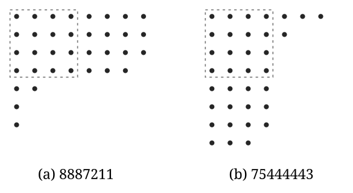
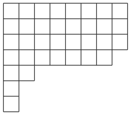
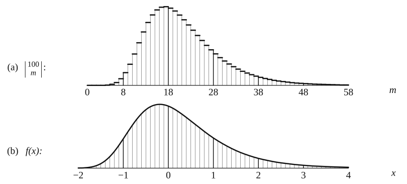
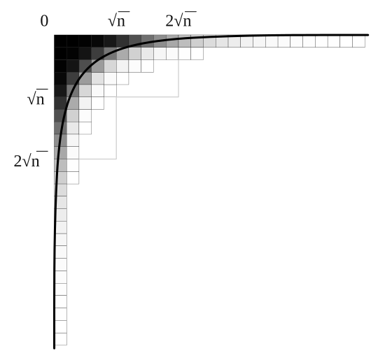
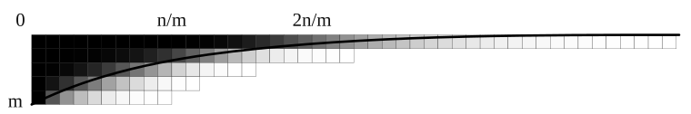
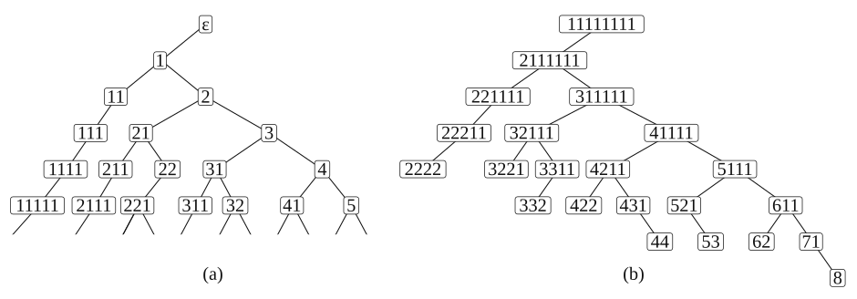
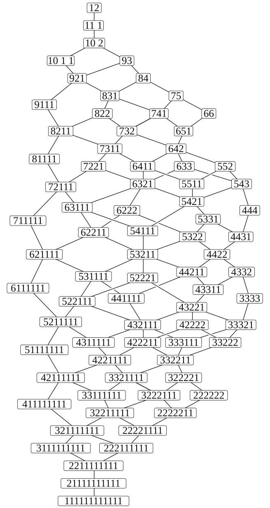

# 7.2.1.4　生成所有分划

理查德·斯坦利在其杰作 *Enumerative Combinatorics* (1986) 的开头, 首先基于吉安-卡洛·罗塔的一系列讲座, 讨论了 “十二类方式”(Twelvefold Way), 它是一张 $2\times2\times3$ 表格, 其中给出了一些在实践中经常遇到的基本组合问题 (见表 1). 要将给定数量的球放在给定数量的桶中, 会有不同数量的放置方式, 所有上述 12 类基本问题都可以用这些放置方式来描述. 例如, 如果球和桶均有标号, 则将 2 个球放到 3 个桶中的方式共有 9 种:

(桶内部的球序忽略不计.) 但如果这些球没有标号, 那其中一些放置方式是无差别的, 于是只存在 6 种不同方式:

(1)

如果这些桶不带标号, 那么像  和  这样的放置方式实际上是相同的, 于是, 原来的 9 种放置方式中仅有 2 种是有区别的. 如果要将 3 个带标号的球放入 3 个不带标号的桶中, 那么仅有的放置方式如下:

(2)

最后, 如果球和桶都没有标号, 那么这 5 种可能性就减少到仅有 3 种:

(3)

“十二类方式” 表中考虑了在球和桶有标记、无标记、对桶中球数没有要求、要求至少有一个球、要求最多有一个球等组合情况下的所有可能放置方式.

表 1　十二类方式

<table style="white-space:nowrap;">
<thead>
<tr>
<th scope="col">每个桶中的球数</th>
<th scope="col">无限制</th>
<th scope="col">$\leq1$</th>
<th scope="col">$\geq1$</th>
</tr>
</thead>
<tbody>
<tr>
<th scope="row">$n$ 个有标记球 $m$ 个有标记桶</th>
<td>$m$ 个事物的 $n$ 元组</td>
<td>$m$ 个事物的 $n$ 排列</td>
<td>$\{1,\ldots,n\}$ 的分划 分为 $m$ 个有序部分</td>
</tr>
<tr>
<th scope="row">$n$ 个无标记球 $m$ 个有标记桶</th>
<td>$m$ 个事物的 $n$ 多重组合</td>
<td>$m$ 个事物的 $n$ 组合</td>
<td>$n$ 的组分 分为 $m$ 个部分</td>
</tr>
<tr>
<th scope="row">$n$ 个有标记球 $m$ 个无标记桶</th>
<td>$\{1,\ldots,n\}$ 的分划 分为 $\leq m$ 个部分</td>
<td>$n$ 只鸽子 放入 $m$ 个笼中</td>
<td>$\{1,\ldots,n\}$ 的分划 分为 $m$ 个部分</td>
</tr>
<tr>
<th scope="row">$n$ 个无标记球 $m$ 个无标记桶</th>
<td>$n$ 的分划 分为 $\leq m$ 个部分</td>
<td>$n$ 只鸽子 放入 $m$ 个笼中</td>
<td>$n$ 的分划 分为 $m$ 个部分</td>
</tr>
</tbody>
</table>

我们已经在本章前面几节学习了 $n$ 元组、排列、组合和组分. 在表 1 的十二项中, 有两项的价值不高 (也就是与 “鸽子” 有关的那两项), 所以在学习表中其余五项之后, 就能完成对经典组合数学的学习了, 这五项均与分划有关.

> 我们首先要承认, “分划” 一词在数学上有许多含义.  
> 只要将某个对象划分为一些子对象, 这个词就会蹦出来.
>
> ——乔治·安德鲁斯,*The Theory of Partitions* (1976)

两个有着很大区别的概念却共用着同一个名字:**集合分划**是指将一个集合划分为不相交的非空子集的方式. 因此, (2) 就是以图形方式给出了 $\{1,2,3\}$ 的 5 种分划, 即

$$
\{1,2,3\},\qquad\{1,2\}\{3\},\qquad\{1,3\}\{2\},\qquad\{1\}\{2,3\},\qquad\{1\}\{2\}\{3\}.\tag{4}
$$

**整数分划**是指将一个整数写为一组正整数之和的方式 (不考虑这些正整数的顺序). 因此, (3) 以图形方式给出了 3 的 3 个分划, 即

$$
3,\qquad2+1,\qquad1+1+1.\tag{5}
$$

为了更清晰地区分这两个概念, 我们将遵循如下约定: 整数分划就称为 “分划”, 不加限定形容词; 而另一分划概念将称为 “集合分划”. 这两种分划都非常重要, 下面逐一进行研究.

**生成整数的所有分划.** $n$ 的分划可正式定义为: 一个非负整数序列 $a_1\geq a_2\geq\cdots$, 满足 $n=a_1+a_2+\cdots$. 例如, 7 的一个分划为 $a_1=a_2=3$, $a_3=1$, 而 $a_4=a_5=\cdots=0$. 非零项的个数称为部分的个数, 而等于零的各项通常被隐去. 因此, 为节省空间, 当上下文非常清晰时, 可以写为 $7=3+3+1$, 甚至写为 331.

要生成一个整数的所有分划, 最简单的方法, 也是最快速的方法之一是: 从 $n$ 开始, 按照逆字典序给出这些分划, 直到最后以 $11\ldots1$ 结束. 例如, 如果按照这种顺序排列的话, 8 的分划为

$$
\begin{aligned}
&8,\ 71,\ 62,\ 611,\ 53,\ 521,\ 5111,\ 44,\ 431,\ 422,\ 4211,\ 41111,\ 332,\ 3311,\\
&3221,\ 32111,\ 311111,\ 2222,\ 22211,\ 221111,\ 2111111,\ 11111111.
\end{aligned}\tag{6}
$$

如果一个分划不全为 1, 那么它的末尾就是在 $(x+1)$ 之后跟有 0 个或多个 1 (其中 $x$ 为某一不小于 1 的整数). 那么, 要得到逆字典序中的下一分划, 只需将后缀 $(x+1)1\ldots1$ 用 $x\ldots xr$ 代替即可, 其中 $r$ 是某一不大于 $x$ 的适当余项. 如果我们一直跟踪满足 $a_q\ne1$ 的最大下标 $q$ (此方法由约翰·麦凯提出 [*CACM* **13** (1970), 52]), 并在数串的最后补上若干个 1 (由安托万·佐格比和伊万·斯托伊梅诺维奇提出 [*International Journal of Computer Math.* **70** (1998), 319–332]), 那么上述方法是非常高效的.

**算法 P (按照逆字典序的分划).** 给定整数 $n\geq1$, 本算法生成所有分划 $a_1\geq a_2\geq\cdots\geq a_m\geq1$, 其中 $a_1+a_2+\cdots+a_m=n$, $1\leq m\leq n$. $a_0$ 的值也被置为 0.

**P1.** [初始化.] 对于 $n\geq m>1$, 置 $a_m\leftarrow1$, 然后置 $m\leftarrow1$, $a_0\leftarrow0$.

**P2.** [存储最终部分.] 置 $a_m\leftarrow n$, $q\leftarrow m-[n=1]$.

**P3.** [访问.] 访问分划 $a_1a_2\ldots a_m$. 如果 $a_q\ne2$, 则转到 P5.

**P4.** [将 2 改为 1+1.] 置 $a_q\leftarrow1$, $q\leftarrow q-1$, $m\leftarrow m+1$, 然后返回 P3. (此时, 对于 $q<k\leq n$, 有 $a_k=1$.)

**P5.** [$a_q$ 减 1.] 如果 $q=0$, 则终止本算法. 否则, 置 $x\leftarrow a_q-1$, $a_q\leftarrow x$, $n\leftarrow m-q+1$, $m\leftarrow q+1$.

**P6.** [必要时复制 $x$.] 如果 $n\leq x$, 则返回 P2. 否则, 置 $a_m\leftarrow x$, $m\leftarrow m+1$, $n\leftarrow n-x$, 然后重复本步骤. ▮

注意, 当一个分划包含 2 时, 可以很轻松地从此分划转入下一分划. 步骤 P4 只是将最右侧的 2 改为 1, 并在右侧另外追加一个 1. 非常幸运, 这种让人开心的情景是最常见的情况. 例如, 当 $n=100$ 时, 将近 79%的分划是包含 2 的.

如果要将整数 $n$ 划分为固定数目的组成部分, 那还有另外一种简单算法可以给出所有这些分划. 以下方法在卡尔·兴登堡 18 世纪的论文 [*Infinitinomii Dignitatum Exponentis Indeterminati* (Göttingen, 1779), 73–91] 中给出, 它按照反向字典序访问这些分划, 也就是按照反转序列 $a_m\ldots a_2a_1$ 的字典序.

**算法 H (分划为 $m$ 个部分).** 给定整数 $n\geq m\geq2$, 本算法生成所有满足 $a_1\geq\cdots\geq a_m\geq1$ 且 $a_1+\cdots+a_m=n$ 的整数 $m$ 元组 $a_1\ldots a_m$. $a_{m+1}$ 中存有一个旗标值.

**H1.** [初始化.] 置 $a_1\leftarrow n-m+1$, 对 $1<j\leq m$ 置 $a_j\leftarrow1$. 并置 $a_{m+1}\leftarrow-1$.

**H2.** [访问.] 访问分划 $a_1\ldots a_m$. 如果 $a_2\geq a_1-1$, 则转到 H4.

**H3.** [调整 $a_1$ 和 $a_2$.] 置 $a_1\leftarrow a_1-1$, $a_2\leftarrow a_2+1$, 然后返回 H2.

**H4.** [求 $j$.] 置 $j\leftarrow3$ 及 $s\leftarrow a_1+a_2-1$. 然后, 当 $a_j\geq a_1-1$ 时循环执行 $s\leftarrow s+a_j$ 及 $j\leftarrow j+1$. (现在, $s=a_1+\cdots+a_{j-1}-1$, $a_j<a_1-1$.)

**H5.** [$a_j$ 加 1.] 如果 $j>m$ 则结束. 否则, 置 $x\leftarrow a_j+1$, $a_j\leftarrow x$, $j\leftarrow j-1$.

**H6.** [调整 $a_1\ldots a_j$.] 当 $j>1$ 时循环执行 $a_j\leftarrow x$, $s\leftarrow s-x$, $j\leftarrow j-1$. 最后, 置 $a_1\leftarrow s$ 并返回 H2. ▮

例如, 当 $n=11$ 和 $m=4$ 时, 所访问的连续分划为

$$
8111,\ 7211,\ 6311,\ 5411,\ 6221,\ 5321,\ 4421,\ 4331,\ 5222,\ 4322,\ 3332.\tag{7}
$$

此算法的基本思想是, 给定一个分划 $a_1\ldots a_m$, 找出符合以下条件的最小 $j$, 即在将 $a_j$ 加 1 时不会改变 $a_{j+1}\ldots a_m$, 这样可转入根据反向字典序排列的下一分划. 在新的分划 $a'_1\ldots a'_m$ 中, 有 $a'_1\geq\cdots\geq a'_j=a_j+1$, $a'_1+\cdots+a'_j=a_1+\cdots+a_j$, 当且仅当 $a_j<a_1-1$ 时可实现这些条件. 此外, 根据反向字典序, 在最小的此种分划中, 有 $a'_2=\cdots=a'_j=a_j+1$.

步骤 H3 处理了简单情景 $j=2$, 它远比其他情景常见. 实际上, $j$ 值几乎总是非常小的; 后面将会证明: 算法 H 的总运行时间最多等于所访问分划的数目乘以一个小常数, 再加上 $O(m)$.

**分划的其他表示方式.** 我们已经将分划定义为一个由非负整数组成的序列 $a_1a_2\ldots$, 其中 $a_1\geq a_2\geq\cdots$, $a_1+a_2+\cdots=n$, 不过, 还可以将它表示为一个由非负整数 $c_1c_2\ldots c_n$ 组成的 $n$ 元组, 这些非负整数满足

$$
c_1+2c_2+\cdots+nc_n=n.\tag{8}
$$

其中, $c_j$ 是整数 $j$ 在序列 $a_1a_2\ldots$ 中的出现次数. 例如, 分划 331 对应于如下各出现次数: $c_1=1$, $c_2=0$, $c_3=2$, $c_4=c_5=c_6=c_7=0$. 于是, 此分划共有 $c_1+c_2+\cdots+c_n$ 个部分. 可以很轻松地设计一个与算法 P 类似的过程, 用来生成采用 “部分计数” 形式的分划; 见习题 5.

我们已经在诸如式 1.2.9–(38) 中看到过隐含的 “部分计数” 表示法, 该式将对称函数

$$
h_n=\sum_{N\geq d_n\geq\cdots\geq d_2\geq d_1\geq1}x_{d_1}x_{d_2}\cdots x_{d_n}\tag{9}
$$

表示为

$$
\sum_{\substack{c_1,c_2,\ldots,c_n\geq0\\c_1+2c_2+\cdots+nc_n=n}}
\frac{S_1^{c_1}}{1^{c_1}c_1!}\frac{S_2^{c_2}}{2^{c_2}c_2!}\cdots\frac{S_n^{c_n}}{n^{c_n}c_n!},\tag{10}
$$

式中, $S_j$ 是对称函数 $x_1^j+x_2^j+\cdots+x_N^j$. (9) 是针对 $N$ 件事物的所有 $n$ 多重组合进行求和, 而 (10) 则是针对 $n$ 的所有分划求和. 例如, $h_3=\frac16S_1^3+\frac12S_1S_2+\frac13S_3$, 当 $N=2$ 时, 有

$$
x^3+x^2y+xy^2+y^3=\tfrac16(x+y)^3+\tfrac12(x+y)(x^2+y^2)+\tfrac13(x^3+y^3).
$$

在 1.2.5–21、1.2.9–10、1.2.9–11、1.2.10–12 等习题中给出了针对分划进行的其他求和. 由于这一原因, 分划在对称函数的研究中处于重要的核心地位, 而对称函数是数学中非常普遍的一类函数. [在理查德·斯坦利所著的 *Enumerative Combinatorics* **2** (1999) 一书中, 其第 7 章对对称函数理论的高阶内容进行了非常出色的介绍.]

我们可以采用一种颇具吸引力的方式，以可视形式来展示分划：考虑一个由 $n$ 个点组成的阵列，最上面的一行有 $a_1$ 个点，第二行有 $a_2$ 个点，以此类推。这种点阵排列形式称为分划的费勒斯图，它以诺曼·费勒斯命名［见 *Philosophical Mag.* (4) **5** (1853), 199–202］。图中最大的方形子点阵称为德菲方块，以威廉·德菲命名［见 *Johns Hopkins Univ. Circular* **2** (1882年12月), 23］。例如，图48(a)中给出了8887211的费勒斯图，其中有它的 $4\times4$ 德菲方块。这个德菲方块中包含 $k^2$ 个点，其中的 $k$ 是满足 $a_k\geq k$ 的最大下标；我们可以将 $k$ 称为这个分划的迹。

图 48　两个共轭分划的费勒斯图和德菲方块

如果 $\alpha$ 是任意分划 $a_1a_2\ldots$, 可以通过转置它的费勒斯图 (即, 沿主对角线反转该图), 得到其共轭 $\alpha^T=b_1b_2\ldots$. 例如, 图 48(b) 显示 $(8887211)^T=75444443$. 当 $\beta=\alpha^T$ 时, 显然有 $\alpha=\beta^T$; 分划 $\beta$ 有 $a_1$ 个部分, 而 $\alpha$ 有 $b_1$ 个部分. 实际上, $\alpha$ 的 “部分计数” 表示 $c_1\ldots c_n$ 与共轭分划 $b_1b_2\ldots$ 之间存在一种非常简单的关系, 即

$$
\text{对于所有 }j\geq1,\qquad b_j-b_{j+1}=c_j.\tag{11}
$$

利用这一关系, 很容易计算出一个给定分划的共轭, 或者仅通过观察即可写出它 (见习题 6).

共轭的概念经常可以用来解释分划的一些性质, 如果没有共轭概念, 这些性质可能显得非常神秘. 例如, 既然我们已经知道了 $\alpha^T$ 的定义, 很容易就能看出, 在算法 H 的步骤 H5 中, 如果 $m<n$, $j-1$ 的值就是共轭分划 $(a_1\ldots a_m)^T$ 的第二小部分. 因此, 对于一个最大部分为 $m$ 的随机分划, 在步骤 H4 和 H6 中完成的平均工作量大体与此分划第二小部分的平均大小成正比. 下面将会看到, 这个第二小的部分几乎总是非常小的.

此外,**算法 H 是按照共轭分划的字典序来生成各分划的**. 例如, (7) 的各个共轭是

$$
\begin{aligned}
&41111111,\ 4211111,\ 422111,\ 42221,\ 431111,\\
&43211,\ 4322,\ 4331,\ 44111,\ 4421,\ 443;
\end{aligned}\tag{12}
$$

它们是 $n=11$ 的一些分划, 最大部分为 4. 要生成 $n$ 的所有分划, 一种方法是从平凡分划 $n$ 入手, 然后对于 $m=2,3,\ldots,n$ 依次运行算法 H; 这一过程将按照 $\alpha^T$ 的字典序生成所有 $\alpha$ (见习题 7). 因此, 算法 H 可看作是算法 P 的对偶.

至少还有另外一种非常有用的分划表示方法, 称为边缘表示 [见斯蒂格·科梅,*Numer. Math.* **1** (1959), 90–109]. 假设我们将费勒斯图中的点用方格代替, 于是得到一个表格形状, 与 5.1.4 节中一样. 例如, 图 48(a) 中的分划 8887211 变为

(13)

这一形状的右侧边界可以看作是一条长度为 $2n$ 的路径, 始于 $n\times n$ 方块的左下角, 终于该方块的右上角, 由表 7.2.1.3–1 可知, 这样一条路径对应于一个 $(n,n)$ 组合.

例如, (13) 对应于共有 70 位的二进制串

$$
0\ldots01001011111010001\ldots1=0^{28}1^10^21^10^11^50^11^10^31^{27},\tag{14}
$$

式中, 我们在开头放置了足够多的 0, 在末尾放了足够多的 1, 以确保 0 和 1 的个数都恰好为 $n$. 0 表示路径中的向上台阶, 1 表示向右的台阶. 容易看出, 以这种方式定义的二进制串恰好有 $n$ 个反序; 反之, 在多重集 $\{n\cdot0,n\cdot1\}$ 的排列中, 每个恰有 $n$ 个反序的排列都对应于 $n$ 的一个分划. 当一个分划中不同部分的个数等于 $t$ 时, 它的二进制串可以写为

$$
0^{n-q_1-q_2-\cdots-q_t}1^{p_1}0^{q_1}1^{p_2}0^{q_2}\ldots 1^{p_t}0^{q_t}1^{n-p_1-p_2-\cdots-p_t},\tag{15}
$$

式中的指数 $p_j$ 和 $q_j$ 为正整数. 于是, 该分划的标准表示就是

$$
a_1a_2\ldots=(p_1+\cdots+p_t)^{q_t}(p_1+\cdots+p_{t-1})^{q_{t-1}}\ldots(p_1)^{q_1},\tag{16}
$$

在我们的例子中, 就是 $(1+1+5+1)^3(1+1+5)^1(1+1)^1(1)^2=8887211$.

**分划的个数.** 菲利普·诺代于 1740 年曾经向欧拉提出过一个问题, 欧拉受这一问题的启发, 撰写了两篇具有奠基意义的论文. 在这两篇论文中, 他通过研究分划的生成函数, 计算了各种分划的数目 [*Commentarii Academiæ Scientiarum Petropolitanæ* **13** (1741), 64–93;*Novi Comment. Acad. Sci. Pet.* **3** (1750), 125–169]. 他观察到, 在无穷乘积

$$
(1+z+z^2+\cdots+z^j+\cdots)(1+z^2+z^4+\cdots+z^{2k}+\cdots)(1+z^3+z^6+\cdots+z^{3l}+\cdots)\ldots
$$

中, $z^n$ 的系数就是方程 $j+2k+3l+\cdots=n$ 的非负整数解的个数; 而 $1+z^m+z^{2m}+\cdots$ 等于 $1/(1-z^m)$. 因此, 如果记为

$$
P(z)=\prod_{m=1}^\infty\frac1{1-z^m}=\sum_{n=0}^\infty p(n)z^n,\tag{17}
$$

$n$ 的分划个数就是 $p(n)$. 后来发现, 这个函数 $P(z)$ 有许多非常精妙的数学性质.

例如, 欧拉发现, 在将 $P(z)$ 分母中的乘式展开后, 会消去很多项:

$$
\begin{aligned}
(1-z)(1-z^2)(1-z^3)\ldots
 &=1-z-z^2+z^5+z^7-z^{12}-z^{15}+z^{22}+z^{26}-\cdots\\
 &=\sum_{-\infty<n<\infty}(-1)^n z^{(3n^2+n)/2}.
\end{aligned}\tag{18}
$$

对于这个著名的恒等式, 在习题 5.1.1–14 中给出了一种基于费勒斯图的组合证明. 雅可比在 1829 年发表了一个可能更为著名的恒等式:

$$
\prod_{k=1}^\infty(1-u^kv^{k-1})(1-u^{k-1}v^k)(1-u^kv^k)
=\sum_{n=-\infty}^{\infty}(-1)^n u^{\binom n2}v^{\binom{-n}2},\tag{19}
$$

其中设定 $u=z$ 和 $v=z^2$ 即可证明欧拉的恒等式, 这是因为雅可比恒等式的左侧变为了 $\prod_{k=1}^\infty(1-z^{3k-2})(1-z^{3k-1})(1-z^{3k})$; 见习题 5.1.1–20. 欧拉指出, 根据式 (18), $n>0$ 的分划数满足这个不同寻常的递推关系

$$
p(n)=p(n-1)+p(n-2)-p(n-5)-p(n-7)+p(n-12)+p(n-15)-\cdots,\tag{20}
$$

其中, 当 $k<0$ 时 $p(k)=0$. 利用这一递推式计算它们的数值时, 速度要快于在 (17) 中计算幂级数:

<table style="text-align:right;white-space:nowrap;">
<thead>
<tr>
<th scope="col">$n=$</th>
<th scope="col">0</th>
<th scope="col">1</th>
<th scope="col">2</th>
<th scope="col">3</th>
<th scope="col">4</th>
<th scope="col">5</th>
<th scope="col">6</th>
<th scope="col">7</th>
<th scope="col">8</th>
<th scope="col">9</th>
<th scope="col">10</th>
<th scope="col">11</th>
<th scope="col">12</th>
<th scope="col">13</th>
<th scope="col">14</th>
<th scope="col">15</th>
</tr>
</thead>
<tbody>
<tr>
<th scope="row">$p(n)=$</th>
<td>1</td>
<td>1</td>
<td>2</td>
<td>3</td>
<td>5</td>
<td>7</td>
<td>11</td>
<td>15</td>
<td>22</td>
<td>30</td>
<td>42</td>
<td>56</td>
<td>77</td>
<td>101</td>
<td>135</td>
<td>176</td>
</tr>
</tbody>
</table>

由 1.2.8 节知道, 斐波那契递推式 $f(n)=f(n-1)+f(n-2)$ 的解是呈指数增长的, 当 $f(0)$ 和 $f(1)$ 为正数时, $f(n)=\Theta(\phi^n)$. 但是, (20) 中增加的两项 $-p(n-5)-p(n-7)$ 对分划数目有阻尼效果. 事实上, 如果我们在该处停止递推, 所得到的序列将会在正值和负值之间振荡. 而之后再增加的两项 $+p(n-12)+p(n-15)$ 又重新启动了指数增长.

$p(n)$ 的实际增长速率是 $A^{\sqrt n}/n$ 阶的, 其中 $A$ 是一特定常数. 例如, 习题 33 直接证明了 $p(n)$ 的增长速度至少与 $e^{2\sqrt n}/n$ 一样快. 有一个相当容易的方法可以获得一个很合适的上界, 那就是在 (17) 中取对数,

$$
\ln P(z)=\sum_{m=1}^\infty\ln\frac1{1-z^m}=\sum_{m=1}^\infty\sum_{n=1}^\infty\frac{z^{mn}}n,\tag{21}
$$

然后置 $z=e^{-t}$($t>0$), 以研究它在 $z=1$ 附近的特性:

$$
\ln P(e^{-t})=\sum_{m,n\geq1}\frac{e^{-mnt}}n
=\sum_{n\geq1}\frac1n\frac1{e^{tn}-1}<\sum_{n\geq1}\frac1{n^2t}=\frac{\zeta(2)}t.\tag{22}
$$

于是, 由于 $p(n)\leq p(n+1)<p(n+2)<\cdots$, $e^t>1$, 所以对于所有 $t>0$, 有

$$
\frac{p(n)}{1-e^{-t}}=\sum_{k=n}^\infty p(n)e^{(n-k)t}
<\sum_{k=0}^\infty p(k)e^{(n-k)t}=e^{nt}P(e^{-t})<e^{nt+\zeta(2)/t}.\tag{23}
$$

置 $t=\sqrt{\zeta(2)/n}$ 将得出

$$
p(n)<Ce^{2C\sqrt n}/\sqrt n,\qquad\text{式中 } C=\sqrt{\zeta(2)}=\pi/\sqrt6.\tag{24}
$$

利用欧拉求和公式 (1.2.11.2 节) 或梅林变换 (5.2.2 节), 可以得到关于 $\ln P(e^{-t})$ 的大小的更准确信息 (见习题 25). 但我们之前已经看过的方法都还不够强大, 不足以推导 $P(e^{-t})$ 的准确特性, 因此, 现在应该向我们的技能武器库里添加一件新武器了.

欧拉的生成函数 $P(z)$ 非常适合泊松求和公式 [*J. École Royale Polytechnique* **12** (1823), 404–509, §63]. 根据该公式, 只要 $f$ 是一个 “特性良好” 的函数, 即有

$$
\sum_{n=-\infty}^\infty f(n+\theta)
=\lim_{M\to\infty}\sum_{m=-M}^M e^{2\pi mi\theta}\int_{-\infty}^\infty e^{-2\pi miy}f(y)\,dy,\tag{25}
$$

此公式基于如下事实: 左侧是 $\theta$ 的一个周期函数, 右侧是将该函数展开为傅里叶级数. 比如, 如果函数 $f$ 满足 $\int_{-\infty}^\infty|f(y)|\,dy<\infty$, 并满足以下条件之一, 就说它是足够 “良好” 的:

(i) 对于某一 $\epsilon>0$ 和 $0\leq\Re\theta\leq1$ 以及每个 $n$, $f(n+\theta)$ 在区域 $|\Im\theta|\leq\epsilon$ 中是复变量 $\theta$ 的一个解析函数, 而且 (25) 的左侧对于 $|\Im\theta|\leq\epsilon$ 是一致收敛的; 或者

(ii) 对于所有实数 $\theta$, $f(\theta)=\frac12\lim_{\epsilon\to0}(f(\theta-\epsilon)+f(\theta+\epsilon))=g(\theta)-h(\theta)$, 其中 $g$ 和 $h$ 单调递增, 而且 $g(\pm\infty)$ 和 $h(\pm\infty)$ 是有限的.

[见彼得·亨里齐,*Applied and Computational Complex Analysis* **2** (New York: Wiley, 1977), 定理 10.6e.] 泊松公式不是万能钥匙, 并不适用于所有求和问题; 但当它确实适用时, 其结果可能是非常漂亮的, 后面将会看到这一点.

将欧拉公式 (18) 乘以 $z^{1/24}$, 使其右侧指数变为完全平方式

$$
\frac{z^{1/24}}{P(z)}=\sum_{n=-\infty}^{\infty}(-1)^n z^{\frac32(n+\frac16)^2}.\tag{26}
$$

于是, 对于所有 $t>0$, 有 $e^{-t/24}/P(e^{-t})=\sum_{n=-\infty}^\infty f(n)$, 其中

$$
f(y)=e^{-\frac32t(y+\frac16)^2+\pi iy};\tag{27}
$$

而且, 根据上述准则 (i) 和 (ii), 这个函数 $f$ 均满足泊松求和公式的条件. 因此, 我们尝试对 $e^{-2\pi miy}f(y)$ 积分, 事实上, 这个积分对于所有 $m$ 都是非常容易的 (见习题 27):

$$
\int_{-\infty}^\infty e^{-a(y+b)^2+2ciy}\,dy
=\sqrt{\frac\pi a}\,e^{-c^2/a-2bci},\qquad a>0.\tag{28}
$$

插入 (25) 中, 取 $\theta=0$, $a=\frac32t$, $b=\frac16$, $c=(\frac12-m)\pi$, 将得到

$$
\sum_{n=-\infty}^\infty f(n)=\sum_{m=-\infty}^\infty g(m),\qquad
g(m)=\sqrt{\frac{2\pi}{3t}}\,e^{-2(m-\frac12)^2\pi^2/(3t)+\frac{1-2m}{6}\pi i}.\tag{29}
$$

这些项将会非常优美地合并、抵消, 如习题 27 所示, 最终得出

$$
\frac{e^{-t/24}}{P(e^{-t})}
=\sqrt{\frac{2\pi}t}\sum_{n=-\infty}^\infty(-1)^ne^{-6\pi^2(n+\frac16)^2/t}
=\sqrt{\frac{2\pi}t}\frac{e^{-\zeta(2)/t}}{P(e^{-4\pi^2/t})}.\tag{30}
$$

太令人惊讶了! 我们已经证明了关于 $P(z)$ 的另一个著名事实.

**定理 D.** 当 $\Re t>0$ 时, 分划的生成函数 (17) 满足函数关系

$$
\ln P(e^{-t})=\frac{\zeta(2)}t+\frac12\ln\frac{t}{2\pi}-\frac{t}{24}+\ln P(e^{-4\pi^2/t}).\tag{31}
$$

▮

这个定理是理查德·戴德金 [*Crelle* **83** (1877), 265–292, §6] 发现的, 当 $z=e^{2\pi i\tau}$ 时, 他把函数 $z^{1/24}/P(z)$ 记为 $\eta(\tau)$. 他的证明是以关于椭圆函数的理论为基础的, 这个理论要复杂得多. 注意到, 当 $t$ 是一个小正数时, $\ln P(e^{-4\pi^2/t})$ 是非常非常小的. 例如, 当 $t=0.1$ 时, 可计算得出 $\exp(-4\pi^2/t)\approx3.5\times10^{-172}$. 因此, 当 $z$ 接近 1 时, 有关 $P(z)$ 值的所有信息, 几乎都可以由定理 D 获得.

哈代和拉马努金利用这一知识来推导 $p(n)$ 在 $n$ 很大时的渐近特性, 许多年之后, 汉斯·拉德马赫对他们的工作进行了扩展, 发现了一个不但具有渐近性质而且收敛的级数 [*Proc. London Math. Soc.* (2) **17** (1918), 75–115;**43** (1937), 241–254]. 关于 $p(n)$ 的哈代-拉马努金-拉德马赫公式无疑是人们迄今所发现的最令人惊讶的恒等式之一. 该公式如下:

$$
p(n)=\frac{\pi}{2^{5/4}3^{3/4}(n-1/24)^{3/4}}\sum_{k=1}^\infty
\frac{A_k(n)}{k}I_{3/2}\left(\sqrt{\frac23}\frac\pi k\sqrt{n-1/24}\right).\tag{32}
$$

这里的 $I_{3/2}$ 表示修正的球面贝塞尔函数

$$
I_{3/2}(z)=\left(\frac z2\right)^{3/2}\sum_{k=0}^\infty
\frac1{\Gamma(k+5/2)}\frac{(z^2/4)^k}{k!}
=\sqrt{\frac{2z}{\pi}}\left(\frac{\cosh z}{z}-\frac{\sinh z}{z^2}\right);\tag{33}
$$

系数 $A_k(n)$ 为

$$
A_k(n)=\sum_{h=0}^{k-1}[h\perp k]\exp\left(2\pi i\left(\frac{\sigma(h,k,0)}{24}-\frac{nh}k\right)\right),\tag{34}
$$

式中, $\sigma(h,k,0)$ 是在式 3.3.3–(16) 中定义的戴德金和. 我们有

$$
A_1(n)=1,\qquad A_2(n)=(-1)^n,\qquad A_3(n)=2\cos\frac{(24n+1)\pi}{18},\tag{35}
$$

一般情况下, $A_k(n)$ 介于 $-k$ 与 $k$ 之间.

如果讨论 (32) 的证明那就偏题太远了, 但其基本思想是使用 7.2.1.5 节讨论的 “鞍点方法”. $k=1$ 的项可以由 $P(z)$ 在 $z$ 接近 1 处的特性推导得出; 下一项由 $P(z)$ 在 $z$ 接近 $-1$ 处的特性推导得出, 其中可以应用一个类似于 (31) 的转换. 一般情况下, (32) 的第 $k$ 项考虑了 $P(z)$ 在 $z$ 趋近于 $e^{2\pi ih/k}$ 时的特性, 其中 $h/k$ 是分母为 $k$ 的不可约分数; 每个 $k$ 次单位根都是 $P(z)$ 的无穷乘积中每个因式 $1/(1-z^k)$, $1/(1-z^{2k})$, $1/(1-z^{3k})$, ……的一个极点.

如果只需要一个粗略的近似结果, 可以大幅简化 (32) 中的第一项:

$$
p(n)=\frac{e^{\pi\sqrt{2n/3}}}{4n\sqrt3}\bigl(1+O(n^{-1/2})\bigr).\tag{36}
$$

当然, 也可以选择保留更多细节,

$$
p(n)=\frac{e^{\pi\sqrt{2n'/3}}}{4n'\sqrt3}\left(1-\frac1\pi\sqrt{\frac3{2n'}}\right)
\bigl(1+O(e^{-\pi\sqrt{n/6}})\bigr),\qquad n'=n-\frac1{24}.\tag{37}
$$

例如, $p(100)$ 的精确值为 $190\,569\,292$. 式 (36) 告诉我们, $p(100)\approx1.993\times10^8$, 而 (37) 则给出一个好得多的估计值 $190\,568\,944.783$.

安德鲁·奥德里兹科已经观察到, 当 $n$ 很大时, 哈代-拉马努金-拉德马赫公式实际上给出了一种计算 $p(n)$ 准确值的近乎最优的方法, 因为这些算术运算可以在大约 $O(\log p(n))=O(n^{1/2})$ 个步骤中完成. [见 *Handbook of Combinatorics* **2** (MIT Press, 1995), 1068–1069.] (32) 的前面少数几项起决定作用; 级数的随后各项稳定在 $k^{-3/2}$ 阶, 通常为 $k^{-2}$ 阶. 此外, 大约一半系数 $A_k(n)$ 为零 (见习题 28). 例如, 当 $n=10^6$ 时, $k=1,2,3$ 的各项分别约等于 $1.47\times10^{1107}$, $1.23\times10^{550}$, $-1.23\times10^{364}$. 前 250 项之和约为 $1471684986\ldots73818.01$, 而准确值为 $1471684986\ldots73818$; 这 250 项中有 123 项为零.

**部分的个数.** 一种方便的做法是引入记号

$$
\begin{vmatrix}n\\m\end{vmatrix}\tag{38}
$$

来表示 $n$ 有多少个分划恰有 $m$ 个部分. 于是, 递推式

$$
\begin{vmatrix}n\\m\end{vmatrix}
=\begin{vmatrix}n-1\\m-1\end{vmatrix}+\begin{vmatrix}n-m\\m\end{vmatrix}\tag{39}
$$

对于所有整数 $m$ 和 $n$ 都是成立的, 因为 $\begin{vmatrix}n-1\\m-1\end{vmatrix}$ 计算了最小部分为 1 的分划个数, 而 $\begin{vmatrix}n-m\\m\end{vmatrix}$ 计算其他分划的个数. (如果最小的部分是 2 或更大, 则可以从每个部分减去 1, 得到将 $n-m$ 分解为 $m$ 个部分的一个分划.) 通过类似推理可得出结论: $\begin{vmatrix}m+n\\m\end{vmatrix}$ 是将 $n$ 分解为最多 $m$ 个部分的分划个数, 也就是说, 将 $n$ 分解为 $m$ 个非负的被加数之和. 通过转置费勒斯图, 还可以知道 $\begin{vmatrix}n\\m\end{vmatrix}$ 是 $n$ 的分划中最大部分为 $m$ 的分划数目. 因此, $\begin{vmatrix}n\\m\end{vmatrix}$ 是一个应当知道的好数字. 利用边界条件

$$
\begin{vmatrix}n\\0\end{vmatrix}=\delta_{n0}\qquad\text{和}\qquad
\text{对于 }m<0\text{ 或 }n<0\text{ 有 }\begin{vmatrix}n\\m\end{vmatrix}=0,\tag{40}
$$

可以轻松制作一个表格, 列出当 $n$ 和 $m$ 较小时的 $\begin{vmatrix}n\\m\end{vmatrix}$ 值, 于是, 我们得到一个数组, 它类似于之前看到的 $\binom nm$、$\begin{bmatrix}n\\m\end{bmatrix}$、$\begin{Bmatrix}n\\m\end{Bmatrix}$、$\left\langle\begin{matrix}n\\m\end{matrix}\right\rangle$ 数组, 都呈三角形, 见表 2. 生成函数为

$$
\sum_n\begin{vmatrix}n\\m\end{vmatrix}z^n
=\frac{z^m}{(1-z)(1-z^2)\ldots(1-z^m)}.\tag{41}
$$

表 2　分划数目

<table style="text-align:right;white-space:nowrap;">
<thead>
<tr>
<th scope="col">$n$</th>
<th scope="col">$\begin{vmatrix}n\\0\end{vmatrix}$</th>
<th scope="col">$\begin{vmatrix}n\\1\end{vmatrix}$</th>
<th scope="col">$\begin{vmatrix}n\\2\end{vmatrix}$</th>
<th scope="col">$\begin{vmatrix}n\\3\end{vmatrix}$</th>
<th scope="col">$\begin{vmatrix}n\\4\end{vmatrix}$</th>
<th scope="col">$\begin{vmatrix}n\\5\end{vmatrix}$</th>
<th scope="col">$\begin{vmatrix}n\\6\end{vmatrix}$</th>
<th scope="col">$\begin{vmatrix}n\\7\end{vmatrix}$</th>
<th scope="col">$\begin{vmatrix}n\\8\end{vmatrix}$</th>
<th scope="col">$\begin{vmatrix}n\\9\end{vmatrix}$</th>
<th scope="col">$\begin{vmatrix}n\\10\end{vmatrix}$</th>
<th scope="col">$\begin{vmatrix}n\\11\end{vmatrix}$</th>
</tr>
</thead>
<tbody>
<tr>
<th scope="row">0</th>
<td>1</td>
<td>0</td>
<td>0</td>
<td>0</td>
<td>0</td>
<td>0</td>
<td>0</td>
<td>0</td>
<td>0</td>
<td>0</td>
<td>0</td>
<td>0</td>
</tr>
<tr>
<th scope="row">1</th>
<td>0</td>
<td>1</td>
<td>0</td>
<td>0</td>
<td>0</td>
<td>0</td>
<td>0</td>
<td>0</td>
<td>0</td>
<td>0</td>
<td>0</td>
<td>0</td>
</tr>
<tr>
<th scope="row">2</th>
<td>0</td>
<td>1</td>
<td>1</td>
<td>0</td>
<td>0</td>
<td>0</td>
<td>0</td>
<td>0</td>
<td>0</td>
<td>0</td>
<td>0</td>
<td>0</td>
</tr>
<tr>
<th scope="row">3</th>
<td>0</td>
<td>1</td>
<td>1</td>
<td>1</td>
<td>0</td>
<td>0</td>
<td>0</td>
<td>0</td>
<td>0</td>
<td>0</td>
<td>0</td>
<td>0</td>
</tr>
<tr>
<th scope="row">4</th>
<td>0</td>
<td>1</td>
<td>2</td>
<td>1</td>
<td>1</td>
<td>0</td>
<td>0</td>
<td>0</td>
<td>0</td>
<td>0</td>
<td>0</td>
<td>0</td>
</tr>
<tr>
<th scope="row">5</th>
<td>0</td>
<td>1</td>
<td>2</td>
<td>2</td>
<td>1</td>
<td>1</td>
<td>0</td>
<td>0</td>
<td>0</td>
<td>0</td>
<td>0</td>
<td>0</td>
</tr>
<tr>
<th scope="row">6</th>
<td>0</td>
<td>1</td>
<td>3</td>
<td>3</td>
<td>2</td>
<td>1</td>
<td>1</td>
<td>0</td>
<td>0</td>
<td>0</td>
<td>0</td>
<td>0</td>
</tr>
<tr>
<th scope="row">7</th>
<td>0</td>
<td>1</td>
<td>3</td>
<td>4</td>
<td>3</td>
<td>2</td>
<td>1</td>
<td>1</td>
<td>0</td>
<td>0</td>
<td>0</td>
<td>0</td>
</tr>
<tr>
<th scope="row">8</th>
<td>0</td>
<td>1</td>
<td>4</td>
<td>5</td>
<td>5</td>
<td>3</td>
<td>2</td>
<td>1</td>
<td>1</td>
<td>0</td>
<td>0</td>
<td>0</td>
</tr>
<tr>
<th scope="row">9</th>
<td>0</td>
<td>1</td>
<td>4</td>
<td>7</td>
<td>6</td>
<td>5</td>
<td>3</td>
<td>2</td>
<td>1</td>
<td>1</td>
<td>0</td>
<td>0</td>
</tr>
<tr>
<th scope="row">10</th>
<td>0</td>
<td>1</td>
<td>5</td>
<td>8</td>
<td>9</td>
<td>7</td>
<td>5</td>
<td>3</td>
<td>2</td>
<td>1</td>
<td>1</td>
<td>0</td>
</tr>
<tr>
<th scope="row">11</th>
<td>0</td>
<td>1</td>
<td>5</td>
<td>10</td>
<td>11</td>
<td>10</td>
<td>7</td>
<td>5</td>
<td>3</td>
<td>2</td>
<td>1</td>
<td>1</td>
</tr>
</tbody>
</table>

$n$ 的几乎所有分划都具有 $\Theta(\sqrt n\log n)$ 个部分. 这一事实是由爱尔特希和约瑟夫·莱纳 [*Duke Math. J.* **8** (1941), 335–345] 发现的, 它有一个非常直观的证明方法.

**定理 E.** 令 $C=\pi/\sqrt6$, $m=\frac1{2C}\sqrt n\ln n+x\sqrt n+O(1)$. 则对于所有 $\epsilon>0$ 和所有固定的 $x$, 当 $n\to\infty$ 时,

$$
\frac1{p(n)}\begin{vmatrix}m+n\\m\end{vmatrix}=F(x)\bigl(1+O(n^{-1/2+\epsilon})\bigr),\tag{42}
$$

其中

$$
F(x)=e^{-e^{-Cx}/C}.\tag{43}
$$

当 $x\to-\infty$ 时, 式 (43) 中的函数 $F(x)$ 非常快速地趋近于 0; 当 $x\to+\infty$ 时, 非常快速地增加到 1. 因此, 它是一个概率分布函数. 图 49(b) 表明, 相应的密度函数 $f(x)=F'(x)$ 主要集中在区域 $-2\leq x\leq4$. (见习题 35.)

图 49(a) 给出了当 $n=100$ 时的 $\begin{vmatrix}n\\m\end{vmatrix}=\begin{vmatrix}m+n\\m\end{vmatrix}-\begin{vmatrix}m-1+n\\m-1\end{vmatrix}$ 值, 此时 $\frac1{2C}\sqrt n\ln n\approx18$.

图 49　具有 $m$ 个部分的 $n$ 的分划, (a) $n=100$; (b) $n\to\infty$ (见定理 E)

**证明.** 证明中将用到以下事实: $\begin{vmatrix}m+n\\m\end{vmatrix}$ 是 $n$ 的分划中最大部分 $\leq m$ 的分划数. 于是, 根据容斥原理, 式 1.3.3–(29), 得

$$
\begin{vmatrix}m+n\\m\end{vmatrix}=p(n)-\sum_{j>m}p(n-j)+\sum_{j_2>j_1>m}p(n-j_1-j_2)
-\sum_{j_3>j_2>j_1>m}p(n-j_1-j_2-j_3)+\cdots,
$$

这是因为, $p(n-j_1-\cdots-j_r)$ 表示在 $n$ 的分划中, 有多少个分划将 $\{j_1,\ldots,j_r\}$ 等部分都至少使用了一次. 将其记为

$$
\frac1{p(n)}\begin{vmatrix}m+n\\m\end{vmatrix}=1-\Sigma_1+\Sigma_2-\Sigma_3+\cdots,\qquad
\Sigma_r=\sum_{j_r>\cdots>j_1>m}\frac{p(n-j_1-\cdots-j_r)}{p(n)}.\tag{44}
$$

为计算 $\Sigma_r$, 需要获得比值 $p(n-t)/p(n)$ 的一个准确估计值. 我们很幸运, 因为由式 (36) 可以得出

$$
\begin{aligned}
\frac{p(n-t)}{p(n)}&=\exp\bigl(2C\sqrt{n-t}-\ln(n-t)+O\bigl((n-t)^{-1/2}\bigr)-2C\sqrt n+\ln n\bigr)\\
&=\exp\bigl(-Ctn^{-1/2}+O(n^{-1/2+2\epsilon})\bigr),\qquad 0\leq t\leq n^{1/2+\epsilon}.
\end{aligned}\tag{45}
$$

另外, 如果 $t\geq n^{1/2+\epsilon}$, 则有 $p(n-t)/p(n)\leq p(n-n^{1/2+\epsilon})/p(n)\approx\exp(-Cn^\epsilon)$, 这个值渐近小于 $n$ 的任何次幂. 因此, 对于 $t\geq0$ 的所有值, 我们可以放心地使用近似值

$$
\frac{p(n-t)}{p(n)}\approx\alpha^t,\qquad \alpha=\exp(-Cn^{-1/2}),\tag{46}
$$

例如, 可以得出

$$
\begin{aligned}
\Sigma_1=\sum_{j>m}\frac{p(n-j)}{p(n)}&=\frac{\alpha^{m+1}}{1-\alpha}\bigl(1+O(n^{-1/2+2\epsilon})\bigr)+\sum_{n\geq j>n^{1/2+\epsilon}}\frac{p(n-j)}{p(n)}\\
&=\frac{e^{-Cx}}C\bigl(1+O(n^{-1/2+2\epsilon})\bigr)+O(ne^{-Cn^\epsilon}),
\end{aligned}
$$

因为 $\alpha/(1-\alpha)=n^{1/2}/C+O(1)$, $\alpha^m=n^{-1/2}e^{-Cx}+O(n^{-1})$. 同理可证 (见习题 36), 如果 $r=O(\log n)$, 则

$$
\Sigma_r=\frac{e^{-Crx}}{C^r r!}\bigl(1+O(n^{-1/2+2\epsilon})\bigr)+O(e^{-n^{\epsilon/2}}).\tag{47}
$$

最后 (这也是容斥原理普遍具有的一个极佳性质), (44) 的部分和总是将真实值 “括在其中”, 也就是说, 对于所有 $r$,

$$
1-\Sigma_1+\Sigma_2-\cdots-\Sigma_{2r-1}\leq
\frac1{p(n)}\begin{vmatrix}m+n\\m\end{vmatrix}\leq
1-\Sigma_1+\Sigma_2-\cdots-\Sigma_{2r-1}+\Sigma_{2r}.\tag{48}
$$

(见习题 37.) 当 $2r$ 接近 $\ln n$, 并且 $n$ 很大时, $\Sigma_{2r}$ 项是非常小的, 于是得到式 (42), 只是用 $2\epsilon$ 代替了 $\epsilon$. ▮

定理 E 告诉我们, 一个随机分划的最大部分几乎总是 $\frac1{2C}\sqrt n\ln n+O(\sqrt n\log\log\log n)$. 当 $n$ 适当大时, 其他部分也趋向于可预测. 例如, 假设我们取得 25 的所有分划, 将它们的费勒斯图叠加在一起, 和边缘表示中一样, 将点改为方格. 哪些方格被占用的频率最高呢? 图 50 给出了结果: 一个随机分划倾向于某一典型形状, 该形状渐近于 $n\to\infty$ 时的极限曲线.

图 50　关于随机分划的极限形状的坦珀利曲线 (49)

哈罗德·坦珀利 [*Proc. Cambridge Philos. Soc.* **48** (1952), 683–697] 给出了一些试探性的理由, 相信一个大型随机分划 $a_1\ldots a_m$ 的大多数部分 $a_k$ 将满足近似定律

$$
e^{-Ck/\sqrt n}+e^{-Ca_k/\sqrt n}\approx1,\tag{49}
$$

他的公式后来得到了一种有力的验证. 例如, 鲍里斯·皮特尔 [*Advances in Applied Math.* **18** (1997), 432–488] 的定理可以让我们得出结论: 一个随机分划的迹几乎总是 $\frac{\ln2}C\sqrt n\approx0.54\sqrt n$, 与 (49) 一致, 误差最多为 $O(\sqrt n\ln n)^{1/2}$. 因此, 在所有的费勒斯点中, 大约有 29%位于德菲方块中.

另一方面, 如果我们仅研究 $n$ 的那些具有 $m$ 个部分的分划 (这里的 $m$ 是固定的), 那么极限形状会有显著的不同. 如果 $m$ 和 $n$ 适当大, 那么几乎所有此类分划都有

$$
a_k\approx\frac nm\ln\frac mk,\tag{50}
$$

图 51 显示了 $n=50$、$m=5$ 的情景. 事实上, 当 $m$ 随 $n$ 增大时, 只要 $m$ 的增长速率低于 $\sqrt n$, 同一极限仍然成立 [见阿纳托利·韦尔申斯科和尤里·雅库博维奇,*Moscow Math. J.* **1** (2001), 457–468].

图 51　存在 $m$ 个部分时的极限形状 (50)

分划的边缘表示法为我们提供了有关双重有界分划的更多信息, 也就是说, 我们不仅限制部分的个数, 还限制每个部分的大小. 一个最多有 $m$ 个部分、每个部分最大为 $l$ 的分划, 可以放在一个 $m\times l$ 的方格中. 所有这些分划都对应于多重集 $\{m\cdot0,l\cdot1\}$ 的一些排列, 这些排列恰有 $n$ 个反序. 我们已经在习题 5.1.2–16 中研究了多重集的排列的反序. 具体来说, 这道习题推导了一个不那么显而易见的公式, 说明 $n$ 个反序可能有多少种出现方式.

**定理 C.** 在 $n$ 的分划中, 最多有 $m$ 个部分、每个部分不大于 $l$ 的分划个数是

$$
[z^n]\binom{l+m}{m}_z=[z^n]\frac{(1-z^{l+1})}{(1-z)}\frac{(1-z^{l+2})}{(1-z^2)}\cdots\frac{(1-z^{l+m})}{(1-z^m)}.\tag{51}
$$

此结果由柯西给出, 见 *Comptes Rendus Acad. Sci.* **17** (Paris, 1843), 523–531. 注意, 当 $l\to\infty$ 时, 分子就是 1 了. 在习题 40 中, 对于更具一般性的结果给出了一种很有意思的组合证明. ▮

**算法分析.** 现在, 我们已经掌握了足够多的分划量化知识, 足以非常精确地推导算法 P 的特性了. 假设算法的 P1, ……, P6 等步骤分别执行 $T_1(n),\ldots,T_6(n)$ 次, 显然有 $T_1(n)=1$, $T_3(n)=p(n)$. 此外, 基尔霍夫定律告诉我们, $T_2(n)=T_5(n)$, $T_4(n)+T_5(n)=T_3(n)$. 对于每个包含 2 的分划, 都会到达步骤 P4 一次, 这显然是 $p(n-2)$ 次.

因此, 关于算法 P 的运行时间, 唯一可能不太清楚的地方就是步骤 P6 必须执行多少次, 它会循环执行自己. 不过, 稍加思考就会发现, 只有在步骤 P2 中, 或者当我们马上就要在 P6 中检测是否有 $n\leq x$ 时, 此算法才会将一个大于等于 2 的值存储在数组 $a_1a_2\ldots$ 中. 所有这样的值最终都会减小 1, 或是在步骤 P4 中, 或是在步骤 P5 中. 于是,

$$
T''_2(n)+T_6(n)=p(n)-1,\tag{52}
$$

式中, $T''_2(n)$ 表示步骤 P2 有多少次将 $a_m$ 设定为一个大于等于 2 的值. 令 $T_2(n)=T'_2(n)+T''_2(n)$, 于是 $T'_2(n)$ 就是步骤 P2 置 $a_m\leftarrow1$ 的次数. 于是, $T'_2(n)+T_4(n)$ 就是以 1 结尾的分划个数, 因此,

$$
T'_2(n)+T_4(n)=p(n-1).\tag{53}
$$

啊哈! 我们已经找到足够多的方程了, 可以确定所需要的所有量了:

$$
\begin{aligned}
(T_1(n),\ldots,T_6(n))&=\\[-3pt]
&\quad(1,\ p(n)-p(n-2),\ p(n),\ p(n-2),\ p(n)-p(n-2),\ p(n-1)-1).
\end{aligned}\tag{54}
$$

由 $p(n)$ 的渐近特性还可以知道, 每个分划的平均计算量为

$$
\left(\frac{T_1(n)}{p(n)},\ldots,\frac{T_6(n)}{p(n)}\right)
=\left(0,\frac{2C}{\sqrt n},1,1-\frac{2C}{\sqrt n},\frac{2C}{\sqrt n},1-\frac C{\sqrt n}\right)
+O\left(\frac1n\right),\tag{55}
$$

式中, $C=\pi/\sqrt6\approx1.283$. (见习题 45.) 于是, 每个分划的总内存访问次数只有 $3+C/\sqrt n+O(1/n)$.

> 无论是谁要生成所有分划,  
> 都要投入繁苦的劳作,  
> 还要忍受痛苦, 保持全神贯注,  
> 以免遭受严重误导.
>
> ——莱昂哈德·欧拉,*De Partitione Numerorum* (1750)

算法 H 的分析要更难一些, 但我们至少可以证明, 它的运行时间有一个相当不错的上限. 起关键作用的量是 $j$ 的值, 它是满足 $a_j<a_1-1$ 的最小下标. 当 $m=4$ 且 $n=11$ 时, $j$ 的连续值为 $(2,2,2,3,2,2,3,4,2,3,5)$. 我们已经观察到, 当 $b_1\ldots b_l$ 是共轭分划 $(a_1\ldots a_m)^T$ 且 $m<n$ 时, $j=b_{l-1}+1$. (见 (7) 和 (12).) 步骤 H3 单独挑选出 $j=2$ 的情景, 因为这种情景不仅是最常见的, 它的处理还特别容易.

设 $c_m(n)$ 是 $j-1$ 的累积总值, 是对算法 H 生成的 $\begin{vmatrix}n\\m\end{vmatrix}$ 个分划进行求和所得到的. 例如, $c_4(11)=1+1+1+2+1+1+2+3+1+2+4=19$. 可以将 $c_m(n)/\begin{vmatrix}n\\m\end{vmatrix}$ 看作每个分划的运行时间的良好指标, 这是因为, 步骤 H4 和 H6 的执行成本最高, 而它们的运行时间大致与 $j-2$ 成正比. 这个比值 $c_m(n)/\begin{vmatrix}n\\m\end{vmatrix}$ 是无界的, 因为当 $\begin{vmatrix}m\\m\end{vmatrix}=1$ 时, 有 $c_m(m)=m$. 但下面的定理表明, 算法 H 是高效的.

**定理 H.** 算法 H 的 $c_m(n)$ 成本度量最多为 $3\begin{vmatrix}n\\m\end{vmatrix}+m$.

**证明.** 容易验证, 如果人为地定义 $1\leq n<m$ 时有 $c_m(n)=1$, 则 $c_m(n)$ 与 $\begin{vmatrix}n\\m\end{vmatrix}$ 满足同一递推式, 即

$$
c_m(n)=c_{m-1}(n-1)+c_m(n-m),\qquad m,n\geq1,\tag{56}
$$

见式 (39). 但现在的边界条件不一样了:

$$
c_m(0)=[m>0];\qquad c_0(n)=0.\tag{57}
$$

表 3 显示了 $c_m(n)$ 在 $m$ 和 $n$ 很小时的表现特性.

表 3　算法 H 的成本

<table style="text-align:right;white-space:nowrap;">
<thead>
<tr>
<th scope="col">$n$</th>
<th scope="col">$c_{0}(n)$</th>
<th scope="col">$c_{1}(n)$</th>
<th scope="col">$c_{2}(n)$</th>
<th scope="col">$c_{3}(n)$</th>
<th scope="col">$c_{4}(n)$</th>
<th scope="col">$c_{5}(n)$</th>
<th scope="col">$c_{6}(n)$</th>
<th scope="col">$c_{7}(n)$</th>
<th scope="col">$c_{8}(n)$</th>
<th scope="col">$c_{9}(n)$</th>
<th scope="col">$c_{10}(n)$</th>
<th scope="col">$c_{11}(n)$</th>
</tr>
</thead>
<tbody>
<tr>
<th scope="row">0</th>
<td>0</td>
<td>1</td>
<td>1</td>
<td>1</td>
<td>1</td>
<td>1</td>
<td>1</td>
<td>1</td>
<td>1</td>
<td>1</td>
<td>1</td>
<td>1</td>
</tr>
<tr>
<th scope="row">1</th>
<td>0</td>
<td>1</td>
<td>1</td>
<td>1</td>
<td>1</td>
<td>1</td>
<td>1</td>
<td>1</td>
<td>1</td>
<td>1</td>
<td>1</td>
<td>1</td>
</tr>
<tr>
<th scope="row">2</th>
<td>0</td>
<td>1</td>
<td>2</td>
<td>1</td>
<td>1</td>
<td>1</td>
<td>1</td>
<td>1</td>
<td>1</td>
<td>1</td>
<td>1</td>
<td>1</td>
</tr>
<tr>
<th scope="row">3</th>
<td>0</td>
<td>1</td>
<td>2</td>
<td>3</td>
<td>1</td>
<td>1</td>
<td>1</td>
<td>1</td>
<td>1</td>
<td>1</td>
<td>1</td>
<td>1</td>
</tr>
<tr>
<th scope="row">4</th>
<td>0</td>
<td>1</td>
<td>3</td>
<td>3</td>
<td>4</td>
<td>1</td>
<td>1</td>
<td>1</td>
<td>1</td>
<td>1</td>
<td>1</td>
<td>1</td>
</tr>
<tr>
<th scope="row">5</th>
<td>0</td>
<td>1</td>
<td>3</td>
<td>4</td>
<td>4</td>
<td>5</td>
<td>1</td>
<td>1</td>
<td>1</td>
<td>1</td>
<td>1</td>
<td>1</td>
</tr>
<tr>
<th scope="row">6</th>
<td>0</td>
<td>1</td>
<td>4</td>
<td>6</td>
<td>5</td>
<td>5</td>
<td>6</td>
<td>1</td>
<td>1</td>
<td>1</td>
<td>1</td>
<td>1</td>
</tr>
<tr>
<th scope="row">7</th>
<td>0</td>
<td>1</td>
<td>4</td>
<td>7</td>
<td>7</td>
<td>6</td>
<td>6</td>
<td>7</td>
<td>1</td>
<td>1</td>
<td>1</td>
<td>1</td>
</tr>
<tr>
<th scope="row">8</th>
<td>0</td>
<td>1</td>
<td>5</td>
<td>8</td>
<td>11</td>
<td>8</td>
<td>7</td>
<td>7</td>
<td>8</td>
<td>1</td>
<td>1</td>
<td>1</td>
</tr>
<tr>
<th scope="row">9</th>
<td>0</td>
<td>1</td>
<td>5</td>
<td>11</td>
<td>12</td>
<td>12</td>
<td>9</td>
<td>8</td>
<td>8</td>
<td>9</td>
<td>1</td>
<td>1</td>
</tr>
<tr>
<th scope="row">10</th>
<td>0</td>
<td>1</td>
<td>6</td>
<td>12</td>
<td>16</td>
<td>17</td>
<td>13</td>
<td>10</td>
<td>9</td>
<td>9</td>
<td>10</td>
<td>1</td>
</tr>
<tr>
<th scope="row">11</th>
<td>0</td>
<td>1</td>
<td>6</td>
<td>14</td>
<td>19</td>
<td>21</td>
<td>18</td>
<td>14</td>
<td>11</td>
<td>10</td>
<td>10</td>
<td>11</td>
</tr>
</tbody>
</table>

为了证明这个定理, 我们实际上将要证明一个更严格的结果,

$$
c_m(n)\leq3\begin{vmatrix}n\\m\end{vmatrix}+2m-n-1,\qquad n\geq m\geq2.\tag{58}
$$

习题 50 表明, 这个不等式在 $m\leq n\leq2m$ 时成立. 因此, 如果可以证明它在 $n>2m$ 时也成立, 即可完成证明. 在后一情况下, 根据归纳法可得

$$
\begin{aligned}
c_m(n)&=c_1(n-m)+c_2(n-m)+c_3(n-m)+\cdots+c_m(n-m)\\
&\leq1+\left(3\begin{vmatrix}n-m\\2\end{vmatrix}+3-n+m\right)
+\left(3\begin{vmatrix}n-m\\3\end{vmatrix}+5-n+m\right)+\cdots\\
&\qquad+\left(3\begin{vmatrix}n-m\\m\end{vmatrix}+2m-1-n+m\right)\\
&=3\begin{vmatrix}n-m\\1\end{vmatrix}+3\begin{vmatrix}n-m\\2\end{vmatrix}+\cdots+
3\begin{vmatrix}n-m\\m\end{vmatrix}-3+m^2-(m-1)(n-m)\\
&=3\begin{vmatrix}n\\m\end{vmatrix}+2m^2-m-(m-1)n-3,
\end{aligned}
$$

而且因为 $n\geq2m+1$, 所以有 $2m^2-m-(m-1)n-3\leq2m-n-1$. ▮

**\*分划的格雷码.** 如果像习题 5 中一样, 以 “部分计数”$c_1\ldots c_n$ 的形式生成分划, 那么在每个步骤中最多有 4 个 $c_j$ 值会发生改变. 但我们可能更希望尽量减少对各个部分的修改, 通过合适的方式生成分划, 对于某些 $j$ 和 $k$, 只需置 $a_j\leftarrow a_j+1$, $a_k\leftarrow a_k-1$, 就能得到 $a_1a_2\ldots$ 的后继, 就像 7.2.1.3 节中的 “旋转门” 算法一样. 事实表明, 这一愿望总是可以实现的. 事实上, 当 $n=6$ 时, 有一种独特的方式来完成它:

$$
111111,\ 21111,\ 3111,\ 2211,\ 222,\ 321,\ 33,\ 42,\ 411,\ 51,\ 6.\tag{59}
$$

一般地, 将 $n$ 分解为最多 $m$ 个部分的 $\begin{vmatrix}m+n\\m\end{vmatrix}$ 个分划, 总是可以由一个合适的格雷路径生成.

注意, 对于 $\alpha$ 的费勒斯图, 如果仅移动其中的一个点就能得到 $\beta$ 的费勒斯图, 当且仅当在这种情况下, 说 $\alpha\to\beta$ 是从一个分划到另一个分划的许可变换. 于是, $\alpha^T\to\beta^T$ 也是一个许可变换. 由此可以推出, 对于任一格雷码, 如果它对应的分划中最多有 $m$ 个部分, 那么就能为其找到一个对应格雷码, 而这个对应格雷码的相应分划中每个部分都不超过 $m$. 我们后面的工作将遵守后一种约束条件.

分划的格雷码总数是非常庞大的: 当 $n=7$ 时有 52 个, 当 $n=8$ 时有 652 个, 当 $n=9$ 时有 298 896 个, 当 $n=10$ 时有 2 291 100 484 个. 但人们并不知道一种真正简单的构造方式. 其原因大概是因为一些分划只有两个邻居, 也就是分划 $d^{n/d}$, 其中 $1<d<n$, $d$ 是 $n$ 的一个因数. 这些分划的前后都必须是 $\{(d+1)d^{n/d-2}(d-1),\ d^{n/d-1}(d-1)1\}$, 似乎正是因为这一要求, 才无法采用任何简单的递归构造方法.

卡拉·萨维奇 [*J. Algorithms* **10** (1989), 577–595] 找到了一种方法, 仅以适当的复杂程度就克服了这些困难. 令

$$
\mu(m,n)=\overbrace{m\;m\;\ldots\;m}^{\lfloor n/m\rfloor}\;(n\bmod m)\tag{60}
$$

表示 $n$ 的分划中所有部分都小于等于 $m$ 的字典序最大分划. 我们的目的是构造从分划 $1^n$ 到 $\mu(m,n)$ 的递归格雷路径 $L(m,n)$ 和 $M(m,n)$. 其中 $L(m,n)$ 遍历各部分都不大于 $m$ 的所有分划, 而 $M(m,n)$ 则遍历这些分划和另外一些分划: $M(m,n)$ 还包含了最大部分为 $m+1$ 的分划, 前提是这些分划中的其他部分都严格小于 $m$. 例如, $L(3,8)$ 是 11111111、2111111、311111、221111、22211、2222、3221、32111、3311、332, 而 $M(3,8)$ 是

$$
\begin{aligned}
&11111111,\ 2111111,\ 221111,\ 22211,\ 2222,\ 3221,\\
&3311,\ 32111,\ 311111,\ 41111,\ 4211,\ 422,\ 332;
\end{aligned}\tag{61}
$$

其中增加了一些以 4 开头的分划, 在递归的其他部分中, 这些分划可以为我们提供一些 “腾挪空间”. 我们将针对所有 $n\geq0$ 定义 $L(m,n)$, 但仅对于 $n>2m$ 定义 $M(m,n)$.

以下构造过程几乎要成功了 (为简化符号表示, 仅给出了 $m=5$ 的情景):

$$
\begin{aligned}
L(5)={}&\left\{\begin{array}{l}
L(3)\\4L(\infty)^R\\5L(\infty)
\end{array}\right\}\quad\text{如果 }n\leq7;\\[4pt]
&\left\{\begin{array}{l}
L(3)\\4L(2)^R\\5L(2)\\431\\44\\53
\end{array}\right\}\quad\text{如果 }n=8;\\[4pt]
&\left\{\begin{array}{l}
M(4)\\54L(4)^R\\55L(5)
\end{array}\right\}\quad\text{如果 }n\geq9;
\end{aligned}\tag{62}
$$

$$
\begin{aligned}
M(5)={}&\left\{\begin{array}{l}
L(4)\\5L(4)^R\\6L(3)\\64L(\infty)^R\\55L(\infty)
\end{array}\right\}\quad\text{如果 }11\leq n\leq13;\\[4pt]
&\left\{\begin{array}{l}
L(4)\\5M(4)^R\\6L(4)\\554L(4)^R\\555L(5)
\end{array}\right\}\quad\text{如果 }n\geq14.
\end{aligned}\tag{63}
$$

这里省略了 $L(m,n)$ 和 $M(m,n)$ 中的参数 $n$, 因为它可以由上下文中推断出来. 每个 $L$ 或 $M$ 都按减去前缀各部分所得的余量生成分划. 例如, (63) 指出

$$
M(5,14)=L(4,14),\ 5M(4,9)^R,\ 6L(4,8),\ 554L(4,0)^R,\ 555L(5,-1);
$$

序列 $L(5,-1)$ 实际上是空的, 并且 $L(4,0)$ 仅含一个空字符串, 所以 $M(5,14)$ 的最终分划应当是 $554=\mu(5,14)$. 符号 $L(\infty)$ 表示 $L(\infty,n)=L(n,n)$, 也就是 $n$ 的所有分划的格雷路径, 以 $1^n$ 开头, 以 $n^1$ 结尾.

一般地, 如果将 (62) 和 (63) 中的数字 2、3、4、5、6 分别用 $m-3$、$m-2$、$m-1$、$m$、$m+1$ 代替, 则对于所有 $m\geq3$, 均可由相同规则定义出 $L(m)$ 和 $M(m)$. 范围 $n\leq7$、$n=8$、$n\geq9$ 变为 $n\leq2m-3$、$n=2m-2$、$n\geq2m-1$, 范围 $11\leq n\leq13$ 和 $n\geq14$ 变为 $2m+1\leq n\leq3m-2$ 和 $n\geq3m-1$. $L(0)$、$L(1)$、$L(2)$ 等序列的定义非常明确, 因为当 $m\leq2$ 时路径是唯一的. 当 $n\geq5$ 时, 序列 $M(2)$ 为 $1^n,\ 21^{n-2},\ 31^{n-3},\ 221^{n-4},\ 2221^{n-6},\ldots,\mu(2,n)$.

**定理 S.** 对于所有具备上述特性的分划, 当 $m,n\geq0$ 时存在格雷路径 $L'(m,n)$, 当 $n\geq2m+1\geq5$ 时存在格雷路径 $M'(m,n)$, 但 $L'(4,6)$ 的情景例外. 此外, 除少数情景之外, $L'$ 和 $M'$ 遵从相互递归式 (62) 和 (63).

**证明.** 我们在上面注意到, (62) 和 (63) 几乎总是有效的. 读者可以验证, 唯一的问题出现在 $L(4,6)$, 此时由 (62) 得出

$$
\begin{aligned}
L(4,6)&=L(2,6),\ 3L(1,3)^R,\ 4L(1,2),\ 321,\ 33,\ 42\\
&=111111,\ 21111,\ 2211,\ 222,\ 3111,\ 411,\ 321,\ 33,\ 42.
\end{aligned}\tag{64}
$$

如果 $m>4$, 那是没有问题的, 因为由 $L(m-2,2m-2)$ 的末尾向 $(m-1)L(m-3,m-1)^R$ 开头的变换, 就是由 $(m-2)(m-2)2$ 到 $(m-1)(m-3)2$. 因为遍历这 9 个分划的所有格雷码的结尾都必然是 411、33、3111、222、2211 之一, 因此, 不存在一个让人满意的路径 $L(4,6)$.

为消除这些异常的不利影响, 我们需要在 8 个地方补充 $L(m,n)$ 和 $M(m,n)$ 的定义, 因为在这 8 个地方都调用了 “有缺陷的子程序”$L(4,6)$. 一种简单的做法是定义

$$
\begin{aligned}
L'(4,6)&=111111,21111,3111,411,321,33,42;\\
L'(3,5)&=11111,2111,221,311,32.
\end{aligned}\tag{65}
$$

于是, 我们从 $L(4,6)$ 中省略了 222 和 2211. 我们还重新排列 $L(3,5)$, 使 2111 与 221 相邻. 习题 60 表明, 总是可以很轻松地 “插入”$L(4,6)$ 中缺失的两个分划. ▮

**习题**

**▸ 1.** [*M21*][答案](./answers/7-2-1-4.md#ans-7-2-1-4-1) 对于十二类方式中的每个问题, 给出其中各种可能性的总数. 例如, $m$ 个事物的 $n$ 元组的数目为 $m^n$. (在适当时候使用 (38) 中的记号, 并多加小心, 保证你的公式即使在 $m=0$ 或 $n=0$ 时也总是正确的.)

**▸ 2.** [*20*][答案](./answers/7-2-1-4.md#ans-7-2-1-4-2) 证明: 对步骤 H1 稍作修改, 即可得到一种算法, 可以生成将 $n$ 分解为最多 $m$ 个部分时的所有分划.

**3.** [*M17*][答案](./answers/7-2-1-4.md#ans-7-2-1-4-3) 设 $a_1+\cdots+a_m$ 是将 $n$ 分解为 $m$ 个部分 $a_1\geq\cdots\geq a_m$ 的一个分划. 如果对于 $1\leq i,j\leq m$ 有 $|a_i-a_j|\leq1$, 就说这个分划是*最佳平衡的*. 证明: 只要 $n\geq m\geq1$, 就恰有一个这样的分划, 并给出一个公式, 将第 $j$ 部分 $a_j$ 表示为 $j$、$m$ 和 $n$ 的函数.

**4.** [*M22*][答案](./answers/7-2-1-4.md#ans-7-2-1-4-4) (吉德翁·埃尔利希, 1974) 如果规定所有部分都大于等于 $r$, 则根据字典序, $n$ 的最小分划是哪个? 例如, 当 $n=19$、$r=5$ 时, 答案为 766.

**▸ 5.** [*23*][答案](./answers/7-2-1-4.md#ans-7-2-1-4-5) 设计一个算法, 以 (8) 的部分计数形式 $c_1\ldots c_n$ 生成 $n$ 的所有分划. 以反向字典序生成它们, 即以 $c_n\ldots c_1$ 的字典序生成, 该顺序等价于相应分划 $a_1a_2\ldots$ 的字典序. 为了提高效率, 还要维护一张表格, 其中给出链接 $l_0l_1\ldots l_n$. 如果满足 $c_k>0$ 的各个不同 $k$ 值为 $k_1<\cdots<k_t$, 则有

$$
l_0=k_1,\qquad l_{k_1}=k_2,\qquad\ldots,\qquad l_{k_{t-1}}=k_t,\qquad l_{k_t}=0.
$$

(于是, 分划 331 将表示为 $c_1\ldots c_7=1020000$, $l_0=1$, $l_1=3$, $l_3=0$, 而其他链接 $l_2,l_4,l_5,l_6,l_7$ 则可以设定为任意方便的值.)

**6.** [*20*][答案](./answers/7-2-1-4.md#ans-7-2-1-4-6) 设计一个算法, 在给定 $a_1a_2\ldots$ 时, 计算 $b_1b_2\ldots=(a_1a_2\ldots)^T$.

**7.** [*M20*][答案](./answers/7-2-1-4.md#ans-7-2-1-4-7) 设 $a_1\ldots a_n$ 和 $a'_1\ldots a'_n$ 是 $n$ 的分划, 其中 $a_1\geq\cdots\geq a_n\geq0$, $a'_1\geq\cdots\geq a'_n\geq0$. 设它们各自的共轭分别是 $b_1\ldots b_n=(a_1\ldots a_n)^T$、$b'_1\ldots b'_n=(a'_1\ldots a'_n)^T$. 证明: $b_1\ldots b_n<b'_1\ldots b'_n$ 当且仅当 $a_n\ldots a_1

**8.** [*15*][答案](./answers/7-2-1-4.md#ans-7-2-1-4-8) 当 $(p_1\ldots p_t,q_1\ldots q_t)$ 是像 (15) 和 (16) 中那样产生分划 $a_1a_2\ldots$ 的边缘表示时, 共轭分划 $(a_1a_2\ldots)^T$ 的边缘表示是什么?

**9.** [*22*][答案](./answers/7-2-1-4.md#ans-7-2-1-4-9) 如果 $a_1a_2\ldots a_m$ 和 $b_1b_2\ldots b_m=(a_1a_2\ldots a_m)^T$ 是共轭分划, 证明多重集 $\{a_1+1,a_2+2,\ldots,a_m+m\}$ 和 $\{b_1+1,b_2+2,\ldots,b_m+m\}$ 是相等的.

**10.** [*21*][答案](./answers/7-2-1-4.md#ans-7-2-1-4-10) 有两种简单的二叉树, 有时会对分划的推理有所帮助: (a) 包含所有整数的所有分划的树, (b) 包含给定整数 $n$ 的所有分划的树. 下面右图给出 $n=8$ 的情景.

推导出这些结构背后的一般规则. 哪种树的遍历顺序对应于这些分划的字典序?

**11.** [*M22*][答案](./answers/7-2-1-4.md#ans-7-2-1-4-11) 用面值为 1、2、5、10、20、50 和 (或)100 分的硬币, 可以有多少种方式来支付 1 欧元? 如果每种硬币最多允许使用两个, 又有多少种支付方式呢?

**▸ 12.** [*M21*][答案](./answers/7-2-1-4.md#ans-7-2-1-4-12) (欧拉, 1750) 利用生成函数证明, 将 $n$ 分划为不同部分的方法数等于将 $n$ 分划为奇数部分的方法数. 例如, $5=4+1=3+2$; $5=3+1+1=1+1+1+1+1$.

[注意: 下面两道习题使用组合技巧证明了这个著名定理的扩展.]

**▸ 13.** [*M23*][答案](./answers/7-2-1-4.md#ans-7-2-1-4-13) (法比亚·富兰克林, 1882) 在 $n$ 的两种分划之间找出一种一一对应关系 $\alpha\leftrightarrow\beta$, 使得当且仅当 $\beta$ 恰有 $k$ 种偶数部分时, $\alpha$ 恰有 $k$ 种部分各出现至少两次. (例如, 分划 64421111 有两个重复部分 $\{4,1\}$, 以及三个偶数部分 $\{6,4,2\}$. $k=0$ 的情形对应于欧拉的结果.)

**▸ 14.** [*M28*][答案](./answers/7-2-1-4.md#ans-7-2-1-4-14) (詹姆斯·西尔维斯特, 1882) 在 $n$ 的两种分划之间找出一种一一对应关系. 一种分划是将 $n$ 划分为不同部分 $a_1>a_2>\cdots>a_m$, 恰好有 $k$ 个 “间隙”, 也就是 $a_j>a_{j+1}+1$. 另一种分划是将 $n$ 划分为奇数部分, 恰好有 $k+1$ 个不同的值. (例如, 当 $k=0$ 时, 这一构造方法证明了, 把 $n$ 写成连续整数之和的方法数等于 $n$ 的奇因数的个数.)

**15.** [*M20*][答案](./answers/7-2-1-4.md#ans-7-2-1-4-15) (詹姆斯·西尔维斯特) 找出计算自共轭分划 (即满足 $\alpha=\alpha^T$ 的分划) 的个数的生成函数.

**16.** [*M21*][答案](./answers/7-2-1-4.md#ans-7-2-1-4-16) 找出 $\sum_{m,n}p(k,m,n)w^mz^n$ 的一个公式, 其中 $p(k,m,n)$ 是 $n$ 的分划中拥有 $m$ 个部分且迹为 $k$ 的分划个数. 对 $k$ 求和, 将得到一个非平凡的恒等式.

**17.** [*M26*][答案](./answers/7-2-1-4.md#ans-7-2-1-4-17) $n$ 的联合分划是由正整数组成的序列对 $(a_1,\ldots,a_r;\ b_1,\ldots,b_s)$, 对于此序列对, 有

$$
a_1\geq\cdots\geq a_r,\qquad b_1>\cdots>b_s,\qquad
\text{且 }a_1+\cdots+a_r+b_1+\cdots+b_s=n.
$$

因此, 如果 $s=0$, 它就是一个普通的分划. 如果 $r=0$, 它就是一个各部分互不相同的分划.

(a) 找出生成函数 $\sum u^{r+s}v^sz^n$ 的一个简单公式, 求和是对所有具有 $r$ 个普通部分 $a_i$ 以及 $s$ 个不同部分 $b_j$ 的 $n$ 的联合分划进行的.

(b) 类似地, 找出 $\sum v^sz^n$ 的一个简单公式, 求和是对所有恰有 $r+s=t$ 个部分的联合分划进行的, 其中 $t$ 已经给定. 例如, 当 $t=2$ 时, 答案为 $(1+v)(1+vz)z^2/\bigl((1-z)(1-z^2)\bigr)$.

(c) 你推导出什么恒等式?

**▸ 18.** [*M23*][答案](./answers/7-2-1-4.md#ans-7-2-1-4-18) (多伦·泽尔伯格) 整数序列对 $(a_1,a_2,\ldots,a_r;\ b_1,b_2,\ldots,b_s)$ 满足

$$
a_1\geq a_2\geq\cdots\geq a_r,\qquad b_1>b_2>\cdots>b_s,
$$

以及整数序列对 $(c_1,c_2,\ldots,c_{r+s};\ d_1,d_2,\ldots,d_{r+s})$ 满足

$$
c_1\geq c_2\geq\cdots\geq c_{r+s},\qquad \text{对于 }1\leq j\leq r+s\text{ 有 }d_j\in\{0,1\},
$$

两者之间的关系为多重集等式

$$
\{a_1,a_2,\ldots,a_r\}=\{c_j\mid d_j=0\}\quad\text{且}\quad
\{b_1,b_2,\ldots,b_s\}=\{c_j+r+s-j\mid d_j=1\}.
$$

证明, 这两个整数序列对之间存在一一对应关系. 于是得到重要的恒等式

$$
\sum_{\substack{a_1\geq\cdots\geq a_r>0,\,r\geq0\\ b_1>\cdots>b_s>0,\,s\geq0}}u^{r+s}v^sz^{a_1+\cdots+a_r+b_1+\cdots+b_s}
=\sum_{\substack{c_1\geq\cdots\geq c_t>0,\,t\geq0\\d_1,\ldots,d_t\in\{0,1\}}}
u^tv^{d_1+\cdots+d_t}z^{c_1+\cdots+c_t+(t-1)d_1+\cdots+d_{t-1}}.
$$

**19.** [*M22*][答案](./answers/7-2-1-4.md#ans-7-2-1-4-19) (海因里希·海因, 1847) 证明四参数恒等式

$$
\prod_{m=1}^\infty\frac{(1-wxz^m)(1-wyz^m)}{(1-wz^m)(1-wxyz^m)}
=\sum_{k=0}^\infty\frac{w^k(x-1)(x-z)\cdots(x-z^{k-1})(y-1)(y-z)\cdots(y-z^{k-1})z^k}{(1-z)(1-z^2)\cdots(1-z^k)(1-wz)(1-wz^2)\cdots(1-wz^k)}.
$$

提示: 对以下公式中的 $k$ 或 $l$ 求和

$$
\sum_{k,l\geq0}u^kv^lz^{kl}
\frac{(z-az)(z-az^2)\cdots(z-az^k)}{(1-z)(1-z^2)\cdots(1-z^k)}
\frac{(z-bz)(z-bz^2)\cdots(z-bz^l)}{(1-z)(1-z^2)\cdots(1-z^l)},
$$

并考虑当 $b=auz$ 时出现的简化情形.

**▸ 20.** [*M21*][答案](./answers/7-2-1-4.md#ans-7-2-1-4-20) 利用欧拉递推式 (20), 当 $1\leq n\leq N$ 时, 计算一张列出分划数目 $p(n)$ 的表格大约需要多长时间?

**21.** [*M21*][答案](./answers/7-2-1-4.md#ans-7-2-1-4-21) (欧拉) 设 $q(n)$ 是将 $n$ 分解为不同部分的分划数目. 如果已经知道 $p(1),\ldots,p(n)$, 有什么好方法来计算 $q(n)$?

**22.** [*HM21*][答案](./answers/7-2-1-4.md#ans-7-2-1-4-22) (欧拉) 设 $\sigma(n)$ 是正整数 $n$ 的所有正因数之和. 因此, 当 $n$ 为素数时, $\sigma(n)=n+1$. 当 $n$ 有很多因数时, $\sigma(n)$ 可能远大于 $n$. 证明: 尽管具有这一相当混乱的特性, 但当 $n\geq1$ 时, $\sigma(n)$ 还是几乎满足与分划数目相同的递推式 (20):

$$
\sigma(n)=\sigma(n-1)+\sigma(n-2)-\sigma(n-5)-\sigma(n-7)+\sigma(n-12)+\sigma(n-15)-\cdots,
$$

只是当右侧一项为 $\sigma(0)$ 时, 使用数值 $n$. 例如, $\sigma(11)=1+11=\sigma(10)+\sigma(9)-\sigma(6)-\sigma(4)=18+13-12-7$; $\sigma(12)=1+2+3+4+6+12=\sigma(11)+\sigma(10)-\sigma(7)-\sigma(5)+12=12+18-8-6+12$.

**23.** [*HM25*][答案](./answers/7-2-1-4.md#ans-7-2-1-4-23) 利用雅可比的三重积恒等式 (19), 证明他发现的另一个公式

$$
\prod_{k=1}^\infty(1-z^k)^3=1-3z+5z^3-7z^6+9z^{10}-\cdots=\sum_{n=0}^\infty(-1)^n(2n+1)z^{\binom{n+1}2}.
$$

**24.** [*M26*][答案](./answers/7-2-1-4.md#ans-7-2-1-4-24) (拉马努金, 1919) 令 $A(z)=\prod_{k=1}^\infty(1-z^k)^4$.

(a) 证明: 当 $n\bmod5=4$ 时, $[z^n]A(z)$ 是 5 的倍数.

(b) 证明: 如果 $B$ 是任意整数系数幂级数, 则 $[z^n]A(z)B(z)^5$ 具有相同性质.

(c) 因此, 当 $n\bmod5=4$ 时, $p(n)$ 是 5 的倍数.

**25.** [*HM27*][答案](./answers/7-2-1-4.md#ans-7-2-1-4-25) 利用 (a) 欧拉求和公式和 (b) 梅林变换来估计 $\ln P(e^{-t})$, 以改进 (22). 提示: 双对数函数 $\operatorname{Li}_2(x)=x/1^2+x^2/2^2+x^3/3^2+\cdots$ 满足 $\operatorname{Li}_2(x)+\operatorname{Li}_2(1-x)=\zeta(2)-(\ln x)\ln(1-x)$.

**26.** [*HM22*][答案](./answers/7-2-1-4.md#ans-7-2-1-4-26) 在习题 5.2.2–44 和 5.2.2–51 中, 我们研究了两种证明以下等式的方法:

$$
\text{对于所有 }M>0,\qquad \sum_{k=1}^\infty e^{-k^2/n}=\frac12(\sqrt{\pi n}-1)+O(n^{-M}).
$$

证明: 泊松求和公式给出了一个更强的结果.

**27.** [*HM21*][答案](./answers/7-2-1-4.md#ans-7-2-1-4-27) 证明 (28), 并完成推导出定理 D 的计算.

**28.** [*HM42*][答案](./answers/7-2-1-4.md#ans-7-2-1-4-28) (德里克·莱默) 证明: (34) 中定义的哈代-拉马努金-拉德马赫系数 $A_k(n)$ 具有如下不同寻常的特性.

(a) 如果 $k$ 为奇数, 则 $A_{2k}(km+4n+(k^2-1)/8)=A_2(m)A_k(n)$.

(b) 如果 $p$ 为素数, $p^e>2$ 且 $k\perp2p$, 则

$$
A_{p^ek}(k^2m+p^{2e}n-(k^2+p^{2e}-1)/24)=(-1)^{[p^e=4]}A_{p^e}(m)A_k(n).
$$

在这个公式中, 如果 $p$ 或 $k$ 可被 2 或 3 整除, 则 $k^2+p^{2e}-1$ 是 24 的倍数. 否则, 除以 24 的运算应当以对 $p^ek$ 取模来完成.

(c) 如果 $p$ 为素数, $|A_{p^e}(n)|<2^{[p>2]}p^{e/2}$.

(d) 如果 $p$ 为素数, $A_{p^e}(n)\ne0$ 等价于 $1-24n$ 是对 $p$ 取模的二次剩余, 并且或有 $e=1$, 或有 $24n\bmod p\ne1$.

(e) 当 $k$ 恰好可被 $t$ 个 $\geq5$ 的素数整除, 且 $n$ 是一个随机整数时, $A_k(n)=0$ 的概率大约为 $1-2^{-t}$.

**▸ 29.** [*M16*][答案](./answers/7-2-1-4.md#ans-7-2-1-4-29) 推广 (41), 计算和式 $\sum_{a_1\geq a_2\geq\cdots\geq a_m\geq1}z_1^{a_1}z_2^{a_2}\cdots z_m^{a_m}$.

**30.** [*M17*][答案](./answers/7-2-1-4.md#ans-7-2-1-4-30) 求和式

$$
\text{(a)}\quad \sum_{k\geq0}\begin{vmatrix}n-km\\m-1\end{vmatrix}
\qquad\text{和}\qquad
\text{(b)}\quad \sum_{k\geq0}\begin{vmatrix}n\\m-k\end{vmatrix}
$$

的闭合式 (这些和式是有限的, 因为当 $k$ 很大时, 被求和的各项为零).

**31.** [*M24*][答案](./answers/7-2-1-4.md#ans-7-2-1-4-31) (奥古斯塔斯·德摩根, 1843) 证明: $\begin{vmatrix}n\\2\end{vmatrix}=\lfloor n/2\rfloor$ 和 $\begin{vmatrix}n\\3\end{vmatrix}=\lfloor(n^2+6)/12\rfloor$, 为 $\begin{vmatrix}n\\4\end{vmatrix}$ 找出类似公式.

**32.** [*M15*][答案](./answers/7-2-1-4.md#ans-7-2-1-4-32) 证明: 对于所有 $m,n\geq0$, 有 $\begin{vmatrix}n\\m\end{vmatrix}\leq p(n-m)$. 等号何时成立?

**33.** [*HM20*][答案](./answers/7-2-1-4.md#ans-7-2-1-4-33) 将 $n$ 分解为 $m$ 个部分, 恰有 $\binom{n-1}{m-1}$ 个组分, 见式 7.2.1.3–(9). 利用这一事实证明 $\begin{vmatrix}n\\m\end{vmatrix}$ 的一个下界. 然后置 $m=\lfloor\sqrt n\rfloor$, 得到 $p(n)$ 的一个基本下界.

**▸ 34.** [*HM21*][答案](./answers/7-2-1-4.md#ans-7-2-1-4-34) 证明: 将 $n$ 分解为 $m$ 个不同部分的分划数为 $\begin{vmatrix}n-m(m-1)/2\\m\end{vmatrix}$. 因此,

$$
\text{当 }m\leq n^{1/3}\text{ 时,}\qquad
\begin{vmatrix}n\\m\end{vmatrix}=\frac{n^{m-1}}{m!(m-1)!}\left(1+O\left(\frac{m^3}n\right)\right).
$$

**35.** [*HM21*][答案](./answers/7-2-1-4.md#ans-7-2-1-4-35) 在爱尔特希-莱纳概率分布 (43) 中, 哪个 $x$ 值 (a) 使概率密度最大? (b) 为中值? (c) 为均值? (d) 标准差是多少?

**36.** [*HM24*][答案](./answers/7-2-1-4.md#ans-7-2-1-4-36) 证明定理 E 中所需要的关键估计式 (47).

**37.** [*M22*][答案](./answers/7-2-1-4.md#ans-7-2-1-4-37) 一个分划恰有 $q$ 个不同部分超过 $m$. 通过分析这一分划在计算第 $r$ 个部分和时被统计的次数, 证明容斥 “括号” 引理 (48).

**38.** [*M20*][答案](./answers/7-2-1-4.md#ans-7-2-1-4-38) 给定正整数 $l$ 和 $m$, 枚举了恰有 $m$ 个部分且最大部分为 $l$ 的分划的生成函数是什么? (见式 (51).)

**39.** [*M20*][答案](./answers/7-2-1-4.md#ans-7-2-1-4-39) (柯西) 继续习题 38, 一类分划是分解为 $m$ 个互不相同且小于 $l$ 的部分, 计算此类分划的个数的生成函数是什么?

**▸ 40.** [*M25*][答案](./answers/7-2-1-4.md#ans-7-2-1-4-40) (法比亚·富兰克林, 1882) 分划 $a_1a_2\ldots$ 把 $n$ 分解为不超过 $m$ 个部分. 给定 $0\leq k\leq m$, 要求 $a_1\leq a_{k+1}+l$. 推广定理 C, 证明此类分划的个数是

$$
[z^n]\frac{(1-z^{l+1})\cdots(1-z^{l+k})}{(1-z)(1-z^2)\cdots(1-z^m)}.
$$

**41.** [*HM42*][答案](./answers/7-2-1-4.md#ans-7-2-1-4-41) 扩展哈代-拉马努金-拉德马赫公式 (32), 以获得表示将 $n$ 分解为最多 $m$ 个部分且所有部分都不超过 $l$ 的分划的收敛级数.

**42.** [*HM42*][答案](./answers/7-2-1-4.md#ans-7-2-1-4-42) 假设 $\theta\varphi>1$, 将 $n$ 分解为最多 $\theta\sqrt n$ 个部分, 且所有部分均不超过 $\varphi\sqrt n$, 试为这样的随机分划找出一种类似于 (49) 的极限形状.

**43.** [*M18*][答案](./answers/7-2-1-4.md#ans-7-2-1-4-43) 给定 $n$ 和 $k$, $n$ 的多少个分划满足 $a_1>a_2>\cdots>a_k$?

**▸ 44.** [*M22*][答案](./answers/7-2-1-4.md#ans-7-2-1-4-44) $n$ 的分划中, 两个最小部分相等的分划有多少个?

**45.** [*HM21*][答案](./answers/7-2-1-4.md#ans-7-2-1-4-45) 计算 $p(n-1)/p(n)$ 的渐近值, 相对误差为 $O(n^{-2})$.

**46.** [*M20*][答案](./answers/7-2-1-4.md#ans-7-2-1-4-46) 在正文对算法 P 的分析中, $T'_2(n)$ 和 $T''_2(n)$ 中的哪个更大?

**▸ 47.** [*HM22*][答案](./answers/7-2-1-4.md#ans-7-2-1-4-47) (艾伯特·奈恩黑斯和赫伯特·维尔夫, 1975) 以下简单算法基于分划数 $p(0),p(1),\ldots,p(n)$ 的表格, 使用 (8) 的部分计数 $c_1\ldots c_n$ 生成 $n$ 的一个随机分划. 证明: 该算法以相同概率生成每个分划.

**N1.** [初始化.] 置 $m\leftarrow n$ 及 $c_1\ldots c_n\leftarrow0\ldots0$.

**N2.** [完成?] 如果 $m=0$ 则结束.

**N3.** [生成.] 生成一个处于 $0\leq M<mp(m)$ 范围内的随机整数 $M$.

**N4.** [选择部分.] 置 $s\leftarrow0$. 然后对于 $j=1,2,\ldots$, 以及对于 $k=1,2,\ldots,\lfloor m/j\rfloor$, 重复置 $s\leftarrow s+kp(m-jk)$, 直到 $s>M$.

**N5.** [更新.] 置 $c_k\leftarrow c_k+j$, $m\leftarrow m-jk$, 然后返回 N2. ▮

提示: 步骤 N4 以恒等式

$$
\sum_{j=1}^\infty\sum_{k=1}^{\lfloor m/j\rfloor}kp(m-jk)=mp(m),
$$

为基础, 以概率 $kp(m-jk)/(mp(m))$ 选择每个特定的值对 $(j,k)$.

**48.** [*HM40*][答案](./answers/7-2-1-4.md#ans-7-2-1-4-48) 分析上题中算法的运行时间.

**▸ 49.** [*HM26*][答案](./answers/7-2-1-4.md#ans-7-2-1-4-49) (a) 对 $n$ 的所有分划的最小部分求和, 其生成函数 $F(z)$ 是什么? (此级数的开头部分为 $z+3z^2+5z^3+9z^4+12z^5+\cdots$.)

(b) 求 $[z^n]F(z)$ 的渐近值, 相对误差为 $O(n^{-1})$.

**50.** [*HM33*][答案](./answers/7-2-1-4.md#ans-7-2-1-4-50) 在递推式 (56)、(57) 中, 令 $c(m)=c_m(2m)$.

(a) 证明: 对于 $0\leq k\leq m$, 有 $c_m(m+k)=m-k+c(k)$.

(b) 因此, 如果对于所有 $m\geq0$ 有 $c(m)<3p(m)$, 则式 (58) 对于 $m\leq n\leq2m$ 成立.

(c) 证明: $m$ 的所有分划的第二小部分之和为 $c(m)-m$.

(d) 在两类分划之间找出一种一一对应关系. 一类是 $n$ 的分划中第二小部分为 $k$ 的所有分划, 另一类是小于等于 $n$ 的数的分划中最小部分为 $k+1$ 的所有分划.

(e) 描述生成函数 $\sum_{m\geq0}c(m)z^m$.

(f) 得出结论: 对于所有 $m\geq0$ 有 $c(m)<3p(m)$.

**51.** [*M46*] 详细分析算法 H.

**▸ 52.** [*M21*][答案](./answers/7-2-1-4.md#ans-7-2-1-4-52) 当 $n=64$ 时, 算法 P 生成的第 100 万个分划是什么? 提示:

$$
p(64)=1\,741\,630=1\,000\,000+
\begin{vmatrix}77\\13\end{vmatrix}+\begin{vmatrix}60\\10\end{vmatrix}+\begin{vmatrix}47\\8\end{vmatrix}+
\begin{vmatrix}35\\5\end{vmatrix}+\begin{vmatrix}27\\3\end{vmatrix}+\begin{vmatrix}22\\2\end{vmatrix}+
\begin{vmatrix}18\\1\end{vmatrix}+\begin{vmatrix}15\\0\end{vmatrix}.
$$

**▸ 53.** [*M21*][答案](./answers/7-2-1-4.md#ans-7-2-1-4-53) 当 $m=32$ 且 $n=100$ 时, 算法 H 生成的第 100 万个分划是什么? 提示:

$$
999\,999=\begin{vmatrix}80\\12\end{vmatrix}+\begin{vmatrix}66\\11\end{vmatrix}+\begin{vmatrix}50\\7\end{vmatrix}+
\begin{vmatrix}41\\6\end{vmatrix}+\begin{vmatrix}33\\5\end{vmatrix}+\begin{vmatrix}26\\4\end{vmatrix}+
\begin{vmatrix}21\\4\end{vmatrix}.
$$

**▸ 54.** [*M30*][答案](./answers/7-2-1-4.md#ans-7-2-1-4-54) 令 $\alpha=a_1a_2\ldots$ 和 $\beta=b_1b_2\ldots$ 是 $n$ 的分划. 如果对于所有 $k\geq0$, 均有 $a_1+\cdots+a_k\geq b_1+\cdots+b_k$, 就说 $\alpha$ *优超* $\beta$, 记作 $\alpha\succeq\beta$ 或 $\beta\preceq\alpha$.

(a) 判别真假: $\alpha\succeq\beta$ 蕴含 $\alpha\geq\beta$ (字典序).

(b) 判别真假: $\alpha\succeq\beta$ 蕴含 $\beta^T\succeq\alpha^T$.

(c) 证明: $n$ 的任意两个分划具有一个最大下限 $\alpha\wedge\beta$, 使得当且仅当 $\alpha\wedge\beta\succeq\gamma$ 时, $\alpha\succeq\gamma$ 及 $\beta\succeq\gamma$. 试解释如何计算 $\alpha\wedge\beta$.

(d) 同理, 解释如何计算一个最小上限 $\alpha\vee\beta$, 使得当且仅当 $\gamma\succeq\alpha\vee\beta$ 时, $\gamma\succeq\alpha$ 及 $\gamma\succeq\beta$.

(e) 如果 $\alpha$ 有 $l$ 个部分, 且 $\beta$ 有 $m$ 个部分, 那么 $\alpha\wedge\beta$ 和 $\alpha\vee\beta$ 有多少个部分?

(f) 判别真假: 如果 $\alpha$ 的各部分互不相同, $\beta$ 的各部分互不相同, 则 $\alpha\wedge\beta$ 和 $\alpha\vee\beta$ 的各部分也互不相同.

**▸ 55.** [*M37*][答案](./answers/7-2-1-4.md#ans-7-2-1-4-55) 继续上题, 如果 $\alpha\succeq\beta$ 且 $\alpha\ne\beta$, 并且 $\alpha\succeq\gamma\succeq\beta$ 蕴涵 $\gamma=\alpha$ 或 $\gamma=\beta$, 就说 $\alpha$ *覆盖* $\beta$. 例如, 图 52 展示了 12 的分划之间的覆盖关系.

(a) 如果对于所有 $k\geq1$ 及某个 $l\geq1$, 分划 $\alpha=a_1a_2\ldots$ 和 $\beta=b_1b_2\ldots$ 满足 $b_k=a_k-[k=l]+[k=l+1]$, 则记作 $\alpha\mathrel{\triangleright}\beta$. 证明: 当且仅当 $\alpha\mathrel{\triangleright}\beta$ 或 $\beta^T\mathrel{\triangleright}\alpha^T$ 时, $\alpha$ 覆盖 $\beta$.

(b) 证明存在一种简单的方法, 通过查看 $\alpha$ 和 $\beta$ 的边缘表示, 即可判断 $\alpha$ 是否覆盖 $\beta$.

(c) 令 $n=\binom{n_2}2+\binom{n_1}1$, 其中 $n_2>n_1\geq0$, $n_2>2$. 证明: $n$ 的任何分划都不会覆盖超过 $n_2-2$ 个分划.

(d) 如果没有分划 $\lambda$ 满足 $\mu\mathrel{\triangleright}\lambda$, 就说分划 $\mu$ 是最小的. 证明: 当且仅当 $\mu^T$ 的各个部分互不相同时, $\mu$ 是最小的.

(e) 假设 $\alpha=\alpha_0\mathrel{\triangleright}\alpha_1\mathrel{\triangleright}\cdots\mathrel{\triangleright}\alpha_k$ 及 $\alpha=\alpha'_0\mathrel{\triangleright}\alpha'_1\mathrel{\triangleright}\cdots\mathrel{\triangleright}\alpha'_{k'}$, 其中 $\alpha_k$ 和 $\alpha'_{k'}$ 是最小分划. 证明: $k=k'$ 及 $\alpha_k=\alpha'_{k'}$.

(f) 试解释如何计算一个分划, 它的各部分互不相同, 并且根据字典序, 它是优超于给定分划 $\alpha$ 的最小分划.

(g) 试描述 $n$ 的一个分划 $\lambda_n$, 它将 $n$ 分解为互不相同的部分, 且该分划根据字典序为最小分划. 所有路径 $n^1=\alpha_0\mathrel{\triangleright}\alpha_1\mathrel{\triangleright}\cdots\mathrel{\triangleright}\lambda_n^T$ 的长度为多少?

(h) $n^1=\alpha_0,\alpha_1,\ldots,\alpha_l=1^n$ 的最长、最短路径的长度为多少? 其中对于 $0\leq j<l$, $\alpha_j$ 覆盖 $\alpha_{j+1}$.

图 52　12 的分划构成的优超格 (见习题 54–58)

**▸ 56.** [*M32*][答案](./answers/7-2-1-4.md#ans-7-2-1-4-56) 给定分划 $\lambda$ 与 $\mu$, 它们满足 $\lambda\preceq\mu$, 设计一种算法, 生成所有满足 $\lambda\preceq\alpha\preceq\mu$ 的分划 $\alpha$.

注意: 这种算法有无数种应用. 例如, 要生成所有拥有 $m$ 个部分, 且所有部分都不超过 $l$ 的分划, 可以令 $\lambda$ 表示最小的此种分划, 也就是像习题 3 中一样, $\lceil n/m\rceil\ldots\lfloor n/m\rfloor$, 再令 $\mu$ 是最大的, 即 $\bigl((n-m+1)1^{m-1}\bigr)\wedge\bigl(l^{\lfloor n/l\rfloor}(n\bmod l)\bigr)$. 同理, 根据海曼·兰多 [*Bull. Math. Biophysics* **15** (1953), 143–148] 的著名定理, $\binom m2$ 的分划中, 满足条件

$$
\left\lfloor\frac m2\right\rfloor^{\lfloor m/2\rfloor}
\left\lfloor\frac{m-1}2\right\rfloor^{\lceil m/2\rceil}\preceq\alpha\preceq(m-1)(m-2)\ldots21
$$

的分划是一场循环锦标赛可能出现的 “成绩向量”, 即第 $j$ 强选手赢得 $a_j$ 场比赛时的分划 $a_1\ldots a_m$.

**57.** [*M22*][答案](./answers/7-2-1-4.md#ans-7-2-1-4-57) 设一个由 0 和 1 组成的矩阵 $(a_{ij})$, 它的行和为 $r_i=\sum_j a_{ij}$, 列和为 $c_j=\sum_i a_{ij}$. 通过交换行列顺序, 可以假设 $r_1\geq r_2\geq\cdots$ 及 $c_1\geq c_2\geq\cdots$. 于是, $\lambda=r_1r_2\ldots$ 和 $\mu=c_1c_2\ldots$ 是 $n=\sum_{i,j}a_{ij}$ 的分划. 证明: 当且仅当 $\lambda\preceq\mu^T$ 时存在这样一个矩阵.

**58.** [*M23*][答案](./answers/7-2-1-4.md#ans-7-2-1-4-58) (对称平均值) 设 $\alpha=a_1\ldots a_m$ 和 $\beta=b_1\ldots b_m$ 是 $n$ 的分划. 证明: 当且仅当 $\alpha\succeq\beta$ 时, 不等式

$$
\frac1{m!}\sum x_{p_1}^{a_1}\cdots x_{p_m}^{a_m}\geq
\frac1{m!}\sum x_{p_1}^{b_1}\cdots x_{p_m}^{b_m}
$$

对于变量 $(x_1,\ldots,x_m)$ 的所有非负值都成立, 其中, 求和是对 $\{1,\ldots,m\}$ 的所有 $m!$ 个排列进行的. (例如, 在特例 $m=n$、$\alpha=n0\ldots0$、$\beta=11\ldots1$、$x_j=y_j^{1/n}$ 中, “算术平均支配几何平均”, 此不等式简化为 $(y_1+\cdots+y_n)/n\geq(y_1\cdots y_n)^{1/n}$.)

**59.** [*M22*][答案](./answers/7-2-1-4.md#ans-7-2-1-4-59) 我们说格雷路径 (59) 在以下意义上是对称的, 即其反转序列 $6,51,\ldots,111111$ 与共轭序列 $(111111)^T,(21111)^T,\ldots,(6)^T$ 相同. 找出所有在这种意义下对称的格雷序列 $\alpha_1,\ldots,\alpha_{p(n)}$.

**60.** [*23*][答案](./answers/7-2-1-4.md#ans-7-2-1-4-60) 完成对定理 S 的证明: 在 (62) 和 (63) 中所有调用 $L(4,6)$ 的位置, 修改 $L(m,n)$ 和 $M(m,n)$ 的定义.

**61.** [*26*] 实现定理 S 给出的分划生成机制, 总是指明在前后两次访问之间发生变化的两个部分.

**62.** [*46*][答案](./answers/7-2-1-4.md#ans-7-2-1-4-62) 证明或证伪: 对于所有足够大的整数 $n$ 和任意满足 $3\leq m<n$、$n\bmod m\ne0$ 的整数 $m$, 取 $n$ 的分划 $\alpha$ 满足 $a_1\leq m$. 除非 $\alpha=1^n$ 或 $\alpha=21^{n-2}$, 否则, 遍历所有部分不超过 $m$ 的分划必有一条格雷路径, 以 $1^n$ 开头, 以 $\alpha$ 结尾.

**63.** [*47*] 对于哪两个分划 $\lambda$ 和 $\mu$ 存在一种格雷码, 可以遍历所有满足 $\lambda\preceq\alpha\preceq\mu$ 的分划 $\alpha$?

**▸ 64.** [*32*][答案](./answers/7-2-1-4.md#ans-7-2-1-4-64) (二进制分划) 设计一种无循环算法, 用来访问所有将 $n$ 分解为 2 的幂的分划, 其中在每一步都是用 $2^{k+1}$ 代替 $2^k+2^k$, 或反之.

**65.** [*23*][答案](./answers/7-2-1-4.md#ans-7-2-1-4-65) 众所周知, $m$ 个元素的每个交换群都可以采用 7.2.1.3–(66) 的加法运算表示为一个离散环面 $T(m_1,\ldots,m_n)$, 其中 $m=m_1\ldots m_n$, $m_j$ 是 $m_{j+1}$ 的倍数 ($1\leq j<n$). 例如, 当 $m=360=2^3\cdot3^2\cdot5^1$ 时, 存在 6 个这样的群, 对应于如下分解方式:

$$
(m_1,m_2,m_3)=(30,6,2),\ (60,6,1),\ (90,2,2),\ (120,3,1),\ (180,2,1),\ (360,1,1).
$$

说明如何用一种算法系统地生成所有这些分解方式, 在每个步骤中恰好改变因数 $m_j$ 中的两个.

**▸ 66.** [*M25*][答案](./answers/7-2-1-4.md#ans-7-2-1-4-66) ($P$ 分划) 假设我们不再坚持 $a_1\geq a_2\geq\cdots$, 而是希望考虑 $n$ 的所有组分中满足某一给定偏序的非负组分. 例如, 珀西·麦克马洪发现, “上下” 不等式 $a_4\leq a_2\geq a_3\leq a_1$ 可以分为 5 个没有重叠的类型:

$$
\begin{gathered}
a_1\geq a_2\geq a_3\geq a_4;\qquad a_1\geq a_2\geq a_4>a_3;\\
a_2>a_1\geq a_3\geq a_4;\qquad a_2>a_1\geq a_4>a_3;\qquad a_2\geq a_4>a_1\geq a_3.
\end{gathered}
$$

上述每一种类型都很容易枚举, 例如 $a_2>a_1\geq a_4>a_3$ 等价于 $a_2-2\geq a_1-1\geq a_4-1\geq a_3$. 满足 $a_3\geq0$ 及 $a_1+a_2+a_3+a_4=n$ 的解的数目, 就是将 $n-1-2-0-1$ 分解为最多四个部分的方式数.

试解释如何解决这种类型的一般问题: 给定 $m$ 个元素的任意偏序关系 $\prec$, 考虑所有当 $j\prec k$ 时 $a_j\geq a_k$ 的 $m$ 元组 $a_1\ldots a_m$. 假设通过合理选择下标, 使得 $j\prec k$ 蕴涵 $j\leq k$, 请证明所有满足条件的 $m$ 元组分属恰好 $N$ 个类别, 拓扑排序算法 7.2.1.2V 的每个输出分别对应其中一类. 可以生成所有这些总和为 $n$ 的非负 $a_1\ldots a_m$ 的生成函数是什么? 怎样才能生成所有这些 $m$ 元组?

**67.** [*M25*][答案](./answers/7-2-1-4.md#ans-7-2-1-4-67) (珀西·麦克马洪, 1886)$n$ 的完美分划是一个多重集, 它恰有 $n+1$ 个子多重集, 且这些多重集是整数 $0,1,\ldots,n$ 的分划. 例如, 多重集 $\{1,1,1,1,1\}$、$\{2,2,1\}$、$\{3,1,1\}$ 是 5 的完美分划.

试解释如何构造 $n$ 的完美分划中元素数目最少的分划.

**68.** [*M23*][答案](./answers/7-2-1-4.md#ans-7-2-1-4-68) 如果 (a) $m$ 为给定值, (b) $m$ 为任意值, 在将 $n$ 分解为 $m$ 个部分的分划中, 哪个分划的乘积 $a_1\ldots a_m$ 最大?

**69.** [*M30*][答案](./answers/7-2-1-4.md#ans-7-2-1-4-69) 找出所有小于 $10^9$ 的 $n$, 使得方程 $x_1+x_2+\cdots+x_n=x_1x_2\ldots x_n$ 在正整数范围内只有一个解, 其中 $x_1\geq x_2\geq\cdots\geq x_n$. (例如, 当 $n=2,3$ 或 4 时, 该方程只有一个解. 但是,

$$
\begin{aligned}
5+2+1+1+1&=5\cdot2\cdot1\cdot1\cdot1,\\
3+3+1+1+1&=3\cdot3\cdot1\cdot1\cdot1,\\
2+2+2+1+1&=2\cdot2\cdot2\cdot1\cdot1.\text{）}
\end{aligned}
$$

**70.** [*M30*][答案](./answers/7-2-1-4.md#ans-7-2-1-4-70) (“保加利亚单人纸牌游戏”) 取 $n$ 张卡片, 将它们任意分成一沓或多沓. 然后反复从每一沓取出一张卡片, 并放在新的一沓中.

证明: 如果 $n=1+2+\cdots+m$, 则这一过程总会达到一种自重复状态, 其中各沓的大小为 $\{m,m-1,\ldots,1\}$. 例如, 如果 $n=10$, 并且开始时各沓的大小为 $\{3,3,2,2\}$, 将会得到分划序列

$$
3322\to42211\to5311\to442\to3331\to4222\to43111\to532\to4321\to4321\to\cdots.
$$

对于其他 $n$ 值, 可能出现哪些循环状态?

**71.** [*M46*][答案](./answers/7-2-1-4.md#ans-7-2-1-4-71) 续上题, 在有 $n$ 张纸牌的保加利亚单人纸牌游戏中, 最多经过多少步之后进入循环状态?

**72.** [*M30*][答案](./answers/7-2-1-4.md#ans-7-2-1-4-72) 在保加利亚单人纸牌游戏中, $n$ 的多少个分划没有前导?

**73.** [*M25*][答案](./answers/7-2-1-4.md#ans-7-2-1-4-73) 假设我们写出了 $n$ 的所有分划, 比如当 $n=6$ 时, 为

$$
6,\ 51,\ 42,\ 411,\ 33,\ 321,\ 3111,\ 222,\ 2211,\ 21111,\ 111111,
$$

将每个分划中第 $j$ 次出现的 $k$ 改为 $j$:

$$
1,\ 11,\ 11,\ 112,\ 12,\ 111,\ 1123,\ 123,\ 1212,\ 11234,\ 123456.
$$

(a) 证明: 这一操作会把各个分划中的所有元素合在一起作一次置换.

(b) 元素 $k$ 共出现多少次?
