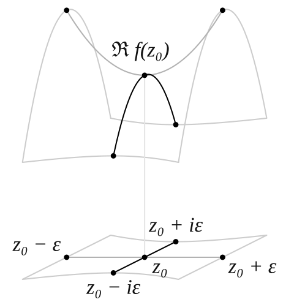
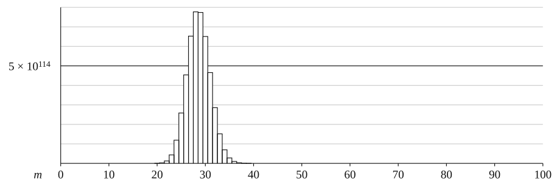
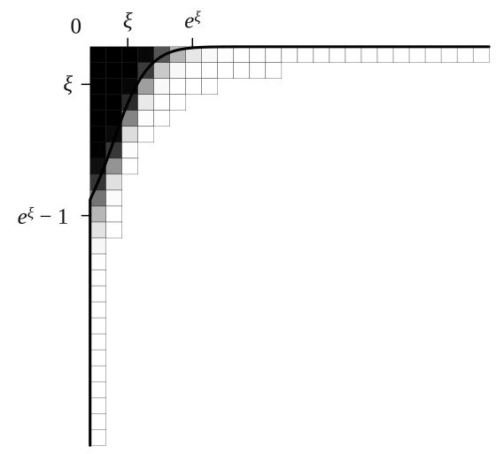
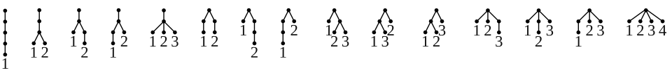
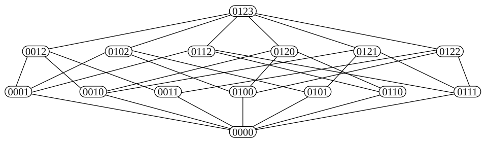
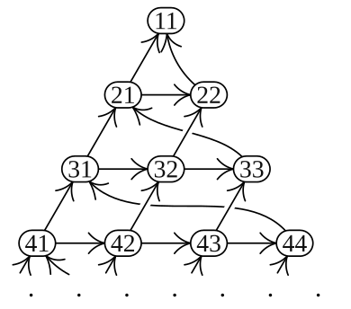
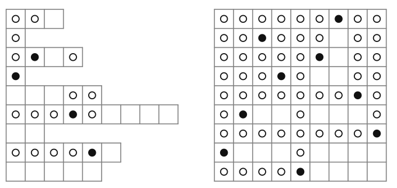

#### 7.2.1.5　生成所有集合分划

现在让我们换个话题, 关注稍微不同类型的分划.*集合分划*是指采用不同方式将这个集合看作其非空不相交子集的并集, 这些子集称为*块*. 例如, 我们在上节开始部分的 7.2.1.4–(2) 和 7.2.1.4–(4) 中列出了 $\{1,2,3\}$ 的 5 个不同分划. 这 5 个分划也可以用一条竖线将各个块分隔开来, 更紧凑地记为

$$
123,\quad 12|3,\quad 13|2,\quad 1|23,\quad 1|2|3.\tag{1}
$$

在这个列表中, 每个块的元素可以按任意顺序写出, 各块的次序也是如此, 这是因为 $13|2$、$31|2$、$2|13$、$2|31$ 都表示同一分划. 但我们可以约定一种标准化的表示方式, 比如将每个块中的元素按递增顺序列出, 而各个块按其最小元素的递增顺序列出. 根据这一约定, $\{1,2,3,4\}$ 的分划为

$$
\begin{gathered}
1234,\quad 123|4,\quad 124|3,\quad 12|34,\quad 12|3|4,\quad 134|2,\quad 13|24,\quad 13|2|4,\\
14|23,\quad 1|234,\quad 1|23|4,\quad 14|2|3,\quad 1|24|3,\quad 1|2|34,\quad 1|2|3|4,
\end{gathered}\tag{2}
$$

这是以所有可能的方式把 4 放在 (1) 中的各块之间得到的.

集合分划出现在许多种不同语境中. 比如, 政治学家和经济学家经常将它们看作是 “联盟”, 计算机系统设计师可以将它们看作是用于内存访问的 “高速缓冲命中模式”, 诗人则认为它们是 “押韵格式” (见习题 34–37). 我们在 2.3.3 节曾经看到, 对象之间的任一*等价关系*, 即具有自反性、对称性、传递性的任意二元关系, 都为这些对象定义了一种分划, 也就是将其划分为所谓的 “等价类”. 反之, 每个集合分划都定义了一种等价关系. 如果 $\Pi$ 是 $\{1,2,\ldots,n\}$ 的一个分划, 只要 $j$ 和 $k$ 属于 $\Pi$ 的同一个块, 都可以记作

$$
j\equiv k\pmod\Pi.\tag{3}
$$

在计算机中, 表示集合分划的最方便方法之一就是将其编码表示为一个*限制增长的串*, 也就是表示为一个非负整数串 $a_1a_2\ldots a_n$, 其中有

$$
a_1=0\quad\text{且}\quad
\text{对于 }1\leq j<n\text{ 有 }a_{j+1}\leq1+\max(a_1,\ldots,a_j).\tag{4}
$$

其思路是当且仅当 $j\equiv k$ 时置 $a_j=a_k$, 而且只要 $j$ 是其所在块中的最小值, 则为 $a_j$ 选择最小的可选数值. 例如, (2) 中 15 个分划的限制增长的串分别为

$$
\begin{gathered}
0000,\quad 0001,\quad 0010,\quad 0011,\quad 0012,\quad 0100,\quad 0101,\quad 0102,\\
0110,\quad 0111,\quad 0112,\quad 0120,\quad 0121,\quad 0122,\quad 0123.
\end{gathered}\tag{5}
$$

这一约定引出了下面由乔治·哈钦森在 *CACM* **6** (1963), 613–614 中提出的简单生成方案.

**算法 H (字典序下的限制增长的串).** 给定 $n\geq2$, 这一算法访问所有满足限制增长条件 (4) 的串 $a_1a_2\ldots a_n$, 从而生成 $\{1,2,\ldots,n\}$ 的所有分划. 我们维护一个辅助数组 $b_1b_2\ldots b_n$, 其中 $b_{j+1}=1+\max(a_1,\ldots,a_j)$. 为提高效率, $b_n$ 的值实际上保存在一个独立变量 $m$ 中.

**H1.** [初始化.] 置 $a_1\ldots a_n\leftarrow0\ldots0$, $b_1\ldots b_{n-1}\leftarrow1\ldots1$, $m\leftarrow1$.

**H2.** [访问.] 访问限制增长的串 $a_1\ldots a_n$, 这个串表示一个划分为 $m+[a_n=m]$ 个块的分划. 如果 $a_n=m$, 则转至 H4.

**H3.** [推进 $a_n$.] 置 $a_n\leftarrow a_n+1$, 并返回 H2.

**H4.** [寻找 $j$.] 置 $j\leftarrow n-1$. 然后, 当 $a_j=b_j$ 时循环执行 $j\leftarrow j-1$.

**H5.** [推进 $a_j$.] 如果 $j=1$ 则结束. 否则, 置 $a_j\leftarrow a_j+1$.

**H6.** [将 $a_{j+1}\ldots a_n$ 清零.] 置 $m\leftarrow b_j+[a_j=b_j]$ 及 $j\leftarrow j+1$. 然后, 当 $j<n$ 时循环执行 $a_j\leftarrow0$, $b_j\leftarrow m$, $j\leftarrow j+1$. 最后, 置 $a_n\leftarrow0$ 并返回 H2. ▮

习题 47 证明了步骤 H4–H6 很少会被用到, 且 H4 和 H6 中的循环几乎总是很短. 这一算法的链表形式见习题 2.

**集合分划的格雷码.** 快速遍历所有集合分划的一种方法是, 在每一步中仅改变限制增长的串 $a_1\ldots a_n$ 中的一个数字, 因为对 $a_j$ 的改变只不过就是将元素 $j$ 由一个块移动到另一个块中. 吉德翁·埃尔利希 [*JACM* **20** (1973), 507–508] 提出了一种方法, 可以将这种列表排列得非常优雅. 对于包含 $n-1$ 个元素的分划, 可以连续向每个串 $a_1\ldots a_{n-1}$ 中追加数字

$$
0,\ m,\ m-1,\ldots,1\qquad\text{或}\qquad 1,\ldots,m-1,\ m,\ 0,\tag{6}
$$

其中 $m=1+\max(a_1,\ldots,a_{n-1})$, 在上述两种情况之间交替选择. 因此, $n=2$ 时的列表 “00、01” 就变成了 $n=3$ 时的 “000、001、011、012、010”. 如果再将它扩展为 $n=4$ 的情景, 列表就变成了

$$
\begin{gathered}
0000,\quad 0001,\quad 0011,\quad 0012,\quad 0010,\quad 0110,\quad 0112,\quad 0111,\\
0121,\quad 0122,\quad 0123,\quad 0120,\quad 0100,\quad 0102,\quad 0101.
\end{gathered}\tag{7}
$$

习题 14 表明, 埃尔利希的方案可以导出一种实现这一格雷码顺序的简单方法, 其工作量并不比算法 H 更大.

但是, 假设我们并不是对所有分划都感兴趣, 我们可能只需要那些恰有 $m$ 个块的分划. 我们能否仍然通过每次仅改变一个数字的方式来遍历这种规模较小的限制增长的串的集合呢? 答案是肯定的. 弗兰克·拉斯基 [*Lecture Notes in Comp. Sci.* **762** (1993), 205–206] 已经找到了一种非常优美的方法来生成这种列表. 他定义了两个这样的序列 $A_{mn}$ 和 $A'_{mn}$, 其起始串都是由 $m$ 个块组成, 且根据字典序排在最前面, 即 $0^{n-m}01\ldots(m-1)$. 它们的区别是, 如果 $n>m+1$, $A_{mn}$ 以 $01\ldots(m-1)0^{n-m}$ 结尾, 而 $A'_{mn}$ 以 $0^{n-m-1}01\ldots(m-1)0$ 结尾. 下面是拉斯基的递归规则, 当 $1<m<n$ 时:

$$
A_{m(n+1)}=
\begin{cases}
A_{(m-1)n}(m-1),\ A^R_{mn}(m-1),\ldots,A^R_{mn}1,\ A_{mn}0, & m\text{ 为偶数};\\
A'_{(m-1)n}(m-1),\ A_{mn}(m-1),\ldots,A^R_{mn}1,\ A_{mn}0, & m\text{ 为奇数};
\end{cases}\tag{8}
$$

$$
A'_{m(n+1)}=
\begin{cases}
A'_{(m-1)n}(m-1),\ A_{mn}(m-1),\ldots,A_{mn}1,\ A^R_{mn}0, & m\text{ 为偶数};\\
A_{(m-1)n}(m-1),\ A^R_{mn}(m-1),\ldots,A_{mn}1,\ A^R_{mn}0, & m\text{ 为奇数}.
\end{cases}\tag{9}
$$

(换言之, 我们首先以 $A_{(m-1)n}(m-1)$ 或 $A'_{(m-1)n}(m-1)$ 开头, 然后当 $j$ 由 $m-1$ 递减至 0 时, 交替使用 $A^R_{mn}j$ 或 $A_{mn}j$.) 当然, 最基本的情景就是只有一个元素的列表

$$
A_{1n}=A'_{1n}=\{0^n\}\qquad\text{和}\qquad A_{nn}=\{01\ldots(n-1)\}.\tag{10}
$$

根据这些定义, 将 $\{1,2,3,4,5\}$ 划分为三个块的 $\begin{Bmatrix}5\\3\end{Bmatrix}=25$ 个分划为

$$
\begin{gathered}
00012,\ 00112,\ 01112,\ 01012,\ 01002,\ 01102,\ 00102,\\
00122,\ 01122,\ 01022,\ 01222,\ 01212,\ 01202,\\
01201,\ 01211,\ 01221,\ 01021,\ 01121,\ 00121,\\
00120,\ 01120,\ 01020,\ 01220,\ 01210,\ 01200.
\end{gathered}\tag{11}
$$

(见习题 17, 其中给出了一种更高效的实现.)

在吉德翁·埃尔利希的方案 (7) 中, $a_1\ldots a_n$ 最右端的数字变化最快, 但在弗兰克·拉斯基的方案中, 大多数变化发生在左端附近. 但在这两种情况下, 每一步都仅影响一个数字 $a_j$, 这些变化非常简单: 要么是 $a_j$ 变化 $\pm1$, 要么是在两个极值 0 和 $1+\max(a_1,\ldots,a_{j-1})$ 之间跳变. 在同样的约束条件下, 序列 $A'_{1n},A'_{2n},\ldots,A'_{nn}$ 按照块数的递增顺序遍历了所有分划.

**集合分划的数目.** 我们已经看到, $\{1,2,3\}$ 有 5 个分划, $\{1,2,3,4\}$ 有 15 个分划. 查尔斯·皮尔斯发现了计算这些数目的一种快速方法, 他在 *American Journal of Mathematics* **3** (1880) 第 48 页给出了以下数的三角形:

$$
\begin{array}{rrrrrr}
1\\
2 & 1\\
5 & 3 & 2\\
15 & 10 & 7 & 5\\
52 & 37 & 27 & 20 & 15\\
203 & 151 & 114 & 87 & 67 & 52
\end{array}\tag{12}
$$

式中, 第 $n$ 行的各项 $\varpi_{n1},\varpi_{n2},\ldots,\varpi_{nn}$ 服从简单的递推关系

$$
\varpi_{nk}=\varpi_{(n-1)k}+\varpi_{n(k+1)},\qquad 1\leq k<n;\qquad
\varpi_{nn}=\varpi_{(n-1)1},\qquad n>1;\tag{13}
$$

且 $\varpi_{11}=1$. 皮尔斯三角有许多非常值得注意的性质, 在习题 26–31 和 33 中研究了其中一些性质. 比如, $\varpi_{nk}$ 是 $\{1,2,\ldots,n\}$ 的分划数目, 其中 $k$ 是它的块中的最小值.

皮尔斯三角的对角线和第一列中的各项告诉了我们集合分划的总数, 它们一般称为*贝尔数*, 这是因为埃里克·贝尔写了几篇有关它们的深具影响力的论文 [*AMM* **41** (1934), 411–419;*Annals of Math.* (2) **35** (1934), 258–277;**39** (1938), 539–557]. 我们将沿循路易·孔泰首创的做法, 用 $\varpi_n$ 来表示贝尔数, 目的是避免同伯努利数 $B_n$ 相混淆. 最前面的几项是

<table style="text-align:right;white-space:nowrap;">
<thead><tr><th scope="col">$n$</th><th scope="col">0</th><th scope="col">1</th><th scope="col">2</th><th scope="col">3</th><th scope="col">4</th><th scope="col">5</th><th scope="col">6</th><th scope="col">7</th><th scope="col">8</th><th scope="col">9</th><th scope="col">10</th><th scope="col">11</th><th scope="col">12</th></tr></thead>
<tbody><tr><th scope="row">$\varpi_n$</th><td>1</td><td>1</td><td>2</td><td>5</td><td>15</td><td>52</td><td>203</td><td>877</td><td>4140</td><td>21147</td><td>115975</td><td>678570</td><td>4213597</td></tr></tbody>
</table>

注意, 这个序列的增长速度很快, 但不及 $n!$. 我们下面将证明 $\varpi_n=\bigl(\Theta(n/\ln n)\bigr)^n$.

当 $n\geq0$ 时, 贝尔数 $\varpi_n=\varpi_{n1}$ 必须满足递推公式

$$
\varpi_{n+1}=\varpi_n+\binom n1\varpi_{n-1}+\binom n2\varpi_{n-2}+\cdots
=\sum_k\binom nk\varpi_{n-k},\tag{14}
$$

这是因为 $\{1,\ldots,n+1\}$ 的每个分划都是通过以下方式得到的: 对于某个 $k$ 值, 选择 $\{1,\ldots,n\}$ 的 $k$ 个元素, 将它们放到包含 $n+1$ 的块中, 然后以 $\varpi_{n-k}$ 种方式划分剩下的元素. 这个递推公式是由松永良弼在 18 世纪发现的 (见 7.2.1.7 节), 它引出了一个非常漂亮的生成函数

$$
\Pi(z)=\sum_{n=0}^{\infty}\varpi_n\frac{z^n}{n!}=e^{e^z-1},\tag{15}
$$

它是威廉·惠特沃思 [*Choice and Chance*, 3rd edition (1878), 3.XXIV] 发现的. 例如, 如果我们在 (14) 的两边同乘以 $z^n/n!$, 并针对 $n$ 求和, 将得到

$$
\Pi'(z)=\sum_{n=0}^{\infty}\varpi_{n+1}\frac{z^n}{n!}
=\left(\sum_{k=0}^{\infty}\frac{z^k}{k!}\right)
\left(\sum_{m=0}^{\infty}\varpi_m\frac{z^m}{m!}\right)=e^z\Pi(z),
$$

(15) 是这个微分方程在 $\Pi(0)=1$ 条件下的一个解.

由于数 $\varpi_n$ 具有一些与此公式相关的奇特性质, 所以早在惠特沃思指出它们与集合分划的组合联系之前, 人们就已经对它们研究了许多年. 例如, 我们有

$$
\varpi_n=\frac{n!}e[z^n]e^{e^z}
=\frac{n!}e[z^n]\sum_{k=0}^\infty\frac{e^{kz}}{k!}
=\frac1e\sum_{k=0}^\infty\frac{k^n}{k!},\tag{16}
$$

[*Mat. Sbornik* **3** (1868), 62;**4** (1869), 39; 古斯塔夫·多宾斯基,*Archiv der Math. und Physik* **61** (1877), 333–336;**63** (1879), 108–110]. 基斯顿·卡曼在卡尔·兴登堡主编的 *Der polynomische Lehrsatz* (Leipzig: 1796), 112–113 中讨论了 $e^{e^z}$ 的展开. 他提到两种计算这些系数的方法: 一种是利用 (14), 一种是对 $p(n)$ 项进行求和, 每一项分别对应于 $n$ 的一个普通分划. (见阿博加斯特公式, 习题 1.2.5–21. 卡曼也几乎发现了这一公式, 但是他似乎更喜欢自己基于分划的方法, 而没有意识到随着 $n$ 变得越来越大, 它将超出多项式时间复杂度, 而且他为 $z^{10}$ 计算出的系数是 $116\,015$, 而不是 $115\,975$.)

**\*渐近估计.** 利用复留数理论中的最基本原理之一, 我们可以知道 $\varpi_n$ 的增长速度有多快. 如果 $\sum_{k=0}^\infty a_kz^k$ 在 $|z|<r$ 时收敛, 则

$$
a_{n-1}=\frac1{2\pi i}\oint\frac{a_0+a_1z+a_2z^2+\cdots}{z^n}\,dz,\tag{17}
$$

其中, 该积分在绕原点逆时针旋转的简单闭合路径上进行, 该路径始终位于圆 $|z|=r$ 的内部. 令 $f(z)=\sum_{k=0}^\infty a_kz^{k-n}$ 为被积函数. 我们可以任意选择一条这样的路径, 但当积分路径通过点 $z_0$, 而该点处的导数 $f'(z_0)$ 为零时, 通常适用一些特殊的技巧. 这是因为, 在这样一个点的附近, 我们有

$$
f(z_0+\epsilon e^{i\theta})=f(z_0)+\frac{f''(z_0)}2\epsilon^2e^{2i\theta}+O(\epsilon^3).\tag{18}
$$

例如, 如果 $f(z_0)$ 和 $f''(z_0)$ 为正实数, 设 $f(z_0)=u$, $f''(z_0)=2v$, 则此公式表明, $f(z_0\pm\epsilon)$ 的值近似为 $u+v\epsilon^2$, 而 $f(z_0\pm i\epsilon)$ 近似为 $u-v\epsilon^2$. 如果 $z$ 由 $z_0-i\epsilon$ 移动到 $z_0+i\epsilon$, 则 $f(z)$ 的值上升到极大值 $u$, 然后再次下降, 但更大的值 $u+v\epsilon^2$ 出现在这条路径的左边和右边. 换言之, 假设有一位在复平面上徒步旅行的登山者, 当点 $z$ 处的海拔高度为 $\Re f(z)$ 时, 他会在 $z_0$ 处遇到一个 “关口”, 该点处的地形看起来像是一个马鞍. $f(z)$ 的整个积分对于任意积分路径都是相同的, 但当路径没有通过这个关口时, 就不是那么理想, 因为它必须消去一些较大的 $f(z)$ 值, 而这本是可以避免的. 因此, 我们倾向于选择一条通过 $z_0$ 的路径, 而其方向应当使其虚部增大, 希望藉此获得最佳结果. 这一重要方法是由彼得·德拜 [*Math. Annalen* **67** (1909), 535–558] 提出的, 称为 “鞍点方法”. (见图 53.)

图 53　一个解析函数在鞍点附近的特性

让我们从一个已经知道答案的例子入手, 来熟悉一下鞍点方法:

$$
\frac1{(n-1)!}=\frac1{2\pi i}\oint\frac{e^z}{z^n}\,dz.\tag{19}
$$

我们的目的是, 求上式右边积分在 $n$ 很大时的一个良好近似值. 为处理 $f(z)=e^z/z^n$, 将其记为 $e^{g(z)}$ 是比较方便的, 其中 $g(z)=z-n\ln z$. 于是, 鞍点出现在 $g'(z_0)=1-n/z_0$ 为零时, 也就是在 $z_0=n$ 处. 如果 $z=n+it$, 则有

$$
\begin{aligned}
g(z)&=g(n)+\sum_{k=2}^\infty\frac{g^{(k)}(n)}{k!}(it)^k\\
&=n-n\ln n-\frac{t^2}{2n}+\frac{it^3}{3n^2}+\frac{t^4}{4n^3}-\frac{it^5}{5n^4}+\cdots,
\end{aligned}
$$

这是因为, 当 $k\geq2$ 时, $g^{(k)}(z)=(-1)^k(k-1)!n/z^k$. 让我们沿一条矩形路径来对 $f(z)$ 进行积分, 这条矩形路径是由 $n-im$ 到 $n+im$, 再到 $-n+im$, 再到 $-n-im$, 再到 $n-im$:

$$
\begin{aligned}
\frac1{2\pi i}\oint\frac{e^z}{z^n}\,dz
&=\frac1{2\pi}\int_{-m}^m f(n+it)\,dt+\frac1{2\pi i}\int_n^{-n}f(t+im)\,dt\\
&\quad+\frac1{2\pi}\int_m^{-m}f(-n+it)\,dt+\frac1{2\pi i}\int_{-n}^nf(t-im)\,dt.
\end{aligned}
$$

显然, 如果我们选择 $m=2n$, 则在这一路径的后三条边上有 $|f(z)|\leq2^{-n}f(n)$, 这是因为 $|e^z|=e^{\Re z}$, $|z|\geq\max(|\Re z|,|\Im z|)$. 于是, 留下的是

$$
\frac1{2\pi i}\oint\frac{e^z}{z^n}\,dz
=\frac1{2\pi}\int_{-m}^m e^{g(n+it)}\,dt+O\left(\frac{ne^n}{2^nn^n}\right).
$$

现在, 我们又回到以前已经用过几次 (比如用于推导式 5.1.4–(53)) 的一种方法: 如果 $\hat f(t)$ 是 $f(t)$ 在 $t\in A$ 时的一个良好近似, 并且如果两个和值 $\sum_{t\in B}|f(t)|$ 和 $\sum_{t\in C}|\hat f(t)|$ 都很小, 那么 $\sum_{t\in A\cup C}\hat f(t)$ 就是 $\sum_{t\in A\cup B}f(t)$ 的一个良好近似. 同样的思路也适用于积分. [这种一般方法由拉普拉斯在 1782 年提出, 常被称为 “弃尾法”, 见 *CMath* §9.4.] 如果 $|t|\leq n^{1/2+\epsilon}$, 则有

$$
\begin{aligned}
e^{g(n+it)}
&=\exp\left(g(n)-\frac{t^2}{2n}+\frac{it^3}{3n^2}+\cdots\right)\\
&=\frac{e^n}{n^n}\exp\left(-\frac{t^2}{2n}+\frac{it^3}{3n^2}+\frac{t^4}{4n^3}+O(n^{5\epsilon-3/2})\right)\\
&=\frac{e^n}{n^n}e^{-t^2/(2n)}\left(1+\frac{it^3}{3n^2}+\frac{t^4}{4n^3}-\frac{t^6}{18n^4}+O(n^{9\epsilon-3/2})\right).
\end{aligned}
$$

而当 $|t|>n^{1/2+\epsilon}$ 时, 则有

$$
|e^{g(n+it)}|<|f(n+in^{1/2+\epsilon})|
=\frac{e^n}{n^n}\exp\left(-\frac n2\ln(1+n^{2\epsilon-1})\right)
=O\left(\frac{e^{n-n^{2\epsilon}/2}}{n^n}\right).
$$

此外, 不完全 $\Gamma$ 函数

$$
\int_{n^{1/2+\epsilon}}^\infty e^{-t^2/(2n)}t^k\,dt
=2^{(k-1)/2}n^{(k+1)/2}\Gamma\left(\frac{k+1}2,\frac{n^{2\epsilon}}2\right)
=O\left(n^{O(1)}e^{-n^{2\epsilon}/2}\right)
$$

是可以忽略的. 因此, 我们可以放弃尾部, 得到近似式

$$
\begin{aligned}
\frac1{2\pi i}\oint\frac{e^z}{z^n}\,dz
&=\frac{e^n}{2\pi n^n}\int_{-\infty}^\infty
 e^{-t^2/(2n)}\left(1+\frac{it^3}{3n^2}+\frac{t^4}{4n^3}-\frac{t^6}{18n^4}+O(n^{9\epsilon-3/2})\right)dt\\
&=\frac{e^n}{2\pi n^n}\left(I_0+\frac{i}{3n^2}I_3+\frac1{4n^3}I_4-\frac1{18n^4}I_6+O(n^{9\epsilon-3/2})\right),
\end{aligned}
$$

其中, $I_k=\int_{-\infty}^\infty e^{-t^2/(2n)}t^k\,dt$. 当然, 当 $k$ 为奇数时, $I_k=0$. 而在其他情况下, 我们可以使用下面的著名事实来计算 $I_k$. 当 $a>0$ 时,

$$
\int_{-\infty}^\infty e^{-at^2}t^{2l}\,dt=\frac{\Gamma((2l+1)/2)}{a^{(2l+1)/2}}
=\frac{\sqrt{2\pi}}{(2a)^{(2l+1)/2}}\prod_{j=1}^l(2j-1),\tag{20}
$$

见习题 39. 将所有这些结合在一起, 就可以得出, 对于所有 $\epsilon>0$, 渐近估计值为

$$
\frac1{(n-1)!}=\frac{e^n}{\sqrt{2\pi}\,n^{n-1/2}}
\left(1+0+\frac3{4n}-\frac{15}{18n}+O(n^{9\epsilon-2})\right).\tag{21}
$$

这一结果与我们在 1.2.11.2–(19) 中推导得到的斯特林近似完全一致, 而当时的推导方法与此处的方法完全不同. 如果再多使用 $g(n+it)$ 展开式中的一些项, 可以证明 (21) 中的真误差只有 $O(n^{-2})$, 这是因为利用同一过程, 对于所有 $m$ 可以得出一般形式的渐近级数: $e^n/(\sqrt{2\pi}\,n^{n-1/2})\bigl(1+c_1/n+c_2/n^2+\cdots+c_m/n^m+O(n^{-m-1})\bigr)$.

我们对这一结果的推导过程掩饰了一个重要的技术细节: 函数 $\ln z$ 在积分路径上并不是单值函数, 这是因为每逆时针绕原点一周, 它就增加 $2\pi i$. 实际上, 留数定理之所以有效, 其基本机理的基础正是这一事实. 但我们的推理过程是正确的, 因为当 $n$ 为整数时, 该对数函数的这一不确定性并不会影响到被积函数 $f(z)=e^z/z^n$. 此外, 如果 $n$ 不是整数, 我们可以对论证过程进行修正, 使其严格成立: 在进行积分 (19) 时, 为其选择一条始于 $-\infty$、围绕原点逆时针旋转并返回 $-\infty$ 的路径. 这一积分路径会得出 $\Gamma$ 函数的汉克尔积分式 1.2.5–(17), 由此可以推出, 对于任意实数 $x$, 当 $x\to\infty$ 时, 渐近公式

$$
\frac1{\Gamma(x)}=\frac1{2\pi i}\oint\frac{e^z}{z^x}\,dz
=\frac{e^x}{\sqrt{2\pi}\,x^{x-1/2}}\left(1-\frac1{12x}+O(x^{-2})\right)\tag{22}
$$

是有效的.

因此, 鞍点方法看起来是有效的, 尽管它并不是获得这一特定结果的最简单方法. 下面让我们应用这一方法来推导贝尔数的近似大小:

$$
\frac{\varpi_{n-1}}{(n-1)!}=\frac1{2\pi ie}\oint e^{g(z)}\,dz,\qquad
g(z)=e^z-n\ln z.\tag{23}
$$

现在, 有一个鞍点出现在点 $z_0=\xi>0$ 处, 其中

$$
\xi e^\xi=n.\tag{24}
$$

(实际上, 我们应当用 $\xi(n)$ 来表示 $\xi$ 是随 $n$ 变化的, 但这样会使下面的公式变得杂乱.) 暂时假定有一只小鸟已经将 $\xi$ 的取值告诉了我们. 接下来, 我们希望在一条满足 $z=\xi+it$ 的路径上进行积分, 有

$$
g(\xi+it)=e^\xi-n\left(\ln\xi-\frac{(it)^2}{2!}\frac{\xi+1}{\xi^2}
-\frac{(it)^3}{3!}\frac{\xi^2-2!}{\xi^3}
-\frac{(it)^4}{4!}\frac{\xi^3+3!}{\xi^4}+\cdots\right).
$$

通过在一条适当的矩形路径上进行积分, 我们可以像前面一样加以证明, (23) 中的积分可以由

$$
\int_{-n^{\epsilon-1/2}}^{n^{\epsilon-1/2}}
e^{g(\xi)-na_2t^2-nia_3t^3+na_4t^4+\cdots}\,dt,\qquad
a_k=\frac{\xi^{k-1}+(-1)^k(k-1)!}{k!\,\xi^k};\tag{25}
$$

很好地近似, 见习题 43. 注意到 $a_kt^k$ 在这个积分中是 $O(n^{k\epsilon-k/2})$, 于是可以得到一个形如

$$
\varpi_{n-1}=\frac{e^{e^\xi-1}(n-1)!}{\xi^{n-1}\sqrt{2\pi n(\xi+1)}}
\left(1+\frac{b_1}n+\frac{b_2}{n^2}+\cdots+\frac{b_m}{n^m}
+O\left(\frac{\log n}n\right)^{m+1}\right)\tag{26}
$$

的渐近展开式, 其中 $(\xi+1)^{3k}b_k$ 是关于 $\xi$ 的一个 $4k$ 阶多项式. (见习题 44.) 例如,

$$
b_1=-\frac{2\xi^4-3\xi^3-20\xi^2-18\xi+2}{24(\xi+1)^3};\tag{27}
$$

$$
b_2=\frac{4\xi^8-156\xi^7-695\xi^6-696\xi^5+1092\xi^4+2916\xi^3+1972\xi^2-72\xi+4}{1152(\xi+1)^6}.\tag{28}
$$

在 (26) 中使用斯特林近似式 (21) 可以证明

$$
\varpi_{n-1}=\exp\left(n\left(\xi-1+\frac1\xi\right)-\xi-\frac12\ln(\xi+1)-1-\frac{\xi}{12n}
 +O\left(\frac{\log n}n\right)^2\right);\tag{29}
$$

习题 45 证明了一个类似的公式

$$
\varpi_n=\exp\left(n\left(\xi-1+\frac1\xi\right)-\frac12\ln(\xi+1)-1-\frac{\xi}{12n}
 +O\left(\frac{\log n}n\right)^2\right).\tag{30}
$$

于是, 得到 $\varpi_n/\varpi_{n-1}\approx e^\xi=n/\xi$. 更准确地,

$$
\frac{\varpi_{n-1}}{\varpi_n}=\frac\xi n\left(1+O\left(\frac1n\right)\right).\tag{31}
$$

但 $\xi$ 的渐近值是多少呢? 定义 (24) 意味着

$$
\begin{aligned}
\xi&=\ln n-\ln\xi=\ln n-\ln(\ln n-\ln\xi)\\
&=\ln n-\ln\ln n+O\left(\frac{\log\log n}{\log n}\right);
\end{aligned}\tag{32}
$$

我们可以沿着这一脉络走下去, 如习题 49 所示. 但是当 $m$ 越来越大时, 通过这一方法为 $\xi$ 推导得出的渐近级数在精确度上绝对不会优于 $O(1/(\log n)^m)$. 所以, 当在关于 $\varpi_{n-1}$ 的 (29) 和关于 $\varpi_n$ 的 (30) 中乘以 $n$ 时, 它是非常不精确的.

因此, 如果我们希望利用 (29) 或 (30) 为贝尔数计算出很好的数值近似, 最佳策略应当是首先为 $\xi$ 计算一个好的数值, 而不是使用一个缓慢收敛的级数. 在算法 4.7N 之前的评述中曾经讨论过牛顿求根法, 利用这一方法可以得到一种高效的迭代方案

$$
\xi_0=\ln n,\qquad
\xi_{k+1}=\frac{\xi_k}{\xi_k+1}(1+\xi_0-\ln\xi_k),\tag{33}
$$

它会快速地收敛到正确的值. 例如, 当 $n=100$ 时, 第 5 次迭代

$$
\xi_5=3.38563\,01402\,90050\,18488\,82443\,64529\,72686\,74917{-}\tag{34}
$$

已经准确到小数点后 40 位了. 当我们将直到 $1$、$b_1/n$、$b_2/n^2$、$b_3/n^3$ 的各项考虑在内时, 在 (26) 中使用这个数值可以得到连续近似值

$$
(1.6176088053\ldots,\ 1.6187421339\ldots,\ 1.6187065391\ldots,\ 1.6187060254\ldots)\times10^{114}.
$$

$\varpi_{99}$ 的真实值是一个 115 位的整数: $16187060274460\ldots20741$.

既然我们已经知道了集合分划的数目 $\varpi_n$, 下面就来尝试求出它们中有多少个恰有 $m$ 个块. 结果是, $\{1,\ldots,n\}$ 的几乎所有分划都有大约 $n/\xi=e^\xi$ 个块, 每个块大约有 $\xi$ 个元素. 例如, 图 54 给出了当 $n=100$ 时, 斯特林数 $\begin{Bmatrix}n\\m\end{Bmatrix}$ 的直方图, 在此情况下 $e^\xi\approx29.54$.

图 54　斯特林数 $\begin{Bmatrix}100\\m\end{Bmatrix}$ 在 $m=28$ 和 $m=29$ 附近取最大值

我们可以向式 1.2.9–(23) 应用鞍点方法, 以此来研究 $\begin{Bmatrix}n\\m\end{Bmatrix}$ 的大小, 该式指出

$$
\begin{Bmatrix}n\\m\end{Bmatrix}
=\frac{n!}{m!}[z^n](e^z-1)^m
=\frac{n!}{m!}\frac1{2\pi i}\oint e^{m\ln(e^z-1)-(n+1)\ln z}\,dz.\tag{35}
$$

令 $\alpha=(n+1)/m$. 当

$$
\frac{\sigma}{1-e^{-\sigma}}=\alpha\tag{36}
$$

时, 函数 $g(z)=\alpha^{-1}\ln(e^z-1)-\ln z$ 在 $\sigma>0$ 处有一个鞍点. 注意, 当 $1\leq m\leq n$ 时, $\alpha>1$. 这个特殊值 $\sigma$ 由

$$
\sigma=\alpha-\beta,\qquad \beta=T(\alpha e^{-\alpha})\tag{37}
$$

给出, 其中 $T$ 是式 2.3.4.4–(30) 的树函数. 其实, $\beta$ 是介于 0 到 1 之间的数值, 对于该值有

$$
\beta e^{-\beta}=\alpha e^{-\alpha};\tag{38}
$$

当 $x$ 由 0 增大到 1 时, 函数 $xe^{-x}$ 由 0 增大到 $e^{-1}$, 然后再次下降到 0. 因此, $\beta$ 是唯一确定的, 并且有

$$
e^\sigma=\frac\alpha\beta.\tag{39}
$$

所有这种数对 $\alpha$ 和 $\beta$ 都可以利用反演公式

$$
\alpha=\frac{\sigma e^\sigma}{e^\sigma-1},\qquad
\beta=\frac{\sigma}{e^\sigma-1}\tag{40}
$$

求得. 例如, $\alpha=\ln4$ 和 $\beta=\ln2$ 对应于 $\sigma=\ln2$.

我们可以像上面一样证明, (35) 中的积分渐近等价于 $e^{(n+1)g(z)}\,dz$ 在路径 $z=\sigma+it$ 上的一个积分 (见习题 58). 习题 56 证明了关于 $z=\sigma$ 的泰勒级数

$$
g(\sigma+it)=g(\sigma)-\frac{t^2(1-\beta)}{2\sigma^2}
+\sum_{k=3}^{\infty}\frac{(it)^k}{k!}\,g^{(k)}(\sigma)\tag{41}
$$

具有如下性质:

$$
\text{对于所有 } k>0,\quad
\left|g^{(k)}(\sigma)\right|<2(k-1)!(1-\beta)/\sigma^k.\tag{42}
$$

于是, 我们可以很方便地从幂级数 $(n+1)g(z)$ 中提出因子 $N=(n+1)(1-\beta)$, 且由鞍点方法得出在 $N\to\infty$ 时

$$
\begin{Bmatrix}n\\m\end{Bmatrix}
=\frac{n!}{m!}\frac{1}{(\alpha-\beta)^{n-m}\beta^m\sqrt{2\pi N}}
\left(1+\frac{b_1}{N}+\frac{b_2}{N^2}+\cdots+\frac{b_l}{N^l}
+O\left(\frac{1}{N^{l+1}}\right)\right),\tag{43}
$$

其中 $(1-\beta)^{2k}b_k$ 是关于 $\alpha$ 和 $\beta$ 的多项式. (分母中的量 $(\alpha-\beta)^{n-m}\beta^m$ 源于根据 (37) 和 (39) 推得的事实: $(e^\sigma-1)^m/\sigma^n=(\alpha/\beta-1)^m/(\alpha-\beta)^n$.) 例如,

$$
b_1=\frac{6-\beta^3-4\alpha\beta^2-\alpha^2\beta}{8(1-\beta)}
-\frac{5(2-\beta^2-\alpha\beta)^2}{24(1-\beta)^2}.\tag{44}
$$

习题 57 证明了当且仅当 $n-m\to\infty$ 时有 $N\to\infty$. 利奥·莫泽和马克斯·怀曼首先给出了一个与 (43) 类似的 $\begin{Bmatrix}n\\m\end{Bmatrix}$ 展开式, 只是稍微复杂一些, 见 *Duke Math. J.* **25** (1958), 29–43.

式 (43) 看起来有点吓人, 因为它的目标是能够适用于块数 $m$ 的整个取值范围. 当 $m$ 较小或较大时, 该式有可能大幅简化 (见习题 60 和 61). 但是, 简化后的公式在 $\begin{Bmatrix}n\\m\end{Bmatrix}$ 取最大值这一重要情景中无法给出精确结果. 现在让我们更仔细地研究一下这些关键情景, 从而可以对图 54 中所示的尖峰做出解释.

像在 (24) 中一样, 令 $\xi e^\xi=n$, 并且假设 $m=\exp(\xi+r/\sqrt n)=ne^{r/\sqrt n}/\xi$. 我们将假定 $|r|\leq n^\epsilon$, 使得 $m$ 接近于 $e^\xi$. (43) 的前导项可以改写为

$$
\begin{aligned}
&\frac{n!}{m!}\frac{1}{(\alpha-\beta)^{n-m}\beta^m\sqrt{2\pi(n+1)(1-\beta)}}\\
&\qquad=\frac{m^n}{m!}\frac{(n+1)!}{(n+1)^{n+1}}\frac{e^{n+1}}{\sqrt{2\pi(n+1)}}
\left(1-\frac{\beta}{\alpha}\right)^{m-n}
\frac{e^{-\beta m}}{\sqrt{1-\beta}},
\end{aligned}\tag{45}
$$

利用 $(n+1)!$ 的斯特林近似式足以消去上式中的中间项了. 在计算机代数的帮助下, 可以求得

$$
\begin{aligned}
\frac{m^n}{m!}=\frac1{\sqrt{2\pi}}\exp\Biggl(
&n\left(\xi-1+\frac1\xi\right)-\frac12\left(\xi+r^2+\frac{r^2}{\xi}\right)\\
&-\left(\frac r2+\frac{r^3}{6}+\frac{r^3}{3\xi}\right)\frac1{\sqrt n}
+O(n^{4\epsilon-1})\Biggr);
\end{aligned}
$$

与 $\alpha$ 和 $\beta$ 有关的相应项为

$$
\begin{aligned}
\frac{\beta}{\alpha}&=\frac{\xi}{n}+\frac{r\xi^2}{n\sqrt n}
+O(\xi^3n^{2\epsilon-2});\\
e^{-\beta m}&=\exp\left(-\xi-\frac{r\xi^2}{\sqrt n}
+O(\xi^3n^{2\epsilon-1})\right);\\
\left(1-\frac{\beta}{\alpha}\right)^{m-n}
&=\exp\left(\xi-1+\frac{r(\xi^2-\xi-1)}{\sqrt n}
+O(\xi^3n^{2\epsilon-1})\right).
\end{aligned}
$$

因此, 总体结果为

$$
\begin{aligned}
\begin{Bmatrix}n\\e^{\xi+r/\sqrt n}\end{Bmatrix}
=\frac1{\sqrt{2\pi}}\exp\Biggl(
&n\left(\xi-1+\frac1\xi\right)-\frac{\xi}{2}-1\\
&-\frac{\xi+1}{2\xi}
\left(r+\frac{3\xi(2\xi+3)+(\xi+2)r^2}{6(\xi+1)\sqrt n}\right)^2
+O(\xi^3n^{4\epsilon-1})\Biggr).
\end{aligned}\tag{46}
$$

当

$$
r=-\frac{\xi(2\xi+3)}{2(\xi+1)\sqrt n}+O(\xi^2n^{-3/2})
$$

时, 式 (46) 的最后一行中的平方表达式为零, 因此, 当块数为

$$
m=\frac n\xi-\frac{3+2\xi}{2+2\xi}+O\left(\frac{\xi}{n}\right)\tag{47}
$$

时出现最大值. 通过对比 (46) 和 (30) 可以看出, 对于给定的 $n$ 值, 最大的斯特林数 $\begin{Bmatrix}n\\m\end{Bmatrix}$ 近似等于 $\xi\varpi_n/\sqrt{2\pi n}$.

鞍点方法适用于一些比这里考虑的问题还要困难得多的问题. 在多本书中可以找到关于一些高级方法的精彩阐述, 如尼古拉斯·德布鲁因,*Asymptotic Methods in Analysis* (1958), 第 5 章和第 6 章. 弗兰克·奥尔弗,*Asymptotics and Special Functions* (1974), 第 4 章. 王世全,*Asymptotic Approximations of Integrals* (2001), 第 2 章和第 7 章.

**\*随机集合分划.** 对于 $\{1,\ldots,n\}$ 的一个分划, 其中块的大小本身就构成了数 $n$ 的一个普通分划. 因此, 我们可能希望搞清楚, 它们会是哪种类型的分划呢? 7.2.1.4 节的图 50 给出了将 25 的所有 $p(25)=1958$ 个分划的费勒斯图叠加在一起时得到的结果. 这些分划趋向于遵循式 7.2.1.4–(49) 中的对称曲线. 与之相对的是, 图 55 显示了把集合 $\{1,\ldots,25\}$ 的所有 $\varpi_{25}\approx4.6386\times10^{18}$ 个分划的对应图叠加在一起时的情况. 显然, 一个随机集合分划的 “形状” 明显不同于一个随机整数分划的形状.

图 55　当 $n=25$ 时, 一个随机集合分划的形状

这一变化源于如下事实: 某些整数分划很少作为集合分划的块大小出现, 而其他一些整数分划则经常作为集合分划的块大小出现. 比如, 分划 $n=1+1+\cdots+1$ 的出现方式只有一种, 但如果 $n$ 为偶数, 则分划 $n=2+2+\cdots+2$ 的出现方式有 $(n-1)(n-3)\cdots(1)$ 种. 当 $n=25$ 时, 整数分划

$$
25=4+4+3+3+3+2+2+2+1+1
$$

的实际出现方式在所有可能出现的集合分划中占 2%以上. (实际上, 上面这个分划是 $n=25$ 时的最常见分划. 习题 1.2.5–21 的答案解释了, 恰有

$$
\frac{n!}{c_1!\,1!^{c_1}\,c_2!\,2!^{c_2}\cdots c_n!\,n!^{c_n}}\tag{48}
$$

个集合分划与整数分划 $n=c_1\cdot1+c_2\cdot2+\cdots+c_n\cdot n$ 相对应.)

我们很容易就能确定在 $\{1,\ldots,n\}$ 的一个随机分划中, 平均有多少个大小为 $k$ 的块. 如果写出所有 $\varpi_n$ 种可能性, 每个特定的 $k$ 元素块恰好出现 $\varpi_{n-k}$ 次. 因此, 上述平均数目为

$$
\binom nk\frac{\varpi_{n-k}}{\varpi_n}.\tag{49}
$$

习题 64 中证明了前述式 (31) 的一个扩展, 该扩展进一步表明

$$
\text{如果 } k\leq n^{2/3},\ \text{则 }\quad
\frac{\varpi_{n-k}}{\varpi_n}
=\left(\frac{\xi}{n}\right)^k\left(1+\frac{k\xi(k\xi+k+1)}{2(\xi+1)^2n}
+O\left(\frac{k^3}{n^2}\right)\right),\tag{50}
$$

其中 $\xi$ 的定义见 (24). 因此, 如果假定 $k\leq n^\epsilon$, 则式 (49) 简化为

$$
\frac{n^{\underline k}}{k!}\left(\frac{\xi}{n}\right)^k
\left(1+O\left(\frac1n\right)\right)
=\frac{\xi^k}{k!}\left(1+O\left(n^{2\epsilon-1}\right)\right).\tag{51}
$$

平均来说, 大约有 $\xi$ 个大小为 1 的块, $\xi^2/2!$ 个大小为 2 的块, 以此类推.

这些量的方差很小 (见习题 65). 事实上, 从随机分划的表现特性来看, 大小为 $k$ 的块的数目近似服从均值为 $\xi^k/k!$ 的泊松分布. 图 55 中所示的光滑曲线穿过类费勒斯坐标中的点 $(f(k),k)$, 其中

$$
f(k)=\xi^{k+1}/(k+1)!+\xi^{k+2}/(k+2)!+\xi^{k+3}/(k+3)!+\cdots\tag{52}
$$

是到对应于块大小 $k\geq0$ 的顶部直线的近似距离. (当 $n$ 变大时, 这条曲线变得更接近垂直.)

最大的块趋向于包含大约 $e\xi$ 个元素. 此外, 包含元素 1 的块, 其大小小于 $\xi+a\sqrt{\xi}$ 的概率接近于正态随机变量小于 $a$ 的概率. [见约翰·黑格,*J. Combinatorial Theory* **A13** (1972), 287–295. 弗拉基米尔·萨奇科夫,*Probabilistic Methods in Combinatorial Analysis* (1997), 第 4 章, 由 1978 年出版的一本俄文图书翻译而来. 尤里·雅库博维奇,*J. Mathematical Sciences* **87** (1997), 4124–4137, 由 1995 年发表的一份俄文论文翻译而来. 鲍里斯·皮特尔,*J. Combinatorial Theory* **A79** (1997), 326–359.]

阿尔特·斯塔姆在 *Journal of Combinatorial Theory* **A35** (1983), 231–240 中介绍了一种很好的方法, 用于生成 $\{1,2,\ldots,n\}$ 的随机分划. 令 $M$ 是一个随机整数, 其取值为 $m$ 的概率为

$$
p_m=\frac{m^n}{e\,m!\,\varpi_n};\tag{53}
$$

由 (16) 可知, 这些概率的总和为 1. 一旦选定 $M$ 后, 生成一个随机 $n$ 元组 $X_1X_2\ldots X_n$, 其中, 每个 $X_j$ 独立、均匀地分布于 0 和 $M-1$ 之间. 然后, 当且仅当 $X_i=X_j$ 时, 令该分划中的 $i\equiv j$. 这一过程是有效的, 因为对于每个拥有 $k$ 个块的集合分划, 获得该分划的概率为 $\sum_{m\geq0}(m^{\underline k}/m^n)p_m=1/\varpi_n$.

例如, 如果 $n=25$, 我们有

$$
\begin{array}{llll}
p_4\approx0.000\,003\,72 & p_9\approx0.156\,898\,65 & p_{14}\approx0.040\,936\,63 & p_{19}\approx0.000\,060\,68 \\
p_5\approx0.000\,196\,96 & p_{10}\approx0.218\,552\,85 & p_{15}\approx0.015\,314\,45 & p_{20}\approx0.000\,010\,94 \\
p_6\approx0.003\,131\,61 & p_{11}\approx0.215\,268\,71 & p_{16}\approx0.004\,805\,07 & p_{21}\approx0.000\,001\,76 \\
p_7\approx0.021\,102\,79 & p_{12}\approx0.157\,947\,84 & p_{17}\approx0.001\,286\,69 & p_{22}\approx0.000\,000\,26 \\
p_8\approx0.074\,310\,24 & p_{13}\approx0.089\,871\,71 & p_{18}\approx0.000\,298\,39 & p_{23}\approx0.000\,000\,03
\end{array}
$$

其他概率可以忽略不计. 因此, 通常可以通过研究一个 9、10、11 或 12 进制 25 位随机整数, 得到一个包含 25 个元素的随机分划. 数 $M$ 可以利用式 3.4.1–(3) 生成, 它趋向于近似值 $n/\xi=e^\xi$ (见习题 67).

**\*多重集的分划.** 整数分划和集合分划其实只是一种更一般的问题——多重集的分划——的极端情况. 实际上, $n$ 的分划基本上与 $\{1,1,\ldots,1\}$ (共有 $n$ 个 1) 的分划相同.

由这一角度来看, 拥有 $n$ 个元素的多重集基本有 $p(n)$ 种类型. 例如, 当 $n=4$ 时, 出现 5 种不同的多重集分划情景:

$$
\begin{gathered}
1234,\ 123|4,\ 124|3,\ 12|34,\ 12|3|4,\ 134|2,\ 13|24,\ 13|2|4,\\
14|23,\ 14|2|3,\ 1|234,\ 1|23|4,\ 1|24|3,\ 1|2|34,\ 1|2|3|4;\\
1123,\ 112|3,\ 113|2,\ 11|23,\ 11|2|3,\ 123|1,\ 12|13,\ 12|1|3,\ 13|1|2,\ 1|1|23,\ 1|1|2|3;\\
1122,\ 112|2,\ 11|22,\ 11|2|2,\ 122|1,\ 12|12,\ 12|1|2,\ 1|1|22,\ 1|1|2|2;\\
1112,\ 111|2,\ 112|1,\ 11|12,\ 11|1|2,\ 12|1|1,\ 1|1|1|2;\\
1111,\ 111|1,\ 11|11,\ 11|1|1,\ 1|1|1|1.
\end{gathered}\tag{54}
$$

当多重集中包含 $m$ 个不同元素, 其中第 1 类有 $n_1$ 个, 第 2 类有 $n_2$ 个, ……最后一类有 $n_m$ 个, 我们将总分划数目记为 $p(n_1,n_2,\ldots,n_m)$. 因此, (54) 中的示例表明

$$
p(1,1,1,1)=15,\quad p(2,1,1)=11,\quad
p(2,2)=9,\quad p(3,1)=7,\quad p(4)=5.\tag{55}
$$

$m=2$ 的分划经常被称为 “二重分划”, $m=3$ 的分划称为 “三重分划”, 一般地, 这些组合对象被称为多重分划. 对多重分划的研究是由珀西·麦克马洪 [*Philosophical Transactions* **181** (1890), 481–536;**217** (1917), 81–113;*Proc. Cambridge Philos. Soc.* **22** (1925), 951–963] 在很久之前开创的. 但是, 由于这一主题如此浩大, 以致于至今还有许多悬而未解的问题. 在本节的剩余部分和随后的习题部分, 我们将粗略地了解一下, 关于这一理论到目前为止已经发现的最有意义、最具启发性的内容.

首先, 重要的是要注意到, 多重分划基本上就是对分量都是非负整数的向量的分划, 也就是将这样一个向量分解为此种向量之和的方法. 例如, (54) 中列出了 $\{1,1,2,2\}$ 的 9 个分划, 它们与二部列向量 $\genfrac{}{}{0pt}{}{2}{2}$ 的 9 个分划相同, 即

$$
\genfrac{}{}{0pt}{}{2}{2},\quad
\genfrac{}{}{0pt}{}{2\,0}{1\,1},\quad
\genfrac{}{}{0pt}{}{2\,0}{0\,2},\quad
\genfrac{}{}{0pt}{}{2\,0\,0}{0\,1\,1},\quad
\genfrac{}{}{0pt}{}{1\,1}{2\,0},\quad
\genfrac{}{}{0pt}{}{1\,1}{1\,1},\quad
\genfrac{}{}{0pt}{}{1\,1\,0}{1\,0\,1},\quad
\genfrac{}{}{0pt}{}{1\,1\,0}{0\,0\,2},\quad
\genfrac{}{}{0pt}{}{1\,1\,0\,0}{0\,0\,1\,1}.\tag{56}
$$

(为简便起见, 和在一维整数分划中一样, 我们删除了加号.) 如果按照非递增字典序列出分划的组成部分, 那么每个分划都可以写为规范形式.

一种相当简单的算法就足以生成任意给定多重集的分划. 在下面的过程中, 我们在包含元素三元组 $(c,u,v)$ 的一个栈上表示分划, 其中 $c$ 表示分量的编号, $u>0$ 表示还留在分量 $c$ 中的尚未分划的量, 而 $v$ 表示当前部分的 $c$ 分量, 其中 $0\leq v\leq u$. 为方便起见, 三元组实际上保存在三个数组 $(c_0,c_1,\ldots)$、$(u_0,u_1,\ldots)$、$(v_0,v_1,\ldots)$ 中, 还维护有一个 “栈帧” 数组 $(f_0,f_1,\ldots)$, 该分划的第 $l+1$ 个向量由 $c$、$u$ 和 $v$ 数组中第 $f_l$ 至 $f_{l+1}-1$ 个元素组成. 例如, 下面的数组将表示二重分划 $\genfrac{}{}{0pt}{}{3\,2\,2\,1\,1\,0\,0}{1\,2\,0\,1\,1\,3\,1}$:

$$
\begin{array}{r|cc|cc|cc|cc|cc|c|c|c}
j&0&1&2&3&4&5&6&7&8&9&10&11&\\
c_j&1&2&1&2&1&2&1&2&1&2&2&2&\\
u_j&9&9&6&8&4&6&2&6&1&5&4&1&\\
v_j&3&1&2&2&2&0&1&1&1&1&3&1&\\[3pt]
&\scriptstyle f_0=0&&\scriptstyle f_1=2&&\scriptstyle f_2=4&&
\scriptstyle f_3=6&&\scriptstyle f_4=8&&
\scriptstyle f_5=10&\scriptstyle f_6=11&\scriptstyle f_7=12
\end{array}\tag{57}
$$

**算法 M (递减字典序下的多重分划).** 给定一个多重集 $\{n_1\cdot1,\ldots,n_m\cdot m\}$, 如上所述, 这个算法使用数组 $f_0f_1\ldots f_n$、$c_0c_1\ldots c_{mn}$、$u_0u_1\ldots u_{mn}$ 和 $v_0v_1\ldots v_{mn}$ 访问它的所有分划, 其中 $n=n_1+\cdots+n_m$. 我们假设 $m>0$, $n_1,\ldots,n_m>0$.

**M1.[初始化.]** 对于 $0\leq j<m$, 置 $c_j\gets j+1$, $u_j\gets v_j\gets n_{j+1}$. 另置 $f_0\gets a\gets l\gets0$ 和 $f_1\gets b\gets m$. (在以下步骤中, 当前栈帧由 $a$ 变至 $b-1$, 含两端.)

**M2.[从 $u$ 中减去 $v$.]**(此时, 我们希望找出当前帧中向量 $u$ 的所有分划, 将其划分为按照字典序小于等于 $v$ 的部分. 我们将首先使用 $v$ 本身.) 置 $j\gets a$, $k\gets b$, $x\gets0$. 然后当 $j<b$ 时循环执行以下操作: 置 $u_k\gets u_j-v_j$. 如果 $u_k=0$, 则仅置 $x\gets1$ 和 $j\gets j+1$. 否则, 如果 $x=0$, 置 $c_k\gets c_j$、$v_k\gets\min(v_j,u_k)$、$x\gets[u_k<v_j]$、$k\gets k+1$、$j\gets j+1$. 其余情形置 $c_k\gets c_j$、$v_k\gets u_k$、$k\gets k+1$、$j\gets j+1$. (注意, $x=[v\text{ 已经发生了变化}]$.)

**M3.[如果非零则入栈.]** 如果 $k>b$, 则置 $a\gets b$, $b\gets k$, $l\gets l+1$, $f_{l+1}\gets b$, 并返回 M2.

**M4.[访问一个分划.]** 访问由当前栈中全部 $l+1$ 个向量表示的分划. (对于 $0\leq k\leq l$, 当 $f_k\leq j<f_{k+1}$ 时, 第 $k+1$ 个向量在分量 $c_j$ 中有 $v_j$.)

**M5.[递减 $v$.]** 置 $j\gets b-1$. 当 $v_j=0$ 时循环执行 $j\gets j-1$. 然后, 如果 $j=a$ 且 $v_j=1$, 转至 M6. 否则, 先置 $v_j\gets v_j-1$, 再对 $j<k<b$ 置 $v_k\gets u_k$. 返回 M2.

**M6.[回溯.]** 如果 $l=0$ 则终止. 否则, 置 $l\gets l-1$, $b\gets a$, $a\gets f_l$, 并且返回 M5. ∎

这个算法的关键在于步骤 M2, 它将当前剩余向量 $u$ 减去所允许的最大部分 $v$. 在必要时, 这一步骤还会将 $v$ 减小至按照字典序小于等于 $v$ 的最大向量, 这个向量要小于或等于每个分量中的新剩余量. (见习题 68.)

本节最后, 让我们来讨论一下多重分划与基数排序的最低有效位优先过程 (算法 5.2.5R) 之间的有趣联系. 通过一个例子可以很好地理解这一思路. 见表 1, 其中步骤 (0) 按照字典序给出了 9 个 4 部列向量, 各向量的底部已经添加了序号①–⑨, 以作标识. 步骤 (1) 对这些向量进行一种稳定排序, 使这些向量的第 4 项 (最低有效项) 变为递减顺序. 类似地, 步骤 (2)、(3) 和 (4) 对第 3 行、第 2 行和顶行进行稳定排序. 基数排序理论告诉我们, 最初的字典序将由此而得以恢复.

<table id="tab-7-2-1-5-1">
<caption>表 1　基数排序与多重分划</caption>
<tbody>
<tr><th colspan="9" scope="rowgroup">步骤 (0): 原分划</th></tr>
<tr><td>6</td><td>5</td><td>5</td><td>4</td><td>3</td><td>2</td><td>1</td><td>0</td><td>0</td></tr>
<tr><td>3</td><td>2</td><td>1</td><td>0</td><td>4</td><td>5</td><td>6</td><td>4</td><td>2</td></tr>
<tr><td>6</td><td>6</td><td>3</td><td>1</td><td>1</td><td>5</td><td>2</td><td>0</td><td>7</td></tr>
<tr><td>4</td><td>2</td><td>1</td><td>3</td><td>3</td><td>1</td><td>1</td><td>2</td><td>5</td></tr>
<tr><td>①</td><td>②</td><td>③</td><td>④</td><td>⑤</td><td>⑥</td><td>⑦</td><td>⑧</td><td>⑨</td></tr>
</tbody>
<tbody>
<tr><th colspan="9" scope="rowgroup">步骤 (1): 对第 4 行进行排序</th></tr>
<tr><td>0</td><td>6</td><td>4</td><td>3</td><td>5</td><td>0</td><td>5</td><td>2</td><td>1</td></tr>
<tr><td>2</td><td>3</td><td>0</td><td>4</td><td>2</td><td>4</td><td>1</td><td>5</td><td>6</td></tr>
<tr><td>7</td><td>6</td><td>1</td><td>1</td><td>6</td><td>0</td><td>3</td><td>5</td><td>2</td></tr>
<tr><td>5∧</td><td>4</td><td>3</td><td>3∧</td><td>2</td><td>2∧</td><td>1</td><td>1</td><td>1</td></tr>
<tr><td>⑨</td><td>①</td><td>④</td><td>⑤</td><td>②</td><td>⑧</td><td>③</td><td>⑥</td><td>⑦</td></tr>
<tr><td colspan="9">$\alpha_4=(9{}_{\wedge}\ 1\ 4\ 5{}_{\wedge}\ 2\ 8{}_{\wedge}\ 3\ 6\ 7)$</td></tr>
</tbody>
<tbody>
<tr><th colspan="9" scope="rowgroup">步骤 (2): 对第 3 行进行排序</th></tr>
<tr><td>0</td><td>6</td><td>5</td><td>2</td><td>5</td><td>1</td><td>4</td><td>3</td><td>0</td></tr>
<tr><td>2</td><td>3</td><td>2</td><td>5</td><td>1</td><td>6</td><td>0</td><td>4</td><td>4</td></tr>
<tr><td>7</td><td>6</td><td>6</td><td>5∧</td><td>3</td><td>2∧</td><td>1</td><td>1</td><td>0</td></tr>
<tr><td>5</td><td>4</td><td>2</td><td>1</td><td>1</td><td>1</td><td>3</td><td>3</td><td>2</td></tr>
<tr><td>⑨</td><td>①</td><td>②</td><td>⑥</td><td>③</td><td>⑦</td><td>④</td><td>⑤</td><td>⑧</td></tr>
<tr><td colspan="9">$\alpha_3=(1\ 2\ 5\ 8{}_{\wedge}\ 7\ 9{}_{\wedge}\ 3\ 4\ 6)$</td></tr>
</tbody>
<tbody>
<tr><th colspan="9" scope="rowgroup">步骤 (3): 对第 2 行进行排序</th></tr>
<tr><td>1</td><td>2</td><td>3</td><td>0</td><td>6</td><td>0</td><td>5</td><td>5</td><td>4</td></tr>
<tr><td>6∧</td><td>5</td><td>4</td><td>4∧</td><td>3∧</td><td>2</td><td>2</td><td>1</td><td>0</td></tr>
<tr><td>2</td><td>5</td><td>1</td><td>0</td><td>6</td><td>7</td><td>6</td><td>3</td><td>1</td></tr>
<tr><td>1</td><td>1</td><td>3</td><td>2</td><td>4</td><td>5</td><td>2</td><td>1</td><td>3</td></tr>
<tr><td>⑦</td><td>⑥</td><td>⑤</td><td>⑧</td><td>①</td><td>⑨</td><td>②</td><td>③</td><td>④</td></tr>
<tr><td colspan="9">$\alpha_2=(6{}_{\wedge}\ 4\ 8\ 9{}_{\wedge}\ 2{}_{\wedge}\ 1\ 3\ 5\ 7)$</td></tr>
</tbody>
<tbody>
<tr><th colspan="9" scope="rowgroup">步骤 (4): 对第 1 行进行排序</th></tr>
<tr><td>6</td><td>5</td><td>5</td><td>4∧</td><td>3∧</td><td>2∧</td><td>1</td><td>0</td><td>0</td></tr>
<tr><td>3</td><td>2</td><td>1</td><td>0</td><td>4</td><td>5</td><td>6</td><td>4</td><td>2</td></tr>
<tr><td>6</td><td>6</td><td>3</td><td>1</td><td>1</td><td>5</td><td>2</td><td>0</td><td>7</td></tr>
<tr><td>4</td><td>2</td><td>1</td><td>3</td><td>3</td><td>1</td><td>1</td><td>2</td><td>5</td></tr>
<tr><td>①</td><td>②</td><td>③</td><td>④</td><td>⑤</td><td>⑥</td><td>⑦</td><td>⑧</td><td>⑨</td></tr>
<tr><td colspan="9">$\alpha_1=(5\ 7\ 8\ 9{}_{\wedge}\ 3{}_{\wedge}\ 2{}_{\wedge}\ 1\ 4\ 6)$</td></tr>
</tbody>
</table>

假设经过这些稳定排序操作之后, 由这些序号组成的序列分别为 $\alpha_4$、$\alpha_3\alpha_4$、$\alpha_2\alpha_3\alpha_4$ 和 $\alpha_1\alpha_2\alpha_3\alpha_4$, 其中这些 $\alpha$ 就是一些排列. 表 1 在括号中给出了 $\alpha_4$、$\alpha_3$、$\alpha_2$ 和 $\alpha_1$ 的取值. 要点到了: 只要排列 $\alpha_j$ 中出现一次下降, 由于排序是稳定的, 经过排序之后, 第 $j$ 行中的数字也必然有一次下降. [这些下降在表中用脱字符号 (∧) 指出.] 例如, 在 $\alpha_3$ 中, 8 后面跟着 7, 则在第 3 行中有 5 之后跟着 3. 因此, 在经过步骤 (2) 之后, 第 3 行中的各项 $a_1\ldots a_9$, 不再是其和值的任意分划, 而是必须满足

$$
a_1\geq a_2\geq a_3\geq a_4>a_5\geq a_6>a_7\geq a_8\geq a_9.\tag{58}
$$

但数 $(a_1-2,a_2-2,a_3-2,a_4-2,a_5-1,a_6-1,a_7,a_8,a_9)$ 又的确构成了最初的和值减去 $(4+6)$ 之后的一个几乎是任意的分划. 下降的数量 $4+6$ 就是发生下降处的下标之和, 这个数就是我们在 5.1.1 节所说的 $\operatorname{ind}\alpha_3$, 即 $\alpha_3$ 的 “索引”.

于是我们看到, 如果将一个 $m$ 部数分为最多 $r$ 个部分, 对于任意这样一个给定分划 (其中额外添补了零, 使列数恰好为 $r$), 都可以对其进行编码, 表示为两个序列: 一个是 $\{1,\ldots,r\}$ 的排列序列 $\alpha_1,\ldots,\alpha_m$, 满足乘积 $\alpha_1\ldots\alpha_m$ 等于单位 1. 另一个序列是将数 $(n_1-\operatorname{ind}\alpha_1,\ldots,n_m-\operatorname{ind}\alpha_m)$ 分为最多 $r$ 个部分的普通一维分划序列. 例如, 表 1 中的向量表示一个分划, 将 $(26,27,31,22)$ 分为 9 个部分. 排列 $\alpha_1,\ldots,\alpha_4$ 出现在表中, 并且有 $(\operatorname{ind}\alpha_1,\ldots,\operatorname{ind}\alpha_4)=(15,10,10,11)$. 这些分划分别为

$$
\begin{gathered}
26-15=(322111100),\qquad 27-10=(332222210),\\
31-10=(544321110),\qquad 22-11=(221111111).
\end{gathered}
$$

反过来, 任何这样的排列和分划都将生成 $(n_1,\ldots,n_m)$ 的一个多重分划. 如果 $r$ 和 $m$ 很小, 那在列出或推导多重分划时, 考虑一维分划的这些 $r!^{m-1}$ 个序列可能会有所帮助, 特别是在二部情景中. [这一构造由巴兹尔·戈登给出, 见 *J. London Math. Soc.* **38** (1963), 459–464.]

莫欣达尔·奇马和西奥多·莫茨金在论文 *Proc. Symp. Pure Math.* **19** (Amer. Math. Soc., 1971), 39–70 中很好地总结了对多重分划的早期工作, 包括对分成不同部分和 (或) 分成严格为正部分的分划的研究.

### 习题

**1.** [*20*][答案](./answers/7-2-1-5.md#ans-7-2-1-5-1) (乔治·哈钦森) 证明: 给定 $n$ 和 $r\geq2$, 只需对算法 H 进行简单修改就可以给出所有把 $\{1,\ldots,n\}$ 分为最多 $r$ 个块的所有分划.

**▸ 2.** [*22*][答案](./answers/7-2-1-5.md#ans-7-2-1-5-2) 在实践中使用集合分划时, 我们经常希望将每个块的元素链接在一起. 因此, 如果有一个链接数组 $l_1\ldots l_n$ 和一个标头数组 $h_1\ldots h_t$ 将会很方便, 这两个数组满足: 一个 $t$ 块分划的第 $j$ 个块的元素为 $i_1>\cdots>i_k$, 其中

$$
i_1=h_j,\quad i_2=l_{i_1},\quad\ldots,\quad i_k=l_{i_{k-1}},
\quad\text{以及}\quad l_{i_k}=0.
$$

例如, 采用这种方法表示 $137|25|489|6$ 时, 有 $t=4$, $l_1\ldots l_9=001020348$, $h_1\ldots h_4=7596$.

设计算法 H 的一种变体, 使用这一表示法来生成分划.

**3.** [*M23*][答案](./answers/7-2-1-5.md#ans-7-2-1-5-3) 由算法 H 为 $\{1,\ldots,12\}$ 生成的第 100 万个分划是什么?

**▸ 4.** [*21*][答案](./answers/7-2-1-5.md#ans-7-2-1-5-4) 如果 $x_1\ldots x_n$ 是任意串, 令 $\rho(x_1\ldots x_n)$ 是与等价关系 $j\equiv k\Longleftrightarrow x_j=x_k$ 相对应的限制增长的串. 试应用这个 $\rho$ 函数, 对斯坦福图库中的每个包含 5 个字母的英文单词进行分类, 例如 $\rho(\mathtt{tooth})=01102$. 在 52 个包含 5 个元素的集合分划中, 有多少个可以通过这一方式用英文单词表示? 每种类型中的最常见单词是什么?

**5.** [*22*][答案](./answers/7-2-1-5.md#ans-7-2-1-5-5) 试猜测以下两个序列的下一个元素是什么? (a) $0,1,1,1,12,12,12,12,12,12,100,121,122,123,123,\ldots$. (b) $0,1,12,100,112,121,122,123,\ldots$.

**▸ 6.** [*25*][答案](./answers/7-2-1-5.md#ans-7-2-1-5-6) 试给出一种算法, 用于生成 $\{1,\ldots,n\}$ 的所有符合以下条件的分划: 恰有 $c_1$ 个大小为 1 的块, $c_2$ 个大小为 2 的块, 以此类推.

**7.** [*M20*][答案](./answers/7-2-1-5.md#ans-7-2-1-5-7) $\{1,\ldots,n\}$ 有多少个排列 $a_1\ldots a_n$ 具有性质: $a_{k-1}>a_k>a_j$ 蕴涵 $j>k$?

**8.** [*20*][答案](./answers/7-2-1-5.md#ans-7-2-1-5-8) 试给出一种方法, 用于生成 $\{1,\ldots,n\}$ 的恰有 $m$ 个自左至右的极小值的所有排列.

**9.** [*M20*][答案](./answers/7-2-1-5.md#ans-7-2-1-5-9) 给定整数 $k_0,k_1,\ldots,k_{n-1}$, 有多少个限制增长的串 $a_1\ldots a_n$ 中恰好出现 $k_j$ 次 $j$?

**10.** [*25*][答案](./answers/7-2-1-5.md#ans-7-2-1-5-10) 半标记树是一种定向树, 其中的叶结点都标有整数 $\{1,\ldots,k\}$, 但其他结点未作标记. 因此, 共有 15 棵具有 5 个顶点的半标记树:

试找出 $\{1,\ldots,n\}$ 的分划与具有 $n+1$ 个顶点的半标记树之间的一一对应关系.

**▸ 11.** [*28*][答案](./answers/7-2-1-5.md#ans-7-2-1-5-11) 我们在 7.2.1.2 节观察到, 亨利·迪德尼的著名问题 $\mathtt{send}+\mathtt{more}=\mathtt{money}$ 是一个 “纯” 字母算术, 即具有唯一解的字母算术. 他的谜题对应于 13 个数字位置的一个集合分划, 其中限制增长的串 $\rho(\mathtt{sendmoremoney})$ 为 $0123456145217$. 我们可能希望知道他有多么幸运才能提出这样一个构造. 有多少个长度为 13 的限制增长的串定义了形如 $a_1a_2a_3a_4+a_5a_6a_7a_8=a_9a_{10}a_{11}a_{12}a_{13}$ 的纯字母算术?

**12.** [*M31*][答案](./answers/7-2-1-5.md#ans-7-2-1-5-12) (分划栅格) 如果 $\Pi$ 和 $\Pi'$ 是同一个集合的分划, 并且只要 $x\equiv y\pmod{\Pi'}$ 就有 $x\equiv y\pmod{\Pi}$, 则记作 $\Pi\preceq\Pi'$. 换言之, $\Pi\preceq\Pi'$ 意味着 $\Pi'$ 是 $\Pi$ 的一个 “细化分划”, 它是通过对后者的零个或多个块再进行分划而获得的. $\Pi$ 是 $\Pi'$ 的 “粗化”, 或称聚合分划, 它是通过将后者的零个或多个块合并在一起而得到的. 这一偏序可以很容易地看作一个栅格, $\Pi\vee\Pi'$ 是 $\Pi$ 和 $\Pi'$ 的最大公共细化分划, $\Pi\wedge\Pi'$ 是其最小公共聚合分划. 例如, 如果我们用限制增长的串 $a_1a_2a_3a_4$ 来表示分划, 则 $\{1,2,3,4\}$ 的分划栅格为

图中向上的路径将每个分划变为其细化分划. 拥有 $t$ 个块的分划出现在自底部算起的第 $t$ 级, 它们的后代构成了 $\{1,\ldots,t\}$ 的分划栅格.

(a) 给定 $a_1\ldots a_n$ 和 $a_1'\ldots a_n'$, 说明如何计算 $\Pi\vee\Pi'$.

(b) 给定 $a_1\ldots a_n$ 和 $a_1'\ldots a_n'$, 说明如何计算 $\Pi\wedge\Pi'$.

(c) 在这个栅格里, $\Pi'$ 什么时候覆盖 $\Pi$? (见习题 7.2.1.4–55.)

(d) 如果 $\Pi$ 有 $t$ 个大小为 $s_1,\ldots,s_t$ 的块, 它覆盖了多少个分划?

(e) 如果 $\Pi$ 有 $t$ 个大小为 $s_1,\ldots,s_t$ 的块, 有多少个分划覆盖它?

(f) 判别真假: 如果 $\Pi\vee\Pi'$ 覆盖 $\Pi$, 则 $\Pi'$ 覆盖 $\Pi\wedge\Pi'$.

(g) 判别真假: 如果 $\Pi'$ 覆盖 $\Pi\wedge\Pi'$, 则 $\Pi\vee\Pi'$ 覆盖 $\Pi$.

(h) 令 $b(\Pi)$ 表示 $\Pi$ 的块数, 证明: $b(\Pi)+b(\Pi')\leq b(\Pi\vee\Pi')+b(\Pi\wedge\Pi')$.

**13.** [*M28*][答案](./answers/7-2-1-5.md#ans-7-2-1-5-13) (斯蒂芬·米尔恩, 1977) 如果 $A$ 是 $\{1,\ldots,n\}$ 的一个分划集合, 它的影子 $\partial A$ 就是所有被 $A$ 中至少一个分划 $\Pi$ 覆盖的分划 $\Pi'$ 的集合. (我们可以考虑 7.2.1.3–(54) 中子集栅格的类似概念.)

令 $\Pi_1,\Pi_2,\ldots$ 是将 $\{1,\ldots,n\}$ 划分为 $t$ 个块的分划, 按其限制增长的串的字典序排列. 令 $\Pi_1',\Pi_2',\ldots$ 是划分为 $t-1$ 个块的分划, 也按字典序排列. 证明存在一个函数 $f_{nt}(N)$, 使得

$$
\text{对于 }0\leq N\leq\begin{Bmatrix}n\\t\end{Bmatrix},\quad
\partial\{\Pi_1,\ldots,\Pi_N\}=\{\Pi_1',\ldots,\Pi_{f_{nt}(N)}'\}.
$$

提示: 习题 12 中的图给出 $(f_{43}(0),\ldots,f_{43}(6))=(0,3,5,7,7,7,7)$.

**14.** [*23*][答案](./answers/7-2-1-5.md#ans-7-2-1-5-14) 设计一个算法, 以类似于 (7) 的格雷码顺序生成集合分划.

**15.** [*M21*][答案](./answers/7-2-1-5.md#ans-7-2-1-5-15) 习题 14 中的算法生成的最后分划是什么?

**16.** [*16*][答案](./answers/7-2-1-5.md#ans-7-2-1-5-16) 列表 (11) 是弗兰克·拉斯基的 $A_{35}$. $A_{35}'$ 是什么?

**17.** [*26*][答案](./answers/7-2-1-5.md#ans-7-2-1-5-17) 对于 $\{1,\ldots,n\}$ 的所有 $m$ 块分划, 实现弗兰克·拉斯基的格雷码 (8).

**18.** [*M46*][答案](./answers/7-2-1-5.md#ans-7-2-1-5-18) 对于哪些 $n$ 值, 有可能通过在每个步骤中仅将某个 $a_j$ 改变 $\pm1$ 的方式就能生成所有限制增长的串 $a_1\ldots a_n$?

**19.** [*28*][答案](./answers/7-2-1-5.md#ans-7-2-1-5-19) 试证明, 当 (a) 我们希望生成所有 $\varpi_n$ 个串 $a_1\ldots a_n$, 或者 (b) 我们希望只生成满足 $\max(a_1,\ldots,a_n)=m-1$ 的 $\begin{Bmatrix}n\\m\end{Bmatrix}$ 种情景时, 对于限制增长的串存在一种格雷码, 其中, 在每一步骤, 某个 $a_j$ 改变 $\pm1$ 或 $\pm2$.

**20.** [*17*][答案](./answers/7-2-1-5.md#ans-7-2-1-5-20) 如果 $\Pi$ 是 $\{1,\ldots,n\}$ 的一个分划, 它的共轭 $\Pi^T$ 由以下规则定义:

$$
j\equiv k\pmod{\Pi^T}\quad\Longleftrightarrow\quad
n+1-j\equiv n+1-k\pmod{\Pi}.
$$

假设 $\Pi$ 有限制增长的串 $001010202013$. $\Pi^T$ 的限制增长的串是什么?

**21.** [*M27*][答案](./answers/7-2-1-5.md#ans-7-2-1-5-21) $\{1,\ldots,n\}$ 的多少个分划是自共轭的?

**22.** [*M23*][答案](./answers/7-2-1-5.md#ans-7-2-1-5-22) 如果 $X$ 是一个具有给定分布的随机变量, $X^n$ 的期望值称为该分布的 $n$ 阶矩. 求以下两种情况下的 $n$ 阶矩: (a) 当 $X$ 是一个均值为 1 的泊松随机变量 (式 3.4.1–(40)) 时; (b) 当 $X$ 是 $\{1,\ldots,m\}$ 的一个随机排列的不动点的个数 (式 1.3.3–(27)) 时, 其中 $m\geq n$.

**23.** [*HM30*][答案](./answers/7-2-1-5.md#ans-7-2-1-5-23) 如果 $f(x)=\sum a_kx^k$ 是一个多项式, 令 $f(\varpi)$ 表示 $\sum a_k\varpi_k$.

(a) 证明符号公式 $f(\varpi+1)=\varpi f(\varpi)$. (例如, 如果 $f(x)$ 是多项式 $x^2$, 则这个公式表示 $\varpi_2+2\varpi_1+\varpi_0=\varpi_3$.)

(b) 类似地, 证明对于所有正整数 $k$, 均有 $f(\varpi+k)=\varpi^{\underline k}f(\varpi)$.

(c) 如果 $p$ 是素数, 证明 $\varpi_{n+p}\equiv\varpi_n+\varpi_{n+1}\pmod p$. 提示: 首先证明 $x^{\underline p}\equiv x^p-x$.

(d) 因此, 当 $N=p^{p-1}+p^{p-2}+\cdots+p+1$ 时, $\varpi_{n+N}\equiv\varpi_n\pmod p$.

**24.** [*HM35*][答案](./answers/7-2-1-5.md#ans-7-2-1-5-24) 继续上题, 证明如果 $p$ 为奇素数, 则贝尔数满足周期律 $\varpi_{n+p^{e-1}N}\equiv\varpi_n\pmod{p^e}$. 提示: 证明

$$
x^{\underline{p^e}}\equiv g_e(x)+1\pmod{p^e,p^{e-1}g_1(x),\ldots,pg_{e-1}(x)},
$$

其中 $g_j(x)=(x^p-x-1)^{p^{j-1}}$.

**25.** [*M27*][答案](./answers/7-2-1-5.md#ans-7-2-1-5-25) 证明 $\varpi_n/\varpi_{n-1}\leq\varpi_{n+1}/\varpi_n\leq\varpi_n/\varpi_{n-1}+1$.

**▸ 26.** [*M22*][答案](./answers/7-2-1-5.md#ans-7-2-1-5-26) 根据递推式 (13), 佩尔斯三角形中的数 $\varpi_{nk}$ 计算了如下无穷有向图中从结点 $nk$ 到结点 $11$ 的路径条数.

试解释为什么每条从结点 $n1$ 到结点 $11$ 的路径都对应于 $\{1,\ldots,n\}$ 的一个分划.

**▸ 27.** [*M35*][答案](./answers/7-2-1-5.md#ans-7-2-1-5-27) 一个 $n$ 次 “摇摆图表环” 是一个整数分划序列 $\lambda_k=a_{k1}a_{k2}a_{k3}\ldots$ (对于 $0\leq k\leq2n$, 有 $a_{k1}\geq a_{k2}\geq a_{k3}\geq\cdots$), 满足 $\lambda_0=\lambda_{2n}=e_0$, 且对于 $1\leq k\leq2n$, 有 $\lambda_k=\lambda_{k-1}+(-1)^k e_{t_k}$, 其中 $0\leq t_k\leq n$. 这里的 $e_t$ 表示单位向量 $0^{t-1}10^{n-t}$($0<t\leq n$), 而 $e_0$ 的分量均为零.

(a) 列出所有 4 次摇摆图表环. [提示: 共有 15 个.]

(b) 证明恰有 $\varpi_{nk}$ 个 $n$ 阶摇摆图表循环满足 $t_{2k-1}=0$.

**▸ 28.** [*M25*][答案](./answers/7-2-1-5.md#ans-7-2-1-5-28) (广义车多项式) 考虑把 $a_1+\cdots+a_m$ 个方格排列为行和列的一种方式, 其中第 $k$ 行的方格排列为第 $1,\ldots,a_k$ 列. 在方格中放入零个或多个 “车”, 每行最多一个车, 每列最多一个车. 如果一个空方格的右侧和下方都没有车, 则称这个空方格是 “自由的”. 例如, 图 56 给出了两个这样的放置方式, 一种是在长度分别为 $(3,1,4,1,5,9,2,6,5)$ 的各行中放入了 4 个车, 另一种是在 $9\times9$ 的方形棋盘中放入了 9 个车. 车用实心圆表示, 每个车的上方和左侧放置了空心圆, 所有自由方格留白.

图 56　车的放置与自由方格

令 $R(a_1,\ldots,a_m)$ 是一个关于 $x$ 和 $y$ 的多项式, 它是通过针对车的所有合法放置形式对 $x^ry^f$ 求和所得到的, 其中 $r$ 是车数, $f$ 是自由方格数. 例如, 图 56 左图中的放置形式, 向多项式 $R(3,1,4,1,5,9,2,6,5)$ 中贡献了 $x^4y^{17}$.

(a) 证明 $R(a_1,\ldots,a_m)=R(a_1,\ldots,a_{j-1},a_{j+1},a_j,a_{j+2},\ldots,a_m)$. 换言之, 行的长度顺序无关紧要, 而且可以假定 $a_1\geq\cdots\geq a_m$, 类似于 7.2.1.4–(13) 的图表形状.

(b) 如果 $a_1\geq\cdots\geq a_m$, 并且 $b_1\ldots b_n=(a_1\ldots a_m)^T$ 是共轭分划, 证明 $R(a_1,\ldots,a_m)=R(b_1,\ldots,b_n)$.

(c) 试找出一种用于计算 $R(a_1,\ldots,a_m)$ 的递推式, 并用它来计算 $R(3,2,1)$.

(d) 推广佩尔斯三角形 (12): 将加法规则 (13) 改为

$$
\varpi_{nk}(x,y)=x\varpi_{(n-1)k}(x,y)+y\varpi_{n(k+1)}(x,y),\qquad 1\leq k<n.
$$

于是, $\varpi_{21}(x,y)=x+y$, $\varpi_{32}(x,y)=x+xy+y^2$, $\varpi_{31}(x,y)=x^2+2xy+xy^2+y^3$, 等等. 证明, 所得到的量 $\varpi_{nk}(x,y)$ 是车多项式 $R(a_1,\ldots,a_{n-1})$, 其中 $a_j=n-j-[j<k]$.

(e) (d) 中的多项式 $\varpi_{n1}(x,y)$ 可以看作广义贝尔数 $\varpi_n(x,y)$, 表示习题 26 的有向图中从结点 $n1$ 到结点 $11$ 的一些路径, 这些路径具有给定数目的 “$x$ 步” (向东北方向), 也有给定数目的 “$y$ 步” (向东方). 证明

$$
\varpi_n(x,y)=\sum_{a_1\ldots a_n}x^{n-1-\max(a_1,\ldots,a_n)}y^{a_1+\cdots+a_n},
$$

其中求和是对所有长度为 $n$ 的限制增长的串 $a_1\ldots a_n$ 进行的.

**29.** [*M26*][答案](./answers/7-2-1-5.md#ans-7-2-1-5-29) 续上题, 令 $R_r(a_1,\ldots,a_m)=[x^r]R(a_1,\ldots,a_m)$ 是关于 $y$ 的多项式, 它枚举了在放置 $r$ 个车时的自由空格数.

(a) 证明, 如果要在一个 $n\times n$ 棋盘上放置 $n$ 个车, 并使 $f$ 个空格为自由空格, 则其放法个数等于 $\{1,\ldots,n\}$ 的排列中拥有 $f$ 个反序的排列数. 于是, 根据式 5.1.1–(8) 和习题 5.1.2–16, 我们有

$$
R_n(\overbrace{n,\ldots,n}^{n})=n!_y=\prod_{k=1}^n(1+y+\cdots+y^{k-1}).
$$

(b) 在 $m\times n$ 棋盘上放置 $r$ 个车, 其生成函数 $R_r(\overbrace{n,\ldots,n}^{m})$ 是什么?

(c) 如果 $a_1\geq\cdots\geq a_m\geq0$, $t$ 为非负整数, 证明一般公式

$$
\prod_{j=1}^{m}\frac{1-y^{a_j+j-m+t}}{1-y}
=\sum_{k=0}^{m}\frac{t!_y}{(t-k)!_y} R_{m-k}(a_1,\ldots,a_m).
$$

[注意: 当 $k>t\geq0$ 时, 量 $t!_y/(t-k)!_y=\prod_{j=0}^{k-1}\bigl((1-y^{t-j})/(1-y)\bigr)$ 为零. 于是, 例如, 在 $t=0$ 时, 上式的右侧简化为 $R_m(a_1,\ldots,a_m)$. 我们可以通过依次置 $t=0,1,\ldots,m$, 以计算 $R_m,R_{m-1},\ldots,R_0$.]

(d) 如果 $a_1\geq a_2\geq\cdots\geq a_m\geq0$, $a_1'\geq a_2'\geq\cdots\geq a_m'\geq0$, 证明当且仅当关联多重集 $\{a_1+1,a_2+2,\ldots,a_m+m\}$ 和 $\{a_1'+1,a_2'+2,\ldots,a_m'+m\}$ 相同时, $R(a_1,a_2,\ldots,a_m)=R(a_1',a_2',\ldots,a_m')$.

**30.** [*HM30*][答案](./answers/7-2-1-5.md#ans-7-2-1-5-30) 广义斯特林数 $\begin{Bmatrix}n\\m\end{Bmatrix}_q$ 由如下递推式定义

$$
\begin{Bmatrix}n+1\\m\end{Bmatrix}_q
=(1+q+\cdots+q^{m-1})\begin{Bmatrix}n\\m\end{Bmatrix}_q
+\begin{Bmatrix}n\\m-1\end{Bmatrix}_q;\qquad
\begin{Bmatrix}0\\m\end{Bmatrix}_q=\delta_{m0}.
$$

因此, $\begin{Bmatrix}n\\m\end{Bmatrix}_q$ 是关于 $q$ 的多项式. $\begin{Bmatrix}n\\m\end{Bmatrix}_1$ 是普通斯特林数 $\begin{Bmatrix}n\\m\end{Bmatrix}$, 因为它满足式 1.2.6–(46) 中的递推关系.

(a) 证明习题 28(e) 的广义贝尔数 $\varpi_n(x,y)=R(n-1,\ldots,1)$ 具有显式形式

$$
\varpi_n(x,y)=\sum_{m=0}^{n}x^{n-m}y^{\binom m2}\begin{Bmatrix}n\\m\end{Bmatrix}_y.
$$

(b) 证明广义斯特林数还服从递推关系

$$
q^m\begin{Bmatrix}n+1\\m+1\end{Bmatrix}_q
=q^n\begin{Bmatrix}n\\m\end{Bmatrix}_q
+\binom n1 q^{n-1}\begin{Bmatrix}n-1\\m\end{Bmatrix}_q+\cdots
=\sum_k\binom nk q^k\begin{Bmatrix}k\\m\end{Bmatrix}_q.
$$

(c) 通过推广 1.2.9–(23) 和 1.2.9–(28), 找出 $\begin{Bmatrix}n\\m\end{Bmatrix}_q$ 的生成函数.

**31.** [*HM23*][答案](./answers/7-2-1-5.md#ans-7-2-1-5-31) 通过推广 (15), 证明如果我们计算以下和式, 则佩尔斯三角形的元素有一个简单的生成函数

$$
\sum_{n,k}\varpi_{nk}\frac{w^{n-k}}{(n-k)!}\frac{z^{k-1}}{(k-1)!}.
$$

**32.** [*M22*][答案](./answers/7-2-1-5.md#ans-7-2-1-5-32) 令 $\delta_n$ 表示两类限制增长的串 $a_1\ldots a_n$ 的个数之差. 对于作为被减方的限制增长的串, $a_1+\cdots+a_n$ 为偶数. 对于作为减方的限制增长的串, $a_1+\cdots+a_n$ 为奇数. 证明

$$
\text{当 } n\bmod6=(1,2,3,4,5,0)\ \text{ 时}\quad
\delta_n=(1,0,-1,-1,0,1).
$$

提示: 见习题 28(e).

**33.** [*M21*][答案](./answers/7-2-1-5.md#ans-7-2-1-5-33) 有多少个 $\{1,2,\ldots,n\}$ 的分划满足 $1\not\equiv2,\ 2\not\equiv3,\ \ldots,\ k-1\not\equiv k$?

**34.** [*34*][答案](./answers/7-2-1-5.md#ans-7-2-1-5-34) 许多诗歌都涉及押韵格式, 这些押韵格式就是对一个小节中各个诗行的分划, 具有以下性质: 当且仅当第 $j$ 行与第 $k$ 行押韵时, $j\equiv k$. 例如, “五行打油诗” 通常是一种具有特定押韵约束的五行诗, 其押韵格式由限制增长的串 $00110$ 描述.

在以下各人所做的经典十四行诗中, 使用了什么样的押韵格式? (a) 圭托内·达雷佐 (约 1270); (b) 弗朗切斯科·彼特拉克 (约 1350); (c) 埃德蒙·斯宾塞 (1595); (d) 威廉·莎士比亚 (1609); (e) 伊丽莎白·勃朗宁 (1850).

**35.** [*M21*][答案](./answers/7-2-1-5.md#ans-7-2-1-5-35) 令 $\varpi_n'$ 表示一种 $n$ 行诗歌的押韵格式数, 这类诗歌是 “完全押韵” 的, 其含义就是每一诗行都至少与另外一行诗押韵. 于是有 $\langle\varpi_0',\varpi_1',\varpi_2',\ldots\rangle=\langle1,0,1,1,4,11,41,\ldots\rangle$. 试给出 $\varpi_n'+\varpi_{n+1}'=\varpi_n$ 这一事实的组合证明.

**36.** [*M22*][答案](./answers/7-2-1-5.md#ans-7-2-1-5-36) 继续习题 35, 生成函数 $\sum_n\varpi_n'z^n/n!$ 是什么?

**37.** [*M18*][答案](./answers/7-2-1-5.md#ans-7-2-1-5-37) 亚历山大·普希金在他的诗体小说《叶甫盖尼·奥涅金》(1833) 中采用了一种非常优雅的结构, 不仅基于 “阳性” 押韵 (最后的重音音节保持一致, 比如 pain–gain、form–warm、pun–fun、bucks–crux), 还基于 “阴性” 押韵 (一个或两个非重音音节也参与进来, 比如 humor–tumor、tetrameter–pentameter、lecture–conjecture、iguana–piranha). 《叶甫盖尼·奥涅金》的每个诗节都是一首采用严格押韵格式 $01012233455477$ 的十四行诗, 在这一格式中, 偶数表示阴性押韵, 奇数表示阳性押韵. 普希金小说的几位现代译者已经成功地在英文和德文中保留了相同的押韵形式.

> 我该如何解释这节诗? / 这些阴性的押韵? 我皱眉的沉思?  
> 整个陈旧过时的狂欢? / 我怎么能 (不顾时间地) 使用  
> 奥涅金的积满灰尘的面包模具 / 在里根的华丽的面包店?  
> 这面包肯定不会发酵 / 或者在我眼前变得不新鲜.  
> 事实是, 我无法证明这一点. / 但是没有关键时期的寿衣  
> 可以拯救我的尸体免于无聊的蠕虫, / 我也可以玩得开心并尝试一下.  
> 如果有效, 那就好; 如果没有, 那么, / 理论不会推迟它的丧钟.
>
> ——维克拉姆·塞特,*The Golden Gate*(1986)

根据习题 35, 一首 14 行诗可能有 $\varpi_{14}'=24\,011\,157$ 个完整押韵格式中的任意一个. 但是, 如果我们允许为每个块指定其押韵是阴性的还是阳性的, 那么一共可能有多少种押韵格式呢?

**▸ 38.** [*M30*][答案](./answers/7-2-1-5.md#ans-7-2-1-5-38) 设 $\sigma_k$ 为循环排列 $(1,2,\ldots,k)$. 本习题的目的是研究称为 $\sigma$ 循环的序列 $k_1k_2\ldots k_n$, 对于该序列, $\sigma_{k_1}\sigma_{k_2}\ldots\sigma_{k_n}$ 为恒等排列. 例如, 当 $n=4$ 时, 恰有 15 个 $\sigma$ 循环, 即

$$
\begin{gathered}
1111,\ 1122,\ 1212,\ 1221,\ 1333,\ 2112,\ 2121,\ 2211,\\
2222,\ 2323,\ 3133,\ 3232,\ 3313,\ 3331,\ 4444.
\end{gathered}
$$

(a) 找出 $\{1,2,\ldots,n\}$ 的分划与长度为 $n$ 的 $\sigma$ 循环之间的一一对应关系.

(b) 给定 $m$ 和 $n$, 在长度为 $n$ 的 $\sigma$ 循环中, 有多少个满足 $1\leq k_1,\ldots,k_n\leq m$?

(c) 给定 $i,j$ 和 $n$, 有多少个长度为 $n$ 的 $\sigma$ 循环满足 $k_i=j$?

(d) 有多少个长度为 $n$ 的 $\sigma$ 循环满足 $k_1,\ldots,k_n\geq2$?

(e) 有多少个 $\{1,\ldots,n\}$ 的分划满足 $1\not\equiv2,\ 2\not\equiv3,\ \ldots,\ n-1\not\equiv n$ 和 $n\not\equiv1$?

**39.** [*HM16*][答案](./answers/7-2-1-5.md#ans-7-2-1-5-39) 当 $p$ 和 $q$ 为非负整数时, 计算 $\int_0^\infty e^{-t^{p+1}}t^q\,dt$. 提示: 见习题 1.2.5–20.

**40.** [*HM20*][答案](./answers/7-2-1-5.md#ans-7-2-1-5-40) 假设利用鞍点方法来计算 $[z^{n-1}]e^{cz}$. 正文中由 (19) 推导 (21) 的过程处理了 $c=1$ 的情景. 如果 $c$ 为任意正常数, 则应当如何修改该推导过程?

**41.** [*HM21*][答案](./answers/7-2-1-5.md#ans-7-2-1-5-41) 在 $c=-1$ 的情况下求解上题.

**42.** [*HM23*][答案](./answers/7-2-1-5.md#ans-7-2-1-5-42) 利用鞍点方法估计 $[z^{n-1}]e^{z^2}$, 要求相对误差为 $O(1/n^2)$.

**43.** [*HM22*][答案](./answers/7-2-1-5.md#ans-7-2-1-5-43) 论证将 (23) 中的积分用 (25) 替代的正确性.

**44.** [*HM22*][答案](./answers/7-2-1-5.md#ans-7-2-1-5-44) 解释如何由 (25) 中的 $a_2,a_3,\ldots$ 计算 (26) 中的 $b_1,b_2,\ldots$.

**▸ 45.** [*HM23*][答案](./answers/7-2-1-5.md#ans-7-2-1-5-45) 证明除了 (26) 之外, 还有扩展式

$$
\varpi_n=\frac{e^{e^\xi-1}n!}{\xi^n\sqrt{2\pi n(\xi+1)}}
\left(1+\frac{b_1'}{n}+\frac{b_2'}{n^2}+\cdots+\frac{b_m'}{n^m}
+O\left(\frac1{n^{m+1}}\right)\right),
$$

其中, $b_1'=-(2\xi^4+9\xi^3+16\xi^2+6\xi+2)/(24(\xi+1)^3)$.

**46.** [*HM25*][答案](./answers/7-2-1-5.md#ans-7-2-1-5-46) 估计佩尔斯三角形中的 $\varpi_{nk}$ 在 $n\to\infty$ 时的取值.

**47.** [*M21*][答案](./answers/7-2-1-5.md#ans-7-2-1-5-47) 分析算法 H 的运行时间.

**48.** [*HM25*][答案](./answers/7-2-1-5.md#ans-7-2-1-5-48) 如果 $n$ 不是整数, 则可以在汉克尔周线上进行 (23) 中的积分, 为所有正实数 $x>0$ 定义一个广义贝尔数 $\varpi_x$. 证明, 像在式 (16) 中那样,

$$
\varpi_x=\frac1e\sum_{k=0}^\infty\frac{k^x}{k!}.
$$

**▸ 49.** [*HM35*][答案](./answers/7-2-1-5.md#ans-7-2-1-5-49) 证明当 $n$ 很大时, (24) 中定义的数 $\xi$ 等于

$$
\ln n-\ln\ln n+\sum_{j,k\geq0}\begin{bmatrix}j+k\\j+1\end{bmatrix}
\alpha^j\frac{\beta^k}{k!},
\qquad \alpha=-\frac1{\ln n},\qquad\beta=\frac{\ln\ln n}{\ln n}.
$$

**▸ 50.** [*HM21*][答案](./answers/7-2-1-5.md#ans-7-2-1-5-50) 如果 $\xi(n)e^{\xi(n)}=n$, 而且 $\xi(n)>0$, 则 $\xi(n+k)$ 与 $\xi(n)$ 有着怎样的关系?

**51.** [*HM27*][答案](./answers/7-2-1-5.md#ans-7-2-1-5-51) 使用鞍点方法估计 $t_n=n![z^n]e^{z+z^2/2}$, 它是 $n$ 个元素上的对合数 (也是把 $\{1,\ldots,n\}$ 划分为大小小于等于 2 的块的分划数).

**52.** [*HM22*][答案](./answers/7-2-1-5.md#ans-7-2-1-5-52) 概率分布的累积量在式 1.2.10–(23) 中定义. 当一个随机整数等于 $k$ 的概率为以下各式时, 其累积量是什么? (a) $e^{1-e^\xi}\varpi_k\xi^k/k!$; (b) $\sum_j\begin{Bmatrix}k\\j\end{Bmatrix}e^{e^{-1}-1-j}/k!$.

**▸ 53.** [*HM30*][答案](./answers/7-2-1-5.md#ans-7-2-1-5-53) 令 $G(z)=\sum_{k=0}^\infty p_k z^k$ 是一个离散概率分布的生成函数, 在 $|z|<1+\delta$ 上收敛. 因此, 系数 $p_k$ 是非负的, $G(1)=1$, 均值和方差分别为 $\mu=G'(1)$ 和 $\sigma^2=G''(1)+G'(1)-G'(1)^2$. 如果 $X_1,\ldots,X_n$ 是服从此分布的独立随机变量, $X_1+\cdots+X_n=m$ 的概率为 $[z^m]G(z)^n$, 并且当 $m$ 接近均值 $\mu n$ 时, 我们经常希望估计这个概率.

假设 $p_0\ne0$, 且对于所有满足 $p_k\ne0$ 的下标 $k$, 不存在整数公因数 $d>1$. 这一假设意味着当 $n$ 很大时, $m$ 不必满足任何特殊的同余条件 $\bmod d$. 证明当 $\mu n+r$ 为整数时,

$$
\text{当 } n\to\infty\ \text{ 时}\quad
[z^{\mu n+r}]G(z)^n=\frac{e^{-r^2/(2\sigma^2n)}}{\sigma\sqrt{2\pi n}}
+O\left(\frac1n\right).
$$

提示: 在圆 $|z|=1$ 上对 $G(z)^n/z^{\mu n+r}$ 关于 $dz/z$ 求积分.

**54.** [*HM20*][答案](./answers/7-2-1-5.md#ans-7-2-1-5-54) 如果 $\alpha$ 和 $\beta$ 由 (40) 定义, 证明它们的算术平均值和几何平均值分别为 $\frac{\alpha+\beta}{2}=s\coth s$ 和 $\sqrt{\alpha\beta}=s\operatorname{csch}s$, 其中 $s=\sigma/2$.

**55.** [*HM20*][答案](./answers/7-2-1-5.md#ans-7-2-1-5-55) 试给出一种用于计算 (43) 中所需数值 $\beta$ 的好方法.

**▸ 56.** [*HM26*][答案](./answers/7-2-1-5.md#ans-7-2-1-5-56) 像在 (37) 中那样, 令 $g(z)=\alpha^{-1}\ln(e^z-1)-\ln z$ 且 $\sigma=\alpha-\beta$.

(a) 证明

$$
(-\sigma)^{n+1}g^{(n+1)}(\sigma)
=n!-\sum_{k=0}^{n}\left\langle\begin{matrix}n\\k\end{matrix}\right\rangle\alpha^k\beta^{n-k},
$$

其中, 欧拉数 $\left\langle\begin{smallmatrix}n\\k\end{smallmatrix}\right\rangle$ 的定义见 5.1.3 节.

(b) 证明对于所有 $\sigma>0$, 有

$$
\frac{\beta}{\alpha}n!
<\sum_{k=0}^{n}\left\langle\begin{matrix}n\\k\end{matrix}\right\rangle\alpha^k\beta^{n-k}
<n!.
$$

提示: 见习题 5.1.3–25.

(c) 现在验证不等式 (42).

**57.** [*HM22*][答案](./answers/7-2-1-5.md#ans-7-2-1-5-57) 采用 (43) 的记号, 证明: (a) $n+1-m<2N$; (b) $N<2(n+1-m)$.

**58.** [*HM31*][答案](./answers/7-2-1-5.md#ans-7-2-1-5-58) 完成 (43) 的证明如下.

(a) 证明对于所有 $\sigma>0$, 存在一个数 $\tau\geq2\sigma$, 使得 $\tau$ 是 $2\pi$ 的一个倍数, 且 $|e^{\sigma+it}-1|/|\sigma+it|$ 在 $0\leq t\leq\tau$ 上是单调递减的.

(b) 证明由 $\int_{-\tau}^{\tau}\exp((n+1)g(\sigma+it))\,dt$ 可导出 (43).

(c) 证明在直线路径 $z=t\pm i\tau$($-n\leq t\leq\sigma$) 和 $z=-n\pm it$($-\tau\leq t\leq\tau$) 上进行的相应积分是可以忽略的.

**▸ 59.** [*HM23*][答案](./answers/7-2-1-5.md#ans-7-2-1-5-59) (43) 预测 $\begin{Bmatrix}n\\n\end{Bmatrix}$ 的近似值是多少?

**60.** [*HM25*][答案](./answers/7-2-1-5.md#ans-7-2-1-5-60) (a) 证明以下恒等式中的部分和交替地超过或小于其最终值:

$$
\begin{Bmatrix}n\\m\end{Bmatrix}=\frac{m^n}{m!}-\frac{(m-1)^n}{1!(m-1)!}
+\frac{(m-2)^n}{2!(m-2)!}-\cdots+(-1)^m\frac{0^n}{m!0!}.
$$

(b) 证明结论:

$$
\text{当 } m\leq n^{1-\epsilon}\ \text{ 时}\quad
\begin{Bmatrix}n\\m\end{Bmatrix}=\frac{m^n}{m!}\left(1-O\left(ne^{-n^\epsilon}\right)\right).
$$

(c) 由 (43) 推导出一个类似结果.

**61.** [*HM26*][答案](./answers/7-2-1-5.md#ans-7-2-1-5-61) 证明如果 $m=n-r$, 其中 $r\leq n^\epsilon$、$\epsilon\leq n^{1/2}$, 则由式 (43) 得出

$$
\begin{Bmatrix}n\\n-r\end{Bmatrix}
=\frac{n^{2r}}{2^r r!}\left(1+O\left(n^{2\epsilon-1}\right)+O\left(\frac1r\right)\right).
$$

**62.** [*HM40*][答案](./answers/7-2-1-5.md#ans-7-2-1-5-62) 严格证明如果 $\xi e^\xi=n$, 则 $\begin{Bmatrix}n\\m\end{Bmatrix}$ 的最大值或者出现在 $m=\lfloor e^\xi-1\rfloor$ 时, 或者出现在 $m=\lceil e^\xi-1\rceil$ 时.

**▸ 63.** [*M35*][答案](./answers/7-2-1-5.md#ans-7-2-1-5-63) (詹姆斯·皮特曼) 证明存在一种初等方法来确定最大斯特林数以及许多类似的量的位置, 如下所示. 设 $0\leq p_j\leq1$.

(a) 令 $f(z)=(1+p_1(z-1))\ldots(1+p_n(z-1))$, $a_k=[z^k]f(z)$. 于是, $a_k$ 是正面概率分别为 $p_1,\ldots,p_n$ 的 $n$ 次独立硬币投掷中恰有 $k$ 次正面向上的概率. 证明只要 $k\leq\mu=p_1+\cdots+p_n$ 且 $a_k\ne0$, 即有 $a_{k-1}<a_k$.

(b) 类似地, 证明只要 $k\geq\mu$ 且 $a_k\ne0$, 即有 $a_{k+1}<a_k$.

(c) 如果 $f(x)=a_0+a_1x+\cdots+a_nx^n$ 是具有 $n$ 个实根且系数非负的任意非零多项式, 证明: 当 $a_k\ne0$ 时, 若 $k\leq\mu$, 则 $a_{k-1}<a_k$; 若 $k\geq\mu$, 则 $a_{k+1}<a_k$, 其中 $\mu=f'(1)/f(1)$. 于是, 如果 $a_m=\max(a_0,\ldots,a_n)$, 则必然有 $m=\lfloor\mu\rfloor$ 或 $m=\lceil\mu\rceil$.

(d) 在 (c) 的假设条件下, 且当 $j<0$ 或 $j>n$ 时有 $a_j=0$, 证明存在下标 $s\leq t$, 使得当且仅当 $s\leq k\leq t$ 时, $a_{k+1}-a_k<a_k-a_{k-1}$. (因此, 序列 $(a_0,a_1,\ldots,a_n)$ 的直方图总是 “钟形” 的.)

(e) 这些结果告诉了我们关于斯特林数的哪些信息?

**64.** [*HM21*][答案](./answers/7-2-1-5.md#ans-7-2-1-5-64) 利用 (30) 和习题 50, 证明近似比 (50).

**▸ 65.** [*HM22*][答案](./answers/7-2-1-5.md#ans-7-2-1-5-65) 在 $\{1,\ldots,n\}$ 的一个随机分划中, 大小为 $k$ 的块的个数的方差为多少?

**66.** [*M46*][答案](./answers/7-2-1-5.md#ans-7-2-1-5-66) $n$ 的什么分划将引出 $\{1,\ldots,n\}$ 的最多个分划?

**67.** [*HM20*][答案](./answers/7-2-1-5.md#ans-7-2-1-5-67) 斯塔姆方法 (53) 中的 $M$ 的均值和方差为多少?

**68.** [*21*][答案](./answers/7-2-1-5.md#ans-7-2-1-5-68) 当算法 M 生成 $\{n_1\cdot1,\ldots,n_m\cdot m\}$ 的所有 $p(n_1,\ldots,n_m)$ 个分划时, 其中的变量 $l$ 和 $b$ 能够变得多大?

**▸ 69.** [*22*][答案](./answers/7-2-1-5.md#ans-7-2-1-5-69) 修改算法 M, 使其仅生成划分为最多 $r$ 个部分的分划.

**▸ 70.** [*M22*][答案](./answers/7-2-1-5.md#ans-7-2-1-5-70) 分析在以下两种包括 $n$ 个元素的多重集中, 可能出现多少种包括 $r$ 个块的分划: (a) $\{0,\ldots,0,1\}$; (b) $\{1,2,\ldots,n-1,n-1\}$. 对 $r$ 求和后得到的总数为多少?

**71.** [*M20*][答案](./answers/7-2-1-5.md#ans-7-2-1-5-71) 有多少个 $\{n_1\cdot1,\ldots,n_m\cdot m\}$ 的分划恰有 2 个部分?

**72.** [*M26*][答案](./answers/7-2-1-5.md#ans-7-2-1-5-72) 能否以多项式时间复杂度计算出 $p(n,n)$?

**▸ 73.** [*M32*][答案](./answers/7-2-1-5.md#ans-7-2-1-5-73) 当 $p(2,\ldots,2)$ 中有 $n$ 个 2 时, 能否以多项式时间复杂度计算出 $p(2,\ldots,2)$?

**74.** [*M46*] 当 $p(n,\ldots,n)$ 中有 $n$ 个 $n$ 时, 能否以多项式时间复杂度计算 $p(n,\ldots,n)$?

**75.** [*HM41*][答案](./answers/7-2-1-5.md#ans-7-2-1-5-75) 求 $p(n,n)$ 的渐近值.

**76.** [*HM36*][答案](./answers/7-2-1-5.md#ans-7-2-1-5-76) 当 $p(2,\ldots,2)$ 中有 $n$ 个 2 时, 求其渐近值.

**77.** [*HM46*] 当 $p(n,\ldots,n)$ 中有 $n$ 个 $n$ 时, 求其渐近值.

**78.** [*20*][答案](./answers/7-2-1-5.md#ans-7-2-1-5-78) $(15,10,10,11)$ 的哪个分划将得到如表 1 所示的排列 $\alpha_1,\alpha_2,\alpha_3,\alpha_4$?

**79.** [*22*][答案](./answers/7-2-1-5.md#ans-7-2-1-5-79) 已知一个序列 $u_1,u_2,u_3,\ldots$, 如果它的子序列 $(u_{m+1},u_{m+2},\ldots,u_{m+n})$($0\leq m<\varpi_n$) 根据约定 “当且仅当 $u_{m+j}=u_{m+k}$ 时 $j\equiv k$”, 可以表示所有可能出现的集合分划, 则称原序列为 $\{1,\ldots,n\}$ 的分划的通用序列. 例如, $(0,0,0,1,0,2,2)$ 是 $\{1,2,3\}$ 的分划的通用序列.

编写一个程序, 为 $\{1,2,3,4\}$ 的分划找出所有具有以下性质的通用序列: (i) $u_1=u_2=u_3=u_4=0$; (ii) 该序列为限制增长的; (iii) $0\leq u_j\leq3$; (iv) $u_{16}=u_{17}=u_{18}=0$ (因此该序列实际上是循环的).

**80.** [*M28*][答案](./answers/7-2-1-5.md#ans-7-2-1-5-80) 采用上一题中的含义, 证明只要 $n\geq4$, $\{1,2,\ldots,n\}$ 的分划就存在循环通用序列.

**81.** [*29*][答案](./answers/7-2-1-5.md#ans-7-2-1-5-81) 找出一种方法用来排列一副普通的 52 张纸牌, 使下面的戏法成为可能. 五位玩家各自可以任意多次切牌 (应用一个循环排列操作). 然后, 每位玩家从顶部拿一张牌. 魔术师告诉玩家, 看看自己的牌, 与其他拿有相同花色的玩家合为一组, 即拿梅花的玩家组成一组, 拿方块的玩家组成另一组, 以此类推. (但是, 黑桃 J 被看作 “小丑牌 (王牌)”. 如果有人拿着黑桃 J, 那他应当自己一组.)

如果最初能够恰当地排列这副纸牌, 那么魔术师只需通过观察这些分组, 不需要玩家告诉他们所拿的任何花色, 就能说出所有五张牌的名字.

**82.** [*22*][答案](./answers/7-2-1-5.md#ans-7-2-1-5-82) 如果我们将下面的 15 张骨牌看作分数, 可以对它们任意旋转, 问有多少种方法可以将它们分为三组, 每组各有 5 张牌, 它们表示的分数之和相同?

> 就像一个人的身体中有成对儿的器官,  
> 它们的名字相同, 唯以左右区分,  
> 所以, 当我的讲演断定  
> 疯狂的想法是人性中共有的一面,  
> 划分对立部分的讲演会反复地分解它,  
> 使之变得越来越小.
>
> ——苏格拉底, 《斐德罗篇》266A (约公元前 370 年)
