<a id="sec-7-2-1-6"></a>

# 7.2.1.6　生成所有树

我们已经完成了对元组、排列、组合和分划等经典组合概念的研究. 但是, 计算机科学家的传统知识库中已经增加了另一类非常基本的模式, 那就是称为 “树” 的层级结构. “树” 这种结构在计算机科学的几乎每个领域中都在快速生长, 我们已经在《计算机程序设计艺术》的 2.3 节和几乎所有后续章节中看到了这一点. 因此, 我们现在将转而研究一些简单的算法, 可借以更全面地研究各种类型的树.

首先回顾嵌套括号与森林之间的基本联系. 例如,

<a href="../../assets/volume4a/figures/7-2-1-6-eq1-parenthesis-pairs.svg" target="_blank" rel="noopener">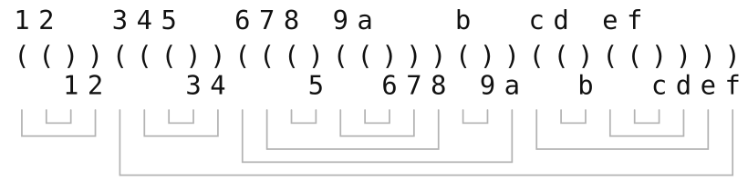</a>

(1)

给出一个字符串, 其中包含 15 个左括号“(”, 标有 1、2、…、f, 还包含 15 个右括号“)”, 也标有 1 至 f. 字符串下方的灰线表示这些括号间的匹配, 构成了 15 对括号 $\mathtt{12,21,3f,44,53,6a,78,85,97,a6,b9,ce,db,ed,fc}$. 这个字符串对应于下面的森林

<a href="../../assets/volume4a/figures/7-2-1-6-eq2-labeled-forest.svg" target="_blank" rel="noopener">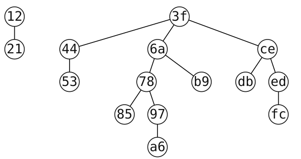</a>

(2)

其中, 这些结点按照前序 (根据第一个坐标排序) 为 $\mathtt{12,21,3f,\ldots,fc}$, 按照后序 (根据第二个坐标排序) 为 $\mathtt{21,12,53,\ldots,3f}$. 如果我们设想一条虫子沿着森林的外围爬行,

<a href="../../assets/volume4a/figures/7-2-1-6-eq3-worm-walk.svg" target="_blank" rel="noopener">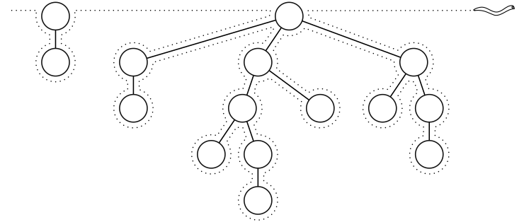</a>

(3)

每当它穿过一个结点的左边时看到一个“(”, 每当它穿过一个结点的右边时看到一个“)”, 那么这条虫子将会重构出原串 (1).

<a id="pdf-382"></a><a id="p-367"></a>

通过 2.3.2 节讨论的 “自然对应” 关系, (2) 中的森林又对应于二叉树

<a href="../../assets/volume4a/figures/7-2-1-6-eq4-binary-tree.svg" target="_blank" rel="noopener">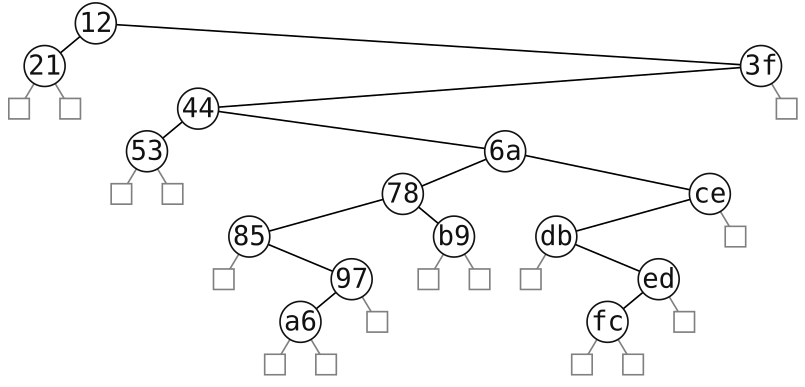</a>

(4)

这里, 结点按 “对称序” (也称 “中序”) 为 $\mathtt{21,12,53,\ldots,3f}$. 在这个二叉树中, 结点 $x$ 的左子树以该森林中 $x$ 的最左子结点为根; 如果 $x$ 没有子结点, 左子树是一个 “外部结点”□. 在这个二叉树中, $x$ 的右子树以它在森林中的右兄弟结点为根; 如果 $x$ 是其家族中的最右子结点, 右子树为□. 森林中树的根结点可看作是兄弟关系, 森林的最左侧根结点是二叉树的根.

当且仅当一个括号串 $a_1a_2\ldots a_{2n}$ 中包含 $n$ 个“(”和 $n$ 个“)”, 并且第 $k$ 个“(”位于第 $k$ 个“)”之前 ($1\leq k\leq n$) 时, 这串括号是正确嵌套的. 探索所有嵌套括号串的最简单方法是按字典序访问它们. 下面的算法认为按照字典序“)”是小于“(”的, 它针对仙波一郎 [*Inf. Processing Letters* **12** (1981), 188–192] 提出的方法进行了一些效率上的改进.

**算法 P (采用字典序的括号嵌套).** 给定整数 $n\geq2$, 算法生成所有嵌套括号串 $a_1a_2\ldots a_{2n}$.

**P1.[初始化.]** 对于 $1\leq k\leq n$, 置 $a_{2k-1}\gets\mathtt{(}$ 和 $a_{2k}\gets\mathtt{)}$. 另置 $a_0\gets\mathtt{)}$ 和 $m\gets2n-1$. (我们在 P4 中以 $a_0$ 为哨兵.)

**P2.[访问.]** 访问嵌套串 $a_1a_2\ldots a_{2n}$. (此时 $a_m=\mathtt{(}$, 并且对于 $m<k\leq2n$ 有 $a_k=\mathtt{)}$.)

**P3.[简单情形?]** 置 $a_m\gets\mathtt{)}$. 然后, 如果 $a_{m-1}=\mathtt{)}$, 置 $a_{m-1}\gets\mathtt{(}$, $m\gets m-1$, 返回 P2.

**P4.[寻找 $j$.]** 置 $j\gets m-1$ 和 $k\gets2n-1$. 当 $a_j=\mathtt{(}$ 时循环执行 $a_j\gets\mathtt{)}$、$a_k\gets\mathtt{(}$、$j\gets j-1$、$k\gets k-2$.

**P5.[递增 $a_j$.]** 如果 $j=0$, 终止算法. 否则, 置 $a_j\gets\mathtt{(}$, $m\gets2n-1$, 返回 P2. ∎

后面将会看到, 步骤 P4 中的循环总是很短的: 平均来说, 对于每个被访问的嵌套串, 操作 $a_j\gets\mathtt{)}$ 仅执行大约 $\frac13$ 次.

算法 P 为什么有效呢? 令 $A_{pq}$ 是由所有包含 $p$ 个左括号和 $q\geq p$ 个右括号的串 $\alpha$ 组成的序列, 其中 $\mathtt{(}^{q-p}\alpha$ 是正确嵌套的, 按字典序排列. 算法 P 要生成的就是 $A_{nn}$, 而且容易看出 $A_{pq}$ 服从递归规则

$$
A_{pq}=\mathtt{)}\,A_{p(q-1)},\ \mathtt{(}\,A_{(p-1)q},\qquad
\text{如果 }0\leq p\leq q\ne0;\qquad A_{00}=\epsilon;\tag{5}
$$

而且, 当 $p<0$ 或 $p>q$ 时, $A_{pq}$ 为空. $A_{pq}$ 的第一个元素是 $\mathtt{)}^{q-p}\mathtt{()}\cdots\mathtt{()}$, 其中共有 $p$ 对 “()”, 最后一个元素是 $\mathtt{(}^p\mathtt{)}^q$. 因此, 字典序的生成过程是从右端开始扫描, 直到找到一个 $a_j\ldots a_{2n}=\mathtt{)}\mathtt{(}^{p+1}\mathtt{)}^q$ 形式的尾串, 然后用 $\mathtt{(}\mathtt{)}^{q+1-p}\mathtt{()}\cdots\mathtt{()}$ 代替它. 步骤 P4 和 P5 可以高效地完成这一操作, 而步骤 P3 则处理 $p=0$ 的简单情形.

<a id="pdf-383"></a><a id="p-368"></a>

表 1 给出了算法 P 在 $n=4$ 时的输出, 还给出了与之对应的像 (2) 和 (4) 中那样的森林和二叉树. 其他几个等价的组合对象也出现在表 1 中. 例如, 嵌套括号串可以采用游程编码为

$$
\mathtt{(}\mathtt{)}^{d_1}\mathtt{(}\mathtt{)}^{d_2}\cdots\mathtt{(}\mathtt{)}^{d_n},\tag{6}
$$

其中, 非负整数 $d_1d_2\ldots d_n$ 满足约束条件

$$
d_1+d_2+\cdots+d_k\leq k,\quad 1\leq k<n;\qquad
d_1+d_2+\cdots+d_n=n.\tag{7}
$$

我们还可以用序列 $z_1z_2\ldots z_n$ 表示嵌套括号, 它指定了左括号的出现位置. 实际上, 如果我们假设 $z_0=0$, 则 $z_1z_2\ldots z_n$ 是由集合 $\{1,2,\ldots,2n\}$ 中取 $n$ 个元素组成的 $\binom{2n}{n}$ 个组合之一, 满足特殊的约束条件

$$
z_{k-1}<z_k<2k,\qquad 1\leq k\leq n.\tag{8}
$$

$z$ 当然与 $d$ 有关:

$$
d_k=z_{k+1}-z_k-1,\qquad 1\leq k<n.\tag{9}
$$

如果改写算法 P, 使之生成组合 $z_1z_2\ldots z_n$ 而不是生成串 $a_1a_2\ldots a_{2n}$, 那么它会变得相当简单. (见习题 2.)

括号串还可以用排列 $p_1p_2\ldots p_n$ 表示, 其中第 $k$ 个右括号与第 $p_k$ 个左括号匹配. 换言之, 相关森林中按后序排列的第 $k$ 个结点是按前序排列的第 $p_k$ 个结点. 根据习题 2.3.2–20, 如果按后序标记结点, 那么森林中的结点 $j$ 是结点 $k$ 的一个 (适当) 后代, 当且仅当 $j<k$ 且 $p_j>p_k$. 反序表 $c_1c_2\ldots c_n$ 根据下述规则描述了这一排列: 在 $k$ 右边恰有 $c_k$ 个元素小于 $k$ (见习题 5.1.1–7). 允许出现的反序表中有 $c_1=0$, 且

$$
0\leq c_{k+1}\leq c_k+1,\qquad 1\leq k<n.\tag{10}
$$

另外, 习题 3 证明了 $c_k$ 是前序森林中第 $k$ 个结点的级别 (也就是第 $k$ 个左括号的深度), 这一事实等价于公式

$$
c_k=2k-1-z_k.\tag{11}
$$

表 1 和习题 6 还给出了一种特殊类型的匹配, 根据该匹配规则, 坐在圆桌旁的 $2n$ 个人可以同时握手, 互不干扰.

<a id="pdf-384"></a><a id="p-369"></a>

<table id="tab-7-2-1-6-1">
<caption>表 1　<var>n</var>=4 时的嵌套括号和相关对象</caption>
<thead><tr><th scope="col">$a_1a_2\ldots a_8$</th><th scope="col">森林</th><th scope="col">二叉树</th><th scope="col">$d_1d_2d_3d_4$</th><th scope="col">$z_1z_2z_3z_4$</th><th scope="col">$p_1p_2p_3p_4$</th><th scope="col">$c_1c_2c_3c_4$</th><th scope="col">匹配</th></tr></thead>
<tbody>
<tr><td><code>()()()()</code></td><td><a href="../../assets/volume4a/figures/7-2-1-6-table1-forest-01.svg" target="_blank" rel="noopener" data-book-original-image="true"></a></td><td><a href="../../assets/volume4a/figures/7-2-1-6-table1-binary-01.svg" target="_blank" rel="noopener" data-book-original-image="true">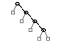</a></td><td><code>1111</code></td><td><code>1357</code></td><td><code>1234</code></td><td><code>0000</code></td><td><a href="../../assets/volume4a/figures/7-2-1-6-table1-matching-01.svg" target="_blank" rel="noopener" data-book-original-image="true"></a></td></tr>
<tr><td><code>()()(())</code></td><td><a href="../../assets/volume4a/figures/7-2-1-6-table1-forest-02.svg" target="_blank" rel="noopener" data-book-original-image="true"></a></td><td><a href="../../assets/volume4a/figures/7-2-1-6-table1-binary-02.svg" target="_blank" rel="noopener" data-book-original-image="true">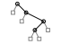</a></td><td><code>1102</code></td><td><code>1356</code></td><td><code>1243</code></td><td><code>0001</code></td><td><a href="../../assets/volume4a/figures/7-2-1-6-table1-matching-02.svg" target="_blank" rel="noopener" data-book-original-image="true"></a></td></tr>
<tr><td><code>()(())()</code></td><td><a href="../../assets/volume4a/figures/7-2-1-6-table1-forest-03.svg" target="_blank" rel="noopener" data-book-original-image="true"></a></td><td><a href="../../assets/volume4a/figures/7-2-1-6-table1-binary-03.svg" target="_blank" rel="noopener" data-book-original-image="true"></a></td><td><code>1021</code></td><td><code>1347</code></td><td><code>1324</code></td><td><code>0010</code></td><td><a href="../../assets/volume4a/figures/7-2-1-6-table1-matching-03.svg" target="_blank" rel="noopener" data-book-original-image="true"></a></td></tr>
<tr><td><code>()(()())</code></td><td><a href="../../assets/volume4a/figures/7-2-1-6-table1-forest-04.svg" target="_blank" rel="noopener" data-book-original-image="true"></a></td><td><a href="../../assets/volume4a/figures/7-2-1-6-table1-binary-04.svg" target="_blank" rel="noopener" data-book-original-image="true"></a></td><td><code>1012</code></td><td><code>1346</code></td><td><code>1342</code></td><td><code>0011</code></td><td><a href="../../assets/volume4a/figures/7-2-1-6-table1-matching-04.svg" target="_blank" rel="noopener" data-book-original-image="true"></a></td></tr>
<tr><td><code>()((()))</code></td><td><a href="../../assets/volume4a/figures/7-2-1-6-table1-forest-05.svg" target="_blank" rel="noopener" data-book-original-image="true"></a></td><td><a href="../../assets/volume4a/figures/7-2-1-6-table1-binary-05.svg" target="_blank" rel="noopener" data-book-original-image="true">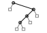</a></td><td><code>1003</code></td><td><code>1345</code></td><td><code>1432</code></td><td><code>0012</code></td><td><a href="../../assets/volume4a/figures/7-2-1-6-table1-matching-05.svg" target="_blank" rel="noopener" data-book-original-image="true"></a></td></tr>
<tr><td><code>(())()()</code></td><td><a href="../../assets/volume4a/figures/7-2-1-6-table1-forest-06.svg" target="_blank" rel="noopener" data-book-original-image="true"></a></td><td><a href="../../assets/volume4a/figures/7-2-1-6-table1-binary-06.svg" target="_blank" rel="noopener" data-book-original-image="true"></a></td><td><code>0211</code></td><td><code>1257</code></td><td><code>2134</code></td><td><code>0100</code></td><td><a href="../../assets/volume4a/figures/7-2-1-6-table1-matching-06.svg" target="_blank" rel="noopener" data-book-original-image="true"></a></td></tr>
<tr><td><code>(())(())</code></td><td><a href="../../assets/volume4a/figures/7-2-1-6-table1-forest-07.svg" target="_blank" rel="noopener" data-book-original-image="true"></a></td><td><a href="../../assets/volume4a/figures/7-2-1-6-table1-binary-07.svg" target="_blank" rel="noopener" data-book-original-image="true"></a></td><td><code>0202</code></td><td><code>1256</code></td><td><code>2143</code></td><td><code>0101</code></td><td><a href="../../assets/volume4a/figures/7-2-1-6-table1-matching-07.svg" target="_blank" rel="noopener" data-book-original-image="true"></a></td></tr>
<tr><td><code>(()())()</code></td><td><a href="../../assets/volume4a/figures/7-2-1-6-table1-forest-08.svg" target="_blank" rel="noopener" data-book-original-image="true"></a></td><td><a href="../../assets/volume4a/figures/7-2-1-6-table1-binary-08.svg" target="_blank" rel="noopener" data-book-original-image="true">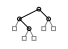</a></td><td><code>0121</code></td><td><code>1247</code></td><td><code>2314</code></td><td><code>0110</code></td><td><a href="../../assets/volume4a/figures/7-2-1-6-table1-matching-08.svg" target="_blank" rel="noopener" data-book-original-image="true"></a></td></tr>
<tr><td><code>(()()())</code></td><td><a href="../../assets/volume4a/figures/7-2-1-6-table1-forest-09.svg" target="_blank" rel="noopener" data-book-original-image="true"></a></td><td><a href="../../assets/volume4a/figures/7-2-1-6-table1-binary-09.svg" target="_blank" rel="noopener" data-book-original-image="true"></a></td><td><code>0112</code></td><td><code>1246</code></td><td><code>2341</code></td><td><code>0111</code></td><td><a href="../../assets/volume4a/figures/7-2-1-6-table1-matching-09.svg" target="_blank" rel="noopener" data-book-original-image="true"></a></td></tr>
<tr><td><code>(()(()))</code></td><td><a href="../../assets/volume4a/figures/7-2-1-6-table1-forest-10.svg" target="_blank" rel="noopener" data-book-original-image="true"></a></td><td><a href="../../assets/volume4a/figures/7-2-1-6-table1-binary-10.svg" target="_blank" rel="noopener" data-book-original-image="true">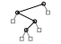</a></td><td><code>0103</code></td><td><code>1245</code></td><td><code>2431</code></td><td><code>0112</code></td><td><a href="../../assets/volume4a/figures/7-2-1-6-table1-matching-10.svg" target="_blank" rel="noopener" data-book-original-image="true"></a></td></tr>
<tr><td><code>((()))()</code></td><td><a href="../../assets/volume4a/figures/7-2-1-6-table1-forest-11.svg" target="_blank" rel="noopener" data-book-original-image="true"></a></td><td><a href="../../assets/volume4a/figures/7-2-1-6-table1-binary-11.svg" target="_blank" rel="noopener" data-book-original-image="true"></a></td><td><code>0031</code></td><td><code>1237</code></td><td><code>3214</code></td><td><code>0120</code></td><td><a href="../../assets/volume4a/figures/7-2-1-6-table1-matching-11.svg" target="_blank" rel="noopener" data-book-original-image="true"></a></td></tr>
<tr><td><code>((())())</code></td><td><a href="../../assets/volume4a/figures/7-2-1-6-table1-forest-12.svg" target="_blank" rel="noopener" data-book-original-image="true"></a></td><td><a href="../../assets/volume4a/figures/7-2-1-6-table1-binary-12.svg" target="_blank" rel="noopener" data-book-original-image="true"></a></td><td><code>0022</code></td><td><code>1236</code></td><td><code>3241</code></td><td><code>0121</code></td><td><a href="../../assets/volume4a/figures/7-2-1-6-table1-matching-12.svg" target="_blank" rel="noopener" data-book-original-image="true"></a></td></tr>
<tr><td><code>((()()))</code></td><td><a href="../../assets/volume4a/figures/7-2-1-6-table1-forest-13.svg" target="_blank" rel="noopener" data-book-original-image="true"></a></td><td><a href="../../assets/volume4a/figures/7-2-1-6-table1-binary-13.svg" target="_blank" rel="noopener" data-book-original-image="true"></a></td><td><code>0013</code></td><td><code>1235</code></td><td><code>3421</code></td><td><code>0122</code></td><td><a href="../../assets/volume4a/figures/7-2-1-6-table1-matching-13.svg" target="_blank" rel="noopener" data-book-original-image="true"></a></td></tr>
<tr><td><code>(((())))</code></td><td><a href="../../assets/volume4a/figures/7-2-1-6-table1-forest-14.svg" target="_blank" rel="noopener" data-book-original-image="true"></a></td><td><a href="../../assets/volume4a/figures/7-2-1-6-table1-binary-14.svg" target="_blank" rel="noopener" data-book-original-image="true"></a></td><td><code>0004</code></td><td><code>1234</code></td><td><code>4321</code></td><td><code>0123</code></td><td><a href="../../assets/volume4a/figures/7-2-1-6-table1-matching-14.svg" target="_blank" rel="noopener" data-book-original-image="true"></a></td></tr>
</tbody>
</table>

因此, 算法 P 可以非常有用. 但是, 如果我们的目标是生成所有二叉树, 用左链接 $l_1l_2\ldots l_n$ 和右链接 $r_1r_2\ldots r_n$ 来表示它们, 那么表 1 中按字典序排列的序列就相当笨拙了. 我们无法轻松获得从一棵树转至其后继所需的数据. 幸运的是, 还有一种非常灵巧的替代方案, 可以直接生成所有的链接二叉树.

**算法 B (二叉树).** 给定 $n\geq1$, 算法生成所有具有 $n$ 个内部结点的二叉树, 通过左链接 $l_1l_2\ldots l_n$ 和右链接 $r_1r_2\ldots r_n$ 表示它们, 用前序标记结点. (例如, 结点 1 总是根结点, $l_k$ 要么是 $k+1$, 要么是 0. 如果 $l_1=0$ 且 $n>1$, 则 $r_1=2$.)

**B1.[初始化.]** 对于 $1\leq k<n$, 置 $l_k\gets k+1$、$r_k\gets0$. 此外, 置 $l_n\gets r_n\gets0$、$l_{n+1}\gets1$ (为在 B3 中便捷起见).

**B2.[访问.]** 访问用 $l_1l_2\ldots l_n$ 和 $r_1r_2\ldots r_n$ 表示的二叉树.

**B3.[寻找 $j$.]** 置 $j\gets1$. 当 $l_j=0$ 时循环执行 $r_j\gets0$、$l_j\gets j+1$、$j\gets j+1$. 然后, 如果 $j>n$ 则终止算法.

**B4.[寻找 $k$ 和 $y$.]** 置 $y\gets l_j$ 和 $k\gets0$. 当 $r_y>0$ 时循环执行 $k\gets y$、$y\gets r_y$.

**B5.[提升 $y$.]** 如果 $k>0$, 置 $r_k\gets0$, 否则置 $l_j\gets0$. 然后, 置 $r_y\gets r_j$、$r_j\gets y$, 返回 B2. ∎

[见瓦迪斯瓦夫·斯卡尔贝克,*Theoretical Computer Science* **57** (1988), 153–159. 步骤 B3 使用了詹姆斯·科尔什的思路.] 习题 44 表明步骤 B3 和 B4 中的循环都趋向于非常短. 事实上, 要将一个链接二叉树转换为它的后继, 平均来说只需要不到 9 次内存访问.

<a id="pdf-385"></a><a id="p-370"></a>

表 2 给出了在 $n=4$ 时所生成的 14 个二叉树, 以及对应的森林, 还有两个相关序列: 数组 $e_1e_2\ldots e_n$ 和 $s_1s_2\ldots s_n$. 它们由以下性质确定, 即采用前序的结点 $k$ 在相关森林中有 $e_k$ 个子结点和 $s_k$ 个后代. (因此, $s_k$ 是二叉树中结点 $k$ 的左子树的大小. 另外, $s_k+1$ 是 SCOPE 链接的长度, 其含义见 2.3.3–(5).) 下一列重现了表 1 中算法 P 按字典序排列的 14 个森林, 但从左向右进行了镜像翻转. 最后一列给出了表示反向字典序森林的二叉树. 它还碰巧表示了第 4 列中的森林, 但采用的是链接到左兄弟结点和右子结点, 而不是左子结点和右兄弟结点. 最后一列给出了嵌套括号和二叉树之间的一种很重要的联系, 我们可以在一定程度上由它了解到算法 B 为什么是有效的 (见习题 19).

<table id="tab-7-2-1-6-2">
<caption>表 2　<var>n</var>=4 时的二叉树及相关对象</caption>
<thead><tr><th scope="col">$l_1l_2l_3l_4$</th><th scope="col">$r_1r_2r_3r_4$</th><th scope="col">二叉树</th><th scope="col">森林</th><th scope="col">$e_1e_2e_3e_4$</th><th scope="col">$s_1s_2s_3s_4$</th><th scope="col">反向字典序森林</th><th scope="col">左兄弟／右子结点</th></tr></thead>
<tbody>
<tr><td><code>2340</code></td><td><code>0000</code></td><td><a href="../../assets/volume4a/figures/7-2-1-6-table2-binary-01.svg" target="_blank" rel="noopener" data-book-original-image="true">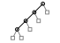</a></td><td><a href="../../assets/volume4a/figures/7-2-1-6-table2-forest-01.svg" target="_blank" rel="noopener" data-book-original-image="true"></a></td><td><code>1110</code></td><td><code>3210</code></td><td><a href="../../assets/volume4a/figures/7-2-1-6-table2-colex-01.svg" target="_blank" rel="noopener" data-book-original-image="true"></a></td><td><a href="../../assets/volume4a/figures/7-2-1-6-table2-lsib-rchild-01.svg" target="_blank" rel="noopener" data-book-original-image="true"></a></td></tr>
<tr><td><code>0340</code></td><td><code>2000</code></td><td><a href="../../assets/volume4a/figures/7-2-1-6-table2-binary-02.svg" target="_blank" rel="noopener" data-book-original-image="true"></a></td><td><a href="../../assets/volume4a/figures/7-2-1-6-table2-forest-02.svg" target="_blank" rel="noopener" data-book-original-image="true"></a></td><td><code>0110</code></td><td><code>0210</code></td><td><a href="../../assets/volume4a/figures/7-2-1-6-table2-colex-02.svg" target="_blank" rel="noopener" data-book-original-image="true"></a></td><td><a href="../../assets/volume4a/figures/7-2-1-6-table2-lsib-rchild-02.svg" target="_blank" rel="noopener" data-book-original-image="true"></a></td></tr>
<tr><td><code>2040</code></td><td><code>0300</code></td><td><a href="../../assets/volume4a/figures/7-2-1-6-table2-binary-03.svg" target="_blank" rel="noopener" data-book-original-image="true"></a></td><td><a href="../../assets/volume4a/figures/7-2-1-6-table2-forest-03.svg" target="_blank" rel="noopener" data-book-original-image="true"></a></td><td><code>2010</code></td><td><code>3010</code></td><td><a href="../../assets/volume4a/figures/7-2-1-6-table2-colex-03.svg" target="_blank" rel="noopener" data-book-original-image="true"></a></td><td><a href="../../assets/volume4a/figures/7-2-1-6-table2-lsib-rchild-03.svg" target="_blank" rel="noopener" data-book-original-image="true"></a></td></tr>
<tr><td><code>2040</code></td><td><code>3000</code></td><td><a href="../../assets/volume4a/figures/7-2-1-6-table2-binary-04.svg" target="_blank" rel="noopener" data-book-original-image="true"></a></td><td><a href="../../assets/volume4a/figures/7-2-1-6-table2-forest-04.svg" target="_blank" rel="noopener" data-book-original-image="true"></a></td><td><code>1010</code></td><td><code>1010</code></td><td><a href="../../assets/volume4a/figures/7-2-1-6-table2-colex-04.svg" target="_blank" rel="noopener" data-book-original-image="true"></a></td><td><a href="../../assets/volume4a/figures/7-2-1-6-table2-lsib-rchild-04.svg" target="_blank" rel="noopener" data-book-original-image="true"></a></td></tr>
<tr><td><code>0040</code></td><td><code>2300</code></td><td><a href="../../assets/volume4a/figures/7-2-1-6-table2-binary-05.svg" target="_blank" rel="noopener" data-book-original-image="true"></a></td><td><a href="../../assets/volume4a/figures/7-2-1-6-table2-forest-05.svg" target="_blank" rel="noopener" data-book-original-image="true"></a></td><td><code>0010</code></td><td><code>0010</code></td><td><a href="../../assets/volume4a/figures/7-2-1-6-table2-colex-05.svg" target="_blank" rel="noopener" data-book-original-image="true"></a></td><td><a href="../../assets/volume4a/figures/7-2-1-6-table2-lsib-rchild-05.svg" target="_blank" rel="noopener" data-book-original-image="true"></a></td></tr>
<tr><td><code>2300</code></td><td><code>0040</code></td><td><a href="../../assets/volume4a/figures/7-2-1-6-table2-binary-06.svg" target="_blank" rel="noopener" data-book-original-image="true">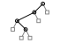</a></td><td><a href="../../assets/volume4a/figures/7-2-1-6-table2-forest-06.svg" target="_blank" rel="noopener" data-book-original-image="true"></a></td><td><code>1200</code></td><td><code>3200</code></td><td><a href="../../assets/volume4a/figures/7-2-1-6-table2-colex-06.svg" target="_blank" rel="noopener" data-book-original-image="true"></a></td><td><a href="../../assets/volume4a/figures/7-2-1-6-table2-lsib-rchild-06.svg" target="_blank" rel="noopener" data-book-original-image="true"></a></td></tr>
<tr><td><code>0300</code></td><td><code>2040</code></td><td><a href="../../assets/volume4a/figures/7-2-1-6-table2-binary-07.svg" target="_blank" rel="noopener" data-book-original-image="true">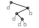</a></td><td><a href="../../assets/volume4a/figures/7-2-1-6-table2-forest-07.svg" target="_blank" rel="noopener" data-book-original-image="true"></a></td><td><code>0200</code></td><td><code>0200</code></td><td><a href="../../assets/volume4a/figures/7-2-1-6-table2-colex-07.svg" target="_blank" rel="noopener" data-book-original-image="true"></a></td><td><a href="../../assets/volume4a/figures/7-2-1-6-table2-lsib-rchild-07.svg" target="_blank" rel="noopener" data-book-original-image="true"></a></td></tr>
<tr><td><code>2300</code></td><td><code>0400</code></td><td><a href="../../assets/volume4a/figures/7-2-1-6-table2-binary-08.svg" target="_blank" rel="noopener" data-book-original-image="true">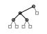</a></td><td><a href="../../assets/volume4a/figures/7-2-1-6-table2-forest-08.svg" target="_blank" rel="noopener" data-book-original-image="true"></a></td><td><code>2100</code></td><td><code>3100</code></td><td><a href="../../assets/volume4a/figures/7-2-1-6-table2-colex-08.svg" target="_blank" rel="noopener" data-book-original-image="true"></a></td><td><a href="../../assets/volume4a/figures/7-2-1-6-table2-lsib-rchild-08.svg" target="_blank" rel="noopener" data-book-original-image="true"></a></td></tr>
<tr><td><code>2300</code></td><td><code>4000</code></td><td><a href="../../assets/volume4a/figures/7-2-1-6-table2-binary-09.svg" target="_blank" rel="noopener" data-book-original-image="true">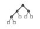</a></td><td><a href="../../assets/volume4a/figures/7-2-1-6-table2-forest-09.svg" target="_blank" rel="noopener" data-book-original-image="true"></a></td><td><code>1100</code></td><td><code>2100</code></td><td><a href="../../assets/volume4a/figures/7-2-1-6-table2-colex-09.svg" target="_blank" rel="noopener" data-book-original-image="true"></a></td><td><a href="../../assets/volume4a/figures/7-2-1-6-table2-lsib-rchild-09.svg" target="_blank" rel="noopener" data-book-original-image="true">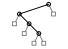</a></td></tr>
<tr><td><code>0300</code></td><td><code>2400</code></td><td><a href="../../assets/volume4a/figures/7-2-1-6-table2-binary-10.svg" target="_blank" rel="noopener" data-book-original-image="true"></a></td><td><a href="../../assets/volume4a/figures/7-2-1-6-table2-forest-10.svg" target="_blank" rel="noopener" data-book-original-image="true"></a></td><td><code>0100</code></td><td><code>0100</code></td><td><a href="../../assets/volume4a/figures/7-2-1-6-table2-colex-10.svg" target="_blank" rel="noopener" data-book-original-image="true"></a></td><td><a href="../../assets/volume4a/figures/7-2-1-6-table2-lsib-rchild-10.svg" target="_blank" rel="noopener" data-book-original-image="true"></a></td></tr>
<tr><td><code>2000</code></td><td><code>0340</code></td><td><a href="../../assets/volume4a/figures/7-2-1-6-table2-binary-11.svg" target="_blank" rel="noopener" data-book-original-image="true"></a></td><td><a href="../../assets/volume4a/figures/7-2-1-6-table2-forest-11.svg" target="_blank" rel="noopener" data-book-original-image="true"></a></td><td><code>3000</code></td><td><code>3000</code></td><td><a href="../../assets/volume4a/figures/7-2-1-6-table2-colex-11.svg" target="_blank" rel="noopener" data-book-original-image="true"></a></td><td><a href="../../assets/volume4a/figures/7-2-1-6-table2-lsib-rchild-11.svg" target="_blank" rel="noopener" data-book-original-image="true"></a></td></tr>
<tr><td><code>2000</code></td><td><code>4300</code></td><td><a href="../../assets/volume4a/figures/7-2-1-6-table2-binary-12.svg" target="_blank" rel="noopener" data-book-original-image="true"></a></td><td><a href="../../assets/volume4a/figures/7-2-1-6-table2-forest-12.svg" target="_blank" rel="noopener" data-book-original-image="true"></a></td><td><code>2000</code></td><td><code>2000</code></td><td><a href="../../assets/volume4a/figures/7-2-1-6-table2-colex-12.svg" target="_blank" rel="noopener" data-book-original-image="true"></a></td><td><a href="../../assets/volume4a/figures/7-2-1-6-table2-lsib-rchild-12.svg" target="_blank" rel="noopener" data-book-original-image="true"></a></td></tr>
<tr><td><code>2000</code></td><td><code>3040</code></td><td><a href="../../assets/volume4a/figures/7-2-1-6-table2-binary-13.svg" target="_blank" rel="noopener" data-book-original-image="true"></a></td><td><a href="../../assets/volume4a/figures/7-2-1-6-table2-forest-13.svg" target="_blank" rel="noopener" data-book-original-image="true"></a></td><td><code>1000</code></td><td><code>1000</code></td><td><a href="../../assets/volume4a/figures/7-2-1-6-table2-colex-13.svg" target="_blank" rel="noopener" data-book-original-image="true"></a></td><td><a href="../../assets/volume4a/figures/7-2-1-6-table2-lsib-rchild-13.svg" target="_blank" rel="noopener" data-book-original-image="true"></a></td></tr>
<tr><td><code>0000</code></td><td><code>2340</code></td><td><a href="../../assets/volume4a/figures/7-2-1-6-table2-binary-14.svg" target="_blank" rel="noopener" data-book-original-image="true"></a></td><td><a href="../../assets/volume4a/figures/7-2-1-6-table2-forest-14.svg" target="_blank" rel="noopener" data-book-original-image="true"></a></td><td><code>0000</code></td><td><code>0000</code></td><td><a href="../../assets/volume4a/figures/7-2-1-6-table2-colex-14.svg" target="_blank" rel="noopener" data-book-original-image="true"></a></td><td><a href="../../assets/volume4a/figures/7-2-1-6-table2-lsib-rchild-14.svg" target="_blank" rel="noopener" data-book-original-image="true"></a></td></tr>
</tbody>
</table>

**\*树的格雷码.** 之前由其他组合模式获得的经验告诉我们, 也许可以仅做一点小小的改动, 由一个实例转变为另一实例, 从而生成括号和树. 实际上, 至少有三种很好的方法可以实现这一目标.

<a id="pdf-386"></a><a id="p-371"></a>

首先考虑嵌套括号的情形, 我们可以用满足条件 (8) 的序列 $z_1z_2\ldots z_n$ 来表示它们. 在 7.2.1.3 节的意义下, 一种用于生成所有此类组合的 “近乎完美” 的方法是指, 我们以这样一种方式来浏览所有这种组合: 在每个步骤, 某一分量 $z_j$ 仅改变 $\pm1$ 或 $\pm2$. 这意味着, 只需在第 $j$ 个左括号附近进行交换操作 “$\mathtt{()}\leftrightarrow\mathtt{)(}$” 或 “$\mathtt{())}\leftrightarrow\mathtt{))(}$”, 就可以把每个括号串变成它的后继. 下面给出在 $n=4$ 时完成这个任务的一种方法:

$$
\begin{gathered}
1357,\ 1356,\ 1346,\ 1345,\ 1347,\ 1247,\ 1245,\\
1246,\ 1236,\ 1234,\ 1235,\ 1237,\ 1257,\ 1256.
\end{gathered}
$$

我们可以将对于 $n-1$ 的任意一个解扩展为对于 $n$ 的解: 取每个模式 $z_1z_2\ldots z_{n-1}$, 像在 7.2.1.3–(45) 中那样, 使用内在顺序或相反顺序, 令 $z_n$ 遍历其所有合法取值, 从 $2n-2$ 向下, 然后向上到 $2n-1$ (或反过来进行), 删除所有小于等于 $z_{n-1}$ 的元素.

**算法 N (近乎完美的嵌套括号).** 算法访问 $\{1,\ldots,2n\}$ 的所有 $n$ 组合 $z_1\ldots z_n$, 这些组合表示一个嵌套串中左括号的下标, 访问过程中每次仅改变一个下标. 这个过程由一个表示临时目标的辅助数组 $g_1\ldots g_n$ 控制.

**N1.[初始化.]** 对于 $1\leq j\leq n$, 置 $z_j\gets2j-1$、$g_j\gets2j-2$.

**N2.[访问.]** 访问 $n$ 组合 $z_1\ldots z_n$. 然后置 $j\gets n$.

**N3.[寻找 $j$.]** 如果 $z_j=g_j$, 置 $g_j\gets g_j\oplus1$ (从而对最低有效位进行求补操作)、$j\gets j-1$, 重复本步骤.

**N4.[最后冲刺?]** 如果 $g_j-z_j$ 为偶数, 置 $z_j\gets z_j+2$, 返回 N2.

**N5.[减小或转向.]** 置 $t\gets z_j-2$. 如果 $t<0$, 终止算法. 否则, 如果 $t\leq z_{j-1}$, 置 $t\gets t+2[t<z_{j-1}]+1$. 最后, 置 $z_j\gets t$, 返回 N2. ∎

[多米尼克·鲁兰茨·范鲍罗瑙伊吉安在 *J. Algorithms* **35** (2000), 100–107 中介绍了一种多少有些类似的算法. 也见相利民、牛岛和夫和唐常杰,*Inf. Proc. Letters* **76** (2000), 169–174. 弗兰克·拉斯基和安杰伊·普罗斯库罗夫斯基之前已经在 *J. Algorithms* **11** (1990), 68–84 中证明了如何为所有表 $z_1\ldots z_n$($n\geq4$ 为偶数) 构造完美格雷码, 从而在每一步使某一 $z_j$ 仅改变 $\pm1$. 但他们的构造非常复杂, 目前还没有找到一种简单到足以实用的完美方案. 习题 48 表明, 当 $n\geq5$ 为奇数时不存在完美格雷码.]

如果我们的目标是生成链接树结构, 而不是括号串, 那么 $z$ 下标变化的完美程度还不够好, 因为像 “$\mathtt{()}\leftrightarrow\mathtt{)(}$” 这样的简单交换不一定对应于简单的链接操作. 一种好得多的方法是基于 “旋转” 算法的, 这种 “旋转” 算法能够使 6.2.3 节的查找树达到平衡. 向左旋转使一棵二叉树

<a href="../../assets/volume4a/figures/7-2-1-6-eq12-left-tree-rotation.svg" target="_blank" rel="noopener">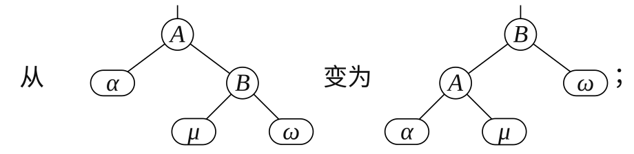</a>

(12)

于是, 相应的森林

<a href="../../assets/volume4a/figures/7-2-1-6-eq13-left-forest-rotation.svg" target="_blank" rel="noopener">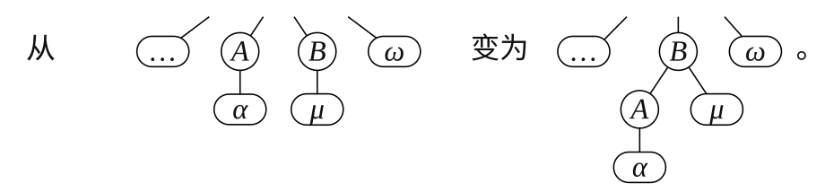</a>

(13)

“结点 $A$ 变为其右兄弟结点的最左子结点”. 当然, 向右旋转是逆转换: “$B$ 的最左子结点变为它的左兄弟结点”. (12) 中的竖线表示与整体环境的联系, 可以是左链接, 也可以是右链接, 或者是指向根结点的指针. 任意或全部子树 $\alpha,\mu,\omega$ 可以为空. (13) 中的“…”表示其他一些兄弟结点, 它们位于包含 $B$ 的家族的左侧, 这些兄弟结点也可以为空.


<a id="pdf-387"></a><a id="p-372"></a>

关于旋转, 有一点非常好, 那就是只有三个链接变化: 来自 $A$ 的右链接, 来自 $B$ 的左链接, 还有来自上方的指针. 旋转操作保持二叉树的中序和森林的后序. (还要注意, 旋转操作的二叉树形式, 以一种非常自然的方式对应于代数公式中结合律

$$
(\alpha\mu)\omega=\alpha(\mu\omega)\tag{14}
$$

的应用.)

有一种很简单的方案, 非常类似于 $n$ 元组经典反射格雷码 (算法 7.2.1.1H) 和用于排列的平滑改变方法 (算法 7.2.1.2P), 可用于通过旋转来生成所有二叉树或森林. 考虑拥有 $n-1$ 个结点的任意森林, 它拥有 $k$ 个根结点 $A_1,\ldots,A_k$. 于是, 共有 $k+1$ 个 $n$ 结点森林, 它们拥有与前 $n-1$ 个结点相同的后序序列, 只是结点 $n$ 作为最后一个结点. 例如, 当 $k=3$ 时, 它们是

<a href="../../assets/volume4a/figures/7-2-1-6-forest-rotation-expansion-series.svg" target="_blank" rel="noopener">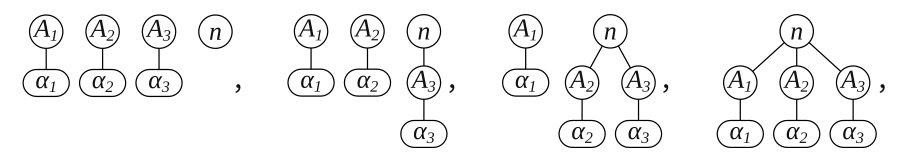</a>

通过将 $A_3,A_2,A_1$ 连续向左旋转得到. 此外, 在 $n$ 位于右侧或顶部的极端情况下, 我们可以对其他 $n-1$ 个结点进行任何必要的旋转操作, 因为结点 $n$ 不在此路径上. 于是, 如琼·卢卡斯、多米尼克·鲁兰茨·范鲍罗瑙伊吉安和弗兰克·拉斯基 [*J. Algorithms* **15** (1993), 343–366] 观察到的那样, 只需让结点 $n$ 来回漫游, 就能扩展列出包含 $n-1$ 个结点的树的任意一个列表, 使其列出所有包含 $n$ 个结点的树. 通过仔细观察低级别的细节, 就有可能高效完成这一任务.

**算法 L (通过旋转链接二叉树).** 算法生成表示 $n$ 结点二叉树左、右链接的所有数组对 $l_0l_1\ldots l_n$ 和 $r_1\ldots r_n$, 其中 $l_0$ 是树的根结点, 链接 $(l_j,r_j)$ 分别指向按对称序排列的第 $j$ 个结点的左、右子树. 等价地, 它生成了所有 $n$ 结点森林, 其中 $l_j$ 和 $r_j$ 表示按后序排列的第 $j$ 个结点的左子结点和右兄弟结点. 每棵树都可以通过单次旋转由其前导获得. 表示反向指针和方向的两个辅助数组 $k_1\ldots k_n$ 和 $o_0o_1\ldots o_n$ 用于控制这个过程.

**L1.[初始化.]** 对于 $1\leq j<n$, 置 $l_j\gets0$、$r_j\gets j+1$、$k_j\gets j-1$、$o_j\gets-1$. 另置 $l_0\gets o_0\gets1$、$l_n\gets r_n\gets0$、$k_n\gets n-1$、$o_n\gets-1$.

**L2.[访问.]** 访问由 $l_0l_1\ldots l_n$ 和 $r_1\ldots r_n$ 表示的二叉树或森林. 然后置 $j\gets n$、$p\gets0$.

**L3.[寻找 $j$.]** 如果 $o_j>0$, 置 $m\gets l_j$, 在 $m\ne0$ 时转到 L5. 如果 $o_j<0$, 置 $m\gets k_j$, 然后, 如果 $m\ne0$, 转到 L4, 否则置 $p\gets j$. 在任一情形下, 如果 $m=0$, 置 $o_j\gets-o_j$、$j\gets j-1$, 重复本步骤.

**L4.[向左旋转.]** 置 $r_m\gets l_j$、$l_j\gets m$、$x\gets k_m$、$k_j\gets x$. 如果 $x=0$, 置 $l_p\gets j$, 否则置 $r_x\gets j$. 返回 L2.

**L5.[向右旋转.]** 如果 $j=0$, 终止算法. 否则, 置 $l_j\gets r_m$、$r_m\gets j$、$k_j\gets m$、$x\gets k_m$. 如果 $x=0$, 置 $l_p\gets m$, 否则置 $r_x\gets m$. 返回 L2. ∎

习题 38 表明, 算法 L 每生成一棵树只需要大约 9 次内存访问, 因此, 它几乎跟算法 B 一样快. (事实上, 如果把 3 个量 $o_n,l_n,k_n$ 保存在寄存器中, 可以在每一步节省两次内存访问. 当然, 这也会提高算法 B 的速度.)

<a id="pdf-388"></a><a id="p-373"></a>

表 3 给出了当 $n=4$ 时算法 L 访问的二叉树和森林序列, 还有一些有助于进一步理解此过程的辅助表. 排列 $q_1q_2q_3q_4$ 按照前序列出结点, 这些结点已经按照森林的后序 (二叉树的对称序) 进行了编号. 它是表 1 中排列 $p_1p_2p_3p_4$ 的逆排列. “共轭森林” 是此森林的共轭 (自右向左的反射). $u_1u_2u_3u_4$ 是它的范围坐标, 类似于表 2 中的 $s_1s_2s_3s_4$. 最后一列给出所谓的 “对偶森林”. 习题 11、12、13、19、24、26、27 研究了这些相关量的意义.

<table id="tab-7-2-1-6-3">
<caption>表 3　<var>n</var>=4 时由旋转生成的二叉树和森林</caption>
<thead><tr><th scope="col">$l_0l_1l_2l_3l_4$</th><th scope="col">$r_1r_2r_3r_4$</th><th scope="col">$k_1k_2k_3k_4$</th><th scope="col">二叉树</th><th scope="col">森林</th><th scope="col">$q_1q_2q_3q_4$</th><th scope="col">共轭森林</th><th scope="col">$u_1u_2u_3u_4$</th><th scope="col">对偶森林</th></tr></thead>
<tbody>
<tr><td><code>10000</code></td><td><code>2340</code></td><td><code>0123</code></td><td><a href="../../assets/volume4a/figures/7-2-1-6-table3-binary-01.svg" target="_blank" rel="noopener" data-book-original-image="true"></a></td><td><a href="../../assets/volume4a/figures/7-2-1-6-table3-forest-01.svg" target="_blank" rel="noopener" data-book-original-image="true"></a></td><td><code>1234</code></td><td><a href="../../assets/volume4a/figures/7-2-1-6-table3-coforest-01.svg" target="_blank" rel="noopener" data-book-original-image="true"></a></td><td><code>0000</code></td><td><a href="../../assets/volume4a/figures/7-2-1-6-table1-forest-14.svg" target="_blank" rel="noopener" data-book-original-image="true"></a></td></tr>
<tr><td><code>10003</code></td><td><code>2400</code></td><td><code>0122</code></td><td><a href="../../assets/volume4a/figures/7-2-1-6-table3-binary-02.svg" target="_blank" rel="noopener" data-book-original-image="true"></a></td><td><a href="../../assets/volume4a/figures/7-2-1-6-table3-forest-02.svg" target="_blank" rel="noopener" data-book-original-image="true"></a></td><td><code>1243</code></td><td><a href="../../assets/volume4a/figures/7-2-1-6-table3-coforest-02.svg" target="_blank" rel="noopener" data-book-original-image="true"></a></td><td><code>1000</code></td><td><a href="../../assets/volume4a/figures/7-2-1-6-table1-forest-05.svg" target="_blank" rel="noopener" data-book-original-image="true"></a></td></tr>
<tr><td><code>10002</code></td><td><code>4300</code></td><td><code>0121</code></td><td><a href="../../assets/volume4a/figures/7-2-1-6-table3-binary-03.svg" target="_blank" rel="noopener" data-book-original-image="true"></a></td><td><a href="../../assets/volume4a/figures/7-2-1-6-table3-forest-03.svg" target="_blank" rel="noopener" data-book-original-image="true"></a></td><td><code>1423</code></td><td><a href="../../assets/volume4a/figures/7-2-1-6-table3-coforest-03.svg" target="_blank" rel="noopener" data-book-original-image="true"></a></td><td><code>2000</code></td><td><a href="../../assets/volume4a/figures/7-2-1-6-table1-forest-07.svg" target="_blank" rel="noopener" data-book-original-image="true"></a></td></tr>
<tr><td><code>40001</code></td><td><code>2300</code></td><td><code>0120</code></td><td><a href="../../assets/volume4a/figures/7-2-1-6-table3-binary-04.svg" target="_blank" rel="noopener" data-book-original-image="true"></a></td><td><a href="../../assets/volume4a/figures/7-2-1-6-table3-forest-04.svg" target="_blank" rel="noopener" data-book-original-image="true"></a></td><td><code>4123</code></td><td><a href="../../assets/volume4a/figures/7-2-1-6-table3-coforest-04.svg" target="_blank" rel="noopener" data-book-original-image="true"></a></td><td><code>3000</code></td><td><a href="../../assets/volume4a/figures/7-2-1-6-table1-forest-11.svg" target="_blank" rel="noopener" data-book-original-image="true"></a></td></tr>
<tr><td><code>40021</code></td><td><code>3000</code></td><td><code>0110</code></td><td><a href="../../assets/volume4a/figures/7-2-1-6-table3-binary-05.svg" target="_blank" rel="noopener" data-book-original-image="true"></a></td><td><a href="../../assets/volume4a/figures/7-2-1-6-table3-forest-05.svg" target="_blank" rel="noopener" data-book-original-image="true"></a></td><td><code>4132</code></td><td><a href="../../assets/volume4a/figures/7-2-1-6-table3-coforest-05.svg" target="_blank" rel="noopener" data-book-original-image="true"></a></td><td><code>3100</code></td><td><a href="../../assets/volume4a/figures/7-2-1-6-table1-forest-03.svg" target="_blank" rel="noopener" data-book-original-image="true"></a></td></tr>
<tr><td><code>10023</code></td><td><code>4000</code></td><td><code>0111</code></td><td><a href="../../assets/volume4a/figures/7-2-1-6-table3-binary-06.svg" target="_blank" rel="noopener" data-book-original-image="true"></a></td><td><a href="../../assets/volume4a/figures/7-2-1-6-table3-forest-06.svg" target="_blank" rel="noopener" data-book-original-image="true"></a></td><td><code>1432</code></td><td><a href="../../assets/volume4a/figures/7-2-1-6-table3-coforest-06.svg" target="_blank" rel="noopener" data-book-original-image="true"></a></td><td><code>2100</code></td><td><a href="../../assets/volume4a/figures/7-2-1-6-table1-forest-02.svg" target="_blank" rel="noopener" data-book-original-image="true"></a></td></tr>
<tr><td><code>10020</code></td><td><code>3040</code></td><td><code>0113</code></td><td><a href="../../assets/volume4a/figures/7-2-1-6-table3-binary-07.svg" target="_blank" rel="noopener" data-book-original-image="true">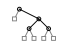</a></td><td><a href="../../assets/volume4a/figures/7-2-1-6-table3-forest-07.svg" target="_blank" rel="noopener" data-book-original-image="true"></a></td><td><code>1324</code></td><td><a href="../../assets/volume4a/figures/7-2-1-6-table3-coforest-07.svg" target="_blank" rel="noopener" data-book-original-image="true"></a></td><td><code>0100</code></td><td><a href="../../assets/volume4a/figures/7-2-1-6-table1-forest-10.svg" target="_blank" rel="noopener" data-book-original-image="true"></a></td></tr>
<tr><td><code>30010</code></td><td><code>2040</code></td><td><code>0103</code></td><td><a href="../../assets/volume4a/figures/7-2-1-6-table3-binary-08.svg" target="_blank" rel="noopener" data-book-original-image="true"></a></td><td><a href="../../assets/volume4a/figures/7-2-1-6-table3-forest-08.svg" target="_blank" rel="noopener" data-book-original-image="true"></a></td><td><code>3124</code></td><td><a href="../../assets/volume4a/figures/7-2-1-6-table3-coforest-08.svg" target="_blank" rel="noopener" data-book-original-image="true"></a></td><td><code>0200</code></td><td><a href="../../assets/volume4a/figures/7-2-1-6-table1-forest-12.svg" target="_blank" rel="noopener" data-book-original-image="true"></a></td></tr>
<tr><td><code>40013</code></td><td><code>2000</code></td><td><code>0100</code></td><td><a href="../../assets/volume4a/figures/7-2-1-6-table3-binary-09.svg" target="_blank" rel="noopener" data-book-original-image="true"></a></td><td><a href="../../assets/volume4a/figures/7-2-1-6-table3-forest-09.svg" target="_blank" rel="noopener" data-book-original-image="true"></a></td><td><code>4312</code></td><td><a href="../../assets/volume4a/figures/7-2-1-6-table3-coforest-09.svg" target="_blank" rel="noopener" data-book-original-image="true"></a></td><td><code>3200</code></td><td><a href="../../assets/volume4a/figures/7-2-1-6-table1-forest-06.svg" target="_blank" rel="noopener" data-book-original-image="true"></a></td></tr>
<tr><td><code>40123</code></td><td><code>0000</code></td><td><code>0000</code></td><td><a href="../../assets/volume4a/figures/7-2-1-6-table3-binary-10.svg" target="_blank" rel="noopener" data-book-original-image="true"></a></td><td><a href="../../assets/volume4a/figures/7-2-1-6-table3-forest-10.svg" target="_blank" rel="noopener" data-book-original-image="true"></a></td><td><code>4321</code></td><td><a href="../../assets/volume4a/figures/7-2-1-6-table3-coforest-10.svg" target="_blank" rel="noopener" data-book-original-image="true"></a></td><td><code>3210</code></td><td><a href="../../assets/volume4a/figures/7-2-1-6-table1-forest-01.svg" target="_blank" rel="noopener" data-book-original-image="true"></a></td></tr>
<tr><td><code>30120</code></td><td><code>0040</code></td><td><code>0003</code></td><td><a href="../../assets/volume4a/figures/7-2-1-6-table3-binary-11.svg" target="_blank" rel="noopener" data-book-original-image="true"></a></td><td><a href="../../assets/volume4a/figures/7-2-1-6-table3-forest-11.svg" target="_blank" rel="noopener" data-book-original-image="true"></a></td><td><code>3214</code></td><td><a href="../../assets/volume4a/figures/7-2-1-6-table3-coforest-11.svg" target="_blank" rel="noopener" data-book-original-image="true"></a></td><td><code>0210</code></td><td><a href="../../assets/volume4a/figures/7-2-1-6-table1-forest-09.svg" target="_blank" rel="noopener" data-book-original-image="true"></a></td></tr>
<tr><td><code>20100</code></td><td><code>0340</code></td><td><code>0023</code></td><td><a href="../../assets/volume4a/figures/7-2-1-6-table3-binary-12.svg" target="_blank" rel="noopener" data-book-original-image="true">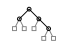</a></td><td><a href="../../assets/volume4a/figures/7-2-1-6-table3-forest-12.svg" target="_blank" rel="noopener" data-book-original-image="true"></a></td><td><code>2134</code></td><td><a href="../../assets/volume4a/figures/7-2-1-6-table3-coforest-12.svg" target="_blank" rel="noopener" data-book-original-image="true"></a></td><td><code>0010</code></td><td><a href="../../assets/volume4a/figures/7-2-1-6-table1-forest-13.svg" target="_blank" rel="noopener" data-book-original-image="true"></a></td></tr>
<tr><td><code>20103</code></td><td><code>0400</code></td><td><code>0022</code></td><td><a href="../../assets/volume4a/figures/7-2-1-6-table3-binary-13.svg" target="_blank" rel="noopener" data-book-original-image="true">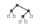</a></td><td><a href="../../assets/volume4a/figures/7-2-1-6-table3-forest-13.svg" target="_blank" rel="noopener" data-book-original-image="true"></a></td><td><code>2143</code></td><td><a href="../../assets/volume4a/figures/7-2-1-6-table3-coforest-13.svg" target="_blank" rel="noopener" data-book-original-image="true"></a></td><td><code>1010</code></td><td><a href="../../assets/volume4a/figures/7-2-1-6-table1-forest-04.svg" target="_blank" rel="noopener" data-book-original-image="true"></a></td></tr>
<tr><td><code>40102</code></td><td><code>0300</code></td><td><code>0020</code></td><td><a href="../../assets/volume4a/figures/7-2-1-6-table3-binary-14.svg" target="_blank" rel="noopener" data-book-original-image="true"></a></td><td><a href="../../assets/volume4a/figures/7-2-1-6-table3-forest-14.svg" target="_blank" rel="noopener" data-book-original-image="true"></a></td><td><code>4213</code></td><td><a href="../../assets/volume4a/figures/7-2-1-6-table3-coforest-14.svg" target="_blank" rel="noopener" data-book-original-image="true"></a></td><td><code>3010</code></td><td><a href="../../assets/volume4a/figures/7-2-1-6-table1-forest-08.svg" target="_blank" rel="noopener" data-book-original-image="true"></a></td></tr>
</tbody></table>

算法 L 和表 3 中的链接 $l_0l_1\ldots l_n$ 和 $r_1\ldots r_n$ 与算法 B 和表 2 中的链接 $l_1\ldots l_n$ 和 $r_1\ldots r_n$ 不能直接对应, 因为算法 L 保持中序／后序, 而算法 B 保持前序. 算法 L 中的结点 $k$ 是二叉树中从左向右的第 $k$ 个结点, 所以需要用 $l_0$ 来标识根结点. 但是, 算法 B 中的结点 $k$ 是采用前序的第 $k$ 个结点, 因此, 在这种情形根结点总是结点 1.

<a id="pdf-389"></a><a id="p-374"></a>

算法 L 具有我们想要的性质: 每一步骤中仅有 3 次链接变化. 然而, 如果坚持算法 B 中的前序约定, 实际上还可以在这方面做得更好. 习题 25 给出了一种算法, 每步只改变两个链接并保持前序, 就能生成所有的链接二叉树或森林. 一个链接变为非零, 另一个链接就变为零. 这种 “剪除—嫁接” 算法就是上面所说的三种 “树的完美格雷码” 中的第三种, 它只有一个缺点: 其控制机制要比算法 L 复杂一些, 如果我们将每一步中判断要修改哪个链接的成本也计算在内, 那它进行计算所需要的时间要多出 40%.

**树的棵数.** 有一个简单公式可用于计算由算法 P、B、N、L 生成的输出总数, 即

$$
C_n=\frac{1}{n+1}\binom{2n}{n}=\binom{2n}{n}-\binom{2n}{n-1};\tag{15}
$$

我们已经在式 2.3.4.4-(14) 中证明了这一事实. $C_n$ 的前几个值为

$$
\begin{array}{rrrrrrrrrrrrrrr}
n={}&0&1&2&3&4&5&6&7&8&9&10&11&12&13\\
C_n={}&1&1&2&5&14&42&132&429&1430&4862&16796&58786&208012&742900
\end{array}
$$

它们称为卡塔兰数, 因为欧仁·卡塔兰撰写了一些富有影响力的论文 [*Journal de math.* **3** (1838), 508–516;**4** (1839), 95–99]. 由斯特林近似式可以得到渐近值

$$
C_n=\frac{4^n}{\sqrt{\pi}\,n^{3/2}}
  \left(1-\frac{9}{8n}+\frac{145}{128n^2}-\frac{1155}{1024n^3}
  +\frac{36939}{32768n^4}+O(n^{-5})\right);\tag{16}
$$

特别地, 可以推导出

$$
\text{当 }|k|\leq\frac n2\text{ 时, 有 }\quad
\frac{C_{n-k}}{C_n}=\frac{1}{4^k}\left(1+\frac{3k}{2n}+O\left(\frac{k^2}{n^2}\right)\right).\tag{17}
$$

(当然, 根据 (15) 可知 $C_{n-1}/C_n$ 确切等于 $(n+1)/(4n-2)$.) 在 2.3.4.4 节, 我们还导出了生成函数

$$
C(z)=C_0+C_1z+C_2z^2+C_3z^3+\cdots=\frac{1-\sqrt{1-4z}}{2z},\tag{18}
$$

并证明了重要公式

$$
[z^n]C(z)^r=\frac{r}{n+r}\binom{2n+r-1}{n}
=\binom{2n+r-1}{n}-\binom{2n+r-1}{n-1};\tag{19}
$$

见习题 2.3.4.4–33 的答案和《具体数学》式 (5.70).

这些事实给出的信息足以分析用于为嵌套括号生成字典序的算法 P. 显然, 步骤 P2 执行了 $C_n$ 次; 然后, 步骤 P3 通常进行简单的改变并返回 P2. 多频繁才会到达步骤 P4 呢? 很简单: 次数就是步骤 P2 找到 $m=2n-1$ 的次数. $m$ 是最右“(”的位置, 所以恰好在 $C_{n-1}$ 种情形中有 $m=2n-1$. 因此, 根据 (17), 步骤 P3 置 $m\gets m-1$ 并立即返回 P2 的概率为 $(C_n-C_{n-1})/C_n\approx3/4$. 另一方面, 当我们真的到达 P4 时, 假设这一步骤恰好需要将 $a_j\gets\mathtt{)}$ 和 $a_k\gets\mathtt{(}$ 这两个赋值操作执行 $h-1$ 次. $h>x$ 的情形的数量就是以 $x$ 个平凡括号对 $\mathtt{()}\ldots\mathtt{()}$ 结尾的长度为 $2n$ 的嵌套串的数量, 即 $C_{n-x}$. 因此, 根据 (17), 算法在步骤 P4 中改变 $a_j$ 和 $a_k$ 的次数为

$$
\begin{aligned}
C_{n-1}+C_{n-2}+\cdots+C_1
&=C_n\left(\frac{C_{n-1}}{C_n}+\frac{C_{n-2}}{C_n}+\cdots+\frac{C_1}{C_n}\right)\\
&=\frac13 C_n\left(1+\frac2n+O\left(\frac{1}{n^2}\right)\right),
\end{aligned}\tag{20}
$$

现在我们证明了之前关于效率的断言.

<a id="pdf-390"></a><a id="p-375"></a>

为加深理解, 研究一下作为算法 P 基础的递归结构是有帮助的, 该结构如式 (5) 所示. 该式中的序列有 $C_{pq}$ 个元素, 其中

$$
C_{pq}=C_{p(q-1)}+C_{(p-1)q},
\quad\text{如果 }0\leq p\leq q\neq0;
\qquad C_{00}=1;\tag{21}
$$

如果 $p<0$ 或 $p>q$, 则 $C_{pq}=0$. 于是, 我们可以得到三角阵列

$$
\begin{array}{lllllll}
C_{00}\\
C_{01}&C_{11}\\
C_{02}&C_{12}&C_{22}\\
C_{03}&C_{13}&C_{23}&C_{33}\\
C_{04}&C_{14}&C_{24}&C_{34}&C_{44}\\
C_{05}&C_{15}&C_{25}&C_{35}&C_{45}&C_{55}\\
C_{06}&C_{16}&C_{26}&C_{36}&C_{46}&C_{56}&C_{66}
\end{array}
=
\begin{array}{rrrrrrr}
1\\
1&1\\
1&2&2\\
1&3&5&5\\
1&4&9&14&14\\
1&5&14&28&42&42\\
1&6&20&48&90&132&132
\end{array}\tag{22}
$$

其中每一项都是其上方和左侧最近邻居的和, 卡塔兰数 $C_n=C_{nn}$ 出现在对角线上. 这个三角阵列的元素本身拥有一个可追溯到 1711 年棣莫弗的古老谱系. 它们称为 “选票数”, 因为它们表示由 $p+q$ 张选票组成的序列, 其中任意计票前缀里, 最终获得 $p$ 票的候选人都未领先最终获得 $q$ 票的对手. 通过归纳法或各种更有趣的方法, 可以得到一般公式

$$
C_{pq}=\frac{q-p+1}{q+1}\binom{p+q}{p}
 =\binom{p+q}{p}-\binom{p+q}{p-1};\tag{23}
$$

见习题 39, 也见习题 2.2.1–4 的解答. 注意, 根据 (19), 我们有

$$
C_{pq}=[z^p]C(z)^{q-p+1}.\tag{24}
$$

当 $n=4$ 时, 算法 P 实际上描述了递归树

<a href="../../assets/volume4a/figures/7-2-1-6-eq25-catalan-recursion-tree.svg" target="_blank" rel="noopener">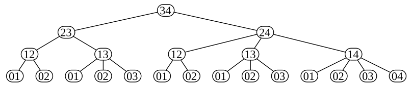</a>

(25)

因为 (5) 中的规定意味着 $A_{nn}=\mathtt{(}\,A_{(n-1)n}$, 以及

$$
\begin{aligned}
A_{pq}={}&\mathtt{)}^{q-p}\mathtt{(}\,A_{(p-1)p},\
  \mathtt{)}^{q-p-1}\mathtt{(}\,A_{(p-1)(p+1)},\
  \mathtt{)}^{q-p-2}\mathtt{(}\,A_{(p-1)(p+2)},\\
&\ldots,\quad \mathtt{(}\,A_{(p-1)q},
  \qquad\text{当 }0<p<q\text{ 时.}
\end{aligned}\tag{26}
$$

在这一递归树中, 出现在结点 <span style="border:1px solid;border-radius:1em;padding:0.10em 0.17em">$pq$</span> 下方的叶子总数为 $C_{pq}$. 在第 $n-1-p$ 级, 结点 <span style="border:1px solid;border-radius:1em;padding:0.10em 0.17em">$pq$</span> 恰好出现 $C_{(n-q)(n-1-p)}$ 次. 因此, 我们必然有

$$
\sum_q C_{(n-q)(n-1-p)}C_{pq}=C_n,\qquad\text{对于 }0\leq p<n.\tag{27}
$$

(25) 中自左向右的 14 个叶子, 依次对应于表 1 中自上而下的 14 行. 注意, 表 1 中 $c_1c_2c_3c_4$ 列的各项为 (25) 中的叶子分别指定了 $0000,0001,0010,\ldots,0123$, 指定规则符合树结点的 “杜威记数法” (但其起始下标是 0, 并且开始处额外增加了一个 0).

有一条蠕虫沿着此递归树的底部, 从一个叶子爬向另一个叶子. 当坐标 $c_1\ldots c_n$ 中的 $h$ 个发生变化时, 也就是算法 P 将 $h$ 个“(”和 $h$ 个“)”的值重置时, 这条蠕虫将上升和下降 $h$ 个级别. 观察到这一点, 就容易理解我们前面的结论了: 在整个爬行期间, $h>x$ 的情形恰好发生 $C_{n-x}$ 次.

<a id="pdf-391"></a><a id="p-376"></a>

考虑下面这个由递归式 (21) 引出的无限有向图, 就会又有一种理解算法 P 的方式:

<a href="../../assets/volume4a/figures/7-2-1-6-eq28-catalan-digraph.svg" target="_blank" rel="noopener">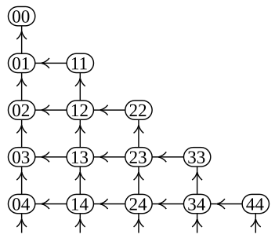</a>

(28)

显然, 根据 (21) 可知, $C_{pq}$ 是这个有向图中由 <span style="border:1px solid;border-radius:1em;padding:0.10em 0.17em">$pq$</span> 到 <span style="border:1px solid;border-radius:1em;padding:0.10em 0.17em">00</span> 的路径数量. 实际上, $A_{pq}$ 中的每个括号串都直接对应于这样一条路径, 其中“(”表示向左一步, “)”表示向上一步. 算法 P 在扩展一条部分路径时, 首先尝试向上移动, 以这种方式系统地探索所有这些路径.

因此, 通过以下方式可以很容易地确定算法 P 访问的第 $N$ 条嵌套括号串. 从结点 <span style="border:1px solid;border-radius:1em;padding:0.10em 0.17em">$nn$</span> 开始, 在结点 <span style="border:1px solid;border-radius:1em;padding:0.10em 0.17em">$pq$</span> 处进行以下计算: 如果 $p=q=0$, 则停止; 否则, 如果 $N\leq C_{p(q-1)}$, 则输出“)”并置 $q\gets q-1$, 然后继续; 否则, 置 $N\gets N-C_{p(q-1)}$、输出“(”并置 $p\gets p-1$, 然后继续. 下面的算法 [弗兰克·拉斯基, 博士论文 (加利福尼亚大学圣地亚哥分校, 1978), 16–24] 不需要预先计算卡塔兰三角, 而是在执行过程中随时计算 $C_{pq}$.

**算法 U (嵌套括号串的定位操作).** 给定 $n$ 和 $N$, 其中 $1\leq N\leq C_n$, 本算法计算算法 P 的第 $N$ 个输出 $a_1\ldots a_{2n}$.

**U1.[初始化.]** 置 $q\gets n$、$m\gets p\gets c\gets1$. 当 $p<n$ 时, 置 $p\gets p+1$、$c\gets((4p-2)c)/(p+1)$.

**U2.[完成?]** 如果 $q=0$, 则终止算法.

**U3.[向上?]** 置 $c'\gets((q+1)(q-p)c)/((q+p)(q-p+1))$. (此时我们有 $1\leq N\leq c=C_{pq}$ 且 $c'=C_{p(q-1)}$.) 如果 $N\leq c'$, 置 $q\gets q-1$、$c\gets c'$、$a_m\gets\mathtt{)}$、$m\gets m+1$, 返回 U2.

**U4.[向左.]** 置 $p\gets p-1$、$c\gets c-c'$、$N\gets N-c'$、$a_m\gets\mathtt{(}$、$m\gets m+1$, 返回 U3. ∎

**随机树.** 我们只需要将算法 U 应用于介于 1 和 $C_n$ 之间的随机整数 $N$, 就可以随机选择嵌套括号串 $a_1a_2\ldots a_{2n}$. 但当 $n$ 大于 32 左右时, 因为 $C_n$ 可能变得非常大, 使得这个思路实际上并不是很好. 戴维·阿诺德和迈克尔·斯利普 [*ACM Trans. Prog. Languages and Systems* **2** (1980), 122–128] 提出了一个更简单、更好的方法, 就是从 (28) 中的 <span style="border:1px solid;border-radius:1em;padding:0.10em 0.17em">$nn$</span> 开始, 以适当的概率重复选取向左或向上的分支, 从而生成一条随机 “蠕虫路径”. 这种算法与算法 U 几乎相同, 但它仅处理小于 $n^2+n+1$ 的非负整数.

**算法 W (均匀分布的随机嵌套括号串).** 算法生成一个正确嵌套“(”和“)”的随机串 $a_1a_2\ldots a_{2n}$.

**W1.[初始化.]** 置 $p\gets q\gets n$、$m\gets1$.

**W2.[完成?]** 如果 $q=0$, 则终止算法.

**W3.[向上?]** 令 $X$ 是 $0\leq X<(q+p)(q-p+1)$ 的一个随机整数. 如果 $X<(q+1)(q-p)$, 置 $q\gets q-1$、$a_m\gets\mathtt{)}$、$m\gets m+1$, 返回 W2.

**W4.[向左.]** 置 $p\gets p-1$、$a_m\gets\mathtt{(}$、$m\gets m+1$, 返回 W3. ∎

<a id="pdf-392"></a><a id="p-377"></a>

一条蠕虫路径可看作是一个序列 $w_0w_1\ldots w_{2n}$, 其中 $w_m$ 是蠕虫在经过 $m$ 步之后的当前深度. 因此, $w_0=0$; 当 $a_m=\mathtt{(}$ 时, $w_m=w_{m-1}+1$; 当 $a_m=\mathtt{)}$ 时, $w_m=w_{m-1}-1$; 并且 $w_m\geq0$、$w_{2n}=0$. 与 (1) 和 (2) 对应的序列 $w_0w_1\ldots w_{30}$ 为 $\mathtt{0121012321234345432321232343210}$. 在算法 W 的步骤 W3 处有 $q+p=2n+1-m$ 和 $q-p=w_{m-1}$.

森林的轮廓是一条穿过平面内 $(m,-w_m)$ 这些点的路径 ($0\leq m\leq2n$), 其中 $w_0w_1\ldots w_{2n}$ 是与嵌套括号串 $a_1\ldots a_{2n}$ 对应的蠕虫路径. 我们为包含 50 个结点的所有森林绘制轮廓, 并按蠕虫路径位于各点下方的森林数为该点着色, 得到图 57 所示的图形. 例如, $w_1$ 总是 1, 图 57 左上方的三角区域为实心黑色. 但 $w_2$ 要么为 0, 要么为 2; 在 $C_{49}\approx C_{50}/4$ 种情形中出现 0. 因此, 相邻的菱形区域为 75%的灰阶阴影. 图 57 给出了一个随机森林的形状, 类似于我们在 7.2.1.4 节和 7.2.1.5 节的图 50、51、55 中看到的随机分划的形状.

<a id="fig-57"></a>

<a href="../../assets/volume4a/figures/7-2-1-6-fig57-random-forest-shape.svg" target="_blank" rel="noopener"></a>

**图 57　50 结点随机森林的形状.**

当然, 因为总共有 $C_{50}=1\,978\,261\,657\,756\,160\,653\,623\,774\,456$ 个森林, 我们无法真的画出所有这些森林的轮廓. 但在数学的帮助下, 可以假装我们都已经画出来了. $w_{2m}=2k$ 的概率是 $C_{(m-k)(m+k)}C_{(n-m-k)(n-m+k)}/C_n$, 因为共有 $C_{(m-k)(m+k)}$ 种方式以 $m+k$ 个“(”和 $m-k$ 个“)”开头, 有 $C_{(n-m-k)(n-m+k)}$ 种方式以 $n-(m+k)$ 个“(”和 $n-(m-k)$ 个“)”结束. 对于 $0<\theta<1$, 当 $m=\theta n$ 且 $n\to\infty$ 时, 根据 (23) 和斯特林近似式, 这个概率是

$$
\begin{aligned}
&\frac{(2k+1)^2(n+1)}{(m+k+1)(n-m+k+1)}
 \binom{2m}{m-k}\binom{2n-2m}{n-m+k}\Big/\binom{2n}{n}\\
&\qquad=\frac{(2k+1)^2}{\sqrt{\pi}\,(\theta(1-\theta)n)^{3/2}}
 e^{-k^2/(\theta(1-\theta)n)}
 \left(1+O\left(\frac{k+1}{n}\right)+O\left(\frac{k^3}{n^2}\right)\right).
\end{aligned}\tag{29}
$$

习题 57 算出了 $w_{2m}$ 的平均值, 它等于

$$
\frac{(4m(n-m)+n)\binom{2m}{m}\binom{2n-2m}{n-m}}{n\binom{2n}{n}}-1
=4\sqrt{\frac{\theta(1-\theta)n}{\pi}}-1+O\left(\frac1{\sqrt n}\right),\tag{30}
$$

图 57 以曲线形式给出了 $n=50$ 时的形状.

当 $n$ 很大时, 蠕虫路径接近于所谓的 “布朗游程”, 它是概率论中的重要概念. 例如, 见保罗·莱维,*Processus Stochastiques et Mouvement Brownien* (1948), 225–237; 居伊·卢沙尔,*J. Applied Prob.* **21** (1984), 479–499,*BIT* **26** (1986), 17–34; 戴维·奥尔德斯,*Electronic Communications in Probability* **3** (1998), 79–90; 乔恩·沃伦,*Electronic Communications in Probability* **4** (1999), 25–29; 让-弗朗索瓦·马克特,*Random Structures & Algorithms* **24** (2004), 118–132.

<a id="pdf-393"></a><a id="p-378"></a>

随机二叉树的形状是什么样的呢? 弗兰克·拉斯基在 *SIAM J. Algebraic and Discrete Methods* **1** (1980), 43–50 中研究了这个问题, 答案很有意思. 假设我们如 (4) 一样绘制一棵二叉树, 当我们按对称序为这些结点编号时, 第 $m$ 个内部结点位于水平位置 $m$ 处. 如果以这种方式绘制出所有包含 50 个结点的二叉树, 并将它们相互叠加在一起, 就会得到如图 58 所示的结点位置分布. 类似地, 如果按照对称序将它的外部结点从 0 至 $n$ 编号, 并将它们放在水平位置 $0.5,1.5,\ldots,n+0.5$, 那么, 所有这些 50 结点二叉树的 “边缘” 构成了如图 59 所示的分布. 注意, 根结点的编号最有可能为 1 或 $n$, 位于最左端或最右端. 根结点的编号最不可能是位于中间的 $\lfloor(n+1)/2\rfloor$ 或 $\lceil(n+1)/2\rceil$.

<a id="fig-58"></a>

<a href="../../assets/volume4a/figures/7-2-1-6-fig58-random-binary-internal-depth.svg" target="_blank" rel="noopener">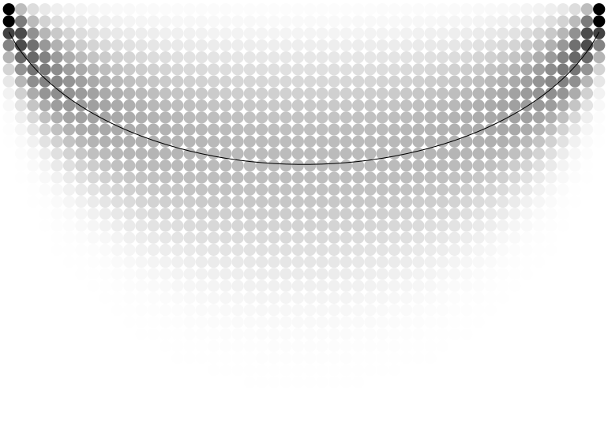</a>

**图 58　50 结点随机二叉树中的内部结点位置.**

<a id="fig-59"></a>

<a href="../../assets/volume4a/figures/7-2-1-6-fig59-random-binary-external-depth.svg" target="_blank" rel="noopener">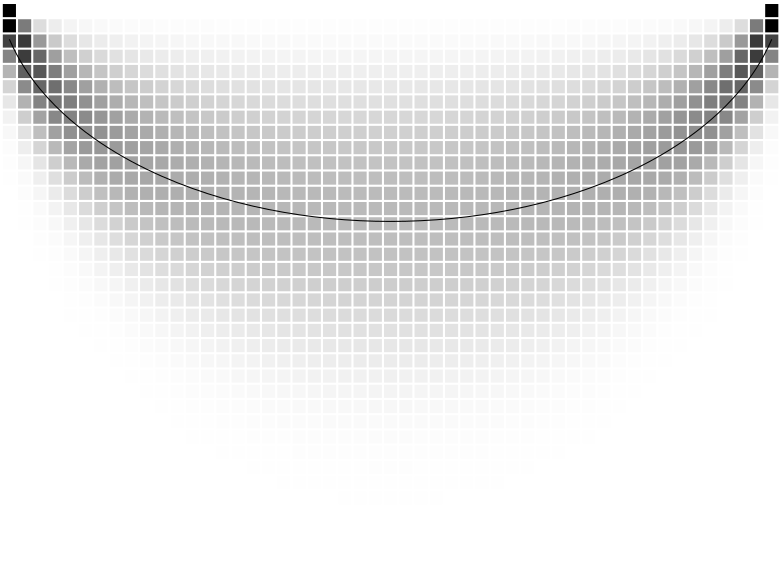</a>

**图 59　50 结点随机二叉树中的外部结点位置.**

<a id="pdf-394"></a><a id="p-379"></a>

和在图 57 中一样, 图 58 和 59 中的平滑曲线给出平均结点深度, 习题 58 和 59 推导了准确公式. 对于所有固定比值 $\theta$($0<\theta<1$), 外部结点 $m$ 的平均深度渐近地为

$$
8\sqrt{\frac{\theta(1-\theta)n}{\pi}}-1+O\left(\frac1{\sqrt n}\right),
\qquad\text{当 }m=\theta n\text{ 且 }n\to\infty\text{ 时,}\tag{31}
$$

非常类似于 (30). 内部结点 $m$ 的平均深度渐近地与此相同, 只是用 $-3$ 代替 $-1$. 因此, 我们可以说, 随机二叉树的平均形状近似为一个椭圆的下半部, 宽为 $n$ 个单位, 深为 $4\sqrt{n/\pi}$ 层.

习题 60、61、62 讨论了其他 3 种值得注意的方法, 用于生成森林的随机编码. 它们不像算法 W 那么直接, 但具有丰富的组合意义. 第一种方法从包含 $n$ 个“(”和 $n$ 个“)”的任意随机串入手, 这个串不一定是嵌套的, $\binom{2n}{n}$ 种可能性的出现概率相同. 接下来, 它将每个这种串转换为一个正确嵌套的序列, 使得恰好 $n+1$ 个串映射为每一个最终输出. 第二种方法与此类似, 但它从包含 $n+1$ 个 0 和 $n$ 个 2 的序列入手, 对它们进行映射, 使得恰好有 $2n+1$ 个原始序列生成每一种可能结果. 第三种方法是由恰好 $n$ 个二进制位串生成每一种输出, 这些二进制位串恰好包含 $n-1$ 个 1 和 $n+1$ 个 0. 换言之, 这 3 种方法以组合方式证明了一个事实: $C_n$ 同时等于 $\binom{2n}{n}/(n+1)$、$\binom{2n+1}{n}/(2n+1)$、$\binom{2n}{n-1}/n$. 例如, 当 $n=4$ 时, 我们有 $14=70/5=126/9=56/4$.

让-吕克·雷米 [*RAIRO Informatique Théorique* **19** (1985), 179–195] 提出一种优美方法, 可以直接以链接形式生成随机二叉树. 他的方法特别有指导意义, 因为它说明实际上可以怎样 “自然” 生成随机卡塔兰树. 该方法使用了一种非常简单的机制, 基础是奥林德·罗德里格斯 [*J. de Math.* **3** (1838), 549] 的经典思想. 假设我们想获得的不仅是一棵普通的 $n$ 结点二叉树, 还要是装饰过的二叉树, 也就是经过扩展的二叉树, 其中的外部结点已按某种顺序标记了从 0 到 $n$ 的编号. 有 $(n+1)!$ 种方法可以用来装饰任意给定二叉树. 因此, 具有 $n$ 个内部结点的装饰二叉树的总数为

$$
D_n=(n+1)!C_n=\frac{(2n)!}{n!}=(4n-2)D_{n-1}.\tag{32}
$$

雷米注意到, 由给定的 $n-1$ 阶装饰树生成 $n$ 阶装饰树有 $4n-2$ 种简易方法: 我们只需选择给定树的 $2n-1$ 个 (内部或外部) 结点中的任意一个, 比如 $x$, 并将它用

<a href="../../assets/volume4a/figures/7-2-1-6-eq33-remy-insertions.svg" target="_blank" rel="noopener">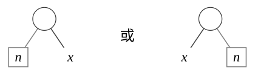</a>

(33)

代替, 从而插入了一个新的内部结点和一个新的叶结点, 而且 $x$ 及其后代 (如果有的话) 下移了一级.

例如, 下面是构造 6 阶装饰树的一种方法:

<a href="../../assets/volume4a/figures/7-2-1-6-eq34-remy-six-stage-example.svg" target="_blank" rel="noopener">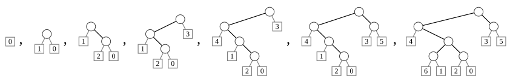</a>

(34)

注意, 每棵装饰树都是通过这一过程以恰好一种方法获得的, 因为每棵树的前导都必定是通过删除最高编号的叶结点而得到的树. 因此, 雷米的构造方法生成了均匀分布的装饰树. 如果我们忽略外部结点, 就可以得到普通的未经装饰的随机二叉树.

有一种极富吸引力的方法可用于实现雷米的过程, 那就是维护一个链接表 $L_0L_1\ldots L_{2n}$, 其中, 外部结点 (叶结点) 拥有偶数编号, 内部结点 (分支结点) 拥有奇数编号. 根结点的编号是 $L_0$. 对于 $1\leq k\leq n$, 分支结点 $2k-1$ 的左右子结点的编号分别是 $L_{2k-1}$ 和 $L_{2k}$. 于是, 程序简短而精巧.

<a id="pdf-395"></a><a id="p-380"></a>

**算法 R (种植一棵随机二叉树).** 算法使用上文的约定, 为一棵具有 $N$ 个内部结点的均匀分布随机二叉树生成链接表示 $L_0L_1\ldots L_{2N}$.

**R1.[初始化.]** 置 $n\gets0$、$L_0\gets0$.

**R2.[完成?]** (此时, 链接 $L_0L_1\ldots L_{2n}$ 表示一棵 $n$ 结点随机二叉树.) 如果 $n=N$, 则终止算法.

**R3.[推进 $n$.]** 令 $X$ 是介于 0 和 $4n+1$ (含两端) 之间的随机整数. 置 $n\gets n+1$、$b\gets X\bmod2$、$k\gets\lfloor X/2\rfloor$、$L_{2n-b}\gets2n$、$L_{2n-1+b}\gets L_k$、$L_k\gets2n-1$, 返回 R2. (此处 $L_k$ 对应于 (33) 中的 $x$.)∎

**\*子集链.** 既然我们已经牢固地掌握了树和括号, 现在该是讨论圣诞树模式[^v4a-7-2-1-6-christmas-tree] 的好时机了. 这一模式是一种出色的方法, 可以将长度为 $n$ 的所有 $2^n$ 个二进制位串排列为 $\binom{n}{\lfloor n/2\rfloor}$ 行 $n+1$ 列. 它是尼古拉斯·德布鲁因、科尔内利娅·范埃本霍斯特·滕贝尔根和迪尔克·克鲁伊斯维克 [*Nieuw Archief voor Wiskunde* (2) **23** (1951), 191–193] 发现的.


1 阶圣诞树模式就是仅有的一行 “0 1”, 2 阶模式是

$$
\begin{array}{ccc}
&\mathtt{10}&\\
\mathtt{00}&\mathtt{01}&\mathtt{11}
\end{array}.\tag{35}
$$

一般来说, 可以这样获得 $n+1$ 阶圣诞树模式: 取得 $n$ 阶模式中的每一行 “$\sigma_1\ \sigma_2\ \ldots\ \sigma_s$”, 然后将它用以下两行代替:

$$
\begin{array}{ccccc}
&\sigma_2 0&\ldots&\sigma_s 0&\\
\sigma_1 0&\sigma_1 1&\ldots&\sigma_{s-1}1&\sigma_s 1
\end{array}.\tag{36}
$$

(当 $s=1$ 时, 省略这两行中的第一行.)

按照这一方法继续下去, 可以得到表 4 中的 8 阶模式. 由归纳法容易验证:

(i) $2^n$ 个二进制位串中的每一个都恰好在模式中出现一次;

(ii) 具有 $k$ 个 1 的二进制位串都出现在同一列中;

(iii) 在每一行中, 相邻二进制位串的区别在于将一个 0 变为了一个 1.

如果我们将这些二进制位串看作是表示 $\{1,\ldots,n\}$ 的子集, 用二进制位 1 表示集合的成员, 则性质 (iii) 表明, 每一行表示一个链, 其中每个子集都包含于其后继中. 用 7.1.3 节的符号表示, 每一行 $\sigma_1\ \sigma_2\ \ldots\ \sigma_s$ 都有以下性质: 对于 $1\leq j<s$, 有 $\sigma_j\subseteq\sigma_{j+1}$ 和 $\nu(\sigma_{j+1})=\nu(\sigma_j)+1$.

性质 (i) 和 (ii) 告诉我们, 如果将各列由 0 至 $n$ 编号, 则第 $k$ 列恰有 $\binom nk$ 个元素. 根据这一发现, 再结合每一行在这些列中均居中的事实, 可以证明总行数为 $\max_{0\leq k\leq n}\binom nk=\binom{n}{\lfloor n/2\rfloor}$, 与前面的断言一致. 我们将这个数称为 $M_n$.

一个由二进制位串组成的集合 $C$, 如果其中的二进制位串不可比较, 也就是说, 只要 $\sigma$ 和 $\tau$ 是 $C$ 中的不同元素, 就有 $\sigma\not\subseteq\tau$, 就说这个集合 $C$ 是杂乱集, 或者说是 “子集反链”. 伊曼纽尔·施佩纳 [*Math. Zeitschrift* **27** (1928), 544–548] 的一条著名定理指出, $\{1,2,\ldots,n\}$ 的任一杂乱集都不可能拥有超过 $M_n$ 个元素. 圣诞树模式提供了一种简单的证明, 因为杂乱集在每一行中最多可以包含一个元素.

实际上, 可以用圣诞树来证明的东西远不止这些. 首先注意到, 对于 $0\leq k\leq n/2$, 恰好存在 $\binom nk-\binom{n}{k-1}$ 个长度为 $n+1-2k$ 的行, 因为在第 $k$ 列有 $\binom nk$ 个元素. 例如, 表 4 给出了一个长度为 9 的行, 也就是最后一行. 它还有 $\binom81-\binom80=7$ 个长度为 7 的行, $\binom82-\binom81=20$ 个长度为 5 的行, $\binom83-\binom82=28$ 个长度为 3 的行, 以及 $\binom84-\binom83=14$ 个长度为 1 的行. 此外, $\binom nk-\binom{n}{k-1}$ 这些数出现在卡塔兰三角 (22) 中, 因为根据式 (23), 它们等于 $C_{k(n-k)}$.

<a id="pdf-396"></a><a id="p-381"></a>

<p id="tab-7-2-1-6-4-caption"><strong>表 4　8 阶圣诞树模式</strong></p>

<table id="tab-7-2-1-6-4" aria-labelledby="tab-7-2-1-6-4-caption">
<tbody>
<tr><td></td><td></td><td></td><td></td><td><code>10101010</code></td><td></td><td></td><td></td><td></td></tr>
<tr><td></td><td></td><td></td><td><code>10101000</code></td><td><code>10101001</code></td><td><code>10101011</code></td><td></td><td></td><td></td></tr>
<tr><td></td><td></td><td></td><td></td><td><code>10101100</code></td><td></td><td></td><td></td><td></td></tr>
<tr><td></td><td></td><td></td><td><code>10100100</code></td><td><code>10100101</code></td><td><code>10101101</code></td><td></td><td></td><td></td></tr>
<tr><td></td><td></td><td></td><td><code>10100010</code></td><td><code>10100110</code></td><td><code>10101110</code></td><td></td><td></td><td></td></tr>
<tr><td></td><td></td><td><code>10100000</code></td><td><code>10100001</code></td><td><code>10100011</code></td><td><code>10100111</code></td><td><code>10101111</code></td><td></td><td></td></tr>
<tr><td></td><td></td><td></td><td></td><td><code>10110010</code></td><td></td><td></td><td></td><td></td></tr>
<tr><td></td><td></td><td></td><td><code>10110000</code></td><td><code>10110001</code></td><td><code>10110011</code></td><td></td><td></td><td></td></tr>
<tr><td></td><td></td><td></td><td></td><td><code>10110100</code></td><td></td><td></td><td></td><td></td></tr>
<tr><td></td><td></td><td></td><td><code>10010100</code></td><td><code>10010101</code></td><td><code>10110101</code></td><td></td><td></td><td></td></tr>
<tr><td></td><td></td><td></td><td><code>10010010</code></td><td><code>10010110</code></td><td><code>10110110</code></td><td></td><td></td><td></td></tr>
<tr><td></td><td></td><td><code>10010000</code></td><td><code>10010001</code></td><td><code>10010011</code></td><td><code>10010111</code></td><td><code>10110111</code></td><td></td><td></td></tr>
<tr><td></td><td></td><td></td><td></td><td><code>10111000</code></td><td></td><td></td><td></td><td></td></tr>
<tr><td></td><td></td><td></td><td><code>10011000</code></td><td><code>10011001</code></td><td><code>10111001</code></td><td></td><td></td><td></td></tr>
<tr><td></td><td></td><td></td><td><code>10001010</code></td><td><code>10011010</code></td><td><code>10111010</code></td><td></td><td></td><td></td></tr>
<tr><td></td><td></td><td><code>10001000</code></td><td><code>10001001</code></td><td><code>10001011</code></td><td><code>10011011</code></td><td><code>10111011</code></td><td></td><td></td></tr>
<tr><td></td><td></td><td></td><td><code>10001100</code></td><td><code>10011100</code></td><td><code>10111100</code></td><td></td><td></td><td></td></tr>
<tr><td></td><td></td><td><code>10000100</code></td><td><code>10000101</code></td><td><code>10001101</code></td><td><code>10011101</code></td><td><code>10111101</code></td><td></td><td></td></tr>
<tr><td></td><td></td><td><code>10000010</code></td><td><code>10000110</code></td><td><code>10001110</code></td><td><code>10011110</code></td><td><code>10111110</code></td><td></td><td></td></tr>
<tr><td></td><td><code>10000000</code></td><td><code>10000001</code></td><td><code>10000011</code></td><td><code>10000111</code></td><td><code>10001111</code></td><td><code>10011111</code></td><td><code>10111111</code></td><td></td></tr>
<tr><td></td><td></td><td></td><td></td><td><code>11001010</code></td><td></td><td></td><td></td><td></td></tr>
<tr><td></td><td></td><td></td><td><code>11001000</code></td><td><code>11001001</code></td><td><code>11001011</code></td><td></td><td></td><td></td></tr>
<tr><td></td><td></td><td></td><td></td><td><code>11001100</code></td><td></td><td></td><td></td><td></td></tr>
<tr><td></td><td></td><td></td><td><code>11000100</code></td><td><code>11000101</code></td><td><code>11001101</code></td><td></td><td></td><td></td></tr>
<tr><td></td><td></td><td></td><td><code>11000010</code></td><td><code>11000110</code></td><td><code>11001110</code></td><td></td><td></td><td></td></tr>
<tr><td></td><td></td><td><code>11000000</code></td><td><code>11000001</code></td><td><code>11000011</code></td><td><code>11000111</code></td><td><code>11001111</code></td><td></td><td></td></tr>
<tr><td></td><td></td><td></td><td></td><td><code>11010010</code></td><td></td><td></td><td></td><td></td></tr>
<tr><td></td><td></td><td></td><td><code>11010000</code></td><td><code>11010001</code></td><td><code>11010011</code></td><td></td><td></td><td></td></tr>
<tr><td></td><td></td><td></td><td></td><td><code>11010100</code></td><td></td><td></td><td></td><td></td></tr>
<tr><td></td><td></td><td></td><td><code>01010100</code></td><td><code>01010101</code></td><td><code>11010101</code></td><td></td><td></td><td></td></tr>
<tr><td></td><td></td><td></td><td><code>01010010</code></td><td><code>01010110</code></td><td><code>11010110</code></td><td></td><td></td><td></td></tr>
<tr><td></td><td></td><td><code>01010000</code></td><td><code>01010001</code></td><td><code>01010011</code></td><td><code>01010111</code></td><td><code>11010111</code></td><td></td><td></td></tr>
<tr><td></td><td></td><td></td><td></td><td><code>11011000</code></td><td></td><td></td><td></td><td></td></tr>
<tr><td></td><td></td><td></td><td><code>01011000</code></td><td><code>01011001</code></td><td><code>11011001</code></td><td></td><td></td><td></td></tr>
<tr><td></td><td></td><td></td><td><code>01001010</code></td><td><code>01011010</code></td><td><code>11011010</code></td><td></td><td></td><td></td></tr>
<tr><td></td><td></td><td><code>01001000</code></td><td><code>01001001</code></td><td><code>01001011</code></td><td><code>01011011</code></td><td><code>11011011</code></td><td></td><td></td></tr>
<tr><td></td><td></td><td></td><td><code>01001100</code></td><td><code>01011100</code></td><td><code>11011100</code></td><td></td><td></td><td></td></tr>
<tr><td></td><td></td><td><code>01000100</code></td><td><code>01000101</code></td><td><code>01001101</code></td><td><code>01011101</code></td><td><code>11011101</code></td><td></td><td></td></tr>
<tr><td></td><td></td><td><code>01000010</code></td><td><code>01000110</code></td><td><code>01001110</code></td><td><code>01011110</code></td><td><code>11011110</code></td><td></td><td></td></tr>
<tr><td></td><td><code>01000000</code></td><td><code>01000001</code></td><td><code>01000011</code></td><td><code>01000111</code></td><td><code>01001111</code></td><td><code>01011111</code></td><td><code>11011111</code></td><td></td></tr>
<tr><td></td><td></td><td></td><td></td><td><code>11100010</code></td><td></td><td></td><td></td><td></td></tr>
<tr><td></td><td></td><td></td><td><code>11100000</code></td><td><code>11100001</code></td><td><code>11100011</code></td><td></td><td></td><td></td></tr>
<tr><td></td><td></td><td></td><td></td><td><code>11100100</code></td><td></td><td></td><td></td><td></td></tr>
<tr><td></td><td></td><td></td><td><code>01100100</code></td><td><code>01100101</code></td><td><code>11100101</code></td><td></td><td></td><td></td></tr>
<tr><td></td><td></td><td></td><td><code>01100010</code></td><td><code>01100110</code></td><td><code>11100110</code></td><td></td><td></td><td></td></tr>
<tr><td></td><td></td><td><code>01100000</code></td><td><code>01100001</code></td><td><code>01100011</code></td><td><code>01100111</code></td><td><code>11100111</code></td><td></td><td></td></tr>
<tr><td></td><td></td><td></td><td></td><td><code>11101000</code></td><td></td><td></td><td></td><td></td></tr>
<tr><td></td><td></td><td></td><td><code>01101000</code></td><td><code>01101001</code></td><td><code>11101001</code></td><td></td><td></td><td></td></tr>
<tr><td></td><td></td><td></td><td><code>00101010</code></td><td><code>01101010</code></td><td><code>11101010</code></td><td></td><td></td><td></td></tr>
<tr><td></td><td></td><td><code>00101000</code></td><td><code>00101001</code></td><td><code>00101011</code></td><td><code>01101011</code></td><td><code>11101011</code></td><td></td><td></td></tr>
<tr><td></td><td></td><td></td><td><code>00101100</code></td><td><code>01101100</code></td><td><code>11101100</code></td><td></td><td></td><td></td></tr>
<tr><td></td><td></td><td><code>00100100</code></td><td><code>00100101</code></td><td><code>00101101</code></td><td><code>01101101</code></td><td><code>11101101</code></td><td></td><td></td></tr>
<tr><td></td><td></td><td><code>00100010</code></td><td><code>00100110</code></td><td><code>00101110</code></td><td><code>01101110</code></td><td><code>11101110</code></td><td></td><td></td></tr>
<tr><td></td><td><code>00100000</code></td><td><code>00100001</code></td><td><code>00100011</code></td><td><code>00100111</code></td><td><code>00101111</code></td><td><code>01101111</code></td><td><code>11101111</code></td><td></td></tr>
<tr><td></td><td></td><td></td><td></td><td><code>11110000</code></td><td></td><td></td><td></td><td></td></tr>
<tr><td></td><td></td><td></td><td><code>01110000</code></td><td><code>01110001</code></td><td><code>11110001</code></td><td></td><td></td><td></td></tr>
<tr><td></td><td></td><td></td><td><code>00110010</code></td><td><code>01110010</code></td><td><code>11110010</code></td><td></td><td></td><td></td></tr>
<tr><td></td><td></td><td><code>00110000</code></td><td><code>00110001</code></td><td><code>00110011</code></td><td><code>01110011</code></td><td><code>11110011</code></td><td></td><td></td></tr>
<tr><td></td><td></td><td></td><td><code>00110100</code></td><td><code>01110100</code></td><td><code>11110100</code></td><td></td><td></td><td></td></tr>
<tr><td></td><td></td><td><code>00010100</code></td><td><code>00010101</code></td><td><code>00110101</code></td><td><code>01110101</code></td><td><code>11110101</code></td><td></td><td></td></tr>
<tr><td></td><td></td><td><code>00010010</code></td><td><code>00010110</code></td><td><code>00110110</code></td><td><code>01110110</code></td><td><code>11110110</code></td><td></td><td></td></tr>
<tr><td></td><td><code>00010000</code></td><td><code>00010001</code></td><td><code>00010011</code></td><td><code>00010111</code></td><td><code>00110111</code></td><td><code>01110111</code></td><td><code>11110111</code></td><td></td></tr>
<tr><td></td><td></td><td></td><td><code>00111000</code></td><td><code>01111000</code></td><td><code>11111000</code></td><td></td><td></td><td></td></tr>
<tr><td></td><td></td><td><code>00011000</code></td><td><code>00011001</code></td><td><code>00111001</code></td><td><code>01111001</code></td><td><code>11111001</code></td><td></td><td></td></tr>
<tr><td></td><td></td><td><code>00001010</code></td><td><code>00011010</code></td><td><code>00111010</code></td><td><code>01111010</code></td><td><code>11111010</code></td><td></td><td></td></tr>
<tr><td></td><td><code>00001000</code></td><td><code>00001001</code></td><td><code>00001011</code></td><td><code>00011011</code></td><td><code>00111011</code></td><td><code>01111011</code></td><td><code>11111011</code></td><td></td></tr>
<tr><td></td><td></td><td><code>00001100</code></td><td><code>00011100</code></td><td><code>00111100</code></td><td><code>01111100</code></td><td><code>11111100</code></td><td></td><td></td></tr>
<tr><td></td><td><code>00000100</code></td><td><code>00000101</code></td><td><code>00001101</code></td><td><code>00011101</code></td><td><code>00111101</code></td><td><code>01111101</code></td><td><code>11111101</code></td><td></td></tr>
<tr><td></td><td><code>00000010</code></td><td><code>00000110</code></td><td><code>00001110</code></td><td><code>00011110</code></td><td><code>00111110</code></td><td><code>01111110</code></td><td><code>11111110</code></td><td></td></tr>
<tr><td><code>00000000</code></td><td><code>00000001</code></td><td><code>00000011</code></td><td><code>00000111</code></td><td><code>00001111</code></td><td><code>00011111</code></td><td><code>00111111</code></td><td><code>01111111</code></td><td><code>11111111</code></td></tr>
</tbody>
</table>

<a id="pdf-397"></a><a id="p-382"></a>

进一步研究发现, 这种卡塔兰联系并不仅仅是一种巧合. 事实上, 嵌套括号是进一步深入理解圣诞树模式的关键, 因为括号的理论告诉我们任意一个二进制位串会放在数组中的什么位置. 我们用符号“(”和“)”分别代替 1 和 0. 任意括号串 (无论嵌套与否) 都可以唯一地写成下面的形式:

$$
\alpha_0\mathtt{)}\cdots\alpha_{p-1}\mathtt{)}\,\alpha_p\mathtt{(}\alpha_{p+1}\cdots\mathtt{(}\alpha_q,\tag{37}
$$

其中, $p$ 和 $q$ 是满足 $0\leq p\leq q$ 的两个数, 子字符串 $\alpha_0,\ldots,\alpha_q$ 为正确嵌套的, 且可能为空. 恰有 $p$ 个右括号和 $q-p$ 个左括号是 “自由的”, 也就是说它们没有配对. 例如, 在字符串

$$
\mathtt{)}\,\underbracket{\mathtt{(())()}}\,\mathtt{)}\,\underbracket{\mathtt{()}}\,
\mathtt{)))(((((}\,\underbracket{\mathtt{()}}\,\mathtt{(}\,
\underbracket{\mathtt{()()}}\,\mathtt{(}\,\underbracket{\mathtt{(())}}\tag{38}
$$

中有 $p=5$、$q=12$、$\alpha_0=\epsilon$、$\alpha_1=\mathtt{(())()}$、$\alpha_2=\mathtt{()}$、$\alpha_3=\epsilon$、……、$\alpha_{12}=\mathtt{(())}$. 一般地, 字符串 (37) 是以下长度为 $q+1$ 的链的一部分:

$$
\alpha_0\mathtt{)}\cdots\alpha_{q-1}\mathtt{)}\alpha_q,\quad
\alpha_0\mathtt{)}\cdots\alpha_{q-2}\mathtt{)}\alpha_{q-1}\mathtt{(}\alpha_q,\quad
\ldots,\quad \alpha_0\mathtt{(}\alpha_1\cdots\mathtt{(}\alpha_q,\tag{39}
$$

我们从 $q$ 个自由的“)”入手, 将它们逐一换为自由的“(”. 圣诞树模式的每一行都可以用这种方式得到, 只是使用 1 和 0 代替“(”和“)”. 如果链 $\sigma_1\ldots\sigma_s$ 对应于嵌套串 $\alpha_0,\ldots,\alpha_{s-1}$, 那么, 它在 (36) 中的后继链分别对应于 $\alpha_0,\ldots,\alpha_{s-3},\alpha_{s-2}\mathtt{(}\alpha_{s-1}\mathtt{)}$ 和 $\alpha_0,\ldots,\alpha_{s-3},\alpha_{s-2},\alpha_{s-1},\epsilon$. [见柯蒂斯·格林和丹尼尔·克莱特曼,*J. Combinatorial Theory* **A20** (1976), 80–88.]

还要注意, 该模式中每一行的最右端元素 (比如 $n=8$ 时的 $10101010,10101011,10101100,10101101,\ldots,11111110,11111111$) 都是按字典序排列的. 例如, 表 4 中 14 个长度为 1 的行恰好对应于表 1 中 14 个嵌套括号串. 有了这一发现, 就可以轻松地自下而上依次生成表 4 中的各行了. 其生成方法类似于算法 P, 见习题 77.

令 $f(x_1,\ldots,x_n)$ 是 $n$ 个变量的任意单调布尔函数. 如果 $\sigma=a_1\ldots a_n$ 是长度为 $n$ 的任意二进制位串, 为方便起见可记为 $f(\sigma)=f(a_1,\ldots,a_n)$. 圣诞树模式中的任意行 $\sigma_1\ldots\sigma_s$ 构成一个链, 所以我们有

$$
0\leq f(\sigma_1)\leq\cdots\leq f(\sigma_s)\leq1.\tag{40}
$$

换言之, 存在一个下标 $t$, 使得在 $j<t$ 时有 $f(\sigma_j)=0$, 在 $j\geq t$ 时有 $f(\sigma_j)=1$. 如果我们知道模式中每一行的下标 $t$, 就能知道 $f(\sigma)$ 对于所有 $2^n$ 个二进制位串 $\sigma$ 的取值.

乔治斯·汉塞尔 [*Comptes Rendus Acad. Sci.* (A) **262** (Paris, 1966), 1088–1090] 注意到圣诞树模式有另一个重要性质: 如果 $\sigma_{j-1},\sigma_j,\sigma_{j+1}$ 是任意行中的三个连续项, 则二进制位串

$$
\sigma'_j=\sigma_{j-1}\oplus\sigma_j\oplus\sigma_{j+1}\tag{41}
$$

位于更早的一行中. 事实上, $\sigma'_j$ 与 $\sigma_j$ 位于同一列, 并满足

$$
\sigma_{j-1}\subseteq\sigma'_j\subseteq\sigma_{j+1}.\tag{42}
$$

$\sigma'_j$ 称为 $\sigma_j$ 在区间 $(\sigma_{j-1}\mathbin{\ldotp\ldotp}\sigma_{j+1})$ 上的相对补码. 根据定义圣诞树模式的递归规则 (36), 容易用归纳法证明汉塞尔的这一发现. 他利用这一规则证明了, 只需在经过精心选择的少量位置实际计算 $f(\sigma)$ 的值, 就能知道该函数对于所有 $\sigma$ 的值. 如果我们知道 $f(\sigma'_j)$ 的值, 根据 (42), 就能知道 $f(\sigma_{j-1})$ 或 $f(\sigma_{j+1})$ 的值.

<a id="pdf-398"></a><a id="p-383"></a>

**算法 H (学习单调布尔函数).** 令 $f(x_1,\ldots,x_n)$ 是布尔函数, 它对于每个布尔变量是非递减的, 但其他情况未知. 给定长度为 $n$ 的二进制位串 $\sigma$, 令 $r(\sigma)$ 是它在圣诞树模式中所出现的行的编号, 其中 $1\leq r(\sigma)\leq M_n$. 如果 $1\leq m\leq M_n$, 令 $s(m)$ 是第 $m$ 行中二进制位串的数量. 另外, 令 $\chi(m,k)$ 是该行第 $k$ 列的二进制位串, 其中 $(n+1-s(m))/2\leq k\leq(n-1+s(m))/2$. 算法在每行中最多两个点处计算 $f$, 即可确定满足条件

$$
f(\sigma)=1\quad\Longleftrightarrow\quad\nu(\sigma)\geq t(r(\sigma)),\tag{43}
$$

的门限值序列 $t(1),t(2),\ldots,t(M_n)$.

**H1.[对 $m$ 循环.]** 对于 $m=1,\ldots,M_n$, 执行 H2 至 H4, 然后停止.

**H2.[开始第 $m$ 行.]** 置 $a\gets(n+1-s(m))/2$、$z\gets(n-1+s(m))/2$.

**H3.[执行二分查找.]** 如果 $z\leq a+1$, 转到 H4. 否则, 置 $k\gets\lfloor(a+z)/2\rfloor$, 以及

$$
\sigma\gets\chi(m,k-1)\oplus\chi(m,k)\oplus\chi(m,k+1).\tag{44}
$$

如果 $k\geq t(r(\sigma))$, 置 $z\gets k$; 否则, 置 $a\gets k$. 重复本步骤.

**H4.[求值.]** 如果 $f(\chi(m,a))=1$, 置 $t(m)\gets a$; 否则, 如果 $a=z$, 置 $t(m)\gets a+1$; 否则, 置 $t(m)\gets z+1-f(\chi(m,z))$. ∎

汉塞尔的算法是最优的, 也就是说, 在最坏情况下它在尽可能少的点处计算 $f$ 的值. 例如, 如果 $f$ 恰好是门限函数

$$
f(\sigma)=[\nu(\sigma)>n/2],\tag{45}
$$

任意一种在圣诞树模式的前 $m$ 行学习 $f$ 的有效算法, 都必须在每一行的 $\lfloor n/2\rfloor$ 列计算 $f(\sigma)$, 而且还必须在长度大于 1 的每一行的 $\lfloor n/2\rfloor+1$ 列计算 $f(\sigma)$. 否则, 如果有另一个函数, 它仅在某个未曾考查的点与 $f$ 有区别, 我们就无法将 $f$ 与这个函数区分开来. [见维塔利·科罗布科夫,*Problemy Kibernetiki* **13** (1965), 5–28, 定理 5.]

**定向树与森林.** 现在让我们转而研究另一种树, 其中父子关系很重要, 但每个家族中的孩子顺序并不重要. 一个 $n$ 结点定向森林可以用指针序列 $p_1\ldots p_n$ 定义, 其中 $p_j$ 是结点 $j$ 的父结点, 或者当 $j$ 是根结点时置 $p_j=0$. 顶点 $\{0,1,\ldots,n\}$ 上弧为 $\{j\to p_j\mid1\leq j\leq n\}$ 的有向图没有定向圈. 定向树是恰有一个根结点的定向森林. (见 2.3.4.2 节.) 每个 $n$ 结点定向森林都等价于一棵 $(n+1)$ 结点定向树, 因为这棵树的根结点可以看作这个森林的所有根结点的父结点. 在 2.3.4.4 节曾经看到, 有 $A_n$ 棵 $n$ 结点定向树, 其中前面几个值是

$$
\begin{array}{rrrrrrrrrrrrrrrrr}
n={}&1&2&3&4&5&6&7&8&9&10&11&12&13&14&15&16\\
A_n={}&1&1&2&4&9&20&48&115&286&719&1842&4766&12486&32973&87811&235381
\end{array};\tag{46}
$$

渐近地, $A_n=c\alpha^n n^{-3/2}+O(\alpha^n n^{-5/2})$, 其中 $\alpha\approx2.9558$、$c\approx0.4399$. 因此, 如果我们忽略水平方向上自左向右的顺序, 只考虑垂直方向, 那么表 1 中的 14 个森林中只有 9 个是互不相同的.

如果我们使用休伯特·斯科因斯 [*Machine Intelligence* **3** (1968), 43–60] 介绍的树排序, 对每个家族的成员进行适当排序, 那么每个定向森林都对应于一个唯一的有序森林. 回想 (11), 有序森林可以用其层级代码 $c_1\ldots c_n$ 来描述, 其中按前序访问的第 $j$ 个结点位于第 $c_j$ 级. 如果在每个家族中各子树的层级代码序列按字典序非递增, 就说这个有序森林是规范的. 例如, 表 1 中的规范森林就是层级代码 $c_1c_2c_3c_4$ 为 $0000,0100,0101,0110,0111,0120,0121,0122,0123$ 的森林. 层级序列 $0112$ 不是规范的, 因为根结点的子树分别拥有层级代码 $1$ 和 $12$; 按字典序, 串 $1$ 小于 $12$. 根据归纳法容易验证, 对于给定的定向森林, 在重排其子树的所有方法中, 规范层级代码在字典序中最大.

<a id="pdf-399"></a><a id="p-384"></a>

温德尔·拜尔和萨拉·赫德特涅米 [*SICOMP* **9** (1980), 706–712] 注意到, 有一种非常简单的方法来生成定向森林, 只要我们按照规范层级代码的递减字典序来访问它们. 设 $c_1\ldots c_n$ 是规范的, 其中 $c_k>0$ 且 $c_{k+1}=\cdots=c_n=0$. 为得到字典序紧随其后的较小序列, 可以减小 $c_k$, 然后将 $c_{k+1}\ldots c_n$ 增大到合乎规范的最大级别; 这些级别很容易计算. 如果 $j=p_k$ 是结点 $k$ 的父结点, 则对于 $j<l\leq k$, 有 $c_j=c_k-1<c_l$. 因此, 级别 $c_j\ldots c_k$ 表示当前以结点 $j$ 为根的子树. 要获得小于 $c_1\ldots c_n$ 的最大层级序列, 我们将 $c_k\ldots c_n$ 用无穷序列 $(c_j\ldots c_{k-1})^\infty=c_j\ldots c_{k-1}c_j\ldots c_{k-1}c_j\ldots$ 中的前 $n+1-k$ 个元素代替. (其效果就是从结点 $j$ 的最右子结点位置移去 $k$, 然后尽可能多地克隆 $j$ 及其余下的后代, 追加新子树作为 $j$ 的兄弟. 克隆过程可能会在序列 $c_j\ldots c_{k-1}$ 的中部终止, 但不会造成什么困难, 因为规范层级序列的每个前缀都是规范的.) 例如, 要获得任何一个以 $\mathtt{23443433000000000}$ 结尾的规范代码序列的后继, 只需将 $\mathtt{3000000000}$ 用 $\mathtt{2344343234}$ 代替即可.

**算法 O (定向森林).** 算法生成 $n$ 个结点上的所有定向森林, 方法是按照层级代码 $c_1\ldots c_n$ 的递减字典序, 访问所有规范 $n$ 结点森林. 但是, 层级代码不显式计算; 每个规范森林都直接由其父指针序列 $p_1\ldots p_n$ 表示, 按结点的前序排列. 为生成关于 $n+1$ 个结点的所有定向树, 我们可以将结点 0 设想为根结点. 本算法置 $p_0\gets-1$.

**O1.[初始化.]** 对于 $0\leq k\leq n$, 置 $p_k\gets k-1$. (特别地, 这一步使 $p_0$ 不为零, 以在终止测试中使用; 见 O4.)

**O2.[访问.]** 访问由父指针 $p_1\ldots p_n$ 表示的森林.

**O3.[简单情形?]** 如果 $p_n>0$, 置 $p_n\gets p_{p_n}$, 返回 O2.

**O4.[寻找 $j$ 和 $k$.]** 求出满足 $p_k\ne0$ 的最大 $k<n$. 如果 $k=0$, 终止算法; 否则, 置 $j\gets p_k$ 和 $d\gets k-j$.

**O5.[克隆.]** 如果 $p_{k-d}=p_j$, 置 $p_k\gets p_j$; 否则, 置 $p_k\gets p_{k-d}+d$. 如果 $k=n$, 返回 O2; 否则, 置 $k\gets k+1$, 重复本步骤. ∎

和我们之前已经看到的其他算法一样, 步骤 O4 和 O5 中的循环也趋向于很短, 见习题 88. 习题 90 表明, 对这一算法稍作修改, 即可生成构成自由树的所有边配置.

**生成树.** 我们现在考虑能够 “生成” 一个给定图的最小子图. 如果 $G$ 是 $n$ 个顶点上的一个连通图, 则 $G$ 的生成树就是由 $n-1$ 条边组成且不含圈的子集. 等价地, 生成树就是一些边的子集, 它们构成一个连接所有顶点的自由树. 生成树在许多应用中都很重要, 特别是在研究网络时, 因此, 许多作者都研究了生成所有生成树的问题. 事实上, 早在 20 世纪初, 弗里德里希·福伊斯纳 [*Annalen der Physik* (4) **9** (1902), 1304–1329] 就开发了列出所有生成树的系统方法, 远在其他类型的树的生成算法出现之前.

在下面的讨论中, 我们允许在两个顶点之间有任意条边, 但不允许存在由一个顶点到其自身的环, 因为自环不可能是树的组成部分. 福伊斯纳的基本思路非常简单, 特别适于计算. 如果 $e$ 是 $G$ 的任意一条边, 一棵生成树中可能包含 $e$, 也可能不包含 $e$. 假设 $e$ 将顶点 $u$ 连接到顶点 $v$, 并且它是一棵生成树的组成部分. 那么, 这棵树的其他 $n-2$ 条边生成了图 $G/e$; 将 $u$ 和 $v$ 视为同一顶点, 即可得到 $G/e$. 换言之, 包含 $e$ 的生成树实质上与收缩图 $G/e$ 的生成树相同, 这个收缩图是我们将 $e$ 收缩为一个单点时得到的. 另一方面, 不包含 $e$ 的生成树就是缩减图 $G\setminus e$ 的生成树, 这个缩减图是我们删除边 $e$ 时得到的. 于是, $G$ 的所有生成树的集合 $S(G)$ 满足

$$
S(G)=e\,S(G/e)\cup S(G\setminus e).\tag{47}
$$

<a id="pdf-400"></a><a id="p-385"></a>

马尔科姆·史密斯在其维多利亚大学硕士论文 (1997) 中介绍了一种很好的方法, 通过以 “旋转门格雷码” 顺序来寻找所有生成树, 从而执行递归 (47). 在他的方案中, 每一棵树都可以由其先辈获得, 只需删除一条边, 再代以另一条边即可. 这种顺序不难找到, 但技巧在于高效完成任务.

史密斯算法的基本思路是以如下方式生成 $S(G)$: 第一棵生成树包含一棵给定的准树, 也就是由 $n-2$ 条边组成的没有圈的集合. 当 $n=2$ 时, 此任务可轻松完成, 我们只需列出所有边即可. 如果 $n>2$, 而且给定的准树为 $\{e_1,\ldots,e_{n-2}\}$, 则操作如下: 假设 $G$ 是连通的, 否则不存在生成树. 构造 $G/e_1$, 然后向它的每棵生成树追加 $e_1$, 首先处理的是包含 $\{e_2,\ldots,e_{n-2}\}$ 的那棵生成树. 注意, $\{e_2,\ldots,e_{n-2}\}$ 是 $G/e_1$ 的准树, 所以这一递归是有意义的. 如果以这一方式为 $G/e_1$ 生成的最后一棵生成树是 $f_1\ldots f_{n-2}$, 那么从包含准树 $\{f_1,\ldots,f_{n-2}\}$ 的生成树入手, 列出 $G\setminus e_1$ 的所有生成树, 即可完成任务.

例如, 假设 $G$ 是图

<a href="../../assets/volume4a/figures/7-2-1-6-eq48-spanning-example.svg" target="_blank" rel="noopener">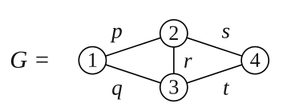</a>

(48)

它有四个顶点和五条边 $\{p,q,r,s,t\}$. 从准树 $\{p,q\}$ 入手, 史密斯过程首先构造收缩图

<a href="../../assets/volume4a/figures/7-2-1-6-eq49-spanning-contract-p.svg" target="_blank" rel="noopener">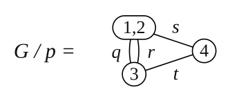</a>

(49)

并列出它的生成树, 从包含 $\{q\}$ 的这棵生成树开始. 这个列表可能是 $qs,qt,ts,tr,rs$, 因此, $pqs,pqt,pts,ptr,prs$ 都是 $G$ 的生成树. 剩下的任务就是列出

<a href="../../assets/volume4a/figures/7-2-1-6-eq50-spanning-delete-p.svg" target="_blank" rel="noopener">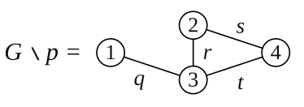</a>

(50)

的生成树, 最先列出的是包含 $\{r,s\}$ 的那一棵. 这些生成树是 $rsq,rqt,qts$.

史密斯算法的详细实施很有指导意义. 和往常一样, 我们令两条弧 $u\to v$、$v\to u$ 对应于每一条边 $u\mathbin{-}v$ 来表示图, 并维护 “弧结点” 的列表, 用来表示离开各个顶点的弧. 我们需要收缩和撤销收缩图的各边, 故将这些列表做成双向链表. 如果 $a$ 指向一个表示 $u\to v$ 的弧结点, 则我们安排内存中的数据, 使得:

- $a\oplus1$ 指向 $a$ 的 “配偶”, 它表示 $v\to u$;
- $t_a$ 是 $a$ 的 “末梢”, 即 $v$ (因此 $t_{a\oplus1}=u$);
- $i_a$ 是标识这条边的可选名字 (等于 $i_{a\oplus1}$);
- $n_a$ 指向 $u$ 的弧列表的下一个元素;
- $p_a$ 指向 $u$ 的弧列表的前一个元素;
- $l_a$ 是一个链接, 用于撤销删除弧的操作, 解释见下文.

<a id="pdf-401"></a><a id="p-386"></a>

这些顶点用整数 $\{1,\ldots,n\}$ 表示, 弧的编号 $v-1$ 是顶点 $v$ 的双向链接弧列表的头结点. 头结点 $a$ 可通过以下事实识别: 它的末梢 $t_a$ 为 0. 令 $d_v$ 是顶点 $v$ 的度数. 例如, 图 (48) 可以用 $(d_1,d_2,d_3,d_4)=(2,3,3,2)$ 表示, 也可以用以下 14 个包含弧数据的结点来表示:

$$
\begin{array}{rrrrrrrrrrrrrrr}
a={}&0&1&2&3&4&5&6&7&8&9&10&11&12&13\\
t_a={}&0&0&0&0&1&2&1&3&2&3&2&4&3&4\\
i_a={}& & & & &p&p&q&q&r&r&s&s&t&t\\
n_a={}&5&4&6&10&9&7&8&0&13&11&12&1&3&2\\
p_a={}&7&11&13&12&1&0&2&5&6&4&3&9&10&8
\end{array}
$$

利用一个由弧指针 $a_1\ldots a_{n-1}$ 组成的数组, 可以方便地控制史密斯算法的隐式递归. 在此过程的第 $l$ 级, 弧 $a_1\ldots a_{l-1}$ 表示已包含在当前生成树中的边; $a_l$ 被忽略; 弧 $a_{l+1}\ldots a_{n-1}$ 表示收缩图 $(\ldots(G/a_1)\ldots)/a_{l-1}$ 上一棵准树的边, 这棵准树应当是下一棵要访问的生成树的组成部分.

另外还有一个由弧指针 $s_1\ldots s_{n-2}$ 组成的数组, 表示从当前图中暂时删除的弧的栈. 第 $l$ 级栈的顶元素为 $s_l$, 每个弧 $a$ 链向其后继 $l_a$ (在栈底它为 0).

如果删除一条边会使连通图变为不连通, 就称这条边为桥. 此算法的要点之一是保持当前图连通. 因此, 当 $e$ 是一座桥时, 不置 $G\gets G\setminus e$.

**算法 S (所有生成树).** 给定一个用上述数据结构表示的连通图, 算法按旋转门格雷码顺序访问它的所有生成树.

这里使用一种称为 “舞蹈链” 的技巧, 从双向链表中删除项或向双向链表恢复项. 我们将在 7.2.2.1 节全面讨论舞蹈链. 以下步骤中的缩略语 “删除 ($a$)” 是指

$$
n_{p_a}\gets n_a,\quad p_{n_a}\gets p_a;\tag{51}
$$

类似地, “撤销删除 ($a$)” 表示

$$
p_{n_a}\gets a,\quad n_{p_a}\gets a.\tag{52}
$$

**S1.[初始化.]** 将 $a_1\ldots a_{n-1}$ 置为图的一棵生成树. (见习题 94.) 置 $x\gets0$、$l\gets1$、$s_1\gets0$. 如果 $n=2$, 置 $v\gets1$、$e\gets n_0$, 转到 S5.

**S2.[进入第 $l$ 级.]** 置 $e\gets a_{l+1}$、$u\gets t_e$、$v\gets t_{e\oplus1}$. 如果 $d_u>d_v$, 交换 $v\leftrightarrow u$, 置 $e\gets e\oplus1$.

**S3.[收缩 $e$.]** (现在我们将 $u$ 的邻接表插入 $v$ 的表中, 使得 $u$ 与 $v$ 完全相同. 我们还将删除收缩前 $u$ 和 $v$ 之间的所有边, 包括 $e$ 本身, 否则这些边会成为环. 被删除的边链接在一起, 以便稍后在 S7 中恢复.) 置 $k\gets d_u+d_v$、$f\gets n_{u-1}$、$g\gets0$. 当 $t_f\ne0$ 时循环执行以下操作: 如果 $t_f=v$, 删除 ($f$)、删除 ($f\oplus1$), 置 $k\gets k-2$、$l_f\gets g$、$g\gets f$; 否则, 置 $t_{f\oplus1}\gets v$. 然后, 置 $f\gets n_f$, 重复这些操作, 直到 $t_f=0$. 最后, 置 $l_e\gets g$、$d_v\gets k$、$g\gets v-1$、$n_{p_f}\gets n_g$、$p_{n_g}\gets p_f$、$p_{n_f}\gets g$、$n_g\gets n_f$、$a_l\gets e$.

**S4.[推进 $l$.]** 置 $l\gets l+1$. 如果 $l<n-1$, 置 $s_l\gets0$, 返回 S2; 否则, 置 $e\gets n_{v-1}$.

**S5.[访问.]** (现在, 当前图中只有两个顶点, 其中一个是 $v$.) 置 $a_{n-1}\gets e$, 访问生成树 $a_1\ldots a_{n-1}$. (如果 $x=0$, 这是被访问的第一棵生成树; 否则, 通过删除 $x$ 和插入 $e$, 得到一棵不同于其先辈的树.) 置 $x\gets e$、$e\gets n_e$. 如果 $t_e\ne0$, 重复本步骤.

**S6.[递减 $l$.]** 置 $l\gets l-1$. 如果 $l=0$ 则终止算法; 否则, 置 $e\gets a_l$、$u\gets t_e$、$v\gets t_{e\oplus1}$.

**S7.[撤销收缩 $e$.]** 置 $f\gets u-1$、$g\gets v-1$、$n_g\gets n_{p_f}$、$p_{n_g}\gets g$、$n_{p_f}\gets f$、$p_{n_f}\gets f$、$f\gets p_f$. 当 $t_f\ne0$ 时, 循环执行 $t_{f\oplus1}\gets u$、$f\gets p_f$. 然后, 置 $f\gets l_e$、$k\gets d_v$. 当 $f\ne0$ 时循环执行以下操作: 置 $k\gets k+2$, 撤销删除 ($f\oplus1$), 撤销删除 ($f$), 置 $f\gets l_f$. 最后, 置 $d_v\gets k-d_u$.

<a id="pdf-402"></a><a id="p-387"></a>

**S8.[桥检测.]** 如果 $e$ 是一座桥, 转到 S9. (习题 95 给出了执行这一检测的方法.) 否则, 置 $x\gets e$、$l_e\gets s_l$、$s_l\gets e$, 删除 ($e$)、删除 ($e\oplus1$), 置 $d_u\gets d_u-1$、$d_v\gets d_v-1$, 转到 S2.

**S9.[撤销第 $l$ 级的删除操作.]** 置 $e\gets s_l$. 当 $e\ne0$ 时循环执行以下操作: 置 $u\gets t_e$、$v\gets t_{e\oplus1}$、$d_u\gets d_u+1$、$d_v\gets d_v+1$, 撤销删除 ($e\oplus1$), 撤销删除 ($e$), 置 $e\gets l_e$. 返回 S6. ∎

鼓励读者在一个诸如 (48) 的小型图上推演本算法的步骤. 如果 $u$ 的邻接表恰好变为空, 注意步骤 S3 和 S7 中出现的微妙情况. 还要注意可能存在的几种捷径, 代价是算法要复杂得多, 我们将在本节后面讨论此类改进.

**\*串行—并行图.** 当给定图具有串行和 (或) 并行分解时, 寻找所有生成树的任务就变得特别简单了. $s$ 和 $t$ 之间的串行—并行图是一个具有两个指定顶点 $s$ 和 $t$ 的图 $G$, 这个图的边可以通过下述过程递归构建: 要么, $G$ 仅包括一条边 $s\mathbin{-}t$; 要么, $G$ 是一个串行超边, 它由 $s_j$ 和 $t_j$ 之间的 $k\geq2$ 个串行—并行子图 $G_j$ 组成, 以 $s=s_1$、$t_j=s_{j+1}$($1\leq j<k$) 及 $t_k=t$ 串联在一起; 或者 $G$ 是一个并行超边, 它由 $s$ 和 $t$ 之间的 $k\geq2$ 个串行—并行子图 $G_j$ 并联在一起. 给定 $s$ 和 $t$, 如果要求用作串行超边的子图 $G_j$ 本身不是串行超边, 用作并行超边的子图 $G_j$ 本身不是并行超边, 那么这种分解实质上是唯一的.

任意一个串行—并行图都可以很方便地表示为一棵树, 其内部结点均有至少两个子结点. 这棵树的叶结点表示边, 分支结点表示超边, 各层级在串行与并行之间交替. 例如, 如果顶结点 $A$ 取为并行的, 则树

<a href="../../assets/volume4a/figures/7-2-1-6-eq53-series-parallel-decomposition-tree.svg" target="_blank" rel="noopener">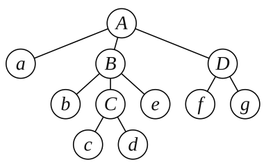</a>

(53)

对应于串行—并行图和子图

<a href="../../assets/volume4a/figures/7-2-1-6-eq54-series-parallel-subgraphs.svg" target="_blank" rel="noopener">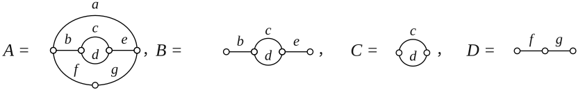</a>

(54)

(54) 中对边进行了命名, 但未对顶点命名, 因为对于生成树来说, 边是首要的.

我们说, $s$ 与 $t$ 之间的一个串行—并行图的准树是由 $n-2$ 条不成圈的边组成的集合, 由这些边构成的子图中 $s$ 与 $t$ 不连通. 串行—并行图的生成树和准树可以方便地递归描述如下:

(1) 串行超边的生成树对应于全部主要子图 $G_j$ 的生成树; 串行超边的准树对应于某一个主要子图的准树与其余主要子图的生成树.

(2) 并行超边的准树对应于全部主要子图 $G_j$ 的准树; 并行超边的生成树对应于某一个主要子图的生成树与其余主要子图的准树.

规则 (1) 和 (2) 让我们想到下面的数据结构, 用于列出串行—并行图的生成树和 (或) 准树. 设 $p$ 指向像 (53) 这样一棵树中的一个结点, 然后我们定义:

- $t_p$ 对于串行超边为 1, 其余为 0 (即 $p$ 的 “类型”);
- $v_p$ 在 $p$ 处取生成树时为 1, 取准树时为 0;
- $l_p$ 是指向 $p$ 的最左子结点的指针, 如果 $p$ 为叶结点, 则为 0;
- $r_p$ 是指向 $p$ 的右侧兄弟结点的指针, 可循环回绕;
- $d_p$ 是指向 $p$ 的一个指定子结点的指针, 如果 $p$ 为叶结点, 则为 0.

<a id="pdf-403"></a><a id="p-388"></a>

如果 $q$ 指向 $p$ 的最右子结点, 则它的 “右兄弟结点” $r_q$ 等于 $l_p$. 如果 $q$ 指向 $p$ 的任意子结点, 规则 (1) 和 (2) 表明:

$$
v_q=
\begin{cases}
v_p,&\text{如果 }q=d_p;\\
t_p,&\text{如果 }q\ne d_p.
\end{cases}\tag{55}
$$

(例如, 如果 $p$ 是一个表示串行超边的分支结点, 则对于 $p$ 的所有子结点, 除了指定的子结点 $d_p$, 都有 $v_q=1$. 因此, 对于串联起来构成 $p$ 的所有子图, 必须各取一棵生成树; 只有在 $p$ 取准树时, 指定的子图才取准树.)

对指定子结点指针 $d_p$ 任取一组设置, 并将树的根结点处的 $v_p$ 设为 0 或 1, 式 (55) 就告诉我们如何将这些值向下传播到它的所有叶结点. 例如, 如果在树 (53) 中置 $v_A\gets1$, 并且指定每个分支结点的最左子结点 (使得 $d_A=a$、$d_B=b$、$d_C=c$、$d_D=f$), 则依次求得

$$
v_a=1,\ v_B=0,\ v_b=0,\ v_C=1,\ v_c=1,\ v_d=0,\ 
v_e=1,\ v_D=0,\ v_f=0,\ v_g=1.\tag{56}
$$

叶结点 $q$ 出现在生成树中当且仅当 $v_q=1$. 因此, (56) 指定了 (54) 中串行—并行图 $A$ 的生成树 $aceg$.

为方便起见, 当 $v_p=1$ 时, 我们说 $p$ 的配置是它的生成树; 当 $v_p=0$ 时, 是它的准树. 我们希望生成根结点的所有配置. 如果 $v_p=t_p$, 则说分支结点 $p$ 是 “简单的”; 也就是说, 如果一个串行结点的配置是生成树, 那么它就是简单的, 如果一个并行结点的配置是准树, 那么它就是简单的. 如果 $p$ 是简单的, 那么它的配置就是其子结点配置的笛卡儿积, 即独立选出各子结点的配置组成的 $k$ 元组; 指定的子结点 $d_p$ 在简单情形中无关紧要. 但如果 $p$ 是非简单的, 那么它的配置就是对 $d_p$ 的所有可能选择所得的这些笛卡儿积的并集.

不巧的是, 简单结点很少: 一个非简单结点最多有一个子结点可以是简单的 (也就是指定子结点), 一个简单结点的所有子结点都是非简单的, 除非它们是叶结点.

尽管如此, 利用串行—并行图的树表示法, 可以使其所有生成树和 (或) 准树的递归生成变得非常简单而高效. 在处理串行—并行图时, 算法 S 的操作, 即收缩和撤销收缩、删除和撤销删除、桥检测, 都不再需要了. 此外, 习题 99 给出一种方法, 用于以旋转门格雷码顺序获得生成树或准树, 它使用了我们已经在前面几个算法中用到的中心点指针.

**\*算法 S 的改进.** 尽管算法 S 为我们提供了一种简单有效的方法来访问一般图的所有生成树, 但它的作者马尔科姆·史密斯意识到, 利用串行—并行图的性质可以让它变得更好. 例如, 如果在一个图中, 同一对顶点 $u$ 和 $v$ 之间有两条或多条边, 那么就可以将它们合并为超边. 于是, 从这个更简单的缩减图的生成树, 可以轻松得到原图的生成树. 如果一个图有一个 2 度顶点 $v$, 接触 $v$ 的边只有 $u\mathbin{-}v$ 和 $v\mathbin{-}w$, 那么就可以消去 $v$, 并将这两条边用 $u$ 和 $w$ 之间的单条超边代替. 此外, 任何 1 度顶点都可以连同其相邻边一起删去, 只需在每棵生成树中包含这条边即可.

对给定图 $G$ 应用上述缩减操作后, 可以得到一个缩减图 $\widehat G$, 它没有并行边, 也没有 1 度或 2 度顶点; 还得到一个由 $m\geq0$ 个串行—并行图 $S_1,\ldots,S_m$ 组成的集合, 代表那些必须包含在 $G$ 的所有生成树中的边 (或超边). 实际上, $\widehat G$ 中剩下的每条边 $u\mathbin{-}v$ 都对应于顶点 $u$ 和 $v$ 之间的一个串行—并行图 $S_{uv}$. 于是, 对 $\widehat G$ 的每棵生成树 $T$, 分别为 $S_1,\ldots,S_m$ 和 $T$ 中边 $u\mathbin{-}v$ 所对应的 $S_{uv}$ 选取生成树, 为 $\widehat G$ 中不属于 $T$ 的边所对应的 $S_{uv}$ 选取准树. 对这些选择取笛卡儿积, 在每项组合中合并所选边, 再对所有 $T$ 的结果取并集, 即得到 $G$ 的所有生成树. 而 $\widehat G$ 的所有生成树 $T$ 可以采用算法 S 的策略得到.

<a id="pdf-404"></a><a id="p-389"></a>

事实上, 在以这种方式扩展算法 S 时, 其中用 $G/e$ 或 $G\setminus e$ 代替当前图 $G$ 的操作, 通常可以引发更多缩减, 因为新的并行边会出现, 或者某个顶点的度会降到 3 以下. 结果, 算法 S 中隐式递归过程的 “停止状态” (即只留下两个顶点的状态, 步骤 S5) 实际上从不出现: 一个缩减图 $\widehat G$ 要么只有一个顶点且没有边, 要么至少有四个顶点和六条边.

这样得到的算法仍然保留了算法 S 中很有利的旋转门性质, 所以它很灵巧 (尽管长度是原算法的 4 倍), 见习题 100. 史密斯证明了它具有最佳渐近运行时间: 如果 $G$ 有 $n$ 个顶点、$m$ 条边和 $N$ 棵生成树, 则此算法可以在 $O(m+n+N)$ 步内访问全部 $N$ 棵生成树.

要比较算法 S 及其加速版算法 $S'$ 的性能, 可以考虑它们在生成一些典型图的生成树时实际的内存访问次数, 如表 5 所示. 表中最下面一行对应于斯坦福图库中的 `plane_miles(16,0,0,1,0,0,0)`, 作为上面各行纯数学示例的 “有机” 解毒剂. 倒数第二行的随机多重图也来自斯坦福图库, 其官方名称更为准确, 即 `random_graph(16,37,1,0,0,0,0,0,0,0)`. 尽管 $4\times4$ 圆环面与 4 立方同构 (见习题 7.2.1.1–17), 但这两个同构图的运行时间稍有不同, 因为算法运行时遇到这些顶点和边的顺序不同.

<p id="tab-7-2-1-6-5-caption"><strong>表 5　生成所有生成树所需的运行时间</strong></p>

<table id="tab-7-2-1-6-5" aria-labelledby="tab-7-2-1-6-5-caption">
<thead><tr><th scope="col"></th><th scope="col">$m$</th><th scope="col">$n$</th><th scope="col">$N$</th><th scope="col">算法 $S$</th><th scope="col">算法 $S'$</th><th scope="colgroup" colspan="2">$\mu$/树</th></tr></thead>
<tbody>
<tr><td>路径 $P_{10}$</td><td>9</td><td>10</td><td>$1$</td><td>$794\,\mu$</td><td>$473\,\mu$</td><td>$794.0$</td><td>$473.0$</td></tr>
<tr><td>路径 $P_{100}$</td><td>99</td><td>100</td><td>$1$</td><td>$9\,974\,\mu$</td><td>$5\,063\,\mu$</td><td>$9\,974.0$</td><td>$5\,063.0$</td></tr>
<tr><td>环路 $C_{10}$</td><td>10</td><td>10</td><td>$10$</td><td>$3\,480\,\mu$</td><td>$998\,\mu$</td><td>$348.0$</td><td>$99.8$</td></tr>
<tr><td>环路 $C_{100}$</td><td>100</td><td>100</td><td>$100$</td><td>$355\,605\,\mu$</td><td>$10\,538\,\mu$</td><td>$3\,556.1$</td><td>$105.4$</td></tr>
<tr><td>完全图 $K_4$</td><td>6</td><td>4</td><td>$16$</td><td>$1\,213\,\mu$</td><td>$1\,336\,\mu$</td><td>$75.8$</td><td>$83.5$</td></tr>
<tr><td>完全图 $K_{10}$</td><td>45</td><td>10</td><td>$100\,000\,000$</td><td>$3\,759.58\,\mathrm{M}\,\mu$</td><td>$1\,860.95\,\mathrm{M}\,\mu$</td><td>$37.6$</td><td>$18.6$</td></tr>
<tr><td>完全二部图 $K_{5,5}$</td><td>25</td><td>10</td><td>$390\,625$</td><td>$23.43\,\mathrm{M}\,\mu$</td><td>$8.88\,\mathrm{M}\,\mu$</td><td>$60.0$</td><td>$22.7$</td></tr>
<tr><td>$4\times4$ 栅格 $P_4\square P_4$</td><td>24</td><td>16</td><td>$100\,352$</td><td>$12.01\,\mathrm{M}\,\mu$</td><td>$1.87\,\mathrm{M}\,\mu$</td><td>$119.7$</td><td>$18.7$</td></tr>
<tr><td>$5\times5$ 栅格 $P_5\square P_5$</td><td>40</td><td>25</td><td>$557\,568\,000$</td><td>$54.68\,\mathrm{G}\,\mu$</td><td>$10.20\,\mathrm{G}\,\mu$</td><td>$98.1$</td><td>$18.3$</td></tr>
<tr><td>$4\times4$ 圆柱 $P_4\square C_4$</td><td>28</td><td>16</td><td>$2\,558\,976$</td><td>$230.96\,\mathrm{M}\,\mu$</td><td>$49.09\,\mathrm{M}\,\mu$</td><td>$90.3$</td><td>$19.2$</td></tr>
<tr><td>$5\times5$ 圆柱 $P_5\square C_5$</td><td>45</td><td>25</td><td>$38\,720\,000\,000$</td><td>$3\,165.31\,\mathrm{G}\,\mu$</td><td>$711.69\,\mathrm{G}\,\mu$</td><td>$81.7$</td><td>$18.4$</td></tr>
<tr><td>$4\times4$ 环面 $C_4\square C_4$</td><td>32</td><td>16</td><td>$42\,467\,328$</td><td>$3\,168.15\,\mathrm{M}\,\mu$</td><td>$823.08\,\mathrm{M}\,\mu$</td><td>$74.6$</td><td>$19.4$</td></tr>
<tr><td>4 立方 $P_2\square P_2\square P_2\square P_2$</td><td>32</td><td>16</td><td>$42\,467\,328$</td><td>$3\,172.19\,\mathrm{M}\,\mu$</td><td>$823.38\,\mathrm{M}\,\mu$</td><td>$74.7$</td><td>$19.4$</td></tr>
<tr><td>随机多图</td><td>37</td><td>16</td><td>$59\,933\,756$</td><td>$3\,818.19\,\mathrm{M}\,\mu$</td><td>$995.91\,\mathrm{M}\,\mu$</td><td>$63.7$</td><td>$16.6$</td></tr>
<tr><td>16 个城市</td><td>37</td><td>16</td><td>$179\,678\,881$</td><td>$11\,772.11\,\mathrm{M}\,\mu$</td><td>$3\,267.43\,\mathrm{M}\,\mu$</td><td>$65.5$</td><td>$18.2$</td></tr>
</tbody>
</table>

一般地, 我们可以说, 算法 S 针对一些小例子的表现还不错, 当图太过稀疏时除外. 而在存在许多生成树时, 算法 $S'$ 就开始大放异彩了. 一旦算法 $S'$ 热身完毕, 它往往每访问 18 或 19 次内存就能生成一棵新树. 表 5 还指出, 按数学方式定义的图, 其生成树数常常整齐得出乎意料. 例如, 德拉戈什·茨韦特科维奇 [*Srpska Akademija Nauka, Matematicheski Institut* **11** (Belgrade: 1971), 135–141] 发现, $n$ 立方恰有

$$
2^{2^n-n-1}\,1^{\binom n1}\,2^{\binom n2}\cdots n^{\binom nn}\tag{57}
$$

棵生成树 (该文中还有其他一些发现). 习题 104–109 探究了为什么会发生这种情况的一些原因.

<a id="pdf-405"></a><a id="p-390"></a>

**一般准格雷码.** 本节最后让我们讨论一个完全不同、但仍然与树相关的主题. 考虑两种标准的非空森林遍历方法的如下混合变型:

| 前后序遍历 | 后前序遍历 |
| --- | --- |
| 访问第一棵树的根结点 | 按前后序遍历第一棵树的子树 |
| 按后前序遍历第一棵树的子树 | 访问第一棵树的根结点 |
| 按前后序遍历剩余的树 | 按后前序遍历剩余的树 |

在第一种情形, 森林中的每棵树都按前后序遍历, 先处理根结点; 但这些根结点的子树按后前序遍历, 最后处理根结点. 第二种变型类似, 只是对调 “前” 和 “后”. 一般地, 前后序在森林的每个偶数级别先访问根结点, 在每个奇数级别最后访问根结点. 例如, 当我们按前后序对结点进行标记时, (2) 中的森林变为

<a href="../../assets/volume4a/figures/7-2-1-6-eq58-prepostorder-forest.svg" target="_blank" rel="noopener">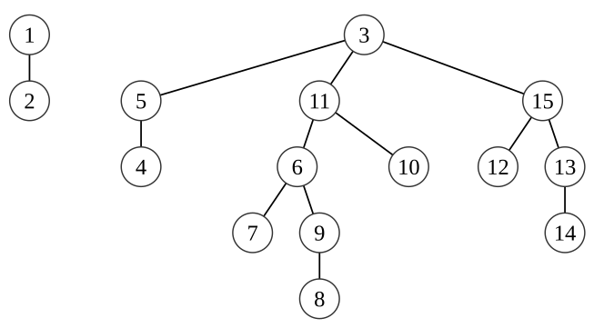</a>

(58)

前后序和后前序除了有趣之外, 还有实际用途. 原因在于, 采用这两种顺序中的任何一种, 相邻结点在森林中总是彼此接近的. 例如, 对于 $k=1,4,6,8,10,13$, 结点 $k$ 和 $k+1$ 在 (58) 中是相邻的; 当 $k=3,12,14$ 时, 它们仅相隔一个结点; 当 $k=2,5,7,9,11$ 时, 它们相隔三步 (如果我们设想森林的顶端有一个不可见的超级父结点). 稍加思考就可以通过归纳法证明, 在前后序邻居或后前序邻居之间最多只可能插入两个结点, 因为后前序 $\operatorname{postpreorder}(F)$ 总是从第一棵树的根结点或其最左子结点开始, 而前后序 $\operatorname{prepostorder}(F)$ 总是以最后一棵树的根结点或其最右子结点结束.

假设我们希望生成某种组合模式的全部实例, 并希望按类似格雷码的方式访问它们, 使得连续模式总是相互 “接近”. 至少在概念上, 我们可以为所有可能模式 $p$ 构建一张图, 为每一对相互接近的模式连边 $p\mathbin{-}q$. 米兰·塞卡尼纳 [*Spisy Přírodovědecké Fakulty University v Brně*, No. 412 (1960), 137–140] 给出了下述定理, 证明了只要任意两个模式之间都能通过一系列短步相达, 总是可以找到一种相当好的格雷码.

**定理 S.** 任意连通图的顶点可按照循环顺序列为 $(v_0,v_1,\ldots,v_{n-1})$, 使得对于 $0\leq k<n$, $v_k$ 和 $v_{(k+1)\bmod n}$ 之间的距离至多为 3.

**证明.** 找到图中的一棵生成树, 按前后序遍历它. ∎

传统上, 图论专家所说的图 $G$ 的 $k$ 次幂, 是指一个图 $G^k$, 它的结点是 $G$ 中的结点. 边 $u\mathbin{-}v$ 位于 $G^k$ 中, 当且仅当在 $G$ 中存在一条从 $u$ 到 $v$、长度不大于 $k$ 的路径. 因此, 当 $n>2$ 时, 图论专家对定理 S 的表述要简洁得多:*连通图的立方是哈密顿图.*

当希望用无循环方式访问一棵树的结点时, 前后序遍历也是有用的, 因为两次访问之间的步数有一个上界.

<a id="pdf-406"></a><a id="p-391"></a>

**算法 Q (三重链接森林中的前后序后继).** 如果 $\mathtt P$ 指向森林中的一个结点, 这个森林用链接 $\mathtt{PARENT}$、$\mathtt{CHILD}$、$\mathtt{SIB}$ 表示, 这些链接分别对应于每个结点的父结点、最左子结点、右兄弟结点, 算法按前后序计算 $\mathtt P$ 的后继结点 $\mathtt Q$. 假设 $\mathtt P$ 出现在森林的第 $\mathtt L$ 级; $\mathtt L$ 的值被更新为 $\mathtt Q$ 的级别. 如果 $\mathtt P$ 恰好是前后序排列的最后一个结点, 则算法置 $\mathtt Q\gets\Lambda$、$\mathtt L\gets-1$.

**Q1.[前序或后序?]** 如果 $\mathtt L$ 为偶数, 转到 Q4.

**Q2.[继续后前序.]** 置 $\mathtt Q\gets\mathtt{SIB(P)}$. 如果 $\mathtt Q\ne\Lambda$, 转到 Q6.

**Q3.[上移.]** 置 $\mathtt P\gets\mathtt{PARENT(P)}$、$\mathtt L\gets\mathtt L-1$. 转到 Q7.

**Q4.[继续前后序.]** 如果 $\mathtt{CHILD(P)}=\Lambda$, 转到 Q7.

**Q5.[下移.]** 置 $\mathtt Q\gets\mathtt{CHILD(P)}$、$\mathtt L\gets\mathtt L+1$.

**Q6.[如可能则下移.]** 如果 $\mathtt{CHILD(Q)}\ne\Lambda$, 置 $\mathtt Q\gets\mathtt{CHILD(Q)}$、$\mathtt L\gets\mathtt L+1$. 终止算法.

**Q7.[右移或上移.]** 如果 $\mathtt{SIB(P)}\ne\Lambda$, 置 $\mathtt Q\gets\mathtt{SIB(P)}$; 否则, 置 $\mathtt Q\gets\mathtt{PARENT(P)}$、$\mathtt L\gets\mathtt L-1$. 终止算法. ∎

注意, 和在算法 2.4C 中一样, 仅当 $\mathtt{SIB(P)}=\Lambda$ 时才查看链接 $\mathtt{PARENT(P)}$. 一次完整的遍历实际上是一次围绕该森林的蠕虫爬行, 类似于 (3): 这条蠕虫从左侧经过时 “看到” 偶数层级上的结点, 从右侧经过时 “看到” 奇数层级上的结点.

### 习题

<a id="ex-7-2-1-6-1"></a>

**1.** [*15*][答案](./answers/7-2-1-6.md#ans-7-2-1-6-1) 如果一条蠕虫围绕二叉树 (4) 爬行, 它可以怎样轻松重构 (1) 的括号?

<a id="ex-7-2-1-6-2"></a>

**2.** [*20*][答案](./answers/7-2-1-6.md#ans-7-2-1-6-2) (什穆埃尔·扎克斯, 1980) 修改算法 P, 使得它生成 (8) 的组合 $z_1z_2\ldots z_n$, 而非括号串 $a_1a_2\ldots a_{2n}$.

<a id="ex-7-2-1-6-3"></a>

**▸ 3.** [*23*][答案](./answers/7-2-1-6.md#ans-7-2-1-6-3) 证明: (11) 将 $z_1z_2\ldots z_n$ 转换为反序表 $c_1c_2\ldots c_n$.

<a id="ex-7-2-1-6-4"></a>

**4.** [*20*][答案](./answers/7-2-1-6.md#ans-7-2-1-6-4) 判别真假: 如果串 $a_1\ldots a_{2n}$ 按字典序生成, 那么对应串 $d_1\ldots d_n$、$z_1\ldots z_n$、$p_1\ldots p_n$、$c_1\ldots c_n$ 也是如此.

<a id="ex-7-2-1-6-5"></a>

**5.** [*15*][答案](./answers/7-2-1-6.md#ans-7-2-1-6-5) 什么样的表 $d_1\ldots d_n$、$z_1\ldots z_n$、$p_1\ldots p_n$、$c_1\ldots c_n$ 对应于嵌套括号串 (1)?

<a id="ex-7-2-1-6-6"></a>

**▸ 6.** [*20*][答案](./answers/7-2-1-6.md#ans-7-2-1-6-6) 什么样的匹配对应于 (1)? (见表 1 最后一列.)

<a id="ex-7-2-1-6-7"></a>

**7.** [*16*][答案](./answers/7-2-1-6.md#ans-7-2-1-6-7) (a) 当算法 P 终止时, 串 $a_1a_2\ldots a_{2n}$ 是什么状态? (b) 当算法 B 终止时, 数组 $l_1l_2\ldots l_n$ 和 $r_1r_2\ldots r_n$ 包含什么内容?

<a id="ex-7-2-1-6-8"></a>

**8.** [*15*][答案](./answers/7-2-1-6.md#ans-7-2-1-6-8) 哪些表 $l_1\ldots l_n$、$r_1\ldots r_n$、$e_1\ldots e_n$、$s_1\ldots s_n$ 对应于示例森林 (2)?

<a id="ex-7-2-1-6-9"></a>

**9.** [*M20*][答案](./answers/7-2-1-6.md#ans-7-2-1-6-9) 证明: 表 $c_1\ldots c_n$ 和 $s_1\ldots s_n$ 遵守关系

$$
c_k=[s_1\geq k-1]+[s_2\geq k-2]+\cdots+[s_{k-1}\geq1].
$$

<a id="ex-7-2-1-6-10"></a>

**10.** [*M20*][答案](./answers/7-2-1-6.md#ans-7-2-1-6-10) (蠕虫爬行) 给定嵌套括号串 $a_1a_2\ldots a_{2n}$, 对于 $0\leq j\leq2n$, 设 $w_j$ 是 $a_1a_2\ldots a_j$ 中左括号超过右括号的数量. 证明: $w_0+w_1+\cdots+w_{2n}=2(c_1+\cdots+c_n)+n$.

<a id="ex-7-2-1-6-11"></a>

**11.** [*11*][答案](./answers/7-2-1-6.md#ans-7-2-1-6-11) 如果 $F$ 是一个森林, 它的共轭 $F^R$ 可通过左右镜像反射获得. 例如, 表 1 中的 14 个森林是

<a href="../../assets/volume4a/figures/7-2-1-6-exercise11-forests.svg" target="_blank" rel="noopener">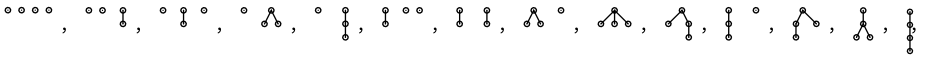</a>

它们的共轭分别是

<a href="../../assets/volume4a/figures/7-2-1-6-exercise11-reflections.svg" target="_blank" rel="noopener">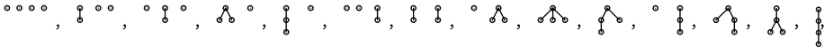</a>

也就是表 2 中的反向字典序森林. 如果 $F$ 对应于嵌套括号串 $a_1a_2\ldots a_{2n}$, 哪个括号串对应于 $F^R$?

<a id="pdf-407"></a><a id="p-392"></a>

<a id="ex-7-2-1-6-12"></a>

**12.** [*15*][答案](./answers/7-2-1-6.md#ans-7-2-1-6-12) 如果 $F$ 是一个森林, 将表示 $F$ 的二叉树中的左、右链接交换, 将得到一个新的森林, 称为 $F$ 的转置 $F^T$. 例如, 表 1 中 14 个森林的转置分别是

<a href="../../assets/volume4a/figures/7-2-1-6-exercise12-transposed-forests.svg" target="_blank" rel="noopener">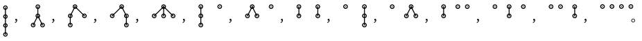</a>

森林 (2) 的转置是什么?

<a id="ex-7-2-1-6-13"></a>

**13.** [*20*][答案](./answers/7-2-1-6.md#ans-7-2-1-6-13) 续习题 11 和 12, 一个有标记森林 $F$ 的前序和后序与以下森林的前序和后序有什么关系: (a) $F^R$; (b) $F^T$?

<a id="ex-7-2-1-6-14"></a>

**▸ 14.** [*21*][答案](./answers/7-2-1-6.md#ans-7-2-1-6-14) 找出所有满足 $F^{RT}=F^{TR}$ 的有标记森林 $F$.

<a id="ex-7-2-1-6-15"></a>

**15.** [*20*][答案](./answers/7-2-1-6.md#ans-7-2-1-6-15) 假设 $B$ 是由森林 $F$ 得到的二叉树, 具体方法是将此森林的每个结点链接到其左兄弟结点和最右子结点, 如在习题 2.3.2–5 和表 2 的最后一列. 令 $F'$ 是通过最左子结点和右兄弟结点链接以通常方式与 $B$ 对应的森林. 证明: 采用习题 11 和 12 的表示法, $F'=F^{RT}$.

<a id="ex-7-2-1-6-16"></a>

**16.** [*20*][答案](./answers/7-2-1-6.md#ans-7-2-1-6-16) 假定 $F$ 和 $G$ 是森林, 令 $FG$ 是通过将 $F$ 的树放在 $G$ 的树的左侧而得到的森林. 令 $F\mid G=(G^T F^T)^T$. 给出运算符 $\mid$ 的直观解释, 并证明它满足结合律.

<a id="ex-7-2-1-6-17"></a>

**17.** [*M46*][答案](./answers/7-2-1-6.md#ans-7-2-1-6-17) 描述所有满足 $F^{RT}=F^{TR}$ 的未标记森林 $F$ (见习题 14).

<a id="ex-7-2-1-6-18"></a>

**18.** [*30*][答案](./answers/7-2-1-6.md#ans-7-2-1-6-18) 如果通过重复取共轭和 (或) 转置, 可以由一个森林得到另一个森林, 就说这两个森林是同源的. 习题 11 和 12 中的示例表明, 所有 4 结点森林都属于以下三个同源类之一:

<a href="../../assets/volume4a/figures/7-2-1-6-exercise18-cognate-forest-classes.svg" target="_blank" rel="noopener">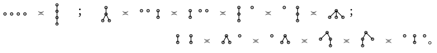</a>

试研究所有 15 结点森林组成的集合. 它们构成了多少个同源森林等价类? 最大的类是什么? 最小的类是什么? 包含 (2) 的类的大小是多少?

<a id="ex-7-2-1-6-19"></a>

**19.** [*28*][答案](./answers/7-2-1-6.md#ans-7-2-1-6-19) 令 $F_1,F_2,\ldots,F_N$ 是未标记森林序列, 对应于算法 P 生成的嵌套括号, 令 $G_1,G_2,\ldots,G_N$ 也是未标记森林序列, 对应于算法 B 生成的二叉树. 证明: 采用习题 11 和 12 的表示法, $G_k=F_k^{RTR}$. (森林 $F^{RTR}$ 称为 $F$ 的对偶, 在以下几道习题中用 $F^D$ 表示.)

<a id="ex-7-2-1-6-20"></a>

**20.** [*25*][答案](./answers/7-2-1-6.md#ans-7-2-1-6-20) 回顾 2.3 节, 树中结点的度是指它拥有的子结点数, 而扩展二叉树可由以下性质描述: 每个结点的度为 0 或 2. 在扩展二叉树 (4) 中, 按照前序, 结点度数的序列为 $\mathtt{2200222002220220002002202200000}$. 这个由 0 和 2 组成的串等同于 (1) 中的括号序列, 只是每个“(”由 2 代替、每个“)”由 0 代替, 并在最后追加一个 0.

(a) 证明: 非负整数序列 $b_1b_2\ldots b_N$ 是一个森林的前序度数序列, 当且仅当它对于 $0\leq k\leq N$ 满足

$$
b_1+b_2+\cdots+b_k+f>k\quad\Longleftrightarrow\quad k<N,
$$

其中 $f=N-b_1-b_2-\cdots-b_N$ 是森林中树的数量.

(b) 回想习题 2.3.4.5–6, 扩展三叉树可由以下性质描述: 每个结点的度数为 0 或 3. 一棵具有 $n$ 个内部结点的扩展三叉树拥有 $2n+1$ 个外部结点, 因此这棵树共有 $N=3n+1$ 个结点. 试设计一种算法, 通过按字典序生成相关序列 $b_1b_2\ldots b_N$, 从而生成具有 $n$ 个内部结点的所有三叉树.

<a id="ex-7-2-1-6-21"></a>

**▸ 21.** [*26*][答案](./answers/7-2-1-6.md#ans-7-2-1-6-21) (什穆埃尔·扎克斯和达纳·理查兹, 1979) 续习题 20, 试解释如何为所有满足以下条件的森林生成前序度数序列: 这些森林拥有 $N=n_0+\cdots+n_t$ 个结点, 恰有 $n_j$ 个结点的度数为 $j$. 例如, 当 $n_0=4$、$n_1=n_2=n_3=1$、$t=3$ 时, 有效序列 $b_1b_2b_3b_4b_5b_6b_7$ 为

$$
\begin{aligned}
&1203000,\,1230000,\,1300200,\,1302000,\,1320000,\,2013000,\,2030010,\,2030100,\,2031000,\,2103000,\\
&2130000,\,2300010,\,2300100,\,2301000,\,2310000,\,3001200,\,3002010,\,3002100,\,3010200,\,3012000,\\
&3020010,\,3020100,\,3021000,\,3100200,\,3102000,\,3120000,\,3200010,\,3200100,\,3201000,\,3210000.
\end{aligned}
$$

<a id="pdf-408"></a><a id="p-393"></a>

<a id="ex-7-2-1-6-22"></a>

**▸ 22.** [*30*][答案](./answers/7-2-1-6.md#ans-7-2-1-6-22) (詹姆斯·科尔什, 2004) 作为算法 B 的一种替代, 证明: 二叉树也可以直接而高效地按链接形式生成, 只要我们按 (9) 中定义的数 $d_1\ldots d_{n-1}$ 的反向字典序来生成它们即可. (我们不必显式计算 $d_1\ldots d_{n-1}$ 的实际值, 但对链接 $l_1\ldots l_n$ 和 $r_1\ldots r_n$ 的处理方式应使得到的二叉树依次对应于 $d_1d_2\ldots d_{n-1}=000\ldots0,100\ldots0,010\ldots0,110\ldots0,020\ldots0,001\ldots0,\ldots,000\ldots(n-1)$.)

<a id="ex-7-2-1-6-23"></a>

**▸ 23.** [*25*][答案](./answers/7-2-1-6.md#ans-7-2-1-6-23) (a) 算法 N 访问的最后一个串是什么? (b) 算法 L 访问的最后一棵二叉树或最后一个森林是什么? 提示: 见下面的习题 40.

<a id="ex-7-2-1-6-24"></a>

**24.** [*22*][答案](./answers/7-2-1-6.md#ans-7-2-1-6-24) 利用表 3 中的表示法, 哪些序列 $l_0l_1\ldots l_{15}$、$r_1\ldots r_{15}$、$k_1\ldots k_{15}$、$q_1\ldots q_{15}$、$u_1\ldots u_{15}$ 对应于二叉树 (4) 和森林 (2)?

<a id="ex-7-2-1-6-25"></a>

**▸ 25.** [*30*][答案](./answers/7-2-1-6.md#ans-7-2-1-6-25) (修剪与嫁接) 像算法 B 中那样表示二叉树, 设计一种算法, 以某种方式访问所有链接表 $l_1\ldots l_n$ 和 $r_1\ldots r_n$, 使得在两次访问之间, 对于某个下标 $j$, 恰有一个链接由 $j$ 变为 0, 另一个链接由 0 变为 $j$. (换言之, 每个步骤从二叉树中移除某个子树 $j$, 将它放在其他某个位置, 并保留前序.)

<a id="ex-7-2-1-6-26"></a>

**26.** [*M31*][答案](./answers/7-2-1-6.md#ans-7-2-1-6-26) (克雷韦拉斯栅格) 令 $F$ 和 $F'$ 为 $n$ 结点森林, 其结点按前序编号为 1 至 $n$. 对于 $1\leq j<k\leq n$, 如果只要 $j$ 和 $k$ 在 $F'$ 中是兄弟关系, 它们在 $F$ 中就是兄弟关系, 那就记作 $F\mathrel{\vert\mkern-4mu\mathord{<}}F'$(“$F$ 联合 $F'$”). 图 60 给出 $n=4$ 时的这一偏序. 每个森林由 (10) 和 (11) 中的序列 $c_1\ldots c_n$ 编码, 该序列指定了每个结点的深度. (采用这种编码, $j$ 和 $k$ 是兄弟关系当且仅当 $c_j=c_k\leq c_{j+1},\ldots,c_{k-1}$.)

<a id="fig-60"></a>

<a href="../../assets/volume4a/figures/7-2-1-6-fig60-kreweras-lattice.svg" target="_blank" rel="noopener">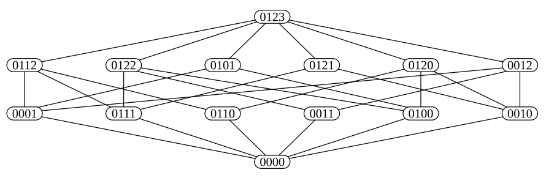</a>

**图 60　4 阶克雷韦拉斯栅格.** 每个森林由按前序排列的结点深度序列 $c_1c_2c_3c_4$ 表示 (见习题 26–28).

(a) 设 $\Pi$ 是 $\{1,\ldots,n\}$ 的一个分划. 证明: 存在一个森林 $F$, 其结点按前序标记为 $(1,\ldots,n)$, 并且满足

$$
j\equiv k\pmod{\Pi}\quad\Longleftrightarrow\quad\text{在 }F\text{ 中 }j\text{ 与 }k\text{ 是兄弟结点,}
$$

当且仅当 $\Pi$ 满足以下非交叉性质:

$$
i<j<k<l,\quad i\equiv k\pmod{\Pi},\quad j\equiv l\pmod{\Pi}
\quad\Longrightarrow\quad i\equiv j\equiv k\equiv l\pmod{\Pi}.
$$

(b) 给定任意两个 $n$ 结点森林 $F$ 和 $F'$, 解释如何计算它们的最小上界 $F\veebar F'$, 也就是满足以下条件的元素: $F\mathrel{\vert\mkern-4mu\mathord{<}}G$ 且 $F'\mathrel{\vert\mkern-4mu\mathord{<}}G$, 当且仅当 $F\veebar F'\mathrel{\vert\mkern-4mu\mathord{<}}G$.

(c) 什么情况下, 就关系 $\mathrel{\vert\mkern-4mu\mathord{<}}$ 而言 $F'$ 覆盖 $F$? (见习题 7.2.1.4–55.)

(d) 证明: 如果 $F'$ 覆盖 $F$, 则它恰比 $F$ 少一个叶结点.

(e) 对于 $1\leq k\leq n$, 当结点 $k$ 有 $e_k$ 个子结点时, 有多少森林覆盖 $F$?

(f) 按照习题 19 中关于对偶的定义, 森林 (2) 的对偶是什么?

(g) 证明: $F\mathrel{\vert\mkern-4mu\mathord{<}}F'$ 当且仅当 $F'^{D}\mathrel{\vert\mkern-4mu\mathord{<}}F^D$. (因为这一性质, 我们围绕图 60 的中心对称放置了对偶元素.)

(h) 给定任意两个 $n$ 结点森林 $F$ 和 $F'$, 解释如何计算它们的最大下界 $F\barwedge F'$, 也就是满足以下条件的元素: $G\mathrel{\vert\mkern-4mu\mathord{<}}F$ 且 $G\mathrel{\vert\mkern-4mu\mathord{<}}F'$, 当且仅当 $G\mathrel{\vert\mkern-4mu\mathord{<}}F\barwedge F'$.

(i) 这个栅格是否满足类似于习题 7.2.1.5–12(f) 的半模律?

<a id="pdf-409"></a><a id="p-394"></a>

<a id="ex-7-2-1-6-27"></a>

**▸ 27.** [*M33*][答案](./answers/7-2-1-6.md#ans-7-2-1-6-27) (塔迈里栅格) 续习题 26, 对于所有 $j$, 如果按前序排列的第 $j$ 个结点在 $F'$ 中拥有的后代数至少与它在 $F$ 中一样多, 则记作 $F\dashv F'$. 换言之, 如果 $F$ 和 $F'$ 由它们的 (如在表 2 中的) 范围序列 $s_1\ldots s_n$ 和 $s'_1\ldots s'_n$ 描述, 我们有 $F\dashv F'$ 当且仅当对于 $1\leq j\leq n$ 有 $s_j\leq s'_j$. (见图 61.)

(a) 证明: 范围坐标 $\min(s_1,s'_1)\min(s_2,s'_2)\ldots\min(s_n,s'_n)$ 定义了一个森林, 它是 $F$ 和 $F'$ 的最大下界. (记作 $F\perp F'$.) 提示: 证明 $s_1\ldots s_n$ 对应于一个森林, 当且仅当在定义 $s_0=n$ 后, 对于 $0\leq j\leq n$, $0\leq k\leq s_j$ 蕴涵 $s_{j+k}+k\leq s_j$.

(b) 按照这种偏序, 什么时候 $F'$ 覆盖 $F$?

(c) 证明: $F\dashv F'$ 当且仅当 $F'^{D}\dashv F^D$. (与习题 26(g) 比较.)

(d) 在给定 $F$ 和 $F'$ 时, 如何计算最小上界 $F\top F'$?

(e) 证明: 克雷韦拉斯栅格中的 $F\mathrel{\vert\mkern-4mu\mathord{<}}F'$ 蕴涵塔迈里栅格中的 $F\dashv F'$.

(f) 判别真假: $F\barwedge F'\dashv F\perp F'$.

(g) 判别真假: $F\veebar F'\mathrel{\vert\mkern-4mu\mathord{<}}F\top F'$.

(h) 对于塔迈里栅格中从顶端到底部的路径, 如果路径中的每个森林都覆盖其后继, 那么最长和最短的路径是什么? (这些路径称为栅格中的极大链, 与习题 7.2.1.4–55(h) 比较.)

<a id="fig-61"></a>

<a href="../../assets/volume4a/figures/7-2-1-6-fig61-tamari-lattice.svg" target="_blank" rel="noopener">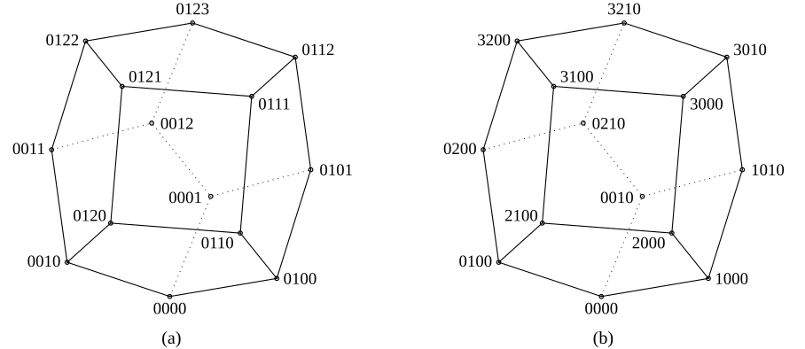</a>

**图 61　4 阶塔迈里栅格.** 每个森林由按前序排列的以下序列表示: (a) 结点深度 $c_1c_2c_3c_4$; (b) 后代数量 $s_1s_2s_3s_4$ (见习题 26–28).

<a id="ex-7-2-1-6-28"></a>

**28.** [*M26*][答案](./answers/7-2-1-6.md#ans-7-2-1-6-28) (斯坦利栅格) 续习题 26 和 27, 让我们在 $n$ 结点森林上再定义一种偏序. 对于 $1\leq j\leq n$, 只要深度坐标 $c_1\ldots c_n$ 和 $c'_1\ldots c'_n$ 满足 $c_j\leq c'_j$, 就说 $F\subseteq F'$. (见图 62.)

<a id="fig-62"></a>

<a href="../../assets/volume4a/figures/7-2-1-6-fig62-stanley-lattice.svg" target="_blank" rel="noopener">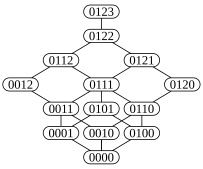</a>

**图 62　4 阶斯坦利栅格.** 每个森林由按前序排列的结点深度 $c_1c_2c_3c_4$ 的序列表示 (见习题 26–28).

(a) 通过解释如何计算任意两个给定森林的最大下界 $F\cap F'$ 和最小上界 $F\cup F'$, 证明这个偏序是一个栅格.

(b) 证明: 斯坦利栅格满足分配律

$$
F\cap(G\cup H)=(F\cap G)\cup(F\cap H),\qquad
F\cup(G\cap H)=(F\cup G)\cap(F\cup H).
$$

(c) 在这个栅格中, $F'$ 什么时候覆盖 $F$?

(d) 判别真假: $F\subseteq G$ 当且仅当 $F^R\subseteq G^R$.

(e) 证明: 如果在塔迈里栅格中 $F\dashv F'$, 则在斯坦利栅格中 $F\subseteq F'$.

<a id="pdf-410"></a><a id="p-395"></a>

<a id="ex-7-2-1-6-29"></a>

**29.** [*HM31*][答案](./answers/7-2-1-6.md#ans-7-2-1-6-29) 塔迈里栅格中的覆盖图有时称为 “结合几何体”[^v4a-7-2-1-6-associahedron], 因为它与结合律 (14) 之间的关系, 我们在习题 27(b) 中已经对此进行了证明. 4 阶结合几何体如图 61 所示, 看起来有 3 个正方形面和 6 个正五边形面. (与习题 7.2.1.2–60 中的图 43 比较, 后者给出了 4 阶 “排列几何体”[^v4a-7-2-1-6-permutahedron], 它是一个著名的阿基米德立体.) 图 61 为什么没有出现在均匀多面体的经典清单中?

<a id="ex-7-2-1-6-30"></a>

**30.** [*M33*][答案](./answers/7-2-1-6.md#ans-7-2-1-6-30) 森林的树冠是由下式定义的二进制位串 $f_1\ldots f_{n-1}$:

$$
f_j=[\text{按前序排列的结点 }j\text{ 不是叶结点}].
$$

(a) 如果 $F$ 的树冠为 $f_1\ldots f_{n-1}$, 那么 $F^D$ 的树冠是什么? (见习题 26 和 27.)

(b) 有多少森林的树冠为 $\mathtt{1010110111111000010101000101100}$?

(c) 采用 (6) 中的表示法, 证明: 对于 $1\leq j<n$, 有 $f_j=[d_j=0]$.

(d) 给定一个栅格的两个元素, 如果它们的最大下界是底部元素, 最小上界是顶端元素, 就说这两个元素是互补的. 证明: 塔迈里栅格中的两个元素 $F$ 和 $F'$ 是互补的, 当且仅当它们的树冠互补, 也就是说 $f'_1\ldots f'_{n-1}=\overline{f_1}\ldots\overline{f_{n-1}}$.

<a id="ex-7-2-1-6-31"></a>

**▸ 31.** [*M28*][答案](./answers/7-2-1-6.md#ans-7-2-1-6-31) 一棵拥有 $n$ 个内部结点的二叉树, 如果它的高度为 $n$, 就称这棵树是退化的.

(a) $n$ 结点二叉树有多少是退化的?

(b) 我们已经在表 1、2、3 中看到, 二叉树和森林可以用各种 $n$ 元组编码. 对于以下每种编码 $c_1\ldots c_n$、$d_1\ldots d_n$、$e_1\ldots e_n$、$k_1\ldots k_n$、$p_1\ldots p_n$、$s_1\ldots s_n$、$u_1\ldots u_n$、$z_1\ldots z_n$, 如何一眼看出相应的二叉树是不是退化的?

(c) 判别真假: 如果 $F$ 是退化的, 则 $F^D$ 也是退化的.

(d) 证明: 如果 $F$ 和 $F'$ 都是退化的, 那么 $F\barwedge F'=F\perp F'$ 和 $F\veebar F'=F\top F'$ 也都是退化的.

<a id="ex-7-2-1-6-32"></a>

**▸ 32.** [*M30*][答案](./answers/7-2-1-6.md#ans-7-2-1-6-32) 证明: 如果 $F\dashv F'$, 则存在一个森林 $F''$, 使得对于所有 $G$ 都有

$$
F'\perp G=F\quad\Longleftrightarrow\quad F\dashv G\dashv F''.
$$

于是, 在塔迈里栅格中有半分配律:

$$
\begin{aligned}
F\perp G=F\perp H&\quad\Longrightarrow\quad F\perp(G\top H)=F\perp G;\\
F\top G=F\top H&\quad\Longrightarrow\quad F\top(G\perp H)=F\top G.
\end{aligned}
$$

<a id="ex-7-2-1-6-33"></a>

**▸ 33.** [*M27*][答案](./answers/7-2-1-6.md#ans-7-2-1-6-33) (二叉树的排列表示) 令 $\sigma$ 是圈 $(1\ 2\ \ldots\ n)$.

(a) 给定任意二叉树, 其结点按对称序从 1 至 $n$ 编号, 证明: 存在 $\{1,\ldots,n\}$ 的唯一排列 $\lambda$, 使得对于 $1\leq k\leq n$ 有

$$
\mathtt{LLINK}[k]=
\begin{cases}
k\lambda,&\text{如果 }k\lambda<k;\\
0,&\text{否则;}
\end{cases}
\qquad
\mathtt{RLINK}[k]=
\begin{cases}
k\sigma\lambda,&\text{如果 }k\sigma\lambda>k;\\
0,&\text{否则.}
\end{cases}
$$

于是, $\lambda$ 巧妙地将 $2n$ 个链接域打包到单个 $n$ 元素数组中.

(b) 证明: 当二叉树是森林 $F$ 的左兄弟／右子结点表示时, 以圈形式描述这一排列 $\lambda$ 特别方便. 当 $F$ 是 (2) 中的森林时, $\lambda(F)$ 的圈形式是什么样的?

(c) 找出 $\lambda(F)$ 与对偶排列 $\lambda(F^D)$ 之间的简单关系.

(d) 证明: 在习题 26 中, $F'$ 覆盖 $F$ 当且仅当 $\lambda(F')=(j\ k)\lambda(F)$, 其中 $j$ 和 $k$ 是 $F$ 中的兄弟结点.

(e) 于是, $n$ 阶克雷韦拉斯栅格中的极大链数, 就是将一个 $n$ 圈分解为 $n-1$ 个转置的乘积的方法数. 试计算这一数量. 提示: 见式 1.2.6–(16).

<a id="ex-7-2-1-6-34"></a>

**34.** [*M25*][答案](./answers/7-2-1-6.md#ans-7-2-1-6-34) (理查德·斯坦利) 证明: $n$ 阶斯坦利栅格中极大链的数量是 $(n(n-1)/2)!/(1^{n-1}3^{n-2}\ldots(2n-5)^2(2n-3)^1)$.

<a id="ex-7-2-1-6-35"></a>

**35.** [*HM37*][答案](./answers/7-2-1-6.md#ans-7-2-1-6-35) (道格拉斯·泰勒和迪安·希克森) 试解释为什么渐近公式 (16) 的分母都是 2 的幂.


<a id="pdf-411"></a><a id="p-396"></a>

<a id="ex-7-2-1-6-36"></a>

**▸ 36.** [*M25*][答案](./answers/7-2-1-6.md#ans-7-2-1-6-36) 试分析习题 20(b) 的三叉树生成算法. 提示: 根据习题 2.3.4.4–11, 具有 $n$ 个内部结点的三叉树总共有 $(2n+1)^{-1}\binom{3n}{n}$ 棵.

<a id="ex-7-2-1-6-37"></a>

**▸ 37.** [*M40*][答案](./answers/7-2-1-6.md#ans-7-2-1-6-37) 试分析扎克斯—理查兹算法, 它用于生成具有给定度分布 $n_0,n_1,n_2,\ldots,n_t$ 的所有树 (习题 21). 提示: 见习题 2.3.4.4–32.

<a id="ex-7-2-1-6-38"></a>

**38.** [*M22*][答案](./answers/7-2-1-6.md#ans-7-2-1-6-38) 算法 L 执行的内存访问总数是多少? 用 $n$ 的函数表示.

<a id="ex-7-2-1-6-39"></a>

**39.** [*22*][答案](./answers/7-2-1-6.md#ans-7-2-1-6-39) 通过证明 (5) 中 $A_{pq}$ 的元素对应于两行的扬氏图表, 证明公式 (23).

<a id="ex-7-2-1-6-40"></a>

**40.** [*M22*][答案](./answers/7-2-1-6.md#ans-7-2-1-6-40) (a) 证明: $C_{pq}$ 为奇数当且仅当 $p\mathbin{\&}(q+1)=0$, 即 $p$ 和 $q+1$ 的二进制表示在任何同一位上都不同时为 1. (b) 因此, $C_n$ 为奇数当且仅当 $n+1$ 是 2 的幂.

<a id="ex-7-2-1-6-41"></a>

**41.** [*M21*][答案](./answers/7-2-1-6.md#ans-7-2-1-6-41) 证明: 投票数有一个简单的生成函数 $\sum C_{pq}w^pz^q$.

<a id="ex-7-2-1-6-42"></a>

**▸ 42.** [*M22*][答案](./answers/7-2-1-6.md#ans-7-2-1-6-42) 有多少个 $n$ 结点未标记森林是 (a) 自共轭的? (b) 自转置的? (c) 自对偶的? (见习题 11、12、19、26.)

<a id="ex-7-2-1-6-43"></a>

**43.** [*M21*][答案](./answers/7-2-1-6.md#ans-7-2-1-6-43) 用卡塔兰数 $\langle C_0,C_1,C_2,\ldots\rangle$ 表示 $C_{pq}$, 旨在得到一个当 $q-p$ 很小时的简单公式. (例如, $C_{(q-2)q}=C_q-C_{q-1}$.)

<a id="ex-7-2-1-6-44"></a>

**▸ 44.** [*M27*][答案](./answers/7-2-1-6.md#ans-7-2-1-6-44) 证明: 算法 B 每访问一棵二叉树只需 $8\tfrac23+O(n^{-1})$ 次内存访问.

<a id="ex-7-2-1-6-45"></a>

**45.** [*M26*][答案](./answers/7-2-1-6.md#ans-7-2-1-6-45) 分析习题 22 中的算法所进行的内存访问. 它与算法 B 相比如何?

<a id="ex-7-2-1-6-46"></a>

**46.** [*M30*][答案](./answers/7-2-1-6.md#ans-7-2-1-6-46) (广义卡塔兰数) 通过以下定义推广 (21):

$$
C_{pq}(x)=C_{p(q-1)}(x)+x^{q-p}C_{(p-1)q}(x),
\quad\text{如果 }0\leq p\leq q\ne0;\qquad C_{00}(x)=1;
$$

并定义: 如果 $p<0$ 或 $p>q$, 则 $C_{pq}(x)=0$. 因此 $C_{pq}=C_{pq}(1)$. 另外, 令 $C_n(x)=C_{nn}(x)$, 于是

$$
\langle C_0(x),C_1(x),\ldots\rangle
=\langle 1,1,1+x,1+2x+x^2+x^3,1+3x+3x^2+3x^3+2x^4+x^5+x^6,\ldots\rangle.
$$

(a) 证明: (28) 中从 <span style="border:1px solid;border-radius:1em;padding:0.10em 0.17em">$pq$</span> 到 <span style="border:1px solid;border-radius:1em;padding:0.10em 0.17em">00</span> 面积为 $k$ 的路径数量是 $[x^k]C_{pq}(x)$, 这里一条路径的 “面积” 是指它上方的矩形格数. (因此, 一条 L 形路径有最大可能面积 $p(q-p)+\binom p2$.)

(b) 证明: $C_n(x)=\sum_F x^{c_1+\cdots+c_n}=\sum_F x^{\text{内部路径长度}(F)}$, 针对所有 $n$ 结点森林 $F$ 求和.

(c) 如果 $C(x,z)=\sum_{n=0}^{\infty}C_n(x)z^n$, 证明: $C(x,z)=1+zC(x,z)C(x,xz)$.

(d) 此外, 证明: $C(x,z)C(x,xz)\cdots C(x,x^rz)=\sum_{p=0}^{\infty}C_{p(p+r)}(x)z^p$.

<a id="ex-7-2-1-6-47"></a>

**47.** [*M27*][答案](./answers/7-2-1-6.md#ans-7-2-1-6-47) 续上题, 推广恒等式 (27).

<a id="ex-7-2-1-6-48"></a>

**48.** [*M28*][答案](./answers/7-2-1-6.md#ans-7-2-1-6-48) (弗兰克·拉斯基和安杰伊·普罗斯库罗夫斯基) 当 $x=-1$ 时计算 $C_{pq}(x)$, 利用这一结果证明: 当 $n\geq5$ 为奇数时, 嵌套括号不存在 “完美” 格雷码.

<a id="ex-7-2-1-6-49"></a>

**49.** [*17*][答案](./answers/7-2-1-6.md#ans-7-2-1-6-49) 按照字典序, 由 15 个嵌套括号对组成的第一百万个串是什么样的?

<a id="ex-7-2-1-6-50"></a>

**50.** [*20*][答案](./answers/7-2-1-6.md#ans-7-2-1-6-50) 设计算法 U 的逆算法: 给定嵌套括号串 $a_1\ldots a_{2n}$, 确定它按字典序的秩 $N-1$. 嵌套括号串 (1) 的秩是多少?

<a id="ex-7-2-1-6-51"></a>

**51.** [*M22*][答案](./answers/7-2-1-6.md#ans-7-2-1-6-51) 令 $\bar z_1\bar z_2\ldots\bar z_n$ 是 $z_1z_2\ldots z_n$ 关于 $2n$ 的补, 换言之, $\bar z_j=2n-z_j$, 其中 $z_j$ 在 (8) 中定义. 证明: 如果 $\bar z_1\bar z_2\ldots\bar z_n$ 是算法 7.2.1.3L 生成的 $\{0,1,\ldots,2n-1\}$ 的第 $(N+1)$ 个 $n$ 组合, 则 $z_1z_2\ldots z_n$ 是由习题 2 中的算法生成的 $\{1,2,\ldots,2n\}$ 的第 $(N-\kappa_n N+1)$ 个 $n$ 组合. (这里的 $\kappa_n$ 表示第 $n$ 个克鲁斯卡尔函数, 定义见 7.2.1.3–(60).)

<a id="ex-7-2-1-6-52"></a>

**52.** [*M23*][答案](./answers/7-2-1-6.md#ans-7-2-1-6-52) 当嵌套括号串 $a_1a_2\ldots a_{2n}$ 为随机选定时, 求表 1 中的量 $d_n$ 的均值和方差.

<a id="ex-7-2-1-6-53"></a>

**53.** [*M28*][答案](./answers/7-2-1-6.md#ans-7-2-1-6-53) 令 $X$ 是从扩展二叉树的根结点到最左侧外部结点的距离.

(a) 当所有 $n$ 结点二叉树等概率时, $X$ 的期望值是多少?

(b) 在算法 6.2.2T 中从随机排列 $K_1\ldots K_n$ 构造的随机二叉查找树中, $X$ 的期望值是多少?

(c) 在随机退化二叉树中 (退化的定义见习题 31), $X$ 的期望值是多少?

(d) 对于以上三种情形, $2^X$ 的期望值是多少?

<a id="pdf-412"></a><a id="p-397"></a>

<a id="ex-7-2-1-6-54"></a>

**54.** [*HM29*][答案](./answers/7-2-1-6.md#ans-7-2-1-6-54) $c_1+\cdots+c_n$ 的均值和方差分别是多少? (见习题 46.)

<a id="ex-7-2-1-6-55"></a>

**55.** [*HM33*][答案](./answers/7-2-1-6.md#ans-7-2-1-6-55) 计算 $C'_{pq}(1)$, 即习题 46(a) 中所有路径的总面积.

<a id="ex-7-2-1-6-56"></a>

**56.** [*M23*][答案](./answers/7-2-1-6.md#ans-7-2-1-6-56) (伦佐·斯普鲁格诺里, 1990) 证明求和公式

$$
\sum_{k=0}^{m-1}C_kC_{n-1-k}
=\frac12 C_n+\frac{2m-n}{2n(n+1)}\binom{2m}{m}\binom{2n-2m}{n-m},
\qquad 0\leq m\leq n.
$$

<a id="ex-7-2-1-6-57"></a>

**57.** [*M28*][答案](./answers/7-2-1-6.md#ans-7-2-1-6-57) 对于 $p=0,1,2,3$, 以闭合式表示和式 $S_p(a,b)=\sum_{k\geq0}\binom{2a}{a-k}\binom{2b}{b-k}k^p$, 并利用这些公式证明 (30).

<a id="ex-7-2-1-6-58"></a>

**58.** [*HM34*][答案](./answers/7-2-1-6.md#ans-7-2-1-6-58) 在 $n$ 结点二叉树中, 以对称序对外部结点从 0 到 $n$ 编号, 设外部结点 $m$ 出现在第 $l$ 级的此种二叉树的数量为 $t_{lmn}$. 另外, 令 $t_{mn}=\sum_{l=1}^n l\,t_{lmn}$, 从而 $t_{mn}/C_n$ 为外部结点 $m$ 的平均级别. 令 $t(w,z)$ 是超级生成函数

$$
\sum_{m,n}t_{mn}w^mz^n
=(1+w)z+(3+4w+3w^2)z^2+(9+13w+13w^2+9w^3)z^3+\cdots.
$$

证明: $t(w,z)=(C(z)-wC(wz))/(1-w)-1+zC(z)t(w,z)+wzC(wz)t(w,z)$, 并推导计算数值 $t_{mn}$ 的简单公式.

<a id="ex-7-2-1-6-59"></a>

**59.** [*HM29*][答案](./answers/7-2-1-6.md#ans-7-2-1-6-59) 类似地, 令 $T_{lmn}$ 表示内部结点 $m$ 出现在第 $l$ 级的所有 $n$ 结点二叉树的数量. 求 $T_{mn}=\sum_{l=1}^n l\,T_{lmn}$ 的简单公式.

<a id="ex-7-2-1-6-60"></a>

**▸ 60.** [*M26*][答案](./answers/7-2-1-6.md#ans-7-2-1-6-60) (平衡串) 如果嵌套括号串 $\alpha$ 具有 $\mathtt{(}\alpha'\mathtt{)}$ 的形式 (其中 $\alpha'$ 是嵌套的), 就说 $\alpha$ 是原子的. 每个嵌套括号串可以唯一表示为原子的乘积 $\alpha_1\ldots\alpha_r$. 左右括号数相等的串称为平衡的. 每个平衡串可以唯一表示为 $\beta_1\ldots\beta_r$, 其中每个 $\beta_j$ 要么是原子, 要么是反向原子 (原子的反转). 一个平衡串的瑕疵数是其反向原子总长度的一半. 例如, 平衡串

$$
\underbracket{\mathtt{(())}}\,\underbracket{\mathtt{)(}}\,\underbracket{\mathtt{(())}}\,
\underbracket{\mathtt{))))(()(((}}\,\underbracket{\mathtt{))((}}\,
\underbracket{\mathtt{()}}\,\underbracket{\mathtt{)(}}\,\underbracket{\mathtt{()}}
$$

具有因式形式 $\beta_1\beta_2\beta_3\beta_4\beta_5\beta_6\beta_7\beta_8=\alpha_1\alpha_2^R\alpha_3\alpha_4^R\alpha_5^R\alpha_6\alpha_7^R\alpha_8$, 有四个原子和四个反向原子, 它的瑕疵数为 $|\alpha_2\alpha_4\alpha_5\alpha_7|/2=9$.

(a) 证明: 平衡串的瑕疵数是符合以下条件的下标 $k$ 的数量: 第 $k$ 个右括号出现在第 $k$ 个左括号之前.

(b) 如果 $\beta_1\ldots\beta_r$ 是平衡的, 我们可以将它映射为嵌套括号串, 只需反转它的反向原子即可. 但下面的映射更有意义, 因为它从无偏 (均匀随机的) 平衡串生成无偏嵌套括号串. 假设存在 $s$ 个反向原子 $\beta_{i_1}=\alpha_{i_1}^R,\ldots,\beta_{i_s}=\alpha_{i_s}^R$. 将每个反向原子用“(”代替, 然后追加串 $\mathtt{)}\alpha'_{i_s}\ldots\mathtt{)}\alpha'_{i_1}$, 其中 $\alpha_j=\mathtt{(}\alpha'_j\mathtt{)}$. 例如, 上面的串被映射为 $\alpha_1\mathtt{(}\alpha_3\mathtt{((}\alpha_6\mathtt{(}\alpha_8\mathtt{)}\alpha'_7\mathtt{)}\alpha'_5\mathtt{)}\alpha'_4\mathtt{)}\alpha'_2$, 它恰好等于本节开头的串 (1).

设计一种算法, 将这一映射应用于给定的平衡串 $b_1\ldots b_{2n}$.

(c) 为逆映射设计一种算法: 给定嵌套括号串 $\alpha=a_1\ldots a_{2n}$ 和满足 $0\leq l\leq n$ 的整数 $l$, 求出瑕疵数为 $l$ 的一个平衡串 $\beta=b_1\ldots b_{2n}$, 使得 $\beta\mapsto\alpha$. 哪个瑕疵数为 11 的平衡串映射为 (1)?

<a id="ex-7-2-1-6-61"></a>

**▸ 61.** [*M26*][答案](./answers/7-2-1-6.md#ans-7-2-1-6-61) (拉尼循环引理) 令 $b_1b_2\ldots b_N$ 是一个非负整数串, 满足 $f=N-b_1-b_2-\cdots-b_N>0$.

(a) 证明: 对于 $1\leq j\leq N$, 恰有 $f$ 个循环移位 $b_{j+1}\ldots b_Nb_1\ldots b_j$ 满足习题 20 的前序度数序列性质.

(b) 给定 $b_1b_2\ldots b_N$, 设计一种高效的算法, 用于确定所有这种 $j$.

(c) 如何生成一个随机森林, 它有 $N=n_0+\cdots+n_t$ 个结点, 其中恰有 $n_j$ 个结点的度数为 $j$? (例如, 当 $N=tn+1$、$n_0=(t-1)n+1$、$n_1=\cdots=n_{t-1}=0$、$n_t=n$ 时, 我们得到随机的、具有 $n$ 个内部结点的扩展 $t$ 叉树, 作为一般过程的特例.)

<a id="ex-7-2-1-6-62"></a>

**62.** [*22*][答案](./answers/7-2-1-6.md#ans-7-2-1-6-62) 二叉树也可以用二进制位串 $(l_1\ldots l_n,r_1\ldots r_n)$ 表示, 其中 $l_j$ 和 $r_j$ 分别说明按前序编号的结点 $j$ 的左、右子树是否非空. (见定理 2.3.1A.) 证明: 如果 $l_1\ldots l_n$ 和 $r_1\ldots r_n$ 是满足 $l_1+\cdots+l_n+r_1+\cdots+r_n=n-1$ 的任意二进制位串, 那么恰有一个循环移位 $(l_{j+1}\ldots l_nl_1\ldots l_j,r_{j+1}\ldots r_nr_1\ldots r_j)$ 给出有效的二叉树表示, 并解释如何找到它.

<a id="pdf-413"></a><a id="p-398"></a>

<a id="ex-7-2-1-6-63"></a>

**63.** [*16*][答案](./answers/7-2-1-6.md#ans-7-2-1-6-63) 如果雷米算法的前两次迭代已经生成 <a href="../../assets/volume4a/figures/7-2-1-6-exercise63-remy-start-tree.svg" target="_blank" rel="noopener">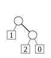</a>, 那么, 在下一次迭代之后可能出现哪些装饰二叉树?

<a id="ex-7-2-1-6-64"></a>

**64.** [*20*][答案](./answers/7-2-1-6.md#ans-7-2-1-6-64) 算法 R 中 $X$ 值的哪个序列对应于 (34) 的装饰树? $L_0L_1\ldots L_{12}$ 的最终取值是多少?

<a id="ex-7-2-1-6-65"></a>

**65.** [*38*][答案](./answers/7-2-1-6.md#ans-7-2-1-6-65) 将雷米算法 (算法 R) 推广到 $t$ 叉树.

<a id="ex-7-2-1-6-66"></a>

**66.** [*21*][答案](./answers/7-2-1-6.md#ans-7-2-1-6-66) 施罗德树是一种二叉树, 其中每个非空右链接要么涂以白色, 要么涂以黑色. 当 $n$ 较小时, $n$ 结点施罗德树的数量 $S_n$ 为

$$
\begin{array}{rrrrrrrrrrrrrrr}
n={}&0&1&2&3&4&5&6&7&8&9&10&11&12&13\\
S_n={}&1&1&3&11&45&197&903&4\,279&20\,793&103\,049&518\,859&2\,646\,723&13\,648\,869&71\,039\,373
\end{array}
$$

例如, $S_3=11$, 其所有可能性是

<a href="../../assets/volume4a/figures/7-2-1-6-exercise66-schroeder-trees.svg" target="_blank" rel="noopener">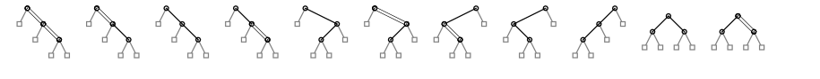</a>

(白色链接为 “空心”. 图中也添上了外部结点.)

(a) 找出具有 $n$ 个内部结点的施罗德树, 与具有 $n+1$ 个叶结点且没有 1 度结点的普通树之间的简单对应关系.

(b) 为施罗德树设计一种格雷码.

<a id="ex-7-2-1-6-67"></a>

**67.** [*M22*][答案](./answers/7-2-1-6.md#ans-7-2-1-6-67) 施罗德数的生成函数 $S(z)=\sum_n S_nz^n$ 是什么?

<a id="ex-7-2-1-6-68"></a>

**68.** [*10*][答案](./answers/7-2-1-6.md#ans-7-2-1-6-68) 0 阶圣诞树模式是什么样的?

<a id="ex-7-2-1-6-69"></a>

**69.** [*20*][答案](./answers/7-2-1-6.md#ans-7-2-1-6-69) 在表 4 中能否看到 6 阶和 7 阶圣诞树模式 (可能有少许变化)?

<a id="ex-7-2-1-6-70"></a>

**▸ 70.** [*20*][答案](./answers/7-2-1-6.md#ans-7-2-1-6-70) 试找出一种简单规则, 为每个二进制位串 $\sigma$ 定义另一个二进制位串 $\sigma'$, 称为 $\sigma$ 的配偶. 它具有以下性质: (i) $\sigma''=\sigma$; (ii) $|\sigma'|=|\sigma|$; (iii) $\sigma\subseteq\sigma'$ 或 $\sigma'\subseteq\sigma$; (iv) $\nu(\sigma)+\nu(\sigma')=|\sigma|$.

<a id="ex-7-2-1-6-71"></a>

**71.** [*M21*][答案](./answers/7-2-1-6.md#ans-7-2-1-6-71) 令 $M_{t,n}$ 是满足以下性质的最大可能集合 $S$ 的大小: $S$ 是由 $n$ 位二进制位串组成的集合, 如果 $\sigma$ 和 $\tau$ 都是 $S$ 的成员, 且 $\sigma\subseteq\tau$, 那么 $\nu(\tau)<\nu(\sigma)+t$. (例如, 根据施佩纳定理[^v4a-7-2-1-6-sperner], 有 $M_{1,n}=M_n$.) 试为 $M_{t,n}$ 找出一个公式.

<a id="ex-7-2-1-6-72"></a>

**▸ 72.** [*M28*][答案](./answers/7-2-1-6.md#ans-7-2-1-6-72) 从长度为 $s$ 的单行 $\sigma_1\ \sigma_2\ \ldots\ \sigma_s$ 开始, 将增长规则 (36) 重复应用 $n$ 次, 可以得到多少行?

<a id="ex-7-2-1-6-73"></a>

**73.** [*15*][答案](./answers/7-2-1-6.md#ans-7-2-1-6-73) 在 30 阶圣诞树模式中, 在包含二进制位串 $\mathtt{011001001000011111101101011100}$ 的行中, 第一个元素和最后一个元素分别是什么?

<a id="ex-7-2-1-6-74"></a>

**74.** [*M26*][答案](./answers/7-2-1-6.md#ans-7-2-1-6-74) 续上题, 该行之前有多少行?

<a id="ex-7-2-1-6-75"></a>

**▸ 75.** [*HM23*][答案](./answers/7-2-1-6.md#ans-7-2-1-6-75) 设 $(r_1^{(n)},r_2^{(n)},\ldots,r_{n-1}^{(n)})$ 是 $n$ 阶圣诞树模式中具有 $n-1$ 项的各行的行号. 例如, 表 4 告诉我们, $(r_1^{(8)},\ldots,r_7^{(8)})=(20,40,54,62,66,68,69)$. 试找出 $r_{j+1}^{(n)}-r_j^{(n)}$ 和 $\lim_{n\to\infty}r_j^{(n)}/M_n$ 的公式.

<a id="ex-7-2-1-6-76"></a>

**76.** [*HM46*][答案](./answers/7-2-1-6.md#ans-7-2-1-6-76) 试研究当 $n\to\infty$ 时圣诞树模式的极限形状. 例如, 经过适当缩放, 它能否具有分形维数?

<a id="ex-7-2-1-6-77"></a>

**77.** [*21*][答案](./answers/7-2-1-6.md#ans-7-2-1-6-77) 给定 $n$, 设计一种算法, 用于生成圣诞树模式中各行最右元素的序列 $a_1\ldots a_n$. 提示: 这些二进制位串由以下性质描述: 对于 $0\leq k\leq n$, 有 $a_1+\cdots+a_k\geq k/2$.

<a id="ex-7-2-1-6-78"></a>

**78.** [*20*][答案](./answers/7-2-1-6.md#ans-7-2-1-6-78) 判别真假: 如果 $\sigma_1\ldots\sigma_s$ 是圣诞树模式的一行, 那么 $\bar\sigma_s^R\ldots\bar\sigma_1^R$ (逆补的逆序列) 也是它的一行.

<a id="ex-7-2-1-6-79"></a>

**79.** [*M26*][答案](./answers/7-2-1-6.md#ans-7-2-1-6-79) 根据式 5.1.3–(12), 恰有一个 “下降”($p_k>p_{k+1}$) 的排列 $p_1\ldots p_n$ 的数量为欧拉数 $\left\langle\begin{smallmatrix}n\\1\end{smallmatrix}\right\rangle=2^n-n-1$. 圣诞树模式中底行上方的项数也等于这个数.

(a) 在恰有一个下降的排列与未排序二进制位串之间建立一一对应, 为上述巧合找出一种组合解释.

(b) 证明: 两个未排序二进制位串属于圣诞树模式的同一行, 当且仅当它们对应的排列在鲁宾逊—申斯特德对应关系 (定理 5.1.4A) 下定义同一个 $P$ 图表.


<a id="pdf-414"></a><a id="p-399"></a>

<a id="ex-7-2-1-6-80"></a>

**80.** [*30*][答案](./answers/7-2-1-6.md#ans-7-2-1-6-80) 有两个二进制位串, 如果通过对子串进行 $010\leftrightarrow100$ 或 $101\leftrightarrow110$ 转换, 可以由一个二进制位串得到另一个, 就说这两个二进制位串是和谐的. 例如, 下面的二进制位串相互之间是和谐的:

$$
\begin{array}{ccccccccccc}
011100&\leftrightarrow&011010&\leftrightarrow&010110&\leftrightarrow&010101&\leftrightarrow&011001&&\\
&&&&\updownarrow&&\updownarrow&&&&\\
&&&&100110&\leftrightarrow&100101&\leftrightarrow&101001&\leftrightarrow&110001,
\end{array}
$$

但除此之外, 没有其他二进制位串与其中任何一个是和谐的.

证明: 二进制位串是和谐的, 当且仅当它们属于圣诞树模式中长度相同的行的同一列.

<a id="ex-7-2-1-6-81"></a>

**81.** [*M30*][答案](./answers/7-2-1-6.md#ans-7-2-1-6-81) 阶数为 $(n,n')$ 的双杂乱集是二进制位串对 $(\sigma,\sigma')$ 的家族 $S$, 其中 $|\sigma|=n$、$|\sigma'|=n'$. 该家族具有以下性质: 仅当 $\sigma\ne\tau$ 且 $\sigma'\ne\tau'$ 时, $S$ 的不同成员 $(\sigma,\sigma')$ 和 $(\tau,\tau')$ 才能同时满足 $\sigma\subseteq\tau$ 和 $\sigma'\subseteq\tau'$.

使用圣诞树模式证明: $S$ 中最多包含 $M_{n+n'}$ 个二进制位串对.

<a id="ex-7-2-1-6-82"></a>

**▸ 82.** [*M26*][答案](./answers/7-2-1-6.md#ans-7-2-1-6-82) 设 $E(f)$ 是算法 H 对函数 $f$ 求值的次数.

(a) 证明: $M_n\leq E(f)\leq M_{n+1}$; 当 $f$ 为常函数时, 左侧等号成立.

(b) 在所有满足 $E(f)=M_n$ 的 $f$ 中, 哪个使 $\sum_\sigma f(\sigma)$ 的取值最小?

(c) 在所有满足 $E(f)=M_{n+1}$ 的 $f$ 中, 哪个使 $\sum_\sigma f(\sigma)$ 的取值最大?

<a id="ex-7-2-1-6-83"></a>

**83.** [*M20*][答案](./answers/7-2-1-6.md#ans-7-2-1-6-83) (乔治斯·汉塞尔) 证明: 最多有 $3^{M_n}$ 个 $n$ 变量单调布尔函数 $f(x_1,\ldots,x_n)$.

<a id="ex-7-2-1-6-84"></a>

**▸ 84.** [*HM27*][答案](./answers/7-2-1-6.md#ans-7-2-1-6-84) (丹尼尔·克莱特曼) 假定 $A$ 是 $m\times n$ 实数矩阵, 其中每一列 $v$ 的长度 $\|v\|\geq1$, 假定 $b$ 是 $m$ 维列向量. 证明: 最多有 $M_n$ 个列向量 $x=(a_1,\ldots,a_n)^T$ (其分量 $a_j=0$ 或 1) 满足 $\|Ax-b\|<\tfrac12$. 提示: 采用一种类似于圣诞树模式的构造方法.

<a id="ex-7-2-1-6-85"></a>

**85.** [*HM30*][答案](./answers/7-2-1-6.md#ans-7-2-1-6-85) (菲利普·戈勒) 设 $V$ 是满足以下条件的任意向量空间: 它包含于所有 $n$ 维实向量组成的集合中, 但不包含任何一个单位向量 $(1,0,\ldots,0),(0,1,0,\ldots,0),\ldots,(0,\ldots,0,1)$. 证明: $V$ 中最多有 $M_n$ 个向量, 其每个分量均为 0 或 1. 此外, 上限 $M_n$ 可以达到.

<a id="ex-7-2-1-6-86"></a>

**86.** [*15*][答案](./answers/7-2-1-6.md#ans-7-2-1-6-86) 如果 (2) 被看作定向森林, 而非有序森林, 那么与它对应的规范森林是什么? 用它的层级代码 $c_1\ldots c_{15}$ 和父指针 $p_1\ldots p_{15}$ 来描述它.

<a id="ex-7-2-1-6-87"></a>

**87.** [*M20*][答案](./answers/7-2-1-6.md#ans-7-2-1-6-87) 设 $F$ 是有序森林, 按前序排列的第 $k$ 个结点出现在第 $c_k$ 级, 并且这个结点的父指针是 $p_k$. 如果这个结点是根结点, 令 $p_k=0$.

(a) 有多少森林对于所有 $1\leq k\leq n$ 均满足 $c_k=p_k$?

(b) 假设 $F$ 和 $F'$ 的层级代码分别是 $c_1\ldots c_n$ 和 $c'_1\ldots c'_n$, 父链接分别是 $p_1\ldots p_n$ 和 $p'_1\ldots p'_n$. 证明: 按字典序, $c_1\ldots c_n\leq c'_1\ldots c'_n$ 当且仅当 $p_1\ldots p_n\leq p'_1\ldots p'_n$.

<a id="ex-7-2-1-6-88"></a>

**88.** [*M20*][答案](./answers/7-2-1-6.md#ans-7-2-1-6-88) 分析算法 O: 步骤 O4 的执行频率如何? 在步骤 O5 中 $p_k$ 总共被改变了多少次?

<a id="ex-7-2-1-6-89"></a>

**89.** [*M46*][答案](./answers/7-2-1-6.md#ans-7-2-1-6-89) 算法 O 的步骤 O5 中置 $p_k\gets p_j$ 的频率如何?

<a id="ex-7-2-1-6-90"></a>

**▸ 90.** [*M27*][答案](./answers/7-2-1-6.md#ans-7-2-1-6-90) 如果 $p_1\ldots p_n$ 是定向森林的规范父指针序列, 则具有顶点 $\{0,1,\ldots,n\}$ 和边 $\{k\mathbin{-}p_k\mid1\leq k\leq n\}$ 的图是一棵自由树, 即无圈连通图. (见定理 2.3.4.1A.) 反之, 每棵自由树都以这种方式对应于至少一个定向森林. 但父指针 $\mathtt{011}$ 和 $\mathtt{000}$ 都得到相同的自由树 <a href="../../assets/volume4a/figures/7-2-1-6-exercise90-star.svg" target="_blank" rel="noopener">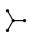</a>; 类似地, $\mathtt{012}$ 和 $\mathtt{010}$ 都得到自由树 <a href="../../assets/volume4a/figures/7-2-1-6-exercise90-path.svg" target="_blank" rel="noopener">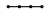</a>.

本题的目的是进一步限制序列 $p_1\ldots p_n$, 使得每棵自由树恰好被获取一次. 我们在 2.3.4.4–(9) 中已经证明: 对于 $n+1$ 个顶点, 只需证明一棵自由树总是至少有一个形心 (centroid), 就可以通过一个相当简单的生成函数计算结构不同的自由树的数量.

(a) 证明: 一个规范的 $n$ 结点森林对应于一棵只有一个形心的自由树, 当且仅当这个森林中任意一棵树的结点数都不超过 $\lfloor n/2\rfloor$.

(b) 修改算法 O, 使它生成所有满足 (a) 的序列 $p_1\ldots p_n$.

(c) 解释如何为拥有两个形心的自由树找出所有 $p_1\ldots p_n$.

<a id="ex-7-2-1-6-91"></a>

**91.** [*M37*][答案](./answers/7-2-1-6.md#ans-7-2-1-6-91) (艾伯特·奈恩黑斯和赫伯特·维尔夫) 证明: 采用一种类似于习题 7.2.1.4–47 中随机分划算法的过程, 可以生成随机定向树.

<a id="pdf-415"></a><a id="p-400"></a>

<a id="ex-7-2-1-6-92"></a>

**92.** [*15*][答案](./answers/7-2-1-6.md#ans-7-2-1-6-92) 算法 S 访问的第一个生成树和最后一个生成树是否相邻? 也就是说, 它们是否有 $n-2$ 条公共边?

<a id="ex-7-2-1-6-93"></a>

**93.** [*20*][答案](./answers/7-2-1-6.md#ans-7-2-1-6-93) 当算法 S 终止时, 它是否将图恢复为原始状态?

<a id="ex-7-2-1-6-94"></a>

**94.** [*22*][答案](./answers/7-2-1-6.md#ans-7-2-1-6-94) 算法 S 需要在步骤 S1 中找到一棵初始生成树, 以启动整个过程. 试解释如何完成这一任务.

<a id="ex-7-2-1-6-95"></a>

**95.** [*26*][答案](./answers/7-2-1-6.md#ans-7-2-1-6-95) 实现算法 S 的步骤 S8 中的桥检测, 补全该算法.

<a id="ex-7-2-1-6-96"></a>

**▸ 96.** [*28*][答案](./answers/7-2-1-6.md#ans-7-2-1-6-96) 当给定图为以下情形时, 试分析算法 S 的近似运行时间: (a) 一条长度为 $n-1$ 的路径 $P_n$; (b) 一个长度为 $n$ 的圈 $C_n$.

<a id="ex-7-2-1-6-97"></a>

**97.** [*15*][答案](./answers/7-2-1-6.md#ans-7-2-1-6-97) (48) 是不是串行—并行图?

<a id="ex-7-2-1-6-98"></a>

**98.** [*16*][答案](./answers/7-2-1-6.md#ans-7-2-1-6-98) 如果取 $A$ 为串行的, 与 (53) 对应的是什么样的串行—并行图?

<a id="ex-7-2-1-6-99"></a>

**▸ 99.** [*30*][答案](./answers/7-2-1-6.md#ans-7-2-1-6-99) 考虑一个如 (53) 的树表示的串行—并行图, 其结点值满足 (55). 根据根结点 $p$ 的 $v_p$ 值是 1 还是 0, 这些值定义了一棵生成树或准树. 证明: 以下方法将生成根结点的所有其他配置.

(i) 在开始时, 置所有非简单结点为主动, 置其他结点为被动.

(ii) 选择按前序排列的最右主动结点 $p$; 如果所有结点均为被动, 则终止.

(iii) 置 $d_p\gets r_{d_p}$, 更新树中的所有值, 访问新配置.

(iv) 置 $p$ 右侧的所有非简单结点为主动.

(v) 如果自 $p$ 上次变为主动以来, $d_p$ 已经遍历 $p$ 的所有子结点, 则置结点 $p$ 为被动. 返回步骤 (ii).

请解释如何高效执行这些步骤. 提示: 为实现步骤 (v), 引入指针 $z_p$. 当 $d_p$ 变得等于 $z_p$ 时, 置结点 $p$ 为被动, 并将 $z_p$ 重置为 $d_p$ 的前一个值. 为实现步骤 (ii) 和 (iv), 可以使用中心点指针 $f_p$, 类似于算法 7.2.1.1L 和 7.2.1.1K 中的那些中心点指针.

<a id="ex-7-2-1-6-100"></a>

**100.** [*40*][答案](./answers/7-2-1-6.md#ans-7-2-1-6-100) 将算法 S 和习题 99 的思路结合起来, 实现正文中的 “算法 $S'$”, 以旋转门顺序生成所有生成树.

<a id="ex-7-2-1-6-101"></a>

**101.** [*46*] 是否存在一种简单的旋转门方法, 可以列出完全图 $K_n$ 的所有 $n^{n-2}$ 棵生成树? (由算法 S 生成的顺序相当复杂.)

<a id="ex-7-2-1-6-102"></a>

**102.** [*46*][答案](./answers/7-2-1-6.md#ans-7-2-1-6-102) $n$ 个顶点上的有向图 $D$ 的定向生成树也称为 “生成树形图”, 它是 $D$ 的包含 $n-1$ 条弧的定向子树. 矩阵树定理 (习题 2.3.4.2–19) 告诉我们, 可以通过计算一个 $(n-1)\times(n-1)$ 的行列式, 求出具有给定根结点的定向子树的数量.

我们能否总是删除一条弧并将它用另一条弧代替, 从而以旋转门顺序列出这些定向子树?

<a id="pdf-416"></a><a id="p-401"></a>

<a id="ex-7-2-1-6-103"></a>

**▸ 103.** [*HM39*][答案](./answers/7-2-1-6.md#ans-7-2-1-6-103) (沙堆) 考虑顶点 $V_0,V_1,\ldots,V_n$ 上满足以下条件的任意有向图 $D$: 从 $V_i$ 到 $V_j$ 有 $e_{ij}$ 条弧, 其中 $e_{ii}=0$. 假设 $D$ 至少有一棵以 $V_0$ 为根的定向生成树. 这个假设意味着, 如果对顶点适当编号, 则对于 $1\leq i\leq n$ 有 $e_{i0}+\cdots+e_{i(i-1)}>0$. 令 $d_i=e_{i0}+\cdots+e_{in}$ 是 $V_i$ 的总外向度数. 对于 $0\leq i\leq n$, 在顶点 $V_i$ 上放置 $x_i$ 粒沙, 做以下游戏: 只要有某个 $i\geq1$ 满足 $x_i\geq d_i$, 就将 $x_i$ 减去 $d_i$, 并对所有 $j\ne i$ 置 $x_j\gets x_j+e_{ij}$. (换言之, 只要可能, 就沿 $V_i$ 的每条外向弧送出一粒沙, 但 $i=0$ 时除外. 这一操作称为 “倾斜” $V_i$, 一系列倾斜称为 “崩塌”. 顶点 $V_0$ 是特殊的, 它不倾斜, 只收集实质上已离开系统的沙粒.) 继续此操作, 直到对于 $1\leq i\leq n$ 都有 $x_i<d_i$. 这种状态 $x=(x_1,\ldots,x_n)$ 称为稳定的.

(a) 证明: 每个崩塌都在有限次倾斜操作之后终止于一种稳定状态. 此外, 最终状态仅取决于初始状态, 与执行倾斜操作的顺序无关.

(b) 令 $\sigma(x)$ 是由初始状态 $x$ 得到的稳定状态. 如果某个满足 $x_i\geq d_i$($1\leq i\leq n$) 的 $x$ 所得的 $\sigma(x)$ 是该稳定状态, 就称这个稳定状态为常返的. (常返状态对应于演化了很长时间、反复随机加入新沙粒的沙堆.) 当 $n=4$ 且 $D$ 只有以下弧时, 找出此特例的常返状态:

$$
V_1\to V_0,\ V_1\to V_2,\ V_2\to V_0,\ V_2\to V_1,\ V_3\to V_0,\ V_3\to V_4,\ V_4\to V_0,\ V_4\to V_3.
$$

(c) 令 $d=(d_1,\ldots,d_n)$. 证明: $x$ 是常返的, 当且仅当 $x=\sigma(x+t)$, 其中 $t$ 是向量 $d-\sigma(d)$.

(d) 对于 $1\leq i\leq n$, 令 $a_i$ 是向量 $(-e_{i1},\ldots,-e_{i(i-1)},d_i,-e_{i(i+1)},\ldots,-e_{in})$. 那么, 倾斜 $V_i$ 对应于将状态向量 $x=(x_1,\ldots,x_n)$ 改为 $x-a_i$. 已知两个状态 $x$ 和 $x'$, 如果对某些整数 $m_1,\ldots,m_n$ 有 $x-x'=m_1a_1+\cdots+m_na_n$, 就说这两个状态是同余的, 记为 $x\equiv x'$. 证明: 同余状态的等价类数量恰好等于 $D$ 中以 $V_0$ 为根结点的定向生成树的数量. 提示: 见矩阵树定理, 习题 2.3.4.2–19.

(e) 如果 $x\equiv x'$ 且 $x$ 和 $x'$ 均为常返的, 证明: $x=x'$.

(f) 证明: 每个同余类都包含唯一的常返状态.

(g) 如果 $D$ 是平衡的, 即每个顶点的内向度数等于外向度数, 试证明: $x$ 是常返的, 当且仅当 $x=\sigma(x+a)$, 其中 $a=(e_{01},\ldots,e_{0n})$.

(h) 当 $D$ 是一个具有 $n$ 根辐条的 “轮子” 时, 试解释这些概念. 设有 $3n$ 条弧 $V_j\to V_0$ 和 $V_j\leftrightarrow V_{j+1}$, 其中 $1\leq j\leq n$, 将 $V_{n+1}$ 看作与 $V_1$ 相同. 试在该有向图的定向生成树与其沙堆的常返状态之间找出一一对应关系.

(i) 类似地, 假定 $D$ 是 $n+1$ 个顶点上的完全图, 也就是对于 $0\leq i,j\leq n$ 有 $e_{ij}=[i\ne j]$, 分析沙堆的常返状态. 提示: 见习题 6.4–31.

<a id="ex-7-2-1-6-104"></a>

**▸ 104.** [*HM21*][答案](./answers/7-2-1-6.md#ans-7-2-1-6-104) 如果 $G$ 是 $n$ 个顶点 $\{V_1,\ldots,V_n\}$ 上的一个图, $V_i$ 和 $V_j$ 之间有 $e_{ij}$ 条边, 令 $C(G)$ 是一个矩阵, 其元素为 $c_{ij}=-e_{ij}+\delta_{ij}d_i$, 其中 $d_i=e_{i1}+\cdots+e_{in}$ 是 $V_i$ 的度数. 我们把 $C(G)$ 的特征值称为 $G$ 的投影 (aspect), 即方程 $\det(\alpha I-C(G))=0$ 的根 $\alpha_0,\ldots,\alpha_{n-1}$. 因为 $C(G)$ 是对称矩阵, 它的特征值是实数, 所以我们可以假定 $\alpha_0\leq\alpha_1\leq\cdots\leq\alpha_{n-1}$. [这个重要的矩阵称为 $G$ 的拉普拉斯算子矩阵, 见习题 2.3.4.2–19 的答案.]

(a) 证明: $\alpha_0=0$.

(b) 证明: $G$ 恰有 $c(G)=\alpha_1\ldots\alpha_{n-1}/n$ 棵生成树.

(c) 完全图 $K_n$ 的投影有哪些?

<a id="ex-7-2-1-6-105"></a>

**105.** [*HM38*][答案](./answers/7-2-1-6.md#ans-7-2-1-6-105) 续习题 104, 我们希望证明: 如果 $G$ 是由其他已知投影的图构造出来的, 通常存在一种简单的方法来确定 $G$ 的投影. 假设 $G'$ 的投影是 $\alpha'_0,\ldots,\alpha'_{n'-1}$, $G''$ 的投影是 $\alpha''_0,\ldots,\alpha''_{n''-1}$. 在以下情形, $G$ 的投影是什么?

(a) $G=\overline{G'}$ 是 $G'$ 的补. (假设此时 $e'_{ij}\leq[i\ne j]$.)

(b) $G=G'\oplus G''$ 是 $G'$ 和 $G''$ 的直和 (并置).

(c) $G=G'\mathbin{-}G''$ 是 $G'$ 和 $G''$ 的联接 (join).

(d) $G=G'\square G''$ 是 $G'$ 和 $G''$ 的笛卡儿积.

(e) $G=L(G')$ 是 $G'$ 的线图, 其中 $G'$ 是度数为 $d'$ 的正则图 (即, $G'$ 的所有顶点都恰有 $d'$ 个邻居, 而且没有自环).

(f) $G=G'\otimes G''$ 是 $G'$ 和 $G''$ 的直积 (合取), 其中 $G'$ 是度数为 $d'$ 的正则图, $G''$ 是度数为 $d''$ 的正则图.

(g) $G=G'\boxtimes G''$ 是正则图 $G'$ 和 $G''$ 的强积.

(h) $G=G'\mathbin{\triangle}G''$ 是正则图 $G'$ 和 $G''$ 的奇积.

(i) $G=G'\circ G''$ 是正则图 $G'$ 和 $G''$ 的字典积.

<a id="ex-7-2-1-6-106"></a>

**▸ 106.** [*HM37*][答案](./answers/7-2-1-6.md#ans-7-2-1-6-106) 试求出以下情形的生成树总数: (a) $m\times n$ 栅格 $P_m\square P_n$; (b) $m\times n$ 圆柱 $P_m\square C_n$; (c) $m\times n$ 环面 $C_m\square C_n$. 为什么这些数值的素因子往往都比较小? 提示: 证明 $P_n$ 和 $C_n$ 的投影可用数 $\sigma_{kn}=4\sin^2\frac{k\pi}{2n}$ 表示.

<a id="ex-7-2-1-6-107"></a>

**107.** [*M24*][答案](./answers/7-2-1-6.md#ans-7-2-1-6-107) 对于有 $n\leq5$ 个顶点且没有自环和并行边的所有连通图, 试确定其投影.

<a id="ex-7-2-1-6-108"></a>

**108.** [*HM40*][答案](./answers/7-2-1-6.md#ans-7-2-1-6-108) 将习题 104–106 的结果扩展到有向图.

<a id="ex-7-2-1-6-109"></a>

**109.** [*M46*][答案](./answers/7-2-1-6.md#ans-7-2-1-6-109) 为以下事实找出一种组合解释: (57) 是 $n$ 立方中生成树的数量.

<a id="ex-7-2-1-6-110"></a>

**▸ 110.** [*M27*][答案](./answers/7-2-1-6.md#ans-7-2-1-6-110) 证明: 如果 $G$ 是没有自环的连通多重图, 则它拥有

$$
c(G)>\sqrt{(d_1-1)\ldots(d_n-1)}
$$

棵生成树, 其中 $d_j$ 是顶点 $j$ 的度数.

<a id="pdf-417"></a><a id="p-402"></a>

<a id="ex-7-2-1-6-111"></a>

**111.** [*05*][答案](./answers/7-2-1-6.md#ans-7-2-1-6-111) 按照后前序列出 (58) 中的结点.

<a id="ex-7-2-1-6-112"></a>

**112.** [*15*][答案](./answers/7-2-1-6.md#ans-7-2-1-6-112) 如果一个森林的结点 $p$ 按前后序排在结点 $q$ 之前, 按后前序排在其后, 关于 $p$ 和 $q$, 我们可以说些什么?

<a id="ex-7-2-1-6-113"></a>

**▸ 113.** [*20*][答案](./answers/7-2-1-6.md#ans-7-2-1-6-113) 森林 $F$ 的前后序和后前序与共轭森林 $F^R$ 的前后序和后前序有什么关系? (见习题 13.)

<a id="ex-7-2-1-6-114"></a>

**114.** [*15*][答案](./answers/7-2-1-6.md#ans-7-2-1-6-114) 如果我们希望使用算法 Q 按前后序遍历整个森林, 应当如何启动此过程?

<a id="ex-7-2-1-6-115"></a>

**115.** [*20*][答案](./answers/7-2-1-6.md#ans-7-2-1-6-115) 分析算法 Q: 在完整遍历一个森林的过程中, 每个步骤的执行频率如何?

<a id="ex-7-2-1-6-116"></a>

**▸ 116.** [*28*][答案](./answers/7-2-1-6.md#ans-7-2-1-6-116) 假定按照前后序将森林 $F$ 的结点标记为 1 至 $n$. 对于 $1\leq k\leq n$, 如果结点 $k$ 在 $F$ 中与结点 $k+1$ 相邻, 就说结点 $k$ 是幸运的; 如果它与结点 $k+1$ 相隔三步, 就说它是不幸的; 在其他情形, 说它是普通的. 在这个定义中, 结点 $n+1$ 是一个虚拟的超级根结点, 可看作每个根结点的父结点.

(a) 证明: 幸运结点仅出现在偶数编号的层级, 不幸结点仅出现在奇数编号的层级.

(b) 证明: 幸运结点恰比不幸结点多 1, 除非 $n=0$.

<a id="ex-7-2-1-6-117"></a>

**117.** [*21*][答案](./answers/7-2-1-6.md#ans-7-2-1-6-117) 续习题 116, 有多少个 $n$ 结点森林不包含不幸结点?

<a id="ex-7-2-1-6-118"></a>

**118.** [*M28*][答案](./answers/7-2-1-6.md#ans-7-2-1-6-118) 在以下情形中分别有多少个幸运结点? (a) 有 $(t^k-1)/(t-1)$ 个内部结点的完全 $t$ 叉树; (b) 有 $F_{k+1}-1$ 个内部结点的 $k$ 阶斐波那契树. (见 2.3.4.5–(6) 和图 6.2.1–8.)

<a id="ex-7-2-1-6-119"></a>

**119.** [*21*][答案](./answers/7-2-1-6.md#ans-7-2-1-6-119) $n$ 阶扭曲二项式树 $\widetilde T_n$ 由以下规则递归定义: $\widetilde T_0=\bullet$; 对于 $n>0$, $\widetilde T_n$ 如下:

<a href="../../assets/volume4a/figures/7-2-1-6-exercise119-twisted-binomial-tree.svg" target="_blank" rel="noopener">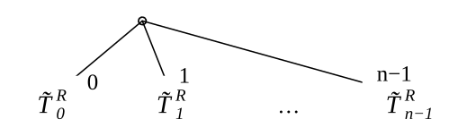</a>

(与 7.2.1.3–(21) 比较, 我们颠倒了交替层级上的子结点顺序.) 证明: $\widetilde T_n$ 的前后序遍历与格雷二进制码有简单的关系.

<a id="ex-7-2-1-6-120"></a>

**120.** [*22*][答案](./answers/7-2-1-6.md#ans-7-2-1-6-120) 判别真假: 如果图是连通的, 并且没有桥, 则它的平方是哈密顿图.

<a id="ex-7-2-1-6-121"></a>

**121.** [*M34*][答案](./answers/7-2-1-6.md#ans-7-2-1-6-121) (弗兰蒂舍克·诺伊曼, 1964) 图 $G$ 的导数记为图 $G^{(\prime)}$, 它是删除 $G$ 的所有度数为 1 的顶点以及与它们相接的边而得到的. 证明: 如果 $T$ 是自由树, 它的平方 $T^2$ 包含哈密顿路径, 当且仅当它的导数 $T^{(\prime)}$ 中不含度数大于 4 的顶点, 并且成立以下两个条件:

(i) $T^{(\prime)}$ 中所有度数为 3 或 4 的顶点都位于同一条路径上;

(ii) 在 $T^{(\prime)}$ 中任意两个度数为 4 的顶点之间, 至少有一个顶点在 $T$ 中的度数为 2.

<a id="pdf-418"></a><a id="p-403"></a>

<a id="ex-7-2-1-6-122"></a>

**▸ 122.** [*31*][答案](./answers/7-2-1-6.md#ans-7-2-1-6-122) (迪德尼的数字世纪谜题) 在序列 123456789 中插入算术运算符, 必要时也可加入括号, 使运算结果为 100. 有许多奇妙的方法可以做到这一点. 例如,

$$
\begin{aligned}
100&=1+2\times3+4\times5-6+7+8\times9\\
&=(1+2-3-4)\times(5-6-7-8-9)\\
&=((1/((2+3)/4-5+6))\times7+8)\times9.
\end{aligned}
$$

(a) 100 有多少种这种表示? 考虑到结合律和其他代数性质, 为了使问题更精确, 假设表达式必须是符合以下语法的规范形式:

```text
〈表达式〉 → 〈数〉 | 〈和〉 | 〈积〉 | 〈商〉
〈和〉 → 〈项〉 + 〈项〉 | 〈项〉 − 〈项〉 | 〈和〉 + 〈项〉 | 〈和〉 − 〈项〉
〈项〉 → 〈数〉 | 〈积〉 | 〈商〉
〈积〉 → 〈因数〉 × 〈因数〉 | 〈积〉 × 〈因数〉 | (〈商〉) × 〈因数〉
〈商〉 → 〈因数〉 / 〈因数〉 | 〈积〉 / 〈因数〉 | (〈商〉) / 〈因数〉
〈因数〉 → 〈数〉 | (〈和〉)
〈数〉 → 〈数字〉
```

所使用的数字必须是 1 至 9, 按顺序排列.

(b) 扩展问题 (a), 允许使用多位数, 语法为:

```text
〈数〉 → 〈数字〉 | 〈数〉〈数字〉
```

例如, $100=(1/(2-3+4))\times567-89$. 最短的这种表示是什么? 最长的呢?

(c) 扩展问题 (b), 还允许小数点:

```text
〈数〉 → 〈数字串〉 | .〈数字串〉 | 〈数字串〉.〈数字串〉
〈数字串〉 → 〈数字〉 | 〈数字串〉〈数字〉
```

例如, $100=((.1\times.2+3)/.4)/.5+6+78.9$, 足够有趣了.

<a id="ex-7-2-1-6-123"></a>

**123.** [*21*][答案](./answers/7-2-1-6.md#ans-7-2-1-6-123) 续上题, 按 (a)、(b)、(c) 的约定, 分别无法表示的最小正整数是多少?

<a id="ex-7-2-1-6-124"></a>

**▸ 124.** [*40*][答案](./answers/7-2-1-6.md#ans-7-2-1-6-124) 试验一些方法, 用于绘制受自然界简单模型启发而想到的扩展二叉树. 例如, 我们可以为每个结点 $x$ 分配一个值 $v(x)$, 称为它的霍顿—斯特勒数, 定义如下: 每个外部 (叶) 结点的值为 $v(x)=0$, 拥有子结点 $(l,r)$ 的内部结点具有 $v(x)=\max(v(l),v(r))+[v(l)=v(r)]$. 从内部结点 $x$ 到其父结点的边可以绘制为矩形, 高为 $h(v(x))$, 宽为 $w(v(x))$. 对特定的函数 $h,w,\theta$, 与左右子结点相连的边矩形可以分别偏移角度 $\theta(v(l(x)),v(r(x)))$ 和 $-\theta(v(r(x)),v(l(x)))$.

图 63 给出了以下取值的典型结果, 根结点出现在底部: $w(k)=3+k$、$h(k)=18k$、$\theta(k,k)=30^\circ$、当 $0\leq k<j$ 时 $\theta(j,k)=((k+1)/j)\times20^\circ$、当 $0\leq j<k$ 时 $\theta(j,k)=((k-j)/k)\times30^\circ$. 图 63(a) 是二叉树 (4); (b) 是由算法 R 生成的随机 100 结点树; (c) 是 11 阶斐波那契树, 有 143 个结点; (d) 是随机 100 结点二叉查找树. ((b)、(c)、(d) 中的树显然属于不同种类.)

<a id="fig-63"></a>

<a href="../../assets/volume4a/figures/7-2-1-6-fig63-organic-binary-trees.svg" target="_blank" rel="noopener">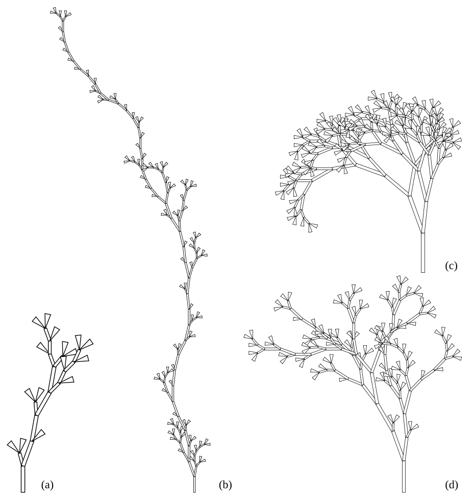</a>

**图 63　二叉树的 “有机” 图示.**

<a id="pdf-419"></a><a id="p-404"></a>

> [这一主题] 与人类思想能够利用的几乎所有有用知识都有关系.  
> ——詹姆斯·伯努利,*Ars Conjectandi*(1713)

[^v4a-7-2-1-6-christmas-tree]: 这个名字的选择是出于感情原因. 一方面, 这种模式的一般形状与节日树有些相像; 另一方面, 它是 2002 年 12 月我在斯坦福大学第九年度 “圣诞树讲座” 的主题.


[^v4a-7-2-1-6-associahedron]: 结合几何体 (associahedron) 在《英汉数学词汇》(清华大学出版社, 2010 年 5 月第 2 版) 中译为 “$n$ 维五边形; 斯特谢夫多胞腔”. ——编者注


[^v4a-7-2-1-6-permutahedron]: 4 阶排列几何体 (permutahedron of order 4) 也称作截八面体 (truncated octahedron), 见图 5–1. ——编者注


[^v4a-7-2-1-6-sperner]: 施佩纳定理指出, $\{1,2,\ldots,n\}$ 不可能有 $\binom{n}{\lfloor n/2\rfloor}$ 个以上的子集, 使得任一子集均不包含于另一子集; 见习题 6.5–1 答案的注记. 换一种说法, $\{1,2,\ldots,n\}$ 的任一杂乱集都不可能拥有超过 $M_n=\binom{n}{\lfloor n/2\rfloor}$ 个元素; 见 7.2.1.6 节 “*子集链” 小节 (第 380 页). ——编者注
