

# 7.2.1.7　历史与扩展文献

在人类文明初具雏形的过程中, 关于生成组合模式的早期工作就已经开始了. 这个故事非常让人着迷, 我们将会看到, 它跨越了世界上的许多地方和许多文化, 与诗歌、音乐和宗教关联在一起. 受篇幅所限, 这里仅讨论其中一部分重要的闪光点. 但是, 随着世界变得越来越小, 全球化学术持续进步, 哪怕只是对过往的回首一瞥, 也可能会激励读者去深入挖掘这一主题的根脉.

二进制 $n$ 元组的列表可以追溯到数千年前的古代中国、印度和希腊. 最著名的资料来源是中国的《易经》(它的现代译本仍然是畅销书), 书名的含义是 “关于变化的经典”. 这本书是儒家智慧的五本经典之一, 大体由 $2^6=64$ 章组成; 每一章都由一个由六根爻组成的六爻符号表示, 其中的每根爻或者是 ⚋(“阴”), 或者是 ⚊(“阳”). 例如, 六爻符号 1 是纯阳䷀; 六爻符号 2 是纯阴䷁; 六爻符号 64 是阴阳交替, 阳在顶层䷿. 完整的列表如下:

  <a href="../../assets/volume4a/figures/7-2-1-7-eq1-king-wen-hexagrams.svg" target="_blank" rel="noopener">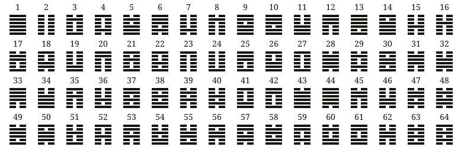</a>

(1)

64 种可能性的这一排列顺序称为周文王顺序, 因为《易经》的内容通常被认为是由周文王 (约公元前 1100 年) 撰写的, 他是传说中周朝的先祖. 但是, 要确认古代图书的可靠纪年, 其难度是众所周知的. 现代历史学家没有找到任何确凿的证据, 能够证实有人在公元前 3 世纪之前编制了这样一份六爻符号列表.

注意, (1) 中的六爻符号是成对出现的: 奇数编号的六爻符号后面紧跟着与其上下颠倒的符号, 除非经过这样的颠倒后符号本身没有发生变化 (也就是说, 这种符号是上下对称的); 八个上下对称的符号各自和它的互补符号配对 ($1=\overline{2}$, $27=\overline{28}$, $29=\overline{30}$, $61=\overline{62}$). 有四种三爻符号分别表示四种基本元素: 天 (乾, ☰)、地 (坤, ☷)、火 (离, ☲) 和水 (坎, ☵). 有些六爻符号由这四种三爻符号中的两个组成, 此类六爻符号的排列也经过了深思熟虑. 其他六爻符号的排列看起来基本上是随机的, 就好像一个没有经过数学训练的人努力列出所有不同的可能性, 直到不能再想出新的可能性为止. 在不同的六爻符号对之间, 的确存在一些有趣的模式, 但不会多过在 $\pi$ 的数字中碰巧出现的模式 (见 3.3–(1)).

阴和阳表示自然原力互补的两个方面, 它们总是保持张力, 总是处于变化之中. 《易经》多少类似于一本百科全书, 其中的六爻符号相当于一种索引, 便于检索人们在一些基本思想方面积累的智慧, 比如给予 (乾, ䷀)、接受 (坤, ䷁)、谦逊 (谦, ䷎)、喜悦 (兑, ䷹)、聚众 (同人, ䷌)、退隐 (遁, ䷠)、和平 (泰, ䷊)、冲突 (讼, ䷅)、组织 (师, ䷆)、堕落 (蛊, ䷑)、蒙昧 (蒙, ䷃)、雅致 (贲, ䷕), 等等. 人们可以随机选择一对六爻符号, 通过某种方式由其中一个得到另一个, 比如, 以 $1/4$ 的概率独立地将每个阴改为阳 (或反之). 这种做法可以给出 4096 种不同的方式, 用以思考现实经验中的神秘事物, 就好比一个马尔可夫过程, 通过变化本身, 也许就可以赋予生命以意义.

大约在公元 1060 年, 邵雍提出了一种严格的逻辑方法来排列这些六爻符号. 他按字典序排列, 由䷁到䷖到䷇到䷓到䷏到……到䷪再到䷀ (自下而上地读每个六爻符号). 这种顺序比周文王顺序更便于研究, 因为现在可以快速找出任意指定的模式了. 当莱布尼茨在 1702 年了解到这个六爻符号序列时, 他匆匆得出一个错误的结论: 中国数学家早已熟悉二进制算术. [见弗兰克·斯韦茨,*Mathematics Magazine* **76**(2003), 276–291. 关于《易经》的更多细节, 比如说, 可以查阅以下书籍: 李约瑟,*Science and Civilisation in China* **2**(Cambridge University Press, 1956)[^v4a-420-1], 304–345; 理查德·林恩,*The Classic of Changes*(New York: Columbia University Press, 1994).]

另一位古代中国的哲学家杨雄提出了一种体系, 它的基础不再是 64 个二进制的六爻符号, 而是 81 个三进制的四爻符号. 他于大约公元前 2 年撰写的《太玄》, 最近由迈克尔·尼兰译为英文 [*Canon of Supreme Mystery*(Albany, New York: 1993)]. 杨雄描述了一个完整的、分层的三叉树结构, 其中共有 3 方, 每方各有 3 州, 每州各有 3 部, 每部各有 3 家, 每家各有 9 首短诗, 称之为 “赞”, 因此共有 729 赞. 这样, 一年中的每一天差不多恰好有 2 赞. 他的四爻符号在自上而下地读取时, 严格遵循字典序: 𝌆, 𝌇, 𝌈, 𝌉, 𝌊, 𝌋, 𝌌, ……, 𝍖. 事实上, 正如尼兰的书第 28 页解释的那样, 杨雄给出了一种简单的方法, 用于计算每个四爻符号的排名, 就好像采用了一种三进制数系. 因此, 邵雍对二进制六爻符号进行排序的系统方法估计不会让杨雄感到惊奇或钦佩, 尽管邵雍生活的时代要晚了 1000 多年.

**印度的韵律学.** 古代印度的学者在一种完全不同的应用场景中研究了二进制 $n$ 元组, 他们研究吠陀圣歌中的诗步. 梵语中的音节或短 (।) 或长 (ऽ), 而对音节模式的研究称为 “韵律学”. 现代作者使用符号 $\smile$ 和 $\mathord{-}$ 来代替 । 和 ऽ. 一个典型的吠陀诗句包括 4 行, 对于某个 $n\geq8$, 每行都有 $n$ 个音节. 于是, 韵律学家寻找一种方法来对所有 $2^n$ 种可能性进行分类. 阿迦利耶·平加拉写于公元 400 年之前 (可能还要早得多, 确切年份尚不确定) 的经典著作 *Chandaḥśāstra* 描述了一些过程, 对于由 $\smile$ 和 $\mathord{-}$ 组成的任意给定模式, 人们可以通过这些过程轻松地找出其索引 $k$, 或者在给定 $k$ 时, 轻松地找出第 $k$ 个模式. 换言之, 平加拉解释了如何对任意给定模式进行排名, 以及如何根据任意给定索引进行定位. 因此, 他超越了杨雄的工作, 后者考虑了排名, 但没有考虑定位. 平加拉的方法还与求幂有关, 我们之前已经联系算法 4.6.3A 指出了这一点.

下一个重要步骤是由一位名叫克达拉的韵律学家在其著作 *Vṛttaratnākara* 中完成的, 人们认为此书是在 8 世纪完成的. 克达拉逐个步骤地给出了一个可以列出所有 $n$ 元组的过程: 从 $\mathord{-}\mathord{-}\mathord{-}\ldots\mathord{-}$ 到 $\mathord{\smile}\mathord{-}\mathord{-}\ldots\mathord{-}$ 到 $\mathord{-}\mathord{\smile}\mathord{-}\ldots\mathord{-}$ 到 $\mathord{\smile}\mathord{\smile}\mathord{-}\ldots\mathord{-}$ 到 $\mathord{-}\mathord{-}\mathord{\smile}\ldots\mathord{-}$ 到 $\mathord{\smile}\mathord{-}\mathord{\smile}\ldots\mathord{-}$ 到 $\cdots$ 到 $\mathord{\smile}\mathord{\smile}\mathord{\smile}\ldots\mathord{\smile}$, 基本上就是算法 7.2.1.1M 在基数为 2 时的情形. 他的方法可能是第一个用于生成组合序列的明确算法. [见巴伦德·范诺滕,*J. Indian Philos.* **21**(1993), 31–50.]

诗步也可以看作是韵律, 每个 $\smile$ 一拍, 每个 $\mathord{-}$ 两拍. 一个 $n$ 音节模式可包括 $n$ 到 $2n$ 拍, 但是适于行军或舞蹈的音乐韵律, 其节拍数通常都是固定的. 因此, 人们很自然地就会考虑所有由 $\smile$ 和 $\mathord{-}$ 组成、恰好有 $m$ 个节拍的序列的集合 ($m$ 为固定值). 这种模式现在被称为长度为 $m$ 的摩尔斯码, 由习题 4.5.3–32 可知, 它们恰好有 $F_{m+1}$ 个. 例如, 当 $m=7$ 时, 21 个序列是

$$
\begin{aligned}
&\mathord{\smile}\mathord{-}\mathord{-}\mathord{-},\; \mathord{-}\mathord{\smile}\mathord{-}\mathord{-},\; \mathord{\smile}\mathord{\smile}\mathord{\smile}\mathord{-}\mathord{-},\; \mathord{-}\mathord{-}\mathord{\smile}\mathord{-},\; \mathord{\smile}\mathord{\smile}\mathord{-}\mathord{\smile}\mathord{-},\\
&\mathord{\smile}\mathord{-}\mathord{\smile}\mathord{\smile}\mathord{-},\; \mathord{-}\mathord{\smile}\mathord{\smile}\mathord{\smile}\mathord{-},\; \mathord{\smile}\mathord{\smile}\mathord{\smile}\mathord{\smile}\mathord{\smile}\mathord{-},\; \mathord{-}\mathord{-}\mathord{-}\mathord{\smile},\\
&\mathord{\smile}\mathord{\smile}\mathord{-}\mathord{-}\mathord{\smile},\; \mathord{\smile}\mathord{-}\mathord{\smile}\mathord{-}\mathord{\smile},\; \mathord{-}\mathord{\smile}\mathord{\smile}\mathord{-}\mathord{\smile},\; \mathord{\smile}\mathord{\smile}\mathord{\smile}\mathord{\smile}\mathord{-}\mathord{\smile},\\
&\mathord{\smile}\mathord{-}\mathord{-}\mathord{\smile}\mathord{\smile},\; \mathord{-}\mathord{\smile}\mathord{-}\mathord{\smile}\mathord{\smile},\; \mathord{\smile}\mathord{\smile}\mathord{\smile}\mathord{-}\mathord{\smile}\mathord{\smile},\; \mathord{-}\mathord{-}\mathord{\smile}\mathord{\smile}\mathord{\smile},\\
&\mathord{\smile}\mathord{\smile}\mathord{-}\mathord{\smile}\mathord{\smile}\mathord{\smile},\; \mathord{\smile}\mathord{-}\mathord{\smile}\mathord{\smile}\mathord{\smile}\mathord{\smile},\; \mathord{-}\mathord{\smile}\mathord{\smile}\mathord{\smile}\mathord{\smile}\mathord{\smile},\; \mathord{\smile}\mathord{\smile}\mathord{\smile}\mathord{\smile}\mathord{\smile}\mathord{\smile}\mathord{\smile}.
\end{aligned}\tag{2}
$$

在这种方式的指引下, 印度的韵律学家发现了斐波那契序列, 我们在 1.2.8 节对此已有了解.

此外,*Prākṛta Paiṅgala*(约公元 1320 年) 的佚名作者发现了针对 $m$ 拍韵律进行排名和定位的优美算法. 为了找到第 $k$ 个模式, 首先记下 $m$ 个 $\smile$, 然后把差值 $d=F_{m+1}-k$ 表示为斐波那契数之和 $F_{j_1}+\cdots+F_{j_t}$. 这里的 $F_{j_1}$ 是小于等于 $d$ 的最大斐波那契数, $F_{j_2}$ 是小于等于 $d-F_{j_1}$ 的最大斐波那契数, 依此类推, 直到余数为零. 对于 $j=j_1,\ldots,j_t$, 节拍 $j-1$ 和 $j$ 要由 $\mathord{\smile}\mathord{\smile}$ 改为 $\mathord{-}$. 例如, 要得到 (2) 的第 5 个元素, 我们计算 $21-5=16=13+3=F_7+F_4$, 答案为 $\mathord{\smile}\mathord{\smile}\mathord{-}\mathord{\smile}\mathord{-}$.

几年后, 纳拉亚纳·潘季塔论述了一个更一般的问题: 列出整数 $m$ 的所有组分, 各部分都小于等于 $q$, 其中 $q$ 是任意给定的正整数. 结果, 他发现了 $q$ 阶斐波那契序列 5.4.2–(4), 这个序列注定要在 600 年后被用于多阶段排序中; 他还开发了相应的排名和定位算法. [见帕玛兰德·辛格,*Historia Mathematica* **12**(1985), 229–244, 以及习题 16.]

阿迦利耶·平加拉为所有三音节诗步都起了特殊的代码名:

$$
\begin{array}{ccc}
\mathord{-}\mathord{-}\mathord{-}=\text{म}\ \text{(m)}, & \qquad & \mathord{-}\mathord{-}\mathord{\smile}=\text{त}\ \text{(t)},\\
\mathord{\smile}\mathord{-}\mathord{-}=\text{य}\ \text{(y)}, & \qquad & \mathord{\smile}\mathord{-}\mathord{\smile}=\text{ज}\ \text{(j)},\\
\mathord{-}\mathord{\smile}\mathord{-}=\text{र}\ \text{(r)}, & \qquad & \mathord{-}\mathord{\smile}\mathord{\smile}=\text{भ}\ \text{(bh)},\\
\mathord{\smile}\mathord{\smile}\mathord{-}=\text{स}\ \text{(s)}, & \qquad & \mathord{\smile}\mathord{\smile}\mathord{\smile}=\text{न}\ \text{(n)},
\end{array}\tag{3}
$$

从那时起, 就要求梵文学生们记住它们. 很久之前, 有人设计了一种更聪明的方法来记住这些代码, 那就是发明了没有任何实际意义的词 *yamātārājabhānasalagām*(यमाताराजभानसलगाम्). 这个词的 10 个音节可以记为

$$
\begin{array}{cccccccccc}
\text{ya} & \text{mā} & \text{tā} & \text{rā} & \text{ja} & \text{bhā} & \text{na} & \text{sa} & \text{la} & \text{gām}\\
\mathord{\smile} & \mathord{-} & \mathord{-} & \mathord{-} & \mathord{\smile} & \mathord{-} & \mathord{\smile} & \mathord{\smile} & \mathord{\smile} & \mathord{-}
\end{array}\tag{4}
$$

每个三音节模式恰好从其代码名所在的音节开始.*yamā…lagām* 的出处不详, 但苏巴斯·卡克 [*Indian J. History of Science* **35**(2000), 123–127] 已经把它至少回溯到查尔斯·布朗的 *Sanskrit Prosody*(1869), 第 28 页. 因此, 它被认为是已知最早的对二进制 $n$ 元组进行编码的 “德布鲁因圈”.

**欧洲同一时期的研究.** 类似地, 希腊经典诗歌的基础是一组组称为 “音步” 的短音节和 (或) 长音节, 类似于音乐中的小节. 每种基本类型的音步都有一个希腊名称. 例如, 两个短音节 “$\mathord{\smile}\mathord{\smile}$” 称为抑抑格, 两个长音节 “$\mathord{-}\mathord{-}$” 称为扬扬格, 这是因为这些韵律分别用在战歌 (πυρρίχη) 或和平歌 (σπονδαί) 中. 音步的希腊名称很快被吸收到拉丁文中, 并逐渐吸收到包括英语在内的现代语言中:

<table class="source-prosody-table" aria-label="式（5）的希腊音步">
<tbody>
<tr><td style="white-space:nowrap">$\mathord{\smile}$</td><td style="min-width:12em">抬脚 (arsis)</td><td style="white-space:nowrap">$\mathord{\smile}\mathord{\smile}\mathord{\smile}$</td><td style="min-width:12em">三短节音步</td></tr>
<tr><td style="white-space:nowrap">$\mathord{-}$</td><td style="min-width:12em">落脚 (thesis)</td><td style="white-space:nowrap">$\mathord{\smile}\mathord{\smile}\mathord{-}$</td><td style="min-width:12em">抑抑扬格</td></tr>
<tr><td></td><td></td><td style="white-space:nowrap">$\mathord{\smile}\mathord{-}\mathord{\smile}$</td><td style="min-width:12em">抑扬抑音步</td></tr>
<tr><td></td><td></td><td style="white-space:nowrap">$\mathord{\smile}\mathord{-}\mathord{-}$</td><td style="min-width:12em">巴克斯音步</td></tr>
<tr><td style="white-space:nowrap">$\mathord{\smile}\mathord{\smile}$</td><td style="min-width:12em">抑抑格</td><td style="white-space:nowrap">$\mathord{-}\mathord{\smile}\mathord{\smile}$</td><td style="min-width:12em">扬抑抑格</td></tr>
<tr><td style="white-space:nowrap">$\mathord{\smile}\mathord{-}$</td><td style="min-width:12em">抑扬格</td><td style="white-space:nowrap">$\mathord{-}\mathord{\smile}\mathord{-}$</td><td style="min-width:12em">扬抑扬音步</td></tr>
<tr><td style="white-space:nowrap">$\mathord{-}\mathord{\smile}$</td><td style="min-width:12em">扬抑格</td><td style="white-space:nowrap">$\mathord{-}\mathord{-}\mathord{\smile}$</td><td style="min-width:12em">扬扬抑格</td></tr>
<tr><td style="white-space:nowrap">$\mathord{-}\mathord{-}$</td><td style="min-width:12em">扬扬格</td><td style="white-space:nowrap">$\mathord{-}\mathord{-}\mathord{-}$</td><td style="min-width:12em">莫洛西亚音步</td></tr>
</tbody>
<tbody>
<tr><td style="white-space:nowrap">$\mathord{\smile}\mathord{\smile}\mathord{\smile}\mathord{\smile}$</td><td style="min-width:12em">四短音节格</td><td style="white-space:nowrap">$\mathord{-}\mathord{\smile}\mathord{\smile}\mathord{\smile}$</td><td style="min-width:12em">四音节音步, 第一个音节为长</td></tr>
<tr><td style="white-space:nowrap">$\mathord{\smile}\mathord{\smile}\mathord{\smile}\mathord{-}$</td><td style="min-width:12em">四音节音步, 一长三短</td><td style="white-space:nowrap">$\mathord{-}\mathord{\smile}\mathord{\smile}\mathord{-}$</td><td style="min-width:12em">长短短长音步</td></tr>
<tr><td style="white-space:nowrap">$\mathord{\smile}\mathord{\smile}\mathord{-}\mathord{\smile}$</td><td style="min-width:12em">四音节音步, 两短一长, 再一短</td><td style="white-space:nowrap">$\mathord{-}\mathord{\smile}\mathord{-}\mathord{\smile}$</td><td style="min-width:12em">双扬抑格</td></tr>
<tr><td style="white-space:nowrap">$\mathord{\smile}\mathord{\smile}\mathord{-}\mathord{-}$</td><td style="min-width:12em">小爱奥尼音步</td><td style="white-space:nowrap">$\mathord{-}\mathord{\smile}\mathord{-}\mathord{-}$</td><td style="min-width:12em">三长一短音步, 第二个音节为短</td></tr>
<tr><td style="white-space:nowrap">$\mathord{\smile}\mathord{-}\mathord{\smile}\mathord{\smile}$</td><td style="min-width:12em">四音节音步, 第二个音节为长</td><td style="white-space:nowrap">$\mathord{-}\mathord{-}\mathord{\smile}\mathord{\smile}$</td><td style="min-width:12em">大爱奥尼音步</td></tr>
<tr><td style="white-space:nowrap">$\mathord{\smile}\mathord{-}\mathord{\smile}\mathord{-}$</td><td style="min-width:12em">双抑扬格</td><td style="white-space:nowrap">$\mathord{-}\mathord{-}\mathord{\smile}\mathord{-}$</td><td style="min-width:12em">三长一短音步, 第三个音节为短</td></tr>
<tr><td style="white-space:nowrap">$\mathord{\smile}\mathord{-}\mathord{-}\mathord{\smile}$</td><td style="min-width:12em">抑扬格接扬抑格</td><td style="white-space:nowrap">$\mathord{-}\mathord{-}\mathord{-}\mathord{\smile}$</td><td style="min-width:12em">三长一短音步, 第四个音节为短</td></tr>
<tr><td style="white-space:nowrap">$\mathord{\smile}\mathord{-}\mathord{-}\mathord{-}$</td><td style="min-width:12em">三长一短音步, 第一个音节为短</td><td style="white-space:nowrap">$\mathord{-}\mathord{-}\mathord{-}\mathord{-}$</td><td style="min-width:12em">双扬扬格</td></tr>
</tbody>
</table>

(5)

其他一些名字也很常用, 比如用 “choree” 代替 “trochee” (扬抑格), 或用 “cretic” 代替 “amphimacer” (扬抑扬格). 此外, 到狄俄墨得斯编写他的拉丁语法时 (大约为公元 375 年), 32 个五音节音步都分别有了至少一个名字. 狄俄墨得斯还指出了互补模式之间的关系. 比如, 他说 tribrach (三短音节) 和 molossus (莫洛西亚音步, 三长音节) 是 “对立的”, amphibrach (抑扬抑格) 和 amphimacer (扬抑扬格) 也是如此. 但他还把 dactyl (扬抑抑格) 看作 anapest (抑抑扬格) 的对立, 把 bacchius (巴克斯音步) 看作 palimbacchius (扬扬抑格) 的对立, 尽管 palimbacchius 的字面意思其实是 “bacchius 的逆”. 希腊的韵律学者没有给出一种标准顺序来列出各种可能性, 而且从其名字的结构也可以看出, 他们没有考虑这些名字与二进制数系的联系. [见海因里希·凯尔,*Grammatici Latini* **1**(1857), 474–482; 威廉·冯·克里斯特,*Metrik der Griechen und Römer*(1879), 78–79.]

亚里士多塞诺斯有一部名为 *Elements of Rhythm* 的著作 (大约公元前 325 年), 它的一些残片表明, 同样的术语也应用到了音乐领域. 实际上, 在文艺复兴之后仍然保留了同样的传统. 例如, 我们在阿塔纳修斯·基歇尔的 *Musurgia Universalis* **2**(Rome: 1650) 第 32 页上发现了

  <a href="../../assets/volume4a/figures/7-2-1-7-kircher-four-meters.svg" target="_blank" rel="noopener">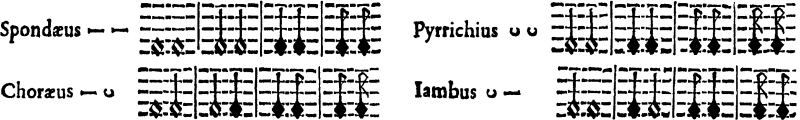</a>

而且, 基歇尔继续描述了 (5) 中所有三音节音步和四音节音步的音律.

**早期的排列列表.** 我们已经在 5.1.2 节追溯了排列数目计算公式的历史, 但直到公式 $n!$ 被发现数百年之后, 才有人发表了关于排列的非平凡列表. 目前已知最早的这种表格是由意大利医生沙贝泰·唐诺洛在公元 946 年撰写的注释 *Ḥakhmoni* 中编制的. 注释的对象是犹太神秘哲学著作 *Sefer Yetzirah*. 表 1 给出了他对于 $n=5$ 的列表, 此表后来在华沙印刷 (1884 年). (表中的希伯来文是用一种通常用于注释的拉比字体排版的. 注意, 字母 <bdi dir="rtl">מ</bdi> 出现在一个单词的左端时, 其形状改为 <bdi dir="rtl">ם</bdi>.) 唐诺洛继续列出了六字母词 <a href="../../assets/volume4a/figures/7-2-1-7-donnolo-six-letter-word.svg" target="_blank" rel="noopener">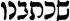</a> 的 120 个排列, 它们均以字母 <bdi dir="rtl">ש</bdi> 开头[^v4a-422-1]. 然后他注意到, 将其他五个字母之一分别放在开头, 每次可以又增加 120 个排列, 总共为 720 种排列. 他的列表涉及每组六个排列的分组, 不过分组颇为随意, 从而将他引向错误 (见习题 4). 他知道应该有多少个排列, 并且草拟了一个 “滚动” 方法, 把他的列表扩展到带有七个字母的 5040 项.

耶雷米亚斯·德雷克塞尔在 *Orbis Phaëthon*(慕尼黑: 1629) 第 668–671 页 (也见于 1631 年科隆版的第 526–531 页) 给出了一份完整的列表, 列出了 $\{a,b,c,d,e,f\}$ 的所有 720 种排列. 他给出这份列表是为了证明: 如果一个人有六位客人, 那在一年的 360 个用餐日里, 他在每天的午餐和晚餐时间都可以为客人们安排不同的座次, 因为在 “圣周 (受难周)” 期间有五天是禁食的.

**表 1　一份中古的排列列表**

  <a href="../../assets/volume4a/figures/7-2-1-7-table1-donnolo-hebrew.svg" target="_blank" rel="noopener">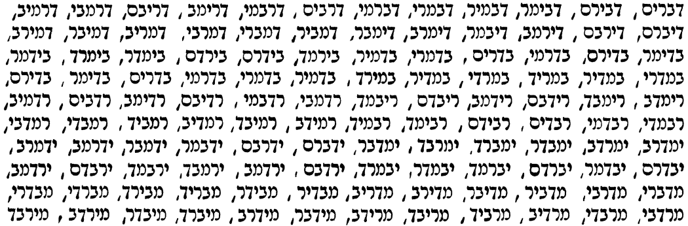</a>

之后不久, 马兰·梅森在他的 *Traitez de la Voix et des Chants*(*Harmonie Universelle* 第 2 卷, 1636 年) 的第 111–115 页上给出了六个音调 $\{\mathrm{ut,re,mi,fa,sol,la}\}$ 的所有 720 种排列, 随后又在第 117–128 页以音乐记号给出了相同的数据:

  <a href="../../assets/volume4a/figures/7-2-1-7-mersenne-permutation-score.svg" target="_blank" rel="noopener">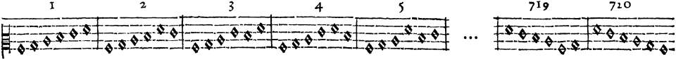</a>

德雷克塞尔的表格是根据字典序按列组织的; 梅森的表格按照 $\mathrm{ut}<\mathrm{re}<\mathrm{mi}<\mathrm{fa}<\mathrm{sol}<\mathrm{la}$ 的顺序以字典序排列, 开始为 “ut,re,mi,fa,sol,la”, 结尾为 “la,sol,fa,mi,re,ut”. 梅森还准备了一份 “宏大” 的手稿, 在 672 页对开纸上列出了八个音符的所有 40 320 种排列, 随后给出了排名和定位算法 [Bibliothèque nationale de France, Fonds Français, no. 24256].

我们在 7.2.1.2 节已经看到, 平滑改变的重要思路——算法 7.2.1.2P 是在几年之后于英格兰发明的.

对于具有重复元素的多重集, 早期作者经常误解列出其所有排列的方法. 例如, 当婆什迦罗在他的 *Līlāvatī*(约 1150 年) 第 271 节给出 $\{4,5,5,5,8\}$ 的排列时, 是按以下顺序给出的:

$$
\begin{array}{ccccc}
\text{४८५५५} & \text{८४५५५} & \text{५४८५५} & \text{५८४५५} & \text{५५४८५}\\
\text{५५८४५} & \text{५५५४८} & \text{५५५८४} & \text{४५८५५} & \text{४५५८५}\\
\text{४५५५८} & \text{८५४५५} & \text{८५५४५} & \text{८५५५४} & \text{५४५८५}\\
\text{५८५४५} & \text{५५४५८} & \text{५५८५४} & \text{५४५५८} & \text{५८५५४}
\end{array}\tag{6}
$$

梅森在自己的书第 131 页上列出了拉丁名称 IESVS 的 60 个变位词, 他采用的顺序相对更合理一些, 但也没有完全系统化. 当阿塔纳修斯·基歇尔在 *Musurgia Universalis* **2**(1650 年) 的第 10 和第 11 页上想列出一个五音旋律的 30 种排列时, 由于缺乏系统性而陷入麻烦 (见习题 5):

  <a href="../../assets/volume4a/figures/7-2-1-7-eq7-kircher-five-notes.svg" target="_blank" rel="noopener">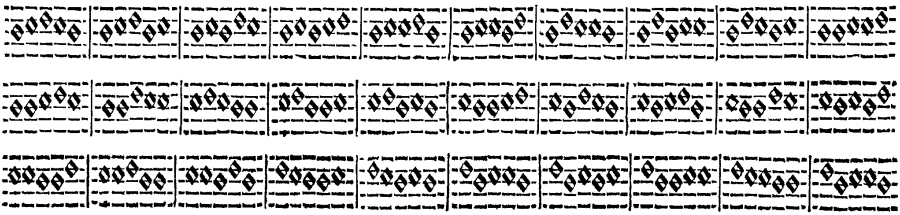</a>

(7)

但约翰·沃利斯了解得更多一些. 在他的 *Discourse of Combinations*(1685 年) 第 117 页, 如果我们令 $\mathrm{m}<\mathrm{e}<\mathrm{s}$, 那么他正确地按字典序列出了 “messes” 的 60 个变位词. 在第 126 页, 他建议遵循一定的字母顺序, “使我们更有把握一些, 而不会漏掉什么”.

后面我们会看到, 印度专家萨尔加德瓦和纳拉亚纳·潘季塔在 13 世纪和 14 世纪已经建立了关于生成排列的理论, 尽管他们的工作超越了自己的时代, 仍然鲜为人知.

**关孝和表.** 关孝和 (1642—1708) 是一位有着超凡能力的教师和研究者, 他在 17 世纪使日本的数学研究发生了革命性的变化. 他当时正在研究如何从齐次联立方程组中消去变量, 得到了诸如 $a_1b_2-a_2b_1$ 和 $a_1b_2c_3-a_1b_3c_2+a_2b_3c_1-a_2b_1c_3+a_3b_1c_2-a_3b_2c_1$ 这样的表达式, 我们现在已知道它们就是行列式. 1683 年, 他出版了有关这一发现的小册子, 介绍了一种非常巧妙的方案来列出所有排列, 其中一半是 “活的” (偶排列), 另一半是 “死的” (奇排列). 从 $n=2$ 的情形入手, 当 “12” 是活的、“21” 是死的时, 他对于 $n>2$ 的情况制定了如下规则:

(1) 取得 $n-1$ 的每一个活排列, 使其所有元素增大 1, 并在前面插入 1. 这个规则生成 $\{1,\ldots,n\}$ 的 $(n-1)!/2$ 种 “基本排列”.

(2) 由每一种基本排列, 通过旋转和反射生成以下 $2n$ 个排列:

$$
a_1a_2\ldots a_{n-1}a_n,\quad a_2\ldots a_{n-1}a_na_1,\quad\ldots,\quad a_na_1a_2\ldots a_{n-1};\tag{8}
$$

$$
a_na_{n-1}\ldots a_2a_1,\quad a_1a_na_{n-1}\ldots a_2,\quad\ldots,\quad a_{n-1}\ldots a_2a_1a_n.\tag{9}
$$

如果 $n$ 为奇数, 则第一行上的排列是活的, 第二行上的排列是死的; 如果 $n$ 为偶数, 则每一行上的排列都在活和死之间交替变化.

例如, 当 $n=3$ 时, 唯一的基本排列为 123. 于是, 123、231、312 是活的, 而 321、132、213 是死的, 我们已经成功地生成了 $3\times3$ 行列式中的 6 项. $n=4$ 时的基本排列为 1234、1342、1423. 比如从 1342 中得到一组八个排列, 即

$$
+1342-3421+4213-2134+2431-1243+3124-4312,\tag{10}
$$

它们在活 ($+$) 和死 ($-$) 之间交替变化. 于是, $4\times4$ 行列式包含项 $a_1b_3c_4d_2-a_3b_4c_2d_1+\cdots-a_4b_3c_1d_2$ 以及 16 个其他项.

关孝和用于生成排列的规则非常优美, 但遗憾的是, 它有一个严重问题: 当 $n>4$ 时, 这个规则是无效的. 他的错误似乎在之后数百年里都没有被意识到. [见三上义夫,*The Development of Mathematics in China and Japan*(1913), 191–199;*Takakazu Seki’s Collected Works*(Osaka: 1974), 18–20、八五一—一四一; 以及习题 7–8.]

**组合的列表.** 在苏鲁塔著名的梵文医学专著的最后一书中, 第 63 章给出了一份关于组合的详尽列表. 它经过时间的蹂躏之后仍然幸存下来, 这是据目前所知最早的一份详尽组合列表. 该书大约写于公元 600 年之前, 可能还要早得多. 苏鲁塔注意到药物可以是甜、酸、咸、辣、苦和 (或) 涩的. 当这些味道同时出现二、三、四、五、六和一种时, 分别会出现 $(15,20,15,6,1,6)$ 种不同组合, 苏鲁塔在书中精心地列出了所有这些情形.

婆什迦罗在 *Līlāvatī* 的第 110–114 节重复了这一示例, 而且发现, 上述推导过程也适用于具有给定长音节数的六音节诗步. 但他只是简单地提到总数 $(6,15,20,15,6,1)$, 没有列出这些组合本身. 在第 274 和 275 节, 他观察到数 $(n(n-1)\ldots(n-k+1))/(k(k-1)\ldots(1))$ 枚举了组分 (即有序分划) 和组合. 他同样没有给出列表.

> 为避免啰嗦, 以一种简单方式来处理它;  
> 因为计算科学是一个无边的海洋.  
> ——婆什迦罗 (约 1150 年)

在著名的代数课本 *Al-Bāhir fi’l-ḥisāb*(《计算的荣耀之书》) 中, 出现了一个孤立但很有趣的组合列表. 这本书由巴格达的阿萨马尔在年仅 19 岁时 (1144 年) 撰写. 在该书的结束部分, 他给出了一个列表, 其中列出了由 $\binom{10}{6}=210$ 个方程构成的联立线性方程组, 共有 10 个未知数:

<table aria-label="式（11），六项和的阿拉伯文及现代记法">
<thead><tr><th colspan="3">阿萨马尔的阿拉伯文原稿</th><th>等价的现代符号</th></tr></thead>
<tbody>
<tr><td><bdi dir="ltr">٦٥</bdi></td><td><bdi dir="ltr">٦٥٤٣٢١</bdi></td><td><bdi dir="rtl">ا</bdi></td><td style="white-space:nowrap">$(1)\quad x_{1} + x_{2} + x_{3} + x_{4} + x_{5} + x_{6} = 65$</td></tr>
<tr><td><bdi dir="ltr">٧٠</bdi></td><td><bdi dir="ltr">٧٥٤٣٢١</bdi></td><td><bdi dir="rtl">ب</bdi></td><td style="white-space:nowrap">$(2)\quad x_{1} + x_{2} + x_{3} + x_{4} + x_{5} + x_{7} = 70$</td></tr>
<tr><td><bdi dir="ltr">٧٥</bdi></td><td><bdi dir="ltr">٨٥٤٣٢١</bdi></td><td><bdi dir="rtl">ج</bdi></td><td style="white-space:nowrap">$(3)\quad x_{1} + x_{2} + x_{3} + x_{4} + x_{5} + x_{8} = 75$</td></tr>
<tr><td></td><td>$\vdots$</td><td></td><td>$\vdots$</td></tr>
<tr><td><bdi dir="ltr">٩١</bdi></td><td><bdi dir="ltr">١٠٩٨٧٦٤</bdi></td><td><bdi dir="rtl">رط</bdi></td><td style="white-space:nowrap">$(209)\quad x_{4} + x_{6} + x_{7} + x_{8} + x_{9} + x_{10} = 91$</td></tr>
<tr><td><bdi dir="ltr">١٠٠</bdi></td><td><bdi dir="ltr">١٠٩٨٧٦٥</bdi></td><td><bdi dir="rtl">ري</bdi></td><td style="white-space:nowrap">$(210)\quad x_{5} + x_{6} + x_{7} + x_{8} + x_{9} + x_{10} = 100$</td></tr>
</tbody>
</table>

(11)

从 10 个未知量中一次取出 6 个的每种组合就得到他的一个方程. 他的目的显然是为了说明, 超定方程组仍然可以有唯一解. 在此例中, 解为 $(x_1,x_2,\ldots,x_{10})=(1,4,9,16,25,10,15,20,25,5)$. [萨拉赫·艾哈迈德和罗什迪·拉希德,*Al-Bāhir en Algèbre d’As-Samaw’al*(Damascus: 1972), 77–82, <bdi dir="ltr">٢٤٨–٢٣١</bdi>.]

**掷骰子.** 在中世纪的欧洲, 也出现了一些有关初等组合的微光, 特别是与下面这个问题相联系: 列出在投掷三个骰子时的所有可能结果. 当然, 在允许重复时, 可以有 $\binom{8}{3}=56$ 种方式从六件东西中选出三件. 赌博被官方禁止, 但这 56 种方式变得相当有名. 大约在公元 965 年, 法国北部康布雷的韦伯尔德主教设计了一种称为 *Ludus Clericalis* 的游戏, 以便神职人员能够在保持虔诚的同时享受掷骰子的乐趣. 他的思路是根据下表, 将每种可能的投掷结果与 56 种美德之一联系起来:

<table aria-label="韦伯尔德的骰点与美德">
<tbody>
<tr><td data-dice-roll="111" style="white-space:nowrap;font-size:1.65em;line-height:1;letter-spacing:.08em">⚀︎⚀︎⚀︎</td><td style="white-space:nowrap">爱</td><td data-dice-roll="136" style="white-space:nowrap;font-size:1.65em;line-height:1;letter-spacing:.08em">⚀︎⚂︎⚅︎</td><td style="white-space:nowrap">坚持</td><td data-dice-roll="235" style="white-space:nowrap;font-size:1.65em;line-height:1;letter-spacing:.08em">⚁︎⚂︎⚄︎</td><td style="white-space:nowrap">殷勤</td><td data-dice-roll="346" style="white-space:nowrap;font-size:1.65em;line-height:1;letter-spacing:.08em">⚂︎⚃︎⚅︎</td><td style="white-space:nowrap">苦行</td></tr>
<tr><td data-dice-roll="112" style="white-space:nowrap;font-size:1.65em;line-height:1;letter-spacing:.08em">⚀︎⚀︎⚁︎</td><td style="white-space:nowrap">信仰</td><td data-dice-roll="144" style="white-space:nowrap;font-size:1.65em;line-height:1;letter-spacing:.08em">⚀︎⚃︎⚃︎</td><td style="white-space:nowrap">仁慈</td><td data-dice-roll="236" style="white-space:nowrap;font-size:1.65em;line-height:1;letter-spacing:.08em">⚁︎⚂︎⚅︎</td><td style="white-space:nowrap">节约</td><td data-dice-roll="355" style="white-space:nowrap;font-size:1.65em;line-height:1;letter-spacing:.08em">⚂︎⚄︎⚄︎</td><td style="white-space:nowrap">清白</td></tr>
<tr><td data-dice-roll="113" style="white-space:nowrap;font-size:1.65em;line-height:1;letter-spacing:.08em">⚀︎⚀︎⚂︎</td><td style="white-space:nowrap">希望</td><td data-dice-roll="145" style="white-space:nowrap;font-size:1.65em;line-height:1;letter-spacing:.08em">⚀︎⚃︎⚄︎</td><td style="white-space:nowrap">谦逊</td><td data-dice-roll="244" style="white-space:nowrap;font-size:1.65em;line-height:1;letter-spacing:.08em">⚁︎⚃︎⚃︎</td><td style="white-space:nowrap">耐心</td><td data-dice-roll="356" style="white-space:nowrap;font-size:1.65em;line-height:1;letter-spacing:.08em">⚂︎⚄︎⚅︎</td><td style="white-space:nowrap">悔悟</td></tr>
<tr><td data-dice-roll="114" style="white-space:nowrap;font-size:1.65em;line-height:1;letter-spacing:.08em">⚀︎⚀︎⚃︎</td><td style="white-space:nowrap">公正</td><td data-dice-roll="146" style="white-space:nowrap;font-size:1.65em;line-height:1;letter-spacing:.08em">⚀︎⚃︎⚅︎</td><td style="white-space:nowrap">顺从</td><td data-dice-roll="245" style="white-space:nowrap;font-size:1.65em;line-height:1;letter-spacing:.08em">⚁︎⚃︎⚄︎</td><td style="white-space:nowrap">热情</td><td data-dice-roll="366" style="white-space:nowrap;font-size:1.65em;line-height:1;letter-spacing:.08em">⚂︎⚅︎⚅︎</td><td style="white-space:nowrap">坦白</td></tr>
<tr><td data-dice-roll="115" style="white-space:nowrap;font-size:1.65em;line-height:1;letter-spacing:.08em">⚀︎⚀︎⚄︎</td><td style="white-space:nowrap">谨慎</td><td data-dice-roll="155" style="white-space:nowrap;font-size:1.65em;line-height:1;letter-spacing:.08em">⚀︎⚄︎⚄︎</td><td style="white-space:nowrap">温和</td><td data-dice-roll="246" style="white-space:nowrap;font-size:1.65em;line-height:1;letter-spacing:.08em">⚁︎⚃︎⚅︎</td><td style="white-space:nowrap">无产</td><td data-dice-roll="444" style="white-space:nowrap;font-size:1.65em;line-height:1;letter-spacing:.08em">⚃︎⚃︎⚃︎</td><td style="white-space:nowrap">成熟</td></tr>
<tr><td data-dice-roll="116" style="white-space:nowrap;font-size:1.65em;line-height:1;letter-spacing:.08em">⚀︎⚀︎⚅︎</td><td style="white-space:nowrap">节制</td><td data-dice-roll="156" style="white-space:nowrap;font-size:1.65em;line-height:1;letter-spacing:.08em">⚀︎⚄︎⚅︎</td><td style="white-space:nowrap">慷慨</td><td data-dice-roll="255" style="white-space:nowrap;font-size:1.65em;line-height:1;letter-spacing:.08em">⚁︎⚄︎⚄︎</td><td style="white-space:nowrap">温柔</td><td data-dice-roll="445" style="white-space:nowrap;font-size:1.65em;line-height:1;letter-spacing:.08em">⚃︎⚃︎⚄︎</td><td style="white-space:nowrap">关怀</td></tr>
<tr><td data-dice-roll="122" style="white-space:nowrap;font-size:1.65em;line-height:1;letter-spacing:.08em">⚀︎⚁︎⚁︎</td><td style="white-space:nowrap">勇气</td><td data-dice-roll="166" style="white-space:nowrap;font-size:1.65em;line-height:1;letter-spacing:.08em">⚀︎⚅︎⚅︎</td><td style="white-space:nowrap">智慧</td><td data-dice-roll="256" style="white-space:nowrap;font-size:1.65em;line-height:1;letter-spacing:.08em">⚁︎⚄︎⚅︎</td><td style="white-space:nowrap">贞洁</td><td data-dice-roll="446" style="white-space:nowrap;font-size:1.65em;line-height:1;letter-spacing:.08em">⚃︎⚃︎⚅︎</td><td style="white-space:nowrap">坚定</td></tr>
<tr><td data-dice-roll="123" style="white-space:nowrap;font-size:1.65em;line-height:1;letter-spacing:.08em">⚀︎⚁︎⚂︎</td><td style="white-space:nowrap">平和</td><td data-dice-roll="222" style="white-space:nowrap;font-size:1.65em;line-height:1;letter-spacing:.08em">⚁︎⚁︎⚁︎</td><td style="white-space:nowrap">自责</td><td data-dice-roll="266" style="white-space:nowrap;font-size:1.65em;line-height:1;letter-spacing:.08em">⚁︎⚅︎⚅︎</td><td style="white-space:nowrap">尊敬</td><td data-dice-roll="455" style="white-space:nowrap;font-size:1.65em;line-height:1;letter-spacing:.08em">⚃︎⚄︎⚄︎</td><td style="white-space:nowrap">聪颖</td></tr>
<tr><td data-dice-roll="124" style="white-space:nowrap;font-size:1.65em;line-height:1;letter-spacing:.08em">⚀︎⚁︎⚃︎</td><td style="white-space:nowrap">纯洁</td><td data-dice-roll="223" style="white-space:nowrap;font-size:1.65em;line-height:1;letter-spacing:.08em">⚁︎⚁︎⚂︎</td><td style="white-space:nowrap">喜悦</td><td data-dice-roll="333" style="white-space:nowrap;font-size:1.65em;line-height:1;letter-spacing:.08em">⚂︎⚂︎⚂︎</td><td style="white-space:nowrap">虔诚</td><td data-dice-roll="456" style="white-space:nowrap;font-size:1.65em;line-height:1;letter-spacing:.08em">⚃︎⚄︎⚅︎</td><td style="white-space:nowrap">叹息</td></tr>
<tr><td data-dice-roll="125" style="white-space:nowrap;font-size:1.65em;line-height:1;letter-spacing:.08em">⚀︎⚁︎⚄︎</td><td style="white-space:nowrap">怜悯</td><td data-dice-roll="224" style="white-space:nowrap;font-size:1.65em;line-height:1;letter-spacing:.08em">⚁︎⚁︎⚃︎</td><td style="white-space:nowrap">清醒</td><td data-dice-roll="334" style="white-space:nowrap;font-size:1.65em;line-height:1;letter-spacing:.08em">⚂︎⚂︎⚃︎</td><td style="white-space:nowrap">宽容</td><td data-dice-roll="466" style="white-space:nowrap;font-size:1.65em;line-height:1;letter-spacing:.08em">⚃︎⚅︎⚅︎</td><td style="white-space:nowrap">哀悼</td></tr>
<tr><td data-dice-roll="126" style="white-space:nowrap;font-size:1.65em;line-height:1;letter-spacing:.08em">⚀︎⚁︎⚅︎</td><td style="white-space:nowrap">服从</td><td data-dice-roll="225" style="white-space:nowrap;font-size:1.65em;line-height:1;letter-spacing:.08em">⚁︎⚁︎⚄︎</td><td style="white-space:nowrap">满意</td><td data-dice-roll="335" style="white-space:nowrap;font-size:1.65em;line-height:1;letter-spacing:.08em">⚂︎⚂︎⚄︎</td><td style="white-space:nowrap">祈祷</td><td data-dice-roll="555" style="white-space:nowrap;font-size:1.65em;line-height:1;letter-spacing:.08em">⚄︎⚄︎⚄︎</td><td style="white-space:nowrap">快乐</td></tr>
<tr><td data-dice-roll="133" style="white-space:nowrap;font-size:1.65em;line-height:1;letter-spacing:.08em">⚀︎⚂︎⚂︎</td><td style="white-space:nowrap">敬畏</td><td data-dice-roll="226" style="white-space:nowrap;font-size:1.65em;line-height:1;letter-spacing:.08em">⚁︎⚁︎⚅︎</td><td style="white-space:nowrap">甜蜜</td><td data-dice-roll="336" style="white-space:nowrap;font-size:1.65em;line-height:1;letter-spacing:.08em">⚂︎⚂︎⚅︎</td><td style="white-space:nowrap">慈爱</td><td data-dice-roll="556" style="white-space:nowrap;font-size:1.65em;line-height:1;letter-spacing:.08em">⚄︎⚄︎⚅︎</td><td style="white-space:nowrap">同情</td></tr>
<tr><td data-dice-roll="134" style="white-space:nowrap;font-size:1.65em;line-height:1;letter-spacing:.08em">⚀︎⚂︎⚃︎</td><td style="white-space:nowrap">先见</td><td data-dice-roll="233" style="white-space:nowrap;font-size:1.65em;line-height:1;letter-spacing:.08em">⚁︎⚂︎⚂︎</td><td style="white-space:nowrap">机灵</td><td data-dice-roll="344" style="white-space:nowrap;font-size:1.65em;line-height:1;letter-spacing:.08em">⚂︎⚃︎⚃︎</td><td style="white-space:nowrap">判断</td><td data-dice-roll="566" style="white-space:nowrap;font-size:1.65em;line-height:1;letter-spacing:.08em">⚄︎⚅︎⚅︎</td><td style="white-space:nowrap">自控</td></tr>
<tr><td data-dice-roll="135" style="white-space:nowrap;font-size:1.65em;line-height:1;letter-spacing:.08em">⚀︎⚂︎⚄︎</td><td style="white-space:nowrap">审慎</td><td data-dice-roll="234" style="white-space:nowrap;font-size:1.65em;line-height:1;letter-spacing:.08em">⚁︎⚂︎⚃︎</td><td style="white-space:nowrap">质朴</td><td data-dice-roll="345" style="white-space:nowrap;font-size:1.65em;line-height:1;letter-spacing:.08em">⚂︎⚃︎⚄︎</td><td style="white-space:nowrap">警惕</td><td data-dice-roll="666" style="white-space:nowrap;font-size:1.65em;line-height:1;letter-spacing:.08em">⚅︎⚅︎⚅︎</td><td style="white-space:nowrap">谦卑</td></tr>
</tbody>
</table>

游戏者轮流投掷, 第一个投出某种美德的游戏者就获得该美德. 在所有可能的投掷结果都出现之后, 获得美德最多的游戏者获胜. 韦伯尔德注意到, “爱”(*caritas*) 是所有美德中最好的一种. 他制定了一套复杂的计分系统. 根据这套规则, 如果代表两种美德的六颗骰子的点数之和为 21, 就可以把这两种美德配成一对. 例如, “爱” 可与 “谦卑” 配对, “纯洁” 可与 “聪颖” 配对. 这种组合的排名高于任何单种美德. 他还考虑了更复杂的变型, 其中骰子上是元音. 如果投出了美德的元音, 就能索取这项美德.

大约在 150 年后, 当巴尔德里克在他的 *Chronicon Cameracense* 中首次描述韦伯尔德的美德表时, 按字典序列出了上表. [*Patrologia Latina* **134**(Paris: 1884), 1007–1016.] 但另一份中世纪手稿以一种很不相同的顺序给出了可能出现的投掷结果:

<table aria-label="中世纪手稿的投掷序列">
<tbody>
<tr><td data-dice-roll="666" style="white-space:nowrap;font-size:1.65em;line-height:1;letter-spacing:.08em">⚅︎⚅︎⚅︎</td><td data-dice-roll="555" style="white-space:nowrap;font-size:1.65em;line-height:1;letter-spacing:.08em">⚄︎⚄︎⚄︎</td><td data-dice-roll="444" style="white-space:nowrap;font-size:1.65em;line-height:1;letter-spacing:.08em">⚃︎⚃︎⚃︎</td><td data-dice-roll="333" style="white-space:nowrap;font-size:1.65em;line-height:1;letter-spacing:.08em">⚂︎⚂︎⚂︎</td><td data-dice-roll="222" style="white-space:nowrap;font-size:1.65em;line-height:1;letter-spacing:.08em">⚁︎⚁︎⚁︎</td><td data-dice-roll="111" style="white-space:nowrap;font-size:1.65em;line-height:1;letter-spacing:.08em">⚀︎⚀︎⚀︎</td><td data-dice-roll="665" style="white-space:nowrap;font-size:1.65em;line-height:1;letter-spacing:.08em">⚅︎⚅︎⚄︎</td></tr>
<tr><td data-dice-roll="664" style="white-space:nowrap;font-size:1.65em;line-height:1;letter-spacing:.08em">⚅︎⚅︎⚃︎</td><td data-dice-roll="663" style="white-space:nowrap;font-size:1.65em;line-height:1;letter-spacing:.08em">⚅︎⚅︎⚂︎</td><td data-dice-roll="662" style="white-space:nowrap;font-size:1.65em;line-height:1;letter-spacing:.08em">⚅︎⚅︎⚁︎</td><td data-dice-roll="661" style="white-space:nowrap;font-size:1.65em;line-height:1;letter-spacing:.08em">⚅︎⚅︎⚀︎</td><td data-dice-roll="556" style="white-space:nowrap;font-size:1.65em;line-height:1;letter-spacing:.08em">⚄︎⚄︎⚅︎</td><td data-dice-roll="554" style="white-space:nowrap;font-size:1.65em;line-height:1;letter-spacing:.08em">⚄︎⚄︎⚃︎</td><td data-dice-roll="553" style="white-space:nowrap;font-size:1.65em;line-height:1;letter-spacing:.08em">⚄︎⚄︎⚂︎</td></tr>
<tr><td data-dice-roll="552" style="white-space:nowrap;font-size:1.65em;line-height:1;letter-spacing:.08em">⚄︎⚄︎⚁︎</td><td data-dice-roll="551" style="white-space:nowrap;font-size:1.65em;line-height:1;letter-spacing:.08em">⚄︎⚄︎⚀︎</td><td data-dice-roll="446" style="white-space:nowrap;font-size:1.65em;line-height:1;letter-spacing:.08em">⚃︎⚃︎⚅︎</td><td data-dice-roll="445" style="white-space:nowrap;font-size:1.65em;line-height:1;letter-spacing:.08em">⚃︎⚃︎⚄︎</td><td data-dice-roll="443" style="white-space:nowrap;font-size:1.65em;line-height:1;letter-spacing:.08em">⚃︎⚃︎⚂︎</td><td data-dice-roll="442" style="white-space:nowrap;font-size:1.65em;line-height:1;letter-spacing:.08em">⚃︎⚃︎⚁︎</td><td data-dice-roll="441" style="white-space:nowrap;font-size:1.65em;line-height:1;letter-spacing:.08em">⚃︎⚃︎⚀︎</td></tr>
<tr><td data-dice-roll="336" style="white-space:nowrap;font-size:1.65em;line-height:1;letter-spacing:.08em">⚂︎⚂︎⚅︎</td><td data-dice-roll="335" style="white-space:nowrap;font-size:1.65em;line-height:1;letter-spacing:.08em">⚂︎⚂︎⚄︎</td><td data-dice-roll="334" style="white-space:nowrap;font-size:1.65em;line-height:1;letter-spacing:.08em">⚂︎⚂︎⚃︎</td><td data-dice-roll="332" style="white-space:nowrap;font-size:1.65em;line-height:1;letter-spacing:.08em">⚂︎⚂︎⚁︎</td><td data-dice-roll="331" style="white-space:nowrap;font-size:1.65em;line-height:1;letter-spacing:.08em">⚂︎⚂︎⚀︎</td><td data-dice-roll="226" style="white-space:nowrap;font-size:1.65em;line-height:1;letter-spacing:.08em">⚁︎⚁︎⚅︎</td><td data-dice-roll="225" style="white-space:nowrap;font-size:1.65em;line-height:1;letter-spacing:.08em">⚁︎⚁︎⚄︎</td></tr>
<tr><td data-dice-roll="224" style="white-space:nowrap;font-size:1.65em;line-height:1;letter-spacing:.08em">⚁︎⚁︎⚃︎</td><td data-dice-roll="223" style="white-space:nowrap;font-size:1.65em;line-height:1;letter-spacing:.08em">⚁︎⚁︎⚂︎</td><td data-dice-roll="221" style="white-space:nowrap;font-size:1.65em;line-height:1;letter-spacing:.08em">⚁︎⚁︎⚀︎</td><td data-dice-roll="116" style="white-space:nowrap;font-size:1.65em;line-height:1;letter-spacing:.08em">⚀︎⚀︎⚅︎</td><td data-dice-roll="115" style="white-space:nowrap;font-size:1.65em;line-height:1;letter-spacing:.08em">⚀︎⚀︎⚄︎</td><td data-dice-roll="114" style="white-space:nowrap;font-size:1.65em;line-height:1;letter-spacing:.08em">⚀︎⚀︎⚃︎</td><td data-dice-roll="113" style="white-space:nowrap;font-size:1.65em;line-height:1;letter-spacing:.08em">⚀︎⚀︎⚂︎</td></tr>
<tr><td data-dice-roll="112" style="white-space:nowrap;font-size:1.65em;line-height:1;letter-spacing:.08em">⚀︎⚀︎⚁︎</td><td data-dice-roll="654" style="white-space:nowrap;font-size:1.65em;line-height:1;letter-spacing:.08em">⚅︎⚄︎⚃︎</td><td data-dice-roll="543" style="white-space:nowrap;font-size:1.65em;line-height:1;letter-spacing:.08em">⚄︎⚃︎⚂︎</td><td data-dice-roll="432" style="white-space:nowrap;font-size:1.65em;line-height:1;letter-spacing:.08em">⚃︎⚂︎⚁︎</td><td data-dice-roll="321" style="white-space:nowrap;font-size:1.65em;line-height:1;letter-spacing:.08em">⚂︎⚁︎⚀︎</td><td data-dice-roll="642" style="white-space:nowrap;font-size:1.65em;line-height:1;letter-spacing:.08em">⚅︎⚃︎⚁︎</td><td data-dice-roll="641" style="white-space:nowrap;font-size:1.65em;line-height:1;letter-spacing:.08em">⚅︎⚃︎⚀︎</td></tr>
<tr><td data-dice-roll="631" style="white-space:nowrap;font-size:1.65em;line-height:1;letter-spacing:.08em">⚅︎⚂︎⚀︎</td><td data-dice-roll="531" style="white-space:nowrap;font-size:1.65em;line-height:1;letter-spacing:.08em">⚄︎⚂︎⚀︎</td><td data-dice-roll="653" style="white-space:nowrap;font-size:1.65em;line-height:1;letter-spacing:.08em">⚅︎⚄︎⚂︎</td><td data-dice-roll="652" style="white-space:nowrap;font-size:1.65em;line-height:1;letter-spacing:.08em">⚅︎⚄︎⚁︎</td><td data-dice-roll="651" style="white-space:nowrap;font-size:1.65em;line-height:1;letter-spacing:.08em">⚅︎⚄︎⚀︎</td><td data-dice-roll="621" style="white-space:nowrap;font-size:1.65em;line-height:1;letter-spacing:.08em">⚅︎⚁︎⚀︎</td><td data-dice-roll="521" style="white-space:nowrap;font-size:1.65em;line-height:1;letter-spacing:.08em">⚄︎⚁︎⚀︎</td></tr>
<tr><td data-dice-roll="421" style="white-space:nowrap;font-size:1.65em;line-height:1;letter-spacing:.08em">⚃︎⚁︎⚀︎</td><td data-dice-roll="542" style="white-space:nowrap;font-size:1.65em;line-height:1;letter-spacing:.08em">⚄︎⚃︎⚁︎</td><td data-dice-roll="541" style="white-space:nowrap;font-size:1.65em;line-height:1;letter-spacing:.08em">⚄︎⚃︎⚀︎</td><td data-dice-roll="643" style="white-space:nowrap;font-size:1.65em;line-height:1;letter-spacing:.08em">⚅︎⚃︎⚂︎</td><td data-dice-roll="431" style="white-space:nowrap;font-size:1.65em;line-height:1;letter-spacing:.08em">⚃︎⚂︎⚀︎</td><td data-dice-roll="632" style="white-space:nowrap;font-size:1.65em;line-height:1;letter-spacing:.08em">⚅︎⚂︎⚁︎</td><td data-dice-roll="532" style="white-space:nowrap;font-size:1.65em;line-height:1;letter-spacing:.08em">⚄︎⚂︎⚁︎</td></tr>
</tbody>
</table>

(12)

在这份手稿中, 作者知道如何处理重复值, 但采用了一种十分复杂的临时方法处理三个骰子的点数各不相同的情形. [见戴维·贝尔豪斯,*International Statistical Review* **68**(2000), 123–136.]

15 世纪早期有一首很有趣的诗, 名为 “Chaunce of the Dyse”, 传为约翰·利德盖特所作, 供聚会时使用. 它的开篇诗行邀请每个人投掷三个骰子. 其余诗行按照字典序的降序索引, 从⚅︎⚅︎⚅︎到⚅︎⚅︎⚄︎到……到⚀︎⚀︎⚀︎, 给出 56 种性格速写, 用来轻松快活地描述投掷者. [这首诗的完整文字由埃莉诺·哈蒙德在 *Englische Studien* **59**(1925), 1–16 发表, 翻译为现代英文应当更合乎读者的心意.]

> *I pray to god that euery wight may caste*  
> *Vpon three dyse ryght as is in hys herte*  
> *Whether he be rechelesse or stedfaste*  
> *So moote he lawghen outher elles smerte*  
> *He that is gilty his lyfe to converte*  
> *They that in trouthe haue suffred many a throwe*  
> *Moote ther chaunce fal as they moote be knowe.*  
> ——*The Chaunce of the Dyse*(约 1410 年)

**拉蒙·柳利.** 许多有关组合思想的涟漪也发源于一位叫拉蒙·柳利 (约 1232—1316) 的人. 他是一位精力充沛、唐吉诃德式的卡塔兰诗人、小说家、百科全书编纂者、教育家、神秘主义者和传教士. 柳利学习知识的方法, 基本上就是先确认基本原理, 然后考虑以所有可能的方式将它们组合在一起.

例如, 在他的 *Ars Compendiosa Inveniendi Veritatem*(约 1274 年) 的一章里, 首先枚举了上帝的 16 种品质: 善良、伟大、永恒、权力、智慧、爱、美德、真理、荣耀、完美、公正、慷慨、怜悯、谦逊、统治权和耐心. 然后, 柳利撰写了 $\binom{16}{2}=120$ 篇短文, 每篇大约 80 个单词. 在这些短文中, 他认为上帝的善良与伟大有关, 上帝的善良与永恒有关, 如此等等, 最后一条是上帝的统治权与耐心有关. 在另一章中, 他考虑了七种美德 (信仰、希望、仁爱、公正、谨慎、坚韧、自制) 和七种罪恶 (暴食、色欲、贪婪、懒惰、骄傲、嫉妒、发怒), 并用 $\binom{14}{2}=91$ 节依次讨论每一对. 其他各章也以类似方式系统地划分为 $\binom{8}{2}=28$、$\binom{15}{2}=105$、$\binom{4}{2}=6$ 和 $\binom{16}{2}=120$ 个小节. (人们会感到好奇, 如果他熟悉韦伯尔德那份包含 56 种美德的列表, 他是否会对所有 $\binom{56}{2}=1540$ 对美德都加以评述?)

柳利通过绘制类似于图 64 中的圆形图表来解释他的方法. 图中左边的圆表示 *Deus*(上帝), 列举了 16 种神授品质, 基本上与前面所列的 16 种相同, 只是原来的 “爱”(*amor*) 现在称为 “意愿”(*voluntas*), 最后四个依次为纯朴、等级、怜悯和统治权. 每种品质都指定了一个代码字母, 图中将它们的相互关系描述为顶点 $(B,C,D,E,F,G,H,I,K,L,M,N,O,P,Q,R)$ 上的完全图 $K_{16}$. 右边的图 *virtutes et vitia*(美德与罪恶) 交错给出了七种美德 $(b,c,d,e,f,g,h)$ 与七种罪恶 $(i,k,l,m,n,o,p)$. 在原稿中, 美德以蓝色墨水写出, 罪恶则以红色写出. 注意, 他的图描绘了两个独立的完全图 $K_7$, 每个图一种颜色. (他没有再逐一比较每一种美德和每一种罪恶, 因为每一种美德显然都要好于每一种罪恶.)

  <a href="../../assets/volume4a/figures/7-2-1-7-fig64-llull-deus-and-virtues.svg" target="_blank" rel="noopener">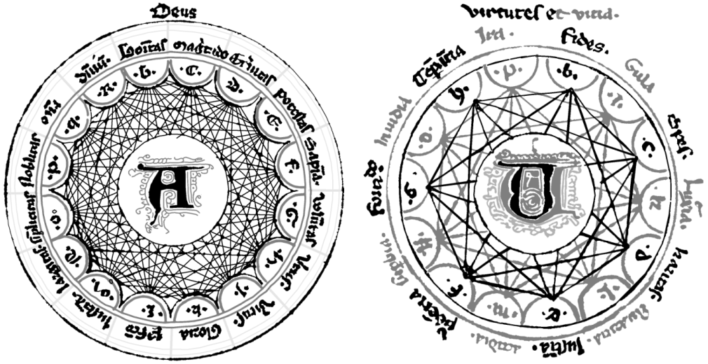</a>

**图 64　拉蒙·柳利于 1280 年向威尼斯总督呈现的一份手稿中的图示**

[摘自他的 *Ars Demonstrativa*, Biblioteca Marciana, VI 200, folio 3v]

柳利采用相同的方法来撰写医学著作. 他的 *Liber Principiorum Medicinae*(约 1275 年) 考虑病症与治疗之间的组合, 取代了原来罗列的神学概念. 他还撰写了有关哲学、逻辑、法学、占星术、动物学、几何学、修辞学和骑士制度的著作, 总共超过 200 本. 但是必须承认, 这些内容有大量的重复. 现代数据压缩技术也许可以把柳利的作品规模压缩到远小于亚里士多德的作品.

他最终决定简化自己的系统, 主要处理由九种事物组成的组. 例如, 见图 65, 其中的圆现在仅列出了上帝的前九种品质 $(B,C,D,E,F,G,H,I,K)$. 在这个圆圈的右侧, 以阶梯形图表给出了 $\binom{9}{2}=36$ 个关联对 $(BC,BD,\ldots,IK)$. 通过另外增加两种美德 (即耐心和同情心) 和两种罪恶 (即撒谎和自相矛盾), 他可以用同一张图表来处理 “美德对美德” 和 “罪恶对罪恶” 的情形. 他还提出, 在一场有九位候选人的选举中, 用同一张图表执行一个很有意思的投票方案. [见麦克莱恩和约翰·伦敦,*Studia Lulliana* **32**(1992), 21–37.]

图 65 左下方带有圆圈的三角形展示了柳利方法的另一个重要方面. 三角形 $(B,C,D)$ 表示 (差别、和谐、对立), 三角形 $(E,F,G)$ 表示 (开始、中间、结束), 三角形 $(H,I,K)$ 表示 (大于、等于、小于). 这三个相互交错的 $K_3$ 表示三种三值逻辑. 柳利在更早之前已经试验了其他这样的三元组, 特别是 “(真、未知、假)”. 我们可以通过考虑他是如何处理四种基本元素 (土壤、空气、火、水) 的组合, 来了解他使用这些三角形的思路. 四种元素各不相同. 土壤与火相合, 火与空气相合, 空气与水相合, 水与土壤相合. 土壤与空气相对, 火与水相对. 这些因素完成了关于三角形 $(B,C,D)$ 的分析. 他转而研究三角形 $(E,F,G)$. 他注意到, 自然界的各种过程在开始时往往是一种元素占据优势, 强于另一种元素. 然后发生一种过渡或中间状态, 直到达成某一目标, 例如空气变得温暖. 对于三角形 $(H,I,K)$, 他说, 就各自的 “范围”、各自的 “速度” 和各自的 “高贵度” 而言, 一般有 “火 $>$ 空气 $>$ 水 $>$ 土壤”. 也有其他一些结论, 例如, 就对生命的支持程度而言, 有 “空气 $>$ 火”, 而当空气和火协同发生作用时, 它们具有相同的价值.

  <a href="../../assets/volume4a/figures/7-2-1-7-fig65-llull-concentric-diagrams.svg" target="_blank" rel="noopener">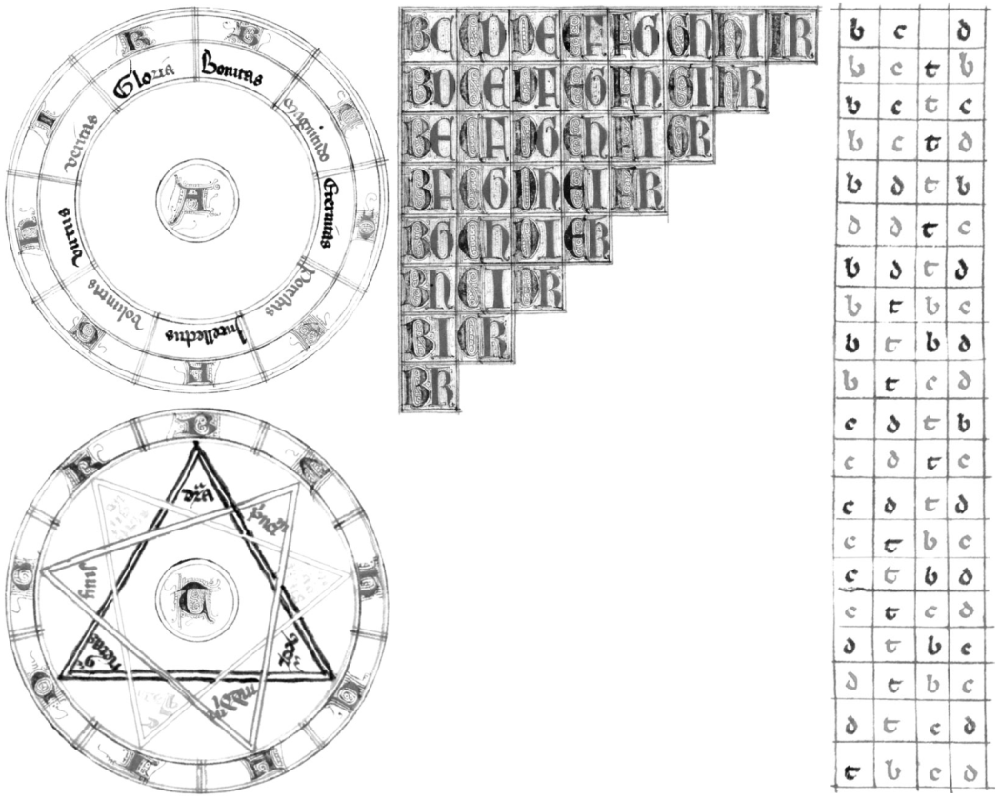</a>

**图 65　柳利的几幅图示, 摘自大约 1325 年呈现给法国女王的一份手稿**

[Badische Landesbibliothek Karlsruhe, Codex St. Peter perg. 92, folios 28v 和 39v]

柳利在图 65 的右端提供了一张竖表, 以提供更多帮助. (见后面的习题 11.) 他还引入了可移动的同心轮, 标有字母 $(B,C,D,E,F,G,H,I,K)$ 和其他名字, 从而可以同时考虑许多事物. 这样, 一位忠实实践柳利方法的人可以确保已经涵盖了所有基础. [柳利可能已经见到过附近犹太社区中使用的类似轮子. 见摩西·伊德尔,*J. Warburg and Courtauld Institutes* **51**(1988), 170–174 and plates 16–17.]

几个世纪以后, 阿塔纳修斯·基歇尔发表了柳利系统的一个扩展, 作为题为 *Ars Magna Sciendi sive Combinatoria*(Amsterdam: 1669) 的大部头的组成部分. 在该书第 173 页配有五个可移动的轮子. 基歇尔还扩展了柳利关于完全图 $K_n$ 的图谱, 提供了完全二部图 $K_{m,n}$ 的图示. 例如, 图 66 即取自基歇尔的书中第 171 页, 第 170 页还包含了 $K_{18,18}$ 的一幅精美图片.

  <a href="../../assets/volume4a/figures/7-2-1-7-fig66-kircher-complete-bipartite.svg" target="_blank" rel="noopener">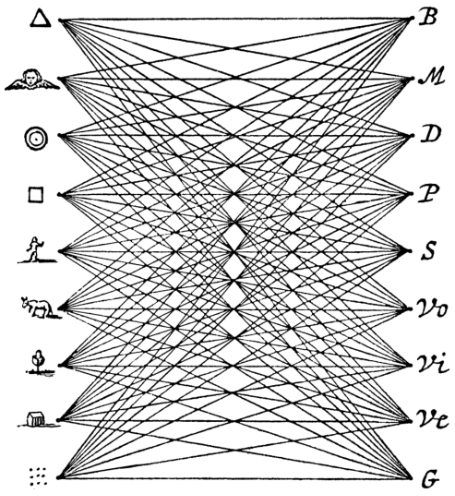</a>

**图 66　$K_{9,9}$, 由阿塔纳修斯·基歇尔于 1669 年提供**

> 当以所有可能方式将各种思想组合在一起,  
> 新的组合形式将会启动人类思维, 沿着新颖的通道前进  
> 从而引导人们发现新的真理和论断.  
> ——马丁·加德纳,*Logic Machines and Diagrams*(1958)

现代对于柳利之类的方法也有发展, 其中最为全面的可能是约瑟夫·席林格的 *The Schillinger System of Musical Composition*(New York: Carl Fischer, 1946). 这是一本卓越的两卷本著作, 从组合角度介绍了有关韵律、旋律、和声、对位法、作曲、管弦乐等的理论. 例如, 在第 56 页, 席林格按照平滑改变 (算法 7.2.1.2P) 的格雷码顺序, 列出了 $\{a,b,c,d\}$ 的 24 种排列. 然后在第 57 页, 他没有将这些排列用于音高, 而是用来确定韵律, 即音符的持续时间. 在第 364 页, 他给出了对称循环

$$
(2,0,3,4,2,5,6,4,0,1,6,2,3,1,4,5,3,6,0,5,1),\tag{13}
$$

这是七个对象 $\{0,1,2,3,4,5,6\}$ 的二元组合所形成的通用圈. 换言之, (13) 是 $K_7$ 中的一个欧拉迹, 所有 $\binom{7}{2}=21$ 对数字都恰好出现一次. 这些模式对作曲家来说都是有用的. 不过我们或许应当心存感激, 席林格那些更优秀的学生 (比如乔治·格什温) 没有完全致力于追求严格数学化的美学.

**塔凯、范斯霍滕和伊斯基耶多.** 17 世纪 50 年代, 出现了与我们故事有关的另外三本书. 安德烈·塔凯撰写了一本很流行的教材 *Arithmeticæ Theoria et Praxis*(Louvain: 1656). 在随后 50 年里, 这本书多次重印和修订. 在接近书末的第 376、377 页, 他给出了一个列举各种组合的过程, 可以一次取两个、一次取三个, 等等.

弗兰斯·范斯霍滕的 *Exercitationes Mathematicæ*(Leiden: 1657) 更为先进. 他在第 373 页以一种极具吸引力的布局方式列出了所有组合:

$$
\begin{gathered}
a\\
\overline{b.\ ab}\\
\overline{c.\ ac.\ bc.\ abc}\\
\overline{d.\ ad.\ bd.\ abd.\ cd.\ acd.\ bcd.\ abcd}
\end{gathered}\tag{14}
$$

在接下来的几页中, 他把这一模式扩展到字母 $e,f,g,h,i,k$, 以此类推, 直至无穷. 在第 376 页, 他观察到将 (14) 中的 $(a,b,c,d)$ 用 $(2,3,5,7)$ 代替, 可以得到 210 的大于 1 的因数:

$$
\begin{gathered}
2\\
\overline{3\enspace 6}\\
\overline{5\enspace 10\enspace 15\enspace 30}\\
\overline{7\enspace 14\enspace 21\enspace 42\enspace 35\enspace 70\enspace 105\enspace 210}
\end{gathered}\tag{15}
$$

在下一页, 他将这一思想推广到

$$
\begin{gathered}
a\\
\overline{a.\ aa}\\
\overline{b.\ ab.\ aab}\\
\overline{c.\ ac.\ aac.\ bc.\ abc.\ aabc}
\end{gathered}\tag{16}
$$

从而允许有两个 $a$. 不过, 他并没有真正理解这个扩展. 他的下一个例子

$$
\begin{gathered}
a\\
\overline{a.\ aa}\\
\overline{a.\ aaa}\\
\overline{b.\ ab.\ aab.\ aaab}\\
\overline{b.\ bb.\ abb.\ aabb.\ aaabb}
\end{gathered}\tag{17}
$$

是拙劣的, 显示了他的知识在当时的局限性. (见习题 13.)

在第 411 页, 范斯霍滕观察到可以在 (14) 中为各个字母赋予权重 $(a,b,c,d)=(1,2,4,8)$, 相加之后得到

$$
\begin{gathered}
1\\
\overline{2\enspace 3}\\
\overline{4\enspace 5\enspace 6\enspace 7}\\
\overline{8\enspace 9\enspace 10\enspace 11\enspace 12\enspace 13\enspace 14\enspace 15}
\end{gathered}\tag{18}
$$

但他没有看出这与二进制数之间的联系.

塞瓦斯蒂安·伊斯基耶多的两卷本著作 *Pharus Scientiarum*(《科学的灯塔》, Lyon: 1659) 中, 有一段内容对组合学进行了极富条理的讨论, 其标题为 Disputatio 29, *De Combinatione*. 他详细地讨论了理查德·斯坦利的 “十二类方式” 中的四个关键部分, 即 $n$ 元组、$n$ 变差、$n$ 元多重组合和从 $m$ 个事物中取出 $n$ 个的组合. 这些内容见表 7.2.1.4–1 的前两行与前两列.

在 *De Combinatione* 的第 81–84 节, 他对 $2\leq n\leq5$ 且 $n\leq m\leq9$ 的情形, 列出了一次从 $m$ 个字母中取出 $n$ 个的所有组合 (总是按字典序排列). 在 $n=2$ 和 $3$ 的情况下, 他还对 $m=10$ 和 $20$ 以表格形式列出了所有组合. 但是, 他在列举从 $m$ 个事物中一次取得 $n$ 个的 $m^n$ 个变差时, 选择了一种更为复杂的顺序 (见习题 14).

伊斯基耶多最早发现了不限制重复时一次从 $m$ 个事物中取出 $n$ 个的组合数目公式 $\binom{m+n-1}{n}$, 这一规律出现在其书的第 48–51 节. 但在第 105 节, 当他试图在 $n=3$ 时列出所有这些组合, 并不知道有一种很简单的方法可以完成这一任务. 事实上, 他在列出 $m=6$ 时的 56 种情形时, 所用顺序类似 (12) 中的旧式顺序, 较为笨拙.

允许重复的组合问题, 直到詹姆斯·伯努利于 1713 年出版 *Ars Conjectandi*(《猜测的艺术》) 后才得到很好的理解. 在第二部分第 5 章中, 伯努利简明地按字典序列出了所有可能性, 并用归纳法证明了公式 $\binom{m+n-1}{n}$, 将其作为一个简单的推论. [尼科洛·塔尔塔利亚在其 *General trattato di numeri, et misure* **2**(Venice: 1556)17r 和 69v 中也偶然接近于发现这一公式. 马格里布数学家艾哈迈德·伊本穆奈姆在其 13 世纪的著作 *Fiqh al-Ḥisāb* 中也获得了同样的成果.]

**空情形.** 在我们结束有关组合早期工作的讨论之前, 不应忘记约翰·沃利斯迈出的一小步, 却极为杰出. 在其著作 *Discourse of Combinations*(1685) 的第 110 页, 他特别考虑了一次从 $m$ 个事物中取 0 个的组合: “很明显, 如果我们一个不取, 那就是留下所有. 无论一共有多少个事物, 这种情形都只能有一种.” 此外, 第 113 页表明, 他知道 $\binom00=1$: “(此时, 无论是取走所有事物, 还是留下所有事物, 都只有一种相同的情形.)”

但是, 当他给出 $n\leq24$ 的 $n!$ 取值表时, 未能更进一步指出 $0!=1$, 或说空集上恰有一种排列.

**纳拉亚纳·潘季塔的工作.** 因为有了帕玛兰德·辛格的英文译本 [*Gaṇita Bhāratī* **20**(1998), 25–82;**21**(1999), 10–73;**22**(2000), 19–85;**23**(2001), 18–82;**24**(2002), 35–98], 印度之外的学者近来才首次得以详细了解纳拉亚纳·潘季塔在 1356 年写就的著名专著 *Gaṇita Kaumudī*(《数学详解》). 另见楠叶隆德的博士论文, Brown University(1993). 纳拉亚纳著作的第 13 章, 名为 *Aṅka Pāśa*(“数的连接”), 专门讨论了组合的生成. 尽管这一章的 97 段 “经文” 相当隐晦费解, 它们却给出了有关这一主题的整套理论, 比世界其他各地在这方面的发展早了数百年.

例如, 纳拉亚纳在经文 49–55a 中讨论了排列的生成. 他给出了一些算法, 有的用于按反向字典序的降序列出一个集合的所有排列, 有的用于对给定排列进行排名, 或者根据给定的序列号进行定位. 早在一个多世纪之前, 这些算法就已出现在萨尔加德瓦的著名作品 *Saṅgītaratnākara*(《音乐的钻石矿》) 的第 1.4.60–71 节中. 因此, 他实际上已经发现了正整数的阶乘表示. 纳拉亚纳在经文 57–60 中扩展了萨尔加德瓦的算法, 从而可轻松地对一般多重集进行排列. 例如, 他列出了 $\{1,1,2,4\}$ 的排列

$$
1124,1214,2114,1142,1412,4112,1241,2141,1421,4121,2411,4211,
$$

同样采用反向字典序的降序排列.

纳拉亚纳的经文 88–92 讨论了组合的系统化生成. 他以图示形式给出了从 $\{1,\ldots,8\}$ 中每次取三个数字的组合结果, 即

$$
(678,578,478,\ldots,134,124,123),
$$

除此之外, 他还考虑了用二进制串以相反的次序 (即递增的反向字典序) 表示这些组合, 从而扩展了巴托帕拉在 10 世纪提出的一种方法:

$$
(11100000,11010000,10110000,\ldots,00010011,00001011,00000111).
$$

他差一点就发现了定理 7.2.1.3L.

**可排列的诗歌.** 现在让我们转而讨论一个很让人好奇的问题. 它在 17 世纪吸引了多位杰出数学家的注意力, 在很大程度上揭示了组合知识在欧洲那个时代的发展状态. 一位名叫伯纳德·包豪斯的耶稣会牧师, 以拉丁六步格创作了一首著名的一行诗, 向圣母玛丽亚致敬:

$$
\text{Tot tibi sunt dotes, Virgo, quot sidera cælo.}\tag{19}
$$

[“哦, 圣母啊, 你的美德, 多如天上的繁星.” 见他的 *Epigrammatum Libri V*(Cologne: 1615), 49.] 他的这首诗启发了埃尔丘斯·普特亚努斯 (鲁汶大学的一位教授). 他写了一本名为 *Pietatis Thaumata*(Antwerp: 1617) 的书, 给出了包豪斯诗中各词的 1022 种排列. 例如, 普特亚努斯写道:

$$
\begin{array}{rrl}
\ldots & 107 & \text{Tot dotes tibi, quot cælo sunt sidera, Virgo.}\\
\ldots & 270 & \text{Dotes tot, cælo sunt sidera quot, tibi Virgo.}\\
\ldots & 329 & \text{Dotes, cælo sunt quot sidera, Virgo tibi tot.}\\
\ldots & 384 & \text{Sidera quot cælo, tot sunt Virgo tibi dotes.}\\
\ldots & 725 & \text{Quot cælo sunt sidera, tot Virgo tibi dotes.}\\
\ldots & 949 & \text{Sunt dotes Virgo, quot sidera, tot tibi cælo.}\\
\ldots & 1022 & \text{Sunt cælo tot Virgo tibi, quot sidera, dotes.}
\end{array}\tag{20}
$$

他写到第 1022 种排列时停了下来, 因为在托勒密的著名星表中, 可见星的数量就是 1022.

以这种方式对单词进行排列的思路, 在当时为人们所熟知. 这种文字游戏就是朱利奥·斯卡利杰罗在其 *Poetices Libri Septem*(Lyon: 1561), 第 2 卷, 第 30 章中所称的 “变形诗”. 拉丁语本身很适合像 (20) 这样的排列, 因为拉丁文的词尾往往决定每个名词在句中的功能, 单词之间的相对顺序对于整句含义的重要性远低于英语中的情形. 然而, 普特亚努斯指出, 他特意避开了一些不适合的排列, 比如

$$
\text{Sidera tot cælo, Virgo, quot sunt tibi dotes,}\tag{21}
$$

因为这些排列将对圣母的品德设定上限, 而不是下限. [见他的书的第 12 页和第 103 页.]

当然, 共有 $8!=40\,320$ 种方法对 (19) 中的单词进行排列. 但这并不是重点, 其中的大多数都不 “符合韵律”. 普特亚努斯的 1022 句诗都遵循经典六步格的严格规则. 从荷马和维吉尔时代起, 希腊和拉丁诗人们就已经在遵循这些规则:

(i) 每个单词都由长 ($\mathord{-}$) 或短 ($\smile$) 的音节组成.

(ii) 每一行的音节属于以下 32 种模式之一:

$$
\left\{\begin{matrix}\mathord{-}\mathord{\smile}\mathord{\smile}\\\mathord{-}\mathord{-}\end{matrix}\right\}\;\left\{\begin{matrix}\mathord{-}\mathord{\smile}\mathord{\smile}\\\mathord{-}\mathord{-}\end{matrix}\right\}\;\left\{\begin{matrix}\mathord{-}\mathord{\smile}\mathord{\smile}\\\mathord{-}\mathord{-}\end{matrix}\right\}\;\left\{\begin{matrix}\mathord{-}\mathord{\smile}\mathord{\smile}\\\mathord{-}\mathord{-}\end{matrix}\right\}\;\mathord{-}\mathord{\smile}\mathord{\smile}\;\left\{\begin{matrix}\mathord{-}\mathord{\smile}\\\mathord{-}\mathord{-}\end{matrix}\right\}.\tag{22}
$$

换言之, 共有六个音步. 采用 (5) 中的术语, 前四个音步各自是 “扬抑抑格” 或 “扬扬格”, 第五个是 “扬抑抑格”, 最后一个是 “扬抑格” 或 “扬扬格”.

一般来说, 拉丁诗歌中关于长短音节的规则多少有些复杂, 但包豪斯的诗句中的八个单词可以用以下模式来描述:

$$
\begin{gathered}
\text{tot}=\mathord{-},\quad \text{tibi}=\left\{\begin{matrix}\mathord{\smile}\mathord{\smile}\\\mathord{\smile}\mathord{-}\end{matrix}\right\},\quad \text{sunt}=\mathord{-},\quad \text{dotes}=\mathord{-}\mathord{-},\\
\text{Virgo}=\left\{\begin{matrix}\mathord{-}\mathord{\smile}\\\mathord{-}\mathord{-}\end{matrix}\right\},\quad \text{quot}=\mathord{-},\quad \text{sidera}=\mathord{-}\mathord{\smile}\mathord{\smile},\quad \text{cælo}=\mathord{-}\mathord{-}.
\end{gathered}\tag{23}
$$

注意, 诗人在使用单词 “tibi” 或 “Virgo” 时有两种选择. 比如, (19) 符合六步格模式:

$$
\begin{array}{cccccc}
\mathord{-}\mathord{\smile}\mathord{\smile} & \mathord{-}\mathord{-} & \mathord{-}\mathord{-} & \mathord{-}\mathord{-} & \mathord{-}\mathord{\smile}\mathord{\smile} & \mathord{-}\mathord{-}\\
\text{Tot ti-bi} & \text{sunt do-} & \text{tes, Vir-} & \text{go, quot} & \text{si-de-ra} & \text{cæ-lo.}
\end{array}\tag{24}
$$

(扬抑抑、扬扬、扬扬、扬扬、扬抑抑、扬扬: “dum-diddy dum-dum dum, dum dum, dum dum-diddy dum-dum.” 逗号表示在读这些单词时稍微停顿, 称为 “cæsuras”. 普特亚努斯在其 1022 种排列中每一项都仔细地插入了这些停顿, 不过这里暂且不讨论它们.)

现在会出现一个很自然的问题: 如果我们对包豪斯的单词进行随机排列, 它们恰好符合韵律的可能性有多大呢? 换言之, 给定 (23) 中的音节模式, 有多少排列服从规则 (i) 和 (ii)? 莱布尼茨在他的 *Dissertatio de Arte Combinatoria*(1666) 中提出了这一问题 (还有其他一些问题). 这本书是他在申请莱比锡大学的职位时出版的. 当时, 他只有 19 岁, 大多数知识都是自学的, 因此对组合学的理解相当有限. 例如, 他认为 $\{\mathrm{ut,ut,re,mi,fa,sol}\}$ 有 600 种排列, 而 $\{\mathrm{ut,ut,re,re,mi,fa}\}$ 有 480 种排列. 他甚至认为 (22) 表示 76 种可能, 而非 32 种. [见他的问题 6 中的第 5、8 节.]

但莱布尼茨意识到, 在许多排列都 “无用” 的情形下, 开发一些通用方法来计算所有 “有用” 排列的数目很值得. 他考虑了变形诗的几个例子, 正确地枚举了较简单的一些, 但单词变得复杂时犯了许多错误. 尽管他提到普特亚努斯的工作, 但并没有尝试枚举 (19) 中符合韵律的排列.

几年后, 让·普雷斯提特在他的 *Élémens des Mathématiques*(Paris: 1675), 342–438 中介绍了一种成功得多的方法. 普雷斯提特给出了一个很清楚的论述, 得出结论: 包豪斯的诗句恰好有 2196 种排列会得到一个正确的六步格. 但他很快意识到, 自己忘了把许多情形统计在内, 包括 (20) 中的 270、384 和 725 号. 因此, 他在 1689 年出版 *Nouveaux Élémens des Mathématiques* 时完全重写了这一材料. 普雷斯提特的新书第 127–133 页试图证明, 符合韵律的排列数为 3276, 几乎比原来的总数多了 50%.

与此同时, 约翰·沃利斯在他的 *Discourse of Combinations*(London: 1685) 第 118–119 页研究了这一问题. 这本书是作为他的 *Treatise of Algebra* 的附录出版的. 解释了为什么认为正确数目是 3096 之后, 沃利斯承认他可能漏掉了一些情形, 也可能将某些情形统计了不止一次: “但目前我不能判断是其中哪一种情形.”

沃利斯著作的一位匿名评阅人这样评论: 合韵排列的真实数目是 2580, 但他没有给出证明 [*Acta Eruditorum* **5**(1686), 289]. 这位评阅人几乎可以肯定就是莱布尼茨本人, 尽管在莱布尼茨从未出版的大量笔记中, 没有找到数字 2580 背后的推导线索. 最后, 詹姆斯·伯努利进入了视野. 他在 1692 年就任巴塞尔大学哲学院院长的演讲中提到了 tot-tibi 枚举问题, 并指出, 需要仔细分析才能得到正确答案. 他认为正确答案是 3312. 他的证明在他死后出现在 *Ars Conjectandi* 第一版中 (1713 年, 79–81 页). [伯努利实际上并不打算在这本后来著名的书中发表这些页的内容. 但他的校对者在笔记中发现了它们, 决定把全部细节包括在书中, 以 “满足人们的好奇心”. 见 *Die Werke von Jakob Bernoulli* **3**(Basel: Birkhäuser, 1975), 78, 98–106, 108, 154–155.]

那谁是正确的呢? 是有 2196 种合乎韵律的排列, 还是 3276 种、3096 种、2580 种, 或 3312 种? 威廉·惠特沃思和威廉·哈特利在 *The Mathematical Gazette* **2**(1902), 227–228 中重新考虑了这个问题, 分别给出了优美的论证, 并得出结论, 上述数值都不是真实总数. 他们的共同答案是 2880, 这是首次有两位数学家独立就这一问题得出相同结论.

但后面的习题 21 和 22 揭示了真相. 伯努利是正确的, 其他所有人都错了. 此外, 研究伯努利条理清晰、精心缩进的三页推导后发现, 他之所以取得成功, 主要是因为严格遵守了现在称为回溯法的规则. 我们将在 7.2.2 节详细学习回溯法, 届时还会看到, tot-tibi 问题可作为恰当覆盖问题的一种特例而轻松解决.

> 即使是最聪明、最审慎的人也经常苦于逻辑学家所说的 “情景枚举不足”.  
> ——詹姆斯·伯努利 (1692)

**集合分划.** 对集合分划的研究似乎最早是在日本展开的. 约公元 1500 年, 一种称为源氏香的室内游戏在上层人群中流行起来. 聚会的东道主秘密选择五包香, 其中一些可能相同, 然后每次焚烧一包. 客人尝试辨别哪些香味相同, 哪些不同. 换言之, 他们尝试猜测东道主在 $\{1,2,3,4,5\}$ 的 $\varpi_5=52$ 种分划中选择了哪一种.

之后不久, 人们开始习惯于使用类似图 67 中的图形表示 52 种可能结果. 例如, 图中最上方的图形从右向左读, 表示前两种香味相同、后三种香味也相同, 对应分划 $12\mid345$. 其他两图同理, 分别表示 $124\mid35$ 和 $1\mid24\mid35$. 为帮助记忆, 52 种模式的每一种都根据下列顺序, 以紫式部夫人著名的 11 世纪作品 *Tale of Genji* 中的某一章命名 [*Encyclopedia Japonicæ*(Tokyo: Sanseido, 1910), 1299]:

  <a href="../../assets/volume4a/figures/7-2-1-7-eq25-genji-partitions.svg" target="_blank" rel="noopener">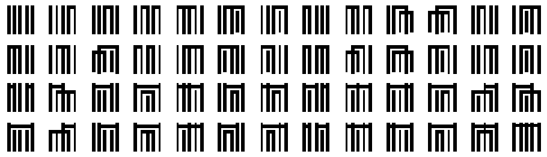</a>

(25)

(就像我们在其他许多示例中看到的那样, 这里对各种可能性的排列仍没有遵循任何特定的逻辑顺序.)

  <a href="../../assets/volume4a/figures/7-2-1-7-fig67-original-genji-samples.svg" target="_blank" rel="noopener">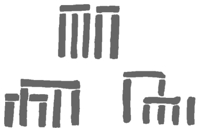</a>

**图 67　16 世纪的日本用于表示集合分划的图**  
[摘自埼玉大学矢野环的选集]

这些源氏香图案本来就很吸引人, 于是许多家族将其用作纹章装饰. 例如, 在 20 世纪初期的和服图案标准目录中, 可以找到 (25) 的以下程式化变型:

  

[见安达文江,*Japanese Design Motifs*(New York: Dover, 1972), 150–153.]

18 世纪初, 关孝和与他的学生们受 $\varpi_5=52$ 这一已知结果启发, 开始研究一般 $n$ 的集合分划数目 $\varpi_n$. 松永良弼找到了满足以下条件的集合分划数目: 有 $k_j$ 个大小为 $n_j$ 的子集 ($1\leq j\leq t$), 且 $k_1n_1+\cdots+k_tn_t=n$ (见习题 1.2.5–21 的答案). 他还发现了基本递推关系 7.2.1.5–(14), 即

$$
\varpi_{n+1}=\binom{n}{0}\varpi_n+\binom{n}{1}\varpi_{n-1}+\binom{n}{2}\varpi_{n-2}+\cdots+\binom{n}{n}\varpi_0,\tag{26}
$$

利用这一公式, 可以轻松算出 $\varpi_n$.

松永良弼的发现在有马赖僮的五卷本 *Shūki Sanpō* 于 1769 年问世前一直没有发表. 该书第 2 卷第 32–35 页的问题要求读者求解关于 $n$ 的方程 “$\varpi_n=678\,570$”. 有马赖僮详细推导得到答案 $n=11$, 并把这一发现恰当地归功于松永良弼.

之后不久, 坂正永在著作 *Sanpō-Gakkai*(1782) 中研究了把 $n$ 元集合分为 $k$ 个子集的方式数 $\left\{{n\atop k}\right\}$. 他发现了递推公式

$$
\left\{{n+1\atop k}\right\}=k\left\{{n\atop k}\right\}+\left\{{n\atop k-1}\right\},\tag{27}
$$

并以表格形式给出 $n\leq11$ 的结果. 詹姆斯·斯特林在他的 *Methodus Differentialis*(1730) 中以纯代数的方法发现了数 $\left\{{n\atop k}\right\}$. 坂正永是认识到其组合意义的第一人.

随后, 本田利明设计了一种列出集合分划的有趣算法 (见习题 24). 关于源氏香及其数学史的更多细节, 可在矢野环的 *Sugaku Seminar* **34**, 11(Nov. 1995), 58–61;**34**, 12(Dec. 1995), 56–60 中找到.

直到很晚之后, 集合分划在欧洲几乎还不为人知, 但有三个孤立的例子. 第一个, 乔治·帕特纳姆和 (或) 理查德·帕特纳姆在 1589 年出版了 *The Arte of English Poesie*, 其第 70–72 页中有一些类似源氏香的图形. 例如, 下面七张图描述了可用于五行诗的押韵格式:

  <a href="../../assets/volume4a/figures/7-2-1-7-eq28-puttenham-rhyme-schemes.svg" target="_blank" rel="noopener">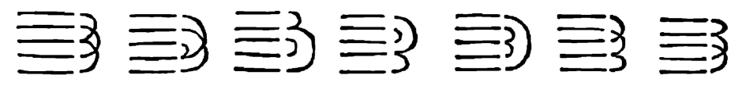</a>

(28)

“与其他押韵格式相比, 其中一些听起来更刺耳, 更让人不舒服.” 不过这个很吸引人的列表并不完整 (见习题 25).

第二个, 莱布尼茨在 17 世纪晚期的一份未发表的手稿显示, 他曾尝试计算有多少种方式可以将 $\{1,\ldots,n\}$ 分为 3 个或 4 个子集, 但几乎没有取得成功. 他用一种很麻烦的方法枚举 $\left\{{n\atop2}\right\}$, 很难看出 $\left\{{n\atop2}\right\}=2^{n-1}-1$. 他仅尝试在 $n\leq5$ 的情形下计算 $\left\{{n\atop3}\right\}$ 和 $\left\{{n\atop4}\right\}$, 犯了几个数值错误, 导致答案不正确. [见埃伯哈德·克诺布洛赫,*Studia Leibnitiana Supplementa* **11**(1973), 229–233;**16**(1976), 316–321.]

集合分划在欧洲的第三次出现具有完全不同的性质. 约翰·沃利斯将著作 *Discourse of Combinations*(1685) 的第 3 章专门用来讨论 “除得尽的部分”, 即整数的真因数. 他特别研究了对整数进行因数分解的各种方式. 这个问题等价于研究多重集的分划. 例如, 当 $p,q,r$ 为素数时, $p^3q^2r$ 的因数分解基本上与 $\{p,p,p,q,q,r\}$ 的分划相同. 沃利斯设计了一个卓越的算法, 列出给定整数 $n$ 的所有因数分解, 实际上预见了算法 7.2.1.5M (见习题 28). 但他没有研究一些重要特例, 比如 $n$ 是素数的幂时 (等价于整数分划), 或 $n$ 不含大于 1 的平方因数时 (等价于集合分划). 尽管沃利斯能解决更一般的问题, 但其复杂性反而使他没能发现分划数、贝尔数或斯特林集合划分数, 也没能设计出生成整数分划或集合分划的简单算法.

**整数分划.** 目前所知, 欧洲关于整数分划的早期文献要晚得多. 我们在上面已经看到, 韦伯尔德主教 (约 965 年) 知道将 $n$ 分为恰好三个小于等于 6 的部分的分划方式. 伽利略也是如此, 他写过一份有关这些分划的备忘录 (约 1627 年), 还研究了它们在投掷三个骰子时的出现频率. [“Sopra le scoperte de i dadi”, 见伽利略 *Opere*, 第 8 卷, 591–594. 他以字典序的降序列出这些分划.] 几年前, 托马斯·哈里奥特在未出版的著作中已经考虑了多达六个骰子的情形 [见杰奎琳·斯蒂德尔,*Historia Math.* **34**(2007), 398].

梅森在其 *Traitez de la Voix et des Chants*(1636) 第 130 页列出了 9 分为任意多个部分的分划. 对于每个分划 $9=a_1+\cdots+a_k$, 他还计算了多项式系数 $9!/(a_1!\cdots a_k!)$. 我们前面已看到, 他对计数各种韵律很感兴趣. 例如, 他知道九个音符 $\{a,a,a,b,b,b,c,c,c\}$ 可以组成 $9!/(3!3!3!)=1680$ 种韵律. 但他没有提到 $8+1$ 和 $3+2+1+1+1+1$, 可能是因为他没有采用系统化的方法列出所有可能.

莱布尼茨在他的 *Dissertatio de Arte Combinatoria*(1666) 的问题 3 中考虑了两个部分的分划. 未曾发表的笔记显示, 他后来花了相当多时间尝试枚举有三个或更多加数的分划. 他把它们称为 “断片” 或较少使用的 “裂片”, 当然用的是拉丁文, 有时也称为 “节”“分散” 乃至 “分划”. 他感兴趣, 主要是因为它们与单项式对称函数 $\sum x_{i_1}^{a_1}x_{i_2}^{a_2}\cdots$ 相联系. 但他的许多尝试几乎全部失败, 例外是三个加数的情形, 他差点发现习题 7.2.1.4–31 中的 $\left\vert{n\atop3}\right\vert$ 公式. 例如, 他计数 8 的分划时只数出 21 种, 忘了 $2+2+2+1+1$. 对于 $p(9)$, 则只给出 26 种, 漏掉 $3+2+2+2$、$3+2+2+1+1$、$2+2+2+1+1+1$ 和 $2+2+1+1+1+1+1$, 尽管他试着以字典序的降序系统地列出这些分划. [见埃伯哈德·克诺布洛赫,*Studia Leibnitiana Supplementa* **11**(1973), 91–258;**16**(1976), 255–337;*Historia Mathematica* **1**(1974), 409–430.]

棣莫弗在论文 “A Method of Raising an infinite Multinomial to any given Power, or Extracting any given Root of the same”[*Philosophical Transactions* **19**(1697), 619–625 和图 5] 中, 取得了第一个有关分划的真正成功. 他证明, 对于 $n$ 的每一种分划, $(az+bz^2+cz^3+\cdots)^m$ 中 $z^{m+n}$ 的系数都有一项与之相应. 例如, $z^{m+6}$ 的系数为

$$
\begin{aligned}
&\tbinom m6 a^{m-6}b^6+5\tbinom m5 a^{m-5}b^4c+4\tbinom m4 a^{m-4}b^3d+6\tbinom m4 a^{m-4}b^2c^2\\
&\quad{}+3\tbinom m3 a^{m-3}b^2e+6\tbinom m3 a^{m-3}bcd+2\tbinom m2 a^{m-2}bf+\tbinom m3 a^{m-3}c^3\\
&\quad{}+2\tbinom m2 a^{m-2}ce+\tbinom m2 a^{m-2}d^2+\tbinom m1 a^{m-1}g.
\end{aligned}\tag{29}
$$

如果设 $a=1$, 则具有指数 $b^ic^jd^ke^l\cdots$ 的项, 对应具有 $i$ 个 1、$j$ 个 2、$k$ 个 3、$l$ 个 4 的分划, 以此类推. 例如, 当 $n=6$ 时, 他实际上按以下顺序给出了这些分划:

$$
111111,\ 11112,\ 1113,\ 1122,\ 114,\ 123,\ 15,\ 222,\ 24,\ 33,\ 6.\tag{30}
$$

他解释了如何以递归方式列出这些分划, 如下所示 (这里换用了有别于他原来记号的语言). 对于 $k=1,2,\ldots,n$, 首先从 $k$ 开始, 然后向其追加先前列出的 $n-k$ 的分划, 条件是所追加分划的最小部分大于等于 $k$.

> [我的解] 奉命在《会刊》上发表,  
> 与游戏的关系不大,  
> 而在于它包含一些一般性的思考,  
> 值得爱好真理的人们加以考虑.  
> ——棣莫弗 (1717)

皮埃尔·蒙莫尔在他的 *Essay d’Analyse sur les Jeux de Hazard*(1708) 中, 结合骰子问题, 以表格形式给出了把小于等于 9 的数分为至多六个部分的所有分划. 他的分划按不同于 (30) 的顺序列出, 例如:

$$
111111,\ 21111,\ 2211,\ 222,\ 3111,\ 321,\ 33,\ 411,\ 42,\ 51,\ 6.\tag{31}
$$

他可能不了解棣莫弗先前的工作.

至此, 在我们讨论过的作者中, 几乎没有人费心描述生成组合模式的过程. 我们只能研究他们实际发表的列表, 从而推测他们用了什么方法, 或有什么方法欠缺. 此外, 在极少数情形下 (比如棣莫弗明确描述一种制表方法的论文), 作者在处理阶数为 $n$ 的情形时, 假定已经列出过 $1,2,\ldots,n-1$ 阶的所有模式. 除了克达拉和纳拉亚纳·潘季塔, 我们目前遇到的作者都没有解释如何 “即时” 地生成模式, 即不查阅辅助表而直接由一种模式给出其后继. 今天的计算机程序员自然喜欢更直接、所需内存更少的方法.

鲁杰尔·博斯科维奇在 *Giornale de’ Letterati*(Rome, 1747) 的第 393–404 页及第 404 页处的两张折页表上, 发表了第一个用于生成分划的直接算法. 他的方法对于 $n=6$ 给出的结果为

$$
111111,\ 11112,\ 1122,\ 222,\ 1113,\ 123,\ 33,\ 114,\ 24,\ 15,\ 6,\tag{32}
$$

该方法生成分划的顺序恰是算法 7.2.1.4P 访问这些分划的相反顺序. 7.2.1.4 节本可以介绍他的方法, 只是该节使用的逆序比他所选的顺序稍容易一些, 也稍快一些.

博斯科维奇在 *Giornale de’ Letterati*(Rome, 1748) 的第 12–27 页及 84–99 页发表续篇, 从两方面扩展了算法. 首先, 他考虑仅生成各部分都属于给定集合 $S$ 的分划, 这样就可以求具有稀疏系数的符号多项式的 $m$ 次幂. (他说, $S$ 的所有元素的最大公因数应为 1. 实际上, 当 $1\notin S$ 时, 他的方法可能失败.) 其次, 他引入了一种算法, 在给定 $m$ 和 $n$ 时生成把 $n$ 分为 $m$ 个部分的分划. 他的运气仍然不好: 人们后来找到稍好一点的方法来完成这项任务, 即算法 7.2.1.4H, 使他失去了成名的机会.

**卡尔·兴登堡的夸大其辞.** 算法 7.2.1.4H 的发明者是卡尔·兴登堡, 他还重新发现了纳拉亚纳·潘季塔的算法 7.2.1.2L, 这是生成多重集排列的巧妙方法. 遗憾的是, 这些小成就让他以为自己在数学上取得了革命性进展, 尽管他也屈尊提到, 诸如棣莫弗、欧拉和约翰·兰伯特等人接近于取得类似成果.

兴登堡是过于争强好胜的典型, 即使谈不上极富灵感, 也确实精力充沛. 他创立或合作创立了德国最早的专业数学杂志 (在 1786–1789 年和 1794–1800 年出版), 并向每一本杂志都投送了长篇文章. 他在莱比锡大学多次担任院长, 1792 年还出任校长. 如果他是一位更优秀的数学家, 德国数学在莱比锡或许会比在柏林或哥廷根更繁荣.

他的第一本数学著作 *Beschreibung einer ganz neuen Art, nach einem bekannten Gesetze fortgehende Zahlen, durch Abzählen oder Abmessen bequem und sicher zu finden*(Leipzig: 1776) 已充分预示了其后的发展. 在这本小册子里, 他的 “ganz neue” (全新) 思想就是为十进制数中的数字赋予组合意义. 令人难以置信的是, 他在专论末尾给出了大幅折页. 其中一张表列出 0000 至 9999, 再后面是两张分别列出偶数和奇数的表 (!).

兴登堡发表了赞扬其工作的来信, 并邀请写信人向他的杂志投稿. 1796 年, 他编辑了 *Sammlung combinatorisch-analytischer Abhandlungen*, 其德文副标题称, 棣莫弗的多项式定理是 “所有数学分析中最重要的命题”. 约十来人加盟, 形成后来的 “兴登堡组合学派”. 他们发表了数千页充满神秘符号的文章, 想必给许多非数学家留下深刻印象.

从计算机科学的角度看, 这个学派的工作并非一无可取. 例如, 兴登堡最优秀的学生海因里希·罗思注意到, 有一种简单的方法, 可以从一个摩尔斯码序列得到字典序的后继或前驱. 另一位学生约翰·布尔克哈特观察到, 先考虑不含长划的摩尔斯码序列, 再考虑含一条长划的序列, 然后是两条, 以此类推, 就能很容易地生成长度为 $n$ 的摩尔斯码序列. 他们的动机与印度韵律学家不同, 他们要列出的不是 $n$ 拍诗步, 而是连续多项式 $K(x_1,x_2,\ldots,x_n)$ 的各项 [式 4.5.3–(4)]. [见 *Archiv der reinen und angewandten Mathematik* **1**(1794), 154–195.] 此外, 在前面引用的兴登堡 1796 年 *Sammlung* 第 53 页, 耶奥里·克吕格尔介绍了一种列举所有排列的方法, 后来被称为奥德—史密斯算法, 见 7.2.1.2 节的式 (23)–(26).

兴登堡认为, 他的这些方法在标准课程中应当与代数、几何和微积分占有同样的时间. 但他和他的追随者只制作组合列表. 他们沉溺于公式和形式主义, 罕有真正值得关注的新数学发现. 欧根·内托在莫里茨·康托尔的 *Geschichte der Mathematik* **4**(1908), 201–219 中很好地总结了他们的工作: “他们曾经一度控制德国市场. 不过, 他们挖掘出来的大多数东西很快归于湮没, 而这样的结局并非完全是他们应得的.”

令人悲哀的是, 组合学研究整体得了个恶名. 芒努斯·米塔格—莱弗勒在兴登堡去世约 100 年后建立了一个宏伟的数学文献图书馆. 他决定将这些书放在一个标有 “颓废” 字样的专门书架上. 今天, 瑞典的米塔格—莱弗勒研究院仍然保留这个类别, 尽管它所吸引的世界一流组合数学家的工作丝毫没有颓废.

往好的方面看, 这些活动中至少出现了一本好书. 安德烈亚斯·冯·厄廷格豪森的 *Die combinatorische Analysis*(Vienna: 1826) 值得留意, 这是第一本清晰讨论组合生成方法的教材. 他在第 8 节讨论了字典序生成的一般原理, 并将其用于构造列出所有排列 (第 11 节)、组合 (第 30 节) 和分划 (第 41–44 节) 的方法.

**树在哪儿呢?** 我们已经看到, 一些富有好奇心的研究者在人类历史上相当早的时期就编制了元组、排列、组合和分划的列表. 我们已经考察了 7.2.1.1 节至 7.2.1.5 节所研究主题的演进. 若能追溯 7.2.1.6 节树的生成的起点, 就可结束这个故事.

但在计算机出现之前, 这个主题几乎没有历史记录, 只有 19 世纪阿瑟·凯莱撰写的几篇论文算是例外. 凯莱对树的主要工作最初发表于 1875 年, 后来在他的 *Collected Mathematical Papers* 第 9 卷第 427–460 页重印. 论文的高潮是一张很大的折页插图, 列出了拥有不超过九个无标号顶点的所有自由树. 此前他还在同一篇论文中图示了九棵各含五个顶点的定向树. 他生成这些列表的方法十分复杂, 完全不同于算法 7.2.1.6O 和习题 7.2.1.6–90. 许多年后, 弗兰克·哈拉里和海尔特·普林斯列举了不超过 10 个顶点的所有自由树 [*Acta Math.* **101**(1958), 158–162]. 对没有度数为 2 的结点的树或没有对称性的树, 他们还把列表扩展到 $n=12$.

很奇怪, 计算机科学家最喜爱的树, 包括二叉树及等价的有序森林或嵌套括号, 几乎没有出现在文献里. 我们在 2.3.4.5 节看到, 18、19 世纪许多数学家已经会计算二叉树数目, 且卡塔兰数 $C_n$ 枚举数十种不同的组合对象. 但 1950 年以前, 似乎没有人实际发表过列表, 列出上述任一种对象的 $C_4=14$ 个四阶情形, 更别说 $C_5=42$ 个五阶情形了. (一个间接的例外是, (25) 的源氏香图中 42 个线条互不交叉的图, 等价于五结点二叉树与森林. 但直到 20 世纪人们才知道这个事实.)

也有一些孤例, 有些前人确实列出了 $C_3=5$ 个与卡塔兰数有关的对象. 凯莱是第一位. 他在 *Philosophical Magazine* (4) **18**(1859), 374–378 中, 图示了有三个内部结点和四个叶结点的二叉树:

  <a href="../../assets/volume4a/figures/7-2-1-7-eq33-cayley-five-binary-trees.svg" target="_blank" rel="noopener">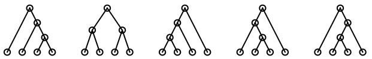</a>

(33)

(同一篇论文还图示了另一种等价于所谓弱序的树.) 在 1901 年, 欧根·内托列出了表达式 “$a+b+c+d$” 的五种加括号方式:

$$
(a+b)+(c+d),\quad[(a+b)+c]+d,\quad[a+(b+c)]+d,\quad a+[(b+c)+d],\quad a+[b+(c+d)].\tag{34}
$$

[*Lehrbuch der Combinatorik*, 第 122 节.] 爱尔特希和欧文·卡普兰斯基 [*Scripta Math.* **12**(1946), 73–75] 则如下列出 $\{+1,+1,+1,-1,-1,-1\}$ 的五个部分和始终非负的排列:

$$
\begin{aligned}
&1+1+1-1-1-1,\qquad1+1-1+1-1-1,\qquad1+1-1-1+1-1,\\
&\hspace{2em}1-1+1+1-1-1,\qquad1-1+1-1+1-1.
\end{aligned}\tag{35}
$$

尽管只涉及五个对象, (33) 和 (34) 的排序基本上仍是随手排列. 只有与算法 7.2.1.6P 相符的 (35) 是系统化、按字典序的.

我们还应简要提到瓦尔特·迪克的工作, 因为近来许多论文使用 “迪克单词” 一词称呼嵌套括号串. 迪克是一位教育家, 作为慕尼黑德国博物馆的创办人之一而为人所知. 他撰写了两篇关于自由群的开创性论文 [*Math. Annalen* **20**(1882), 1–44;**22**(1883), 70–108]. 所谓的迪克单词与他的实际研究关系很弱. 他研究的是 $\{x_1,x_1^{-1},\ldots,x_k,x_k^{-1}\}$ 上的单词, 在重复删除 $x_i x_i^{-1}$ 或 $x_i^{-1}x_i$ 形式的相邻字母对之后可以约化为空串. 只有把删除操作限于第一种形式 $x_i x_i^{-1}$ 时, 才出现与括号和树的联系.

于是, 我们可以得出结论, 1950 年以后人们对二叉树及同类对象的兴趣爆发式增长, 不过在我们故事的各个领域里, 这些树的历史根基最浅.

**1950 年之后.** 当然, 电子计算机的到来改变了一切. 在组合生成方法的出版物中, 第一篇以计算机为对象的是查尔斯·汤普金斯的札记 “Machine attacks on problems whose variables are permutations”[*Proc. Symp. Applied Math.* **6**(1956), 202–205]. 随后又出现了数以千计的相关论文.

德里克·莱默的几篇论文在早期有着极其重要的影响, 尤其是他在 *Proc. Symp. Applied Math.* **10**(1960), 179–193 上的 “Teaching combinatorial tricks to a computer”. [另见 *Proc. 1957 Canadian Math. Congress*(1959), 160–173;*Proc. IBM Scientific Computing Symposium on Combinatorial Problems*(1964), 23–30; 以及埃德温·贝肯巴赫所编 *Applied Combinatorial Mathematics*(Wiley, 1964), 5–31 的第 1 章.] 莱默是与此前几代人的重要纽带. 例如, 斯坦福图书馆的记录表明, 他曾在 1932 年 1 月查阅过欧根·内托的 *Lehrbuch der Combinatorik*.

与我们所研究的特定算法相关的重要出版物已在前文各节引用, 这里无需重复. 一些教科书和专著最早把主题的各部分汇集为统一的框架, 因而很重要. 尤其有三本书在建立一般原理方面值得一提.

- 马克·韦尔斯的 *Elements of Combinatorial Computing*(Pergamon Press, 1971), 特别是第 5 章.
- 艾伯特·奈恩黑斯和赫伯特·维尔夫的 *Combinatorial Algorithms*(Academic Press, 1975). 1978 年出版的第二版有补充资料, 维尔夫后来又写了 *Combinatorial Algorithms: An Update*(Philadelphia: SIAM, 1989).
- 爱德华·莱因戈尔德、尼弗格尔特和纳尔辛格·德奥的 *Combinatorial Algorithms: Theory and Practice*(Prentice–Hall, 1977), 特别是第 5 章.

罗伯特·塞奇威克在 *Computing Surveys* **9**(1977), 137–164, 314 中撰写了关于排列生成方法的第一份全面调查. 卡拉·萨维奇在 *SIAM Review* **39**(1997), 605–629 中关于格雷码的调查是另一个里程碑.

我们提到过, 直至计算机程序员对按卡塔兰数计数的对象产生兴趣, 生成它们的算法才开发出来. 最初发表的一批算法已被更好的方法取代, 因而 7.2.1.6 节未曾引用, 这里列出它们仍然合适. 首先, 休伯特·斯科因斯在此前为生成定向树而引用的同一篇论文 [*Machine Intelligence* **3**(1968), 43–60] 中, 给出了两个生成有序树的递归算法. 他的算法处理以二进制串表示的二叉树. 这种表示基本上等价于波兰前缀表示法或嵌套括号. 之后, 马克·韦尔斯将二叉树表示为非交叉集合分划来生成二叉树, 见前面引用的书的 5.5.4 节. 加里·诺特 [*CACM* **20**(1977), 113–115] 采用表 7.2.1.6–3 的中序到前序排列 $q_1\ldots q_n$ 表示二叉树, 并给出了递归排名和定位算法.

自 20 世纪 50 年代以来, 在电气网络研究的推动下, 许多作者发表了为给定图生成所有生成树的算法. 最早的论文有中川则幸,*IRE Trans.* **CT-5**(1958), 122–127; 前田渡,*IRE Trans.* **CT-6**(1959), 136–137, 394; 渡部和,*IRE Trans.* **CT-7**(1960), 296–302; 塞夫拉·哈基米,*J. Franklin Institute* **272**(1961), 347–359.

有关整个主题的近期介绍, 可见唐纳德·克雷埃尔和道格拉斯·斯廷森的 *Combinatorial Algorithms: Generation, Enumeration, and Search*(CRC Press, 1999) 第 2、3 章.

弗兰克·拉斯基正在准备 *Combinatorial Generation* 一书, 其中将有详尽的讨论和广泛的参考文献. 他已经在互联网上发布了几章初稿.

### 习题

下面的许多习题要求读者找出和 (或) 纠正过去文献中的错误. 我们的目的并非幸灾乐祸, 炫耀 21 世纪的我们多么聪明, 而是要认识到即使是一个领域的先驱也可能犯错. 要了解一组思想实际上并不像今天的计算机科学家和数学家看来那么简单, 一个很好的办法, 是看看那些概念刚出现时, 世界上一些顶级思想家也曾为之苦苦奋斗.

**1.** [*15*][答案](./answers/7-2-1-7.md#ans-7-2-1-7-1) 《易经》中是否出现了 “计算” 的概念?

**▸ 2.** [*M30*][答案](./answers/7-2-1-7.md#ans-7-2-1-7-2) (遗传密码)DNA 分子是字母表 $\{\mathtt{T,C,A,G}\}$ (共 4 个字母) 上的 “核苷酸” 串, 大多数蛋白质分子是字母表 $\{\mathtt{A,C,D,E,F,G,H,I,K,L,M,N,P,Q,R,S,T,V,W,Y}\}$ (共 20 个字母) 上的 “氨基酸” 串. 三个连续的核苷酸 $xyz$ 构成一个 “密码子”. 一条 DNA 链 $x_1y_1z_1x_2y_2z_2\cdots$ 确定蛋白质 $f(x_1,y_1,z_1)f(x_2,y_2,z_2)\cdots$, 其中 $f(x,y,z)$ 是以下阵列中矩阵 $x$ 的第 $z$ 行、第 $y$ 列的元素:

$$
\begin{pmatrix}
\mathtt{F} & \mathtt{S} & \mathtt{Y} & \mathtt{C}\\
\mathtt{F} & \mathtt{S} & \mathtt{Y} & \mathtt{C}\\
\mathtt{L} & \mathtt{S} & - & -\\
\mathtt{L} & \mathtt{S} & - & \mathtt{W}
\end{pmatrix}\quad \begin{pmatrix}
\mathtt{L} & \mathtt{P} & \mathtt{H} & \mathtt{R}\\
\mathtt{L} & \mathtt{P} & \mathtt{H} & \mathtt{R}\\
\mathtt{L} & \mathtt{P} & \mathtt{Q} & \mathtt{R}\\
\mathtt{L} & \mathtt{P} & \mathtt{Q} & \mathtt{R}
\end{pmatrix}\quad \begin{pmatrix}
\mathtt{I} & \mathtt{T} & \mathtt{N} & \mathtt{S}\\
\mathtt{I} & \mathtt{T} & \mathtt{N} & \mathtt{S}\\
\mathtt{I} & \mathtt{T} & \mathtt{K} & \mathtt{R}\\
\mathtt{M} & \mathtt{T} & \mathtt{K} & \mathtt{R}
\end{pmatrix}\quad \begin{pmatrix}
\mathtt{V} & \mathtt{A} & \mathtt{D} & \mathtt{G}\\
\mathtt{V} & \mathtt{A} & \mathtt{D} & \mathtt{G}\\
\mathtt{V} & \mathtt{A} & \mathtt{E} & \mathtt{G}\\
\mathtt{V} & \mathtt{A} & \mathtt{E} & \mathtt{G}
\end{pmatrix}.
$$

(这里 $(\mathtt{T,C,A,G})=(1,2,3,4)$. 例如, $f(\mathtt{CAT})$ 是矩阵 2 中第 1 行第 3 列的元素, 即 $\mathtt{H}$.) 编码过程一直持续, 直到有一个密码子给出停止符 “−”.

(a) 证明: 存在一种简单的方法, 将每个密码子映射为《易经》中的一个六爻符号, 且 21 个可能结果 $\{\mathtt{A,C,D},\ldots,\mathtt{W,Y},-\}$ 对应于周文王顺序 (1) 中 21 个连续的六爻符号.

(b) 这是一个非常突出的发现吗?

**3.** [*20*][答案](./answers/7-2-1-7.md#ans-7-2-1-7-3) 按与 (2) 类似的反向字典序, 第 100 万个 30 拍的诗步是什么?

$$
\mathord{\smile}\mathord{\smile}\mathord{\smile}\mathord{-}\mathord{\smile}\mathord{-}\mathord{-}\mathord{\smile}\mathord{\smile}\mathord{\smile}\mathord{\smile}\mathord{-}\mathord{-}\mathord{\smile}\mathord{\smile}\mathord{\smile}\mathord{\smile}\mathord{\smile}\mathord{\smile}\mathord{\smile}\mathord{-}\mathord{\smile}\mathord{-}
$$

的排名是多少?

**4.** [*19*][答案](./answers/7-2-1-7.md#ans-7-2-1-7-4) 试分析表 1 中唐诺洛排列列表的不尽完美之处.

**5.** [*16*][答案](./answers/7-2-1-7.md#ans-7-2-1-7-5) (7) 中基歇尔的五音符排列列表有什么错误?

**6.** [*25*][答案](./answers/7-2-1-7.md#ans-7-2-1-7-6) 梅森在 *Traitez de la Voix et des Chants*(1636) 的第 108–110 页列出了前 64 个阶乘. 他给出的 $64!$ 约为 $2.2\times10^{89}$, 而正确值约为 $1.3\times10^{89}$. 找到他的书, 并试着指出他在哪里出错.

**7.** [*20*][答案](./answers/7-2-1-7.md#ans-7-2-1-7-7) 根据关孝和的规则 (8) 和 (9), $\{1,2,3,4,5\}$ 的哪些排列是 “活的”, 哪些是 “死的”?

**▸ 8.** [*M27*][答案](./answers/7-2-1-7.md#ans-7-2-1-7-8) 修补 (9), 使关孝和的过程变得正确.

**9.** [*15*][答案](./answers/7-2-1-7.md#ans-7-2-1-7-9) 从 (11) 推测如何用阿拉伯文书写数字 $(0,1,\ldots,9)$.

**▸ 10.** [*HM27*][答案](./answers/7-2-1-7.md#ans-7-2-1-7-10) 在 *Ludus Clericalis* 游戏中, 平均需要投掷三颗骰子多少次, 才能得到所有可能的美德?

**11.** [*21*][答案](./answers/7-2-1-7.md#ans-7-2-1-7-11) 破译图 65 右侧拉蒙·柳利的竖表. 它表示哪 20 个组合对象? 提示: 不要被印刷错误误导.

**12.** [*M20*][答案](./answers/7-2-1-7.md#ans-7-2-1-7-12) 将席林格的通用圈 (13) 与习题 7.2.1.3–106 中普安索的通用圈联系起来.

**13.** [*21*][答案](./answers/7-2-1-7.md#ans-7-2-1-7-13) 范斯霍滕应当怎样改写 (17)? 另给出多重集 $\{a,a,a,b,b,c\}$ 的组合所对应的表.

**▸ 14.** [*20*][答案](./answers/7-2-1-7.md#ans-7-2-1-7-14) 完成以下序列, 取自伊斯基耶多 *De Combinatione* 的第 95 节:

$$
\text{ABC ABD ABE ACD ACE ACB ADE ADB ADC AEB }\ldots .
$$

**15.** [*15*][答案](./answers/7-2-1-7.md#ans-7-2-1-7-15) 如果按字典序列出从 $\{1,\ldots,m\}$ 取出的所有允许重复的 $n$ 组合 $x_1\ldots x_n$, 其中 $x_1\leq\cdots\leq x_n$, 有多少组合以 $j$ 开头?

**16.** [*20*][答案](./answers/7-2-1-7.md#ans-7-2-1-7-16) (纳拉亚纳·潘季塔, 1356) 设计一种算法, 生成 $n$ 的所有各部分不大于 $q$ 的组分, 即给出所有有序分划 $n=a_1+\cdots+a_t$, 其中 $1\leq a_j\leq q$($1\leq j\leq t$), $t$ 可以任取. 用 $n=7,q=3$ 的情形说明你的方法.

**17.** [*HM27*][答案](./answers/7-2-1-7.md#ans-7-2-1-7-17) 分析习题 16 中的算法.

**18.** [*10*][答案](./answers/7-2-1-7.md#ans-7-2-1-7-18) 脑筋急转弯: 莱布尼茨在 1666 年出版了 *Dissertatio de Arte Combinatoria*. 为什么从排列的角度来说, 那一年特别吉祥?

**19.** [*17*][答案](./answers/7-2-1-7.md#ans-7-2-1-7-19) 在普特亚努斯的诗句 (20) 中, 哪些把 “tibi” 看作 $\mathord{\smile}\mathord{-}$, 而不是 $\mathord{\smile}\mathord{\smile}$?

**20.** [*M25*][答案](./answers/7-2-1-7.md#ans-7-2-1-7-20) 为纪念三位杰出贵族在 1617 年对德累斯顿的访问, 一位诗人发表了以下六步格诗句的 1617 种排列:

$$
\text{Dant tria jam Dresdæ, ceu sol dat, lumina lucem.}
$$

“三位先生现在给予德累斯顿的, 犹如太阳给予的, 由光芒而光明.”[格雷戈尔·克莱皮斯,*Proteus Poeticus*(Leipzig: 1617).] 这些单词的排列中有多少真正合乎格律? 提示: 这首诗在第一、第五诗步用扬抑抑格, 其他诗步用扬扬格.

**21.** [*HM30*][答案](./answers/7-2-1-7.md#ans-7-2-1-7-21) 令 $f(p,q,r;s,t)$ 表示将多重集 $\{s\cdot o,t\cdot oo\}$ 的串拼接成 $(o^p,o^q,o^r)$ 的方式数, 其中 $p+q+r=s+2t$. 例如, $f(2,3,2;3,2)=5$, 因为这五种方式是

$$
(o\mathord{|}o,\ o\mathord{|}oo,\ oo),\;
(o\mathord{|}o,\ oo\mathord{|}o,\ oo),\;
(oo,\ o\mathord{|}o\mathord{|}o,\ oo),\;
(oo,\ o\mathord{|}oo,\ o\mathord{|}o),\;
(oo,\ oo\mathord{|}o,\ o\mathord{|}o).
$$

(a) 证明:

$$
f(p,q,r;s,t)=[u^pv^qw^rz^s]\,\frac{1}{(1-zu-u^2)(1-zv-v^2)(1-zw-w^2)}.
$$

(b) 使用函数 $f$ 枚举 (19) 合乎格律的排列, 附加条件是第五个诗步不从一个单词中间开始.

(c) 现在枚举剩余情形.

**▸ 22.** [*M40*][答案](./answers/7-2-1-7.md#ans-7-2-1-7-22) 查阅让·普雷斯提特、约翰·沃利斯、威廉·惠特沃思和威廉·哈特利发表的关于 tot-tibi 问题的原始论述. 他们犯了什么错误?

**23.** [*20*][答案](./answers/7-2-1-7.md#ans-7-2-1-7-23) 算法 7.2.1.5H 对应于这 52 个源氏香图的哪一种排列顺序?

**▸ 24.** [*23*][答案](./answers/7-2-1-7.md#ans-7-2-1-7-24) 19 世纪初期, 本田利明给出一个递归规则, 生成 $\{1,\ldots,n\}$ 的所有分划. 他的算法在 $n=4$ 时按以下顺序生成这些分划:

  

你能猜出 $n=5$ 时的对应顺序吗? 提示: 见 (26).

**25.** [*15*][答案](./answers/7-2-1-7.md#ans-7-2-1-7-25) *The Arte of English Poesie* 的作者 (生活在 16 世纪) 仅对那些 “完全” 的押韵格式感兴趣. (“完全” 的含义见习题 7.2.1.5–35, 即每一行至少与另一个诗行押韵.) 此外, 这种格式根据习题 7.2.1.2–100 的定义应当 “不可分解”. 像 $12\mid345$ 这样的分划, 可以分解为两行诗后跟三行诗. 此格式也不应包含所有诗行都互相押韵的平凡情况. 在这些条件下, (28) 是否完整列出了五行诗的押韵格式?

**▸ 26.** [*HM25*][答案](./answers/7-2-1-7.md#ans-7-2-1-7-26) 有多少个 $n$ 行诗的押韵格式满足习题 25 中的限制?

**▸ 27.** [*HM31*][答案](./answers/7-2-1-7.md#ans-7-2-1-7-27) 集合分划 $14\mid25\mid36$ 可以用诸如<a href="../../assets/volume4a/figures/7-2-1-7-exercise27-six-stem-crossings.svg" target="_blank" rel="noopener">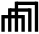</a>的源氏香图表示, 但这一分划的每个图都必须有至少三个线的交叉点, 而这些交叉点有时不受欢迎. $\{1,\ldots,n\}$ 的分划中, 有多少个对应于至多有一个交叉点的源氏香图?

**▸ 28.** [*25*][答案](./answers/7-2-1-7.md#ans-7-2-1-7-28) 令 $a,b,c$ 为素数. 约翰·沃利斯列出了 $a^3b^2c$ 的所有可能的因数分解, 如下: $cbbaaa$、$cbbaa\cdot a$、$cbaaa\cdot b$、$bbaaa\cdot c$、$cbba\cdot aa$、$cbba\cdot a\cdot a$、$cbaa\cdot ba$、$cbaa\cdot b\cdot a$、$bbaa\cdot ca$、$bbaa\cdot c\cdot a$、$caaa\cdot bb$、$caaa\cdot b\cdot b$、$baaa\cdot cb$、$baaa\cdot c\cdot b$、$cbb\cdot aaa$、$cbb\cdot aa\cdot a$、$cbb\cdot a\cdot a\cdot a$、$cba\cdot baa$、$cba\cdot ba\cdot a$、$cba\cdot aa\cdot b$、$cba\cdot b\cdot a\cdot a$、$bba\cdot caa$、$bba\cdot ca\cdot a$、$bba\cdot aa\cdot c$、$bba\cdot c\cdot a\cdot a$、$caa\cdot bb\cdot a$、$caa\cdot ba\cdot b$、$caa\cdot b\cdot b\cdot a$、$baa\cdot cb\cdot a$、$baa\cdot ca\cdot b$、$baa\cdot ba\cdot c$、$baa\cdot c\cdot b\cdot a$、$aaa\cdot cb\cdot b$、$aaa\cdot bb\cdot c$、$aaa\cdot c\cdot b\cdot b$、$cb\cdot ba\cdot aa$、$cb\cdot ba\cdot a\cdot a$、$cb\cdot aa\cdot b\cdot a$、$cb\cdot b\cdot a\cdot a\cdot a$、$bb\cdot ca\cdot aa$、$bb\cdot ca\cdot a\cdot a$、$bb\cdot aa\cdot c\cdot a$、$bb\cdot c\cdot a\cdot a\cdot a$、$ca\cdot ba\cdot ba$、$ca\cdot ba\cdot b\cdot a$、$ca\cdot aa\cdot b\cdot b$、$ca\cdot b\cdot b\cdot a\cdot a$、$ba\cdot ba\cdot c\cdot a$、$ba\cdot aa\cdot c\cdot b$、$ba\cdot c\cdot b\cdot a\cdot a$、$aa\cdot c\cdot b\cdot b\cdot a$、$c\cdot b\cdot b\cdot a\cdot a\cdot a$. 他用什么算法按这个顺序生成它们?

**▸ 29.** [*24*][答案](./answers/7-2-1-7.md#ans-7-2-1-7-29) 沃利斯按什么顺序为数 $abcde=5\cdot7\cdot11\cdot13\cdot17$ 生成所有因数分解? 以源氏香图序列的方式给出答案.

**30.** [*M20*][答案](./answers/7-2-1-7.md#ans-7-2-1-7-30) 在 $(a_0z+a_1z^2+a_2z^3+\cdots)^m$ 中, $a_1^{i_1}a_2^{i_2}\cdots z^{m+n}$ 的系数是多少? (见 (29).)

**31.** [*20*][答案](./answers/7-2-1-7.md#ans-7-2-1-7-31) 将棣莫弗和皮埃尔·蒙莫尔的分划顺序 (30) 和 (31) 与算法 7.2.1.4P 对比.

**32.** [*21*][答案](./answers/7-2-1-7.md#ans-7-2-1-7-32) (鲁杰尔·博斯科维奇, 1748) 列出 20 的分划中所有部分均为 1、7 或 10 的分划. 并设计一种算法, 列出给定整数 $n>0$ 的所有这类分划.

[^v4a-420-1]: 此书的中译本《中国科学技术史》各分册分别由科学出版社和上海古籍出版社出版. ——编者注

[^v4a-422-1]: 希伯来文从右往左书写. ——编者注
