

# 第 7 章　组合查找

> 在发现它们之前, 你会终日搜索,  
> 而在你一旦拥有它们之后, 就失去查找的价值了.  
> ——巴萨尼奥, 《威尼斯商人》(第一幕, 第一场, 第 117 句台词)

> 在如此密集的人类行动和反应中,  
> 事件的所有可能组合都可能会发生,  
> 而且许多细微末节的问题可能以惊人、离奇的方式呈现.  
> ——夏洛克·福尔摩斯, 《蓝宝石案》(1892)

> 组合算法的范围过于广阔,  
> 以致于不能把它们写进一篇文章甚至单独一本书中.  
> ——罗伯特·塔扬 (1976)

> 当与各式各样的人争辩时, 我头脑中总有 
> 这样的印象, 成功者是那些对于解决迷题 
> 独具天赋的人. 生活中充满着迷题, 当它们 
> 不可避免地降临到我们头上时是在呼唤我们去解决.  
> ——小萨姆·劳埃德 (1926)

组合学研究的是可以把离散对象排列成种种不同模式的方法. 例如, 讨论的对象可能是 $2n$ 个数 $\{1,1,2,2,\ldots,n,n\}$, 而我们想把它们排成一行, 使得在每个数 $k$ 的两次出现之间恰好存在 $k$ 个数. 当 $n=3$ 时, 实际上仅有这样一种排成 “兰福德配对” 的方法, 即 $231213$ (及其左右反转). 同样, 当 $n=4$ 时也只有唯一解. 许多其他类型的组合模式将在下面讨论.

研究组合问题时, 一般有五类基本问题, 其中一些难度更大.

(i) 存在问题: 是否存在遵循模式的排列 $X$?

(ii) 构造问题: 倘若存在, 能否快速找到这样的 $X$?

(iii) 计数问题: 存在多少不同的排列 $X$?

(iv) 生成问题: 能否依序访问所有的排列 $X_1,X_2,\ldots$?

(v) 优化问题: 给出目标函数 $f$, 何种排列使 $f(X)$ 达到最大值或最小值?

就兰福德配对而言, 这里的每一个问题都很有趣.

例如, 考虑存在问题. 通过反复试验很快发现, 当 $n=5$ 时, 我们无法把 $\{1,1,2,2,\ldots,5,5\}$ 恰当地置放在 $10$ 个位置上. 两个 $1$ 必须同时放在两个偶数号位置或者两个奇数号位置; 同样, 两个 $3$ 和两个 $5$ 必须选择两个偶数号或者两个奇数号的位置; 但是, 两个 $2$ 和两个 $4$ 使用两种编号的一个位置. 因此, 我们不能恰好填满奇数号和偶数号各 $5$ 个位置. 这个推理同样证明, 当 $n=6$, 或者一般地, 当 $\{1,2,\ldots,n\}$ 中有奇数个奇数值时, 这个问题没有解.

换句话说, 对于某个整数 $m$, 兰福德配对只能在 $n=4m-1$ 或者 $n=4m$ 时存在. 反过来, 当 $n$ 是具有这种形式的值时, 罗伊·戴维斯找到了构造符合要求的排列位置的简练方法 (见习题 1).

那么, 究竟有多少本质上不同的兰福德配对 $L_n$? 当 $n$ 增加时, 存在很多这样的配对:

$$
\begin{aligned}
L_3&=1;& L_4&=1;\\
L_7&=26;& L_8&=150;\\
L_{11}&=17\,792;& L_{12}&=108\,144;\\
L_{15}&=39\,809\,640;& L_{16}&=326\,721\,800;\\
L_{19}&=256\,814\,891\,280;& L_{20}&=2\,636\,337\,861\,200;\\
L_{23}&=3\,799\,455\,942\,515\,488;& L_{24}&=46\,845\,158\,056\,515\,936.
\end{aligned}\tag{1}
$$

[$L_{23}$ 和 $L_{24}$ 的值是米卡埃尔·卡捷基、克里斯托夫·雅耶和阿兰·布伊在 2004 年和 2005 年确定的, 见 *Studia Informatica Universalis* **4** (2005), 151–190.] 一种直觉上的计算显示, 当 $L_n$ 不是 $0$ 时, 它的数量级粗略为 $(4n/e^3)^{n+1/2}$ (见习题 5). 而且事实上, 在所有已知情形下这个预测基本是正确的. 但是, 显然不存在简单公式.

兰福德排列问题是一类称为<em>恰当覆盖问题</em>的组合难题的简单特例. 在 7.2.2.1 节, 我们将要研究一种算法 (称为 “舞蹈链”), 它是产生这类问题所有解的一种便捷方法. 例如, 当 $n=16$ 时, 该方法对于它找到的每个兰福德配对排列大约仅需 3500 次内存访问, 因此, 简单地生成全部配对并计数, 便能在合理的时间内计算 $L_{16}$ 的值.

但需注意, $L_{24}$ 是一个天文数字——大约是 $5\times10^{16}$, 约为 1500 MIP 年. (回忆一下, 一 “MIP 年” 是每秒执行 100 万条指令的计算机每年执行的指令数量, 即 $31\,556\,952\,000\,000$.) 所以, $L_{24}$ 的确切值显然是由不涉及生成所有排列的某种方法确定的. 实际上有一种非常快的方法, 利用多项式代数计算 $L_n$. 习题 6 中描述的启发性方法需要进行 $O(4^n n)$ 次运算, 其效率看似不高. 但是, 它以一个巨大的数量级因子 $\Theta((n/e^3)^{n-1/2})$ 胜过生成所有配对排列并且计数它们的方法, 甚至当 $n=16$ 时它的执行速度大约还要快 20 倍. 另一方面, 我们或许永远无法知道 $L_{100}$ 的确切值, 即便计算机的速度变得越来越快.

我们还可以从各种不同途径考虑那些最优的兰福德配对排列. 例如, 可以这样安排砝码 $\{1,1,2,2,\ldots,16,16\}$ 的 16 个配对排列, 它们满足兰福德条件, 并且在将它们按相应次序置于一根平衡杆上时不会使杆倾斜, 在这个意义下它们是 “完全平衡” 的:

[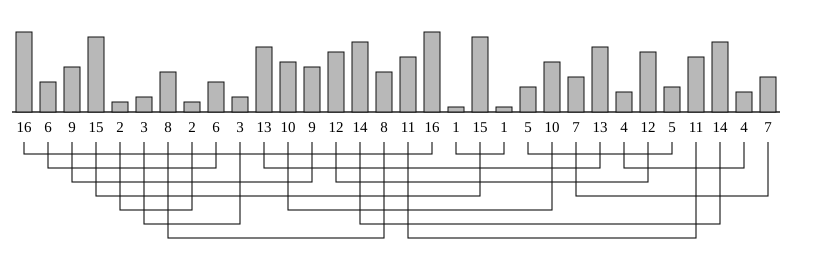](../../assets/volume4a/figures/diagram-7-2-langford.svg)

(2)

换句话说, 我们有 $15.5\cdot16+14.5\cdot6+\cdots+0.5\cdot8=0.5\cdot11+\cdots+14.5\cdot4+15.5\cdot7$. 同时, 其中还有另一种平衡 $16+6+\cdots+8=11+16+\cdots+7$, 因此还有 $16\cdot16+15\cdot6+\cdots+1\cdot8=1\cdot11+\cdots+15\cdot4+16\cdot7$.

此外, (2) 中的排列在全部 16 阶兰福德配对排列中具有最小宽度: 图中底部的连线显示, 按照从左到右的顺序, 在任何点没有 7 个以上的未完成配对. 我们可以证明, 宽度 6 是不够的. (见习题 7.)

在 $\{1,1,\ldots,16,16\}$ 的排列 $a_1a_2\ldots a_{32}$ 中, 什么排列在 $\sum_{k=1}^{32}ka_k$ 达到最大值的意义下是最小平衡的? 可以证明, 这个最大的可能值是 5268. 这种配对排列共有 12016 个, 其中一个是

$$
2\;3\;4\;2\;1\;3\;1\;4\;16\;13\;15\;5\;14\;7\;9\;6\;11\;5\;12\;10\;8\;7\;6\;13\;9\;16\;15\;14\;11\;8\;10\;12.\tag{3}
$$

一个更有趣的问题是求按照字典序的最小和最大兰福德配对排列. 对于 $n=24$, 如果我们用字母 $\mathsf{a,b,\ldots,w,x}$ 代替数 $1,2,\ldots,23,24$, 答案是

$$
\begin{gathered}
\{\mathtt{abacbdecfgdoersfpgqtuwxvjklonhmirpsjqkhltiunmwvx},\\
\mathtt{xvwsquntkigrdapaodgiknqsvxwutmrpoljecfhbcebmfjlh}\}
\end{gathered}\tag{4}
$$

在这一章的后面几小节, 我们将要讨论许多关于组合最优化的方法. 当然, 我们的目标是在检查范围不超出全部可能排列空间的很小一部分的情况下求解这类问题.

<strong>正交拉丁方. </strong> 我们稍事回顾早期的组合学. 在作者雅克·奥扎拉姆去世后才出版的 *Recreations mathematiques et physiques* (Paris: 1723) 第 4 卷第 434 页有一道有趣的迷题: “取出一副普通纸牌中的所有 A、K、Q、J, 把它们排列成一个方阵, 使得每行和每列包含全部四种面值和四种花色.” 你能做到吗? 下页的图 1 显示了奥扎拉姆给出的解, 他的解还展现一个结果: 四种面值和四种花色的牌也出现在两条主对角线上. (在你试着解这道题之前请不要翻看下一页.)

到了 1779 年, 圣彼得堡流传着一道类似的谜题, 并引起大数学家莱昂哈德·欧拉的注意. “来自 6 个不同军团、6 种不同军衔的 36 名军官, 要排成 $6\times6$ 的行军方阵, 每一行和每一列要每个军团每种军衔的军官各有一名. 他们怎样才能做到?” 没有人能够找出一种令人满意的行军方阵. 欧拉决定揭开这个谜团, 尽管他在 1771 年已经几乎失明, 依靠助手口授他的所有工作. 他就这个题目写了一篇重要论文 [最后发表在 *Verhandelingen uitgegeven door het Zeeuwsch Genootschap der Wetenschappen te Vlissingen* **9** (1782), 85–239], 文中对于 $n$ 种军衔和 $n$ 个军团在 $n=1,3,4,5,7,8,9,11,12,13,15,16,\ldots$ 时的类似任务构造了符合要求的排列, 只有 $n\bmod4=2$ 的情况难住了他.

当 $n=2$ 时, 问题显然无解. 但是, 当 $n=6$ 时, 欧拉在检验了 “数量非常可观的” 不符合要求的方阵排列后遇到了困难. 他证明任何实际解都将导致另外一些显得不同的解, 而且他不认为自己忽视了所有这样的解. 因此他宣称: “我毫不犹豫地得出结论, 不可能生成一个完全的 36 格方阵, 而且这种不可能性会延伸到 $n=10,n=14,\ldots$ 以及所有剩余的 $n\bmod4=2$.”

按照 36 名军官的军团和军衔, 欧拉给他们起名为 $a\alpha,a\beta,a\gamma,a\delta,a\epsilon,a\zeta,b\alpha,b\beta,b\gamma,b\delta,b\epsilon,b\zeta,c\alpha,c\beta,c\gamma,c\delta,c\epsilon,c\zeta,d\alpha,d\beta,d\gamma,d\delta,d\epsilon,d\zeta,e\alpha,e\beta,e\gamma,e\delta,e\epsilon,e\zeta,f\alpha,f\beta,f\gamma,f\delta,f\epsilon,f\zeta$. 他注意到, 任何解都会有两个独立的方阵, 一个是拉丁字母方阵, 另一个是希腊字母方阵. 假定每个方阵在各行和各列有不同的项. 欧拉从 $\{a,b,c,d,e,f\}$ 的可能构造 (称为<em>拉丁方</em>) 着手研究. 拉丁方可以同希腊方配对构成 “希腊-拉丁方”, 只要这两个方阵是彼此<em>正交</em>的, 也就是说, 如果重叠两个方阵, 同样的 (拉丁, 希腊) 配对不会出现在一处以上的地方. 例如, 如果我们令 $a=\mathrm A$, $b=\mathrm K$, $c=\mathrm Q$, $d=\mathrm J$, $\alpha=\clubsuit$, $\beta=\spadesuit$, $\gamma=\diamondsuit$, $\delta=\heartsuit$, 那么, 图 1 等价于以下拉丁方、希腊方和希腊-拉丁方:

$$
\begin{pmatrix}
d&a&b&c\\c&b&a&d\\a&d&c&b\\b&c&d&a
\end{pmatrix},\quad
\begin{pmatrix}
\gamma&\delta&\beta&\alpha\\\beta&\alpha&\gamma&\delta\\\alpha&\beta&\delta&\gamma\\\delta&\gamma&\alpha&\beta
\end{pmatrix},\quad
\begin{pmatrix}
d\gamma&a\delta&b\beta&c\alpha\\c\beta&b\alpha&a\gamma&d\delta\\a\alpha&d\beta&c\delta&b\gamma\\b\delta&c\gamma&d\alpha&a\beta
\end{pmatrix}.\tag{5}
$$

当然, 我们可以在 $n\times n$ 拉丁方中使用任意 $n$ 个不同的符号, 关键在于没有一个符号在任何一行或任何一列上出现两次. 所以, 我们也可以用数值 $\{0,1,\ldots,n-1\}$ 表示这些项. 此外, 我们仅提及 “拉丁方” (用小写字母 “l” 表示), 而不把一个方阵分类为拉丁方或者希腊方, 因为正交性是一种对称关系.

欧拉关于两个 $6\times6$ 拉丁方不可能是正交的断言被托马斯·克劳森证实. 根据 1842 年 8 月 10 日海因里希·舒马赫致卡尔·高斯的信中指出的方法, 克劳森把问题简化成检验互不相同的 17 种基本情形. 但是, 克劳森没有发表他的分析. 第一次刊印的证明是加斯顿·塔里 [*Comptes rendus, Association française pour l’avancement des sciences* **29**, part2 (1901), 170–203] 给出的, 他用自己的独特方法揭示, 可以把 $6\times6$ 拉丁方分成 17 种不同的类别. (在 7.2.3 节, 我们将研究如何从组合上把一个问题分解成排列的不等价类.)

[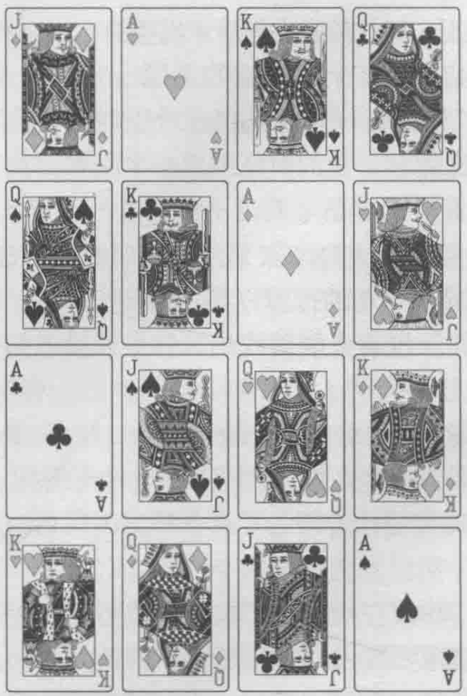](../../assets/volume4a/figures/fig-7-1-court-cards.png)

图 1　混杂排列的纸牌: 任何一条线上的四张牌都不一样 (这种布局是求解 18 世纪流行问题的诸多方法之一)

欧拉关于剩余情形 $n=10,n=14,\ldots$ 的猜测分三次得到 “证明”, 分别由朱利叶斯·佩特森 [*Annuaire des mathématiciens* (Paris: 1902), 413–427]、奥古斯特·韦尼克 [*Jahresbericht* *der Deutschen Math.-Vereinigung* **19** (1910), 264–267] 和哈里斯·麦克尼什 [*Annals of Math.* (2) **23** (1922), 221–227] 给出. 然而, 这三种论证中的错误是众所周知的. 即使计算机使用了多年之后, 这个问题仍旧没有获得解决. 因此, 真正要由计算机优先处理的组合问题之一是 $10\times10$ 希腊-拉丁方之谜: 它们是否存在?

1957 年, 洛厄尔·佩奇和查尔斯·汤普金斯编写了寻找欧拉猜测反例的 SWAC 计算机程序. 他们 “几乎随机” 地选择一个特定的 $10\times10$ 拉丁方, 该程序试图发现另外一个将与它正交的拉丁方. 但结果令人沮丧, 5 个小时后他们决定关闭计算机. 这个程序产生了足够的数据, 使他们能够做出下述预测: 完成程序运行至少需要 $4.8\times10^{11}$ 小时的计算机时间.

不久以后, 一家世界大报报道了三位数学家对拉丁方取得的重大进展: 拉杰·博斯、萨拉德钱德拉·施里克汉德和欧内斯特·帕克找到一个著名的构造序列, 对于大于 6 的所有 $n$, 它能产生 $n\times n$ 正交拉丁方 [*Proc. Nat. Acad. Sci.* **45** (1959), 734–737, 859–862; *Canadian J. Math.* **12** (1960), 189–203]. 这样, 欧拉的猜测在受到 180 年的非难后, 终于被证实几乎全错了.

他们的发现不是借助计算机完成的. 但是, 帕克供职于 UNIVAC, 并很快把程序设计技巧用于解决佩奇和汤普金斯的问题, 用一台 UNIVAC 1206 军用计算机在不到一小时内解决了求欧拉猜测反例的问题. [见 *Proc. Symp. Applied Math.* **10** (1960), 71–83; **15** (1963), 73–81.]

我们来仔细看看早期程序员们是怎样做的, 了解一下帕克如何戏剧性地超越他们的方法. 佩奇和汤普金斯从下面的 $10\times10$ 方阵 $L$ 及其未知的正交配偶方阵 $M$ 开始:

$$
L=\begin{pmatrix}
0&1&2&3&4&5&6&7&8&9\\
1&8&3&2&5&4&7&6&9&0\\
2&9&5&6&3&0&8&4&7&1\\
3&7&0&9&8&6&1&5&2&4\\
4&6&7&5&2&9&0&8&1&3\\
5&0&9&4&7&8&3&1&6&2\\
6&5&4&7&1&3&2&9&0&8\\
7&4&1&8&0&2&9&3&5&6\\
8&3&6&0&9&1&5&2&4&7\\
9&2&8&1&6&7&4&0&3&5
\end{pmatrix},\quad
M=\begin{pmatrix}
0&\sqcup&\sqcup&\sqcup&\sqcup&\sqcup&\sqcup&\sqcup&\sqcup&\sqcup\\
1&\sqcup&\sqcup&\sqcup&\sqcup&\sqcup&\sqcup&\sqcup&\sqcup&\sqcup\\
2&\sqcup&\sqcup&\sqcup&\sqcup&\sqcup&\sqcup&\sqcup&\sqcup&\sqcup\\
3&\sqcup&\sqcup&\sqcup&\sqcup&\sqcup&\sqcup&\sqcup&\sqcup&\sqcup\\
4&\sqcup&\sqcup&\sqcup&\sqcup&\sqcup&\sqcup&\sqcup&\sqcup&\sqcup\\
5&\sqcup&\sqcup&\sqcup&\sqcup&\sqcup&\sqcup&\sqcup&\sqcup&\sqcup\\
6&\sqcup&\sqcup&\sqcup&\sqcup&\sqcup&\sqcup&\sqcup&\sqcup&\sqcup\\
7&\sqcup&\sqcup&\sqcup&\sqcup&\sqcup&\sqcup&\sqcup&\sqcup&\sqcup\\
8&\sqcup&\sqcup&\sqcup&\sqcup&\sqcup&\sqcup&\sqcup&\sqcup&\sqcup\\
9&\sqcup&\sqcup&\sqcup&\sqcup&\sqcup&\sqcup&\sqcup&\sqcup&\sqcup
\end{pmatrix}.\tag{6}
$$

不失一般性, 可以假定 $M$ 的各行如上所示以 $0,1,\ldots,9$ 开始. 这个问题是填充其余 90 个空位, 原先的 SWAC 计算机程序从上到下从左到右进行处理. 左上方的 $\sqcup$ 不能用 $0$ 填入, 因为 $0$ 已经出现在 $M$ 的顶行. 那个位置也不能用 $1$ 填入, 因为数偶 $(1,1)$ 已经出现在 $(L,M)$ 中下一行的左边. 我们可以暂时填入一个 $2$. 数 $1$ 置于下一个位置. 很快, 我们找到能够适合 $M$ 的按照字典序的最小顶行, 即 $0214365897$. 类似地, 在 $0214365897$ 下面合适的最小行是 $1023456789$ 和 $2108537946$, 它们下面的最小合法行是 $3540619278$. 可惜, 现在难以为继了: 无法找出不与前面的选择冲突的另一行. 所以, 我们把 $3540619278$ 这一行改为 $3540629178$ (但也不合适), 再改为 $3540698172$, 如此进行若干步, 直至我们再度遇到困难之前, 最终能够把 $4397028651$ 作为 $3546109278$ 的下面一行.

在 7.2.2 节, 我们将研究在不实际执行查找的情况下估计这种查找行为的方法. 这个例子中的这种估计告诉我们, 佩奇-汤普金斯方法其实遍历了一棵大约包含 $2.5\times10^{18}$ 个结点的隐式查找树, 其中的大部分结点仅属于树的少量层. 在 90 个空位中的大约 50 个被填充后, 半数以上的结点会在 $M$ 的第 6 行的右半边进行选择. 为了检验合法性, 处理查找树的一个结点可能需要 75 次内存访问. 所以, 在一台现代计算机上运行的总时间, 大约是执行 $2\times10^{20}$ 次内存访问所需的时间.

另一方面, 帕克追溯到欧拉在 1779 年最初用于查找方阵正交配偶的方法. 首先, 他找出了 $L$ 所有的<em>横截</em>, 也就是一种选择其某些元素的所有方式, 使得恰好在每行有一个元素, 每列有一个元素, 每个值有一个元素. 例如用欧拉的记号, 一个横截是 $0859734216$, 表示我们在 $0$ 列选择 $0$, 在 $1$ 列选择 $8$, $\ldots$, 在 $9$ 列选择 $6$. 包含 $L$ 最左列中 $k$ 的每个横截, 表示一种把 10 个 $k$ 放进方阵 $M$ 的合法方式. 实际上, 求横截相对容易, 这个矩阵 $L$ 正好有 808 个横截, 对于 $k=(0,1,\ldots,9)$, 分别有 $(79,96,76,87,70,84,83,75,95,63)$ 个横截.

一旦知道横截, 余下的是 10 阶的恰当覆盖问题, 它比 (6) 中的 90 阶问题简单得多. 我们需要做的就是用 10 个不相交的横截覆盖方阵, 因为每一个这样的 10 个横截的集合等价于与 $L$ 正交的一个拉丁方 $M$.

事实上, (6) 中的拉丁方 $L$ 恰好有一个正交配偶:

$$
\begin{pmatrix}
0&1&2&3&4&5&6&7&8&9\\
1&8&3&2&5&4&7&6&9&0\\
2&9&5&6&3&0&8&4&7&1\\
3&7&0&9&8&6&1&5&2&4\\
4&6&7&5&2&9&0&8&1&3\\
5&0&9&4&7&8&3&1&6&2\\
6&5&4&7&1&3&2&9&0&8\\
7&4&1&8&0&2&9&3&5&6\\
8&3&6&0&9&1&5&2&4&7\\
9&2&8&1&6&7&4&0&3&5
\end{pmatrix}\quad\perp\quad
\begin{pmatrix}
0&2&8&5&9&4&7&3&6&1\\
1&7&4&9&3&6&5&0&2&8\\
2&5&6&4&8&7&0&1&9&3\\
3&6&9&0&4&5&8&2&1&7\\
4&8&1&7&5&3&6&9&0&2\\
5&1&7&8&0&2&9&4&3&6\\
6&9&0&2&7&1&3&8&4&5\\
7&3&5&1&2&0&4&6&8&9\\
8&0&2&3&6&9&1&7&5&4\\
9&4&3&6&1&8&2&5&7&0
\end{pmatrix}.\tag{7}
$$

给定 808 个横截, 舞蹈链算法在仅进行大约 $1.7\times10^8$ 次内存访问后求出这个配偶, 并且证明它的唯一性. 此外, 求横截阶段的开销约为 500 万次内存访问, 比较而言是微不足道的. 因此, 原先 $2\times10^{20}$ 次内存访问的运行时间——对于求解一个存在 $10^{90}$ 种方式填充空格的问题, 这个时间一度被认为是必不可少的开销——进一步减少了 $10^{12}$ 以上.

后面我们会看到, 对于求解 (6) 这样的 90 阶问题的方法已经取得若干进展. 实际上, (6) 可以直接表示成一个恰当覆盖问题 (见习题 17), 用 7.2.2.1 节的舞蹈链方法在仅花费 $1.3\times10^{11}$ 次内存访问后得以求解. 即便如此, 欧拉-帕克方法仍然比佩奇-汤普金斯方法快大约 1000 倍. 通过把问题 “分解” 为两个独立阶段, 一个阶段求横截而另一个阶段进行横截组合, 欧拉和帕克实际上使计算开销从积 $T_1T_2$ 降低到和 $T_1+T_2$.

这段陈述的寓意很清楚: 组合问题可能使我们面对一个充满巨大可能性的领域, 然而我们不应轻易放弃. 一个好主意能使计算量减少很多数量级.

<strong>谜题与现实世界. </strong> 在这一章我们要研究许多组合问题, 如兰福德的配对排列问题, 或者奥扎拉姆的 16 张纸牌问题, 这类问题来自游戏谜题或 “智力难题”. 某些读者可能反感于这种娱乐主题的问题, 认为这是在无意义地浪费时间. 计算机不该实实在在地做些有用的工作吗? 难道计算机教科书不该主要关注对各领域或世界进步有重要意义的应用吗?

这样说吧, 我, 你手拿的这本教科书的作者, 绝对无意反对有用的工作和人类的进步. 但我坚信这样的一本书应该强调问题求解的<em>方法</em>, 以及有助于解决许多不同问题的数学思想和<em>数学模型</em>, 而不是把注意力集中到方法和模型可能有用的原因上. 我们将要学习很多攻克组合问题的精彩并且强有力的方法, 而这些方法所具有的精炼、优雅将是我们研究它们的主要动机. 组合难题不断出现, 而且每天都在产生运用本章讨论的技术的新方法. 所以, 我们不要预设这些思想适合哪类问题而局限了我们的眼界.

例如, 正交拉丁方非常有用, 尤其是在试验设计中. 早在 1788 年, 弗朗索瓦·帕吕埃尔就已经使用 $4\times4$ 拉丁方研究对 16 只羊——每 4 只羊来自 4 个不同品种——用 4 种不同饲料喂养并在 4 个不同时间出栏的结果. [*Mémoires d’Agriculture* (Paris: Société Royale d’Agriculture, trimestre d’été, 1788), 17–23.] 借助拉丁方, 他能够用 16 只羊代替 64 只羊做这项研究. 使用希腊-拉丁方, 他还可以尝试改变其他参数, 比如用 4 种不同数量的饲料或者 4 种不同的放牧方式.

但是, 如果把讨论集中到他的家畜饲养上, 我们可能会陷入关于如何饲养的细节上, 如用块根植物饲养还是谷物饲养以及饲养成本, 等等. 因此, 不是农场主的读者可能会跳过这个主题, 尽管拉丁方设计适用于广泛的研究领域. (思考一下关于对病人试验 5 种药丸, 他们处于某种疾病的 5 个阶段, 属于 5 个不同年龄段, 具有 5 组不同体重.) 再者, 专注于试验设计可能导致读者看不到拉丁方对离散几何及纠错编码也有重要应用的事实 (见习题 18–24).

甚至连兰福德配对排列这种初看起来纯属娱乐的主题, 其结果也有重要的实用价值. 托拉尔夫·斯科伦利用兰福德序列构造了施泰纳三元系, 我们在 6.5 节已经把这种结构用于数据库查询 [见 *Math. Scandinavica* **6** (1958), 273–280]. 在 20 世纪 60 年代, 摩托罗拉公司的小爱德华·格罗思把兰福德配对排列应用到了乘法电路设计上. 此外, 寻找兰福德配对排列和拉丁方横截的一些有效算法, 如舞蹈链方法, 适用于通常的恰当覆盖问题. 这种恰当覆盖问题同一些重大问题有很大关联, 如把基层投票区公平地分配到选举区, 等等.

应用并不是最重要的事情, 谜题也不是. 我们的主要目标应当是在头脑中建立基本概念, 如拉丁方和恰当覆盖的概念. 这样一些概念将为我们解决以后出现的问题提供所需的构件、词汇和见解.

但是, 只讨论问题求解却不实际解决任何问题是愚蠢的. 我们需要有很好的问题来促进我们的创造活力, 以多少有条理的方式激发我们大脑皮层的灰质细胞, 并且形成熟悉的基本概念. 偏重智力的谜题经常是达到这个目标的理想工具, 因为它们可以用三言两语表达出来, 不需要复杂的背景知识.

剧作家和政治家瓦茨拉夫·哈韦尔曾经提到, 生活的复杂性是无边无际的: “需要认识的事物数不胜数……我们必须抛弃自负的信念, 别以为世界只是一道待解的谜题, 一台等候发现的指令机器, 一堆将馈入计算机的资料.” 他呼吁要不断增强正义感和责任感, 要有体验、勇气和同情心. 他的话中充满大智慧. 谢天谢地, 我们还有待解的谜题! 在美好的生活乐趣中, 谜题值得考虑, 像所有其他趣事一样, 谜题理应得到人们正当的喜爱.

当然, 兰福德和奥扎拉姆是对人而不是计算机提出他们的谜题的. 如果我们仅把这样的问题推给机器, 依靠计算机的强力而非理性思考来求解, 岂不是不得要领吗? 1963 年, 乔治·布鲁斯特在写给马丁·加德纳的一封信中表达了人们普遍持有的下述见解: “把一道娱乐谜题送进计算机, 与炸毁一条鳟鱼河道的灾难仅仅一步之遥. 屈从于即时娱乐.”

是的, 但是这种看法没有顾及另一要点: 简单的谜题往往具有超越人类能力的一般规律, 唤起我们的好奇心. 对于一般规律的研究, 经常能给出带有启示作用并能适用于其他许多问题的方法, 并获得惊人的结果. 其实, 我们将要研究的许多关键方法都脱胎于人们求解各种各样谜题的尝试. 我在写这一章时, 不时地体会到随着计算机的速度越来越快, 当今的谜题比以往任何时候都更加有趣, 因为我们在不断获得强大的游戏攻坚工具. [进一步的评述见我在 1976 年写的短文 “玩具问题有用处吗?”, 见 *Selected Papers on Computer Science* (1996), 169–183.]

谜题存在过于精巧的危险. 理想谜题倾向于在数学上是简洁的, 在结构上是完备的, 但是, 我们仍然需要学习如何有条理地处理每天包围着我们的零乱、混沌、不可分割的材料. 其实, 某些计算方面的技巧之所以显得重要, 主要是因为它们提供了处理这类复杂性的强有力的方法. 举例来说, 这就是为什么在第 5 章开头提出了图书馆卡片排序的神秘规则, 在 2.2.5 节为解释模拟技术详细讨论了一种实际的电梯系统.

一个称为斯坦福图库 (Stanford GraphBase, SGB) 的程序与数据集合已经筹备完成, 使使用组合算法的试验能够很快地在各式各样的实际例子上执行. 例如, SGB 包括美国公路网的数据、美国经济的投入产出模型; 记录了荷马史诗《伊利亚特》、托尔斯泰的《安娜·卡列尼娜》等若干文学作品塑造的人物; 概括了彼得·罗杰《词典》1879 年版的条目; 记载了几百场大学橄榄球赛事; 详尽载明了列奥纳多·达·芬奇画作《焦孔达夫人》(《蒙娜丽莎》, Mona Lisa) 的像素灰度值. 或许最重要的是, SGB 包含一个五字母单词的汇集, 我们将在下面讨论.

<strong>英文的五字母单词. </strong> 这一章的许多例子都基于以下五字母词表:

$$
\mathtt{aargh,\ abaca,\ abaci,\ aback,\ abaft,\ abase,\ abash,\ \ldots,\ zooms,\ zowie}.\tag{8}
$$

(共有 5757 个单词——太多了, 无法全部显示在这里, 但是可以很容易想到那些未列出的单词.) 这是一张个人列表, 在 1972 年到 1992 年间汇集而成. 我意识到这样的单词将成为检验很多类组合算法的 $\mathtt{ideal}$ (理想)[^p7-1] 数据, 从而开始这项工作.

这张表特意限制在我实际使用过的那些单词, 它们是英语语言中的 $\mathtt{truly}$ (真实) 词汇. 在未删节的字典中, 包含数以千计难以理解的词条, 如 $\mathtt{aalii,abamp,\ldots,zymin,zyxst}$, 这样的单词对玩拼字游戏 Scrabble® 的人特别有用. 但是, 对于不知道它们的人而言, 陌生的单词往往会 $\mathtt{spoil}$ (败坏) 他们的兴致. 所以, 我用了 20 年, 分门别类地记录所有这样的 $\mathtt{words}$ (单词), 看来它们对于阐释《计算机程序设计艺术》的 $\mathtt{goals}$ (目标) 是 $\mathtt{right}$ (恰当) 的.

最后, 为了有个可重复试验的 $\mathtt{fixed}$ (固定)$\mathtt{point}$ (点), 必须冻结单词集合. 英语这门语言总是在演变, 但 5757 个 SGB 单词将始终保持不变——虽然我多次受到诱惑, 试图添加少量在 1992 年还不知道的单词, 如 $\mathtt{chads,stent,blogs,ditzy,phish,bling}$, 可能还有 $\mathtt{tetch}$. 不, 不行, $\mathtt{noway}$ (此路不通). 对 SGB 做出任何改变的时机早已 $\mathtt{ended}$ (终止): $\mathtt{finis}$ (结束了).

> 下述词汇表旨在包含所有众所周知的英文单词…… 
> ……这些单词可在社会中普遍使用, 也可用作 “链环”…… 
> ……接纳那些生僻词必须有所约束.  
> ——刘易斯·卡罗尔,*Doublets: A Word-Puzzle* (1879)

> 如果有个动词是指激怒, 那么利利韦特先生就被激怒了.  
> ——罗伯特·巴纳德,*Corpse in a Gilded Cage* (1984)

不能把我的姓氏 Knuth 这样的专有名称看成是合法单词. 但是 $\mathtt{gauss}$ (高斯) 和 $\mathtt{hardy}$ (哈代) 例外, 它们是 $\mathtt{valid}$ (有效的), 因为 “gauss” 是磁感应强度单位, 而 “hardy” 是形容词 (强壮的). 实际上, SGB 词汇全部由小写字母组成, 这个单词表不包括带连字符的单词、缩约词, 或者像 $\mathtt{blas\acute e}$ 这种带变音符号的单词. 因此, 也可以把每个单词当作一个向量, 它具有属于值域 $[0\mathinner{.\,.}26)$ 的 5 个分量. 在这种向量意义下, $\mathtt{yucca}$ 和 $\mathtt{abuzz}$ 是相隔最远的两个单词: 它们的欧几里得距离是

$$
\lVert(24,20,2,2,0)-(0,1,20,25,25)\rVert_2=\sqrt{24^2+19^2+18^2+23^2+25^2}=\sqrt{2415}.
$$

整个斯坦福图库, 包括它的全部程序和数据集, 可以直接从我的网站 <https://www-cs-faculty.stanford.edu/~knuth/sgb.html> 下载. SGB 的全部单词表更容易获取, 它保存在同一地点的 `sgb-words.txt` 文件中. 该文件有 5757 行, 每行一个单词, 从 $\mathtt{which}$ 开始, 以 $\mathtt{pupal}$ 结束, 单词按其使用频度排序. 例如, 排列在 1000、2000、3000、4000、5000 位的单词分别是 $\mathtt{ditch,galls,visas,faker,pismo}$. 本章将用记号 $\operatorname{WORDS}(n)$ 代表与这一顺序对应的 $n$ 个最常见单词.

顺便说一下, 五字母单词包括很多四字母单词的复数形式, 也没有做过维多利亚式的考究审查. 可能的唐突词汇已从 *The Official Scrabble® Players Dictionary* 中删除, 但没有从 SGB 中删除. 为了保证在以 SGB 词汇表为基础的专业论文中不出现语义上不恰当的术语, 一种方法是仅限制 $\operatorname{WORDS}(n)$, 比如说 $n=3000$.

习题 26–37 可以用作初步利用 SGB 词汇的预备练习, 其中可以见到这一整章中的许多不同组合状态. 例如, 在关注覆盖问题时, 我们注意到 $\mathtt{third\ flock\ began\ jumps}$ 这四个单词包含字母表前 21 个字母中的 20 个字母. 例如在 $\{\mathtt{becks,fjord,glitz,nymph,squaw}\}$ 中, 五个单词最多可以包含 24 个不同的字母——除非我们利用一个罕见的非 SGB 单词, 如 $\mathtt{waqfs}$ (伊斯兰宗教捐赠), 它同 $\{\mathtt{gyved,bronx,chimp,klutz}\}$ 组合可以包含 25 个字母.

仅用取自 $\operatorname{WORDS}(400)$ 的单词就足以构成一个词方 (word square):

$$
\begin{array}{l}
\mathtt{class}\\
\mathtt{light}\\
\mathtt{agree}\\
\mathtt{sheep}\\
\mathtt{steps}
\end{array}.\tag{9}
$$

而为了得到一个词立方 (word cube)

$$
\begin{array}{lllll}
\mathtt{types}&\mathtt{yeast}&\mathtt{pasta}&\mathtt{ester}&\mathtt{start}\\
\mathtt{yeast}&\mathtt{earth}&\mathtt{armor}&\mathtt{stove}&\mathtt{three}\\
\mathtt{pasta}&\mathtt{armor}&\mathtt{smoke}&\mathtt{token}&\mathtt{arena}\\
\mathtt{ester}&\mathtt{stove}&\mathtt{token}&\mathtt{event}&\mathtt{rents}\\
\mathtt{start}&\mathtt{three}&\mathtt{arena}&\mathtt{rents}&\mathtt{tease}
\end{array},\tag{10}
$$

我们几乎要用到 $\operatorname{WORDS}(3000)$, 其中每个 $5\times5$“词片” 是一个词方. 运用基本舞蹈链算法 (见 7.2.2.1 节) 的一种简单扩充, 在大约 3900 亿次内存访问的计算后, 我们可以证明, $\operatorname{WORDS}(3000)$ 仅仅支持 3 个像 (10) 那样的对称词立方, 习题 36 展示了另外两个词立方. 出人意料的是, 从单词全集 $\operatorname{WORDS}(5757)$ 中可以构成 83576 个对称词立方.

<strong>由单词构成的图. </strong> 把一些对象排列成行、正方形、立方体以及其他图案是有趣的、重要的. 但在实际应用中, 另一种组合结构甚至更加有趣、更为重要, 那就是<em>图</em>(graph). 回忆一下 2.3.4.1 节, 图是一个称为顶点的点集合加上一个称为边的线段集合, 其中的边连接某些顶点对. 图无处不在, 而且我们已经发现了很多优美的图算法, 所以图自然成为本章多个小节的主要焦点. 事实上, 斯坦福图库正如其名称所暗示的那样, 主要涉及图. 而且, 收集 SGB 单词的主因是它们可以用于定义有趣和有益的图.

刘易斯·卡罗尔在 1877 年底发明了一种游戏从而开创了新路, 他称那个游戏为 “单词链” 或 “双同源词”. [见马丁·加德纳,*The Universe in a Handkerchief* (1996), 第 6 章.] 卡罗尔的这一方法很快流行起来, 其思想是通过一次改变一个字母, 把一个单词转变成另一个单词:

$$
\mathtt{tears}\mathrel{\text{—}}\mathtt{sears}\mathrel{\text{—}}\mathtt{stars}\mathrel{\text{—}}\mathtt{stare}\mathrel{\text{—}}\mathtt{stale}\mathrel{\text{—}}\mathtt{stile}\mathrel{\text{—}}\mathtt{smile}.\tag{11}
$$

最短的这种变换是一个图中的最短路径, 其中图的顶点是英文单词, 而边连接具有 “汉明距离 1” 的单词对 (意味着它们只有一处不同).

当限制在 SGB 单词时, 卡罗尔规则就产生了斯坦福图库的一个图, 其正式名称是 `words(5757,0,0,0)`. 由 SGB 定义的每个图都有唯一的标识符, 称为它的 `id`, 而按照卡罗尔方式从 SGB 导出的图用 $\mathit{words}(n,l,t,s)$ 标识. 在这个标识中, $n$ 是顶点数量; $l$ 或者是 $0$, 或者是一个权值表, 用以强调词汇的不同类型; $t$ 是表示不允许低权值单词的阈值; $s$ 是在等权值单词之间打破平局时可能需要的任何伪随机数的初值. 我们无须关注全部细节, 少数几个例子将给出一般概念:

- 对于 $1\le n\le5757$, $\mathit{words}(n,0,0,0)$ 是把卡罗尔的思想应用到 $\operatorname{WORDS}(n)$ 时产生的图.
- `words(1000,{0,0,0,0,0,0,0,0,0},0,s)` 包含 1000 个随机选择的 SGB 单词, 通常情况下, 对于不同的 $s$, 它们是不同的.
- `words(766,{0,0,0,0,0,0,0,1,0},1,0)` 包含出现在我关于 $\mathrm{T\!E\!X}$ 和 METAFONT 的书中的所有五字母单词.

在最后这个图中仅有 766 个单词, 所以我们无法构成非常多的像 (11) 那样的长路径, 尽管

$$
\mathtt{basic}\mathrel{\text{—}}\mathtt{basis}\mathrel{\text{—}}\mathtt{bases}\mathrel{\text{—}}\mathtt{based}\mathrel{\text{—}}\mathtt{baked}\mathrel{\text{—}}\mathtt{naked}\mathrel{\text{—}}\mathtt{named}\mathrel{\text{—}}\mathtt{names}\mathrel{\text{—}}\mathtt{games}\tag{12}
$$

是一个值得注意的例子.

当然, 当顶点代表五字母单词时, 存在多种方式定义图的边. 例如, 我们可以要求欧几里得距离 (而非汉明距离) 是较小的. 或者, 我们可以声明两个单词是邻接的, 只要它们拥有相同的长度为四的子单词. 这种策略将使图大为充实, 即便把顶点单词限制在与 $\mathrm{T\!E\!X}$ 有关的 766 个单词中, 同样可以从 $\mathtt{chaos}$ 产生 $\mathtt{peace}$:

$$
\mathtt{chaos}\mathrel{\text{—}}\mathtt{chose}\mathrel{\text{—}}\mathtt{chore}\mathrel{\text{—}}\mathtt{score}\mathrel{\text{—}}\mathtt{store}\mathrel{\text{—}}\mathtt{stare}\mathrel{\text{—}}\mathtt{spare}\mathrel{\text{—}}\mathtt{space}\mathrel{\text{—}}\mathtt{peace}.\tag{13}
$$

(在这个规则中, 我们删除一个字母, 然后插入另一个字母, 可能在不同的位置.) 或者, 我们可以选择一种完全不同的策略, 例如, 在单词矢量 $a_1a_2a_3a_4a_5$ 与 $b_1b_2b_3b_4b_5$ 之间设置一条边, 当且仅当它们的点积 $a_1b_1+a_2b_2+a_3b_3+a_4b_4+a_5b_5$ 是某个参数 $m$ 的倍数. 图算法在不同数据类型的基础上兴盛起来.

当多重集 $\{a_2,a_3,a_4,a_5\}\subseteq\{b_1,b_2,b_3,b_4,b_5\}$ 时, 记为 $a_1a_2a_3a_4a_5\to b_1b_2b_3b_4b_5$, 那么, SGB 词汇表还可以产生一个有趣的有向图族. (删除第一个字母, 插入另一个字母, 再重新排列.) 例如, 使用这条规则, 经由一条长度为六的最短定向路径可以把 $\mathtt{words}$ 变成 $\mathtt{graph}$:

$$
\mathtt{words}\to\mathtt{dross}\to\mathtt{soars}\to\mathtt{orcas}\to\mathtt{crash}\to\mathtt{sharp}\to\mathtt{graph}.\tag{14}
$$

> 理论是实际泰勒级数中的首项.  
> ——托马斯·科弗 (1992)

> 粗略估计, 图论中当前使用的术语体系的数量等于图论学家的人数.  
> ——理查德·斯坦利 (1986)

<strong>图论: 基本概念. </strong> 图 $G$ 由顶点集合 $V$ 和边集合 $E$ 组成, 其中边是不同顶点的配对. 我们假定 $V$ 和 $E$ 都是有限集, 除非另作说明. 如果 $u$ 和 $v$ 是满足 $\{u,v\}\in E$ 的顶点, 记为 $u\mathrel{\text{—}}v$; 如果 $u$ 和 $v$ 是满足 $\{u,v\}\notin E$ 的顶点, 记为 $u\mathrel{\not{\text{—}}}v$. 满足 $u\mathrel{\text{—}}v$ 的顶点称为 “邻近” 顶点, 也可以说它们在 $G$ 中是 “邻接” 的. 这个定义的一个推论是: 我们有 $u\mathrel{\text{—}}v$, 当且仅当 $v\mathrel{\text{—}}u$. 另一个推论是, 对于所有 $v\in V$ 有 $v\mathrel{\not{\text{—}}}v$; 就是说, 没有任何顶点是同它自身邻接的. (但是, 在我们下面将要讨论的多重图中, 从一个顶点到它自身的环是允许的.)

如果 $V'\subseteq V$, $E'\subseteq E$, 则说图 $G'=(V',E')$ 是 $G=(V,E)$ 的子图. 如果有 $V'=V$, 则说 $G'$ 是 $G$ 的生成子图. 假定 $V'$ 是 $V$ 的给定子集, 如果 $E'$ 含有尽可能多的边, 则说 $G'$ 是 $G$ 的诱导子图. 换句话说, 当 $V'\subseteq V$ 时, 由 $V'$ 诱导的 $G=(V,E)$ 的子图是 $G'=(V',E')$, 其中

$$
E'=\{\{u,v\}\mid u\in V',\ v\in V',\ \{u,v\}\in E\}.\tag{15}
$$

这个子图 $G'$ 用 $G\mid V'$ 表示, 通常称作 “$G$ 局限于 $V'$”. 在 $V'=V\setminus\{v\}$ 的常见情形, 对于 $G\mid(V\setminus\{v\})$, 我们简记为 $G\setminus v$(“$G$ 减去顶点 $v$”). 当 $e\in E$ 时, 用同样的记号 $G\setminus e$ 表示通过删除一条边而非一个顶点得到的子图 $G'=(V,E\setminus\{e\})$. 请注意, 前面描述的称为 $\mathit{words}(n,l,t,s)$ 的所有 SGB 图是主图 `words(5757,0,0,0)` 的诱导子图; 在那些图中, 仅仅改变词汇表而不改变邻接规则.

一个包含 $n$ 个顶点和 $e$ 条边的图, 我们说它有 $n$ 阶和 $e$ 大小. 最简单和最重要的 $n$ 阶图是完全图 $K_n$、路径 $P_n$ 和圈 $C_n$. 假定顶点集为 $V=\{1,2,\ldots,n\}$, 那么

- 对于 $1\le u<v\le n$, $K_n$ 有 $\binom n2=\frac12n(n-1)$ 条边 $u\mathrel{\text{—}}v$; 每个 $n$ 顶点图是 $K_n$ 的生成子图.
- 当 $n\ge1$ 时, 对于 $1\le v<n$, $P_n$ 有 $n-1$ 条边 $v\mathrel{\text{—}}(v+1)$; 它是一条长度为 $n-1$ 的从 $1$ 到 $n$ 的路径.
- 当 $n\ge1$ 时, 对于 $1\le v\le n$, $C_n$ 有 $n$ 条边 $v\mathrel{\text{—}}((v\bmod n)+1)$; 仅当 $n\ge3$ 时它是一个图 (但是 $C_1$ 和 $C_2$ 是多重图).

实际上, 我们可以在顶点 $\{0,1,\ldots,n-1\}$ 上或者任何 $n$ 元素集合 $V$ 上 (代替在 $\{1,2,\ldots,n\}$ 上) 定义 $K_n$、$P_n$ 和 $C_n$, 因为如果两个图的差别仅在于它们的顶点名称而不是边的结构, 那么它们在组合上是等价的.

从形式上我们可以说, 图 $G=(V,E)$ 和 $G'=(V',E')$ 是同构的, 如果存在从 $V$ 到 $V'$ 的一一对应 $\varphi$, 使得 $u\mathrel{\text{—}}v$ 在 $G$ 中当且仅当 $\varphi(u)\mathrel{\text{—}}\varphi(v)$ 在 $G'$ 中. 记号 $G\cong G'$ 通常用于表示 $G$ 与 $G'$ 同构. 不过, 我们不会那么拘泥, 往往把同构的图看成是相等的, 有时也写成 $G=G'$, 即使 $G$ 和 $G'$ 的顶点集不严格等同.

简单地画出示意图就可以定义小型图, 示意图中的小圆圈是顶点, 连接它们的线段是边. 图 2 给出图的几个重要例子, 它们的性质随后讨论. 图 2(e) 中的佩特森图以一位早期图论学家佩特森的名字命名, 他曾用这个图否定了一个看似合理的猜测 [*L’Intermédiaire des Mathématiciens* **5** (1898), 225–227]. 事实上, 这是一个重要的结构, 通常作为许多关于图的乐观预言可能为真的反例. 图 2(f) 中的赫瓦塔尔图是瓦茨拉夫·赫瓦塔尔提出的 [*J. Combinatorial Theory* **9** (1970), 93–94.]

[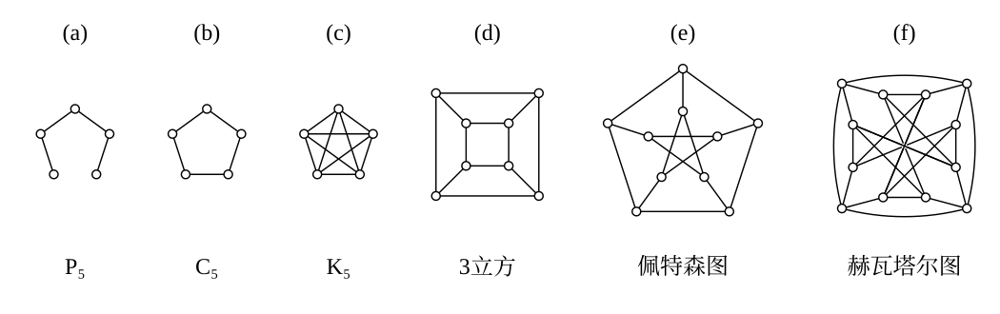](../../assets/volume4a/figures/fig-7-2-six-graphs.svg)

图 2　6 个图, 它们分别有 $(5,5,5,8,10,12)$ 个顶点和 $(4,5,10,12,15,24)$ 条边

在图的示意图中, 允许线段在非顶点处彼此相交. 例如在图 2(f) 中, 中心点不是赫瓦塔尔图的顶点. 如果存在一种使图没有任何边线段交叉的画法, 则称这个图是平面的. 显而易见, $P_n$ 和 $C_n$ 总是平面的. 图 2(d) 说明, 3 立方也是平面的. 但是, $K_5$ 由于边过多而不是平面的 (见习题 46).

图顶点的度是指包含的邻近顶点的数量. 如果一个图的所有顶点具有相同的度, 则称这个图是正则的. 例如, 图 2 中的 $P_5$ 是非正则图, 因为它有两个 1 度顶点和三个 2 度顶点. 但是, 其他五个图分别是 $(2,4,3,3,4)$ 度的正则图. 3 度正则图通常称为是 “立方” 的或 “3 价” 的.

绘制一个图有多种方法, 其中某些方法在表示上更为清晰. 例如, 下面六个示意图

[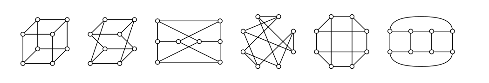](../../assets/volume4a/figures/diagram-7-16-six-cubes.svg)

(16)

的每一个与图 2(d) 的 3 立方都是同构的. 图 2(f) 中赫瓦塔尔图的形式是约翰·邦迪在赫瓦塔尔的文章发表多年之后发现的, 由此揭示了意外的对称性.

图的对称图形, 也称为它的自同构, 是图的顶点保持邻接性的置换. 换句话说, 如果每当 $u\mathrel{\text{—}}v$ 在 $G$ 中时有 $\varphi(u)\mathrel{\text{—}}\varphi(v)$, 则置换 $\varphi$ 是 $G$ 的一个自同构. 采用如图 2(f) 所示的恰当画法, 可以揭示图的基本对称图形. 但是, 一个单独的图形并不总能显示存在的全部对称图形. 例如, 3 立方有 48 个自同构, 佩特森图有 120 个自同构. 我们将在 7.2.3 节研究处理同构与自同构的算法. 当对有 $k$ 个自同构的图执行算法时, 我们经常能够利用对称图形避免不必要的计算, 使算法执行几乎快 $k$ 倍.

客观世界中形成的图, 多半与图 2 的几种数学上简洁的图有很大差别. 例如下面这个熟悉的图, 尽管它具备平面图的优点, 却没有任何对称性可言:

[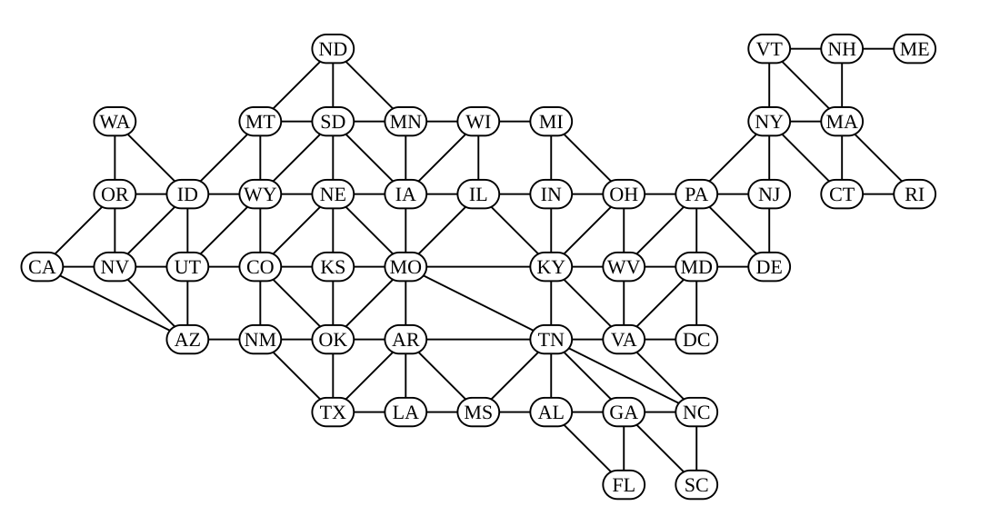](../../assets/volume4a/figures/diagram-7-17-us-states.svg)

(17)

它表示的是美国本土各州 (含 DC), 在后面的若干例子中我们将会用到它. 为方便起见, 这个示意图的 49 个顶点没有用空心圆圈, 而是用两字母邮政编码作了标记.

<strong>路径与圈. </strong> 一个图的生成路径 $P_n$ 被称为哈密顿路径, 生成圈 $C_n$ 被称为哈密顿圈, 因为威廉·哈密顿在 1856 年创建了一个谜题, 其目标是在十二面体的边上寻找这样的路径和圈. 托马斯·柯克曼在 *Philosophical Transactions* **146** (1856), 413–418; **148** (1858), 145–161 中对多面体的一般问题进行了独立研究. [见诺曼·比格斯、爱德华·劳埃德和罗宾·威尔逊,*Graph Theory 1736–1936* (1998), 第 2 章.] 然而, 寻找生成路径或生成圈是非常古老的任务——实际上, 我们可以合乎逻辑地认定它是图论中最古老的问题, 因为国际象棋棋盘上马的路径和游程有一段可以追溯到九世纪印度的历史 (见 7.2.2.4 节). 如果一个图有一个哈密顿圈, 则称为哈密顿图. (顺便指出, 佩特森图是最小的 3 正则图, 它既不是平面图, 也不是哈密顿图. 见卡米耶·波利尼亚克,*Bull. Soc. Math. de France* **27** (1899), 142–145.)

图的围长是它的最短圈的长度. 如果图是无圈的, 它的围长定义为无穷大. 例如, 图 2 中六个图的围长分别是 $(\infty,5,3,4,5,4)$. 不难证明, 一个最小度为 $k$、围长为 5 的图至少有 $k^2+1$ 个顶点. 事实上, 进一步分析表明, 仅当 $k=2$($C_5$ 圈)、$k=3$ (佩特森图)、$k=7$ 时, 或许加上 $k=57$, 这个最小值是可以达到的. (见习题 63 和 65.)

图中两个顶点 $u$ 和 $v$ 之间的距离 $d(u,v)$ 是从 $u$ 到 $v$ 的最短路径长度. 如果不存在这样的路径, 那么距离为无穷大. 显然, $d(v,v)=0$, $d(u,v)=d(v,u)$. 我们还有三角不等式

$$
d(u,v)+d(v,w)\ge d(u,w).\tag{18}
$$

因为如果 $d(u,v)=p$, $d(v,w)=q$ 且 $p<\infty$, $q<\infty$, 那么存在路径

$$
u=u_0\mathrel{\text{—}}u_1\mathrel{\text{—}}\cdots\mathrel{\text{—}}u_p=v\quad\text{和}\quad v=v_0\mathrel{\text{—}}v_1\mathrel{\text{—}}\cdots\mathrel{\text{—}}v_q=w,\tag{19}
$$

而我们可以对于某个 $s$ 求出使 $u_r=v_s$ 的最小下标 $r$. 于是

$$
u_0\mathrel{\text{—}}u_1\mathrel{\text{—}}\cdots\mathrel{\text{—}}u_{r-1}\mathrel{\text{—}}v_s\mathrel{\text{—}}v_{s+1}\mathrel{\text{—}}\cdots\mathrel{\text{—}}v_q\tag{20}
$$

是一条从 $u$ 到 $w$ 且长度 $\le p+q$ 的路径.

图的直径是遍及其全部顶点 $u$ 和 $v$ 的距离 $d(u,v)$ 的最大值. 如果图的直径是有限的, 那么图是连通的. 图的顶点总是可以划分成连通的分图, 两个顶点 $u$ 和 $v$ 属于同一个分图当且仅当 $d(u,v)<\infty$.

例如, 在图 `words(5757,0,0,0)` 中, 我们有 $d(\mathtt{tears},\mathtt{smile})=6$, 因为 (11) 是一条从 $\mathtt{tears}$ 到 $\mathtt{smile}$ 的最短路径. 此外, $d(\mathtt{tears},\mathtt{happy})=6$, $d(\mathtt{smile},\mathtt{happy})=10$, $d(\mathtt{world},\mathtt{court})=6$. 但是, $d(\mathtt{world},\mathtt{happy})=\infty$, 因此该图不是连通的. 事实上, 它包含 671 个像 $\mathtt{aloof}$ 的单词, 这类单词没有邻近, 独自构成所有的 1 阶连通分图. 像 $\mathtt{alpha}\mathrel{\text{—}}\mathtt{aloha}$、$\mathtt{droid}\mathrel{\text{—}}\mathtt{druid}$ 和 $\mathtt{opium}\mathrel{\text{—}}\mathtt{odium}$ 这样的单词对, 构成 103 个 2 阶分图. 某些 3 阶分图是路径, 如 $\mathtt{chain}\mathrel{\text{—}}\mathtt{chair}\mathrel{\text{—}}\mathtt{choir}$; 另一些 3 阶分图是圈, 如 $\{\mathtt{getup,letup,setup}\}$. 还有几个小的分图, 如奇特的路径

$$
\mathtt{login}\mathrel{\text{—}}\mathtt{logic}\mathrel{\text{—}}\mathtt{yogic}\mathrel{\text{—}}\mathtt{yogis}\mathrel{\text{—}}\mathtt{yogas}\mathrel{\text{—}}\mathtt{togas},\tag{21}
$$

它的单词没有别的邻近. 但是, 绝大部分五字母单词属于一个 4493 阶的巨大分图. 如果你能够从一个给定单词走出两步, 改变两个不同的字母, 那么, 你的单词能够连接到这个巨大分图的每个顶点的可能性大于 $\frac1{15}$.

同样, 当 $n=(5000,4000,3000,2000,1000)$ 时, 图 $\mathit{words}(n,0,0,0)$ 分别具有阶数为 $(3825,2986,2056,1186,224)$ 的巨大分图. 但是, 如果 $n$ 是一个小的数, 那么图中就没有足够多的边提供大量的连通性. 例如, `words(500,0,0,0)` 具有 327 个不同的分图, 其中没有 15 阶或更高阶的分图.

对于任意 $k$ 值, 可以把距离的概念推广到 $d(v_1,v_2,\ldots,v_k)$, 表示包含顶点 $\{v_1,v_2,\ldots,v_k\}$ 的连通子图中边数的最小值. 例如, $d(\mathtt{blood},\mathtt{sweat},\mathtt{tears})$ 结果为 $15$, 因为子图

[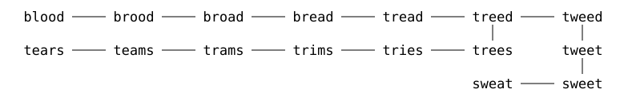](../../assets/volume4a/figures/diagram-7-22-word-steiner.svg)

(22)

有 $15$ 条边, 并且没有合适的 $14$ 条边子图.

我们曾在 2.3.4.1 节指出, 一个边数最少的连通图是一棵自由树. 对应于广义距离 $d(v_1,\ldots,v_k)$ 的子图始终是自由树. 称它为斯坦纳树会使人误解, 因为雅各布·斯坦纳只不过是在欧几里得平面内对于顶点 $\{v_1,v_2,v_3\}$ 这种 $k=3$ 的情形提到过它 [*Crelle* **13** (1835), 362–363]. 然而, 约瑟夫·热尔戈纳已经提出并解决了平面内任意 $k$ 点的这一问题 [*Annales de mathématiques pures et appliquées* **1** (1811), 292, 375–384 and planche 6].

**着色.** 说一个图是 $k$ 部的或 $k$ 可着色的, 是指能够把它的顶点划分成 $k$ (或更少) 部分, 使得每条边的两个端点属于不同的部分; 或者等价地, 有一种方法把它的顶点涂成最多 $k$ 种不同颜色, 使得两个邻接顶点不会涂上同样颜色. 著名的四色定理说明, 每个平面图是 $4$ 可着色的. 这个定理原来是弗朗西斯·格思里在 1852 年的猜测, 最后由肯尼思·阿佩尔、沃夫冈·哈肯和约翰·科克 [*Illinois J. Math.* **21** (1977), 429–567] 借助于大型计算机作出证明. 没有已知的简单证明, 但是像 $(17)$ 那样的特例一看就是可着色的 (见习题 45). 通常用 $O(n^2)$ 步足以对平面图着四色 [乔治·罗伯孙、丹尼尔·桑德斯、保罗·西摩和罗宾·托马斯,*STOC* **28** (1996), 571–575].

$2$ 可着色图的情况在实践中特别重要. 一个 $2$ 部的图通常称为二部图, 或简称 “偶图”, 它的每条边在每部分有一个端点.

**定理 B.** 一个图是二部图当且仅当它不包含长度为奇数的圈.

**证明.** [见德奈什·柯尼希,*Math. Annalen* **77** (1916), 453–454.] 一个 $k$ 部图的每个子图都是 $k$ 部图. 所以, 仅当圈 $C_n$ 本身是偶图时, $C_n$ 才可能是二部图的子图, 这种情况下 $n$ 必须是偶数.

反过来, 如果一个图不包含长度为奇数的圈, 我们通过执行下述过程可以用两种颜色 $\{0,1\}$ 对它的顶点着色: 从所有未着色的顶点开始. 如果已着色顶点的所有邻近顶点已经着色, 选择一个未着色顶点 $w$, 把它着色成 $0$. 否则, 选择这样一个已经着色的顶点 $u$, 它有一个未着色的邻近顶点 $v$, 对 $v$ 着相反的颜色. 习题 48 证明最终获得一个正确的 $2$ 着色图. $\quad\blacksquare$

完全二部图 $K_{m,n}$ 是最大的二部图, 它分为两部分, 分别有 $m$ 和 $n$ 个顶点. 通过指明当 $1\leq u\leq m<v\leq m+n$ 时就有 $u\mathrel{\text{—}}v$, 我们可以在顶点集 $\{1,2,\ldots,m+n\}$ 上定义完全二部图. 换句话说, $K_{m,n}$ 具有 $mn$ 条边, 对于在第一部分选择一个顶点以及在第二部分选择另一个顶点的每一种方式各有一条边. 同样, 完全 $k$ 部图 $K_{n_1,\ldots,n_k}$ 具有 $N=n_1+\cdots+n_k$ 个顶点, 它们被划分成大小为 $\{n_1,\ldots,n_k\}$ 的部分, 而且它在不属于同一部分的任何两个顶点之间存在边. 下面是 $N=6$ 时的几个例子:

[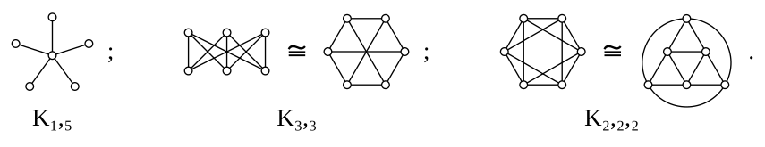](../../assets/volume4a/figures/diagram-7-23-complete-multipartite.svg)

(23)

注意, $K_{1,n}$ 是一棵自由树, 通俗地称为 $n+1$ 阶的星形图.

> 从现在起, 我们不用 “directed graph” 了, 而用 “digraph” 指代有向图.
> 这个词简单明了, 而且将会变成流行术语.
>
> ——乔治·波利亚, 致弗兰克·哈拉里的信 (约 1954)

**有向图.** 在 2.3.4.2 节中, 我们定义了有向图 (directed graph 或 digraph), 它们同一般的图 (graph) 非常相像, 只不过用弧替代了边. 一条弧 $u\longrightarrow v$ 从一个顶点延伸到另一个顶点, 而一条边 $u\mathrel{\text{—}}v$ 不加区别地连接两个顶点. 此外, 有向图允许从一个顶点到它自身的自环 $v\longrightarrow v$, 而且, 在同样的顶点对 $u$ 和 $v$ 之间出现的弧 $u\longrightarrow v$ 可以超过一条.

在形式上, 大小为 $m$ 的 $n$ 阶有向图 $D=(V,A)$ 是 $n$ 顶点集合 $V$ 加上 $m$ 个序偶 $(u,v)$ 组成的多重集 $A$, 其中 $u\in V$ 且 $v\in V$. 序偶 $(u,v)$ 称为弧, 当 $(u,v)\in A$ 时我们记为 $u\longrightarrow v$. 如果 $A$ 实际上是一个普通集合而不是多重集, 也就是说, 如果对于所有 $u$ 和 $v$ 最多有一条弧 $u\longrightarrow v$, 则有向图称为简单有向图. 每条弧 $u\longrightarrow v$ 有一个起始顶点 $u$ 和一个终结顶点 $v$ (终结顶点也称为弧的 “末端”). 每个顶点 $v$ 有一个出度 $d^+(v)$, 它是以 $v$ 为起始顶点的弧的数量; 还有一个入度 $d^-(v)$, 它是以 $v$ 为终结顶点的弧的数量. 入度为 $0$ 的顶点称为 “源点”; 出度为 $0$ 的顶点称为 “汇点”. 注意, 我们有 $\sum_{v\in V}d^+(v)=\sum_{v\in V}d^-(v)$, 因为这两个和都等于弧的总数 $m$.

已经对于图定义的大多数概念都可以自然地转移到有向图上, 只须区分边与弧, 在定义中插入单词 “有向”(directed) 或者 “定向”(oriented)[在英文术语中, 也可能是插入表示 “方向” 的音节 “di”]. 例如, 有向图有子有向图, 它们可能是生成的或者诱导的, 也可能是既非生成的也非诱导的. 有向图 $D=(V,A)$ 和 $D'=(V',A')$ 之间的一个同构是从 $V$ 到 $V'$ 的一一对应 $\varphi$, 就它而言, 对于所有 $u,v\in V$, $D$ 中弧 $u\longrightarrow v$ 的数量等于 $D'$ 中弧 $\varphi(u)\longrightarrow\varphi(v)$ 的数量.

有向图的示意图在顶点之间使用箭头而不是不加装饰的线段. 最简单和最重要的 $n$ 阶有向图是图 $K_n$、$P_n$ 和 $C_n$ 的有向变形, 也就是可迁竞赛图 $K_n^{\rightarrow}$、定向路径 $P_n^{\rightarrow}$ 和定向圈 $C_n^{\rightarrow}$. 在 $n=5$ 的情形, 它们可以用下面示意图说明:

[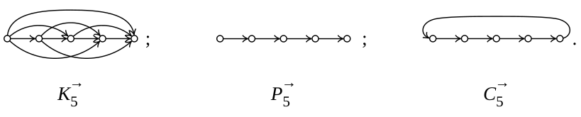](../../assets/volume4a/figures/diagram-7-24-directed-graphs.svg)

(24)

我们同样有完全有向图 $J_n$, 它是 $n$ 个顶点上最大的简单有向图. 它包含 $n^2$ 条弧 $u\longrightarrow v$, 对于 $u$ 和 $v$ 的每一种选择各有一条弧.

图 3 展示了一个精心制作的示意图, 可以称为 “东方快车的”$17$ 阶有向图: 它是由阿加莎·克里斯蒂的小说《东方快车上的谋杀案》(*Murder on the Orient Express*, 1934) 中的侦探赫尔克里·波洛描述的有向图. 顶点对应于故事中从伊斯坦布尔开往加来的车厢铺位, 弧 $u\longrightarrow v$ 表示铺位 $u$ 的乘客已经证实铺位 $v$ 的乘客不在案发现场. 这个例子有 $6$ 个连通分图, 即 $\{0,1,3,6,8,12,13,14,15,16\}$、$\{2\}$、$\{4,5\}$、$\{7\}$、$\{9\}$、$\{10,11\}$. 在有向图中, 连通性是通过把弧当作边来确定的.

如果第一条弧的末端是第二条弧的起点, 则说两条弧是相邻的. 相邻弧的序列 $(a_1,a_2,\ldots,a_k)$ 称为长度为 $k$ 的通道, 它可以通过标明顶点和弧的方式表示如下:

$$
v_0\;\xrightarrow{a_1}\;v_1\;\xrightarrow{a_2}\;v_2\;\cdots\;v_{k-1}\;\xrightarrow{a_k}\;v_k.\tag{25}
$$

[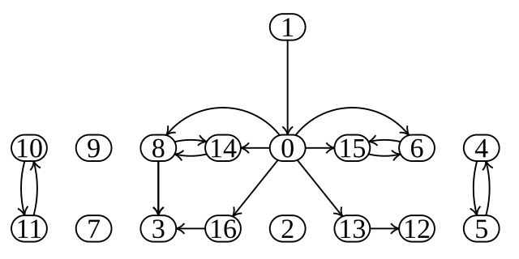](../../assets/volume4a/figures/fig-7-3-orient-express.svg)

图注:

| 编号 | 人物及说明 |
| --- | --- |
| 0 | Pierre Michel, 法国列车员 |
| 1 | Hercule Poirot, 比利时侦探 |
| 2 | Samuel Edward Ratchett, 死去的美国人 |
| 3 | Caroline Martha Hubbard, 美国主妇 |
| 4 | Edward Henry Masterman, 英国随从 |
| 5 | Antonio Foscarelli, 意大利汽车推销员 |
| 6 | Hector Willard MacQueen, 美国秘书 |
| 7 | Harvey Harris, 没有露面的英国人 |
| 8 | Hildegarde Schmidt, 德国贴身侍女 |
| 9 | (空铺位) |
| 10 | Greta Ohlsson, 瑞典护士 |
| 11 | Mary Hermione Debenham, 英国家庭女教师 |
| 12 | Helena Maria Andrenyi, 漂亮的伯爵夫人 |
| 13 | Rudolph Andrenyi, 匈牙利伯爵／外交官 |
| 14 | Natalia Dragomiroff, 孀居的俄国公主 |
| 15 | Colonel Arbuthnot, 来自印度的英国军官 |
| 16 | Cyrus Bethman Hardman, 美国侦探 |

图 3　阿加莎·克里斯蒂设计的大小为 $18$ 的 $17$ 阶有向图

在简单有向图中, 只列举顶点就足够了. 例如, $1\longrightarrow0\longrightarrow8\longrightarrow14\longrightarrow8\longrightarrow3$ 是图 3 中的一条通道. 如果顶点 $\{v_0,v_1,\ldots,v_k\}$ 互不相同, 则 $(25)$ 中的通道是一条定向路径; 如果除 $v_k=v_0$ 之外的顶点互不相同, 则它是一个定向圈.

在有向图中, 有向距离 $d(u,v)$ 是从 $u$ 到 $v$ 的最短定向路径中弧的条数, 它也是从 $u$ 到 $v$ 的最短通道的长度. $d(u,v)$ 可能不等于 $d(v,u)$, 但三角不等式 (18) 依然成立.

每个图都可以看成是有向图, 因为一条边 $u\mathrel{\text{—}}v$ 实质上等价于一对弧 $u\longrightarrow v$ 和 $v\longrightarrow u$. 用这种方式获得的有向图保留了原图的全部性质, 例如, 图中每个顶点的度变成了其在有向图中的出度, 同时也是其在有向图中的入度. 此外, 距离保持不变.

多重图 $(V,E)$ 就像普通的图, 只不过它的边集 $E$ 可以是顶点对 $\{u,v\}$ 的任意多重集. 而且, 它也允许边 $v\mathrel{\text{—}}v$ (也就是从一个顶点到它自身的环), 这种边对应于 “多重顶点对”$\{v,v\}$. 例如

[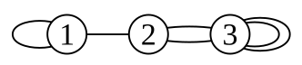](../../assets/volume4a/figures/diagram-7-26-multigraph.svg)

(26)

是一个 $3$ 阶多重图, 有 $6$ 条边 $\{1,1\}$、$\{1,2\}$、$\{2,3\}$、$\{2,3\}$、$\{3,3\}$、$\{3,3\}$. 在这个例子中, 顶点的度是 $d(1)=d(2)=3$ 和 $d(3)=6$, 因为顶点的每个环对其度的贡献为 $2$. 如果我们把多重图看成有向图, 那么一个边环 $v\mathrel{\text{—}}v$ 就变成了两个弧环 $v\longrightarrow v$.

**图和有向图的表示.** 任何有向图完全是由它的邻接矩阵 $A=(a_{uv})$ 描述的, 任何图或多重图也是如此, 当有 $n$ 个顶点时邻接矩阵有 $n$ 行和 $n$ 列. 这个矩阵的每个元素 $a_{uv}$ 给出从 $u$ 到 $v$ 的弧的数量. 例如, $K_3^{\rightarrow}$、$P_3^{\rightarrow}$、$C_3^{\rightarrow}$、$J_3$、$(26)$ 的邻接矩阵分别是

$$
K_3^{\rightarrow}=\begin{pmatrix}0&1&1\\0&0&1\\0&0&0\end{pmatrix},\quad
P_3^{\rightarrow}=\begin{pmatrix}0&1&0\\0&0&1\\0&0&0\end{pmatrix},\quad
C_3^{\rightarrow}=\begin{pmatrix}0&1&0\\0&0&1\\1&0&0\end{pmatrix},\quad
J_3=\begin{pmatrix}1&1&1\\1&1&1\\1&1&1\end{pmatrix},\quad
A=\begin{pmatrix}2&1&0\\1&0&2\\0&2&4\end{pmatrix}.\tag{27}
$$

借助矩阵论的强有力的数学工具, 通过研究图的邻接矩阵可以证明图的很多重要结果, 习题 65 给出了一个特别显著的例子, 说明能做什么. 一个主要原因在于, 矩阵乘法在有向图的情形下有一种简单的解释. 考虑邻接矩阵 $A$ 的乘方, 根据定义, 它在 $u$ 行 $v$ 列的元素是

$$
(A^2)_{uv}=\sum_{w\in V}a_{uw}a_{wv}.\tag{28}
$$

由于 $a_{uw}$ 是从 $u$ 到 $w$ 的弧的数量, 所以可以看出, $a_{uw}a_{wv}$ 是形式为 $u\longrightarrow w\longrightarrow v$ 的通道数量. 因此, $(A^2)_{uv}$ 是从 $u$ 到 $v$ 的长度为 $2$ 的通道总数. 同样, 对于所有 $k\geq0$, $A^k$ 的元素告诉了我们任何顶点序偶之间长度为 $k$ 的通道总数. 例如, $(27)$ 中的矩阵 $A$ 满足

$$
A=\begin{pmatrix}2&1&0\\1&0&2\\0&2&4\end{pmatrix},\qquad
A^2=\begin{pmatrix}5&2&2\\2&5&8\\2&8&20\end{pmatrix},\qquad
A^3=\begin{pmatrix}12&9&12\\9&18&42\\12&42&96\end{pmatrix}.\tag{29}
$$

因此, 多重图 $(26)$ 从顶点 $1$ 到顶点 $3$ 有 $12$ 条长度为 $3$ 的通道, 从顶点 $2$ 到它自身有 $18$ 条这样的通道.

顶点的重新排列使邻接矩阵 $A$ 变成 $P^{-}AP$, 其中 $P$ 是置换矩阵 (在每行和每列都恰好有一个 $1$ 的 $0$–$1$ 矩阵), $P^{-}=P^T$ 是逆置换的矩阵. 这样一来,

$$
\begin{pmatrix}2&1&0\\1&0&2\\0&2&4\end{pmatrix},\quad
\begin{pmatrix}2&0&1\\0&4&2\\1&2&0\end{pmatrix},\quad
\begin{pmatrix}0&1&2\\1&2&0\\2&0&4\end{pmatrix},\quad
\begin{pmatrix}0&2&1\\2&4&0\\1&0&2\end{pmatrix},\quad
\begin{pmatrix}4&0&2\\0&2&1\\2&1&0\end{pmatrix},\quad
\begin{pmatrix}4&2&0\\2&0&1\\0&1&2\end{pmatrix}\tag{30}
$$

是图 $(26)$ 的全部邻接矩阵, 没有其他的了.

当 $n>1$ 时, $n$ 阶图的数量超过 $2^{n(n-1)/2}/n!$ 个, 即使是最经济的编码, 也几乎全都需要 $\Omega(n^2)$ 位数据. 因此, 从内存使用的角度来看, 在计算机内部表示几乎全部可能的图的最佳方式, 实际上是邻接矩阵.

但是, 出现在现实问题中的图所具备的特征, 完全不同于从全部可能图集中随机选择的图. 现实问题中的图往往是 “稀疏的”, 比如具有 $O(n\log n)$ 而不是 $\Omega(n^2)$ 条边, 除非 $n$ 是比较小的数, 因为 $\Omega(n^2)$ 位数据是很难生成的. 例如, 假定顶点对应于人, 边对应于友谊. 如果考察 $50$ 亿人, 他们中很少有人有 $10\,000$ 位以上的朋友. 但是, 即使平均每人有 $10\,000$ 位朋友, 这个图仍然仅有 $2.5\times10^{13}$ 条边, 而所有 $50$ 亿阶的图几乎都近似有 $6.25\times10^{18}$ 条边.

因此, 图在计算机内部的最佳表示方式, 与记录邻接矩阵元素的 $n^2$ 个值 $a_{uv}$ 很不一样. 换一种方式, 斯坦福图库的算法是用同 2.2.6 节讨论的稀疏矩阵的链接表示相近的一种数据结构建立的, 不过做了某些简化. 业已证实这种方法不仅通用而有效, 而且也容易使用.

有向图的 SGB 表示是顺序地址分配和链式地址分配的结合, 使用了两种基本类型的结点. 某些结点表示顶点, 另一些结点表示弧. (对于一次处理几个图的算法, 还有表示整个图的第三种类型的结点. 但是每个图只需一个图结点, 所以顶点结点和弧结点占据优势.)

SGB 有向图的处理如下: 对每个大小为 $m$ 的 $n$ 阶 SGB 有向图建立一个 $n$ 顶点结点的顺序数组, 使得对于 $0\leq k<n$ 容易访问顶点 $k$. 相比之下, $m$ 个弧结点实际上被链接在一块非结构化的通用存储区内. 每个顶点结点通常占用 $32$ 字节, 每个弧结点占用 $20$ 字节 (图结点则占用 $220$ 字节); 而且, 改变结点大小并不难. 在所有情形, 每个结点的少数字段具有固定不变的确定含义, 其余字段在不同算法或者一个算法的不同阶段用于不同的目的. 结点具有固定用途的部分称为它的 “标准字段”, 具有多种用途的部分称为它的 “应用字段”.

每个顶点结点包含称为 `NAME` 和 `ARCS` 的两个标准字段. 如果 $v$ 是指向顶点结点的变量, 我们称它为顶点变量. 于是, $\operatorname{NAME}(v)$ 指向一个字符串, 用于在面向人类的输出中标识对应的顶点. 例如, 图 $(17)$ 的 $49$ 个顶点具有 `CA`、`WA`、`OR`、…、`RI` 这样的名称. 另外一个标准字段 $\operatorname{ARCS}(v)$ 在算法中更重要: 它指向一个弧结点, 这个弧结点是长度为 $d^+(v)$ 的单链表中的第一项, 从顶点 $v$ 出发的每条弧都有这样一个结点.

每个弧结点包含称为 `TIP` 和 `NEXT` 的两个标准字段. 我们把指向弧结点的变量 $a$ 称为弧变量. $\operatorname{TIP}(a)$ 指向表示弧 $a$ 末端的顶点结点, $\operatorname{NEXT}(a)$ 指向表示起始顶点与弧 $a$ 相同的下一条弧的弧结点.

出度为 $0$ 的顶点 $v$ 用 $\operatorname{ARCS}(v)=\Lambda$ (零指针) 表示. 在其他情形, 比如出度为 $3$, 其数据结构包含具有 $\operatorname{ARCS}(v)=a_1$、$\operatorname{NEXT}(a_1)=a_2$、$\operatorname{NEXT}(a_2)=a_3$、$\operatorname{NEXT}(a_3)=\Lambda$ 的三个弧结点, 而这三条弧由 $v$ 引向 $\operatorname{TIP}(a_1)$、$\operatorname{TIP}(a_2)$、$\operatorname{TIP}(a_3)$.

例如, 设想我们需要计算顶点 $v$ 的出度, 并把它存入称为 `ODEG` 的应用字段中. 这很容易实现:

$$
\begin{aligned}
&\text{置 }a\leftarrow\operatorname{ARCS}(v),\quad d\leftarrow0.\\
&\text{当 }a\ne\Lambda\text{ 时循环执行 }d\leftarrow d+1,\quad a\leftarrow\operatorname{NEXT}(a).\\
&\text{置 }\operatorname{ODEG}(v)\leftarrow d.
\end{aligned}\tag{31}
$$

当把一个图或多重图看成有向图时, 如前所述, 它的每条边 $u\mathrel{\text{—}}v$ 等价于两条弧 $u\longrightarrow v$ 和 $v\longrightarrow u$. 这两条弧称为 “配对”, 它们占据两个弧结点, 比如 $a$ 和 $a'$, 其中 $a$ 出现在来自 $u$ 的弧表中, $a'$ 出现在来自 $v$ 的弧表中. 于是, $\operatorname{TIP}(a)=v$, $\operatorname{TIP}(a')=u$. 在需要从一个表快速转向另一个表的算法中, 我们将另记为

$$
\operatorname{MATE}(a)=a'\quad\text{和}\quad\operatorname{MATE}(a')=a.\tag{32}
$$

然而, 通常无须存储从一条弧到其配对的显式指针, 也不需要在每个弧结点内设置一个称为 `MATE` 的应用字段, 因为在妥善设计数据结构后, 所需连接可以隐式推导.

隐式配对技巧处理如下: 当创建无向图或多重图的每条边 $u\mathrel{\text{—}}v$ 时, 我们对于 $u\longrightarrow v$ 和 $v\longrightarrow u$ 引入两个连续的弧结点. 例如, 如果每个弧结点有 $20$ 字节, 那么, 我们对于每个新的弧对保留 $40$ 个连续字节. 我们还要保证第一个字节的存储地址是 $8$ 的倍数. 这样, 如果弧结点 $a$ 存储在单元 $\alpha$, 那么, 它的配对存储在单元

$$
\left\{\begin{array}{ll}
\alpha+20,&\text{如果 }\alpha\bmod8=0\\
\alpha-20,&\text{如果 }\alpha\bmod8=4
\end{array}\right\}
=\alpha-20+(40\mathbin{\&}((\alpha\mathbin{\&}4)-1)).\tag{33}
$$

当运算可能执行万亿次时, 组合问题中的这种处理技巧是很有用的, 因为每次运算节省 $3.6$ 纳秒的每一种方法都将使这样的计算节省一小时的时间. 但是, $(33)$ 从一个实现到另一个实现不是直接 “可移植的”. 例如, 如果一个弧结点的大小从 $20$ 改变为 $24$, 那么, 我们必须把 $(33)$ 中的数 $40$、$20$、$8$、$4$ 改变为 $48$、$24$、$16$、$8$.

本书中的算法对结点的大小不作假定. 我们将采用 C 语言及其派生语言的约定: 如果 $a$ 指向弧结点, 那么 $a+1$ 表示存储器中跟随它的弧结点的指针. 在通常情况下, 如果每个弧结点有 $c$ 字节, 那么

$$
\operatorname{LOC}(\operatorname{NODE}(a+k))=\operatorname{LOC}(\operatorname{NODE}(a))+kc.\tag{34}
$$

同样, 如果 $v$ 是顶点变量, 那么, $v+k$ 将代表跟随结点 $v$ 的第 $k$ 个顶点结点, 它的实际存储地址将是结点 $v$ 的存储地址加上 $k$ 乘以顶点结点的大小.

一个图结点 $g$ 的标准字段包含: $\operatorname{M}(g)$, 弧的总数; $\operatorname{N}(g)$, 顶点的总数; $\operatorname{VERTICES}(g)$, 指向所有顶点结点序列表中第一个顶点结点的指针; $\operatorname{ID}(g)$, 图的标识, 是一个像 `words(5757,0,0,0)` 这样的字符串; 所需的其他字段, 用于当图增长或收缩时分配或回收存储单元, 或者用于当与其他用户或其他图管理系统连接时把图转换成外部格式. 但是, 我们基本不需要访问任何这样的图结点字段, 也不需要在这里给出 SGB 格式的完整描述, 因为这一章我们将在完全抽象的级别上坚持用自然语言描述几乎所有的图算法, 而不会把这种描述降低到计算机程序的二进位级别.

**简单的图算法.** 为了说明后面将要出现的一个适中层次的算法类型, 我们把定理 B 的证明转变成用两种颜色对给定图的顶点进行分步着色的过程, 只要给定的图是二部图.

**算法 B (二部性检验).** 给定一个用 SGB 格式表示的图, 算法或者在每个顶点 $v$ 求出用 $\operatorname{COLOR}(v)\in\{0,1\}$ 的 $2$ 着色, 或者当不可能存在正确的 $2$ 着色时以失败终止. 这里, `COLOR` 是每个顶点结点的一个应用字段. 顶点结点的另一个应用字段 $\operatorname{LINK}(v)$ 是一个顶点指针, 用于维持一个栈, 其中的所有顶点均已着色, 但是尚未检查它们的邻接顶点. 一个辅助的顶点变量 $s$ 指向这个栈的顶端. 算法用变量 $u,v,w$ 表示顶点, 用变量 $a$ 表示弧. 顶点结点是 $v_0+k$($0\leq k<n$).

**B1. [初始化.]** 对于 $0\leq k<n$ 置 $\operatorname{COLOR}(v_0+k)\leftarrow-1$. (现在所有顶点都是未着色的.) 然后置 $w\leftarrow v_0+n$.

**B2. [完成?]**(此刻所有 $\geq w$ 的顶点均已着色, 且所有已着色顶点的邻近顶点也是如此.) 如果 $w=v_0$, 算法以成功终止. 否则置 $w\leftarrow w-1$, 这是低一层的顶点结点.

**B3. [当需要时对 $w$ 着色.]** 如果 $\operatorname{COLOR}(w)\geq0$, 返回 B2. 否则, 置 $\operatorname{COLOR}(w)\leftarrow0$, $\operatorname{LINK}(w)\leftarrow\Lambda$, $s\leftarrow w$.

**B4. [栈 $\Rightarrow u$.]** 置 $u\leftarrow s$, $s\leftarrow\operatorname{LINK}(s)$, $a\leftarrow\operatorname{ARCS}(u)$. (我们将检验已着色顶点 $u$ 的所有邻近顶点.)

**B5. [$u$ 处理完了吗?]** 如果 $a=\Lambda$, 转到 B8. 否则, 置 $v\leftarrow\operatorname{TIP}(a)$.

**B6. [处理 $v$.]** 如果 $\operatorname{COLOR}(v)<0$, 置 $\operatorname{COLOR}(v)\leftarrow1-\operatorname{COLOR}(u)$, $\operatorname{LINK}(v)\leftarrow s$, $s\leftarrow v$. 否则, 如果 $\operatorname{COLOR}(v)=\operatorname{COLOR}(u)$, 算法以失败终止.

**B7. [对 $a$ 循环.]** 置 $a\leftarrow\operatorname{NEXT}(a)$, 返回 B5.

**B8. [栈非空?]** 如果 $s\ne\Lambda$, 返回 B4. 否则返回 B2. $\quad\blacksquare$

这是一个称为 “深度优先搜索” 的通用算法的图遍历过程的变形, 我们将在 7.4.1.2 节详细讨论它. 当存在 $m$ 条弧和 $n$ 个顶点时, 它的运行时间是 $O(m+n)$ (见习题 70). 所以它很适合于稀疏图的常见情况. 通过少量修改, 我们可以使它在以失败终止时输出一个奇数长度的圈, 从而证明 $2$ 着色是不可能的 (见习题 72).

**图的例子.** 斯坦福图库包含一个三打以上的生成器程序库, 可以产生多种多样在试验中使用的图和有向图. 我们已经讨论过 `words`, 现在来考察一些其他的图, 以便获得对某些可能性的感性认识.

- `roget(1022,0,0,0)` 是一个有 $1022$ 个顶点和 $5075$ 条弧的有向图. 顶点代表彼得·罗杰和约翰·罗杰合编的 19 世纪著名的《词典》(*Thesaurus*, London: Longmans, Green, 1879) 一书中包含的单词或概念的类别. 弧是在那本书中找到的词类之间的相互参照. 例如, 典型的弧有 $\mathtt{water}\longrightarrow\mathtt{moisture}$、$\mathtt{discovery}\longrightarrow\mathtt{truth}$、$\mathtt{preparation}\longrightarrow\mathtt{learning}$、$\mathtt{vulgarity}\longrightarrow\mathtt{ugliness}$、$\mathtt{wit}\longrightarrow\mathtt{amusement}$.
- `book("jean",80,0,1,356,0,0,0)` 是一个有 $80$ 个顶点和 $254$ 条边的图. 顶点代表法国作家维克多·雨果的《悲惨世界》(*Les Misérables*) 中的人物, 边连接小说中彼此相遇的人物. 典型的边有 $\mathtt{Fantine}\mathrel{\text{—}}\mathtt{Javert}$、$\mathtt{Cosette}\mathrel{\text{—}}\mathtt{Th\acute{e}nardier}$.
- `bi_book("jean",80,0,1,356,0,0,0)` 是一个有 $80+356$ 个顶点和 $727$ 条边的二部图. 顶点代表《悲惨世界》中的人物或章节, 边连接人物及其出现的章节 (例如 $\mathtt{Napoleon}\mathrel{\text{—}}\mathtt{2.1.8}$、$\mathtt{Marius}\mathrel{\text{—}}\mathtt{4.14.4}$).
- `plane_miles(128,0,0,0,1,0,0)` 是一个有 $129$ 个顶点和 $381$ 条边的平面图. 顶点代表美国和加拿大的 $128$ 座城市, 还有一个特殊顶点 `INF` (代表 “无穷远点”). 边定义这些城市之间的德劳奈三角剖分, 这个剖分基于平面上的经纬度, 其含义是: 存在边 $u\mathrel{\text{—}}v$ 当且仅当存在一个通过 $u$ 和 $v$ 的圆, 没有任何其他顶点被这个圆包围. 图中的边也在 `INF` 与处于所有城市位置的凸包上的顶点之间穿越. 典型的边有 $\mathtt{Seattle,\,WA}\mathrel{\text{—}}\mathtt{Vancouver,\,BC}\mathrel{\text{—}}\mathtt{INF}$; $\mathtt{Toronto,\,ON}\mathrel{\text{—}}\mathtt{Rochester,\,NY}$.

- `plane_lisa(360,250,15,0,360,0,250,0,22950000)` 是一个有 $3027$ 个顶点和 $5967$ 条边的平面图. 它是从列奥纳多·达·芬奇的《蒙娜丽莎》(*Mona Lisa*) 数字化图像得到的, 该图像有 $360$ 行 $250$ 列像素, 像素的明暗度归入 $16$ 个等级, 灰度从 $0$ (黑) 到 $15$ (白). 这样产生的 $3027$ 个恒定亮度的车连通区域, 当它们具有共同的像素边界时被当作邻近区域 (见图 4).

[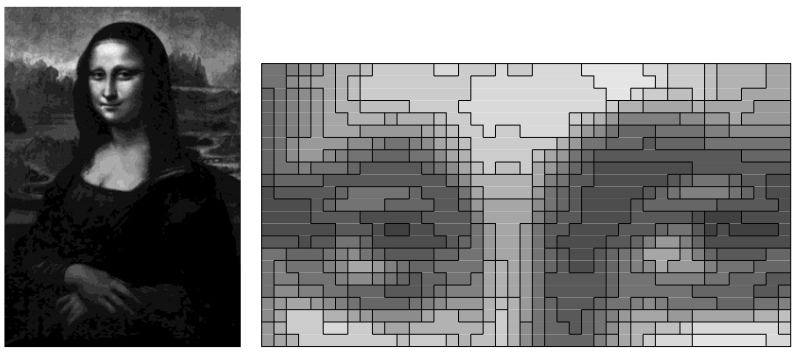](../../assets/volume4a/figures/fig-7-4-mona-lisa.svg)

图 4　《蒙娜丽莎》的数字再现图和局部特写图 (最好从远处看)

- `bi_lisa(360,250,0,360,0,250,8192,0)` 是一个有 $360+250=610$ 个顶点和 $40923$ 条边的二部图. 它是达·芬奇名画的另一种摹仿. 这次摹仿连接亮度级别至少是 $1/8$ 的行和列. 例如, 边 $\mathtt{r102}\mathrel{\text{—}}\mathtt{c113}$ 出现在丽莎的 “微笑” 的正中.
- `raman(31,23,3,1)` 是一个具有与前面那些例子中的 SGB 图完全不同性质的图. 它是基于严格数学原理的 “拉马努金扩展图”, 未与语言、文字或者人类文明的其他产物连接. 它的 $(23^3-23)/2=6072$ 个顶点中的每个顶点的度为 $32$, 因此它有 $97152$ 条边. 图的顶点对应于那些具有非奇异模 $23$ 的 $2\times2$ 矩阵的等价类, 一条典型的边是 $(2,7;1,1)\mathrel{\text{—}}(4,6;1,3)$. 拉马努金图之所以重要, 主要在于就它们的大小和度而言, 它们具有异常高的围长和异常低的直径. 这个图的围长为 $4$, 直径为 $4$.
- `raman(5,37,4,1)`, 类似地, 它是一个度为 $6$ 的正则图, 有 $50616$ 个顶点和 $151848$ 条边. 它的围长为 $10$, 直径为 $10$, 恰好也是二部图.
- `random_graph(1000,5000,0,0,0,0,0,0,0,s)` 是一个有 $1000$ 个顶点和 $5000$ 条边而且以 $s$ 为伪随机数初始值的图. 它是 “逐步形成” 的, 从没有边开始, 然后通过重复选择伪随机数的顶点 $0\leq u,v<1000$ 并添加边 $u\mathrel{\text{—}}v$, 除非 $u=v$ 或者该图中已有这条边. 当 $s=0$ 时, 除孤立顶点 $908$ 之外的所有顶点属于一个 $999$ 阶的巨大分图.
- `random_graph(1000,5000,0,0,1,0,0,0,0,0)` 是一个有 $1000$ 个顶点和 $5000$ 条弧的有向图, 它通过类似的演变过程获得. (事实上, 它的每条弧恰好也是 `random_graph(1000,5000,0,0,0,0,0,0,0,0)` 的组成部分.)
- `subsets(5,1,-10,0,0,0,#1,0)` 是一个有 $\binom{11}{5}=462$ 个顶点的图, $\{0,1,\ldots,10\}$ 的每个 $5$ 元素子集代表一个顶点. 每当对应的子集不相交时, 两个顶点是邻接的. 因此, 这个图是度为 $6$ 的正则图, 有 $1386$ 条边. 我们可以把它看成是佩特森图的推广, 佩特森图以 `subsets(2,1,-4,0,0,0,#1,0)` 作为它的 SGB 名称之一.
- `subsets(5,1,-10,0,0,0,#10,0)` 有同样的 $462$ 个顶点, 但是, 在这个图中, 每当对应的子集有 $4$ 个共同元素时顶点才是邻接的. 这个图是度为 $30$ 的正则图, 有 $6930$ 条边.

- `parts(30,10,30,0)` 是另一个建立在数学基础上的 SGB 图. 它有 $3590$ 个顶点, 每个顶点代表把 $30$ 划分成最多 $10$ 部分的一个分划. 当一个分划是通过再次划分另一个分划的某个部分获得时, 两个分划是邻接的. 这条规则定义了 $31377$ 条边. 有向图 `parts(30,10,30,1)` 是类似的, 但它的 $31377$ 条弧是从较短的分划指向较长的分划 (例如 $13+7+7+3\longrightarrow7+7+7+6+3$).
- `simplex(10,10,10,10,10,0,0)` 是一个有 $286$ 个顶点和 $1320$ 条边的图. 它的顶点是方程 $x_1+x_2+x_3+x_4=10$ 满足 $x_i\geq0$ 的整数解, 即 “$10$ 划分成 $4$ 个非负整数部分的组合”. 也可以把它们看成一个四面体的内部点的重心坐标. 像 $\mathtt{3.1.4.2}\mathrel{\text{—}}\mathtt{3.0.4.3}$ 这样的边连接那些尽可能接近的组合.
- `board(8,8,0,0,5,0,0)` 和 `board(8,8,0,0,-2,0,0)` 是建立在 $64$ 个顶点上的两个图, 它们的 $168$ 条边或 $280$ 条边分别对应于国际象棋中马或象的移动.

此外, 通过改变 SGB 图生成器的参数可以获得无数多的例子. 例如, 图 5 显示 `board` 和 `simplex` 的两个简单变形. 图 `board` 多少有点神秘的规则在习题 75 中说明.

[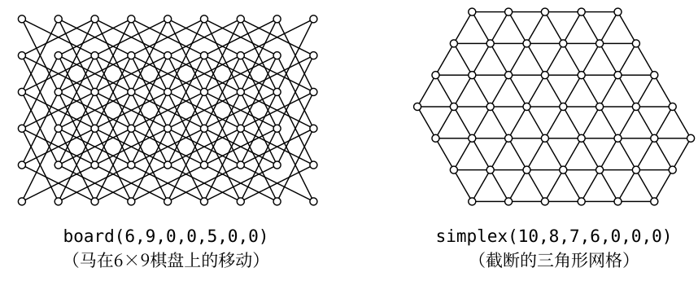](../../assets/volume4a/figures/fig-7-5-board-simplex.svg)

图 5　与棋盘游戏有关的 SGB 图的实例

**图代数.** 通过对已有的图进行运算, 我们可以获得新的图. 例如, 如果 $G=(V,E)$ 是任意的图, 通过令

$$
\text{在 }\overline G\text{ 中 }u\mathrel{\text{—}}v
\quad\Longleftrightarrow\quad
\text{在 }G\text{ 中 }u\ne v\text{ 且 }u\mathrel{\not{\text{—}}}v\tag{35}
$$

可以获得它的补图 $\overline G=(V,\overline E)$. 因此, 在原先没有边的顶点之间出现了边, 反之亦然. 注意 $\overline{\overline G}=G$, 并且 $\overline{K_n}$ 没有边. 对应的邻接矩阵 $A$ 和 $\overline A$ 满足

$$
A+\overline A=J-I,\tag{36}
$$

其中 $J$ 是全体元素为 $1$ 的矩阵, $I$ 是单位矩阵, 所以, 当 $G$ 的阶为 $n$ 时, $J$ 和 $J-I$ 分别是 $J_n$ 和 $K_n$ 的邻接矩阵.

此外, 每个图 $G=(V,E)$ 导出一个线图 $L(G)$, 它的顶点集是图 $G$ 的边集 $E$. 如果两条边在 $G$ 中有共同的顶点, 则它们在 $L(G)$ 中是邻接的. 举例来说, 线图 $L(K_n)$ 有 $\binom n2$ 个顶点, 而且当 $n\geq2$ 时它是度为 $2n-4$ 的正则图 (见习题 82). 如果一个图的线图是 $k$ 可着色的, 则称这个图为 $k$ 边可着色的.

给定两个图 $G=(U,E)$ 和 $H=(V,F)$, 它们的并图 $G\cup H$ 是通过组合它们的顶点和边而得到的图 $(U\cup V,E\cup F)$. 例如, 假定 $G$ 和 $H$ 分别是国际象棋中车和象的移步图, 那么 $G\cup H$ 是后的移步图, 它在 SGB 中的正式名称是

$$
\operatorname{gunion}(\operatorname{board}(8,8,0,0,-1,0,0),\operatorname{board}(8,8,0,0,-2,0,0),0,0).\tag{37}
$$

在顶点集 $U$ 和 $V$ 不相交的特殊情形下, 并图 $G\cup H$ 不需要对相互关联的顶点用任何兼容的方式标识. 通过直接在 $H$ 的示意图旁边画出 $G$ 的示意图, 我们就可得到 $G\cup H$ 的示意图.

这种特殊情形称为 $G$ 和 $H$ 的 “并置” 或直和, 用 $G\oplus H$ 表示. 例如, 容易看出

$$
K_m\oplus K_n\cong\overline{K_{m,n}};\tag{38}
$$

每个图是它的连通分图的直和.

式 (38) 是一般公式

$$
K_{n_1}\oplus K_{n_2}\oplus\cdots\oplus K_{n_k}\cong\overline{K_{n_1,n_2,\ldots,n_k}}\tag{39}
$$

的特例, 当 $k\geq2$ 时这个公式对于完全 $k$ 部图成立. 但是, 当 $k=1$ 时式 (39) 不成立, 这是由于一个令人震惊的事实: 标准的图论记号对于完全图是不兼容的! 事实上, $K_{m,n}$ 表示一个完全二部图, 但 $K_n$ 却不是表示一个完全一部图. 某些图论学家不知什么缘故竟然同这种反常现象共处几十年而心安理得.

另一种组合不相交的图 $G$ 和 $H$ 的重要方法是建立它们的联合图 $G\mathbin{\text{—}}H$, 它由 $G\oplus H$ 以及所有 $u\in U$ 和 $v\in V$ 的边 $u\mathrel{\text{—}}v$ 组成. [见亚历山大·济科夫,*Mat. Sbornik* **24** (1949), 163–188, §I.3.] 同时, 如果 $G$ 和 $H$ 是不相交的有向图, 它们的有向联合图 $G\longrightarrow H$ 是类似的, 但是它仅通过添加从 $U$ 到 $V$ 的单向弧 $u\longrightarrow v$ 补充 $G\oplus H$.

两个矩阵 $A$ 和 $B$ 的直和是把 $B$ 置于 $A$ 的对角线右下方得到的:

$$
A\oplus B=\begin{pmatrix}A&O\\O&B\end{pmatrix},\tag{40}
$$

这个例子中的两个 $O$ 是全体元素为 $0$ 的矩阵, 它们具有形成正确直和的相应行数与列数. 图的直和记号 $G\oplus H$ 很容易记住, 因为 $G\oplus H$ 的邻接矩阵恰好是对于 $G$ 和 $H$ 的邻接矩阵 $A$ 和 $B$ 的直和. 同样, 对于 $G\mathbin{\text{—}}H$、$G\longrightarrow H$ 和 $G\longleftarrow H$, 邻接矩阵分别是

$$
A\mathbin{\text{—}}B=\begin{pmatrix}A&J\\J&B\end{pmatrix},\quad
A\longrightarrow B=\begin{pmatrix}A&J\\O&B\end{pmatrix},\quad
A\longleftarrow B=\begin{pmatrix}A&O\\J&B\end{pmatrix};\tag{41}
$$

其中 $J$ 是式 (36) 中的全体元素为 $1$ 的矩阵. 这些运算是可结合的, 并且通过补运算关联:

$$
A\oplus(B\oplus C)=(A\oplus B)\oplus C,\quad
A\mathbin{\text{—}}(B\mathbin{\text{—}}C)=(A\mathbin{\text{—}}B)\mathbin{\text{—}}C;\tag{42}
$$

$$
A\longrightarrow(B\longrightarrow C)=(A\longrightarrow B)\longrightarrow C,\quad
A\longleftarrow(B\longleftarrow C)=(A\longleftarrow B)\longleftarrow C;\tag{43}
$$

$$
\overline{A\oplus B}=\overline A\mathbin{\text{—}}\overline B,\qquad
\overline{A\mathbin{\text{—}}B}=\overline A\oplus\overline B;\tag{44}
$$

$$
\overline{A\longrightarrow B}=\overline A\longleftarrow\overline B,\qquad
\overline{A\longleftarrow B}=\overline A\longrightarrow\overline B;\tag{45}
$$

$$
(A\oplus B)+(A\mathbin{\text{—}}B)=(A\longrightarrow B)+(A\longleftarrow B).\tag{46}
$$

请注意, 结合 $(39)$ 与 $(42)$ 和 $(44)$, 当 $k\geq2$ 时我们有

$$
K_{n_1,n_2,\ldots,n_k}=\overline{K_{n_1}}\mathbin{\text{—}}\overline{K_{n_2}}\mathbin{\text{—}}\cdots\mathbin{\text{—}}\overline{K_{n_k}}.\tag{47}
$$

此外

$$
K_n=K_1\mathbin{\text{—}}K_1\mathbin{\text{—}}\cdots\mathbin{\text{—}}K_1
\quad\text{和}\quad
K_n^{\rightarrow}=K_1\longrightarrow K_1\longrightarrow\cdots\longrightarrow K_1,\tag{48}
$$

由于 $K_1$ 的 $n$ 个副本, 说明 $K_n=K_{1,1,\ldots,1}$ 是一个完全 $n$ 部图.

直和与联合运算同加法运算相似, 因为有 $\overline{K_m}\oplus\overline{K_n}=\overline{K_{m+n}}$ 和 $K_m\mathbin{\text{—}}K_n=K_{m+n}$. 我们同样可以用类似乘法的运算来组合图. 例如, 笛卡儿积运算用一个 $m$ 阶的图 $G=(U,E)$ 和一个 $n$ 阶的图 $H=(V,F)$ 构成一个 $mn$ 阶的图 $G\mathbin{\square}H$. $G\mathbin{\square}H$ 的顶点是序偶 $(u,v)$, 其中 $u\in U$ 和 $v\in V$; 当 $u\mathrel{\text{—}}u'$ 在 $G$ 中时, 边是 $(u,v)\mathrel{\text{—}}(u',v)$, 同时当 $v\mathrel{\text{—}}v'$ 在 $H$ 中时, 边是 $(u,v)\mathrel{\text{—}}(u,v')$. 换句话说, $G\mathbin{\square}H$ 是这样构成的: 用 $H$ 的一个副本代替 $G$ 的每个顶点, 并且用相应副本的对应顶点之间的边代替 $G$ 的每条边:

[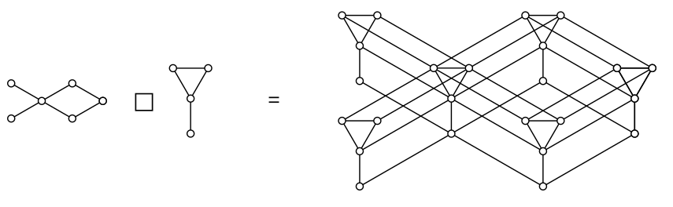](../../assets/volume4a/figures/diagram-7-49-graph-products.svg)

(49)

照例, 这种一般结构的最简单的特殊情形在实践中是特别重要的. 当 $G$ 和 $H$ 是路径或圈时, 我们得到 “图-纸图”, 即 $m\times n$ 网格 $P_m\mathbin{\square}P_n$、$m\times n$ 柱面 $P_m\mathbin{\square}C_n$ 和 $m\times n$ 环面 $C_m\mathbin{\square}C_n$. 下面是对应于 $m=3$ 和 $n=4$ 的这三种图:

[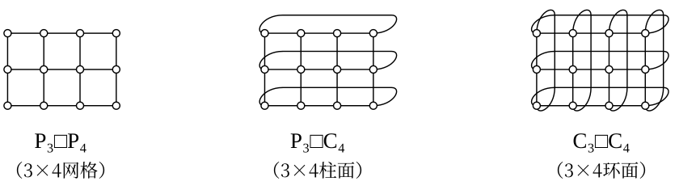](../../assets/volume4a/figures/diagram-7-50-graph-products.svg)

(50)

其他四种值得注意的定义图积的方法被证实是有用的. 在以下每一种情形, 乘积图的顶点是序偶 $(u,v)$.

- 直积 $G\otimes H$, 也称为 $G$ 和 $H$ 的 “并合” 或 “分类积”, 当在 $G$ 中有 $u\mathrel{\text{—}}u'$ 和在 $H$ 中有 $v\mathrel{\text{—}}v'$ 时, 我们有 $(u,v)\mathrel{\text{—}}(u',v')$.
- 强积 $G\boxtimes H$, 它组合了 $G\mathbin{\square}H$ 的边与 $G\otimes H$ 的边.
- 奇积 $G\mathbin{\triangle}H$, 如果要么在 $G$ 中有 $u\mathrel{\text{—}}u'$, 要么在 $H$ 中有 $v\mathrel{\text{—}}v'$, 则我们有 $(u,v)\mathrel{\text{—}}(u',v')$.
- 字典积 $G\circ H$, 也称 $G$ 和 $H$ 的 “合成”, 当在 $G$ 中有 $u\mathrel{\text{—}}u'$ 时我们有 $(u,v)\mathrel{\text{—}}(u',v')$, 当在 $H$ 中有 $v\mathrel{\text{—}}v'$ 时我们有 $(u,v)\mathrel{\text{—}}(u,v')$.

以上五种运算可以自然地扩展到 $k\geq2$ 的图 $G_1=(V_1,E_1),\ldots,G_k=(V_k,E_k)$ 的乘积, 乘积图的顶点是有序 $k$ 元组 $(v_1,\ldots,v_k)$, 其中, 对于 $1\leq j\leq k$ 有 $v_j\in V_j$. 例如, 当 $k=3$ 时, 如果把复合顶点 $(v_1,(v_2,v_3))$ 和 $((v_1,v_2),v_3)$ 看成与 $(v_1,v_2,v_3)$ 是相同的, 那么, 笛卡儿积 $G_1\mathbin{\square}(G_2\mathbin{\square}G_3)$ 和 $(G_1\mathbin{\square}G_2)\mathbin{\square}G_3$ 是同构的. 所以, 我们可以把这个笛卡儿积写成不带括号的形式 $G_1\mathbin{\square}G_2\mathbin{\square}G_3$. 具有 $k$ 个因子的笛卡儿积的最重要例子是 $k$ 立方

$$
P_2\mathbin{\square}P_2\mathbin{\square}\cdots\mathbin{\square}P_2,\tag{51}
$$

当它的 $2^k$ 个顶点 $(v_1,\ldots,v_k)$ 之间的汉明距离为 $1$ 时, 这些顶点是邻接的.

通常, 假定 $v=(v_1,\ldots,v_k)$ 和 $v'=(v'_1,\ldots,v'_k)$ 是顶点的 $k$ 元组, 其中恰好有 $a$ 个下标 $j$ 满足在 $G_j$ 中有 $v_j\mathrel{\text{—}}v'_j$, 并且恰好有 $b$ 个下标 $j$ 满足 $v_j=v'_j$. 那么我们有

- $v\mathrel{\text{—}}v'$ 在 $G_1\mathbin{\square}\cdots\mathbin{\square}G_k$ 中, 当且仅当 $a=1$ 且 $b=k-1$;
- $v\mathrel{\text{—}}v'$ 在 $G_1\otimes\cdots\otimes G_k$ 中, 当且仅当 $a=k$ 且 $b=0$;
- $v\mathrel{\text{—}}v'$ 在 $G_1\boxtimes\cdots\boxtimes G_k$ 中, 当且仅当 $a+b=k$ 且 $a>0$;
- $v\mathrel{\text{—}}v'$ 在 $G_1\mathbin{\triangle}\cdots\mathbin{\triangle}G_k$ 中, 当且仅当 $a$ 是奇数.

字典积有所不同, 因为它不是可交换的. 在 $G_1\circ\cdots\circ G_k$ 中, 对于 $v\ne v'$ 我们有 $v\mathrel{\text{—}}v'$, 当且仅当 $v_j\mathrel{\text{—}}v'_j$, 其中 $j$ 是 $v_j\ne v'_j$ 的最小下标.

习题 91–102 考察图积的一些基本性质. 也见威尔弗里德·伊姆里奇和桑迪·克拉夫扎的著作 *Product Graphs* (2000), 该书是对一般理论的全面介绍, 其中包含用于把给定图分解成 “基本” 子图的算法.

**\*图的度序列.** 如果在顶点 $\{1,2,\ldots,n\}$ 上至少有这样一个图, 其顶点 $k$ 的度为 $d_k$, 则非负整数序列 $d_1d_2\ldots d_n$ 称为图的度序列. 我们可以假定 $d_1\geq d_2\geq\cdots\geq d_n$. 显然, 在任何这样的图中, $d_1<n$. 并且, 任何图的度序列的和 $m=d_1+d_2+\cdots+d_n$ 总为偶数, 因为这个和是它边数的两倍. 此外, 容易看出序列 $3311$ 不是图的度序列, 因为一个 (普通的) 图的两个顶点之间不能多于一条边. 因此, 图的度序列必须满足某些附加条件. 那么, 会是什么条件呢?

数学家瓦茨拉夫·哈韦尔 [*Časopis pro Pěstování Matematiky* **80** (1955), 477–479] 发现一种简单方法, 判定给定序列 $d_1d_2\ldots d_n$ 是不是图的度序列, 而且它若是图的度序列, 还能构造它的图. 我们从一张空的图表开始, 这张图表在 $k$ 行有 $d_k$ 个小格. 这些小格代表一些 “位置”, 我们把所构造图的顶点 $k$ 的邻居放入其中. 令 $c_j$ 是 $j$ 列的小格数量. 因此 $c_1\geq c_2\geq\cdots$, 而且, 当 $1\leq k\leq n$ 时 $c_j\geq k$ 当且仅当 $d_k\geq j$. 例如, 假定 $n=8$, $d_1\ldots d_8=55544322$, 那么

<table style="width:auto;">
<tr><th style="border:none;background:transparent;padding:0 .4em 0 0;text-align:right;font-weight:normal;">1</th><td style="padding:0;width:1.5em;min-width:1.5em;height:1.5em;text-align:center;"></td><td style="padding:0;width:1.5em;min-width:1.5em;height:1.5em;text-align:center;"></td><td style="padding:0;width:1.5em;min-width:1.5em;height:1.5em;text-align:center;"></td><td style="padding:0;width:1.5em;min-width:1.5em;height:1.5em;text-align:center;"></td><td style="padding:0;width:1.5em;min-width:1.5em;height:1.5em;text-align:center;"></td></tr>
<tr><th style="border:none;background:transparent;padding:0 .4em 0 0;text-align:right;font-weight:normal;">2</th><td style="padding:0;width:1.5em;min-width:1.5em;height:1.5em;text-align:center;"></td><td style="padding:0;width:1.5em;min-width:1.5em;height:1.5em;text-align:center;"></td><td style="padding:0;width:1.5em;min-width:1.5em;height:1.5em;text-align:center;"></td><td style="padding:0;width:1.5em;min-width:1.5em;height:1.5em;text-align:center;"></td><td style="padding:0;width:1.5em;min-width:1.5em;height:1.5em;text-align:center;"></td></tr>
<tr><th style="border:none;background:transparent;padding:0 .4em 0 0;text-align:right;font-weight:normal;">3</th><td style="padding:0;width:1.5em;min-width:1.5em;height:1.5em;text-align:center;"></td><td style="padding:0;width:1.5em;min-width:1.5em;height:1.5em;text-align:center;"></td><td style="padding:0;width:1.5em;min-width:1.5em;height:1.5em;text-align:center;"></td><td style="padding:0;width:1.5em;min-width:1.5em;height:1.5em;text-align:center;"></td><td style="padding:0;width:1.5em;min-width:1.5em;height:1.5em;text-align:center;"></td></tr>
<tr><th style="border:none;background:transparent;padding:0 .4em 0 0;text-align:right;font-weight:normal;">4</th><td style="padding:0;width:1.5em;min-width:1.5em;height:1.5em;text-align:center;"></td><td style="padding:0;width:1.5em;min-width:1.5em;height:1.5em;text-align:center;"></td><td style="padding:0;width:1.5em;min-width:1.5em;height:1.5em;text-align:center;"></td><td style="padding:0;width:1.5em;min-width:1.5em;height:1.5em;text-align:center;"></td></tr>
<tr><th style="border:none;background:transparent;padding:0 .4em 0 0;text-align:right;font-weight:normal;">5</th><td style="padding:0;width:1.5em;min-width:1.5em;height:1.5em;text-align:center;"></td><td style="padding:0;width:1.5em;min-width:1.5em;height:1.5em;text-align:center;"></td><td style="padding:0;width:1.5em;min-width:1.5em;height:1.5em;text-align:center;"></td><td style="padding:0;width:1.5em;min-width:1.5em;height:1.5em;text-align:center;"></td></tr>
<tr><th style="border:none;background:transparent;padding:0 .4em 0 0;text-align:right;font-weight:normal;">6</th><td style="padding:0;width:1.5em;min-width:1.5em;height:1.5em;text-align:center;"></td><td style="padding:0;width:1.5em;min-width:1.5em;height:1.5em;text-align:center;"></td><td style="padding:0;width:1.5em;min-width:1.5em;height:1.5em;text-align:center;"></td></tr>
<tr><th style="border:none;background:transparent;padding:0 .4em 0 0;text-align:right;font-weight:normal;">7</th><td style="padding:0;width:1.5em;min-width:1.5em;height:1.5em;text-align:center;"></td><td style="padding:0;width:1.5em;min-width:1.5em;height:1.5em;text-align:center;"></td></tr>
<tr><th style="border:none;background:transparent;padding:0 .4em 0 0;text-align:right;font-weight:normal;">8</th><td style="padding:0;width:1.5em;min-width:1.5em;height:1.5em;text-align:center;"></td><td style="padding:0;width:1.5em;min-width:1.5em;height:1.5em;text-align:center;"></td></tr>
</table>

(52)

是初始图表, 我们有 $c_1\ldots c_5=88653$. 哈韦尔的思想是把顶点 $n$ 与度数最高的 $d_n$ 个顶点配对. 在这个例子中, 我们建立两条边 $8\mathrel{\text{—}}3$ 和 $8\mathrel{\text{—}}2$, 图表呈现如下形式:

<table style="width:auto;">
<tr><th style="border:none;background:transparent;padding:0 .4em 0 0;text-align:right;font-weight:normal;">1</th><td style="padding:0;width:1.5em;min-width:1.5em;height:1.5em;text-align:center;"></td><td style="padding:0;width:1.5em;min-width:1.5em;height:1.5em;text-align:center;"></td><td style="padding:0;width:1.5em;min-width:1.5em;height:1.5em;text-align:center;"></td><td style="padding:0;width:1.5em;min-width:1.5em;height:1.5em;text-align:center;"></td><td style="padding:0;width:1.5em;min-width:1.5em;height:1.5em;text-align:center;"></td></tr>
<tr><th style="border:none;background:transparent;padding:0 .4em 0 0;text-align:right;font-weight:normal;">2</th><td style="padding:0;width:1.5em;min-width:1.5em;height:1.5em;text-align:center;"></td><td style="padding:0;width:1.5em;min-width:1.5em;height:1.5em;text-align:center;"></td><td style="padding:0;width:1.5em;min-width:1.5em;height:1.5em;text-align:center;"></td><td style="padding:0;width:1.5em;min-width:1.5em;height:1.5em;text-align:center;"></td><td style="padding:0;width:1.5em;min-width:1.5em;height:1.5em;text-align:center;">8</td></tr>
<tr><th style="border:none;background:transparent;padding:0 .4em 0 0;text-align:right;font-weight:normal;">3</th><td style="padding:0;width:1.5em;min-width:1.5em;height:1.5em;text-align:center;"></td><td style="padding:0;width:1.5em;min-width:1.5em;height:1.5em;text-align:center;"></td><td style="padding:0;width:1.5em;min-width:1.5em;height:1.5em;text-align:center;"></td><td style="padding:0;width:1.5em;min-width:1.5em;height:1.5em;text-align:center;"></td><td style="padding:0;width:1.5em;min-width:1.5em;height:1.5em;text-align:center;">8</td></tr>
<tr><th style="border:none;background:transparent;padding:0 .4em 0 0;text-align:right;font-weight:normal;">4</th><td style="padding:0;width:1.5em;min-width:1.5em;height:1.5em;text-align:center;"></td><td style="padding:0;width:1.5em;min-width:1.5em;height:1.5em;text-align:center;"></td><td style="padding:0;width:1.5em;min-width:1.5em;height:1.5em;text-align:center;"></td><td style="padding:0;width:1.5em;min-width:1.5em;height:1.5em;text-align:center;"></td></tr>
<tr><th style="border:none;background:transparent;padding:0 .4em 0 0;text-align:right;font-weight:normal;">5</th><td style="padding:0;width:1.5em;min-width:1.5em;height:1.5em;text-align:center;"></td><td style="padding:0;width:1.5em;min-width:1.5em;height:1.5em;text-align:center;"></td><td style="padding:0;width:1.5em;min-width:1.5em;height:1.5em;text-align:center;"></td><td style="padding:0;width:1.5em;min-width:1.5em;height:1.5em;text-align:center;"></td></tr>
<tr><th style="border:none;background:transparent;padding:0 .4em 0 0;text-align:right;font-weight:normal;">6</th><td style="padding:0;width:1.5em;min-width:1.5em;height:1.5em;text-align:center;"></td><td style="padding:0;width:1.5em;min-width:1.5em;height:1.5em;text-align:center;"></td><td style="padding:0;width:1.5em;min-width:1.5em;height:1.5em;text-align:center;"></td></tr>
<tr><th style="border:none;background:transparent;padding:0 .4em 0 0;text-align:right;font-weight:normal;">7</th><td style="padding:0;width:1.5em;min-width:1.5em;height:1.5em;text-align:center;"></td><td style="padding:0;width:1.5em;min-width:1.5em;height:1.5em;text-align:center;"></td></tr>
<tr><th style="border:none;background:transparent;padding:0 .4em 0 0;text-align:right;font-weight:normal;">8</th><td style="padding:0;width:1.5em;min-width:1.5em;height:1.5em;text-align:center;">2</td><td style="padding:0;width:1.5em;min-width:1.5em;height:1.5em;text-align:center;">3</td></tr>
</table>

(53)

(我们不要边 $8\mathrel{\text{—}}1$, 因为图表中的空位置应该继续形成一个图表的形状, 每一列的小格必须自底向上填入顶点.) 接着我们置 $n\leftarrow7$, 进一步建立两条边 $7\mathrel{\text{—}}1$ 和 $7\mathrel{\text{—}}5$. 然后, 再建立另外三条边 $6\mathrel{\text{—}}4$、$6\mathrel{\text{—}}3$、$6\mathrel{\text{—}}2$, 使图表几乎填满一半:

<table style="width:auto;">
<tr><th style="border:none;background:transparent;padding:0 .4em 0 0;text-align:right;font-weight:normal;">1</th><td style="padding:0;width:1.5em;min-width:1.5em;height:1.5em;text-align:center;"></td><td style="padding:0;width:1.5em;min-width:1.5em;height:1.5em;text-align:center;"></td><td style="padding:0;width:1.5em;min-width:1.5em;height:1.5em;text-align:center;"></td><td style="padding:0;width:1.5em;min-width:1.5em;height:1.5em;text-align:center;"></td><td style="padding:0;width:1.5em;min-width:1.5em;height:1.5em;text-align:center;">7</td></tr>
<tr><th style="border:none;background:transparent;padding:0 .4em 0 0;text-align:right;font-weight:normal;">2</th><td style="padding:0;width:1.5em;min-width:1.5em;height:1.5em;text-align:center;"></td><td style="padding:0;width:1.5em;min-width:1.5em;height:1.5em;text-align:center;"></td><td style="padding:0;width:1.5em;min-width:1.5em;height:1.5em;text-align:center;"></td><td style="padding:0;width:1.5em;min-width:1.5em;height:1.5em;text-align:center;">6</td><td style="padding:0;width:1.5em;min-width:1.5em;height:1.5em;text-align:center;">8</td></tr>
<tr><th style="border:none;background:transparent;padding:0 .4em 0 0;text-align:right;font-weight:normal;">3</th><td style="padding:0;width:1.5em;min-width:1.5em;height:1.5em;text-align:center;"></td><td style="padding:0;width:1.5em;min-width:1.5em;height:1.5em;text-align:center;"></td><td style="padding:0;width:1.5em;min-width:1.5em;height:1.5em;text-align:center;"></td><td style="padding:0;width:1.5em;min-width:1.5em;height:1.5em;text-align:center;">6</td><td style="padding:0;width:1.5em;min-width:1.5em;height:1.5em;text-align:center;">8</td></tr>
<tr><th style="border:none;background:transparent;padding:0 .4em 0 0;text-align:right;font-weight:normal;">4</th><td style="padding:0;width:1.5em;min-width:1.5em;height:1.5em;text-align:center;"></td><td style="padding:0;width:1.5em;min-width:1.5em;height:1.5em;text-align:center;"></td><td style="padding:0;width:1.5em;min-width:1.5em;height:1.5em;text-align:center;"></td><td style="padding:0;width:1.5em;min-width:1.5em;height:1.5em;text-align:center;">6</td></tr>
<tr><th style="border:none;background:transparent;padding:0 .4em 0 0;text-align:right;font-weight:normal;">5</th><td style="padding:0;width:1.5em;min-width:1.5em;height:1.5em;text-align:center;"></td><td style="padding:0;width:1.5em;min-width:1.5em;height:1.5em;text-align:center;"></td><td style="padding:0;width:1.5em;min-width:1.5em;height:1.5em;text-align:center;"></td><td style="padding:0;width:1.5em;min-width:1.5em;height:1.5em;text-align:center;">7</td></tr>
<tr><th style="border:none;background:transparent;padding:0 .4em 0 0;text-align:right;font-weight:normal;">6</th><td style="padding:0;width:1.5em;min-width:1.5em;height:1.5em;text-align:center;">2</td><td style="padding:0;width:1.5em;min-width:1.5em;height:1.5em;text-align:center;">3</td><td style="padding:0;width:1.5em;min-width:1.5em;height:1.5em;text-align:center;">4</td></tr>
<tr><th style="border:none;background:transparent;padding:0 .4em 0 0;text-align:right;font-weight:normal;">7</th><td style="padding:0;width:1.5em;min-width:1.5em;height:1.5em;text-align:center;">5</td><td style="padding:0;width:1.5em;min-width:1.5em;height:1.5em;text-align:center;">1</td></tr>
<tr><th style="border:none;background:transparent;padding:0 .4em 0 0;text-align:right;font-weight:normal;">8</th><td style="padding:0;width:1.5em;min-width:1.5em;height:1.5em;text-align:center;">2</td><td style="padding:0;width:1.5em;min-width:1.5em;height:1.5em;text-align:center;">3</td></tr>
</table>

(54)

我们已经把问题简化成寻找度序列 $d_1\ldots d_5=43333$ 的图, 这时, 我们有 $c_1\ldots c_4=5551$. 我们鼓励读者在查阅习题 103 的答案之前填充表中剩余空格.

**算法 H (对于指定度序列的图生成器).** 给定 $d_1\geq\cdots\geq d_n\geq d_{n+1}=0$, 算法以这样一种方式建立顶点 $\{1,\ldots,n\}$ 之间的边: 对于 $1\leq k\leq n$, 恰好有 $d_k$ 条边接触顶点 $k$, 除非序列 $d_1\ldots d_n$ 不是图的度序列. 数组 $c_1\ldots c_{d_1}$ 用作辅助存储.

**H1. [设置数组 $c$.]** 从 $k\leftarrow d_1$ 和 $j\leftarrow0$ 开始. 然后, 当 $k>0$ 时循环执行下列操作: 置 $j\leftarrow j+1$; 当 $k>d_{j+1}$ 时循环执行 $c_k\leftarrow j$, $k\leftarrow k-1$. 如果 $j=0$ (所有 $d$ 为 $0$), 算法以成功终止.

**H2. [求 $n$.]** 置 $n\leftarrow c_1$. 如果 $n=0$, 算法以成功终止; 如果 $d_1\geq n>0$, 算法以失败终止.

**H3. [开始对 $j$ 循环.]** 置 $i\leftarrow1$, $t\leftarrow d_1$, $r\leftarrow c_t$, $j\leftarrow d_n$.

**H4. [生成新的边.]** 置 $c_j\leftarrow c_j-1$, $m\leftarrow c_t$. 建立边 $n\mathrel{\text{—}}m$, 置 $d_m\leftarrow d_m-1$, $c_t\leftarrow m-1$, $j\leftarrow j-1$. 如果 $j=0$, 返回 H2. 否则, 如果 $m=i$, 置 $i\leftarrow r+1$, $t\leftarrow d_i$, $r\leftarrow c_t$ (见习题 104). 重复 H4. $\quad\blacksquare$

当算法 H 取得成功时, 它定然构建出一个带有所求度序列的图. 但是当它失败时, 我们如何能够确定它的任务是无法完成的? 基本论据以所谓 “优化” 的重要概念为基础: 如果 $d_1\ldots d_n$ 和 $d'_1\ldots d'_n$ 是同一整数的两个分划 (即假定 $d_1\geq\cdots\geq d_n$, $d'_1\geq\cdots\geq d'_n$, $d_1+\cdots+d_n=d'_1+\cdots+d'_n$), 那么, 如果对于 $1\leq k\leq n$ 有 $d_1+\cdots+d_k\geq d'_1+\cdots+d'_k$, 我们就说 $d_1\ldots d_n$ 优化 $d'_1\ldots d'_n$.

**引理 M.** 如果 $d_1\ldots d_n$ 是图的度序列, 且 $d_1\ldots d_n$ 优化 $d'_1\ldots d'_n$, 那么 $d'_1\ldots d'_n$ 也是图的度序列.

**证明.** 考察 $d_1\ldots d_n$ 与 $d'_1\ldots d'_n$ 仅在两个不同位置的情形, 即

$$
d'_k=d_k-[k=i]+[k=j]\qquad\text{其中 }i<j,\tag{55}
$$

就足以证明引理的断言, 因为由 $d_1\ldots d_n$ 优化的任何序列可以通过重复执行这样的最小优化获得. (习题 7.2.1.4–55 详细讨论了优化.)

条件 $(55)$ 蕴涵 $d_i>d'_i\geq d'_{i+1}\geq d'_j>d_j$. 所以, 任何具有度序列 $d_1\ldots d_n$ 的图包含使得 $v\mathrel{\text{—}}i$ 和 $v\mathrel{\not{\text{—}}}j$ 的顶点 $v$. 删去边 $v\mathrel{\text{—}}i$ 并添加边 $v\mathrel{\text{—}}j$, 就像所求的那样产生一个具有度序列 $d'_1\ldots d'_n$ 的图. $\quad\blacksquare$

**推论 H.** 当 $d_1\ldots d_n$ 是图的度序列时算法 H 能取得成功.

**证明.** 我们可以设 $n>1$. 假定 $G$ 是顶点 $\{1,\ldots,n\}$ 上具有度序列 $d_1\ldots d_n$ 的任意图, $G'$ 是由 $\{1,\ldots,n-1\}$ 导出的子图. 换句话说, $G'$ 是通过消除顶点 $n$ 以及和它接触的 $d_n$ 条边得到的. $G'$ 的度序列 $d'_1\ldots d'_{n-1}$ 是从 $d_1\ldots d_{n-1}$ 中通过将其中某 $d_n$ 项各减 $1$, 并且把它们按非增顺序排序得到的. 按照定义, $d'_1\ldots d'_{n-1}$ 是图的度序列. 用步骤 H3 和 H4 的策略产生的新的度序列 $d''_1\ldots d''_{n-1}$, 预定用每个这样的 $d'_1\ldots d'_{n-1}$ 优化, 因为它将可能最大的 $d_n$ 项各减 $1$. 因此, 新的 $d''_1\ldots d''_{n-1}$ 是图的度序列. 所以, 根据对 $n$ 的归纳法, 算法 H (置 $d_1\ldots d_{n-1}\leftarrow d''_1\ldots d''_{n-1}$) 将取得成功.

算法 H 的执行时间大致同生成的边数成正比, 它可能是 $n^2$ 量级的. 习题 105 提出一种更快的算法, 它用 $O(n)$ 步判定一个已知序列 $d_1\ldots d_n$ 是不是图的度序列 (不实际构造图).

**超越图的结构.** 当图或者有向图的顶点和 (或) 弧有修饰的附加数据时, 我们称它为网络. 例如, `words(5757,0,0,0)` 的每个顶点有一个连带的秩, 它对应于相应的五字母单词的流行程度. `plane_lisa(360,250,15,0,360,0,250,0,22950000)` 的每个顶点有一个相关的在 $0$ 与 $15$ 之间的像素灰度. `board(8,8,0,0,-2,0,0)` 的每条弧有一个附加的长度, 它反映国际象棋的一个棋子在棋盘上能移动的距离: 象从角到角的距离为 $7$. 斯坦福图库包含若干前面没有提及的生成器, 因为它们是主要用于生成有趣的网络而不是生成含有趣结构的图.

- `miles(128,0,0,0,0,127,0)` 是一个具有 $128$ 个顶点的网络, 那些顶点对应于早先描述的 `plane_miles` 图中的北美城市. 与 `plane_miles` 不同的是, `miles` 是具有 $\binom{128}{2}$ 条边的完全图. 每条边有一个整数值长度, 表示一辆轿车或者卡车在 1949 年从一座城市开往另一座城市需要行驶的距离. 例如, 在 `miles` 网络中, “Vancouver, BC” 距 “West Palm Beach, FL”$3496$ 英里.
- `econ(81,0,0,0)` 是一个具有 $81$ 个顶点和 $4902$ 条弧的网络. 它的顶点代表美国的经济部门, 它的弧代表 1985 年度从一个部门流向另一个部门以百万美元为单位的资金流量. 例如, 从 `Apparel` 到 `Household furniture` 的量为 $44$, 表示那一年家具行业向服装业支付了 $44\,000\,000$ 美元. 流入每个顶点的资金总和等于流出这个顶点的资金总和. 在顶点之间, 仅当资金流量不是 $0$ 时才出现弧. 有一个称为 `Users` 的特殊顶点, 它接收代表一种产品总需求的资金流量. 鉴于政府经济学家处理进口货物的方式, 这些流向最终用户的流量中有少数取负值.
- `games(120,0,0,0,0,0,128,0)` 是一个具有 $120$ 个顶点和 $1276$ 条弧的网络. 它的顶点代表美国的学院和大学的橄榄球队, 弧连接激动人心的 1990 年赛季相互竞技的球队, 弧上标明得分. 例如, 弧 $\mathtt{Stanford}\longrightarrow\mathtt{California}$ 上的值为 $27$, 弧 $\mathtt{California}\longrightarrow\mathtt{Stanford}$ 上的值为 $25$, 因为在 1990 年 11 月 17 日斯坦福大学深红队以 $27$–$25$ 的比分战胜加州伯克利大学金熊队.
- `risc(16)` 是一种完全不同的网络. 它有 $3240$ 个顶点和 $7878$ 条弧, 定义一个有向无圈图 (directed acyclic graph, 简称 dag), 即不包含定向圈的有向图. 顶点代表取布尔值的逻辑门. 例如, `Z45` $\longrightarrow$ `R0:7~` 这条弧意味着 `R0:7~` 门的值是 `Z45` 门的一个输入. 每个逻辑门有类型代码 (`AND`、`OR`、`XOR`、`NOT`、锁存器或外部输入). 每条弧有长度, 表示延迟量. 这个网络包含一块小型 RISC (精简指令集计算机) 芯片的完全逻辑电路, 能够执行控制 $16$ 个 $16$ 位寄存器的简单指令.

关于全部 SGB 生成器的完整细节, 可以从我的著作 *The Stanford GraphBase* (New York: ACM Press, 1994) 中找到, 其中包含数十个简短的实例程序, 说明如何处理由这些生成器产生的图和网络. 例如, 名为 `LADDERS` 的程序说明如何寻找一个五字母单词与另一个五字母单词之间的最短路径. 名为 `TAKE_RISC` 的程序显示通过模拟用 `risc(8)` 逻辑门建立的网络的操作, 如何检验一台超微级计算机的性能.

**超图.** 图与网络非常令人着迷, 然而, 从任何意义上说它们并不是问题的终点. 大量重要的组合算法是为处理超图设计的, 超图具有比图更为一般的结构, 因为它们的边允许是顶点的任意子集.

例如, 我们可以建立有 $7$ 个顶点和 $7$ 条边的超图, 它的顶点由非零的二进制串 $v=a_1a_2a_3$ 标识, 边由带方括号的非零二进制串 $e=[b_1b_2b_3]$ 标识, 其中 $v\in e$ 当且仅当 $(a_1b_1+a_2b_2+a_3b_3)\bmod2=0$, 每条这样的边恰好包含 $3$ 个顶点:

$$
\begin{gathered}
[\mathtt{001}]=\{\mathtt{010},\mathtt{100},\mathtt{110}\};\quad
[\mathtt{010}]=\{\mathtt{001},\mathtt{100},\mathtt{101}\};\quad
[\mathtt{011}]=\{\mathtt{011},\mathtt{100},\mathtt{111}\};\\
[\mathtt{100}]=\{\mathtt{001},\mathtt{010},\mathtt{011}\};\quad
[\mathtt{101}]=\{\mathtt{010},\mathtt{101},\mathtt{111}\};\\
[\mathtt{110}]=\{\mathtt{001},\mathtt{110},\mathtt{111}\};\quad
[\mathtt{111}]=\{\mathtt{011},\mathtt{101},\mathtt{110}\}.
\end{gathered}\tag{56}
$$

此外, 由于对称性, 每个顶点恰好属于 $3$ 条边. (为了区别超图的边与普通图的边, 包含三个或者更多个顶点的边有时称为 “超边”. 但完全可以称它们为 “边”.)

如果一个超图的每条边恰好包含 $r$ 个顶点, 就说它是 $r$ 一致的. 因此, $(56)$ 是 $3$ 一致超图, 而 $2$ 一致超图则是普通的图. 完全 $r$ 一致的超图 $K_n^{(r)}$ 具有 $n$ 个顶点和 $\binom nr$ 条边.

图论的大部分基本概念可以以一种自然的方式扩展到超图中. 例如, 如果 $H=(V,E)$ 是一个超图, 并且 $U\subseteq V$, 那么, 由 $U$ 导出的子超图 $H\vert U$ 具有边 $\{e\mid e\in E\text{ 且 }e\subseteq U\}$. $r$ 一致超图 $H$ 的补图 $\overline H$ 的边是那些在 $K_n^{(r)}$ 中但不在 $H$ 中的边. 超图的 $k$ 着色是指用至多 $k$ 种颜色对顶点着色, 使得没有边是单色的. 依此类推.

超图有过许多其他名称, 因为其同样性质可以用多种不同的方式表述. 例如, 每个超图 $H=(V,E)$ 实际上是一个集族, 因为每条边是 $V$ 的一个子集. $3$ 一致超图又称为三元系. 超图也与元素是 $0$ 和 $1$ 的矩阵 $B$ 等价, 它的每个顶点 $v$ 在 $B$ 中占有一行, 每条边 $e$ 在 $B$ 中占有一列, 这个矩阵 $v$ 行 $e$ 列元素的值是 $b_{ve}=[v\in e]$. 矩阵 $B$ 称为 $H$ 的关联矩阵, 当 $v\in e$ 时, 我们说 “$v$ 和 $e$ 是关联的”. (假定 $V\cap E=\varnothing$.) 此外, 一个超图等价于一个具有顶点集 $V\cup E$ 和边 $v\mathrel{\text{—}}e$ 的二部图, 其中 $v\mathrel{\text{—}}e$ 遍及所有关联的 $v$ 和 $e$. 我们说超图是连通的, 当且仅当对应的二部图是连通的. 超图中长度为 $k$ 的圈定义为对应的二部图中长度为 $2k$ 的圈.

例如, 超图 $(56)$ 可以用等价的关联矩阵或者等价的二部图定义如下:

$$
\begin{array}{rc}&\begin{array}{ccccccc}[\mathtt{001}]&[\mathtt{010}]&[\mathtt{011}]&[\mathtt{100}]&[\mathtt{101}]&[\mathtt{110}]&[\mathtt{111}]\end{array}\\\begin{array}{r}\mathtt{001}\\\mathtt{010}\\\mathtt{011}\\\mathtt{100}\\\mathtt{101}\\\mathtt{110}\\\mathtt{111}\end{array}&\left(\begin{array}{ccccccc}\phantom{[\mathtt{0}}\mathtt{0}\phantom{\mathtt{0}]}&\phantom{[\mathtt{0}}\mathtt{1}\phantom{\mathtt{0}]}&\phantom{[\mathtt{0}}\mathtt{0}\phantom{\mathtt{0}]}&\phantom{[\mathtt{0}}\mathtt{1}\phantom{\mathtt{0}]}&\phantom{[\mathtt{0}}\mathtt{0}\phantom{\mathtt{0}]}&\phantom{[\mathtt{0}}\mathtt{1}\phantom{\mathtt{0}]}&\phantom{[\mathtt{0}}\mathtt{0}\phantom{\mathtt{0}]}\\\phantom{[\mathtt{0}}\mathtt{1}\phantom{\mathtt{0}]}&\phantom{[\mathtt{0}}\mathtt{0}\phantom{\mathtt{0}]}&\phantom{[\mathtt{0}}\mathtt{0}\phantom{\mathtt{0}]}&\phantom{[\mathtt{0}}\mathtt{1}\phantom{\mathtt{0}]}&\phantom{[\mathtt{0}}\mathtt{1}\phantom{\mathtt{0}]}&\phantom{[\mathtt{0}}\mathtt{0}\phantom{\mathtt{0}]}&\phantom{[\mathtt{0}}\mathtt{0}\phantom{\mathtt{0}]}\\\phantom{[\mathtt{0}}\mathtt{0}\phantom{\mathtt{0}]}&\phantom{[\mathtt{0}}\mathtt{0}\phantom{\mathtt{0}]}&\phantom{[\mathtt{0}}\mathtt{1}\phantom{\mathtt{0}]}&\phantom{[\mathtt{0}}\mathtt{1}\phantom{\mathtt{0}]}&\phantom{[\mathtt{0}}\mathtt{0}\phantom{\mathtt{0}]}&\phantom{[\mathtt{0}}\mathtt{0}\phantom{\mathtt{0}]}&\phantom{[\mathtt{0}}\mathtt{1}\phantom{\mathtt{0}]}\\\phantom{[\mathtt{0}}\mathtt{1}\phantom{\mathtt{0}]}&\phantom{[\mathtt{0}}\mathtt{1}\phantom{\mathtt{0}]}&\phantom{[\mathtt{0}}\mathtt{1}\phantom{\mathtt{0}]}&\phantom{[\mathtt{0}}\mathtt{0}\phantom{\mathtt{0}]}&\phantom{[\mathtt{0}}\mathtt{0}\phantom{\mathtt{0}]}&\phantom{[\mathtt{0}}\mathtt{0}\phantom{\mathtt{0}]}&\phantom{[\mathtt{0}}\mathtt{0}\phantom{\mathtt{0}]}\\\phantom{[\mathtt{0}}\mathtt{0}\phantom{\mathtt{0}]}&\phantom{[\mathtt{0}}\mathtt{1}\phantom{\mathtt{0}]}&\phantom{[\mathtt{0}}\mathtt{0}\phantom{\mathtt{0}]}&\phantom{[\mathtt{0}}\mathtt{0}\phantom{\mathtt{0}]}&\phantom{[\mathtt{0}}\mathtt{1}\phantom{\mathtt{0}]}&\phantom{[\mathtt{0}}\mathtt{0}\phantom{\mathtt{0}]}&\phantom{[\mathtt{0}}\mathtt{1}\phantom{\mathtt{0}]}\\\phantom{[\mathtt{0}}\mathtt{1}\phantom{\mathtt{0}]}&\phantom{[\mathtt{0}}\mathtt{0}\phantom{\mathtt{0}]}&\phantom{[\mathtt{0}}\mathtt{0}\phantom{\mathtt{0}]}&\phantom{[\mathtt{0}}\mathtt{0}\phantom{\mathtt{0}]}&\phantom{[\mathtt{0}}\mathtt{0}\phantom{\mathtt{0}]}&\phantom{[\mathtt{0}}\mathtt{1}\phantom{\mathtt{0}]}&\phantom{[\mathtt{0}}\mathtt{1}\phantom{\mathtt{0}]}\\\phantom{[\mathtt{0}}\mathtt{0}\phantom{\mathtt{0}]}&\phantom{[\mathtt{0}}\mathtt{0}\phantom{\mathtt{0}]}&\phantom{[\mathtt{0}}\mathtt{1}\phantom{\mathtt{0}]}&\phantom{[\mathtt{0}}\mathtt{0}\phantom{\mathtt{0}]}&\phantom{[\mathtt{0}}\mathtt{1}\phantom{\mathtt{0}]}&\phantom{[\mathtt{0}}\mathtt{1}\phantom{\mathtt{0}]}&\phantom{[\mathtt{0}}\mathtt{0}\phantom{\mathtt{0}]}\end{array}\right)\end{array}
$$

[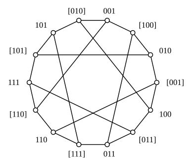](../../assets/volume4a/figures/diagram-7-57-incidence-bipartite.svg)

(57)

它包含 $28$ 个长度为 $3$ 的圈, 例如

$$
[\mathtt{101}]\mathrel{\text{—}}\mathtt{101}\mathrel{\text{—}}[\mathtt{010}]\mathrel{\text{—}}\mathtt{001}\mathrel{\text{—}}[\mathtt{100}]\mathrel{\text{—}}\mathtt{010}\mathrel{\text{—}}[\mathtt{101}].\tag{58}
$$

超图 $H$ 的对偶 $H^T$ 是通过交换 $H$ 中顶点与边的角色但保留关联关系获得的. 换句话说, 它对应于转置关联矩阵. 请注意, $r$ 正则图的对偶是 $r$ 一致超图.

关联矩阵和二部图可以对应于某些边出现一次以上的超图, 因为矩阵的不同列可能是相等的. 当超图 $H=(V,E)$ 不包含任何重复的边时, 它还对应于另一个组合对象, 也就是一个布尔函数. 这是因为, 如果顶点集 $V$ 是 $\{1,2,\ldots,n\}$, 那么, 函数

$$
h(x_1,x_2,\ldots,x_n)=\bigl[\{j\mid x_j=1\}\in E\bigr].\tag{59}
$$

刻画 $H$ 的边的特征. 例如, 布尔公式

$$
\begin{aligned}
&(x_1\oplus x_2\oplus x_3)\land(x_2\oplus x_4\oplus x_6)\land(x_3\oplus x_4\oplus x_7)\\
&\qquad\land(x_3\oplus x_5\oplus x_6)\land(\bar{x}_1\lor\bar{x}_2\lor\bar{x}_4)
\end{aligned}\tag{60}
$$

是描述超图 $(56)$ 和 $(57)$ 的另一种方式.

可以用如此多的方法观察组合对象, 这个事实也许令人惊奇. 但是, 这也是极为有用的, 因为它提出了求解等价问题的不同方法. 当我们从不同角度考察一个问题时, 在头脑中自然会思考不同的解决方法. 有时, 我们通过考虑如何处理一个矩阵中的行和列获得最佳见解; 有时, 凭借想象顶点和路径, 或者依据观察空间中点的聚合取得进展; 有时, 布尔代数正是我们需要的. 如果我们在一个领域受挫, 也可能从另一个领域获救.

**覆盖与独立性.** 假定 $H=(V,E)$ 是一个图或者超图, 如果它的每条边至少包含顶点集 $U$ 的一个元素, 就说 $U$ 覆盖 $H$. 如果 $H$ 中没有边完全包含在顶点集 $W$ 中, 就说 $W$ 在 $H$ 中是独立的 (或者是 “稳定” 的).

按照关联矩阵的观点, 覆盖是关联矩阵的一些行的集合, 它们的每一列元素之和不为零. 在 $H$ 是图的特殊情形, 关联矩阵每一列恰好包含两个 $1$. 因此, 图中的一个独立集对应于相互正交的行的集合, 也就是任何不同两行的点积为零的行的集合.

这两个概念恰如同一枚硬币的两面, 它们是密不可分的. 如果 $U$ 覆盖 $H$, 那么 $W=V\setminus U$ 在 $H$ 中是独立的; 反过来, 如果 $W$ 在 $H$ 中是独立的, 那么 $U=V\setminus W$ 覆盖 $H$. 这两个命题都与 “诱导超图 $H\vert W$ 没有边” 的断言是等价的.

覆盖与独立性之间的这种双重关系, 可能是由克劳德·贝尔热 [*Proc. National Acad. Sci.* **43** (1957), 842–844] 首先指出的, 这个关系看似矛盾而实际上是正确的. 虽然它在逻辑上显而易见且容易证实, 但直观上还是令人惊奇. 当我们考察一个图并试图寻找一个大的独立集时, 在思路上多半与考察同一个图并试图寻找一个小的顶点覆盖有很大差别. 然而, 两者的目标是一致的.

如果对于所有 $u\in U$, $U\setminus u$ 不是一个覆盖, 则覆盖集 $U$ 是极小覆盖集. 同样, 如果对于所有 $w\in V\setminus W$, $W\cup w$ 不是一个独立集, 则独立集 $W$ 是极大独立集. 例如, 下面是美国本土各州 (含 DC) 的 $49$ 顶点图 $(17)$ 的极小覆盖集, 以及对应的极大独立集:

[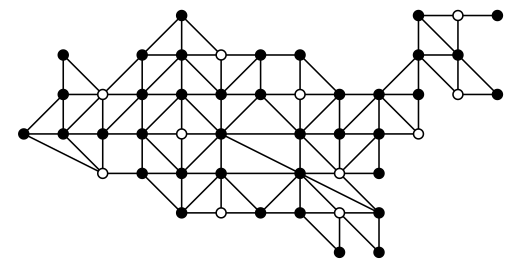](../../assets/volume4a/figures/diagram-7-61-minimal-cover.svg)

极小覆盖集, 有 $38$ 个顶点

[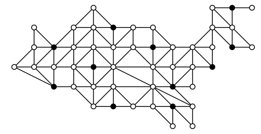](../../assets/volume4a/figures/diagram-7-61-maximal-independent.svg)

极大独立集, 有 $11$ 个顶点

(61)

如果一个覆盖具有可能的最小大小, 则称它为最小覆盖集. 如果一个独立集具有可能的最大大小, 则称它为最大独立集. 例如, 我们用图 $(17)$ 可以做出比 $(61)$ 更好的结果:

[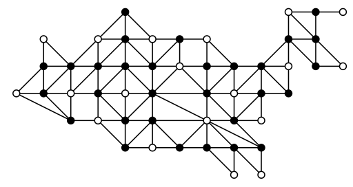](../../assets/volume4a/figures/diagram-7-62-minimum-cover.svg)

最小覆盖集, 有 $30$ 个顶点

[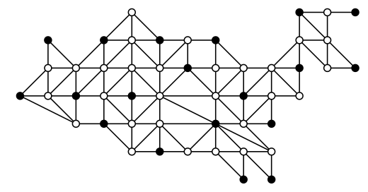](../../assets/volume4a/figures/diagram-7-62-maximum-independent.svg)

最大独立集, 有 $19$ 个顶点

(62)

注意这里 “极小”(minimal) 与 “最小”(minimum) 之间的细微差别: 一般来说 (但与多数英语字典不同), 研究组合算法的人使用 “minimal” (极小的) 或 “optimal” (极优的) 这种带 “-al” 的词, 是指少许改变不会改进组合结构的意义下是局部最佳的; 而把 “minimum” (最小的) 或 “optimum” (最优的) 这种带 “-um” 的词留作指组合结构在全部可能性的意义下是全局最佳的. 对于任何最优化问题, 很容易通过重复爬坡直到山顶的方法, 求出仅仅在局部的弱意义下极优的解. 但是, 寻找真正的最优解通常困难得多. 例如, 在 7.9 节我们将看到, 求给定图的最大独立集问题属于一类称为 NP 完全的困难问题.

即使一个问题是 NP 完全问题, 我们也不要丧失信心. 在这一章的若干节我们将讨论求最小覆盖的方法, 这些方法适用于求解较小的问题. 在仅仅检验 $2^{49}$ 种可能性的一小部分后, 我们就能在一秒之内求出 $(62)$ 中的最优解. 此外, NP 完全问题的某些特例经常比一般情形的问题更简单. 在 7.5.1 节和 7.5.5 节我们将看到, 在任何二部图中, 或者在作为一个图的对偶的任何超图中, 可以很快找到最小顶点覆盖. 此外, 我们将研究寻找最大匹配的有效方法, 这种匹配是某个给定图的线图的最大独立集.

由于频繁出现求独立集大小的最大值问题, 它获得了一个特殊记号: 如果 $H$ 是任意超图, 数

$$
\alpha(H)=\max\{|W|\mid W\text{ 是 }H\text{ 中顶点的独立集}\}\tag{63}
$$

称为 $H$ 的独立数 (或稳定数). 同样, 数

$$
\chi(H)=\min\{k\mid H\text{ 是 }k\text{ 可着色的}\}\tag{64}
$$

称为 $H$ 的色数. 注意, $\chi(H)$ 是 $H$ 依据独立集的最小覆盖的大小, 因为按照我们的定义, 获得任何特定颜色的顶点集必定是独立的.

当 $H$ 是普通图时, $\alpha(H)$ 和 $\chi(H)$ 这两个定义也适用, 但是, 在这种情形下我们通常写成 $\alpha(G)$ 和 $\chi(G)$. 图还有一个重要的数, 称为团数:

$$
\omega(G)=\max\{|X|\mid X\text{ 是 }G\text{ 中的团}\},\tag{65}
$$

其中 “团” 是相互邻接的顶点的集合. 显然

$$
\omega(G)=\alpha(\overline G),\tag{66}
$$

因为 $G$ 中的团是补图中的独立集. 同样, 我们可以看出, $\chi(\overline G)$ 是 “团覆盖” 的最小大小, 它是恰好覆盖所有顶点的团的集合.

这一节前面提到 “恰当覆盖问题” 的若干实例时, 我们没有确切说明这样的问题为什么确实是重要的. 现在能够给出解释: 给定超图 $H$ 的关联矩阵, $H$ 的恰当覆盖是那些和为 $(11\ldots1)$ 的行的集合. 换句话说, 恰当覆盖是接触每条超边恰好一次的顶点的集合, 而普通覆盖仅需要顶点接触每条超边至少一次.

## 习题

**1.** [*25*][答案](./answers/7.md#ans-7-1) 假定 $n=4m-1$. 构造数列 $\{1,1,\ldots,n,n\}$ 的兰福德配对排列, 它们具备以下性质: 通过将第一个 $2m-1$ 改变为 $4m$ 并在右边添加 $2m-1$、$4m$, 我们同样获得对于 $n=4m$ 的解. 提示: 把 $m-1$ 个偶数 $4m-4,4m-6,\ldots,2m$ 放在左边.

**2.** [*20*][答案](./answers/7.md#ans-7-2) 哪些 $n$ 能让 $\{0,0,1,1,\ldots,n-1,n-1\}$ 排列成兰福德配对排列?

**3.** [*22*][答案](./answers/7.md#ans-7-3) 假定我们在一个圈上而不是一条直线上排列数字 $\{0,0,1,1,\ldots,n-1,n-1\}$, 使得在两个 $k$ 之间的距离为 $k$. 我们能获得实际上不同于习题 2 的那些解吗?

**4.** [*M20*][答案](./answers/7.md#ans-7-4) (斯科伦, 1957) 假定我们仅仅独立地用 $0,1,2$ 等从左到右代替习题 1.2.8–36 的斐波那契串 $S_\infty=\mathtt{babbababbabba}\ldots$ 中的 $a$ 和 $b$. 证明: $S_\infty$ 对于所有非负整数的集合直接导致一个兰福德配对的无穷序列 $\mathtt{0012132453674}\ldots$.

**5.** [*HM22*][答案](./answers/7.md#ans-7-5) 如果 $\{1,1,2,2,\ldots,n,n\}$ 的排列是随机选择的, 那么对于给定的 $k$, 排列中的两个 $k$ 之间恰好有 $k$ 个非 $k$ 的数的概率是多少? 利用这个公式推测式 (1) 中的兰福德数 $L_n$ 的大小.

▶ **6.** [*M28*][答案](./answers/7.md#ans-7-6) (迈克尔·戈弗雷, 2002) 令 $f(x_1,\ldots,x_{2n})=\prod_{k=1}^{n}(x_kx_{n+k}\sum_{j=1}^{2n-k-1}x_jx_{j+k+1})$.

(a) 证明

$$
\sum_{x_1,\ldots,x_{2n}\in\{-1,+1\}}f(x_1,\ldots,x_{2n})=2^{2n+1}L_n.
$$

(b) 说明如何用 $O(4^n n)$ 步求这个和的值. 对于算术运算需要取多少二进制位精度?

(c) 利用恒等式

$$
\begin{aligned}
f(x_1,\ldots,x_{2n})
&=f(-x_1,\ldots,-x_{2n})\\
&=f(x_{2n},\ldots,x_1)\\
&=f(x_1,-x_2,\ldots,x_{2n-1},-x_{2n}),
\end{aligned}
$$

把求和的计算量减少到原来的八分之一.

**7.** [*M22*][答案](./answers/7.md#ans-7-7) 证明: 当从左到右读出 $\{1,1,\ldots,16,16\}$ 的每个兰福德配对排列时, 必定在某个点有 $7$ 个未完成配对.

**8.** [*23*][答案](./answers/7.md#ans-7-8) 最简单的兰福德序列不仅是完全平衡的, 还是平面的, 如果其配对的连线不像 $(2)$ 中那样交叉:

[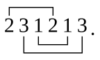](../../assets/volume4a/figures/exercise-7-8-planar-pairs.svg)

对于 $n\leq8$, 求所有平面的兰福德配对排列.

**9.** [*24*][答案](./answers/7.md#ans-7-9) (兰福德三重数排列) 有多少种可能的排列方式把 $\{1,1,1,2,2,2,\ldots,9,9,9\}$ 排成一行, 使得对于 $1\leq k\leq9$, 在相继的 $k$ 之间的距离为 $k$?

**10.** [*M20*][答案](./answers/7.md#ans-7-10) 说明如何直接从图 1 构造幻方. (用某种方法把每张牌转换成 $1$ 至 $16$ 之间的一个数, 使得所有的行、列以及对角线上的数值之和为 $34$.)

**11.** [*20*][答案](./answers/7.md#ans-7-11) 通过给每个分隔的两字母串附加字母 $\{\aleph,\beth,\gimel,\daleth\}$ 之一, 把 $(5)$ 中的 “希腊-拉丁” 方扩展为 “希伯来-希腊-拉丁” 方. 字母配对 (拉丁, 希腊)、(拉丁, 希伯来) 或 (希腊, 希伯来) 不应出现在一处以上的地方.

▶ **12.** [*M21*][答案](./answers/7.md#ans-7-12) (莱昂哈德·欧拉) 对于 $0\leq i,j<n$, 令 $L_{ij}=(i+j)\bmod n$ 是对整数模 $n$ 的加法表. 证明: 存在同 $L$ 正交的拉丁方当且仅当 $n$ 是奇数.

**13.** [*M25*][答案](./answers/7.md#ans-7-13) $10\times10$ 的正方形可以分成大小为 $5\times5$ 的 $4$ 个四等分. 对于一个由数字 $\{0,1,\ldots,9\}$ 构成的 $10\times10$ 拉丁方, 如果其左上方的四等分恰好有 $k$ 个元素 $\geq5$, 则它有 $k$ 个 “闯入者”. (见习题 14(e) 中 $k=3$ 的例子.) 证明: 这个正方形没有正交配对, 除非至少有 $3$ 个闯入者.

**14.** [*29*][答案](./answers/7.md#ans-7-14) 求下列拉丁方的所有正交配对:

| (a) | (b) | (c) | (d) | (e) |
| --- | --- | --- | --- | --- |
| <code style="white-space:pre;">3145926870</code> | <code style="white-space:pre;">2718459036</code> | <code style="white-space:pre;">0572164938</code> | <code style="white-space:pre;">1680397425</code> | <code style="white-space:pre;">7823456019</code> |
| <code style="white-space:pre;">2819763504</code> | <code style="white-space:pre;">0287135649</code> | <code style="white-space:pre;">6051298473</code> | <code style="white-space:pre;">8346512097</code> | <code style="white-space:pre;">8234067195</code> |
| <code style="white-space:pre;">9452307168</code> | <code style="white-space:pre;">7524093168</code> | <code style="white-space:pre;">4867039215</code> | <code style="white-space:pre;">9805761342</code> | <code style="white-space:pre;">2340178956</code> |
| <code style="white-space:pre;">6208451793</code> | <code style="white-space:pre;">1435962780</code> | <code style="white-space:pre;">1439807652</code> | <code style="white-space:pre;">2754689130</code> | <code style="white-space:pre;">3401289567</code> |
| <code style="white-space:pre;">8364095217</code> | <code style="white-space:pre;">6390718425</code> | <code style="white-space:pre;">8324756091</code> | <code style="white-space:pre;">0538976214</code> | <code style="white-space:pre;">4012395678</code> |
| <code style="white-space:pre;">5981274036</code> | <code style="white-space:pre;">4069271853</code> | <code style="white-space:pre;">7203941586</code> | <code style="white-space:pre;">4963820571</code> | <code style="white-space:pre;">5678912340</code> |
| <code style="white-space:pre;">4627530981</code> | <code style="white-space:pre;">3102684597</code> | <code style="white-space:pre;">5610473829</code> | <code style="white-space:pre;">7192034658</code> | <code style="white-space:pre;">6789523401</code> |
| <code style="white-space:pre;">0576148329</code> | <code style="white-space:pre;">9871546302</code> | <code style="white-space:pre;">9148625307</code> | <code style="white-space:pre;">6219405783</code> | <code style="white-space:pre;">0195634782</code> |
| <code style="white-space:pre;">1730689452</code> | <code style="white-space:pre;">8956307214</code> | <code style="white-space:pre;">2795380164</code> | <code style="white-space:pre;">3471258906</code> | <code style="white-space:pre;">1956740823</code> |
| <code style="white-space:pre;">7093812645</code> | <code style="white-space:pre;">5643820971</code> | <code style="white-space:pre;">3986512740</code> | <code style="white-space:pre;">5027143869</code> | <code style="white-space:pre;">9567801234</code> |

**15.** [*50*][答案](./answers/7.md#ans-7-15) 求三个相互正交的 $10\times10$ 拉丁方.

**16.** [*48*][答案](./answers/7.md#ans-7-16) (赫伯特·赖瑟, 1967) 一个有 $n$ 行 $n$ 列和 $n$ 个符号的拉丁方称为 “$n$ 阶” 拉丁方. 每个奇数阶的拉丁方都有一个横截吗?

**17.** [*25*][答案](./answers/7.md#ans-7-17) 对于 $0\leq i,j<n$, 令 $L$ 是以 $L_{ij}$ 为元素的拉丁方. 试说明: 以下问题是一般恰当覆盖问题的特例: (a) 求 $L$ 的所有横截; (b) 求 $L$ 的所有正交配对.

**18.** [*M26*][答案](./answers/7.md#ans-7-18) 如果数字串 $x_1x_2\ldots x_N$ 的每个元素 $x_j$ 都属于 $n$ 进制数字集 $\{0,1,\ldots,n-1\}$, 则称它为 “$n$ 进制” 串. 对于 $1\leq j\leq N$, 如果两个串 $x_1x_2\ldots x_N$ 和 $y_1y_2\ldots y_N$ 的 $N$ 个配对 $(x_j,y_j)$ 是不同的, 就称它们是正交的. (因此, 如果两个 $n$ 进制串的长度 $N$ 超过 $n^2$, 则它们不可能是正交的.) 一个 $m$ 行 $n^2$ 列的 $n$ 进制矩阵, 如果它的行是相互正交的, 则称它是深度 $m$ 的 $n$ 阶正交阵列.

求深度 $m$ 的正交阵列与 $m-2$ 个相互正交的拉丁方的列表之间的对应. 与习题 11 对应的正交阵列是什么?

▶ **19.** [*M25*][答案](./answers/7.md#ans-7-19) 续习题 18, 证明: 仅当 $m\leq n+1$ 时, 可能存在深度 $m$ 的 $n>1$ 阶正交阵列. 说明这个上限当 $n$ 是素数 $p$ 时是可以达到的. 写出 $p=5$ 时的例子.

**20.** [*HM20*][答案](./answers/7.md#ans-7-20) 证明: 如果在一个正交阵列中用 $e^{2\pi ki/n}$ 代替每个元素 $k$, 阵列的行就变成通常意义下的正交向量 (它们的点积为零).

▶ **21.** [*M21*][答案](./answers/7.md#ans-7-21) 几何网格是由遵守下述三条公理的点和直线构成的系统:

(i) 每条直线是点的集合.

(ii) 不同的直线最多有一个公共点.

(iii) 如果 $p$ 是一个点而 $L$ 是一条直线, $p\notin L$, 那么, 恰有一条直线 $M$ 使得 $p\in M$ 且 $L\cap M=\varnothing$.

如果 $L\cap M=\varnothing$, 我们说 $L$ 同 $M$ 是平行的, 记为 $L\parallel M$.

(a) 证明: 可以把一个几何网格的直线划分成等价类, 其中两条直线属于同一类, 当且仅当它们是等同或平行的.

(b) 证明: 如果至少有平行直线的两个类, 那么每条直线包含的点数与它所在类中的其他直线相同.

(c) 此外, 如果至少有三个类, 那么存在这样两个数 $m$ 和 $n$, 使得所有点恰好属于 $m$ 条直线, 且所有直线恰好包含 $n$ 个点.

▶ **22.** [*M22*][答案](./answers/7.md#ans-7-22) 证明可以把每个正交阵列当成一个几何网格. 反过来也为真吗?

**23.** [*M23*][答案](./answers/7.md#ans-7-23) (纠错码) 两个数字串 $x=x_1\ldots x_N$ 和 $y=y_1\ldots y_N$ 之间的 “汉明距离”$d(x,y)$ 是其中 $x_j\ne y_j$ 的位置 $j$ 的数量. 一个 “带 $n$ 个信息数字和 $r$ 个检验数字的 $b$ 进制码” 是 $b^n$ 个数字串 $x=x_1\ldots x_{n+r}$ 的集合 $C(b,n,r)$, 其中 $0\leq x_j<b$($1\leq j\leq n+r$). 如果我们在一端传输码字 $x$, 并在另一端接收到消息 $y$, 那么 $d(x,y)$ 表示传输差错的数量. 当消息 $y$ 以 $d(x,y)\leq t$ 接收时, 如果我们能够重构 $x$ 的值, 就称该码是 $t$ 纠错的. 码的距离是 $d(x,x')$ 在所有 $x\ne x'$ 的码字配对上所取的最小值.

(a) 证明: 一个码是 $t$ 纠错的, 当且仅当它的距离超过 $2t$.

(b) 证明: 一个带 $2$ 个信息数字和 $2$ 个检验数字的单纠错 $b$ 进制码, 等价于一对 $b$ 阶的正交拉丁方.

(c) 此外, 一个距离为 $r+1$ 的码 $C(b,2,r)$ 等价于一组 $r$ 个相互正交的 $b$ 阶拉丁方.

▶ **24.** [*M30*][答案](./answers/7.md#ans-7-24) 一个带有 $N$ 个点和 $R$ 条直线的几何网格, 自然地导致带有由奇偶检验位

$$
x_{N+k}=f_k(x_1,\ldots,x_N)
=\left(\sum\{x_j\mid\text{点 }j\text{ 位于直线 }k\text{ 上}\}\right)\bmod2
$$

定义的码字 $x_1\ldots x_Nx_{N+1}\ldots x_{N+R}$ 的二进制码 $C(2,N,R)$.

(a) 如果网格有平行线的 $m$ 个类, 证明这个码的距离为 $m+1$.

(b) 寻找用这种码纠正 $t$ 个差错的一种有效方法, 假定 $m=2t$. 说明在 $N=25$、$R=30$、$t=3$ 情形下的解码过程.

**25.** [*27*][答案](./answers/7.md#ans-7-25) 寻找一个行和列都为五字母单词的拉丁方. (做这道题需要查阅大型字典.)

▶ **26.** [*25*][答案](./answers/7.md#ans-7-26) 造一个有意义的英语句子, 其中只包含五字母单词.

**27.** [*20*][答案](./answers/7.md#ans-7-27) 对于 $1\leq k\leq5$, 有多少个 SGB 单词恰好包含 $k$ 个不同的字母?

**28.** [*20*][答案](./answers/7.md#ans-7-28) 在 SGB 的单词向量中存在每个分量相差 $\pm1$ 的任何配对吗?

**29.** [*20*][答案](./answers/7.md#ans-7-29) 在 SGB 单词中寻找构成回文 (等于自身的镜像) 或者构成镜像配对 (如 `regal`、`lager`) 的所有单词.

▶ **30.** [*20*][答案](./answers/7.md#ans-7-30) 在单词 `first` 中, 它从左到右的各个字母是按字母顺序排列的. 按字典序, 第一个这样的五字母单词是什么? 最后一个这样的五字母单词是什么?

**31.** [*21*][答案](./answers/7.md#ans-7-31) (克里斯托弗·麦克马纳斯) 寻找 SGB 的所有这样的三单词集合, 这些单词的各个分量构成等差数列, 但在任何固定位置上没有共同字母. (一个这样的例子是 $\{\mathtt{power},\mathtt{slugs},\mathtt{visit}\}$.)

**32.** [*23*][答案](./answers/7.md#ans-7-32) 英语中是否包含 $a_0a_1\ldots a_9$ 这样的十字母单词, 使得 $a_0a_2a_4a_6a_8$ 和 $a_1a_3a_5a_7a_9$ 都是 SGB 单词?

**33.** [*20*][答案](./answers/7.md#ans-7-33) (斯科特·莫里斯) 完成由 $26$ 个有趣的 SGB 单词构成的单词表的填写:

$$
\mathtt{about},\ \mathtt{bacon},\ \mathtt{faced},\ \mathtt{under},\ \mathtt{chief},\ \ldots,\ \mathtt{pizza}.
$$

▶ **34.** [*21*][答案](./answers/7.md#ans-7-34) 对于每个不含字母 `y` 的 SGB 单词, 通过把元音 $\{\mathtt{a},\mathtt{e},\mathtt{i},\mathtt{o},\mathtt{u}\}$ 改为 $1$, 其他字母改为 $0$, 得到一个 $5$ 位二进制数. 对于 $32$ 种二进制数结果的每一种, 最常见的单词是什么?

▶ **35.** [*26*][答案](./answers/7.md#ans-7-35) 从 `WORDS(1000)` 中精选的 $16$ 个单词构成分支模式

[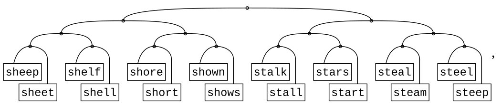](../../assets/volume4a/figures/exercise-7-35-word-trie.svg)

这是以字母 `s` 开头的单词的完全二叉检索树. 但是, 即使我们考察整个 `WORDS(5757)` 集合, 也不存在以字母 `a` 开头的单词的这种模式.

给定 $n$, 字母表中哪些字母可以作为 `WORDS(n)` 中 $16$ 个单词的开始字母, 以此构成完全二叉检索树?

**36.** [*M17*][答案](./answers/7.md#ans-7-36) 解释呈现在词立方 $(10)$ 中的对称性. 此外, 说明仅改变两个单词 $\{\mathtt{stove},\mathtt{event}\}$ 就可以获得其他两个这样的词立方.

**37.** [*20*][答案](./answers/7.md#ans-7-37) 图 `words(5757,0,0,0)` 的哪些顶点具有最大的度数?

**38.** [*22*][答案](./answers/7.md#ans-7-38) 利用 $(14)$ 中的有向图规则, 恰好用三步把 `tears` (眼泪) 改变为 `smile` (微笑), 不用计算机帮助.

**39.** [*M00*][答案](./answers/7.md#ans-7-39) $G\setminus e$ 是 $G$ 的诱导子图吗? 它是生成子图吗?

**40.** [*M15*][答案](./answers/7.md#ans-7-40) 当 $|V|=n$ 且 $|E|=e$ 时, (a) 图 $G=(V,E)$ 有多少生成子图? (b) 它有多少诱导子图?

**41.** [*M10*][答案](./answers/7.md#ans-7-41) 对于哪些整数 $n$ 我们有 (a) $K_n=P_n$? (b) $K_n=C_n$?

**42.** [*15*][答案](./answers/7.md#ans-7-42) (德里克·莱默) 令 $G$ 是有 $13$ 个顶点的图, 其中每个顶点的度为 $5$. 提出关于 $G$ 的一个非平凡命题.

**43.** [*23*][答案](./answers/7.md#ans-7-43) 以下图中有什么图和佩特森图是一样的吗?

[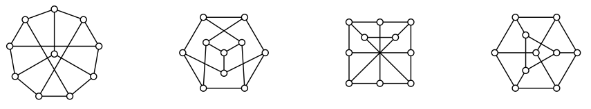](../../assets/volume4a/figures/exercise-7-43-four-graphs.svg)

**44.** [*M23*][答案](./answers/7.md#ans-7-44) 赫瓦塔尔图具备多少对称性? (见图 2(f).)

**45.** [*20*][答案](./answers/7.md#ans-7-45) 寻找对平面图 $(17)$ 着 $4$ 色的一种简便方法. 用 $3$ 种颜色足以着色吗?

**46.** [*M25*][答案](./answers/7.md#ans-7-46) 令 $G$ 是由一个平面示意图定义的具有 $n\geq3$ 个顶点的图, 在非邻接顶点之间不能画出与现存边不交叉连线的意义下, 它是 “极大的”.

(a) 证明这个示意图把平面划分成若干区域, 每个区域在它们的边界上恰好有三个顶点. (这些区域之一是位于示意图外部的所有点的集合.)

(b) 由此 $G$ 恰好有 $3n-6$ 条边.

**47.** [*M22*][答案](./answers/7.md#ans-7-47) 证明: 完全二部图 $K_{3,3}$ 不是平面图.

**48.** [*M25*][答案](./answers/7.md#ans-7-48) 通过证明定理 B 所述证明过程不会对两个邻接顶点给出相同的颜色, 完成该定理的证明.

**49.** [*18*][答案](./answers/7.md#ans-7-49) 画出至多具有 $6$ 个顶点的所有立方图的示意图.

**50.** [*M24*][答案](./answers/7.md#ans-7-50) 寻找恰好用 $24$ 种方式着 $3$ 色的所有二部图.

▶ **51.** [*M22*][答案](./answers/7.md#ans-7-51) 给定如习题 21 中描述的几何网格, 构造以网格的点 $p$ 和线 $L$ 为顶点的二部图, 其中有 $p\mathrel{\text{—}}L$ 当且仅当 $p\in L$. 这个图的围长是多少?

**52.** [*M16*][答案](./answers/7.md#ans-7-52) 求一个简单的不等式, 表示图的直径与其围长的关系. (如果围长很大, 直径可能有多小?)

**53.** [*15*][答案](./answers/7.md#ans-7-53) 单词 `world` 和 `happy` 中的哪一个属于图 `words(5757,0,0,0)` 的巨大分图?

▶ **54.** [*21*][答案](./answers/7.md#ans-7-54) 按字母顺序, 图 $(17)$ 中的 $49$ 个邮政编码是 `AL, AR, AZ, CA, CO, CT, DC, DE, FL, GA, IA, ID, IL, IN, KS, KY, LA, MA, MD, ME, MI, MN, MO, MS, MT, NC, ND, NE, NH, NJ, NM, NV, NY, OH, OK, OR, PA, RI, SC, SD, TN, TX, UT, VA, VT, WA, WI, WV, WY`.

(a) 我们假定, 如果两个邮政编码的首字母相同或末字母相同 (即 $\mathtt{AL}\mathrel{\text{—}}\mathtt{AR}\mathrel{\text{—}}\mathtt{OR}\mathrel{\text{—}}\mathtt{OH}$, 等等), 就认为两州是邻接的. 这个图有什么分图?

(b) 现在建立带 $\mathtt{XY}\longrightarrow\mathtt{YZ}$ 的有向图 (例如 $\mathtt{AL}\longrightarrow\mathtt{LA}\longrightarrow\mathtt{AR}$ 等等). 这个图有什么强连通分图? (见 2.3.4.2 节.)

(c) 除 $(17)$ 的那些邮政编码之外, 美国还有其他邮政编码: `AA, AE, AK, AP, AS, FM, GU, HI, MH, MP, PW, PR, VI`. 使用全部 $62$ 个邮政编码, 重新考虑问题 (b).

**55.** [*M20*][答案](./answers/7.md#ans-7-55) 在完全 $k$ 部图 $K_{n_1,\ldots,n_k}$ 中有多少条边?

▶ **56.** [*M10*][答案](./answers/7.md#ans-7-56) 判别真假: 多重图是图, 当且仅当对应的有向图是简单图.

**57.** [*M10*][答案](./answers/7.md#ans-7-57) 判别真假: 顶点 $u$ 和 $v$ 在有向图的同一连通分图中, 当且仅当 $d(u,v)<\infty$ 或 $d(v,u)<\infty$.

**58.** [*M17*][答案](./answers/7.md#ans-7-58) 描述作为 $2$ 度正则图的 (a) 全部图; (b) 全部多重图.

▶ **59.** [*M23*][答案](./answers/7.md#ans-7-59) 一个 $n$ 阶竞赛图是 $n$ 个顶点上的有向图, 它恰好有 $\binom n2$ 条弧; 每对不同的顶点 $\{u,v\}$ 之间恰有一条弧, 方向或者是 $u\longrightarrow v$, 或者是 $v\longrightarrow u$.

(a) 证明每个竞赛图包含一条有向生成路径 $v_1\longrightarrow\cdots\longrightarrow v_n$.

(b) 考虑顶点集 $\{0,1,2,3,4\}$ 上的竞赛图, 对它有 $u\longrightarrow v$, 当且仅当 $(u-v)\bmod5\geq3$. 它有多少条有向生成路径?

(c) $K_n^{\rightarrow}$ 是仅有的具有唯一一条有向生成路径的 $n$ 阶竞赛图吗?

▶ **60.** [*M22*][答案](./answers/7.md#ans-7-60) 令 $u$ 是竞赛图中最大出度的顶点, $v$ 是其他任意一个顶点. 证明 $d(u,v)\leq2$.

**61.** [*M16*][答案](./answers/7.md#ans-7-61) 构造一个有向图, 它有 $k$ 条从顶点 $1$ 到顶点 $2$ 的长度为 $k$ 的通道.

**62.** [*M21*][答案](./answers/7.md#ans-7-62) 置换有向图是图中每个顶点有出度 $1$ 和入度 $1$ 的有向图. 因此, 它的分图是定向圈. 如果它有 $n$ 个顶点和 $k$ 个分图, 当 $n-k$ 为偶数时称它为偶的, 当 $n-k$ 为奇数时称它为奇的.

(a) 令 $G$ 是带邻接矩阵 $A$ 的有向图. 证明: $G$ 的生成置换有向图的数量是矩阵 $A$ 的积和式 $\operatorname{per}A$.

(b) 用生成置换有向图的术语解释行列式 $\det A$.

**63.** [*M23*][答案](./answers/7.md#ans-7-63) 令 $G$ 是一个围长 $g$ 的图, 它的每个顶点至少有 $d$ 个邻近. 证明: $G$ 至少有 $N$ 个顶点, 其中

$$
N=\begin{cases}
1+\sum_{0\leq k<t}d(d-1)^k,&\text{如果 }g=2t+1;\\
1+(d-1)^t+\sum_{0\leq k<t}d(d-1)^k,&\text{如果 }g=2t+2.
\end{cases}
$$

▶ **64.** [*M21*][答案](./answers/7.md#ans-7-64) 续习题 63, 证明: 对于每个 $d\geq2$, 存在唯一一个围长 $4$ 最小度数 $d$ 的 $2d$ 阶的图.

▶ **65.** [*HM31*][答案](./answers/7.md#ans-7-65) 假定图 $G$ 的围长为 $5$, 最小度数为 $d$, 有 $N=d^2+1$ 个顶点.

(a) 证明: $G$ 的邻接矩阵 $A$ 满足等式 $A^2+A=(d-1)I+J$.

(b) 由于 $A$ 是对称矩阵, 它具有 $N$ 个正交的与特征值 $\lambda_j$ 对应的特征向量 $x_j$, 使得 $Ax_j=\lambda_jx_j$, 其中 $1\leq j\leq N$. 证明: 每个 $\lambda_j$ 或者是 $d$ 或者是 $(-1\pm\sqrt{4d-3})/2$.

(c) 证明: 如果 $\sqrt{4d-3}$ 是无理数, 那么 $d=2$. 提示: $\lambda_1+\cdots+\lambda_N=\operatorname{trace}(A)=0$.

(d) 此外, 如果 $\sqrt{4d-3}$ 是有理数, 那么 $d\in\{3,7,57\}$.

**66.** [*M30*][答案](./answers/7.md#ans-7-66) 续习题 65, 构造 $d=7$ 时这样的图.

**67.** [*M48*][答案](./answers/7.md#ans-7-67) 存在围长 $5$ 度数 $57$ 的 $3250$ 阶正则图吗?

**68.** [*M20*][答案](./answers/7.md#ans-7-68) $n$ 个顶点的图 $G$ 有多少不同的邻接矩阵?

▶ **69.** [*20*][答案](./answers/7.md#ans-7-69) 扩充 $(31)$, 说明: 在一个用 SGB 格式表示的图中, 如何对所有顶点 $v$ 同时计算出度 $\operatorname{ODEG}(v)$ 和入度 $\operatorname{IDEG}(v)$.

▶ **70.** [*M20*][答案](./answers/7.md#ans-7-70) 当用算法 B 成功对带 $m$ 条弧和 $n$ 个顶点的图进行 $2$ 着色时, 它的每一步通常执行多少次?

**71.** [*26*][答案](./answers/7.md#ans-7-71) 使用 `MMIXAL` 汇编语言在 `MMIX` 计算机上实现算法 B. 假定在程序开始时, 寄存器 `v0` 指向第一个顶点结点, 寄存器 `n` 包含顶点的个数.

▶ **72.** [*M22*][答案](./answers/7.md#ans-7-72) 当 $\operatorname{COLOR}(v)$ 在步骤 B6 设置时, 称 $u$ 为 $v$ 的母体; 但当 $\operatorname{COLOR}(w)$ 在步骤 B3 设置时, 称 $w$ 无母体. 把顶点 $v$ 的 (包容) 先辈递归地定义为 $v$ 以及 $v$ 的母体的先辈 (如果存在的话).

(a) 证明: 在算法 B 的栈中, 如果 $v$ 在 $u$ 之下, 那么 $v$ 的母体是 $u$ 的先辈.

(b) 此外, 在步骤 B6 中, 如果 $\operatorname{COLOR}(v)=\operatorname{COLOR}(u)$, 那么 $v$ 当前在栈中.

(c) 利用这些论据扩充算法 B: 当给出的图不是二部图时, 在一个奇数长度圈中的顶点名称是算法的输出.

**73.** [*15*][答案](./answers/7.md#ans-7-73) `random_graph(10,45,0,0,0,0,0,0,0,0)` 的另一名称是什么?

**74.** [*21*][答案](./answers/7.md#ans-7-74) `roget(1022,0,0,0)` 的哪些顶点具有最大的出度?

**75.** [*22*][答案](./answers/7.md#ans-7-75) SGB 图生成器 $\operatorname{board}(n_1,n_2,n_3,n_4,p,w,o)$ 创建一个图, 其顶点是 $t$ 维整数向量 $(x_1,\ldots,x_t)$($0\leq x_i<b_i$), 该图由前 $4$ 个参数 $(n_1,n_2,n_3,n_4)$ 确定如下: 置 $n_5\leftarrow0$, 令 $j\geq0$ 是 $n_{j+1}\leq0$ 的最小值. 如果 $j=0$, 置 $b_1\leftarrow b_2\leftarrow8$ 和 $t\leftarrow2$; 这是默认的 $8\times8$ 棋盘. 否则如果 $n_{j+1}=0$, 对于 $1\leq i\leq j$ 置 $b_i\leftarrow n_i$, 并且置 $t\leftarrow j$. 最后, 如果 $n_{j+1}<0$, 置 $t\leftarrow|n_{j+1}|$, 并且置 $b_i$ 为周期序列 $(n_1,\ldots,n_j,n_1,\ldots,n_j,n_1,\ldots)$ 的第 $i$ 个元素. (例如, 指定参数 $(n_1,n_2,n_3,n_4)=(2,3,5,-7)$ 已经差不多是能遇到的最难理解的设置了. 它产生一块具备 $(b_1,\ldots,b_7)=(2,3,5,2,3,5,2)$ 的 $7$ 维棋盘, 因此是有 $2\cdot3\cdot5\cdot2\cdot3\cdot5\cdot2=1800$ 个顶点的图.)

关于 “棋子、回卷和方向” 的其余参数 $(p,w,o)$ 决定图中的弧. 首先假定 $w=o=0$. 如果 $p>0$, 我们对于 $1\leq i\leq t$ 有 $(x_1,\ldots,x_t)\longrightarrow(y_1,\ldots,y_t)$, 当且仅当 $y_i=x_i+\delta_i$, 其中 $(\delta_1,\ldots,\delta_t)$ 是方程 $\delta_1^2+\cdots+\delta_t^2=|p|$ 的一个整数解. 同时如果 $p<0$, 我们对于 $k\geq1$ 也允许 $y_i=x_i+k\delta_i$, 对应于在同一方向的 $k$ 步移动.

如果 $w\ne0$, 令 $w=(w_t\ldots w_1)_2$ (用二进制表示). 另外我们允许 “绕回”, 即对于 $w_i=1$ 的每个坐标 $i$, $y_i=(x_i+\delta_i)\bmod b_i$ 或者 $y_i=(x_i+k\delta_i)\bmod b_i$.

如果 $o\ne0$, 图是有向的; 位移 $(\delta_1,\ldots,\delta_t)$ 仅当它们按字典序大于 $(0,\ldots,0)$ 时产生弧. 但是如果 $o=0$, 图是无向的.

求 $(n_1,n_2,n_3,n_4,p,w,o)$ 的设置值, 对于它们, `board` 将产生下列基本图: (a) 完全图 $K_n$; (b) 路径 $P_n$; (c) 圈 $C_n$; (d) 可迁竞赛图 $K_n^{\rightarrow}$; (e) 定向路径 $P_n^{\rightarrow}$; (f) 定向圈 $C_n^{\rightarrow}$; (g) $m\times n$ 网格 $P_m\mathbin{\square}P_n$; (h) $m\times n$ 柱面 $P_m\mathbin{\square}C_n$; (i) $m\times n$ 环面 $C_m\mathbin{\square}C_n$; (j) $m\times n$ 车子图 $K_m\mathbin{\square}K_n$; (k) $m\times n$ 有向环面 $C_m^{\rightarrow}\mathbin{\square}C_n^{\rightarrow}$; (l) 零图 $\overline{K_n}$; (m) 带有 $2^n$ 个顶点的 $n$ 立方 $P_2\mathbin{\square}\cdots\mathbin{\square}P_2$.

**76.** [*20*][答案](./answers/7.md#ans-7-76) $\operatorname{board}(n_1,n_2,n_3,n_4,p,w,o)$ 能够产生环或者平行边 (即重复的边) 吗?

**77.** [*M20*][答案](./answers/7.md#ans-7-77) 如果图 $G$ 的直径 $\geq3$, 证明: $\overline G$ 的直径 $\leq3$.

**78.** [*M27*][答案](./answers/7.md#ans-7-78) 令 $G=(V,E)$ 是 $|V|=n$ 和 $G\cong\overline G$ 的图. (换句话说, $G$ 是自补的: 存在 $V$ 的一个置换 $\varphi$, 使得 $u\mathrel{\text{—}}v$ 当且仅当 $\varphi(u)\mathrel{\not{\text{—}}}\varphi(v)$ 且 $u\ne v$. 我们可以想象 $K_n$ 的边已经涂上黑色或白色; 白色边定义的图与黑色边定义的图同构.)

(a) 证明: $n\bmod4=0$ 或 $1$. 画出 $n<8$ 的所有这种图的示意图.

(b) 证明: 如果 $n\bmod4=0$, 置换 $\varphi$ 的每个圈的长度都是 $4$ 的倍数.

(c) 反之, 具有这样圈的每个置换 $\varphi$ 会出现在某个这样的图 $G$ 中.

(d) 把这些结果扩展到 $n\bmod4=1$ 的情形.

▶ **79.** [*M22*][答案](./answers/7.md#ans-7-79) 给定 $k\geq0$, 构造顶点集 $\{0,1,\ldots,4k\}$ 上的一个既正则又自补的图.

▶ **80.** [*M22*][答案](./answers/7.md#ans-7-80) 根据习题 77, 至少有两个顶点的自补图的直径必定是 $2$ 或 $3$. 给定 $k\geq2$, 构造当 (a) $V=\{1,2,\ldots,4k\}$ 和 (b) $V=\{0,1,2,\ldots,4k\}$ 时两种可能直径的自补图.

**81.** [*20*][答案](./answers/7.md#ans-7-81) 不带环的简单有向图的补图是通过扩充 $(35)$ 和 $(36)$ 定义的, 使得我们在 $\overline D$ 中有 $u\longrightarrow v$ 当且仅当在 $D$ 中有 $u\ne v$ 且 $u\mathrel{\not{\longrightarrow}}v$. 何种图是 $3$ 阶自补有向图?

**82.** [*M21*][答案](./answers/7.md#ans-7-82) 关于线图的下列命题是真还是假?

(a) 如果 $G$ 包含在 $G'$ 中, 那么 $L(G)$ 是 $L(G')$ 的诱导子图.

(b) 如果 $G$ 是正则图, $L(G)$ 也是正则图.

(c) 对于所有 $m,n>0$, $L(K_{m,n})$ 是正则图.

(d) 对于所有 $m,n,r>0$, $L(K_{m,n,r})$ 是正则图.

(e) $L(K_{m,n})\cong K_m\mathbin{\square}K_n$.

(f) $L(K_4)\cong K_{2,2,2}$.

(g) $L(P_{n+1})\cong P_n$.

(h) 图 $G$ 与 $L(G)$ 具有同样的分图数量.

**83.** [*16*][答案](./answers/7.md#ans-7-83) 画出图 $\overline{L(K_5)}$.

▶ **84.** [*M21*][答案](./answers/7.md#ans-7-84) $L(K_{3,3})$ 是自补图吗?

**85.** [*M22*][答案](./answers/7.md#ans-7-85) (奥斯丁·欧尔, 1962) 对于哪种图 $G$, 我们有 $G\cong L(G)$?

**86.** [*M20*][答案](./answers/7.md#ans-7-86) (威尔逊) 求一个 $6$ 阶图 $G$, 对它而言 $\overline G\cong L(G)$.

**87.** [*20*][答案](./answers/7.md#ans-7-87) 佩特森图是 (a) $3$ 可着色的吗? (b) $3$ 可边着色的吗?

**88.** [*M20*][答案](./answers/7.md#ans-7-88) 当 $n\geq3$ 时, 图 $W_n=K_1\mathbin{\text{—}}C_n$ 称为 $n$ 辐条车轮图. 它包含多少作为子图的圈?

[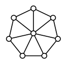](../../assets/volume4a/figures/exercise-7-88-wheel-seven-spokes.svg)

$W_7$

**89.** [*M20*][答案](./answers/7.md#ans-7-89) 证明结合律 $(42)$ 和 $(43)$.

▶ **90.** [*M24*][答案](./answers/7.md#ans-7-90) 如果一个图能够用补运算和 (或) 直和运算通过代数方式从 $1$ 元素图构造出来, 则称它为余图. 例如, 存在 $4$ 个 $3$ 阶非同构图, 它们全部是余图: $\overline{K_3}=K_1\oplus K_1\oplus K_1$ 及其补图 $K_3$; $\overline{K_{1,2}}=K_1\oplus K_2$ 及其补图 $K_{1,2}$, 其中 $K_2=\overline{K_1\oplus K_1}$.

穷举计数表明存在 $11$ 个 $4$ 阶非同构图. 给出证明它们中的 $10$ 个是余图的代数公式. 哪一个不是余图?

▶ **91.** [*20*][答案](./answers/7.md#ans-7-91) 画出下面 $4$ 顶点图的示意图: (a) $K_2\mathbin{\square}K_2$; (b) $K_2\otimes K_2$; (c) $K_2\boxtimes K_2$; (d) $K_2\mathbin{\triangle}K_2$; (e) $K_2\circ K_2$; (f) $\overline{K_2}\circ K_2$; (g) $K_2\circ\overline{K_2}$.

**92.** [*21*][答案](./answers/7.md#ans-7-92) 正文中定义的 $5$ 种图积, 既适用于简单的有向图, 也适用于普通的图. 画出下面 $4$ 顶点有向图的示意图: (a) $K_2^{\rightarrow}\mathbin{\square}K_2^{\rightarrow}$; (b) $K_2^{\rightarrow}\otimes K_2^{\rightarrow}$; (c) $K_2^{\rightarrow}\boxtimes K_2^{\rightarrow}$; (d) $K_2^{\rightarrow}\mathbin{\triangle}K_2^{\rightarrow}$; (e) $K_2^{\rightarrow}\circ K_2^{\rightarrow}$.

**93.** [*15*][答案](./answers/7.md#ans-7-93) 五种图积中的哪一种使得 $K_m$ 和 $K_n$ 之积成为 $K_{mn}$?

**94.** [*10*][答案](./answers/7.md#ans-7-94) SGB 的各种 `words` 图是 $P_{26}\mathbin{\square}P_{26}\mathbin{\square}P_{26}\mathbin{\square}P_{26}\mathbin{\square}P_{26}$ 的诱导子图吗?

**95.** [*M20*][答案](./answers/7.md#ans-7-95) 如果 $G$ 的顶点 $u$ 有 $d_u$ 度, $H$ 的顶点 $v$ 有 $d_v$ 度, 在 (a) $G\mathbin{\square}H$, (b) $G\otimes H$, (c) $G\boxtimes H$, (d) $G\mathbin{\triangle}H$, (e) $G\circ H$ 中顶点 $(u,v)$ 分别是多少度?

▶ **96.** [*M22*][答案](./answers/7.md#ans-7-96) 令 $A$ 是 $m\times m'$ 矩阵, $u$ 行 $u'$ 列的元素为 $a_{uu'}$. 令 $B$ 是 $n\times n'$ 矩阵, $v$ 行 $v'$ 列的元素为 $b_{vv'}$. 直积 $A\otimes B$ 是 $mn\times m'n'$ 矩阵, $(u,v)$ 行 $(u',v')$ 列的元素为 $a_{uu'}b_{vv'}$. 这样一来, 如果 $A$ 和 $B$ 分别是 $G$ 和 $H$ 的邻接矩阵, 那么, $A\otimes B$ 是 $G\otimes H$ 的邻接矩阵.

对于下面的图求类似的邻接矩阵公式: (a) $G\mathbin{\square}H$; (b) $G\boxtimes H$; (c) $G\mathbin{\triangle}H$; (d) $G\circ H$.

**97.** [*M25*][答案](./answers/7.md#ans-7-97) 求出图和与图积之间尽可能多的有趣的代数关系. (例如, 矩阵的直和与直积的分配律 $(A\oplus B)\otimes C=(A\otimes C)\oplus(B\otimes C)$ 蕴涵 $(G\oplus G')\otimes H=(G\otimes H)\oplus(G'\otimes H)$. 我们还有 $H$ 的 $m$ 个拷贝公式 $\overline{K_m}\mathbin{\square}H=H\oplus\cdots\oplus H$, 等等.)

**98.** [*M20*][答案](./answers/7.md#ans-7-98) 如果图 $G$ 有 $k$ 个分图, 图 $H$ 有 $l$ 个分图, 那么, 图 $G\mathbin{\square}H$ 和 $G\boxtimes H$ 有多少分图?

**99.** [*M20*][答案](./answers/7.md#ans-7-99) 令 $d_G(u,u')$ 是图 $G$ 中从顶点 $u$ 到 $u'$ 的距离. 证明: $d_{G\mathbin{\square}H}((u,v),(u',v'))=d_G(u,u')+d_H(v,v')$, 并对于 $d_{G\boxtimes H}((u,v),(u',v'))$ 求一个类似的公式.

**100.** [*M21*][答案](./answers/7.md#ans-7-100) 对于哪些连通图, $G\otimes H$ 是连通的?

▶ **101.** [*M25*][答案](./answers/7.md#ans-7-101) 求所有使得 $G\mathbin{\square}H\cong G\otimes H$ 的连通图 $G$ 和 $H$.

**102.** [*M20*][答案](./answers/7.md#ans-7-102) 王在 $m\times n$ 棋盘上的移动图 (在横向、纵向或对角线方向走一步的图) 的简单代数公式是什么?

**103.** [*20*][答案](./answers/7.md#ans-7-103) 完成表 $(54)$ 的填写. 另外, 对序列 $866444444$ 应用算法 H.

**104.** [*18*][答案](./answers/7.md#ans-7-104) 说明算法 H 的步骤 H3 和 H4 中变量 $i,t,r$ 的操作.

**105.** [*M38*][答案](./answers/7.md#ans-7-105) 假定 $d_1\geq\cdots\geq d_n\geq0$, 并且像在算法 H 中那样令 $c_1\geq\cdots\geq c_{d_1}$ 是它的共轭. 证明: $d_1\ldots d_n$ 是图的度序列, 当且仅当 $d_1+\cdots+d_n$ 是偶数, 且 $d_1+\cdots+d_k\leq c_1+\cdots+c_k-k$($1\leq k\leq s$), 其中 $s$ 是满足 $d_s\geq s$ 的最大值.

**106.** [*20*][答案](./answers/7.md#ans-7-106) 判别真假: 如果 $d_1=\cdots=d_n=d<n$ 且 $nd$ 是偶数, 则算法 H 构建了一个连通图.

**107.** [*M21*][答案](./answers/7.md#ans-7-107) 证明: 自补图的度序列 $d_1\ldots d_n$ 满足 $d_j+d_{n+1-j}=n-1$, $d_j=d_{j-(-1)^j}$, 其中 $1\leq j\leq n/2$.

▶ **108.** [*M23*][答案](./answers/7.md#ans-7-108) 设计一个同算法 H 类似的算法, 它在顶点集 $\{1,\ldots,n\}$ 上构造一个简单有向图, 图中每个顶点 $k$ 的入度和出度分别具有指定的值 $d_k^-$ 和 $d_k^+$, 只要至少存在一个这样的图.

**109.** [*M20*][答案](./answers/7.md#ans-7-109) 设计一个同算法 H 类似的算法, 如果可能, 它在顶点集 $\{1,\ldots,m+n\}$ 上构造一个二部图, 图中每个顶点 $k$ 具有指定的度数 $d_k$, 对所有的边 $j\mathrel{\text{—}}k$ 有 $j\leq m$ 且 $k>m$.

**110.** [*M22*][答案](./answers/7.md#ans-7-110) 不用算法 H, 通过直接构造证明, 当 $n>d_1\geq\cdots\geq d_n\geq d_1-1$ 且 $d_1+\cdots+d_n$ 为偶数时, 序列 $d_1\ldots d_n$ 是图的度序列.

▶ **111.** [*25*][答案](./answers/7.md#ans-7-111) 令 $G$ 是顶点集 $V=\{1,\ldots,n\}$ 上的图, 顶点 $k$ 的度是 $d_k$ 而且 $\max(d_1,\ldots,d_n)=d$. 证明: 存在这样的整数 $N$($n\leq N\leq2n$) 和顶点集 $\{1,\ldots,N\}$ 上的图 $H$, 使得 $H$ 是度数为 $d$ 的正则图, 而且 $H\mid V=G$. 说明怎样构造这样的让 $N$ 尽可能小的正则图.

**112.** [*20*][答案](./answers/7.md#ans-7-112) 网络 `miles(128,0,0,0,0,127,0)` 有三个等距离的城市吗? 如果没有, 那么哪三个城市最接近于一个等边三角形?

**113.** [*05*][答案](./answers/7.md#ans-7-113) 当 $H$ 是带有 $m$ 条边和 $n$ 个顶点的超图时, 它的关联矩阵有多少行和列?

**114.** [*M20*][答案](./answers/7.md#ans-7-114) 假定把多重图 $(26)$ 看成一个超图. 对应的关联矩阵是什么? 对应的二部多重图是什么?

▶ **115.** [*M20*][答案](./answers/7.md#ans-7-115) 当 $B$ 是图 $G$ 的关联矩阵时, 解释对称矩阵 $B^{\mathsf T}B$ 和 $BB^{\mathsf T}$ 的含义.

**116.** [*M17*][答案](./answers/7.md#ans-7-116) 描述完全二部 $r$ 一致超图 $K_{m,n}^{(r)}$ 的边.

**117.** [*M22*][答案](./answers/7.md#ans-7-117) 有多少非同构的 $1$ 一致超图具有 $m$ 条边和 $n$ 个顶点? (边可以重复.) 列出当 $m=4$ 且 $n=3$ 时所有这样的超图.

**118.** [*M20*][答案](./answers/7.md#ans-7-118) “超林” 是一种不包含圈的超图. 如果一个超林有 $m$ 条边、$n$ 个顶点和 $p$ 个分图, 那么它的顶点的度数之和是多少?

**119.** [*M18*][答案](./answers/7.md#ans-7-119) 什么超图对应于没有最后项 $(\overline x_1\vee\overline x_2\vee\overline x_4)$ 的 $(60)$?

**120.** [*M20*][答案](./answers/7.md#ans-7-120) 通过推广有向图的概念定义有向超图.

**121.** [*M19*][答案](./answers/7.md#ans-7-121) 给定超图 $H=(V,E)$, 令 $I(H)=(V,F)$, 其中 $F$ 是 $H$ 的所有极大独立集的集族. 试用 $|V|,|F|,\alpha(I(H)^{\mathsf T})$ 表示 $\chi(H)$.

▶ **122.** [*M24*][答案](./answers/7.md#ans-7-122) 分别求下列三元系的最大独立集和最小着色: (a) 超图 $(56)$; (b) 佩特森图的对偶图.

**123.** [*17*][答案](./answers/7.md#ans-7-123) 说明 $K_n\mathbin{\square}K_n$ 的最优着色等价于一个著名组合问题的解.

**124.** [*M22*][答案](./answers/7.md#ans-7-124) 图 2(f) 的赫瓦塔尔图的色数是多少?

**125.** [*M48*][答案](./answers/7.md#ans-7-125) 围长为 $g$ 的四正则 $4$ 着色图的 $g$ 值是多少?

▶ **126.** [*M22*][答案](./answers/7.md#ans-7-126) 当 $m,n\geq3$ 时, 求 “王连通环面”$C_m\boxtimes C_n$ 的最优着色.

**127.** [*M22*][答案](./answers/7.md#ans-7-127) 证明: 当 $G$ 是 $n$ 阶图时, (a) $\chi(G)+\chi(\overline G)\leq n+1$, (b) $\chi(G)\chi(\overline G)\geq n$. 并且寻找使上面等式成立的图.

**128.** [*M18*][答案](./answers/7.md#ans-7-128) 当 $G$ 和 $H$ 是图时, 用 $\chi(G)$ 和 $\chi(H)$ 表示 $\chi(G\mathbin{\square}H)$.

**129.** [*23*][答案](./answers/7.md#ans-7-129) 描述 $8\times8$ 后移步图 $(37)$ 的极大团.

**130.** [*M20*][答案](./answers/7.md#ans-7-130) 在一个完全 $k$ 部图中有多少极大团?

**131.** [*M30*][答案](./answers/7.md#ans-7-131) 令 $N(n)$ 是一个 $n$ 顶点图可能拥有的极大团的最大数量. 证明: $3^{\lfloor n/3\rfloor}\leq N(n)\leq3^{\lceil n/3\rceil}$.

▶ **132.** [*M20*][答案](./answers/7.md#ans-7-132) 如果 $\chi(G)=\omega(G)$, 我们称 $G$ 是可紧密着色的. 证明: 如果 $G$ 和 $H$ 是可紧密着色的, 则我们有 $\chi(G\boxtimes H)=\chi(G)\chi(H)$.

**133.** [*21*][答案](./answers/7.md#ans-7-133) 右图所示的 “音乐图” 为重温这一节给出的许多定义提供了一种适宜的方式, 因为它的性质很容易分析. 请给出它的下列属性: (a) 阶; (b) 大小; (c) 围长; (d) 直径; (e) 独立数 $\alpha(G)$; (f) 色数 $\chi(G)$; (g) 边色数 $\chi(L(G))$; (h) 团数 $\omega(G)$; (i) 众所周知的较小的图积的代数公式. (j) 最小顶点覆盖的大小是多少? (k) 最大匹配的大小是多少? (l) $G$ 是正则图吗? (m) $G$ 是平面图吗? (n) $G$ 是连通图吗? (o) $G$ 是有向图吗? (p) $G$ 是自由树吗? (q) $G$ 是哈密顿图吗?

[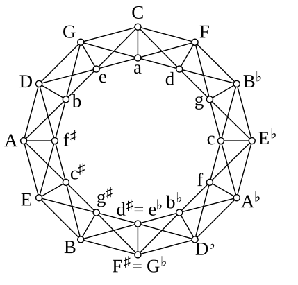](../../assets/volume4a/figures/exercise-7-133-musical-graph.svg)

**134.** [*M22*][答案](./answers/7.md#ans-7-134) 音乐图有多少自同构?

▶ **135.** [*HM26*][答案](./answers/7.md#ans-7-135) 假定一位作曲家在音乐图中随机游动, 从顶点 $C$ 出发, 然后在每一步做 $5$ 种等可能的选择. 证明: 经过偶数步游动之后, 更可能在顶点 $C$ 而不是任何其他顶点停止. 从 $C$ 开始用 $12$ 步游动回到 $C$ 的确切概率是多少?

**136.** [*HM23*][答案](./answers/7.md#ans-7-136) 凯莱有向图的顶点集 $V$ 是一个群的元素, 它的弧是 $v\longrightarrow v\alpha_j$ (对于 $1\leq j\leq d$ 和所有顶点 $v$), 其中 $(\alpha_1,\ldots,\alpha_d)$ 是群的固定元素. 凯莱图同时也是凯莱有向图 (它也是图). 佩特森图是凯莱图吗?

▶ **137.** [*M25*][答案](./answers/7.md#ans-7-137) (广义环面.) 一个 $m\times n$ 环面可以看成平面的一个覆盖. 例如, 我们可以想象, 把 $(50)$ 的无穷个 $3\times4$ 环面的拷贝像网格那样铺放在一起, 如下面左图所示; 我们从环面每个顶点可以向北、向南、向东或者向西移到另外一个顶点. 顶点这样编号: 从 $v$ 向北移动一步到达 $(v+4)\bmod12$, 向东移动一步到达 $(v+3)\bmod12$, 等等. 右图显示同样的环面, 但是有不同的覆盖形状. 用任何方式选择编号为 $\{0,1,\ldots,11\}$ 的 $12$ 个小方格将恰好以同样编号方案覆盖平面.

[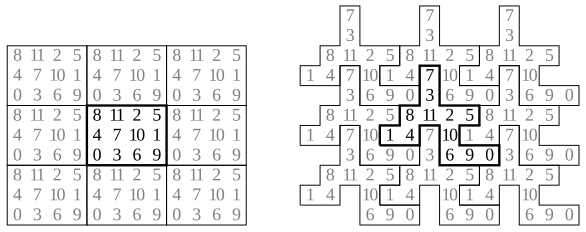](../../assets/volume4a/figures/exercise-7-137-twelve-tilings.svg)

单个环面形状变动后的拷贝也将覆盖平面, 如果它们构成一个广义环面, 环面中的单元 $(x,y)$ 对应于单元 $(x+a,y+b)$ 和 $(x+c,y+d)$ 的同样顶点, 这里 $(a,b)$ 和 $(c,d)$ 是整数向量, 且 $n=ad-bc>0$. 于是, 广义环面将有 $n$ 个点. 在上面的 $3\times4$ 例子中, 这两个向量 $(a,b)$ 和 $(c,d)$ 是 $(4,0)$ 和 $(0,3)$. 当它们分别是 $(5,2)$ 和 $(1,3)$ 时, 我们得到

[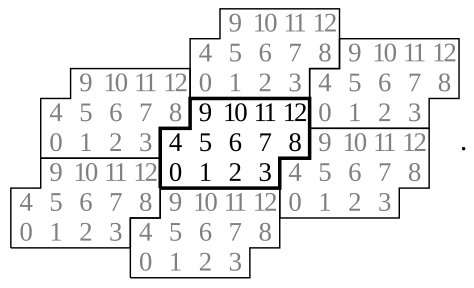](../../assets/volume4a/figures/exercise-7-137-thirteen-tiling.svg)

这里 $n=13$, 并且从 $v$ 向北移动到达 $(v+4)\bmod13$, 向东移动到达 $(v+1)\bmod13$.

证明: 如果 $\gcd(a,b,c,d)=1$, 这种广义环面的顶点总是可以被指定整数标记 $\{0,1,\ldots,n-1\}$, 使得对于某些整数 $p$ 和 $q$, $v$ 的邻近是 $(v\pm p)\bmod n$ 和 $(v\pm q)\bmod n$.

**138.** [*HM27*][答案](./answers/7.md#ans-7-138) 继续习题 137, 如果采用使每个向量 $x$ 等价于 $x+\alpha_j$ 的方式给出整数向量 $\alpha_j$($1\leq j\leq k$), 那么标记 $k$ 维顶点 $x=(x_1,\ldots,x_k)$ 的有效方法是什么? 就 $k=3$, $\alpha_1=(3,1,1)$, $\alpha_2=(1,3,1)$, $\alpha_3=(1,1,3)$ 的例子说明你的方法.

▶ **139.** [*M22*][答案](./answers/7.md#ans-7-139) 假定 $H$ 是给定的 $h$ 阶图, $\#(H:G)$ 是 $H$ 作为给定图 $G$ 的诱导子图出现的次数. 如果 $G$ 是从顶点集 $V=\{1,2,\ldots,n\}$ 上的所有 $2^{n(n-1)/2}$ 个图集中随机选取的, 当 $H$ 分别是以下各图时, $\#(H:G)$ 的平均值是多少: (a) $K_h$; (b) $P_h$($h>1$); (c) $C_h$($h>2$); (d) 任意图?

**140.** [*M30*][答案](./answers/7.md#ans-7-140) 如果图 $G$ 的诱导子图的计数 $\#(K_3:G)$、$\#(\overline{K_3}:G)$ 和 $\#(P_3:G)$ 中的每一个都同习题 139 中推出的期望值一致, 则称它为比例图.

(a) 说明习题 88 的车轮图 $W_7$ 在这种意义下是比例图.

(b) 证明: $G$ 是比例图, 当且仅当 $\#(K_3:G)=\frac18\binom n3$, 且它的顶点的度序列 $d_1\ldots d_n$ 满足恒等式

$$
\begin{aligned}
d_1+\cdots+d_n&=\binom n2,\\
d_1^2+\cdots+d_n^2&=\frac n2\binom n2.
\end{aligned}\tag{*}
$$

**141.** [*26*][答案](./answers/7.md#ans-7-141) 仅当 $n\bmod16\in\{0,1,8\}$ 时, 习题 140(b) 的条件才能成立. 编写一个程序, 找出 $n=8$ 个顶点的所有比例图.

**142.** [*M30*][答案](./answers/7.md#ans-7-142) (卡尔·斯万特·詹森和扬·克拉托赫维尔, 1991) 证明: 不可能存在四个或更多个顶点上的图 $G$ 在下述意义是 “超比例的”: 对于习题 90 中的 $11$ 个 $4$ 阶非同构图 $H$ 的每个图, 它的子图计数 $\#(H:G)$ 同习题 139 中的期望值相符. 提示: 注意 $(n-3)\#(K_3:G)=4\#(K_4:G)+2\#(K_{1,1,2}:G)+\#(\overline{K_{1,3}}:G)+\#(\overline{K_1\oplus K_{1,2}}:G)$.

▶ **143.** [*M25*][答案](./answers/7.md#ans-7-143) 假定 $A$ 是 $m>1$ 行 $n\geq m$ 列的矩阵, 这个矩阵的行各不相同. 证明: 至少可以删除 $A$ 的一列而不会使任何两行相同.

▶ **144.** [*21*][答案](./answers/7.md#ans-7-144) 假定 $X$ 是一个 $m\times n$ 矩阵, 它的元素 $x_{ij}$ 或者是 $0,1$, 或者是 $\ast$. $X$ 的完备化是指矩阵 $X^*$, 其中 $X$ 的每个 $\ast$ 元素已经用 $0$ 或 $1$ 代替. 证明: 求具有最少不同行的一个完备化的问题, 等价于求一个图的色数问题.

▶ **145.** [*25*][答案](./answers/7.md#ans-7-145) (罗伯特·博伊尔和 J. 斯特罗瑟·穆尔, 1980) 假定数组 $a_1\ldots a_n$ 包含一个过半数元素, 也就是出现次数超过 $n/2$ 的一个数值. 设计一个求过半数元素的算法, 在少于 $n$ 次的比较后得出结果. 提示: 如果 $n\geq3$ 且 $a_{n-1}\ne a_n$, 那么, $a_1\ldots a_n$ 的过半数元素也是 $a_1\ldots a_{n-2}$ 的过半数元素.

<!-- section-footnotes -->

[^p7-1]: 作者在讲述五字母单词的行文中, 使用了若干相映成趣的单词. 为保持原书风格, 保留英文原词. ——译者注
